# ProjectD backfill batch 58

Complete original prompts and exact existing ProjectD images. Actual model labels and any available credits or notices are retained. Missing authors or license metadata are not filled in.

## Abhi #417

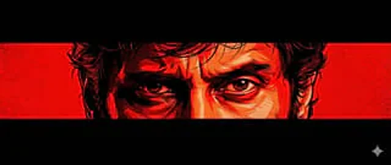

```text
A cinematic poster-style artwork featuring an intense close-up of a man’s eyes centered horizontally across the frame. Only the eyes and part of the face are visible through a narrow horizontal strip, surrounded by deep black negative space above and below. The face is illustrated in a high-contrast, graphic-novel style with bold red, black, and orange tones, dramatic shadows, sharp highlights, and a gritty, intense mood.
The eyes look fierce, emotional, and determined, with slightly messy hair. Use the provided image for eye reference
```

Model: Nano Banana
Author: Abhi

[ProjectD](https://aitoolsradar.com/en/prompts/b9d830d0e651ec) · [Recorded source](https://x.com/Abhiew_/status/2017259594419228875)
 · [Full original metadata and byte evidence](data/projectd-batch-0058.json)

## Abhishek Singh #408


```text
Aesthetic 1970s-inspired fashion portrait of a stylish young woman sitting on outdoor cafe steps, holding a premium ornate green coffee cup with gold rim detailing, gazing softly at the camera. Her hair is styled in soft loose strands framing her face with vintage makeup, matte red lips, and subtle eyeliner. She is wearing a cozy forest green premium knit sweater paired with a long flowing black tutu skirt. A warm vintage plaid scarf in earthy brown, burnt orange, and muted red tones is wrapped loosely around her neck. A premium dark green leather crossbody bag with a gold filigree clasp and chain strap is placed beside her. Autumn street café setting with scattered fallen leaves and warm amber café lights glowing behind glass windows. 1970s film tone, warm grainy texture, muted earthy color palette, cinematic atmosphere, shallow depth of field, soft natural lighting, analog film look, fashion editorial photography, ultra-realistic, high detail, 85mm lens, f/1.8, vintage aesthetic, dreamy mood.
```

Model: Nano Banana
Author: Abhishek Singh

[ProjectD](https://aitoolsradar.com/en/prompts/c64bc0337a9687) · [Recorded source](https://x.com/2abhisheknaks/status/2008537400083939763)
 · [Full original metadata and byte evidence](data/projectd-batch-0058.json)

## Abhishek Singh #428

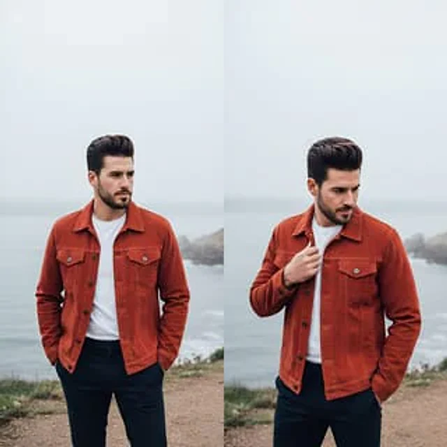

```text
{
  "image_description": "A high-quality side-by-side comparison of a handsome man posing on a coastal cliffside.",
  "subject": {
    "gender": "male",
    "appearance": "mid-30s, well-groomed beard, thick dark hair styled in a modern voluminous pompadour",
    "poses": [
      "standing with hands in pockets looking away from the camera",
      "standing with one hand adjusting the collar of his jacket"
    ]
  },
  "outfit": {
    "outerwear": "burnt orange or rust-colored corduroy trucker jacket with metal buttons",
    "base_layer": "crisp white crew-neck t-shirt",
    "bottoms": "dark navy blue or black slim-fit trousers"
  },
  "setting": {
    "location": "rugged coastal cliff overlooking the ocean",
    "background": "misty horizon, calm sea, rocky shoreline",
    "lighting": "overcast, soft diffused natural light, moody atmospheric fog"
  },
  "technical_details": {
    "camera_angle": "eye-level medium shot",
    "composition": "diptych (two images side-by-side)",
    "aesthetic": "lifestyle photography, cinematic color grading, shallow depth of field with soft background bokeh"
  }
}
```

Model: Nano Banana
Author: Abhishek Singh

[ProjectD](https://aitoolsradar.com/en/prompts/49be7cae7baba5) · [Recorded source](https://x.com/2abhisheknaks/status/2008113093117894773)
 · [Full original metadata and byte evidence](data/projectd-batch-0058.json)

## Abhishek Singh #438

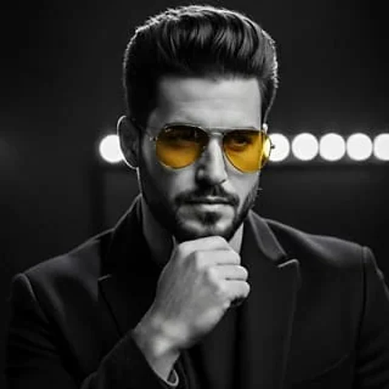

```text
{
  "objective": "Create a dramatic, high-contrast cinematic portrait of a stylish young man in a premium black suit with selective warm lighting and intense mood",
  "subject": {
    "type": "Young adult male",
    "age_appearance": "25-30",
    "hair": "Black, voluminous, slicked back pompadour style, perfectly styled with high shine",
    "facial_hair": "Well-groomed short boxed beard and mustache",
    "expression": "Intense, confident, serious, slightly mysterious",
    "pose": "Hand under chin thoughtful/contemplative pose, looking directly at camera",
    "accessories": {
      "sunglasses": "Classic aviator style, gold metal frame, strong yellow/orange tinted lenses",
      "clothing": {
        "outerwear": "Premium matte black tailored blazer/jacket, sharp lapels, high-end luxurious fabric texture",
        "innerwear": "Dark charcoal or black crew-neck t-shirt"
      }
    }
  },
  "lighting": {
    "style": "Cinematic studio lighting",
    "main": "Strong side and rim lighting creating deep shadows and dramatic highlights",
    "background": "Dark gradient with circular warm spotlight array (vanity/makeup studio lights)",
    "contrast": "Very high contrast, deep blacks, bright highlights on face and hair",
    "mood": "Moody, masculine, powerful, film-noir inspired"
  },
  "composition": {
    "framing": "Tight mid-close-up portrait, head and shoulders",
    "angle": "Slightly below eye level for commanding presence",
    "depth_of_field": "Shallow, sharp focus on face and sunglasses, soft background"
  },
  "color_palette": {
    "dominant": "Black & deep charcoal",
    "accents": "Warm yellow-orange from sunglasses lenses and background lights",
    "skin_tone": "Natural with subtle cinematic glow"
  },
  "style_references": [
    "Modern film-noir",
    "High-end fashion editorial",
    "Hollywood dramatic portrait",
    "David LaChapelle meets classic menswear advertising"
  ],
  "image_quality": {
    "resolution": "Ultra-high detail, 8K",
    "sharpness": "Crisp facial features, hair strands visible",
    "texture": "Detailed skin pores, fabric weave, hair shine"
  },
  "negative_prompt": [
    "low quality",
    "blurry",
    "overexposed",
    "underexposed",
    "cartoon",
    "anime",
    "distorted face",
    "extra limbs",
    "bad anatomy",
    "logo",
    "text",
    "watermark",
    "bright colored clothing",
    "casual outfit"
  ],
  "aspect_ratio": "2:3 (portrait orientation)"
}
```

Model: Nano Banana
Author: Abhishek Singh

[ProjectD](https://aitoolsradar.com/en/prompts/665ddc65f70e3e) · [Recorded source](https://x.com/2abhisheknaks/status/2012888202760384949)
 · [Full original metadata and byte evidence](data/projectd-batch-0058.json)

## Abhishek Singh #440

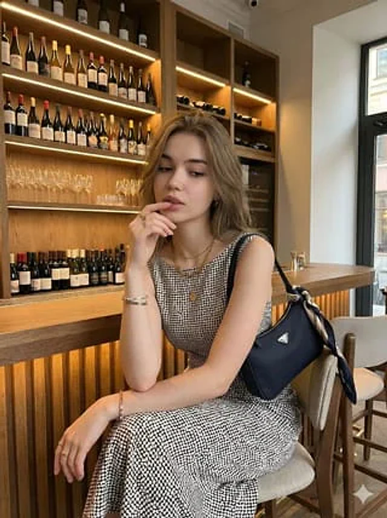

```text
Young beautiful woman with long wavy hair, elegant sleeveless polka dot midi dress black and white pattern, sitting thoughtfully at stylish wine bar counter, hand near lips, luxury wine bottles wall background, Prada navy blue mini bag with silk scarf, gold jewelry, sophisticated chic atmosphere, soft warm lighting, cinematic, highly detailed, realistic

Use my uploaded face image as the ONLY facial and identity reference. No other faces, models, datasets, or references are allowed.
```

Model: Nano Banana
Author: Abhishek Singh

[ProjectD](https://aitoolsradar.com/en/prompts/8fff0ecaacc4ba) · [Recorded source](https://x.com/2abhisheknaks/status/2011378277001363610)
 · [Full original metadata and byte evidence](data/projectd-batch-0058.json)

## Abhishek Singh #444


```text
{
A hyper-realistic, ultra-detailed 8K cinematic wide-shot of a football scene, captured from a dramatic low-angle perspective with a wide-angle lens and shallow depth of field, emphasizing speed, power, and realism.

The scene features only two players on a professional football pitch.
The primary player, positioned slightly ahead and in control of the ball, is dribbling with explosive movement and confident body language. His face is generated using the uploaded face as reference (100% likeness).

He wears an ultra-realistic AI Trends football kit, designed like a top-tier international club jersey. The kit has a blue-green gradient finish, breathable performance fabric, and subtle geometric textures. “AI Trends” branding is printed boldly on the chest and both shoulders in premium sports typography. The fabric reacts naturally to motion, showing realistic folds, tension, and subtle sweat details, giving a luxury global campaign aesthetic.

Running beside him is Cristiano Ronaldo, wearing his iconic classic football kit, instantly recognizable by its design, colors, and number. Cristiano is not holding the ball. He matches pace powerfully, positioned slightly to the side, ready for a decisive run or finish.

No other players are on the field.

The grass pitch is extremely detailed, with visible blades, dirt particles, and subtle turf displacement beneath their feet. Water droplets and dust rise with each step, enhancing motion realism.
The background features a massive stadium with a softly blurred crowd, cinematic depth, and powerful volumetric lighting creating dramatic rim light around both players. Subtle motion blur enhances speed while both faces remain sharp and detailed.
The mood is powerful and cinematic, resembling a high-budget sports film still and a premium AI Trends global campaign, with natural color grading, hyper-realistic textures, and professional sports photography aesthetics.
```

Model: Nano Banana
Author: Abhishek Singh

[ProjectD](https://aitoolsradar.com/en/prompts/2d2888ed9d7104) · [Recorded source](https://x.com/2abhisheknaks/status/2013550317347193242)
 · [Full original metadata and byte evidence](data/projectd-batch-0058.json)

## Abhishek Singh #499

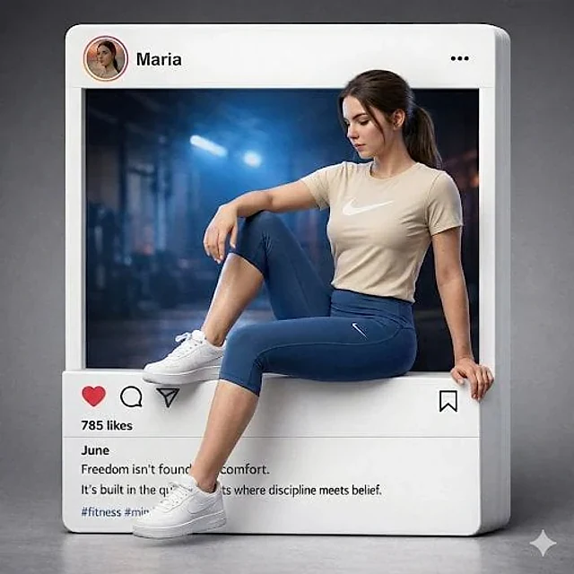

```text
{
  "image_generation_prompt": {
    "subject": {
      "description": "A photorealistic young woman with brown hair tied back in a ponytail, sitting on a stool.",
      "pose": "Sitting with one knee raised, hands clasped around her shin, looking slightly to the side with a calm, focused expression.",
      "clothing": {
        "top": "Beige t-shirt with a white Nike swoosh logo on the chest.",
        "bottoms": "Dark blue leggings with a small white swoosh logo on the thigh.",
        "footwear": "White athletic sneakers."
      }
    },
    "composition": {
      "foreground_element": "A large, 3D-rendered white social media frame resembling an Instagram post, physically framing the subject.",
      "ui_details": {
        "header": {
          "profile_picture": "Profile picture of the woman",
          "username": "Maria",
          "follow_button": {
            "text": "FOLLOW",
            "color": "Blue"
          }
        },
        "footer_icons": [
          {
            "type": "like",
            "icon": "Heart",
            "color": "Red",
            "state": "Liked"
          },
          {
            "type": "comment",
            "icon": "Comment bubble"
          },
          {
            "type": "share",
            "icon": "Paper plane"
          },
          {
            "type": "bookmark",
            "icon": "Bookmark"
          }
        ],
        "likes_count": 785,
        "caption": "Freedom isn’t found in comfort. It’s built in the quiet moments where discipline meets belief."
      }
    },
    "environment": {
      "setting": "A dimly lit, atmospheric gym background.",
      "details": "Blurred gym equipment in the shadows, creating a strong depth of field."
    },
    "style": {
      "visual_style": "3D realistic render using Unreal Engine 5, cinematic and high fidelity.",
      "lighting": {
        "subject": "Soft spotlight focused on the woman",
        "background": "Cool ambient lighting with subtle shadows"
      }
    }
  }
}
```

Model: Nano Banana
Author: Abhishek Singh

[ProjectD](https://aitoolsradar.com/en/prompts/87d89a4ce5f4c6) · [Recorded source](https://x.com/2abhisheknaks/status/2016154222765527482)
 · [Full original metadata and byte evidence](data/projectd-batch-0058.json)

## Adam也叫吉米 #1114

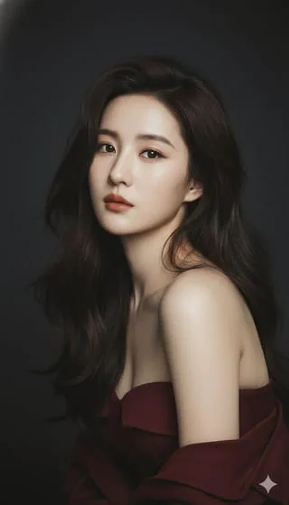

```text
Create a melancholic and cinematic portrait photography. A young woman with clear, fair skin and light makeup. Warm, natural lip color. Deep brown hair with a fluffy texture. A calm and confident expression. Wearing a wine-red top to showcase elegance. A dark, minimalist background fading to black. Soft, diffused front lighting, gentle shadows, subtle film grain, organic color grading, shallow depth of field, and high-end editing texture. Use the facial features of the reference subject without any alterations.
```

Model: Nano Banana
Author: Adam也叫吉米

[ProjectD](https://aitoolsradar.com/en/prompts/268f08795d1dd5) · [Recorded source](https://x.com/Adam38363368936/status/2016087801759203335)
 · [Full original metadata and byte evidence](data/projectd-batch-0058.json)

## Adam也叫吉米 #566

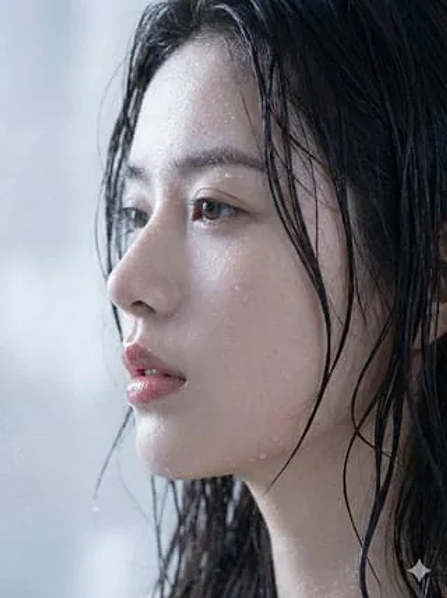

```text
{
  "request_metadata": {
    "version": "2.0",
    "priority_focus": "Hyper-realistic skin textures and identity fidelity",
    "aspect_ratio": "3:4"
  },
  "subject_configuration": {
    "identity": {
      "name": "the person I uploaded",
      "reference_mode": "strict_identity_matching",
      "source_reference": "uploaded_files",
      "preservation_weight": 1.0,
      "angle": "Extreme profile view"
    },
    "facial_attributes": {
      "eyes": {
        "reflection_type": "Realistic catchlights",
        "aesthetic_constraint": "Avoid synthetic gloss or excessive shine"
      },
      "lips": {
        "state": "Parted / Moist",
        "surface_texture": "Soft natural ridges",
        "finish": "Glossy sheen without distortion"
      },
      "hair": {
        "color": "Dark Brunette",
        "state": "Saturated / Wet",
        "styling": "Clumping in natural strands, adhered to temples and neck"
      }
    }
  },
  "environmental_rendering": {
    "moisture_fx": {
      "sweat_layer": "Fine glistening mist across the bridge of nose and forehead",
      "water_droplets": "Micro-droplets scattered on cheekbones and jawline",
      "surface_tension": "Realistic liquid adhesion to skin"
    },
    "lighting_and_color": {
      "lighting_style": "Soft-box diffusion",
      "temperature": "Cool tones",
      "color_palette": ["Steel Blue", "Soft Cyan", "Natural Skin Tones"],
      "background": {
        "description": "Minimalist bokeh",
        "colors": ["Light Grey", "Pure White"],
        "depth_of_field": "Shallow"
      }
    }
  },
  "technical_execution": {
    "rendering_engine": "CGI Photorealistic",
    "focal_length": "85mm macro",
    "texture_detail": "Pore-level resolution",
    "post_processing": "Raw photography style, no airbrushing"
  }
}
```

Model: Nano Banana
Author: Adam也叫吉米

[ProjectD](https://aitoolsradar.com/en/prompts/ddf606c1bbb441) · [Recorded source](https://x.com/Adam38363368936/status/2011356173572902941)
 · [Full original metadata and byte evidence](data/projectd-batch-0058.json)

## Adam也叫吉米 #571


```text
{
  "style": "ultra-realistic celebrity portrait, soft romantic photography",
  "subject": {
    "identity": "based on uploaded reference",
    "gender": "female",
    "age": "young adult",
    "pose": "tilting head slightly to the side, looking up at camera through lashes, playful and cute posture",
    "expression": "pouting lips, acting cute, puppy eyes, innocent look, 'sajiao' vibe",
    "facial_details": {
      "eyes": "big imploring eyes, looking up, soft gaze",
      "mouth": "pouted lips, slight pout",
      "cheeks": "faint blush",
      "freckles": "visible natural freckles across nose and cheeks",
      "makeup": {
        "skin": "dewy natural finish",
        "lips": "glossy pink",
        "eyes": "doe-eyed makeup"
      }
    },
    "hair": {
      "color": "jet black",
      "length": "long",
      "style": "straight, soft texture, falling over one shoulder"
    },
    "outfit": {
      "dress": "black fitted dress with deep plunging V-neckline",
      "jewelry": {
        "earrings": "long dangling gold chain earrings",
        "necklaces": "layered gold necklaces with a small heart pendant"
      }
    }
  },
  "environment": {
    "setting": "soft studio setting",
    "background": "creamy soft focus background, blurred"
  },
  "lighting": {
    "type": "soft diffused light",
    "mood": "romantic, sweet, charming",
    "tone": "warm peach and cream tones"
  },
  "camera": {
    "shot_type": "close-up portrait",
    "angle": "slightly high angle (to emphasize big eyes)",
    "focus": "sharp focus on eyes",
    "lens": "85mm f/1.4"
  },
  "quality": {
    "resolution": "8k",
    "texture": "realistic skin texture",
    "aesthetic": "k-pop aesthetic influence, soft dreamy style"
  }
}
```

Model: Nano Banana
Author: Adam也叫吉米

[ProjectD](https://aitoolsradar.com/en/prompts/9e2a069bade6db) · [Recorded source](https://x.com/Adam38363368936/status/2012152968796049803)
 · [Full original metadata and byte evidence](data/projectd-batch-0058.json)

## AI Pulse #1212

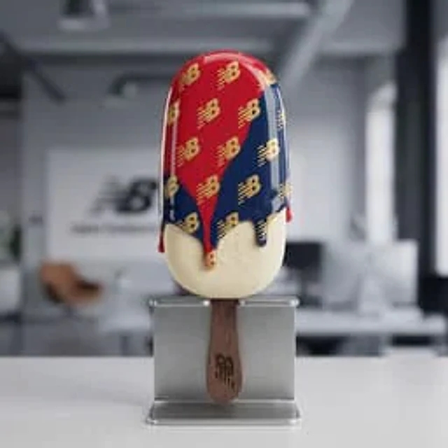

```text
A perfectly vertical, hyper-realistic 3D popsicle by [@ YOUR LOGO] featuring a glossy signature-colored glaze with a gold logo pattern dripping over the visible matte ice cream texture at the base. The stick features the brand's logo.
```

Model: Nano Banana
Author: AI Pulse

[ProjectD](https://aitoolsradar.com/en/prompts/132f33adb782dd) · [Recorded source](https://x.com/youraipulse/status/2016567546325979473)
 · [Full original metadata and byte evidence](data/projectd-batch-0058.json)

## AI Pulse #1446

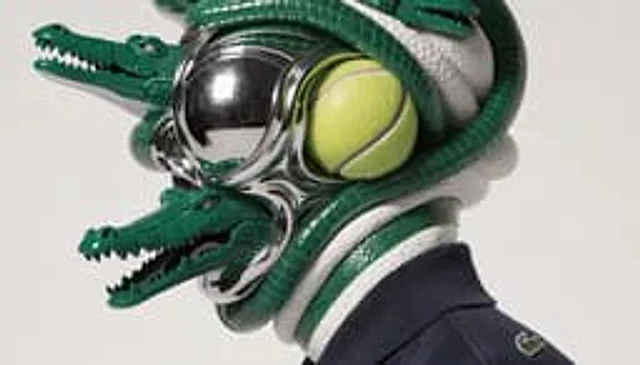

```text
[BRAND]. A hyperrealistic editorial photo of a figure wearing a unique helmet or mask that embodies the soul of BRAND turned inside out - its textures, symbols, colors and DNA reconstructed into an unexpected wearable object covering the entire face. The mask is made of BRAND's signature materials but distorted, inverted, reimagined as armor. Dramatic studio lighting, clean or atmospheric background, macro detail on every surface, Vogue editorial style, 8K
```

Model: Nano Banana
Author: AI Pulse

[ProjectD](https://aitoolsradar.com/en/prompts/1725efc88a3874) · [Recorded source](https://x.com/youraipulse/status/2041238850962382939)
 · [Full original metadata and byte evidence](data/projectd-batch-0058.json)

## AI Pulse #377

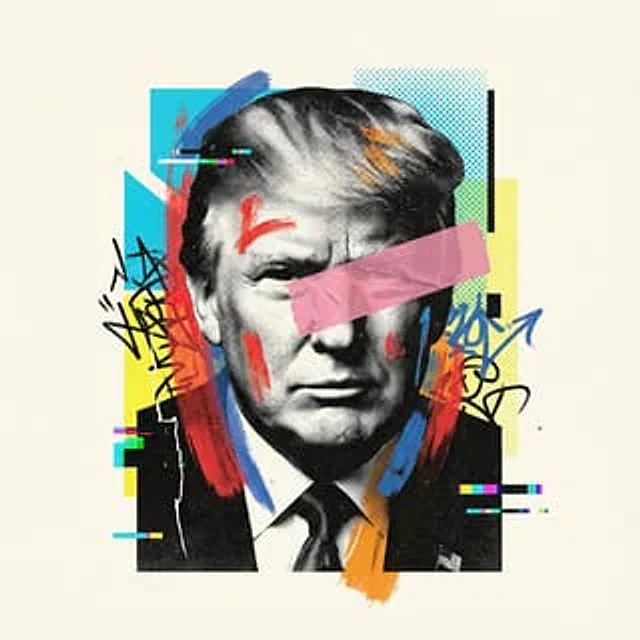

```text
[PERSON \ BRAND] visualized as the central masterpiece of a surreal avant-garde collage, style of modern mixed media editorial illustration. The subject is composed of high-contrast black and white stippled halftone textures blended with vibrant neo-expressionist elements. Overlay details include bold geometric shapes, cyan and yellow risograph patterns, abstract graffiti scribbles, and digital glitch artifacts. A thick strip of pink or orange tape or a color block obscures part of the form for a deconstructed look. The texture is grainy, mimicking vintage poster paper. The composition is strictly centered with a very wide, clean, off-white cream paper background, ensuring the entire subject is fully contained within the frame with generous negative space on all sides, zero cropping, minimal chic aesthetic.
```

Model: Nano Banana
Author: AI Pulse

[ProjectD](https://aitoolsradar.com/en/prompts/048c1d0ff7e28f) · [Recorded source](https://x.com/youraipulse/status/2008633447095349411)
 · [Full original metadata and byte evidence](data/projectd-batch-0058.json)

## AI Pulse #424

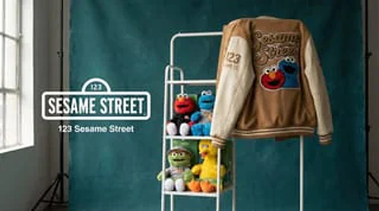

```text
[BRAND NAME]. Act as a Creative Director and Still Life Photographer for a hypebeast fashion publication.
THE TASK:
Create a high-end "Showroom Still Life" photograph announcing a limited merchandise drop for [BRAND NAME].
PHASE 1: AUTONOMOUS CURATION (STRATEGY)
Analyze [BRAND NAME]: Identify the industry and the core physical product (e.g., if "Spalding" -> Basketballs; if "McDonald's" -> Burger Boxes; if "Visa" -> Metal Cards).
Determine the Palette:
Background Color: A deep, rich, textured tone derived from the brand's secondary palette (e.g., Teal, Navy, Burgundy, Slate Grey).
Merch Color: A contrasting warm or neutral tone (Camel, Orange, Cream) to pop against the background.
Select the "Merch Item": Choose a high-quality apparel piece relevant to the brand's vibe (e.g., a Varsity Letterman Jacket, a Heavyweight Hoodie, a Canvas Tote, or a Wool Scarf).
PHASE 2: SET DESIGN (THE RACK)
The Prop: A simple, modern White Powder-Coated Metal Rack or Shelf unit. It stands cleanly in the frame.
The Arrangement:
Hanging Item: The chosen "Merch Item" (e.g., the Jacket) is draped casually over the rack or hanging on a hanger, showing off the texture (wool/felt).
Stacked Items: On the shelves of the rack, stack multiple units of the brand's Core Product (e.g., a stack of basketballs, a pyramid of cans, a row of boxes).
The Background: A Hand-Painted Canvas Backdrop in the chosen Deep Background Color. Visible texture/brushstrokes are essential for that "studio" look.
PHASE 3: PHYSICAL BRANDING (TEXTURE)
On the Merch: The hanging apparel must feature High-Quality Physical Branding. Use "Chenille Patches", "Embroidered Logos", or "Screen Print" running down the sleeve or on the back. It must look like a real, expensive garment.
On the Products: Ensure the stacked core products have the correct [BRAND NAME] logo visible.
PHASE 4: PHOTOGRAPHY & LIGHTING
Lighting: Soft, directional window light from the side. Creates realistic, soft shadows on the rack and rich highlights on the textures.
Lens: 50mm or 85mm. Sharp focus on the merch, slight fall-off in the background.
PHASE 5: UI OVERLAY (THE "DROP" LAYOUT)
Left Side Alignment:
Large, clean White Logo of [BRAND NAME] floating in the negative space on the left.
Under the logo, small white text with the brand's official slogan.
```

Model: Nano Banana
Author: AI Pulse

[ProjectD](https://aitoolsradar.com/en/prompts/3d040d41a1f8bf) · [Recorded source](https://x.com/youraipulse/status/2015869121058030001)
 · [Full original metadata and byte evidence](data/projectd-batch-0058.json)

## AI Pulse #552

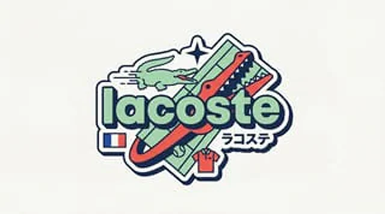

```text
[BRAND NAME]

Act as a Senior Vector Graphic Designer specializing in Y2K Japanese streetwear badge design. Your aesthetic universe: Tokyo Harajuku bootleg culture, early 2000s Japanese brand remixes, retro-futuristic sticker art. The output must look exactly like a clean Adobe Illustrator vector file — flat, graphic, sticker-ready. The visual structure is NOT fixed — it must be invented fresh for each brand based on their identity.

BRAND INTELLIGENCE SYSTEM

Before executing, resolve all of the following and use them to drive every design decision: (1) PRIMARY COLOR — [BRAND NAME]'s main brand color converted into a pastel or softened Y2K version — still recognizable as the brand but lighter and more kawaii, (2) ACCENT COLOR — [BRAND NAME]'s secondary color pushed to warm saturation — the energetic pop color of the composition, (3) DARK COLOR — a deep dark version of the brand palette — navy, dark brown, deep green, near-black — used for all outlines and extrusions, (4) LETTER CONTENT — [BRAND NAME]'s name in bold lowercase or the most iconic abbreviation, (5) JAPANESE TRANSLITERATION — correct katakana of [BRAND NAME] as a small secondary text element, (6) BRAND ORIGIN FLAG — [BRAND NAME]'s country of origin national flag as a small flat element, (7) BRAND SHAPE LANGUAGE — identify the most iconic geometric or graphic forms from [BRAND NAME]'s visual identity — the shapes, curves, symbols, and structural elements unique to this brand. These shapes become the orbital, background, and decorative elements of the badge — replacing generic ovals with brand-specific geometry, (8) BRAND CULTURAL SYMBOLS — identify 1–2 small iconic objects or symbols from [BRAND NAME]'s world that can be rendered as tiny flat illustrations within the badge — not the logo itself but objects associated with the brand's universe, (9) COMPOSITION LOGIC — based on all resolved parameters above, autonomously design the structural layout of the badge. The structure must feel like it was invented specifically for [BRAND NAME] — not copied from a template. Ask: what shapes from this brand's identity could orbit the letters? What geometry feels native to this brand? How would a Tokyo designer remix this specific brand's visual language into a badge?

PHASE 1: CANVAS

1:1 square canvas. Background: flat off-white or warm light grey. Completely empty. No texture. No gradient.

PHASE 2: BADGE STRUCTURE — FULLY AUTONOMOUS

Using the BRAND SHAPE LANGUAGE and COMPOSITION LOGIC resolved above, design the complete badge structure. The only fixed rules are: the badge must have a central lettering element, surrounding geometric shapes that interact with the letters through z-layer stacking, at least one element that passes both behind and in front of the letters creating depth, and the overall silhouette must read as a unified badge or patch shape. Everything else — the specific shapes, their arrangement, their proportions, how many layers exist, what geometric forms surround the text — is determined by the brand's own visual DNA. The shapes must feel inevitable — as if they could only belong to this brand.

PHASE 3: LETTERING

[BRAND NAME] in large bold lowercase — wide, rounded, confident display typeface. Flat PRIMARY COLOR fill. Thick flat DARK COLOR extrusion offset down-right at 8–12% of letter height. Bold DARK COLOR outline. No gradients. No rendering. The letters are the anchor of the entire composition.

PHASE 4: Y2K SIGNATURE ELEMENTS

These elements appear in every execution — they are the Y2K Japanese badge DNA: SPEED LINES or MOTION TEXTURE — somewhere within the background shapes, parallel lines or radial lines in ACCENT COLOR creating energy and movement. 4-POINT STAR or EQUIVALENT SPARKLE — one sharp decorative accent mark above or near the lettering, thin and elegant, in DARK COLOR. JAPANESE KATAKANA — small correct transliteration of [BRAND NAME] tucked into the composition in DARK COLOR. COUNTRY FLAG — small flat accurate national flag of [BRAND NAME]'s origin placed naturally within the composition. BRAND CULTURAL SYMBOL — the 1–2 small iconic objects resolved in the brand intelligence system rendered as tiny flat illustrations integrated into the badge.

TECH SPECS

Flat vector only — zero gradients, zero effects, zero rendering, zero blur. Clean crisp edges throughout. Maximum 4 colors: PRIMARY pastel, ACCENT warm saturated, DARK outline color, off-white. The badge must feel like a collectible sticker or embroidered patch. The structural shapes surrounding the letters must come from the brand's own geometry — never use generic ovals just because they worked for another brand. Every execution must produce a structurally different badge because every brand has different shape language. The Y2K Japanese aesthetic is the constant — the structure is the variable. Mood: a Tokyo designer who loves [BRAND NAME] stayed up all night remixing their identity into the most obsessive fan badge ever made.
```

Model: Nano Banana
Author: AI Pulse

[ProjectD](https://aitoolsradar.com/en/prompts/0f59ee0519031c) · [Recorded source](https://x.com/youraipulse/status/2040769988466733167)
 · [Full original metadata and byte evidence](data/projectd-batch-0058.json)

## AI Pulse #560

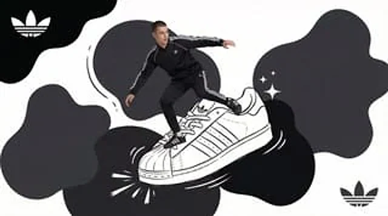

```text
[BRAND NAME] + [HERO COLOR]

Act as a Mixed-Media Campaign Art Director. Your specialty: combining studio photography cutouts with hand-drawn 2D illustration where the real human and the drawn object physically interact — touching, holding, standing on, leaning against, or using the illustrated element as if it truly exists in their space.

PHASE 1: CANVAS & COLOR SYSTEM

Format: 1:1 square canvas. Base: single flat saturated color [HERO COLOR]. No gradients. No texture. Pure chromatic field.
Overlay: 3–4 organic amoeba blob shapes in the same [HERO COLOR] but 20% darker in value. Smooth edges, irregular silhouettes, scattered asymmetrically. Some bleeding off-frame.
Hand-painted feel, clean execution.

PHASE 2: AUTONOMOUS OBJECT SELECTION

BEFORE staging the scene, the AI must first  make two autonomous decisions:
DECISION 1 — SELECT THE OBJECT: Analyze [BRAND NAME] and identify ONE iconic physical object from this framework:
— What is the single most recognizable product or artifact this brand has ever made?
— What object do fans of this brand collect, use daily, or photograph?
— What prop has defined this brand's visual identity across decades?
Do NOT choose animals. Do NOT choose logos. Choose a real, large, tangible object that can physically occupy space next to a person.
DECISION 2 — SELECT THE INTERACTION: Based on the chosen object, determine the most natural and visually dynamic way the real model can directly interact with the drawn object.
Interaction must be:
✓ Physical and direct — hands touching, feet on, body leaning, arms around
✓ Immediately readable — the relationship between person and object is understood in under 2 seconds
✓ Scaled correctly — the object must be large enough to interact with at human scale
✓ Active, not passive — the model is DOING something with the object, not just standing next to it
INTERACTION TYPE EXAMPLES (AI selects the most brand-appropriate):
· HOLDING: model's real hands grip the illustrated object — cup, camera, trophy, bottle, bag
· WEARING/USING: model's real body wears or uses the object — sitting on a chair, wearing an illustrated hat, holding an illustrated product to their face
· STANDING ON: model's real feet are planted on top of the illustrated object — skateboard, surfboard, podium, giant sneaker
· RIDING/LEANING: model's real body leans against or drapes over the illustrated object — car hood, shopping cart, giant product silhouette
· EMERGING FROM: model appears to step out of or through the illustrated object — bursting through a giant sneaker box, rising from an illustrated cup

PHASE 3: STAGING THE SCENE

Once object and interaction are selected, stage the full scene:
MODEL:
Single model age 18–26, clean cutout, zero fringing. Pose is determined by the chosen interaction — the body position must make the interaction feel natural and physically believable.
Wardrobe: [BRAND NAME]'s most iconic apparel in [HERO COLOR] monochromatic palette.
ILLUSTRATED OBJECT: Pure white (#FFFFFF) flat 2D illustration. Brush-pen marker line quality, 3–5px weight. Slightly imperfect organic edges — hand-drawn feel, not vector-perfect. NO shading. NO gradients. Flat white fill only.

SCALE RULE — CRITICAL: The illustrated object must be LARGE. Minimum size: 40% of canvas height. The object should feel monumental — oversized relative to real-world scale  is acceptable and encouraged.  A coffee cup can be waist-height.  A sneaker can be as tall as the model. Large scale = better readability =  stronger visual impact.
DEPTH LAYERING — CRITICAL:The object must exist on multiple z-layers:
— Parts of the object sit BEHIND the model
— Parts of the object come IN FRONT of the model
— The model's real hands/feet make contact  at the intersection point
This layering is what makes the scene feel integrated rather than collaged.
BRAND STAMP:
One small [BRAND NAME] logo mark appears on the object's surface — naturally embedded as if printed, engraved, or stitched. Rendered in [HERO COLOR] darker variant. Subtle, not dominant.

PHASE 4: SUPPORTING ILLUSTRATION SYSTEM

All supporting elements: white, flat, brush-pen line style. Same visual language as the hero object.
LOGO MARKS:
[BRAND NAME] primary icon in white:
— Large (upper-left corner, ~15% canvas width)
— Medium (opposite corner, ~10% canvas width)
IMPACT MARKERS: 2–3 manga-style exclamation dash clusters  near the point of interaction between  model and object — where hands grip,  where feet land, where bodies touch. This emphasizes the physical connection.
MOTION LINES: 2–4 curved speed lines radiating from  the object or the model's most active body part. Taper at ends. Cross behind and in front of the model for depth.

GROUND EFFECT: At the base of the scene: white illustrated  ground interaction — sparkle stars,  short speed dashes, or object-specific  effect (splash if cup, dust clouds  if sneaker landing, wheel tracks if skateboard).
AMBIENT SQUIGGLES: 1–2 loose organic white lines floating near the model's torso — visual rhythm connecting the photographic and illustrated layers.

PHASE 5: LIGHTING

Studio strobe, high-key, even and clean. 5500K neutral. No dramatic shadows on model. Soft contact shadow at model's feet (opacity 15%). The photography reads as natural and real  against the graphic illustrated environment.

TECH SPECS

Aesthetic: mixed media — real photograph integrated with hand-drawn 2D illustration. Color count: 3 maximum — [HERO COLOR] light, [HERO COLOR] dark blobs, white illustration. Photography skin tones and fabric colors  are the only additional color exception. Illustration style: Y2K comic energy,  Japanese streetwear magazine, brush marker. Composition: asymmetric and dynamic.  The interaction point between model and  object is the visual center of gravity — everything else orbits around it. No text. No wordmarks. Logo icon only. Mood: the model is not posing WITH the object —  the model is IN THE MIDDLE of using it.  Caught mid-action. Alive.
```

Model: Nano Banana
Author: AI Pulse

[ProjectD](https://aitoolsradar.com/en/prompts/10b6ff5bfbb7d3) · [Recorded source](https://x.com/youraipulse/status/2038707148981432392)
 · [Full original metadata and byte evidence](data/projectd-batch-0058.json)

## AI Pulse #660

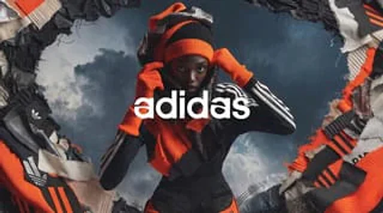

```text
[BRAND]. A high fashion campaign poster. A model with a strong expressive face as the centerpiece, wearing a signature outfit in the brand's exact official color palette. Dramatic surreal atmospheric background. Layered collage of torn-edge material swatches surrounding the model. Brand's iconic symbol woven into the scene. Logo overlaid in the center in clean serif font. Macro detail on fabric texture and stitching. Cinematic lighting, rich contrast, 8K
```

Model: Nano Banana
Author: AI Pulse

[ProjectD](https://aitoolsradar.com/en/prompts/cc7914823f7e66) · [Recorded source](https://x.com/youraipulse/status/2031843569942622631)
 · [Full original metadata and byte evidence](data/projectd-batch-0058.json)

## AI Pulse #671

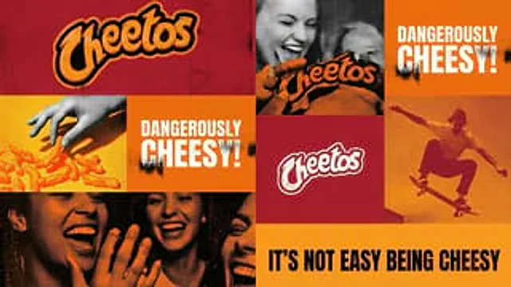

```text
[BRAND NAME]. 
Act as a graphic design creative director constructing a highly structured "Campaign Visual Identity Grid."

COMPOSITION (SPECIFIC 2-COLUMN ASYMMETRICAL LAYOUT):

The image must follow a strict 2-column grid structure, exactly like the layout seen in professional campaign boards.

LAYOUT STRUCTURE (TOP TO BOTTOM):
ROW 1: One single, full-width rectangular block (e.g., a wide photo).
ROW 2: Two equal-sized square blocks side-by-side.
ROW 3: One single, full-width rectangular block
ROW 4: Two equal-sized square blocks side-by-side.
ROW 5: One single, full-width rectangular block at the bottom.
The grid must be perfectly stable, with all blocks forming this exact pattern.

CRITICAL CONSTRAINTS:
FULL BLEED (100% COVERAGE): The grid must occupy the ENTIRE canvas area from edge to edge. There are absolutely NO margins, NO borders, and NO background space visible.

ZERO SPACING (NO GAPS): The grid tiles must be seamlessly abutted. There should be absolutely NO gutters, white lines, or spacing between the blocks. They must touch perfectly to form a solid wall.

GLOBAL RULES:
Typography: Use ONLY ONE font.
Uniqueness: Every photo cell must be UNIQUE. No duplicates.

THE GRID CONTENT & SPECIFIC TEXTURES (3 TYPES):
Distribute these three block types rhythmically throughout the specific 2-column layout defined above:

TYPE A: THE LOGO BLOCK (PRINT GRUNGE):
A solid block in the brand's primary color containing ONLY the official [BRAND NAME] logomark centered.
Texture: Distressed screen-print texture with slight ink bleed and grunge noise.

TYPE B: THE SLOGAN BLOCK (PRINT GRUNGE):

A solid block in a contrasting brand color containing ONLY the official [BRAND NAME] slogan.
Texture: Heavy distressed ink texture and grunge print effects on typography and fill.

TYPE C: CAMPAIGN PHOTOGRAPHY (HALFTONE):
High-contrast B&W action shots or portraits relevant to the brand.

Texture: Apply strong halftone dot patterns (raster dots) and heavy film grain. Use "Multiply" color blending to wash the photos in the brand's specific color palette (duotone effect).
```

Model: Nano Banana
Author: AI Pulse

[ProjectD](https://aitoolsradar.com/en/prompts/e20ba0b1ab26da) · [Recorded source](https://x.com/youraipulse/status/2011094013101695427)
 · [Full original metadata and byte evidence](data/projectd-batch-0058.json)

## Aijaz #1059

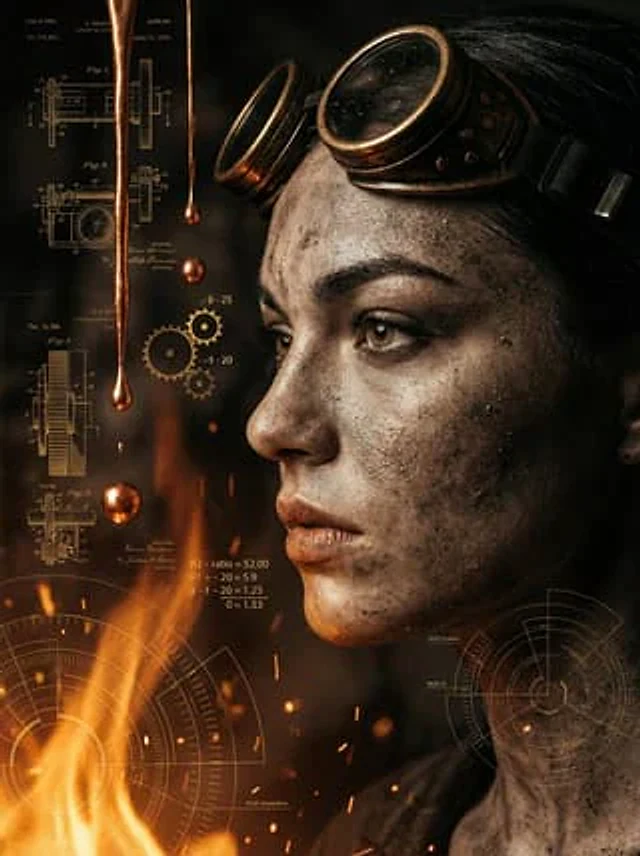

```text
A cinematic close-up profile of a weathered women with a salt-and-pepper face, wearing brass-rimmed aviator goggles pushed up. Low-key lighting with a heavy amber glow; thick molten copper droplets and incandescent heat waves shimmering in the air. Dark, soot-stained background layered with vintage patent blueprints, floating golden gear-ratio calculations, and radial HUD overlays. High contrast, grit-textured skin, hyper-realistic sweat beads, heavy industrial atmosphere, cinematic sepia grading, 8K, epic digital concept art..
```

Model: Nano Banana
Author: Aijaz

[ProjectD](https://aitoolsradar.com/en/prompts/bf090a59d52094) · [Recorded source](https://x.com/iamsofiaijaz/status/2023215251924389964)
 · [Full original metadata and byte evidence](data/projectd-batch-0058.json)

## Aijaz #1154

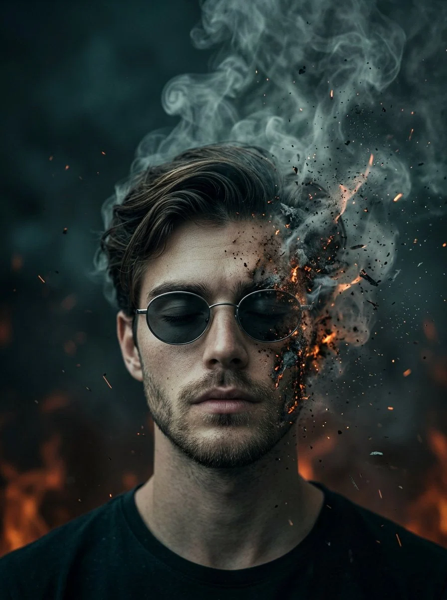

```text
A surreal cinematic portrait of a young man with oval sunglasses, eyes closed, calm expression, standing against a dark firey moody background. The right side of his face is disintegrating into smoke, ash, and glowing embers, as if slowly burning away into the air. Fine particles, sparks, and debris float upward, blending seamlessly into thick swirling smoke above his head. Dramatic low-key lighting, high contrast, ultra-detailed skin texture, photorealistic, shallow depth of field, 85mm lens, dark teal and charcoal color palette, emotional and introspective mood, ultra high resolution, masterpiece, volumetric smoke, cinematic composition.
```

Model: Nano Banana
Author: Aijaz

[ProjectD](https://aitoolsradar.com/en/prompts/f87102d786f2b7) · [Recorded source](https://x.com/iamsofiaijaz/status/2037929584147222696)
 · [Full original metadata and byte evidence](data/projectd-batch-0058.json)

## Aijaz #1214

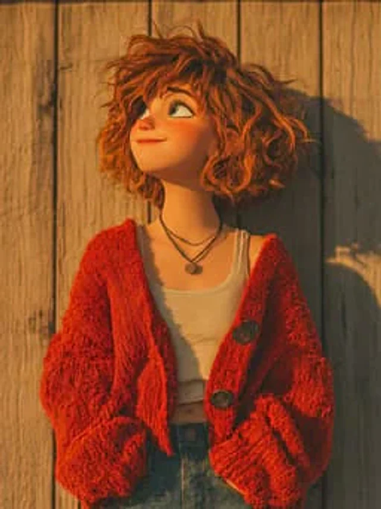

```text
1. A stylized 3D animated girl with short messy curly ginger hair, light freckles across her cheeks and nose, soft green eyes, warm friendly smile, wearing an oversized textured red knitted cardigan with large buttons, a beige cropped tank top underneath, and high-waisted blue jeans, layered silver necklaces, standing in front of a rustic wooden wall, golden hour warm sunlight casting soft shadows, cinematic lighting, shallow depth of field, Pixar-style character design, ultra detailed, soft skin shading, high quality 3D render, warm color palette, cozy autumn vibe. 

2. A whimsical 3D animated-style portrait of a young child with short, messy, curly brown hair and light freckles, wearing an oversized knitted red cardigan over a simple shirt and denim overalls, leaning gently against a rustic wooden wall. The child is gazing upward with a soft, hopeful smile. Warm golden autumn light, shallow depth of field, cinematic lighting, cozy atmosphere, highly detailed textures, soft skin shading, Pixar-style but original character, ultra high resolution, 85mm lens look, bokeh background, warm color palette, dreamy mood.
```

Model: Nano Banana
Author: Aijaz

[ProjectD](https://aitoolsradar.com/en/prompts/cc9188f1fa023a) · [Recorded source](https://x.com/iamsofiaijaz/status/2009260113295757750)
 · [Full original metadata and byte evidence](data/projectd-batch-0058.json)

## Aijaz #1225

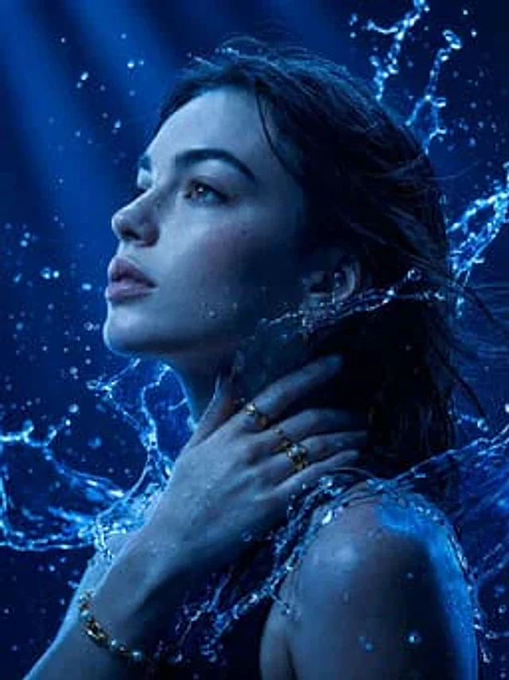

```text
A hyper-detailed cinematic portrait of a human face use selected image for face reference in side profile, looking upward with a calm and powerful expression, the entire subject illuminated in deep electric blue light, water splashes and liquid energy wrapping around the head and shoulders, high contrast, dramatic lighting, ultra-realistic skin texture, fine pores visible, sharp focus, 8K resolution, volumetric lighting, dark blue background, futuristic, ethereal, emotional, digital art, photorealism, high detail.
```

Model: Nano Banana
Author: Aijaz

[ProjectD](https://aitoolsradar.com/en/prompts/0eb6d192fcef22) · [Recorded source](https://x.com/iamsofiaijaz/status/2008181655220154527)
 · [Full original metadata and byte evidence](data/projectd-batch-0058.json)

## Aijaz #1231

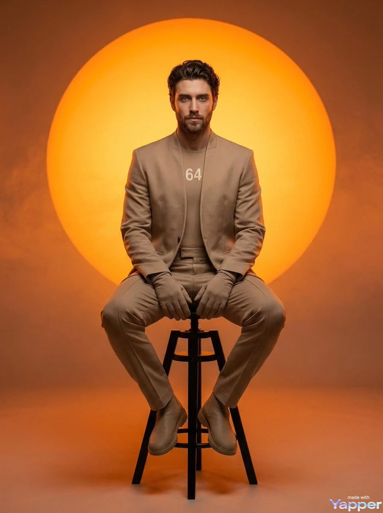

```text
A man with short curly hair and light facial hair sitting on a tall black stool, centered composition, wearing a monochrome beige outfit with gloves and the number "64" on the chest, minimalist futuristic fashion, dramatic studio lighting, huge glowing orange sun behind him, warm orange gradient background, cinematic atmosphere, soft fog around the floor, symmetrical framing, editorial fashion photography, ultra detailed, sharp focus, volumetric lighting, studio shot, 85mm lens, high contrast, modern album cover style
```

Model: Nano Banana
Author: Aijaz

[ProjectD](https://aitoolsradar.com/en/prompts/169f7337ff88ae) · [Recorded source](https://x.com/iamsofiaijaz/status/2031161843520270729)
 · [Full original metadata and byte evidence](data/projectd-batch-0058.json)

## Aijaz #1309

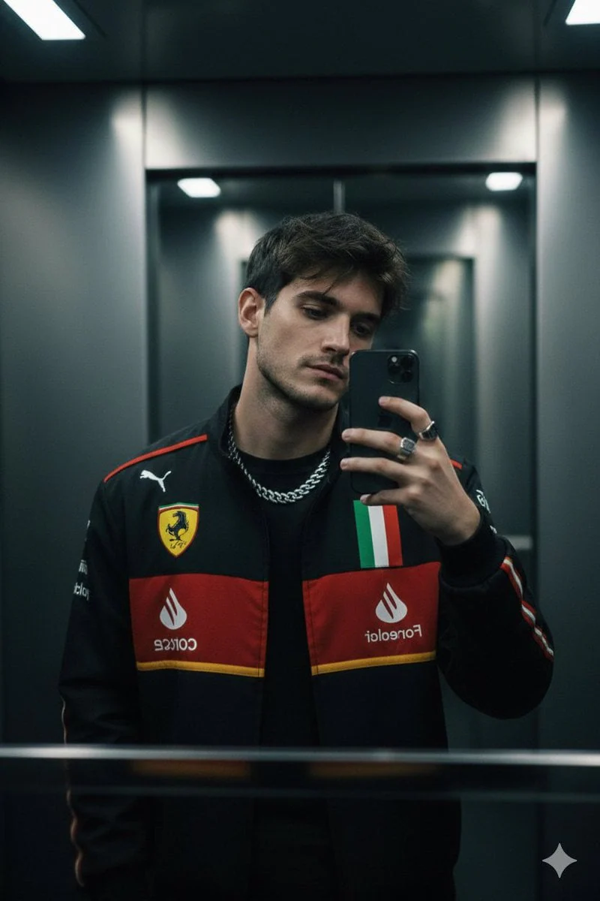

```text
A moody cinematic mirror selfie of a stylish young man use image for face reference with tousled dark hair and light stubble, wearing a black Ferrari racing jacket with red and yellow stripes and motorsport patches. He has a silver chain necklace and multiple rings, holding a modern smartphone in one hand. Low-key dramatic lighting, dark elevator interior with soft reflections, shallow depth of field, sharp focus on the subject’s face. Fashion editorial style, masculine aesthetic, realistic skin texture, ultra-detailed, 35mm photography, cinematic color grading, high contrast, photorealistic, 4K.
```

Model: Nano Banana
Author: Aijaz

[ProjectD](https://aitoolsradar.com/en/prompts/e1b5d789b95004) · [Recorded source](https://x.com/iamsofiaijaz/status/2012349152684896291)
 · [Full original metadata and byte evidence](data/projectd-batch-0058.json)

## Aijaz #1315

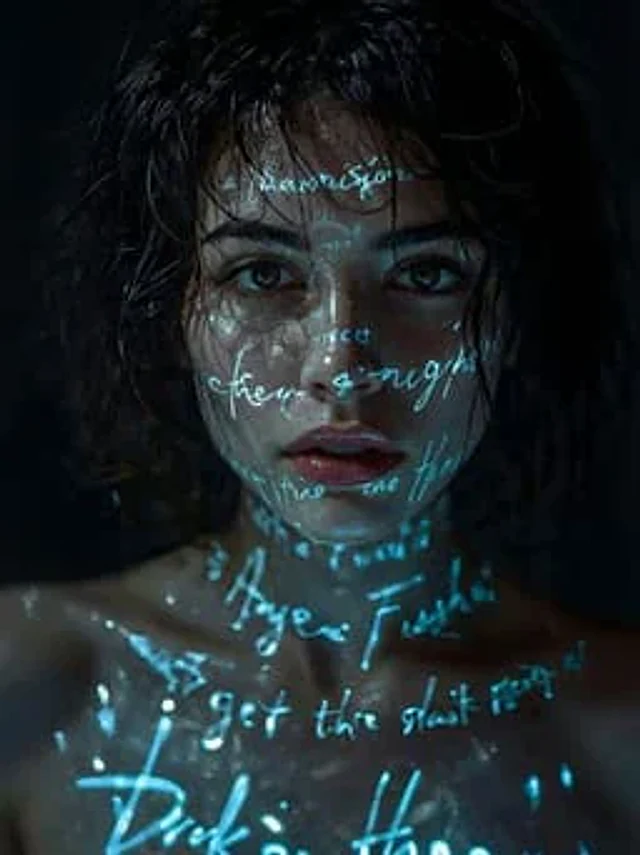

```text
A cinematic, hyper-realistic close-up portrait of a mysterious young woman in darkness, wet skin glistening as if in rain. Neon blue glowing handwritten text and symbols are projected across her face and upper body, wrapping around her eyes, cheeks, lips, and collarbones like living poetry. Her intense gaze looks directly into the camera, eyes sharp and reflective. Damp, tousled hair frames her face, partially shadowed. The lighting is low-key and dramatic, with teal and cyan highlights illuminating her skin while the background fades into deep black. Ultra-detailed skin texture, glossy reflections, shallow depth of field, cyber-poetic aesthetic, futuristic noir mood, emotional and intimate atmosphere, cinematic lighting, 8K, photorealism.
```

Model: Nano Banana
Author: Aijaz

[ProjectD](https://aitoolsradar.com/en/prompts/5dbc79cf34e3d0) · [Recorded source](https://x.com/iamsofiaijaz/status/2016139396173725824)
 · [Full original metadata and byte evidence](data/projectd-batch-0058.json)

## Aijaz #1318

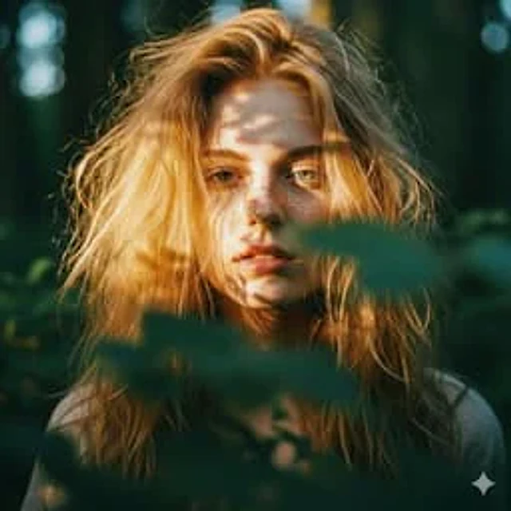

```text
Close-up portrait of a young woman with messy, voluminous strawberry blonde hair and heavy freckles across her nose and cheeks. She is partially obscured by dark green forest foliage in the foreground. Dramatic cinematic lighting with dappled golden sunlight filtering through leaves, creating high-contrast shadows across her face. Dreamy, ethereal atmosphere, soft bokeh background of a dense forest, shot on 35mm film, earthy tones, hyper-realistic skin textures.
​Key Elements to Tweak
​If you want to adjust the vibe, try changing these specific keywords:
​Lighting: Swap "dappled sunlight" for "rim lighting" to get a glowing outline around her hair, or "overcast" for a moodier, softer look.
​Framing: Use "extreme close-up" to focus purely on the eyes and freckles, or "medium shot" to show more of the forest environment.
​Color Palette: Add "analog film aesthetic" for that slightly grainy, nostalgic feel seen in your image, or "vibrant forest greens" to make the leaves pop.
```

Model: Nano Banana
Author: Aijaz

[ProjectD](https://aitoolsradar.com/en/prompts/78384e660fe73d) · [Recorded source](https://x.com/iamsofiaijaz/status/2016479730980290977)
 · [Full original metadata and byte evidence](data/projectd-batch-0058.json)

## Aijaz #1320

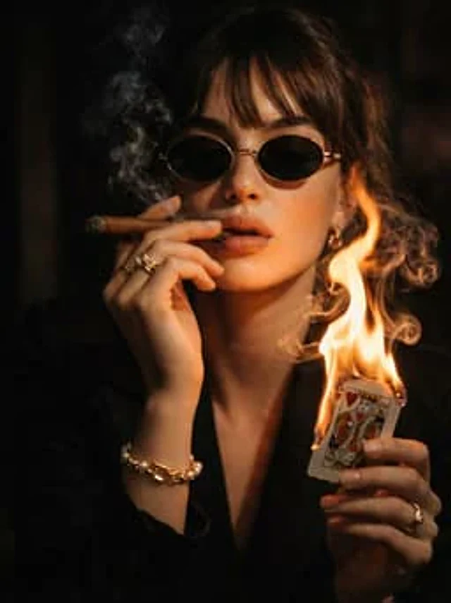

```text
A cinematic, moody portrait of a stylish women in dark suit and oval sunglasses, smoking a thin medium cigar while holding a burning playing card in his hand king of hearts, dramatic fire and smoke swirling in the air, low-key lighting, warm orange fire glow illuminating her face, dark blurred background, shallow depth of field, ultra-realistic, high contrast, cinematic photography, 35mm lens look, soft bokeh, detailed skin texture, sharp focus, professional lighting, dark noir atmosphere.
```

Model: Nano Banana
Author: Aijaz

[ProjectD](https://aitoolsradar.com/en/prompts/36c18572f5fa50) · [Recorded source](https://x.com/iamsofiaijaz/status/2009086403594924525)
 · [Full original metadata and byte evidence](data/projectd-batch-0058.json)

## Aijaz #1372

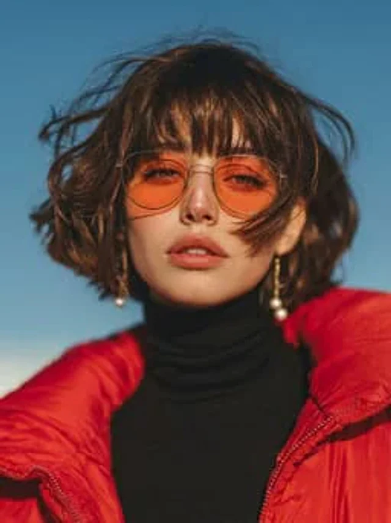

```text
A cinematic fashion portrait of a young woman with a short wavy bob haircut and wispy bangs, wearing round orange-tinted sunglasses, pearl drop earrings, a black turtleneck and a bold red puffer jacket, soft glossy lips, natural makeup, wind gently moving her hair, photographed from a low angle, shallow depth of field, ultra realistic, 85mm lens, f1.8, warm golden hour sunlight, clean blue sky background, editorial fashion photography, high detail skin texture, soft shadows, cinematic color grading, Vogue style, ultra sharp focus, professional studio quality
```

Model: Nano Banana
Author: Aijaz

[ProjectD](https://aitoolsradar.com/en/prompts/1e69dc41c695bd) · [Recorded source](https://x.com/iamsofiaijaz/status/2009853598323396674)
 · [Full original metadata and byte evidence](data/projectd-batch-0058.json)

## Aijaz #1413

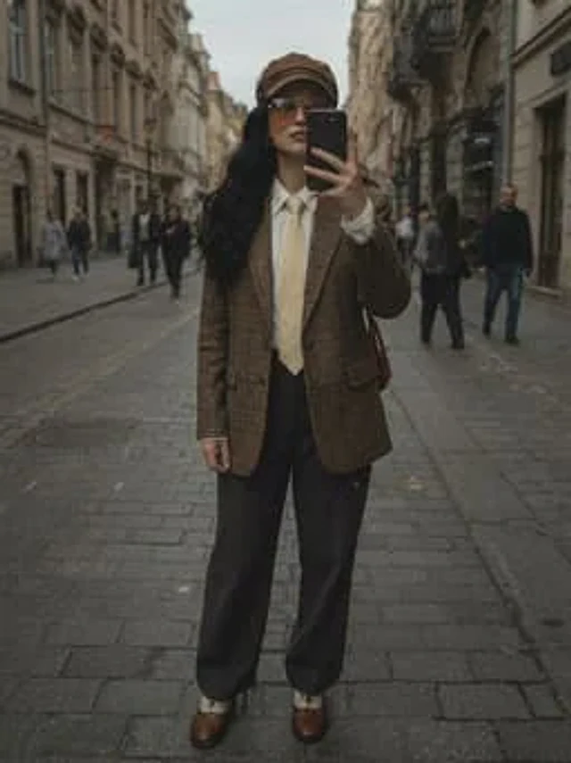

```text
A stylish woman taking a mirror selfie on a European cobblestone street, wearing a brown tweed blazer, white shirt with a cream tie, wide-leg dark trousers, and brown leather shoes, accessorized with a brown newsboy cap and amber tinted aviator sunglasses, long dark wavy hair, holding a black smartphone in front of her face, vintage menswear inspired outfit, autumn color palette, cinematic street photography, shallow depth of field, soft natural light, background of old European buildings and pedestrians slightly blurred, high fashion editorial look, 35mm film style, realistic, high detail, muted tones, aesthetic composition.
```

Model: Nano Banana
Author: Aijaz

[ProjectD](https://aitoolsradar.com/en/prompts/ac9864b0bc8cd6) · [Recorded source](https://x.com/iamsofiaijaz/status/2008755464318992444)
 · [Full original metadata and byte evidence](data/projectd-batch-0058.json)

## Aijaz #500

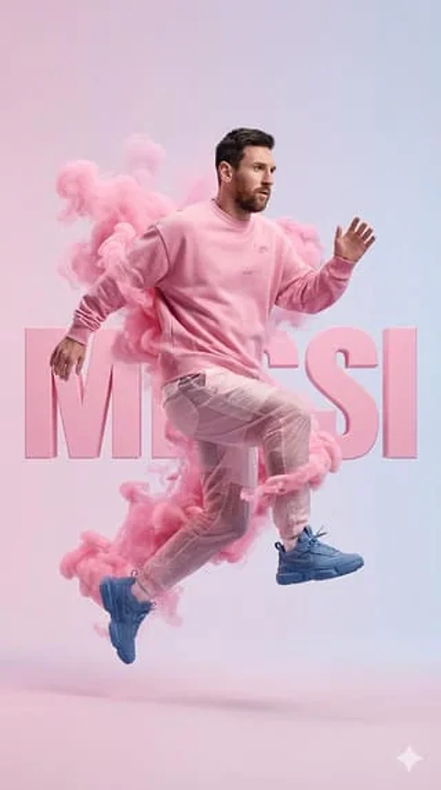

```text
A hyper-realistic studio photograph of a male athlete mid-air as if running or jumping, wearing a pastel pink sweatshirt and light pink jogger pants, with soft blue sneakers. Pink powder smoke is exploding and swirling around his body, especially behind him and around his legs, creating a dynamic motion effect. Clean minimal background with a soft gradient from light gray to pale pink. Cinematic lighting, ultra-sharp focus, shallow depth of field, fashion advertising style, high detail, 8k, soft shadows, professional studio photography.
```

Model: Nano Banana
Author: Aijaz

[ProjectD](https://aitoolsradar.com/en/prompts/4f46654d59f262) · [Recorded source](https://x.com/iamsofiaijaz/status/2008434033701879836)
 · [Full original metadata and byte evidence](data/projectd-batch-0058.json)

## Aijaz #534

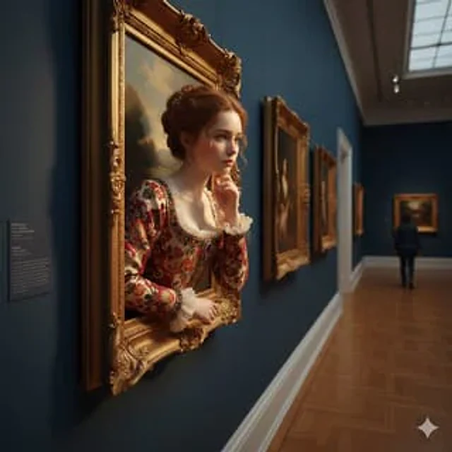

```text
A surreal, ultra-realistic scene of a young woman emerging from an ornate golden picture frame mounted on a deep blue gallery wall. She has soft auburn hair styled in an elegant updo, delicate features, and wears a richly detailed Renaissance-inspired dress with embroidered floral patterns and lace cuffs. Her chin rests thoughtfully on her hand as she gazes sideways with a pensive expression. Warm, cinematic lighting highlights her face and the gilded frame. The setting is an art gallery hallway with wooden parquet floors, framed paintings along the walls, and a softly blurred figure in the distance. Shallow depth of field, dramatic perspective, high detail, photorealistic, 8k resolution, painterly yet lifelike textures, golden hour tones
```

Model: Nano Banana
Author: Aijaz

[ProjectD](https://aitoolsradar.com/en/prompts/675078467e2803) · [Recorded source](https://x.com/iamsofiaijaz/status/2023082481331904583)
 · [Full original metadata and byte evidence](data/projectd-batch-0058.json)

## Aijaz #548

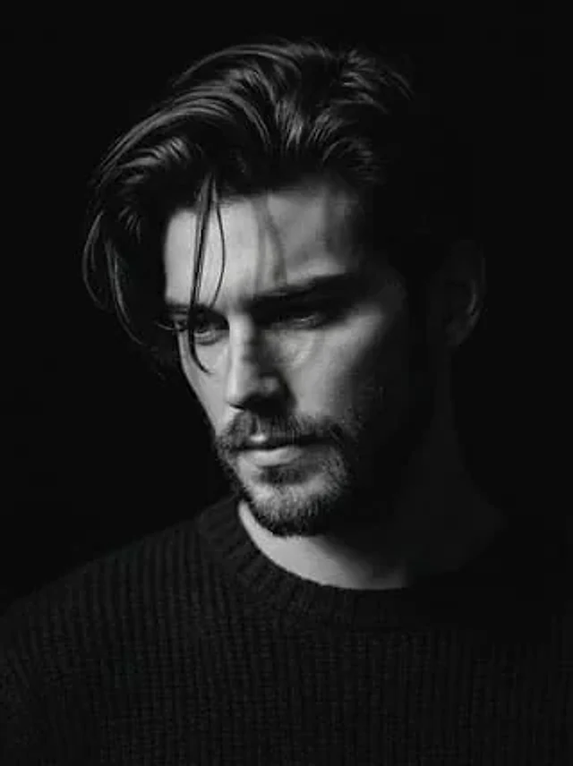

```text
Close-up black and white portrait of a man use image face reference with messy hair and a rough beard, staring downward with a pensive expression. A single beam of light grazes across his face, leaving the rest in deep shadow, evoking solitude and intensity.
```

Model: Nano Banana
Author: Aijaz

[ProjectD](https://aitoolsradar.com/en/prompts/8b9581ce176fed) · [Recorded source](https://x.com/iamsofiaijaz/status/2009623964168098296)
 · [Full original metadata and byte evidence](data/projectd-batch-0058.json)

## Aijaz #570

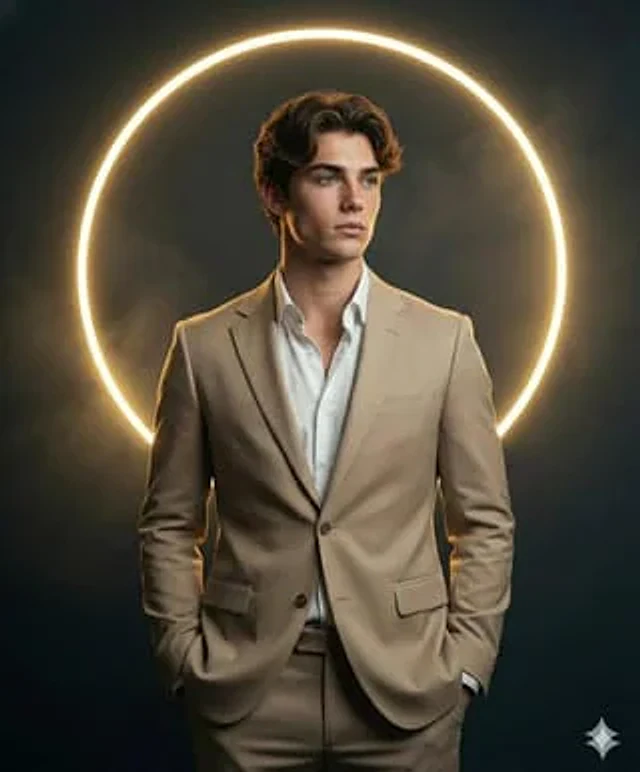

```text
A high-definition, cinematic portrait of a sharp, handsome young man with wavy dark hair, wearing a tailored tan/beige suit over a crisp white button-down shirt. He is standing in front of a glowing, golden neon ring that provides a halo effect. The background is dark and moody with subtle smoke or atmospheric mist. Photorealistic, 8k resolution, sharp focus on facial features, elegant lighting, and professional studio aesthetic.
```

Model: Nano Banana
Author: Aijaz

[ProjectD](https://aitoolsradar.com/en/prompts/fca778ca3d61e3) · [Recorded source](https://x.com/iamsofiaijaz/status/2017274761660051786)
 · [Full original metadata and byte evidence](data/projectd-batch-0058.json)

## Aijaz #578

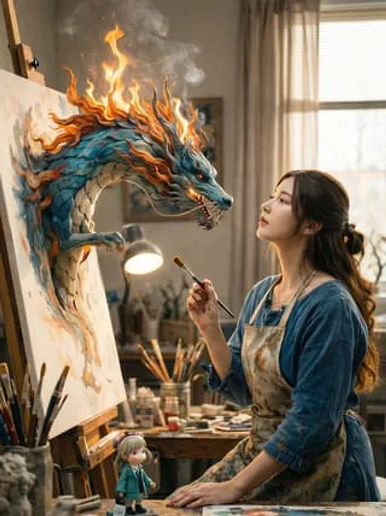

```text
A cinematic fantasy scene inside a cozy artist’s studio. A young female painter wearing a paint-stained apron sits at an easel, holding a brush mid-air, gazing calmly at her canvas. From the canvas, a majestic Eastern-style dragon emerges in three dimensions, its scales painted in deep teal and blue hues, with flowing fiery orange flames along its mane and head, smoke curling upward. The dragon appears alive yet artistic, as if formed from brushstrokes and paint. Soft natural daylight filters through a window with sheer curtains, illuminating jars of brushes, paints, and art supplies scattered across the wooden workspace. Warm, realistic lighting, shallow depth of field, ultra-detailed textures, magical realism, fantasy realism style, 8k quality, highly detailed, cinematic composition, soft color grading, whimsical yet serene mood.
```

Model: Nano Banana
Author: Aijaz

[ProjectD](https://aitoolsradar.com/en/prompts/816a380da3d7a1) · [Recorded source](https://x.com/iamsofiaijaz/status/2020317156085494141)
 · [Full original metadata and byte evidence](data/projectd-batch-0058.json)

## Aijaz #619

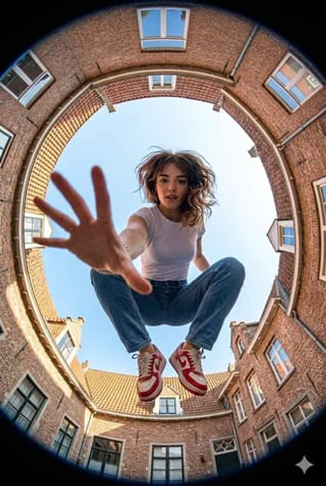

```text
Make an Ultra-wide fisheye lens perspective shot from ground level looking straight up at a young woman use image for  face reference crouching mid-air between brick buildings forming a circular frame around the sky. She reaches one hand dramatically toward the camera, fingers spread wide, creating strong foreground distortion and depth. Dynamic action pose, confident expression, casual streetwear outfit: fitted white t-shirt, blue straight-leg jeans, red and white sneakers. Urban European neighborhood setting with brick houses, tiled roofs, windows visible around the edges. Bright daylight, clear blue sky, natural lighting, sharp focus, high detail, cinematic composition, exaggerated perspective, 8k resolution, photorealistic, adventure photography style.
```

Model: Nano Banana
Author: Aijaz

[ProjectD](https://aitoolsradar.com/en/prompts/8efb33f8db52ec) · [Recorded source](https://x.com/iamsofiaijaz/status/2028508328859750704)
 · [Full original metadata and byte evidence](data/projectd-batch-0058.json)

## Aijaz #625

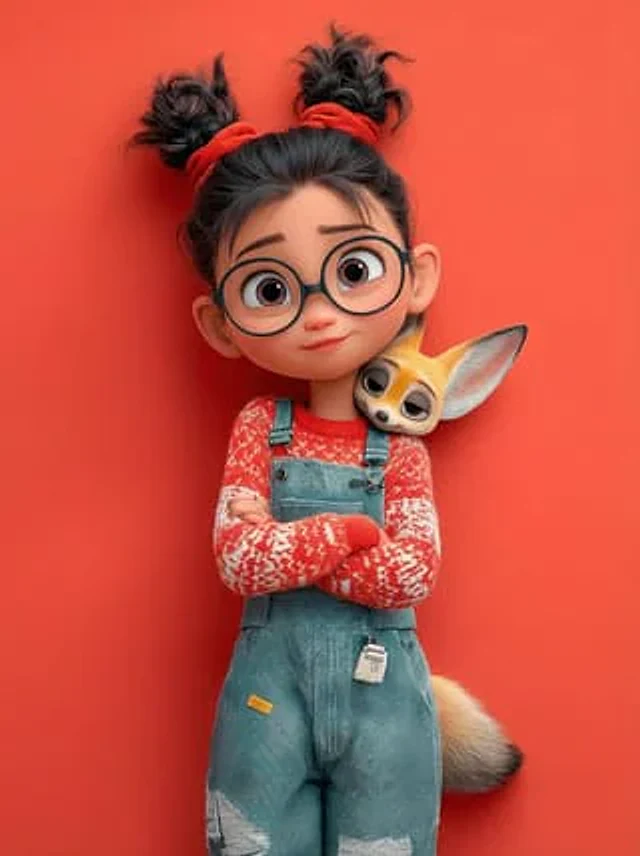

```text
A cute 3D Pixar-style character portrait of a little girl with big expressive eyes and round glasses, soft smooth skin, and slightly rosy cheeks. She has dark hair styled into two messy space buns tied with red scrunchies. She is wearing a cozy red knitted sweater with white winter patterns and blue denim overalls with small fabric details and light wear. Her arms are crossed casually. A small adorable fennec fox with huge ears and sleepy eyes is resting on her shoulder, leaning against her neck affectionately.
```

Model: Nano Banana
Author: Aijaz

[ProjectD](https://aitoolsradar.com/en/prompts/aef7291ec83435) · [Recorded source](https://x.com/iamsofiaijaz/status/2008359111650312559)
 · [Full original metadata and byte evidence](data/projectd-batch-0058.json)

## Aijaz #726

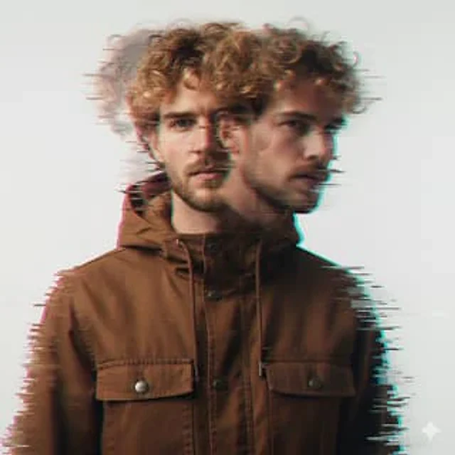

```text
A double exposure, long exposure editorial photograph of a man Use image for face reference in a brown hooded utility jacket with sharp facial features and curly blonde hair. Apply a digital glitch distortion effect with chromatic aberration (cyan and magenta color fringing), horizontal scan lines, and pixel sorting across the motion trails. Clean white backdrop, cinematic lighting, 35mm lens, high resolution, muted natural colors with tech-inspired digital artifacts."
```

Model: Nano Banana
Author: Aijaz

[ProjectD](https://aitoolsradar.com/en/prompts/3ca1d0218bb54f) · [Recorded source](https://x.com/iamsofiaijaz/status/2023643232845140297)
 · [Full original metadata and byte evidence](data/projectd-batch-0058.json)

## Aijaz #756

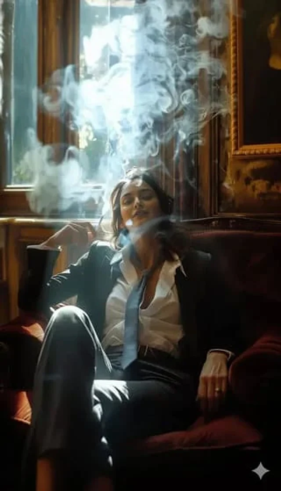

```text
​A high-definition cinematic portrait of a sophisticated woman sitting in a plush, velvet burgundy armchair within a sunlit, vintage study. She is wearing a sharp black tailored suit, a crisp white button-down shirt slightly unbuttoned, and a loosely tied charcoal grey necktie. She holds a cigarette, with thick, ethereal plumes of white smoke swirling dramatically around her face and rising toward the ceiling. The lighting is dramatic "chiaroscuro" style, with bright sunlight streaming through a large window behind her, creating a glowing rim light on her hair and the smoke. The background features ornate wooden wall panels and a classic framed painting. Photorealistic, 8k resolution, moody atmosphere.
​Tips for Best Results:
​Aspect Ratio: If your tool supports it, use --ar 9:16 to get that tall, vertical phone-wallpaper look.
​Lighting Keywords: Using terms like "volumetric lighting" or "backlit" will help emphasize the way the light interacts with the smoke.
​Style: If you want it to look more like a movie still, add "shot on 35mm film" to the end.
```

Model: Nano Banana
Author: Aijaz

[ProjectD](https://aitoolsradar.com/en/prompts/3fde895c732d87) · [Recorded source](https://x.com/iamsofiaijaz/status/2016007845410701687)
 · [Full original metadata and byte evidence](data/projectd-batch-0058.json)

## Aijaz #779

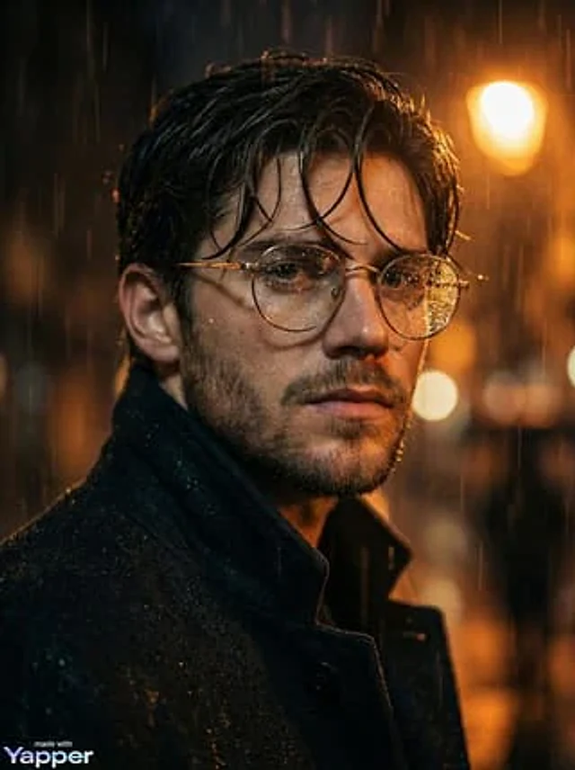

```text
Cinematic close-up portrait of a young man standing in heavy rain at night, wearing round metal glasses and a dark coat, wet hair falling across his forehead, light stubble beard. Raindrops clinging to his glasses and skin, dramatic moody lighting with warm orange streetlight bokeh in the background, shallow depth of field, intense contemplative expression, gritty noir atmosphere, ultra-realistic, high contrast, detailed skin texture, cinematic color grading, 85mm lens, f/1.8,photorealistic, dark urban aesthetic, film still look.
```

Model: Nano Banana
Author: Aijaz

[ProjectD](https://aitoolsradar.com/en/prompts/4c71da34b47004) · [Recorded source](https://x.com/iamsofiaijaz/status/2030797695405936926)
 · [Full original metadata and byte evidence](data/projectd-batch-0058.json)

## Aijaz #788

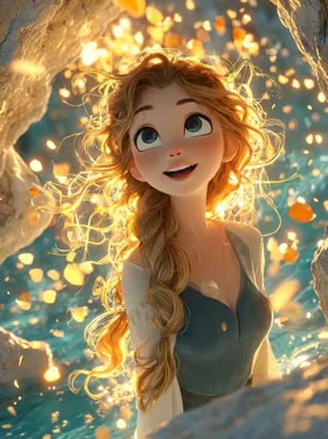

```text
A dreamy, cinematic 3D animated girl with big expressive eyes and soft freckles, warm golden backlighting, long wavy strawberry-blonde hair in a loose braid glowing in the sunlight, standing inside a magical cave with turquoise water, surrounded by floating glowing golden flower petals and light particles, soft bokeh background, gentle smile looking upward in wonder, warm pastel color palette, volumetric lighting, shallow depth of field, ultra-detailed, high quality, pixar / disney inspired style, fantasy atmosphere, soft focus, glowing rim light, cinematic composition, 8k, highly detailed, whimsical, ethereal lighting.
```

Model: Nano Banana
Author: Aijaz

[ProjectD](https://aitoolsradar.com/en/prompts/bc0cd7b138c31e) · [Recorded source](https://x.com/iamsofiaijaz/status/2008526541932655097)
 · [Full original metadata and byte evidence](data/projectd-batch-0058.json)

## Aijaz #809


```text
A dramatic black and white studio portrait of a thoughtful man with short styled hair, light stubble beard, and round eyeglasses, wearing a simple black sweater and a metal wristwatch, holding a pencil near his face, looking slightly upward and to the side, soft Rembrandt lighting from the left, deep shadows, high contrast, dark background, shallow depth of field, cinematic mood, ultra detailed, sharp focus, 85mm lens, f/1.8, professional photography, editorial portrait, minimalistic, moody, fine art photography
```

Model: Nano Banana
Author: Aijaz

[ProjectD](https://aitoolsradar.com/en/prompts/e9c7cbd695aef4) · [Recorded source](https://x.com/iamsofiaijaz/status/2009980871760400568)
 · [Full original metadata and byte evidence](data/projectd-batch-0058.json)

## Aijaz #818

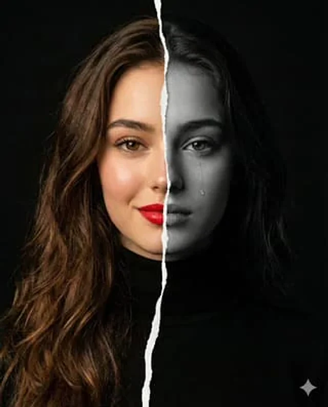

```text
​A high-resolution conceptual portrait of a woman’s face vertically split down the middle by a jagged, torn paper edge. The left side is in vibrant color, featuring a warm smile, glowing skin, and bold red lipstick. The right side is in dramatic black and white, showing a somber expression with a single tear rolling down her cheek. Dark, moody background, cinematic lighting, sharp focus on the eyes, hyper-realistic textures.
```

Model: Nano Banana
Author: Aijaz

[ProjectD](https://aitoolsradar.com/en/prompts/0cc9e59a7425d6) · [Recorded source](https://x.com/iamsofiaijaz/status/2017930809899192642)
 · [Full original metadata and byte evidence](data/projectd-batch-0058.json)

## Aijaz #872

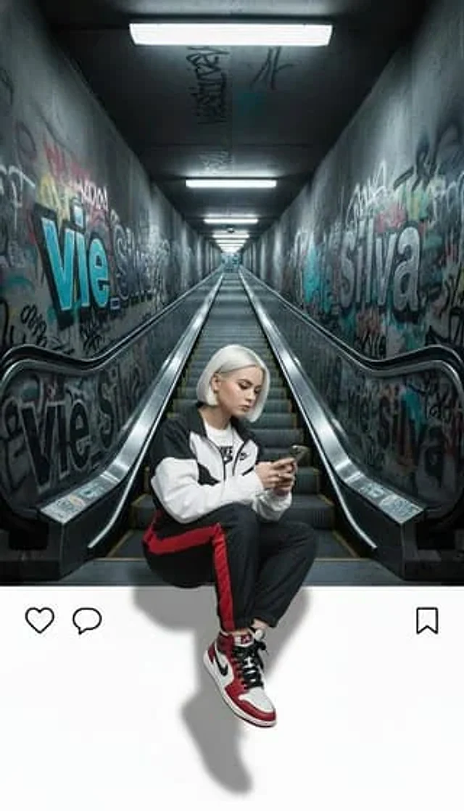

```text
A high-definition, realistic 3D social media profile picture style. The image features the young English girl with sleek, straight white hair and a clear, detailed face. She is wearing a coordinated Nike brand outfit consisting of a premium black and red Nike tracksuit with a visible swoosh logo. On her feet are classic red, white, and black Nike Air Jordan sneakers. She is sitting on the edge of a white Instagram-style frame, with her legs and one sneaker 'popping out' of the bottom of the frame for a 3D effect. The background inside the frame shows her sitting on a long, perspective-heavy escalator in a dark, gritty subway tunnel filled with colorful graffiti. She is looking down at a smartphone in her hands. The lighting is cinematic, highlighting her white hair and the textures of the Nike fabric."
```

Model: Nano Banana
Author: Aijaz

[ProjectD](https://aitoolsradar.com/en/prompts/87f81818a360be) · [Recorded source](https://x.com/iamsofiaijaz/status/2011387267282276607)
 · [Full original metadata and byte evidence](data/projectd-batch-0058.json)

## Aijaz #931

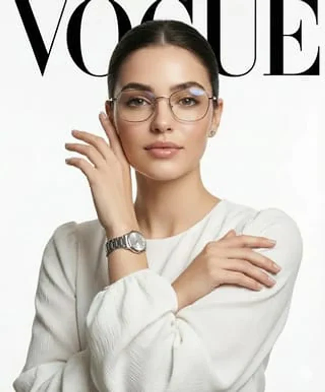

```text
A high-definition, professional fashion editorial photograph of a sophisticated woman with a sleek, center-parted bun. She is wearing elegant, thin-rimmed silver glasses and a minimalist white long-sleeved silk blouse. She is posed gracefully with her hands near her face and chest, showcasing a luxury silver watch. The background is a clean, bright white with bold, high-contrast black serif typography reading 'VOGUE' at the top. Studio lighting, soft skin texture, sharp focus on the eyes, 8k resolution, shot on a 85mm lens for a flattering portrait compression."
​Tips for Customizing the Result:
​The Model: If you want a different look, change "sophisticated woman" to specific features like "freckles," "dark curly hair," or "minimalist makeup."
​The Brand: You can swap "VOGUE" for any other magazine title or leave it blank for a clean fashion portrait.
​The Jewelry: Adjust the metal (e.g., "gold watch," "rose gold frames") to change the color palette of the image.
```

Model: Nano Banana
Author: Aijaz

[ProjectD](https://aitoolsradar.com/en/prompts/2ac9f43992ef85) · [Recorded source](https://x.com/iamsofiaijaz/status/2017483949271085191)
 · [Full original metadata and byte evidence](data/projectd-batch-0058.json)

## Aijaz #937

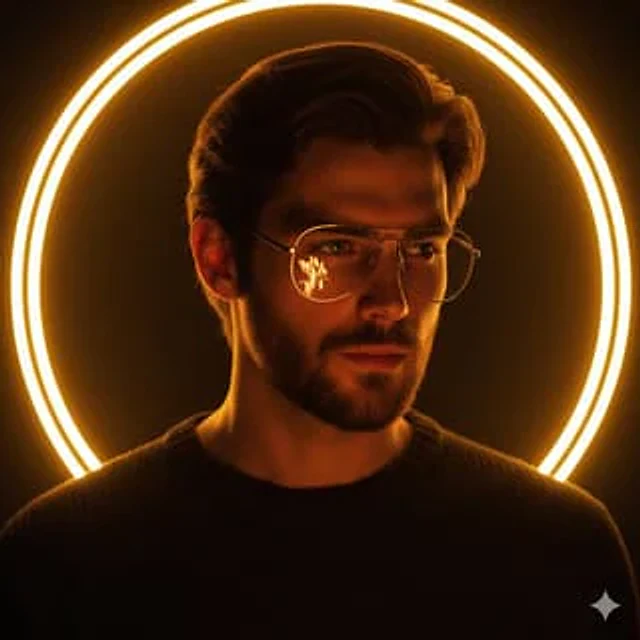

```text
Cinematic portrait of a handsome young man with short styled hair and a trimmed beard, wearing thin metal aviator glasses, softly illuminated by a glowing golden circular halo behind his head. Warm amber lighting, dramatic low-key background, shallow depth of field, hyper-realistic skin texture, subtle reflections in the glasses, moody and futuristic aesthetic, studio photography, 85mm lens look, ultra-detailed, high contrast, dark minimal background, symmetrical composition, elegant and modern tone.
```

Model: Nano Banana
Author: Aijaz

[ProjectD](https://aitoolsradar.com/en/prompts/41479a868db8fc) · [Recorded source](https://x.com/iamsofiaijaz/status/2017779938745549081)
 · [Full original metadata and byte evidence](data/projectd-batch-0058.json)

## Aijaz #987

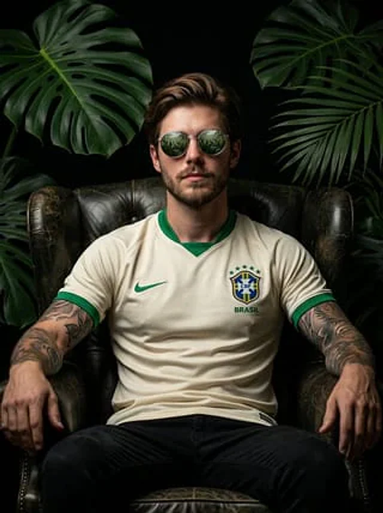

```text
Cinematic portrait of a confident football player sitting on a dark armchair, tropical jungle leaves surrounding him, dramatic low-key lighting, black background, moody atmosphere, wearing a cream Brazil football jersey with green accents, athletic build and trimmed beard, tattoos on arms, relaxed powerful pose with arms resting on chair, studio photography, ultra realistic, sharp focus, high contrast, depth of field, editorial sports photoshoot, 85mm lens, dark luxury aesthetic, 8k.
```

Model: Nano Banana
Author: Aijaz

[ProjectD](https://aitoolsradar.com/en/prompts/f179eb4639b754) · [Recorded source](https://x.com/iamsofiaijaz/status/2032756394202657147)
 · [Full original metadata and byte evidence](data/projectd-batch-0058.json)

## Aleena Amir #1122

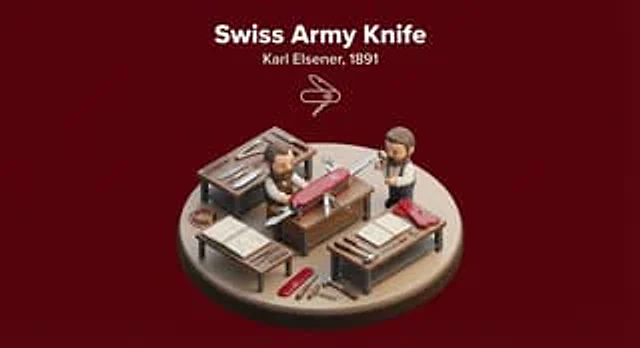

```text
Create a miniature 3D isometric diorama showing the invention of [INVENTION NAME] at the moment of [KEY BREAKTHROUGH].

Camera angle around 40° from above.
Textures feel soft and polished. Materials follow realistic PBR rules. Lighting feels natural and balanced.

The raised base includes tools, workshop elements, notes, and early prototypes. Tiny stylized inventors interact with objects. Faces are visible and recognizable with clean shapes and expressions.

Background stays solid [BACKGROUND COLOR].
Top center text shows [INVENTION NAME] in bold.
Second line shows [YEAR OR INVENTOR].
A simple line icon of the invention sits below.
Text color adapts to background contrast.
```

Model: Nano Banana
Author: Aleena Amir

[ProjectD](https://aitoolsradar.com/en/prompts/bae790123cb222) · [Recorded source](https://x.com/aleenaamiir/status/2017449820928282857)
 · [Full original metadata and byte evidence](data/projectd-batch-0058.json)

## Aleena Amir #1143

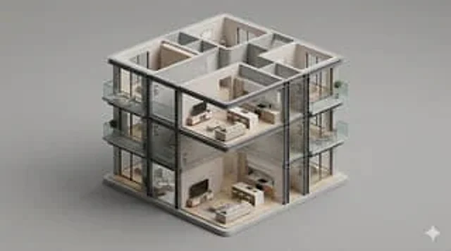

```text
A clean, minimal 3D isometric diorama of a [BUILDING TYPE] section, featuring [INTERIOR / EXTERIOR ELEMENTS] visible in a [CUTAWAY / OPEN STYLE], simple [STRUCTURAL FRAME], subtle [INFORMATIONAL SIGNAGE], smooth [MATERIAL FINISH], soft studio lighting, realistic materials, rounded edges, miniature architectural model style, high detail, neutral background.
```

Model: Nano Banana
Author: Aleena Amir

[ProjectD](https://aitoolsradar.com/en/prompts/f02fef227dde4e) · [Recorded source](https://x.com/aleenaamiir/status/2012072821439283400)
 · [Full original metadata and byte evidence](data/projectd-batch-0058.json)

## Aleena Amir #1193

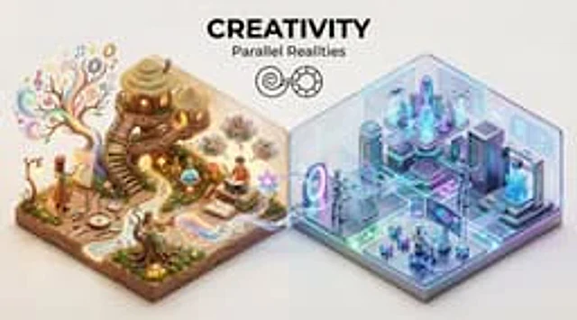

```text
“Present a clear, 45° top-down isometric miniature 3D split diorama showing two parallel worlds of [THEME]: [WORLD A] vs [WORLD B].

Use soft refined textures, realistic PBR materials, and contrasting lighting styles for each side.

Design a single raised base divided down the center with mirrored layouts and subtle crossover details.

Include tiny stylized characters existing differently in each world (no facial details).

Use a clean solid [BACKGROUND COLOR] background.

At the top-center, display [THEME NAME] in large bold text, beneath it show ‘Parallel Realities’, and place a minimal abstract icon below.

All text must automatically match the background contrast (white or black).”
```

Model: Nano Banana
Author: Aleena Amir

[ProjectD](https://aitoolsradar.com/en/prompts/3aa785e8b0700c) · [Recorded source](https://x.com/aleenaamiir/status/2017820238314934756)
 · [Full original metadata and byte evidence](data/projectd-batch-0058.json)

## Aleena Amir #1311

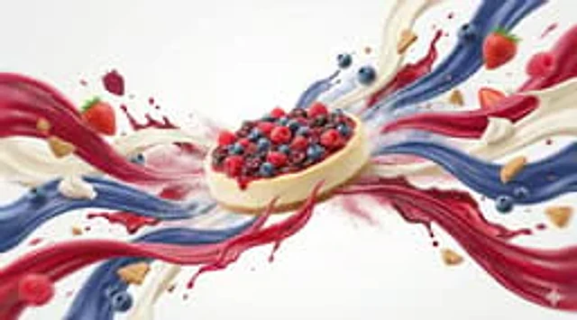

```text
Dynamic flavor wave composition of [FOOD], with colorful energy ribbons, mist, and motion streaks bursting outward to represent taste intensity. Ingredient silhouettes embedded within the waves. Clean minimal white background, high-key studio lighting. Ultra-real textures, cinematic motion blur, premium commercial food photography, 8K resolution.
```

Model: Nano Banana
Author: Aleena Amir

[ProjectD](https://aitoolsradar.com/en/prompts/f88f045772a0aa) · [Recorded source](https://x.com/aleenaamiir/status/2013636630842876150)
 · [Full original metadata and byte evidence](data/projectd-batch-0058.json)

## Aleena Amir #1334

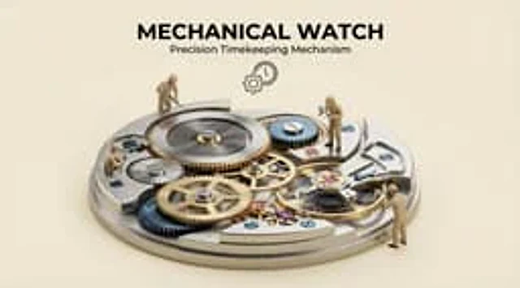

```text
Create a clear, 45° top-down isometric miniature 3D cutaway diorama showing the inside of [MACHINE / DEVICE].

Use soft refined textures, realistic PBR materials, and clean technical lighting.

Design a raised base with visible internal components, wiring, gears, or energy flow paths.
Include tiny stylized technicians interacting with the machinery (no facial details).

Use a clean solid [BACKGROUND COLOR] background.

At the top-center, display [MACHINE NAME] in large bold text, beneath it show a short technical subtitle, and place a minimal engineering icon below.

All text must automatically match the background contrast (white or black).
```

Model: Nano Banana
Author: Aleena Amir

[ProjectD](https://aitoolsradar.com/en/prompts/219296b1a8d2ec) · [Recorded source](https://x.com/aleenaamiir/status/2018147539992862866)
 · [Full original metadata and byte evidence](data/projectd-batch-0058.json)

## Aleena Amir #353

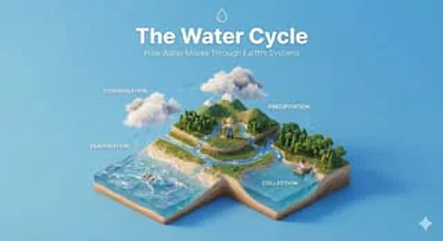

```text
Create a clear, 45° top-down isometric miniature 3D educational diorama explaining [PROCESS / CONCEPT].

Use soft refined textures, realistic PBR materials, and gentle lifelike lighting.

Build a stepped or layered diorama base showing each stage of the process with subtle arrows or paths.

Include tiny stylized figures interacting with each stage (no facial details).

Use a clean solid [BACKGROUND COLOR] background.
At the top-center, display [PROCESS NAME] in large bold text, directly beneath it show a short explanation subtitle, and place a minimal symbolic icon below.

All text must automatically match the background contrast (white or black).
```

Model: Nano Banana
Author: Aleena Amir

[ProjectD](https://aitoolsradar.com/en/prompts/12778d2d77b1a5) · [Recorded source](https://x.com/aleenaamiir/status/2013493349156823287)
 · [Full original metadata and byte evidence](data/projectd-batch-0058.json)

## Aleena Amir #390

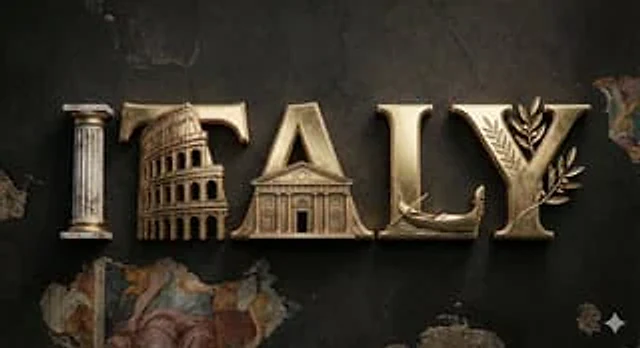

```text
A high-quality 3D metallic typography design of the word [COUNTRY NAME], set against a dark, textured background that complements the identity of [COUNTRY], creating a cinematic, premium visual tone.

Each individual letter is uniquely designed to represent a distinct cultural element, tradition, landmark, or national symbol from [COUNTRY], intelligently adapted to the letter’s shape while maintaining perfect readability.

Cultural elements may include (but are not limited to):
– iconic architecture or monuments
– traditional patterns, textiles, or crafts
– national sports or tools
– folklore, heritage symbols, or historical motifs
– nature elements strongly associated with the country

No two letters repeat the same cultural reference — every letter tells a different cultural story.

The typography features polished metallic material (gold, silver, or [COLOR]), realistic reflections, fine engravings, and subtle surface wear for authenticity.

Dramatic studio lighting with soft rim highlights and deep shadows enhances depth and form.

Ultra-sharp focus, premium 3D render quality, cinematic depth, luxury branding aesthetic, ultra-high resolution.
```

Model: Nano Banana
Author: Aleena Amir

[ProjectD](https://aitoolsradar.com/en/prompts/eedaab2b8d90cf) · [Recorded source](https://x.com/aleenaamiir/status/2008535456397619240)
 · [Full original metadata and byte evidence](data/projectd-batch-0058.json)

## Aleena Amir #395

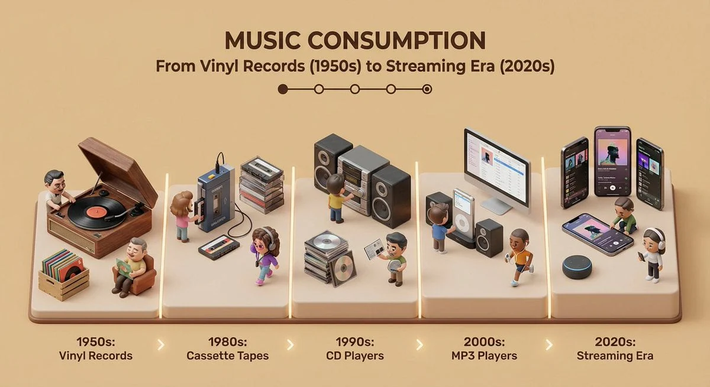

```text
Create a clean isometric miniature 3D diorama visualizing the evolution of [TOPIC] from [START ERA] to [MODERN ERA]. Use a 45° top-down perspective. Materials are soft and refined with realistic PBR shading.

Lighting is neutral and evenly balanced. Design a horizontally stepped base divided into clear time periods. Each section includes era-specific objects, tools, environments, or technology.

Add tiny stylized figures interacting with each stage with heavy facial details). Use subtle arrows or dividers to show chronological flow.

Background remains solid [BACKGROUND COLOR]. Top center text displays [TOPIC] in bold. Below it show “From [START ERA] to [MODERN ERA].” Add a minimal timeline icon underneath. Text adapts automatically for contras.
```

Model: Nano Banana
Author: Aleena Amir

[ProjectD](https://aitoolsradar.com/en/prompts/736f86ac465d88) · [Recorded source](https://x.com/aleenaamiir/status/2022178815955636413)
 · [Full original metadata and byte evidence](data/projectd-batch-0058.json)

## Aleena Amir #425


```text
A high-contrast ink noir portrait of [SUBJECT], illustrated entirely with expressive black ink strokes and controlled splatter. Heavy shadows dominate the composition while selective highlights emerge through negative space. Subtle paper grain is visible. Atmosphere is moody, cinematic, and intense, like a graphic novel frozen at its most dramatic panel.
```

Model: Nano Banana
Author: Aleena Amir

[ProjectD](https://aitoolsradar.com/en/prompts/b185f8843104fb) · [Recorded source](https://x.com/aleenaamiir/status/2008431391235862892)
 · [Full original metadata and byte evidence](data/projectd-batch-0058.json)

## Aleena Amir #462


```text
A beverage can branded [BRAND NAME], entirely made from vibrant, fluffy plush fabric, positioned centrally against a soft, plush background in the signature colors of [BRAND NAME].

Bold Pop Art and Memphis design style, playful yet premium aesthetic.

Bright, clean studio lighting that strongly emphasizes the plush texture, visible fibers, softness, and tactile depth.

Sharp focus, high color saturation, smooth shadows, modern commercial product shot, minimal composition, ultra-high resolution.
```

Model: Nano Banana
Author: Aleena Amir

[ProjectD](https://aitoolsradar.com/en/prompts/e328eba0e4265d) · [Recorded source](https://x.com/aleenaamiir/status/2008753339966877924)
 · [Full original metadata and byte evidence](data/projectd-batch-0058.json)

## Aleena Amir #473


```text
Create a hyperrealistic, surreal spherical panorama of [CITY NAME], with its most iconic landmarks and architecture seamlessly curving around the top of a planet-like surface, forming a cohesive miniature world.
Integrate sleek, modern 3D typography spelling “[CITY NAME]” naturally into the urban landscape, harmonized with the environment rather than floating unnaturally.

The scene is viewed from a top-down, orbiting perspective, emphasizing the tiny-planet effect and spherical distortion while maintaining architectural clarity.

Soft, natural daylight filters through a partly cloudy sky, casting gentle, realistic shadows across lush greenery, streets, trees, and buildings.

The background transitions smoothly into a dramatic, swirling sky, enhancing the surreal atmosphere without overpowering the city.

Use a natural yet vivid color palette — crisp greens, soft blues, and muted earth tones appropriate to [CITY NAME].

Render in a polished, photorealistic style with fine architectural detail, realistic textures, atmospheric depth, and high visual fidelity.
```

Model: Nano Banana
Author: Aleena Amir

[ProjectD](https://aitoolsradar.com/en/prompts/b26047a77419d4) · [Recorded source](https://x.com/aleenaamiir/status/2009117120987320527)
 · [Full original metadata and byte evidence](data/projectd-batch-0058.json)

## Aleena Amir #498


```text
Create a high-quality 3D metallic typography composition of the title [MOVIE / SERIES NAME], set against a dark, textured background that reflects the tone, genre, and emotional atmosphere of the story, delivering a cinematic, premium visual impact.

Each individual letter is sculpted as a cinematic form, seamlessly merging a different iconic scene from the movie or series into the letter itself. Scenes are translated into architectural elements, environments, characters, props, lighting, and atmospheric details, transformed into elegant, readable letterforms rather than literal collages.

Every letter acts as a mini visual narrative, instantly recognizable to fans, while no two letters repeat the same scene or story moment. The full title feels cohesive, balanced, and unified as a single artwork.

The typography is rendered in polished metallic materials (gold, silver, steel, or [COLOR]), featuring realistic reflections, fine engravings, and subtle surface wear for cinematic authenticity.

Dramatic studio lighting with soft rim highlights and deep shadows enhances depth, scale, and mood, blending seamlessly with the embedded scenes.

Ultra-sharp focus, premium 3D render quality, cinematic depth of field, luxury title-card aesthetic, ultra-high resolution.

No cartoon style, no flat illustration — pure cinematic realism with sculptural artistry.
```

Model: Nano Banana
Author: Aleena Amir

[ProjectD](https://aitoolsradar.com/en/prompts/d5eb94f65aaaf5) · [Recorded source](https://x.com/aleenaamiir/status/2009624649894945022)
 · [Full original metadata and byte evidence](data/projectd-batch-0058.json)

## Aleena Amir #503


```text
Use the uploaded image as the strict character reference.
Preserve the character’s facial structure, expression, skin tone, hairstyle, outfit, proportions, and pose exactly as shown.

Do not modify, beautify, stylize, or reinterpret the face in any way beyond embroidery translation.
Render the character as hyper-detailed hand embroidery artwork, using realistic satin stitches, long-and-short stitches, and dense fill stitches to create natural depth, fabric texture, and thread sheen.

Visible embroidery threads, precise stitch direction following facial contours, smooth gradients formed through thread layering, high stitch density, museum-quality textile craftsmanship.

Neutral fabric background, soft studio lighting, ultra-sharp macro detail, photorealistic embroidery realism, no illustration or cartoon style.
```

Model: Nano Banana
Author: Aleena Amir

[ProjectD](https://aitoolsradar.com/en/prompts/d06e35ed768c93) · [Recorded source](https://x.com/aleenaamiir/status/2008488506692366681)
 · [Full original metadata and byte evidence](data/projectd-batch-0058.json)

## Aleena Amir #524


```text
Scandinavian-style minimal illustration of [SUBJECT], muted pastel palette, flat design, soft gradients, cozy yet modern aesthetic, clean shapes, lifestyle illustration feel.
```

Model: Nano Banana
Author: Aleena Amir

[ProjectD](https://aitoolsradar.com/en/prompts/f18467f4344d3a) · [Recorded source](https://x.com/aleenaamiir/status/2013590587715526879)
 · [Full original metadata and byte evidence](data/projectd-batch-0058.json)

## Aleena Amir #555


```text
A high-quality digital illustration of the word [COUNTRY NAME] spelled in bold, uppercase letters. The typography is sculptural and dimensional, with each letter subtly overlapping or stacked to enhance depth and visual flow. Set against a rich, dark-toned background that complements the palette of the ingredients.

Each letter is intricately filled with iconic traditional foods from [COUNTRY], such as [SIGNATURE BREADS / FRUITS / SPICES / DISH ELEMENTS], carefully arranged to follow the contours of the typography. Small bowls of [TRADITIONAL SAUCES / CONDIMENTS] and scattered ingredients are integrated naturally within the composition.

The food elements are styled in an art-directed, editorial manner – balanced, textured, and visually rich – with gentle overlaps for realism. Soft, diffused lighting enhances natural textures and depth, creating a warm, appetizing, premium aesthetic. 

Ultra-detailed, clean composition, food-photography-inspired digital illustration, high contrast, refined visual storytelling.
```

Model: Nano Banana
Author: Aleena Amir

[ProjectD](https://aitoolsradar.com/en/prompts/055196cc5030df) · [Recorded source](https://x.com/aleenaamiir/status/2008826083282686133)
 · [Full original metadata and byte evidence](data/projectd-batch-0058.json)

## Aleena Amir #575


```text
A clean, minimal 3D isometric diorama of a [CITY TRANSPORT TYPE] stop, featuring a [VEHICLE] paused at a [PLATFORM TYPE], simple [SHELTER / CANOPY], subtle wayfinding signs, smooth concrete surfaces, soft studio lighting, realistic materials, rounded edges, miniature architectural model style, high detail, neutral background.
```

Model: Nano Banana
Author: Aleena Amir

[ProjectD](https://aitoolsradar.com/en/prompts/3bc72d665cd432) · [Recorded source](https://x.com/aleenaamiir/status/2011662366141006262)
 · [Full original metadata and byte evidence](data/projectd-batch-0058.json)

## Aleena Amir #585


```text
Create a whimsical, playful illustration featuring [CHARACTER / SUBJECT] as the central focus.
The character is drawn with simplified features, a small rounded head, and minimal facial detail, wearing [HEADWEAR / CLOTHING DESCRIPTION].

They are positioned among oversized abstract shapes and organic elements such as [FLORAL / SYMBOLIC OBJECTS], creating a sense of imaginative scale. The character is interacting with [OBJECT / ACTION], adding narrative interest.

Decorative graphic elements like [SYMBOLS: exclamation points, speech bubbles, scribbles, notes, etc.] float around the subject to enhance expression and energy.

Use clean, simple linework and a limited color palette of [PRIMARY COLORS], keeping the illustration bold and cohesive. The background is a soft neutral tone such as beige or off-white. The overall style is modern, flat, and illustrative, with a lively, creative, and slightly abstract atmosphere.
```

Model: Nano Banana
Author: Aleena Amir

[ProjectD](https://aitoolsradar.com/en/prompts/b518cf614498be) · [Recorded source](https://x.com/aleenaamiir/status/2020791306197561403)
 · [Full original metadata and byte evidence](data/projectd-batch-0058.json)

## Aleena Amir #639


```text
“Luxury golden-hour styled hero shot of [FOOD] bathed in warm directional sunlight. Long soft shadows, glowing highlights, natural lens flares. Minimal white set with subtle texture. Editorial lifestyle food photography aesthetic, rich color depth, atmospheric warmth, ultra-realistic detail, premium ad quality, 8K resolution.”
```

Model: Nano Banana
Author: Aleena Amir

[ProjectD](https://aitoolsradar.com/en/prompts/7cacf85b5ea9ff) · [Recorded source](https://x.com/aleenaamiir/status/2013251289254420955)
 · [Full original metadata and byte evidence](data/projectd-batch-0058.json)

## Aleena Amir #651


```text
Ultra-high-quality, hyper-realistic commercial food photography of [COUNTRY FOOD NAME], rendered in 8K detail with a (4:3 or 3:4) aspect ratio.

The food is shown in multiple premium visual variations, each highlighting texture, layers, and freshness in a cinematic way.

Food details:
– Authentic [COUNTRY] cuisine presentation
– Clearly visible layers, fillings, or structure specific to [FOOD TYPE]
– Rich, natural colors and realistic textures

Motion & drama:
– Subtle mid-air elements (crumbs, ingredients, sauce, or spices)
– Natural gravity realism, frozen motion
– No mess, clean and controlled composition

Lighting & camera:
– Controlled studio lighting emphasizing texture and shine
– High-speed photography look
– Shallow to medium depth of field

Background:
– Solid or soft gradient background in [BACKGROUND COLOR]
– Clean, seamless, distraction-free

Style & finish:
– Luxury food advertising aesthetic
– Rich contrast, warm natural tones
– Ultra-sharp focus, no artificial glow

Negative prompt:
Text, logos, branding, hands, people, utensils, plates, tables, cartoon style, burnt food, overexposure, low-detail textures, artificial shine.
```

Model: Nano Banana
Author: Aleena Amir

[ProjectD](https://aitoolsradar.com/en/prompts/dd350f42e78e23) · [Recorded source](https://x.com/aleenaamiir/status/2010241026363986218)
 · [Full original metadata and byte evidence](data/projectd-batch-0058.json)

## Aleena Amir #658


```text
Create a stylized miniature 3D diorama viewed from a 45-degree angled perspective, emphasizing careful scale, clean geometry, and fine craftsmanship.

A [OBJECT] serves as the central base of the composition. From within or above this object, a miniature interpretation of [LOCATION NAME] emerges naturally, forming a compact, self-contained world.

The scene highlights recognizable landmarks, terrain features, or symbolic structures associated with [LOCATION NAME], arranged harmoniously and rendered with precise detail.

Miniature roads, paths, or environmental elements flow through the scene, with tiny vehicles, figures, or subtle motion cues adding realism and life.

Use cinematic lighting, soft highlights, and selective depth-of-field blur to create a magical, dreamlike atmosphere.

Balance playful isometric styling with realistic materials and lighting, achieving a polished, premium diorama look.

Highly detailed, cohesive composition with an 8K cinematic finish, refined miniature-world aesthetic.
```

Model: Nano Banana
Author: Aleena Amir

[ProjectD](https://aitoolsradar.com/en/prompts/43f95259e37397) · [Recorded source](https://x.com/aleenaamiir/status/2011798504482738365)
 · [Full original metadata and byte evidence](data/projectd-batch-0058.json)

## Aleena Amir #703


```text
Create a collection of icons representing [ROUTINE / PROCESS / HABITS], with each icon depicting one specific routine step and clearly labeled by name.

They belong together as a single cohesive theme. The background is pure white.

Place the title “[ROUTINE NAME]” at the top center of the image, aligned symmetrically above the grid, using a clean, minimal typography style that complements the icon design without overpowering it.
Icons are rendered in a friendly, modern 3D style, featuring smooth gradients and soft shadows.

Maintain consistent proportions, color harmony, materials, and typography across all icons and labels so the set feels unified and easy to read.
```

Model: Nano Banana
Author: Aleena Amir

[ProjectD](https://aitoolsradar.com/en/prompts/f2069558a6f982) · [Recorded source](https://x.com/aleenaamiir/status/2010682689633046534)
 · [Full original metadata and byte evidence](data/projectd-batch-0058.json)

## Aleena Amir #857


```text
\Create an isometric miniature 3D diorama representing the iconic architecture of [COUNTRY NAME] through [FAMOUS STRUCTURE]. Use a 45° top-down view.

Apply clean soft textures and realistic PBR materials.
Lighting feels balanced and natural. The raised base includes nearby streets, landscape features, and cultural details linked to the structure. Add tiny stylized locals and visitors with heavy facial details.

Background stays solid [BACKGROUND COLOR]. Top center text shows [COUNTRY NAME] in bold. Second line shows [STRUCTURE NAME]. Place a minimal architecture icon below. Text color adjusts for contrast.
```

Model: Nano Banana
Author: Aleena Amir

[ProjectD](https://aitoolsradar.com/en/prompts/7192d476336144) · [Recorded source](https://x.com/aleenaamiir/status/2020714278744101061)
 · [Full original metadata and byte evidence](data/projectd-batch-0058.json)

## Aleena Amir #869


```text
Create a 3D isometric miniature diorama showcasing the productivity system [SYSTEM NAME]. Angle remains between 35–45°. Materials feel modern and structured with realistic PBR textures.

Lighting is soft but focused. The raised base is divided into functional zones such as planning, execution, tracking, and review. Use connecting paths or arrows to show workflow.

Tiny stylized professionals interact with desks, boards, or devices. With heavy facial details.
Background remains solid [BACKGROUND COLOR].

Top center shows [SYSTEM NAME] in bold. Below it add a short benefit-focused subtitle. Place a minimal productivity icon underneath. Text automatically adapts.”
```

Model: Nano Banana
Author: Aleena Amir

[ProjectD](https://aitoolsradar.com/en/prompts/c203a13ec80cdc) · [Recorded source](https://x.com/aleenaamiir/status/2022522374483235110)
 · [Full original metadata and byte evidence](data/projectd-batch-0058.json)

## Aleena Amir #920


```text
Create a collection of icons representing [Month] through objects, symbols, and moods.
They belong together as a single cohesive theme.
The background is pure white.

Place the month name “[MONTH]” at the top center of the image as a minimal, balanced title, aligned symmetrically above the grid and visually integrated with the overall design.

Icons are rendered in a colorful yet calm 3D style, with season-appropriate textures and atmospheric lighting that reflect the essence of [MONTH].

Maintain consistent proportions, materials, and visual language across all icons and the title.
```

Model: Nano Banana
Author: Aleena Amir

[ProjectD](https://aitoolsradar.com/en/prompts/e4e8345ba47f23) · [Recorded source](https://x.com/aleenaamiir/status/2010302396355026978)
 · [Full original metadata and byte evidence](data/projectd-batch-0058.json)

## Aleena Amir #924


```text
Create a cinematic 3D typographic composition spelling [WORD / NAME], where each letter is sculpted from the personality, environment, and emotional arc of [CHARACTER / STORY].

Letters are formed using clothing textures, symbolic props, architecture, and lighting motifs tied to different moments of the narrative.

No literal faces — identity is conveyed through silhouettes, posture, materials, and atmosphere. Use premium metallic or stone materials with subtle wear.

Dark cinematic background, dramatic rim lighting, deep shadows, ultra-realistic render, film-title quality.
```

Model: Nano Banana
Author: Aleena Amir

[ProjectD](https://aitoolsradar.com/en/prompts/1df6c4aef1053e) · [Recorded source](https://x.com/aleenaamiir/status/2018966979013644422)
 · [Full original metadata and byte evidence](data/projectd-batch-0058.json)

## Aleena Amir #926


```text
Create an isometric miniature 3D diorama highlighting the natural landmark [NATURAL WONDER] from [COUNTRY NAME/PLANET].

Use a 40–45° top-down view. Textures look organic and realistic with PBR materials. Lighting feels soft and atmospheric.

The raised base shows terrain layers, vegetation, and surrounding geography. Add tiny stylized explorers or wildlife with no facial details.

Background remains solid [BACKGROUND COLOR].

Top center text displays [COUNTRY NAME] in bold.
Second line shows [NATURAL WONDER]. Place a minimal nature icon below. Text automatically adapts for contrast.
```

Model: Nano Banana
Author: Aleena Amir

[ProjectD](https://aitoolsradar.com/en/prompts/7d50ac24fa18e7) · [Recorded source](https://x.com/aleenaamiir/status/2019267462647439770)
 · [Full original metadata and byte evidence](data/projectd-batch-0058.json)

## Aleena Amir #939


```text
A clean, minimal 3D isometric diorama of a [EXHIBITION TYPE], featuring [DISPLAY OBJECTS] arranged within a [POD STRUCTURE], subtle lighting accents, smooth floor surfaces, soft studio lighting, realistic materials, rounded edges, miniature architectural model style, high detail, neutral background.
```

Model: Nano Banana
Author: Aleena Amir

[ProjectD](https://aitoolsradar.com/en/prompts/88f465162b833f) · [Recorded source](https://x.com/aleenaamiir/status/2012411445724713338)
 · [Full original metadata and byte evidence](data/projectd-batch-0058.json)

## Aleena Amir #948


```text
“Build an isometric miniature 3D diorama explaining the environmental impact of [ACTIVITY OR PRODUCT].

Viewpoint stays near 45° from above.
Textures look realistic and balanced. Lighting feels soft and clear. The raised base splits into cause, impact, and outcome sections. Include visual indicators like meters, symbols, or levels.

Tiny stylized figures represent people, wildlife, or infrastructure. Figures have heavy facial details.

Background remains solid [BACKGROUND COLOR].
Top center text reads [TOPIC NAME] in bold.

Subtitle states the key impact in one line. A minimal environment icon appears below. Text switches between white or black for contrast.”
```

Model: Nano Banana
Author: Aleena Amir

[ProjectD](https://aitoolsradar.com/en/prompts/5af9c5790d7fb1) · [Recorded source](https://x.com/aleenaamiir/status/2020421019002147321)
 · [Full original metadata and byte evidence](data/projectd-batch-0058.json)

## Aleena Amir #991


```text
A clean, minimal 3D isometric diorama of a [URBAN RETAIL TYPE], featuring a [MAIN COUNTER / DISPLAY OBJECT] placed on a [GROUND / PLATFORM TYPE], simple [CANOPY / ROOF STRUCTURE], subtle [SIGNAGE TYPE], smooth [SURFACE MATERIAL], soft studio lighting, realistic materials, rounded edges, miniature architectural model style, high detail, neutral background.
```

Model: Nano Banana
Author: Aleena Amir

[ProjectD](https://aitoolsradar.com/en/prompts/adc843b8f93aeb) · [Recorded source](https://x.com/aleenaamiir/status/2011750912390258844)
 · [Full original metadata and byte evidence](data/projectd-batch-0058.json)

## Alexandra Aisling #1010


```text
An [OBJECT] rendered as if entirely hand-knitted from chunky wool yarn, impossibly functional-looking despite being soft craft. Visible stitches, cable knit patterns on grip areas, ribbing where flexibility is needed, yarn ends neatly tucked. Positioned against a cozy lifestyle backdrop or clean wool-texture studio. Scandinavian hygge meets industrial design. Warm soft lighting emphasizing the yarn texture, the handmade quality, the absurd coziness of machinery. Sharp focus on stitch detail, warm saturated fiber colors, lifestyle product aesthetic, ultra-high resolution, the hard made soft.
```

Model: Nano Banana
Author: Alexandra Aisling

[ProjectD](https://aitoolsradar.com/en/prompts/1e8ad0e6ad757f) · [Recorded source](https://x.com/AllaAisling/status/2012909092210381048)
 · [Full original metadata and byte evidence](data/projectd-batch-0058.json)

## Alexandra Aisling #1042


```text
An artisan's method board for [HANDMADE OBJECT] — [TECHNIQUE / TRADITION / ORIGIN]. Left section: raw materials in unprocessed state, sourced and labeled, the transformation yet to begin. Center section: the making documented in sequential stages, hands visible throughout, tools identified, key decision points annotated, time invested at each phase noted. Right section: the finished object in use context, bearing the maker's mark, fulfilling its purpose, the hours invisible but embedded. Visual style transitions from raw material earth tones through workshop warmth to lifestyle context with natural light. Title block reading "[OBJECT NAME] — HANDMADE BY [MAKER], [LOCATION], [HOURS] HOURS".
```

Model: Nano Banana
Author: Alexandra Aisling

[ProjectD](https://aitoolsradar.com/en/prompts/386f2d073b9e9d) · [Recorded source](https://x.com/AllaAisling/status/2012197160276660362)
 · [Full original metadata and byte evidence](data/projectd-batch-0058.json)

## Alexandra Aisling #1107


```text
Prompt Studio: Minimalist Luxury Product Design with Nano Banana 2 in Firefly

Pristine product visualization, [object] in [material], deconstructed floating parts suspended in a precision-aligned engineering sequence, pure white gradient void with subtle depth falloff, sculptural studio lighting with sharp rim highlights, mirror-polished and matte surface contrast, ultra-macro lens revealing microscopic [surface detail] and internal [component detail], shallow depth of field isolating the core components, minimalist Braun meets Leica aesthetic, heroic product scale presence, product photography.

Check ALTs for ideas 👇 @AdobeFirefly
```

Model: Nano Banana
Author: Alexandra Aisling

[ProjectD](https://aitoolsradar.com/en/prompts/09c79e3a3fc797) · [Recorded source](https://x.com/AllaAisling/status/2028956048531288229)
 · [Full original metadata and byte evidence](data/projectd-batch-0058.json)

## Alexandra Aisling #1135


```text
[DISH] styled on a weathered [MATERIAL] surface, shot in pure golden hour light streaming from one side, casting long warm shadows. Hero dish center, surrounded by its raw ingredients casually scattered with artistic intention, whole vegetables, fresh herbs, open spice jars, linen cloth, wooden spoon. Every surface texture hyperreal: wood grain, condensation droplets, herb oil sheen, char marks. Ingredient labels as small handwritten-style chalk or ink tags resting beside each item: "[INGREDIENT] — [origin, preparation]". Dish name in warm hand-lettered typography: "[DISH NAME]". Subtitle: "[TAGLINE]". Mood: Ottolenghi cookbook meets Italian farmhouse meets Sunday farmers market. Warm golden tones, long shadows, film grain, extraordinary and craveable.
```

Model: Nano Banana
Author: Alexandra Aisling

[ProjectD](https://aitoolsradar.com/en/prompts/6b48b59efd10ac) · [Recorded source](https://x.com/AllaAisling/status/2031758798432428099)
 · [Full original metadata and byte evidence](data/projectd-batch-0058.json)

## Alexandra Aisling #1190


```text
A master watchmaker's documentation board for [TIMEPIECE] — [MANUFACTURE / COMPLICATION / YEAR]. Left section: historical context showing the original patent drawings, period advertisements in gilded frames, and archival photographs of the atelier with craftsmen at work. Center section: the movement in exploded view, every wheel, spring, and jewel suspended in precise spatial relationship, with material callouts (Geneva stripes, blued screws, ruby bearings) and functional annotations tracing the flow of power from mainspring to escapement. Right section: the completed watch in its defining context—wrist of an explorer, pocket of a diplomat, or display case of a collector—captured with shallow depth and warm side lighting. Visual style transitions from sepia patent office to mechanical precision chrome to intimate portraiture. Title block reading "[WATCH NAME] — CALIBRE [NUMBER], [COMPLICATION], CIRCA [YEAR]".
```

Model: Nano Banana
Author: Alexandra Aisling

[ProjectD](https://aitoolsradar.com/en/prompts/3347190f4cf2c7) · [Recorded source](https://x.com/AllaAisling/status/2018374415474438544)
 · [Full original metadata and byte evidence](data/projectd-batch-0058.json)

## Alexandra Aisling #1192


```text
[DISH] at the precise moment of a dramatic [LIQUID] pour in ultra high-speed photography, liquid cascade frozen mid-fall in perfect clarity. Hero [DISH] center on matte [COLOR] surface, [LIQUID] pouring from above in one cinematic ribbon catching warm single-source light, splitting and branching into suspended droplets and threads as it hits the surface. Splatter crown frozen at moment of impact, droplets suspended in perfect arcs. Every surface texture hyperreal: glistening, steaming, sauce pooling in slow motion. Each element labeled with ultra-thin lines in clean uppercase: "[INGREDIENT] [descriptor]". Dish name in elegant editorial typography: "[DISH NAME]". Subtitle: "[TAGLINE]". Mood: Albert Watson food photography meets Harold Edgerton fluid dynamics meets Michelin-star editorial. 4K, tack sharp every thread and droplet, warm single-source light, extraordinary and craveable.
```

Model: Nano Banana
Author: Alexandra Aisling

[ProjectD](https://aitoolsradar.com/en/prompts/0355ce4d0af71c) · [Recorded source](https://x.com/AllaAisling/status/2037583533674320072)
 · [Full original metadata and byte evidence](data/projectd-batch-0058.json)

## Alexandra Aisling #1271


```text
A [PRODUCT] rendered as if built entirely from pulled and blown sugar, the translucent amber material of patisserie showpieces forming functional object. Visible sugar work techniques: pulled ribbons, blown bubbles, cast pieces joined with caramel. Internal air bubbles, slight amber color variation, the architectural fragility of competition sugar work. Positioned on a marble pastry surface or against cream backdrop. French patisserie tradition meets industrial design. Warm lighting that passes through the sugar, creating honey-glow internal illumination. Sharp focus, warm amber palette, edible luxury aesthetic, ultra-high resolution, the functional made confection.    

Check ALTs for ideas 👇 @AdobeFirefly
```

Model: Nano Banana
Author: Alexandra Aisling

[ProjectD](https://aitoolsradar.com/en/prompts/d8195ec270fec1) · [Recorded source](https://x.com/AllaAisling/status/2016530202692571465)
 · [Full original metadata and byte evidence](data/projectd-batch-0058.json)

## Alexandra Aisling #1313


```text
A [PRODUCT] in color-shifting chrome [COLOR to COLOR] captured mid-transformation: left side rigid and angular, right side impossibly inflated like a balloon. [MAIN BODY] pillowy and bulging. [BUTTONS/CONTROLS] swollen into soft puffy domes. [EDGES/CORNERS] ballooned into smooth tubes. [SURFACE DETAILS/LOGOS] risen like chrome blisters. [PORTS/JOINTS] threatening to burst at the seams. Thin stress fractures glow molten copper-gold at the transformation boundary, small chrome droplets floating mid-air. Warped reflections of a luxury showroom in the curved surfaces. A single mercury sphere beside it for scale. Positioned on [PLACE], gradient backdrop [COLOR]. Split lighting, warm tungsten on rigid sections, cool LED on inflated forms, caustic patterns cast below. Surrealist meets luxury automotive. Sharp specular on angular parts, soft highlights tracing inflation pressure. Single hero object between states, ultra-high resolution, the weight that floats.
```

Model: Nano Banana
Author: Alexandra Aisling

[ProjectD](https://aitoolsradar.com/en/prompts/3d40557e500a26) · [Recorded source](https://x.com/AllaAisling/status/2010733004423918031)
 · [Full original metadata and byte evidence](data/projectd-batch-0058.json)

## Alexandra Aisling #380


```text
Perfect cinematic cross-section cut through [DISH], sliced cleanly down the center revealing every internal layer in full detail. The cut face is facing the camera straight-on, like a geological diagram of flavor. Each visible layer is labeled with a thin horizontal line extending to the right — uppercase sans-serif "[INGREDIENT NAME]" with italic descriptor below. Background: flat matte [COLOR]. Lighting: dramatic side light from left casting long shadows, single warm spotlight on the cut face. Every texture hyperreal — visible moisture, air pockets, char, glaze, and steam. Mood: architectural food photography meets scientific illustration. Dish name "[DISH NAME]" in large elegant type at top. Subtitle: "[TAGLINE]". 4K, tack sharp, Style ref: Wes Anderson symmetry meets Michelin-star kitchen.
```

Model: Nano Banana
Author: Alexandra Aisling

[ProjectD](https://aitoolsradar.com/en/prompts/5ec3fd668ffd1d) · [Recorded source](https://x.com/AllaAisling/status/2025686032700805436)
 · [Full original metadata and byte evidence](data/projectd-batch-0058.json)

## Alexandra Aisling #401


```text
Epic 3D scene: a massive architectural blueprint of [BUILDING/STRUCTURE] pinned to a drafting table, its ink lines rising off the paper into fully realized construction. Blue lines become steel beams mid-weld, floor plans inflate into furnished rooms, elevation drawings push outward into facades with working windows. Construction phases coexist simultaneously: foundation being poured in one corner while the penthouse is already inhabited in another. Tiny workers, cranes, and scaffolding swarm the rising structure. The flat drawing and the living building merge at impossible angles. Technical annotations float as dimensional signage. Architect's coffee cup sits at the edge, casting shadow across unbuilt sections. Extreme scale contrast, construction dust catching afternoon light, 8K, photorealistic.
```

Model: Nano Banana
Author: Alexandra Aisling

[ProjectD](https://aitoolsradar.com/en/prompts/b96cdaa52f85d9) · [Recorded source](https://x.com/AllaAisling/status/2010009737816162736)
 · [Full original metadata and byte evidence](data/projectd-batch-0058.json)

## Alexandra Aisling #411


```text
A preservation architect's survey board for [BUILDING / STRUCTURE] — [STYLE / ARCHITECT / PERIOD]. Left section: site plan and context, showing the structure in its urban or landscape setting with orientation, shadows, and neighboring relationships mapped. Center section: the building dissected, a cutaway axonometric revealing structural system, material layers, hidden infrastructure, with callouts identifying original versus modified elements. Right section: the building as experienced, photographed from the canonical viewpoint in ideal light, with human figures for scale and life, the architecture inhabited. Visual style transitions from technical survey blue-line through neutral analytical greys to golden-hour warmth. Title block reading "[BUILDING NAME] — [ARCHITECT], [CITY], [YEAR], HERITAGE SURVEY".
```

Model: Nano Banana
Author: Alexandra Aisling

[ProjectD](https://aitoolsradar.com/en/prompts/543922d3157661) · [Recorded source](https://x.com/AllaAisling/status/2008559432016286198)
 · [Full original metadata and byte evidence](data/projectd-batch-0058.json)

## Alexandra Aisling #422


```text
Hyperrealistic 3D radial exploded view of [PRODUCT]  [NUMBER] components  bursting outward from a central axis in every direction, frozen in mid-air.  True spatial explosion, not a vertical stack, depth and parallax visible.  COMPONENTS (core outward): [SHELL] → [DISPLAY] → [FRAME] → [MAINBOARD] →  [BATTERY] → [MICRO PARTS shown in 3x floating callout circles]  MATERIALS: glass refracts and catches specular highlights, aluminium shows  brushed grain and machined edges, PCB traces glow faintly amber,   rubber gaskets matte with micro-texture, cables with soft bend physics.  LABELS: hairline leader to floating box. "[COMPONENT]" uppercase /  "[FUNCTION]" italic / "[KEY SPEC]" monospace. Radiate outward, no overlaps.  LIGHTING: cool diffused overhead + warm amber underlighting on internals +  thin blue rim on outer shell. Displays emit soft UI glow. Circuits self-illuminate.  BACKGROUND: [COLOR], deep, non-reflective. Midnight black recommended. TITLE: "[PRODUCT NAME]" top right. SUBTITLE: "[TAGLINE]".  SPEC BLOCK: "[SPEC 1] / [SPEC 2] / [SPEC 3]" bottom left in monospace.  Mood: iFixit teardown meets NASA manual meets WIRED cover. 4K, tack sharp, extraordinary material fidelity.
```

Model: Nano Banana
Author: Alexandra Aisling

[ProjectD](https://aitoolsradar.com/en/prompts/9ad798ad9183b6) · [Recorded source](https://x.com/AllaAisling/status/2032126653309030481)
 · [Full original metadata and byte evidence](data/projectd-batch-0058.json)

## Alexandra Aisling #432


```text
[ROOM TYPE] pulled apart in 3D, every surface and object  floating at its exact position, slightly separated.  EXPLOSION: ceiling lifted, four walls sliding outward,  floor dropped, furniture floating in place,  objects orbiting their surfaces, light sources  still emitting across the exploded void.  The ghost of the room readable in the arrangement.  Labels on architectural elements only: "[SURFACE]" / "[MATERIAL]" / "[DIMENSION]"  LIGHTING: each element still lit by its original source,  windows casting light across the gap, lamps throwing cones  into empty space.  BACKGROUND: deep dark, the room floats in void. TITLE: "[ROOM NAME]" / SUBTITLE: "[BUILDING TYPE] [PERIOD]"  Mood: architectural model that became a universe. 4K, extraordinary spatial clarity, tack sharp.
```

Model: Nano Banana
Author: Alexandra Aisling

[ProjectD](https://aitoolsradar.com/en/prompts/779bae1447bd03) · [Recorded source](https://x.com/AllaAisling/status/2035390729527378146)
 · [Full original metadata and byte evidence](data/projectd-batch-0058.json)

## Alexandra Aisling #446


```text
Epic 3D scene: a weathered passport lies open, its visa stamps erupting into the destinations they represent. Each ink impression becomes a portal—[CITY 1] rises in miniature from one stamp with [DETAIL 1], [CITY 2] pushes through another with [DETAIL 2], [CITY 3] manifests with [DETAIL 3]. [LANDMARK 1], [LANDMARK 2], and [LANDMARK 3] stand at different scales across the pages. Flight paths arc overhead as glowing golden trajectories weaving between all the worlds.
Coffee stains become lakes. Worn edges erode into coastlines. [ATMOSPHERIC ELEMENT 1] drifts from one destination while [ATMOSPHERIC ELEMENT 2] swirls near another.
Dramatic raking light, tilt-shift depth of field, 8K, UE5, cinematic lighting. The bureaucratic document transformed into a living archive of adventures.
```

Model: Nano Banana
Author: Alexandra Aisling

[ProjectD](https://aitoolsradar.com/en/prompts/37356bc2262f50) · [Recorded source](https://x.com/AllaAisling/status/2013269718572965934)
 · [Full original metadata and byte evidence](data/projectd-batch-0058.json)

## Alexandra Aisling #482


```text
A hand-drawn treasure map on aged parchment, with the adventure erupting into three-dimensional quest. {STARTING_POINT} rises at the map's edge with {DEPARTURE_SCENE}, the dotted path becomes an actual trail traversing {TERRAIN_1} with {DANGER_1}, passing {LANDMARK_1} where {OBSTACLE_1} awaits. {TERRAIN_2} features {WILDLIFE_1} and {ENVIRONMENTAL_HAZARD}. The X marking the spot glows beneath {FINAL_LOCATION}, treasure partially visible, {GUARDIAN_ELEMENT} protecting it. Miniature expedition party frozen mid-journey at various points along the route. Torn edges of the map become cliffs. Coffee stains become lakes. Burn marks become scorched earth from battles past. Candlelight flicker, adventure novel lighting, 8K, the map as the story it promises.
```

Model: Nano Banana
Author: Alexandra Aisling

[ProjectD](https://aitoolsradar.com/en/prompts/46ce119c814fd3) · [Recorded source](https://x.com/AllaAisling/status/2027140622252179959)
 · [Full original metadata and byte evidence](data/projectd-batch-0058.json)

## Alexandra Aisling #507


```text
A marque historian's documentation board for [VEHICLE] — [MODEL / VARIANT / YEAR]. Left section: factory documentation including original specification sheet, production line photographs, period advertising, and chassis number registry. Center section: technical illustration showing powertrain in phantom view, suspension geometry, aerodynamic annotations, and material callouts, surrounded by period racing results or ownership provenance. Right section: the vehicle in its defining environment, whether racing circuit, mountain pass, or boulevard, captured with period-appropriate color grading and motion. Visual style transitions from archival document cream through engineering-drawing precision to saturated automotive photography. Title block reading "[VEHICLE NAME] — CHASSIS NO. [NUMBER], [PROVENANCE SUMMARY]".
```

Model: Nano Banana
Author: Alexandra Aisling

[ProjectD](https://aitoolsradar.com/en/prompts/827a9dc7a9714f) · [Recorded source](https://x.com/AllaAisling/status/2009284710862643206)
 · [Full original metadata and byte evidence](data/projectd-batch-0058.json)

## Alexandra Aisling #568


```text
A half-finished marble sculpture in a dusty Renaissance workshop, with the [SUBJECT] emerging from the raw stone block in a breathtaking moment of creation becoming conscious. The figure is rough chisel marks at the base, transitioning through refined carving into impossibly lifelike flesh at the extremities. [KEY FEATURES] have achieved full life while the torso remains trapped in stone, mid-escape. Marble dust swirls in shaft lighting as if the awakening itself is generating atmosphere. The [SUBJECT] reaches forward, fingers transitioning from carved to living. Sculptor's tools scattered on wooden platforms: chisels, mallets, calipers, clay maquettes. Unfinished companion pieces watch from the shadows. The Pygmalion moment frozen. Cathedral-height workshop windows casting dramatic god-rays, cool marble tones warming to flesh, 8K, Bernini meets cinema.
```

Model: Nano Banana
Author: Alexandra Aisling

[ProjectD](https://aitoolsradar.com/en/prompts/860d46c1a4d22e) · [Recorded source](https://x.com/AllaAisling/status/2010372126348284302)
 · [Full original metadata and byte evidence](data/projectd-batch-0058.json)

## Alexandra Aisling #596


```text
Epic 3D scene: a weathered field journal lies open on a naturalist's camp table, its pages erupting into the ecosystems they document. Hand-drawn botanical illustrations push upward into living specimens : [PLANT 1] unfurls actual petals, [PLANT 2] releases pollen that drifts across the spread. Pinned insect diagrams detach and take flight. Watercolor landscapes inflate into traversable terrain. Margin notes become tiny expedition camps. Pressed flowers resurrect in time-lapse bloom. A specimen jar on the page contains an actual swimming creature. Field sketches of [ANIMAL] step off the paper, leaving graphite footprints. Coffee-stained pages become amber pools. Canvas tent visible beyond, lantern light mixing with fireflies, the smell of pine and old paper, 8K, photorealistic documentary aesthetic
```

Model: Nano Banana
Author: Alexandra Aisling

[ProjectD](https://aitoolsradar.com/en/prompts/e669449f66da50) · [Recorded source](https://x.com/AllaAisling/status/2017981012614009229)
 · [Full original metadata and byte evidence](data/projectd-batch-0058.json)

## Alexandra Aisling #630


```text
[NATURAL OBJECT] dissected as if by a master naturalist who found it in the wild. Split and pinned open like a specimen, but lit as if Caravaggio worked for National Geographic.
Every internal structure glowing with its own material truth. Cross-section so sharp it feels violent. Interior so beautiful it feels sacred. The full object present, one half intact, one half opened to its core, every layer at the resolution of obsession.
Background: pure black velvet. The object floats in it like something precious and dangerous.
Labels pressed close, handwritten-weight serif, never floating: "[STRUCTURE]" / "[MATERIAL TRUTH]" / "[AGE OR SCALE]"
"[OBJECT] DISSECTED" title in warm ivory caps, upper left. "[One line that makes you lean closer]" italic beneath.
Mood: Audubon illustration meets Caravaggio meets the most beautiful science photograph ever taken. 4K, specimen lighting, extraordinary interior detail, nothing clinical, everything alive.
```

Model: Nano Banana
Author: Alexandra Aisling

[ProjectD](https://aitoolsradar.com/en/prompts/8ebdf55373800e) · [Recorded source](https://x.com/AllaAisling/status/2036472105223467305)
 · [Full original metadata and byte evidence](data/projectd-batch-0058.json)

## Alexandra Aisling #636


```text
[DISH] captured at the exact millisecond of a dramatic liquid explosion, high-speed photography frozen in time, every droplet suspended mid-air with razor precision. Hero [DISH] at center perfectly intact and hyperreal, surrounded by an orchestrated explosion of its own sauce, broth, or glaze erupting outward in every direction. Droplets catching dramatic single-source warm light like liquid diamonds. Each floating ingredient or droplet labeled with ultra-thin lines in clean uppercase: "[INGREDIENT]  [descriptor]". Dish name in bold editorial typography: "[DISH NAME]". Subtitle: "[TAGLINE]". Pure [COLOR] background. Mood: Harold Edgerton high-speed photography meets Michelin-star food editorial. 4K, tack sharp every droplet, extraordinary and craveable.

Check ALTs for ideas 👇 @AdobeFirefly
```

Model: Nano Banana
Author: Alexandra Aisling

[ProjectD](https://aitoolsradar.com/en/prompts/a3dfdcdcd93512) · [Recorded source](https://x.com/AllaAisling/status/2030670376104087834)
 · [Full original metadata and byte evidence](data/projectd-batch-0058.json)

## Alexandra Aisling #640


```text
A colossal [OBJECT] reimagined as a complete natural biome. Tiny [WILDLIFE] has evolved to inhabit every niche the object provides. Predators hunt across its surfaces, herbivores graze in its cavities, birds nest in its heights, insects swarm its crevices. Food chains have formed around the object's geometry. Migration patterns follow its contours. Seasonal changes affect different zones. The object's materials have weathered into naturalistic terrain while remaining recognizable. Documentary aesthetic, golden wildlife lighting, the manufactured as wilderness.
```

Model: Nano Banana
Author: Alexandra Aisling

[ProjectD](https://aitoolsradar.com/en/prompts/70a9ddf74aa160) · [Recorded source](https://x.com/AllaAisling/status/2011819664536444937)
 · [Full original metadata and byte evidence](data/projectd-batch-0058.json)

## Alexandra Aisling #759


```text
A weathered {MAP_TYPE} map spread across {SURFACE}, bursting with photorealistic miniature worlds erupting from marked locations. {CITY_1} explodes from {CONTINENT} as a living diorama—{LANDMARK_1} towers above {STREET_SCENE}, surrounded by {ATMOSPHERIC_EFFECT} and {MOVING_ELEMENT}. {CITY_2} rises from {CONTINENT} with {LANDMARK_2} emerging through {WEATHER_DRAMA}, tiny {LOCAL_ACTIVITY} frozen mid-motion. {CITY_3} materializes from {CONTINENT} where {LANDMARK_3} pierces through {LIGHTING_EFFECT}, {CULTURAL_DETAIL} spilling across miniature streets. Connecting routes glow as {VISUAL_ELEMENT}—miniature {VEHICLE_TYPE} suspended impossibly between worlds. The map's surface transitions from flat parchment to living terrain: oceans become actual churning water with {WATER_DETAIL}, deserts shimmer with real heat haze, forests sprout miniature trees. Each city exists in its own time: {LIGHTING_CONDITION_1} bathes one, {LIGHTING_CONDITION_2} illuminates another, {LIGHTING_CONDITION_3} glows over the third. {FOREGROUND_OBJECTS} scatter around the map edges. {PHOTOGRAPHY_STYLE}, {COLOR_PALETTE}, extreme depth of field, 8K, {ERA_AESTHETIC} meets magical realism.
```

Model: Nano Banana
Author: Alexandra Aisling

[ProjectD](https://aitoolsradar.com/en/prompts/4c7cdb7fefa8c4) · [Recorded source](https://x.com/AllaAisling/status/2020546668295524791)
 · [Full original metadata and byte evidence](data/projectd-batch-0058.json)

## Alexandra Aisling #833


```text
A [PRODUCT] rendered as if entirely grown from living moss, perfectly maintaining product form while being undeniably alive and soft. Different moss varieties create texture variation: smooth cushion moss for flat surfaces, feathery fern moss for details, tiny fruiting bodies as accent points. Damp, verdant, breathing. Positioned in a botanical studio setting or against dark earth tones. Biophilic design meets product photography. Soft natural lighting emphasizing the life, the moisture, the green depth. Sharp focus, saturated natural greens, wellness brand aesthetic, ultra-high resolution, the manufactured made living.
```

Model: Nano Banana
Author: Alexandra Aisling

[ProjectD](https://aitoolsradar.com/en/prompts/7604c0cdbefc48) · [Recorded source](https://x.com/AllaAisling/status/2015443794217361458)
 · [Full original metadata and byte evidence](data/projectd-batch-0058.json)

## Alexandra Aisling #861


```text
A single [OBJECT] suspended in space, frozen mid-peel as its outer skin curls away in ribbons. Beneath the surface exists a fully realized [INNER WORLD / SYSTEM] constructed entirely from the object's native material. The peeled layers themselves contain [EMBEDDED DETAILS / CROSS-SECTIONS / HIDDEN NARRATIVES] visible in their curl. Interior reveals [ORGANIC STRUCTURES / MECHANICAL SYSTEMS / ARCHITECTURAL SPACES] growing denser toward the core. Hyper-detailed 3D rendering with botanical illustration precision. Material continuity maintained throughout, [FIBER TEXTURES, MEMBRANE TRANSLUCENCY, CELLULAR PATTERNS] visible at macro scale. Palette restricted to [NATURAL MATERIAL GRADIENTS FROM SURFACE TO CORE]. Isolated object, soft directional lighting, museum-grade presentation. The peel tells one story, the interior tells another. Ultra-high resolution, scientific romanticism, collector-print quality.
```

Model: Nano Banana
Author: Alexandra Aisling

[ProjectD](https://aitoolsradar.com/en/prompts/b97ff6c8dadfbc) · [Recorded source](https://x.com/AllaAisling/status/2009646846830874963)
 · [Full original metadata and byte evidence](data/projectd-batch-0058.json)

## Alexandra Aisling #874


```text
An architectural floor plan of {BUILDING_TYPE} spread across a drafting table, with the spaces rising into inhabitable miniature. {ROOM_1} emerges with {FURNITURE_1} and {ACTIVITY_1} in progress, {ROOM_2} rises with {DESIGN_ELEMENT} and {HUMAN_MOMENT}, {ROOM_3} pushes up with {DETAIL_1} and {LIGHTING_1}. Walls exist as both lines and actual partitions simultaneously. Sight lines marked on the plan become actual views between spaces. The mechanical systems in the plan—HVAC, plumbing, electrical—pulse with invisible function. Human circulation patterns appear as ghosted movement trails. Architectural scale figures become actual tiny inhabitants living their tiny lives. Section cuts reveal vertical relationships. The architect's tools surround: scales, pencils, trace paper. Golden design studio light, the plan as promise and proof, 8K, architecture as life container.
```

Model: Nano Banana
Author: Alexandra Aisling

[ProjectD](https://aitoolsradar.com/en/prompts/d355c7c3aa4432) · [Recorded source](https://x.com/AllaAisling/status/2022353962385744076)
 · [Full original metadata and byte evidence](data/projectd-batch-0058.json)

