# ProjectD backfill batch 59

Complete original prompts and exact existing ProjectD images. Actual model labels and any available credits or notices are retained. Missing authors or license metadata are not filled in.

## Alexandra Aisling #911

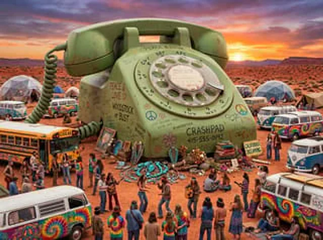

```text
A [ORDINARY OBJECT] as a landmark on an epic journey, tiny [TRAVELERS] resting in its shadow after crossing vast distances visible behind them. Caravans, pack animals, exhausted families. The object marks the halfway point, or the border, or the promised destination. Graffiti and carvings from generations of previous travelers cover its surfaces. Offerings left at its base. Some travelers stay, building permanent settlement. Others push on. Golden hour lighting, dust from the journey still settling, the mundane as waypoint.
```

Model: Nano Banana
Author: Alexandra Aisling

[ProjectD](https://aitoolsradar.com/en/prompts/b93bb2a395dd6a) · [Recorded source](https://x.com/AllaAisling/status/2011484706777546780)
 · [Full original metadata and byte evidence](data/projectd-batch-0059.json)

## Alexandra Aisling #913

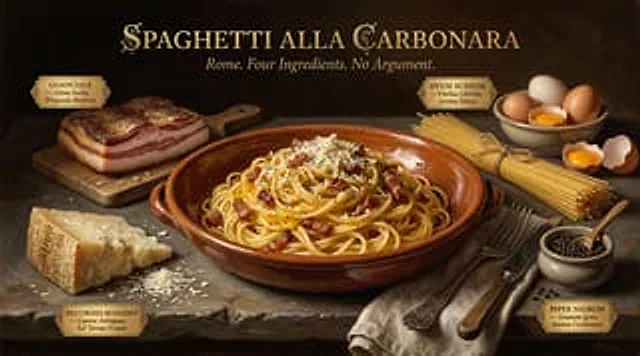

```text
[DISH] painted in the style of a Dutch Golden Age or Italian Renaissance still life, hyperrealistic oil painting aesthetic with dramatic chiaroscuro lighting. Hero dish at center on a dark velvet or stone surface, surrounded by its ingredients arranged in a baroque composition. Single dramatic light source from upper left illuminating every texture with painterly depth: glistening proteins, translucent sauces, jewel-bright vegetables, crusty bread, scattered herbs. Each ingredient labeled with a small elegant gold cartouche, ornate bordered label in copperplate: "[INGREDIENT]  [poetic Latin or French descriptor]". Dish name in ornate gilt typography at top: "[DISH NAME]". Subtitle: "[TAGLINE]". Mood: Caravaggio meets Rembrandt meets the world's most craveable food photograph. Deep rich shadows, jewel-tone colors, extraordinary museum-quality, craveable.
```

Model: Nano Banana
Author: Alexandra Aisling

[ProjectD](https://aitoolsradar.com/en/prompts/7a52cb2d3d4ecb) · [Recorded source](https://x.com/AllaAisling/status/2035111136958587304)
 · [Full original metadata and byte evidence](data/projectd-batch-0059.json)

## Alexandra Aisling #995

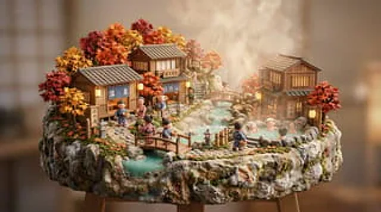

```text
3D miniature scene, a [JAPANESE ONSEN VILLAGE] with [wooden bathhouses, steam rising from natural hot springs, stone lanterns, maple trees in autumn color, guests in tiny yukata robes carrying wooden buckets], presented as a small platform diorama. The platform is carved from natural hot spring rock with mineral deposits. Side view, cute clay style, miniature diorama, soft rendered lighting effects, warm steam diffusing the light, light background.
```

Model: Nano Banana
Author: Alexandra Aisling

[ProjectD](https://aitoolsradar.com/en/prompts/666d3dfc043882) · [Recorded source](https://x.com/AllaAisling/status/2028672209544175970)
 · [Full original metadata and byte evidence](data/projectd-batch-0059.json)

## Alexandra Aisling #997

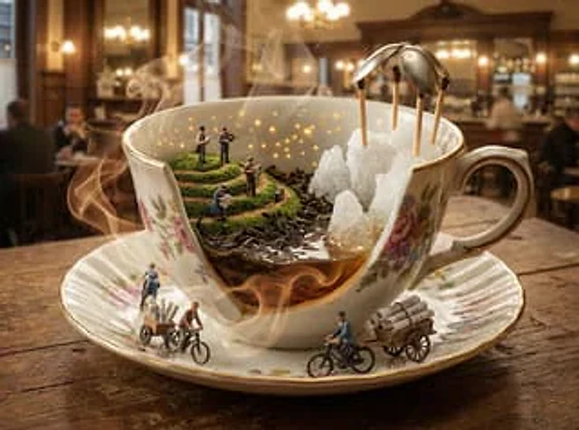

```text
A [AGE / ERA] [CONTAINER / OBJECT] associated with [CULTURE / CONTEXT], partially opened to reveal its contents transforming into a living landscape.
The material inside unfolds as a miniature world: [MATERIAL 1] becomes [GEOGRAPHIC FEATURE], [MATERIAL 2] forms [TERRAIN / STRUCTURE], [FINE DETAILS] flow like [NATURAL ELEMENTS].
Tiny [FIGURES / ENTITIES] inhabit the scene, moving through the terrain as part of a [JOURNEY / SYSTEM / ACTIVITY]. [CREATURES / VEHICLES] carry [SYMBOLIC LOADS] across [LANDMARKS].
A [SHELTER / HUB / ARCHITECTURE] constructed from [UNEXPECTED MATERIAL] serves as a gathering point. The interior surface of the object becomes a [SKY / MAP / COSMIC PATTERN] used for guidance or meaning.
The entire scene is unified by [ATMOSPHERIC ELEMENT] and [TEXTURAL DETAIL], evoking [ABSTRACT THEME / EMOTION].
Cinematic macro perspective, handcrafted realism, surreal scale contrast, warm directional lighting, tactile materials, poetic world-building.
```

Model: Nano Banana
Author: Alexandra Aisling

[ProjectD](https://aitoolsradar.com/en/prompts/dc31ec4109a224) · [Recorded source](https://x.com/AllaAisling/status/2015806433556832401)
 · [Full original metadata and byte evidence](data/projectd-batch-0059.json)

## Alice #1081

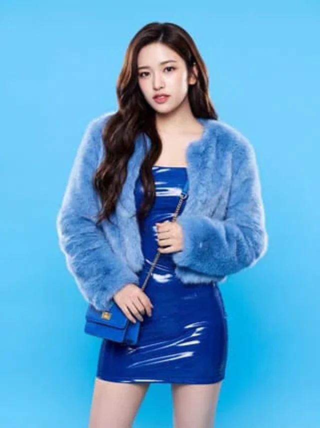

```text
{
"prompt": "ultra-detailed fashion portrait of a beautiful young Korean woman, exactly matching An Yujin from IVE, tall athletic elegant figure, standing confidently in a vibrant all-blue studio, wearing a tight glossy blue patent latex bodycon mini dress that hugs every curve, shiny reflective blue vinyl material, deep cobalt blue color, sleeveless square neckline, short length above mid-thigh, layered with a luxurious fluffy soft blue faux fur cropped jacket with fuzzy long fur texture, open front, long voluminous dark brown hair with perfect loose Hollywood waves cascading down to waist, charismatic deep eyes, full glossy nude-pink lips, dramatic makeup with long lashes, sharp eyeliner, flawless glowing fair skin, confident seductive expression, slight head tilt, holding a small structured hot blue designer crossbody purse with gold chain strap, bright even baby blue background, soft professional studio lighting, high fashion editorial style, hyper-realistic, ultra sharp details, 8k resolution, photorealistic skin texture, intricate fur details, reflective latex shine, azurecore aesthetic, maximalist blue glamour, shot on Canon EOS R5, 85mm lens, f/1.8, cinematic color grading",
"negative_prompt": "low quality, blurry, deformed, ugly, extra limbs, bad anatomy, poorly drawn face, bad proportions, watermark, text, logo, cropped, out of frame, skinny, thin body, small chest, flat figure, realistic clothing texture instead of latex, muted colors, dark background, green skin, male",
"parameters": {
"aspect_ratio": "9:16",
"style": "photorealistic fashion photography",
"lighting": "soft studio lighting with subtle rim light",
"quality_tags": "masterpiece, best quality, ultra detailed, highly detailed, sharp focus",
"sampler": "DPM++ 2M Karras or Euler a",
"steps": 35,
"cfg_scale": 7.5,
"seed": -1
},
"model_recommendations": [
"Flux.1 dev",
"Realistic Vision V6.0",
"Juggernaut XL",
"Photon",
"Midjourney v6"
]
}
```

Model: Nano Banana
Author: Alice

[ProjectD](https://aitoolsradar.com/en/prompts/e80b6fdb01b3d3) · [Recorded source](https://x.com/youngcatwoman/status/2032985380723527761)
 · [Full original metadata and byte evidence](data/projectd-batch-0059.json)

## Alice #1112

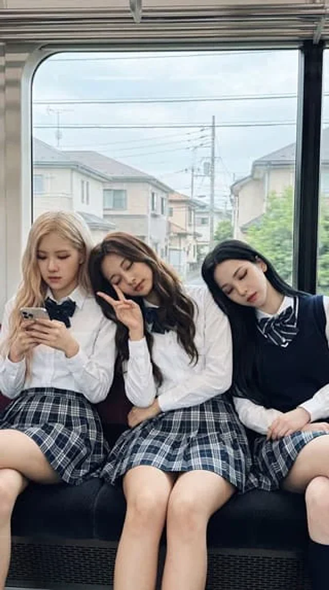

```text
{
"prompt": "Three K-pop idols sitting on a train. Left girl is Rosé with pale skin and long blonde hair, looking at a phone. Middle girl is Tzuyu with warm fair skin and dark brown hair, sleeping, making a peace sign. Right girl is Karina with sharp facial features and long dark hair, sleeping, wearing a navy vest. Uniforms: white shirts, navy plaid skirts, bow ties. Train window background. --ar 3:4",
"aspect_ratio": "3:4",
"subjects": [
{
"position": "left",
"identity": "Rosé",
"physical_characteristics": "slender face, pale skin, long straight blonde hair, soft monolid eyes, petite build",
"pose": "looking down, holding phone",
"outfit": "white cotton long-sleeve shirt, navy/white plaid pleated skirt, navy striped bow tie",
"items": "smartphone"
},
{
"position": "middle",
"identity": "Tzuyu",
"physical_characteristics": "elegant features, warm fair skin, large doe eyes, long dark brown wavy hair, tall build",
"pose": "head tilted left, eyes closed, right hand making peace sign",
"outfit": "white cotton long-sleeve shirt, navy/white plaid pleated skirt, navy striped bow tie"
},
{
"position": "right",
"identity": "Karina",
"physical_characteristics": "sharp V-line jaw, small face, fair skin, long straight dark black hair, AI-like flawless features",
"pose": "head tilted right, eyes closed, resting, legs crossed",
"outfit": "white cotton shirt, navy knit vest, navy/white plaid pleated skirt, navy striped bow tie, black patent leather loafers"
}
],
"background": {
"setting": "Train interior",
"details": "Black ribbed seat, window showing daytime suburban houses and power lines."
},
"color_grading": {
"style": "Natural daylight, slightly muted, soft contrast",
"lighting": "Backlit from window, diffuse interior fill"
},
"color_palette": {
"navy_blue": "#1C2841",
"white": "#F0F0F0",
"plaid_grey": "#5A6A7A",
"skin_tone_pale": "#F3E3D3",
"skin_tone_warm": "#EACCA9",
"hair_blonde": "#E8D3A2",
"hair_dark": "#1A1A1A",
"shoe_black": "#050505"
}
}
```

Model: Nano Banana
Author: Alice

[ProjectD](https://aitoolsradar.com/en/prompts/27d99c34fafd76) · [Recorded source](https://x.com/youngcatwoman/status/2033747149994045758)
 · [Full original metadata and byte evidence](data/projectd-batch-0059.json)

## Alice #1164

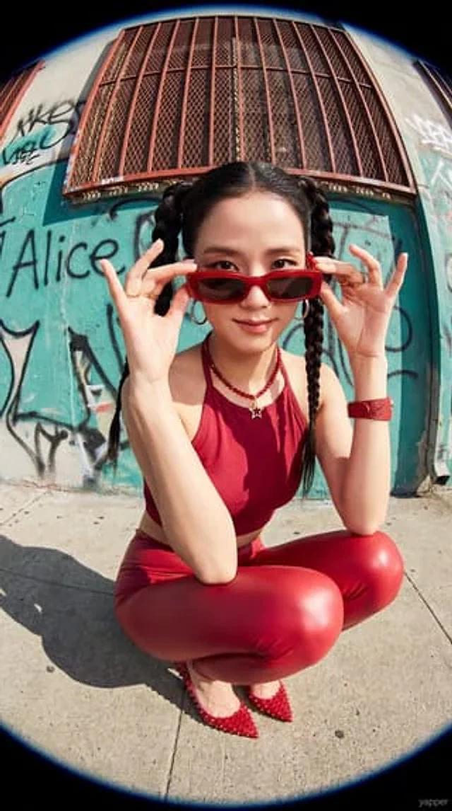

```text
Generate a highly detailed, photorealistic 8K streetwear fashion portrait of Rosé of Blackpink, who is dominating about 90% of the frame. The shot is taken from a low angle with a close-up perspective, using a wide-angle lens with heavy fisheye distortion to simulate a photo taken on a modern smartphone. She has her signature bleached blonde hair in thick pigtail braids, pale porcelain skin, and a confident expression. She is in a low, crouched squat position on the floor, balancing on the spiked high heels and both hands are placed flat on her thighs, leaning slightly forward, and looking directly at the camera. Cobalt-framed rectangular retro sunglasses slightly away from her eyes with both hands. She is wearing a cobalt blue cotton halter crop top, tight cobalt blue latex leggings, and cobalt blue high heels. Her accessories include a ruby bead necklace with a gold star pendant, silver hoop earrings, gold rings, and a cobalt blue bracelet with a raised texture. The outdoor setting features a vibrant, textured teal wall behind her with a graffiti written 'Alice' and a red metal grate above. The scene is lit by intense, direct daytime sunlight, creating hard shadows and high contrast. A small "yapper" watermark is in the bottom right corner. Aspect ratio 9:16.
```

Model: Nano Banana
Author: Alice

[ProjectD](https://aitoolsradar.com/en/prompts/0f63707f633f81) · [Recorded source](https://x.com/youngcatwoman/status/2032542713170838002)
 · [Full original metadata and byte evidence](data/projectd-batch-0059.json)

## Alice #327

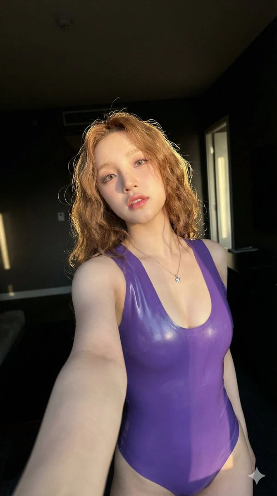

```text
{
"subject": {
"description": "the prettiest (G)I-DLE Yuqi taking a high-angle selfie.",
"mirror_rules": "Left arm extended holding camera.",
"age": "Early 20s",
"expression": {
"eyes": {
"look": "upward at lens",
"energy": "alluring",
"direction": "direct"
},
"mouth": {
"position": "slightly parted",
"energy": "soft"
},
"overall": "seductive and innocent"
},
"face": {
"preserve_original": true,
"features": "Yuqi's irresistibly cute yet alluring round-yet-sharp face, bright expressive eyes, charming smile lines, and vibrant fair aesthetic.",
"makeup": "Asian influencer aesthetic, heavy under-eye blush, light contacts, glossy lips."
}
},
"hair": {
"color": "Warm light brown",
"style": "Long, loose waves, voluminous.",
"effect": "Top backlit halo, strands falling over chest."
},
"body": {
"frame": "Slim with pronounced curves.",
"waist": "Narrow",
"chest": "Full, deep cleavage.",
"legs": "Upper thighs visible.",
"skin": {
"visible_areas": "Chest, shoulders, left arm, upper hips.",
"tone": "Fair, pale luminous.",
"texture": "Smooth, soft, slightly dewy.",
"lighting_effect": "Harsh warm sunlight hitting cleavage and left shoulder, casting sharp shadows."
}
},
"pose": {
"position": "Angled torso, hips pushed back, playful high-angle pose with slight hip cock and energetic lean.",
"base": "Standing/leaning.",
"overall": "Leaning forward into the high-angle lens with flirty body language."
},
"clothing": {
"top": {
"type": "Tight shiny latex bodysuit with detached left sleeve.",
"color": "Glossy Purple",
"details": "Deep scoop neck, thin straps.",
"effect": "Stretching tightly over chest."
},
"bottom": {
"type": "Latex bodysuit bottom",
"color": "Glossy Purple",
"details": "Extremely high cut exposing hips."
}
},
"accessories": {
"jewelry": "Delicate silver pendant necklace."
},
"photography": {
"camera_style": "Smartphone selfie",
"angle": "High angle, looking down.",
"shot_type": "Medium close-up.",
"aspect_ratio": "9:16",
"texture": "Digital, slight wide-angle distortion on left arm.",
"lighting": "Strong directional warm light, high contrast.",
"depth_of_field": "Shallow, blurry dark background."
},
"background": {
"setting": "Dark interior room.",
"wall_color": "Dark/black.",
"elements": [
"Lit door edge on left"
],
"atmosphere": "Intimate, private.",
"lighting": "Mostly dark with one sharp shaft of warm light."
},
"the_vibe": {
"energy": "Captivating",
"mood": "Sensual",
"aesthetic": "Soft-core, golden hour selfie.",
"authenticity": "Casual smartphone snapshot.",
"intimacy": "High, direct eye contact.",
"story": "Catching the golden hour light in a bedroom.",
"caption_energy": "Effortless glow."
},
"constraints": {
"must_keep": [
"High angle perspective",
"Harsh warm directional light",
"Bodysuit cut"
],
"avoid": [
"Flat studio lighting",
"Professional posture",
"Over-bright background"
]
},
"negative_prompt": [
"ugly",
"flat light",
"studio lighting",
"professional camera",
"overexposed",
"extra limbs",
"stiff"
]
}
```

Model: Nano Banana
Author: Alice

[ProjectD](https://aitoolsradar.com/en/prompts/4d78c08d14ef59) · [Recorded source](https://x.com/youngcatwoman/status/2043272414918771047)
 · [Full original metadata and byte evidence](data/projectd-batch-0059.json)

## Alice #713

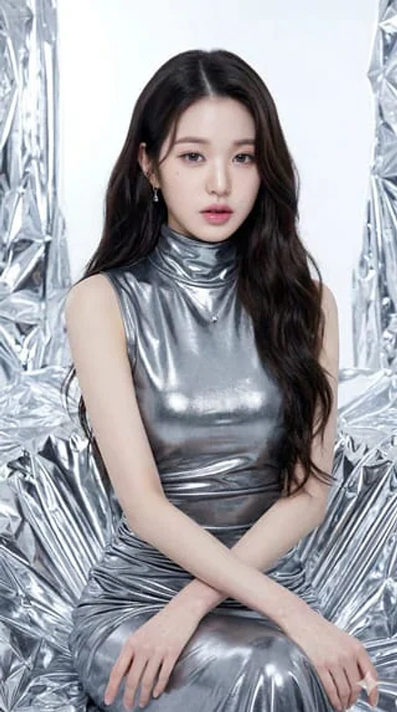

```text
{
  "meta": {
    "image_quality": "High",
    "image_type": "Photo/Digital Render",
    "resolution_estimation": "1080x1920 (aspect ratio 9:16)"
  },
  "global_context": {
    "scene_description": "Jang Wonyoung of IVE poses in a highly reflective, futuristic environment constructed entirely of crumpled silver metallic foil. She has her signature long, wavy dark hair and doll-like features, including her distinct beauty marks. She is wearing a matching sleeveless, high-neck metallic silver dress. The scene is bathed in bright, diffused white light.",
    "time_of_day": "Indeterminate/Studio lighting",
    "weather_atmosphere": "Clinical/Futuristic/Monochromatic",
    "lighting": {
      "source": "Artificial",
      "direction": "Omnidirectional/Diffused",
      "quality": "Soft but creating high-contrast reflections",
      "color_temp": "Neutral/Cool"
    }
  },
  "color_palette": {
    "dominant_hex_estimates": ["#C0C0C0", "#E5E5E5", "#1A1A1A"],
    "accent_colors": ["Silver", "Chrome", "Dewy Skin Tone"],
    "contrast_level": "High"
  },
  "composition": {
    "camera_angle": "Eye-level",
    "framing": "Medium-shot/Vertical",
    "depth_of_field": "Medium",
    "focal_point": "Jang Wonyoung's face and eyes"
  },
  "objects": [
    {
      "id": "obj_001",
      "label": "Jang Wonyoung",
      "category": "Person",
      "location": "Center foreground",
      "prominence": "Foreground",
      "visual_attributes": {
        "color": "Fair skin, dark espresso hair",
        "texture": "Dewy glass skin, silky hair, metallic clothing",
        "material": "Skin/Hair/Fabric",
        "state": "Posed",
        "dimensions_relative": "Dominates vertical center"
      },
      "micro_details": [
        "Signature symmetrical beauty marks",
        "Plump gradient pink lips",
        "Small silver drop earring on left ear",
        "Thin silver necklace with a small pendant",
        "Soft shadows under the jawline",
        "Fingers of right hand resting on left forearm"
      ],
      "pose_or_orientation": "Seated/Kneeling, facing forward, arms crossed loosely at waist",
      "text_content": null
    },
    {
      "id": "obj_002",
      "label": "Metallic Dress",
      "category": "Clothing",
      "location": "Center",
      "prominence": "Foreground",
      "visual_attributes": {
        "color": "Polished Silver/Chrome",
        "texture": "Liquid-like, reflective",
        "material": "Synthetic Metallic Fabric",
        "state": "New/Tight-fitting"
      },
      "micro_details": [
        "Horizontal tension folds across the waist",
        "High turtleneck collar reflecting the chin",
        "Distorted reflection of foil room",
        "Sleeveless cut-outs"
      ],
      "pose_or_orientation": "Form-fitting",
      "text_content": null
    }
  ]
}
```

Model: Nano Banana
Author: Alice

[ProjectD](https://aitoolsradar.com/en/prompts/b9c65ae9851177) · [Recorded source](https://x.com/youngcatwoman/status/2037653892843114830)
 · [Full original metadata and byte evidence](data/projectd-batch-0059.json)

## Alice #727

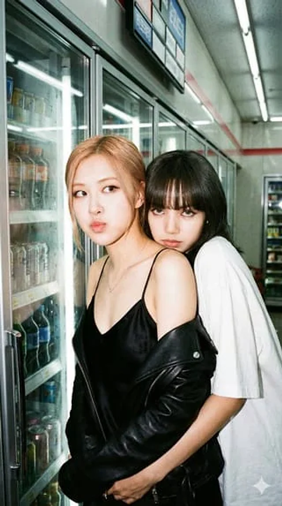

```text
mobile phone photo, CCD camera aesthetic, on-camera flash photography,
  harsh direct flash with hard shadows cast on convenience store
  refrigerator glass behind them, soft film grain texture, aspect ratio
  9:16, centered composition, upper body portrait bust shot of TWO women,
  low angle shot looking up, from chest up including shoulders and
  collarbones,
  TWO Korean women, Rosé and Lisa from BLACKPINK, gorgeous off-duty K-pop female idols, convenience
  store at 3AM, both caught by sudden camera flash,
  IMPORTANT — SKIN QUALITY FOR BOTH WOMEN: milky luminous flawless skin,
  creamy smooth porcelain complexion with subtle inner glow, perfectly
  even skin tone, zero visible pores zero blemishes, soft-focus skin
  surface like milk poured over glass, skin so smooth it almost glows
  under the flash, flash light bouncing off silky-smooth skin creating
  clean bright highlights with no texture interruption, baby-soft
  flawless dewy finish,
  WOMAN A (ROSÉ - front, facing camera, leaning back against refrigerator
  glass door): 23 years old, innocent-sexy pure-and-seductive type,
  slim oval face with delicate jawline, slightly hooded monolid eyes wide open
  with prominent sparkly aegyo-sal under-eye fat pads highlighted with
  subtle shimmer, light peach-brown eyeshadow clean and fresh, long
  natural curled lashes, signature pale strawberry blonde long straight hair one side 
  tucked behind ear exposing full neck line, cold-toned milky white
  flawless skin with soft rosy flush on cheeks, wearing
  black satin spaghetti-strap camisole with low neckline fabric clinging
  to full bust with silky flash reflection, oversized black leather
  biker jacket slipped down to both elbows completely exposing both bare
  shoulders collarbones and thin straps, delicate silver chain necklace
  catching flash, head tilted slightly back and toward Lisa, cute
  playful expression — pouty lips and wide innocent eyes,
  WOMAN B (LISA - behind Rosé, pressed against her back, partially hidden):
  21 years old, innocent-sexy type, distinct doll-like face with 
  fuller cheeks, large round double-eyelid almond eyes with full
  aegyo-sal, cold direct unblinking stare into camera with subtle
  displeasure, lips closed and slightly pouting with faint pink lip gloss, 
  jet black medium hair with her iconic thick flat air bangs
  clinging to forehead, several dark strands draped across Rosé's 
  bare shoulder, warm-toned milky fair flawless skin, wearing 
  white oversized thin t-shirt with stretched-out neckline slipping off 
  one shoulder revealing black bralette strap, her chin resting directly 
  on Rosé's bare shoulder skin-to-skin contact, one arm wrapped around 
  Rosé's waist with fingers lightly gripping the hem of the satin camisole, 
  half her face hidden behind Rosé's shoulder, faces less than 5cm apart 
  but not touching, convenience store at 3AM, refrigerator glass door 
  behind them glowing with cold white internal LED, blurred beer cans 
  visible through glass, overhead fluorescent lights with greenish tint, 
  on-camera flash hitting Rosé fully and Lisa partially, harsh flash shadow 
  on refrigerator glass, CCD camera look with soft fine film grain, 
  no full body, no legs, no extra people, no text, no watermark, 
  no identical faces, no visible pores, no rough skin texture.
```

Model: Nano Banana
Author: Alice

[ProjectD](https://aitoolsradar.com/en/prompts/09037c511c919a) · [Recorded source](https://x.com/youngcatwoman/status/2034704709647564838)
 · [Full original metadata and byte evidence](data/projectd-batch-0059.json)

## Amara #1235

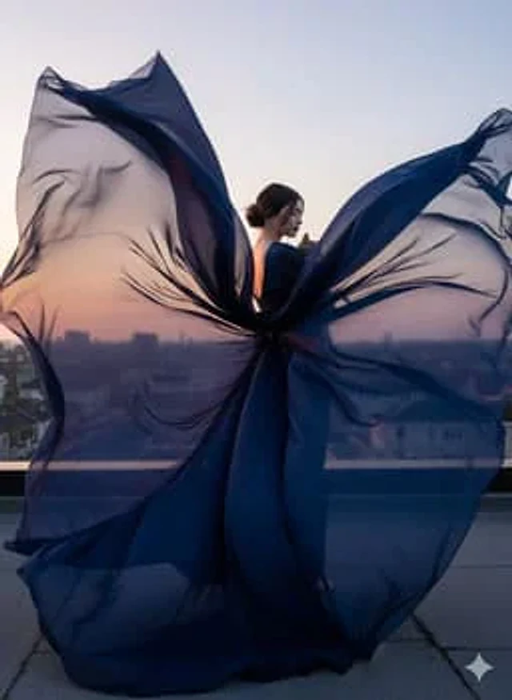

```text
{
  "render_goal": "High-fashion cinematic motion shot",
  "focus": "fabric movement",
  "wardrobe": {
    "outfit": "long flowing garment",
    "motion": "fabric spreading dramatically in wind"
  },
  "environment": {
    "location": "open elevated space (rooftop, bridge, cliff)"
  },
  "lighting": "directional cinematic light",
  "camera": "freeze motion, sharp subject, soft background"
}
```

Model: Nano Banana
Author: Amara

[ProjectD](https://aitoolsradar.com/en/prompts/272ca39b6b7b05) · [Recorded source](https://x.com/sassyamara_/status/2015758548199002294)
 · [Full original metadata and byte evidence](data/projectd-batch-0059.json)

## Amira Zairi #1015

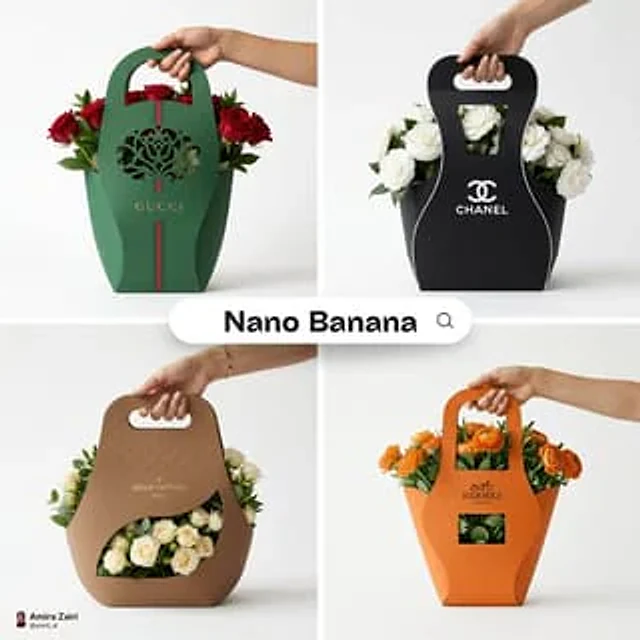

```text
Minimalist branded flower packaging design for [brand], eco-friendly cardboard sleeve with integrated handle, sculptural curved silhouette wrapping naturally around a fresh bouquet, packaging fully designed using the official brand color palette, matte surface with the brand logo cleanly centered on the front panel, precision die-cut window integrated into the design allowing flowers to subtly emerge, cohesive color blocking aligned with brand identity, modern premium branding aesthetic, smooth paper texture, refined structural details, hand holding the package naturally, studio product photography, centered composition, pure white background, soft realistic contact shadow beneath, high-end packaging mockup, ultra-detailed, 1:1 aspect ratio.
```

Model: Nano Banana
Author: Amira Zairi

[ProjectD](https://aitoolsradar.com/en/prompts/9aec113a11de7c) · [Recorded source](https://x.com/azed_ai/status/2030282080945647687)
 · [Full original metadata and byte evidence](data/projectd-batch-0059.json)

## Amira Zairi #1101

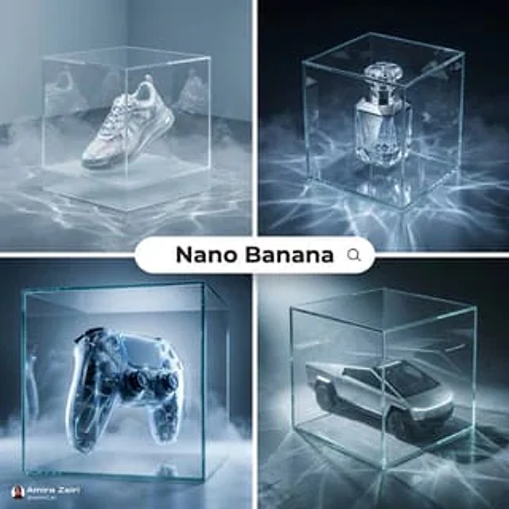

```text
[product], futuristic high-end ad, transparent glass cube enclosure, caustic light patterns on surface, minimal composition, cool studio lighting, subtle fog, sharp reflections, ultra-realistic, macro product photography, 100mm lens look, f/8, 8k, 1:1
```

Model: Nano Banana
Author: Amira Zairi

[ProjectD](https://aitoolsradar.com/en/prompts/93f228b44fdd94) · [Recorded source](https://x.com/azed_ai/status/2020498871894573126)
 · [Full original metadata and byte evidence](data/projectd-batch-0059.json)

## Amira Zairi #1121

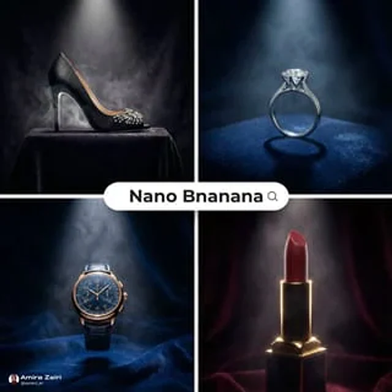

```text
[product], luxury product hero shot, dark velvet background, single spotlight top down, thin mist haze, dramatic rim light outline, cinematic shadows, premium editorial styling, ultra realistic, macro detail, 85mm lens look, f/4 shallow depth, 8k, 1:1
```

Model: Nano Banana
Author: Amira Zairi

[ProjectD](https://aitoolsradar.com/en/prompts/fc02f745d887c1) · [Recorded source](https://x.com/azed_ai/status/2012919379575570766)
 · [Full original metadata and byte evidence](data/projectd-batch-0059.json)

## Amira Zairi #1142

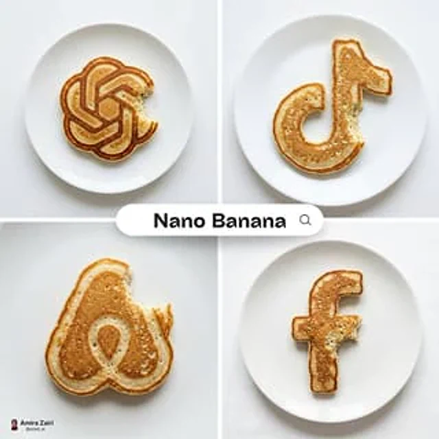

```text
hyper-realistic food photography of a pancake shaped precisely like the [brand name] logo, natural golden-brown pancake texture, soft porous surface with realistic bubbles, slightly crispy edges, placed on a pure white background, minimal composition, soft natural shadow beneath, top-down flat lay perspective, subtle bite taken from one edge revealing fluffy interior, realistic crumb texture, soft diffused studio lighting, ultra detailed, clean commercial aesthetic, sharp focus
```

Model: Nano Banana
Author: Amira Zairi

[ProjectD](https://aitoolsradar.com/en/prompts/872cd6f9e4f2b8) · [Recorded source](https://x.com/azed_ai/status/2033181947103773158)
 · [Full original metadata and byte evidence](data/projectd-batch-0059.json)

## Amira Zairi #1180

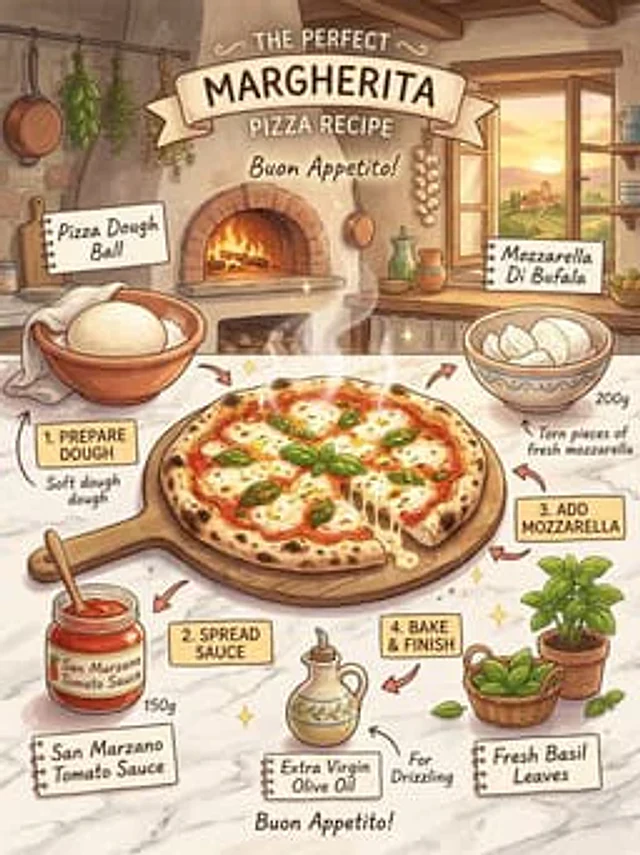

```text
margherita pizza recipe infographic, Studio Ghibli inspired illustration, traditional Italian kitchen setting, warm golden sunset light, whole pizza in center with bubbling cheese, ingredients illustrated around in cute containers, dough ball, tomato sauce 150g, mozzarella 200g, fresh basil leaves, olive oil drizzle, handwritten notebook style labels, soft pastel tones, painterly textures, gentle steam and magical glow, whimsical cozy feeling, clean organized layout, readable text, high detail
```

Model: Nano Banana
Author: Amira Zairi

[ProjectD](https://aitoolsradar.com/en/prompts/d66c653ca0a985) · [Recorded source](https://x.com/azed_ai/status/2027140890247246017)
 · [Full original metadata and byte evidence](data/projectd-batch-0059.json)

## Amira Zairi #1210

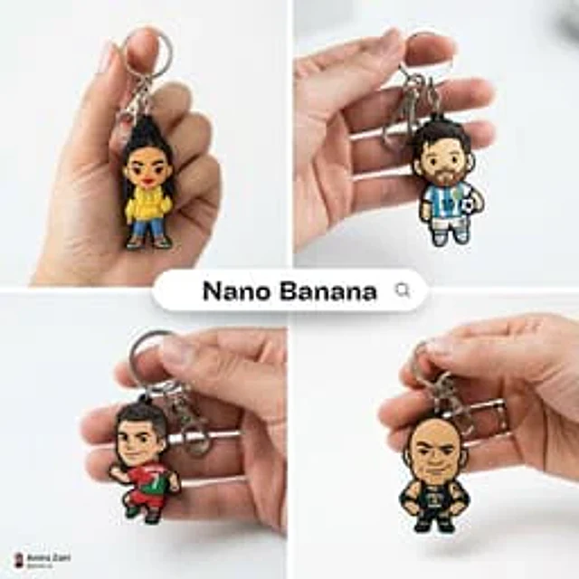

```text
Close-up photo of a cute, colorful rubber keychain held gently in a person’s hand. The keychain features a chibi-style illustration of [character/person], simplified facial features, rounded proportions, soft pastel color palette, bold thick black outlines, smooth matte rubber texture, slightly raised layered detailing, cartoon expression, compact toy-like silhouette. The keychain is attached to a small silver metal clasp and keyring. Natural hand positioning, shallow depth of field, soft diffused lighting, neutral beige background, realistic skin texture, high-detail product photography, 1:1 aspect ratio.
```

Model: Nano Banana
Author: Amira Zairi

[ProjectD](https://aitoolsradar.com/en/prompts/4e84f6ff12b182) · [Recorded source](https://x.com/azed_ai/status/2031731136385421407)
 · [Full original metadata and byte evidence](data/projectd-batch-0059.json)

## Amira Zairi #1284

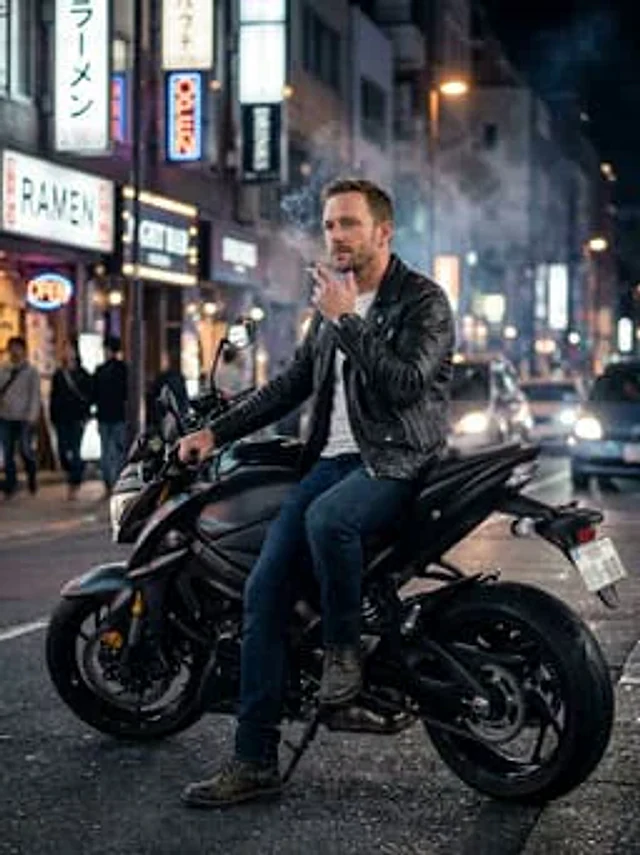

```text
{
  "style": "photorealistic",
  "subject": "adult man smoking a cigarette while sitting on a motorbike",
  "appearance": {
    "age": "mid-30s",
    "expression": "calm, slightly serious",
    "beard": "light stubble",
    "clothing": "black leather jacket, white t-shirt, dark jeans, boots"
  },
  "pose": "sitting casually on the motorbike, one foot on the ground, holding a cigarette near his mouth",
  "vehicle": {
    "type": "modern sport motorbike",
    "color": "matte black",
    "details": "clean chrome accents, realistic reflections"
  },
  "environment": {
    "location": "urban street at night",
    "lighting": "cinematic street lights, soft rim light, subtle neon reflections",
    "atmosphere": "slight smoke haze blending with cigarette smoke"
  },
  "camera": {
    "angle": "low angle shot",
    "lens": "85mm",
    "depth_of_field": "shallow depth of field, blurred background bokeh"
  },
  "quality": {
    "resolution": "8k",
    "details": "ultra-detailed skin texture, realistic smoke, natural shadows",
    "rendering": "high dynamic range, sharp focus"
  }
}
```

Model: Nano Banana
Author: Amira Zairi

[ProjectD](https://aitoolsradar.com/en/prompts/6ab76727cb9ccc) · [Recorded source](https://x.com/azed_ai/status/2031369659350679749)
 · [Full original metadata and byte evidence](data/projectd-batch-0059.json)

## Amira Zairi #1303

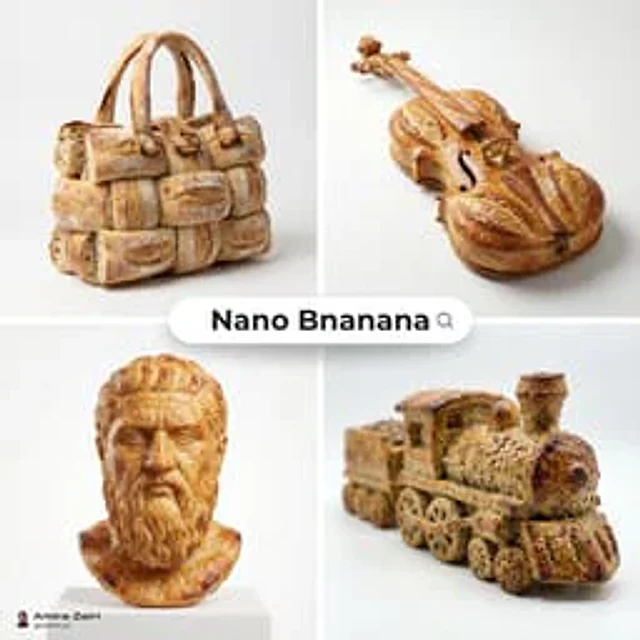

```text
A highly realistic sculpture of a [object], crafted entirely from [bread type], photorealistic, ultra detailed bread texture, authentic crumb structure, golden brown crust with subtle blistering, natural sheen from baked glaze, visible flaky layers or airy pockets where appropriate, sesame or poppy seeds embedded if relevant, tiny cracks and toasted edges, realistic thickness and weight, studio product lighting with soft highlights and gentle shadows, soft neutral seamless background, shallow depth of field, razor sharp focus on the sculpture, 8k, no text, no logos, no watermark
```

Model: Nano Banana
Author: Amira Zairi

[ProjectD](https://aitoolsradar.com/en/prompts/db065a408942d1) · [Recorded source](https://x.com/azed_ai/status/2018322783869243790)
 · [Full original metadata and byte evidence](data/projectd-batch-0059.json)

## Amira Zairi #322

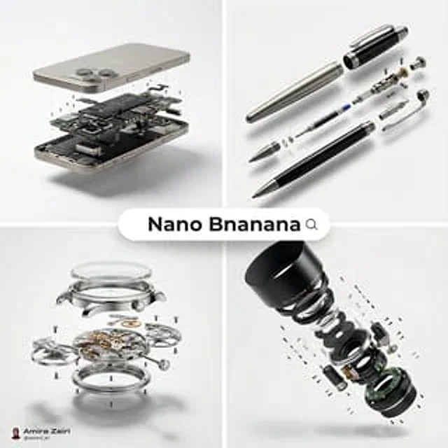

```text
Create an exploded products with inner mechanics [product], high-end product advertising, white seamless background, exploded view with inner mechanics revealed, outer shell hovering above core, micro screws and components suspended, perfect alignment guides implied, crisp soft shadow, ultra realistic, macro product photography, 100mm lens look, f/8, 8k, 1:1
```

Model: Nano Banana
Author: Amira Zairi

[ProjectD](https://aitoolsradar.com/en/prompts/f03b68c4976bcb) · [Recorded source](https://x.com/azed_ai/status/2010350005870276897)
 · [Full original metadata and byte evidence](data/projectd-batch-0059.json)

## Amira Zairi #352

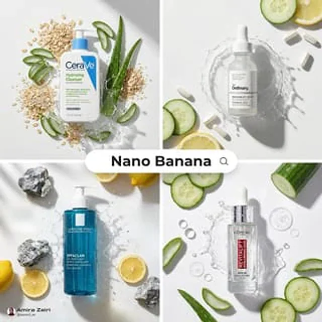

```text
[product], centered top down flat lay, surrounded by [ingredients], fresh slices and whole pieces, glossy wet look, water splash frozen mid motion around the product, dewy droplets on label and surface, warm beige seamless background, soft directional sunlight, crisp realistic shadow, high end skincare advertising, ultra realistic macro product photography, 100mm lens look, f/8 sharp focus, clean composition, no extra text, 8k, 1:1
```

Model: Nano Banana
Author: Amira Zairi

[ProjectD](https://aitoolsradar.com/en/prompts/734d80e1fd47c9) · [Recorded source](https://x.com/azed_ai/status/2015423674061643925)
 · [Full original metadata and byte evidence](data/projectd-batch-0059.json)

## Amira Zairi #375

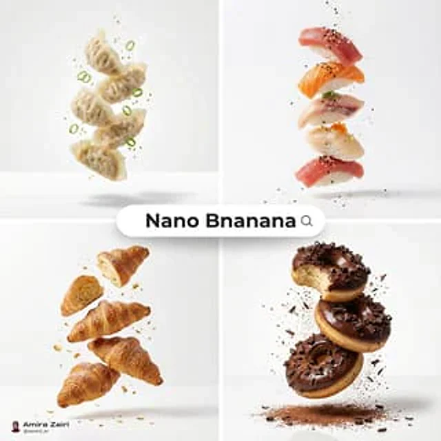

```text
[subject], premium food advertising, white seamless background, high key studio lighting, floating stacked composition, levitating pieces, [ingredient_bits] scattered, clean minimal layout, crisp soft shadow on surface, ultra realistic, macro product photography, 100mm lens look, f/8 sharp focus, subtle texture detail, editorial commercial, 8k
```

Model: Nano Banana
Author: Amira Zairi

[ProjectD](https://aitoolsradar.com/en/prompts/ed40eb6657de3c) · [Recorded source](https://x.com/azed_ai/status/2009625733933736157)
 · [Full original metadata and byte evidence](data/projectd-batch-0059.json)

## Amira Zairi #382

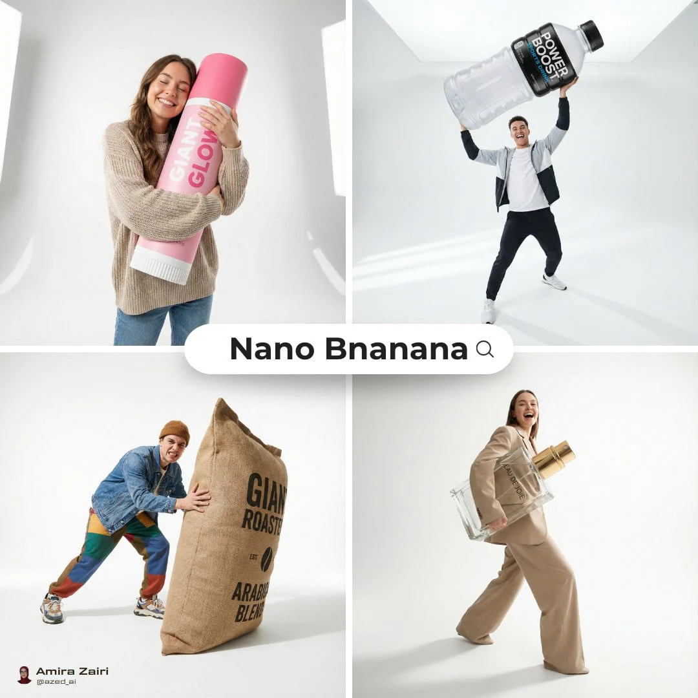

```text
[person], [pose], oversized product in the attached image as the main hero prop, playful fun energy, fashion editorial styling, clean minimal background, high key studio lighting, crisp soft shadow, ultra realistic commercial photography, wide angle low perspective, sharp focus, 8k, 1:1
```

Model: Nano Banana
Author: Amira Zairi

[ProjectD](https://aitoolsradar.com/en/prompts/ad1a97f11f46f6) · [Recorded source](https://x.com/azed_ai/status/2015152385207984348)
 · [Full original metadata and byte evidence](data/projectd-batch-0059.json)

## Amira Zairi #402

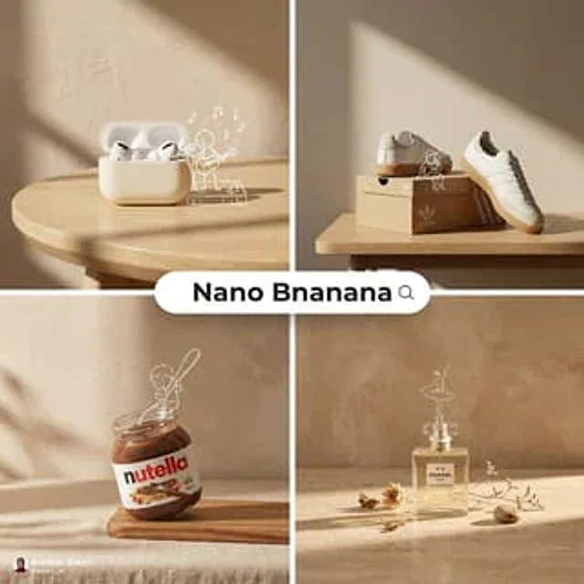

```text
[product setup], minimalist product photo, clean warm studio scene, textured beige wall background, soft directional sunlight creating long shadows, simple tabletop surface, product arranged in a playful concept composition, hand drawn white line doodle overlay of [character] interacting with the product, mixed media look combining real photography and sketch illustration, high end branding feel, shallow depth of field, ultra realistic, no extra text, no watermark
```

Model: Nano Banana
Author: Amira Zairi

[ProjectD](https://aitoolsradar.com/en/prompts/a295b86d0b8686) · [Recorded source](https://x.com/azed_ai/status/2027021107015143498)
 · [Full original metadata and byte evidence](data/projectd-batch-0059.json)

## Amira Zairi #414

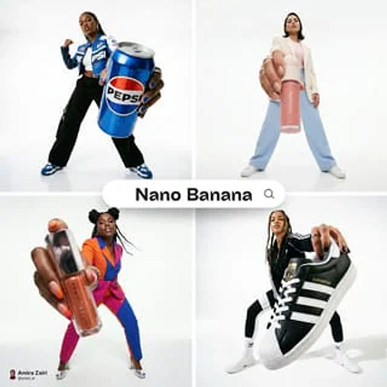

```text
Low-angle fashion campaign photograph of a confident model holding a large [product name] very close to the camera, exaggerated perspective with the hand and product dominating the foreground, full-body pose visible in the background, wide stance, dynamic posture, clean pure white studio background, high-key lighting, sharp focus on product, slight depth of field on the model, bold colorful outfit with strong contrast tones, modern beauty advertising aesthetic, ultra-clean composition, commercial studio photography, glossy packaging detail visible, crisp shadows
```

Model: Nano Banana
Author: Amira Zairi

[ProjectD](https://aitoolsradar.com/en/prompts/e6787e2ecbd459) · [Recorded source](https://x.com/azed_ai/status/2037168464801259602)
 · [Full original metadata and byte evidence](data/projectd-batch-0059.json)

## Amira Zairi #457

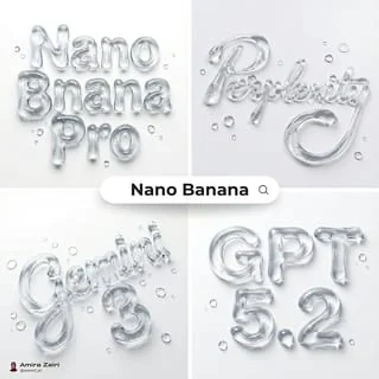

```text
Abstract liquid typography spelling "text", thick transparent water-gel material, hyper realistic refraction and subtle caustics, realistic surface tension, sculpted droplet forms merged into smooth letter curves, glossy highlights, micro bubbles inside the gel, soft contact shadows on a pure white seamless background, scattered water droplets on the surface with sharp specular reflections, studio lighting, crisp photorealistic 3D render, macro detail, sharp focus, 8k, 1:1, no watermark, no extra text
```

Model: Nano Banana
Author: Amira Zairi

[ProjectD](https://aitoolsradar.com/en/prompts/0d92071569d2a8) · [Recorded source](https://x.com/azed_ai/status/2019411461295218834)
 · [Full original metadata and byte evidence](data/projectd-batch-0059.json)

## Amira Zairi #485

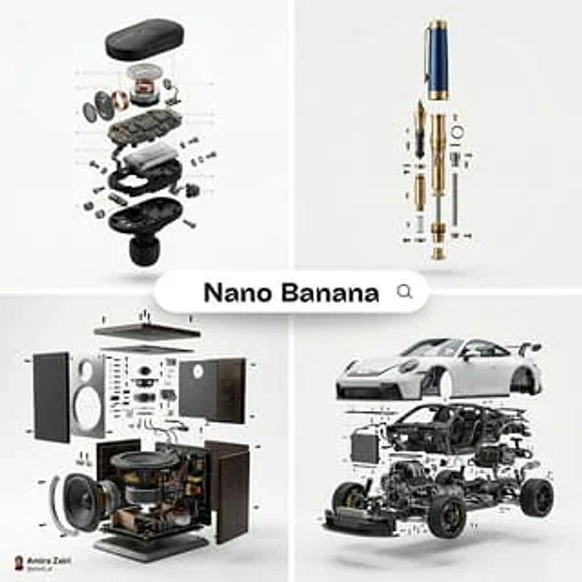

```text
[product], high-end product advertising, white seamless background, exploded view with inner mechanics revealed, outer shell hovering above core, micro screws and components suspended, perfect alignment guides implied, crisp soft shadow, ultra realistic, macro product photography, 100mm lens look, f/8, 8k
```

Model: Nano Banana
Author: Amira Zairi

[ProjectD](https://aitoolsradar.com/en/prompts/004ef7633f1089) · [Recorded source](https://x.com/azed_ai/status/2041516871133122581)
 · [Full original metadata and byte evidence](data/projectd-batch-0059.json)

## Amira Zairi #501

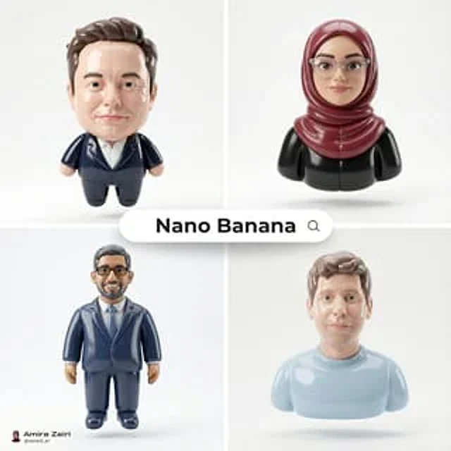

```text
[SUBJECT], ultra realistic 3D render, smooth inflated glossy plastic material, soft pillowy balloon like contours, subtle stitched panel seams and paneling, high specular highlights, clean reflections, soft contact shadows, designer collectible toy aesthetic, cute proportions, premium polished finish, floating centered, plain light gray studio background, soft diffused studio lighting, sharp focus, high resolution, 8k, 1:1, no text, no logo, no watermark
```

Model: Nano Banana
Author: Amira Zairi

[ProjectD](https://aitoolsradar.com/en/prompts/389ec87cc05c5e) · [Recorded source](https://x.com/azed_ai/status/2020134464349958346)
 · [Full original metadata and byte evidence](data/projectd-batch-0059.json)

## Amira Zairi #527

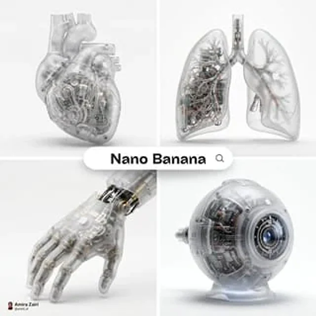

```text
A hyper-realistic 3D anatomical human [organ] made from semi-translucent frosted polycarbonate with a milky matte finish, softly diffusing light. Industrial injection-molded detailing, subtle micro-texture, and rounded edges with precision seams. Inside, intricate mechanical components replace organic tissue, micro gears, pistons, circuitry, and engineered chambers visible but softly blurred through the shell. A subtle white Apple logo is naturally embedded on the surface, minimal and not overly obvious. Soft diffused studio lighting, realistic plastic refraction, subtle shadow beneath, centered composition, pure white background, ultra-detailed futuristic biomechanical render, 1:1 aspect ratio.
```

Model: Nano Banana
Author: Amira Zairi

[ProjectD](https://aitoolsradar.com/en/prompts/dff0ebbd351075) · [Recorded source](https://x.com/azed_ai/status/2033543326444720272)
 · [Full original metadata and byte evidence](data/projectd-batch-0059.json)

## Amira Zairi #537

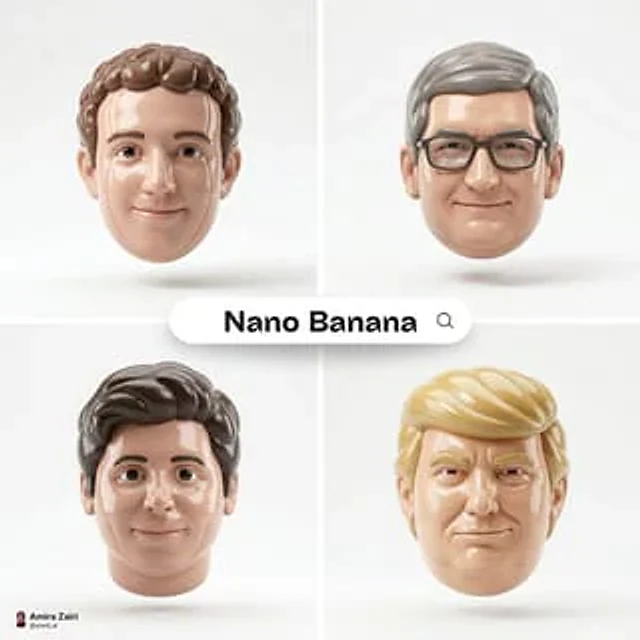

```text
[SUBJECT], made of smooth inflated glossy vinyl plastic, ultra-realistic 3D render, soft pillowy contours with subtle stitched panel seams, slightly rounded toy-like proportions, highly polished surface with strong specular highlights, realistic material depth, soft studio lighting creating gentle shadows and clean reflections, floating slightly above a plain light gray background, minimal composition, designer collectible aesthetic, premium art toy finish, high detail, centered composition, 1:1 aspect ratio.
```

Model: Nano Banana
Author: Amira Zairi

[ProjectD](https://aitoolsradar.com/en/prompts/d2d8aa5d5882d7) · [Recorded source](https://x.com/azed_ai/status/2037922744856412584)
 · [Full original metadata and byte evidence](data/projectd-batch-0059.json)

## Amira Zairi #538

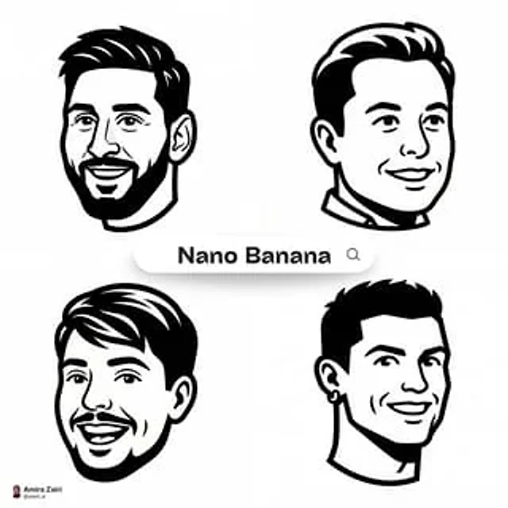

```text
Create a clean high-contrast vector mascot icon in Notion-style artwork based on [person description]. Show only the head in a 3/4 view. Use very thick bold black outer outlines and slightly thinner inner detail lines. Flat monochrome fill. Simplify facial features into strong geometric shapes while preserving recognizable traits such as bald head or hairstyle, beard shape, glasses shape, eyebrows, and smile. Expression should be friendly and slightly exaggerated. Teeth are simplified into clean flat blocks. pure white background. Modern startup mascot logo aesthetic, clean SVG vector look, crisp edges, black and white only, high contrast, symmetrical balance, square composition, 1:1 aspect ratio
```

Model: Nano Banana
Author: Amira Zairi

[ProjectD](https://aitoolsradar.com/en/prompts/dba0fb74705bee) · [Recorded source](https://x.com/azed_ai/status/2032819091485110500)
 · [Full original metadata and byte evidence](data/projectd-batch-0059.json)

## Amira Zairi #554

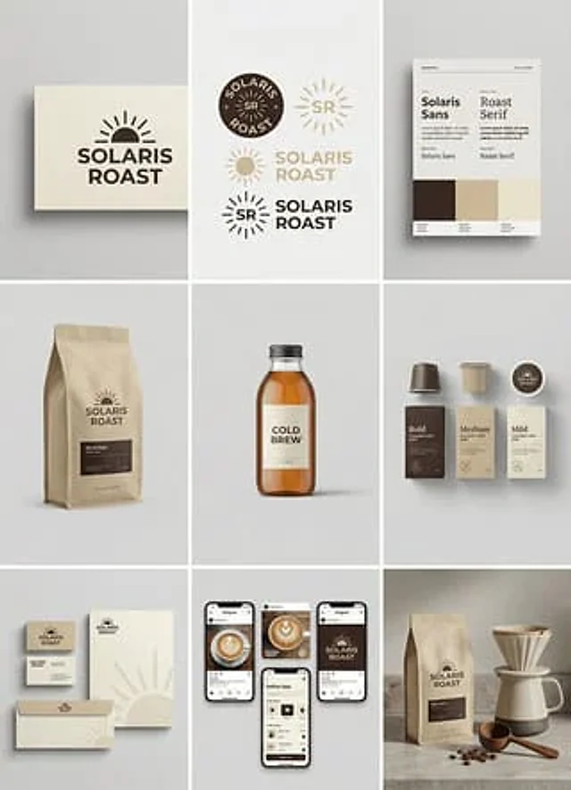

```text
[brand name], complete brand identity grid, 3x3 layout, nine tiles showing a full cohesive brand system, light gray seamless background, soft diffused studio lighting, subtle shadows, clean modern minimal style, consistent color palette of [color1] [color2] [color3], high-end studio mockups, ultra-realistic, 8k, 1:1,

tile 1 primary logo lockup on paper card,
tile 2 secondary logo mark and monogram variations,
tile 3 color palette swatches and typography specimen poster,
tile 4 packaging mockup for [product 1],
tile 5 hero product photo for [product 2],
tile 6 set of three products for [product 3] in different sizes,
tile 7 stationery mockups business card letterhead envelope,
tile 8 social media post mockups and phone screen UI preview,
tile 9 lifestyle scene featuring [product 1] with props matching the brand,

no people, no readable real-world brand names, no watermark.
```

Model: Nano Banana
Author: Amira Zairi

[ProjectD](https://aitoolsradar.com/en/prompts/bb9107b5e4eaa5) · [Recorded source](https://x.com/azed_ai/status/2016511852927438909)
 · [Full original metadata and byte evidence](data/projectd-batch-0059.json)

## Amira Zairi #558

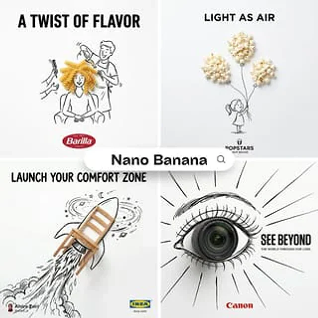

```text
A minimalist and creative advertisement set on a pure white background. A real photographic [Real Object] is integrated into a simple hand-drawn black ink doodle using loose, playful lines. The [Doodle Concept] interacts directly and cleverly with the real object, making the object part of the illustrated scene. Include bold uppercase black “[Ad Copy]” text at the top. Place the official [Brand Logo] clearly centered at the bottom. Clean layout, high contrast between realistic object and flat doodle drawing, lots of negative space, smart visual metaphor, print-ready poster design
```

Model: Nano Banana
Author: Amira Zairi

[ProjectD](https://aitoolsradar.com/en/prompts/a70b96b68658c7) · [Recorded source](https://x.com/azed_ai/status/2032094792583430443)
 · [Full original metadata and byte evidence](data/projectd-batch-0059.json)

## Amira Zairi #576

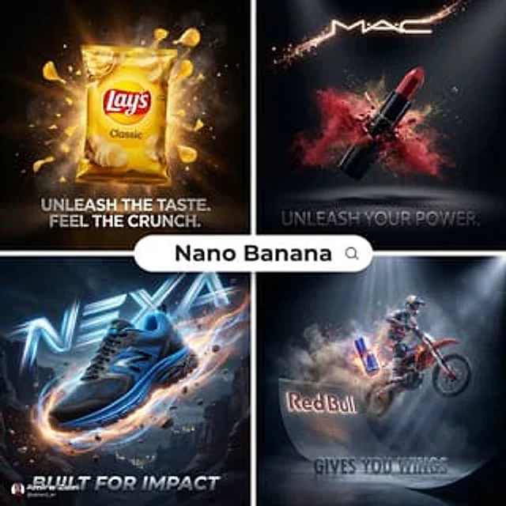

```text
Cinematic 3D action-packed advertisement for [INSERT PRODUCT/BRAND HERE], captured in an intense mid-motion moment with dramatic studio lighting, dynamic particle effects, and high-impact slow-motion energy. Ultra-hyperrealistic rendering, razor-sharp details, glossy commercial finish, atmospheric depth, and powerful contrast. Viral-ready composition with the brand logo seamlessly integrated into the scene and a sleek, modern slogan positioned cleanly beneath. High-end blockbuster commercial aesthetic
```

Model: Nano Banana
Author: Amira Zairi

[ProjectD](https://aitoolsradar.com/en/prompts/3bfba010fde3c4) · [Recorded source](https://x.com/azed_ai/status/2019773851211886665)
 · [Full original metadata and byte evidence](data/projectd-batch-0059.json)

## Amira Zairi #608

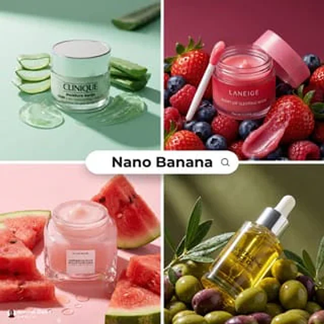

```text
[product], premium skincare product ad, the product placed directly on and surrounded by fresh [fruit_or_vegetable], visual storytelling that the product is made from the ingredient, rich saturated color palette matching the ingredient, juicy realistic textures, visible seeds pulp or slices, glossy highlights, dramatic studio lighting, soft shadows, shallow depth of field, macro product photography look, ultra realistic, editorial commercial style, clean background in matching color tone, 8k, 1:1
```

Model: Nano Banana
Author: Amira Zairi

[ProjectD](https://aitoolsradar.com/en/prompts/57f48357787e86) · [Recorded source](https://x.com/azed_ai/status/2021258256619012365)
 · [Full original metadata and byte evidence](data/projectd-batch-0059.json)

## Amira Zairi #655

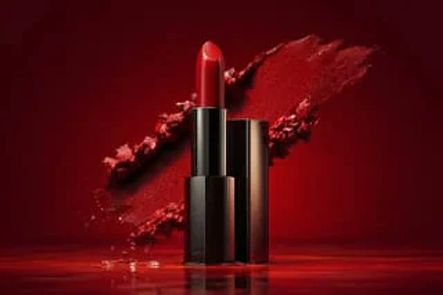

```text
studio shot of [PRODUCT], placed on a [background], surrounded by soft shadows and gradient background, high-key lighting, shallow depth of field, ultra-sharp focus on the object, premium product photography, shot on a DSLR, minimal aesthetic, subtle reflections, commercial lighting setup
```

Model: Nano Banana
Author: Amira Zairi

[ProjectD](https://aitoolsradar.com/en/prompts/92eb60b93a9773) · [Recorded source](https://x.com/azed_ai/status/2035672892294451691)
 · [Full original metadata and byte evidence](data/projectd-batch-0059.json)

## Amira Zairi #740

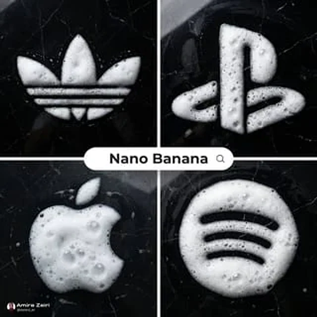

```text
Ultra-realistic top-down photograph of detergent foam forming a precise [subject / logo / symbol / shape] on a polished black marble surface. Thick, airy white foam with realistic bubbles of varying sizes, natural translucency, wet shine, and soft highlights. Foam appears freshly formed, slightly uneven at the edges, physically accurate, volumetric, and naturally settled on the marble.

Black marble background with subtle white veining, glossy finish, realistic reflections and moisture marks, high contrast between white foam and dark stone. Clean minimalist composition, centered subject.

Soft diffused overhead lighting creating gentle reflections on the marble and delicate shadows within the foam bubbles. Photorealistic texture detail, macro-level realism, high-end commercial photography style, no text overlays, no illustrations, no stylization, no CGI look, ultra-clean aesthetic, sharp focus, 8k resolution, 1:1
```

Model: Nano Banana
Author: Amira Zairi

[ProjectD](https://aitoolsradar.com/en/prompts/6f6bd8bb206d43) · [Recorded source](https://x.com/azed_ai/status/2025933939647586694)
 · [Full original metadata and byte evidence](data/projectd-batch-0059.json)

## Amira Zairi #757

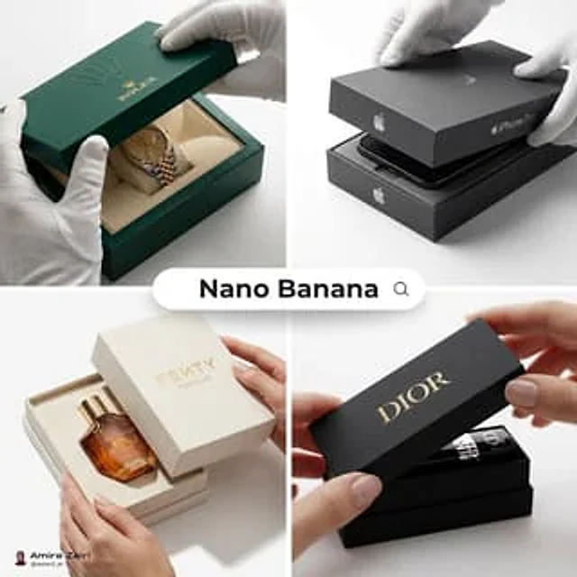

```text
[product], luxury packaging reveal scene, premium unboxing moment, pristine hands partially visible at the edges, delicate interaction with the packaging, lid slightly lifted to reveal the product inside, crisp folds and precise alignment, tactile materials [ ex: matte paper, soft touch coating, embossed details, foil accents], subtle micro texture and dust free finish, clean white background, soft diffused studio lighting, controlled specular highlights, realistic shadows, macro product photography look, shallow depth of field with sharp focus on the product and branding area, high end editorial commercial style, ultra realistic, 4k, 1:1, no watermark, no extra text
```

Model: Nano Banana
Author: Amira Zairi

[ProjectD](https://aitoolsradar.com/en/prompts/05ff6569d12058) · [Recorded source](https://x.com/azed_ai/status/2011439171760767441)
 · [Full original metadata and byte evidence](data/projectd-batch-0059.json)

## Amira Zairi #799

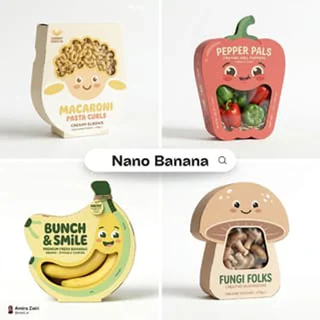

```text
Playful designer packaging for [product name], creative box shaped like the product, integrated cartoon face on the front panel, oversized die-cut window revealing the real contents as part of the character’s expression, smooth matte cardboard material, bold flat graphic design, modern minimalist branding, limited pastel color palette, rounded friendly shapes, clean typography, high-end 3D packaging mockup render, soft studio lighting, pure white background, subtle realistic contact shadow beneath, ultra-detailed, retail-ready presentation, 1:1 aspect ratio.
```

Model: Nano Banana
Author: Amira Zairi

[ProjectD](https://aitoolsradar.com/en/prompts/de10d54685ca11) · [Recorded source](https://x.com/azed_ai/status/2027806040109289487)
 · [Full original metadata and byte evidence](data/projectd-batch-0059.json)

## Amira Zairi #808

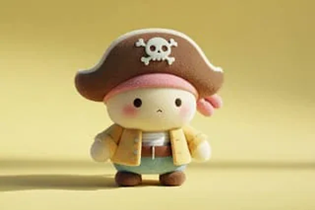

```text
A cute full-body [SUBJECT] plush toy, plush doll art, stylized 3D character design, soft pastel colors, velvety fabric texture, rounded cartoon proportions, minimalist details, clean front-facing composition, centered on a light yellow background, playful kawaii aesthetic, soft studio lighting, subtle shadows, adorable collectible feel, high-resolution render
```

Model: Nano Banana
Author: Amira Zairi

[ProjectD](https://aitoolsradar.com/en/prompts/e132f99a575acc) · [Recorded source](https://x.com/azed_ai/status/2041109686242644425)
 · [Full original metadata and byte evidence](data/projectd-batch-0059.json)

## Amira Zairi #850

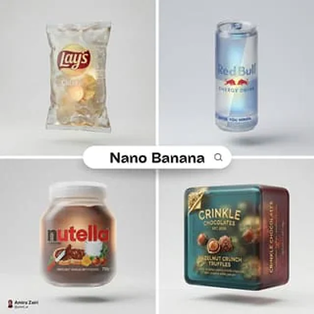

```text
A hyper-detailed 3D frosted translucent glass version of the attached product packaging, maintaining accurate proportions and original colors, semi-transparent material with realistic refraction and soft internal glow, smooth softened corners, subtle surface texture, embossed branding details integrated into the glass, centered on a light gray background, floating gently with a soft shadow below, natural studio lighting, clean minimal layout, high-end product visualization style
```

Model: Nano Banana
Author: Amira Zairi

[ProjectD](https://aitoolsradar.com/en/prompts/5bb759fcf6ef3e) · [Recorded source](https://x.com/azed_ai/status/2039704935194107907)
 · [Full original metadata and byte evidence](data/projectd-batch-0059.json)

## Amira Zairi #871

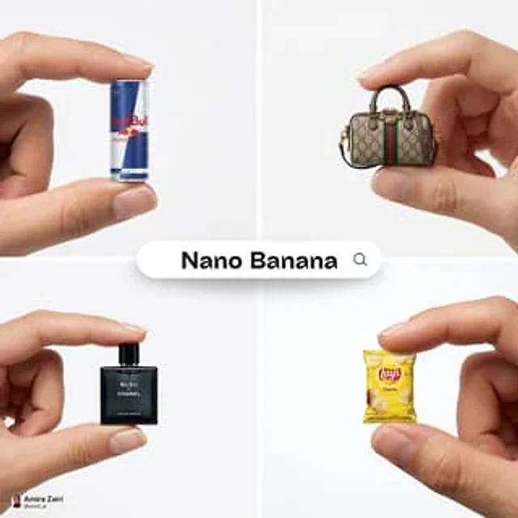

```text
A high-resolution advertising photograph of a realistic, miniature product in the attached image, held delicately between a person's thumb and index finger: clean and white background, studio lighting, soft shadows. The hand is well-groomed, with a natural skin tone, and positioned to highlight the product’s shape and details. The product appears extremely small but hyper-detailed and brand-accurate, centered in the frame with a shallow depth of field. Emulates luxury product photography and minimalist commercial style
```

Model: Nano Banana
Author: Amira Zairi

[ProjectD](https://aitoolsradar.com/en/prompts/58d53ee1eb1b82) · [Recorded source](https://x.com/azed_ai/status/2038616252785303612)
 · [Full original metadata and byte evidence](data/projectd-batch-0059.json)

## Amira Zairi #904

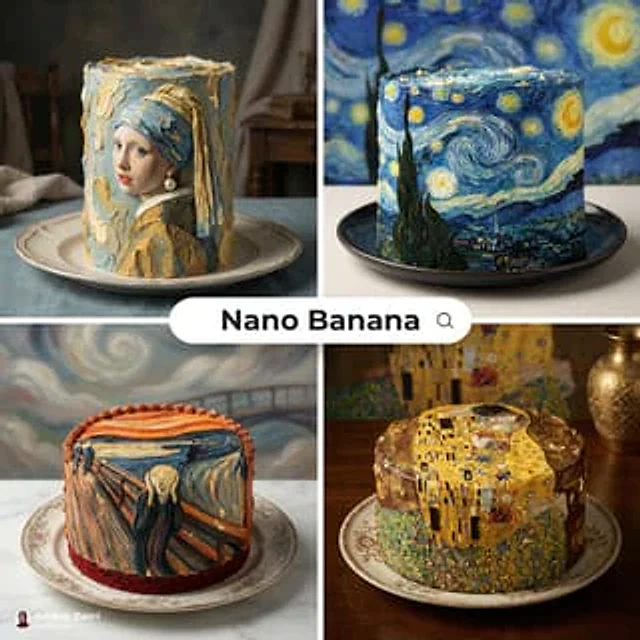

```text
[cake type], hyper realistic food photography, cake decorated to recreate the famous painting [painting name] using buttercream brushstrokes, thick textured piping, impasto frosting swirls, edible gold leaf highlights, color palette matched to the artwork, small painted fondant details, cake on an elegant plate, background set inspired by the same painting, studio lighting with soft shadows, shallow depth of field, ultra detailed, premium patisserie advertising, no text, no watermark, 8k, 1:1
```

Model: Nano Banana
Author: Amira Zairi

[ProjectD](https://aitoolsradar.com/en/prompts/948b4e40547d9d) · [Recorded source](https://x.com/azed_ai/status/2020950596262691284)
 · [Full original metadata and byte evidence](data/projectd-batch-0059.json)

## Amira Zairi #959

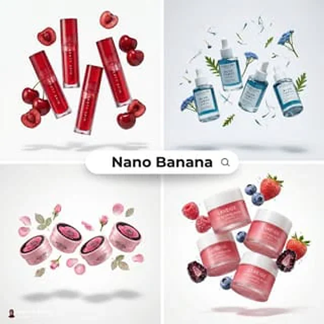

```text
[product], 3–4 identical units of the product floating in mid-air, surrounded by fresh [fruit/vegetable] and sliced pieces that the product is made from, ingredients suspended around the product, dynamic balanced composition, ultra-clean pure white background, no gradients, no color cast, soft studio lighting, realistic soft shadows beneath floating objects, glossy packaging reflections, juicy ingredient textures, premium skincare editorial style, hyper-realistic product photography, macro detail, sharp focus, commercial advertising quality, minimal composition, 8k, 1:1
```

Model: Nano Banana
Author: Amira Zairi

[ProjectD](https://aitoolsradar.com/en/prompts/0941c2da9dd3c8) · [Recorded source](https://x.com/azed_ai/status/2023760359493194030)
 · [Full original metadata and byte evidence](data/projectd-batch-0059.json)

## AmirMušić #1004

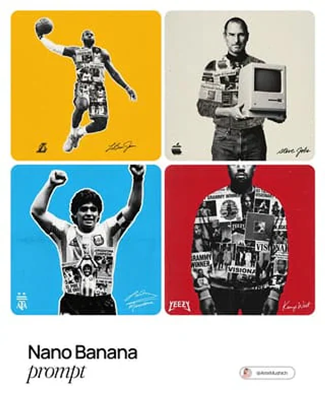

```text
[Lebron James]. Act as a graphic designer specializing in "Modern Vintage" sports and music memorabilia posters.
1. COLOR LOGIC (AUTONOMOUS):
Analyze the Subject: Instantly identify the single most iconic color associated with [PERSON / CHARACTER NAME] (e.g., if Michael Jordan -> Chicago Red; if Prince -> Purple; if Spotify CEO -> Vibrant Green).
The Background: Fill the entire background with this Solid, Vibrant Brand Color.
Texture: Apply a visible Heavy Film Grain overlay to the solid color to kill the digital perfection.
2. CENTRAL COMPOSITION (NARRATIVE SILHOUETTE):
The Container: Place a massive, high-contrast Black & White Cut-Out Photo of [PERSON / CHARACTER NAME] in the center. It can slightly breach the top or side borders (dynamic cropping).
The "Montage" Fill (CRITICAL): The interior of the subject's clothing or body shadows is NOT solid black. It is filled with a Complex Monochrome Collage.
Collage Content: Inside the silhouette, layer smaller, high-contrast photos representing key career milestones, newspaper headlines, famous poses, or relevant machinery/tools associated with them.
Visual Effect: This creates a "Double Exposure" effect where the hero's shape tells their story.
3. PRINT AESTHETIC (HALFTONE & NEWSPAPER):
Halftone Effect: Apply a distinct "Coarse Halftone Dot Pattern" (Newsprint Screen effect) to the entire central figure and collage. The dots should be visible, creating that retro 90s zine/newspaper aesthetic.
Contrast: The image must be strictly Duotone or Tritone (Background Color + Black Ink + White Paper negative space). No full-color photos.
4. FOOTER ELEMENTS (BRANDING):
Bottom Left (Logo): Place a specific Logo or Icon relevant to the subject (e.g., team logo, company logo, or personal symbol).
Size: Small and discrete (approx 15% of width).
Color: High contrast to the background (White or Black).
Bottom Right (Signature): Place the subject's Autograph/Signature.
Logic: If the signature is public domain, simulate the real one. If fictional, generate a believable handwritten script signature.
Color: Same contrast color as the logo.
OUTPUT:
A raw, textured, vintage-style poster design.
```

Model: Nano Banana
Author: AmirMušić

[ProjectD](https://aitoolsradar.com/en/prompts/831f021b46e813) · [Recorded source](https://x.com/AmirMushich/status/2018776000532717836)
 · [Full original metadata and byte evidence](data/projectd-batch-0059.json)

## AmirMušić #1011

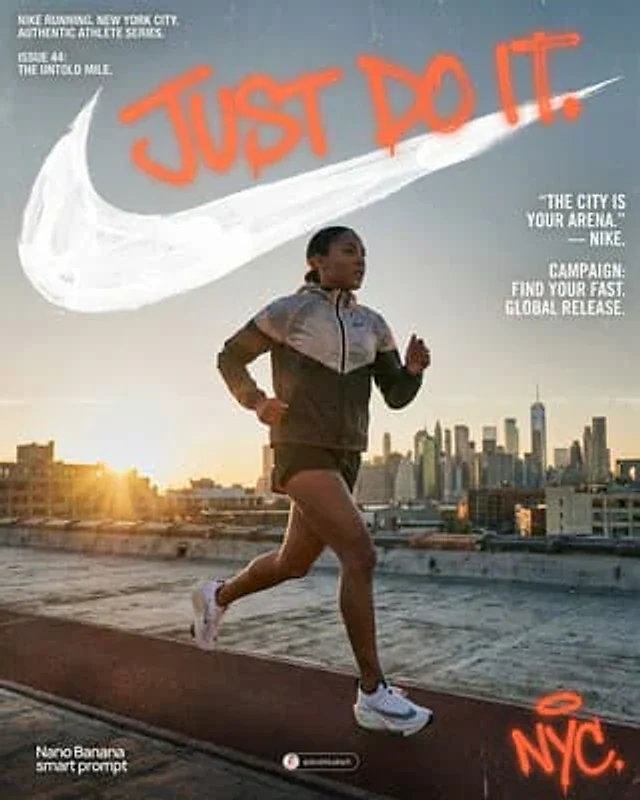

```text
[BRAND NAME]

Act as a Senior Street Culture Art Director and Editorial Designer specializing in authentic underground magazine covers and campaign posters that feel documentary rather than commercial. Your reference universe: Thrasher Magazine, i-D, The Face, Dazed — raw, real, typographically bold.

BRAND INTELLIGENCE SYSTEM

Before executing, resolve: (1) HERO SUBJECT — identify the most authentic human archetype or iconic product moment associated with [BRAND NAME]'s world. Autonomously determine what this looks like based purely on the brand's identity — a person interacting with the brand's hero product in their most natural environment, or the hero product itself as the sole subject if no human archetype is more powerful. The subject must feel like it belongs to this brand's specific world — not borrowed from another brand's cultural universe. Never default to skateboarding, skating, or street sport unless [BRAND NAME] is specifically and primarily a skate brand, (2) ENVIRONMENT — the most iconic real-world location context for [BRAND NAME]'s subject — not a studio, always a real place with atmosphere: a rooftop, a street, a race track, a kitchen, a parking lot, a coastline, a salon, a garage, a runway, (3) BRAND WORDMARK STYLE — identify how [BRAND NAME]'s name would look rendered as a rough hand-painted or chalk brushstroke headline — the texture and character of the lettering must feel native to the brand's specific subculture and communication style, (4) NEON ACCENT COLOR — identify one single neon or highly saturated accent color that feels culturally connected to [BRAND NAME]'s world — this will be used exclusively for the graffiti tag overlay and nowhere else, (5) QUOTE LINE — autonomously generate a short authentic-sounding quote or phrase in [BRAND NAME]'s voice — 4–6 words, raw and real, not corporate, not generic.

PHASE 1: PHOTOGRAPHY BASE

The entire image is built on a real location photograph — not a studio shot, not a white background, not a cyclorama. The environment resolved in the brand intelligence system is the setting. Natural or available light only — no softboxes, no controlled studio lighting. The light should feel like it was taken at golden hour, overcast day, or in existing ambient conditions. Camera angle: dynamic and committed — low angle looking up for power, or a dramatic dutch tilt for tension, never flat eye-level. The subject is captured at peak energy — the single most alive frame of the action or moment. The photograph fills the entire canvas edge to edge with no padding. Color grade: slightly pushed contrast, natural colors preserved, filmic grain, not over-processed. This photograph must feel like it was taken by a photographer who was actually there — not staged, not art directed to death.

PHASE 2: BRAND LOGO BRUSHSTROKE — CRITICAL

Autonomously identify [BRAND NAME]'s primary icon mark or logo symbol — the exact recognizable shape  that represents this brand visually. Render this logo mark as a large hand-painted brushstroke version — as if a skilled street artist took a wide brush loaded with paint and painted the logo freehand on a wall. The shape must be immediately recognizable as [BRAND NAME]'s actual logo geometry — correct proportions, correct silhouette, correct internal details — but executed in a loose, gestural, brush-painted style with visible bristle marks, paint drips, slightly uneven edges, and areas where the paint is thinner and the surface shows through. This is not a clean vector trace — it is a human hand interpreting a logo with a brush. Size: enormous — spanning 70–85% of canvas width, occupying the upper third of the canvas. Color: white or off-white paint — reading clearly against the photograph behind it. The brushstroke logo sits on top of the photograph as an overlay with natural paint transparency in the thinner areas.

PHASE 3: GRAFFITI TAG OVERLAY

One single graffiti element in the NEON ACCENT COLOR resolved in the brand intelligence system. This element is a loose hand-drawn tag, throw-up, or marker scrawl — a secondary word, a symbol, an abstract mark, or a stylized brand-relevant word. It sits on top of everything — over the photograph, over the wordmark, over any other element — as if added last and spontaneously, like someone tagged the poster after it was printed. Placement: partially overlapping the brand wordmark in the upper portion of the image with additional marks or drips extending into the mid-section of the canvas. The neon accent color is used nowhere else in the entire composition — this element owns that color exclusively. The graffiti mark adds rawness and authenticity — it breaks the polish and makes the whole thing feel real.

PHASE 4: TYPOGRAPHY SYSTEM

Four distinct text zones — all small, all restrained, creating an editorial layout grid around the large wordmark and photograph. UPPER LEFT BLOCK: 3–4 lines of very small all-caps or mixed case body text describing [BRAND NAME]'s campaign, collection, or brand context — autonomously generate relevant editorial copy in [BRAND NAME]'s voice. This block sits in the top-left corner, justified left, at footnote scale. TWO LABEL LINES: directly below the upper left block — a campaign name or season on the left, a short descriptor on the right — both in small caps, same scale as body text. RIGHT MID BLOCK: the QUOTE LINE resolved in the brand intelligence system rendered in quotation marks in the right-center area, slightly larger than body text but still small relative to the wordmark. Below the quote: [BRAND NAME] in small caps as attribution. Below that: 3–4 lines of small body copy with [BRAND NAME]'s campaign message — autonomously generate relevant content. LOWER RIGHT DETAIL: a small secondary graffiti-style tag or signature mark in the neon accent color — smaller than the main graffiti element, positioned lower right as a finishing mark.

PHASE 5: OVERALL COMPOSITION

The visual hierarchy reads in this exact order: (1) the photograph and its energy — the eye enters through the action or subject, (2) the massive brushstroke wordmark — confirms the brand, (3) the neon graffiti tag — adds rawness and surprise, (4) the typography blocks — rewards closer reading. The composition must feel like a real magazine cover or a poster wheat-pasted on a wall — not a social media graphic, not a clean digital mockup. Every element has a reason to exist. Nothing is decorative. The rawness is the design.

TECH SPECS

Photography: real location, natural light, peak moment, filmic color grade with visible grain. Wordmark: textured brushstroke or chalk — never clean vector. Graffiti: one neon accent color only, hand-drawn quality, sits on top of all layers. Typography: small, editorial, restrained — maximum 4 text blocks. Color palette: natural photograph tones plus one neon accent color only — no additional colors introduced anywhere. No geometric shapes, no illustrated elements, no icons, no additional graphic overlays beyond what is specified. The graphic language is exclusively photography plus typography plus one graffiti accent. Mood: a poster designed by someone who actually lives in this brand's world — not an agency, not a committee, one person with a strong point of view and complete conviction.

PHOTOGRAPHY TONE — CRITICAL: the subject must be clean, sharp, and well-lit despite the raw editorial aesthetic. Raw and authentic refers to the composition style and location — NOT to dirt, sweat, mud, or degraded appearance of the subject. The person or product must look aspirational and desirable. No dirt. No sweat. No mud. No torn clothing. No gritty degraded appearance. Editorial rawness means honest and unposed — not physically dirty.
```

Model: Nano Banana
Author: AmirMušić

[ProjectD](https://aitoolsradar.com/en/prompts/cfd8e3307ba03b) · [Recorded source](https://x.com/AmirMushich/status/2039795053237858362)
 · [Full original metadata and byte evidence](data/projectd-batch-0059.json)

## AmirMušić #1068

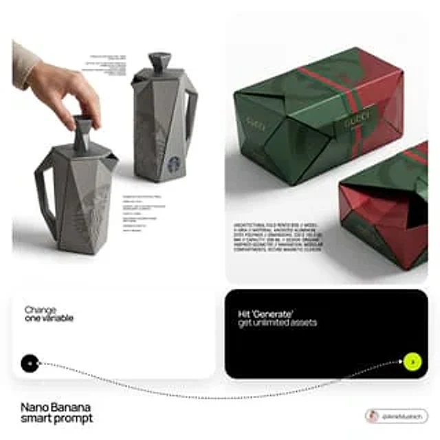

```text
[BRAND NAME]: The core identity.

[CATEGORY]: Clothing / Food / Automotive / Lifestyle.

Goal: Generate a premium industrial design concept on a PURE WHITE background. 

1. INNOVATION & OBJECT

- Select one mundane functional object from [CATEGORY].

- Redesign it using unconventional, architectural, or origami-inspired geometry.

- The object must look like a high-end designer invention, not a standard product.

2. UNIFIED COMPOSITION

- Environment: A seamless, pure white studio background with a flat white floor.

- Interaction: A human hand (natural texture) is shown using the object in the foreground, demonstrating its unique ergonomics.

- Static Display: Right next to the hand, the same object is placed in a static, perfect pose to show its full silhouette and branding.

- Shadows: Soft, realistic grey drop shadows on the white floor to provide depth and ground the objects.

3. BRANDING & TEXT

- Identity: Apply the "[BRAND NAME]" logo in a high-contrast dark color (Black or Navy) directly onto the object's surface.

- Technical Detail: Add small, elegant blocks of justified "specification text" in the white negative space around the objects for an editorial look.

- Pattern: Use a subtle, oversized abstract fragment of the brand's logo as a texture on the object's material.

4. MATERIALS & FINISH

- High-quality matte materials only: heavy-duty recycled paper, sandblasted metal, or soft-touch polymer.

- Sharp architectural lines and clean, premium craftsmanship.
```

Model: Nano Banana
Author: AmirMušić

[ProjectD](https://aitoolsradar.com/en/prompts/6e4face92f3bff) · [Recorded source](https://x.com/AmirMushich/status/2032532246641406264)
 · [Full original metadata and byte evidence](data/projectd-batch-0059.json)

## AmirMušić #1123

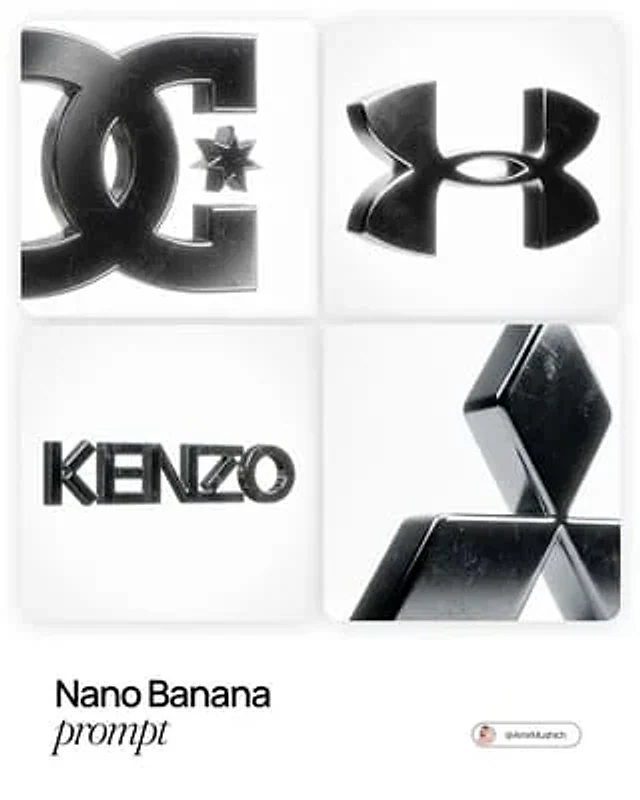

```text
[BRAND NAME], the official trademark logo rendered strictly as a solid 3D object, maintaining the exact original vector shape and proportions without any artistic reinterpretation or distortion. The logo is crafted from dark, highly polished chrome metal with subtle surface micro-scratches and imperfections that break the mirror finish. The object is perfectly centered in a vast, infinite pure white void with no visible background elements or studio equipment. The lighting creates a soft, cinematic bloom (halo effect) along the metallic edges. 50mm lens aesthetic with a shallow depth of field gently blurring the furthest points of the object. A pronounced, visible film grain overlay is applied to the entire image.
```

Model: Nano Banana
Author: AmirMušić

[ProjectD](https://aitoolsradar.com/en/prompts/d02c484d74f0ac) · [Recorded source](https://x.com/AmirMushich/status/2012978382812635204)
 · [Full original metadata and byte evidence](data/projectd-batch-0059.json)

## AmirMušić #1254

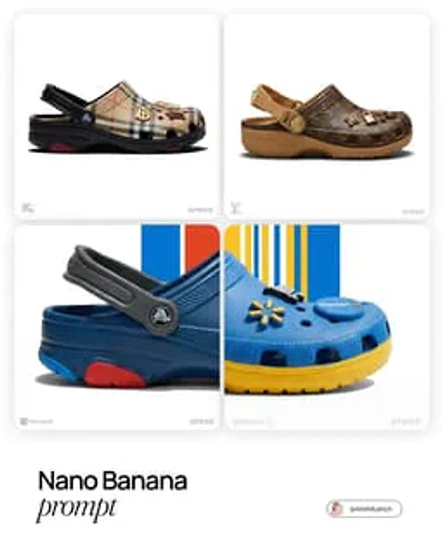

```text
[Louis Vuitton]. Act as a World-Class Footwear Designer and Product Photographer creating a high-end "Crocs Collaboration" campaign image.

1. THE SUBJECT (CUSTOMIZED CROCS CLOG):

Generate a photorealistic, high-end customized Crocs Classic Clog inspired by the visual identity of [BRAND NAME].

View: The shoe is positioned in a Strict Side Profile View (facing right), exactly like a product profile shot. It must look grounded and substantial.

Color Blocking: Apply [BRAND NAME]'s official color palette intelligently:

Body: The main foam upper is the brand's Primary Color.

Sole/Strap: Use the Secondary/Accent colors for the thick rubber sole unit and the heel strap to create contrast.

Custom Jibbitz (Charms): The shoe is decorated with 3-4 high-quality 3D Jibbitz charms plugged into the ventilation holes. These charms must be iconic symbols or products associated with [BRAND NAME] (e.g., if "Starbucks" -> a tiny frappuccino cup and logo; if "Nike" -> a 3D swoosh).

2. THE BACKGROUND ():

The background is a Pure White Studio Space (#FFFFFF).

3. LIGHTING & MATERIALITY (EDITORIAL QUALITY):

Lighting: Ultra-realistic High-Key Studio Lighting. Use a large softbox from the top-left to create smooth, glossy highlights on the rubber curves of the Crocs. The lighting is bright, neutral, and expensive.

Texture: The material must look like real Croslite foam resin—matte with subtle specular highlights on the edges. The Jibbitz charms should look like hard glossy plastic or rubber.

Shadows: A sharp, realistic contact shadow under the shoe to ground it on the white floor.

4. BRANDING & LAYOUT (UI ELEMENTS):

Bottom Left Corner: Place a small, discrete, Monochrome Light Grey Logo of [BRAND NAME].

Bottom Right Corner: Place a small, discrete, Monochrome Light Grey "Crocs" Logo.

TECH SPECS:

Macro product photography, Phase One camera, 100mm lens, razor-sharp focus, 8k resolution, uncompressed, commercial look.
```

Model: Nano Banana
Author: AmirMušić

[ProjectD](https://aitoolsradar.com/en/prompts/87b5db5391f1f1) · [Recorded source](https://x.com/AmirMushich/status/2013325907843219831)
 · [Full original metadata and byte evidence](data/projectd-batch-0059.json)

## AmirMušić #1266

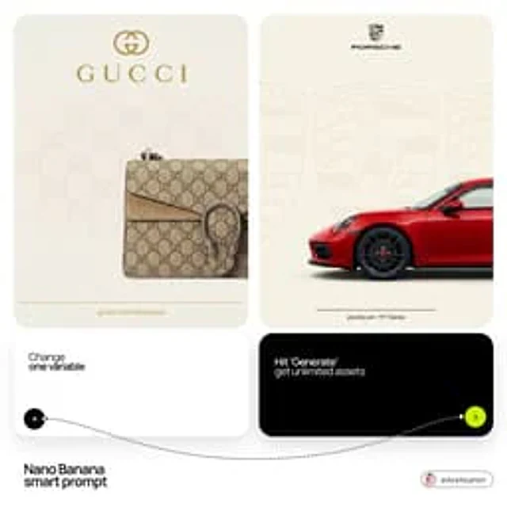

```text
[BRAND NAME] + [PRODUCT] 

Act as a Senior Luxury Fashion Art Director and Studio Photographer specializing in high-end product key visuals for flagship campaigns, e-commerce editorials, and mobile-first brand content.

PHASE 1: FORMAT & CANVAS
Vertical format, 9:16 aspect ratio. Canvas background: a single flat field of warm off-white — not pure white, not grey. Target tone: soft ivory cream (#F4EFE6 equivalent), uniform and completely shadowless 
 across the entire background plane.
Autonomously determine [BRAND NAME]'s signature background tone — if the brand has a recognized house color for its packaging, tissue paper, or  lookbook backgrounds, shift the canvas toward that specific off-white or neutral. The result must feel like an official brand document, not a generic studio.

PHASE 2: BACKGROUND PATTERN (WATERMARK LAYER)

Autonomously identify [BRAND NAME]'s iconic surface pattern, monogram, or archival motif — examples: a house monogram, toile print, geometric logo repeat, heritage emblem, or signature textile pattern.
Render this pattern across the entire background canvas as a ghost watermark: same tone as the background but with a slight value shift (approximately 8–12% darker 
or lighter than the base). The pattern must be large in scale — individual motifs spanning 15–25% of canvas width. Opacity: 10–18% maximum. No hard edges. The pattern should feel embossed or tone-on-tone woven, not printed. It must recede behind all other elements.

PHASE 3: LOGO PLACEMENT

Autonomously reproduce [BRAND NAME]'s official logo with complete fidelity — correct letterforms, proportions, secondary marks (emblems, crowns, stars, monogram icons).
Place the logo centered horizontally in the upper third of the frame (top 30% of canvas). Scale: the logo should span approximately 40–50% of canvas width — prominent but not overwhelming.
Logo rendering: flat 2D, no extrusion, no chrome. Color: autonomously apply [BRAND NAME]'s official logo colorway — the exact brand-standard color(s) used on official packaging and website. If the brand uses a two-tone logo (icon + wordmark in different colors), preserve that hierarchy precisely.
Directly below the main logo mark, place the full [BRAND NAME] wordmark in spaced capital letters — clean, geometric sans-serif, tracking: +200 to +300, 
same brand color, optical size approximately 60% of logo height. No decorative elements between logo and wordmark.

PHASE 4: PRODUCT PLACEMENT

Render [PRODUCT] as a photorealistic studio object with maximum material fidelity:
— Leather: visible grain, pore structure, stitching thread texture, realistic edge paint.
— Hardware: gold or silver metal with micro-reflections, not flat.
— Canvas/fabric: woven fiber detail, not smooth CG.
— All brand-specific surface patterns on the product must be accurate and legible.
Placement: the product enters the frame from the bottom-right corner at a natural 25–35 degree angle, as if casually placed or mid-motion. The product is cropped — only 60–75% of the object is visible 
within the frame. The crop should feel intentional and editorial, not accidental. The product occupies the lower 55–65% of the canvas.
The product must feel physically present in the space — not floating. Cast an extremely soft, barely visible contact shadow (opacity 8–12%) on the canvas beneath the nearest edge. No hard drop shadows.

PHASE 5: LIGHTING

Lighting: simulated large north-facing studio window light. Soft, directional, shadowless on the background. Color temperature: 5500–6000K (neutral daylight, slightly cool). 
Key light: large softbox equivalent from upper-left, filling the entire product surface evenly with 
minimal contrast ratio (1.2:1 to 1.5:1 max).
Fill light: large bounce from right side, eliminating all harsh shadows. No rim light. No dramatic contrast. The lighting philosophy is: "the product sells itself — light only reveals, never performs."
Global Illumination enabled for subtle inter-reflections between product surfaces. No specular hotspots on leather — only on metal hardware.

PHASE 6: TYPOGRAPHY & FINISHING

Bottom of frame: a thin horizontal rule line (1px, brand color, 80% canvas width, centered). Below the rule: a single line of micro-copy — a social handle, collection name, or campaign label — in the same clean sans-serif, lowercase or small-caps, minimal tracking. Autonomously generate a contextually appropriate label for [BRAND NAME].

TECH SPECS

Render engine: photorealistic CGI, Keyshot / Octane product visualization aesthetic. Resolution: 9:16, ultra-high detail.
Depth of Field: f/16 equivalent — everything in sharp focus. Zero bokeh. Tack-sharp edges on all product details.Tone mapping: clean, true-to-life. No filmic crush. No vignette. No grain. Color grade: neutral, faithful to real product color. Slight warmth in the ivory background only. No AI-plastic normals on leather or fabric. Microscopic surface imperfection maps required. No reflections on background. No environmental reflections — studio only. Mood reference: Louis Vuitton / Bottega Veneta / Celine official e-commerce and campaign photography standard. Clean enough to be used as a press image.
```

Model: Nano Banana
Author: AmirMušić

[ProjectD](https://aitoolsradar.com/en/prompts/f0a437a0cc55bc) · [Recorded source](https://x.com/AmirMushich/status/2037967998565089736)
 · [Full original metadata and byte evidence](data/projectd-batch-0059.json)

## AmirMušić #1335


```text
[BRAND NAME] design language, object reimagined as an unexpected flagship product of the brand for the next decade. Crafted from signature materials and textures. Distinctive aesthetics, iconic form factor, embodiment of brand philosophy, high-end industrial design.
 
COMPOSITION & STAGING:

The object is floating suspended in mid-air within the studio space (anti-gravity effect). It is positioned strictly dead center in the frame.

Negative Space: There is a wide, generous margin of empty space (air) surrounding the object on all sides.
Framing: The object is fully contained within the image boundaries with absolutely no cropping.

PHOTOGRAPHY:

Professional product photography, soft volumetric lighting, clean light pastel background, ultra-detailed.
```

Model: Nano Banana
Author: AmirMušić

[ProjectD](https://aitoolsradar.com/en/prompts/463912c9966210) · [Recorded source](https://x.com/AmirMushich/status/2017682012987970042)
 · [Full original metadata and byte evidence](data/projectd-batch-0059.json)

## AmirMušić #301


```text
[PERSON NAME]. 
Act as a high-end sports graphic designer creating a conceptual tribute poster. The style is a complex "dual exposure photo-grid composite" with mixed-media textures.
CENTRAL STRUCTURE (THE VESSEL):
The central focus is a large-scale, high-contrast black and white portrait silhouette of [PERSON NAME]. This main portrait acts as the container.
THE GRID FILL & TEXTURES (MIXED MEDIA):
The interior of the silhouette is populated by a dense "photo mosaic grid" of action shots from the person's career.
CRITICAL TEXTURE INSTRUCTION: Do not just paste flat photos. Apply artistic textures to various grid cells to create a tactile, collage feel. Use effects like:
Halftone Dots: Comic-book style raster patterns on some cells.
Fabric/Embroidery: Subtle thread or canvas textures suggesting a jersey or patch.
Film Grain: Heavy noise on specific high-contrast action shots.
COLOR STRATEGY:
The base is Monochrome B&W. Use selective color overlays (relevant to the team/flag) ONLY on specific grid cells to create a rhythm.
TYPOGRAPHY & BRANDING (STRICT MICRO-SCALING):
Top Left (The Name): Write "[PERSON NAME]" strictly using the font Inter Semibold.
Kerning: Tight negative kerning (-4%).
Size: SMALL and discreet. It must occupy MAXIMUM 20% of the canvas width. Do NOT make it large or loud.
Top Right (The Symbol): Place the primary logo (Team/Brand/Flag).
Size: VERY SMALL. It must occupy MAXIMUM 10% of the canvas width.
COMPOSITION & BACKGROUND:
Background: Off-white or light grey with a visible high-quality paper or concrete texture. It should not be flat digital white.
Alignment: Center the figure perfectly. Maintain wide negative space around the object.
```

Model: Nano Banana
Author: AmirMušić

[ProjectD](https://aitoolsradar.com/en/prompts/07c3cea73d1dc5) · [Recorded source](https://x.com/AmirMushich/status/2008976966255337666)
 · [Full original metadata and byte evidence](data/projectd-batch-0059.json)

## AmirMušić #303


```text
[BRAND NAME]: The name of the brand.
Goal: Generate a single, minimalist, and surreal image where a cloud is shaped like the brand's logo.

1. THE LOGO CLOUD
- **Subject**: A massive, photorealistic cumulus cloud in the exact geometric shape of the [BRAND NAME] logo.
- **Texture**: Puffy, soft, and voluminous with natural sunlight illuminating the edges.
- **Volume**: 3D sculptural appearance with realistic shadows within the cloud folds to show depth.

2. ENVIRONMENT & BACKGROUND
- **Sky**: A vast, clear, vibrant blue summer sky.
- **Secondary Elements**: A few small, wispy, natural clouds scattered far in the background to enhance the sense of scale and realism.
- **Lighting**: Bright, direct daylight coming from the side to create high-contrast highlights and shadows.

3. INTEGRATED BRANDING
- **Text**: The word "[BRAND NAME]" written in a clean, bold white sans-serif font.
- **Icon**: A small, flat white version of the brand's logo placed next to the text.
- **Positioning**: The branding (text + logo) is centered at the bottom of the frame, acting as a subtle anchor to the giant cloud above.

4. STYLE
- Surrealist photography, ultra-minimalist composition, high resolution, 8k, cinematic look, clean and airy vibe.
```

Model: Nano Banana
Author: AmirMušić

[ProjectD](https://aitoolsradar.com/en/prompts/e9bdfb765998b6) · [Recorded source](https://x.com/AmirMushich/status/2032908105994961090)
 · [Full original metadata and byte evidence](data/projectd-batch-0059.json)

## AmirMušić #304


```text
Act as a High-End Product Photographer and CGI Artist.

PHASE 1: SUBJECT & LOGIC
Generate a massive, perfectly centered, three-dimensional physical sculpture of the official, unaltered corporate logo for [BRAND NAME]. The sculpture must strictly adhere to the brand’s precise logo geometry and proportions (1:1 from brandbook). The sculpture is suspended in mid-air. Autonomously identify the exact official shape and structure of the [BRAND NAME] logo and render it as a single, flawless glass object without any modifications.
PHASE 2: MATERIALITY (GLASS)
The entire logo is made of hyper-realistic, optical-grade crystal glass (not water, not gel). The material is solid, colorless, and boasts high clarity with a high refractive index. It must look heavy and монолитное (monolithic). The glass structure contains subtle, photorealistic microscopic flaws: fine polished scratches on the surface and minor internal inclusions (dust particles/seed bubbles, very few) to avoid “CGI plastic.” The edges must be precision-beveled and fire-polished.

PHASE 3: ENVIRONMENT & CAUSTICS
The logo is suspended against a strictly clean, bright blue sky with sparse, naturally defined white cumulus clouds. NO land, NO trees, NO palms. The background is purely atmospheric. The focus is entirely on the glass logo. Critically render hyper-realistic, complex glass caustics: intense, sharp patterns of focused light and color (refractions of the blue sky) cast inside and onto the surface of the glass form due to the sunlight passing through it.

TECH SPECS
Rendered with Arnold or Octane. Phase One XF, 120mm Macro lens. Aperture f/5.6 for sharp depth across the entire glass sculpture. Intense, direct sunlight (hard lighting) to maximize caustics. Global illumination, ray-traced refractions (double-sided geometry), and chromatic aberration emulation (subtle) for optical realism. Fine grain film emulation (Fujifilm Velvia 50).
```

Model: Nano Banana
Author: AmirMušić

[ProjectD](https://aitoolsradar.com/en/prompts/9f777edca4b3c7) · [Recorded source](https://x.com/AmirMushich/status/2043027627640799569)
 · [Full original metadata and byte evidence](data/projectd-batch-0059.json)

## AmirMušić #306


```text
[BRAND NAME]. Act as a World-Class Editorial Designer.

PHASE 1: DYNAMIC SUBJECT LOGIC.

- Subject Selection: Autonomously analyze [BRAND NAME].

- Layering (The Sandwich Effect): Interweave the subject with background shapes. Some parts of the car/person must be hidden behind geometric blocks, while other parts (wheels, limbs, props) must overlap them to create 3D depth.

PHASE 2: GRID & GEOMETRY.

- Layout: A clean 2x2 grid composition. 

- Overlays: Superimpose large, bold geometric arcs and circles over the grid. 

- Visual Balance: Place one iconic product prop (e.g., a floating key fob for cars or a ball for sports) in a separate quadrant to balance the subject.

PHASE 3: SOPHISTICATED MUTED PALETTE.

- Color Direction: DO NOT use aggressive neon or oversaturated colors.

- Palette: Identify the core colors of [BRAND NAME] and shift them to a "Sophisticated Muted" spectrum. 

- Tones: Use desaturated, earthy, or "dusty" versions of the brand colors (e.g., instead of hot pink, use dusty rose; instead of bright mint, use sage green; instead of royal blue, use slate blue). 

- Finish: Matte, flat color blocks with zero gradients.

PHASE 4: PHOTOGRAPHY & LIGHTING.

- Subject Style: High-end commercial studio photography.

- Lighting: Soft, diffused studio lighting with gentle highlights. No harsh shadows.

- Integration: The subject must feel physically embedded into the graphic grid.

PHASE 5: MINIMALIST BRANDING.

- Logo: Place a clean, single-color [BRAND NAME] logo in the center of one background block. No taglines, just the iconic symbol.
```

Model: Nano Banana
Author: AmirMušić

[ProjectD](https://aitoolsradar.com/en/prompts/6befd2c2308ede) · [Recorded source](https://x.com/AmirMushich/status/2028115571724660920)
 · [Full original metadata and byte evidence](data/projectd-batch-0059.json)

## AmirMušić #307


```text
[BRAND NAME] | [COLOR]

Act as a 3D Type Designer and CGI Artist working at the intersection of streetwear culture, Y2K aesthetics, and high-end digital sculpture. Your references: Nigo, Futura, Guccimaze, Soulwax art direction.

---

PHASE 1: TYPOGRAPHIC CONCEPT

Render the word or logotype [BRAND NAME] as a fully 3D sculptural object — not a flat text with extrusion, but a living, inflated, organic type sculpture. Style: Wildstyle graffiti DNA fused with inflatable balloon morphology. Letters are not separate — they flow into each other as one continuous organic mass. Each letterform has: bulbous pneumatic body as if inflated under high pressure from within, stretching the surface taut. Aggressive spike extensions — sharp tapered protrusions erupting between and around letters, directional, asymmetric, energetic, some long and blade-like, others short and thorn-like. Wildstyle overlaps — letters partially occlude each other creating depth layers, classic graffiti ambiguity where readability fights with visual complexity. Organic connective tissue — negative spaces between letters filled with stretched membrane forms, like rubber pulled between two inflated surfaces.

---

PHASE 2: MATERIAL & SURFACE

Single unified material across the entire sculpture — no color variation between letters. Material type: high-gloss latex / inflated rubber / soft silicone — the surface behaves like a balloon skin stretched to near-bursting point. Subsurface scattering: active — light penetrates slightly into the material, creating a translucent inner glow at thin edges and spike tips. Thinner areas read lighter, denser volumes read darker. Specular highlights: large, soft, slightly elongated — the kind you get on inflated latex, not hard plastic. Multiple secondary highlights in concave zones. Apply [COLOR] as the sole material color of the entire sculpture — this is non-negotiable. [COLOR] defines the pure midtone of the material. Highlights push toward the most luminous near-white version of [COLOR]. Shadow zones and deep crevices push toward the darkest most saturated version of [COLOR]. The entire chromatic range of the sculpture lives within the [COLOR] family — no hue deviation, no neutral grays.

---

PHASE 3: COMPOSITION & STAGING

Background: pure white (#FFFFFF) — clinical studio isolation. Zero texture, zero gradient. Shadow: none, or absolute minimum contact shadow directly beneath the sculpture — the object appears to float slightly. Orientation: horizontal spread — the sculpture is wider than tall, expanding laterally. Spike elements breach the invisible bounding box on all sides — top spikes reach upward, side extensions push outward. Camera angle: straight-on frontal, slightly elevated 5 to 10° above center — reveals the full typographic mass while showing the 3D depth of overlapping elements. Depth of field: none — sharp from foreground spikes to background letter bodies, every detail in focus. Scale feel: monumental — as if the sculpture is 2 meters wide in physical space, photographed in a white infinity studio.

---

PHASE 4: TECH SPECS

Render engine: Octane Render or Redshift — physically accurate subsurface scattering mandatory. Global illumination: large soft HDRI dome light, neutral white temperature 5500K. No directional shadows. No rim lights. No background elements. Ray tracing: on — for accurate specular and inter-reflection between letter surfaces. Anti-aliasing: maximum — edges must be razor-clean against white background. Output feel: this is a CGI product render, not AI art. Precision over expressionism. Aspect ratio: 1:1 square — centered composition with breathing room on all four sides.
```

Model: Nano Banana
Author: AmirMušić

[ProjectD](https://aitoolsradar.com/en/prompts/1de9fff0751660) · [Recorded source](https://x.com/AmirMushich/status/2043381172646920237)
 · [Full original metadata and byte evidence](data/projectd-batch-0059.json)

## AmirMušić #309


```text
[BRAND NAME] | [HEADLINE] | [SUB-TEXT] | [CTA]. Act as a Senior Art Director.

PHASE 1: INTEGRATED COMPOSITION & OVERLAP.
- Layout: Seamless fusion of 2D graphics and 3D photography.
- Overlap Logic: The subject and their primary "Product Prop" (e.g., a car, a device) must physically overlap the graphic panel to break the "wall" between design and photo.
- Unity: Geometric shapes from the graphic side must bleed into the photographic sky area.

PHASE 2: BRAND & CATEGORY SIMULATION.
Autonomously analyze the [BRAND NAME] and its industry category:
- INDUSTRY CONTEXT: 
  * If Automotive: Include the vehicle and a person interacting with it.
  * If Tech: Include flagship devices/gadgets.
  * If Fashion/Lifestyle: Focus on editorial poses and premium accessories.
- SHAPE SIMULATION: Match shapes to brand identity (e.g., Sharp/Speed for Auto, Minimalist/Grid for Tech).
- COLOR SIMULATION: Use the brand's primary signature hue for both the graphic pattern and the subject's outfit/accents.

PHASE 3: TYPOGRAPHY & CUSTOM CONTENT.
- Headline: Display "[HEADLINE]" in a bold, modern Sans-Serif font. (If [HEADLINE] is empty, generate a high-energy slogan for [BRAND NAME]).
- Sub-headline: Display "[SUB-TEXT]" below the headline.
- Button: Create a minimalist pill-shaped CTA button with the text: "[CTA]".
- Interaction: Text layers should have 3D depth, sitting partially behind the subject or product prop.

PHASE 4: PHOTOGRAPHY & SUBJECT.
- Perspective: Extreme low-angle (worm’s eye view) looking up.
- Subject: A diverse persona reflecting the brand's audience.
- Environment: Massive, clear blue sky as the backdrop.
- Visual Link: Subject's styling must incorporate the Brand's primary color.

PHASE 5: FINAL VISUAL STYLE.
High-end commercial aesthetic. Crisp, saturated, professional fusion of flat vector art and realistic photography.
```

Model: Nano Banana
Author: AmirMušić

[ProjectD](https://aitoolsradar.com/en/prompts/bcfa8f3318b0c0) · [Recorded source](https://x.com/AmirMushich/status/2026316195977146728)
 · [Full original metadata and byte evidence](data/projectd-batch-0059.json)

## AmirMušić #314


```text
[BRAND NAME]. Act as a Senior Editorial Designer and Typographer.

PHASE 1: TYPOGRAPHIC MASK (THE "WINDOW" EFFECT).

- Core Element: Use the most iconic slogan or the name of [BRAND NAME] as a massive, ultra-bold, heavy sans-serif typographic mask.

- Layout: The letters must be giant, filling the entire vertical frame from edge to edge with tight kerning.

- Concept: The text acts as a "cut-out" window. The background is solid white, and the photographic subject is visible ONLY through the letterforms.

PHASE 2: DYNAMIC SUBJECT LOGIC.

- Subject Selection:

- Detail: Ensure a high-contrast element (like a red shoe or a glowing headlight) is visible through one of the letters as a focal point.

PHASE 3: SOPHISTICATED MUTED PALETTE.

- Atmosphere: Use a "Refined Muted" color scheme.

- Tones: Soft slate blues, charcoal greys, and creamy off-whites for the photography inside the mask.

- Accent: Identify one sharp, saturated accent color belonging to [BRAND NAME] and apply it to a single key object visible through the text.

PHASE 4: PHOTOGRAPHY & LIGHTING.

- Lighting: Soft-box studio lighting. Diffused shadows and gentle highlights to create a cinematic, high-end editorial feel.

- Finish: Clean, matte texture with zero visual noise. High-definition photographic quality.

PHASE 5: MINIMALIST BRANDING.

- Accents: Add a tiny minimalist logo and a small vertical tagline in a clean, microscopic sans-serif font near the corners.

- Year: Include the year "2026" in a subtle, elegant font to mimic a limited-edition look.
```

Model: Nano Banana
Author: AmirMušić

[ProjectD](https://aitoolsradar.com/en/prompts/7ecc3c380eb6a0) · [Recorded source](https://x.com/AmirMushich/status/2027798913516761522)
 · [Full original metadata and byte evidence](data/projectd-batch-0059.json)

## AmirMušić #324


```text
[BRAND NAME]. Act as a Social Media Art Director and Digital Collage Artist specializing in bold, youth-oriented brand content for Instagram and digital campaigns.
PHASE 1: CONCEPTUAL FRAMEWORK
Create a dynamic digital collage that merges fashion photography with graphic design chaos. This is controlled rebellion – a composition that feels spontaneous and energetic while maintaining brand coherence. The aesthetic is anti-polished: torn edges, layered textures, hand-drawn elements, and bold color blocking that screams confidence and movement.
PHASE 2: MODEL & PHOTOGRAPHY
- Subject: One model (diverse casting, age 18-30) in a dynamic, confident pose
- Pose Energy: 80% attitude, 20% natural – sitting, jumping, mid-motion, or power stance (avoid static standing)
- Outfit: Street style/athleisure that aligns with [BRAND NAME] aesthetic – casual but styled
- Hero Product: Feature 1 signature [BRAND NAME] product prominently (sneakers, bag, apparel) – this is the visual anchor
- Photography Style: Editorial fashion cutout – model extracted from background with clean edges
- Camera Angle: Slight low angle to empower subject (hero perspective)
- Crop: Full body or 3/4 body showing hero product clearly
- Background Removal: Model cut out cleanly for layering over collage elements
PHASE 3: COLOR BLOCKING FOUNDATION
- Primary Color Blob: Large organic shape (40-60% of composition) in bold, saturated brand color behind/around model
- Shape Style: Irregular, hand-painted aesthetic – think Photoshop brush strokes or torn paper texture (NOT perfect geometric shapes)
- Color Selection (Autonomous): Choose 1 hero color from [BRAND NAME] palette:
- Texture: Visible brush strokes, grain, or subtle noise (15-25% opacity) – avoid flat digital fills
- Placement: Blob positioned to frame model without obscuring key product details
PHASE 4: GRAPHIC ELEMENTS LAYER
Add 3-5 abstract graphic elements scattered across composition:
- Element Types:
- Color Palette: Use 2-3 accent colors total (main blob color + 1-2 contrasting tones from brand palette)
- Placement: Asymmetric scatter – top-left and bottom-right zones primarily (avoid center crowding)
- Scale: Mix small (5% of canvas) and medium (15% of canvas) elements – nothing overpowering
- Aesthetic: Analog/handmade feel – imperfect circles, rough edges, visible texture
PHASE 5: TYPOGRAPHY INTEGRATION
- Brand Logo: Clean [BRAND NAME] logo placed in upper-left or upper-right quadrant (10-15% of width)
- Slogan/Tagline: If [BRAND NAME] has an iconic slogan, integrate it using:
- Supporting Copy: Optional 1-line descriptor (e.g., "A MOMENT OF YOUR STYLE") in smaller uppercase sans-serif
- Type Treatment: Mix of aligned and slightly rotated text (2-5° angles) for dynamic energy
- Hierarchy: Logo largest → Slogan medium → Copy smallest
PHASE 6: TEXTURE & BACKGROUND
- Base Layer: Off-white or light gray textured background (NOT pure white)
- Texture Options (Autonomous selection):
- Color: RGB 245-250 (near-white with warmth) – maintains brightness while adding depth
- Treatment: Texture should be felt, not seen – enhances tactility without competing with foreground
PHASE 7: COMPOSITION RULES
- Layout: Asymmetric balance – model off-center, graphic elements counter-balance
- Breathing Room: 15-20% negative space (textured background visible) to prevent claustrophobia
- Layering Order: Background texture → Color blob → Graphic elements → Model (cutout) → Typography top layer
- Focal Point: Model + hero product = primary focus (60% visual weight), graphics support (40%)
- Movement: Diagonal lines and angled elements create directional flow (top-left to bottom-right or vice versa)
PHASE 8: BRAND INTELLIGENCE (AUTONOMOUS)
Autonomously adapt composition based on [BRAND NAME] personality:
- Streetwear/Sportswear (Nike, Adidas, Supreme):
- Luxury Streetwear (Balenciaga, Off-White, Gucci):
- Beauty/Lifestyle (Glossier, Fenty, Skims):
- Tech/Modern (Apple, Tesla, Beats):
PHASE 9: SOCIAL MEDIA FOOTER (OPTIONAL)
- Bottom Strip: Clean white or light gray bar at bottom 8-10% of frame
- Content: Social media handles (Instagram, Facebook, Twitter) in small sans-serif
- Layout: Three-column grid with platform icons or text handles
- Aesthetic: Minimal and professional – contrast with chaotic collage above
TECHNICAL SPECS:
- Aspect Ratio: 4:5 (Instagram feed) or 1:1 (square social post)
- Resolution: 2400x3000px minimum (high-quality for zoom and detail)
- Color Mode: sRGB, vibrant saturation (Instagram-optimized)
- File Aesthetic: Digital collage that mimics analog craft (Photoshop + hand-drawn hybrid)
- Model Photography: 85mm lens, f/2.8, shallow depth of field on original shoot (before cutout)
- Style Reference: Nike social campaigns, Spotify wrapped graphics, Gen Z Instagram aesthetics, Hypebeast x streetwear collabs
- Mood: Confident, energetic, youthful, authentic chaos, anti-corporate polish
```

Model: Nano Banana
Author: AmirMušić

[ProjectD](https://aitoolsradar.com/en/prompts/461fc983c304bc) · [Recorded source](https://x.com/AmirMushich/status/2020895358126002197)
 · [Full original metadata and byte evidence](data/projectd-batch-0059.json)

## AmirMušić #325


```text
[BRAND NAME]. Act as a vector illustrator designing a trendy, high-end "Sticker Sheet" set.
THE TASK:
Deconstruct the brand identity of [BRAND NAME] into a playful, cohesive set of approximately 8-10 unique sticker designs arranged on a single sheet.
Content Generation: Do not just make logos. Autonomously invent a mix of:
Mascots/Characters: Stylized busts of people wearing brand-relevant accessories or expressing emotions.
Key Products: Iconic items associated with the brand.
Symbols/Objects: Abstract shapes or tools relevant to the brand's lifestyle.

VISUAL STYLE (MONOLINE VECTOR):
The art style must strictly match "Modern Trendy Line Art."
Line Work: Use a THICK, UNIFORM line weight (monoline) for all internal details. The lines should be smooth, rounded, and confident.
Coloring: The stickers must be filled with Solid Off-White or Cream, utilizing the line color for details. NO gradients, NO shading, NO 3D effects. Flat 2D vector look.
The "Sticker" Effect: Every element must have a thick, distinct White (or Cream) Die-Cut Border surrounding it, separating it from the background.
COLOR PALETTE (HIGH CONTRAST):
Background: A solid, deep, saturated color to create maximum contrast.
Stickers: High-brightness Cream or White fill with Dark (Black or Dark Brown) outlines.
COMPOSITION:
The stickers are scattered naturally across the sheet (knolling layout) with even spacing. No overlapping.
```

Model: Nano Banana
Author: AmirMušić

[ProjectD](https://aitoolsradar.com/en/prompts/e4fcbdf6d360f8) · [Recorded source](https://x.com/AmirMushich/status/2010070395974504565)
 · [Full original metadata and byte evidence](data/projectd-batch-0059.json)

## AmirMušić #328


```text
[BRAND NAME]. Act as a vector illustrator designing a trendy, high-end "Sticker Sheet" set.
THE TASK:
Deconstruct the brand identity of [BRAND NAME] into a playful, cohesive set of approximately 8-10 unique sticker designs arranged on a single sheet.
Content Generation: Do not just make logos. Autonomously invent a mix of:
Mascots/Characters: Stylized busts of people wearing brand-relevant accessories or expressing emotions.
Key Products: Iconic items associated with the brand.
Symbols/Objects: Abstract shapes or tools relevant to the brand's lifestyle.

VISUAL STYLE (MONOLINE VECTOR):
The art style must strictly match "Modern Trendy Line Art."
Line Work: Use a THICK, UNIFORM line weight (monoline) for all internal details. The lines should be smooth, rounded, and confident.
Coloring: The stickers must be filled with Solid Off-White or Cream, utilizing the line color for details. NO gradients, NO shading, NO 3D effects. Flat 2D vector look.
The "Sticker" Effect: Every element must have a thick, distinct White (or Cream) Die-Cut Border surrounding it, separating it from the background.
COLOR PALETTE (HIGH CONTRAST):
Background: A solid, deep, saturated color to create maximum contrast.
Stickers: High-brightness Cream or White fill with Dark (Black or Dark Brown) outlines.
COMPOSITION:
The stickers are scattered naturally across the sheet (knolling layout) with even spacing. No overlapping.
```

Model: Nano Banana
Author: AmirMušić

[ProjectD](https://aitoolsradar.com/en/prompts/82a0df719218a5) · [Recorded source](https://x.com/AmirMushich/status/2009717451710509473)
 · [Full original metadata and byte evidence](data/projectd-batch-0059.json)

## AmirMušić #333


```text
[Create a hand drawn isometric schematic diagram of this street]
```

Model: Nano Banana
Author: AmirMušić

[ProjectD](https://aitoolsradar.com/en/prompts/3af8d981d8c8c1) · [Recorded source](https://x.com/AmirMushich/status/2011441977447911691)
 · [Full original metadata and byte evidence](data/projectd-batch-0059.json)

## AmirMušić #335


```text
[BRAND NAME]. Act as a 3D Product Visualization Artist.

PHASE 1: LOGO TO 3D OBJECT

Take the [BRAND NAME] logo and transform it into a thick 3D sculptural form. Simplify to core shape, add rounded edges (8-12mm fillet), make it one solid piece with 40-60mm depth. Keep it recognizable.

PHASE 2: PINK METALLIC MATERIAL

- Color: Pink metallic (#C85A8E to #8B4A6F range)

- Finish: Glossy brushed metal with fine grain

- Highlights: Light pink (#E89BB8)

- Shadows: Deep plum (#6B3854)

- Roughness: 0.2 (shiny but not mirror)

- NO copper, NO gold, NO silver

PHASE 3: LIGHTING

Soft studio lighting from top-left creating smooth gradient across the object. Light pink on highlights, deep plum in shadows. No hard shadows.

PHASE 4: BACKGROUND & FLOATING

- Pure white background (#FFFFFF)

- Object levitating in white void

- Soft blurred shadow underneath (90% transparent)

- NO pedestals, NO stands, NO supports

PHASE 5: CAMERA

Slight 3/4 angle, looking down 10°, object centered, filling 60% of frame.

TECH SPECS:

- High-quality 3D render (Octane/Cycles)

- 4K resolution

- Full object in focus

- Subtle bloom on highlights

CRITICAL:

- Must be PINK metallic only

- Must float in pure white space

- Must have thick 3D volume with smooth surfaces

- Must look like luxury product photography
```

Model: Nano Banana
Author: AmirMušić

[ProjectD](https://aitoolsradar.com/en/prompts/41d42d65635fcb) · [Recorded source](https://x.com/AmirMushich/status/2034709218549199327)
 · [Full original metadata and byte evidence](data/projectd-batch-0059.json)

## AmirMušić #340


```text
[BRAND NAME] + [METAL COLOR]

Act as a Senior CGI Artist and Brand Identity Director specializing in premium logo materializations. Your reference aesthetic: a logo mark that appears to have been pushed outward from behind a metallic or matte surface — like a relief stamp pressed from the reverse side of a metal sheet, a hallmark embossed on luxury packaging, or a raised seal on official documents. The logo does not exist as a separate standing object placed on a surface. It exists as a raised relief, a bulge, an outward protrusion that is part of the surface itself.

BRAND INTELLIGENCE SYSTEM

Before executing any phase, resolve these parameters: (1) LOGO GEOMETRY — identify [BRAND NAME]'s primary icon mark in its simplest most reduced form — the mark that works at any scale, (2) COLOR PALETTE — based on [COLOR], build the full tonal system from the lightest specular highlight to the deepest shadow tone, determine if the overall mood reads warm, cool, or neutral, (3) SURFACE MATERIAL — based on [COLOR] determine the surface character: silver or grey becomes brushed or circular-grain steel, gold or champagne becomes warm brushed metal with radial grain, black becomes anodized aluminum or matte carbon fiber, white becomes matte ceramic or chalk plaster, any saturated hue becomes anodized colored metal holding the hue in lit areas and desaturating toward black in deepest shadows, (4) LIGHT DIRECTION — determine the most flattering single light angle to reveal the emboss topography — where highlights land on the raised ridge peaks and where shadows fall on the descending walls.

PHASE 1: SURFACE & ATMOSPHERE

The entire image is one single continuous material surface — not a background with an object placed on it, but one unified physical plane filling the entire canvas. This surface is made of the SURFACE MATERIAL resolved above. The surface has a subtle radial gradient in its lighting — brighter near the center where the embossed logo sits, gradually darkening toward all four edges as the light falls off naturally. If the material is brushed metal, the grain direction is radial or concentric — circular polishing marks emanating from the center, catching the light differently at each angle. Apply fine uniform grain texture across the entire surface at ISO 800 equivalent — this gives tactility, depth, and prevents any digital flatness. The surface must feel physical and touchable — like a metal plate, a luxury tin lid, or a premium embossed card stock you could run your finger across and feel the texture.

PHASE 2: THE EMBOSS — CRITICAL

The [BRAND NAME] logo mark is rendered as a full bas-relief — think of a coin, a commemorative medal, or a luxury brand stamp where the ENTIRE logo shape rises as one unified solid mass from the surface. Not just the outline. Not just the stroke path. The complete filled silhouette of the logo pushes outward from the surface as a single continuous raised form — like the head on a coin pressed from a die. The interior of the logo is NOT hollow or open. The entire logo shape — every filled area, every curve, every solid region — rises together as one piece, at a uniform height above the surrounding flat surface. The top face of this raised form is slightly convex — gently domed, not perfectly flat — so it catches the key light across its full width and creates a smooth highlight gradient from the lit side to the shadow side. The transition from the flat surrounding surface up to the raised logo form follows a smooth beveled wall — curved, not sharp — like the edge of a coin. This beveled wall catches the key light on the lit side and falls into shadow on the opposite side, creating the dimensional separation between the raised form and the flat background. Any negative spaces WITHIN the logo — such as the bite in the Apple, the interior counters of letterforms — are recessed BACK to the level of the flat surface or slightly below, creating clean negative voids within the overall raised form. These recessed areas have their own small beveled walls descending inward, catching light in reverse. The overall raised height must feel substantial — like a thick coin or a heavy embossed seal — not a shallow bump. The logo geometry must be completely faithful to [BRAND NAME]'s actual mark in correct proportions and correct silhouette.

PHASE 3: LIGHTING

One primary soft area light from upper-left at approximately 10 to 11 o'clock position — broad and diffused, wrapping around the curved walls of the raised ridge to create the characteristic highlight peak at the top and gradual shadow descent on the far wall. Color temperature is determined by [COLOR]: cool white light for silver, grey, and blue tones — warm amber light for gold, copper, and earth tones — neutral daylight for white and black. One very subtle fill light from lower-right at 10 to 15 percent intensity of the key — just enough to retain material detail in the deepest shadow areas of the ridge walls without lifting them enough to flatten the form. No hard shadows anywhere on the surface. No spotlight pools. No rim light. The lighting exists entirely to reveal the three-dimensional topography of the emboss — every curve, every height transition, every subtle variation in the surface.

PHASE 4: TYPOGRAPHY

In the lower portion of the canvas, below the embossed logo, on the same continuous surface — a minimal typographic lockup. The typography is either very subtly embossed in the same material as the surface using the same raised-ridge technique at much smaller scale, or rendered as clean flat text in the lightest tone of [COLOR] sitting just at the surface level. Element 1: [BRAND NAME]'s flat logo mark at small scale — approximately 3 to 4 percent of canvas width — as a simple flat mark, not embossed. Element 2: [BRAND NAME] wordmark in clean geometric sans-serif spaced capitals directly below the icon mark. Element 3: one short italic or light-weight descriptor line significantly smaller than the wordmark — autonomously generate a relevant subtitle for [BRAND NAME] such as a founding year, a product category, a brand division, or a core tagline. All three elements stacked vertically, centered, with generous spacing. No decorative elements. No lines or rules. Pure typographic restraint.

TECH SPECS

The single most important instruction in this entire prompt: the logo must read as PUSHED OUTWARD FROM the surface, rising toward the viewer, proud and raised. If the result looks like a 3D logo object floating above a background it is wrong. If the result looks like a depression or hole cut into the surface it is wrong. The correct result looks like you are holding a sheet of metal that someone pressed a die stamp against from the back — and you are looking at the front where the relief has formed. Ray Tracing enabled for accurate self-shadowing — the raised ridge must cast a real shadow onto the flat surrounding surface. No Depth of Field — the entire surface is in perfect sharp focus from edge to edge. Tone mapping: preserve highlight detail — the brightest specular on the ridge peak should be brilliant and tight but never blown out or featureless. Film grain applied uniformly across the full final render. No chromatic aberration. No lens distortion. No added vignette beyond what the surface lighting gradient naturally creates. Anti-aliasing maximum — the ridge edges must be perfectly clean. Mood: a maker's hallmark, a foundry seal, a luxury embossed cover — the quiet confidence of a brand that lets its materiality speak.
```

Model: Nano Banana
Author: AmirMušić

[ProjectD](https://aitoolsradar.com/en/prompts/2fd77983740025) · [Recorded source](https://x.com/AmirMushich/status/2045580765136920938)
 · [Full original metadata and byte evidence](data/projectd-batch-0059.json)

## AmirMušić #349


```text
[BRAND NAME]

Act as a Macro Product Photographer and Textile Art Director shooting a close-up editorial campaign of a premium embroidered garment. References: Loro Piana fabric campaigns, Brunello Cucinelli texture photography, A.P.C. garment detail shoots, Japanese boro textile documentation.

PHASE 0: BRAND LOGO INTELLIGENCE

Retrieve the canonical logotype or primary mark of [BRAND NAME] from training data. Identify the core geometric essence of the logo — its fundamental shapes, stroke relationships, and compositional balance. Translate this identity into an embroidery-native form language: sharp geometric elements become satin stitch bars and needle-point spikes, circular elements become dense satin stitch ovals or French knot clusters, complex letterforms are simplified into their most essential strokes while remaining recognizable. The embroidery interpretation must feel like a deliberate premium interpretation of the brand mark — as if [BRAND NAME]'s design team commissioned an embroidery artist to translate their logo into thread. Autonomously determine the thread color most iconic to [BRAND NAME] — this becomes the primary embroidery thread color. If [BRAND NAME] has no dominant single color, default to deep navy #1A2332.

PHASE 1: TEXTILE BACKGROUND

The background is a premium waffle-knit cotton fabric — the weave structure is a precise geometric grid of raised square cells, each cell approximately 2×2mm equivalent, separated by thin recessed channels running both horizontally and vertically. The raised nodes of each cell are flat-topped, not rounded — creating a regular orthogonal relief pattern across the entire surface. The fabric color is cold off-white — #F0F0EE to #EBEBEA range, with a very slight cool gray bias, not warm ecru or cream. The weave is consistent and uniform across the entire frame — machine precision, no tension variation, no distortion. Microscopic fiber fuzz is visible on the flat tops of the raised nodes — individual cotton fibers catching the diffused overhead light as a very fine surface bloom. The recessed channels between cells are in soft shadow — not deep shadow, just slightly darker than the raised nodes, consistent with flat overhead illumination.

PHASE 2: EMBROIDERY CONSTRUCTION SYSTEM

The logo mark of [BRAND NAME] rendered as machine or hand embroidery using these specific stitch techniques. Satin stitch: the primary technique for all filled areas and stroke elements — dense parallel threads laid side by side with zero gap, creating a smooth glossy surface. Thread direction follows the long axis of each stroke element — horizontal strokes have horizontal threads, diagonal strokes have diagonal threads. The characteristic sheen of satin stitch is critical: threads catch light along their length creating bright reflective zones on thread-parallel surfaces and darker zones on thread-perpendicular surfaces, creating a directional shimmer across the embroidery surface. Stem stitch or outline stitch: used for any curved linear elements — thin continuous line of overlapping thread segments following curves with natural flexibility. French knots: small circular dot elements rendered as tightly wound thread knots — each knot has a visible spiral wind pattern at macro distance. Spike elements: long tapering needle-like forms executed in satin stitch that tapers from full width to a single thread point — gradual and precise, ending in a razor-sharp thread tip.

Edge treatment: every embroidered element has a thin visible backing outline — 1 to 2 thread widths of the base fabric visible between the embroidery and the surrounding textile. This underlay/backing edge is slightly lighter than the main embroidery thread — it outlines every form and confirms the physical layering of embroidery over fabric.

Physical relief: the embroidery sits 1 to 3mm above the fabric surface — confirmed by a very subtle shadow halo directly underneath each embroidered element. The shadow is symmetrical around the embroidery perimeter, soft-edged, 1 to 2mm wide — consistent with flat overhead illumination, not directional raking light.

PHASE 3: THREAD MATERIAL

Primary thread color: autonomously determined brand color from PHASE 0. Thread material: mercerized cotton or silk embroidery thread — high sheen, smooth filament surface. The thread color is never flat — it shifts in value along its length based on light angle. Directly lit zones approach a lighter more luminous version of the base color. Shadow zones approach a deeper more saturated version. The overall embroidery reads as one unified color but contains a full tonal range within that color family. Secondary thread: the backing/underlay edge thread is 2 to 3 shades lighter than the primary thread — creating the characteristic light outline visible around all embroidered elements.

PHASE 4: COMPOSITION & CAMERA

Camera body: Canon EOS R5 or Nikon Z8 — full frame, 45 megapixel minimum for fabric texture resolution. Lens: Canon RF 100mm f/2.8L Macro IS USM or Nikon Z MC 105mm f/2.8 VR S — used at moderate close-up distance, not at maximum 1:1 magnification. Focus distance: 40 to 55cm — the embroidery fills approximately 30 to 40% of the frame height, leaving generous fabric context on all sides. This is a moderate close-up, not extreme macro — the full embroidery composition is visible with substantial textile surround. Aperture: f/8 to f/11 — deep depth of field, the entire embroidery and all surrounding fabric texture are in crisp simultaneous focus from corner to corner. No visible bokeh anywhere in the frame. Shutter speed: 1/200s with continuous light source. ISO: 100 — base ISO, zero noise, maximum tonal resolution in the subtle gray shadows of the waffle recesses. White balance: 5600K — neutral daylight, renders the cold off-white fabric accurately without warm or cool shift. Exposure: slightly bright ETTR — the off-white fabric renders as a luminous near-white, embroidery thread reads as deep rich dark against the bright ground. Aspect ratio: 4:5 portrait. Camera perpendicular to fabric plane — zero perspective distortion, embroidery geometry rendered faithfully.

PHASE 5: LIGHTING

Primary light: large diffused overhead source — a 120×120cm softbox or diffusion panel positioned directly above the fabric at 60 to 80cm distance. The light is as close to flat and directionless as possible. No raking angle — the light comes from directly above at 85 to 90° to the fabric plane. This flat overhead lighting creates: uniform brightness across the entire fabric field with no hot spots or falloff. Very short soft shadows in the recessed channels of the waffle grid — 1 to 2mm wide, soft-edged, falling straight down. Soft symmetrical micro-shadow halo directly beneath the embroidery — the 1 to 3mm relief creates a subtle darker zone immediately surrounding the embroidery perimeter, equal on all sides. No directional shadow — the shadow is not cast to one side. Secondary light: none. No fill, no rim, no accent. The single large overhead diffused source is the complete lighting setup. Overall mood: clinical, precise, bright — consistent with product documentation or high-end textile editorial photography where the subject must be seen with maximum clarity and zero atmospheric distraction.

PHASE 6: TECH SPECS

Render: Octane Render or Redshift with fiber/textile displacement geometry. Thread geometry: actual 3D cylindrical thread strands — each thread strand is a real geometric object casting real shadows on adjacent threads, not texture maps. Fabric weave: real geometric displacement mesh for waffle structure — not normal map. Ray tracing: on — for accurate micro-shadow casting between individual thread strands and between embroidery and fabric surface. Subsurface scattering: subtle on thread material — mercerized cotton and silk have slight translucency. Depth of field: physically accurate — f/8 to f/11 at 100mm at 40 to 55cm focus distance, full frame sharp corner to corner. Anti-aliasing: maximum. Sampling: minimum 2048 samples — zero noise in shadow zones, full tonal resolution in the off-white fabric field. Output feel: this image should be indistinguishable from a photograph taken with a Canon 100mm macro in a textile documentation studio. The viewer must feel the urge to touch the fabric.
```

Model: Nano Banana
Author: AmirMušić

[ProjectD](https://aitoolsradar.com/en/prompts/8e242683cf2b7c) · [Recorded source](https://x.com/AmirMushich/status/2044829425464656123)
 · [Full original metadata and byte evidence](data/projectd-batch-0059.json)

## AmirMušić #350


```text
[BRAND NAME]. Act as a World-Class Editorial Designer.

PHASE 1: DYNAMIC SUBJECT LOGIC.

- Subject Selection: Autonomously analyze [BRAND NAME].

- Layering (The Sandwich Effect): Interweave the subject with background shapes. Some parts of the car/person must be hidden behind geometric blocks, while other parts (wheels, limbs, props) must overlap them to create 3D depth.

PHASE 2: GRID & GEOMETRY.

- Layout: A clean 2x2 grid composition. 

- Overlays: Superimpose large, bold geometric arcs and circles over the grid. 

- Visual Balance: Place one iconic product prop (e.g., a floating key fob for cars or a ball for sports) in a separate quadrant to balance the subject.

PHASE 3: SOPHISTICATED MUTED PALETTE.

- Color Direction: DO NOT use aggressive neon or oversaturated colors.

- Palette: Identify the core colors of [BRAND NAME] and shift them to a "Sophisticated Muted" spectrum. 

- Tones: Use desaturated, earthy, or "dusty" versions of the brand colors (e.g., instead of hot pink, use dusty rose; instead of bright mint, use sage green; instead of royal blue, use slate blue). 

- Finish: Matte, flat color blocks with zero gradients.

PHASE 4: PHOTOGRAPHY & LIGHTING.

- Subject Style: High-end commercial studio photography.

- Lighting: Soft, diffused studio lighting with gentle highlights. No harsh shadows.

- Integration: The subject must feel physically embedded into the graphic grid.

PHASE 5: MINIMALIST BRANDING.

- Logo: Place a clean, single-color [BRAND NAME] logo in the center of one background block. No taglines, just the iconic symbol.
```

Model: Nano Banana
Author: AmirMušić

[ProjectD](https://aitoolsradar.com/en/prompts/ec75623cb49a76) · [Recorded source](https://x.com/AmirMushich/status/2040806718523748627)
 · [Full original metadata and byte evidence](data/projectd-batch-0059.json)

## AmirMušić #358


```text
Graphic design smart prompt

Generate ad posters in Nano Banana

This prompt generates:
• POV low-angle photo (pointing at viewer)
• Oversized text + brand tagline
• Serial numbers, copyright lines, technical callouts
• Brand-appropriate color blocking and texture

Use case: 
• social media posting,
• influencer collab visuals,
• pitch decks. 

Prompt 👇
```

Model: Nano Banana
Author: AmirMušić

[ProjectD](https://aitoolsradar.com/en/prompts/c68148b20b12b5) · [Recorded source](https://x.com/AmirMushich/status/2025261764795826531)
 · [Full original metadata and byte evidence](data/projectd-batch-0059.json)

## AmirMušić #362


```text
[BRAND NAME]. Act as a Master of Material Science and World-Class 3D Visualizer.
PHASE 1: DYNAMIC ELEMENTAL RECONSTRUCTION.
The central subject is the iconic logo of [BRAND NAME], physically constructed from ANY raw natural element.
CRITICAL: This includes, but is not limited to, botanical elements (flowers, rose petals, thorns, gnarled wood, moss, leaves) and geological/elemental materials (obsidian, crystals, flowing water, ice, volcanic rock).
The logo must be medium-sized, levitating, and rotated at a dynamic 3D angle (3/4 view) to showcase its volume.
PHASE 2: HYPER-TACTILE TEXTURE & REALISM.
The goal is "Sensory Realism" — the viewer should feel they can touch the object.
- If BOTANICAL: Render microscopic cellular structures on petals, dew droplets with refraction, and the velvety fuzz on stems.
- If MINERAL: Render micro-pores, crystalline inclusions, and razor-sharp edges.
Include subtle "imperfections" like dust particles or organic irregularities to break the CG look and achieve 100% photorealism.
PHASE 3: COMPOSITION, LIGHTING & BRANDING.
- ENVIRONMENT: A pure, clinical, solid white background for a High-Key commercial look.
- TYPOGRAPHY: At the top of the frame, place a very small, minimalist [BRAND NAME] text logo in black.
- LIGHTING: Precise studio setup with sharp specular highlights (glints) and a soft, realistic contact shadow on the white floor below to ground the levitating object.
TECH SPECS:
Extreme Macro photography, 100mm lens, f/8, Ray Tracing (Path Tracing), Subsurface Scattering for light depth, 8k resolution, Unreal Engine 5.4 / Octane Render aesthetic.
```

Model: Nano Banana
Author: AmirMušić

[ProjectD](https://aitoolsradar.com/en/prompts/5a03b6dff66602) · [Recorded source](https://x.com/AmirMushich/status/2021588846849282513)
 · [Full original metadata and byte evidence](data/projectd-batch-0059.json)

## AmirMušić #379


```text
[BRAND NAME]: The name of the brand.
Goal: Generate a single, minimalist, and surreal image where a cloud is shaped like the brand's logo.

1. THE LOGO CLOUD
- **Subject**: A massive, photorealistic cumulus cloud in the exact geometric shape of the [BRAND NAME] logo.
- **Texture**: Puffy, soft, and voluminous with natural sunlight illuminating the edges.
- **Volume**: 3D sculptural appearance with realistic shadows within the cloud folds to show depth.

2. ENVIRONMENT & BACKGROUND
- **Sky**: A vast, clear, vibrant blue summer sky.
- **Secondary Elements**: A few small, wispy, natural clouds scattered far in the background to enhance the sense of scale and realism.
- **Lighting**: Bright, direct daylight coming from the side to create high-contrast highlights and shadows.

3. INTEGRATED BRANDING
- **Text**: The word "[BRAND NAME]" written in a clean, bold white sans-serif font.
- **Icon**: A small, flat white version of the brand's logo placed next to the text.
- **Positioning**: The branding (text + logo) is centered at the bottom of the frame, acting as a subtle anchor to the giant cloud above.

4. STYLE
- Surrealist photography, ultra-minimalist composition, high resolution, 8k, cinematic look, clean and airy vibe.
```

Model: Nano Banana
Author: AmirMušić

[ProjectD](https://aitoolsradar.com/en/prompts/9a22311010b7ef) · [Recorded source](https://x.com/AmirMushich/status/2045199443960439023)
 · [Full original metadata and byte evidence](data/projectd-batch-0059.json)

## AmirMušić #388


```text
[BRAND NAME]: Enter the brand name here.
Goal: Generate a minimalist organic image where a stylized logo icon of [BRAND NAME] is transformed into a large moss-textured artifact, with a small brand signature at the bottom.
Constraint: NO TEXT inside or immediately near the central moss icon. Only the bottom signature.

1. THE CENTRAL MOSS ICON
- Main Subject: A large, geometrically precise symbol, sculpted into the exact form of the [BRAND NAME] logo icon.
- Material: The symbol is entirely made of dense, heavily textured, natural green stabilizing moss. The texture is rough and organic with varying shades of green and brown.
- Form: The geometric edges are sharp and clean, but filled with the soft, billowy texture of moss.

2. ENVIRONMENT & LAYOUT
- View: A top-down, central flat lay view.
- Background: A flawless, uniform, matte white studio background. Full minimalist negative space.
- Lighting: Bright, soft, diffused studio lighting that emphasizes the tactile moss texture while minimizing harsh shadows.

3. BOTTOM BRAND SIGNATURE (CRITICAL)
- Placement: A clean horizontal signature block centered at the bottom, far below the moss icon.
- Elements: A tiny, flat, minimalist version of the [BRAND NAME] logo icon on the left.
- Text: The word "[BRAND NAME]" in a clean, bold, black sans-serif typeface immediately to the right of the tiny logo.
- Scale: The signature must be very small compared to the central moss artifact.

4. AESTHETIC
- Biophilic design, premium product photography, clean, fresh, airy, high-end editorial look. 8k resolution.
```

Model: Nano Banana
Author: AmirMušić

[ProjectD](https://aitoolsradar.com/en/prompts/b5ce3b73b15682) · [Recorded source](https://x.com/AmirMushich/status/2033260707525914989)
 · [Full original metadata and byte evidence](data/projectd-batch-0059.json)

## AmirMušić #394


```text
A minimalist, black-and-white flat vector illustration portrait of [NAME], rendered in the expressive "Notion avatar" art style.
LINE WORK & VIBE:
Style: Use THICK, UNIFORM black outlines (monoline weight). The lines should feel organic, smooth, and confident, not rigidly geometric or robotic like generic icons.
Vibe: The character should have a distinct personality and a relaxed, cool, or friendly expression. Focus on stylized features, unique hairstyles, and defining accessories to convey character.
SELECTIVE BLACK FILLS (CRITICAL):
Unlike pure outline icons, utilize Solid Black Fills selectively and strategically.
Where to Fill: Use solid black for prominent hair masses, beards, eyebrows, sunglasses, or dark clothing elements.
Where to Keep White: The skin, main face area, and lighter elements must remain pure flat white inside the thick outlines.
COMPOSITION & TECHNICAL:
No shading, no gray tones, no gradients. Only pure Black and pure White.
Clean bust or headshot composition centered on a white background.
High contrast, clean 2D vector graphics.
```

Model: Nano Banana
Author: AmirMušić

[ProjectD](https://aitoolsradar.com/en/prompts/e8a5c41e9696b5) · [Recorded source](https://x.com/AmirMushich/status/2035793669911896120)
 · [Full original metadata and byte evidence](data/projectd-batch-0059.json)

## AmirMušić #400


```text
[BRAND NAME]
Act as a CGI Optical Physicist and 3D Type Sculptor creating a hero crystal typography visual for a luxury brand campaign. References: James Turrell light installations, optical physics photography, Rick Owens × crystal aesthetics.

PHASE 0: BRAND LOGO INTELLIGENCE

Retrieve the 100% canonical, trademark-accurate logotype of [BRAND NAME] from training data — this is non-negotiable. Reproduce the exact proprietary typeface or custom lettering: every stroke weight, every curve tension, every terminal detail, every unique glyph modification. Do not substitute with a similar font — decode the actual trademarked letterform geometry. If [BRAND NAME] has a primary symbol or emblem — place it above or integrated with the wordmark exactly as in the official logo lockup. Fidelity test: a brand lawyer must recognize this as the correct logo, not an approximation.

PHASE 1: CRYSTAL MATERIAL SYSTEM

The canonical logotype of [BRAND NAME] is a fully 3D sculptural object made entirely of optical crystal glass — not metal, not plastic, not rubber. Material: optical borosilicate glass or synthetic crystal, IOR 1.85 to 2.1, maximum dispersion coefficient. The letterforms have physical volume and thickness — cross-section is consistent throughout each stroke, like letters carved from a single block of optical glass. Surface finish: polished to sub-micron smoothness on primary faces — all major faces mirror-flat and fully refractive. Edges between faces are sharp and precise — maximum chromatic dispersion occurs here. The material is optically pure in its core — zero bubbles, zero inclusions in the interior volume.

CRITICAL — WEAR & IMPERFECTION SYSTEM: The crystal has been handled — it carries the history of physical existence. Apply these surface imperfections with restraint and realism, never overwhelming the dispersion beauty: micro-scratches — a sparse network of hairline scratches on the front and top faces, depth 0.01 to 0.05mm equivalent, visible only when light catches them at specific angles. They scatter light slightly, creating a faint matte haze in the scratch zone while surrounding surface remains mirror-clean. Scratches follow organic directional patterns — some parallel, some crossing, as if from handling and storage, never uniform or grid-like. Edge chips — 2 to 4 very minor edge micro-chips along the sharpest edges and corners, each no larger than 0.5mm equivalent. These tiny imperfections catch light differently than clean edges — they create micro-flare events, small irregular sparkles where a chip breaks the otherwise perfect edge geometry. Surface haze zones — 1 to 2 small irregular areas of very fine surface abrasion, like the glass has been lightly scuffed by contact with another hard surface. These zones appear as subtle frosted patches, 3 to 8% opacity maximum — barely visible, discovered rather than obvious. They slightly diffuse the refraction beneath them, softening the rainbow bands in that micro-zone only. Fingerprint ghosts — optional, extremely subtle — 1 partial fingerprint trace on one face, visible only as a very faint oily interference pattern when light hits at oblique angle. Adds humanity to the object. All imperfections are surface-level only — the interior crystal volume remains optically perfect. The wear says this object is precious and real, not freshly manufactured.

PHASE 2: LIGHT & DISPERSION SYSTEM

Single collimated light source entering from upper-left at 35° — focused, high-intensity, like a precision studio spot or filtered sunlight. As light passes through the crystal letterforms it undergoes full chromatic dispersion — splitting into the complete visible spectrum following Snell's law geometry with maximum physical accuracy. Dispersion behavior on faces: each polished face simultaneously reflects and refracts — where light exits or reflects, a full spectrum appears in strict physical order red → orange → yellow → green → blue → violet. Rainbow bands are sharp and laser-clean at their origin edges, softening and widening as they travel across faces. Micro-scratch zones interrupt the rainbow bands locally — creating fine scattered light filaments branching off the main dispersion paths. Internal reflections: light bounces between letter faces creating crossed and layered rainbow patterns inside the volume — letters glow from within, nearly dark at the core, exponentially brighter toward illuminated faces. Multiple internal reflection paths create 3 to 5 distinct rainbow events visible simultaneously inside each major letterform. Edge glow: every sharp edge emits thin intense white-blue luminous line from total internal reflection — edge chips create micro-flare interruptions at their locations, bright irregular sparkles punctuating the otherwise continuous edge glow. Chromatic aberration at all edges: red fringe on one side, blue-violet fringe on the other — physical dispersion, not decorative filter. The 3/4 angle reveals front face and top face simultaneously — each face receives different dispersion patterns, creating layered optical complexity. Top face rainbow pattern and front face rainbow pattern intersect at the top edge of each letterform, creating a zone of maximum spectral density.

PHASE 3: BACKGROUND

Background: pure absolute black (#000000 to #050505) — a light-absorbing void, no texture, no gradient, no reflected light. The crystal letters float in darkness — no surface beneath, suspended in void. No ambient light reaching the background. The only light in the image exists within and immediately around the letterforms. Dispersed rainbow light creates a very subtle colored haze in the immediate 2 to 4cm radius around each letter — soft spectral glow bleeding into the black void. Beyond that: absolute darkness. The letters are the sole light source in the scene. The micro-scratch haze zones appear as slightly cooler, slightly less luminous areas against the surrounding rainbow glow — their presence is felt rather than explicitly seen.

PHASE 4: COMPOSITION

CRITICAL — 3/4 ANGLE: The logotype is rotated approximately 5 to 10° on the horizontal axis and elevated 5 to 10° on the vertical axis — a subtle, almost-frontal three-quarter view. The rotation is intentionally minimal — just enough to reveal the physical depth and thickness of the crystal letterforms, suggesting three-dimensionality without dramatically departing from a frontal logo presentation. The logo reads as nearly flat but unmistakably three-dimensional. This angle still reveals the top face of letterforms as a thin luminous sliver — enough to catch a secondary dispersion pattern distinct from the front face, adding optical depth without compositional complexity. Horizontal centering maintained. Logo occupies 60 to 70% of frame width. Full lockup visible if [BRAND NAME] has an emblem above or integrated with the wordmark. Aspect ratio: 1:1 square or 4:5 portrait — autonomously determine best fit for [BRAND NAME] lockup proportions. Full sharp focus across the entire sculpture — no depth of field. Every micro-scratch, every edge chip, every rainbow band in crisp simultaneous focus. Detail resolution: the image must reward close inspection — zooming in 400% should reveal new details not visible at normal viewing distance: individual scratch filaments, micro-chip geometry, secondary internal reflections, fingerprint interference patterns.

PHASE 5: TECH SPECS

Render: Octane Render with full caustics enabled at maximum quality settings. Ray tracing: minimum 16 bounces — increased from standard to capture all internal reflection events, secondary dispersion paths, and scratch-scattered light filaments. Dispersion: physically accurate wavelength-dependent IOR — full spectral rendering across visible light range 380nm to 700nm, not a color overlay or post-process effect. Scratch rendering: micro-scratches rendered as actual surface geometry displacement, not normal map approximation — true micro-geometry for physically accurate light scattering. Caustics: on at maximum intensity. Subsurface contribution: minimal — glass is not translucent like skin, but edges and thin stroke areas show faint internal light transmission. Anti-aliasing: maximum — every edge, every scratch filament razor clean. Sampling: minimum 2048 samples per pixel — no noise in the blacks, no grain in the rainbow bands. No post-process glow filters, no color grading, no compositing tricks — everything physically rendered from geometry and light. Output feel: the most detailed and physically accurate crystal typography ever rendered. Every imperfection is intentional. Every photon is accounted for.
```

Model: Nano Banana
Author: AmirMušić

[ProjectD](https://aitoolsradar.com/en/prompts/47b0f9806ce565) · [Recorded source](https://x.com/AmirMushich/status/2043748561729302884)
 · [Full original metadata and byte evidence](data/projectd-batch-0059.json)

## AmirMušić #420


```text
[BRAND NAME].
Goal: Generate a professional mixed-media oil painting on textured canvas where the color palette and graphics are dynamically adapted to the brand identity.

1. BRAND COLOR ADAPTATION
- Analyze the visual identity of [BRAND NAME].
- Use the primary brand color for the two main horizontal impasto strokes.
- Use a contrasting secondary brand color for the thick, raised central dollop of paint.
- Replace the original red and yellow with this new adaptive color scheme.

2. PAINTED SUBJECT & MOTION
- Object: A central, vertically oriented product related to [BRAND NAME], rendered as a cohesive OIL PAINTING directly on the canvas.
- Technique: Apply a "motion blur" oil painting effect with visible horizontal brushstrokes to create a sense of dynamic movement.
- Integration: The object must be part of the painted layer, sharing the same heavy-grain canvas texture as the background, not an overlay.
- Branding: Paint the "[BRAND NAME]" logo using distressed, semi-transparent oil paint layers within the object's silhouette.

3. ADAPTIVE IMPASTO & TEXTURE
- Primary Strokes: Two thick, physical, horizontal impasto oil paint strokes applied over the painted object in the brand's primary color.
- Detail: One heavily textured, raised dollop of the brand's secondary color oil paint placed precisely on the center stroke.
- Surface: Background is a raw, heavy-grain grey textured canvas with visible weave, charcoal smudges, and gesso dabs.

4. BRAND-CENTRIC GRAPHICS
- Handwriting: Use charcoal and graphite to scribble keywords, slogans, and values associated with [BRAND NAME] across the canvas.
- Symbols: Replace the original $ and doodles with hand-drawn, messy abstract icons representing [BRAND NAME].
- Execution: All text and symbols must look like they were scratched or drawn with graphite over the dried oil paint layers.

5. STYLE
- Contemporary mixed-media pop-art. 8K macro photography focusing on the physical thickness of oil paint and the raw canvas grain.
```

Model: Nano Banana
Author: AmirMušić

[ProjectD](https://aitoolsradar.com/en/prompts/9d62c02224fb1e) · [Recorded source](https://x.com/AmirMushich/status/2031083098364858524)
 · [Full original metadata and byte evidence](data/projectd-batch-0059.json)

## AmirMušić #434


```text
[BRAND NAME]. Act as a fashion photographer and creative director shooting a high-end editorial lookbook for a bespoke football jersey designed by this brand.
THE SUBJECT & COMPOSITION (FLOATING & ANGLED):
A single, premium custom football jersey is floating suspended in mid-air, centered in the frame. There is no hanger visible.
Crucial Angle: The jersey is NOT presented flatly frontal. It is rotated slightly (approximately 15 degrees angled view) to show depth, form, and a dynamic profile. Despite floating, the fabric must show realistic weight, deep gravity-defying folds, creases, and natural wrinkles. It must feel like a real, heavy garment frozen in time, not a stiff 3D model.
BRANDED DESIGN & AESTHETICS:
The jersey's design is a sophisticated interpretation of [BRAND NAME]'s visual identity.
Branding Placement: The official [BRAND NAME] logo is authentically applied as the main club crest on the chest (e.g., embroidered patch or high-quality heat transfer).
MATERIALITY & TEXTURE (CRITICAL):
The focus remains on luxurious, tactile textures.
Fabric: A heavyweight, retro-inspired athletic cotton-blend or technical knit with a visible, coarse weave structure.
ENVIRONMENT & BACKGROUND (WHITE STUDIO):
The jersey floats within an abstract, infinite white photo studio cyclorama space. The background is completely seamless, pure, clean white, and minimalist, with absolutely zero distractions, placing total focus on the suspended garment.
LIGHTING & PHOTOGRAPHY STYLE:
Style: Hyper-realistic editorial fashion photography. Clean, high-key aesthetic.
Lighting: sophisticated studio lighting. Soft, diffused light that sculpts the folds of the fabric and highlights the texture against the pure white background. Subtle soft shadows might be cast on the jersey itself to define its form in the white space.
```

Model: Nano Banana
Author: AmirMušić

[ProjectD](https://aitoolsradar.com/en/prompts/c4874c57c10b50) · [Recorded source](https://x.com/AmirMushich/status/2027393294469128313)
 · [Full original metadata and byte evidence](data/projectd-batch-0059.json)

## AmirMušić #442


```text
[PERSON NAME]. 

Act as a high-end sports graphic designer creating a conceptual tribute poster. The style is a complex "dual exposure photo-grid composite" with mixed-media textures.
**CENTRAL STRUCTURE (THE VESSEL):**
The central focus is a large-scale, high-contrast black and white portrait silhouette of [PERSON NAME]. This main portrait acts as the container.
**THE GRID FILL & TEXTURES (MIXED MEDIA):**
The interior of the silhouette is populated by a dense "photo mosaic grid" of action shots from the person's career.
**CRITICAL TEXTURE INSTRUCTION:** Do not just paste flat photos. Apply artistic textures to various grid cells to create a tactile, collage feel. Use effects like:

- **Halftone Dots:** Comic-book style raster patterns on some cells.
- **Fabric/Embroidery:** Subtle thread or canvas textures suggesting a jersey or patch.
- **Film Grain:** Heavy noise on specific high-contrast action shots.
**COLOR STRATEGY:**
The base is Monochrome B&W. Use selective color overlays (relevant to the team/flag) ONLY on specific grid cells to create a rhythm.
**TYPOGRAPHY & BRANDING (STRICT MICRO-SCALING):**
1. **Top Left (The Name):** Write "[PERSON NAME]" strictly using the font **Inter Semibold**.
- **Kerning:** Tight negative kerning (-4%).
- **Size:** SMALL and discreet. It must occupy **MAXIMUM 20%** of the canvas width. Do NOT make it large or loud.
1. **Top Right (The Symbol):** Place the primary logo (Team/Brand/Flag).
- **Size:** VERY SMALL. It must occupy **MAXIMUM 10%** of the canvas width.
**COMPOSITION & BACKGROUND:**
- **Background:** Off-white or light grey with a **visible high-quality paper or concrete texture**. It should not be flat digital white.
- **Alignment:** Center the figure perfectly. Maintain wide negative space around the object.
```

Model: Nano Banana
Author: AmirMušić

[ProjectD](https://aitoolsradar.com/en/prompts/ee5176d28b0bbe) · [Recorded source](https://x.com/AmirMushich/status/2026020385305551182)
 · [Full original metadata and byte evidence](data/projectd-batch-0059.json)

## AmirMušić #443


```text
[BRAND NAME]: Enter the brand name here.
Goal: Generate a hyper-realistic studio photograph where the stylized logo icon of [BRAND NAME] is a physical 3D ice sculpture lying directly on a snowy surface.
Constraint: NO TEXT inside or immediately near the central ice icon. Only the bottom signature. Light, airy background.

1. THE CENTRAL ICE ARTIFACT
- Main Subject: A large, 3D volumetric sculpture in the exact shape of the [BRAND NAME] logo icon.
- Material: Crafted from high-purity crystalline ice with intricate internal textures, frost needles, and frozen air bubbles.
- Details: The surface of the ice logo is covered with small, realistic water droplets and light condensation.
- Perspective: The logo is positioned at a 3/4 angle, lying horizontally on the snow to show its depth and thickness.

2. ENVIRONMENT & LAYOUT
- View: Eye-level macro perspective, 3/4 view.
- Surface: The logo is resting on a field of crisp, detailed, white powdery snow.
- Background: A flawless, uniform, very light pale blue and white gradient background (much lighter than the original).
- Shadow: A soft, realistic shadow is cast on the snow directly beneath the ice icon to ground it.

3. BOTTOM BRAND SIGNATURE (CRITICAL)
- Placement: A clean horizontal signature block centered at the bottom of the frame, far below the ice artifact.
- Elements: A tiny, flat, minimalist black version of the [BRAND NAME] logo icon on the left.
- Text: The word "[BRAND NAME]" in a clean, bold, black sans-serif typeface immediately to the right of the tiny logo.
- Scale: The signature is very small and subtle compared to the main ice sculpture.

4. AESTHETIC
- Premium product photography, cold and crisp atmosphere, hyper-realistic 8k resolution, cinematic lighting, ultra-detailed textures.
```

Model: Nano Banana
Author: AmirMušić

[ProjectD](https://aitoolsradar.com/en/prompts/0b8c07f686e163) · [Recorded source](https://x.com/AmirMushich/status/2033619671522345426)
 · [Full original metadata and byte evidence](data/projectd-batch-0059.json)

## AmirMušić #455


```text
[BRAND NAME] + [COLOR]

Act as a Senior CGI Artist and Brand Identity Director specializing in premium logo materializations. Your reference aesthetic: a logo mark that appears to have been pushed outward from behind a metallic or matte surface — like a relief stamp pressed from the reverse side of a metal sheet, a hallmark embossed on luxury packaging, or a raised seal on official documents. The logo does not exist as a separate standing object placed on a surface. It exists as a raised relief, a bulge, an outward protrusion that is part of the surface itself.

BRAND INTELLIGENCE SYSTEM

Before executing any phase, resolve these parameters: (1) LOGO GEOMETRY — identify [BRAND NAME]'s primary icon mark in its simplest most reduced form — the mark that works at any scale, (2) COLOR PALETTE — based on [COLOR], build the full tonal system from the lightest specular highlight to the deepest shadow tone, determine if the overall mood reads warm, cool, or neutral, (3) SURFACE MATERIAL — based on [COLOR] determine the surface character: silver or grey becomes brushed or circular-grain steel, gold or champagne becomes warm brushed metal with radial grain, black becomes anodized aluminum or matte carbon fiber, white becomes matte ceramic or chalk plaster, any saturated hue becomes anodized colored metal holding the hue in lit areas and desaturating toward black in deepest shadows, (4) LIGHT DIRECTION — determine the most flattering single light angle to reveal the emboss topography — where highlights land on the raised ridge peaks and where shadows fall on the descending walls.

PHASE 1: SURFACE & ATMOSPHERE

The entire image is one single continuous material surface — not a background with an object placed on it, but one unified physical plane filling the entire canvas. This surface is made of the SURFACE MATERIAL resolved above. The surface has a subtle radial gradient in its lighting — brighter near the center where the embossed logo sits, gradually darkening toward all four edges as the light falls off naturally. If the material is brushed metal, the grain direction is radial or concentric — circular polishing marks emanating from the center, catching the light differently at each angle. Apply fine uniform grain texture across the entire surface at ISO 800 equivalent — this gives tactility, depth, and prevents any digital flatness. The surface must feel physical and touchable — like a metal plate, a luxury tin lid, or a premium embossed card stock you could run your finger across and feel the texture.

PHASE 2: THE EMBOSS — CRITICAL

The [BRAND NAME] logo mark is rendered as a full bas-relief — think of a coin, a commemorative medal, or a luxury brand stamp where the ENTIRE logo shape rises as one unified solid mass from the surface. Not just the outline. Not just the stroke path. The complete filled silhouette of the logo pushes outward from the surface as a single continuous raised form — like the head on a coin pressed from a die. The interior of the logo is NOT hollow or open. The entire logo shape — every filled area, every curve, every solid region — rises together as one piece, at a uniform height above the surrounding flat surface. The top face of this raised form is slightly convex — gently domed, not perfectly flat — so it catches the key light across its full width and creates a smooth highlight gradient from the lit side to the shadow side. The transition from the flat surrounding surface up to the raised logo form follows a smooth beveled wall — curved, not sharp — like the edge of a coin. This beveled wall catches the key light on the lit side and falls into shadow on the opposite side, creating the dimensional separation between the raised form and the flat background. Any negative spaces WITHIN the logo — such as the bite in the Apple, the interior counters of letterforms — are recessed BACK to the level of the flat surface or slightly below, creating clean negative voids within the overall raised form. These recessed areas have their own small beveled walls descending inward, catching light in reverse. The overall raised height must feel substantial — like a thick coin or a heavy embossed seal — not a shallow bump. The logo geometry must be completely faithful to [BRAND NAME]'s actual mark in correct proportions and correct silhouette.

PHASE 3: LIGHTING

One primary soft area light from upper-left at approximately 10 to 11 o'clock position — broad and diffused, wrapping around the curved walls of the raised ridge to create the characteristic highlight peak at the top and gradual shadow descent on the far wall. Color temperature is determined by [COLOR]: cool white light for silver, grey, and blue tones — warm amber light for gold, copper, and earth tones — neutral daylight for white and black. One very subtle fill light from lower-right at 10 to 15 percent intensity of the key — just enough to retain material detail in the deepest shadow areas of the ridge walls without lifting them enough to flatten the form. No hard shadows anywhere on the surface. No spotlight pools. No rim light. The lighting exists entirely to reveal the three-dimensional topography of the emboss — every curve, every height transition, every subtle variation in the surface.

PHASE 4: TYPOGRAPHY

In the lower portion of the canvas, below the embossed logo, on the same continuous surface — a minimal typographic lockup. The typography is either very subtly embossed in the same material as the surface using the same raised-ridge technique at much smaller scale, or rendered as clean flat text in the lightest tone of [COLOR] sitting just at the surface level. Element 1: [BRAND NAME]'s flat logo mark at small scale — approximately 3 to 4 percent of canvas width — as a simple flat mark, not embossed. Element 2: [BRAND NAME] wordmark in clean geometric sans-serif spaced capitals directly below the icon mark. Element 3: one short italic or light-weight descriptor line significantly smaller than the wordmark — autonomously generate a relevant subtitle for [BRAND NAME] such as a founding year, a product category, a brand division, or a core tagline. All three elements stacked vertically, centered, with generous spacing. No decorative elements. No lines or rules. Pure typographic restraint.

TECH SPECS

The single most important instruction in this entire prompt: the logo must read as PUSHED OUTWARD FROM the surface, rising toward the viewer, proud and raised. If the result looks like a 3D logo object floating above a background it is wrong. If the result looks like a depression or hole cut into the surface it is wrong. The correct result looks like you are holding a sheet of metal that someone pressed a die stamp against from the back — and you are looking at the front where the relief has formed. Ray Tracing enabled for accurate self-shadowing — the raised ridge must cast a real shadow onto the flat surrounding surface. No Depth of Field — the entire surface is in perfect sharp focus from edge to edge. Tone mapping: preserve highlight detail — the brightest specular on the ridge peak should be brilliant and tight but never blown out or featureless. Film grain applied uniformly across the full final render. No chromatic aberration. No lens distortion. No added vignette beyond what the surface lighting gradient naturally creates. Anti-aliasing maximum — the ridge edges must be perfectly clean. Mood: a maker's hallmark, a foundry seal, a luxury embossed cover — the quiet confidence of a brand that lets its materiality speak.
```

Model: Nano Banana
Author: AmirMušić

[ProjectD](https://aitoolsradar.com/en/prompts/065a0b7900765e) · [Recorded source](https://x.com/AmirMushich/status/2039041297286053931)
 · [Full original metadata and byte evidence](data/projectd-batch-0059.json)

## AmirMušić #463


```text
[BRAND NAME]. Act as a Senior 3D Product Visualization Artist and Cinematic Art Director specializing in luxury brand key visuals for high-end editorial and streetwear campaigns.

PHASE 1: LOGO SUBJECT

Autonomously identify the official, universally recognized logo/logotype of [BRAND NAME]. Reproduce it with maximum fidelity to the original silhouette, proportions, andgeometry — no stylistic distortion, no graffiti interpretation. The logo shape must be instantlyrecognizable as the real [BRAND NAME] mark. Extrude the logo into a solid 3D object with a depth of approximately 15–20% of its height. All surfaces — front face, side extrusion, and beveled edges — must be coated in a single unified material: Surface material: hyper-polished liquid chrome. Reflectance value 0.98 — near-perfect mirror finish. Apply full Ray-Traced environment reflections: the logo must visibly reflect the surrounding sky gradient, flower field, and light sources within its curved and flat surfaces. Bevel radius on all hard edges: moderate
(enough to catch sharp specular highlights). Add Subsurface Scattering on the thinnest structural parts of the logo (fine lines, serifs, icon details) to create a subtle inner glow at the edges.
Place 4–8 prismatic star-shaped lens-flare sparkles (4-point) at the highest specular peaks — corners, tips, and curved peaks of the logo geometry. The sparkles must feel organic, not uniformly distributed. Zero matte surfaces. Zero plastic look. The entire object must read as cast from liquid silver.

PHASE 2: ENVIRONMENT & BACKGROUND

Background: a wide cinematic landscape at the golden-lilac hour (just after sunset). A vast flower field fills the lower third — densely packed lavender and white wildflowers with realistic micro-texture and subtle wind motion-blur on the far clusters. Middle ground fades into soft purple-grey bokeh haze. Sky: gradient from warm blush rose (#E8A0BF) at the horizon through lilac (#C3A6D4) to cool powder blue (#A8C4D8) at the top. Add 3–5 loose silhouetted bird clusters (starlings, small and sharp) scattered across the upper left and right quadrants. Volumetric atmospheric haze
sits on the horizon line. Autonomously shift the environment's color palette to reflect [BRAND NAME]'s iconic brand identity — introduce the brand's signature hue as a tonal wash in the sky gradient or as the dominant flower color in the field. Preserve the overall ethereal, editorial mood. The environment must feel like it was art-directed specifically for this brand — not generic.

PHASE 3: COMPOSITION & LAYOUT

Format: 1:1 square. The chrome logo is centered horizontally and placed at the vertical midpoint — monumental in scale, spanning 65–80% of frame width.Apply a subtle forced perspective tilt (2–4 degrees)
for dynamic energy without distorting logo recognition. The bottom edge of the logo object grazes or slightly overlaps the top of the flower field, integrating the 3D object naturally into the environment. The logo casts a soft diffused shadow downward into the flowers. Lower-left corner: 2–3 lines of micro-copy in clean white sans-serif at minimal optical size. Autonomously generate a poetic 3-line brand statement relevant to [BRAND NAME]'s world, heritage, and aesthetic language. Bottom-left: "[BRAND NAME]" in small caps logotype label. Bottom-right: a secondary flat 2D chrome version of the same logo rendered small as a finishing mark.

PHASE 4: LIGHTING

Primary: large soft area light from upper-left simulating post-sunset overcast sky — fully diffused, no hard shadows, color temperature 5800K with a lilac tint overlay. Secondary: warm rim light (3200K) grazing the bottom and side edges of the logo from behind — creates a golden separation halo between the object and the field. Global Illumination enabled — the chrome logo must realistically bounce and absorb the landscape's ambient color. The flower field's purple tones should be faintly visible in the lower reflective surfaces of the logo. Volumetric god rays faintly visible through any negative space or cutouts within the logo geometry.

TECH SPECS

Render engine: Octane Render aesthetic. Ray Tracing: maximum bounces (16+). Depth of Field: f/11 equivalent — full logo sharp, far background in soft bokeh only. Tone mapping: lifted blacks, compressed highlights, filmic S-curve. Color grade: desaturated midtones, preserved pastels, cool shadow tones. Film grain: subtle (ISO 200 equivalent). Chromatic Aberration: 0.2–0.3px on peripheral logo
edges only. Anti-aliasing: maximum. Strictly no AI-plastic normals. No smooth uniform shading. Microscopic surface imperfections on the chrome required for realism (micro-scratches, 0.5%
roughness noise map). Mood reference: luxury brand retrospective editorial for Highsnobiety or AnOther Magazine.
```

Model: Nano Banana
Author: AmirMušić

[ProjectD](https://aitoolsradar.com/en/prompts/0e25f6f8f903f6) · [Recorded source](https://x.com/AmirMushich/status/2037605625463550080)
 · [Full original metadata and byte evidence](data/projectd-batch-0059.json)

## AmirMušić #475


```text
[BRAND NAME] | [SLOGAN]. Act as a Professional Editorial Art Director.

PHASE 1: PHYSICS & GROUNDING (THE "STABILITY" RULE).
- Analyze [BRAND NAME] category:
  * CATEGORY A (Active/Sports/Fashion): The subject (person) is in a high-intensity leap, detached from the ground, silhouette against the sky.
  * CATEGORY B (Automotive/Heavy Goods): The subject (vehicle) must be HEROICALLY GROUNDED. Place the car firmly on a solid surface (asphalt, concrete, or rock). 
  * Perspective: Use an extreme low-angle (worm's-eye view). The car must look massive and dominant, anchored to the bottom of the frame, towering over the viewer. NO floating or flying for vehicles.

PHASE 2: DYNAMIC PHOTOGRAPHY & LIGHTING.
- Environment: A vast, clear blue sky with minimal soft clouds. 
- Lighting: Natural, direct sunlight. High-contrast shadows on the subject to emphasize form and texture.
- Style: High-end 8k commercial photography. Sharp focus.

PHASE 3: TYPOGRAPHY & LAYOUT (MATTE FINISH).
- Layout: Use the text from "[SLOGAN]" as massive, ultra-condensed bold sans-serif characters.
- Execution: Split "[SLOGAN]" into two parts: one on the far left, one on the far right.
- Depth: A part of the subject (e.g., a bumper, a mirror, or a person's limb) must overlap the letters to create a 3D effect.

PHASE 4: COLOR STRATEGY (MATTE & REALISTIC).
- Graphic Color: NO NEON. Use a solid, matte brand color for the text (e.g., flat Navy for BMW, flat Red for Red Bull). The color must be opaque and non-glowing, resembling high-quality print ink.
- Photo Color: Maintain authentic, rich photographic colors for the subject and the sky. The contrast comes from "Flat Graphic vs. Realistic Photo".

PHASE 5: FINAL BRANDING.
- Logo: Small minimalist [BRAND NAME] logo in the upper corner.
- Metadata: Tiny secondary text in a clean sans-serif font at the bottom for a technical/editorial look.
```

Model: Nano Banana
Author: AmirMušić

[ProjectD](https://aitoolsradar.com/en/prompts/391e5d3f667dbe) · [Recorded source](https://x.com/AmirMushich/status/2027040971016351786)
 · [Full original metadata and byte evidence](data/projectd-batch-0059.json)

## AmirMušić #480


```text
[BRAND NAME]. Act as a Fashion Photographer and Graphic Designer specializing in luxury brand campaign visuals with integrated typography and surreal spatial design.

PHASE 1: SPATIAL CONCEPT

Create a high-fashion editorial image where architecture and graphic design merge into a theatrical stage. The foundation is a bold geometric floor pattern that extends into forced perspective, creating infinite depth and visual drama. This is not a neutral backdrop – the floor is a protagonist that amplifies brand identity through pattern, color, and spatial illusion.

PHASE 2: CHECKERBOARD ARCHITECTURE

- Surface: Checkerboard/geometric tile pattern rendered in brand-relevant colors

- Perspective: Aggressive forced perspective starting from bottom foreground and receding toward horizon (vanishing point at upper third of frame)

- Pattern Logic: Autonomously determine pattern based on [BRAND NAME]:

- Color Palette: Incorporate 2-3 signature colors of [BRAND NAME] into floor pattern while maintaining readability

- Texture: Photorealistic rendering with subtle reflections and shadows for depth

PHASE 3: MODEL & STYLING

- Subject: One fashion model (gender-fluid casting) captured mid-motion – dynamic pose suggesting walking, running, or dancing

- Outfit: Elevated monochrome look (black, white, or brand-neutral tone) to let floor pattern and typography dominate. Include 1-2 key accessories in [BRAND NAME]'s signature color as hero product focal points

- Pose Energy: 70% movement, 30% control – fashion-forward but grounded (avoid floating/unnatural levitation)

- Placement: Model positioned in lower-mid frame, interacting spatially with both floor perspective and typography layer

- Camera Angle: Low-to-mid angle (waist-to-full body shot) to emphasize floor perspective drama

PHASE 4: TYPOGRAPHY INTEGRATION

- Brand Script: Oversized handwritten/script version of [BRAND NAME] rendered as flat graphic element behind or around the model

- Scale: Typography should be 40-60% of frame width – bold and unmissable but not crushing the model

- Color: Signature brand color (autonomously selected), solid fill with clean edges

- Interaction: Typography appears to "sit" in the space – model may partially overlap letters, creating layering hierarchy

- Logo Lockup: Clean, small brand logo centered in upper portion of frame (10-15% of width) in black or brand color

- Treatment: Pure vector aesthetic – no gradients, no shadows, no dimensional effects. Flat color only.

PHASE 5: COLOR ORCHESTRATION (AUTONOMOUS)

Autonomously research and apply [BRAND NAME]'s iconic color system:

- Primary: Identify 1-2 hero brand colors (e.g., Gucci → forest green + red, Tiffany → robin egg blue)

- Application: Use primary colors in floor pattern AND typography for visual cohesion

- Balance: 60% white/neutral space, 30% brand color saturation, 10% black for anchoring

- Accent: Hero product (bag, shoes, accessory) should echo brand color for strategic eye-pull

PHASE 6: LIGHTING & ATMOSPHERE

- Lighting Setup: High-key fashion lighting with soft shadows – think editorial studio quality

- Key Light: 45° front-left to sculpt model, creating gentle shadows on checkerboard

- Fill: Ambient fill to prevent harsh contrast while maintaining drama

- Floor Treatment: Subtle specular highlights on floor tiles for luxury sheen (not glossy/mirror-like)

- Background: Pure white or subtle gradient to white at horizon line – maintains clean editorial feel

PHASE 7: TECHNICAL EXECUTION

- Mood: Playful luxury – sophisticated but not stiff, energetic but refined

- Composition Rule: Dynamic diagonal lines (floor perspective) + vertical anchor (model) + horizontal balance (typography)

- Depth Layers: Background (white) → Typography (mid-ground) → Model (foreground) → Floor pattern (spanning all depths)

- Post-Production: Magazine-cover polish with color grading that enhances brand palette

TECHNICAL SPECS:

- Camera Simulation: Phase One XF IQ4 150MP, 80mm lens, f/5.6 for controlled depth

- Aspect Ratio: 4:5 (Instagram editorial) or 3:4 (print campaign)

- Resolution: 8K output, print-ready sharpness

- Color Space: sRGB with vibrant saturation for digital, slight desaturation for luxury print feel

- Style Reference: Gucci campaigns by Glen Luchford, Prada visuals, Highsnobiety x luxury collabs, Vogue Italia editorials

- Rendering: Photorealistic model and floor, graphic-design-quality typography (hybrid aesthetic)
```

Model: Nano Banana
Author: AmirMušić

[ProjectD](https://aitoolsradar.com/en/prompts/6acc15f543a39a) · [Recorded source](https://x.com/AmirMushich/status/2019779947020026325)
 · [Full original metadata and byte evidence](data/projectd-batch-0059.json)

## AmirMušić #486


```text
[BRAND NAME] + [HERO COLOR]

Act as a Mixed-Media Campaign Art Director. Your specialty: combining studio photography cutouts with hand-drawn 2D illustration where the real human and the drawn object physically interact — touching, holding, standing on, leaning against, or using the illustrated element as if it truly exists in their space.

PHASE 1: CANVAS & COLOR SYSTEM

Format: 1:1 square canvas. Base: single flat saturated color [HERO COLOR]. No gradients. No texture. Pure chromatic field.
Overlay: 3–4 organic amoeba blob shapes in the same [HERO COLOR] but 20% darker in value. Smooth edges, irregular silhouettes, scattered asymmetrically. Some bleeding off-frame.
Hand-painted feel, clean execution.

PHASE 2: AUTONOMOUS OBJECT SELECTION

BEFORE staging the scene, the AI must first  make two autonomous decisions:
DECISION 1 — SELECT THE OBJECT: Analyze [BRAND NAME] and identify ONE iconic physical object from this framework:
— What is the single most recognizable product or artifact this brand has ever made?
— What object do fans of this brand collect, use daily, or photograph?
— What prop has defined this brand's visual identity across decades?
Do NOT choose animals. Do NOT choose logos. Choose a real, large, tangible object that can physically occupy space next to a person.
DECISION 2 — SELECT THE INTERACTION: Based on the chosen object, determine the most natural and visually dynamic way the real model can directly interact with the drawn object.
Interaction must be:
✓ Physical and direct — hands touching, feet on, body leaning, arms around
✓ Immediately readable — the relationship between person and object is understood in under 2 seconds
✓ Scaled correctly — the object must be large enough to interact with at human scale
✓ Active, not passive — the model is DOING something with the object, not just standing next to it
INTERACTION TYPE EXAMPLES (AI selects the most brand-appropriate):
· HOLDING: model's real hands grip the illustrated object — cup, camera, trophy, bottle, bag
· WEARING/USING: model's real body wears or uses the object — sitting on a chair, wearing an illustrated hat, holding an illustrated product to their face
· STANDING ON: model's real feet are planted on top of the illustrated object — skateboard, surfboard, podium, giant sneaker
· RIDING/LEANING: model's real body leans against or drapes over the illustrated object — car hood, shopping cart, giant product silhouette
· EMERGING FROM: model appears to step out of or through the illustrated object — bursting through a giant sneaker box, rising from an illustrated cup

PHASE 3: STAGING THE SCENE

Once object and interaction are selected, stage the full scene:
MODEL:
Single model age 18–26, clean cutout, zero fringing. Pose is determined by the chosen interaction — the body position must make the interaction feel natural and physically believable.
Wardrobe: [BRAND NAME]'s most iconic apparel in [HERO COLOR] monochromatic palette.
ILLUSTRATED OBJECT: Pure white (#FFFFFF) flat 2D illustration. Brush-pen marker line quality, 3–5px weight. Slightly imperfect organic edges — hand-drawn feel, not vector-perfect. NO shading. NO gradients. Flat white fill only.

SCALE RULE — CRITICAL: The illustrated object must be LARGE. Minimum size: 40% of canvas height. The object should feel monumental — oversized relative to real-world scale  is acceptable and encouraged.  A coffee cup can be waist-height.  A sneaker can be as tall as the model. Large scale = better readability =  stronger visual impact.
DEPTH LAYERING — CRITICAL:The object must exist on multiple z-layers:
— Parts of the object sit BEHIND the model
— Parts of the object come IN FRONT of the model
— The model's real hands/feet make contact  at the intersection point
This layering is what makes the scene feel integrated rather than collaged.
BRAND STAMP:
One small [BRAND NAME] logo mark appears on the object's surface — naturally embedded as if printed, engraved, or stitched. Rendered in [HERO COLOR] darker variant. Subtle, not dominant.

PHASE 4: SUPPORTING ILLUSTRATION SYSTEM

All supporting elements: white, flat, brush-pen line style. Same visual language as the hero object.
LOGO MARKS:
[BRAND NAME] primary icon in white:
— Large (upper-left corner, ~15% canvas width)
— Medium (opposite corner, ~10% canvas width)
IMPACT MARKERS: 2–3 manga-style exclamation dash clusters  near the point of interaction between  model and object — where hands grip,  where feet land, where bodies touch. This emphasizes the physical connection.
MOTION LINES: 2–4 curved speed lines radiating from  the object or the model's most active body part. Taper at ends. Cross behind and in front of the model for depth.

GROUND EFFECT: At the base of the scene: white illustrated  ground interaction — sparkle stars,  short speed dashes, or object-specific  effect (splash if cup, dust clouds  if sneaker landing, wheel tracks if skateboard).
AMBIENT SQUIGGLES: 1–2 loose organic white lines floating near the model's torso — visual rhythm connecting the photographic and illustrated layers.

PHASE 5: LIGHTING

Studio strobe, high-key, even and clean. 5500K neutral. No dramatic shadows on model. Soft contact shadow at model's feet (opacity 15%). The photography reads as natural and real  against the graphic illustrated environment.

TECH SPECS

Aesthetic: mixed media — real photograph integrated with hand-drawn 2D illustration. Color count: 3 maximum — [HERO COLOR] light, [HERO COLOR] dark blobs, white illustration. Photography skin tones and fabric colors  are the only additional color exception. Illustration style: Y2K comic energy,  Japanese streetwear magazine, brush marker. Composition: asymmetric and dynamic.  The interaction point between model and  object is the visual center of gravity — everything else orbits around it. No text. No wordmarks. Logo icon only. Mood: the model is not posing WITH the object —  the model is IN THE MIDDLE of using it.  Caught mid-action. Alive.
```

Model: Nano Banana
Author: AmirMušić

[ProjectD](https://aitoolsradar.com/en/prompts/38dd40d63d6af8) · [Recorded source](https://x.com/AmirMushich/status/2038319037248114957)
 · [Full original metadata and byte evidence](data/projectd-batch-0059.json)

## AmirMušić #508


```text
[BRAND NAME] | [HEADLINE] | [SUB-TEXT] | [CTA]. Act as a Senior Art Director.

PHASE 1: INTEGRATED COMPOSITION & OVERLAP.
- Layout: Seamless fusion of 2D graphics and 3D photography.
- Overlap Logic: The subject and their primary "Product Prop" (e.g., a car, a device) must physically overlap the graphic panel to break the "wall" between design and photo.
- Unity: Geometric shapes from the graphic side must bleed into the photographic sky area.

PHASE 2: BRAND & CATEGORY SIMULATION.
Autonomously analyze the [BRAND NAME] and its industry category:
- INDUSTRY CONTEXT: 
  * If Automotive: Include the vehicle and a person interacting with it.
  * If Tech: Include flagship devices/gadgets.
  * If Fashion/Lifestyle: Focus on editorial poses and premium accessories.
- SHAPE SIMULATION: Match shapes to brand identity (e.g., Sharp/Speed for Auto, Minimalist/Grid for Tech).
- COLOR SIMULATION: Use the brand's primary signature hue for both the graphic pattern and the subject's outfit/accents.

PHASE 3: TYPOGRAPHY & CUSTOM CONTENT.
- Headline: Display "[HEADLINE]" in a bold, modern Sans-Serif font. (If [HEADLINE] is empty, generate a high-energy slogan for [BRAND NAME]).
- Sub-headline: Display "[SUB-TEXT]" below the headline.
- Button: Create a minimalist pill-shaped CTA button with the text: "[CTA]".
- Interaction: Text layers should have 3D depth, sitting partially behind the subject or product prop.

PHASE 4: PHOTOGRAPHY & SUBJECT.
- Perspective: Extreme low-angle (worm’s eye view) looking up.
- Subject: A diverse persona reflecting the brand's audience.
- Environment: Massive, clear blue sky as the backdrop.
- Visual Link: Subject's styling must incorporate the Brand's primary color.

PHASE 5: FINAL VISUAL STYLE.
High-end commercial aesthetic. Crisp, saturated, professional fusion of flat vector art and realistic photography.
```

Model: Nano Banana
Author: AmirMušić

[ProjectD](https://aitoolsradar.com/en/prompts/13d05cd7f71b13) · [Recorded source](https://x.com/AmirMushich/status/2040459414084170157)
 · [Full original metadata and byte evidence](data/projectd-batch-0059.json)

## AmirMušić #586


```text
[BRAND NAME]
Act as a High-End CGI Product Photographer and 3D Render Artist
specializing in streetwear merch and limited-edition collectibles.

PHASE 1: CONCEPT & OBJECT

Create a photorealistic CGI product shot of a premium keychain set
suspended in mid-air against a neutral gradient studio background.
The keychain set consists of THREE elements connected to a single
polished silver carabiner clip with a gold-plated split ring:

ELEMENT 1 — ACRYLIC TAG:

A rectangular acrylic charm (approx. 4:9 ratio, rounded corners, 3mm thick).
Layered construction: clear gloss acrylic front panel over a [BRAND NAME]-colored
background insert. The background insert carries bold, condensed all-caps
typography — autonomously generate a short poetic or brand-relevant phrase
(4–8 words) that matches [BRAND NAME]'s tone of voice, set in a heavy
condensed grotesque typeface (Bebas Neue / Impact / custom bold). Include
[BRAND NAME]'s URL or tagline in small print at the bottom of the insert.
Micro-printed fine text fills the lower third as a design texture element.

ELEMENT 2 — OVAL MEDALLION CHARM:

A die-cut oval hoop/ring shape (donut silhouette, 40mm diameter) made from
tinted translucent acrylic or resin. Autonomously determine the iconic
brand color of [BRAND NAME] and apply it as the tint (deep saturated,
jewel-tone translucency — e.g., gold, cobalt, emerald, crimson).
The [BRAND NAME] wordmark is engraved or UV-printed in bold all-caps
along the inner curve of the ring. Add 1–2 small iconographic symbols
(logo mark, globe icon, cloud glyph) laser-engraved onto the face.
Subtle radial sun-ray pattern embossed on the surface.

ELEMENT 3 — HARDWARE:

Silver anodized aluminum carabiner with knurled locking barrel.
Gold-plated brass split ring (key ring loop) at the top.
All metal surfaces show micro-scratches and machining marks —
no perfect CGI plastic. Industrial precision aesthetic.

PHASE 2: MATERIAL & TEXTURE

Render all acrylic elements with full Ray Tracing and Subsurface
Scattering — light must visibly pass through the tinted acrylic
creating internal glow. Apply Fresnel reflection on acrylic edges.
Surface imperfections: hairline scratches, micro-dust particles,
smudge traces on the clear panel (subtle, editorial-level — not dirty).
Metal: PBR metallic workflow — anisotropic specular highlights on
the carabiner barrel, brushed finish on the ring.
Typography on acrylic must appear screen-printed or UV spot-coated —
slight ink texture, not floating.

PHASE 3: COMPOSITION & STAGING

Levitation shot: the entire keychain set hangs suspended from the
top of frame, centered with a 10–15 degree rotation to the right
(showing dimensionality). Nothing touches a surface — pure float.
Camera angle: slightly below eye-level looking up at ~5 degrees,
portrait orientation (4:5 ratio).
Depth of Field: focus plane centered on the oval medallion,
acrylic tag in sharp secondary focus, top hardware with micro
bokeh blur. Aperture equivalent: f/4.0.
Negative space: generous — object occupies 55% of frame.

PHASE 4: LIGHTING

Primary: large octabox soft key light, positioned top-right at
45 degrees — creates clean specular bloom on acrylic edges.
Secondary: subtle rim light from bottom-left, cool temperature
(5500K), separates the object from background.
Background: seamless gradient cyclorama — dark steel blue (#1a2535)
at top transitioning to pale silver-grey (#d0d8e0) at bottom.
No hard shadows cast. Global Illumination active.
Chromatic Aberration: micro-level, visible only on acrylic edges
(adds realism, prevents CGI-plastic look).
No lens flare. No neon. No HDR overblown highlights.

TECH SPECS

Render engine: Octane Render or Blender Cycles (path-traced)
Resolution: 4096 x 5120px (4:5 portrait)
Samples: 4096 minimum
Color profile: Adobe RGB, D65 white point
Post-processing: subtle film grain overlay (ISO 400 equivalent),
+5 clarity, -10 highlights, neutral color grade
Output mood: High-end streetwear lookbook / limited drop product page
Style references: Kith accessories, Highsnobiety product editorial,
Fragment Design merch photography
NEGATIVE: No white studio infinity cove. No flat lay. No hand holding
the product. No fake bokeh blur filters. No AI plastic sheen.
No floating text outside the object.
```

Model: Nano Banana
Author: AmirMušić

[ProjectD](https://aitoolsradar.com/en/prompts/2058c29448fdf2) · [Recorded source](https://x.com/AmirMushich/status/2036519680291049494)
 · [Full original metadata and byte evidence](data/projectd-batch-0059.json)

## AmirMušić #606


```text
[BRAND NAME]. 
Act as a Senior Editorial Designer and Typographer.
PHASE 1: TYPOGRAPHIC MASK (THE "WINDOW" EFFECT).
- Core Element: Use the most iconic slogan or the name of [BRAND NAME] as a massive, ultra-bold, heavy sans-serif typographic mask.
- Layout: The letters must be giant, filling the entire vertical frame from edge to edge with tight kerning.
- Concept: The text acts as a "cut-out" window. The background is solid white, and the photographic subject is visible ONLY through the letterforms.

PHASE 2: DYNAMIC SUBJECT LOGIC.

- Subject Selection:
- Detail: Ensure a high-contrast element (like a red shoe or a glowing headlight) is visible through one of the letters as a focal point.

PHASE 3: SOPHISTICATED MUTED PALETTE.

- Atmosphere: Use a "Refined Muted" color scheme.
- Tones: Soft slate blues, charcoal greys, and creamy off-whites for the photography inside the mask.
- Accent: Identify one sharp, saturated accent color belonging to [BRAND NAME] and apply it to a single key object visible through the text.

PHASE 4: PHOTOGRAPHY & LIGHTING.

- Lighting: Soft-box studio lighting. Diffused shadows and gentle highlights to create a cinematic, high-end editorial feel.
- Finish: Clean, matte texture with zero visual noise. High-definition photographic quality.

PHASE 5: MINIMALIST BRANDING.
- Accents: Add a tiny minimalist logo and a small vertical tagline in a clean, microscopic sans-serif font near the corners.
- Year: Include the year "2026" in a subtle, elegant font to mimic a limited-edition look.
```

Model: Nano Banana
Author: AmirMušić

[ProjectD](https://aitoolsradar.com/en/prompts/0f7fe0c3e583b0) · [Recorded source](https://x.com/AmirMushich/status/2045938770906657274)
 · [Full original metadata and byte evidence](data/projectd-batch-0059.json)

## AmirMušić #609


```text
[BRAND NAME]. Act as a Senior AI Visual Strategist & Creative Director.
Goal: Generate a grid-based brand identity showcase.
PHASE 1: COMPOSITION & LAYOUT
Set the scene on a deep, rich [BRAND PRIMARY COLOR] background. Implement an 8-module grid with rounded corners and thin separation lines.
- Large Modules: Top Left and Bottom Right.
- Small/Medium Modules: Fill the remaining space.
PHASE 2: AUTONOMOUS BRAND LOGIC (THE CORE) [INSTRUCTIONS FOR IMAGEN]:
Analyze the name "[BRAND NAME]".
Determine the industry (e.g., Tech, Luxury, Eco, Automotive, Fashion).
Do NOT default to sports/tennis unless the brand name explicitly requires it.
Adapt all secondary elements (accessories, textures, model's activity) to match this industry.
PHASE 3: MODULE CONTENT (DYNAMIC ADAPTATION)
- MODULE 1 (Exterior): A flagship building façade. Use textured walls in [BRAND PRIMARY COLOR]. Feature a large [BRAND NAME] wordmark and a geometric abstract logo in a contrasting Cream/Beige.
- MODULE 2 (Colors): A vertical swatch panel. Sequence: [BRAND PRIMARY COLOR], Cream, Deep Black, White. Satin finish.
- MODULE 3 & 5 (Core Logo): Detailed close-ups of the brand's unique geometric icon.
- MODULE 4 (Accessory): AUTONOMOUS CHOICE. If [BRAND NAME] is Tech, show a sleek device. If Luxury, show a watch or jewelry. If Eco, show sustainable packaging. Must be in brand colors.
- MODULE 6 (Urban): A street-level mockup on a concrete wall. A person in an all-black outfit walks past a branded panel.
- MODULE 7 (Editorial): A high-end lifestyle shot.
  - Model: Professional, editorial style.
  - Outfit: Premium sweatshirt in [BRAND PRIMARY COLOR] with brand logo.
  - Prop: AUTONOMOUS CHOICE based on industry. (e.g., a leather briefcase for Finance, a camera for Media, a designer bag for Retail).
- MODULE 8 (Specs): Top half: A complex repeating pattern based on the brand logo. Bottom half: Four lines of text " [BRAND NAME] TYPOGRAPHY" in a clean, high-end sans-serif.
PHASE 4: LIGHTING & TEXTURES
- High-End Editorial Photography. No "AI-plastic" look.
- Cinematic soft-box lighting with Rembrandt shadows.
- Micro-details: fabric weave, skin pores, concrete grit, leaf veins.
- Subsurface scattering on organic materials.
PHASE 5: TECH SPECS
8K Resolution, Octane Render style, Ray Traced reflections, subtle film grain.
```

Model: Nano Banana
Author: AmirMušić

[ProjectD](https://aitoolsradar.com/en/prompts/8fe684f92dc6b1) · [Recorded source](https://x.com/AmirMushich/status/2029563852136849515)
 · [Full original metadata and byte evidence](data/projectd-batch-0059.json)

## AmirMušić #610


```text
[BRAND NAME] | [SUBJECT_TOGGLE]. Act as a Lead Graphic Designer.

PHASE 1: ARCHITECTURAL SETTING.

Create a minimalist 2D vector illustration of a vintage-style storefront representing [BRAND NAME]. 

- Autonomously design the facade (Modernist, Industrial, or Classic) to match the brand's heritage.

PHASE 2: SUBJECT LOGIC (TOGGLE SYSTEM).

- If [SUBJECT_TOGGLE] is "OFF": Show only the empty storefront.

- If [SUBJECT_TOGGLE] is "ON": Autonomously add 1-2 characters or a pet that fits the brand's lifestyle.

PHASE 3: DYNAMIC TYPOGRAPHY (CORRECTED).

- Header: Autonomously generate a high-status "Club" or "Community" title based on the nature of [BRAND NAME]. * Examples: For Starbucks — "Coffee Roasters Society"; for Nike — "Elite Runners Club"; for Apple — "Digital Creators Guild". 

- Branding: Place the [BRAND NAME] logo clearly on the storefront awning.

- Contextual Info: Below the awning, add "EST. [REAL FOUNDING YEAR]" and "[REAL ORIGIN CITY]".

PHASE 4: VISUAL STYLE.

- Two-tone palette: [BRAND SIGNATURE COLOR] on a pure white background.

- Style: 1950s-60s Retro Line Art. No gradients, no shadows.

TECH SPECS:

Flat 2D vector, 8k resolution, monochrome aesthetic, centered composition.
```

Model: Nano Banana
Author: AmirMušić

[ProjectD](https://aitoolsradar.com/en/prompts/ed10aac349a87c) · [Recorded source](https://x.com/AmirMushich/status/2024533642555371878)
 · [Full original metadata and byte evidence](data/projectd-batch-0059.json)

## AmirMušić #614


```text
[PERSON NAME]. Act as a graphic designer creating a minimalist, avant-garde streetwear poster.
COMPOSITION (THE FUSION):
The image is a creative fusion of a massive typographic name and a monochrome portrait of [PERSON NAME].
The Subject: A high-contrast, black-and-white full-body or 3/4 cut-out photograph of [PERSON NAME]. The subject stands centrally, looking cool and detached.
The Typography: The person's name is written horizontally across the entire width of the image. The text interacts with the body: the person stands through the letters, creating a "woven" depth effect (some limbs in front of text, some behind), or the portrait creates a silhouette mask for the text.
TYPOGRAPHY STYLE (MIXED SCRIPTS):
Mimic the specific "Street Editorial" font pairing:
The First Letter: The initial letter of the name is rendered in a large, sweeping, expressive Calligraphic Script or Brush font (dynamic and loose).
The Rest of the Name: The remaining letters are rendered in an Ultra-Heavy, Geometric Sans-Serif font (like Impact or Helvetica Black).
Color: The text is solid Dark Grey or Black.
AESTHETICS & ATMOSPHERE:
Palette: Strictly Monochrome (Black, White, and Greyscale).
Background: Pure, vast White Minimalist background. Extensive negative space.
Vibe: Raw, "Zine" aesthetic, cut-and-paste collage feel, high-fashion streetwear poster.
LAYOUT DETAILS:
Add very small, microscopic functional text in the extreme corners (e.g., "poster design", "2025", "fig 01") to enhance the Swiss Design poster feel.
```

Model: Nano Banana
Author: AmirMušić

[ProjectD](https://aitoolsradar.com/en/prompts/28965c83ede51f) · [Recorded source](https://x.com/AmirMushich/status/2011170447434649774)
 · [Full original metadata and byte evidence](data/projectd-batch-0059.json)

## AmirMušić #634


```text
[BRAND NAME]. Act as a Creative Director and Brand Strategist.

PHASE 1: CONCEPT & COMPOSITION.

Create a multi-panel fashion lookbook collage (grid layout) on a clean off-white background. 

- Main Shot: A full-body editorial pose of a model wearing a signature [BRAND NAME] piece. 

- Detail Shots: 3-4 smaller rectangular frames showing macro crops of fabric, hardware, and stitching.

- Autonomously determine the garment type based on the brand's current hype items.

PHASE 2: VISUAL STYLE & TEXTURE.

"High-End Lo-fi" aesthetic. Intense film grain, analog noise, and scanline artifacts. Heavy, premium clothing textures: faded vintage washes, distressed edges, and high-quality "cracked" screen prints. Muted, moody color palette with brand-specific accents.

PHASE 3: DYNAMIC TYPOGRAPHY & LOGIC.

Autonomously analyze the [BRAND NAME] heritage and core identity to generate unique typography.

- Content: Instead of generic "Drop" labels, generate text based on the brand’s DNA: 

- Style: Match the font to the brand's era (e.g., brutalist sans-serif for modern labels, elegant serif for luxury house heritage). Integrate the [BRAND NAME] logo with a distressed, "Xerox-copied" texture.

TECH SPECS:

35mm film look (Kodak Portra 400), f/5.6 for raw sharpness, high ISO grain. High-contrast editorial flash, deep shadows. Octane render quality with an analog scan soul.
```

Model: Nano Banana
Author: AmirMušić

[ProjectD](https://aitoolsradar.com/en/prompts/cc4e1cdb749d26) · [Recorded source](https://x.com/AmirMushich/status/2022753970704286181)
 · [Full original metadata and byte evidence](data/projectd-batch-0059.json)

## AmirMušić #672


```text
A sharp, top-down macro photograph of a single, 
heavily crumpled circular vinyl sticker featuring the official [BRAND NAME] logo.

MATERIAL & TEXTURE (VINYL):
The sticker is made of durable, slight-gloss vinyl material, not paper. It is severely crinkled with sharp, defined ridges and deep stress folds across its entire surface. Unlike soft paper creases, these vinyl wrinkles show plastic stress and catch the light with subtle specular highlights on the peaks of the folds. The edges are slightly curled from wear.
COLOR PALETTE (BRAND DYNAMIC):
The background color of the circular sticker itself is the dominant primary color associated with [BRAND NAME]'s official brand palette (e.g., if Ferrari, red; if John Deere, green). The logo is printed clearly in its standard contrasting color (e.g., white or black).
LIGHTING (STUDIO BRIGHT):
Bright, clean, high-key overhead white studio lighting. This intense lighting creates strong, clean highlights on the vinyl's crumpled ridges and defined, crisp shadows in the valleys, dramatically emphasizing the 3D topography of the damage.
BACKGROUND & COMPOSITION:
The camera is locked in a strict, perfectly parallel top-down flat lay view. The sticker is adhered flat onto a pure white plastic surface which has a subtle, fine granular texture (like bead-blasted plastic) to provide tactile contrast to the smooth vinyl. The entire sticker is in sharp focus.
```

Model: Nano Banana
Author: AmirMušić

[ProjectD](https://aitoolsradar.com/en/prompts/5119e1392db8f9) · [Recorded source](https://x.com/AmirMushich/status/2011878056755966363)
 · [Full original metadata and byte evidence](data/projectd-batch-0059.json)

## AmirMušić #678


```text
[BRAND NAME] | [OBJECT]

Act as a High-End Commercial Product Photographer and Creative Director shooting a luxury editorial campaign (Hypebeast / Highsnobiety /Wallpaper* level).

PHASE 1: BRAND INTELLIGENCE
The hero subject is a [OBJECT] branded for [BRAND NAME]. Autonomously determine [BRAND NAME]'s full visual identity: signature color palette, typographic DNA, logo mark geometry, material language, and cultural positioning. Apply this identity to the [OBJECT] with precision — do not invent a generic brand, decode the real visual codes.

PHASE 2: OBJECT SURFACE & MATERIAL DNA
Regardless of the shape of [OBJECT], apply this material system: Base tone: deep neutral — matte dark graphite, warm charcoal, or matte black. Fine-grain surface micro-texture visible under raking light — powder-coat, matte paper, or brushed material feel. Subtle gradient bloom: the base color dissolves in the lower portion of the object's surface into the brand's most iconic accent color — a soft luminous haze from within the material, not a printed graphic. Logo application: embossed, debossed, or metallic foil relief — catching specular light at edges only. Precise. Restrained. Typography: brand-accurate typeface, small tracking, positioned  with editorial intentionality.

PHASE 3: THE ACCENT BREAKOUT ELEMENT
This is the signature design move — adapt it to the natural geometry of [OBJECT]: Identify the most logical "interruption zone" on [OBJECT] — a seam, edge, band, collar, rim, strap, or wrap point. At this zone, apply a narrow saturated accent element in the brand's most iconic hue — vivid, slightly matte. This element must visually "break out" of the object's boundary — extending, protruding, or wrapping beyond the expected edge, creating a deliberate 3D tension between the object and the detail.The accent element carries a micro-typographic brand detail — tagline, model name, or descriptor — small, precise, tracked.

PHASE 4: STAGING & COMPOSITION
Studio cyclorama. Surface tone: off-white to warm light gray. Background field: cool neutral mid-gray, darker in upper zone. [OBJECT] positioned at 3/4 angle — front face and one secondary surface simultaneously visible. Rule of thirds: object occupies right 60% of frame. Left field: generous negative space — intentional, not empty. Single hard-edged directional shadow cast to the right and slightly downward — crisp penumbra, no diffusion.

PHASE 5: LIGHTING
Single dominant key light: large softbox, camera-left, elevated at 40°. Specular highlight traces the top-left edge of [OBJECT] — revealing material grain. Shadow side: no fill. Darkness earns depth. Subtle ambient bounce from cyclorama floor — lifts shadow by 15%, no more. Accent element receives micro-specular glint along its dominant edge. Mood: Rembrandt chiaroscuro logic applied to product photography. No lens flare. No atmospheric effects.

PHASE 6: TECH SPECS
Lens: 85mm equivalent, f/4.5. Depth of field: object fully sharp, background softened. Chromatic aberration: subtle, at extreme frame edges only — optical realism signal. Film grain overlay: 15% opacity — anti-CGI-plastic treatment. Render: Octane / Ray Tracing quality —subsurface scattering where material demands it, global illumination, physically accurate shadow falloff. Aspect ratio: autonomously determine optimal ratio for this [OBJECT] format.
```

Model: Nano Banana
Author: AmirMušić

[ProjectD](https://aitoolsradar.com/en/prompts/a56b75ab6875b4) · [Recorded source](https://x.com/AmirMushich/status/2046265195434070061)
 · [Full original metadata and byte evidence](data/projectd-batch-0059.json)

## AmirMušić #686


```text
[BRAND NAME] + [COLOR]

Act as a Senior CGI Artist specializing in shrink wrap simulation and 3D material rendering. Your task: render [BRAND NAME]'s complete logo — icon mark AND wordmark if the brand uses one — completely wrapped under a single layer of tight stretched plastic film or shrink wrap. The logo forms are visible only as raised shapes beneath the material, never exposed directly.

BRAND INTELLIGENCE SYSTEM

Before executing, resolve: (1) LOGO GEOMETRY — identify [BRAND NAME]'s complete visual identity mark — this includes both the icon symbol AND the wordmark/logotype if the brand uses them together. Render both elements as they appear in the brand's official lockup. If the brand uses only an icon with no wordmark, render the icon only. If the brand uses a wordmark without an icon, render the wordmark only. Preserve the correct spatial relationship between icon and text as it appears in the real logo, (2) COLOR SYSTEM — based on [COLOR], determine one single monochromatic tone that covers everything in the scene without exception — the wrapped object, the background surface, the film material — pure tonal unity with variation only through light and shadow, (3) FILM CHARACTER — based on [COLOR] determine the stretch film behavior: bright saturated colors become tight latex or glossy shrink wrap with visible tension lines, neutrals become matte stretch film like packaging plastic, darks become semi-transparent vacuum seal film, light colors become frosted cling wrap.

PHASE 1: SCENE & SURFACE

The entire scene is monochromatic — one single color [COLOR] covers every element without exception. The background is the same film material pooling and wrinkling loosely around the central wrapped object — a continuous surface of the same material with natural stress lines, crinkles, and soft folds radiating outward from where the film is pulled tightest over the logo forms. No floor line. No walls. No horizon. Just continuous film material in every direction filling the entire frame.

PHASE 2: THE WRAPPED LOGO — CRITICAL

[BRAND NAME]'s complete logo — resolved in the brand intelligence system — exists as solid three-dimensional inflated forms. Each element of the logo — every letter, every curve of the icon, every geometric element — is volumetrically inflated like a balloon, giving each component roundness and depth. The complete logo lockup sits on the background surface and is covered by a single continuous layer of stretch plastic film pulled tightly from above. The film conforms precisely to every raised logo element — stretching tightly over the peaks of each inflated letter and icon form, creating visible tension stress lines in the film where it is pulled most taut, and releasing into loose crinkled pools of excess material in the gaps between letters, in the negative spaces of the icon, and around the outer perimeter of the logo where the film relaxes back onto the background surface. The entire logo must remain fully legible through the film — every letter readable, the icon identifiable — but no surface of the actual logo is ever directly visible or exposed. Only the film surface exists. The physical behavior of the film must be accurate: tight stretch over high points, stress lines radiating from tension peaks, loose crinkle pools in valleys, the film slightly lifting off the surface in the spaces between raised elements creating small shadow gaps underneath.

PHASE 3: LIGHTING

Large soft area light from upper-left — diffused and broad. The lighting reveals the film's topography: raised logo elements catch more light on their peaks, valleys and gaps between forms fall into progressively deeper shadow, background crinkled film shows its own shadow landscape of stress lines and folds. For glossy or latex film [COLOR]: add subtle specular highlights running along the highest tension points of the film — a tight line of brighter light along the film's most stretched areas. For matte film [COLOR]: no specular, pure diffuse light only. Global illumination on — ambient light fills shadow areas enough to retain detail in the deepest folds without flattening the overall relief.

TECH SPECS

The entire image is one color — [COLOR] — applied to every surface with variation only through light and shadow. No other colors anywhere. No exposed logo surfaces. No additional text beyond what is part of [BRAND NAME]'s actual logo lockup. Film simulation must be physically accurate — real stretch film behavior, real tension dynamics, real crinkle patterns. No fabric look. No cloth drape. This is plastic film — it has different tension behavior than textile: tighter, more stressed, more geometric stress lines, less organic drape. Film grain: ISO 400 equivalent. Mood: a product sealed for shipping, a reveal imminent, the form known but not yet touched.
```

Model: Nano Banana
Author: AmirMušić

[ProjectD](https://aitoolsradar.com/en/prompts/7926ca40008f8b) · [Recorded source](https://x.com/AmirMushich/status/2039404183250522151)
 · [Full original metadata and byte evidence](data/projectd-batch-0059.json)

## AmirMušić #694


```text
[PERSONE]. Act as a Senior Art Director.

PHASE 1: PHOTOGRAPHIC COMPOSITION.

- Layered Effect: Double exposure photographic collage. High-definition action shot in the foreground; massive monumental silhouette in the background.

- Overlap: The subject must seamlessly integrate with the background graphics.

PHASE 2: CONTEXTUAL VIBE SIMULATION.

- Identity Analysis: Autonomously identify the core industry of [PERSONE] (Sport, Music, Cinema, or Business).

- Pose & Props: 

PHASE 3: DYNAMIC COLOR & BRAND SIMULATION (VARIABLE COLORS).

- Primary Color (Atmosphere): Identify the MOST ICONIC color associated with [PERSONE] or their team/brand. Use this for the background, halftone textures, and smoke.

- Accent Color (Impact): Identify a secondary high-contrast VIBRANT hue (e.g., neon, gold, or electric white). Use this for the "Radial Burst" rays.

- Visual Texture: Apply heavy film grain and halftone dots (screen printing effect) to the shadows of the high-res photos.

PHASE 4: GRAPHIC ACCENTS.

- Geometry: Bold radial rays bursting from the center. Fluid, wave-like organic shapes at the base.

- Birds: Minimalist black bird silhouettes for scale and depth.

PHASE 5: BRANDING & TEXT.

- Tagline: Generate a powerful, one-word or two-word slogan tailored to [PERSONE]'s legacy.

- Logo: Place a minimalist, industry-appropriate logo in the bottom corner.

- Typography: Bold, high-impact Sans-Serif.

TECHNICAL FINISH:

- Quality: 8k resolution, authentic commercial photography style (NOT an illustration). 

- Lighting: Extreme studio rim-lighting (contour highlights) to separate the photographic subjects from the graphic layers.
```

Model: Nano Banana
Author: AmirMušić

[ProjectD](https://aitoolsradar.com/en/prompts/9824deee23cd1b) · [Recorded source](https://x.com/AmirMushich/status/2025631713729106049)
 · [Full original metadata and byte evidence](data/projectd-batch-0059.json)

## AmirMušić #699


```text
[BRAND NAME]

Act as a Senior Vector Graphic Designer specializing in Y2K Japanese streetwear badge design. Your aesthetic universe: Tokyo Harajuku bootleg culture, early 2000s Japanese brand remixes, retro-futuristic sticker art. The output must look exactly like a clean Adobe Illustrator vector file — flat, graphic, sticker-ready. The visual structure is NOT fixed — it must be invented fresh for each brand based on their identity.

BRAND INTELLIGENCE SYSTEM

Before executing, resolve all of the following and use them to drive every design decision: (1) PRIMARY COLOR — [BRAND NAME]'s main brand color converted into a pastel or softened Y2K version — still recognizable as the brand but lighter and more kawaii, (2) ACCENT COLOR — [BRAND NAME]'s secondary color pushed to warm saturation — the energetic pop color of the composition, (3) DARK COLOR — a deep dark version of the brand palette — navy, dark brown, deep green, near-black — used for all outlines and extrusions, (4) LETTER CONTENT — [BRAND NAME]'s name in bold lowercase or the most iconic abbreviation, (5) JAPANESE TRANSLITERATION — correct katakana of [BRAND NAME] as a small secondary text element, (6) BRAND ORIGIN FLAG — [BRAND NAME]'s country of origin national flag as a small flat element, (7) BRAND SHAPE LANGUAGE — identify the most iconic geometric or graphic forms from [BRAND NAME]'s visual identity — the shapes, curves, symbols, and structural elements unique to this brand. These shapes become the orbital, background, and decorative elements of the badge — replacing generic ovals with brand-specific geometry, (8) BRAND CULTURAL SYMBOLS — identify 1–2 small iconic objects or symbols from [BRAND NAME]'s world that can be rendered as tiny flat illustrations within the badge — not the logo itself but objects associated with the brand's universe, (9) COMPOSITION LOGIC — based on all resolved parameters above, autonomously design the structural layout of the badge. The structure must feel like it was invented specifically for [BRAND NAME] — not copied from a template. Ask: what shapes from this brand's identity could orbit the letters? What geometry feels native to this brand? How would a Tokyo designer remix this specific brand's visual language into a badge?

PHASE 1: CANVAS

1:1 square canvas. Background: flat off-white or warm light grey. Completely empty. No texture. No gradient.

PHASE 2: BADGE STRUCTURE — FULLY AUTONOMOUS

Using the BRAND SHAPE LANGUAGE and COMPOSITION LOGIC resolved above, design the complete badge structure. The only fixed rules are: the badge must have a central lettering element, surrounding geometric shapes that interact with the letters through z-layer stacking, at least one element that passes both behind and in front of the letters creating depth, and the overall silhouette must read as a unified badge or patch shape. Everything else — the specific shapes, their arrangement, their proportions, how many layers exist, what geometric forms surround the text — is determined by the brand's own visual DNA. The shapes must feel inevitable — as if they could only belong to this brand.

PHASE 3: LETTERING

[BRAND NAME] in large bold lowercase — wide, rounded, confident display typeface. Flat PRIMARY COLOR fill. Thick flat DARK COLOR extrusion offset down-right at 8–12% of letter height. Bold DARK COLOR outline. No gradients. No rendering. The letters are the anchor of the entire composition.

PHASE 4: Y2K SIGNATURE ELEMENTS

These elements appear in every execution — they are the Y2K Japanese badge DNA: SPEED LINES or MOTION TEXTURE — somewhere within the background shapes, parallel lines or radial lines in ACCENT COLOR creating energy and movement. 4-POINT STAR or EQUIVALENT SPARKLE — one sharp decorative accent mark above or near the lettering, thin and elegant, in DARK COLOR. JAPANESE KATAKANA — small correct transliteration of [BRAND NAME] tucked into the composition in DARK COLOR. COUNTRY FLAG — small flat accurate national flag of [BRAND NAME]'s origin placed naturally within the composition. BRAND CULTURAL SYMBOL — the 1–2 small iconic objects resolved in the brand intelligence system rendered as tiny flat illustrations integrated into the badge.

TECH SPECS

Flat vector only — zero gradients, zero effects, zero rendering, zero blur. Clean crisp edges throughout. Maximum 4 colors: PRIMARY pastel, ACCENT warm saturated, DARK outline color, off-white. The badge must feel like a collectible sticker or embroidered patch. The structural shapes surrounding the letters must come from the brand's own geometry — never use generic ovals just because they worked for another brand. Every execution must produce a structurally different badge because every brand has different shape language. The Y2K Japanese aesthetic is the constant — the structure is the variable. Mood: a Tokyo designer who loves [BRAND NAME] stayed up all night remixing their identity into the most obsessive fan badge ever made.
```

Model: Nano Banana
Author: AmirMušić

[ProjectD](https://aitoolsradar.com/en/prompts/cff58c7d64bb86) · [Recorded source](https://x.com/AmirMushich/status/2040157426775724206)
 · [Full original metadata and byte evidence](data/projectd-batch-0059.json)

## AmirMušić #701


```text
[PERSONE]. Act as a Senior Editorial Designer and Graphic Artist.
Goal: Generate a complex, multi-layered Swiss-style collage poster for [PERSONE].
PHASE 1: SEMANTIC INTELLIGENCE (AUTONOMOUS)
[INSTRUCTIONS]:
Analyze "[PERSONE]". Determine their primary field (e.g., Elite Sports, Cyber-Engineering, Cinema, History).
Select an "Iconic Accent Color" based on their identity (e.g., Racing Orange for a driver, Neon Cyan for a hacker, Crimson for a hero).
Generate 3 key statistics or milestones (e.g., "7 TITLES", "98% ACCURACY") and a short professional title.
PHASE 2: COMPOSITIONAL STRUCTURE (THE GRID)
The image is a single vertical composition with overlapping geometric frames and segments:
- MAIN SUBJECT (Top Left): A large, high-grain grayscale or color portrait of [PERSONE], smiling or looking confident.
- DETAIL SHOT (Center Right): A zoomed-in, cropped rectangle showing only the eyes or a specific detail of [PERSONE].
- FULL BODY SHOT (Bottom Center): [PERSONE] sitting on a geometric box or podium in a relaxed but powerful pose.
- BACKGROUND: Light gray with a heavy, tactile film grain/noise texture.
PHASE 3: GRAPHIC ELEMENTS & TYPOGRAPHY
- Initials: Large, outlined capital letters of the first and last name placed in opposite corners.
- Vertical Ribbon: A solid color strip with the text "WORLD CHAMPIONSHIP LEADER" or a relevant title running vertically through the center.
- Data Blocks:
    - A specific number (ID or rank) in a bold sans-serif block.
    - A "Statistics" block in the bottom-left corner with 3 lines of text (e.g., "TWO POLES / FOUR WINS / FIVE PODIUMS").
- Accents: Scatter orange and black squares, dotted circles, and small asterisks throughout the grid for visual complexity.
PHASE 4: LIGHTING & TEXTURE
- Texture: High-contrast, gritty, and grainy. The overall image should look like a printed high-end magazine or a vintage poster.
- Lighting: Professional studio lighting on the subjects, but processed with a "risograph" or "halftone" feel.
PHASE 5: TECH SPECS
8K Resolution. Swiss Modernism aesthetic. Flat vector shapes combined with hyper-realistic photography.
```

Model: Nano Banana
Author: AmirMušić

[ProjectD](https://aitoolsradar.com/en/prompts/a190c42479fbf5) · [Recorded source](https://x.com/AmirMushich/status/2029935139044671622)
 · [Full original metadata and byte evidence](data/projectd-batch-0059.json)

## AmirMušić #717


```text
[BRAND NAME]. Act as a Creative Director and Still Life Photographer for a hypebeast fashion publication.
THE TASK:
Create a high-end "Showroom Still Life" photograph announcing a limited merchandise drop for [BRAND NAME].
PHASE 1: AUTONOMOUS CURATION (STRATEGY)
Analyze [BRAND NAME]: Identify the industry and the core physical product (e.g., if "Spalding" -> Basketballs; if "McDonald's" -> Burger Boxes; if "Visa" -> Metal Cards).
Determine the Palette:
Background Color: A deep, rich, textured tone derived from the brand's secondary palette (e.g., Teal, Navy, Burgundy, Slate Grey).
Merch Color: A contrasting warm or neutral tone (Camel, Orange, Cream) to pop against the background.
Select the "Merch Item": Choose a high-quality apparel piece relevant to the brand's vibe (e.g., a Varsity Letterman Jacket, a Heavyweight Hoodie, a Canvas Tote, or a Wool Scarf).
PHASE 2: SET DESIGN (THE RACK)
The Prop: A simple, modern White Powder-Coated Metal Rack or Shelf unit. It stands cleanly in the frame.
The Arrangement:
Hanging Item: The chosen "Merch Item" (e.g., the Jacket) is draped casually over the rack or hanging on a hanger, showing off the texture (wool/felt).
Stacked Items: On the shelves of the rack, stack multiple units of the brand's Core Product (e.g., a stack of basketballs, a pyramid of cans, a row of boxes).
The Background: A Hand-Painted Canvas Backdrop in the chosen Deep Background Color. Visible texture/brushstrokes are essential for that "studio" look.
PHASE 3: PHYSICAL BRANDING (TEXTURE)
On the Merch: The hanging apparel must feature High-Quality Physical Branding. Use "Chenille Patches", "Embroidered Logos", or "Screen Print" running down the sleeve or on the back. It must look like a real, expensive garment.
On the Products: Ensure the stacked core products have the correct [BRAND NAME] logo visible.
PHASE 4: PHOTOGRAPHY & LIGHTING
Lighting: Soft, directional window light from the side. Creates realistic, soft shadows on the rack and rich highlights on the textures.
Lens: 50mm or 85mm. Sharp focus on the merch, slight fall-off in the background.
PHASE 5: UI OVERLAY (THE "DROP" LAYOUT)
Left Side Alignment:
Large, clean White Logo of [BRAND NAME] floating in the negative space on the left.
Under the logo, small white text with the brand's official slogan.
```

Model: Nano Banana
Author: AmirMušić

[ProjectD](https://aitoolsradar.com/en/prompts/7d26434f8829a9) · [Recorded source](https://x.com/AmirMushich/status/2015862641311219772)
 · [Full original metadata and byte evidence](data/projectd-batch-0059.json)

## AmirMušić #722


```text
[BRAND NAME]: 
A high-end, glossy concept art magazine editorial photograph of a unique, unexpected functional object conceptualized and designed by the brand.

**1. The Concept & Object (AI Invention):**
Based on the design philosophy, heritage, and material vocabulary of the specified brand, the AI must invent a novel utility product (NOT standard clothing, shoes, or bags). Examples could be home goods, tech accessories, tools, or sporting equipment, reinterpretated through the brand's lens. The object should feel sculptural yet functional.

**2. Materials & Details (Hyper-Premium):**
The object is constructed from ultra-premium, highly tactile materials characteristic of the brand (e.g., patinated exotic leathers, brushed aerospace-grade titanium, sculpted matte ceramics, molded carbon fiber, or technical high-fashion textiles). Every detail is hyper-realistic: visible stitching, microscopic material grain, precision engravings, and complex texture contrasts.

**3. Photography & Lighting (Cinematic Studio):**
Shot on a medium format Phase One camera with a 100mm macro lens. Extremely shallow depth of field, with sharp focus on the hero details of the object and a creamy, smooth bokeh background. The lighting is sophisticated studio softbox lighting: gentle, enveloping fill light with precise rim lighting to accentuate contours and material textures.

**4. Environment:**
A seamless, impeccably clean studio cyclorama background in a pure, ultra-light pastel tone (e.g., desaturated mint, pale blush, or off-white), free of shadows.

**5. Layout & UI Elements (Strict Placement):**
- **Bottom Right Corner:** A small, understated, monochrome gray logo of the brand.
- **Bottom Left Corner:** Small, minimalist monochrome gray text describing the invented product. The font style looks like Manrope Regular with very tight tracking (kerning) and balanced line spacing. Example format: "CONCEPT STUDY: [AI inserts invented product name]. MATERIAL: [AI inserts main materials]. SS25.
```

Model: Nano Banana
Author: AmirMušić

[ProjectD](https://aitoolsradar.com/en/prompts/d14823ca5defc8) · [Recorded source](https://x.com/AmirMushich/status/2017345945025822871)
 · [Full original metadata and byte evidence](data/projectd-batch-0059.json)

## AmirMušić #748


```text
[BRAND NAME]. 
Act as a Creative Director for a technical outerwear brand and a High-End Product Photographer.

THE TASK:
Autonomously conceptualize and render a "Technical Outerwear Campaign Image" featuring a collaboration between the input brand ([BRAND NAME]) and a relevant performance fashion label.
PHASE 1: PARTNER SELECTION & GEAR DESIGN (THE STRATEGIST)
Analyze [BRAND NAME]: Is it Luxury, Sport, Industrial, or Lifestyle?
Select the Apparel Partner:
Luxury/Lifestyle -> The North Face, Moncler.
Tech/Industrial -> Arc'teryx, Stone Island Shadow Project.
Sport/Speed -> Nike ACG, Salomon.
The Gear: Design a Heavy Technical Outerwear Piece (Parka, Shell Jacket, or Anorak) with a structured HOOD or HIGH COLLAR.
Color: The garment must be the Signature Color of [BRAND NAME].
Material: Stiff, high-performance fabrics (Gore-Tex 3L, Ripstop) with matte finish.
PHYSICAL BRANDING INTEGRATION (CRITICAL):
    You must integrate the [BRAND NAME] logo physically onto the garment in a way that looks expensive and high-tech.
PHASE 2: PHOTOGRAPHY & LIGHTING (THE PROFILE)
Framing: A tight Head-and-Shoulders Side Profile Shot. Model faces Left.
Pose: Chin up, looking forward. Hood frames the face.
Lighting (Chiaroscuro Tech):
Key Light: Hard light hitting the face profile and the [BRAND NAME] LOGO on the jacket, creating sharp contrast.
The Void: Background is Pure Void Black (#000000).
Texture Priority: Maximize detail of fabric weave and the physical logo material.
PHASE 3: UI & SCHEMATIC OVERLAY (BLUEPRINT AESTHETIC)
Overlay a "Technical Blueprint" Interface (thin white lines):
The Grid: Vertical hairline white lines cutting through the image.
Left Sidebar: Vertical tech specs (e.g., "75D 133g/m2", "GORE-TEX 3L").
Center: Title "[PARTNER] x [BRAND NAME]".
Right Side: The Partner Logo (e.g., The North Face logo) in white.
PHASE 4: TECH SPECS
100mm Macro Lens, f/8, High Contrast, Unreal Engine 5 render quality, Commercial Techwear Look.
```

Model: Nano Banana
Author: AmirMušić

[ProjectD](https://aitoolsradar.com/en/prompts/b7b2b5ff9141a8) · [Recorded source](https://x.com/AmirMushich/status/2016245336948244946)
 · [Full original metadata and byte evidence](data/projectd-batch-0059.json)

## AmirMušić #753


```text
[BRAND NAME]. Act as a Senior AI Visual Strategist & Creative Director.
Goal: Analyze the provided [BRAND NAME] and generate a high-end, three-panel vertical manifesto stack. Every element (color, slogan, technical text) must be a logical derivative of the brand's identity.

PHASE 1: AUTONOMOUS BRAND ANALYSIS (INTERNAL SIMULATION)
- Identify the core industry of "[BRAND NAME]".
- Select a high-contrast primary color for the background (e.g., Electric Blue, Racing Red, or Titanium White).
- Generate a powerful 3-word slogan and a 2-line brand philosophy description.
- Generate a block of 5 technical specifications/keywords relevant to the brand's premium products.

PHASE 2: COMPOSITIONAL STRUCTURE (THE VERTICAL STACK)
Layout consists of three wide horizontal panels stacked vertically:
TOP PANEL (Action & Identity): A dynamic wide-angle shot of a professional model using the brand's product.
   - Typography (Mid-Left): Place [BRAND NAME] logo and the 3-word slogan in bold white uppercase sans-serif.
   - Micro-Typography (Top-Left corner): Place the 2-line brand philosophy in a tiny, minimalist font.
MIDDLE PANEL (The Hero Product & Density): A macro close-up focus on the product's high-fidelity details.
   - Typography (Mid-Right): Place [BRAND NAME] logo and the slogan here to create a diagonal visual flow from the top panel.
   - Technical Density (Bottom-Left corner): Add the 5 technical specifications in sharp, microscopic uppercase font to create a "technical blueprint" aesthetic and fill the negative space.
BOTTOM PANEL (The Power Pose): A low-angle "hero shot" of the model.
   - Mega-Typography: Two massive, high-contrast slogans in white bold sans-serif overlaid across the center of the frame.
   - Corner Accents: A small brand icon in the bottom-right; a secondary micro-text in the bottom-left corner.

PHASE 3: LIGHTING & TEXTURE STANDARDS
- Lighting: Hard, direct "High-Noon" sunlight creating crisp, sharp-edged shadows and brilliant highlights (Chiaroscuro).
- Textures: Extreme fidelity in skin pores, fabric weaves (tech-mesh, leather, carbon fiber), and precision-engineered materials. Zero "AI-plastic" look.

PHASE 4: TECH SPECS
8K Resolution. Render: Octane/Redshift. Global Illumination. Ray Traced reflections. Cinematic photo grain.
```

Model: Nano Banana
Author: AmirMušić

[ProjectD](https://aitoolsradar.com/en/prompts/235a109f4bad74) · [Recorded source](https://x.com/AmirMushich/status/2029294395384574292)
 · [Full original metadata and byte evidence](data/projectd-batch-0059.json)

## AmirMušić #758


```text
[BRAND NAME]

Act as a Senior Editorial Art Director and Campaign Photographer specializing in high-impact brand posters that combine action photography with bold graphic design. Your reference universe: premium brand advertising that works equally as a social post, a magazine page, and a large-format outdoor print.

BRAND INTELLIGENCE SYSTEM

Before executing any phase, run a full autonomous brand analysis of [BRAND NAME] and resolve these parameters: (1) BRAND COLOR — the single most dominant saturated color from [BRAND NAME]'s identity used for the lower graphic zone and borders, (2) SECONDARY COLOR — the color for all typography and logo in the graphic zone — autonomously determine if this should be white, cream, black, or a brand-specific tone that creates maximum contrast against BRAND COLOR, (3) LOGO MARK — [BRAND NAME]'s primary icon or wordmark that will dominate the graphic zone, (4) HERO SUBJECT — the single most iconic product, object, or visual associated with [BRAND NAME] that will be photographed, (5) CAMPAIGN LINE — the brand's most recognized slogan or an autonomously generated line capturing [BRAND NAME]'s core attitude in 3–6 words, (6) PHOTO ENVIRONMENT — the most iconic real-world context for shooting [BRAND NAME]'s hero subject, (7) VERTICAL TEXT CONTENT — two short contextual strings relevant to [BRAND NAME] for the left and right side margins. All parameters must be resolved before phase 1 begins.

PHASE 1: CANVAS & FORMAT

Vertical format, 4:5 ratio. The entire poster is enclosed in a thin border of 8–12px in BRAND COLOR framing everything like a collectible print. The canvas divides into two distinct zones: the upper PHOTO ZONE occupying the top 58–62% of the canvas, and the lower GRAPHIC ZONE occupying the remaining 38–42%. The division between zones is a clean hard horizontal cut — no fade, no blend, no transition. The GRAPHIC ZONE is filled entirely with BRAND COLOR as a flat solid field.

PHASE 2: PHOTO ZONE

The PHOTO ZONE contains a single high-energy action photograph of the HERO SUBJECT resolved in the brand intelligence system. Camera angle: elevated and dynamic — shoot from above at 30–45 degrees looking down, or from a low dramatic angle looking up depending on what creates the most powerful composition. Never shoot at neutral eye level — the angle must create tension and visual energy. The photograph fills the entire PHOTO ZONE edge to edge with no padding. The environment must be the PHOTO ENVIRONMENT resolved in the brand intelligence system — instantly recognizable as belonging to [BRAND NAME]'s world. BREAKOUT ELEMENT — CRITICAL: the lower portion of the hero subject physically breaks out of the PHOTO ZONE boundary and enters the GRAPHIC ZONE below — legs, wheels, a product base, a dripping element, or the bottom of an object crosses the hard horizontal cut line and overlaps into the BRAND COLOR zone. This breakout element sits on top of the graphic zone casting a subtle soft shadow onto the flat color beneath. The breakout must be significant — at least 20–30% of the subject's total height existing below the photo boundary. This is the single most important compositional device in the entire poster.

PHASE 3: GRAPHIC ZONE

The lower zone is a flat solid BRAND COLOR field. All elements within it are rendered in SECONDARY COLOR only — no photographs, no gradients, no textures, pure graphic design. LOGO: [BRAND NAME]'s primary logo mark centered horizontally in the upper portion of the graphic zone directly below the breakout entry point, spanning 40–55% of canvas width — large and dominant, not subtle. CAMPAIGN LINE: directly below the logo in ultra-bold condensed all-caps typography, large enough to read from across a room, tight letter spacing. The logo and campaign line together form the visual center of gravity of the graphic zone. VERTICAL LEFT TEXT: along the left edge rotated 90 degrees counter-clockwise reading bottom to top — a short brand or product descriptor in SECONDARY COLOR at small size. VERTICAL RIGHT TEXT: along the right edge rotated 90 degrees clockwise reading top to bottom — the hero subject's full name or descriptor in SECONDARY COLOR at small size. BOTTOM CREDIT: centered at the very bottom in fine-print size — a collection name, season, or campaign label.

PHASE 4: PHOTOGRAPHY DIRECTION

Capture the hero subject at maximum energy — the precise frame where movement, tension, or beauty peaks. For a person: mid-motion at full commitment to the action. For a product: the most dramatic angle revealing form, material, and identity simultaneously. For food: the moment of pour, cut, steam, or impact. For automotive: speed blur, drift, or heroic three-quarter angle. Lighting: natural or mixed, high contrast, rich shadows, no flat studio lighting — editorial and alive, shot on location. Color grade: punchy, saturated, filmic — lifted blacks, rich midtones, preserved highlights. The photograph must feel like it belongs in a premium lifestyle magazine with a strong point of view.

TECH SPECS

Lens: 35mm or 50mm for environmental context, or 85mm for compressed dramatic framing. Depth of field: subject sharp, background contextual at f/4 to f/8. Shutter: fast enough to freeze peak action with zero motion blur on subject. Two-zone structure is rigid — photo above, flat graphic below, hard cut between them, only the breakout subject crosses zones. Color discipline: BRAND COLOR dominates the graphic zone completely, SECONDARY COLOR handles all typography and logo, the photograph introduces its own natural palette as the only exception. Typography: condensed, bold, authoritative — no decorative fonts. Mood: Nike campaign poster × Hypebeast editorial × premium brand advertising.
```

Model: Nano Banana
Author: AmirMušić

[ProjectD](https://aitoolsradar.com/en/prompts/52a9ea6821cccf) · [Recorded source](https://x.com/AmirMushich/status/2038678161873838496)
 · [Full original metadata and byte evidence](data/projectd-batch-0059.json)

## AmirMušić #772


```text
[BRAND NAME]

[PRODUCT TYPE] (Clothing / Food / Automotive / Tech).

Goal: Generate a professional "scrapbook" style collage poster for [BRAND NAME] centered around a [PRODUCT TYPE].

1. HERO PRODUCT (BOTTOM FOCUS)

- Object: A high-definition, realistic 3D render of a [PRODUCT TYPE] by [BRAND NAME] at the bottom center.

- Placement: Slightly angled to show depth, with soft realistic contact shadows on a plain off-white floor.

2. THE MULTI-LAYERED COLLAGE STACK

- Photos: A vertical stack of overlapping photos with RAGGED, TORN paper edges rising above the product.

- Content: Photos should show [PRODUCT TYPE] in use, lifestyle shots related to [BRAND NAME], and close-ups of specific details.

- Materials: Physical swatches of textures related to [PRODUCT TYPE] (e.g., leather/fabric for clothing, metal/carbon for cars, organic ingredients for food). Include visible raw edges and stitching.

- Fasteners: Use strips of semi-transparent masking tape and black duct tape with the "[BRAND NAME]" logo printed in white to "hold" the pieces together.

3. GRAPHIC OVERLAYS & STAMPS

- Stamp: A black, distressed ink stamp or seal near the hero product with text: "AUTHENTIC QUALITY // SUSTAINABLE CHOICE".

- Typography: Small, clean sans-serif and typewriter-style text blocks describing the heritage of [BRAND NAME] placed at the bottom.

- Logo: The primary "[BRAND NAME]" logo centered at the very bottom in a minimalist font.

4. STYLE & ATMOSPHERE

- Aesthetic: Industrial DIY, workshop moodboard, high-end editorial collage.

- Lighting: Bright, studio high-key lighting with soft, multi-layered shadows between the paper scraps and textures.

- Quality: 8K resolution, macro detail on paper grain, fabric fibers, and tape adhesive.
```

Model: Nano Banana
Author: AmirMušić

[ProjectD](https://aitoolsradar.com/en/prompts/198b2b0c25ff9b) · [Recorded source](https://x.com/AmirMushich/status/2031446250214572438)
 · [Full original metadata and byte evidence](data/projectd-batch-0059.json)

