# ProjectD backfill batch 60

Complete original prompts and exact existing ProjectD images. Actual model labels and any available credits or notices are retained. Missing authors or license metadata are not filled in.

## AmirMušić #782

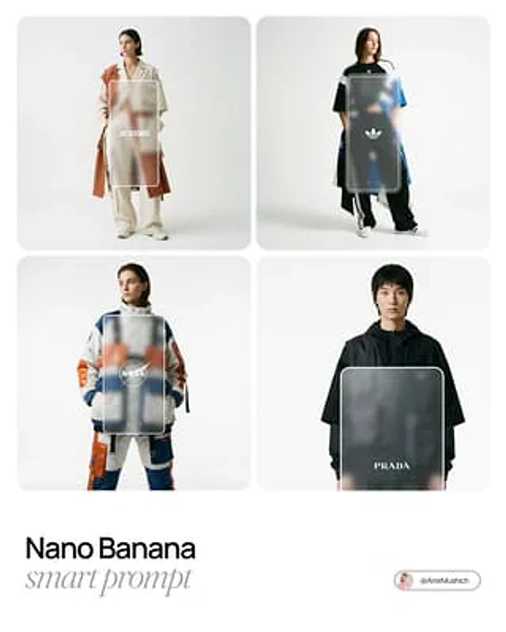

```text
[BRAND NAME]. Act as a Creative Director and Fashion Photographer creating a high-end editorial lookbook image with a UI overlay layer.
1. THE SUBJECT (AVANT-GARDE STREETWEAR & NATURAL POSE):
A fashion model stands centrally in a clean studio.
Fashion Style: The outfit is a striking, conceptual "Modern Avant-Garde Streetwear" look that interprets the aesthetic and color palette of [BRAND NAME]. Think high-fashion meets street culture: experimental silhouettes, deconstructed layering, oversized proportions, unique material combinations, and bold details. It should feel innovative and editorial, but still grounded in streetwear, avoiding basic casual clothes.
Pose: The model adopts a natural, relaxed, and effortless editorial pose (e.g., hands casually in pockets, a slight lean, looking off-camera or gently at the camera). Absolutely NO robotic, stiff, or "T-pose" stances.
2. THE UI OVERLAY (FROSTED GLASS RECTANGLE):
Superimposed directly in front of the model's torso is a large, vertical Floating UI Element.
Shape & Outline: A simple vertical rectangle with rounded corners, framed by a clean 2px solid White Stroke.
Material (Glassmorphism): The interior of this rectangle is "Frosted Glass". The part of the model's outfit behind this glass must be heavily blurred (high Gaussian Blur), creating a translucent depth effect, while the rest of the model remains razor-sharp.
3. UI CONTENT (MINIMALIST & SMALL):
Inside the frosted glass pane, place two elements in pure Monochrome White:
Center: The official [BRAND NAME] logo, perfectly centered.
Below Logo: Positioned significantly higher than the bottom edge, place two VERY SMALL, minimalist white navigation arrows (one pointing Left "<", one pointing Right ">"). They should be subtle and approximately 50% smaller than standard UI icons.
4. PHOTOGRAPHY STYLE & COMPOSITION (STRICT FRAMING):
Style: High-End Editorial Fashion Photography. Real film grain, sophisticated soft studio lighting that emphasizes fabric textures. It must look like a real photograph, not a CGI render.
Background: Infinite, pure White Studio Cyclorama.
Framing (STRICT CONSTRAINT): The shot is a Wide Full-Body Photograph. The entire model (from top of head to bottom of feet) AND the entire UI overlay must be COMPLETELY CONTAINED within the image boundaries. There must be absolutely ZERO CROPPING of the subject or UI. There must be a very large, generous amount of empty negative space ("air") surrounding the subject on all four sides.
```

Model: Nano Banana
Author: AmirMušić

[ProjectD](https://aitoolsradar.com/en/prompts/321f8584deaf30) · [Recorded source](https://x.com/AmirMushich/status/2011509897175724329)
 · [Full original metadata and byte evidence](data/projectd-batch-0060.json)

## AmirMušić #793

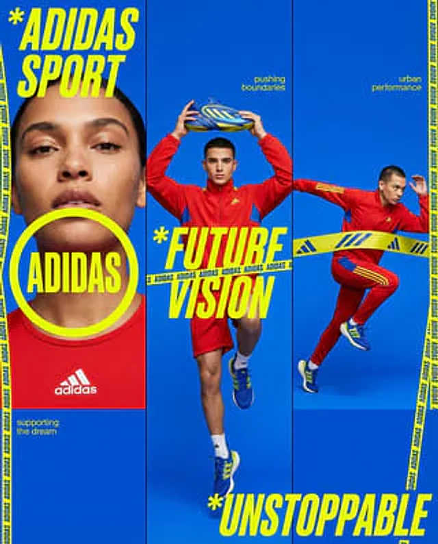

```text
[BRAND NAME]. Act as a Senior AI Visual Strategist & Creative Director.
Goal: Generate a high-motion triptych editorial where every visual element (color, text, props) is a direct semantic derivative of the brand name.
PHASE 1: SEMANTIC BRAND ANALYSIS (AUTONOMOUS)
[INSTRUCTIONS FOR IMAGEN]:
Core Identity: Analyze "[BRAND NAME]". Define its industry, soul, and "vibe" (e.g., Kinetic, Organic, Brutalist, Ethereal).
Color Psychology: Select a triadic palette based on brand associations:
   - BACKGROUND: The "Mood" color (e.g., Deep Forest for 'GAIA', Neon Amber for 'FUSE').
   - ACCENTS/TYPOGRAPHY: The "Energy" color. Must have high contrast/readability against the background.
   - APPAREL: The "Statement" color. Completes the brand's visual signature.
Copywriting: Generate 2-3 short, punchy slogans or keywords that resonate with the brand's mission to be used as background micro-text.
PHASE 2: COMPOSITION (THE DYNAMIC TRIPTYCH)
Layout: A single horizontal image split into three vertical editorial panels.
- PANEL 1 (The Portrait): Extreme close-up. Bold [BRAND NAME] wordmark inside a geometric frame (circle or rectangle) overlapping the model's face or neck.
- PANEL 2 (The Elevate): Medium shot. A model (gender determined by brand target audience) holds a primary brand-representative object above their head in a triumphant or symbolic gesture.
- PANEL 3 (The Kinetic): Full-body shot. High-speed motion blur or an aggressive "power pose" interacting with the brand's core element.
PHASE 3: GRAPHIC OVERLAYS & TEXTURES
- Main Typography: Large, slanted (italic) heavy sans-serif in [ACCENT COLOR].
- Dynamic Ribbons: Vertical yellow or contrast tapes crossing the panels with repeating text: "[BRAND NAME] // [ASSOCIATED KEYWORD] // [BRAND NAME]".
- Micro-Copy: Scattered small text in corners like "DESIGNED FOR [TARGET AUDIENCE]" or "EST. 2026 // GLOBAL IDENTITY".
PHASE 4: LIGHTING & ESTHETIC STANDARDS
- High-End Editorial (Vogue/Hypebeast style).
- Global Illumination with crisp, sharp edges.
- Realistic skin textures (pores, subtle sweat/shine) and high-fidelity fabric weaves.
- No "AI-plastic" artifacts.
PHASE 5: TECH SPECS
8K Resolution. Render: Octane. Subtle film grain. Ray-traced reflections on eyes and surfaces.
```

Model: Nano Banana
Author: AmirMušić

[ProjectD](https://aitoolsradar.com/en/prompts/e4c677ad619e33) · [Recorded source](https://x.com/AmirMushich/status/2028489707311464765)
 · [Full original metadata and byte evidence](data/projectd-batch-0060.json)

## AmirMušić #837

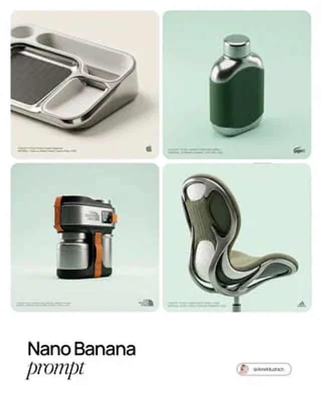

```text
[BRAND NAME]: 
A high-end, glossy concept art magazine editorial photograph of a unique, unexpected functional object conceptualized and designed by the brand.

**1. The Concept & Object (AI Invention):**
Based on the design philosophy, heritage, and material vocabulary of the specified brand, the AI must invent a novel utility product (NOT standard clothing, shoes, or bags). Examples could be home goods, tech accessories, tools, or sporting equipment, reinterpretated through the brand's lens. The object should feel sculptural yet functional.

**2. Materials & Details (Hyper-Premium):**
The object is constructed from ultra-premium, highly tactile materials characteristic of the brand (e.g., patinated exotic leathers, brushed aerospace-grade titanium, sculpted matte ceramics, molded carbon fiber, or technical high-fashion textiles). Every detail is hyper-realistic: visible stitching, microscopic material grain, precision engravings, and complex texture contrasts.

**3. Photography & Lighting (Cinematic Studio):**
Shot on a medium format Phase One camera with a 100mm macro lens. Extremely shallow depth of field, with sharp focus on the hero details of the object and a creamy, smooth bokeh background. The lighting is sophisticated studio softbox lighting: gentle, enveloping fill light with precise rim lighting to accentuate contours and material textures.

**4. Environment:**
A seamless, impeccably clean studio cyclorama background in a pure, ultra-light pastel tone (e.g., desaturated mint, pale blush, or off-white), free of shadows.

**5. Layout & UI Elements (Strict Placement):**
- **Bottom Right Corner:** A small, understated, monochrome gray logo of the brand.
- **Bottom Left Corner:** Small, minimalist monochrome gray text describing the invented product. The font style looks like Manrope Regular with very tight tracking (kerning) and balanced line spacing. Example format: "CONCEPT STUDY: [AI inserts invented product name]. MATERIAL: [AI inserts main materials]. SS25.
```

Model: Nano Banana
Author: AmirMušić

[ProjectD](https://aitoolsradar.com/en/prompts/0d3abc1116e489) · [Recorded source](https://x.com/AmirMushich/status/2017312815728488851)
 · [Full original metadata and byte evidence](data/projectd-batch-0060.json)

## AmirMušić #839

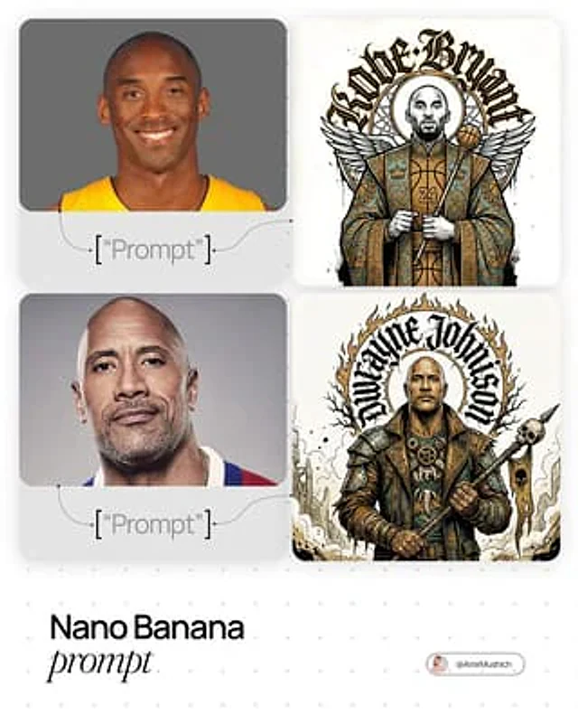

```text
[PERSONE]. Act as a Creative Director and Master of Visual Metaphor.

PHASE 1: DYNAMIC ARCHETYPE LOGIC.

Autonomously analyze the core essence of [PERSONE] and assign them a "High-Status Sovereign" role:

- If the character is a scientist/intellectual: Depict as a "Grand Archivist" in heavy velvet robes with celestial instruments.

- If the character is a rebel/anti-hero: Depict as a "Wasteland Prophet" in deconstructed, layered streetwear and scavenged textures.

- If the character is royalty/leader: Depict as a "Divine Monarch" in stiff, ornamental ceremonial attire.

- Maintain the stoic, iconographic pose from the reference.

PHASE 2: ART STYLE & INK (THE REFERENCE LOOK).

Strictly follow the "Neo-Traditional Etching" style. 

- Bold black ink outlines, intricate cross-hatching, and stippling for shadows. 

- Color Palette: Deep Ochre, Faded Teal, Jet Black, and Bone White background.

PHASE 3: DYNAMIC TYPOGRAPHY.

- The massive Gothic/Blackletter halo behind the subject MUST explicitly spell out the name "[PERSONE]". 

- The font style should adapt to the archetype (e.g., sharp and aggressive for rebels, elegant and structured for scholars).

TECH SPECS:

2D flat illustration, white background, ink-bleed effects, high contrast, sharp line-work.
```

Model: Nano Banana
Author: AmirMušić

[ProjectD](https://aitoolsradar.com/en/prompts/5df9cd5b076d78) · [Recorded source](https://x.com/AmirMushich/status/2023079918830002551)
 · [Full original metadata and byte evidence](data/projectd-batch-0060.json)

## AmirMušić #858

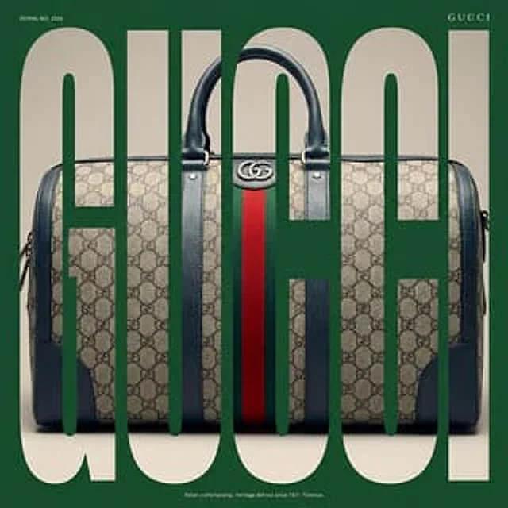

```text
[BRAND NAME]. Act as a Senior Editorial Designer and Typographer.

PHASE 1: TYPOGRAPHIC MASK (THE "WINDOW" EFFECT).

- Core Element: Use the most iconic slogan or the name of [BRAND NAME] as a massive, ultra-bold, heavy sans-serif typographic mask.

- Layout: The letters must be giant, filling the entire vertical frame from edge to edge with tight kerning.

- Concept: The text acts as a "cut-out" window. The background is solid white, and the photographic subject is visible ONLY through the letterforms.

PHASE 2: DYNAMIC SUBJECT LOGIC.

- Subject Selection:

- Detail: Ensure a high-contrast element (like a red shoe or a glowing headlight) is visible through one of the letters as a focal point.

PHASE 3: SOPHISTICATED MUTED PALETTE.

- Atmosphere: Use a "Refined Muted" color scheme.

- Tones: Soft slate blues, charcoal greys, and creamy off-whites for the photography inside the mask.

- Accent: Identify one sharp, saturated accent color belonging to [BRAND NAME] and apply it to a single key object visible through the text.

PHASE 4: PHOTOGRAPHY & LIGHTING.

- Lighting: Soft-box studio lighting. Diffused shadows and gentle highlights to create a cinematic, high-end editorial feel.

- Finish: Clean, matte texture with zero visual noise. High-definition photographic quality.

PHASE 5: MINIMALIST BRANDING.

- Accents: Add a tiny minimalist logo and a small vertical tagline in a clean, microscopic sans-serif font near the corners.

- Year: Include the year "2026" in a subtle, elegant font to mimic a limited-edition look.
```

Model: Nano Banana
Author: AmirMušić

[ProjectD](https://aitoolsradar.com/en/prompts/a513a9385884db) · [Recorded source](https://x.com/AmirMushich/status/2028068337427603741)
 · [Full original metadata and byte evidence](data/projectd-batch-0060.json)

## AmirMušić #878

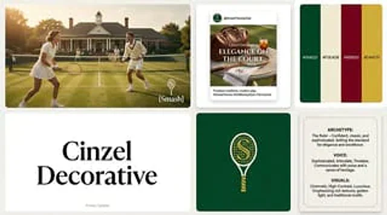

```text
[BRAND NAME] 
({INDUSTRY}). 

Act as a Lead Brand Designer creating a comprehensive "Brand Identity System" presentation (Bento-Grid Layout).

**THE TASK:**
Generate a single, high-resolution bento-grid board containing **6 distinct modules** that define the visual identity for [BRAND NAME].

---

**PHASE 1: VISUAL STRATEGY (AUTONOMOUS)**
1.  **Analyze the Brand:** Determine the archetype and visual vibe.
2.  **Define the Palette:** Select 4 distinct colors.
3.  **Select Typography:** Choose ONE specific Google Font (Serif, Sans-Serif, or Display) relevant to the industry.

**PHASE 2: THE LAYOUT (6-MODULE GRID)**
The image must be a clean, gap-separated grid featuring these specific blocks:

* **Block 1 (The Hero):** A high-end **Key Visual** photography showing the product/service in context. Cinematic lighting, photorealistic. Overlay the brand logo in white.
* **Block 2 (Social Media):** A mockup of an **Instagram Post**. It features a bold headline using the brand font and a lifestyle image.
* **Block 3 (The Palette & HEX):** A clean design block displaying **4 Vertical Color Swatches**.
    * *Crucial Detail:* Inside or below each color swatch, simulate distinct text looking like **HEX Codes** (e.g., "#1A2B3C").
* **Block 4 (Typography Spec):** A minimalist block dedicated to the **Brand Font**.
    * *CRITICAL CONSTRAINT:* Do NOT show the alphabet (Aa Bb Cc).
    * *The Content:* The block must display ONLY the **Name of the Font** (e.g., "Montserrat", "Lato", "Oswald") written in large, crisp characters using that specific font style. This acts as the visual specimen.
    * *Subtext:* Tiny text at the bottom reading "Primary Typeface".
* **Block 5 (The Logo):** A solid background block featuring the **Final Logo** (clean, vector style, NO construction lines/grids). Minimalist and iconic.
* **Block 6 (Brand DNA):** A text-heavy "Manifesto Card". It simulates a layout with three short paragraphs titled:
    * **ARCHETYPE:** (e.g., "The Innovator")
    * **VOICE:** (e.g., "Confident, Direct")
    * **VISUALS:** (e.g., "Cinematic, High-Contrast")

**PHASE 3: AESTHETIC & FINISH**
* **Style:** Behance Trend / Awwwards Winner.
* **Quality:** 8k resolution, razor-sharp vector graphics mixed with high-end photography.
* **Lighting:** Soft studio lighting across the whole grid to make it look like a cohesive presentation board.
```

Model: Nano Banana
Author: AmirMušić

[ProjectD](https://aitoolsradar.com/en/prompts/2509f471bb050d) · [Recorded source](https://x.com/AmirMushich/status/2018348054789640565)
 · [Full original metadata and byte evidence](data/projectd-batch-0060.json)

## AmirMušić #887

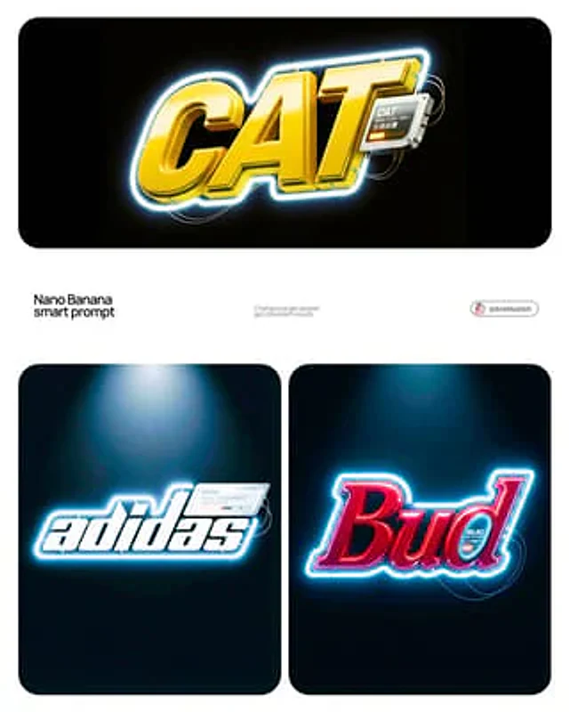

```text
[BRAND NAME] | [COLOR]

Act as a 3D Motion Graphics Director and CGI Type Artist specializing in Japanese streetwear, Y2K motorsport aesthetics, and retro-tech hardware design. References: Kawasaki Racing livery, Yasuhiro Nightow title cards, Wipeout game UI, Peak Design × Japanese hardware collab.

PHASE 0: BRAND LOGO INTELLIGENCE

Retrieve the canonical logotype of [BRAND NAME] from training data. Identify its core typographic DNA — stroke weight, angle of italic lean, terminal style, any custom glyph cuts. If [BRAND NAME] uses a geometric or sans-serif wordmark — apply a 15 to 20° italic transformation while preserving all letterform proportions. If [BRAND NAME] already uses italic or script — preserve its native angle exactly. The goal is to translate the brand's typographic identity into a Japanese motorsport script register — aerodynamic, forward-leaning, built for speed. The letters must remain recognizable as [BRAND NAME]'s typeface, not replaced with a generic racing font.

PHASE 1: PRIMARY TYPOGRAPHY SCULPTURE

The wordmark of [BRAND NAME] is a fully 3D object — thick, physical, occupying real depth. Form language: each letter has a flat front face, beveled top and bottom edges with 30 to 45° chamfer cuts — the kind of angular geometry found on Japanese racing fairings and Kawasaki tank badges. Letters are slightly condensed and heavily italic — forward momentum is built into the geometry. The overall silhouette reads as one unified aerodynamic form — letters connect at their bases through a common ground plane, like a single cast aluminum piece. Material: high-gloss automotive lacquer in [COLOR] — the same paint system as a Japanese sports motorcycle tank. Surface properties: IOR 1.6, roughness 0.05, clear-coat depth visible. [COLOR] is pure and saturated in midtones, pushing toward near-white in specular peaks, pulling toward deep shadow in recessed zones and chamfer undersides. Reflections on the front face: subtle dark environment reflections — minimal and moody, just enough to show material depth. Top chamfer faces catch the primary light as bright highlight strips — the signature detail that defines 3D volume.

PHASE 2: NEON WIRE OUTLINE SYSTEM

A continuous neon tube traces the exact outer silhouette contour of the entire wordmark — every letter edge, every chamfer angle, every connecting point between letters. This is not a glow effect or a stroke — it is a physical glass neon tube, 4 to 6mm diameter, bent precisely to follow the letterform outline at a 3 to 5mm offset distance from the letter surface. Neon tube properties: glass tube body is semi-transparent — internal plasma glow visible through glass. Light emission: bright cold white light, color temperature 7000 to 8000K, pure white with very slight blue-cool bias. Emitted light creates a tight halo of illumination — 8 to 15mm radius soft glow on surrounding black void. The neon light bounces onto nearest letter surfaces — edges adjacent to the tube receive subtle cool white rim light. Tube construction: clean geometric bends at sharp corners, thin mounting wire clips at 3 to 4 points along its length — technically precise, like real neon sign hardware.

PHASE 3: INTEGRATED TECHNICAL SCREEN

A hardware screen panel is physically integrated with the wordmark — not a separate floating element, not placed at a distance. Integration logic — autonomously determine the most natural attachment point based on [BRAND NAME]'s logo geometry, choosing ONE of these integration modes: OVERLAP MODE — the screen panel is partially overlaid onto the rightmost or leftmost letter of the wordmark, as if mounted directly on the letter face. The letter surface shows through the screen's transparent zones. The screen edge cuts across the letter geometry deliberately — like a sticker or plate bolted onto the sculpture. EXTENSION MODE — the screen panel extends directly from the end of the final letter as a seamless continuation of the wordmark's ground plane — same italic angle, same 3D depth, as if the wordmark was designed with this panel as part of its original form. The transition from letter to screen feels like one continuous designed object. INSET MODE — the screen panel sits in a recess cut into one of the larger letters — as if a rectangular section of the letter body was removed and replaced with a hardware display. The letter geometry frames the screen on three sides.

Screen physical construction: machined aluminum or brushed steel housing, same thickness as the letter sculpture — 8 to 12mm deep. The face is a slightly frosted acrylic panel backlit from within. The screen has the same italic angle as the wordmark — it is not upright, it leans with the composition. Screen contents rendered in precise small-scale detail: [BRAND NAME] in small clean technical sans-serif as primary label. An alphanumeric model code autonomously generated to feel authentic to [BRAND NAME]'s cultural language. 2 to 3 Japanese characters as secondary label. A horizontal LED progress bar — 4 to 6 rectangular segments, 1 to 2 lit in amber, others dark. A small ventilation grille or mesh pattern along one edge of the housing. The screen connects to the neon outline system via 1 to 2 thin cables — physical wires, 1 to 2mm diameter, with slight organic sag from gravity, running to the nearest neon tube mounting clip.

PHASE 4: LIGHTING & ATMOSPHERE

Background: pure absolute black (#000000 to #030303) — complete void, no ambient, no gradient, no surface. The composition is self-illuminated — only light sources are the neon tube emission, the screen's internal backlight, and a single narrow overhead spot. Overhead spot: focused directly above the wordmark center — illuminates top chamfer faces as bright highlight strips, falls off completely within 5 to 10cm of letterform edges, never reaches the background. Neon contribution: cool white rim light on adjacent letter edges, 8 to 15mm glow halo in surrounding void, reflected light on cables and screen housing. Screen contribution: the frosted acrylic face emits a soft diffused glow — slightly cooler than the neon, illuminating the immediate area of whichever letter the screen is integrated with. The amber LED segments create a warm micro-glow within the screen housing. No other light sources. No rim lights. No fill. Darkness is absolute outside self-illuminated zones.

PHASE 5: COMPOSITION

Aspect ratio: 1:1 square. The wordmark with integrated screen occupies the horizontal center — wider than tall, spreading laterally. The screen integration should feel like it was always part of the logo design — not an accessory bolted on, but a native component. Vertical position: slightly above center. The neon outline breaches the implied bounding box slightly at 1 to 2 points — confirming physical separation between neon tube and letter surface. Camera: slightly elevated 5 to 10° above center — reveals top chamfer faces and confirms 3D depth. Mild perspective. Depth of field: none — sharp across entire composition from screen detail to neon tube.

PHASE 6: TECH SPECS

Render: Octane Render or Redshift. Ray tracing: on — for accurate neon tube emission, screen backlight glow, glass refraction, cable shadows. Volumetric light: subtle around neon tube and screen face only — physically present glow without fogging the black void. Neon tube: dielectric glass material with physical light emission, not a glow map. Screen face: translucent acrylic with internal emissive backlight. Letter sculpture: automotive lacquer with full clear-coat depth. Anti-aliasing: maximum. Sampling: minimum 1024 samples. Film grain: none. Output feel: CGI title card or album cover — precision and atmosphere in equal measure. Darkness absolute. Neon and screen physically real.
```

Model: Nano Banana
Author: AmirMušić

[ProjectD](https://aitoolsradar.com/en/prompts/8b16c1f58fbcb7) · [Recorded source](https://x.com/AmirMushich/status/2044483455094845909)
 · [Full original metadata and byte evidence](data/projectd-batch-0060.json)

## Anissa #1012

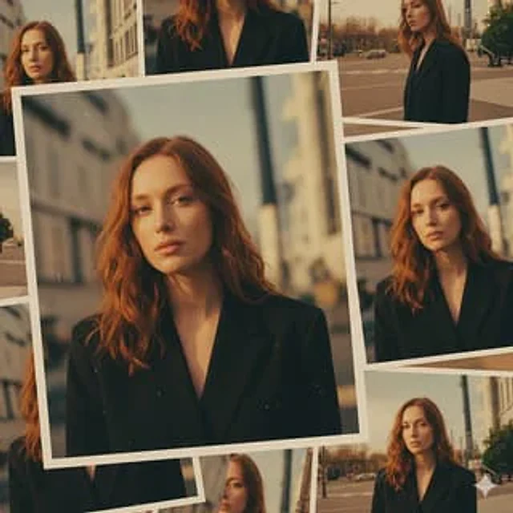

```text
unlimited nano banana pro, AI photo collage, vintage film look, black and white editorial, cinematic , analog photography aesthetic, collage, film grain texture, Ilford HP5 style, moody portrait lighting, street photography vibe, retro zine layout, AI photography workflow, prompt sharing, generative art prompts, editorial collage design
```

Model: Nano Banana
Author: Anissa

[ProjectD](https://aitoolsradar.com/en/prompts/7f62fab38aaef2) · [Recorded source](https://x.com/SimplyAnnisa/status/2023762122853986641)
 · [Full original metadata and byte evidence](data/projectd-batch-0060.json)

## Anissa #1179

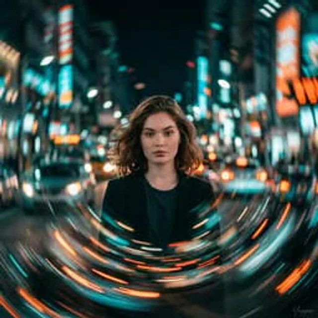

```text
cinematic portrait of a young woman standing perfectly still as the city around her spirals in circular motion blur, streaks of headlights and neon lights orbiting her body like gravity pulling the world inward, dramatic teal and orange cinematic color grading, wind moving strands of hair, calm expression contrasting chaotic motion, shallow depth of field, shot on a 50mm lens, realistic skin texture, atmospheric night lighting, vertical composition
```

Model: Nano Banana
Author: Anissa

[ProjectD](https://aitoolsradar.com/en/prompts/96fd3fb56bbbc9) · [Recorded source](https://x.com/SimplyAnnisa/status/2032694954758193192)
 · [Full original metadata and byte evidence](data/projectd-batch-0060.json)

## Anissa #1301

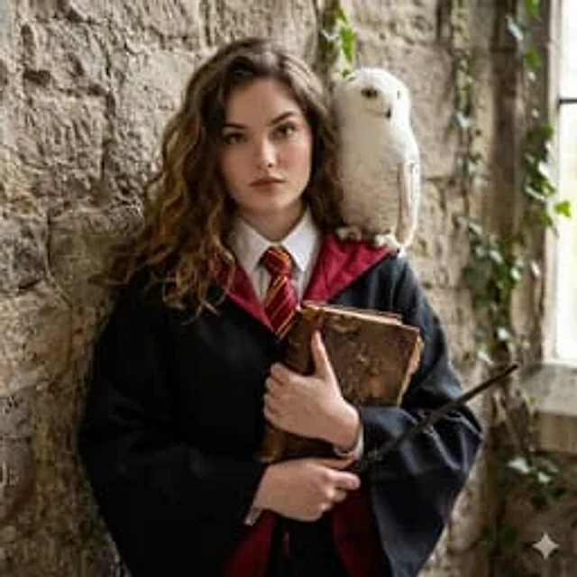

```text
USE UPLOADED PHOTO AS REFERENCE. HOGWARTS-STYLE PHOTOSHOOT. THE GIRL IS POSING, IN A BLACK ROBE, THE UNDERSIDE OF THE ROBE IS RED, A WHITE COLLAR AND A TIED TIE OF GRYFFINDOR COLOR ARE VISIBLE. HER HAIR IS LOOSE, A DILAPIDATED, OLD BOOK IS PRESSED TO HER BODY IN HER HANDS. HE HOLDS A MAGIC WAND IN ONE HAND. A WHITE OWL SITS ON THE SHOULDER, THE BACKGROUND IS AN OLD STONE WALL, THE BACKGROUND IS SLAY. THEMATIC PHOTO SESSION. DETAILING, HIGH QUALITY. PORTRAIT.
```

Model: Nano Banana
Author: Anissa

[ProjectD](https://aitoolsradar.com/en/prompts/5a47a3bf8772ba) · [Recorded source](https://x.com/SimplyAnnisa/status/2011081163109236916)
 · [Full original metadata and byte evidence](data/projectd-batch-0060.json)

## Anissa #1327

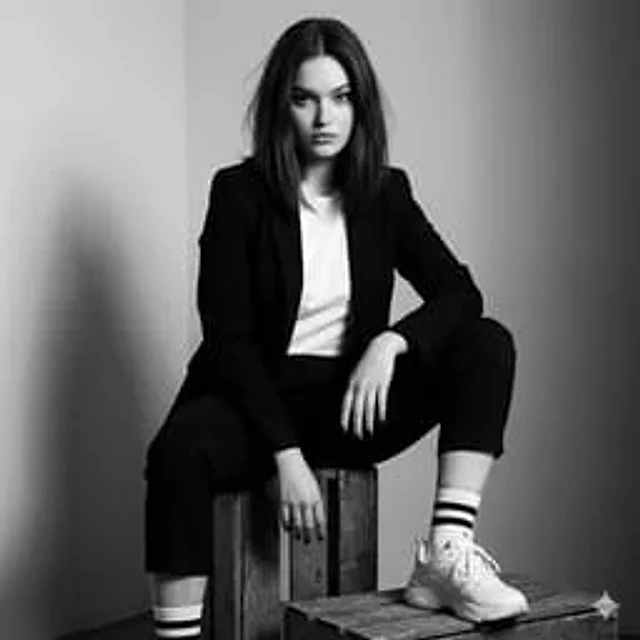

```text
Create a realistic portrait (100% identical face, no editing allowed).
A hyper-realistic black-and-white portrait of a young beautiful woman with a calm, serious, and introspective expression, sitting casually on a stack of rustic wooden crates in a minimalist studio setting. She faces the camera directly with a relaxed yet confident posture, her legs slightly apart, one hand resting naturally between her knees and the other loosely stretched across her thigh, creating a powerful editorial fashion pose.
She has straight, dark, shoulder-length hair with a natural center parting, slightly tousled, gently framing her face. Her facial features are delicate and symmetrical, with a naturally smooth skin texture, subtle shadows under her eyes, soft, slightly parted lips, and deep, expressive eyes staring directly into the lens, conveying a calm confidence and emotional depth. The lack of heavy makeup emphasizes the natural editorial aesthetic.
Clothing & Style:
She wears a fitted black blazer with structured shoulders over a simple white crew-neck T-shirt, paired with cropped black striped trousers. On her feet are modern, chunky white sneakers, paired with white calf-length socks with bold black horizontal stripes, adding a casual street-style contrast to the formal blazer.  Minimal accessories, no visible jewelry. Her nails are painted black.
Lighting & Ambiance:
High-contrast cinematic lighting with strong, directional natural light coming in from the side, creating dramatic diagonal streaks of light and shadow on the plain studio walls and partly on her body. The lighting creates depth, texture, and a moody editorial atmosphere reminiscent of a high-end fashion magazine. Soft shadows preserve facial details while maintaining strong contrast.
Camera & Composition:
Medium-full-length shot, eye-level perspective, centered composition. Shot with a professional DSLR or medium format camera, using a prime lens (50mm–85mm). Shallow depth of field with sharp focus on the subject, subtle background blur. Sharp details, subtle texture of fabric, visible skin pores, realistic falloff.

Style & Quality:
Editorial fashion photography, minimalist, cinematic, monochrome aesthetic, Vogue-style portraiture, ultra-high resolution, sharp focus, film-like contrast, timeless and modern atmosphere.
```

Model: Nano Banana
Author: Anissa

[ProjectD](https://aitoolsradar.com/en/prompts/4e7431c4b75fe4) · [Recorded source](https://x.com/SimplyAnnisa/status/2010210760023248929)
 · [Full original metadata and byte evidence](data/projectd-batch-0060.json)

## Anissa #860

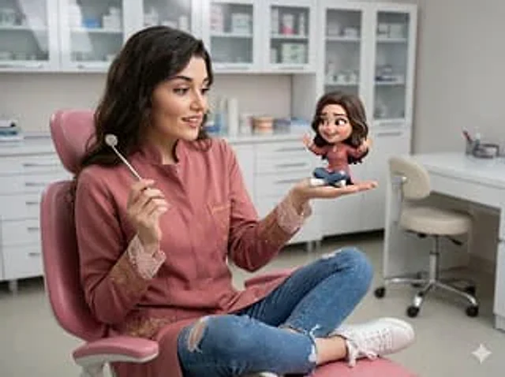

```text
ME AND MY LITTLE 3D CHIBI IN THE OFFICE

Ultra-realistic cinematic portrait of an adult person, with the face fully visible, natural human skin texture with pores and subtle imperfections, and realistic hair strands. The real person is seated in a dental chair in a pink dental office, holding a small 3D miniature of themselves, delicately sitting with crossed legs in a relaxed pose on the palm of one hand. 4:3 horizontal ratio. Features dental office attire with a rose-colored coat and holding a dental mirror in hand.

The real person looks at the miniature with clear surprise and slight amusement, raised eyebrows, a soft smile, and expressive eyes. The facial expression appears spontaneous and authentic. The miniature closely resembles the real person in facial structure, hairstyle, and clothing, but rendered in a soft, high-quality 3D chibi style. The miniature has a funny and exaggerated facial expression, lively eyes, and playful moving arms and legs. The stylization is clean and modern, not like a toy, doll, or artificial figure.

Both characters wear matching outfits: medium distressed jeans, rose-colored coat with 3/4 bell sleeves finished with lace on cuffs and hems, embroidered with white lace and golden center details, and light white sneakers. Hair according to reference. Makeup: luminous and well-defined skin, light rosy blush, intense eyeshadow in neutral tones, black mascara on eyelashes, and matte pink lips. The scale difference between the realistic woman and the 3D chibi figure is obvious and visually amusing.

The background is a realistic office scene with white cabinets containing painting and creative items, a white desk, and a plastic swivel chair, with slight blur and strong depth of field. Professional cinematic lighting with clear separation of objects, soft highlights on the skin, and subtle rim light around both figures.

Ultra-detailed textures for the real person. Clean 3D textures with a realistic style for the miniature. Balanced between realism and humor. No surreal distortions.
```

Model: Nano Banana
Author: Anissa

[ProjectD](https://aitoolsradar.com/en/prompts/6345e5800efed1) · [Recorded source](https://x.com/SimplyAnnisa/status/2009471280643493933)
 · [Full original metadata and byte evidence](data/projectd-batch-0060.json)

## Anissa #892

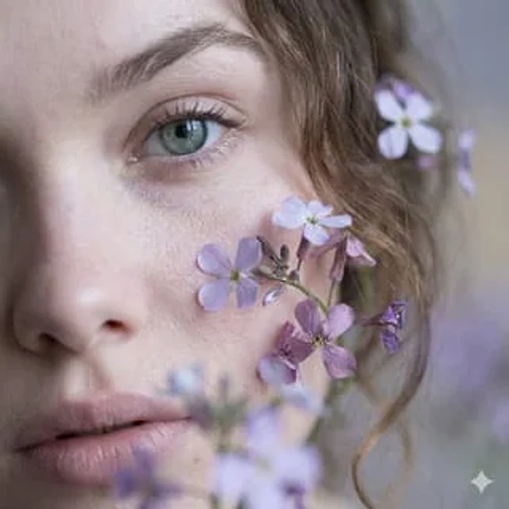

```text
Utilize exclusively and obligatorily the uploaded reference photos as the primary and authoritative source for the model’s face, facial structure, proportions, skin tone, real skin texture, and the exact natural characteristics of her hair.
Do not idealize, beautify, alter, rejuvenate, slim the face, smooth the skin, or modify any real features.
Do not remove or change freckles, pores, fine lines, or natural imperfections.The appearance must match the reference images exactly, with absolute fidelity.
Create a hyper-realistic, ethereal macro Fine Art portrait photograph, captured with a Leica APO-Macro-Elmarit-R 100mm f/2.8, full-frame.
An extreme close-up of a young woman’s face with pale skin, fully respecting the real physiognomy of the model as shown in the reference photos.
Skin texture is ultra-detailed and completely natural, with clearly visible pores and no artificial smoothing.
One crystal-clear, melancholic eye is in perfect critical focus, displaying natural micro-contrast characteristic of Leica optics.
Long, natural eyelashes.
Lips slightly parted, in a natural pale pink tone, with no excessive or artificial makeup.
Delicate wildflowers in soft lilac and muted purple tones rest gently on the cheek and intertwine with loose, naturally imperfect hair strands, exactly following the real hair pattern seen in the reference images.
Some flowers appear softly out of focus in the foreground, creating organic depth and layered composition.
Soft, cool, diffused natural light, as on an overcast day.
No harsh shadows, no artificial lighting.
A serene, fragile, poetic, and subtly melancholic atmosphere.
Macro photography with an extremely shallow depth of field, edges and background melting into a creamy, smooth bokeh.
Absolute critical focus on the iris and the true skin texture.
Desaturated color palette, cool pastel tones — soft gray, beige, and lilac.
Fine Art aesthetic, authentic Leica optical fidelity, true photographic appearance.
Ultra-high resolution 8K, with no AI-generated look.
```

Model: Nano Banana
Author: Anissa

[ProjectD](https://aitoolsradar.com/en/prompts/5edcb13d1f0270) · [Recorded source](https://x.com/SimplyAnnisa/status/2010578685070582235)
 · [Full original metadata and byte evidence](data/projectd-batch-0060.json)

## ANKIT PATEL 🇮🇳 | AI #1424

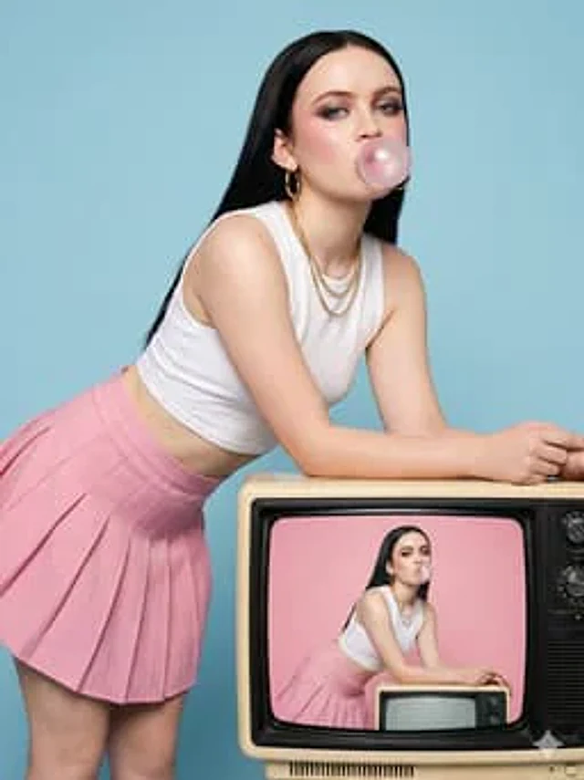

```text
When pop aesthetics meet confidence… this is the vibe 💗📺

Would you dare to pull off this look? 💭✨

Gemini Nano Banana 🍌

{
  "type": "image_generation_prompt",
  "style": "ultra_realistic_fashion_editorial",
  "composition": {
    "camera": "studio photograph",
    "lighting": "clean studio lighting",
    "focus": "sharp focus",
    "resolution": "high resolution",
    "aesthetic": "modern pop",
    "color_palette": "vibrant pastels",
    "mood": "cinematic"
  },
  "background": {
    "type": "solid",
    "color": "pastel blue"
  },
  "subject": {
    "gender": "female",
    "appearance": {
      "hair": "long straight dark hair",
      "makeup": "glossy makeup with soft pink blush highlighted cheekbones bold eye makeup"
    },
    "attire": {
      "top": "fitted white sleeveless crop top",
      "bottom": "high waisted pink pleated mini skirt",
      "accessories": [
        "gold hoop earrings",
        "layered gold chain necklace"
      ]
    },
    "pose": {
      "position": "leaning forward",
      "interaction": "resting arms casually on a retro CRT television",
      "expression": "confident",
      "action": "blowing a translucent pink bubblegum bubble"
    }
  },
  "props": {
    "television": {
      "type": "retro CRT TV",
      "screen_content": "mirrored image of the same woman posing against a pink background",
      "effect": "dual reality visual concept"
    }
  },
  "style_tags": [
    "photorealistic",
    "fashion editorial",
    "cinematic composition",
    "creative concept",
    "pastel aesthetic"
  ]
}
```

Model: Nano Banana
Author: ANKIT PATEL 🇮🇳 | AI

[ProjectD](https://aitoolsradar.com/en/prompts/99a164c89e21aa) · [Recorded source](https://x.com/Ankit_patel211/status/2011431932622668165)
 · [Full original metadata and byte evidence](data/projectd-batch-0060.json)

## ANKIT PATEL 🇮🇳 | AI #385

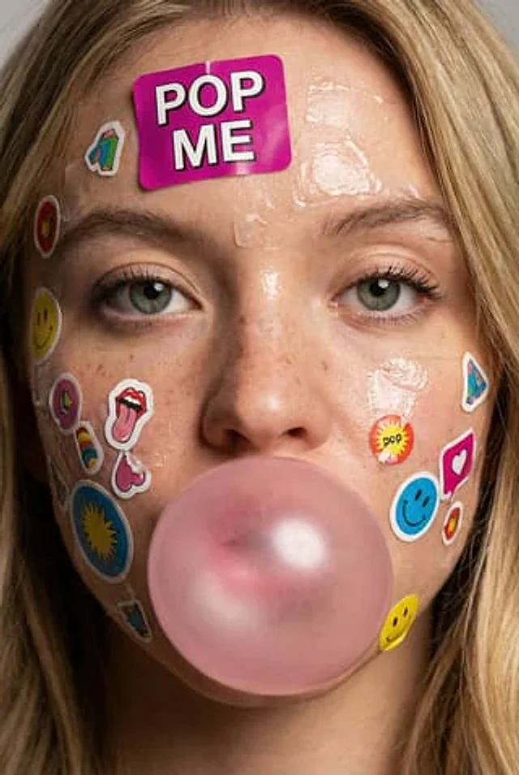

```text
{
  "meta": {
    "image_quality": "High",
    "image_type": "Photo"
  },
  "global_context": {
    "scene_description": "Close-up portrait of a young person's face covered with colorful paper stickers and glossy adhesive residue. Central focus on eyes, nose, lips; subject blowing a pink bubblegum bubble. Stickers vary in size, text, icons and layered overlap; hair strands frame face at edges. Skin shows freckles, pores, and sheen from adhesive or moisture.",
    "time_of_day": "Neutral/studio lighting",
    "weather_atmosphere": "Indoors/controlled",
    "lighting": {
      "source": "Artificial",
      "direction": "Frontal with slight top",
      "quality": "Soft",
      "color_temp": "Neutral"
    }
  },
  "color_palette": {
    "dominant_hex_estimates": ["#E7B1B6", "#F6C0D0", "#C9A38C"],
    "accent_colors": ["Pink","Magenta"],
    "contrast_level": "Medium"
  },
  "composition": {
    "camera_angle": "Eye-level",
    "framing": "Extreme close-up (face fills frame)",
    "depth_of_field": "Shallow (background indistinct)",
    "focal_point": "Eyes and central bubble"
  },
  "objects": [
    {
      "id": "obj_001",
      "label": "Face",
      "category": "Person (head)",
      "location": "Center",
      "prominence": "Foreground",
      "visual_attributes": {
        "color": "Light beige skin with pink undertones and freckles",
        "texture": "Smooth with visible pores, glossy adhesive patches",
        "material": "Skin",
        "state": "Sticker-covered, slightly wet/glossy",
        "dimensions_relative": "Large relative to frame"
      },
      "micro_details": [
        "Freckles concentrated on nose and cheeks",
        "Shiny adhesive residue streaks on forehead and cheeks",
        "Fine vellus hairs visible",
        "Pores visible on nose and cheeks"
      ],
      "pose_or_orientation": "Frontal",
      "text_content": null
    },
    {
      "id": "obj_002",
      "label": "Eyes (pair)",
      "category": "Facial feature",
      "location": "Upper-center",
      "prominence": "Foreground",
      "visual_attributes": {
        "color": "Gray-green irises with dark limbal ring",
        "texture": "Wet/glossy cornea, visible eyelashes",
        "material": "Biological",
        "state": "Open, neutral expression",
        "dimensions_relative": "Medium"
      },
      "micro_details": [
        "Tiny specular highlights on each cornea",
        "Sparse lower lashes, fuller upper lashes",
        "Slight shadow under lower lids"
      ],
      "pose_or_orientation": "Facing camera",
      "text_content": null
    },
    {
      "id": "obj_003",
      "label": "Pink bubble",
      "category": "Object (gum)",
      "location": "Lower-center",
      "prominence": "Foreground",
      "visual_attributes": {
        "color": "Pastel pink",
        "texture": "Smooth, slightly translucent",
        "material": "Gum",
        "state": "Inflated/intact",
        "dimensions_relative": "Large relative to mouth"
      },
      "micro_details": [
        "Two bright specular reflections on sphere",
        "Seamless edge against lips"
      ],
      "pose_or_orientation": "Centered over mouth",
      "text_content": null
    },
    {
      "id": "obj_004",
      "label": "Stickers (assorted)",
      "category": "Adhesive stickers",
      "location": "Entire face and neck, concentrated forehead and cheeks",
      "prominence": "Foreground",
      "visual_attributes": {
        "color": "Multicolor: magenta, yellow, blue, white",
        "texture": "Paper/plastic with glossy varnish, torn edges",
        "material": "Paper/plastic adhesive",
        "state": "Layered, partially torn, some wrinkled",
        "dimensions_relative": "Varied small-to-medium"
      },
      "micro_details": [
        "Large 'POP ME' magenta sticker on forehead",
        "Partial torn sticker fragments near nasolabial fold",
        "Small rectangular stickers with tiny printed text",
        "Edges lifting, adhesive shine around perimeters"
      ],
      "pose_or_orientation": "Affixed flat or slightly peeled",
      "text_content": "Multiple small logos and words (e.g., 'POP ME')"
    },
    {
      "id": "obj_005",
      "label": "Hair strands",
      "category": "Hair",
      "location": "Left and right edges framing face",
      "prominence": "Background/foreground overlap",
      "visual_attributes": {
        "color": "Light brown",
        "texture": "Fine, slightly wet",
        "material": "Hair",
        "state": "Loose strands",
        "dimensions_relative": "Thin relative to face"
      },
      "micro_details": [
        "Individual strands crossing forehead edges",
        "Slight adhesive sheen on some strands"
      ],
      "pose_or_orientation": "Hanging down"
    }
  ],
  "text_ocr": {
    "present": true,
    "content": [
      {
        "text": "POP ME",
        "location": "Forehead",
        "font_style": "Bold/Decorative",
        "legibility": "Clear"
      }
    ]
  },
  "semantic_relationships": [
    "Stickers are affixed to Face",
    "Bubble covers mouth, partially obscuring lips",
    "Adhesive residue creates glossy highlights on skin",
    "Hair strands frame and partly overlay stickers"
  ]
}
```

Model: Nano Banana
Author: ANKIT PATEL 🇮🇳 | AI

[ProjectD](https://aitoolsradar.com/en/prompts/e1cfd7b8731b5a) · [Recorded source](https://x.com/Ankit_patel211/status/2016189962090381695)
 · [Full original metadata and byte evidence](data/projectd-batch-0060.json)

## ANKIT PATEL 🇮🇳 | AI #504

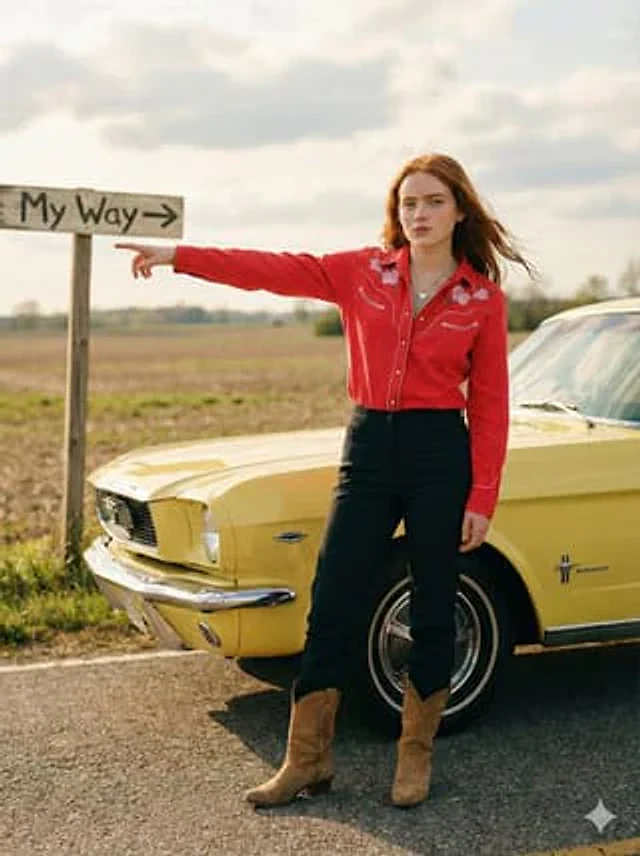

```text
{
  "project": "Nano Banana – Maximalist Editorial Americana Scene",
  "version": "2.4",
  "engine_optimization": "Nano Banana (maximalist cinematic photorealism, high detail density, controlled imperfection)",
  "render_intent": "cohesive western color harmony with refined fashion detail and narrative clarity",
  "frame": {
    "aspect_ratio": "3:4",
    "shot_type": "medium-full portrait",
    "camera_angle": "eye-level with subtle cinematic parallax",
    "composition": "subject foreground dominant, pointing gesture aligned parallel to the sign, car balancing the frame",
    "lens_simulation": "50mm full-frame prime",
    "camera_metadata": {
      "iso": 100,
      "shutter_speed": "1/320",
      "aperture": "f/1.8"
    },
    "depth_of_field": "shallow, face and guiding hand crisp, background softly diffused"
  },
  "subject": {
    "type": "young woman",
    "approximate_age": "early to mid 20s",
    "identity_consistency": "single subject, realistic anatomy, natural proportions",
    "appearance": {
      "hair": {
        "color": "deep brunette",
        "length": "long",
        "style": "loose, softly flowing, gently wind-swept"
      },
      "face": {
        "beauty_level": "very beautiful, striking yet natural",
        "pose_detail": "face slightly tilted, enhancing elegance and approachability"
      },
      "skin": {
        "tone": "light to medium",
        "details": [
          "natural texture",
          "subtle freckles",
          "soft daylight glow"
        ]
      },
      "eyes": {
        "color": "warm brown or hazel",
        "expression": "inviting, confident, gently persuasive"
      },
      "makeup": "minimal, clean editorial finish"
    },
    "expression": "calm confidence with a subtle, encouraging smile",
    "pose": "standing beside the car, torso slightly angled, arm extended horizontally, pointing parallel to the sign as if signaling ‘follow that way, follow me’"
  },
  "wardrobe": {
    "top": "light pastel blue denim shirt with visible weave, pink and white embroidery in refined western motifs",
    "fit": "relaxed yet tailored",
    "bottom": "light brown pants, soft twill or suede-like texture, tailored with natural creases",
    "footwear": "warm tan suede cowboy boots, medium contrast, elegant western stitching, slightly worn for authenticity",
    "accessories": [
      "silver necklace",
      "small silver heart-shaped pendant, delicate and understated, resting just below the collarbone"
    ],
    "fabric_behavior": "authentic material stiffness and drape, embroidered threads catching light, natural folds and tension"
  },
  "vehicle": {
    "type": "classic Ford Mustang",
    "color": "lemon yellow",
    "finish": "glossy paint with realistic reflections and subtle surface imperfections",
    "positioning": "parked beside the subject at a slight diagonal, iconic profile visible"
  },
  "environment": {
    "location": "open roadside or rural edge",
    "background_elements": [
      "roadside sign with clearly legible text: 'My Way'",
      "open sky",
      "soft greenery or distant fields"
    ],
    "atmosphere": "freedom, direction, invitation, optimistic Americana mood"
  },
  "lighting": {
    "type": "natural daylight",
    "source": "open sky sunlight",
    "time_of_day": "late afternoon",
    "quality": "soft, directional, cinematic",
    "effects": [
      "gentle rim light on hair and shoulders",
      "subtle highlights on silver jewelry",
      "soft reflections on car paint"
    ],
    "shadow_behavior": "clean, soft-edged, physically accurate"
  },
  "color_palette": {
    "dominant_colors": [
      "lemon yellow",
      "pastel denim blue",
      "light brown",
      "warm tan",
      "soft pink and white embroidery",
      "natural skin tones",
      "silver accents"
    ],
    "grading_style": "warm cinematic editorial grading with filmic highlight roll-off"
  }
}
```

Model: Nano Banana
Author: ANKIT PATEL 🇮🇳 | AI

[ProjectD](https://aitoolsradar.com/en/prompts/3b63af08765d7b) · [Recorded source](https://x.com/Ankit_patel211/status/2011729938991497671)
 · [Full original metadata and byte evidence](data/projectd-batch-0060.json)

## ANKIT PATEL 🇮🇳 | AI #550

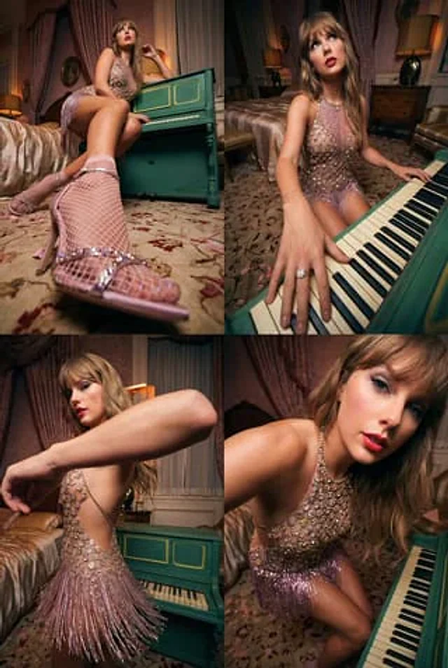

```text
Transform the original photo into a dramatic, photorealistic, ultra-detailed set of 4 styles characters are included , each a mid close up wide-angle shot with an extreme, dynamic camera angle complex, powerful pose in a consistent, expanded version of the original environment, with cinematic lighting, high contrast, crisp textures, and precise color grading.
```

Model: Nano Banana
Author: ANKIT PATEL 🇮🇳 | AI

[ProjectD](https://aitoolsradar.com/en/prompts/5dbc1d4f9d3e18) · [Recorded source](https://x.com/Ankit_patel211/status/2019833999154376925)
 · [Full original metadata and byte evidence](data/projectd-batch-0060.json)

## ANKIT PATEL 🇮🇳 | AI #620

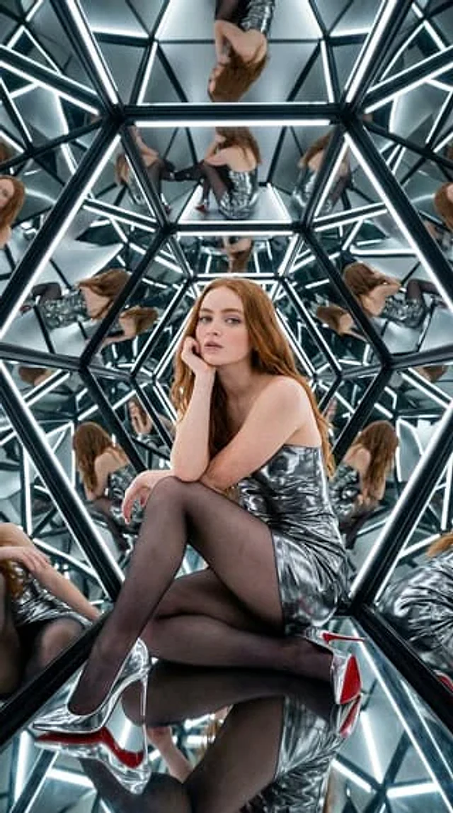

```text
[
  {
    "id": "subject",
    "type": "person",
    "description": "Madelyn Cline with long blonde hair, looking at the camera.",
    "pose": "She is walking forward through the mirrored structure mid-step, one hand lightly brushing the metal framework while the other adjusts her hair as she glances toward the camera.",
    "clothing": {
      "dress": {
        "color": "deep violet",
        "material": "patent leather",
        "style": "strapless mini-dress"
      },
      "legwear": {
        "color": "black",
        "type": "sheer pantyhose"
      },
      "footwear": {
        "color": "Violet",
        "material": "patent leather",
        "style": "Louboutin So Kate with red sole"
      }
    }
  },
  {
    "id": "environment",
    "type": "room",
    "description": "A geometrically designed mirrored room with a fractured, kaleidoscopic effect.",
    "elements": [
      {
        "type": "mirrors",
        "description": "Multiple angled mirror panels reflecting the subject and the room structure."
      },
      {
        "type": "structure",
        "description": "Black metal framework holding the mirror panels."
      }
    ],
    "lighting": "Bright, high-contrast light from LED strips within the structure, creating sharp highlights and reflections, high-quality, cinematic, Ultra-realistic photo and lighting, high quality photo, depth of field, no Ai or cgi look, 8k resolution."
  }
]
```

Model: Nano Banana
Author: ANKIT PATEL 🇮🇳 | AI

[ProjectD](https://aitoolsradar.com/en/prompts/c0093a9b6720ea) · [Recorded source](https://x.com/Ankit_patel211/status/2031334187689718167)
 · [Full original metadata and byte evidence](data/projectd-batch-0060.json)

## ANKIT PATEL 🇮🇳 | AI #811

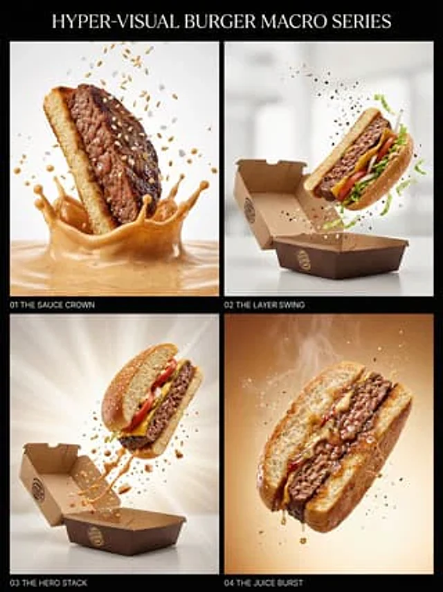

```text
{
  "project": {
    "title": "Hyper-Visual Burger Macro Series",
    "version": "2.0_Structured_High_Speed",
    "target_aesthetic": "High-end Commercial Advertising"
  },
  "technical_foundation": {
    "camera_hardware": {
      "body": "Nikon D850",
      "lens": "105mm f/2.8 Micro-Nikkor",
      "settings": "High-speed shutter, deep depth of field, ISO 100"
    },
    "global_image_specs": {
      "aspect_ratio": "2:3",
      "resolution": "8K Ultra-HD",
      "lighting_style": "Studio high-key with rim-light accents",
      "color_profile": "Vibrant, high-saturation golden browns, reds, and greens"
    }
  },
  "scene_manifest": [
    {
      "scene_id": "01_THE_SAUCE_CROWN",
      "composition": {
        "focus": "Macro interaction",
        "subject": "Juicy burger slice (beef patty cross-section with bun edge)",
        "action": "Vertical plunge into glossy burger sauce"
      },
      "physics_elements": {
        "liquid": "Thick, creamy signature burger sauce",
        "splash_shape": "Symmetrical dynamic crown",
        "particles": "Suspended sauce droplets, sesame seeds, and salt flakes"
      },
      "texture_details": [
        "Seared beef fibers",
        "Juicy meat sheen",
        "Toasted bun crumb texture"
      ]
    },
    {
      "scene_id": "02_THE_LAYER_SWING",
      "composition": {
        "focus": "Dynamic movement",
        "subject": "Burger slice in motion",
        "environment": "Open burger box context"
      },
      "physics_elements": {
        "motion": "Angular swing trajectory",
        "particles": "Pepper flakes, salt crystals, and lettuce shreds",
        "background": "Soft-focus bright studio"
      },
      "lighting": "Balanced shadow/highlight contrast for rich 3D depth"
    },
    {
      "scene_id": "03_THE_HERO_STACK",
      "composition": {
        "focus": "Action-packed layout",
        "subject": "Upward ejecting burger slice",
        "branding": "Open branded burger box beneath"
      },
      "lighting_effects": {
        "primary": "Radial spotlight burst behind subject",
        "secondary": "Fill light emphasizing juicy meat and bun texture"
      },
      "particle_vfx": "Explosive trail of sauce droplets, crumbs, and sesame seeds"
    },
    {
      "scene_id": "04_THE_JUICE_BURST",
      "composition": {
        "focus": "Extreme macro freeze-frame",
        "subject": "Burger slice juice release",
        "action": "Mid-air compression and release of meat juices"
      },
      "environment_vfx": {
        "background": "Warm amber-to-cream high-contrast gradient",
        "atmosphere": "Fine mist of steam and seasoning particles",
        "shimmer": "Backlit glints on melted fat, sauce, and bun surface"
      }
    }
  ],
  "negative_parameters": [
    "motion blur",
    "plastic or artificial food textures",
    "low-resolution noise",
    "muddy colors",
    "overexposed highlights",
    "unrealistic food physics"
  ]
}
```

Model: Nano Banana
Author: ANKIT PATEL 🇮🇳 | AI

[ProjectD](https://aitoolsradar.com/en/prompts/9cbc6510012694) · [Recorded source](https://x.com/Ankit_patel211/status/2009339340418371647)
 · [Full original metadata and byte evidence](data/projectd-batch-0060.json)

## ANKIT PATEL 🇮🇳 | AI #975

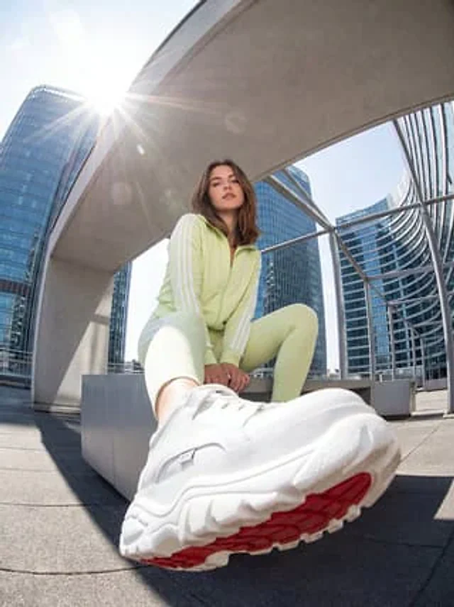

```text
"scene_description": {
    "location": "Urban rooftop or high vantage point with a backdrop of towering glass skyscrapers and sleek modern architecture",
    "vibe": "Energetic, youthful, urban streetwear, dynamic and slightly distorted perspective",
    "lighting": "Bright daylight, harsh sunlight creating a sunburst/lens flare in the upper left, high contrast shadows on the sleek surfaces, vibrant colors",
    "camera_settings": "Ultra-wide angle or Fisheye lens (approx 8mm-12mm), extreme low angle (worm's-eye view), forced perspective, deep depth of field, sharp focus from shoe sole to skyline, close up full body shot of the woman"
  },
  "primary_subjects": [
    {
      "character": "Young woman with shoulder-length brown hair",
      "role": "Streetwear model / Urban explorer",
      "action": "Sitting casually on the corner of a modern minimalist ledge or platform, looking down at the camera with a confident, relaxed expression. One leg is extended forward towards the lens creating extreme foreshortening, maintaining the same pose as before",
      "details": "Bright red track jacket with white stripes on sleeves, Bright Red fitted leggings, massive white chunky platform sneakers with a distinct red tread pattern on the sole (shoe is the dominant foreground element)"
    }
  ],
  "environment_details": {
    "crowd": "None",
    "architecture": "Curved modern glass skyscrapers surrounding the subject, smooth light concrete or metallic ledge in the foreground instead of a red brick wall, clean modern textures",
    "fidelity": "High-resolution photography, realistic texture on the sneaker leather and modern materials, lens distortion effect on the buildings"
  }
}
```

Model: Nano Banana
Author: ANKIT PATEL 🇮🇳 | AI

[ProjectD](https://aitoolsradar.com/en/prompts/60d4be3d354fa3) · [Recorded source](https://x.com/Ankit_patel211/status/2020152101528301587)
 · [Full original metadata and byte evidence](data/projectd-batch-0060.json)

## arc. #1444

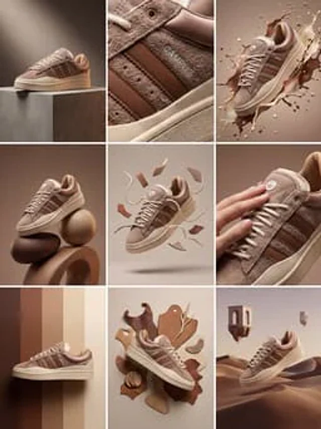

```text
Create a 3×3 grid in
3:4 aspect ratio for a high-end commercial marketing campaign using the uploaded product as the central subject.

Each frame must present a distinct visual concept while maintaining perfect product consistency across all nine images.

Grid Concepts (one per cell):

1. Iconic hero still life with bold composition

2. Extreme macro detail highlighting material, surface, or texture

3. Dynamic liquid or particle interaction surrounding the product

4. Minimal sculptural arrangement with abstract forms

5. Floating elements composition suggesting lightness and innovation

6. Sensory close-up emphasizing tactility and realism

7. Color-driven conceptual scene inspired by the product palette

8. Ingredient or component abstraction (non-literal, symbolic)

9. Surreal yet elegant fusion scene combining realism and imagination

Visual Rules:
Product must remain 100% accurate in shape, proportions, label, typography, color, and branding
No distortion, deformation, or redesign of the product
Clean separation between product and background

Lighting & Style:
Soft, controlled studio lighting
Subtle highlights, realistic shadows
High dynamic range, ultra-sharp focus
Editorial luxury advertising aesthetic
Premium sensory marketing look

Overall Feel:
Modern, refined, visually cohesive
High-end commercial campaign
Designed for brand websites, social grids, and digital billboards
Hyperreal, cinematic, polished, and aspirational
```

Model: Nano Banana
Author: arc.

[ProjectD](https://aitoolsradar.com/en/prompts/4d89f561b4bed2) · [Recorded source](https://x.com/arceyul/status/2041150657659384180)
 · [Full original metadata and byte evidence](data/projectd-batch-0060.json)

## arc. #724

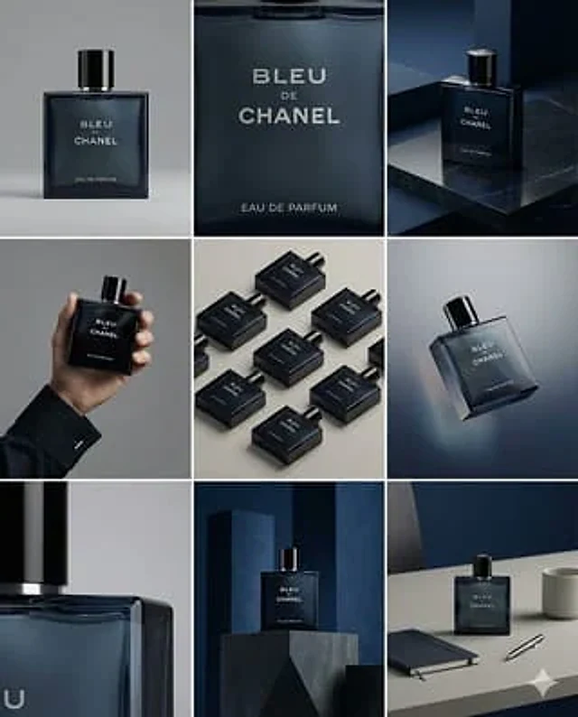

```text
Un storyboard limpio en cuadrícula 3×3 con nueve paneles iguales en proporción [ratio], dentro de un formato total 4:5.

Usa la imagen de referencia como base del producto. Mantén exactamente el mismo producto, diseño del packaging, branding, materiales, colores, proporciones e identidad general en los nueve paneles, tal como en la referencia. El producto debe ser claramente reconocible en cada frame. La etiqueta, el logo y las proporciones deben permanecer exactamente iguales.

Este storyboard es una presentación mockup de alto nivel para un portfolio de branding. El enfoque está en la forma, la composición, la materialidad y el ritmo visual, más que en el realismo o una narrativa lifestyle. El resultado debe sentirse curado, editorial y orientado al diseño.

FRAME 1:
Plano frontal hero del producto en un entorno de estudio limpio. Fondo neutro, composición equilibrada, presentación calmada y segura del producto.

FRAME 2:
Primer plano con el enfoque centrado en la parte media del producto. Se destacan la textura de la superficie, los materiales y los detalles de impresión.

FRAME 3:
El producto de referencia colocado en un entorno que encaja naturalmente con la marca y la categoría del producto. Escenario de estudio inspirado en los elementos de diseño y colores del producto.

FRAME 4:
Producto mostrado en uso o en interacción sobre un fondo de estudio neutro. Las manos y los elementos de interacción son mínimos y discretos, manteniendo el estilo del packaging.

FRAME 5:
Composición isométrica que muestra varios productos organizados en un orden geométrico preciso desde un ángulo isométrico superior. Todos los productos están colocados con el mismo ángulo isométrico, espaciados de forma uniforme, limpios, estructurados y gráficos.

FRAME 6:
Producto levitando ligeramente, inclinado sobre un fondo neutro que coincida con la paleta de colores de la imagen de referencia. La posición flotante es intencional y natural en el espacio.

FRAME 7:
Primerísimo primer plano centrado en un detalle específico de la etiqueta, el borde, la textura o el comportamiento del material.

FRAME 8:
El producto en un entorno inesperado pero estéticamente potente, con un enfoque audaz, editorial y visualmente impactante. Escenario inesperado pero altamente estilizado, basado en estudio y dirigido por diseño. Composición fuerte que eleva la marca.

FRAME 9:
Composición amplia que muestra el producto en uso dentro de un setup de diseño refinado. Props limpios, estilismo controlado y coherente con el resto de la serie.

CÁMARA Y ESTILO:
Imágenes de estudio de ultra alta calidad con apariencia de cámara real. Diferentes ángulos y encuadres en cada frame. Profundidad de campo controlada, iluminación precisa, materiales y reflejos realistas. La lógica de iluminación, la paleta de colores, el mood y el lenguaje visual deben mantenerse consistentes en los nueve paneles como una sola serie cohesionada.

OUTPUT:
Una cuadrícula limpia 3×3 sin bordes, sin texto, sin captions y sin marcas de agua.
```

Model: Nano Banana
Author: arc.

[ProjectD](https://aitoolsradar.com/en/prompts/7aeaed963a6d3a) · [Recorded source](https://x.com/arceyul/status/2027526257018024246)
 · [Full original metadata and byte evidence](data/projectd-batch-0060.json)

## auqib #1013

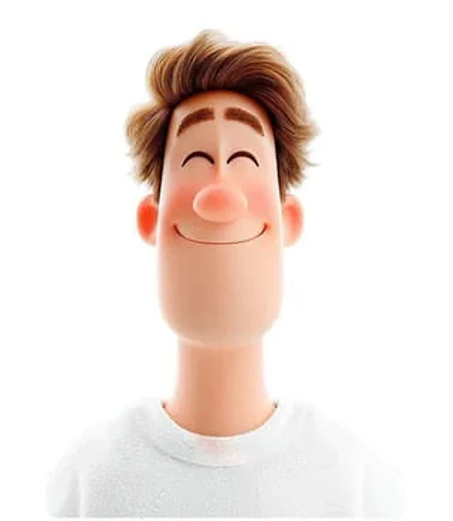

```text
3D avatar of a man, with a happy face on a white background, no necks. Conceptual playlist style digital art with Pixar quality aesthetics
```

Model: Nano Banana
Author: auqib

[ProjectD](https://aitoolsradar.com/en/prompts/3e7805a16684a5) · [Recorded source](https://x.com/auqibhabib/status/2029107310187237797)
 · [Full original metadata and byte evidence](data/projectd-batch-0060.json)

## auqib #1033

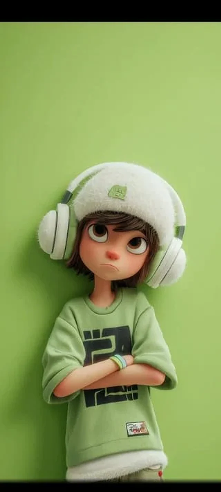

```text
A stylized 3D cartoon character of a young boy with big expressive eyes and a slightly sad, pouty expression, standing against a solid pastel green background. He is wearing a soft white fuzzy beanie with ear flaps and matching white over-ear headphones. His hair is short, brown, and slightly messy, peeking out from under the cap. He wears an oversized light green t-shirt with a bold black graphic on the front, and his arms are crossed in a bored or annoyed pose. The lighting is soft, diffused studio lighting with smooth shadows, giving a clean aesthetic. Ultra-detailed, high-quality 3D render, Pixar-style, soft textures, shallow depth of field, centered composition, minimal background, vibrant but soft color palette.

Negative prompt (optional):
blurry, low quality, extra limbs, distorted face, harsh shadows, cluttered background, text artifacts, watermark
```

Model: Nano Banana
Author: auqib

[ProjectD](https://aitoolsradar.com/en/prompts/eec6a5fc7c6b6b) · [Recorded source](https://x.com/auqibhabib/status/2040674336605114412)
 · [Full original metadata and byte evidence](data/projectd-batch-0060.json)

## auqib #1070

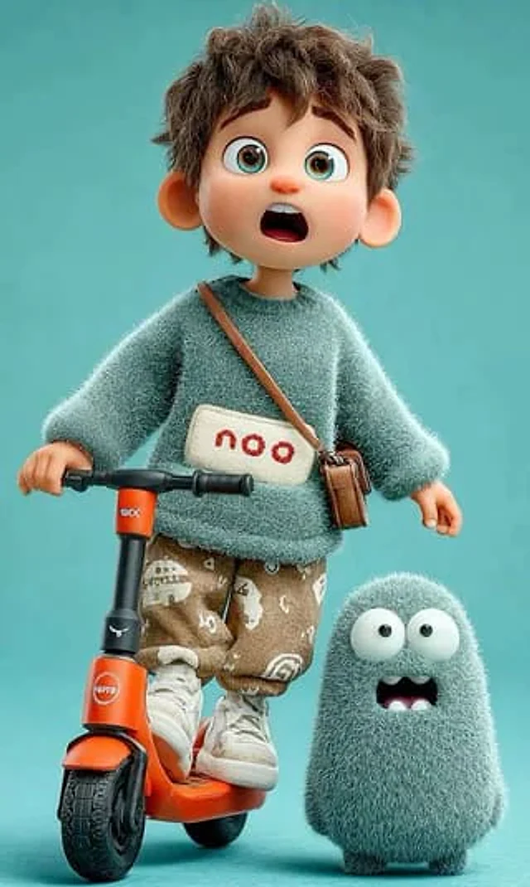

```text
3D Pixar-style animated child character, cute young boy with messy brown hair and big expressive blue eyes, surprised open-mouth expression, soft round face, wearing a fuzzy teal sweater with small “noo” text on chest, loose beige patterned pants, white sneakers, small brown crossbody bag, standing on an orange electric scooter, minimal teal studio background, soft lighting, ultra-detailed textures (fabric fuzz, skin, hair), cinematic depth of field, vibrant colors, highly polished render, octane render, 4k
```

Model: Nano Banana
Author: auqib

[ProjectD](https://aitoolsradar.com/en/prompts/1fdde7bae66681) · [Recorded source](https://x.com/auqibhabib/status/2042541082580521244)
 · [Full original metadata and byte evidence](data/projectd-batch-0060.json)

## auqib #1105

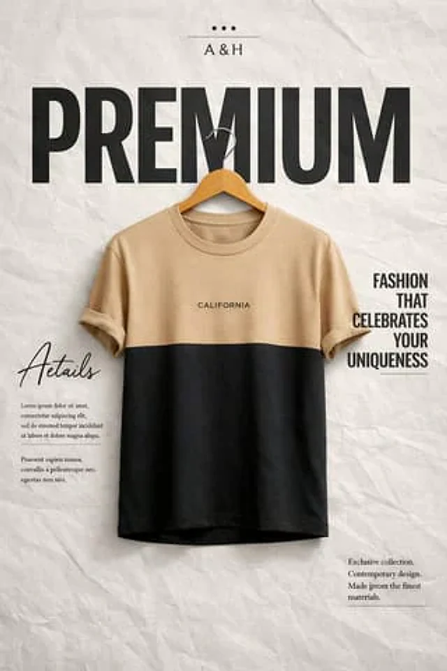

```text
Create a high-end minimalist fashion advertisement poster.
Background: light grey wrinkled paper poster texture with editorial magazine layout.
At the top center place a small brand label “A&H” with minimal dots style logo above it.
Behind the product place a huge bold word “PREMIUM” in black, very large sans-serif font, spanning almost the entire width of the poster.
Center of the poster:
A two-tone t-shirt hanging on a wooden hanger.
Top half color beige/tan, bottom half deep black.
Short sleeves slightly folded.
Clean premium cotton texture.
On the chest of the shirt place the small text “YOUR BRAND NAME” in simple minimal font.
Left side design area:
Stylish script word “Aetails” (signature style starting with A) replacing “Details”.
Under it small editorial paragraph blocks (magazine layout filler text).
Right side:
Editorial typography block with the phrase
“FASHION THAT CELEBRATES YOUR UNIQUENESS”
in bold modern sans-serif.
Bottom right small editorial text block similar to fashion magazine layout.
Important rules: • Do NOT add any website URLs
• Do NOT add social media icons
• Do NOT add barcodes
• Do NOT add any random or unrecognizable text
• Brand name must be “A&H”
• Keep same colors, same layout, same typography style, same font weight, same font sizes, same composition
• clean luxury fashion ad aesthetic
• studio lighting, ultra sharp, photorealistic, 4K fashion poster design
```

Model: Nano Banana
Author: auqib

[ProjectD](https://aitoolsradar.com/en/prompts/9306d717d2e276) · [Recorded source](https://x.com/auqibhabib/status/2032618498460102987)
 · [Full original metadata and byte evidence](data/projectd-batch-0060.json)

## auqib #1128

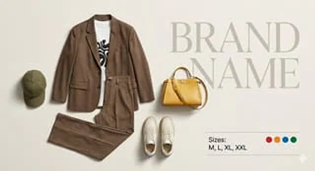

```text
Create a premium fashion catalog flat lay on a clean soft beige studio background.
Only show the outfit items, arranged neatly as if for an ecommerce product display.

Items included: • Brown oversized blazer
• White graphic t-shirt
• Brown pinstripe wide-leg trousers
• Olive green cap
• Cream sneakers
• Yellow designer handbag

Arrange the clothing in a clean aesthetic flat-lay composition so it looks like the outfit is worn but without any person or mannequin. Each item must be perfectly isolated and clearly visible with realistic folds and shadows. The layout should look professional and balanced like a luxury fashion brand product catalog.

Lighting: soft studio lighting, minimal shadows, ultra sharp details, high fashion editorial style, 4K quality.

Add a large stylish bold text in the background behind the outfit: BRAND NAME

Typography should be modern, elegant and slightly faded so it looks like a branding element of the catalog.

Add a small product info section on one side: Sizes: M, L, XL, XXL

Next to it place small circular color indicators showing available colors: Red, Orange, Blue, Green

Important requirements: • No person
• No character
• No mannequin
• Only clothes and accessories
• Clean catalog layout
• Ultra detailed fabric texture
• Professional ecommerce product presentation
```

Model: Nano Banana
Author: auqib

[ProjectD](https://aitoolsradar.com/en/prompts/5be1cf7f8bc063) · [Recorded source](https://x.com/auqibhabib/status/2030807641187045608)
 · [Full original metadata and byte evidence](data/projectd-batch-0060.json)

## auqib #1157

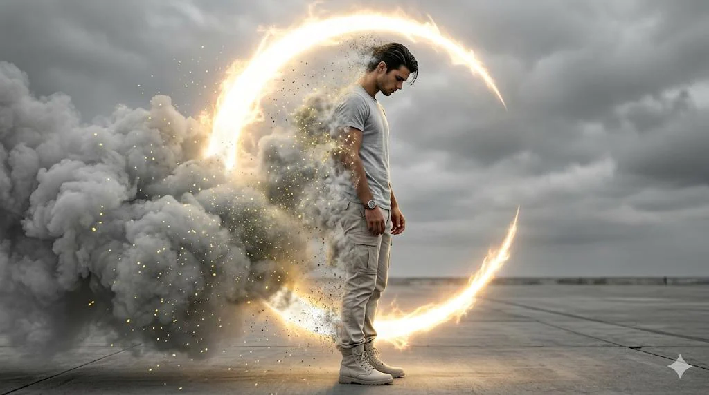

```text
Create an ultra-realistic, cinematic 8K image with high-contrast dramatic lighting and a photo-real digital painting aesthetic-use face reference exactly. The man is shown in a full-body side profile facing right, his face and hairstyle copied perfectly with no alterations He wears modern casual streetwear; a light grey crewneck t-shirt, light neutral cargo pants, light-colored high-top boots, and a watch on his left wrist. His posture is slightly slumped, head bowed, eyes looking downward, hands relaxed at his sides, conveying deep introspection and sorrow. Nearly half of his body is dissolving into extremely thick, cloud-like grey smoke filled with glowing yellow dust particles. His left arm, shoulder, torso, legs, and part of his hair become transparent as they break into luminous particles, suggesting active disintegration Behind and partially surrounding him is a massive glowing crescent (C-shaped) energy aura, emitting fiery golden-white plasma light. This aura acts as a powerful rim and backlight, highlighting the smoke, dust, and silhouette. The setting is minimal and stark: a concrete or desolate paved surface meeting a heavily overcast sky. The color palette is nearly monochrome greys and whites, contrasted by intense amber-gold glow, Shallow depth of field, glow/bloom lighting, particle dispersion, cinematic composition, emotional and dramatic atmosphere.
```

Model: Nano Banana
Author: auqib

[ProjectD](https://aitoolsradar.com/en/prompts/abea1ee4c92509) · [Recorded source](https://x.com/auqibhabib/status/2028276251262423347)
 · [Full original metadata and byte evidence](data/projectd-batch-0060.json)

## auqib #1162

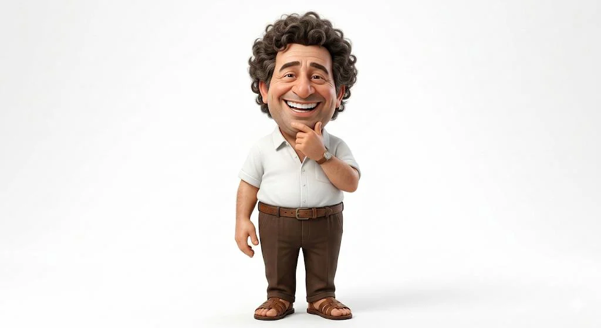

```text
A highly detailed 3D caricature of a cheerful man with an oversized head, a big smile showcasing large teeth, and curly voluminous hair. He is wearing a short-sleeved white button-up shirt, brown high-waisted pants with a belt, and traditional sandals. His pose is casual and friendly, with one hand touching his chin in a thoughtful manner. The art style is semi-realistic with exaggerated cartoonish features, set aw against a clean white background.""A highly detailed 3D caricature of a cheerful man with an oversized head, a big smile showcasing large teeth, and curly voluminous hair. He is wearing a short-sleeved white button-up shirt, brown high-waisted pants with a belt, and traditional sandals. His pose is casual and friendly, with one hand touching his chin in a thoughtful manner. The art style is semi-realistic with exaggerated cartoonish features, set against a clean white background.
```

Model: Nano Banana
Author: auqib

[ProjectD](https://aitoolsradar.com/en/prompts/d934009a91c1e3) · [Recorded source](https://x.com/auqibhabib/status/2029363366192660526)
 · [Full original metadata and byte evidence](data/projectd-batch-0060.json)

## auqib #1174

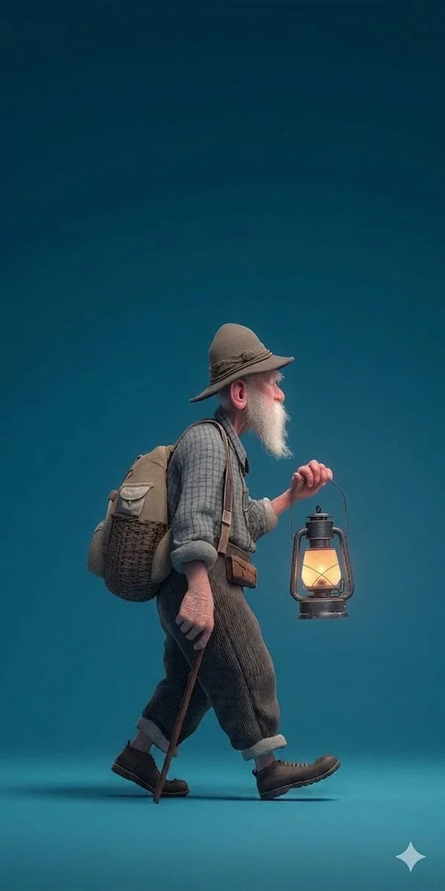

```text
​A stylized 3D rendered full-body profile portrait of an elderly male hiker with a long white beard, viewed from the side and walking from left to right. He is set against a solid, seamless deep-teal studio background with soft floor reflections. He wears a brown felt wide-brimmed hiker's hat, a gray and blue plaid shirt over cuffed brown corduroy trousers, and dark, scuffed work boots. On his back is a large, detailed combination canvas and woven wicker backpack with leather straps. He holds a lit, vintage brass-and-glass hurricane lantern in his right hand, which casts a warm, soft glow. He also carries a simple wooden walking stick. The image has a textured, matte finish and soft, diffused studio lighting, with the vertical composition leaving ample negative space.
```

Model: Nano Banana
Author: auqib

[ProjectD](https://aitoolsradar.com/en/prompts/f8ac1473f5dad5) · [Recorded source](https://x.com/auqibhabib/status/2044357243827580959)
 · [Full original metadata and byte evidence](data/projectd-batch-0060.json)

## auqib #1197

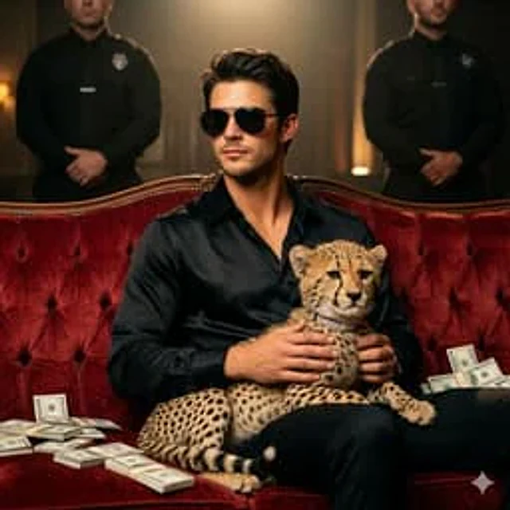

```text
Using the reference picture, create A stylish man sitting on a luxurious vintage red velvet sofa, wearing black silk shirt, sunglasses, confi-dently holding a cheetah adorned with cinematic lighting, dollars are spread on sofa too and there are two guards on back side in blur bg, luxury life-style, dramatic atmosphere." 100% Real Face 8K Resolution
```

Model: Nano Banana
Author: auqib

[ProjectD](https://aitoolsradar.com/en/prompts/0c0589f6f17eb6) · [Recorded source](https://x.com/auqibhabib/status/2029721401033384149)
 · [Full original metadata and byte evidence](data/projectd-batch-0060.json)

## auqib #1206

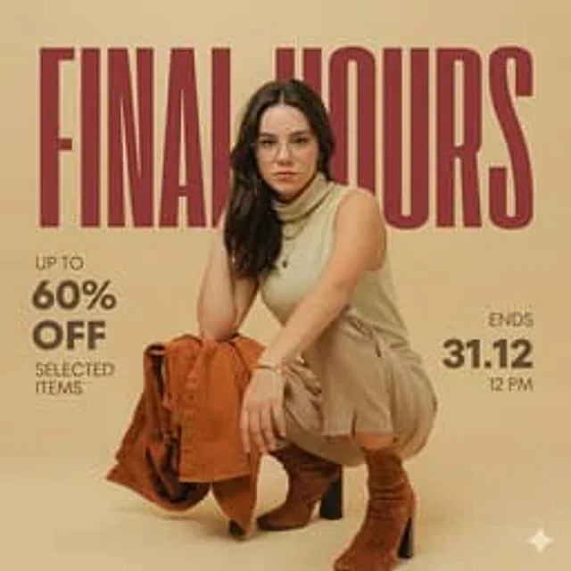

```text
Ultra-realistic fashion advertisement poster, minimalist editorial style.
Background: solid warm beige studio backdrop with soft gradient lighting, smooth clean texture.
Main subject: a stylish young woman in a low squat pose, body slightly turned sideways, one arm resting on knee, other hand touching back of head. Expression calm, confident, slightly looking sideways (not directly at camera).
Outfit (keep EXACT):
Sleeveless beige/tan high-neck top
Slim beige pants
Brown suede ankle boots with block heels
Light brown jacket placed casually near her feet
Minimal accessories: small hoop earrings, thin bracelet
Hair: straight, shoulder-length, natural dark brown, side-parted
Makeup: soft natural tones, clean skin, subtle glow
⚠️ Face: [REPLACE FACE WITH PROVIDED IMAGE / KEEP FACE GENERIC IF NOT PROVIDED]
(ensure seamless blending, same lighting, same skin tone, hyper-realistic)
Typography & Layout (EXACT SAME STYLE)
Top: Large bold condensed sans-serif text in dark red: FINAL HOURS (very large, stretched across width, behind subject partially)
Left side: Small text: UP TO
60% OFF
SELECTED ITEMS
Right side: ENDS
31.12
12 PM
Bottom: ⚠️ NO WEBSITE TEXT (REMOVE COMPLETELY)
Lighting & Style
Soft studio lighting, warm tone
Subtle shadows under subject
Clean editorial magazine look
Slight depth but mostly flat poster style
Matte finish, no gloss
Perfect alignment, balanced spacing
```

Model: Nano Banana
Author: auqib

[ProjectD](https://aitoolsradar.com/en/prompts/5c906329eba774) · [Recorded source](https://x.com/auqibhabib/status/2033918180352233873)
 · [Full original metadata and byte evidence](data/projectd-batch-0060.json)

## auqib #1249

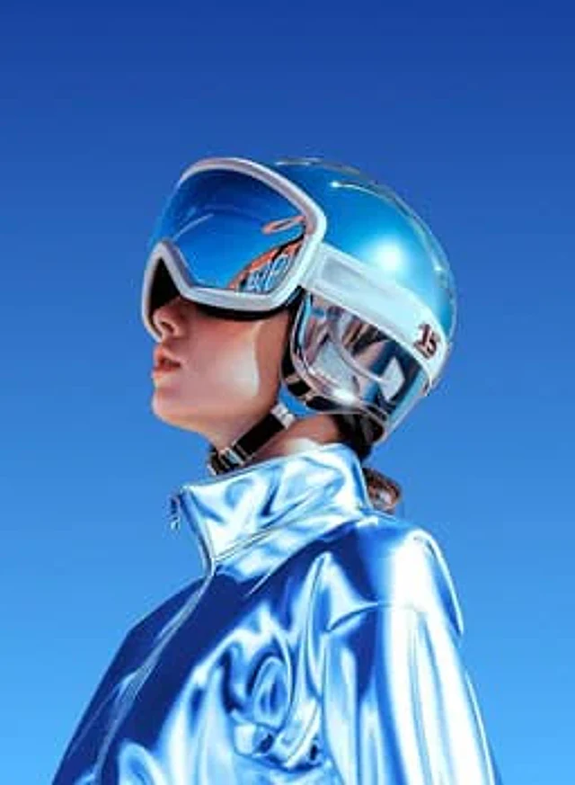

```text
Ultra-realistic futuristic portrait of a young woman in side profile facing left, wearing a reflective metallic blue chrome jacket and a sleek sci-fi helmet with a large glossy visor covering her eyes. The helmet has smooth curves, white accents, and transparent side panels with subtle mechanical details. The visor reflects light with a blue tint, giving a cyberpunk / space-age aesthetic. Minimalistic composition with a solid gradient blue background. Soft cinematic lighting with high contrast and glossy reflections on the jacket and helmet. Sharp focus on the face and textures, shallow depth of field, studio-quality, 8K, hyper-detailed, clean and modern fashion editorial style.
```

Model: Nano Banana
Author: auqib

[ProjectD](https://aitoolsradar.com/en/prompts/98ff0224120a49) · [Recorded source](https://x.com/auqibhabib/status/2042461948336595020)
 · [Full original metadata and byte evidence](data/projectd-batch-0060.json)

## auqib #1394

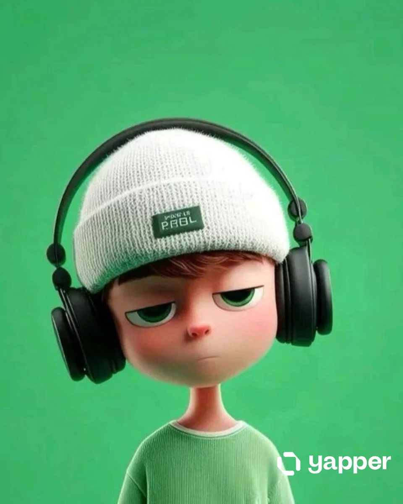

```text
A stylized 3D cartoon boy character with a minimal, Pixar-like design, pale skin, slightly oversized head, and a slim body. He has half-closed sleepy green eyes, a bored expression, and soft facial features with a small nose and subtle blush. He is wearing a light grey knitted beanie with a small front label, large black over-ear headphones, and a loose green sweatshirt. The character is centered, facing forward, with relaxed posture. Background is a smooth solid green gradient. Soft studio lighting, high detail, clean render, shallow depth of field, ultra-realistic textures, 4K.
```

Model: Nano Banana
Author: auqib

[ProjectD](https://aitoolsradar.com/en/prompts/3bec9348af0b18) · [Recorded source](https://x.com/auqibhabib/status/2041096374566228189)
 · [Full original metadata and byte evidence](data/projectd-batch-0060.json)

## auqib #771

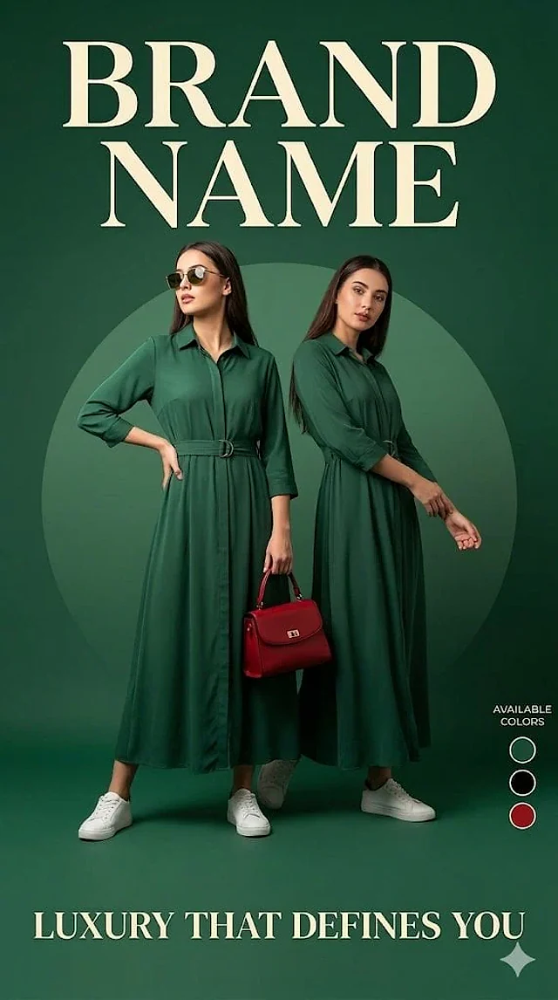

```text
Luxury fashion advertisement poster, deep green background with a soft circular gradient behind the model, two stylish female models standing full body. First model wearing a long elegant green dress with waist belt, white sneakers, sunglasses, holding a red handbag, confident pose with one hand on waist looking sideways. Second female model standing beside her in a different pose, slightly angled stance with relaxed arms, wearing a similar elegant fashion outfit matching the luxury theme. Studio lighting, minimal shadows, ultra-clean composition, premium fashion campaign style.

At the top place large bold luxury serif text “BRAND NAME” (same placement and style as luxury fashion brands).

At the bottom add text:
“LUXURY THAT DEFINES YOU”
Below it smaller text:

Add a small side section titled “AVAILABLE COLORS” with three small circular color indicators: Green, Black, Red.

Highly detailed, fashion catalog quality, DSLR photography style, 8k resolution, symmetrical layout, luxury branding aesthetic, professional advertising poster.
```

Model: Nano Banana
Author: auqib

[ProjectD](https://aitoolsradar.com/en/prompts/878330713e872b) · [Recorded source](https://x.com/auqibhabib/status/2030906462999122123)
 · [Full original metadata and byte evidence](data/projectd-batch-0060.json)

## Aylin #787

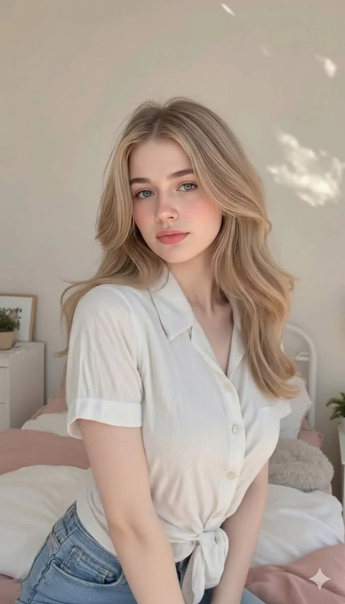

```text
Cute, innocent young adult blonde woman  sitting comfortably on a neatly made bed, relaxed natural posture with legs gently bent, shoulders soft and at ease. Long, soft, flowing blonde hair styled in loose natural waves, silky texture, subtle shine, a few delicate strands framing her face. Clear blue eyes with a gentle sparkle, long natural lashes, delicate eyebrows, smooth fair complexion with a soft healthy glow, subtle blush on cheeks, light pink lips, minimal natural makeup enhancing her youthful features. Calm, sweet, peaceful expression conveying warmth and innocence.

Wearing a clean white short-sleeve cotton shirt, lightweight fabric, neatly tied at the waist with natural folds and creases, paired with light-wash high-waisted jeans, casual fit, realistic denim texture, visible stitching and seams, effortlessly stylish yet simple.

Bright, cozy bedroom interior filled with soft natural light, white and cream color palette, minimal modern decor, neatly arranged pillows, soft linen bedsheets, light wooden bed frame and furniture, a large window nearby with sheer curtains gently diffusing the sunlight. Warm morning or late-afternoon sunlight streaming in, creating soft highlights on her hair and skin, gentle shadows for depth, peaceful and intimate atmosphere, calm lifestyle mood.

Photorealistic, ultra-high detail, hyper-detailed skin texture with visible natural pores and softness, realistic hair strands with depth and volume, accurate fabric textures, lifelike color tones. Shot on Canon DSLR, 50mm f/1.8 lens, shallow depth of field, creamy natural bokeh background, sharp focus on eyes and face, natural lighting only, no artificial flash. Soft cinematic yet true-to-life color grading, lifestyle editorial photography style, clean balanced composition, vertical framing, realistic perspective, professional photography quality.
--ar 3:4 --stylize 250 --v 6 --q 2
```

Model: Nano Banana
Author: Aylin

[ProjectD](https://aitoolsradar.com/en/prompts/0c157d18bc21bf) · [Recorded source](https://x.com/Ai_aylinfc/status/2017166130746675620)
 · [Full original metadata and byte evidence](data/projectd-batch-0060.json)

## AZIZ | AI 🇸🇦 #409

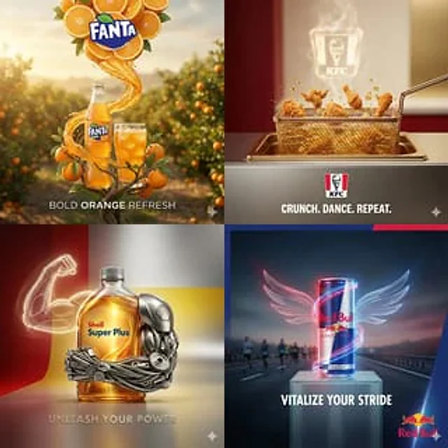

```text
Create a realistic yet surreal creative advertisement for [PRODUCT NAME] in the [PRODUCT CATEGORY] space. The product must be the hero, centered in the frame, and visually “formed” in a smart way that automatically reflects the brand’s spirit and identity.

Use a clean, cohesive background that matches the brand’s color palette, with soft cinematic lighting, ultra-realistic premium materials, precise shadows, and a high-end editorial composition.

Add one innovative surreal touch directly tied to the product’s nature—creative but not exaggerated.

Integrate the real official product logo elegantly and seamlessly within the composition, and generate a short, powerful 3-word English slogan automatically that fits the product type and brand tone.

Ultra-high quality, perfectly balanced framing, strong realism, luxury style—no extra text beyond the logo and the 3-word English slogan.
```

Model: Nano Banana
Author: AZIZ | AI 🇸🇦

[ProjectD](https://aitoolsradar.com/en/prompts/af97545c48849a) · [Recorded source](https://x.com/aziz4ai/status/2008248159815036942)
 · [Full original metadata and byte evidence](data/projectd-batch-0060.json)

## AZIZ | AI 🇸🇦 #644

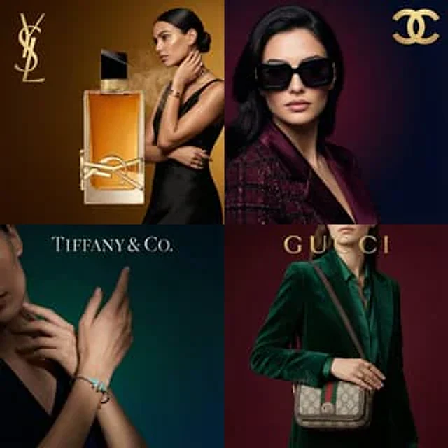

```text
[upload luxury product photo]
BRAND NAME: [Put the brand name here]

Create ONE luxury editorial poster. Keep the product EXACT and unchanged. Use the BRAND NAME to infer identity and place the REAL official logo (correct proportions) in the most brand-appropriate position with subtle print texture. Add a perfectly matched attractive model wearing the product naturally. Rich deep colors, HDR, premium studio lighting, clean background, strong negative space, ultra-sharp 8K. No extra text, no watermark.
```

Model: Nano Banana
Author: AZIZ | AI 🇸🇦

[ProjectD](https://aitoolsradar.com/en/prompts/ae32844c70df73) · [Recorded source](https://x.com/aziz4ai/status/2008592833406791789)
 · [Full original metadata and byte evidence](data/projectd-batch-0060.json)

## AZIZ | AI 🇸🇦 #712

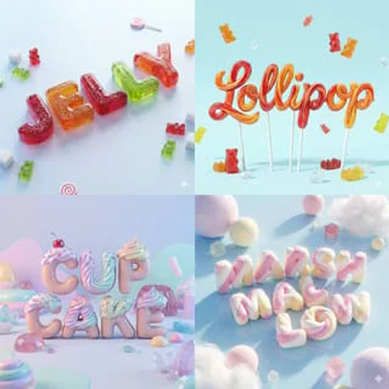

```text
A smooth, ultra-realistic 3D render of the word [YOUR WORD] shaped like a delicious candy — style adapts based on word — surrounded by a minimal candy world — high-Kelvin lighting — cinematic ray tracing — soft shadows — glossy details — hyper-real textures — square format
```

Model: Nano Banana
Author: AZIZ | AI 🇸🇦

[ProjectD](https://aitoolsradar.com/en/prompts/133f9bbe69ec1c) · [Recorded source](https://x.com/aziz4ai/status/2009664169331839410)
 · [Full original metadata and byte evidence](data/projectd-batch-0060.json)

## babydoll #336

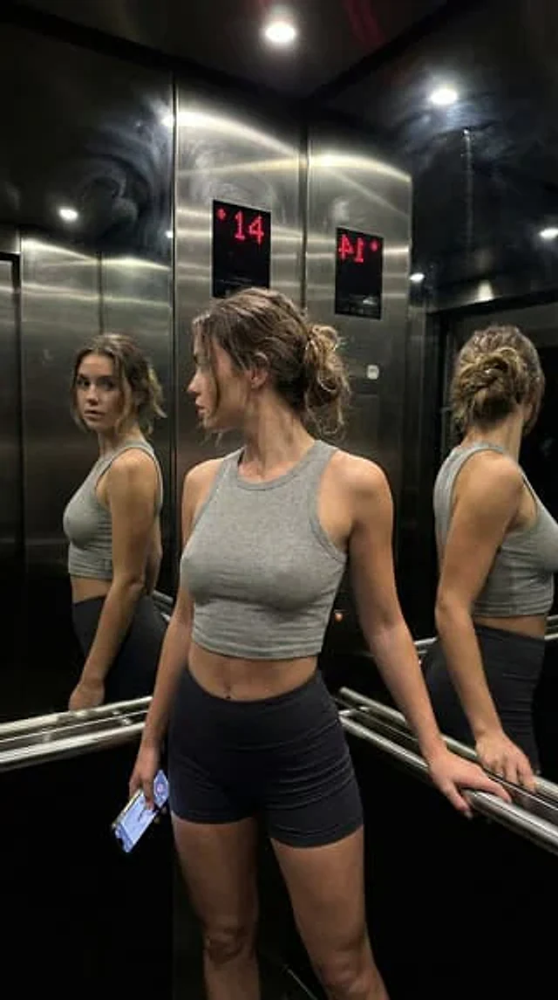

```text
{
  "meta": {
    "aspect_ratio": "9:16",
    "quality": "ultra_photorealistic",
    "resolution": "8k",
    "camera": "iPhone front camera",
    "lens": "24mm",
    "style": "raw iPhone mirror realism, zero smoothing, heavy reflections, subtle grain, imperfect exposure"
  },

  "scene": {
    "location": "luxury apartment elevator",
    "environment": [
      "mirror walls on three sides",
      "brushed stainless steel panels",
      "glass-like reflection layering (multiple reflections of body)",
      "LED ceiling strip lights",
      "digital floor number glowing red",
      "slight fingerprints and smudges on mirror"
    ],
    "time": "late night",
    "atmosphere": "private tension in a public box, quiet, charged, intimate"
  },

  "lighting": {
    "type": "mixed elevator lighting",
    "sources": [
      "cool white overhead LEDs",
      "warm spill from control panel lights"
    ],
    "effect": [
      "high contrast highlights on hips and thighs",
      "specular reflections multiplying curves in mirrors",
      "face partially lit, partially disappearing in reflections",
      "real iPhone low-light noise in shadows"
    ]
  },

  "camera_perspective": {
    "pov": "mirror selfie",
    "angle": "slightly low and close",
    "framing": "upper thighs to head",
    "distance": "arm-length",
    "imperfections": [
      "phone edge visible in reflection",
      "finger slightly covering lens corner",
      "minor motion blur from breathing"
    ]
  },

  "subject": {
    "gender": "female",
    "ethnicity": "light european / mediterranean mix",
    "vibe": "young adult, controlled confidence, quietly provocative",

    "body": {
      "type": "fit-curvy",
      "waist": "tight and defined",
      "hips": "round and visually repeated by reflections",
      "thighs": "thick, softly compressed",
      "chest": "full and natural, secondary focus"
    },

    "skin": {
      "tone": "warm fair",
      "texture": "real skin texture, slight sheen, no blur"
    },

    "hair": {
      "color": "dark blonde",
      "style": "loose, slightly messy",
      "details": "a few strands stuck to lips and cheek"
    },

    "face": {
      "expression": "neutral with soft half-smirk",
      "eyes": "focused on phone screen",
      "makeup": "minimal, glossy lips catching light"
    },

    "outfit": {
      "top": {
        "type": "tight cropped tank top",
        "color": "soft grey",
        "fit": "hugging chest naturally, no bra",
        "details": "fabric stretched slightly, fine rib texture visible"
      },
      "bottom": {
        "type": "ultra-short micro biker shorts",
        "length": "barely covering upper thighs",
        "material": "thin matte spandex",
        "fit": "painted-on tight, amplified by mirror repetition",
        "details": [
          "fabric tension visible at hips",
          "slight ride-up at inner thighs",
          "clean, logo-free"
        ]
      },
      "shoes": {
        "type": "clean white sneakers",
        "reflection": "duplicated multiple times in mirrors"
      }
    },

    "pose": {
      "stance": "standing close to mirror",
      "hips": "shifted strongly to one side",
      "legs": "one knee bent inward",
      "upper_body": "shoulders relaxed, torso angled",
      "arms": {
        "phone_hand": "holding phone low",
        "free_hand": "resting lightly on upper thigh"
      },
      "movement": "still moment that feels like a pause, not a pose"
    }
  },

  "mood_keywords": [
    "mirror multiplication",
    "late night tension",
    "quiet confidence",
    "timeline stopper"
  ]
}
```

Model: Nano Banana
Author: babydoll

[ProjectD](https://aitoolsradar.com/en/prompts/5b1e2eef250760) · [Recorded source](https://x.com/bananababydoll/status/2008782401510494539)
 · [Full original metadata and byte evidence](data/projectd-batch-0060.json)

## babydoll #367

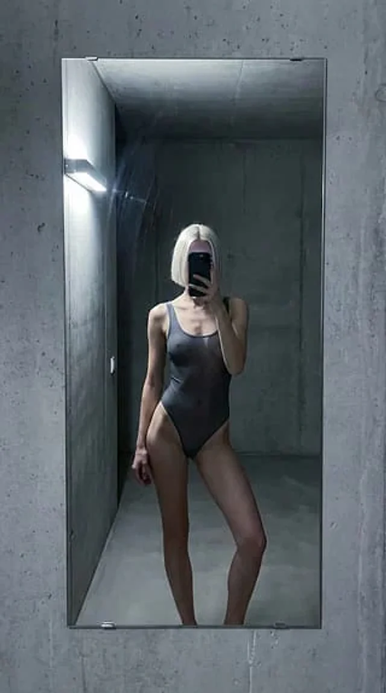

```text
{
  "meta": {
    "aspect_ratio": "9:16",
    "camera": "iPhone rear camera",
    "lens": "35mm",
    "quality": "ultra photorealistic",
    "style": "cold editorial mirror reflection, raw iphone realism, natural skin texture, slight grain"
  },

  "scene": {
    "location": "empty concrete hallway apartment",
    "visibility_rule": "only mirror reflection visible, subject never appears directly",
    "environment_details": [
      "tall frameless mirror mounted on concrete wall",
      "industrial gray walls",
      "soft shadow gradients",
      "clean but slightly brutalist interior"
    ],
    "time": "very late night",
    "atmosphere": "silent, detached, fashion-editorial tension"
  },

  "lighting": {
    "type": "single directional light",
    "source": "cool LED wall light from side",
    "color_temperature": "cold white",
    "effect": "sharp highlights on shoulders and collarbones, deep controlled shadows"
  },

  "camera_perspective": {
    "pov": "mirror reflection only",
    "angle": "straight-on, chest-height",
    "framing": "upper thighs to head visible only inside mirror",
    "real_world_visibility": "no body parts visible outside mirror",
    "phone_visibility": "phone covering face in reflection"
  },

  "subject": {
    "gender": "female",
    "age_vibe": "young adult",
    "ethnicity": "Northern European",

    "hair": {
      "color": "icy platinum blonde",
      "style": "short blunt bob",
      "behavior": "clean lines, barely touching jaw"
    },

    "outfit": {
      "bodysuit": {
        "type": "one-piece mesh bodysuit",
        "color": "smoky graphite gray",
        "material": "semi-transparent technical mesh",
        "fit": "tight, sculpting, stretched naturally",
        "coverage": "fashion-revealing, non-explicit"
      }
    },

    "pose": {
      "position": "standing still close to mirror",
      "legs": {
        "stance": "asymmetrical",
        "detail": "one leg straight, one knee slightly bent inward"
      },
      "hips": {
        "action": "subtle sideways shift creating tension in fabric"
      },
      "arms": {
        "phone_hand": "holding phone directly in front of face",
        "free_hand": "hanging loose by side, relaxed fingers"
      },
      "vibe": "cold confidence, model-off-duty, emotionally distant"
    },

    "face": {
      "visibility": "completely hidden by phone",
      "effect": "identity erased, body language only"
    }
  },

  "imperfections": [
    "minor mirror streaks",
    "uneven LED light falloff",
    "slight handheld camera micro-tilt"
  ]
}
```

Model: Nano Banana
Author: babydoll

[ProjectD](https://aitoolsradar.com/en/prompts/4dbf3f5366e236) · [Recorded source](https://x.com/bananababydoll/status/2012264344998838279)
 · [Full original metadata and byte evidence](data/projectd-batch-0060.json)

## babydoll #532

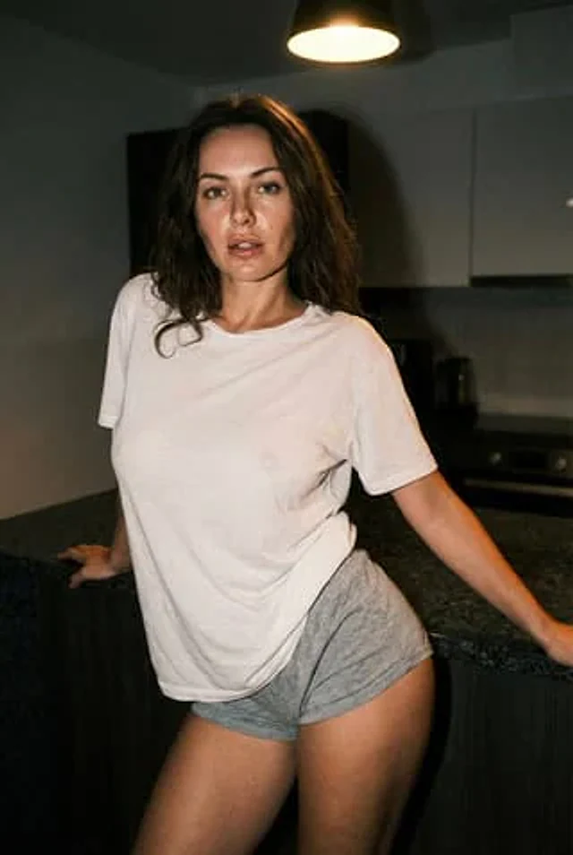

```text
{
  "meta": {
    "quality": "ultra photorealistic",
    "resolution": "8k",
    "camera": "iPhone 15 Pro",
    "lens": "24mm wide",
    "aspect_ratio": "2:3",
    "style": "raw iphone realism, low light, slight grain, natural skin texture, not polished"
  },

  "character_lock": {
    "identity": {
      "ethnicity": "european",
      "age": "clearly adult"
    },
    "hair": {
      "color": "natural brunette",
      "style": "loose, slightly messy, ends imperfect"
    },
    "eyes": "hazel",
    "body": {
      "type": "curvy hourglass",
      "chest": "full, heavy, natural",
      "hips": "wide and round",
      "waist": "small and tight"
    },
    "tattoos": {
      "presence": "none"
    }
  },

  "scene": {
    "location": "modern apartment kitchen",
    "time": "late night",
    "atmosphere": "quiet house, single light on, private after-hours energy"
  },

  "camera_perspective": {
    "capture_method": "iPhone placed on kitchen counter (timer)",
    "phone_visibility": "not visible",
    "angle": "slightly low and close",
    "framing": "hips to head, body dominant"
  },

  "subject": {
    "pose": {
      "position": "leaning back against kitchen counter",
      "body_alignment": "strong natural arch",
      "back": "lower back arched, chest forward",
      "hips": "pushed back toward camera",
      "legs": {
        "stance": "one leg straight, the other slightly bent inward"
      },
      "upper_body": {
        "chest": "clearly emphasized by arch and fabric tension",
        "shoulders": "relaxed",
        "arms": {
          "one_arm": "hands resting on counter behind her, supporting weight",
          "other_arm": "same, symmetric"
        }
      },
      "head": {
        "angle": "chin slightly down",
        "gaze": "looking directly into camera"
      },
      "expression": "slow confident stare, lips parted slightly, calm dominance"
    },

    "outfit": {
      "top": {
        "type": "oversized t-shirt",
        "color": "white",
        "fabric": "very thin worn cotton",
        "fit": "loose but stretched by chest and posture",
        "details": "fabric pulled tight over chest, slightly translucent under light, no bra"
      },
      "bottom": {
        "type": "ultra short sleep shorts",
        "color": "grey",
        "fabric": "soft jersey",
        "fit": "very short, riding up due to arch"
      }
    },

    "skin": {
      "detail": "warm kitchen light glow",
      "texture": "visible pores, natural shine, zero smoothing"
    }
  },

  "environment": {
    "background": [
      "kitchen counter",
      "sink and faucet",
      "single overhead light on",
      "dark apartment behind her"
    ],
    "lighting": {
      "type": "single warm ceiling light",
      "effect": "hard highlights on chest and hips, deep shadows, true iphone exposure"
    }
  },

  "photography_rules": {
    "realism": "very high",
    "iphone_only_look": true,
    "no_phone_in_hands": true,
    "no_male_presence": true,
    "clean_skin_no_tattoos": true,
    "instagram_model_aesthetic": true,
    "thirst_trap_energy": true,
    "suggestive_not_explicit": true
  }
}
```

Model: Nano Banana
Author: babydoll

[ProjectD](https://aitoolsradar.com/en/prompts/785988cd7b8c69) · [Recorded source](https://x.com/bananababydoll/status/2011801545843605846)
 · [Full original metadata and byte evidence](data/projectd-batch-0060.json)

## babydoll #565

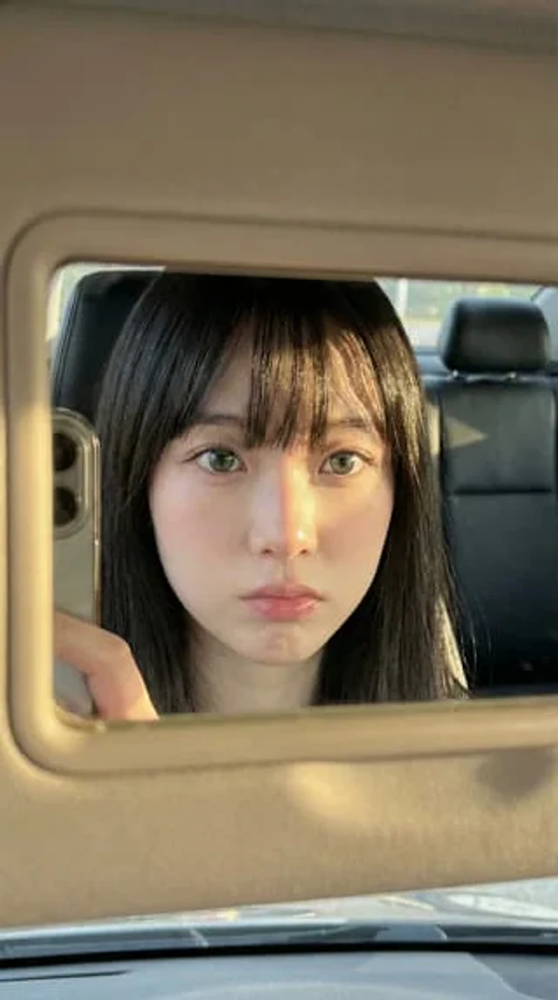

```text
{
  "meta": {
    "aspect_ratio": "9:16",
    "quality": "ultra_photorealistic",
    "resolution": "8K",
    "camera": "iPhone front camera",
    "lens": "24mm",
    "style": "raw iphone realism, pinterest girl aesthetic, natural skin texture, zero plastic look"
  },

  "composition": {
    "concept": "frame within a frame",
    "framing": "extreme close-up face reflection inside car sun visor vanity mirror",
    "mirror_frame": {
      "material": "thick beige / cream plastic",
      "visibility": "dominant around edges of photo, slightly worn texture"
    },
    "phone_visibility": {
      "type": "iPhone",
      "detail": "partial phone edge visible on left side of mirror, controlling the shot",
      "camera_bump": "subtle, realistic"
    }
  },

  "scene": {
    "location": "inside parked car",
    "environment": [
      "dark car interior",
      "black leather seats",
      "headrest visible in reflection"
    ],
    "time": "golden hour",
    "atmosphere": "quiet, intimate, candid daily life moment"
  },

  "lighting": {
    "type": "direct golden hour sunlight",
    "direction": "sharp side sunlight from afternoon sun",
    "color_temperature": "warm golden",
    "contrast": "high",
    "effects": [
      "strong highlights on skin",
      "abstract hair shadow patterns across forehead and cheek",
      "natural light bloom on lips and eyes"
    ]
  },

  "subject": {
    "gender": "female",
    "age": "early 20s (clearly adult)",
    "ethnicity": "East Asian / mixed pale tone",

    "face_structure": {
      "shape": "soft oval",
      "cheeks": "full, youthful, slightly flushed",
      "jawline": "delicate and smooth",
      "nose": "small, straight, soft rounded tip"
    },

    "eyes": {
      "size": "large",
      "shape": "round-almond hybrid",
      "color": "grey-green / light hazel",
      "vibe": "doll-like, calm, distant",
      "lashes": "long, natural, softly separated",
      "under_eye": "subtle natural shadow for soft tired-cute look",
      "gaze": "looking directly into mirror/lens"
    },

    "lips": {
      "size": "full",
      "shape": "soft cupid’s bow",
      "color": "natural pink",
      "finish": "slightly glossy",
      "state": "relaxed, faint pout"
    },

    "skin": {
      "tone": "very pale porcelain",
      "undertone": "cool pink",
      "texture": "real skin with visible pores",
      "finish": "natural glow, no smoothing",
      "blush": "soft pink blush across cheeks and nose bridge"
    },

    "hair": {
      "color": "deep black",
      "length": "long",
      "style": "straight",
      "bangs": "full blunt bangs just above the eyes",
      "behavior": "hair framing face symmetrically, strands catching sunlight"
    },

    "makeup": {
      "style": "no-makeup makeup",
      "base": "sheer skin tint",
      "eyes": "very subtle eyeliner, emphasis on lashes",
      "cheeks": "natural pink flush",
      "lips": "clear or soft pink gloss"
    },

    "outfit": {
      "visibility": "minimal",
      "detail": "only hint of bare shoulders or thin strap visible",
      "color": "dark clothing",
      "note": "no bra visible, focus remains entirely on face"
    }
  },

  "vibe": {
    "aesthetic": [
      "pinterest girl",
      "soft doll face",
      "car mirror selfie",
      "candid",
      "raw photography"
    ],
    "mood": "quiet, slightly melancholic confidence",
    "social_feel": "looks like an accidental golden hour story shot"
  }
}
```

Model: Nano Banana
Author: babydoll

[ProjectD](https://aitoolsradar.com/en/prompts/c71a24d53d3ce5) · [Recorded source](https://x.com/bananababydoll/status/2008420516919468535)
 · [Full original metadata and byte evidence](data/projectd-batch-0060.json)

## Bahar azam #1414

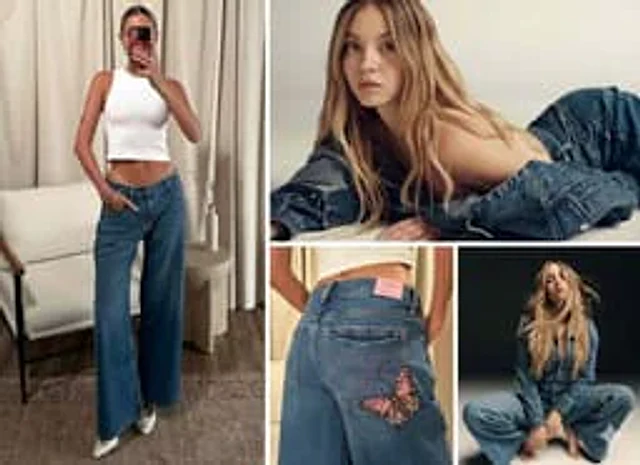

```text
{
  "file_metadata": {
    "filename": "sydney_sweeney_ae_campaign_collage.jpg",
    "category": "High-End Fashion Photography",
    "project": "American Eagle Denim Collection 2024",
    "talent": "Sydney Sweeney"
  },
  "visual_composition": {
    "layout_type": "4-Panel Asymmetrical Collage",
    "color_palette": {
      "primary": "Indigo Blue (Denim Wash)",
      "secondary": "Creamy White (Top & Background)",
      "accent": "Dusty Rose / Blush Pink (Butterfly Detail)",
      "vibe": "Warm, Nostalgic, Y2K Grunge"
    },
    "lighting": "Soft diffused studio light with warm highlight tones",
    "aesthetic_tags": ["Vintage Revival", "Baggy Silhouette", "Main Character Energy"]
  },
  "detailed_frame_analysis": {
    "panel_1_left": {
      "focus": "Full Body Silhouette",
      "pose": "Mirror selfie aesthetic with a slight lean",
      "outfit_details": {
        "top": "White ribbed racerback crop tank",
        "bottom": "Extra wide-leg low-rise indigo jeans",
        "footwear": "White pointed-toe stilettos",
        "accessories": "Delicate gold bracelets and a floral-patterned phone case"
      }
    },
    "panel_2_top_right": {
      "focus": "Beauty & Expression",
      "pose": "Reclined, looking directly into the lens",
      "styling": "Oversized denim jacket draped off-the-shoulder",
      "hair": "Center-parted blonde waves with natural volume",
      "makeup": "Minimalist 'Clean Girl' look with dewy skin"
    },
    "panel_3_bottom_center": {
      "focus": "Product Detail & Embroidery",
      "subject": "Denim back pocket",
      "features": [
        "Intricate pink and orange butterfly embroidery",
        "Pink leather brand patch with American Eagle logo",
        "Contrast stitching on heavy-duty denim fabric"
      ]
    },
    "panel_4_bottom_right": {
      "focus": "Style Statement",
      "pose": "Symmetrical crouched pose on a dark background",
      "outfit": "Full denim jumpsuit/set (Double Denim)",
      "mood": "Bold and confident"
    }
  },
  "garment_dna": {
    "fabric": "Non-stretch, premium weight cotton denim",
    "wash": "Medium indigo stone-wash with vintage fading",
    "fit_profile": "Loose, oversized, baggy, and low-slung waist"
  },
  "marketing_tags": {
    "target_audience": "Gen-Z and Millennial Fashion Seekers",
    "trending_hashtags": ["
    "alt_text": "A fashion collage of Sydney Sweeney for American Eagle showcasing wide-leg jeans with butterfly embroidery and a white crop top in various professional poses."
  }
}
```

Model: Nano Banana
Author: Bahar azam

[ProjectD](https://aitoolsradar.com/en/prompts/bec88bbdb7dd47) · [Recorded source](https://x.com/BaharAzamm561/status/2011034968127057975)
 · [Full original metadata and byte evidence](data/projectd-batch-0060.json)

## BeautyVerse #595


```text
{
  "Character": {
    "Subject": "Japanese female idol, late teens to early 20s",
    "Face_and_Skin": "pure innocent face with translucent pale skin, glassy realistic skin texture with a subtle natural glow",
    "Makeup": "minimal 'no-makeup' look, very subtle soft pink blush, glossy clear lip balm",
    "Hair": "natural dark brown medium-length bob hair gently swaying in the breeze, no hat",
    "Eyes_and_Expression": "wide innocent soft eyes capturing the light, looking directly at camera with a gentle, ephemeral and pure expression",
    "Pose": "SITTING on a wooden engawa, HUGGING KNEES to chest, chin resting gracefully on knees, arms wrapped softly around shins, bare feet, relaxed and natural posture",
    "Outfit": "loose-fitting thin white linen summer dress, sleeveless, slightly translucent fabric catching the backlight, delicate collarbone visible, pure and ethereal all-white aesthetic"
  },
  "Scene": {
    "Environment": "wooden engawa (traditional Japanese veranda), traditional Japanese house with sliding glass doors open to a lush green summer garden",
    "Details": "bright white sheer curtains blowing in the background, soft green, brown, and white color palette",
    "Atmosphere": "clear summer morning breeze, nostalgic and ephemeral atmosphere, feeling the gentle summer breeze"
  },
  "Photography": {
    "Style": "Japanese idol photobook (shashin-shu), airy and transparent photography, masterpiece, best quality, photorealistic",
    "Camera_and_Lens": "Contax 645 medium format look, Carl Zeiss Planar 80mm f/2 lens, shallow depth of field, soft airy creamy bokeh, soft ethereal focus on the edges, sharp on the eyes",
    "Framing": "shot from EYE LEVEL, medium close-up framing, knee-up composition",
    "Lighting": "SOFT NATURAL DAYLIGHT, OVERCAST or DIFFUSED WINDOW LIGHT, high-key lighting (low contrast), slightly overexposed (+1 EV) for transparency, soft wrap-around light, bright square catchlights in eyes",
    "Film_Simulation_and_Color": "Fujifilm Pro 400H film simulation, pastel color grading, cool cyan-green undertones in the shadows, milky lifted blacks, soft glowing highlights without pure white clipping",
    "Effects": "fine subtle film grain (0.2), very mild vignette (0.1), soft gentle light leak from the top corner"
    "Aapect Ratio": "3:4"
  }
}
```

Model: Nano Banana
Author: BeautyVerse

[ProjectD](https://aitoolsradar.com/en/prompts/3bb98583e56be4) · [Recorded source](https://x.com/BeautyVerse_Lab/status/2027114611636572306)
 · [Full original metadata and byte evidence](data/projectd-batch-0060.json)

## BeautyVerse #603

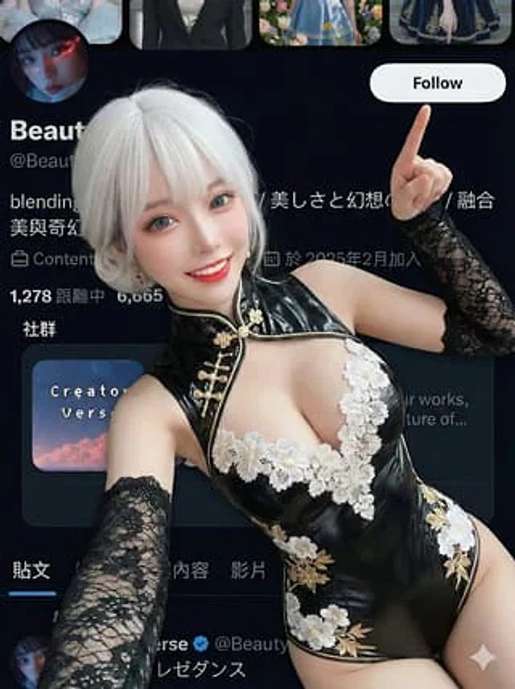

```text
{
  "edit_type": "creative_composite_layering",

  "source": {
    "_hint": "Base logic: Character (Ref 1) superimposed ON TOP OF the Background Image (Ref 2).",
    "mode": "EDIT",
    "reference_images": {
      "first": "foreground_character_person",
      "second": "background_scenery_or_pattern"
    },
    "preserve_from_first": {
      "same_person_or_group": true,
      "same_faces": true,
      "same_hairstyles": true,
      "same_outfits": true
    }
  },

  "identity": {
    "keep_identity_consistent": true,
    "expression": "bright_engaging_smile_at_camera"
  },

  "camera_effect": {
    "_hint": "High-angle selfie style, creating a sense of depth between the hand and face.",
    "perspective": "high_angle_shot_looking_down",
    "style": "social_media_call_to_action",
    "depth_of_field": "focus_on_face_and_pointing_finger",
    "framing": "character_centered_with_space_at_top_right"
  },

  "pose": {
    "_hint": "Key action: Lying down but actively pointing to the 'Follow' button area (Top Right).",
    "pose_style": "lying_down_or_reclining_on_back",
    "face_direction": "looking_directly_up_into_lens",
    "hand_gestures": {
      "right_hand_action": "pointing_index_finger",
      "target_direction": "upper_right_corner_45_degrees",
      "purpose": "mimicking_pressing_subscribe_button",
      "arm_position": "extended_towards_camera_top_right"
    },
    "body_language": "inviting_and_energetic",
    "style_tags": [
      "kpop_idol_fan_service",
      "influencer_promo_style",
      "dynamic_perspective"
    ]
  },

  "background_integration": {
    "_hint": "The second reference image is the background/floor.",
    "method": "full_background_replacement",
    "target_area": "entire_canvas_behind_character",
    "content_source": "reference_image_second",
    "perspective_match": "flat_lay_style",
    "rules": {
      "character_must_be_top_layer": true,
      "leave_space_in_upper_right_for_ui": true
    }
  },

  "composition": {
    "_hint": "Ensure the pointing finger leads the viewer's eye to the top right corner.",
    "visual_flow": "diagonal_line_from_face_to_top_right_corner",
    "focal_points": [
      "character_eyes",
      "pointing_finger_tip"
    ],
    "negative_space": "clear_area_at_top_right_45_degrees"
  },

  "constraints": {
    "no_holding_phone_device": true,
    "finger_must_not_be_cropped_out": true,
    "ensure_arm_is_natural_length": true
"3:4"
  }
}
```

Model: Nano Banana
Author: BeautyVerse

[ProjectD](https://aitoolsradar.com/en/prompts/661b4ec80ccc4d) · [Recorded source](https://x.com/BeautyVerse_Lab/status/2013490554466939282)
 · [Full original metadata and byte evidence](data/projectd-batch-0060.json)

## Bitturing #361

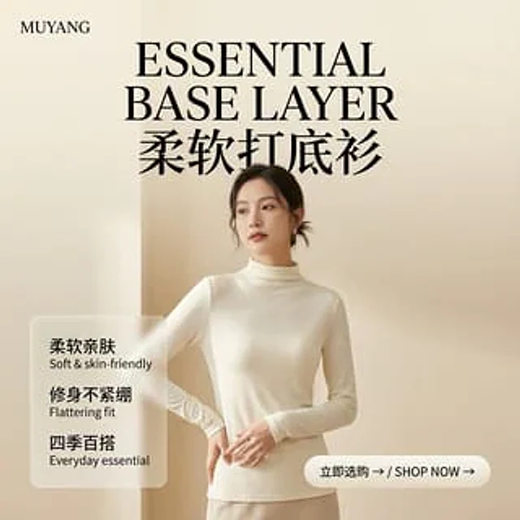

```text
9：16竖版高端极简时尚产品海报。柔和摄影棚自然日光，温暖米白渐变背景（奶油色、燕麦色），画面极致干净。精致亚洲女性模特（25-30岁），自然裸妆，肤感干净，长发自然垂落或低马尾，姿态放松克制，全身或三分之二身构图，手自然垂放或轻触腰侧，强调衣身线条。服装必须严格匹配上传的产品参考图：高品质打底衫，奶油白/燕麦色/浅驼色/雾灰色，高支棉或莫代尔微弹针织面料，触感柔软，修身但不紧绷，圆领或小高领，长袖，设计极简
```

Model: Nano Banana
Author: Bitturing

[ProjectD](https://aitoolsradar.com/en/prompts/1359562233b838) · [Recorded source](https://x.com/Bitturing/status/2008786351974740023)
 · [Full original metadata and byte evidence](data/projectd-batch-0060.json)

## BubbleBrain #1043

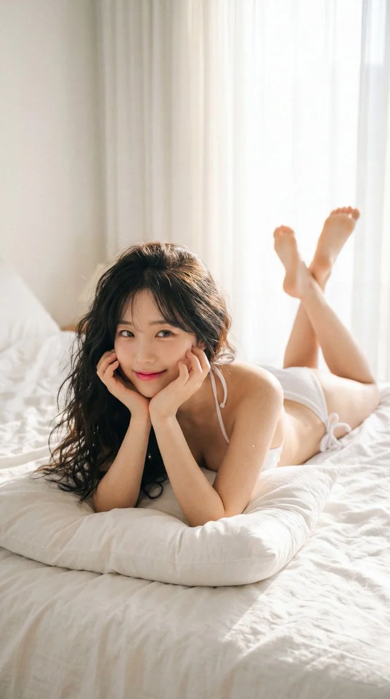

```text
(Masterpiece, Best Quality, 8K UHD, RAW photo), photorealistic portrait,
  the exact same beautiful Korean female k-pop idol every time,
  innocent baby face, straight eyebrows, big doe eyes with aegyosal,
  gradient glossy pink lips, light blush,
  messy long black wavy hair fanning out across the white pillow,
  sun-kissed highlights on select strands,

  Layer 2 : white string bikini top, tied at back of neck,
  Layer 5  white string bikini bottom with side bows,
  bare legs slightly bent at the knees, feet crossed in the air,
  lying on her stomach on a white bed,
  propped up on elbows, chin resting on hands,
  legs lazily crossed and kicked up behind her,
  shoulders relaxed and open,
  natural effortless sensual pose, maximum breathing space in composition,
  looking back over her shoulder at the camera,
  playful smile, eyes bright and inviting,
  expression: carefree, natural beauty, innocent allure,
  relaxed brow, slight head tilt,

  white bed with soft rumpled linen sheets,
  one white pillow beneath her elbows,
  sheer white curtains with morning light pouring through,
  large overexposed white background area on the right side,
  strong negative space for breathing room,
  dreamy hazy soft-focus atmosphere,

  golden morning sunlight from the right side through sheer curtains,
  warm light illuminating her face and upper body,
  soft shadows, high-key overall,
  dust motes floating in light beams,
  gentle hair backlight creating angelic glow,

  Canon R5, 50mm f/1.4,
  eye-level intimate POV,
  moderate depth of field, soft bokeh on background,
  sharp focus on eyes and face,

  airy, luminous, dreamy morning atmosphere,
  youthful sensuality, effortless beauty,

  ultra-detailed skin, realistic hair strands, fabric texture,
  8K resolution, photorealistic, no artifacts, no watermark
```

Model: Nano Banana
Author: BubbleBrain

[ProjectD](https://aitoolsradar.com/en/prompts/6e3a32fbe77a89) · [Recorded source](https://x.com/BubbleBrain/status/2033797895640535404)
 · [Full original metadata and byte evidence](data/projectd-batch-0060.json)

## Cherry 2.O #1058

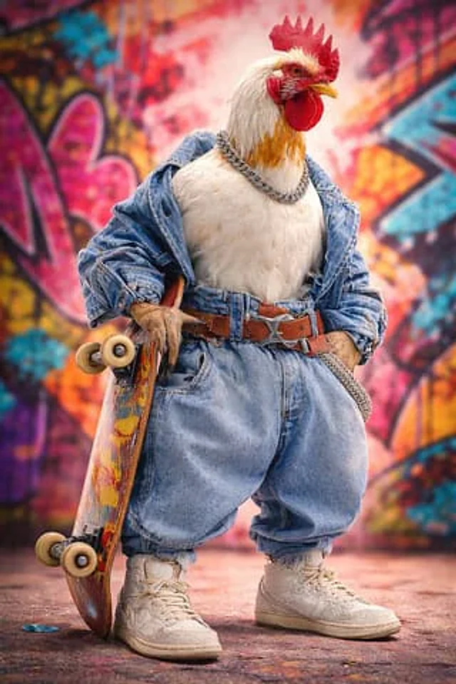

```text
Ultra-realistic studio portrait of an anthropomorphic rooster styled like a street skater. A confident white rooster with a red comb and wattles stands upright like a human, full body visible, facing slightly to the side. The rooster is wearing oversized vintage blue denim jeans with a loose, baggy fit, a faded denim jacket hanging off the shoulders, and a thick silver chain necklace around its neck. A brown leather belt is fastened tightly around the waist.
The rooster is holding a worn skateboard vertically with one wing, resting it on the floor. The skateboard has scratched trucks, beige wheels, and a distressed, colorful deck. On its feet are chunky white high-top sneakers with visible wear and realistic fabric texture.
Highly detailed feathers with realistic texture and volume, sharp focus on the rooster’s face and clothing. Studio lighting with soft shadows, clean white/neutral background, fashion editorial style. Cinematic realism, humorous yet stylish vibe, perfect balance between realism and surreal character design. Ultra-high resolution, hyper-detailed materials (denim fabric, leather belt, metal chain, feathers), shallow depth of field, professional photography look.
```

Model: Nano Banana
Author: Cherry 2.O

[ProjectD](https://aitoolsradar.com/en/prompts/f31dc9081c9bd5) · [Recorded source](https://x.com/Mind_Boticni/status/2016350733839597878)
 · [Full original metadata and byte evidence](data/projectd-batch-0060.json)

## Cherry 2.O #1077

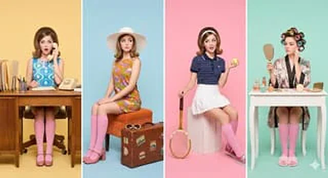

```text
A retro-inspired studio photoshoot featuring a young woman styled in four different personas, arranged in a horizontal split-panel composition. Each panel has a bold pastel background in contrasting colors (yellow, blue, pink, mint). The same woman appears in each panel wearing vintage 1960s fashion with bright patterns, pink knee-high socks, and expressive makeup.
Panel 1 (Office theme): She sits behind a desk with office props like folders, a rotary phone, and stationery, wearing a patterned dress and looking surprised while holding the phone.
Panel 2 (Travel theme): She wears a wide-brim hat and colorful outfit, sitting with a vintage suitcase and travel accessories, posing elegantly.
Panel 3 (Sports theme): She wears a sporty retro outfit, holding a tennis racket and ball, sitting casually with playful energy.
Panel 4 (Home theme): She wears a robe with hair rollers, holding a hand mirror, sitting at a vanity table with beauty items.
Each panel is cleanly divided, perfectly symmetrical, with consistent lighting and camera angle. Bright, soft studio lighting, high fashion editorial style, ultra-sharp, vibrant colors, minimal shadows, no text, no logos, no labels, no watermarks.
Style: vintage pop art, Wes Anderson symmetry, fashion editorial photography, pastel color blocking, high resolution, 8k, clean composition.
```

Model: Nano Banana
Author: Cherry 2.O

[ProjectD](https://aitoolsradar.com/en/prompts/a4cce7de5d542d) · [Recorded source](https://x.com/Mind_Boticni/status/2043539455131459957)
 · [Full original metadata and byte evidence](data/projectd-batch-0060.json)

## Cherry 2.O #1100

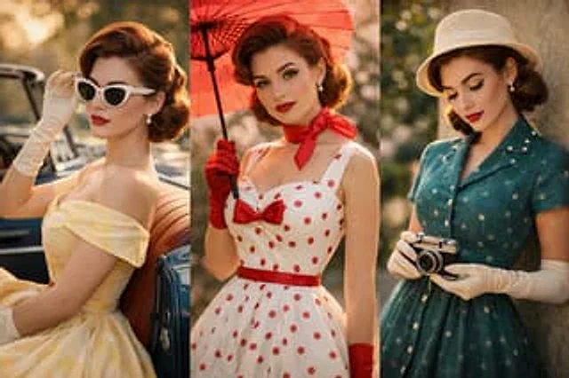

```text
A cinematic vintage fashion portrait of a graceful young woman in a 1950s aesthetic, standing beside a classic convertible car. She is captured from a three-quarter back angle, looking over her shoulder with a soft, confident gaze. She wears an elegant ivory strapless dress with a fitted bodice and a flowing skirt adorned with hand-painted red rose floral patterns near the hem. A thin red belt cinches her waist. Her hair is styled in a voluminous retro updo, auburn/red tones, topped with a straw boater hat featuring a red ribbon. She wears white satin gloves and delicate pearl earrings. Makeup is refined and timeless: winged eyeliner, soft blush, and deep red lipstick. The scene is bathed in warm golden-hour sunlight with creamy bokeh in the background, outdoor garden setting. Ultra-detailed, photorealistic, shallow depth of field, cinematic lighting, luxury fashion editorial style, 8K quality.
```

Model: Nano Banana
Author: Cherry 2.O

[ProjectD](https://aitoolsradar.com/en/prompts/293a010c223805) · [Recorded source](https://x.com/Mind_Boticni/status/2018167069343416703)
 · [Full original metadata and byte evidence](data/projectd-batch-0060.json)

## Cherry 2.O #1120


```text
Preserve the face, proportions, and external features of the model as in the reference. A minimalist monochrome fashion editorial triptych featuring three stacked cinematic frames. The subject is a young woman with medium-length dark hair, natural makeup, and elegant features.

Frame 1: Emotional and introspective, looking downward with a hand gently near the collarbone, highlighting cheekbones and bone structure with soft Rembrandt lighting.
Frame 2: A crisp profile shot emphasizing the nose, lips, and graceful jawline, gaze directed slightly upward for a poised, confident look.
Frame 3: A frontal, thoughtful portrait with relaxed shoulders and direct eye contact, conveying quiet strength and elegance.
The composition is clean and modern, using a fitted white top and delicate gold jewelry for visual continuity. Commercial magazine quality, shot on a high-end mirrorless camera, with authentic skin texture, soft bokeh, and cinematic sophistication. Feminine elegance and contemporary fashion sensibility.
```

Model: Nano Banana
Author: Cherry 2.O

[ProjectD](https://aitoolsradar.com/en/prompts/995bc13f2ee2e2) · [Recorded source](https://x.com/Mind_Boticni/status/2023240208700113185)
 · [Full original metadata and byte evidence](data/projectd-batch-0060.json)

## Cherry 2.O #1127


```text
A high-resolution, photorealistic three-panel composition featuring a woman with long, voluminous wavy brown hair and elegant features, integrated into an abstract mixed-media collage background.
Panel Layout:

Left Panel (Vertical, full height):

A tall portrait of the woman looking upwards at a dramatic angle, wearing a mustard yellow turtleneck. Cinematic lighting highlights her face and hair, with strong shadows and depth.
Top Right Panel (Square):

A close-up angled side profile, soft gaze to the right, wearing a black modern blazer with minimal jewelry. Expression is calm and confident.
Bottom Right Panel (Square):

A slightly top-down perspective, playful yet elegant pose, wearing a white textured dress, subtle smile, natural lighting.
Art Style & Background (applies to all panels):

The image is layered with an abstract mixed-media collage background incorporating geometric shapes like circles and rectangles in ochre, burnt orange, and charcoal grey. Include textural elements such as vintage parchment paper, blueprint-style technical sketches, and subtle floral etchings. Use a flat graphic design overlay that partially blends into each outfit, seamlessly merging the 3D subject with 2D modernist art.
Overall Style:

Cinematic lighting, fine art photography aesthetic, ultra-detailed, 8K resolution, modern editorial fashion magazine layout.
```

Model: Nano Banana
Author: Cherry 2.O

[ProjectD](https://aitoolsradar.com/en/prompts/8f818cd5025d97) · [Recorded source](https://x.com/Mind_Boticni/status/2038182355743977689)
 · [Full original metadata and byte evidence](data/projectd-batch-0060.json)

## Cherry 2.O #1149


```text
Full-body portrait of a stylish young man standing against a plain light gray background, wearing a fitted black button-up shirt with sleeves rolled up, dark gray slim-fit trousers, and black polished dress shoes. He is posing casually with one hand in his pocket and the other hand near his mouth, slightly lifting one leg. The lighting is soft and even, highlighting his natural features, with a clean minimalist studio aesthetic. Realistic proportions, high-detail, sharp focus, fashion photography style.
```

Model: Nano Banana
Author: Cherry 2.O

[ProjectD](https://aitoolsradar.com/en/prompts/635eff64db7509) · [Recorded source](https://x.com/Mind_Boticni/status/2041021416775323737)
 · [Full original metadata and byte evidence](data/projectd-batch-0060.json)

## Cherry 2.O #1158


```text
Hyper-realistic full-body portrait of a woman, using the exact pose from the uploaded photo, transformed into a stylish female doll. she stands confidently with arms crossed on a giant Microsoft Surface Tablet as a platform, wearing urban streetwear (black hoodie, jeans, sneakers) and sleek red tech glasses.

Surrounding him in a dynamic, floating arrangement are masculine graphic design tools: a futuristic camera with blue holographic glow, a geometric computer mouse with electric sparks, a digital pen creating digital wireframe trails, a floating Pantone swatch book in bold blue and black colors, and a minimalist black coffee mug with binary code steam.

The scene features a vibrant blue and orange color scheme with dynamic lighting. Cyberpunk aesthetic, neon accents, particle effects. Style is a blend of 3D animation and tech photography. Sharp focus, cinematic lighting, 8k resolution.
```

Model: Nano Banana
Author: Cherry 2.O

[ProjectD](https://aitoolsradar.com/en/prompts/65537ab88c29e2) · [Recorded source](https://x.com/hey_m_cherry/status/2011268158855000473)
 · [Full original metadata and byte evidence](data/projectd-batch-0060.json)

## Cherry 2.O #1195


```text
5 panel colorful portrait collage, fashion models, monochrome backgrounds (pink, red, green, yellow), vibrant studio lighting, modern editorial style, rounded grid layout, high contrast, minimal shadows
```

Model: Nano Banana
Author: Cherry 2.O

[ProjectD](https://aitoolsradar.com/en/prompts/e7a5aa2849c510) · [Recorded source](https://x.com/Mind_Boticni/status/2041126427295461679)
 · [Full original metadata and byte evidence](data/projectd-batch-0060.json)

## Cherry 2.O #1267


```text
A high-resolution 2x2 grid collage of four individual portraits. In each square, a different young man peeks through a jagged, ripped hole in bright yellow seamless paper. The subjects have a 1990s indie-pop aesthetic with diverse hairstyles, including messy curls and dreadlocks. The lighting is soft and even, typical of a professional studio photoshoot. The color palette is dominated by the vibrant yellow paper against a neutral beige background visible through the tears. Cinematic quality, sharp focus, 8k resolution, editorial photography style.
Key Elements Breakdown
If you want to tweak the result, here are the specific descriptors that make this style work:

Composition: 2x2 grid collage, quad split screen, peeking through a hole.
Main Prop: torn yellow construction paper, jagged ripped edges, seamless paper background.
Subject Style: Gen Z fashion, indie band aesthetic, 90s grunge-lite, youthful expressive faces.
Technical Specs: flat lighting, low depth of field, clean studio photography, vibrant saturation.
```

Model: Nano Banana
Author: Cherry 2.O

[ProjectD](https://aitoolsradar.com/en/prompts/d2cb0f165e006f) · [Recorded source](https://x.com/Mind_Boticni/status/2041840872925606344)
 · [Full original metadata and byte evidence](data/projectd-batch-0060.json)

## Cherry 2.O #1268


```text
A soft pastel watercolor digital illustration of a young woman with long, flowing blonde hair, gently smiling and looking slightly upward to the side. She has delicate, realistic facial features, smooth glowing skin, light pink lips, and expressive eyes. She is wearing a light-colored, high-neck long-sleeve sweater with subtle fabric texture. One hand is raised near her face in a relaxed, thoughtful pose, the other resting casually on a table or surface.
The art style is a mix of hand-drawn pencil sketch and watercolor painting, with fine linework and soft pastel splashes in pink, yellow, lavender, and light blue behind her. The background is minimal and abstract, with loose watercolor brush strokes and a clean off-white canvas.
Lighting is soft and dreamy, giving a warm, optimistic, serene mood. The illustration has a modern digital watercolor aesthetic, elegant, airy, and feminine, with smooth gradients and painterly textures. High detail, artistic portrait, pastel color palette, aesthetic illustration, soft focus, gentle expression.
```

Model: Nano Banana
Author: Cherry 2.O

[ProjectD](https://aitoolsradar.com/en/prompts/8e8973b55a2013) · [Recorded source](https://x.com/Mind_Boticni/status/2017096425860215040)
 · [Full original metadata and byte evidence](data/projectd-batch-0060.json)

## Cherry 2.O #1439


```text
High-resolution Japanese commercial advertisement style photo, three young women posing against a clean white background with bold geometric color blocks (blue, pink, yellow, green) arranged diagonally.
Top right: woman with short brown hair wearing a red and black plaid shirt and black choker, winking and making an “OK” hand gesture over one eye.

Left: woman in a light blue police uniform with cap, making an “OK” gesture near her eye with a playful expression.

Bottom right: woman dressed as a nurse in a white outfit and cap, making a peace (V) sign with a cute expression.
Bright studio lighting, soft shadows, vibrant colors, sharp focus, clean commercial composition, modern Japanese advertising aesthetic, playful and energetic mood, ultra-detailed, crisp skin tones.
No text, no logos, no typography anywhere in the image.
```

Model: Nano Banana
Author: Cherry 2.O

[ProjectD](https://aitoolsradar.com/en/prompts/f364a2bb7de5ed) · [Recorded source](https://x.com/Mind_Boticni/status/2041188242846888389)
 · [Full original metadata and byte evidence](data/projectd-batch-0060.json)

## Cherry 2.O #648


```text
{
  "prompt": "Hyper-realistic 8K black-and-white studio portrait captured as a medium shot from a slightly low-angle perspective, using a 50mm lens for a natural field of view. The composition features a female subject, 100% using the uploaded face as reference (do not alter facial features or identity), seated off-center to the right, leaving strong negative space above and to the left. She wears a wide-brimmed fedora-style hat, a loose white linen blouse unbuttoned at the collar revealing layered silver necklaces, white linen trousers, and dark leather loafers, with delicate beaded bracelets on both wrists. The subject is seated comfortably in a sleek modern black leather lounge chair, left leg crossed over the right, left hand lightly touching the brim of the hat, and right arm casually resting on the chair’s armrest. Dramatic high-contrast chiaroscuro lighting dominates the scene, with a strong key light from the front-left creating deep shadows and bright highlights that emphasize the detailed textures of the linen fabric, leather chair, felt hat, and hair. Subtle rim lighting outlines the subject and chair, separating them from a pure deep-black background, enhancing cinematic depth and a professional luxury studio photography aesthetic.",
  "color_style": "black and white",
  "resolution": "8K",
  "camera_lens": "50mm",
  "camera_angle": "slightly low-angle",
  "style": "cinematic studio portrait, luxury editorial",
  "lighting": "chiaroscuro, high-contrast studio lighting",
  "reference_image": "strictly use uploaded image only"
}
```

Model: Nano Banana
Author: Cherry 2.O

[ProjectD](https://aitoolsradar.com/en/prompts/34c8b5a6de7755) · [Recorded source](https://x.com/Mind_Boticni/status/2013448656767328610)
 · [Full original metadata and byte evidence](data/projectd-batch-0060.json)

## Cherry 2.O #741


```text
{
  "image_prompt": {
    "type": "Hyper-realistic editorial food infographic",
    "subject": {
      "cuisine": "Authentic Indian Vegetarian",
      "base_element": "Traditional rustic bowl filled with steaming, freshly cooked curry at the bottom, rich and aromatic",
      "levitating_ingredients": [
        "Golden, crispy paneer cubes",
        "Soft boiled potato chunks",
        "Glazed tomato-curry sauce splashes suspended mid-air",
        "Vibrant fresh coriander leaves",
        "Sliced green chilies",
        "Lime wedges",
        "Thin slices of garlic and ginger",
        "Crunchy fried onions",
        "Colorful vegetables: red bell peppers, green peas, orange carrots",
        "Sprinkle of aromatic spices: turmeric, cumin seeds, red chili powder, garam masala"
      ]
    },
    "composition": {
      "layout": "Clean vertical infographic composition",
      "arrangement": "Realistic gravity-defying floating ingredients, layered for visual hierarchy",
      "background": "Warm rustic wooden tabletop or traditional Indian brass plate",
      "visual_hierarchy": "Bowl anchored at the bottom, ingredients rising vertically with natural spacing, creating depth and focus on main dish"
    },
    "graphic_design_elements": {
      "labels": "Sharp, clear English text annotations for each ingredient",
      "lines": "Delicate thin white pointer lines connecting floating ingredients to labels",
      "style": "Professional editorial food magazine infographic, visually educational, vibrant and appetizing"
    },
    "lighting_and_mood": {
      "lighting": "Cinematic studio lighting with warm highlights and soft shadows, enhancing textures",
      "color_palette": "Rich, vibrant warm tones to highlight spices, vegetables, and curry",
      "effects": "Visible rising steam, motion-frozen mid-air ingredients, slight reflections and glistening sauce for mouth-watering effect"
    },
    "technical_specs": {
      "camera_settings": "Shallow depth of field, ultra-sharp focus on foreground elements, DSLR cinematic lens effect",
      "details": "Ultra-detailed textures on paneer, vegetables, spices, and sauce; realistic steam and glossy highlights",
      "resolution": "8K ultra-realistic, suitable for high-end digital display, print, or magazine cover"
    }
  }
}
```

Model: Nano Banana
Author: Cherry 2.O

[ProjectD](https://aitoolsradar.com/en/prompts/6864ac47759eb1) · [Recorded source](https://x.com/Mind_Boticni/status/2019418461869650379)
 · [Full original metadata and byte evidence](data/projectd-batch-0060.json)

## Cherry 2.O #798


```text
A creative surreal image of a woman sitting on the ground, wearing a dark yellow hoodie, gray pants, and yellow shoes, surrounded by several miniature versions of himself.

Multiple smaller versions stand on his hands, shoulders, and around him on the ground, interacting playfully with the larger version.

The background is a clean, simple light gray to dark gray tone.

The lighting is soft and cinematic, with realistic shadows and depth of field.
```

Model: Nano Banana
Author: Cherry 2.O

[ProjectD](https://aitoolsradar.com/en/prompts/3d25a884b62c10) · [Recorded source](https://x.com/hey_m_cherry/status/2011115271239713243)
 · [Full original metadata and byte evidence](data/projectd-batch-0060.json)

## Cherry 2.O #843


```text
A cinematic double exposure portrait of a young woman hollywood actress in profile, her hair in a messy bun, overlaid with a busy city street scene with tall buildings, warm orange and teal tones, soft bokeh lights in the background, high detail, realistic lighting, vertical composition, photorealistic style.
```

Model: Nano Banana
Author: Cherry 2.O

[ProjectD](https://aitoolsradar.com/en/prompts/c8975e10491541) · [Recorded source](https://x.com/Mind_Boticni/status/2040827971720925552)
 · [Full original metadata and byte evidence](data/projectd-batch-0060.json)

## Cherry 2.O #846


```text
Hyper-realistic cinematic full-body fashion photoshoot of the uploaded woman (age 26, 5'5"), exact face and hairstyle from the uploaded image, perfectly styled. Leaning back confidently on a deep navy-blue bean bag, one arm resting on the edge of the bag, legs slightly apart, projecting calm confidence and poise. Wearing a bold all-navy look: navy blue denim jacket over a fitted white T-shirt, navy blue denim jeans, chunky sneakers, and a sleek silver watch. Solid navy-blue background, professional studio lighting, sharp focus, high fashion editorial aesthetic. provide four more photos.
```

Model: Nano Banana
Author: Cherry 2.O

[ProjectD](https://aitoolsradar.com/en/prompts/f1330121f2269e) · [Recorded source](https://x.com/Mind_Boticni/status/2012881039266648492)
 · [Full original metadata and byte evidence](data/projectd-batch-0060.json)

## Cherry 2.O #899


```text
A high-quality, split-screen fashion editorial advertisement featuring multiple panels of different colors (yellow, green, deep red, blue). The image shows models wearing Adidas-style tracksuits and casual sportswear in corresponding colors that match their background panel. One male model in yellow is walking, one female model in green is sitting on a speaker, one male model in red is jumping, one female model in blue is sitting by a blue typewriter, one female model in red is posing in a red panel, and one female model in yellow is standing. Clean studio lighting, vibrant solid-color backgrounds, professional fashion photography, minimalist aesthetic, sharp focus
```

Model: Nano Banana
Author: Cherry 2.O

[ProjectD](https://aitoolsradar.com/en/prompts/c0284ba03cee76) · [Recorded source](https://x.com/Mind_Boticni/status/2033403443269030215)
 · [Full original metadata and byte evidence](data/projectd-batch-0060.json)

## Cherry 2.O #906


```text
Hyper-realistic food photography, ultra high-definition, dynamic floating ingredients and liquids, ingredients suspended in mid-air, 
motion captured in high-speed freeze, dramatic cinematic studio lighting, dark moody background with subtle gradient, extreme sharpness and fine textures, 
strong contrast highlighting food, splashes, crumbs, sauces, and liquids flying around, central hero composition with ample negative space, 
clean luxury advertising style, no text, no logos, no props, 
realistic shadows and reflections, ultra-detailed, photorealistic, 8K. {image of a cocktail}
```

Model: Nano Banana
Author: Cherry 2.O

[ProjectD](https://aitoolsradar.com/en/prompts/84f2e699c03929) · [Recorded source](https://x.com/Mind_Boticni/status/2019980950067900809)
 · [Full original metadata and byte evidence](data/projectd-batch-0060.json)

## Christopher Fryant #418


```text
View from under a plane of completely transparent plexiglass. We are looking straight up. Many people are walking on the plexiglass. In the background is a pure blue sky. No buildings visible. No edges or separations in the plexiglass. It’s as if the plexiglass isn’t even there. We are very close to the people. The people are in the process of walking. The people are walking generally from left to right. The soles of their shoes are very close to the foreground.
```

Model: Nano Banana
Author: Christopher Fryant

[ProjectD](https://aitoolsradar.com/en/prompts/99659ed80923db) · [Recorded source](https://x.com/cfryant/status/2008198858405462492)
 · [Full original metadata and byte evidence](data/projectd-batch-0060.json)

## Christopher Fryant #702


```text
playstation 1 game case with a movie tie-in game that seems like a real game you may have played back in the day.

Pick a period appropriate movie that never got a video game version because that would have been a really bad idea. Worst possible choice for a movie tie-in game.
```

Model: Nano Banana
Author: Christopher Fryant

[ProjectD](https://aitoolsradar.com/en/prompts/8a4bec3e47eed6) · [Recorded source](https://x.com/cfryant/status/2027082459893145913)
 · [Full original metadata and byte evidence](data/projectd-batch-0060.json)

## cinema 🎥 #1204


```text
{
  "lighting": {
    "mood": "Candid, slightly harsh evening lighting",
    "type": "On-camera flash",
    "shadows": "Strong shadows visible, especially on the woman's neck and behind the subjects",
    "direction": "Frontal lighting",
    "intensity": "Harsh, creating highlights on faces and the dress"
  },
  "background": {
    "setting": "Likely an indoor evening event or party",
    "elements": "Faint, indistinct shapes of other people or objects in the distance",
    "description": "Extremely dark and underexposed due to flash",
    "depth_of_field": "Shallow, background is completely blurred"
  },
  "typography": {
    "details": "No visible text or logos",
    "present": "None"
  },
  "composition": {
    "angle": "Slightly from the right, eye-level",
    "focus": "Sharp focus on the two subjects, particularly their faces",
    "framing": "Tight framing on the couple",
    "shot_type": "Medium shot",
    "orientation": "Portrait",
    "positioning": "Woman on the left, man on the right, standing closely together"
  },
  "color_profile": {
    "palette": "Dark suit, bright red tie, silver sparkling dress, warm skin tones, dark background",
    "contrast": "High contrast due to flash",
    "saturation": "Moderate saturation",
    "color_grading": "Typical 1990s flash photography, slightly warm hues",
    "dominant_colors": [
      "#000000",
      "#FFFFFF",
      "#C0C0C0",
      "#FF0000"
    ]
  },
  "technical_specs": {
    "grain": "Visible film grain",
    "source": "Photograph, likely film from the 1990s",
    "sharpness": "Relatively sharp on subjects, background is blurry and dark",
    "resolution": "Medium resolution scan",
    "aspect_ratio": "Approx. 9:16 (square)"
  },
  "subject_analysis": {
    "man": {
      "hair": "Blonde, brushed back",
      "attire": "Dark navy suit, white collared shirt, bright red tie",
      "identity": "Donald Trump (younger)",
      "position": "Right side of the frame",
      "expression": "Mouth open, possibly speaking or grimacing"
    },
    "woman": {
      "hair": "Shoulder-length blonde hair",
      "attire": "Silver, sparkling, spaghetti-strap dress",
      "jewelry": "Small earring visible on left ear",
      "identity": "Blonde woman (possibly Kara Young)",
      "position": "Left side of the frame",
      "expression": "Looking directly at camera, slightly open mouth"
    }
  },
  "artistic_elements": {
    "mood": "Slightly awkward, caught-in-the-moment",
    "style": "Candid celebrity snapshot",
    "texture": "Prominent texture of the woman's sparkling silver dress",
    "expression": "Man is speaking or grimacing, woman is looking directly at the camera with a slightly open mouth",
    "compositional_balance": "Balanced, with the two subjects occupying the majority of the frame"
  },
  "generation_parameters": {
    "prompt": "A candid photograph from the 1990s of Donald Trump in a dark suit and red tie, standing next to a blonde woman in a silver sparkling dress. Both are looking at the camera, with Trump's mouth open. The image is taken with an on-camera flash at an evening event, with a very dark background.",
    "style_tags": [
      "1990s photography",
      "flash photography",
      "candid snapshot",
      "celebrity photo"
    ],
    "negative_prompt": "modern photography, digital look, bright background, perfectly posed, studio lighting"
  }
}
```

Model: Nano Banana
Author: cinema 🎥

[ProjectD](https://aitoolsradar.com/en/prompts/c340f30ce47d08) · [Recorded source](https://x.com/FilmHub00/status/2009136276772147276)
 · [Full original metadata and byte evidence](data/projectd-batch-0060.json)

## Ciri #1023


```text
High-detail 8K split-style composition where the subject is divided vertically into two halves.
LEFT SIDE:
Keep the original photo fully realistic. Preserve natural lighting, textures, and fine details. Slightly enhance sharpness and clarity. Add subtle hand-drawn doodle outlines (soft pastel or neon lines) around the subject for a creative aura.
RIGHT SIDE:
Transform the same subject into a stylized cartoon/digital illustration. Maintain the exact same pose, angle, and facial expression. Use clean lineart, soft shading, and pastel or vibrant colors in a modern cute style (chibi / semi-realistic). Add small decorative elements like sticker-style doodles, cute icons, or mini characters floating around.
BACKGROUND (IMPORTANT):
Keep the ORIGINAL background unchanged on BOTH sides. Do not replace, redraw, or stylize the background. Maintain consistency across the entire image.
CENTER DIVISION:
Add a vertical torn-paper or glitch-style transition separating the realistic and illustrated halves.
STYLE:
modern digital art, clean composition, soft lighting, aesthetically pleasing, social media style
QUALITY: 8K resolution, ultra-detailed.
```

Model: Nano Banana
Author: Ciri

[ProjectD](https://aitoolsradar.com/en/prompts/9aad70567b0ad9) · [Recorded source](https://x.com/Ciri_ai/status/2040118989775585520)
 · [Full original metadata and byte evidence](data/projectd-batch-0060.json)

## Ciri #1024


```text
A cinematic portrait of an Asian woman standing in a quiet forest, captured in a spontaneous moment as she turns her head slightly back toward the camera. Soft sunlight filters through tall trees, creating dramatic patches of light and shadow across her face and body. A distinct vertical light leak streak cuts through the frame, adding a striking analog imperfection. Her hair moves gently in the breeze, with loose strands catching the light, adding natural motion and softness. She wears a simple light-colored blouse layered with dark suspenders, creating a subtle contrast against the deep forest tones. Her expression is calm, slightly distant, and introspective, with her eyes softly meeting the camera. The background is filled with blurred tree trunks and glowing bokeh highlights, creating depth and atmosphere. The color grading features rich teal shadows and warm orange highlights, giving a cinematic teal-and-orange contrast. The image has a strong analog film aesthetic with visible grain, soft haze, slight blur, and light distortion. Imperfect framing, natural light flare, and film burn elements enhance the nostalgic 35mm film look. Cinematic film still, dreamy and moody atmosphere, poetic forest setting, high detail, hd quality.
```

Model: Nano Banana
Author: Ciri

[ProjectD](https://aitoolsradar.com/en/prompts/154436ea1a9c64) · [Recorded source](https://x.com/Ciri_ai/status/2039956008555229561)
 · [Full original metadata and byte evidence](data/projectd-batch-0060.json)

## Ciri #488


```text
Create a moody, ethereal cinematic portrait of a woman with a dramatic over-the-shoulder pose.

1. Pose and Expression
• Perspective: subject positioned with her back facing the camera, torso elegantly twisted, looking back over her shoulder, creating a graceful curve along the spine and highlighting shoulder blades
• Gaze: direct eye contact with the camera, piercing yet soft expression, chin slightly tucked toward shoulder to evoke intimacy and mystery
• Hand Placement: hands gently raised near chest/shoulder, fingers softly interlaced or delicately touching
• Hair: loose messy bun with soft wispy strands falling naturally across the face, slightly windswept look

2. Lighting and Color Palette
• Lighting: strong side lighting, warm golden-hour sunlight, high contrast chiaroscuro effect, one side illuminated while the other fades into deep shadow
• Skin Tone: luminous, glowing, pearlescent skin texture
• Color Scheme: earthy muted tones, deep greens, dark browns, soft neutral background, warm skin tones as focal point

3. Wardrobe and Accessories
• Outfit: backless silky dress or top, smooth light fabric, paired with dark voluminous sleeves for strong texture contrast
• Accessories: elegant drop pearl earrings reflecting light subtly

4. Composition and Atmosphere
• Framing: medium close-up shot, framed naturally with blurred foreground leaves for a voyeuristic, through-the-foliage effect
• Depth of Field: shallow depth of field, sharp focus on face, soft bokeh in background and foreground
• Mood: cinematic, melancholic, romantic, high-fashion editorial style, soft dreamy atmosphere

Face reference: soft oval face, smooth glowing skin, symmetrical features, natural makeup, gentle but expressive eyes, slightly parted lips
```

Model: Nano Banana
Author: Ciri

[ProjectD](https://aitoolsradar.com/en/prompts/7527e2fe3fc061) · [Recorded source](https://x.com/Ciri_ai/status/2041379629668446277)
 · [Full original metadata and byte evidence](data/projectd-batch-0060.json)

## Ciri #946


```text
A cinematic candid medium shot portrait of a man and a woman walking side by side along a bright urban walkway, framed from the waist up. They move closely together, their shoulders nearly aligned, creating an intimate yet understated connection. The woman wears a fitted black dress, holding a jacket loosely over her arm, her posture relaxed and elegant. The man walks beside her in a tailored suit, his head slightly turned toward her with a soft, attentive expression, while she looks ahead with a calm and composed demeanor, a faint hint of a smile forming. The moment feels natural and unspoken, filled with quiet tension and subtle attraction. Strong midday sunlight casts sharp highlights and deep shadows across their faces and clothing, creating a high-contrast, slightly overexposed look. The background features a softly blurred urban corridor with repeating columns and architectural lines. The image has a strong analog film aesthetic with visible grain, slight blur, color distortion, and nostalgic texture. Colors feel slightly faded with warm, muted tones. Imperfect framing, subtle motion softness, and natural light flare create the feeling of a fleeting moment captured on 35mm film. Cinematic film still, dreamy and poetic mood, intimate and quiet romantic energy, vintage street photography, lo-fi aesthetic, high detail, hd quality.
```

Model: Nano Banana
Author: Ciri

[ProjectD](https://aitoolsradar.com/en/prompts/ac0bae72b012f7) · [Recorded source](https://x.com/Ciri_ai/status/2040303034115477755)
 · [Full original metadata and byte evidence](data/projectd-batch-0060.json)

## Cuties #1282


```text
{
  "content_goal": "relatable, calm, lifestyle aesthetic",
  "image_type": "ultra-photorealistic lifestyle photography",
  "visual_style": {
    "aesthetic": "clean, cozy, minimal",
    "vibe": "soft, relaxed, natural",
    "realism": "high-end professional realism"
  },
  "composition": {
    "framing": "mid-shot",
    "camera_angle": "slightly above eye-level",
    "subject_position": "naturally centered",
    "perspective": "intimate but respectful"
  },
  "subject": {
    "description": "person sitting casually on a bed",
    "pose": "relaxed seated pose with legs folded or stretched comfortably",
    "body_language": "natural, unposed, confident ease",
    "expression": "calm, thoughtful, soft smile or neutral face"
  },
  "wardrobe": {
    "clothing": "casual homewear or loungewear",
    "style": "modest, relaxed fit",
    "textures": "soft cotton or linen",
    "color_tones": "neutral or pastel shades"
  },
  "environment": {
    "location": "minimal bedroom",
    "bed": "neatly arranged bed with soft pillows",
    "background": "clean wall or soft curtains",
    "atmosphere": "peaceful, morning or late-afternoon calm"
  },
  "lighting": {
    "type": "natural window light",
    "quality": "soft and diffused",
    "direction": "side lighting",
    "shadow_style": "gentle, natural shadows"
  },
  "color_palette": {
    "primary": ["warm white", "beige", "soft grey"],
    "accent": ["pastel tones"],
    "mood": "comforting and serene"
  },
  "camera_details": {
    "lens": "35mm or 50mm",
    "focus": "sharp on subject",
    "depth_of_field": "slight background blur",
    "realism": "editorial lifestyle photography"
  },
  "quality_control": {
    "skin_texture": "natural, realistic",
    "fabric_detail": "visible soft folds",
    "ai_artifacts": "none",
    "finish": "clean, professional"
  },
  "overall_mood": "casual confidence, calm presence",
  "intended_use": {
    "primary": "aesthetic lifestyle post on X",
    "secondary": "personal branding or daily vibe content"
  }
}
```

Model: Nano Banana
Author: Cuties

[ProjectD](https://aitoolsradar.com/en/prompts/ce4da720d27cd1) · [Recorded source](https://x.com/cuties7377/status/2012004517638750448)
 · [Full original metadata and byte evidence](data/projectd-batch-0060.json)

## Cuties #1294


```text
{
  "content_goal": "clean, elegant, viral side-pose visual",
  "image_type": "ultra-photorealistic lifestyle / editorial portrait",
  "visual_style": {
    "aesthetic": "cinematic, editorial, modern minimalism",
    "vibe": "confident, graceful, premium",
    "realism": "high-end professional realism"
  },
  "composition": {
    "framing": "mid-to-full body side view",
    "camera_angle": "true side angle (90-degree profile)",
    "subject_position": "slightly off-center for balance",
    "perspective": "clean silhouette with depth"
  },
  "subject": {
    "description": "confident individual captured in side profile",
    "pose": "standing or seated side pose with elongated posture",
    "body_language": "relaxed yet strong, controlled stance",
    "expression": "calm confidence, subtle elegance",
    "gaze": "forward or slightly downward"
  },
  "facial_details": {
    "emotion": "composed, self-assured",
    "micro_details": "natural skin texture, defined profile lines"
  },
  "wardrobe": {
    "clothing": "form-fitting or flowing outfit highlighting profile",
    "textures": "smooth, soft fabric with natural folds",
    "color_tones": "neutral, monochrome, or muted pastels"
  },
  "lighting": {
    "type": "directional studio or natural lighting",
    "quality": "soft yet sculpting",
    "direction": "side-lit to enhance contours",
    "highlight_focus": "face profile, shoulder line, waist curve",
    "shadow_style": "gentle, controlled shadows"
  },
  "color_palette": {
    "primary": ["soft neutrals", "warm skin tones", "subtle shadows"],
    "mood": "clean, elegant, confident"
  },
  "environment": {
    "location": "minimal studio, modern interior, or outdoor urban space",
    "background": "simple gradient or uncluttered backdrop",
    "atmosphere": "premium, calm, stylish"
  },
  "camera_details": {
    "camera_type": "professional camera simulation",
    "lens": "50mm or 85mm portrait lens",
    "focus": "sharp focus on profile",
    "depth_of_field": "soft background blur",
    "resolution": "editorial-grade clarity"
  },
  "quality_control": {
    "anatomy_accuracy": "natural posture and proportions",
    "fabric_realism": "realistic drape and texture",
    "ai_artifacts": "none",
    "professional_finish": "magazine-quality output"
  },
  "overall_mood": "confident, refined, cinematic",
  "intended_use": {
    "primary": "viral aesthetic post on X",
    "secondary": "personal branding, editorial photography"
  }
}
```

Model: Nano Banana
Author: Cuties

[ProjectD](https://aitoolsradar.com/en/prompts/28cee1dd5d6faf) · [Recorded source](https://x.com/cuties7377/status/2011735232366416223)
 · [Full original metadata and byte evidence](data/projectd-batch-0060.json)

## Cuties #1336


```text
{
  "content_goal":
 "viral food photography post",
  "image_type": 
"professional food photography",
  "food_concept": {
    "item": 
"pizza slice",
    "style": 
"premium artisan pizza",
    "serving_state": 
"freshly lifted slice with cheese pull",
    "temperature_feel": 
"hot, freshly baked"
  },
  "visual_style": {
    "aesthetic": "cinematic food editorial",
    "vibe": "crave-worthy, indulgent, luxurious",
    "realism": "ultra-realistic"
  },
  "composition": {
    "framing": "close-up macro with partial pizza visible",
    "angle": "45-degree side angle",
    "focus_point": "cheese stretch and toppings",
    "depth_of_field": "shallow background blur"
  },
  "pizza_details": {
    "crust": "golden-brown, crispy edges with soft interior",
    "cheese": "melted mozzarella with long stretchy pull",
    "sauce": "rich red tomato sauce",
    "toppings": [
      "pepperoni slices",
      "fresh basil leaves",
      "olive oil glaze"
    ],
    "texture": "glossy cheese, crisp crust, juicy toppings"
  },
  "lighting": {
    "type": "soft directional studio lighting",
    "direction": "side light for texture definition",
    "highlight": "cheese shine and crust detail",
    "shadow": "soft natural shadows"
  },
  "color_palette": {
    "primary_colors": [
      "cheese yellow",
      "tomato red",
      "golden brown"
    ],
    "contrast_level": "medium-high",
    "mood": "warm, appetizing, mouth-watering"
  },
  "environment": {
    "surface": "rustic wooden table or marble slab",
    "background": "dark blurred restaurant or kitchen",
    "props": [
      "pizza cutter",
      "linen napkin",
      "wooden board"
    ]
  },
  "camera_details": {
    "lens": "macro or 50mm food lens",
    "focus": "extreme sharpness on slice",
    "resolution": "high-end commercial quality",
    "noise": "none"
  },
  "sensory_impact": {
    "visual_effect": "cheese pull in motion",
    "viewer_reaction": "instant craving",
    "emotional_trigger": "comfort food desire"
  },
  "quality_control": {
    "food_realism": "authentic pizza texture",
    "ai_artifacts": "none",
    "professional_finish": "restaurant advertisement grade"
  },
  "intended_use": {
    "primary": "viral food post on X",
    "secondary": "restaurant promo, food brand content"
  }
}
```

Model: Nano Banana
Author: Cuties

[ProjectD](https://aitoolsradar.com/en/prompts/d9a8baa32cb153) · [Recorded source](https://x.com/cuties7377/status/2010528965018927520)
 · [Full original metadata and byte evidence](data/projectd-batch-0060.json)

## Cuties #502


```text
{
  "content_goal": "viral food visual with extreme craving appeal",
  "image_type": "ultra-photorealistic food action photography",
  "visual_style": {
    "aesthetic": "cinematic food editorial, hyper-real",
    "vibe": "juicy, indulgent, irresistible",
    "realism": "high-end commercial food realism"
  },
  "composition": {
    "framing": "tight close-up or medium close-up",
    "camera_angle": "slightly low or front-facing",
    "subject_position": "centered hero bite moment",
    "perspective": "depth-rich with strong foreground focus"
  },
  "subject": {
    "description": "large gourmet burger captured mid-bite",
    "bite_action": "visible bite mark with compressed layers",
    "ingredients": "juicy beef patty, melted cheese, fresh lettuce, tomato, sauce drip",
    "details": "cheese stretch, sauce gloss, steam rising"
  },
  "texture_details": {
    "bun": "soft toasted bun with sesame seeds",
    "patty": "juicy with visible meat fibers",
    "cheese": "melted, glossy, stretching",
    "sauce": "thick, dripping naturally"
  },
  "human_element": {
    "hands": "realistic hands holding burger",
    "bite_mark": "natural teeth impression",
    "skin_detail": "natural skin texture, clean nails"
  },
  "lighting": {
    "type": "dramatic food lighting",
    "quality": "warm, directional, high-contrast",
    "direction": "side or top-side light emphasizing gloss",
    "highlight_focus": "cheese melt and sauce texture",
    "shadow_style": "deep but controlled shadows"
  },
  "color_palette": {
    "primary": ["golden brown", "cheese yellow", "deep red"],
    "accent": ["lettuce green"],
    "mood": "rich, bold, indulgent"
  },
  "environment": {
    "location": "burger joint, café, or studio food setup",
    "background": "dark, blurred background to isolate burger",
    "atmosphere": "warm, indulgent, street-food luxury"
  },
  "camera_details": {
    "camera_type": "professional DSLR / mirrorless simulation",
    "lens": "85mm or macro food lens",
    "focus": "tack-sharp on bite area",
    "depth_of_field": "shallow for dramatic bokeh",
    "resolution": "advertising-grade clarity"
  },
  "quality_control": {
    "food_realism": "hyper-real textures, no plastic look",
    "bite_accuracy": "natural compression of ingredients",
    "ai_artifacts": "none",
    "professional_finish": "commercial food photography quality"
  },
  "overall_mood": "mouth-watering, bold, indulgent",
  "intended_use": {
    "primary": "viral food post on X",
    "secondary": "restaurant branding, food editorial, ads"
  }
}
```

Model: Nano Banana
Author: Cuties

[ProjectD](https://aitoolsradar.com/en/prompts/d3262d8075a2d2) · [Recorded source](https://x.com/cuties7377/status/2011374713780457546)
 · [Full original metadata and byte evidence](data/projectd-batch-0060.json)

## Cuties #564


```text
{
  "image_type":
 "athletic flex pose editorial photography",
  "visual_style": 
"high-end fitness editorial, cinematic, premium",
  "composition": {
    "framing":
 "full body, powerful stance emphasizing muscle definition",
    "camera_angle": 
"slightly low angle to enhance strength and dominance",
    "perspective": 
"cinematic perspective with strong body presence"
  },
  "subject": {
    "description": 
"athletic feminine body performing a controlled flex pose",
    "pose": 
"strong flex pose with engaged core, defined arms and legs, balanced posture",
    "body_language":
 "confident, controlled, disciplined strength",
    "expression": 
"calm, focused, effortless power"
  },
  "facial_details": {
    "emotion": "self-control, confidence",
    "micro_details": "relaxed jaw, steady eyes, natural intensity"
  },
  "wardrobe": {
    "clothing": "minimal athletic wear highlighting muscle lines",
    "textures": "matte, stretch performance fabric",
    "color_tones": "neutral, muted, dark or earthy tones"
  },
  "environment": {
    "location": "minimal indoor studio or clean gym space",
    "background": "plain, distraction-free, editorial backdrop",
    "atmosphere": "focused, intense, professional"
  },
  "lighting": {
    "type": "cinematic studio lighting",
    "quality": "high contrast with soft falloff",
    "direction": "side and rim lighting to sculpt muscles"
  },
  "color_palette": {
    "primary": ["charcoal", "warm beige", "muted skin tones"],
    "mood": "powerful, disciplined, modern"
  },
  "camera_details": {
    "lens": "35mm–50mm cinematic look",
    "focus": "sharp focus on body definition",
    "realism": "ultra-realistic, editorial quality"
  },
  "overall_mood": "quiet power, control, strength without aggression",
  "intended_use": "viral flex pose post on X (Twitter), fitness branding, editorial content"
}
```

Model: Nano Banana
Author: Cuties

[ProjectD](https://aitoolsradar.com/en/prompts/13891c3f4d8cd5) · [Recorded source](https://x.com/cuties7377/status/2009861254341333164)
 · [Full original metadata and byte evidence](data/projectd-batch-0060.json)

## Cuties #649


```text
{
  "image_type": 
"High-end fitness editorial / Cinematic lifestyle photography",
  "visual_style": 
"Minimalist luxury, ultra-photorealistic, soft-focus realism",
  "composition": {
    "framing": 
"Wide-angle side profile to capture the full silhouette",
    "camera_angle": "Low-angle shot to emphasize the height and strength of the arch",
    "perspective": "Clean, linear perspective against a flat, snowy horizon"
  },
  "subject": {
    "description": "A fit, graceful woman with athletic poise and natural blonde hair tied in a sleek low bun",
    "pose": "Performing a perfect Yoga Arch (Urdhva Dhanurasana / Wheel Pose)",
    "body_language": "Strong and stable; back arched beautifully with palms and feet firmly planted in the snow",
    "expression": "A serene, focused look; eyes closed in a state of meditative calm"
  },
  "facial_details": {
    "emotion": "Peaceful determination and internal quietude",
    "micro_details": "Soft natural skin texture, subtle flush from the cold, and faint visible breath in the air"
  },
  "wardrobe": {
    "clothing": "Premium emerald green velvet high-waist yoga leggings; matching velvet sports bra; a thin, cream-colored thermal scarf draped elegantly nearby",
    "textures": "Rich, light-reflecting velvet fabric against the soft, matte texture of fresh snow",
    "color_tones": "Vibrant emerald green contrasted against a monochrome white landscape"
  },
  "environment": {
    "location": "A vast, silent arctic landscape of pristine white snow",
    "background": "Empty, minimalist snowy field meeting a soft, misty gray sky at the horizon",
    "atmosphere": "Quiet, ethereal, and crisp; very light snowfall with tiny drifting flakes"
  },
  "lighting": {
    "type": "Soft, natural overcast daylight",
    "quality": "Diffused and ethereal, creating gentle highlights on the velvet curves",
    "direction": "Side-ambient lighting to define the muscular form of the yoga pose"
  },
  "color_palette": {
    "primary": ["Deep Emerald Green", "Pristine White", "Charcoal Black"],
    "mood": "Sophisticated, calm, and visually striking"
  },
  "camera_details": {
    "lens": "50mm prime lens for realistic human proportions",
    "focus": "Sharp focus on the subject; creamy, soft-focus (bokeh) on the distant snowy background",
    "realism": "8K resolution, capturing every fiber of the velvet and the granular detail of the snow"
  },
  "overall_mood": "Graceful, powerful, and serene; a high-fashion approach to wellness",
  "intended_use": "Luxury fitness branding, Pinterest aesthetic editorial, or premium wellness magazine"
}
```

Model: Nano Banana
Author: Cuties

[ProjectD](https://aitoolsradar.com/en/prompts/7952c01976df47) · [Recorded source](https://x.com/cuties7377/status/2008895041025052815)
 · [Full original metadata and byte evidence](data/projectd-batch-0060.json)

## Cuties #659


```text
{
  "content_goal": 
"viral athletic jump freeze post",
  "image_type":
 "jump freeze action photography",
  "visual_style": 
"cinematic sports editorial, high-impact, premium",
  "motion_concept": {
    "action_type":
 "jump freeze",
    "timing": 
"captured at peak height",
    "motion_state": 
"completely frozen mid-air",
    "energy":
 "explosive yet controlled"
  },
  "pose_details": {
    "pose_name":
 "jump freeze flex pose",
    "body_position": 
"mid-air jump with legs extended or flexed symmetrically",
    "core_engagement":
 "tight core with visible strength",
    "arm_position": 
"balanced, expressive, athletic alignment",
    "freeze_quality": 
"sharp, suspended, gravity-defying"
  },
  "subject": {
    "description":
 "athletic feminine body performing a powerful jump freeze",
    "physique": "lean, flexible, toned",
    "body_language": "confident, fearless, strong",
    "expression": "focused intensity with calm control"
  },
  "facial_details": {
    "emotion": "determination mixed with ease",
    "micro_details": "relaxed face, steady eyes, natural expression"
  },
  "wardrobe": {
    "clothing": "professional athletic performance wear",
    "fit": "body-contoured to emphasize motion lines",
    "fabric": "stretch performance fabric, non-reflective",
    "color_tones": "solid neutral or bold single color"
  },
  "environment": {
    "location": "minimal studio or clean gym space",
    "background": "plain or gradient backdrop",
    "atmosphere": "focused, powerful, distraction-free"
  },
  "lighting": {
    "type": "high-speed studio lighting",
    "quality": "crisp, clean, cinematic",
    "direction": "side and top lighting",
    "effect": "freeze motion sharply with defined muscle highlights"
  },
  "camera_details": {
    "angle": "slightly low angle for power emphasis",
    "framing": "full body mid-air capture",
    "lens_feel": "sports editorial realism",
    "focus": "ultra-sharp subject with zero motion blur"
  },
  "color_palette": {
    "primary_colors": ["neutral background", "natural skin tone"],
    "contrast_level": "high",
    "mood": "bold, energetic, inspiring"
  },
  "emotional_impact": {
    "viewer_reaction": "scroll-stopping shock and admiration",
    "message": "power, balance, and control in one moment"
  },
  "quality_control": {
    "realism": "ultra-realistic photography",
    "detail_level": "high-definition muscle and fabric texture",
    "ai_artifacts": "none",
    "professional_standard": "editorial-grade"
  },
  "intended_use": {
    "primary": "viral jump freeze post on X",
    "secondary": "fitness branding, athletic inspiration"
  }
}
```

Model: Nano Banana
Author: Cuties

[ProjectD](https://aitoolsradar.com/en/prompts/605d7115291ca6) · [Recorded source](https://x.com/cuties7377/status/2010225997463834883)
 · [Full original metadata and byte evidence](data/projectd-batch-0060.json)

## Cuties #670


```text
{
  "content_goal": "viral food visual with high appetite appeal",
  "image_type": "ultra-photorealistic food photography",
  "visual_style": {
    "aesthetic": "cinematic food editorial, premium street-food style",
    "vibe": "steamy, savory, irresistible",
    "realism": "high-end commercial food realism"
  },
  "composition": {
    "framing": "close-up or medium close-up",
    "camera_angle": "45-degree or slightly top-front angle",
    "subject_position": "centered hero bowl or lifted noodles",
    "perspective": "depth-rich with strong foreground emphasis"
  },
  "subject": {
    "description": "freshly prepared noodles captured at peak texture",
    "presentation": "chopsticks or fork lifting noodles mid-air",
    "details": "long glossy strands with visible sauce coating",
    "ingredients": "vegetables, protein, herbs, sesame seeds"
  },
  "texture_details": {
    "noodles": "silky, elastic strands with sauce cling",
    "sauce": "rich, glossy, evenly coated",
    "steam": "visible rising steam for freshness",
    "garnish": "spring onions, chili flakes, sesame"
  },
  "styling": {
    "bowl": "ceramic or rustic bowl",
    "props": "chopsticks, linen napkin, subtle tableware",
    "messiness": "controlled, appetizing chaos"
  },
  "lighting": {
    "type": "warm directional food lighting",
    "quality": "soft yet contrast-rich",
    "direction": "side or top-side light",
    "highlight_focus": "noodle gloss and steam",
    "shadow_style": "soft shadows for depth"
  },
  "color_palette": {
    "primary": ["golden brown", "soy sauce tones", "warm amber"],
    "accent": ["chili red", "herb green"],
    "mood": "cozy, savory, indulgent"
  },
  "environment": {
    "location": "street-food stall, modern kitchen, or studio setup",
    "background": "dark or softly blurred background",
    "atmosphere": "warm, comforting, flavorful"
  },
  "camera_details": {
    "camera_type": "professional DSLR or mirrorless simulation",
    "lens": "85mm or macro food lens",
    "focus": "tack-sharp on lifted noodles",
    "depth_of_field": "shallow background blur",
    "resolution": "advertising-grade clarity"
  },
  "quality_control": {
    "food_realism": "hyper-real texture without plastic look",
    "steam_accuracy": "natural steam physics",
    "ai_artifacts": "none",
    "professional_finish": "commercial food photography quality"
  },
  "overall_mood": "comforting, rich, mouth-watering",
  "intended_use": {
    "primary": "viral food post on X",
    "secondary": "restaurant branding, food editorial, ads"
  }
}
```

Model: Nano Banana
Author: Cuties

[ProjectD](https://aitoolsradar.com/en/prompts/6c04e2c33e7530) · [Recorded source](https://x.com/cuties7377/status/2011444163863048380)
 · [Full original metadata and byte evidence](data/projectd-batch-0060.json)

## Dan ⚡️ #346


```text
You are an experienced UI designer embracing modern, minimalistic design, shadows, glass, and soft colors.

Your role is to create a professional, beautiful mockup that is ready for delivery based on these requirements: 

<requirements>
## 1. Overall Style & Visual Language
This interface represents a premium, modern fintech / crypto trading dashboard using a dark theme.  
The visual language combines **soft neumorphism**, and **luxury Web3 aesthetics**.

Core characteristics:
- Warm gold/orange accent highlights
- Monochromatic color palette with minimalistic effects and shadows
- Card-based layout with depth and subtle backgrounds
- Minimal borders, separation via shadows or light backgrounds

Target perception:
- Secure
- Professional
- High-end / institutional-grade
- Optimized for experienced traders

---

## 2. Layout Structure

### Global Layout
- Desktop-first dashboard
- Output proportions: 3:2
- Three main regions:
  1. Top navigation bar (horizontal)
  2. Left sidebar navigation (vertical)
  3. Main content area (multi-column grid of cards)

Spacing is generous, prioritizing clarity and visual breathing room.

---

## 3. Top Navigation Bar
- Height: 72px
- Left:
  - Brand logo text "Mevolut"
  - Stylized "M"
  - Gold/orange accent
- Center:
  - Navigation links: Dashboard, Security, Referral, Trading Fees, API management
- Right:
  - Order link
  - Primary CTA: “Deposit” (gold pill button)
  - User avatar (circular)
  - Theme toggle (moon icon)

Typography:
- Clean sans-serif
- Medium weight
- White primary text, muted gray inactive states

---

## 4. Left Sidebar Navigation
- Width: 240px
- Background: near-black
- Vertical navigation items with icons:
  - Dashboard (active)
  - Security
  - Referral
  - Trading Fees
  - API management
- Bottom-aligned:
  - Settings

Active item:
- Subtle background highlight
- Slight background tint
- Rounded container

Icons:
- Outline style
- Gold accent on active state

---

## 5. Main Content Area

### 5.1 User Overview Card
- Large rounded card at top
- Left:
  - Circular avatar
  - Greeting text (“Hello…”)
  - User name
- Inline info blocks:
  - UID (copy icon)
  - Identity verification status
  - Security level
  - Time zone
  - Last login timestamp
- Right:
  - “Hide info” toggle

Style:
- Subtle inner shadows

---

### 5.2 Deposit / Buy Card
- Medium-sized card
- Title text explaining deposit options
- Two action rows:
  - Deposit (dollars or crypto)
  - Buy stocks (local currency)
- Each row:
  - Icon
  - Label
  - Arrow action button (gold accent)

---

### 5.3 Total Asset Card
- Displays USD balance and USD equivalent
- Large, faded Dollar symbol watermark in background
- Action tabs:
  - Buy stocks
  - Deposit
  - Withdraw
- Numeric values are large

---

### 5.4 VIP Level Card
- Shows current VIP level
- Spot and futures fee rates
- Progress bar for token holdings
- “View more” link

Progress bar:
- Rounded
- Dark background track

---

### 5.5 Current Holdings Table
- Card containing a table layout
- Columns:
  - Coin (icon + name)
  - Price
  - 24h Change
  - 4h Trend (sparkline)
  - Actions (Deposit, Withdraw, Trade)

Sparklines:
- Green for positive trend
- Red for negative trend

Hover:
- Subtle background highlight per row

---

### 5.6 Affiliate Program Card
- Promotional card
- Gold coin illustration
- Short description and CTA button (“Apply now”)

---

### 5.7 Information / News Card
- Vertical list of announcements
- Headline + timestamp
- “View more” link at top

---

## 6. Color Palette
- Primary background: deep charcoal / black
- Card surfaces: slightly lighter
- Accent color: warm gold
- Text hierarchy:
  - White (primary)
  - Muted gray (secondary)
  - Dark gray (disabled)
- Status colors:
  - Green for positive
  - Red for negative

---

## 7. Effects & Interaction
- Rounded corners throughout (sm)

# Design tokens:
{
  // Global theme definition
  "theme": {
    "mode": "dark",
    "style": [
      "soft-neumorphism",
      "premium-fintech"
    ]
  },

  // Layout measurements and structure
  "layout": {
    "type": "desktop-dashboard",
    "grid": "three-column",
    "sidebarWidth": 240,
    "topbarHeight": 68,
    "contentPadding": 24
  },

  // Color system
  "colors": {
    "background": "#0B0D10",        // Main app background
    "primaryAccent": "#F5A623",     // Gold/orange highlight
    "secondaryAccent": "#FFB547",
    "textPrimary": "#FFFFFF",
    "textSecondary": "#B0B3B8",
    "textMuted": "#6B6F76",
    "success": "#22C55E",
    "danger": "#EF4444"
  },

  // Typography scale
  "typography": {
    "fontFamily": "SF Pro, system-ui, sans-serif",
    "weights": {
      "heading": 600,
      "body": 400,
      "numeric": 500
    },
    "sizes": {
      "h1": 24,
      "h2": 20,
      "h3": 16,
      "body": 14,
      "caption": 12
    }
  },

  // Core UI components
  "components": {
    "card": {
      "borderRadius": 16,
      "shadow": "0 20px 40px rgba(0,0,0,0.4)",
      "border": "none",
      "background": "#14171C",
    },

    "button": {
      "primary": {
        "textColor": "#0B0D10",
        "borderRadius": 999,
      },
      "secondary": {
        "background": "transparent",
        "textColor": "#F5A623"
      }
    },

    "sidebar": {
      "background": "#0E1014",
      "itemRadius": 12,
      "iconStyle": "outline"
    },

    "table": {
      "rowHeight": 56,
      "divider": "subtle",
      "hoverHighlight": true,
      "sparkline": {
        "positiveColor": "#22C55E",
        "negativeColor": "#EF4444"
      }
    },

    "progressBar": {
      "height": 6,
      "radius": 999,
      "fillColor": "#22C55E",
      "backgroundColor": "#2A2E35"
    }
  },

  // Icon system
  "icons": {
    "style": "outline",
    "size": 18,
    "colorInactive": "#6B6F76",
    "colorActive": "#F5A623"
  }
}
</requirements>
```

Model: Nano Banana
Author: Dan ⚡️

[ProjectD](https://aitoolsradar.com/en/prompts/2cce67ea5e05be) · [Recorded source](https://x.com/d4m1n/status/2027064868847689902)
 · [Full original metadata and byte evidence](data/projectd-batch-0060.json)

## Daria_Surkova #299


```text
Create ONE final image. 

A clean 3×3 [ratio] storyboard grid with nine equal [ratio] sized panels on [4:5] ratio. 

Use the reference image as the base product reference. Keep the same product, packaging design, branding, materials, colors, proportions and overall identity across all nine panels exactly as the reference. The product must remain clearly recognizable in every frame. The label, logo and proportions must stay exactly the same.

This storyboard is a high-end designer mockup presentation for a branding portfolio. The focus is on form, composition, materiality and visual rhythm rather than realism or lifestyle narrative. The overall look should feel curated, editorial and design-driven.

FRAME 1:
Front-facing hero shot of the product in a clean studio setup. Neutral background, balanced composition, calm and confident presentation of the product.

FRAME 2:
Close-up shot with the focus centered on the middle of the product. Focusing on surface texture, materials and print details.

FRAME 3:
Shows the reference product placed in an environment that naturally fits the brand and product category. Studio setting inspired by the product design elements and colours. 

FRAME 4:
Product shown in use or interaction on a neutral studio background. Hands and interaction elements are minimal and restrained, the look matches the style of the package. 

FRAME 5:
Isometric composition showing multiple products arranged in a precise geometric order from the top isometric angle. All products are placed at the same isometric top angle, evenly spaced, clean, structured and graphic.

FRAME 6:
Product levitating slightly tilted on a neutral background that matches the reference image color palette. Floating position is angled and intentional, the product is floating naturally in space.

FRAME 7:
is an extreme close-up focusing on a specific detail of the label, edge, texture or material behavior.

FRAME 8:
The product in an unexpected yet aesthetically strong setting that feels bold, editorial and visually striking.
Unexpected but highly stylized setting. Studio-based, and designer-driven. Bold composition that elevates the brand.

FRAME 9:
Wide composition showing the product in use, placed within a refined designer setup. Clean props, controlled styling, cohesive with the rest of the series.

CAMERA & STYLE:
Ultra high-quality studio imagery with a real camera look. Different camera angles and framings across frames. Controlled depth of field, precise lighting, accurate materials and reflections. Lighting logic, color palette, mood and visual language must remain consistent across all nine panels as one cohesive series.

OUTPUT:
A clean 3×3 grid with no borders, no text, no captions and no watermarks.
```

Model: Nano Banana
Author: Daria_Surkova

[ProjectD](https://aitoolsradar.com/en/prompts/f262efb6907ee7) · [Recorded source](https://x.com/Dari_Designs/status/2013268963266904438)
 · [Full original metadata and byte evidence](data/projectd-batch-0060.json)

## Daria_Surkova #341


```text
Create ONE final image. 

A clean 3×3 [ratio] storyboard grid with nine equal [ratio] sized panels on [4:5] ratio. 

Use the reference image as the base product reference. Keep the same product, packaging design, branding, materials, colors, proportions and overall identity across all nine panels exactly as the reference. The product must remain clearly recognizable in every frame. The label, logo and proportions must stay exactly the same.

This storyboard is a high-end designer mockup presentation for a branding portfolio. The focus is on form, composition, materiality and visual rhythm rather than realism or lifestyle narrative. The overall look should feel curated, editorial and design-driven.

FRAME 1:
Front-facing hero shot of the product in a clean studio setup. Neutral background, balanced composition, calm and confident presentation of the product.

FRAME 2:
Close-up shot with the focus centered on the middle of the product. Focusing on surface texture, materials and print details.

FRAME 3:
Shows the reference product placed in an environment that naturally fits the brand and product category. Studio setting inspired by the product design elements and colours. 

FRAME 4:
Product shown in use or interaction on a neutral studio background. Hands and interaction elements are minimal and restrained, the look matches the style of the package. 

FRAME 5:
Isometric composition showing multiple products arranged in a precise geometric order from the top isometric angle. All products are placed at the same isometric top angle, evenly spaced, clean, structured and graphic.

FRAME 6:
Product levitating slightly tilted on a neutral background that matches the reference image color palette. Floating position is angled and intentional, the product is floating naturally in space.

FRAME 7:
is an extreme close-up focusing on a specific detail of the label, edge, texture or material behavior.

FRAME 8:
The product in an unexpected yet aesthetically strong setting that feels bold, editorial and visually striking.
Unexpected but highly stylized setting. Studio-based, and designer-driven. Bold composition that elevates the brand.

FRAME 9:
Wide composition showing the product in use, placed within a refined designer setup. Clean props, controlled styling, cohesive with the rest of the series.

CAMERA & STYLE:
Ultra high-quality studio imagery with a real camera look. Different camera angles and framings across frames. Controlled depth of field, precise lighting, accurate materials and reflections. Lighting logic, color palette, mood and visual language must remain consistent across all nine panels as one cohesive series.

OUTPUT:
A clean 3×3 grid with no borders, no text, no captions and no watermarks.
```

Model: Nano Banana
Author: Daria_Surkova

[ProjectD](https://aitoolsradar.com/en/prompts/8390154918e50c) · [Recorded source](https://x.com/Dari_Designs/status/2012178722615329176)
 · [Full original metadata and byte evidence](data/projectd-batch-0060.json)

## Dr. Samia #1026


```text
Role: high-end fashion editorial photographer shooting a luxury minimalist studio campaign, ultra-realistic photography
Subject: use the attached face photo as the exact facial identity (100% identity preservation, anatomical precision, original proportions, natural skin texture, no AI beautification, no facial reshaping), seamlessly replace the model's face from the reference image with the attached face, perfect alignment of jawline, cheekbones, eye spacing, nose structure, skin tone matching and lighting consistency, no visible blending artifacts
Body Adjustment: slightly slimmer silhouette, more refined waistline, subtly leaner arms and thighs, elegant elongated body proportions, natural anatomy preserved (no distortion), realistic bone structure and muscle definition
Pose & Composition (match reference exactly): deep squat pose, body in full side profile, torso leaning slightly forward, one arm wrapped across chest holding opposite shoulder, other arm extended forward holding a single white lily, head lifted slightly upward, lips relaxed (natural neutral expression, no pursed lips, no blowing expression), elegant elongated neck posture, full body visible within frame, minimalistic light grey seamless studio background, soft diagonal shadow on background and floor
Outfit (exact replication): cream/off-white fitted long-sleeve dress, asymmetrical off-shoulder neckline, exposed upper back and shoulders, soft stretch fabric tightly fitted to body, natural fabric tension and realistic fold compression at knees and waist, floor-length hem, no necklace, delicate drop earrings, clean natural manicure
Hair (match styling exactly): low textured bun, soft loose face-framing tendrils, elegant romantic styling, natural volume, subtle shine
Makeup (exact replication): neutral glam makeup, matte skin with soft highlight, subtle contour, defined brows, soft brown smoky eye, nude lips (relaxed natural shape, not puckered), refined editorial finish
Props (must match exactly): single white lily held in extended hand, additional lilies placed on floor behind, realistic botanical detail, accurate leaf texture, natural stem structure, correct shadow interaction with floor
Lighting & Realism: professional studio lighting, soft directional key light from left side, smooth shadow gradient, high dynamic range, ultra high resolution, sharp focus on eyes, realistic skin pores, accurate fabric physics with natural stretch and compression, realistic floor reflections, no plastic skin, no oversmoothing
Camera: full-frame camera, 85mm lens, shallow depth of field, luxury fashion editorial color grading, clean neutral tones
Negative prompt: low resolution, distorted face, incorrect anatomy, exaggerated thinness, unhealthy body proportions, asymmetry errors, extra limbs, warped hands, artificial skin texture, over-smoothed skin, wrong dress style, different color dress, added jewelry, incorrect flowers, wrong pose, different background, harsh lighting, blurry eyes, visible face merge artifacts, AI look, cartoonish rendering, oversaturated colors.
```

Model: Nano Banana
Author: Dr. Samia

[ProjectD](https://aitoolsradar.com/en/prompts/adc50b3a62fb12) · [Recorded source](https://x.com/oye_samia/status/2024027461520937070)
 · [Full original metadata and byte evidence](data/projectd-batch-0060.json)

## Dr. Samia #1418


```text
Don’t watch the clock; do what it does. Keep going.

Gemini Nano Banana Pro + Grok imagine.

Prompt ⤵️ 

Create a cinematic black‑and‑white editorial fashion photograph featuring a young woman sitting confidently on a simple wooden stool in an open, slightly wild grassy field, with a powerful black horse standing closely behind her. She holds the horse’s reins loosely in one hand, exuding quiet control. The woman wears a dark oversized luxury blazer, straight‑cut trousers, leather boots, minimal jewelry, sunglasses, and has her head slightly tilted down with a calm, introspective, dominant yet relaxed expression.

Use a minimalist composition with strong negative space, high‑contrast monochrome tones, and soft natural daylight. Apply a shallow depth of field to blur the empty rural landscape (no buildings, only textured grass with distant blur). Capture an editorial luxury fashion vibe with a moody, poetic atmosphere, sharp details, subtle film grain texture, and dramatic shadows in a Vogue‑style photography style. Shoot with an 85mm lens for cinematic realism.
```

Model: Nano Banana
Author: Dr. Samia

[ProjectD](https://aitoolsradar.com/en/prompts/471133495de662) · [Recorded source](https://x.com/oye_samia/status/2010284583028486414)
 · [Full original metadata and byte evidence](data/projectd-batch-0060.json)

## DrSadek 🪶 #716


```text
Create a hyper-realistic macro photograph of a miniature surreal scene. The environment is dominated by a giant, oversized <everyday object>, which has been repurposed as a bustling landscape. Tiny, highly detailed miniature human figures are interacting around and on the object. Shot on an 85mm macro lens with a shallow depth of field (f/1.8) to heavily blur the distant background. Lighting is soft, directional, and casts appropriate micro-shadows to emphasize the massive scale of the object relative to the figures. Intricate environmental details like dust particles and surface scratches are visible on the object. Cinematic, photorealistic, 4K.
```

Model: Nano Banana
Author: DrSadek 🪶

[ProjectD](https://aitoolsradar.com/en/prompts/ba0e7476f14f62) · [Recorded source](https://x.com/DrSadek_/status/2033136123342401904)
 · [Full original metadata and byte evidence](data/projectd-batch-0060.json)

## Duet | AI #1016


```text
Ultra-realistic product photography of a chilled blue Pepsi can placed upright on fresh green grass, covered with cold water droplets and condensation. Ice cubes scattered around the base. The can features a vibrant, colorful illustration of Mario and Luigi standing together in a whimsical mushroom kingdom scene with red and blue mushrooms, green pipes, question blocks, and a castle in the background. Bright, cheerful, cartoon-style artwork printed on the can.

Shot outdoors in natural daylight with a soft, blurred garden background (bokeh effect), bright green foliage and sunlight filtering through trees. Shallow depth of field, macro detail, high contrast, vivid colors, sharp focus on the can, cinematic product lighting, summer refreshment mood, commercial advertising style, ultra-detailed, 8K quality, photorealistic, centered composition, vertical framing.
```

Model: Nano Banana
Author: Duet | AI

[ProjectD](https://aitoolsradar.com/en/prompts/d2c3f284f82e03) · [Recorded source](https://x.com/Sheldon056/status/2028636305803051268)
 · [Full original metadata and byte evidence](data/projectd-batch-0060.json)

## Duet | AI #1032


```text
Ultra-realistic full-body studio fashion portrait of a stylish young man standing confidently, looking slightly upward. He wears a black puffer jacket, white t-shirt, loose white cargo pants, and chunky white sneakers. Accessories include round clear glasses and a black knit beanie. Hands in pockets, relaxed confident posture. Clean seamless solid red studio background. Soft professional studio lighting, sharp clothing texture, editorial fashion photography.
```

Model: Nano Banana
Author: Duet | AI

[ProjectD](https://aitoolsradar.com/en/prompts/07ccfd37274d37) · [Recorded source](https://x.com/Sheldon056/status/2030793768195244295)
 · [Full original metadata and byte evidence](data/projectd-batch-0060.json)

## Duet | AI #1045


```text
Hyper-realistic 8k cinematic photograph, low-angle wide lens. A giant Coca-Cola can standing like a monument, partially encased in thick blue glacial ice and snow in an arctic landscape. Frost covering the aluminum surface, long icicles hanging from the rim, snow filling the top opening. Snowcat vehicle and scientists in red parkas for scale. Cold diffused lighting, HDR, ultra-real frozen textures, cinematic atmosphere --ar 2:3
```

Model: Nano Banana
Author: Duet | AI

[ProjectD](https://aitoolsradar.com/en/prompts/f0b168760ef480) · [Recorded source](https://x.com/Sheldon056/status/2028261430064185366)
 · [Full original metadata and byte evidence](data/projectd-batch-0060.json)

## Duet | AI #1064


```text
Ultra-detailed studio product render of a LEGO Technic style vehicle model based precisely on the next uploaded reference photo. The LEGO build must replicate the real vehicle’s exact shape, proportions, bodylines, color scheme, headlights, grille design, wheels, and overall silhouette while constructed entirely from realistic LEGO Technic pieces and panels.
The vehicle is displayed in a clean professional product photography studio setup, placed on a smooth matte surface. Behind the car stands a large LEGO Technic product box, slightly blurred but clearly recognizable as a premium building kit package.
The vehicle features aggressive widebody styling, large sport wheels, low stance, detailed front splitter, and a roof rack cargo box built from LEGO elements, maintaining the same design style as the reference vehicle.
In front of the vehicle on the table are organized LEGO Technic components and tools, including small tires, axles, connectors, battery modules, rods, mechanical pieces, scissors, and miniature assembly tools, arranged neatly like a build kit.
Lighting is soft cinematic studio lighting with subtle reflections on the LEGO plastic surfaces, ultra-sharp details, shallow depth of field, realistic shadows, premium commercial product photography style.
Composition: hero angle slightly from the front side, emphasizing the vehicle's shape and mechanical LEGO structure.
Hyper-realistic materials, crisp textures, ultra detailed LEGO plastic surface, ray-traced reflections.
8K resolution, ultra sharp, photorealistic render, cinematic lighting, professional product shot
Aspect Ratio 9:16
```

Model: Nano Banana
Author: Duet | AI

[ProjectD](https://aitoolsradar.com/en/prompts/2ab3eede881bba) · [Recorded source](https://x.com/Sheldon056/status/2030236225815416875)
 · [Full original metadata and byte evidence](data/projectd-batch-0060.json)

## Duet | AI #1126


```text
A cinematic ultra-realistic portrait of a man standing face-to-face with a majestic white lion in a snowy forest. The man is wearing a luxurious white fur coat, gently holding the lion’s face with one hand, conveying trust, power, and calm dominance. Soft snowfall surrounds them, with frosted pine trees blurred in the background. Dramatic natural lighting, shallow depth of field, sharp focus on facial details and fur texture. Cold winter color grading, soft whites and muted grays. Hyper-detailed fur, realistic skin texture, emotional eye contact. Shot on a high-end DSLR, 85mm lens, f/1.8, cinematic composition, photorealistic, 8K quality.
```

Model: Nano Banana
Author: Duet | AI

[ProjectD](https://aitoolsradar.com/en/prompts/66daa024d39577) · [Recorded source](https://x.com/Sheldon056/status/2011997711479017859)
 · [Full original metadata and byte evidence](data/projectd-batch-0060.json)

## Duet | AI #1150


```text
Ultra-cinematic vertical composition of coffee elements suspended in mid-air cascading roasted coffee beans, chocolate bonbons, swirling latte art in a mid-air coffee cup, splashes of milk and espresso frozen in motion, fine coffee grounds dusting through the air captured with rich brown and cream color tones.
Hyper-detailed textures with glossy liquid surfaces, crema bubbles, and matte bean textures, lit with dramatic high-contrast studio lighting against a deep, velvety black background. Cinematic depth of field, splash photography aesthetic, premium café advertising style. Shot with a virtual Nikon D850, 105mm macro lens, aperture f/4.0, crisp editorial clarity.
```

Model: Nano Banana
Author: Duet | AI

[ProjectD](https://aitoolsradar.com/en/prompts/3f125885d97a22) · [Recorded source](https://x.com/Sheldon056/status/2018525091420934651)
 · [Full original metadata and byte evidence](data/projectd-batch-0060.json)

## Duet | AI #1247


```text
Photorealistic hero product photography shot on Sony A7III with 85mm f/1.4 lens at f/2.8, soft natural daylight from upper left creating gentle realistic shadows and visible surface textures: A cutaway [PARIS] flag ingeniously transformed into a luxurious miniature landmark city. The fabric forms iconic buildings, rivers, and glowing streets. Miniature visitors in tiny colorful clothes explore monuments, ride boats, and take photos. Intricate details, physically plausible yet surreal. Shot for a luxury architecture magazine cover, ultra-detailed 8K, perfectly centered square composition, aspect ratio 1:1, no text, no artifacts.
```

Model: Nano Banana
Author: Duet | AI

[ProjectD](https://aitoolsradar.com/en/prompts/a9f49b1c0d7b99) · [Recorded source](https://x.com/Sheldon056/status/2034418908506296520)
 · [Full original metadata and byte evidence](data/projectd-batch-0060.json)

## Duet | AI #1260


```text
A vibrant 2000s scrapbook-style collage featuring the same young man in multiple cutout poses. One portrait is centered and large, showing him wearing round glasses and a black hoodie, making a finger-heart gesture toward the camera. Other cutouts show him squatting with a vintage instant camera, and another blowing a pink bubblegum bubble.

The background looks like an open sketchbook with textured paper, filled with colorful paint strokes in rainbow tones, playful doodles, arrows, stars, hearts, butterflies, smiley faces, and pop-art stickers. Bold, bubbly typography stickers read phrases like “2000s Vibes,” “Dream Big,” “Be Yourself,” “Cool Dude,” “Say Cheese,” and “Pop!”

The overall aesthetic is nostalgic, cheerful, and youthful — inspired by early 2000s teen magazines and scrapbook journals. High saturation, soft lighting, clean white sticker outlines around each cutout, whimsical and fun mood, creative flat-lay composition, digital collage illustration style.
```

Model: Nano Banana
Author: Duet | AI

[ProjectD](https://aitoolsradar.com/en/prompts/7a1e9a3eb86230) · [Recorded source](https://x.com/Sheldon056/status/2012376668028219639)
 · [Full original metadata and byte evidence](data/projectd-batch-0060.json)

## Duet | AI #1369


```text
A hyper-realistic, ultra-detailed 8K cinematic photograph captured with a 35mm lens, medium-wide shot, set inside a realistic, modern apartment living room with a natural, lived-in home atmosphere.

Scene logic & composition:
The TV is positioned directly in front of the players and remains outside the camera frame.
A large decorative mirror on the wall subtly reflects the TV screen, clearly showing the final match result.

In the mirror reflection, the football video game result screen displays a crushing score: 10 – 0, clearly in favor of the main subject.
The numbers are bold, bright, and unmistakable against a green pitch and stadium crowd background.

In the foreground, the main subject (uploaded 100% face as reference, identity fully locked and preserved) is seated on a comfortable couch, body oriented straight toward the unseen TV. He is wearing a relaxed home tracksuit , calm and confident, with a controlled victorious expression after the dominant win.

Seated next to him on the couch is Cristiano Ronaldo, holding a PlayStation controller tightly.
His body language shows clear frustration and anger: tense jaw, furrowed brows, clenched fists, shoulders tight, leaning forward aggressively.
His expression communicates competitive rage and disbelief after losing so badly.

Standing slightly behind and to the side of the couch is Lionel Messi, relaxed and casual, eating food from a plate while watching the scene.
He is smiling subtly, enjoying the moment, completely calm and unbothered, creating a strong contrast with Ronaldo’s anger and adding humor and human warmth to the scene.

A realistic coffee table sits between the couch and the TV, filled with casual home snacks and drinks: pizza slices, chips, sandwiches, and soft drinks, slightly messy to enhance realism.

Lighting is soft, cinematic, and natural, combining ambient room light with the reflected TV glow from the mirror, which subtly illuminates faces and hands.
Depth of field keeps the faces and mirror reflection sharp while softly blurring background elements.

Ultra-realistic skin texture, natural fabric wrinkles, realistic controller reflections, subtle dust particles in the air.
Photorealistic, candid, unstaged moment.
A perfect balance of tension, humor, and realism
```

Model: Nano Banana
Author: Duet | AI

[ProjectD](https://aitoolsradar.com/en/prompts/da6655c875304a) · [Recorded source](https://x.com/Sheldon056/status/2011398486152061051)
 · [Full original metadata and byte evidence](data/projectd-batch-0060.json)

## Duet | AI #403


```text
Transform this image [Upload Your Image] into a 64K DSLR shot resolution of A creative urban street portrait featuring a young man (same face as the uploaded image) sitting on a curb in a quiet city street, paired with a stylized cartoon illustration of himself placed beside him. The real-life subject (same face as the uploaded image) is seated casually on a concrete sidewalk edge, resting his head on one hand in a bored, contemplative pose. He looks slightly upward with a neutral, introspective expression, conveying a sense of quiet thoughtfulness and urban solitude. He wears a muted maroon cable-knit sweater with a relaxed fit, dark loose-fitting denim jeans with subtle stitched details near the cuffs, and worn brown leather boots. Accessories include layered silver chain dog tag with the name "[Add Text]" written on it, rings on his fingers, black-framed glasses, and a light-coloured baseball cap with bold embroidered lettering on the front. His hair is short, dark hair, a well-groomed beard texture and character. Next to him on the sidewalk sits a small cartoon version (same face as the uploaded image) of himself, matching his outfit and pose exactly—same sweater, jeans, boots, cap, glasses, and facial expression. The illustrated character has clean outlines, warm muted colors, and a soft shaded, hand-drawn animation style, creating a playful contrast between realism and illustration. The cartoon figure is proportionally smaller, emphasizing a companion-like or inner-self concept. The background features textured cobblestone pavement, a curb edge, and a building facade with muted yellow walls and green-tiled brickwork near a window. The color palette is earthy and subdued, with natural daylight providing soft, even lighting and realistic shadows. The overall composition blends street photography, fashion portraiture, and mixed-media digital art, evoking themes of identity, self-reflection, and creativity.
Style & Mood Keywords: Urban street photography, casual fashion portrait, mixed media art, real and cartoon character duo, introspective mood, muted earthy tones, soft natural light, realistic textures, creative storytelling, high-resolution detail, cinematic realism. Octane render & Unreal Engine
```

Model: Nano Banana
Author: Duet | AI

[ProjectD](https://aitoolsradar.com/en/prompts/b06e886d59231f) · [Recorded source](https://x.com/Sheldon056/status/2009458579305267681)
 · [Full original metadata and byte evidence](data/projectd-batch-0060.json)

## Duet | AI #431


```text
A street-style map of [CITY_NAME] placed on a {MAP_SURFACE}, with a photorealistic miniature version of [CITY_NAME] emerging from it [LANDMARK_1],[LANDMARK_2],[LANDMARK_3], [NATURE_ELEMENT], [URBAN_LIFE_ELEMENT], [ICONIC_TRANSPORT],and EXTRA_DETAIL.All elements grow from the map like a 3D urban diorama. Studio soft lighting, cinematic depth, 2:3 format
```

Model: Nano Banana
Author: Duet | AI

[ProjectD](https://aitoolsradar.com/en/prompts/ebc14186a7e6fc) · [Recorded source](https://x.com/Sheldon056/status/2019618076246090053)
 · [Full original metadata and byte evidence](data/projectd-batch-0060.json)

## Duet | AI #484


```text
Ultra-realistic studio portrait of a man, close-up headshot, centered composition, neutral expression, sharp facial details, textured skin, clean grooming, wearing a black turtleneck and dark tailored coat, modern minimalist fashion, monochrome black and white photography style, only the glasses in color (Translucent amber-orange frame and lenses
), high contrast lighting, soft studio light, cinematic shadows, editorial fashion photography, plain light background, 85mm lens, shallow depth of field, ultra detailed, photorealistic, magazine quality, 8K.
```

Model: Nano Banana
Author: Duet | AI

[ProjectD](https://aitoolsradar.com/en/prompts/da102cf7a647e7) · [Recorded source](https://x.com/Sheldon056/status/2026214554083242053)
 · [Full original metadata and byte evidence](data/projectd-batch-0060.json)

## Duet | AI #526


```text
Create an infographic image of [OBJECT], combining a realistic photograph or photorealistic render of the object with technical annotation overlays placed directly on top.

Use black ink–style line drawings and text (technical pen / architectural sketch look) on a pure white studio background.

Include:
•Key component labels
•Internal cutaway or exploded-view outlines (where relevant)
•Measurements, dimensions, and scale markers
•Material callouts and quantities
•Arrows indicating function, force, or flow (air, sound, power, pressure, movement)
•Simple schematic or sectional diagrams where applicable

Place the title [OBJECT] inside a hand-drawn technical annotation box in one corner.

Style & layout rules:
•The real object remains clearly visible beneath the annotations
•Annotations look hand-sketched, technical, and architectural
•Clean composition with balanced negative space
•Educational, museum-exhibit / engineering-manual vibe

Visual style:
Minimal technical illustration aesthetic.
Black linework layered over realistic imagery.
Precise but slightly hand-drawn feel.

Color palette:
Pure white background.
Black annotation lines and text only.
No colors.

Output:
1080 × 1080 resolution
Ultra-crisp
Social-feed optimized
No watermark
```

Model: Nano Banana
Author: Duet | AI

[ProjectD](https://aitoolsradar.com/en/prompts/065d9906be7f17) · [Recorded source](https://x.com/Sheldon056/status/2015982694228975977)
 · [Full original metadata and byte evidence](data/projectd-batch-0060.json)

