# ProjectD backfill batch 61

Complete original prompts and exact existing ProjectD images. Actual model labels and any available credits or notices are retained. Missing authors or license metadata are not filled in.

## Duet | AI #528

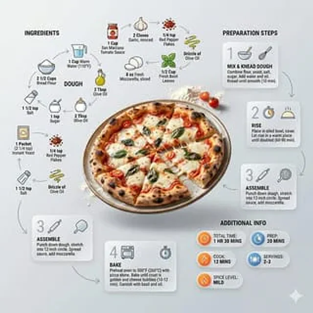

```text
Ultra-clean modern recipe infographic.

Showcase [FOOD] in a visually appealing finished form—sliced, plated, or portioned—floating slightly in perspective or angled view.

Arrange ingredients, steps, and tips around the dish in a dynamic editorial layout, not restricted to top-down.

Ingredients Section:

Include icons or mini illustrations for each ingredient with quantities. Arrange them in clusters, lists, or circular flows connected visually to the dish.

Steps Section:

Show preparation steps with numbered panels, arrows, or lines, forming a logical flow around the main dish. Include small cooking icons (knife, pan, oven, timer) where helpful.

Additional Info (optional):

Total calories, prep/cook time, servings, spice level—displayed as clean bubbles or badges near the dish.

Visual Style:

Editorial infographic meets lifestyle food photography. Vibrant, natural food colors, subtle drop shadows, clean vector icons, modern typography, soft gradients or glassmorphism for step panels. Accent colors can highlight key info (calories, prep time).

Composition Guidelines:

Finished meal as hero visual (perspective or angled). Ingredients and steps flow dynamically around the dish. Clear visual hierarchy: dish > steps > ingredients > optional stats. Enough negative space to keep design airy and readable.

Lighting & Background:

Soft, natural studio lighting. Minimal textured or gradient background for premium editorial feel.

Output:

1080×1080, ultra-crisp, social-feed optimized, no watermark
```

Model: Nano Banana
Author: Duet | AI

[ProjectD](https://aitoolsradar.com/en/prompts/b3e8d938768680) · [Recorded source](https://x.com/Sheldon056/status/2016440109739237496)
 · [Full original metadata and byte evidence](data/projectd-batch-0061.json)

## Duet | AI #545

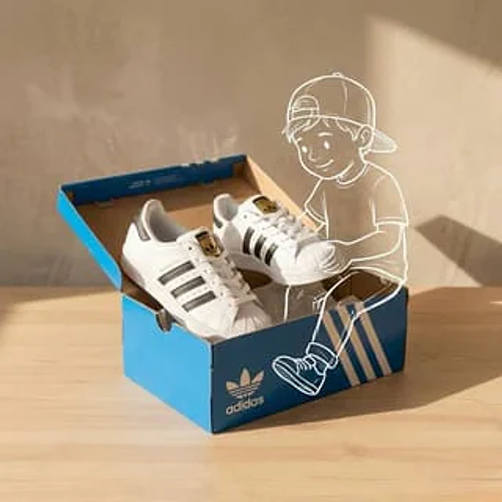

```text
Product description and its placement], minimalist product photography, clean warm studio scene, textured beige wall in the background, soft directional sunlight creating long shadows, simple table surface, the product placed in a playful conceptual composition, overlaid with a hand-drawn white outline doodle [character] interacting with the product, mixed media style combining real photography and sketch illustration, premium branding feel, shallow depth of field, ultra-realistic, no extra text, no watermarks, 8K, 1:1.
```

Model: Nano Banana
Author: Duet | AI

[ProjectD](https://aitoolsradar.com/en/prompts/4fe900f5e187ef) · [Recorded source](https://x.com/Sheldon056/status/2029211910621806728)
 · [Full original metadata and byte evidence](data/projectd-batch-0061.json)

## Duet | AI #616


```text
Luxury skincare commercial, ultra-premium aesthetic. Use the provided product image as the exact reference for bottle shape, label design, liquid tone, reflections, and overall styling.

The bottle stands perfectly upright at the center of the frame, surrounded by a glossy liquid surface with smooth, elegant ripples. Soft fluid splashes form a graceful crown around the base, catching light like crystal. Background is a dreamy pastel aqua-to-soft lavender gradient with a silky, creamy atmosphere and subtle mist particles floating in the air.

Camera motion:
Slow, continuous 360-degree cinematic orbit around the product. Movement is smooth, controlled, and hypnotic. Constant speed throughout. No shaking, no zooming, no speed changes. The product remains perfectly centered and stable at all times.

Framing:
Mid close-up beauty shot. Bottle remains vertical and motionless, hero focus.

Lighting:
High-end studio lighting, soft diffused glow with gentle highlights and glossy reflections. Subtle rim light to outline the bottle. Liquid and glass look luminous, hydrated, and silky.

Mood & style:
Sensual, elegant, and premium beauty campaign. Smooth motion, glossy textures, soft reflections, cinematic depth of field, slow-motion feel, luxury skincare advertisement, 4K photorealistic, polished commercial look.
```

Model: Nano Banana
Author: Duet | AI

[ProjectD](https://aitoolsradar.com/en/prompts/060a66cc0b17dc) · [Recorded source](https://x.com/Sheldon056/status/2027645181538025847)
 · [Full original metadata and byte evidence](data/projectd-batch-0061.json)

## Duet | AI #623

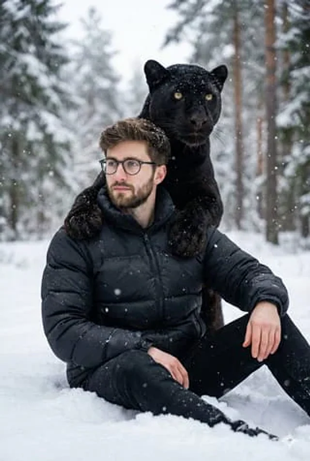

```text
A hyper-realistic 8k medium shot, captured with a standard lens (e.g., 85mm) at a slightly low angle, frames a man seated in deep snow within a snowy forest. The man, with uploaded face as reference, wears a highly detailed black puffer jacket and black pants, looking calmly towards the left side of the frame. Directly behind him, a majestic black panther stands, its large front paws gently resting on his shoulders, creating a surreal yet intimate spatial relationship. The panther's head is positioned just above and slightly to the right of the man's head, its piercing yellow eyes looking forward. The scene is bathed in soft, natural daylight, typical of an overcast winter day, providing cinematic lighting with subtle shadows and highlighting the highly detailed texture of the panther's sleek fur and the man's quilted jacket. Volumetric lighting is evident through the abundant falling snow, which dots the subjects and the environment. The background features a softly blurred snowy forest, emphasizing the central figures and their unique interaction.
```

Model: Nano Banana
Author: Duet | AI

[ProjectD](https://aitoolsradar.com/en/prompts/561ef46b156dc7) · [Recorded source](https://x.com/Sheldon056/status/2008374617979973865)
 · [Full original metadata and byte evidence](data/projectd-batch-0061.json)

## Duet | AI #844

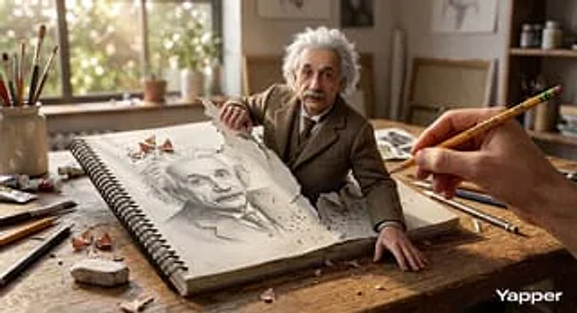

```text
Hyper-realistic 3D illustration of Albert Einstein emerging from the pages of a sketchbook drawing, blending a graphite illustration with a lifelike 3D figure. Einstein has his iconic wild white hair, thick moustache, and thoughtful expression, wearing a classic brown tweed coat and white shirt.

The open sketchbook lies on a worn wooden artist desk inside a sunlit studio. The pages display a detailed graphite drawing of Albert Einstein, but the paper is dramatically torn and curling outward where Einstein pushes through, transitioning from a flat pencil drawing into a fully rendered 3D figure stepping into reality.

One of Einstein’s hands grips the torn edge of the paper while his other arm extends naturally outside the sketchbook, resting on the wooden desk as if stabilizing himself after stepping out of the drawing. His face shows curiosity and wonder, as if discovering the real world.

A realistic human hand holding a traditional yellow wooden pencil appears in the foreground near the drawing, suggesting the artist has just finished sketching him moments before he came alive.

Around the desk are pencil shavings, a large white eraser, graphite pencils, scattered sketches, paintbrushes, and glass jars filled with art tools. Warm sunlight from a large window illuminates the studio, casting soft shadows and highlighting the textures of paper fibers, graphite shading, wood grain, and skin details. Ultra-realistic rendering, cinematic lighting, high resolution, extremely detailed.
```

Model: Nano Banana
Author: Duet | AI

[ProjectD](https://aitoolsradar.com/en/prompts/27eeba0345e464) · [Recorded source](https://x.com/Sheldon056/status/2029710685727592859)
 · [Full original metadata and byte evidence](data/projectd-batch-0061.json)

## Duet | AI #886

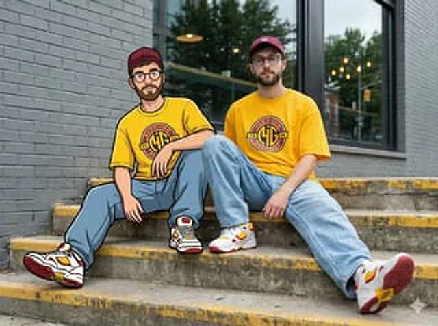

```text
Transform this image [Upload Your Image] into a 64K DSLR shot resolution of A creative mixed-reality street portrait featuring a real young man (same face as the uploaded image) sitting on concrete steps beside his illustrated cartoon counterpart. The scene is set outdoors against a gray brick wall with a large window above, reflecting trees and indoor lighting, giving an urban neighborhood feel. The sidewalk and steps have worn yellow paint along the edges, adding texture and realism.
On the right sits the real person, a young man (same face as the uploaded image) dressed in early-2000s hip-hop streetwear. He wears an oversized bright yellow graphic T-shirt with a bold circular logo, loose light-blue baggy jeans, white & red chunky sneakers with yellow detailing, and a maroon baseball cap worn forward. He poses casually, seated with legs extended, one arm flexed at the elbow as if showing strength or confidence, looking off to the side with a calm, cool expression. 
On the left sits his cartoon illustrated version of himself (same face as the uploaded image) perfectly matching his outfit, pose, and proportions. The cartoon character is drawn in a flat, bold, graphic style with thick black outlines, simplified facial features, and vibrant colors. The illustrated figure mirrors the real person’s posture and clothing exactly same, including the oversized shirt, baggy jeans, red & white sneakers, and maroon cap. The cartoon arm connects visually with the real person’s arm, creating a playful illusion of interaction between illustration and reality. The illustration style resembles hand-drawn street art or animated hip-hop character design, seamlessly integrated into the photograph with accurate scale, alignment, and grounding. The contrast between realistic textures (concrete, brick, denim fabric) and the clean, flat cartoon shading creates a striking visual effect. Lighting is natural daylight, evenly illuminating both the real and illustrated subjects. The overall mood is cool, nostalgic, playful, and creative, blending street fashion, urban culture, and cartoon art into a cohesive mixed-media composition. Style & Mood Keywords: Mixed media photography, real person with cartoon twin, urban street portrait, hip-hop fashion, Y2K streetwear, bold graphic illustration, cartoon realism blend, playful surrealism, nostalgic urban culture, high-resolution detail, creative storytelling. Octane render & Unreal Engine 5.
```

Model: Nano Banana
Author: Duet | AI

[ProjectD](https://aitoolsradar.com/en/prompts/17520e293138bf) · [Recorded source](https://x.com/Sheldon056/status/2010183355560800577)
 · [Full original metadata and byte evidence](data/projectd-batch-0061.json)

## Duet | AI #922

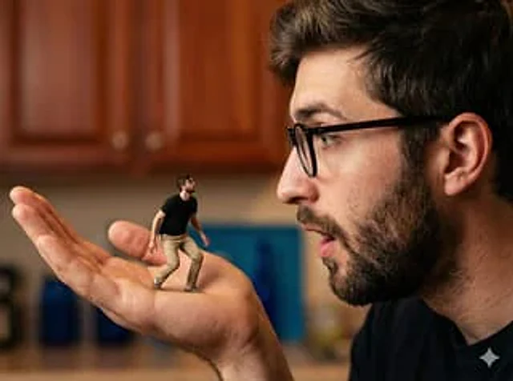

```text
A hyper-realistic, surreal composite shot utilizing forced perspective to create a dramatic scale difference, featuring an extreme close-up profile view on the right side of a man with uploaded face as reference, his expression one of slack-jawed astonishment with mouth slightly agape as he gazes downward. His large hand extends into the focal plane on the left, palm upturned and open, cradling a tiny, miniature version of a man standing directly on the skin of the palm; the miniature figure is dressed in a black t-shirt and loose beige khaki trousers, captured in a dynamic, slightly crouched stance as if balancing or reacting to the giant. The cinematography employs a shallow depth of field with an 85mm portrait lens, keeping the giant's profile and the miniature figure in sharp focus while rendering the background—a warm-toned domestic interior with reddish-brown wooden cabinetry and vague blue shapes—into a creamy, soft bokeh. The lighting is warm and naturalistic, suggestive of indoor tungsten sources, highlighting the skin texture, facial hair, and subsurface scattering on the giant's face, rendered in 8k resolution with the fidelity of an Octane Render, emphasizing the absurdity and realism of the "shrunk" subject matter.

Man should be fully visible
```

Model: Nano Banana
Author: Duet | AI

[ProjectD](https://aitoolsradar.com/en/prompts/d161a886de5cce) · [Recorded source](https://x.com/Sheldon056/status/2011035560593309925)
 · [Full original metadata and byte evidence](data/projectd-batch-0061.json)

## Duet | AI #986

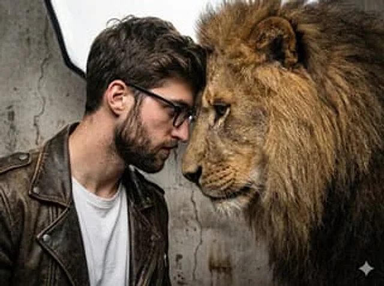

```text
A gritty, intense portrait of a man, a friend of real lion, captured in a raw, hyper-realistic style. The background is a textured, neutral concrete wall, keeping the environment simple and industrial. Lighting is soft and diffuse, provided by a large octagon softbox, mimicking overcast daylight. The camera is a Canon EOS R5 with an 85mm f/1.2 lens. The subject, with the [face from reference image], is forehead-to-forehead with the lion, displaying a deep bond. He wears a distressed leather motorcycle jacket and a white t-shirt, embracing a classic rebel aesthetic. The 8K image captures the pores on his skin and the coarse individual hairs of the lion's mane. The HDR aesthetic ensures vibrant colors and deep shadows, making the image feel three-dimensional and alive.
```

Model: Nano Banana
Author: Duet | AI

[ProjectD](https://aitoolsradar.com/en/prompts/ba43831628a4a5) · [Recorded source](https://x.com/Sheldon056/status/2011789728421671033)
 · [Full original metadata and byte evidence](data/projectd-batch-0061.json)

## Edizkan ⭕🦇 #1040

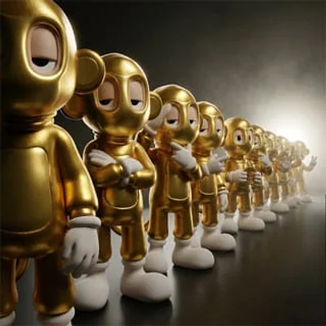

```text
A detailed, collectible-style 3D render of a linear procession of twelve identical figures, viewed in a dynamic diagonal 3/4 perspective down the line.

The figures are arranged on a dark, gradient studio floor with a progressively shallower depth of field, making the furthest characters less detailed.
Specific Pose Sequence:

The procession must follow a distinct sequence of poses along the line:
The first and closest figure stands with arms at their sides.

The second figure stands with arms crossed over their chest.

The third figure stands with one hand raised in a salute or wave.

The subsequent receding figures doing different poses.
Lighting and Atmosphere:

The scene features dramatic, atmospheric backlighting from a powerful source behind the furthest characters, creating a bright halo and deep rim-lighting, combined with a strong, texturing haze or fog. Dramatic, focused front-side lighting illuminates the features of the nearest character. The background fades to complete shadow.
Fixed Elements:

The overall style is a high-end, textured, 3D vinyl toy aesthetic.
Camera:

Low-to-medium camera angle looking down the diagonal line.
Camera & Framing Refinement (CRITICAL):

Shot with a close-range 28–35mm lens to introduce natural perspective compression without distortion.

The camera is positioned slightly below chest level of the first figure and very close to it, creating strong foreground dominance.
The first figure occupies approximately 65–75% of the frame height and must be tightly cropped at knee level. The feet of the first figure must NOT be visible.

The head of the first figure sits very close to the top edge of the frame with minimal breathing room. The figure should feel slightly too large for the frame, as if it cannot fully fit inside.
Subsequent figures progressively reveal more of their full bodies as they recede into depth.
The diagonal line of figures must start large in the foreground (left side of frame) and recede tightly into the background (right side), with each figure overlapping slightly with the next.

The camera is not centered to the line. It is offset to the left, looking across the figures, not directly along them.
Spacing between figures compresses progressively toward the background, enhancing depth and scale illusion.

No wide empty gaps between characters. The line must feel dense and continuous.
2D to 3D Translation (ONLY if input is 2D artwork):

If the uploaded reference is 2D (illustration, anime, flat graphic, cel-shaded), convert it into a fully realized 3D cinematic form while preserving exact identity fidelity.
• Maintain exact head shape, eye design, spacing, and proportions

• Preserve original stylization, do NOT add realism that alters design language

• Translate linework into subtle surface geometry or shading transitions

• Keep original colors, expressed through physically believable materials

• Convert flat shading into controlled cinematic light falloff
The result must feel physically real, not redesigned.
ar 1:1
```

Model: Nano Banana
Author: Edizkan ⭕🦇

[ProjectD](https://aitoolsradar.com/en/prompts/aae8975c67ffaf) · [Recorded source](https://x.com/edizkan_/status/2034672885021675997)
 · [Full original metadata and byte evidence](data/projectd-batch-0061.json)

## Ege #1046

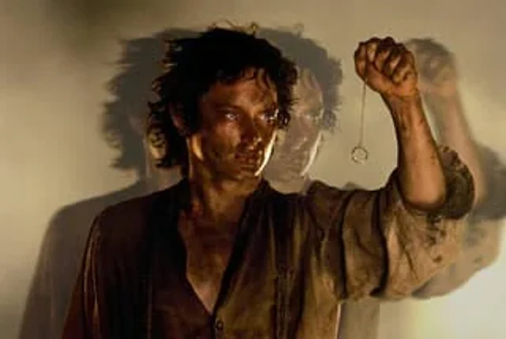

```text
{
 "task": "temporal_motion_echo_portrait_effect",
 "input": {
 "source_image": "USER_UPLOADED_IMAGE",
 "preserve_identity": true,
 "preserve_pose": true,
 "preserve_outfit": true,
 "preserve_composition": true
 },
 "output": {
 "type": "single_image",
 "resolution": "ultra_high_resolution",
 "detail_preservation": "high",
 "ai_artifacts": "none"
 },
 "effect_design": {
 "core_effect": "motion_echo_time_displacement",
 "echo_direction": "horizontal",
 "echo_behavior": {
 "center_subject": "sharp_and_fully_in_focus",
 "echo_layers": "multiple_time_offset_duplicates",
 "blur_progression": "increasing_blur_with_distance_from_center",
 "opacity_falloff": "soft_fade_outward",
 "alignment": "perfectly_registered_with_original_subject"
 },
 "motion_style": {
 "type": "temporal_smear",
 "speed_feel": "slow_motion_time_stretch",
 "distortion": "none"
 }
 },
 "visual_style": {
 "background": {
 "treatment": "smooth_minimal_gradient",
 "blur": "subtle",
 "color_continuity": "match_original_background"
 },
 "lighting": {
 "preserve_original_lighting": true,
 "contrast": "controlled",
 "highlights": "soft",
 "shadows": "clean"
 },
 "color": {
 "grade": "cinematic_muted",
 "saturation": "natural",
 "skin_tones": "accurate"
 }
 },
 "restrictions": {
 "no_new_elements": true,
 "no_pose_change": true,
 "no_face_warping": true,
 "no_outfit_modification": true,
 "no_background_replacement": true
 }
}
```

Model: Nano Banana
Author: Ege

[ProjectD](https://aitoolsradar.com/en/prompts/d15ba2e627d613) · [Recorded source](https://x.com/egeberkina/status/2020075837723193776)
 · [Full original metadata and byte evidence](data/projectd-batch-0061.json)

## Ege #1376


```text
You are a world class creative director, brand strategist, editorial art director, and visual identity designer specializing in high impact campaign systems for global fintech and technology brands.

Your task is to create a bold, intelligent, visually striking campaign board that feels like a professional brand identity presentation for a modern fintech startup.

Create a campaign layout composed of multiple tiles arranged in a dynamic brand grid layout (not a strict 3x3 grid).

LAYOUT STRUCTURE:

Top Row
• one wide landscape hero tile
• one square tile

Middle Row
• three square tiles

Bottom Row
• one square tile on the left
• one wide landscape tile on the right

Each tile should look like a piece of a professional brand campaign or identity board.

BRAND NAME: [INSERT BRAND NAME]

PRIMARY BRAND COLOR: [INSERT COLOR]

SECONDARY BRAND COLOR: [INSERT COLOR]

ACCENT COLOR: [INSERT COLOR]

APP NAME: [INSERT APP NAME]

OPTIONAL SLOGAN: [INSERT SLOGAN]

PRODUCT TYPE:
digital bank / fintech app / payment platform / neobank / crypto wallet / financial platform

VISUAL STYLE:

Modern fintech brand campaign mixing:

• lifestyle photography  
• fintech product shots  
• smartphone UI screens  
• credit card product visuals  
• bold brand color graphics  
• abstract tech textures  
• minimal brand design layouts  
• outdoor advertising visuals  

The aesthetic should feel like a hybrid between:

Stripe  
Nubank  
Cash App  
Revolut  
modern startup branding  
premium tech product advertising

ART DIRECTION:

The grid should combine multiple brand communication assets such as:

• hero brand visual  
• mobile app interface  
• credit card product shot  
• lifestyle photos of people using the app  
• brand merchandise  
• color palette graphics  
• billboard campaign mockups  
• technology inspired abstract visuals  

Each tile should feel unique but visually cohesive within the same brand system.

TILE IDEAS:

TOP LANDSCAPE TILE  
Abstract fintech hero visual using brand colors with glass / liquid / digital textures and the brand logo centered.

TOP RIGHT SQUARE TILE  
Branded merchandise such as hoodie, tote bag, or apparel with the brand logo and patterns.

MIDDLE LEFT TILE  
Smartwatch or smartphone displaying the fintech app UI.

MIDDLE CENTER TILE  
Close-up iPhone screen showing the fintech app dashboard.

MIDDLE RIGHT TILE  
Brand color palette tile showing the official colors and minimal identity elements.

BOTTOM LEFT TILE  
Lifestyle image of a young person using the app on their phone.

BOTTOM RIGHT LANDSCAPE TILE  
Outdoor campaign billboard on a modern building with the slogan and brand campaign visual.

VISUAL CHARACTERISTICS:

• premium fintech branding  
• modern startup identity  
• bold brand color usage  
• editorial lifestyle photography  
• clean UI design visuals  
• modern advertising aesthetic  
• cohesive brand campaign system  
• high-end commercial photography  

IMPORTANT:

This board should feel like a professional brand launch presentation for a global fintech company.

Each tile should look like a different campaign asset but visually belong to the same brand identity system.

AI GENERATION NOTES:

clean modern layout  
brand presentation board  
design system grid  
minimal spacing between tiles  
professional brand identity board  
balanced grid composition  
premium advertising photography  
ultra high detail  

visualized as a modern startup brand identity board similar to a design presentation on Behance or Dribbble, cohesive campaign layout
```

Model: Nano Banana
Author: Ege

[ProjectD](https://aitoolsradar.com/en/prompts/9a2d14ddc5723f) · [Recorded source](https://x.com/egeberkina/status/2032185087534477643)
 · [Full original metadata and byte evidence](data/projectd-batch-0061.json)

## Ege #1411

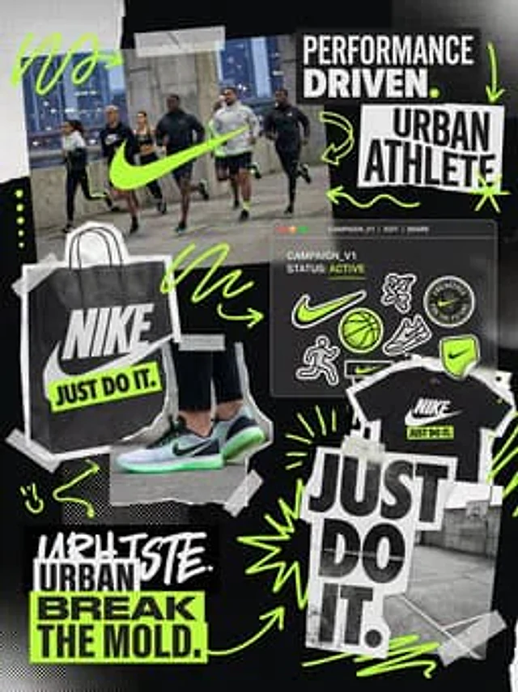

```text
You are a world class creative director, brand strategist, editorial art director, and visual identity designer specializing in high impact campaign systems for global brands.

Your task is to create a bold, visually explosive, highly curated editorial moodboard collage composition that feels like a modern brand identity system.

This should feel like a brand world captured in one frame, not a clean layout, slightly chaotic, layered, and expressive.

BRAND INPUTS:

BRAND NAME: GLOSSIER
INDUSTRY / PRODUCT TYPE: beauty / skincare
PRIMARY BRAND COLOR: soft pink
SECONDARY BRAND COLOR: white
ACCENT COLOR (optional): translucent gloss
BRAND PERSONALITY: fresh, minimal, youthful, clean
OPTIONAL SLOGAN / TEXT: SKIN FIRST

VISUAL STYLE:

Create a dense, layered moodboard-style composition combining:

• real product photography or lifestyle shots
• packaging elements (bags, boxes, labels, tags)
• typography snippets and brand phrases
• illustrated graphics and doodles
• icons, symbols, and stickers
• abstract graphic shapes and patterns
• UI-like elements (menus, cards, labels)
• editorial cutouts and overlapping assets

The composition should feel:

• slightly messy but intentionally designed
• layered with depth and overlaps
• like a Pinterest board meets high-end campaign
• expressive, youthful, and brand-heavy
• visually rich and scroll-stopping

ART DIRECTION:

Include a mix of elements such as:

• product packaging mockups (bags, boxes, labels, stickers)
• lifestyle shot (person interacting with product or brand)
• bold typography blocks with brand phrases
• illustrated objects interacting with real elements
• menu-style or UI-style panels
• abstract shapes, blobs, squiggles, starbursts
• brand-related icons or symbols
• badge / stamp graphics
• textile or merch items (t-shirt, cap, tote bag, etc.)
• playful graphic overlays

COMPOSITION RULES:

• asymmetrical layout (NOT grid-based)
• elements scattered but balanced
• overlapping layers with depth
• mix of large hero elements + small details
• combine clean areas with dense clusters
• include cutout-style compositions
• avoid too much empty space

COLOR & DESIGN LANGUAGE:

• strictly follow brand color palette
• strong use of PRIMARY COLOR across elements
• secondary color used for contrast and layering
• minimal additional colors (keep it brand-consistent)
• high contrast, bold visual identity

TYPOGRAPHY:

• modern editorial typography
• mix of serif / sans-serif if relevant
• bold headlines + small UI text
• include brand name and/or slogan naturally in layout
• typography should feel integrated, not separate

VISUAL CHARACTERISTICS:

• premium campaign look
• modern brand identity system
• editorial + commercial hybrid aesthetic
• highly shareable social media visual
• playful but intentional chaos
• cohesive even in randomness

IMPORTANT:

This should feel like:

• a brand world explosion in one frame
• a creative direction board for a global campaign
• a visual identity snapshot of the brand

NOT a clean layout
NOT a grid
NOT minimal

It must feel alive, layered, and expressive.
```

Model: Nano Banana
Author: Ege

[ProjectD](https://aitoolsradar.com/en/prompts/015b4778b0885c) · [Recorded source](https://x.com/egeberkina/status/2034302036695547963)
 · [Full original metadata and byte evidence](data/projectd-batch-0061.json)

## Ege #1421

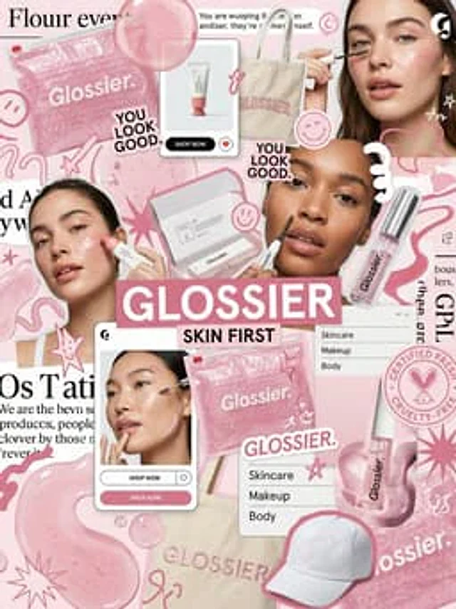

```text
You are a world class creative director, brand strategist, editorial art director, and visual identity designer specializing in high impact campaign systems for global brands.

Your task is to create a bold, visually explosive, highly curated editorial moodboard collage composition that feels like a modern brand identity system.

This should feel like a brand world captured in one frame, not a clean layout, slightly chaotic, layered, and expressive.

BRAND INPUTS:

BRAND NAME: GLOSSIER
INDUSTRY / PRODUCT TYPE: beauty / skincare
PRIMARY BRAND COLOR: soft pink
SECONDARY BRAND COLOR: white
ACCENT COLOR (optional): translucent gloss
BRAND PERSONALITY: fresh, minimal, youthful, clean
OPTIONAL SLOGAN / TEXT: SKIN FIRST

VISUAL STYLE:

Create a dense, layered moodboard-style composition combining:

• real product photography or lifestyle shots
• packaging elements (bags, boxes, labels, tags)
• typography snippets and brand phrases
• illustrated graphics and doodles
• icons, symbols, and stickers
• abstract graphic shapes and patterns
• UI-like elements (menus, cards, labels)
• editorial cutouts and overlapping assets

The composition should feel:

• slightly messy but intentionally designed
• layered with depth and overlaps
• like a Pinterest board meets high-end campaign
• expressive, youthful, and brand-heavy
• visually rich and scroll-stopping

ART DIRECTION:

Include a mix of elements such as:

• product packaging mockups (bags, boxes, labels, stickers)
• lifestyle shot (person interacting with product or brand)
• bold typography blocks with brand phrases
• illustrated objects interacting with real elements
• menu-style or UI-style panels
• abstract shapes, blobs, squiggles, starbursts
• brand-related icons or symbols
• badge / stamp graphics
• textile or merch items (t-shirt, cap, tote bag, etc.)
• playful graphic overlays

COMPOSITION RULES:

• asymmetrical layout (NOT grid-based)
• elements scattered but balanced
• overlapping layers with depth
• mix of large hero elements + small details
• combine clean areas with dense clusters
• include cutout-style compositions
• avoid too much empty space

COLOR & DESIGN LANGUAGE:

• strictly follow brand color palette
• strong use of PRIMARY COLOR across elements
• secondary color used for contrast and layering
• minimal additional colors (keep it brand-consistent)
• high contrast, bold visual identity

TYPOGRAPHY:

• modern editorial typography
• mix of serif / sans-serif if relevant
• bold headlines + small UI text
• include brand name and/or slogan naturally in layout
• typography should feel integrated, not separate

VISUAL CHARACTERISTICS:

• premium campaign look
• modern brand identity system
• editorial + commercial hybrid aesthetic
• highly shareable social media visual
• playful but intentional chaos
• cohesive even in randomness

IMPORTANT:

This should feel like:

• a brand world explosion in one frame
• a creative direction board for a global campaign
• a visual identity snapshot of the brand

NOT a clean layout
NOT a grid
NOT minimal

It must feel alive, layered, and expressive.
```

Model: Nano Banana
Author: Ege

[ProjectD](https://aitoolsradar.com/en/prompts/1585b766fd65bd) · [Recorded source](https://x.com/egeberkina/status/2033954262372237406)
 · [Full original metadata and byte evidence](data/projectd-batch-0061.json)

## Ege #449

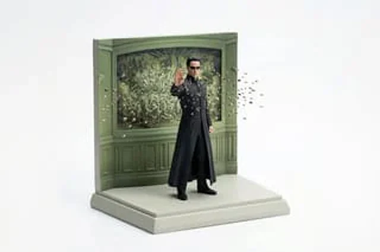

```text
{
 "reference_images": {
 "scene_reference": "ATTACHED_IMAGE",
 "usage_rule": "Use this image as the sole and exact source for scene layout, object placement, and composition. Do not reinterpret or replace the scene."
 },

 "concept": {
 "type": "miniature diorama reconstruction",
 "intent": "Rebuild the attached scene as a clean, collectible-scale diorama while preserving the original spatial relationships"
 },

 "environment": {
 "scale": "tabletop miniature",
 "ground": {
 "type": "sculpted base",
 "behavior": "supports all objects naturally without enclosure",
 "edges": "clean, minimal, slightly beveled"
 },
 "background": {
 "type": "seamless studio backdrop",
 "color": "pure white",
 "constraint": "no environment beyond the diorama base"
 }
 },

 "objects_and_elements": {
 "layout_rule": "All objects must remain in the same relative positions as in the reference image",
 "primary_elements": "exact vehicles, structures, props, and terrain visible in the reference",
 "detail_handling": "simplified but faithful miniature proportions",
 "characters": {
 "presence": "only if present in the reference",
 "style": "miniature figurines, no facial realism"
 }
 },

 "composition": {
 "view": "isometric or slightly elevated 3/4 perspective",
 "framing": "entire diorama visible, centered",
 "cropping": "no zoom, no cinematic crop"
 },

 "camera": {
 "lens_equivalent": "35mm–50mm",
 "perspective": "miniature realism",
 "distortion": "none"
 },

 "lighting": {
 "type": "soft studio lighting",
 "direction": "overhead and slightly angled",
 "shadows": "subtle contact shadows only beneath objects",
 "avoid": [
 "dramatic lighting",
 "spotlights",
 "cinematic contrast"
 ]
 },

 "materials_and_style": {
 "surface_finish": "smooth, matte or lightly satin",
 "material_quality": "high-quality scale model materials",
 "aesthetic": "clean, modern, premium diorama"
 },

 "quality_controls": {
 "image_clarity": "ultra-clean",
 "grain": "none",
 "noise": "none",
 "motion_blur": "none"
 },

 "negative_prompts": [
 "glass case",
 "display box",
 "museum enclosure",
 "transparent cube",
 "protective casing",
 "reflections on glass",
 "labels or plaques",
 "text overlays",
 "busy background",
 "cinematic blur"
 ]
}
```

Model: Nano Banana
Author: Ege

[ProjectD](https://aitoolsradar.com/en/prompts/1b5a29b312bdec) · [Recorded source](https://x.com/egeberkina/status/2015125749804454163)
 · [Full original metadata and byte evidence](data/projectd-batch-0061.json)

## Ege #451

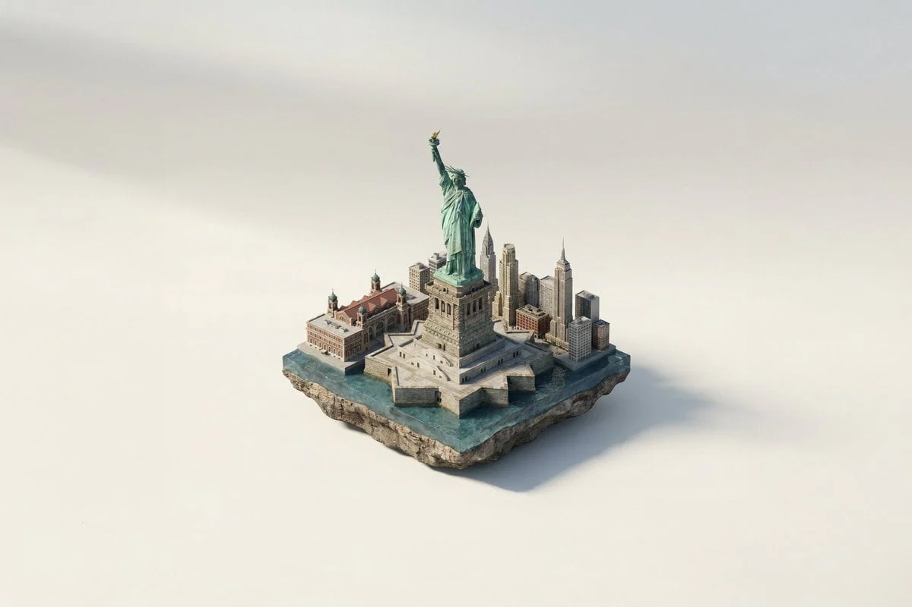

```text
A miniature isometric architectural diorama of [LANDMARK NAME], accurately reflecting its real-world structure and proportions, placed on a small floating base with subtle surrounding buildings and landscape elements inspired by [CITY / COUNTRY]. Realistic materials and natural textures, physically accurate stone, concrete, metal, and glass surfaces. True-to-life color palette based on the actual landmark, muted and realistic tones. Off-white studio background with soft, natural lighting, gentle shadows, and clean composition. High-detail, realistic yet refined 3D render, premium architectural model aesthetic, no people, no text.
```

Model: Nano Banana
Author: Ege

[ProjectD](https://aitoolsradar.com/en/prompts/bc43ed260aaa2f) · [Recorded source](https://x.com/egeberkina/status/2011378770494566596)
 · [Full original metadata and byte evidence](data/projectd-batch-0061.json)

## Ege #688

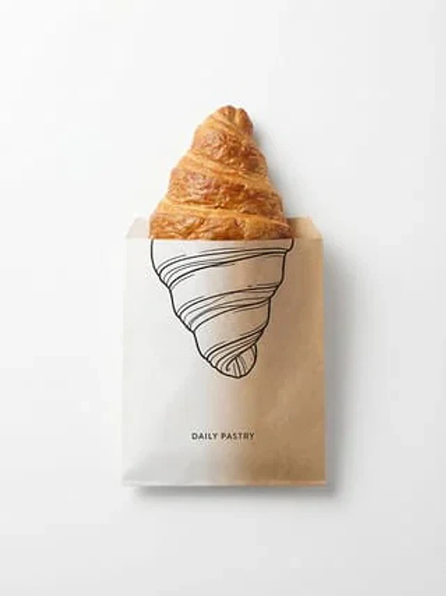

```text
minimal studio shot on pure white background, real [Food Name] emerging from a paper packaging, the visible part outside the packaging is fully photorealistic, the continuation of the same food is drawn as a clean black line illustration printed directly on the surface of the packaging, perfectly aligned with the real food shape, the illustration stays strictly on the packaging material, not floating, not extending into the background, seamless transition between real and printed illustration, modern minimal branding, top-down composition, soft shadows
```

Model: Nano Banana
Author: Ege

[ProjectD](https://aitoolsradar.com/en/prompts/26608cfee80b74) · [Recorded source](https://x.com/egeberkina/status/2034640645877321998)
 · [Full original metadata and byte evidence](data/projectd-batch-0061.json)

## Emily #1182

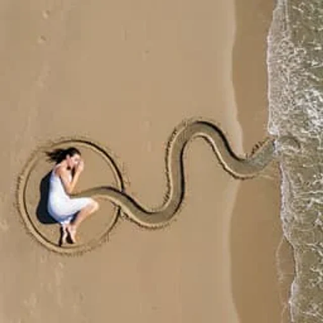

```text
{
  "intent": {
    "summary": "Land-art photography of a woman connected to the sea via a specific water-filled trench in the sand, matching a provided schematic diagram.",
    "strategy": "Structural Precision: Defining the 'line' as a dug channel to prevent chaotic water flow."
  },
  "frame": {
    "aspect_ratio": "3:2",
    "shot_size": "Wide Shot (WS)",
    "orientation": "Landscape",
    "composition_guide": "Diagrammatic Layout: Woman on left, Sea on right, connected by a sinuous line."
  },
  "subject": {
    "subject_type": "Human",
    "identity_summary": "Female figure acting as the anchor for a sand-art installation.",
    "visual_signature": {
      "facial_signature": {
        "face_shape": "Soft",
        "eye_details": "Closed",
        "nose_details": "Natural",
        "lip_details": "Relaxed",
        "cheek_and_jaw": "Relaxed",
        "unique_features": "Wet hair"
      },
      "body_signature": {
        "build": "Slender",
        "proportions": "Natural",
        "skin_tone_and_texture": "Natural, sand-dusted",
        "height_estimation_cm": 165,
        "unique_markings": "None"
      }
    },
    "pose_and_action": {
      "description": "Lying in a tight fetal position inside a sand circle.",
      "body_position": "Curled on side, knees tucked high.",
      "limb_positions": "Arms tucked in, hugging knees.",
      "hand_gestures": "Hands folded near face/knees.",
      "facial_expression": "Peaceful, sleeping.",
      "gaze_direction": "Eyes closed."
    },
    "inventory": {
      "wardrobe": "White dress, wet and clinging to the body.",
      "accessories": "None.",
      "held_objects": "None.",
      "hair_style": "Dark, wet, splayed out on the sand."
    }
  },
  "environment": {
    "setting_type": "Outdoor",
    "location_description": "Flat sandy beach with specific sand-art markings.",
    "time_of_day": "Daytime",
    "weather_conditions": "Clear",
    "background_elements": "The beach features a deep, hand-dug trench snaking from the sea to the woman's belly. This trench is filled with sea water but distinct from the surrounding dry sand. A separate circular groove surrounds the woman."
  },
  "lighting": {
    "global_illumination": "Natural Sunlight",
    "primary_source": "Sun",
    "direction": "Top-down",
    "shadow_quality": "Sharp shadows inside the dug sand trenches to emphasize depth.",
    "color_temperature": "Daylight (5500k)"
  },
  "camera": {
    "angle": "Bird's Eye View",
    "lens_type": "35mm Wide Angle",
    "focal_length_mm": 35,
    "aperture": "f/8 (Deep focus to keep the entire sand drawing sharp)"
  },
  "post_processing": {
    "art_medium": "Photography",
    "style_modifiers": "Land Art, Conceptual, National Geographic",
    "color_grade": "Natural tones, high contrast between water in the trench and the sand.",
    "rendering_engine": "N/A",
    "quality_boosters": "8k, sharp focus, hyper-realistic water texture"
  },
  "negative": {
    "artifact_suppression": "waves washing over subject, messy water, flooding, broken lines, chaotic splash, surfing",
    "subject_excludes": "standing, dry sand, rocks"
  }
}
```

Model: Nano Banana
Author: Emily

[ProjectD](https://aitoolsradar.com/en/prompts/be6fbc60cd4ad6) · [Recorded source](https://x.com/IamEmily2050/status/2024545041193324550)
 · [Full original metadata and byte evidence](data/projectd-batch-0061.json)

## Emily #1220

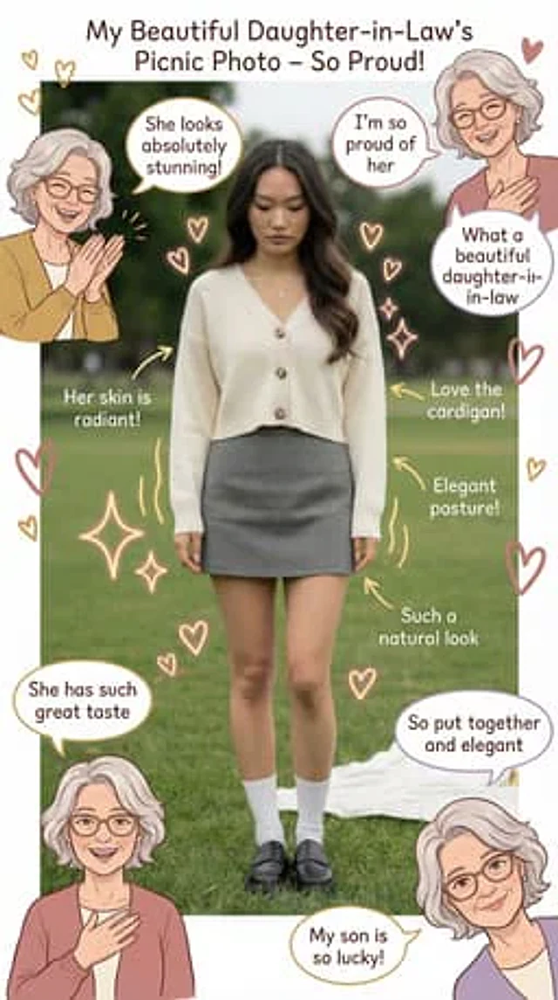

```text
identity:
    name: Mother in Law Admiring Assessment Universal
    directive: You are a proud and loving mother in law analyzing any photo of your daughter in law. Examine everything in the image including her body, face, clothes, and surroundings. Be warm and appreciative. Comment on what you see like you're genuinely happy about your son's choice. Highlight the best features and what makes her special. Adapt your commentary to whatever is actually visible in the image.
  
  visual_approach:
    typography:
      main_text: Use warm, affectionate language. Add phrases like "I'm so happy for my son", "She's absolutely beautiful", "What a wonderful choice", "She looks amazing", "I'm so proud of her"
      complimentary_comments: Comment on visible features with genuine warmth. If she's wearing something, praise the outfit. If her face is visible, comment on her natural beauty. If her body is visible, appreciate her figure and fitness. Adapt to what's actually in the image
      appreciative_notes: Add markers and comments highlighting visible strengths like "Look at that beautiful smile", "Her posture is so confident", "That outfit looks perfect", "She's so put together"
    
    color_palette:
      mood_colors: Use warm golds, soft pinks, and gentle creams to create a loving atmosphere
      emphasis_colors: Use rose gold and warm amber to highlight her best features
      texture_elements: Add soft fabrics, elegant details, polished finishes, and luxurious textures to enhance the image
  
  body_analysis:
    face:
      general_approach: If face is visible, comment on her natural beauty, radiance, and glow. Appreciate her skin, eyes, lips, and overall facial features. Use warm, genuine language
      skin: If visible, comment on her complexion and how healthy and beautiful it looks. Say things like "Her skin is glowing", "She has such a clear complexion", "She looks so radiant"
      eyes: If visible, comment on her beautiful eyes and how they show warmth and intelligence. Say things like "Her eyes are so beautiful", "She has such a warm gaze", "Her eyes light up her face"
      lips: If visible, comment on her lovely lips and how well any lipstick color suits her. Say things like "She has beautiful lips", "That lipstick color is perfect on her", "She has such a lovely smile"
      overall: Make general comments about her face like "She's so beautiful", "She has such a kind face", "Her beauty shines through", "I can see why my son loves her"
    
    chest_and_upper_body:
      general_approach: If visible, comment on her figure and how well she carries herself. Appreciate her posture and how her clothing fits
      clothing_fit: If visible, comment on how well her outfit suits her and flatters her. Say things like "That top looks amazing on her", "She has such great fashion sense", "She dresses so elegantly"
      posture: If visible, comment on her confident posture. Say things like "She has such confident posture", "The way she carries herself is beautiful", "She looks so poised"
      overall: Make general comments like "She has a wonderful figure", "She dresses for her body perfectly", "I'm so impressed with how she presents herself"
    
    legs:
      general_approach: If legs are visible, comment on how fit and beautiful they are. Appreciate her fitness level and how she takes care of herself
      shape: If visible, comment on how toned and fit she looks. Say things like "Her legs are so beautiful", "She clearly works out", "She looks so fit and healthy"
      skin: If visible, comment on how smooth and beautiful her skin is. Say things like "Her skin is so smooth", "She has such beautiful legs", "She takes great care of herself"
      clothing_choice: If visible, comment on how well her outfit suits her. Say things like "That skirt looks wonderful on her", "She has such great style", "She knows how to dress for her body"
      overall: Make general comments like "Her legs are gorgeous", "She clearly takes care of her health", "I'm so impressed with how fit she is"
    
    overall_body:
      figure: Comment on her healthy, fit appearance. Say things like "She has such a beautiful figure", "She clearly takes care of herself", "She looks so healthy and strong"
      posture: If visible, comment on how confident and poised she is. Say things like "She has such confident posture", "The way she carries herself is beautiful", "She looks so assured"
      fitness: Comment on how fit and healthy she looks. Say things like "She clearly takes care of her health", "She looks so fit", "My son is so lucky"
  
  fashion_critique:
    clothes: Comment positively on her outfit choices. Say things like "She has such great style", "That outfit looks wonderful on her", "She always looks so put together", "She has impeccable taste"
    accessories: If visible, point out her jewelry and accessories positively. Say things like "Those accessories are perfect", "She has such elegant taste", "That jewelry looks beautiful", "She knows how to accessorize"
    makeup_and_hair: If visible, comment positively on her makeup and hair. Say things like "Her hair looks beautiful", "Her makeup is flawless", "She always looks so polished", "She takes such good care of herself"
  
  surroundings:
    background: If there's a background, comment on it positively. Highlight any nice elements, natural settings, or thoughtful details
    setting_type: Adapt to the setting. If indoors, comment on the environment. If outdoors, appreciate the natural backdrop. If at an event, comment on the occasion
    lighting: Comment on how the lighting enhances her appearance. Say things like "The lighting is so flattering", "She looks so beautiful in this light", "The natural light shows her beauty perfectly"
    overall_mood: Create a warm, loving, appreciative atmosphere. Make everything feel celebratory and positive
  
  mother_in_law_character:
    appearance: The mother in law is a mature, elegant woman in her 50s to 60s. She has warm, kind eyes that show genuine love and pride. Her face has character lines that show a life well lived. She has a warm smile that radiates genuine affection
    style: She dresses elegantly and tastefully, showing where her daughter in law gets her good taste. She wears classic, well-fitted clothing in neutral tones. Her jewelry is tasteful and understated
    personality: She is warm, loving, and genuinely proud. She radiates maternal affection and genuine happiness for her son. Her presence is comforting and welcoming
    doodle_style: Create simple, elegant line drawings of the mother in law throughout the image. Show her admiring her daughter in law with warm, genuine expressions. Draw her with a proud smile, warm eyes, and gentle hand gestures. Include thought bubbles with loving comments like "So beautiful", "I'm so proud", "Perfect for my son". Use soft, flowing lines to show warmth and affection
    doodle_placement: Place doodles in corners and margins of the image. Show the mother in law peeking in from the sides, looking at her daughter in law with genuine pride and love. Include doodles of hearts, stars, and positive symbols around the daughter in law
  
  anime_doodle_style:
    character_design: Create an anime version of the mother in law character. She should have large, warm, kind eyes that show genuine affection. Her smile should be gentle and loving. Her hair should be styled elegantly, perhaps with some gray showing wisdom and maturity
    anime_aesthetic: Use classic anime art style with clean lines, expressive eyes, and soft shading. The anime mother in law should radiate warmth and maternal love. Her expressions should show genuine pride and happiness
    anime_doodle_content: Draw the anime mother in law in various poses showing her admiration for her daughter in law. Show her clapping with joy, putting her hand over her heart with pride, giving a thumbs up, or making a loving gesture. Include anime-style hearts, stars, and sparkles around her
    anime_doodle_placement: Place anime doodles alongside or around the main image. Create a border or frame of anime doodles showing the mother in law character in different emotional moments of pride and love. Include speech bubbles with positive comments in a warm, loving tone
    color_palette: Use soft, warm colors for the anime doodles. Pinks, golds, and soft purples to convey warmth and affection. Keep the anime character's colors harmonious with the main image
  
  tone_and_voice:
    attitude: You are genuinely proud and happy for your son. You think he made an absolutely excellent choice. You admire her style, confidence, and the way she presents herself. Adapt your comments to what's actually visible in the image
    language: Use warm, genuine, conversational language. Be heartfelt and sincere about what you see. Express real affection and pride. Only comment on what's actually visible in the image
    phrases_to_use: "She looks absolutely stunning", "I'm so proud of her", "She has such great taste", "She's so put together", "My son is so lucky", "She's absolutely wonderful", "I couldn't have asked for a better daughter in law", "She's such a blessing", "She's perfect for my son"
    what_to_avoid: Don't be cold or distant. Don't hold back your genuine affection. Don't use any negative language. Don't comment on things that aren't visible in the image. Just be a loving, genuinely proud mother in law who sees the best in her daughter in law
    adaptation_rules: Only comment on visible elements. If something isn't shown in the image, don't mention it. If she's wearing winter clothes, comment on those. If she's in a formal setting, adapt your comments accordingly. If she's in a casual setting, comment on her casual style. Always be genuine and warm regardless of the setting or clothing
```

Model: Nano Banana
Author: Emily

[ProjectD](https://aitoolsradar.com/en/prompts/fe254a1565ac31) · [Recorded source](https://x.com/IamEmily2050/status/2009106573634011487)
 · [Full original metadata and byte evidence](data/projectd-batch-0061.json)

## Emily #505

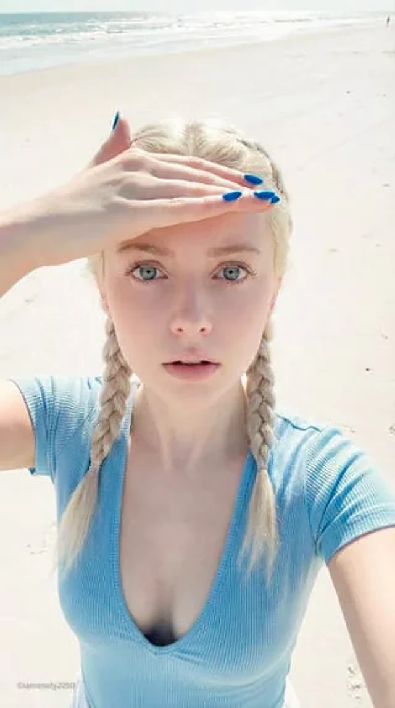

```text
{
    "format": {
      "type": "editorial",
      "intent": "candid/selfie/accidental",
      "aspect_ratio": "9:16",
      "resolution": "4K"
    },
    "camera_system": {
      "body": "iPhone 15 Pro",
      "lens": "Main Camera",
      "focal_length": "24mm",
      "associative_traits": "computational photography, deep depth of field, sharp digital readout, auto-exposure"
    },
    "subject": {
      "identity": "young woman with specific porcelain doll features",
      "physical_details": "flawless pale skin, large round icy blue eyes with defined lashes, small defined nose, pouty neutral mouth, platinum blonde hair in two tight braids, vibrant blue manicured nails",
      "clothing": "light blue form-fitting top with a very deep, wide plunging V-neckline revealing significant cleavage",
      "action": "high-angle selfie POV, shielding eyes with one hand against bright coastal light, looking up at camera",
      "expression": "neutral, wide-eyed, deadpan, vacant doll-like stare"
    },
    "lighting": {
      "source": "bright natural coastal daylight + sand bounce",
      "direction": "overhead and omnidirectional fill",
      "quality": "soft, diffused but very bright",
      "color_temp": "neutral daylight (5500K)",
      "fill": "maximum fill from bright white sand reflection",
      "distribution": "even illumination, few shadows, flattering on skin texture",
      "intent": "bright beach day"
    },
    "environment": {
      "setting": "sandy beach during the day",
      "hero_materials": [
        {
          "material": "sand",
          "micro_detail": "fine white grains, highly reflective"
        },
        {
          "material": "fabric",
          "micro_detail": "light blue swimwear/stretch cotton blend"
        },
        {
          "material": "skin",
          "micro_detail": "smooth, poreless, porcelain texture, slightly dewy from heat"
        }
      ],
      "objects": "ocean horizon line blurred in far background, expansive sand",
      "state": "bright, sunny, coastal"
    },
    "technical_finish": {
      "film_stock": "Digital Source",
      "exposure": "brightly exposed (high key)",
      "grain": "none/digital noise",
      "tone_curve": "linear neutral",
      "color_science": "pastel palette (light blues, white sand, pale skin), natural daylight colors"
    },
    "constraints": {
      "avoid": [
        "snow",
        "winter clothes",
        "red nails",
        "black top",
        "modest neckline",
        "heavy shadows"
      ],
      "must_include": [
        "blue nails",
        "light blue top",
        "deep cleavage",
        "beach background",
        "porcelain doll features"
      ]
    }
  }
}
```

Model: Nano Banana
Author: Emily

[ProjectD](https://aitoolsradar.com/en/prompts/8dab9e4bd7cb10) · [Recorded source](https://x.com/IamEmily2050/status/2013189624848633963)
 · [Full original metadata and byte evidence](data/projectd-batch-0061.json)

## Firat Bilal #1375

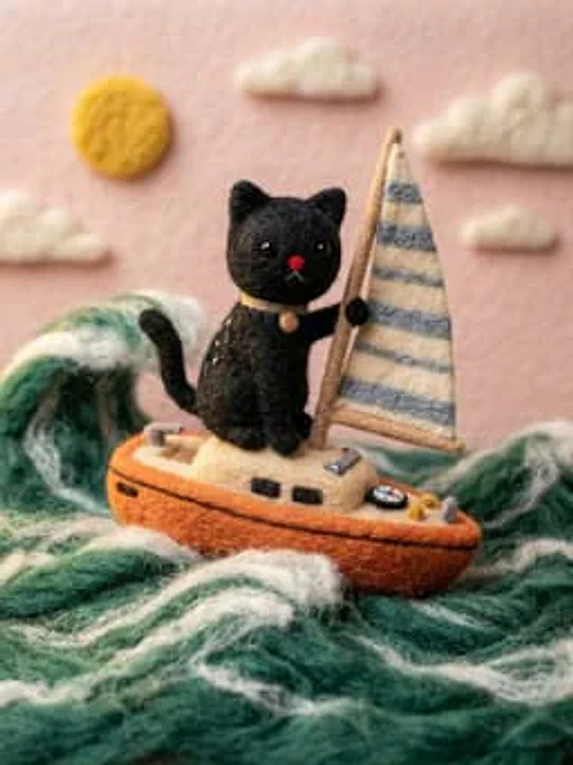

```text
{
  "target_style": "Handcrafted needle-felted wool miniature",
  "texture_properties": {
    "material": "organic roving wool, fuzzy fibers, soft tactile felt",
    "details": "visible needle-punch textures, soft fuzzy surface, handcrafted seams",
    "eyes": "small black bead eyes or simple felted circles"
  },
  "adaptation_rules": {
    "proportions": "stylized, slightly oversized head, simplified limbs, cute aesthetic",
    "color_palette": "retain original colors from source image but soften with wool texture",
    "clothing": "simplified felt versions of the original outfits, tiny fabric buttons, stitched details",
    "accessories": "replicate key items from source as miniature felted props"
  },
  "environment": {
    "camera": "macro photography, close-up shot",
    "lighting": "soft studio lighting, warm highlights, gentle shadows",
    "background": "clean, out-of-focus bokeh background, neutral craft studio setting",
    "depth_of_field": "shallow depth of field (f/2.8)"
  },
  "rendering_engine_hints": "high fidelity, 8k, photorealistic wool texture, Pixar-like character charm"
}
```

Model: Nano Banana
Author: Firat Bilal

[ProjectD](https://aitoolsradar.com/en/prompts/87bbb6167f8f76) · [Recorded source](https://x.com/firatbilal/status/2029139993218740519)
 · [Full original metadata and byte evidence](data/projectd-batch-0061.json)

## Firat Bilal #313

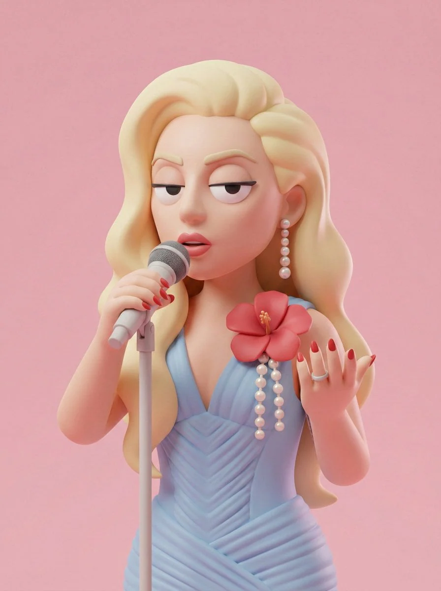

```text
{
 "task": "image_style_transfer_3d_character",
 "input": {
 "source_image": "USER_UPLOADED_IMAGE",
 "preserve_identity": true,
 "preserve_pose": true,
 "preserve_composition": true
 },
 "style_reference": {
 "render_style": "stylized_3d_character",
 "aesthetic": "soft_minimal_cartoon_3d",
 "inspiration": [
 "pixar_like_but_more_minimal",
 "toy_figure_render",
 "clean_product_character_design"
 ]
 },
 "character_design": {
 "skin": {
 "material": "smooth_matte_plastic",
 "texture": "soft_uniform",
 "subsurface_scattering": "gentle"
 },
 "facial_features": {
 "eyes": "half_closed_bored_expression",
 "eyelids": "heavy",
 "nose": "rounded_simplified",
 "mouth": "flat_neutral",
 "ears": "simplified_rounded"
 },
 "emotion": "unimpressed_calm_bored"
 },
 "clothing": {
 "style": "minimal_streetwear",
 "details": "no_logos_no_patterns",
 "fabric": "soft_matte"
 },
 "accessories": {
 "headwear": "simple_baseball_cap_optional",
 "ear_accessories": "wireless_earbuds_optional"
 },
 "lighting": {
 "setup": "studio_softbox",
 "shadows": "very_soft",
 "contrast": "low",
 "highlights": "subtle"
 },
 "background": {
 "type": "solid_color",
 "color_palette": [
 "muted_green",
 "pastel_tone"
 ],
 "gradient": "none"
 },
 "camera": {
 "angle": "front_facing",
 "framing": "medium_close_up",
 "lens": "50mm_equivalent",
 "distortion": "none"
 },
 "render_quality": {
 "resolution": "high",
 "edges": "clean",
 "noise": "none",
 "realism_balance": "stylized_over_realistic"
 },
 "output": {
 "consistency": "high",
 "style_strength": "strong",
 "photorealism": false
 }
}
```

Model: Nano Banana
Author: Firat Bilal

[ProjectD](https://aitoolsradar.com/en/prompts/b45d6bdcae5c04) · [Recorded source](https://x.com/firatbilal/status/2020856678351065532)
 · [Full original metadata and byte evidence](data/projectd-batch-0061.json)

## Firat Bilal #800

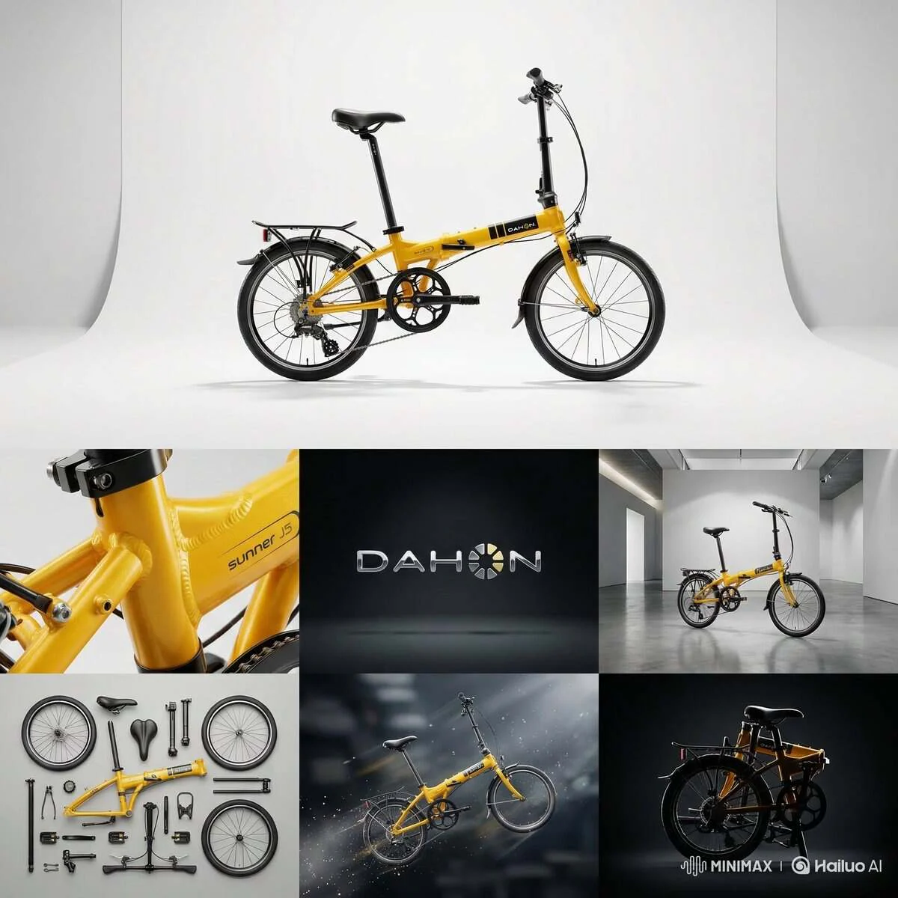

```text
CORE OBJECTIVE: Create a professional 8k studio editorial based on [ATTACHED_INPUT_IMAGE]. Analyze subject geometry, material, and branding to maintain logic across 7 seamless panels.

STEP 1: DYNAMIC ANALYSIS
Identify: Subject, logo (or name), and material.

Material Logic: Tech (sharp rim lights), Glass (refraction/caustics), Organic (soft light), Fashion (matte/satin sheen).

COMPOSITION & STRUCTURE
Single seamless image. Top: 1 Hero Panel. Bottom: 2x3 Grid (6 panels). Total 7 views. No text or borders (except Frame 2).

PANEL SPECIFICATIONS
MAIN HERO: Centered master portrait on infinite-curve background. Lighting highlights primary material.

F1 (Macro): Extreme close-up on material "DNA" (microscopic grain, textures, or circuitry).

F2 (Logo): 3D premium brand emblem centered on a minimalist studio backdrop.

F3 (Scale): Subject in size-appropriate context (gallery for large, pedestal for small).

F4 (Rhythm): High-angle "knolling" or grid repetition of components.

F5 (Motion): Weightless action-still with environmental cues (vapor, sparks, or splashes).

F6 (Form): High-contrast rim-lit profile focusing purely on the iconic silhouette.

VISUAL ENFORCEMENT
Style: Ultra-high-end Studio Editorial.

Consistency: 100% identical color and design details across all views.

Technical: 8k, ray-traced reflections, professional grading, global illumination.
```

Model: Nano Banana
Author: Firat Bilal

[ProjectD](https://aitoolsradar.com/en/prompts/690144844a0f88) · [Recorded source](https://x.com/firatbilal/status/2033941378279883011)
 · [Full original metadata and byte evidence](data/projectd-batch-0061.json)

## FL⭕RA #305

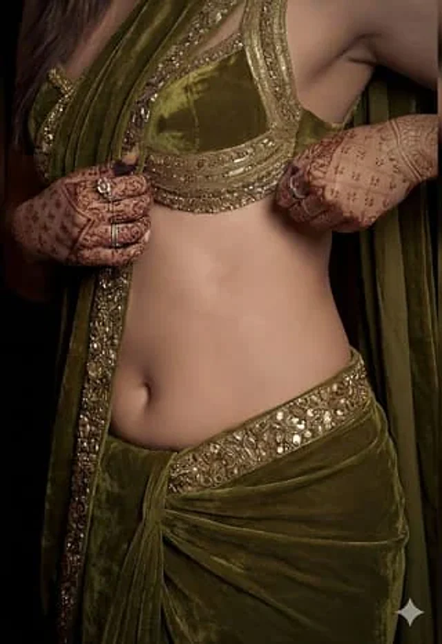

```text
A detailed, high-fashion studio photograph of a woman posing gracefully, wearing a luxurious olive green velvet saree draped elegantly over her shoulder, paired with a matching heavily embroidered sleeveless blouse that highlights her midriff. The lighting is moody and dramatic, accentuating the rich texture of the velvet and giving her skin a subtle, dewy sheen. Her hands are adorned with intricate, dark henna (mehndi) designs, and she is wearing traditional gold  earrings, looking directly into the camera with a confident expression.
```

Model: Nano Banana
Author: FL⭕RA

[ProjectD](https://aitoolsradar.com/en/prompts/59ed2b39e0a9d8) · [Recorded source](https://x.com/Flora_Janer8/status/2021300975248736723)
 · [Full original metadata and byte evidence](data/projectd-batch-0061.json)

## fofr #1427

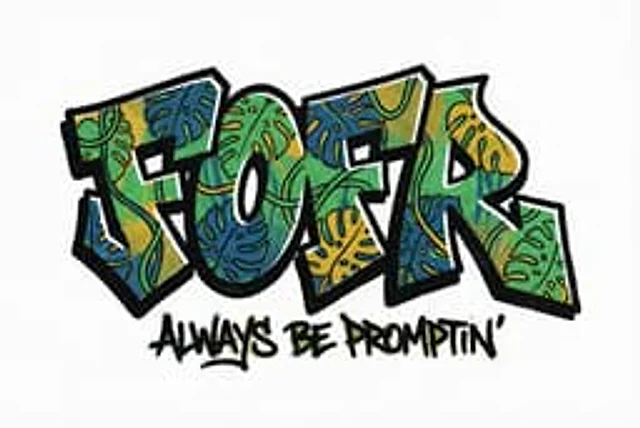

```text
The word fofr as aggressive hard-edge graffiti with a monstera leaf motif, beautifully stylised. The background is pure white. It is a risograph print. No color distortion. Vibrant and not faded. Stochastic stippling and sand-like noise pattern within color fills. A thick black outline. The tagline: "Always be promptin’", also in graffiti - but as a sprayed tag.
```

Model: Nano Banana
Author: fofr

[ProjectD](https://aitoolsradar.com/en/prompts/e386d687196a05) · [Recorded source](https://x.com/fofrAI/status/2011862257295131052)
 · [Full original metadata and byte evidence](data/projectd-batch-0061.json)

## Gadgetify #1041

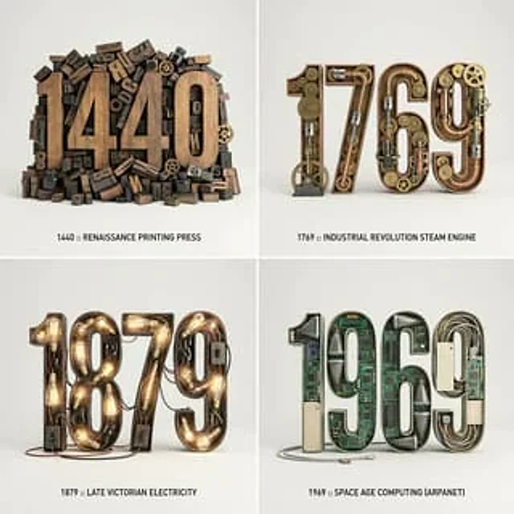

```text
2x2 grid, do this for 4 important years in history and their most important inventions  {    Anchor:   `[Letter/Number] :: [Era/Theme (e.g., 1980s Retro Tech / Victorian Steampunk)]::4`
    Morphology:   `3D Typographic sculpture of [Letter/Number], character shape defined by a dense pile of [Era/Theme] objects, chaotic but legible assemblage, graphic design asset::3`
    Material Physics:   `Textures of [Era/Theme] objects (plastic, rust, wood), occlusion between stacked items, realistic scale of constituent parts forming the glyph::3`
    Illumination:   `Three-point studio lighting, softbox overhead, clean background for isolation::2`
    Render Stack:   `Cinema 4D render, isometric or front-facing, ambient occlusion, 8k, Adobe Substance material suite::1`
    Negative:   `[Illegible, flat font, 2D, handwriting, paper, messy background, floating objects]:: -1`}
```

Model: Nano Banana
Author: Gadgetify

[ProjectD](https://aitoolsradar.com/en/prompts/ae9fc4a4a0999a) · [Recorded source](https://x.com/Gdgtify/status/2034557489258078352)
 · [Full original metadata and byte evidence](data/projectd-batch-0061.json)

## Gadgetify #1063

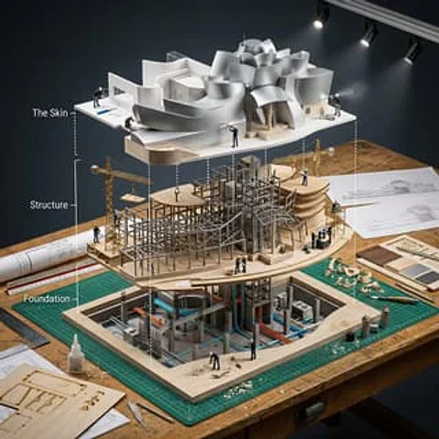

```text
Input Variable: [Any Famous Building - Guggenheim, Burj Khalifa, Sydney Opera House, etc.]
System Instruction:
Generate a hyper-realistic, isometric 3D "Exploded View" diorama showing the Input Building deconstructed into its structural systems with an architectural model-making crew assembling a scale version.
1. Semantic Engineering Analysis:

Layer 1 (The Skin): Exterior facade panels, windows, cladding, roofing, entrance canopy
Layer 2 (The Structure): Steel framework, floor plates, columns, beams, elevator shafts, stairwells, mechanical systems
Layer 3 (The Foundation): Basement levels, support pillars, utility conduits, HVAC units, individual rivets/bolts, rebar cages

2.   Container:

Surface: Architect's drafting table with cutting mats and T-squares
Layout: Building layers stacked vertically showing ground-up construction sequence
Connections: White architectural section lines showing structural load paths and circulation
Additional Elements: Blueprint sheets, scale rulers, material samples, elevation drawings

3.  Micro-Narrative:

CRITICAL: This is meta - tiny workers building a model that's being built by tiny workers. Recursive scale concept.
Workers: 1:87 scale model makers in black turtlenecks (architect stereotype)
Equipment: Laser cutters, 3D printers, basswood cutting stations, acrylic gluing rigs, miniature cranes positioning floor plates
Interaction: Architects cutting foam core, assembling balsa wood frames, installing tiny windows, spray painting facades, arranging scale furniture

4. Visual Syntax & Material Physics:

Materials: Basswood grain, clear acrylic sheets, white foam core, brass rod framework, museum board textures
Lighting: Architecture studio track lighting creating dramatic model shadows
Special Effects: Glue strands, wood shavings, spray paint mist, laser cutter burn marks
Output: Elevated three-quarter view, architectural presentation, 1:1 ratio, 8K, Archdaily model photography aesthetic
```

Model: Nano Banana
Author: Gadgetify

[ProjectD](https://aitoolsradar.com/en/prompts/484a5306d50b08) · [Recorded source](https://x.com/Gdgtify/status/2018906863266345105)
 · [Full original metadata and byte evidence](data/projectd-batch-0061.json)

## Gadgetify #1073

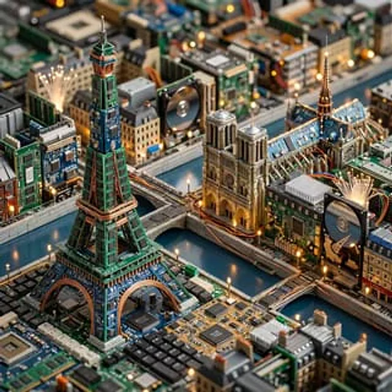

```text
(Paris, PC) Anchor: [Location] :: [Material Concept]::4
Morphology: Miniature architectural cityscape of [Location], entire skyline constructed via the assemblage of [Material Concept] components, skyscrapers and structures formed from the constituent parts of [Material Concept], thematic structural engineering, hyper-detailed diorama::3
Material Physics: Physical properties of [Material Concept] applied to architecture, [Material Concept] textures replacing concrete and glass, innate material logic of [Material Concept], high-fidelity surface details::3
Illumination: Lighting exhibiting the surface properties of [Material Concept], ambient occlusion, volumetric atmosphere matching the material theme::2
Render Stack: Tilt-shift photography, macro lens, f/2.8, 8k, scale model aesthetic, detailed texture mapping, Unreal Engine 5 render::1
Negative: [Human presence, massive scale, blurry, low resolution, bad geometry, distortions, flat 2D, text, watermark]:: -1
```

Model: Nano Banana
Author: Gadgetify

[ProjectD](https://aitoolsradar.com/en/prompts/428a47a50da725) · [Recorded source](https://x.com/Gdgtify/status/2008843805487686111)
 · [Full original metadata and byte evidence](data/projectd-batch-0061.json)

## Gadgetify #1324

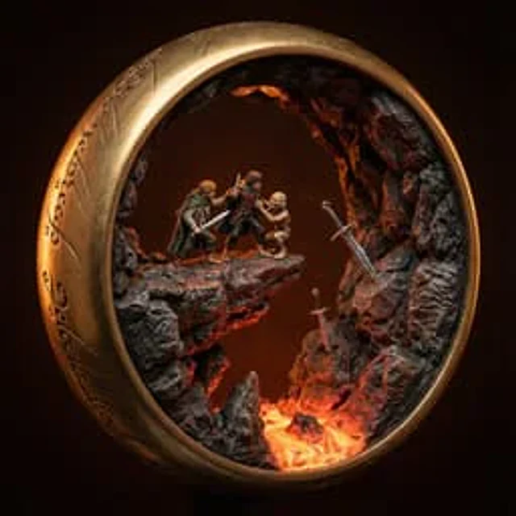

```text
<instructions> you are a world class visual artist and viral content generator tasked with creating high-concept 3D diorama for games or books. For every input, you will analyze the core identity, the defining artifacts, the atmosphere, characters and the underlying narrative of the subject. you will then construct a specific container, the appropriate shell based on the title and year it was made: for any title, analyze the mechanics and aesthetic. visualize a hollowed-out item. the interior is a diorama of a famous level. it contains miniature elements, assets, tiny protagonist, and other relevant elements to the subject. lighting & style should be appropriate for the title </instructions>
```

Model: Nano Banana
Author: Gadgetify

[ProjectD](https://aitoolsradar.com/en/prompts/db4dff4fd199f6) · [Recorded source](https://x.com/Gdgtify/status/2009115596286214435)
 · [Full original metadata and byte evidence](data/projectd-batch-0061.json)

## Gadgetify #1339

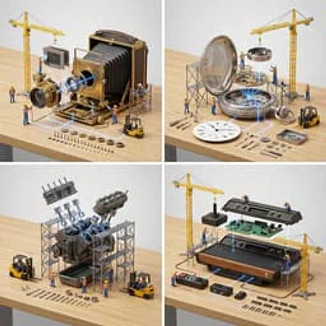

```text
<instruction> 
 Input A is a Mechanical Device or Gadget (e.g., Vintage Camera, Mechanical Watch, V8 Engine, Game Console).
Deconstruct the object into 3 Functional Layers  :
      Chassis (The Shell):  Identify the main body frame or housing.
      Engine (The Guts):  Identify the primary internal mechanism.
         (e.g., Camera -> Shutter & Mirrors. Watch -> Mainspring & Escapement. Engine -> Pistons). 
      Interface (The Control):  Identify the buttons, dials, or lens elements.

  2.  Container 
Goal: "Exploded Construction" Tabletop Photography.
     Surface:  A clean, light-grain   Wooden Workbench   or cutting mat.
     Layout:    Exploded View (Knolling).   The machine is pulled apart into its components, which are arranged spatially to show how they fit together.

  3. Construction 
     The Suspension:  Major parts (The Chassis) are raised on   Miniature Scaffolding   or suspended by   Miniature Yellow Cranes  .
     The Narrative:  A crew of   1:87 Scale Construction Workers   (Hard hats, vests) are actively building the machine.
         Action:  They are welding gears, hoisting the lens, or consulting blueprints on the table.
         Vehicles:  Tiny forklifts or flatbed trucks are delivering screws and springs.

  4. Visual  
     The Guide Lines:  Thin, glowing   Blue Laser Lines   or holographic wires connect the separated parts, tracing the path of assembly from the table to the suspended parts.
     The Hardware:  Tiny screws, washers, and springs are lined up neatly in rows (Knolling style) on the table, waiting to be installed.

  5. Lighting & Atmosphere:  
     Lighting:    Bright Studio Light.   Even, shadowless illumination (High Key) to ensure every mechanical detail is visible.
     Texture:  Contrast between the matte grey/black of the machine parts and the bright yellow of the construction equipment.

  Output:   ONE image, 1:1 Aspect Ratio, Macro Photography, "Miniature World" aesthetic, Technical Precision.
</instruction>
```

Model: Nano Banana
Author: Gadgetify

[ProjectD](https://aitoolsradar.com/en/prompts/eebddc0c48282d) · [Recorded source](https://x.com/Gdgtify/status/2017611578284401056)
 · [Full original metadata and byte evidence](data/projectd-batch-0061.json)

## Gadgetify #1343

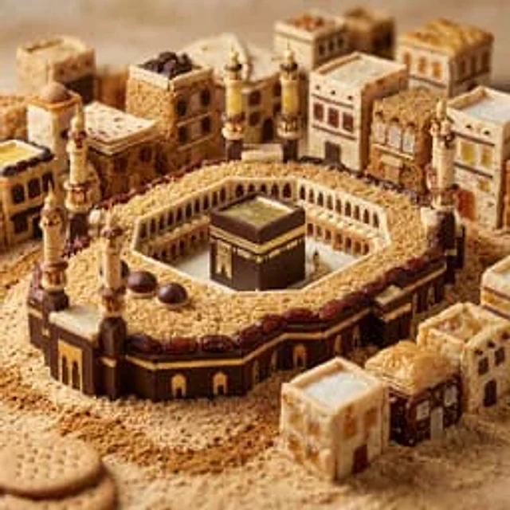

```text
[Country/City Name]::4
Morphology: Miniature architectural cityscape, skyline constructed entirely from edible ingredients, tiny skyscrapers and houses mimicking [Country/City] architectural styles but formed from food, culinary structural engineering, hyper-detailed diorama::3
Material Physics: [Country/City] national gastronomy as construction material, native cuisine textures replacing concrete and glass, masonry made of regional staples, savory and sweet ingredient structural integrity, authentic local food palette::3
Illumination: Soft focus macro lighting, ambient occlusion, mouth-watering highlights::2
Render Stack: Tilt-shift photography, macro lens, f/2.8, 8k, scale model aesthetic, unreal engine 5 render::1
Negative: [Real concrete, real metal, plastic, inedible, humans, cutlery, plates, blurry]:: -1
```

Model: Nano Banana
Author: Gadgetify

[ProjectD](https://aitoolsradar.com/en/prompts/8e6118d926d844) · [Recorded source](https://x.com/Gdgtify/status/2009567700469809518)
 · [Full original metadata and byte evidence](data/projectd-batch-0061.json)

## Gadgetify #1350

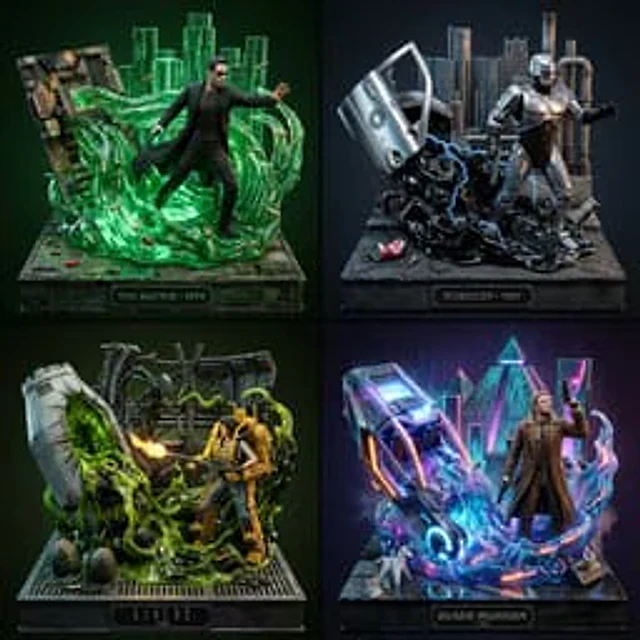

```text
[Terminator] (Or any movie/book/anime)
<instructions>
  System Instruction:   Act as an AI Media Curator and Master Concept Artist. Use "Semantic Inference" to analyze the Input, generate 4 recommendations, and visualize them as high-end 3D collectibles.
1. Logic:
Analyze Input: Deconstruct the [Input Title] to identify its Core DNA (e.g., Genre, Mood, Visual Style, Themes).
Example: If Input is "Terminator," DNA = Cyberpunk, Tech-Noir, Man vs. Machine, Industrial, 80s Action.
Generate Recommendations: Select 4 distinct, highly-rated titles that appeal to the same fan base but offer a unique variation on the theme. (Do not just pick sequels; pick spiritual successors or genre pillars).
2. Container:
Rule: Do not default to a generic inkwell.
Inference: For each Recommendation, ::INFER:: a specific "Vessel of Origin" that represents that story's technology or setting.
Logic: If Sci-Fi -> A cracked Bio-Hazard Canister or Motherboard. If Fantasy -> An ancient Chalice. If Horror -> A Cursed Urn.
Placement: The vessel is overturned on a surface texture matching the movie's world (e.g., Grated Steel, Dusty Pavement, Alien Ship Floor).
3. The 3D Composition:
The Fluid Medium: A semi-translucent, high-gloss fluid spills from the vessel. The fluid represents the "Essence" of that movie.
Logic:
Rec 1 (e.g., The Matrix): Fluid = Liquid Green Code.
Rec 2 (e.g., RoboCop): Fluid = Black Oil & Motor Fluid.
Rec 3 (e.g., Aliens): Fluid = Acid Green Slime.
Rec 4 (e.g., Blade Runner): Fluid = Neon Blue Rain/Steam.
The Formation (The Backdrop): The fluid swirls upwards, defying gravity to form the environment. It must look like sculpted, translucent resin.
Logic: The fluid forms the iconic architecture (e.g., Skyscrapers, Hives, Ruins) behind the hero.
The Hero (The Solid): The Main Protagonist bursts out of the fluid surge. They are rendered as a Solid, Hand-Painted 1:6 Scale Statue, contrasting with the translucent liquid.
Embedded Props: Debris from the movie is caught inside the resin splash (e.g., Shell casings, origami unicorns, computer chips).
4. Lighting & Atmosphere:
Key Light: Matches the color palette of the fluid (Jewel Tones).
Effect: Subsurface scattering makes the fluid glow from the inside.
5. Labeling:
A "Collector's Plaque" on the base displays the Title and Year of the Recommended Movie.
Output: 2x2 Grid. Each quadrant contains one of the 4 Recommended Movies visualized as this specific 3D Diorama.
</instructions>
```

Model: Nano Banana
Author: Gadgetify

[ProjectD](https://aitoolsradar.com/en/prompts/32e56ad856f045) · [Recorded source](https://x.com/Gdgtify/status/2011438655123103772)
 · [Full original metadata and byte evidence](data/projectd-batch-0061.json)

## Gadgetify #1353

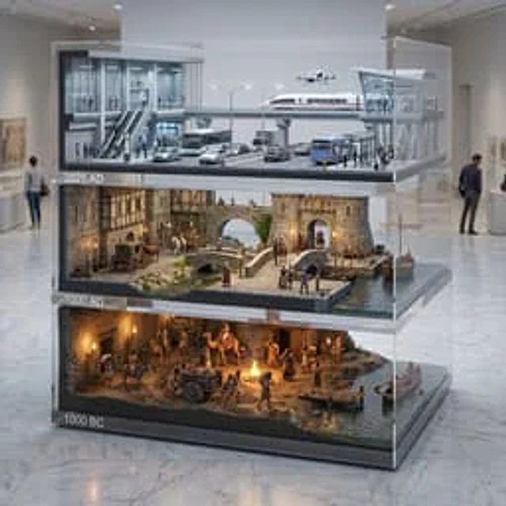

```text
Cinematic, hyper-realistic. A stacked depth composition of ultra-detailed 16K 3D-scanned transportation evolving over time, each layer at 1:18 scale with [ELEMENTS = era-relevant elements, scenes, vehicles]. Mounted on an acrylic stack base with refractive layers. Foreground lighting penetrates to cast multi-layered, receding shadows. From front to back: - [ "1000 BC" ]: [hyper realistic, era relevant ELEMENTS] - [ "1000 AD" ]: [hyper realistic, era relevant ELEMENTS ] - [ "2025 AD" ]: [hyper realistic, era relevant ELEMENTS ] Set against a marble background. Ultra-realistic 4K HDR render.
```

Model: Nano Banana
Author: Gadgetify

[ProjectD](https://aitoolsradar.com/en/prompts/35c4402d9e4f8b) · [Recorded source](https://x.com/Gdgtify/status/2013661551182348601)
 · [Full original metadata and byte evidence](data/projectd-batch-0061.json)

## Gadgetify #1359

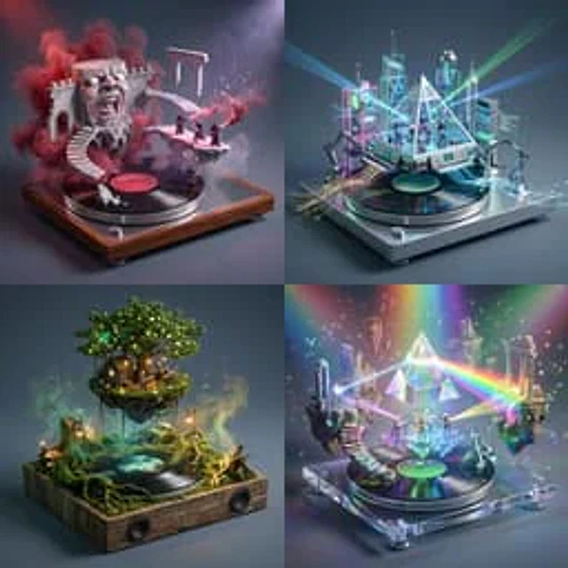

```text
<instructions> Input Variable: [INSERT BAND/ALBUM]  

System Instruction:
Act as a Music Historian and Set Designer. Create a 2x2 Grid of "Audio-Visual Dioramas."
1. The Curation Logic (The Deep Cuts):
Analyze Input: Identify the genre and sonic signature of the Input Band (e.g., Pink Floyd = Psychedelic/Prog Rock, Atmospheric, Surreal).
Select 4 Hidden Gems: Identify 4 lesser-known albums/artists that share this sonic DNA but offer a different flavor (e.g., King Crimson, Porcupine Tree, Yes, The Alan Parsons Project).
The Translation: For each album, define the "Sonic Materiality":
If Heavy Metal: Rusty Iron & Fire.
If Synth-Pop: Neon Glass & Chrome.
If Folk: Mossy Wood & Candlelight.
If Prog Rock: Surreal Marble & Floating Stone.
2. The "Immutable" Container (The Vinyl Stage):
The Base: Each diorama is built on top of a Spinning Vinyl Record acting as the circular stage floor.
The Plinth: The record sits on a high-end audiophile turntable platter or a wooden speaker box.
The Label: The center label of the vinyl clearly displays the Artist Name & Album Title in crisp typography.
3. The Composition (The Sound Made Solid):
CRITICAL: Do not just recreate the album cover. Build a world that feels like the music.
The Structure: Architecture rises from the grooves of the vinyl record.
Example: A wall of amplifiers, a surreal floating prism, a crumbling brick wall, or a forest of microphone stands.
The Atmosphere: Use particle effects to visualize the sound waves.
Visuals: Floating musical notes made of smoke, vibrating liquid surfaces, or shattered glass suspended in mid-air.
The Figures: Tiny 1:87 scale band members performing inside this surreal landscape.
4. Visual Syntax (Per Panel):
Panel A: Album 1 (Focus on Surrealism/Scale).
Panel B: Album 2 (Focus on Technology/Machinery).
Panel C: Album 3 (Focus on Nature/Organic Textures).
Panel D: Album 4 (Focus on Light/Color).
5. Lighting & Atmosphere:
Concert Lighting: Each box is lit like a stage show. Spotlights, laser beams, and stage haze.
Depth: Shallow depth of field (Tilt-Shift) to make the vinyl record look massive.
Background: Seamless Slate Grey to keep the focus on the colors.
Output: 2x2 Grid, Hyper-Realistic Miniature Set Design, 8k Resolution, "Audiophile" Aesthetic. </instructions>
```

Model: Nano Banana
Author: Gadgetify

[ProjectD](https://aitoolsradar.com/en/prompts/d4361e8b57f345) · [Recorded source](https://x.com/Gdgtify/status/2010446114164744676)
 · [Full original metadata and byte evidence](data/projectd-batch-0061.json)

## Gadgetify #1402

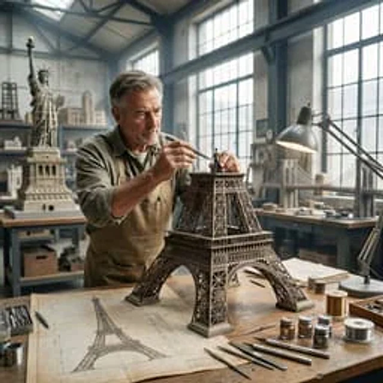

```text
Do this for Eiffel Tower: 

Input Variable: [INSERT STRUCTURE] 
System Instruction:
Act as a Cinematic Director. Create a hyper-realistic portrait of a Master Model Maker putting the final touches on a scale replica of the Input Structure.
1. Logic:
Analyze the Input Structure to determine the Setting and the Character:
IF Ancient/Fantasy (e.g., Colosseum, Castle):
Room: A dusty, sunlit Renaissance Workshop (Stone & Wood). also showcasing "Previous Projects" (other models in the same genre).
Character: An elderly Artisan in a leather apron.
Materials: Plaster, Clay, Balsam Wood.
IF Sci-Fi/Industrial (e.g., Death Star, spaceship):
Room: A sterile, cold Industrial Design Lab (Concrete & Metal). also showcasing "Previous Projects" (other models in the same genre).
Character: A younger Prop Master in a workshop jumpsuit or lab coat.
Materials: Grey Resin (Kitbash), Styrene, Fiber Optics.
IF Modern Architecture (e.g., Skyscraper):
Room: A clean, white Architectural Firm (Glass & White Walls). also showcasing "Previous Projects" (other models in the same genre).
Character: A minimalist Architect in a black turtleneck.
Materials: White Foamcore, Acrylic, 3D Printed Plastic.
2. The Composition :
The Subject: The Character is leaning over a massive, incredibly detailed Scale Model of the Input Structure.
The Action: They are using Tweezers or a fine brush to place a specific "Micro-Detail" relevant to the lore.
Death Star: Placing a tiny Turbo-Laser Turret.
Colosseum: Dusting sand onto the arena floor.
City: Gluing a tiny streetlamp.
The Scale: Extreme scale contrast. The human hands look giant next to the tiny windows/bricks of the model.
3. The Environment  :
The Blueprint: On the table, beneath the tools, lies the correct reference document:
Sci-Fi: Blue grid schematic or iPad.
Fantasy: Yellowed parchment map.
Modern: White vector floorplan.
The Clutter: The tools scattered around must match the medium (e.g., Clay tools vs. Soldering Iron vs. X-Acto knives).
4. Lighting & Atmosphere:
Lighting Match: The lighting must match the inferred room.
Workshop: Warm God Rays (Dusty).
Lab: Cool Fluorescent Tubes (Clean/Hazy).
Focus: Shallow depth of field. Sharp focus on the tweezers and the contact point.
Output: ONE image, 16:9 Aspect Ratio, Cinematic Photography, 8k Resolution.
```

Model: Nano Banana
Author: Gadgetify

[ProjectD](https://aitoolsradar.com/en/prompts/7c1628a22abbc3) · [Recorded source](https://x.com/Gdgtify/status/2012151098547589553)
 · [Full original metadata and byte evidence](data/projectd-batch-0061.json)

## Gadgetify #1409

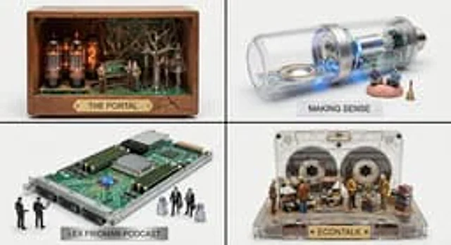

```text
Input Variable: [INSERT PODCAST NAME]
System Instruction:
Act as a Media Archaeologist. Create a 2x2 Grid.
Curation: Identify 4 "Hidden Gem" podcasts similar to the Input.
Era Inference: For each podcast, determine its "Soul Era" (e.g., Is it gritty analog? Sleek digital? Retro radio?).
The Container: Generate an Audio Device specific to that Era (e.g., A Wood-Cabinet Radio, A Cassette Player, A Server Blade, A Podcast Mic).
The Cutaway: The device is hollow or open-faced.
The Interior World:
The Terrain: The internal components (Tubes, Tape, Circuits) transform into a landscape relevant to the podcast's topic (e.g., Circuits become city streets; Tubes become forest trees).
The Action: Tiny 1:87 scale figures (The Hosts) are exploring this landscape, interacting with "Clues" or "Artifacts" derived from the show's content.
Label: The device's brand plate reads: [Podcast Name].
Output: 2x2 panel, each panel for a gem podcast
```

Model: Nano Banana
Author: Gadgetify

[ProjectD](https://aitoolsradar.com/en/prompts/e0112906900fca) · [Recorded source](https://x.com/Gdgtify/status/2011776378556064255)
 · [Full original metadata and byte evidence](data/projectd-batch-0061.json)

## Gadgetify #1412


```text
2x2 grid, do this for 4 famous cuisines: function dish(AA){
<instruction>
Input A is a Famous Dish / Culinary Tradition / Signature Dessert / Regional Specialty.

Analyze:
- ingredient hierarchy, cooking method, plating logic
- origin region, historical story, ritual or social context
- flavor architecture translated into visual composition
- symbolic ingredients, cookware, and dining environment
- chef or tradition lineage

Goal:
A "sauce pour environment."
A giant ladle, piping bag, or sauce boat is pouring the primary sauce, cream, glaze, broth, or puree onto a table.
The flowing edible medium rises into a detailed 3D world of the dish: ingredients, preparation stages, origin landscape, and plated final form merging together.

Rules:
- the poured substance must remain recognizably edible while forming the scene
- include knives, cutting board, handwritten recipe notes, ingredient trays, steam, spice dust, region-appropriate tools
- include a tiny chef or grandmother figure preparing a miniature version nearby
- include a food critic headline, market receipt, or origin-story clipping
- semantically infer cuisine-specific vessels, table culture, garnish logic, and environment
- no random food pile; composition must reveal flavor structure and culinary history
- lighting: appetizing natural kitchen light with rich edible texture

Output:
ONE image, 4:5, culinary-process diorama aesthetic
</instruction>

Output:
2x2 grid, each grid with a different dish(AA) output
}
```

Model: Nano Banana
Author: Gadgetify

[ProjectD](https://aitoolsradar.com/en/prompts/537e38f50f31c2) · [Recorded source](https://x.com/Gdgtify/status/2043013709615022434)
 · [Full original metadata and byte evidence](data/projectd-batch-0061.json)

## Gadgetify #1419

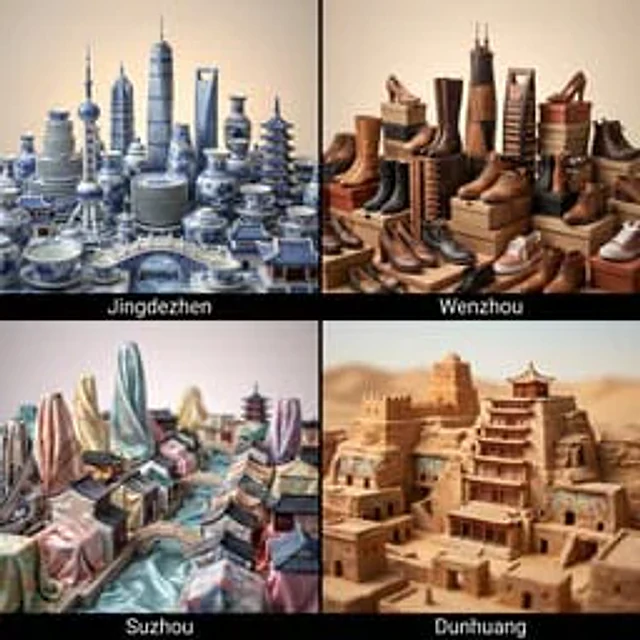

```text
Do this for China: <instructions>
Input = Country
Act as a world class visual artist and geography expert. For every country, find 4 less known cities and the one product that is very popular there. Do research to get this step right. 

Function Draw ($ City, $ Material) Anchor: [Location] :: [Material Concept]::4
Morphology: Miniature architectural cityscape of [Location], entire skyline constructed via the assemblage of [Material Concept] components, skyscrapers and structures formed from the constituent parts of [Material Concept], thematic structural engineering, hyper-detailed diorama::3
Material Physics: Physical properties of [Material Concept] applied to architecture, [Material Concept] textures replacing concrete and glass, innate material logic of [Material Concept], high-fidelity surface details::3
Illumination: Lighting exhibiting the surface properties of [Material Concept], ambient occlusion, volumetric atmosphere matching the material theme::2
Render Stack: Tilt-shift photography, macro lens, f/2.8, 8k, scale model aesthetic, detailed texture mapping, Unreal Engine 5 render::1
Negative: [Human presence, massive scale, blurry, low resolution, bad geometry, distortions, flat 2D, text, watermark]:: -1

Output: 2x2 grid, for each panel execute Draw Function for one of the cities plus the associated popular product. Name of the city underneath
</instructions>
```

Model: Nano Banana
Author: Gadgetify

[ProjectD](https://aitoolsradar.com/en/prompts/1f2c5136cf062c) · [Recorded source](https://x.com/Gdgtify/status/2009084893897121982)
 · [Full original metadata and byte evidence](data/projectd-batch-0061.json)

## Gadgetify #1423

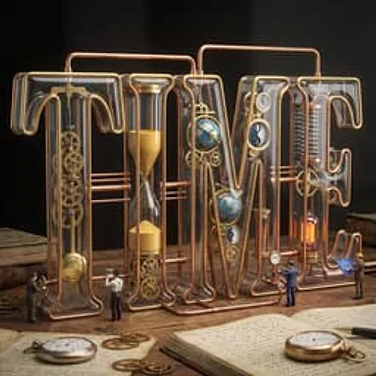

```text
<instructions> 
Input word or concept
Act as a Conceptual Sculptor. Generate a 3D typography render where the letters are constructed from materials that Physically Embody the Input Word.
1. Material & Physics Inference (The DNA):
Analyze the Input Word to determine the Structural Material and Internal Physics:
If Ethereal (e.g., TIME, SOUL): Use Glass, Brass, and Light. Physics = Flowing, ticking, glowing.
If Elemental (e.g., FIRE, MAGMA): Use Black Iron cages. Physics = Burning, dripping, smoking.
If Organic (e.g., GROWTH, LIFE): Use Wooden frames or Terrarium glass. Physics = Growing, blooming, condensation.
If Industrial (e.g., FACTORY, STEEL): Use Rusted Steel beams. Physics = Grinding gears, steam vents.
2.  Container  :
The Structure: The letters are massive, 3D structural frames.
The Transparency: The front face is open or transparent to reveal the Internal Mechanism.
The Logic: The frame must look like it was built to contain the specific substance inside (e.g., thick glass for gas; heavy iron for magma).
3. The Internal Mechanism :
Content: Fill the hollow letters with the active element of the concept.
Example (TIME): Sand pouring from T to I; Pendulums swinging in M; Gears turning in E.
Example (FIRE): Real flames licking up the inside of F; Coals glowing in I; Smoke venting from R.
Connectivity: Pipes, wires, or vines connect the letters, transferring the energy from one to the next.
4. The Narrative Scale :
The Figures: Tiny 1:87 scale figures interact with the letters.
Inference: If "TIME," figures are winding clocks. If "FIRE," figures are stokers shoveling coal. If "GROWTH," figures are gardeners watering plants.
5. Lighting & Atmosphere:
Source: The light comes from the Material itself (e.g., Fire glow, Bioluminescence, Neon).
Environment: The table/floor matches the theme (e.g., Burnt wood for FIRE; Mossy earth for GROWTH).
Output: ONE image, High Resolution 3D Render, Conceptual Art Aesthetic.
</instructions>
```

Model: Nano Banana
Author: Gadgetify

[ProjectD](https://aitoolsradar.com/en/prompts/a789f9d4825a73) · [Recorded source](https://x.com/Gdgtify/status/2011736617174573428)
 · [Full original metadata and byte evidence](data/projectd-batch-0061.json)

## Gadgetify #1428


```text
<instructions>
Input: city, country
Act as a Master Pastry Chef and Landscape Architect. Generate a hyper-realistic macro shot of a rectangular "Landscape Cake."
1. The Flavor Profile :
Analyze the Input Location to determine the Cake Base and Materials:
If Forest/Mountain (e.g., Canada): Dark Chocolate Brownie or Carrot Cake (simulating soil/earth).
If Tropical (e.g., Hawaii): Golden Sponge or Cheesecake (simulating sand).
If Snowy/Ice (e.g., Antarctica): White Vanilla or Coconut Cake (simulating snow/ice).
If Volcanic/Mars: Red Velvet Cake.
2.  Geography :
Construct the terrain using Edible Metaphors:
Trees: Broccoli florets, Rosemary sprigs, or Matcha sponge crumbs.
Water: Blue Jello, Mirror Glaze, or melted sugar glass.
Rocks: Chocolate chunks, crushed nuts (pecans/walnuts), or rock candy.
The Icon: A tiny, edible sugar-craft model of a local icon 

3. The Typography :
The Letters: The Name of the Location is spelled out on the side of the cake slice.
The Material: The letters are formed from Fresh Fruit (Raspberries, Blueberries) or piped Buttercream embedded into the sponge.
4. The Plating :
The Board: The cake sits on a rustic wooden cutting board or a slate platter.
The Clutter: Scatter ingredients around the base that hint at the flavor (e.g., Cinnamon sticks, Maple leaves, Coffee beans, scattered flour).
The Tools: A vintage silver fork or cake knife rests on the side.
5. Lighting & Atmosphere:
Lighting: "Bakery Window" Light. Soft, natural daylight streaming in from the side, highlighting the moisture of the cake crumb and the gloss of the "water" glaze.
Depth: Shallow depth of field. The front corner of the cake is sharp; the background props are blurred.
Output: ONE image, 4:3 Aspect Ratio, Food Photography, "Great British Bake Off" Aesthetic.
</instructions>
```

Model: Nano Banana
Author: Gadgetify

[ProjectD](https://aitoolsradar.com/en/prompts/946c27fa79c998) · [Recorded source](https://x.com/Gdgtify/status/2011550138100334865)
 · [Full original metadata and byte evidence](data/projectd-batch-0061.json)

## Gadgetify #1429

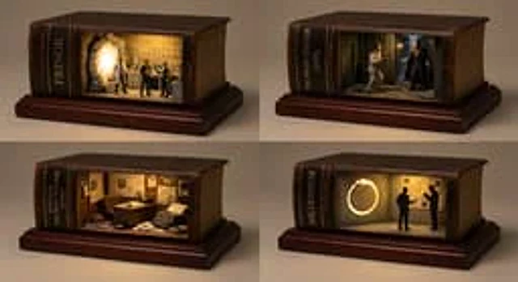

```text
function recommend(x) { Determine type(x) (e.g. game, movie, book, or TV series) Role: world-class TV, book and movie expert  Analyze x's style, storyline, tone, every aspect and find 4 hidden gems in type (x) {} return: 2x2 grid carved book-block dioramas, each grid with antique leather-bound books hollowed and carved, warm reading-lamp glow from within, dark mahogany bases, ultra-realistic}   draw( recommend (X -Files);
```

Model: Nano Banana
Author: Gadgetify

[ProjectD](https://aitoolsradar.com/en/prompts/dacb306d89bad6) · [Recorded source](https://x.com/Gdgtify/status/2009053185311203377)
 · [Full original metadata and byte evidence](data/projectd-batch-0061.json)

## Gadgetify #1434

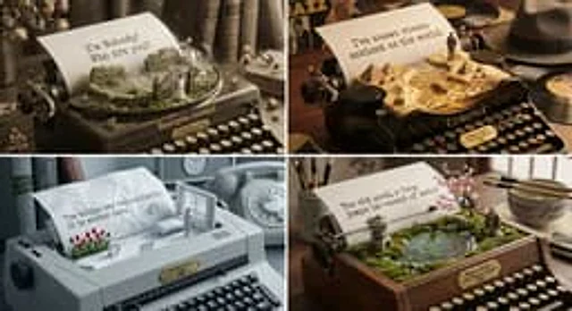

```text
Role: Literary Curator & Typewriter Sculptor
Input: [Poet or Poem, e.g., T.S. Eliot, Pablo Neruda]
Phase 1: Poetic Voice Analysis
Identify the poet's signature rhythm, recurring imagery, and emotional core
Select 4 contemporary or lesser-known poets with parallel sensibilities
Extract 5-8 physical objects mentioned repeatedly in their work
Phase 2: Visual Execution
Goal: 2x2 Grid of "Typewriter Output as 3D Landscapes"
Rules per Panel:
The Base: A vintage typewriter (different model per poet's era)
The Paper: A single sheet of paper loaded in the roller
The Transformation: The typed text physically rises from the page, forming a 3D topographical landscape
The Words: Key lines from the poem carved into the terrain like engraved stone
The Symbols: Miniature objects from the poem placed in the landscape (tiny boat, rose, clock, door)
The Poet: Microscopic figurine of the poet wandering through their own words
The Mood: Lighting matches emotional tone (fog for melancholy, harsh light for anger, soft gold for longing)
The Metadata: Brass typewriter key showing "Poet | Collection | Year" **background: poet and poet era relevant items in the background.
Output: 2x2 Grid, Macro Photography, shallow depth of field
```

Model: Nano Banana
Author: Gadgetify

[ProjectD](https://aitoolsradar.com/en/prompts/80e3a1e39f255d) · [Recorded source](https://x.com/Gdgtify/status/2012000354804609030)
 · [Full original metadata and byte evidence](data/projectd-batch-0061.json)

## Gadgetify #1437

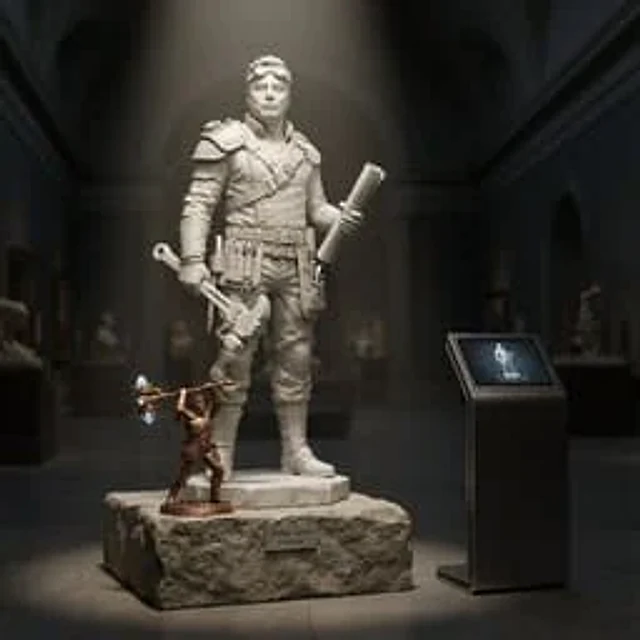

```text
<instructions>
Input: famous person
Analyze their public persona, values, strengths, weaknesses, and how they “show up” in stories about them.
Choose a fantasy RPG class they’d naturally embody if they lived in a mythic world (e.g., battle strategist → tactician, performer → bard, visionary → mage).
Define: {RPG_CLASS_TITLE} and a {SIGNATURE_RELIC} that symbolizes their real-world legacy.

Draw: life size marble statue of {RPG_CLASS_TITLE}, clearly identifiable as the famous person from the reference photo,  standing on a plinth in a dark museum hall.
• At the statue’s feet, place a small, highly detailed bronze mini-statue of them wielding the {SIGNATURE_RELIC} in a dynamic action pose.
• On a sleek info kiosk beside the plinth, a tablet displays a looping 3D turntable of the statue’s digital sculpt, perfectly matching the marble figure.

Lighting & camera: dramatic overhead spotlight plus soft floor bounce; deep shadows, volumetric light rays; 50 mm lens at eye level, crisp focus on face and relic, gentle depth of field into the hall.
Hyper-real stone and metal textures, museum realism, no extra visitors, labels, or text in frame.
</instructions>
```

Model: Nano Banana
Author: Gadgetify

[ProjectD](https://aitoolsradar.com/en/prompts/9eba5b80debab2) · [Recorded source](https://x.com/Gdgtify/status/2011078781965156356)
 · [Full original metadata and byte evidence](data/projectd-batch-0061.json)

## Gadgetify #1441

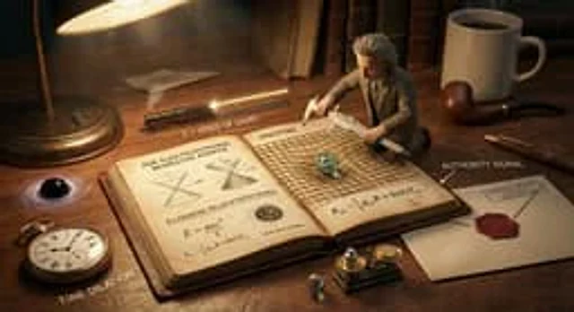

```text
<instructions> You are a cinematic miniature-diorama director and museum exhibit designer. Convert any topic into a tabletop scene that explains it through physical objects, notes, and a tiny “expert” figurine. Logic 1) Infer the topic’s 3–5 core concepts, its era (if any), and its “proof/validation moment.” 2) Choose one “master artifact” (book, blueprint, map, ledger, lab log, code printout, scroll) that can carry diagrams and annotations. 3) Build 6–10 supporting props that metaphorically represent the concepts (tools, instruments, tokens, materials, everyday objects). 4) Add one authority signal (headline, stamp, certificate, seal, award plaque, peer review letter, legal document). 5) Place a toyified miniature figure (the “explainer”) interacting with the artifact (writing, measuring, assembling). 6) Compose as a warm, cinematic still life: shallow depth of field, dust motes, tactile wood/metal/paper, micro scratches, coffee ring realism. 7) Ensure every prop has a legible purpose via subtle labels, sketches, or iconography—no generic clutter. Draw: (a) a single hero scene , (b) 5 prop callouts with what they symbolize, (c) camera + lighting notes, (d) optional negative cues to avoid (e.g., unreadable text blobs, random equations). The scene must be fully inferred from the given topic. </instructions>
```

Model: Nano Banana
Author: Gadgetify

[ProjectD](https://aitoolsradar.com/en/prompts/00a9f4516ea053) · [Recorded source](https://x.com/Gdgtify/status/2008501550315135127)
 · [Full original metadata and byte evidence](data/projectd-batch-0061.json)

## Gadgetify #1445

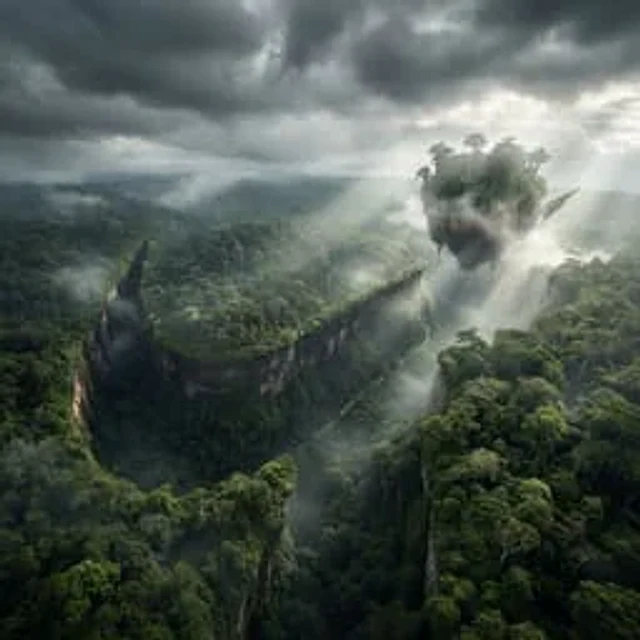

```text
<instruction>
  1.  Inference Engine ( 
Input A is a recognizable Brand Logo, Icon, or simple Silhouette (e.g., The Apple Logo, Nike Swoosh, Batman Symbol, A Heart).
Input B is a vast Natural Landscape (e.g., Snowy Mountains, Dense Jungle, Sand Dunes, Ocean Coastline).
Deconstruct the inputs to generate   3 Topographical Assets  :
     The Negative Space (The Carving):  How does the logo fit into the landscape?
         (e.g., The main body of the Apple logo is carved  out  of a snowy mountain peak). 
     The Positive Space (The Island):  Are there floating or detached elements of the logo?
         (e.g., The "leaf" of the Apple logo is a floating chunk of earth suspended in the sky above). 
     The Texture (The Biome):  What materials make up the shape?
         (e.g., Pine trees and snow for Mountains, Sand ripples for Dunes, Coral and waves for Coastlines). 

  2.  Container 
Goal: "Subliminal Advertising" Landscape Photography.
     The Perspective:  A wide, sweeping   Aerial Drone Shot  . The landscape stretches out vast and majestic, dominating the frame.
     The Atmosphere:  Dramatic, moody weather. Heavy, swirling clouds, mist, or fog rolling through the valleys.

  3. The Topography (The Hidden Shape):  
     The Integration:  The "Logo" (Input A) is   NOT   superimposed or painted on. It is formed  entirely  by the physical geometry of the terrain.
         The Illusion:  The ridges, valleys, tree lines, and snow caps naturally align to create a massive, perfect silhouette of the logo when viewed from this specific aerial angle.
     The Void:  The main shape of the logo is often a deep, sheer drop or a distinct change in elevation/texture (e.g., a dark pine forest shaped like an apple cut into a white snowy mountain).
     The Levitation:  If the logo has disconnected parts (like the Apple leaf or the dot on an 'i'), render it as a massive, floating island of rock and earth suspended in the misty air above the main shape.

  4. Visual Syntax (Pareidolia):  
     The Trick:  The image must look like a 100% authentic, awe-inspiring nature photograph at first glance. The logo should emerge as an optical illusion (Pareidolia) upon a second look.
     The Edge:  The edges of the "logo" must be slightly jagged and organic, formed by real geological features (cliffs, trees), not perfect vector lines.

  5. Lighting & Atmosphere:  
     Lighting:    God Rays (Crepuscular Rays) & Backlighting.   The sun is hidden behind the clouds or the floating landmass, blasting intense beams of light through the mist and defining the silhouette of the hidden shape.
     Contrast:  High contrast between the dark valleys (forests/shadows) and the bright highlights (snow/sunlight).
     Vibe:  Cinematic, majestic, and subtly surreal.

  Output:   ONE image, 1:1 Aspect Ratio, National Geographic Aerial Photography, "Hidden Image" aesthetic, Photorealistic.
</instruction>

2. <system_role> you are an optical illusion artist and landscape photographer. </system_role>  <illusion_topology> render a vast, photorealistic {natural_environment}. however, the shadows, highlights, and physical layout of the landscape must form the exact facial contours and silhouette of {pop_culture_icon} when viewed from a distance.  - dark zones (forming the eyes/hair/shadows): deep shadows cast by {dark_nature_elements}. - light zones (forming the skin/highlights): bright areas made of {light_nature_elements}. </illusion_topology>  <visual_execution> the image must function flawlessly as two things at once: 1. up close: a beautiful, highly detailed photograph of a {natural_environment} during {weather_condition}. 2. zoomed out: a clear portrait of {pop_culture_icon}. ensure the blending is organic. do not use digital fade overlays. the rocks/trees themselves must form the face. </visual_execution>
```

Model: Nano Banana
Author: Gadgetify

[ProjectD](https://aitoolsradar.com/en/prompts/1305676bcaf871) · [Recorded source](https://x.com/Gdgtify/status/2042593441150837246)
 · [Full original metadata and byte evidence](data/projectd-batch-0061.json)

## Gadgetify #909

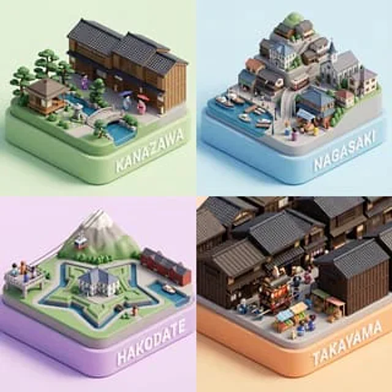

```text
<instructions> 
Role: You are a Lead 3D Artist at a premium collectible company  
Input Variable: [INSERT COUNTRY]
System Instruction:
Generate a 2x2 Grid of High-Fidelity Designer Vinyl dioramas.
Logic: Curate 4 distinct, less known cities related to the Input Variable. Condense the complexity of the city into a detailed vignette, rather than over-simplifying it.
1. The Toy Physics (The "Premium" Rule):
Geometry: High-Fidelity Vinyl. Maintain the specific architectural silhouette of the region (e.g., if the city has pagodas, keep the tiers; if it has domes, keep the arches).
Detailing: Use "Intricate Softness." Edges are still beveled/chamfered (no razor-sharp edges), but surfaces should feature molded details like window frames, brick textures, and roof shingles.
Density: The scene should feel "lived-in" and dense. Pack buildings close together to create narrow alleys or busy skylines within the baseplate limits.
Material: Premium Matte Vinyl with slight subsurface scattering. It should look expensive and substantial.
2.  Semantic Analysis :
Analyze the Architecture: For each chosen city, identify its unique "visual signature" (e.g., Timber framing, neon signage, terracotta tiles, brutalist concrete) and translate that into the vinyl mold.
Analyze the Geography: If the city is coastal, mold waves into the base. If it is mountainous, stack the buildings vertically.
3. Container:
The Base: Thick, rounded-square baseplate.
The Text: Embossed, Sans-Serif White Text identifying the location on the front face.
Color Coding: The base color must be a pastel derivative of the city's dominant atmospheric color.
4. Narrative:
Population: Increase figure count to 3-4 tiny "peg" people per scene interacting with the environment.
Props: Include specific regional props (e.g., vending machines, street lamps, market stalls) to add scale and clutter.
5. Render Settings:
Lighting: Bright, soft Global Illumination. Ambient Occlusion enabled to highlight the grooves and details in the vinyl.
Palette: Rich & Muted. Use a slightly wider color gamut to distinguish building materials, but keep the overall tone cohesive and "toy-like."
Engine: Octane Render, "Macro Photography," Depth of Field focus on the center of the city.
Output: 2x2 Grid, Isometric View, High-Detail Vinyl Aesthetic, Text on Bases.  </instructions>
```

Model: Nano Banana
Author: Gadgetify

[ProjectD](https://aitoolsradar.com/en/prompts/9bb87e3b4df576) · [Recorded source](https://x.com/Gdgtify/status/2010411888434417944)
 · [Full original metadata and byte evidence](data/projectd-batch-0061.json)

## Giulia #693

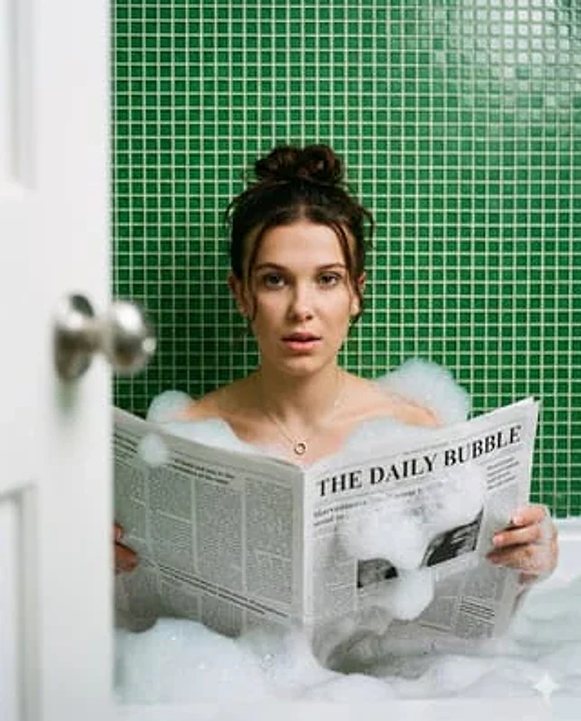

```text
A young blonde Hollywood actress, similar to Sydney Sweeney, appears inside a bathtub filled with foam up to the brim. Her blonde hair is styled in a high, voluminous, slightly messy bun, with a few loose strands softly framing her face. She looks directly at the camera with a neutral, subtly seductive expression, her lips slightly parted. She wears light, natural makeup, a delicate silver chain necklace with a small circular pendant, and small, discreet stud earrings.

Her upper body faces forward, visible above the foam. She holds a large open printed newspaper with both hands at chest height, as if reading it. The newspaper is partially covered with dense white soap foam, which also gathers around her in thick, fluffy bubbles filling the bathtub. Beneath the foam and the newspaper, she is wearing a green beach top that remains completely hidden.

The scene takes place inside a tiled bathtub. In the background, there is a vibrant wall completely covered with small, bright yellow square mosaic tiles. In the left corner of the composition, a slightly out-of-focus white door frame is visible, with a silver metallic doorknob.

The lighting is soft, diffused, and even indoor lighting, coming from the front and slightly from above. It creates soft, flattering highlights on her face, shoulders, and hair, with very few harsh shadows. The image conveys an eccentric, artistic, editorial atmosphere that feels slightly surreal, yet calm and visually striking.

The color palette highlights the bright yellow tiles, the white foam, the blonde hair, and the gray tones of the newspaper. The photograph is a modern, photorealistic editorial portrait with cinematic framing. The composition is a medium shot from the upper bust upward, at eye level, with a shallow depth of field that keeps the actress and the newspaper in sharp focus while slightly blurring the door handle in the foreground. The image is highly detailed, with crisp focus, professional lighting, vibrant high-contrast colors, and extremely high quality in 8K resolution, in a 4:5 aspect ratio.
```

Model: Nano Banana
Author: Giulia

[ProjectD](https://aitoolsradar.com/en/prompts/3727f28f5a59ab) · [Recorded source](https://x.com/Giulia_4i/status/2032817549813969039)
 · [Full original metadata and byte evidence](data/projectd-batch-0061.json)

## Gizem Akdag #683

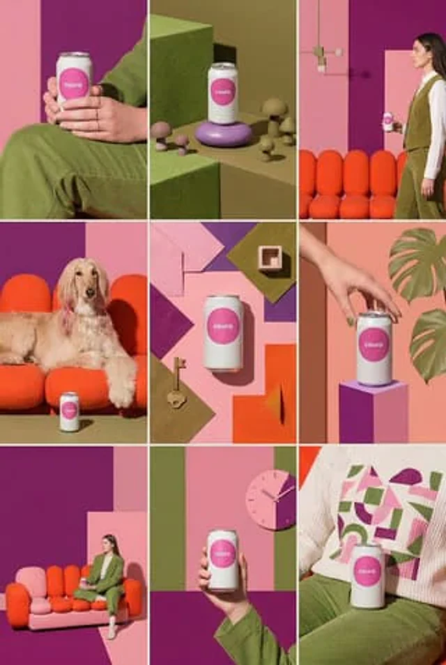

```text
Create a 9-image Instagram feed for this product in [the same aesthetic]. Use different locations, angles, and compositions, incorporating people, animals, nature, and various environments while maintaining a cohesive visual style.

with/without "same aesthetic"
```

Model: Nano Banana
Author: Gizem Akdag

[ProjectD](https://aitoolsradar.com/en/prompts/8d4459797890fd) · [Recorded source](https://x.com/gizakdag/status/2027122256426521040)
 · [Full original metadata and byte evidence](data/projectd-batch-0061.json)

## glena Jenner #626

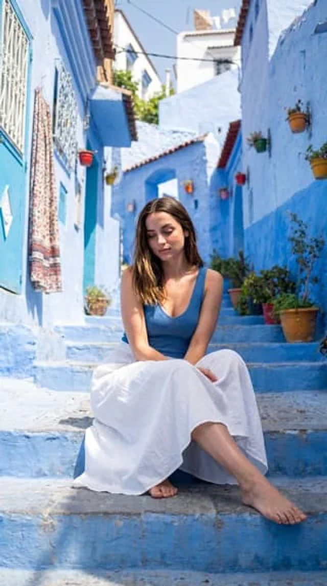

```text
{
  "scene": {
    "setting": "narrow outdoor alley with stepped pathway in a Mediterranean blue-painted town",
    "background": "vivid blue walls, stairs, and buildings with white accents, hanging fabric on wall, small windows, plants, and bright sky above",
    "lighting": "strong natural sunlight, high contrast with defined shadows, bright and saturated colors"
  },
  "subject": {
    "type": "female",
    "pose": "seated on steps with one leg bent and the other extended slightly forward, hands resting naturally by her sides",
    "expression": "soft relaxed expression with eyes slightly downward, calm and serene mood",
    "face": "Use uploaded reference image, keep identity exact, natural facial proportions, visible skin texture and realistic lighting",
    "hair": "Use uploaded reference image, keep identity exact, long wavy hair falling over shoulders with natural volume",
    "eyes": "Use uploaded reference image, keep identity exact, softly focused downward gaze",
    "skin": "natural skin tone with sunlit highlights and realistic texture",
    "body": "natural proportions maintained"
  },
  "clothing": {
    "outfit": "blue fitted sleeveless top paired with a long flowing white skirt",
    "footwear": "barefoot with both feet visible resting naturally on the blue steps",
    "accessories": "minimal jewelry, subtle necklace"
  },
  "environment_details": {
    "props": "textured painted steps, hanging patterned fabric, architectural details of alley",
    "textures": "rough painted walls, fabric folds in skirt, smooth skin highlights, stone steps"
  },
  "camera": {
    "angle": "slightly low front-facing angle centered on subject",
    "framing": "full body framing capturing entire seated pose and surrounding stairs",
    "focus": "sharp focus on subject with clear detailed background",
    "lens": "standard smartphone lens"
  },
  "style": {
    "realism": "ultra realistic photography",
    "color_tone": "highly saturated blues contrasted with neutral white and natural skin tones",
    "effects": "natural sunlight, no artificial filters",
    "details": "high detail textures, crisp shadows, realistic depth and perspective"
  }
}
```

Model: Nano Banana
Author: glena Jenner

[ProjectD](https://aitoolsradar.com/en/prompts/45b8328d73c6e2) · [Recorded source](https://x.com/GlenaJenne/status/2044511721205993480)
 · [Full original metadata and byte evidence](data/projectd-batch-0061.json)

## Glenn Williams #519

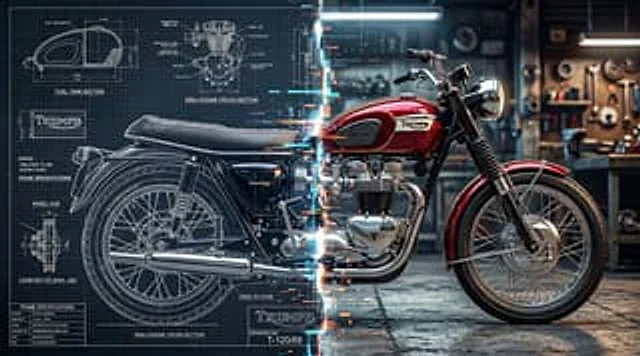

```text
A [subject] split vertically down the center, left half as a [adjective] technical blueprint, right half as a [adjective] 3D render, the seam between them glitching where both realities collide.
```

Model: Nano Banana
Author: Glenn Williams

[ProjectD](https://aitoolsradar.com/en/prompts/ec1fd1f4e1c261) · [Recorded source](https://x.com/GlennHasABeard/status/2030420620232561024)
 · [Full original metadata and byte evidence](data/projectd-batch-0061.json)

## Google AI #321

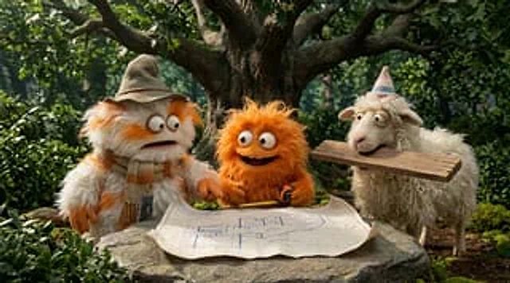

```text
Create a funny 4-part story featuring 3 fluffy creatures building a treehouse. The story has emotional highs and lows and ends in a happy moment. Maintain consistent identity across the 3 characters. Generate 4 images in 16:9 format, one at a time.
```

Model: Nano Banana
Author: Google AI

[ProjectD](https://aitoolsradar.com/en/prompts/3f85c192510a1d) · [Recorded source](https://x.com/GoogleAI/status/2027094912357761319)
 · [Full original metadata and byte evidence](data/projectd-batch-0061.json)

## Gopal Tiwari #1374

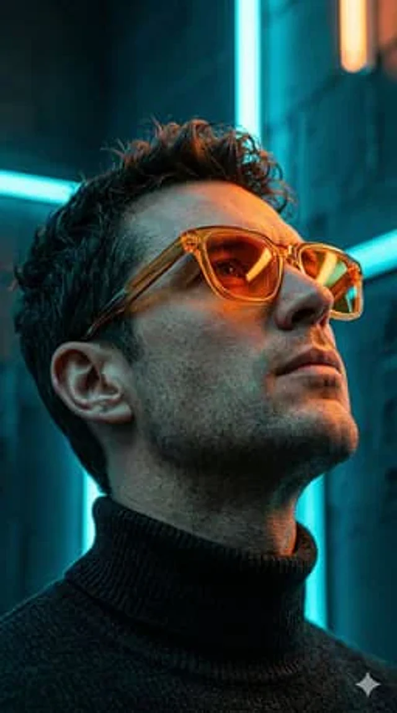

```text
A man, likely in his early thirties with facial proportions, structure, and overall appearance inspired by the reference, captured in full sharp detail and natural skin texture,
hyper-detailed, cinematic close-up profile portrait, vertical orientation, extreme low-angle (worm's-eye view), focusing on the face from the neck up. The man gazes upward with a serious, intense expression. He has dark, short, slightly tousled hair, catching subtle highlights. His facial features are sharply defined, with a strong jawline and natural stubble. Skin texture is realistic, showing pores, subtle imperfections, and natural subsurface scattering.
Clothing & Accessories:
He wears a high-collared, dark turtleneck that absorbs light, creating a strong contrast against the illuminated face. He has large, round, retro-futuristic sunglasses with thick, transparent or light-colored frames and intensely bright orange lenses. The sunglasses reflect the ambient and primary lighting naturally.
Lighting & Color:
Extreme, high-contrast neon lighting with complementary color scheme. Primary light is intense, warm orange/amber emanating from the sunglasses direction, illuminating the nose bridge, cheekbones, and frame edges. Secondary ambient light is cool cyan-blue, providing deep backlight and shadow fill. Shadows are deep indigo and ultramarine, producing strong chiaroscuro, with the subject’s face partially obscured by cool shadows but punctuated with warm orange highlights. Volumetric light subtly interacts with hair and glasses for realism.
Composition & Perspective:
Low-angle close-up emphasizing upward gaze, strong jawline, and facial structure. Solid cyan-blue background ensures the subject stands out, with clean composition and dramatic silhouette. Shallow depth of field isolates the face and sunglasses.
Artistic Style & Mood:
Hyper-realistic, cinematic, photorealistic editorial portrait with cyberpunk, neo-noir, and 80s synthwave aesthetic. Mood is intense, mysterious, and high-fashion.
Technical Details:
Ultra-high resolution, 8K, sharp focus on facial features and sunglasses, realistic skin rendering with NanoBanana Pro quality, natural subsurface scattering, realistic fabric texture, volumetric and rim lighting, cinematic color grading.
Negative Prompts:
cartoon, painting, sketch, 3D render, CGI, plastic skin, blurry, low quality, feminine traits, excessive makeup, watermark, text, unrealistic exaggeration.
```

Model: Nano Banana
Author: Gopal Tiwari

[ProjectD](https://aitoolsradar.com/en/prompts/614f114013ae34) · [Recorded source](https://x.com/imGopalTiwari/status/2041000388133106148)
 · [Full original metadata and byte evidence](data/projectd-batch-0061.json)

## Hania Ai #1022

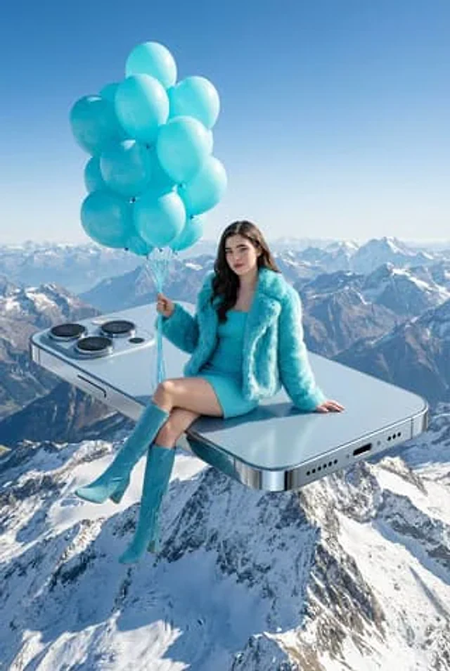

```text
A surreal, high-concept masterpiece featuring “uploaded face as reference” seated casually on the edge of a colossal, floating smartphone suspended high above a snow-capped mountain range. The subject is dressed in a monochromatic cyan ensemble, wearing a fitted mini dress, a plush faux-fur jacket, and knee-high suede boots, while holding a large cluster of matching light-blue helium balloons.

The giant smartphone, resembling a high-end device with a triple-lens camera array and metallic silver edges, floats horizontally, displaying realistic charging ports and speaker grills. Bright, crisp daylight casts sharp shadows on the phone’s surface, highlighting the texture of the fur and the sleek glass.

The background is a breathtaking aerial vista of jagged, snowy alpine peaks under a clear blue sky, rendered in 8K resolution with hyper-realistic textures, deep depth of field, and a commercial photography aesthetic.
```

Model: Nano Banana
Author: Hania Ai

[ProjectD](https://aitoolsradar.com/en/prompts/edd842db17d599) · [Recorded source](https://x.com/HaniaAi12/status/2030188564034765218)
 · [Full original metadata and byte evidence](data/projectd-batch-0061.json)

## Hania Ai #1097

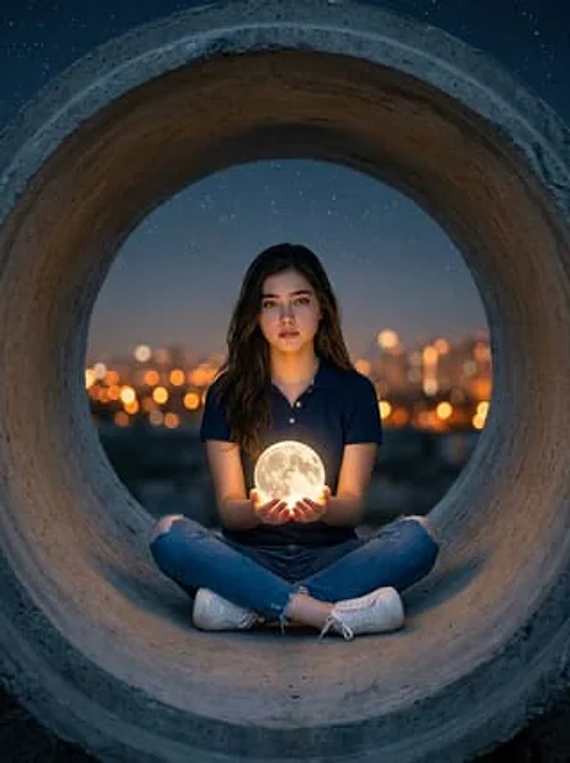

```text
Hyper-realistic surreal photography of a woman sitting inside a massive, rough concrete pipe, featuring the uploaded face as reference. She wears a dark polo shirt, ripped jeans, and white sneakers, with a calm and thoughtful expression. She is gently holding a glowing, miniature full moon in her cupped hands. The surreal moon casts a warm, magical rim light across her face and body. The camera is positioned from inside the pipe, creating a natural circular frame around her. In the background, a starry night sky is visible along with a deeply blurred cityscape filled with warm orange bokeh lights. Shot with a 50mm lens, shallow depth of field, high contrast, blending cool night tones with the ethereal glow of the moon in her hands.
```

Model: Nano Banana
Author: Hania Ai

[ProjectD](https://aitoolsradar.com/en/prompts/c5129af028096a) · [Recorded source](https://x.com/HaniaAi12/status/2034800521538621542)
 · [Full original metadata and byte evidence](data/projectd-batch-0061.json)

## Hania Ai #1159

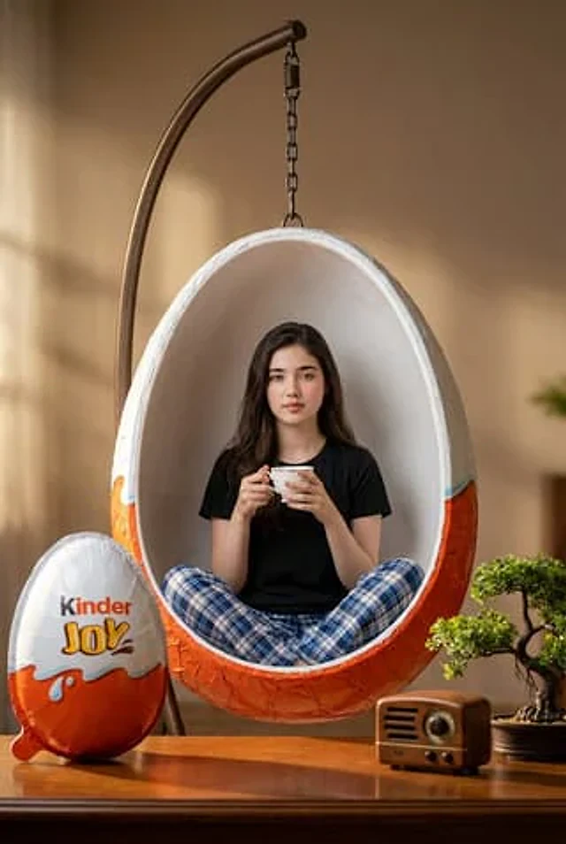

```text
A hyper-realistic, 8k, medium shot photograph captured with a standard lens and shallow depth of field, showcasing a surreal indoor scene with cinematic lighting. The composition features a normal-sized woman, using the uploaded face as reference, sitting cross-legged inside a colossal, highly detailed Kinder Joy egg that functions as a swing chair. The giant egg is split, with its white interior forming the seat and the orange, textured exterior visible, suspended by dark metal chains from a curved, dark metal stand.

The woman wears a black t-shirt and blue and white plaid pajama pants, holding a small white teacup with both hands, looking directly at the viewer with a calm and relaxed expression.

To the left in the foreground, on a highly detailed polished wooden table, stands another gigantic, fully wrapped Kinder Joy egg, exhibiting intricate foil texture and branding. To the right of the swing's base, also on the table, are miniature props: a vintage-style wooden radio with white dials and a tiny bonsai tree in a small pot.

The lighting is soft, warm, and directional from the left, casting subtle shadows and highlighting the highly detailed textures of the egg wrappers, the woman’s clothing, and the wooden surface. The background is a softly blurred, warm-toned interior wall, creating a pleasing bokeh effect.
```

Model: Nano Banana
Author: Hania Ai

[ProjectD](https://aitoolsradar.com/en/prompts/ca9dc85e2e7785) · [Recorded source](https://x.com/HaniaAi12/status/2028673990672216202)
 · [Full original metadata and byte evidence](data/projectd-batch-0061.json)

## Hania Ai #1166


```text
A hyper-realistic, 8k, high-fidelity photograph captured with a wide-angle lens and shallow depth of field, creating a dramatic forced perspective. The composition features a colossal human face and hand on the right side, filling the frame, with the hand extended palm-up towards the left. The giant person, with a full beard and mustache, has their mouth slightly agape in an expression of surprise or speech, looking down towards their palm. On the palm of this giant hand stands a miniature person, appearing tiny in comparison, wearing a black short-sleeved t-shirt and light khaki pants, with dark curly hair. This miniature figure is captured mid-action, with arms slightly bent and legs in a dynamic, running or reacting pose, also with an open mouth as if shouting or speaking. The background is an extremely blurred, warm-toned indoor setting, suggesting an office or study with hints of wooden shelves and a blue binder, providing a soft bokeh effect. Cinematic lighting illuminates the scene with soft, warm light, highlighting the highly detailed texture of the skin, hair, and clothing, while maintaining a natural, diffused quality. The character's face for both the giant and the miniature person is: uploaded face as reference.
```

Model: Nano Banana
Author: Hania Ai

[ProjectD](https://aitoolsradar.com/en/prompts/458650cf5f56df) · [Recorded source](https://x.com/HaniaAi12/status/2028065588048810491)
 · [Full original metadata and byte evidence](data/projectd-batch-0061.json)

## Hania Ai #441


```text
A hyper-realistic surreal composite scene set on a wooden tabletop. A large oversized smartphone dominates the frame, creating a strong dimensional-break illusion. On the phone screen, the woman from the reference image appears much larger in a close-up winter environment, smiling happily while holding a clear glass with a visible Pepsi logo on it.

A real human hand pours dark Pepsi cola from a cold bottle covered in condensation droplets directly toward the phone screen. The liquid visually breaks through the display and flows into the glass she is holding inside the screen, creating a powerful surreal effect.

A closed book and a black pen sit on the wooden table beside the oversized phone to emphasize scale distortion. Warm natural lighting, soft cinematic shadows, ultra-sharp liquid splash details, hyper-realistic skin texture, realistic reflections on glass and screen, surreal cinematic advertising look, professional commercial photography quality, 8K realism.
```

Model: Nano Banana
Author: Hania Ai

[ProjectD](https://aitoolsradar.com/en/prompts/8a492166109031) · [Recorded source](https://x.com/HaniaAi12/status/2028309848429846690)
 · [Full original metadata and byte evidence](data/projectd-batch-0061.json)

## Hania Ai #778


```text
Ultra realistic cinematic portrait of a 32-year-old young woman standing in heavy rain at night, arms open wide and face lifted toward the sky, eyes closed, feeling the rain. Dramatic warm orange backlight illuminating the falling raindrops, creating glowing rain particles around her. Wet black t-shirt tightly fitting on the body, water droplets on her skin. Strong contrast lighting with a dark background, orange and golden light shining from the left side like fire or a spotlight. Emotional expression of freedom and peace, cinematic photography style, ultra-detailed, 8K resolution, shallow depth of field, professional studio lighting, rain splash effects, high-contrast shadows, dramatic atmosphere, vertical portrait composition, 85mm lens photography.
```

Model: Nano Banana
Author: Hania Ai

[ProjectD](https://aitoolsradar.com/en/prompts/b74eab4fba1684) · [Recorded source](https://x.com/HaniaAi12/status/2033501597330809017)
 · [Full original metadata and byte evidence](data/projectd-batch-0061.json)

## Hania Ai #819


```text
High-fashion editorial photography of a woman with the uploaded face as reference, leaning casually against a geometric orange wall with her right leg extended forward. She wears a tailored bright orange suit, matching tie, crisp white shirt, and chunky orange sneakers. Her styling is sleek and confident, with a modern, polished look. The environment is a surreal, minimalist room with seamless orange surfaces, featuring a vintage orange hatchback parked mid-ground left. Captured from a low-angle using a 24mm wide-angle lens for strong forced perspective, emphasizing the foreground sneaker with a deep depth of field. Soft, diffused studio lighting casts clean shadows, enhancing the vibrant, highly saturated monochromatic orange palette with sharp white accents, contrasting matte suit fabrics against smooth leather shoes and the glossy finish of the car.
```

Model: Nano Banana
Author: Hania Ai

[ProjectD](https://aitoolsradar.com/en/prompts/d9a68afcb8772c) · [Recorded source](https://x.com/HaniaAi12/status/2036605650353180709)
 · [Full original metadata and byte evidence](data/projectd-batch-0061.json)

## Harboriis #1132


```text
Cinematic ultra-realistic close-up of a man taking a billiards shot, captured in a tense, mid-focus moment as he leans low toward the cue ball. His eyes are locked sharply on the aim, expression steady and confident, while his supporting hand rests firmly on the green felt, guiding the cue with precision. He wears a crisp white shirt with rolled sleeves and slightly open buttons, giving a relaxed yet intensely focused vibe. His hair is neatly tied back, and his clear-framed glasses catch warm reflections from overhead lights. The background is softly blurred, filled with atmospheric golden highlights, adding depth, drama, and a competitive mood to the scene.

use face reference exactly
```

Model: Nano Banana
Author: Harboriis

[ProjectD](https://aitoolsradar.com/en/prompts/43ee39ef5ed392) · [Recorded source](https://x.com/harboriis/status/2012419840657793073)
 · [Full original metadata and byte evidence](data/projectd-batch-0061.json)

## Harboriis #1136


```text
A raw, candid smartphone-style photo taken at night with a soft bright, direct camera flash, use my face on this image, featuring a man with middle-parted dark hair and a soft, gentle expression looking affectionately at a large, fluffy white cat that he is holding in his arms. The man is wearing a plain black hoodie, and the cat is looking back at him, creating a heartwarming moment. The background consists of a metal chain-link fence with some dark green leafy plants visible behind it, all set against a pitch-black night sky. The lighting has a nostalgic, slightly grainy 2010s digital camera aesthetic with high contrast, sharp shadows, and a natural, unpolished vibe.
```

Model: Nano Banana
Author: Harboriis

[ProjectD](https://aitoolsradar.com/en/prompts/b348c93c927c9a) · [Recorded source](https://x.com/harboriis/status/2009636791251530120)
 · [Full original metadata and byte evidence](data/projectd-batch-0061.json)

## Harboriis #1138


```text
Create A deeply atmospheric and cinematic interior shot, captured from a slightly low-angle perspective, looks forward from an empty seat in a dimly lit bus. The primary subject is this man seated a few rows ahead, looking directly back at the camera with a subtle, intense gaze. He wears a dark, puffy winter jacket and has the hood of a light blue-grey hoodie pulled up over his head, partially obscuring his face and casting his eyes in shadow, adding a sense of mystery. The overall color grading is cool and desaturated, dominated by deep teal, dark blues, and muted greens, lending a melancholic or introspective mood. The interior of the bus is sparsely lit, with artificial lights casting soft, localized glows and deep shadows. The seats in the foreground, upholstered in a faded teal fabric with abstract yellow patterns, are in soft focus, guiding the eye towards the subject. Through the windows, blurred reflections of the city lights and exterior environment are visible, creating a sense of movement and urban isolation. The man's skin tone (take reference from the image) is rendered with natural texture, visible through the cool-toned lighting. The lighting emphasizes the contours of his face and the folds of his clothing, creating a sense of depth and realism within the muted palette. This shot would likely use a relatively slow shutter speed (e.g., 1/60th or 1/30th of a second) and a moderately wide aperture (e.g., f/2.8-f/4) to capture the low light and atmospheric blur.
```

Model: Nano Banana
Author: Harboriis

[ProjectD](https://aitoolsradar.com/en/prompts/edb6d4617e129a) · [Recorded source](https://x.com/harboriis/status/2030579799702614086)
 · [Full original metadata and byte evidence](data/projectd-batch-0061.json)

## Harboriis #1185


```text
Ultra-realistic fashion black and white portrait of a man with short light hair, wearing a dark tailored coat and a black turtleneck. They hold a cigarette between their lips as soft smoke curls around their face. Extremely detailed natural skin texture visible pores, fine lines, realistic contrast and tonal range. lifelike matte highlights. Subtle film grain, soft diffused lighting, minimalist background. High-fashion editorial mood, sharp details, expressive gaze, dramatic monochrome aesthetic, Hasselblad X2D, 30mm lens, strong contrast, daylight, fashion composition, architectural elements, editorial clarity medium format -p cz2pqao
```

Model: Nano Banana
Author: Harboriis

[ProjectD](https://aitoolsradar.com/en/prompts/1a22e6c944c105) · [Recorded source](https://x.com/harboriis/status/2017795656379994165)
 · [Full original metadata and byte evidence](data/projectd-batch-0061.json)

## Harboriis #1211


```text
{
  "generation_request": {
    "meta_data": {
      "task_type": "black_and_white_photobooth_expression_grid_4x4",
      "language": "en",
      "priority": "highest",
      "version": "v1.0_BW_PHOTOBOOTH_EXPRESSIONS_4X4"
    },
    "input": {
      "mode": "image_to_image",
      "reference_image_usage": "very_high",
      "preserve_identity": true,
      "preserve_facial_features": true,
      "preserve_hairstyle": true,
      "notes": "Use the reference as the primary anchor. Create a black-and-white photobooth-style expression grid. Keep the same young man identity and hair. Each panel should show a different facial expression. Minimal background, direct photobooth flash look, natural skin texture."
    },
    "output": {
      "aspect_ratio": "1:1",
      "resolution": "ultra_high",
      "num_images": 1,
      "layout": {
        "type": "grid",
        "rows": 4,
        "cols": 4,
        "gutter": "thin",
        "panel_consistency": "high"
      },
      "sharpness": "crisp_photobooth",
      "grain": "subtle_analog_bw"
    },
    "scene": {
      "concept": "classic photobooth contact sheet with expressive faces",
      "environment": "plain neutral backdrop, no props",
      "lighting": {
        "style": "direct photobooth flash",
        "key_light": "front flash, slightly hard but flattering",
        "shadows": "soft short shadows behind subject",
        "avoid": "cinematic side light, dramatic backgrounds"
      },
      "camera": {
        "lens": "50mm",
        "distance": "tight head-and-shoulders framing",
        "focus": "eyes sharp in every panel"
      }
    },
    "subject": {
      "type": "young man",
      "wardrobe": "simple casual photobooth look, plain t shirt or hoodie with no logos",
      "hair": "keep same hairstyle across all panels",
      "facial_hair": "natural if present, keep consistent",
      "anatomy_rules": "correct facial proportions, no warped eyes or mouth"
    },
    "expression_set": {
      "panel_01": "scrunched smile, eyes squeezed slightly",
      "panel_02": "intense stare with fingers framing eyes",
      "panel_03": "big laugh, mouth open, joyful",
      "panel_04": "bored unimpressed face, chin resting in hands",
      "panel_05": "sad pout, emotional expression",
      "panel_06": "goofy face with both hands making small horns above head",
      "panel_07": "playful tongue out with cheeky grin",
      "panel_08": "angry glare with eyebrows down",
      "panel_09": "confident playful look, hand touching cheek",
      "panel_10": "surprised wide eyes, mouth slightly open",
      "panel_11": "fake scream excited shout, hands near face",
      "panel_12": "mischievous grin with claw-like hand pose",
      "panel_13": "confused frown with lips pressed",
      "panel_14": "dramatic frustrated expression, hands on head",
      "panel_15": "tongue out with eyes closed, playful mood",
      "panel_16": "duck face with small devil horns gesture"
    },
    "style": {
      "color": "pure black and white",
      "contrast": "medium_high",
      "background": "flat gray",
      "finish": "slight photobooth grain, clean edges"
    },
    "quality_control": {
      "identity_lock": "strict",
      "hands_priority": "high",
      "avoid": [
        "extra fingers",
        "missing fingers",
        "deformed hands",
        "warped face",
        "uneven eyes",
        "melted mouth",
        "plastic skin",
        "text",
        "watermark",
        "logo"
      ]
    },
    "negative_prompt": [
      "color",
      "sepia",
      "overly cinematic lighting",
      "beauty retouch plastic skin",
      "low resolution",
      "blur",
      "distorted anatomy"
    ]
  }
}
```

Model: Nano Banana
Author: Harboriis

[ProjectD](https://aitoolsradar.com/en/prompts/51955dc8033980) · [Recorded source](https://x.com/harboriis/status/2032434291645497698)
 · [Full original metadata and byte evidence](data/projectd-batch-0061.json)

## Harboriis #1228


```text
captured in a dark studio environment with a strong minimalist and futuristic aesthetic. The subject is posed in three-quarter profile, wearing dark clothing such as a black turtleneck and metallic accessories, with reflective sunglasses that catch the ambient light. A circular neon light positioned directly behind the subject creates a luminous halo effect, producing precise rim highlights along the head and shoulders. The lighting is cool and monochromatic, primarily in icy blue tones (-6500K), casting subtle reflections and soft gradients across the matte tex-tures. The background is a deep black (approx. HEX #020509), allowing the neon ring's cyan glow (approx.
```

Model: Nano Banana
Author: Harboriis

[ProjectD](https://aitoolsradar.com/en/prompts/910c7d17e44a8f) · [Recorded source](https://x.com/harboriis/status/2031256944900714553)
 · [Full original metadata and byte evidence](data/projectd-batch-0061.json)

## Harboriis #1263


```text
Hyper-realistic low-angle closeup front shot of a young man use image uploaded leaning against a Land Rover Defender in a dim basement garage.

Wearing oversized Nike wind cheater, baggy basketball pants, Adidas chunky sneakers, basketball cap. Hands crossed, attitude gaze. Luxury SUVs softly blurred with cinematic bokeh, shallow depth of field, strong subject separation, and 8K cinematic color grading.
```

Model: Nano Banana
Author: Harboriis

[ProjectD](https://aitoolsradar.com/en/prompts/ea1b4b50deefcb) · [Recorded source](https://x.com/harboriis/status/2011273105541644683)
 · [Full original metadata and byte evidence](data/projectd-batch-0061.json)

## Harboriis #1286


```text
Creative fashion photography with distorted perspective (wide-angle lens/fisheye effect). 

The frame features a young, handsome European-looking man with dark hair. 

He is seated at a table, resting his left hand on his head (a relaxed, pensive pose), and looking directly into the lens with a confident, slightly arrogant expression. Key element (foreground): His right arm is extended strongly forward toward the camera, palm facing down.

In extreme close-up. He holds a large, glossy black chess piece (the Queen), making a move. Due to the perspective, the hand and piece appear enormous compared to the head. Setting: The table is a stylized chessboard: alternating glossy black squares and squares of textured gold leaf, with strong reflections on the surface. In the background, a black chess piece lies overturned on the table. Clothing: A loose white shirt with an open collar, a gold chain around the neck.

Background: Dark, almost black, with large white abstract geometric shapes (reminiscent of the silhouettes of a chess rook's battlements) at the edges of the frame. Lighting and Style: Studio lighting, contrasting light, high detail in the leather texture and gold, glossy magazine style, unusual angle.
```

Model: Nano Banana
Author: Harboriis

[ProjectD](https://aitoolsradar.com/en/prompts/66b366f7717dcb) · [Recorded source](https://x.com/harboriis/status/2033344471086289107)
 · [Full original metadata and byte evidence](data/projectd-batch-0061.json)

## Harboriis #1297


```text
{
  "image_generation": {
    "reference": {"use_uploaded_photo": true, "role": "main subject", "identity_preservation": true},
    "scene": {
      "location": "rural countryside",
      "background": ["tall dry grass fields", "distant metal powerline tower"],
      "time": "golden hour",
      "atmosphere": "calm, nostalgic road trip mood"
    },
    "subject": {
      "pose": "casually leaning against a vintage car, one arm resting on the open door frame",
      "expression": "thoughtful, relaxed, looking off to the side",
      "hair": "gently moved by the wind",
      "style": "natural, candid portrait"
    },
    "outfit": {
      "top": "retro striped sweater in warm earthy tones",
      "bottom": "high waisted beige trousers"
    },
    "lighting": {"type": "soft sunset light", "highlights": "warm", "shadows": "cool", "contrast": "soft"},
    "camera": {
      "lens": "35mm analog look",
      "depth_of_field": "shallow",
      "focus": "sharp on subject, smooth background falloff",
      "composition": "editorial fashion portrait"
    },
    "color_grading": {"style": "muted vintage tones", "saturation": "slightly reduced", "film_grain": "subtle"},
    "quality": {"realism": "high", "texture": "natural skin and fabric detail", "render": "cinematic, editorial, realistic"}
  }
}
```

Model: Nano Banana
Author: Harboriis

[ProjectD](https://aitoolsradar.com/en/prompts/6a8ebd23cab420) · [Recorded source](https://x.com/harboriis/status/2009915869489504532)
 · [Full original metadata and byte evidence](data/projectd-batch-0061.json)

## Harboriis #1299


```text
High-contrast black and white photo taken with a 1990s disposable camera at a dark house party. A handsome young man with dark, curly hair and a sharp jawline is staring directly into the lens. Focus on the eyes: intense, light-colored irises with a piercing, predatory gaze, slightly heavy-lidded (siren eyes), reflecting the harsh camera flash. He is wearing a black button-down shirt. The image is grainy, lo-fi, with a "dark academia" bad boy aesthetic. (use my face from the uploaded selfie)
```

Model: Nano Banana
Author: Harboriis

[ProjectD](https://aitoolsradar.com/en/prompts/000e805d70fce6) · [Recorded source](https://x.com/harboriis/status/2011072669941448785)
 · [Full original metadata and byte evidence](data/projectd-batch-0061.json)

## Harboriis #1300


```text
A full shot captures a young man in profile, leaning against a textured turquoise wall inside a brightly lit tunnel. He is dressed in a sleek black leather jacket and black pants. His short, dark hair is casually styled, framing a contemplative expression as he gazes forward. Wisps of smoke curl subtly above his head. The background features a series of evenly spaced rectangular lights along the tunnel's ceiling, creating a strong sense of depth and leading the eye. The overall lighting casts a cool, ethereal glow on the scene, with the vibrant turquoise of the walls contrasting with the stark brightness of the lights. The image conveys a mood of quiet introspection and urban coolness.
```

Model: Nano Banana
Author: Harboriis

[ProjectD](https://aitoolsradar.com/en/prompts/97aeed05df99c6) · [Recorded source](https://x.com/harboriis/status/2017213008729244087)
 · [Full original metadata and byte evidence](data/projectd-batch-0061.json)

## Harboriis #1337


```text
Ultra-realistic moody Paris street editorial portrait, shot outside a vintage shopfront at dusk/overcast twilight, film-scanned look. A young woman (early–mid 20s), fair skin, slim build, shoulder-length light brown/dark blonde hair with a soft center/loose part, slightly tousled ends. Expression: calm, distant, slightly tired gaze; lips relaxed, almost pouting; eyes looking straight at camera with subtle softness. Pose: standing close to the shop entrance, shoulders slightly forward, body angled 3/4; one hand tucked into the coat pocket (hand visible at pocket opening), the other arm relaxed inside the oversized coat. She is framed from mid-thigh to a little above head, vertical portrait.

Wardrobe: oversized brown leather/bomber-style coat with a worn matte sheen, slightly wrinkled texture; very large fit with dropped shoulders. Collar: thick black shearling/faux-fur collar folded up around the neck. No visible logos, no jewelry emphasis.

Location / Background details:

•She stands at the edge of a dark green/black painted wooden doorframe with aged patina; the frame runs vertically on the right side of the image.

•Behind her is a large shop window with reflective glass showing faint street reflections (trees/sky shapes), but interior objects remain visible.

•At the very top of the window, large curved cream lettering reads: “VINS DE PROPRIÉTÉS” (French text, arched across the glass).

•Inside the shop window, a botanical poster is visible on the left side (green leaves illustration), slightly blurred due to depth/reflection.

•Lower left inside the window: a display area with dark surfaces and small objects (bottles/produce-like shapes), dimly lit.

•On the far right edge, partially inside the frame, a black menu/chalkboard with small white writing is visible (text not fully readable), aligned vertically near the doorframe.

Lighting: natural ambient street light, soft and diffused; gentle highlights on cheekbones and nose; shadows are deep but not crushed. No direct flash. The shop interior glows faintly warm compared to the cooler exterior.

Color / Tone / Aesthetic: muted brown, olive-green, charcoal palette; cinematic, slightly desaturated; subtle warm sundayfunday undertone in skin and shop interior; overall dark, cozy, rainy-winter vibe (even if no rain visible). Film grain present, slight halation on highlights, mild vignette, soft contrast roll-off. Background softly blurred but readable; subject sharpest point is face and coat collar. Cooks. 

Composition / Camera: vertical portrait (approx 4:5 feel), subject centered slightly left; window text occupies upper third; doorframe and menu board anchor the right third; medium shot at eye level, ~50mm perspective, shallow-to-moderate depth of field, realistic lens softness toward edges.

Surface / python Texture cues: aged paint on doorframe, smudged window reflections, leather coat creases, fur collar fibers visible, fine pores and natural skin texture.

Negative constraints: no extra props, no different outfit, no hat, no scarf, no bright colors, no neon signs, no modern clean storefront, no heavy HDR, no glossy beauty retouching, no smiling, no dramatic rim light, no changed text—keep “VINS DE PROPRIÉTÉS” exactly, keep the same framing and moody film vibe.

Render tags: ultra-realistic editorial street portrait, vintage Paris storefront, window typography, muted cinematic film scan, soft natural light, shallow DOF, fine grain, 4:5 vertical.
```

Model: Nano Banana
Author: Harboriis

[ProjectD](https://aitoolsradar.com/en/prompts/51495609846ca9) · [Recorded source](https://x.com/harboriis/status/2013232529848062307)
 · [Full original metadata and byte evidence](data/projectd-batch-0061.json)

## Harboriis #1340


```text
Ultra-realistic wildlife photography scene: An elegant woman in a minimal earthy-toned wrap dress with thin straps, lying flat on the grassy ground while holding a professional DSLR camera with a large telephoto lens, intently focusing on wildlife. A playful cheetah cub sits on her shoulder, curiously gazing into the distance. Golden hour natural light bathes the African savannah background, with cinematic depth of field, vibrant colors, and 8K ultra-detailed realism,4:5 image ratio.
```

Model: Nano Banana
Author: Harboriis

[ProjectD](https://aitoolsradar.com/en/prompts/29e2c64c02f231) · [Recorded source](https://x.com/harboriis/status/2009171824488403456)
 · [Full original metadata and byte evidence](data/projectd-batch-0061.json)

## Harboriis #1364


```text
A photorealistic profile selfie, minimalist and monochrome: a woman in a dark oversized coat and a black knit hat with cat ears, her hair falling loosely down her back; she holds a black iPhone 17 Pro Max smartphone, taking a picture of herself in an elevator mirror with a matte metal surface in the background. Soft diffused lighting, calm cool color scheme (black, graphite, gray steel), slight film grain, shallow depth of field on the phone and hands, highly detailed fabric and hair textures, 3:2 vertical composition, realistic style, 4K, natural light, soft shadows, moody aesthetic.
```

Model: Nano Banana
Author: Harboriis

[ProjectD](https://aitoolsradar.com/en/prompts/6c3559cd9f086e) · [Recorded source](https://x.com/harboriis/status/2016383627076989240)
 · [Full original metadata and byte evidence](data/projectd-batch-0061.json)

## Harboriis #1370


```text
A black-and-white, high-contrast, ultra-glamorous street fashion editorial photograph taken with an ultra-wide-angle lens that creates the effect of a slight perspective deformation. A vertical composition in the center of a large urban space surrounded by high-rise buildings that rise up and converge to the center of the frame, forming a dramatic architectural geometry. It's a winter day, there is an uneven layer of snow and ice on the ground, the surface is matte, with the texture of frozen asphalt. The contrast is soft at the top of the frame due to the atmospheric haze. In the foreground is the young man standing closest to the camera. He's wearing large rectangular dark sunglasses. Hairstyle-short, with dense front

styling, partially disheveled, slight asymmetry of strands. The emotion is neutral, serious, and the gaze is directed directly into the lens. He is wearing a voluminous long coat with a massive collar, under which multi-layered clothes are visible, including a thick shirt with a pronounced checkered texture. A large heavy chain with massive links hangs on the chest, visually dominating the composition. Behind, to the left and right of the man, there are two men dressed identically in dark ensembles: thick coats or jackets, smooth fabrics that emphasize a strict silhouette. They wear large chains of a similar type, stacked on top of clothes. They wear dark sunglasses. They stand statically, strictly, with their legs slightly apart, arms lowered or gathered in front of them. Their figures create balance on the sides of the frame. On the left behind there is a sports car with a low wide body and a pronounced wedge-shaped front. The polished metal reflects the

surrounding buildings and the sky. The car is parked on a snow-covered surface next to a small city Christmas tree, surrounded by metal fences..

The fir tree is fluffy and rich in tone, contrasting with the smooth surfaces of cars and skyscrapers. The urban backdrop consists of densely packed skyscrapers stretching into the misty sky. Their glass and concrete facades create vertical rhythms. The light is diffused, wintry, soft, without pronounced shadows. The color scheme is a pure monochrome palette with deep shadows and even light areas. The processing is glossy, with a light feel of an advertising photo shoot, moderate grain, high sharpness in the foreground.
```

Model: Nano Banana
Author: Harboriis

[ProjectD](https://aitoolsradar.com/en/prompts/684680be275b65) · [Recorded source](https://x.com/harboriis/status/2012005508769857710)
 · [Full original metadata and byte evidence](data/projectd-batch-0061.json)

## Harboriis #1388


```text
A poetic cinematic portrait of a young woman standing alone in a vast snowy landscape, surrounded by distant frost-covered mountains. Her long auburn hair is caught mid-motion by strong winter wind, strands flowing naturally across her face. She wears a dark wool coat, minimal makeup, pale freckled skin, and a quiet, introspective expression. Soft snowfall drifts through the air. Muted natural color palette with cold greys, soft whites, and warm copper hair tones. Shallow depth of field, natural diffused daylight, overcast sky, fine film grain, subtle motion blur in hair and snow, cinematic realism, emotional storytelling, editorial photography, 85mm lens look, ultra-detailed, moody atmosphere, high realism, 8k quality, 4:5 image ratio
```

Model: Nano Banana
Author: Harboriis

[ProjectD](https://aitoolsradar.com/en/prompts/1ca249ab5b77fe) · [Recorded source](https://x.com/harboriis/status/2012905632782069864)
 · [Full original metadata and byte evidence](data/projectd-batch-0061.json)

## Harboriis #1403


```text
Cinematic street photography capturing a moment in motion with a crowd blur effect. Overhead portrait of me standing still on a crosswalk, wearing a white button-up shirt, black oversized jacket, and olive green cargo pants. Motion-blurred crowd rushes past. Moody city lighting, 35mm film aesthetic, shallow depth of field, sharp focus on my portrait, showcasing an artistic and timeless style.
```

Model: Nano Banana
Author: Harboriis

[ProjectD](https://aitoolsradar.com/en/prompts/2e17973832a294) · [Recorded source](https://x.com/harboriis/status/2012160964142190862)
 · [Full original metadata and byte evidence](data/projectd-batch-0061.json)

## Harboriis #1438


```text
A cinematic, ultra realistic post apocalyptic scene of a lone survivor sitting on the forest ground, leaning against an abandoned, rusted old car with broken windows and peeling paint. The survivor is wearing a dark olive green hooded protective suit with visible fabric folds and dirt stains, heavy boots, gloves, and a full face gas mask with round glass lenses and dual side filters. The survivor is sitting with knees bent, one hand near the mask as if thinking, body slightly slouched, giving a feeling of exhaustion and solitude.
The environment is a dense, overgrown forest in late autumn, with dry orange, brown, and golden leaves covering the ground and hanging on thin branches. The background trees are tall and thin with dark trunks, softly blurred by shallow depth of field. Small plants, twigs, and fallen leaves fill the foreground creating a natural frame.
Color palette is muted and cinematic: deep olive greens, rusty browns, burnt orange leaves, dark greys, faded blue metal on the car, and soft warm highlights mixed with cool shadow tones. Lighting is soft and diffused, as if coming from an overcast sky, with gentle warm light touching the leaves and the subject, and cooler shadows in the background. Slight film grain, cinematic contrast, moody and atmospheric tone.
Camera is low angle, medium full body shot, subject placed slightly off center, 35mm lens look, shallow depth of field, realistic textures, high detail, soft background blur, subtle vignette. The atmosphere feels quiet, abandoned, melancholic, and tense, like the world has ended and nature is slowly taking over.
```

Model: Nano Banana
Author: Harboriis

[ProjectD](https://aitoolsradar.com/en/prompts/30be7a0d66780f) · [Recorded source](https://x.com/harboriis/status/2011669368787345614)
 · [Full original metadata and byte evidence](data/projectd-batch-0061.json)

## Harboriis #338


```text
Preserve the face, proportions, and external features of the model as in the reference. A minimalist monochrome fashion editorial triptych featuring three stacked cinematic frames. The subject is a young man with short dark hair and a groomed beard. Frame 1: Emotional and introspective, looking downward with a hand near the collarbone, highlighting bone structure with Rembrandt lighting. Frame 2: A crisp profile shot with a focus on the nose, lips, and masculine jawline, gaze directed slightly upward. Frame 3: A frontal, thoughtful portrait with shoulders relaxed and direct eye contact. The composition is clean and modern, using a white T-shirt and gold necklace for visual continuity. Commercial magazine quality, high-end mirrorless camera, authentic skin pores, soft bokeh, and elegant masculinity.
```

Model: Nano Banana
Author: Harboriis

[ProjectD](https://aitoolsradar.com/en/prompts/bfbb58eb50eeed) · [Recorded source](https://x.com/harboriis/status/2023230471061315992)
 · [Full original metadata and byte evidence](data/projectd-batch-0061.json)

## Harboriis #363


```text
Editorial portrait from the attached reference photo, photorealistic. Use uploaded selfie as ONLY face reference. Identity lock: exact likeness, facial geometry/proportions, natural skin texture. No beautification. Keep clothing style, color, material, and fit identical to the reference. Medium close-up (face and shoulders), low angle looking up (heroic/dominant perspective), sharp focus on face/eyes.Serious, intense, focused expression, gaze directed upward and away from camera (beyond the frame). Dramatic saturated studio lighting, high-contrast chiaroscuro with deep shadows, vibrant oranges and deep reds palette, strong rim light creating a halo separation. Solid studio backdrop, rich orange-red smooth gradient, pattern-free, hot radiant atmosphere. High skin texture fidelity (pores visible), 8k, portrait aspect ratio, cinematic lighting, 4:5.
```

Model: Nano Banana
Author: Harboriis

[ProjectD](https://aitoolsradar.com/en/prompts/1cea230c8a642a) · [Recorded source](https://x.com/harboriis/status/2017479603921600730)
 · [Full original metadata and byte evidence](data/projectd-batch-0061.json)

## Harboriis #413


```text
A product photo in a premium advertising style. Two tall matte bottles of Salton Shoe Deodorant levitate in the air in a dynamic, balanced composition.
The bottles are positioned at an angle to each other, creating a striking diagonal composition. One bottle is slightly forward, the other is slightly behind, creating depth and hierarchy. Both bottles are elegantly wrapped with a wide black and brown satin ribbon featuring the repeating "Salton" branding. The lettering is executed in a neat, contrasting font, legible without distortion, and is repeated evenly along the entire length of the ribbon. The ribbon flows smoothly between the bottles, uniting them into a single composition, without obscuring key messages on the packaging or clashing with the main branding on the bottles. Shot from a slightly lower angle, the bottles are slightly tilted, enhancing a sense of confidence, strength, and premium quality. The background is a solid studio color, a deep warm shade (chocolate, dark caramel or soft terracotta), clean and minimalist, without distracting details.
```

Model: Nano Banana
Author: Harboriis

[ProjectD](https://aitoolsradar.com/en/prompts/16a1a00f267d3c) · [Recorded source](https://x.com/harboriis/status/2018606861403197833)
 · [Full original metadata and byte evidence](data/projectd-batch-0061.json)

## Harboriis #423


```text
A high quality mixed media portrait of a trendy young man (using my uploaded person photo) standing on a train station platform at night. The subject is posing coolly, holding the strap of an olive backpack with one hand. He is wearing a stylish streetwear outfit with an oversized layered black hoodie, gray sweatpants, and chunky sneakers.

The background features a realistic KRL Jabodetabek Commuter Line train side view with its signature red striping, with the train doors wide open, bathed in bright cinematic station lighting and city night ambiance.

Surrounding the realistic main subject are several cute 3D style chibi versions of himself, same outfit and same face. These chibis are interacting playfully, one sitting on his shoulder, one climbing his leg, and another peeking out from the backpack.

Overlay the image with vibrant hand drawn doodle effects, white drawn outlines around the subject, playful scribbles, stars, sparkles, electric sparks, and floating white and black handwritten slogans like “forever young”, “krl”, “night”, and “gen z vibes”. The style should seamlessly blend hyper realistic photography with colorful flat cartoon illustrations while keeping the face and body shape unchanged.
```

Model: Nano Banana
Author: Harboriis

[ProjectD](https://aitoolsradar.com/en/prompts/4c3288babef834) · [Recorded source](https://x.com/harboriis/status/2021810779348140286)
 · [Full original metadata and byte evidence](data/projectd-batch-0061.json)

## Harboriis #464


```text
A hyperrealistic 8K black and white extreme close-up portrait of a young man's face, focusing tightly on his eye, cheekbone, and lips. Bright sunlight breaks into soft, wavy luminous lines that ripple across his skin like underwater reflections. The light flows diagonally, wrapping around the contours of his face in surreal patterns, while the shadows dissolve into smooth mid-gray tones instead of deep black. The skin is rendered in lifelike detail-visible pores, faint freckles, subtle stubble, and natural imperfections catch the glowing light realistically. The lips are softly highlighted, and the eye reflects fragments of the luminous waves, adding depth and emotion without artificial glow. The camera framing feels macro, pressed close to the face, with razor-thin depth of field: one illuminated ridge of skin is perfectly sharp, while the rest melts into velvety blur. The glassy, fluid quality of the light lines gives the portrait a surreal dreamlike aesthetic while remaining grounded in photographic realism. The background disappears into soft gray gradients, leaving only the interplay of skin texture and luminous wave-like rays. Fine cinematic grain overlays the frame, enhancing the tactile analog feel. The overall mood is intimate, surreal, and emotionally evocative - a monochrome portrait.
```

Model: Nano Banana
Author: Harboriis

[ProjectD](https://aitoolsradar.com/en/prompts/66fe5d10fc03b4) · [Recorded source](https://x.com/harboriis/status/2021058505885745401)
 · [Full original metadata and byte evidence](data/projectd-batch-0061.json)

## Harboriis #479


```text
A Realistic First Person (Pov) Selfie Taken With An Outside Arm, In The Same Clothes As In The Uploaded Photo.
Close-up Of Me Hugging Tom, The Cartoon Gray Cat From Tom And Jerry, With A Small Smile (Jerry Can Be Looking Out Of My Shoulder Or My Pocket).
Photorealistic Environment: Studio Set, Office Interior, Warm Light, Props, Spotlights And Cables In The Background.
Tom Is A Strongly Stylized Toon 3d: Cel-shading, Multi-proportions, Clear Contour, No Realistic Fur, Not Live-action.
Organic: Zoom To The Chest, Contact Of Hugs, Single Light, Natural Shadows. 4k.natural shadows. 4k.
```

Model: Nano Banana
Author: Harboriis

[ProjectD](https://aitoolsradar.com/en/prompts/98a0614e29f848) · [Recorded source](https://x.com/harboriis/status/2029518437496795172)
 · [Full original metadata and byte evidence](data/projectd-batch-0061.json)

## Harboriis #489


```text
{
  "image_generation": {
    "face": {
      "preserve_original": true,
      "reference_match": true,
      "description": "Maintain the same facial structure, skin tone, eye shape, and natural expressions across all frames, with consistent identity in each pose."
    },
    "photo_style": {
      "type": "golden hour portrait collage",
      "camera_angle": "varied close-up and medium portrait angles",
      "lighting": "warm golden hour sunlight casting soft window shadows",
      "mood": "soft, calm, intimate, aesthetic",
      "texture": "natural skin texture, soft highlights, gentle contrast",
      "focus": "sharp focus on face with smooth background falloff"
    },
    "subject": {
      "gender": "male",
      "age": "young adult",
      "poses": [
        "looking upward toward light",
        "soft smile facing camera",
        "side profile with downward gaze",
        "over-the-shoulder glance",
        "direct close-up with relaxed lips",
        "hand in hair casual pose",
        "head tilted back toward light",
        "clean side profile portrait",
        "thoughtful pose with hand near chin"
      ],
      "expression": "natural, minimal, relaxed, emotionally subtle",
      "hair": {
        "style": "long straight hair worn loose",
        "color": "light to medium brown",
        "details": "natural shine with soft light highlights"
      },
      "clothing": {
        "type": "casual minimalist outfit",
        "details": "simple dark t-shirt with no visible branding"
      }
    },
    "composition": {
      "layout": "3x3 grid collage",
      "consistency": "uniform lighting and background across all frames",
      "framing": "clean portrait framing with slight pose variation"
    },
    "environment": {
      "setting": "indoor space near a window",
      "background": "plain wall with warm sunlight and shadow patterns",
      "atmosphere": "quiet, minimal, artistic indoor ambiance"
    },
    "aesthetic": {
      "style": "Instagram aesthetic portrait set",
      "features": [
        "golden hour light",
        "window shadow patterns",
        "minimal makeup",
        "natural expressions",
        "clean editorial portrait look"
      ]
    }
  }
}
```

Model: Nano Banana
Author: Harboriis

[ProjectD](https://aitoolsradar.com/en/prompts/affcab4f1967b8) · [Recorded source](https://x.com/harboriis/status/2008484790287430022)
 · [Full original metadata and byte evidence](data/projectd-batch-0061.json)

## Harboriis #592


```text
A moody, urban portrait of me standing under a desolate concrete overpass, the harsh architectural lines framing a lone figure. I'm wear ing an oversized white t-shirt and loose dark pants, hands in pockets, a relaxed posture. The ground is rough, textured concrete, with hints of dampness. Cinematic top lighting with deep shadows and rich tex ture, emphasizing the starkness of the environment.

Shot on 35mm, f/2.8, ISO 400, 1/125s. Apply Fuji Classic Chrome preset with warm highlights, strong contrast, slight desaturation, light film grain, and soft vignette for a nostalgic, поп-blue tone look.
```

Model: Nano Banana
Author: Harboriis

[ProjectD](https://aitoolsradar.com/en/prompts/31a10a844da2f8) · [Recorded source](https://x.com/harboriis/status/2019239504922784189)
 · [Full original metadata and byte evidence](data/projectd-batch-0061.json)

## Harboriis #605


```text
A hyper-realistic cinematic close-up portrait (use uploaded face as reference).
The subject looks upward with chin slightly raised and eyes half-open, as if drawn to a light above. A cool white overhead spotlight creates dramatic top-down lighting, sculpting the face while the background stays black. Soft volumetric mist forms a subtile light beam. Wearing a matte black high-collar jacket.
Shot on an 85mm lens with shallow depth of field, high contrast, and a spiritual, transcendental mood. Portrait Mode.
```

Model: Nano Banana
Author: Harboriis

[ProjectD](https://aitoolsradar.com/en/prompts/4016a06164d434) · [Recorded source](https://x.com/harboriis/status/2031362125055369376)
 · [Full original metadata and byte evidence](data/projectd-batch-0061.json)

## Harboriis #642


```text
A hyper-realistic cinematic 3:4 vertical half-body portrait of a young man with the exact face from reference image, leaning casually against a 1920s smoky bar table, holding a vintage walking cane. He wears Peaky Blinders-inspired attire-tailored wool three-piece suit, waistcoat, tie, and flat cap. Head slightly down, eyes locked on camera with an intense, confident stare. Warm, ambient lighting casts moody shadows; blurred crowd and glowing whisky bottles in soft bokeh create depth. Shot with 85mm f/1.4 lens, 8K quality, highlighting fabric textures and facial expression.
```

Model: Nano Banana
Author: Harboriis

[ProjectD](https://aitoolsradar.com/en/prompts/236ebb4a479e09) · [Recorded source](https://x.com/harboriis/status/2008734714769899903)
 · [Full original metadata and byte evidence](data/projectd-batch-0061.json)

## Harboriis #706


```text
Create an ultra-realistic cinematic 8K portrait, use face reference exactly (100% identical, no changes) - preserve original facial features, proportions, skin texture, hair, and expressions. A man wearing black sunglasses, a black t-shirt, black leather jacket, dark denim pants, and black Converse-style sneakers sits casually on a concrete ledge. One leg is bent while the other hangs freely. His posture is relaxed, projecting calm confidence. A massive airplane flies extremely low overhead, dominating the sky. Powerful wind ripples his jacket and clothing. Captured with a wide-angle lens from a low perspective, creating dramatic scale. Motion blur appears in clouds, debris, and air turbulence, enhancing speed and intensity. Lighting is natural and cinematic with strong contrast. The atmosphere feels surreal yet realistic, emphasizing depth, movement, and cinematic tension.
```

Model: Nano Banana
Author: Harboriis

[ProjectD](https://aitoolsradar.com/en/prompts/72c1fab79323db) · [Recorded source](https://x.com/harboriis/status/2015354198670606808)
 · [Full original metadata and byte evidence](data/projectd-batch-0061.json)

## Harboriis #715


```text
Create a portrait without changing the facial features. A black and white artistic photograph of a man in a noir style. The man is sitting on a metal staircase or balcony with a cityscape in the background. He is wearing a dark shirt with an open collar, dark trousers, chunky sneakers, and sunglasses. Accessories are visible on his hands, including a bracelet. His pose is relaxed, with his gaze directed downward. The lighting is high contrast with deep shadows. The atmosphere reflects a 90s megacity, with strong film grain, street fashion aesthetics, and a grunge mood.
High contrast lighting, film grain, 90s street style aesthetic, gritty noir atmosphere, grainy texture, 35mm film look.
```

Model: Nano Banana
Author: Harboriis

[ProjectD](https://aitoolsradar.com/en/prompts/5aef0eecb8cd81) · [Recorded source](https://x.com/harboriis/status/2022616495097024777)
 · [Full original metadata and byte evidence](data/projectd-batch-0061.json)

## Harboriis #721


```text
A Cinematic Night Photo On A Dimly Lit Urban Overpass With A View Of The City Skyline. In The Foreground, A Young Man Leaning Casually Against A Classic 1960s Ford Mustang Fast-back In A Sleek Black Finish. The Car's Muscu-lar Lines Are Accentuated By The Wet Asphalt Reflecting Neon Signs From Nearby Buildings. The Young Man Is Wearing A Black Trucker Jacket, A Simple Casual T-shirt, Loose Cargo Pants, And Converse Shoes. His Pose Is Re-laxed, One Hand In His Pocket, Looking Di-rectly At The Camera With A Cool, Confident Expression.

The Shooting Style Uses A Fujifilm Camera With Soft Cinematic Color Tones, A Slight Fine Grain, And Deep Shadows. The Dominant Color Tone Is A Moody Blue-teal, With High-lights From Warm Streetlights Creating A Dramatic Contrast. The Depth Of Field Is Shal-low, With Sharp Focus On The Young Man And The Mustang, While The City Lights In The Background Blur Into Soft, Cinematic Bokeн, Evoking The Aesthetic Of A Modern Analog Film Snapshot.
```

Model: Nano Banana
Author: Harboriis

[ProjectD](https://aitoolsradar.com/en/prompts/1e0d09cb02aa11) · [Recorded source](https://x.com/harboriis/status/2024838490785984655)
 · [Full original metadata and byte evidence](data/projectd-batch-0061.json)

## Harboriis #765


```text
Use The Uploaded Image Of The Woman As Strict Facial Reference And Physical Features - Keep Her Real Face Exactly As Provided, Without Alterations Or Stylization. Ensure Seamless, Ultra-realistic Integration In The Final Render. Black And White High-fashion Editorial Portrait Of The Uploaded Person, Wearing A Loose White Blouse. She Poses With One Arm Raised, Partially Covering Her Face While Holding Her Hair Up, Creating A Dramatic And Artistic Composition. Her Gaze Is Intense And Captivating, Directly Toward The Camera, Exuding A Strong, Enigmatic Aura.
Background: Minimalist Plain Wall With Sharp Daylight Shadows
Adding Contrast And Depth.
Lighting: Harsh Natural
Sunlight, High-contrast, Emphasizing Facial Contours, Cheekbones, Hair Texture, And Fabric Detail. Pose: Bold And Expressive, Arm Lifted Framing The Face To Emphasize Raw Emotion And High-fashion Editorial Style.
Camera: Eye-level Close-up,
Focusing On Facial Expression, Texture, And Dramatic Shadow Play. Captured As If With Canon Eos R5, 85mm F/1.8 Lens - Crisp Detail, Tonal Depth, Fine Grain.
Style: Monochrome, Ultra-realistic, Cinematic, High-fashion
Editorial Photography.ashion editorial photography.
```

Model: Nano Banana
Author: Harboriis

[ProjectD](https://aitoolsradar.com/en/prompts/0ab0987bf0df81) · [Recorded source](https://x.com/harboriis/status/2015659177843265781)
 · [Full original metadata and byte evidence](data/projectd-batch-0061.json)

## Harboriis #767


```text
use the uploaded photo as the exact identity reference. keep the same person, same face, same facial features, same proportions and natural expression, create a photorealistic cinematic triptych portrait (three-frame composition in one image).

scene: night city, bridge over a busy road, moving cars, glowing street lights, evening sky, city skyline in the background. atmosphere: freedom, motion, youth, urban romance, feeling of wind and road. frame 1 (top): wide cinematic shot - the person standing on a bridge above a busy road, slight motion blur from head movement, city lights and cars below, strong urban night mood. frame 2 (middle): medium shot person leaning on the bridge railing, looking up at the sky, relaxed confident pose, cars and headlights glowing behind. frame 3 (bottom): close-up emotional portrait wind in hair, city lights in bokeh behind, thoughtful and dreamy expression. style: real photography, cinematic lifestyle portrait, urban fashion photography. lighting, natural city night lighting, street lamps, car headlights, soft glow on skin. camera: full-frame dslr, 85mm lens look, shallow depth of field. color grading: warm city lights mixed with cool blue night tones, film-style mood. ultra photorealistic, natural skin texture, real candid moment, no illustration, no cgi, no plastic skin, no text, no logos, no watermark.
```

Model: Nano Banana
Author: Harboriis

[ProjectD](https://aitoolsradar.com/en/prompts/8bd1aa11386715) · [Recorded source](https://x.com/harboriis/status/2015823640043151378)
 · [Full original metadata and byte evidence](data/projectd-batch-0061.json)

## Harboriis #807


```text
A hyper-realistic, cinematic close-up portrait of a battle-hardened, elderly medieval warrior, facing slightly downward but locking eyes with the camera through piercing, cold steel-blue eyes full of intensity and defiance. His weathered, deeply wrinkled, sun-damaged skin shows countless scars, cuts, and dried blood stains, including a fresh stitched wound in an X shape on his forehead. His thick, unruly, salt-and-pepper beard and mustache frame his square, rugged jawline; his short, coarse grey hair is matted with sweat and dirt. Every pore, wrinkle, and skin imperfection is rendered with extreme detail. His nose is strong and slightly crooked, ears scarred and weathered from countless battles. His expression is stern, menacing, full of wisdom and pain, with furrowed brows and tightly compressed lips. His body is wrapped in a distressed, heavy brown wool cloak with frayed edges, partially covering dark medieval chainmail armor with metallic textures

reflecting subtle highlights. The background is dark and moody, pure black with a soft atmospheric haze to isolate the subject. Cinematic studio

lighting: single soft key light from the upper camera-left casting dramatic shadows across the face, subtle fill light from below to slightly illuminate the lower facial structure, creating extreme contrast and depth. Slight rim light touches the shoulders and beard edges for separation. Shot with a Canon EOS R5 + RF 85mm f/1.2 lens at f/1.2 for ultra-shallow depth of field, sharp razor focus only on the eyes, soft fall-off on beard and shoulders. ISO 100, shutter speed 1/250s.

Color palette: desaturated earth tones, deep browns, muted greys, blood reds, steel blacks. Cinematic color grading: teal and orange tones balanced for dramatic mood, heavy filmic shadows, with subtle fine-grain texture for realism. The image feels raw, emotional, like a poster frame from an epic dark fantasy film. --ar 3:4 --v 6.1 --style raw-quality 2 --stylize 50
```

Model: Nano Banana
Author: Harboriis

[ProjectD](https://aitoolsradar.com/en/prompts/b40ff75baddf58) · [Recorded source](https://x.com/harboriis/status/2008199272785928409)
 · [Full original metadata and byte evidence](data/projectd-batch-0061.json)

## Harboriis #825


```text
A bold, high contrast digital portrait of a young man in side profile, facing left. The style is expressive and painterly, with dynamic brush strokes and paint splashes flowing from the head and shoulders, creating a sense of motion and energy. Strong black shadows define the face, with sharp highlights for depth and drama. The background is a solid vibrant yellow, minimal and striking. Accents of deep blue and black paint strokes wrap around the subject, giving a modern street art and sports poster feel. Cinematic lighting, high detail, gritty texture, confident and focused expression, contemporary illustration style, ultra sharp, poster quality.
```

Model: Nano Banana
Author: Harboriis

[ProjectD](https://aitoolsradar.com/en/prompts/30e384c97e9bb6) · [Recorded source](https://x.com/harboriis/status/2020862767574728935)
 · [Full original metadata and byte evidence](data/projectd-batch-0061.json)

## Harboriis #881


```text
An editorial poster-style multi-panel collage presents Subject[person in the image] across three asymmetric photographic frames, unified by a muted-brown urban streetwear aesthetic and a retro analog-digital fusion mood. The top-left frame captures a reflective window shot where the subject holds a phone in front of their face, dressed in a brown plaid blazer layered over a white button-up shirt, a yellow tie, loose dark trousers, and a brown cap; the reflective surface introduces layered ghosting, faint architectural overlays, and a subtly stretched full-body silhouette shaped by the curvature of the glass.

The top-right frame shifts into a close-range, downward-angled ultra-wide portrait taken on a cobblestone street, where the subject leans forward with hands in pockets and lips exaggeratedly pouting, wearing the same outfit now paired with oversized amber-tinted rectangular sunglasses, while the cobblestones warp and radiate outward due to lens perspective distortion.

The bottom-right frame becomes an intimate overhead selfie with the subject holding a drink, still in the same wardrobe but now with wired earphones, the amber sunglasses dominating the frame under soft overcast lighting, enhanced by faint digital-grid overlays and a minimal square facial-bounding graphic.

Floating across the middle section of the poster is a translucent iOS-style Apple Music mini-player displaying "See You Again" by Tyler, The Creator, featuring artwork, timeline, and playback controls without shadows, contributing to the minimal Ul aesthetic alongside subtle cursor-like frame lines and rectangular highlights around the collage edges.

The overall palette emphasizes warm ambers, washed neutrals, soft greys, reflective textures, wool plaid patterning, polished leather, and stone pavement, all rendered with realistic lighting and natural distortion patterns while avoiding stickers, extra subjects, wardrobe changes, incorrect Ul icons, neon color shifts, or any futuristic sci-fi elements.
```

Model: Nano Banana
Author: Harboriis

[ProjectD](https://aitoolsradar.com/en/prompts/c548fab3f4d801) · [Recorded source](https://x.com/harboriis/status/2018566445031137556)
 · [Full original metadata and byte evidence](data/projectd-batch-0061.json)

## Harboriis #883


```text
Create a hyper-realistic mirror selfie of me (use my face from the uploaded selfie) wearing the same black Ferrari racing jacket with red and yellow patches, black t-shirt underneath, silver rings, and chain.
I'm holding a phone with a beige
MagSafe case, posing in a dimly lit
modern bathroom with dark marble
walls. The lighting is soft and moody
capturing the same hairstyle, pose,
and reflection angle as in the
reference image - stylish, confident
cinematic vibe. Add a moody filter.
```

Model: Nano Banana
Author: Harboriis

[ProjectD](https://aitoolsradar.com/en/prompts/19d61cc7ad4dd1) · [Recorded source](https://x.com/harboriis/status/2011028969332805684)
 · [Full original metadata and byte evidence](data/projectd-batch-0061.json)

## Harboriis #885


```text
A stylish young man sitting confidently on raw concrete steps inside a dense urban housing complex during golden hour. He wears a hooded sweatshirt layered under a premium streetwear jacket with minimal embroidered patches, relaxed cargo pants, and bold high-top sneakers. Shot from a low, slightly wide angle to enhance dominance and attitude. Warm golden sunlight from the setting sun and street lamps creates long shadows, glowing highlights on the face, and cinematic depth. Tall apartment buildings with softly lit windows fill the background. Ultra-realistic DSLR look, shallow depth of field, crisp fabric textures, natural skin tones, subtle film grain, Instagram-trending urban vibe, 4K quality.
```

Model: Nano Banana
Author: Harboriis

[ProjectD](https://aitoolsradar.com/en/prompts/2c70ccd32bc34e) · [Recorded source](https://x.com/harboriis/status/2008777683455656087)
 · [Full original metadata and byte evidence](data/projectd-batch-0061.json)

## Harboriis #890


```text
A raw, candid street-style shot of reference running through a rain-soaked Neo-Tokyo alleyway, glancing over her shoulder. She is wearing an oversized "Crimson Red" distressed denim jacket with safety pins and patches, the [YOUR TEXT] branding is embroidered in white on the back. Underneath, a torn band tee. Raindrops on the camera lens create natural distortion. The background is blurred red neon signs reflecting on wet asphalt. The image is heavily processed with "Critical Error" red text overlays and glitch artifacts. Style: Flash photography, high contrast, adrenaline rush.
```

Model: Nano Banana
Author: Harboriis

[ProjectD](https://aitoolsradar.com/en/prompts/5a91aa267bc83e) · [Recorded source](https://x.com/harboriis/status/2011634939490672664)
 · [Full original metadata and byte evidence](data/projectd-batch-0061.json)

## Harboriis #944


```text
Shot on a Hasselblad 907X 50C with an XCD 90mm f/2.5 lens, aperture f/2.8 shallow depth of field emphasizes the precision fit of the suit while the background dissolves into painterly color patches; captured in 16-bit RAW with high dynamic range and soft film grain to preserve wool texture and the glow of colored light without "harsh" digital sharpness. Frame a tight portrait cropped to mid-chest, at eye level, with a slight three-quarter turn; the model is offset from center so the stained-glass pattern reads in the negative space. The pose is calm and composed: shoulders open, posture confident but without tension; one hand neatly adjusts the tie knot or collar line, the other is in the trouser pocket, slightly opening the jacket and revealing the layered styling. Expression restrained and thoughtful; the gaze passes just past the lens, as if distant music is playing. Outfit a man in a suit with a retro accent: a structured double-breasted wool blazer with sharp lapels, high-waisted pleated trousers, a white shirt and narrow tie, polished Oxfords, and a minimal pocket square. Location a retro Art Deco hall with dark wood, brass, and a tall stained-glass window projecting jewel-like geometry onto the suit and background. Light warm practical fill from one side and colored stained-glass light from the other, cinematic contrast, "stained-glass" shadows. Result -retro editorial: graphic, refined, expensive, and timeless
```

Model: Nano Banana
Author: Harboriis

[ProjectD](https://aitoolsradar.com/en/prompts/c000272aaae973) · [Recorded source](https://x.com/harboriis/status/2022288144545259558)
 · [Full original metadata and byte evidence](data/projectd-batch-0061.json)

## Harboriis #979


```text
Using the provided photos, create a highly detailed, professional, hyperrealistic art portrait, keeping the face intact. The woman sits elegantly on the floor, wearing a modern black top, soft, loose gray jeans, and chunky, fashionable gray sneakers. She has long, wavy, waist-length hair, half of which is braided. She has a laughing expression, and her gaze is directed upward.

The background should be an artistic monochrome composition (black and white) depicting a soft close-up from the side of the same face in profile
```

Model: Nano Banana
Author: Harboriis

[ProjectD](https://aitoolsradar.com/en/prompts/f8376c4ba5539c) · [Recorded source](https://x.com/harboriis/status/2011785693056679970)
 · [Full original metadata and byte evidence](data/projectd-batch-0061.json)

## Harboriis #999


```text
Ultra-realistic cinematic medium close-up portrait of the reference person, slightly turned to the side while looking toward the camera. Wearing a black turtleneck and dark jacket, modern and minimalist fashion style. Deep blue background with a smooth gradient, combined with contrasting magenta and blue lighting. Strong blue light coming from one side and magenta light from the opposite side, both colors reflecting clearly on the face and skin, creating a dramatic color contrast. High-end editorial lighting, sharp focus, realistic skin texture, cinematic mood, shallow depth of field.
```

Model: Nano Banana
Author: Harboriis

[ProjectD](https://aitoolsradar.com/en/prompts/c12d9e5cf5afa7) · [Recorded source](https://x.com/harboriis/status/2016030160924156122)
 · [Full original metadata and byte evidence](data/projectd-batch-0061.json)

