# ProjectD backfill batch 62

Complete original prompts and exact existing ProjectD images. Actual model labels and any available credits or notices are retained. Missing authors or license metadata are not filled in.

## Harboris #1152

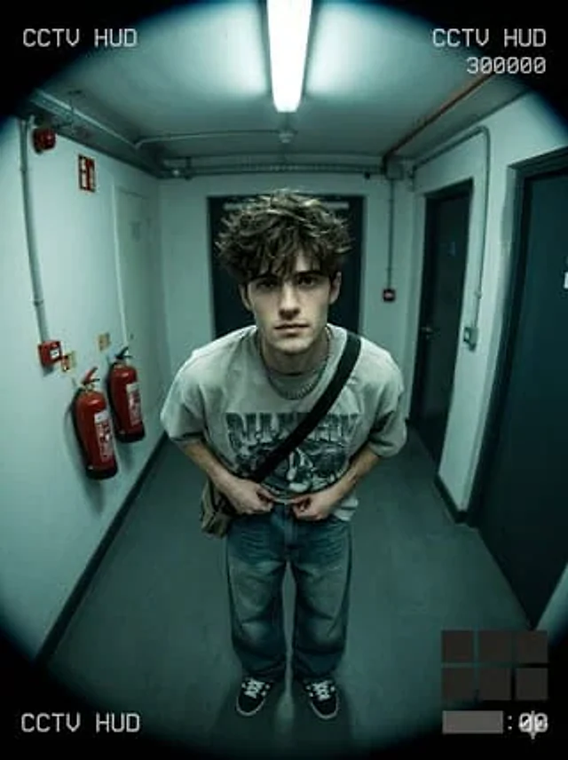

```text
Use uploaded selfie as ONLY face reference; preserve exact likeness/age/hair and natural skin texture; no beautification, no face mixing. Ultra-realistic CCTV/security camera still frame in a building hallway: ceiling corner mount view (high angle 60-70° top-down), wide 2.8-3.6mm fisheye barrel distortion, edge warping. Subject centered under the camera, looking up directly into lens with a cool unbothered expression, one hand adjusting the waistband, the other holding a bag strap or hanging relaxed. Outfit (strict, unisex): oversized graphic print T-shirt (generic print, no readable text/logos), wide baggy jeans, Adidas Campus sneakers (recognizable silhouette), chunky chain necklace. CCTV look: low-light greenish/blue tint, interlaced scanlines, H.264 block compression, mild noise, slight motion smear on background only, timestamp/HUD present but blurred/unreadable (no readable text), vignetting, ceiling light glare. Face is the sharpest point. 3:4
```

Model: Nano Banana
Author: Harboris

[ProjectD](https://aitoolsradar.com/en/prompts/275e1554258a31) · [Recorded source](https://x.com/harboriis/status/2041359077423419632)
 · [Full original metadata and byte evidence](data/projectd-batch-0062.json)

## Harboris #1269

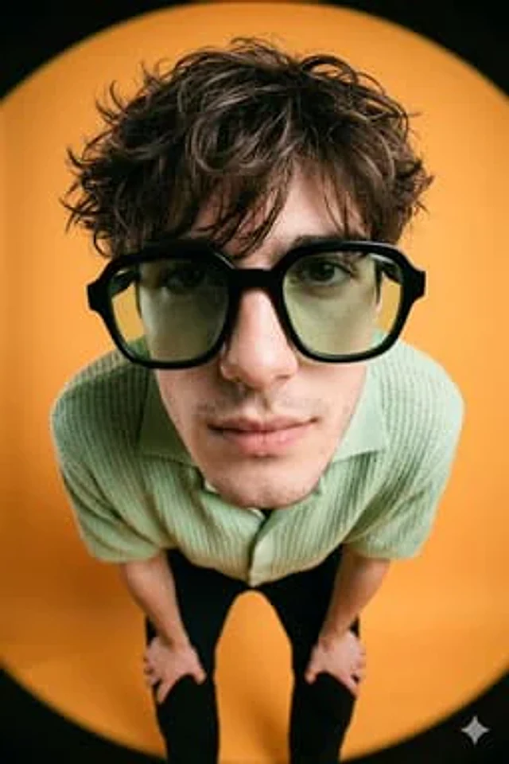

```text
Create a A high-fashion editorial image of a young man, of the person from the uploaded character reference photo. KEEP FACE FEATURES AS ORIGINAL at all times. A high-fashion editorial image captured in an exaggerated fisheye lens close-up. The camera is angled slightly from below, and the man is crouching or squatting forward with both hands resting on his knees, leaning his upper body toward the lens. His face is looking downward into the camera, exaggerated by fisheye distortion so it appears large and rounded, with cartoonish proportions. He has a neutral smile, relaxed and completely smile, expression confident but emotionless.

He wears a trendy, summery knitted shirt in a pastel green shade light, breathable, with visible texture, reflecting Gen Z summer fashion. He also wears oversized black-framed sunglasses, with lenses tinted in light green.

The background is a clean, solid orange color with soft, realistic studio lighting, creating gentle shadows cast from his head, shoulders, and arms.

No direct sunlight light is controlled and evenly diffused, like a fashion set. The overall style is playful, surreal, and modern, inspired by 2025 Gen Z fashion culture and bold editorial covers. Ultra-clean details, slight grain, bold composition.
```

Model: Nano Banana
Author: Harboris

[ProjectD](https://aitoolsradar.com/en/prompts/e5093b23650270) · [Recorded source](https://x.com/harboriis/status/2039904399993225374)
 · [Full original metadata and byte evidence](data/projectd-batch-0062.json)

## Harboris #1279

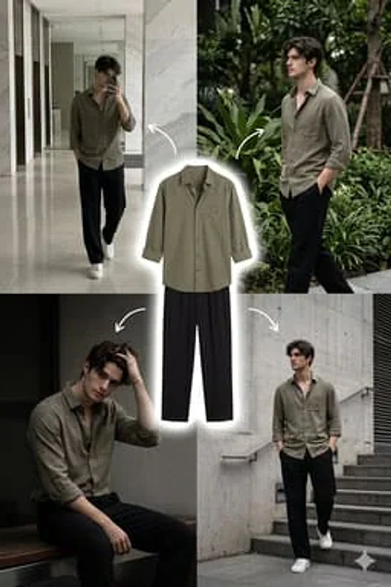

```text
A stylish young man with medium-length wavy dark hair and a clean face, wearing a muted olive green button-up shirt with sleeves slightly rolled up, paired with loose fit black straight pants and white sneakers. The outfit looks minimal, modern, and aesthetic.
Create a fashion collage layout with 5 sections:
Center: a clean cutout of the outfit (olive shirt + black pants) placed vertically, slightly floating, with a soft white outline glow around it.
Around the center: four different lifestyle shots of the same man wearing the outfit.
Top left: indoor mirror selfie in a modern lobby with marble walls and shiny floor, holding phone covering face, relaxed walking pose.
Top right: outdoor greenery setting with plants and trees, walking pose with hands in pockets, looking sideways.
Bottom left: sitting pose on a bench or ledge, slightly leaning forward, one hand in hair, moody lighting.
Bottom right: urban street or stairs background with concrete textures, walking casually with hands in pockets.
Add minimal white curved arrows pointing from each lifestyle image toward the center outfit.
Lighting: soft natural light, slightly warm tone, cinematic shadows, Instagram aesthetic.
Color palette: neutral tones, olive green, black, white, soft greys.
Style: clean, minimal, high-end fashion lookbook, Pinterest / Instagram aesthetic.
Camera: 35mm lens, shallow depth of field, sharp subject focus.
Quality: ultra realistic, high resolution, 4K, detailed fabric texture.
```

Model: Nano Banana
Author: Harboris

[ProjectD](https://aitoolsradar.com/en/prompts/98de9ec0c1aa2a) · [Recorded source](https://x.com/harboriis/status/2036365607827099705)
 · [Full original metadata and byte evidence](data/projectd-batch-0062.json)

## Harboris #976

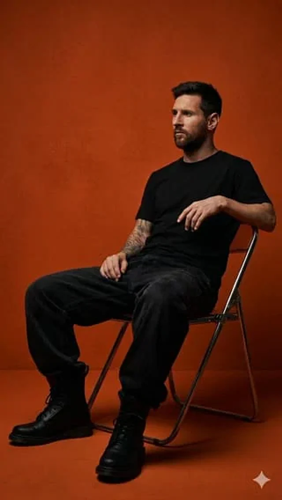

```text
Use model (the person in the image) you create a dark orange studio photo featuring a young man sitting casually on a metal folding chair with his legs cross. He's wearing a denim black baggy jeans, black t-shirt and black boots. The lightning is soft and minimal, producing sharp shadows and a moody atmosphere. His pose is relaxed, slightly leaning with one hand on the chair's backrest, his face turn to the side and modern aesthetic.
```

Model: Nano Banana
Author: Harboris

[ProjectD](https://aitoolsradar.com/en/prompts/0a55f302cd12e5) · [Recorded source](https://x.com/harboriis/status/2040257925126693248)
 · [Full original metadata and byte evidence](data/projectd-batch-0062.json)

## Harboris #978

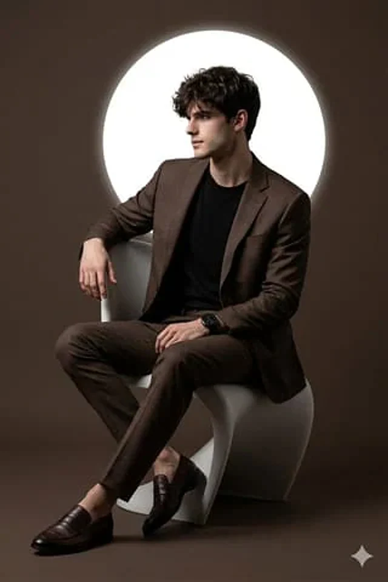

```text
Use The Uploaded Reference Photo As The Model For The Face, Hairstyle, And Beard, Keeping Them Exactly As In The Reference. Render A Cinematic Studio Portrait Of A Young Man With A Sporty Body Sitting Casually On A Futuristic, Minimalistic, Designer Chair, Legs Crossed. Outfit: Brown Suit (#483c32 Jacket And Pants), Black Shirt Under The Jacket, Dark Brown Loafers, Black Oneplus Watch 346mm On Left Wrist. Background: Solid #483c32 With A Large White Circle Behind The Head, Filled And Slightly Glowing. Lighting: Bright Soft Studio Light, Producing Sharp Shadows And Moody Atmosphere. Pose: Relaxed, Slightly Leaning, One Hand On The Chair's Backrest, Face Turned To The Side. Ultra-detailed, Photo Realistic, Cinematic Contrast, Fabric Texture Emphasized. Ensure The Hairstyle, Beard, And Face Remain Exactly As In The Uploaded Reference Photo.
```

Model: Nano Banana
Author: Harboris

[ProjectD](https://aitoolsradar.com/en/prompts/8aff27a46fd811) · [Recorded source](https://x.com/harboriis/status/2040040156066140196)
 · [Full original metadata and byte evidence](data/projectd-batch-0062.json)

## Hazel #1125


```text
{
  "prompt_type": "viral_makeup_product_visual",
  "scene": "ASMR-style product texture showcase",
  "products": [
    "cream blush being swirled with spatula",
    "foundation drops merging smoothly"
  ],
  "details": {
    "texture_focus": "creamy, buttery, ultra-smooth consistency",
    "lighting": "soft diffused lighting",
    "color_theme": "nude, peach, soft rose"
  },
  "mood": "satisfying, calming, premium",
  "camera": "extreme macro shot",
  "background": "clean pastel surface"
}
```

Model: Nano Banana
Author: Hazel

[ProjectD](https://aitoolsradar.com/en/prompts/d2bdfec5d7b077) · [Recorded source](https://x.com/sassyhazel_/status/2018639862036115956)
 · [Full original metadata and byte evidence](data/projectd-batch-0062.json)

## Heisenberg #1028

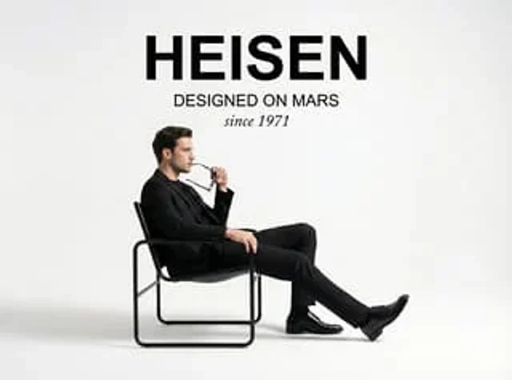

```text
A minimalist studio photograph fashion ad. At the top center, the bold sans-serif text "[TEXT]" is positioned above the smaller sans-serif text "[TEXT]", which is above the italic script text "[TEXT]". Below the text, a man in a black suit, black t-shirt, and polished black dress shoes sits in profile, facing left. He is seated in a modern chair with a black leather seat and backrest suspended on a tubular black metal frame. His right leg is extended, and he holds a pair of glasses in his right hand near his mouth. The background and floor are a seamless, stark white studio space with soft, diffused lighting that casts grounded shadows beneath the man and chair.
```

Model: Nano Banana
Author: Heisenberg

[ProjectD](https://aitoolsradar.com/en/prompts/07436056d4a4a8) · [Recorded source](https://x.com/rovvmut_/status/2011320913908941188)
 · [Full original metadata and byte evidence](data/projectd-batch-0062.json)

## Heisenberg #1079

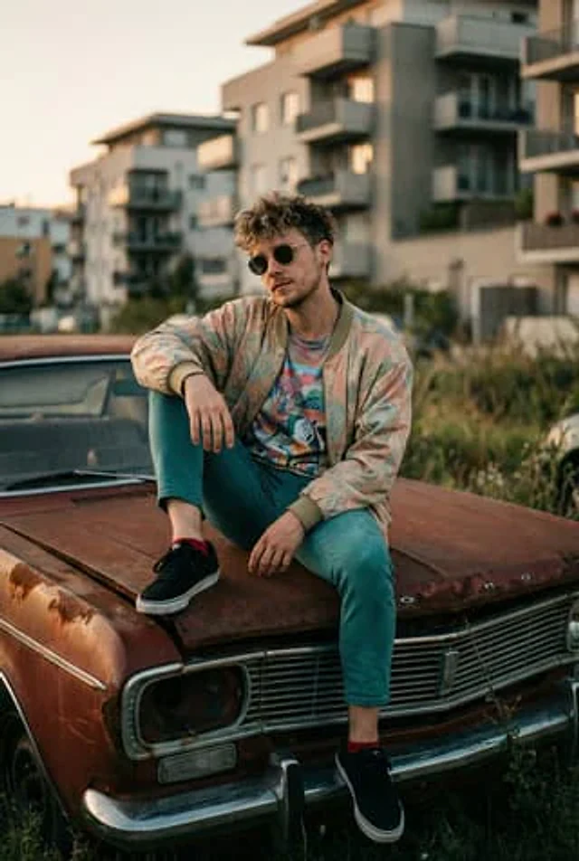

```text
{
"composition": {
"framing": "centered subject with symmetrical balance",
"perspective": "eye-level, slight downward tilt",
"crop": "vertical portrait orientation, full body seated pose",
"depth_of_field": "moderate, subject sharp with softly detailed background",
"leading_elements": "rusted car edges and hood frame the subject"
},
"subject": {
"type": "human",
"pose": "sitting casually on the hood of an abandoned car, one leg bent, one leg hanging",
"expression": "relaxed, confident, contemplative",
"gaze": "looking slightly downward and to the side",
"hair": "short, curly, tousled",
"facial_hair": "light mustache and stubble",
"accessories": [
"round sunglasses",
"necklace"
]
},
"clothing": {
"outerwear": "patterned bomber jacket with muted pastel tones",
"top": "graphic t-shirt with colorful print",
"pants": "teal slim-fit jeans, slightly cropped",
"footwear": "black sneakers with white soles and red socks"
},
"environment": {
"setting": "urban outdoor area",
"foreground": "overgrown grass and weeds",
"primary_object": "abandoned, heavily rusted vintage car",
"background": "modern apartment buildings with balconies",
"contrast": "decay versus modern urban living"
},
"color_palette": {
"dominant_colors": [
"rust red",
"teal",
"muted green",
"beige",
"brown"
],
"accent_colors": [
"red",
"yellow",
"black"
],
"color_temperature": "warm with teal-green shadows",
"grading_style": "cinematic, desaturated highlights, rich shadows"
},
"lighting": {
"type": "natural light",
"time_of_day": "late afternoon or golden hour",
"direction": "side-lit with soft shadows",
"contrast": "medium contrast",
"highlights": "soft and warm on skin and metal surfaces"
},
"technical_details": {
"camera_type": "DSLR or mirrorless",
"lens_estimate": "35mm–50mm prime",
"aperture_estimate": "f/2.8–f/4",
"iso_estimate": "ISO 200–400",
"shutter_speed_estimate": "1/200–1/400",
"focus": "sharp on subject, slightly softer background"
},
"artistic_style": {
"genre": "urban lifestyle portrait",
"mood": "nostalgic, gritty, stylish",
"influences": [
"street photography",
"cinematic editorial fashion"
],
"texture": "visible grain, emphasis on rust and fabric detail"
},
"post_processing": {
"grain": "moderate film grain",
"sharpening": "selective sharpening on subject",
"contrast_curve": "soft highlights with lifted blacks",
"vignette": "subtle vignette around edges"
},
"background_details": {
"architecture": "concrete apartment blocks with repetitive windows",
"color": "neutral beige and gray tones",
"blur_level": "light background separation without heavy bokeh"
},
"overall_aesthetic": {
"theme": "urban decay meets modern fashion",
"visual_story": "individuality and style emerging from neglected environments",
"use_case"
: [
"editorial fashion",
"UGC influencer content",
"cinematic portrait reference"
]
}
}
```

Model: Nano Banana
Author: Heisenberg

[ProjectD](https://aitoolsradar.com/en/prompts/f500b8f25bfada) · [Recorded source](https://x.com/rovvmut_/status/2009817289349312613)
 · [Full original metadata and byte evidence](data/projectd-batch-0062.json)

## Heisenberg #1222

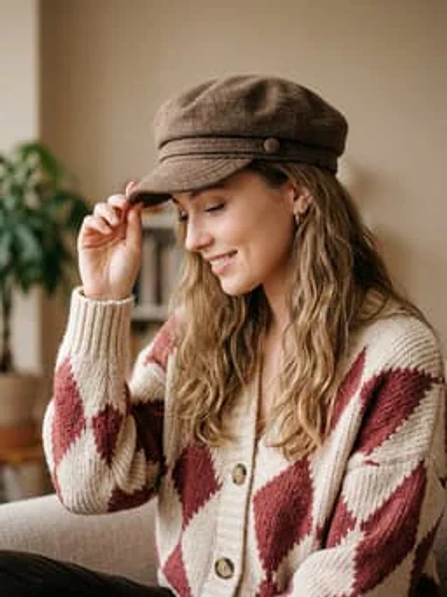

```text
A warm, cozy, and high-quality portrait of a young woman with long, wavy blonde-brown hair, captured in a soft side profile. She is smiling gently and looking downward, her left hand delicately adjusting the brim of a classic brown wool baker boy cap. The cap features a thick, felted texture with a small button nub on top. She is wearing an oversized, chunky knit V-neck cardigan with a bold argyle-style diamond pattern in cream and a muted, deep red. The cardigan features large, visible buttons and a thick ribbed texture along the neckline and cuffs. The background is a soft-focus, neutral beige wall with the blurred green leaves of a plant visible on the far left edge. The lighting is soft and natural, coming from the side to highlight the delicate features of her face and the intricate textures of the knitwear and wool hat. The overall aesthetic is autumnal, serene, and tactile.
```

Model: Nano Banana
Author: Heisenberg

[ProjectD](https://aitoolsradar.com/en/prompts/f2acdb8ada9bdc) · [Recorded source](https://x.com/rovvmut_/status/2037877301455569247)
 · [Full original metadata and byte evidence](data/projectd-batch-0062.json)

## Heisenberg #1264

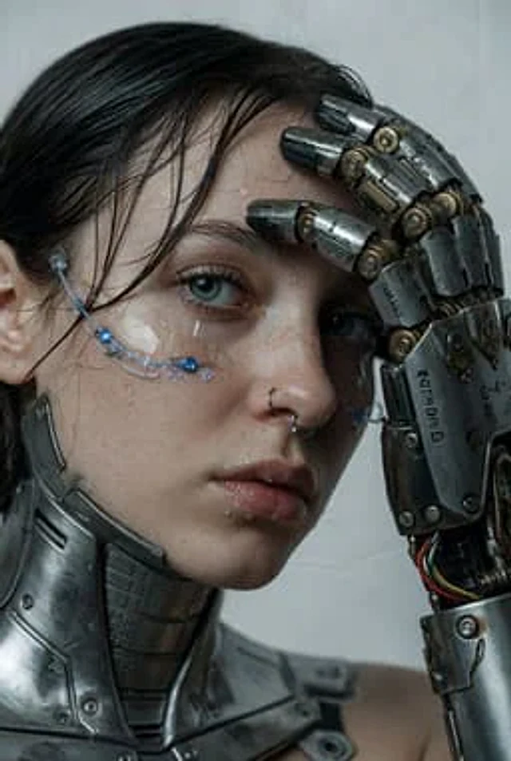

```text
A hyper-realistic, cinematic extreme close-up portrait of a young woman with fair, freckled skin and damp, dark hair. She has striking blue-green eyes and a silver septum ring.
Cybernetic Details: A large, highly detailed mechanical prosthetic hand with weathered industrial textures, exposed wires, and hydraulic pistons is positioned near her face, with fingers curled toward her temple. 
A thin, surgical-grade cybernetic wire or sensor line runs horizontally across her cheek, just beneath her eye. 
The jawline and neck feature integrated metallic plating and brushed-steel augmentations.

Background: A minimalist, neutral studio backdrop in soft grey-white.
Lighting: Soft, directional front-left lighting that creates deep, intricate shadows within the mechanical joints and highlights the moisture on her skin and lips.
Atmosphere: Gritty, futuristic, and melancholic with a high-fashion editorial feel.
Composition: Asymmetrical framing, shallow depth of field focusing on the eye and the texture of the robotic fingers.
Texture: Hyper-detailed skin pores, fine wet hair strands, and scratched, oil-stained metal surfaces.
Color Grade: Desaturated cool tones with high contrast. High-resolution digital art/3D render style.
```

Model: Nano Banana
Author: Heisenberg

[ProjectD](https://aitoolsradar.com/en/prompts/5254156f313af9) · [Recorded source](https://x.com/rovvmut_/status/2041020925706117267)
 · [Full original metadata and byte evidence](data/projectd-batch-0062.json)

## Heisenberg #1305


```text
{
"scene_overview": {
"description": "A monochrome, contemplative portrait of a man lying on grass, resting his head on his forearm while gazing intently at a chessboard in the foreground.",
"mood": "Introspective, calm, slightly melancholic, strategic contemplation",
"style": "Fine art documentary portrait"
},
"composition": {
"camera_angle": "Low, ground-level perspective aligned with the chessboard",
"framing": "Horizontal close-to-medium shot with strong foreground emphasis",
"rule_of_thirds": "Subject’s eye positioned near the upper-left third; chess pieces dominate the lower foreground",
"depth": "Shallow depth of field; foreground chess pieces partially blurred, subject’s face in sharp focus",
"leading_elements": "Chessboard grid lines and aligned chess pieces lead the eye toward the subject’s face",
"balance": "Asymmetrical balance between the heavy foreground objects and the subject’s head and arm"
},
"subjects": {
"primary_subject": {
"type": "Adult male",
"pose": "Lying on side with head resting on forearm",
"expression": "Focused, thoughtful, slightly fatigued",
"gaze": "Directed toward chessboard and pieces",
"facial_hair": "Short, well-groomed beard",
"hair": "Short, textured, slightly tousled",
"clothing": "Light-colored, long-sleeve button-up shirt with visible fabric creases"
},
"secondary_subjects": {
"objects": [
{
"type": "Chessboard",
"material": "Wood",
"pattern": "Classic checkered grid",
"position": "Foreground, partially out of focus"
},
{
"type": "Chess pieces",
"material": "Wood",
"variety": "Mixed pawns and major pieces",
"arrangement": "Mid-game configuration, scattered with strategic spacing"
}
]
}
},
"environment": {
"setting": "Outdoor grassy area",
"ground_texture": "Short grass with visible blades and uneven natural texture",
"background": "Minimal and softly blurred, no discernible structures or distractions"
},
"lighting": {
"type": "Natural light",
"direction": "Soft side lighting from above-left",
"contrast": "Moderate contrast with gentle highlights and smooth shadow falloff",
"highlights": "Subtle highlights on forehead, cheekbone, and knuckles",
"shadows": "Soft shadows under the arm, chin, and chess pieces"
},
"color_and_tone": {
"color_mode": "Black and white",
"tonal_range": "Wide grayscale range from deep blacks to bright whites",
"dominant_tones": "Mid-grays and soft highlights",
"texture_emphasis": "Enhanced skin texture, fabric fibers, wood grain, and grass"
},
"technical_characteristics": {
"lens_look": "Portrait lens feel, likely medium focal length",
"aperture_effect": "Wide aperture producing shallow depth of field",
"sharpness": "High sharpness on subject’s eye and facial features",
"grain": "Fine, subtle film-like grain",
"dynamic_range": "Well-preserved highlights and shadow details"
},
"artistic_elements": {
"theme": "Strategy, contemplation, mental focus",
"symbolism": "Chessboard as a metaphor for life decisions and planning",
"emotional_tone": "Quiet, reflective, intellectually engaged",
"timelessness": "Classic monochrome treatment removes temporal context"
},
"typography": {
"presence": "None",
"text_elements": "No visible text or lettering"
},
"overall_aesthetic": {
"genre": "Fine art portrait photography",
"influences": "Humanist photography, editorial portraiture",
"use_case": "Art print, editorial feature, conceptual storytelling, AI style reference"
}
}
```

Model: Nano Banana
Author: Heisenberg

[ProjectD](https://aitoolsradar.com/en/prompts/0dc62f63795b60) · [Recorded source](https://x.com/rovvmut_/status/2008399606074536132)
 · [Full original metadata and byte evidence](data/projectd-batch-0062.json)

## Heisenberg #1319

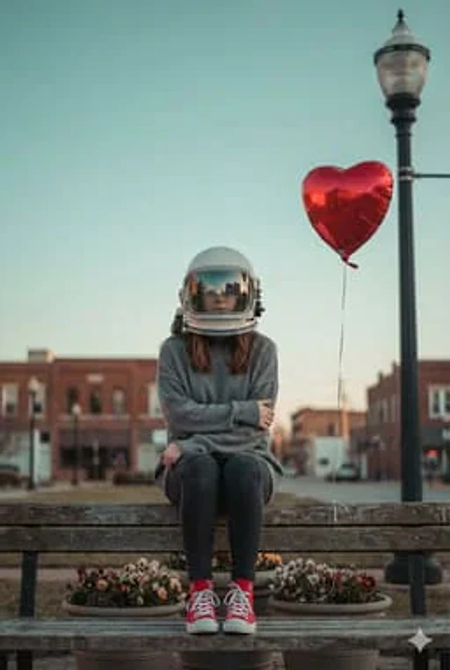

```text
{
"image_type": "photograph",
"orientation": "vertical",
"aspect_ratio": "2:3",
"composition": {
"framing": "centered subject with strong vertical symmetry",
"rule_of_thirds": "subject centered vertically, balloon positioned upper-right third",
"depth": "moderate depth of field with softly blurred background",
"leading_elements": "bench slats and lamppost create vertical and horizontal structure",
"negative_space": "open sky occupying upper half of frame"
},
"primary_subject": {
"description": "young person seated on a wooden park bench wearing an astronaut helmet",
"pose": "seated, knees together, arms folded inward, posing towards camera",
"emotion": "introspective, melancholic, whimsical loneliness",
"clothing": {
"top": "oversized gray sweater",
"bottom": "dark skinny jeans",
"footwear": "red high-top sneakers with white laces",
"accessories": "vintage-style astronaut helmet"
}
},
"secondary_subjects": [
{
"type": "object",
"description": "red heart-shaped helium balloon",
"position": "upper right, tethered to lamppost",
"symbolism": "love, longing, fragility"
},
{
"type": "environment_object",
"description": "classic street lamppost",
"position": "right side of frame",
"function": "anchor point for balloon string"
}
],
"environment": {
"location_type": "urban park or public square",
"foreground": "flower pots with small blooming flowers beneath bench",
"background": "low-rise buildings and distant urban elements",
"sky": "clear with soft gradient"
},
"color_palette": {
"dominant_colors": [
"muted teal sky",
"warm brown wood",
"charcoal gray clothing"
],
"accent_colors": [
"vivid red balloon",
"bright red sneakers"
],
"overall_tone": "muted with selective saturation"
},
"lighting": {
"type": "natural light",
"time_of_day": "golden hour or late afternoon",
"direction": "soft ambient, slightly directional from left",
"contrast": "low to medium",
"highlights": "subtle reflections on astronaut visor and balloon surface",
"shadows": "soft, diffused shadows under bench and subject"
},
"technical_details": {
"camera_angle": "eye-level",
"lens_effect": "slight background compression suggesting mid-range focal length",
"focus": "sharp on subject, gentle background blur",
"grain": "minimal, clean digital look"
},
"artistic_style": {
"genre": "conceptual portrait photography",
"mood": "surreal, poetic, nostalgic",
"themes": [
"isolation",
"imagination",
"emotional distance",
"childhood wonder"
],
"visual_metaphors": [
"astronaut helmet representing emotional separation",
"heart balloon symbolizing unattainable or fragile love"
]
},
"typography": {
"present": false
},
"overall_aesth
etic": "cinematic, dreamy, modern surrealism with lifestyle photography influences"
}
```

Model: Nano Banana
Author: Heisenberg

[ProjectD](https://aitoolsradar.com/en/prompts/80f89821ffdeb3) · [Recorded source](https://x.com/rovvmut_/status/2008767364675104818)
 · [Full original metadata and byte evidence](data/projectd-batch-0062.json)

## Heisenberg #1379

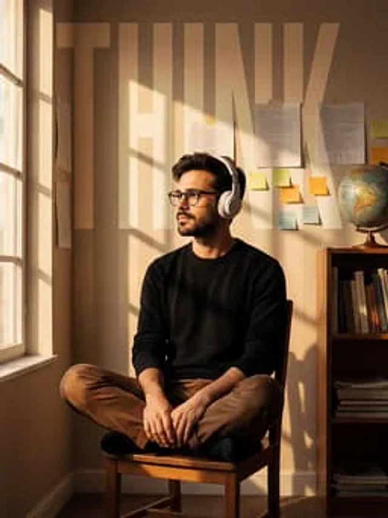

```text
A cinematic portrait of a young man in the uploaded image sitting cross-legged on a simple wooden chair, wearing white over-ear headphones and gazing thoughtfully toward the light. He is wearing black sweater and brown trousers. He is in a cozy study room; the background features a beige wall cluttered with taped papers and sticky notes, with a wooden bookshelf and a globe visible on the right. Warm, golden-hour sunlight streams in from the left, casting distinct, sharp grid-like window shadows across the subject and the back wall. A large, semi-transparent, faded typography overlay of the word "THINK" blends vertically into the scene behind him. The atmosphere is moody, nostalgic, and warm, with a soft film grain texture.
```

Model: Nano Banana
Author: Heisenberg

[ProjectD](https://aitoolsradar.com/en/prompts/93a4a928de32bb) · [Recorded source](https://x.com/rovvmut_/status/2012039630506639728)
 · [Full original metadata and byte evidence](data/projectd-batch-0062.json)

## Heisenberg #355

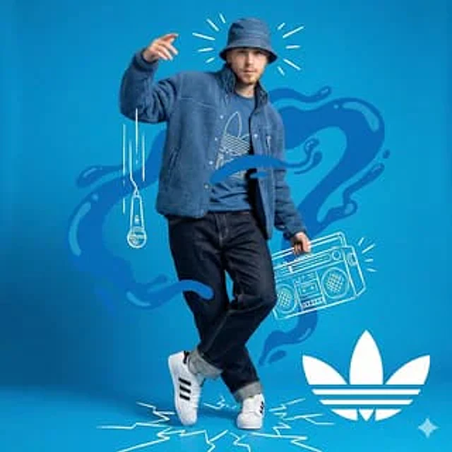

```text
{
  "meta": {
    "image_quality": "High",
    "image_type": "Mixed Media (Photography combined with Digital Illustration/Collage)",
    "resolution_estimation": "High resolution, sharp edges on vectors",
    "file_characteristics": {
      "compression_artifacts": "Low",
      "noise_level": "None",
      "lens_type_estimation": "Standard to slight wide-angle (approx 35mm)"
    }
  },
  "global_context": {
    "scene_description": "A full-body studio portrait of a young man posing dynamically against a solid bright blue background. The image is a composite featuring the photograph of the man overlaid with white hand-drawn style vector graphics (doodles) and abstract blue liquid shapes. The subject is dressed in a monochromatic blue streetwear outfit with white accents.",
    "environment_type": "Studio/Graphic Design Composition",
    "time_of_day": "Indiscernible (Studio Lighting)",
    "weather_atmosphere": "Energetic, Artistic, Urban, Cool",
    "lighting": {
      "source": "Artificial Studio Lighting",
      "direction": "Front-right dominant (creating soft shadows on the left side of the face)",
      "quality": "Soft, Diffused",
      "color_temperature": "Neutral white"
    },
    "color_palette": {
      "dominant_hex_estimates": [
        "#4CA7E8",
        "#0044CC",
        "#FFFFFF",
        "#1A2B45"
      ],
      "accent_colors": [
        "#FFFFFF"
      ],
      "contrast_level": "High"
    }
  },
  "composition": {
    "camera_angle": "Low-angle (looking slightly up at the subject)",
    "framing": "Full Shot (Head to Toe)",
    "depth_of_field": "Deep (Everything in focus)",
    "focal_point": "Subject's face and upper torso",
    "symmetry_type": "Asymmetrical balance",
    "rule_of_thirds_alignment": "Subject centered, graphics balancing the negative space"
  },
  "objects": [
    {
      "id": "obj_001",
      "label": "Male Subject",
      "category": "Person",
      "location": {
        "relative_position": "Center",
        "bounding_box_percentage": {
          "x": 0.30,
          "y": 0.05,
          "width": 0.40,
          "height": 0.85
        }
      },
      "dimensions_relative": "Large",
      "distance_from_camera": "Mid",
      "pose_orientation": "Standing, body angled slightly right, head tilted left, right hand raised near face, left leg crossed over right leg",
      "material": "Organic (Skin)",
      "surface_properties": {
        "texture": "Skin",
        "reflectivity": "Low",
        "micro_details": "Light goatee/facial hair, neutral but confident expression",
        "wear_state": "N/A"
      },
      "color_details": {
        "base_color_hex": "#5C3A2A",
        "secondary_colors": [],
        "gradient_or_pattern": "Natural skin tones"
      },
      "interaction_with_light": {
        "shadow_casting": "Self-shadows on neck and left side of face",
        "highlight_zones": "Forehead, right cheek, nose bridge",
        "translucency": "None"
      },
      "relationships": [
        {
          "type": "wearing",
          "target_object_id": "obj_002"
        },
        {
          "type": "wearing",
          "target_object_id": "obj_003"
        },
        {
          "type": "wearing",
          "target_object_id": "obj_004"
        },
        {
          "type": "wearing",
          "target_object_id": "obj_005"
        },
        {
          "type": "wearing",
          "target_object_id": "obj_006"
        },
        {
          "type": "interacting_with",
          "target_object_id": "obj_007"
        },
        {
          "type": "standing_on",
          "target_object_id": "obj_011"
        }
      ]
    },
    {
      "id": "obj_002",
      "label": "Bucket Hat",
      "category": "Apparel",
      "location": {
        "relative_position": "Top-Center (On head)",
        "bounding_box_percentage": {
          "x": 0.45,
          "y": 0.05,
          "width": 0.10,
          "height": 0.08
        }
      },
      "dimensions_relative": "Small",
      "distance_from_camera": "Mid",
      "pose_orientation": "Worn on head, brim pulled slightly down",
      "material": "Denim/Canvas",
      "surface_properties": {
        "texture": "Woven fabric",
        "reflectivity": "Low",
        "micro_details": "Visible white contrast stitching around the brim and crown",
        "wear_state": "New"
      },
      "color_details": {
        "base_color_hex": "#003399",
        "secondary_colors": [
          "#FFFFFF"
        ],
        "gradient_or_pattern": "Solid blue with white stitching lines"
      }
    },
    {
      "id": "obj_003",
      "label": "Fleece Jacket",
      "category": "Apparel",
      "location": {
        "relative_position": "Upper Body",
        "bounding_box_percentage": {
          "x": 0.30,
          "y": 0.12,
          "width": 0.35,
          "height": 0.40
        }
      },
      "dimensions_relative": "Medium",
      "distance_from_camera": "Mid",
      "pose_orientation": "Worn open, sleeves rolled slightly or pushed up",
      "material": "Sherpa Fleece / Synthetic Blend",
      "surface_properties": {
        "texture": "High pile, fuzzy, nubby texture on outer shell",
        "reflectivity": "Low (Matte)",
        "micro_details": "Silver snap button visible on collar, smooth fabric lining visible at cuffs",
        "wear_state": "New"
      },
      "color_details": {
        "base_color_hex": "#0044CC",
        "secondary_colors": [
          "#002266"
        ],
        "gradient_or_pattern": "Solid vivid blue"
      }
    },
    {
      "id": "obj_004",
      "label": "T-Shirt",
      "category": "Apparel",
      "location": {
        "relative_position": "Chest/Torso (Under jacket)",
        "bounding_box_percentage": {
          "x": 0.40,
          "y": 0.20,
          "width": 0.20,
          "height": 0.30
        }
      },
      "dimensions_relative": "Medium",
      "distance_from_camera": "Mid",
      "pose_orientation": "Worn on torso",
      "material": "Cotton jersey",
      "surface_properties": {
        "texture": "Smooth fabric",
        "reflectivity": "Low",
        "micro_details": "Large graphic print on chest",
        "wear_state": "New"
      },
      "color_details": {
        "base_color_hex": "#0044CC",
        "secondary_colors": [
          "#FFFFFF"
        ],
        "gradient_or_pattern": "Large white outline of Adidas Trefoil logo on chest"
      },
      "text_content": {
        "raw_text": "adidas (implied by logo shape)",
        "font_style": "Logo symbol",
        "font_weight": "Bold",
        "text_case": "N/A",
        "alignment": "Center",
        "color_hex": "#FFFFFF"
      }
    },
    {
      "id": "obj_005",
      "label": "Jeans",
      "category": "Apparel",
      "location": {
        "relative_position": "Lower Body",
        "bounding_box_percentage": {
          "x": 0.40,
          "y": 0.45,
          "width": 0.20,
          "height": 0.40
        }
      },
      "dimensions_relative": "Medium",
      "distance_from_camera": "Mid",
      "pose_orientation": "Worn on legs, relaxed fit",
      "material": "Denim",
      "surface_properties": {
        "texture": "Woven denim",
        "reflectivity": "Low",
        "micro_details": "Heavy white contrast stitching along seams and pockets. Cuffs are rolled up exposing lighter reverse side of denim.",
        "wear_state": "New"
      },
      "color_details": {
        "base_color_hex": "#2A3B55",
        "secondary_colors": [
          "#FFFFFF",
          "#667788"
        ],
        "gradient_or_pattern": "Dark wash indigo"
      }
    },
    {
      "id": "obj_006",
      "label": "Sneakers",
      "category": "Footwear",
      "location": {
        "relative_position": "Bottom-Center",
        "bounding_box_percentage": {
          "x": 0.35,
          "y": 0.85,
          "width": 0.25,
          "height": 0.10
        }
      },
      "dimensions_relative": "Small",
      "distance_from_camera": "Mid",
      "pose_orientation": "Right foot planted, left foot on toe/mid-step. Classic Adidas Superstar silhouette.",
      "material": "Leather/Rubber",
      "surface_properties": {
        "texture": "Smooth leather upper, textured rubber shell toe",
        "reflectivity": "Medium (Leather sheen)",
        "micro_details": "Three stripes visible (white on white), shell toe pattern",
        "wear_state": "Pristine/Clean"
      },
      "color_details": {
        "base_color_hex": "#FFFFFF",
        "secondary_colors": [],
        "gradient_or_pattern": "All white"
      }
    },
    {
      "id": "obj_007",
      "label": "Graphic - Mic Drop Lines",
      "category": "Illustration/Overlay",
      "location": {
        "relative_position": "Upper Left (Hanging from hand)",
        "bounding_box_percentage": {
          "x": 0.38,
          "y": 0.12,
          "width": 0.05,
          "height": 0.25
        }
      },
      "dimensions_relative": "Small",
      "distance_from_camera": "Zero (Overlay)",
      "pose_orientation": "Vertical",
      "material": "Digital Vector",
      "surface_properties": {
        "texture": "Flat color",
        "reflectivity": "None",
        "micro_details": "Three thick vertical white lines representing motion or cable"
      },
      "color_details": {
        "base_color_hex": "#FFFFFF",
        "secondary_colors": [],
        "gradient_or_pattern": "Solid"
      },
      "relationships": [
        {
          "type": "originating_from",
          "target_object_id": "obj_001"
        }
      ]
    },
    {
      "id": "obj_008",
      "label": "Graphic - Microphone",
      "category": "Illustration/Overlay",
      "location": {
        "relative_position": "Mid Left (Below hand)",
        "bounding_box_percentage": {
          "x": 0.38,
          "y": 0.35,
          "width": 0.05,
          "height": 0.05
        }
      },
      "dimensions_relative": "Small",
      "distance_from_camera": "Zero (Overlay)",
      "pose_orientation": "Angled downwards",
      "material": "Digital Vector",
      "surface_properties": {
        "texture": "Hand-drawn line art style",
        "reflectivity": "None",
        "micro_details": "Outline of a dynamic vocal microphone"
      },
      "color_details": {
        "base_color_hex": "#FFFFFF",
        "secondary_colors": [],
        "gradient_or_pattern": "Outline only"
      }
    },
    {
      "id": "obj_009",
      "label": "Graphic - Boombox",
      "category": "Illustration/Overlay",
      "location": {
        "relative_position": "Center Right",
        "bounding_box_percentage": {
          "x": 0.65,
          "y": 0.30,
          "width": 0.15,
          "height": 0.20
        }
      },
      "dimensions_relative": "Medium",
      "distance_from_camera": "Zero (Overlay)",
      "pose_orientation": "Isometric view",
      "material": "Digital Vector",
      "surface_properties": {
        "texture": "Hand-drawn line art style",
        "reflectivity": "None",
        "micro_details": "Speaker grille mesh pattern, handle, buttons, cassette deck outline"
      },
      "color_details": {
        "base_color_hex": "#FFFFFF",
        "secondary_colors": [],
        "gradient_or_pattern": "Outline only"
      },
      "relationships": [
        {
          "type": "emitting",
          "target_object_id": "obj_013"
        }
      ]
    },
    {
      "id": "obj_010",
      "label": "Graphic - Adidas Trefoil Logo",
      "category": "Illustration/Overlay",
      "location": {
        "relative_position": "Bottom Right",
        "bounding_box_percentage": {
          "x": 0.65,
          "y": 0.65,
          "width": 0.15,
          "height": 0.15
        }
      },
      "dimensions_relative": "Medium",
      "distance_from_camera": "Zero (Overlay)",
      "pose_orientation": "Flat",
      "material": "Digital Vector",
      "surface_properties": {
        "texture": "Flat color",
        "reflectivity": "None",
        "micro_details": "Classic 3-leaf shape with horizontal stripes"
      },
      "color_details": {
        "base_color_hex": "#FFFFFF",
        "secondary_colors": [],
        "gradient_or_pattern": "Solid"
      }
    },
    {
      "id": "obj_011",
      "label": "Graphic - Cracked Floor",
      "category": "Illustration/Overlay",
      "location": {
        "relative_position": "Bottom Center (Under feet)",
        "bounding_box_percentage": {
          "x": 0.25,
          "y": 0.85,
          "width": 0.50,
          "height": 0.15
        }
      },
      "dimensions_relative": "Medium",
      "distance_from_camera": "Zero (Overlay)",
      "pose_orientation": "Flat perspective on ground",
      "material": "Digital Vector",
      "surface_properties": {
        "texture": "Line art",
        "reflectivity": "None",
        "micro_details": "Jagged lines radiating outward from the subject's stance like shattered glass"
      },
      "color_details": {
        "base_color_hex": "#FFFFFF",
        "secondary_colors": [],
        "gradient_or_pattern": "Line art"
      }
    },
    {
      "id": "obj_012",
      "label": "Graphic - Liquid Shapes",
      "category": "Illustration/Background Element",
      "location": {
        "relative_position": "Behind Subject",
        "bounding_box_percentage": {
          "x": 0.10,
          "y": 0.10,
          "width": 0.80,
          "height": 0.80
        }
      },
      "dimensions_relative": "Large",
      "distance_from_camera": "Behind Subject",
      "pose_orientation": "Fluid, amorphous",
      "material": "Digital Vector",
      "surface_properties": {
        "texture": "Flat color",
        "reflectivity": "None",
        "micro_details": "Blobs and splashes extending to the left and right, wrapping slightly around the subject"
      },
      "color_details": {
        "base_color_hex": "#5CAFF0",
        "secondary_colors": [],
        "gradient_or_pattern": "Slightly darker/more saturated than background blue"
      }
    },
    {
      "id": "obj_013",
      "label": "Graphic - Sound/Motion Lines",
      "category": "Illustration/Overlay",
      "location": {
        "relative_position": "Around Head and Boombox",
        "bounding_box_percentage": {
          "x": 0.60,
          "y": 0.05,
          "width": 0.25,
          "height": 0.40
        }
      },
      "dimensions_relative": "Small",
      "distance_from_camera": "Zero (Overlay)",
      "pose_orientation": "Radiating",
      "material": "Digital Vector",
      "surface_properties": {
        "texture": "Line art",
        "reflectivity": "None",
        "micro_details": "Short strokes indicating sound or movement above the hat and next to the boombox"
      },
      "color_details": {
        "base_color_hex": "#FFFFFF",
        "secondary_colors": [],
        "gradient_or_pattern": "Solid"
      }
    }
  ],
  "background_details": {
    "texture": "Digital Flat Color",
    "patterns": "None (Solid Color)",
    "lighting_behavior": "Even illumination, no gradient visible",
    "additional_elements": [
      "Vector liquid shapes (obj_012) act as a secondary background layer"
    ]
  },
  "foreground_elements": {
    "particles": "None",
    "artifacts": "White vector doodles (mic, boombox, cracks) act as foreground overlays"
  },
  "reconstruction_notes": {
    "mandatory_elements_for_recreation": [
      "Male model in full blue Adidas outfit",
      "Fleece texture on jacket",
      "White contrast stitching on jeans and hat",
      "Hand-drawn white doodle overlays (Mic, Boombox, Trefoil)",
      "Cracked floor effect under feet",
      "Monochromatic blue palette with white accents",
      "Dynamic 'cool' pose"
    ],
    "sensitivity_factors": "The blend between the realistic photo and the flat vector graphics must be sharp. The blue tones of the clothing must coordinate with but distinguish from the background blue.",
    "ambiguities": "The exact specific model of the Adidas jacket is not identifiable by name but defined by texture (sherpa/fleece) and color."
  }
}
```

Model: Nano Banana
Author: Heisenberg

[ProjectD](https://aitoolsradar.com/en/prompts/bf5ab7732e230a) · [Recorded source](https://x.com/rovvmut_/status/2016070222038602112)
 · [Full original metadata and byte evidence](data/projectd-batch-0062.json)

## Heisenberg #384

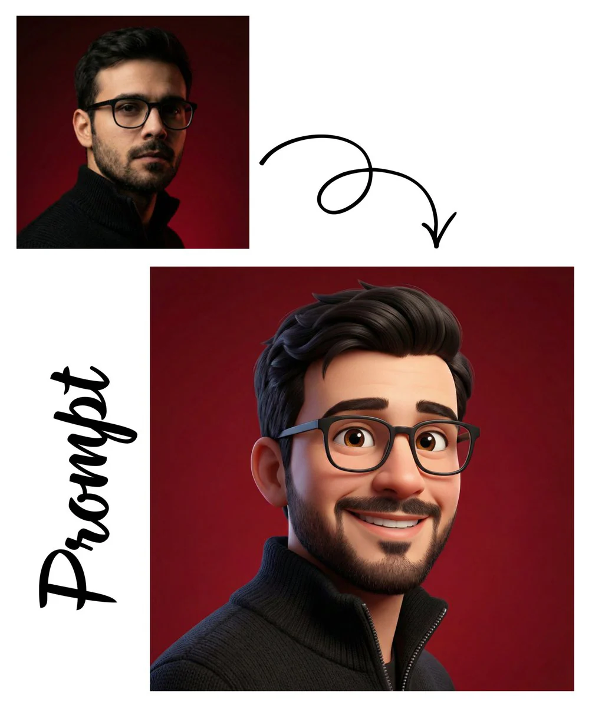

```text
Create a high-quality 3D avatar of the person in the uploaded image with a cheerful, expressive face. The character should have a warm smile, bright eyes, and soft facial features that feel friendly and approachable. Render in a Pixar-style aesthetic with smooth textures, subtle skin shading, and slightly exaggerated proportions for a cute, animated look. Lighting should be soft and even, creating a clean studio look with gentle shadows for depth.
```

Model: Nano Banana
Author: Heisenberg

[ProjectD](https://aitoolsradar.com/en/prompts/eddfb323bca078) · [Recorded source](https://x.com/rovvmut_/status/2013295220440654142)
 · [Full original metadata and byte evidence](data/projectd-batch-0062.json)

## Heisenberg #386

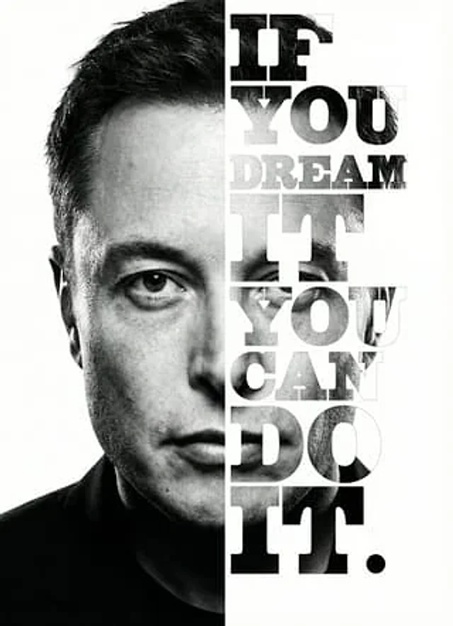

```text
{
  "meta": {
    "image_quality": "High",
    "image_type": "Digital Composite / Graphic Design",
    "resolution_estimation": "High resolution vertical poster format",
    "file_characteristics": {
      "compression_artifacts": "Low",
      "noise_level": "Low (film grain visible in photo texture)",
      "lens_type_estimation": "Telephoto (suggested by facial compression)"
    }
  },
  "global_context": {
    "scene_description": "A high-contrast, black and white split-composition portrait of Elon Musk. The left half of the image displays a realistic, high-detail photograph of the right side of his face (viewer's left). The right half of the image consists of a white background where the left side of his face (viewer's right) is revealed only through the shapes of large, bold, vertically stacked serif typography reading 'IF YOU DREAM IT YOU CAN DO IT.'",
    "environment_type": "Studio/Graphic Art",
    "time_of_day": "Indiscernible",
    "weather_atmosphere": "Visionary, Motivational, Intense",
    "lighting": {
      "source": "Artificial Studio Lighting",
      "direction": "Side lighting (lighting the face from the left)",
      "quality": "Hard, dramatic chiaroscuro",
      "color_temperature": "Monochrome (Black and White)"
    },
    "color_palette": {
      "dominant_hex_estimates": [
        "#FFFFFF",
        "#000000",
        "#333333",
        "#888888"
      ],
      "accent_colors": [],
      "contrast_level": "High"
    }
  },
  "composition": {
    "camera_angle": "Eye-level",
    "framing": "Close-up portrait",
    "depth_of_field": "Deep (all elements in focus)",
    "focal_point": "Subject's eyes and the typographic message",
    "symmetry_type": "Vertical Split Asymmetry",
    "rule_of_thirds_alignment": "The split occurs roughly along the vertical center line of the face (nose bridge)"
  },
  "objects": [
    {
      "id": "obj_subject_face",
      "label": "Elon Musk (Face)",
      "category": "Person",
      "location": {
        "relative_position": "Left half of canvas",
        "bounding_box_percentage": {
          "x": 0.0,
          "y": 0.0,
          "width": 0.5,
          "height": 1.0
        }
      },
      "dimensions_relative": "Large (fills height)",
      "distance_from_camera": "Close-up",
      "pose_orientation": "Front-facing, slight tilt, intense contemplative gaze",
      "material": "Skin/Biological",
      "surface_properties": {
        "texture": "Smooth skin, faint stubble, characteristic facial structure",
        "reflectivity": "Low (natural skin oil sheen on nose/cheek)",
        "micro_details": "Faint crow's feet, straight/wavy hair texture visible at top",
        "wear_state": "N/A"
      },
      "color_details": {
        "base_color_hex": "#808080",
        "secondary_colors": [
          "#000000",
          "#FFFFFF"
        ],
        "gradient_or_pattern": "Grayscale continuous tone"
      },
      "interaction_with_light": {
        "shadow_casting": "Deep shadows on the right side of the face (hidden by text mask)",
        "highlight_zones": "Forehead, bridge of nose, under-eye area on the lit side",
        "translucency": "None"
      },
      "relationships": [
        {
          "type": "visually_connected_to",
          "target_object_id": "obj_typography_mask"
        }
      ]
    },
    {
      "id": "obj_typography_mask",
      "label": "Typographic Overlay",
      "category": "Text/Graphic Element",
      "location": {
        "relative_position": "Right half of canvas",
        "bounding_box_percentage": {
          "x": 0.5,
          "y": 0.0,
          "width": 0.5,
          "height": 1.0
        }
      },
      "dimensions_relative": "Large",
      "distance_from_camera": "Surface Plane",
      "pose_orientation": "Vertical Stack",
      "material": "Digital Mask",
      "surface_properties": {
        "texture": "The fill of the letters matches the texture of Elon Musk's hair and skin (masked photo)",
        "reflectivity": "None",
        "micro_details": "Edges are sharp serif cuts",
        "wear_state": "N/A"
      },
      "color_details": {
        "base_color_hex": "#000000",
        "secondary_colors": [
          "#FFFFFF"
        ],
        "gradient_or_pattern": "Image texture inside letters, white background outside"
      },
      "interaction_with_light": {
        "shadow_casting": "None",
        "highlight_zones": "None",
        "translucency": "None"
      },
      "text_content": {
        "raw_text": "IF\nYOU\nDREAM\nIT\nYOU\nCAN\nDO\nIT.",
        "font_style": "Heavy Slab Serif (e.g., Rockwell Bold or similar)",
        "font_weight": "Bold / Black",
        "text_case": "Uppercase",
        "alignment": "Justified / Stacked",
        "color_hex": "Texture-filled (Black/Gray)"
      },
      "relationships": [
        {
          "type": "completes_image_of",
          "target_object_id": "obj_subject_face"
        }
      ]
    },
    {
      "id": "obj_clothing",
      "label": "Jacket Collar / Suit",
      "category": "Clothing",
      "location": {
        "relative_position": "Bottom Left Corner",
        "bounding_box_percentage": {
          "x": 0.0,
          "y": 0.85,
          "width": 0.4,
          "height": 0.15
        }
      },
      "dimensions_relative": "Small visible portion",
      "distance_from_camera": "Near",
      "pose_orientation": "Worn on shoulders",
      "material": "Dark Fabric/Leather",
      "surface_properties": {
        "texture": "Smooth with subtle folding",
        "reflectivity": "Medium",
        "micro_details": "Folds and creases",
        "wear_state": "Good condition"
      },
      "color_details": {
        "base_color_hex": "#1A1A1A",
        "secondary_colors": [],
        "gradient_or_pattern": "Solid dark"
      },
      "interaction_with_light": {
        "shadow_casting": "Self-shadowing in folds",
        "highlight_zones": "Ridges of folds",
        "translucency": "None"
      },
      "relationships": [
        {
          "type": "worn_by",
          "target_object_id": "obj_subject_face"
        }
      ]
    },
    {
      "id": "obj_ear",
      "label": "Left Ear",
      "category": "Body Part",
      "location": {
        "relative_position": "Center Left Edge",
        "bounding_box_percentage": {
          "x": 0.05,
          "y": 0.35,
          "width": 0.15,
          "height": 0.2
        }
      },
      "dimensions_relative": "Medium",
      "distance_from_camera": "Mid",
      "pose_orientation": "Side view",
      "material": "Skin",
      "surface_properties": {
        "texture": "Smooth skin",
        "reflectivity": "Low",
        "micro_details": "Cartilage structure visible",
        "wear_state": "N/A"
      },
      "color_details": {
        "base_color_hex": "#888888",
        "secondary_colors": [],
        "gradient_or_pattern": "N/A"
      },
      "interaction_with_light": {
        "shadow_casting": "Inner ear shadows",
        "highlight_zones": "Outer rim (helix)",
        "translucency": "Slight subsurface scattering potential"
      },
      "relationships": [
        {
          "type": "attached_to",
          "target_object_id": "obj_subject_face"
        }
      ]
    }
  ],
  "background_details": {
    "texture": "Flat color",
    "patterns": "None (Solid White)",
    "lighting_behavior": "The background is pure white (#FFFFFF), providing maximum contrast to the subject and text.",
    "additional_elements": [
      "Negative space on the right side acts as the canvas for the text masking effect."
    ]
  },
  "foreground_elements": {
    "particles": "None",
    "artifacts": "None"
  },
  "reconstruction_notes": {
    "mandatory_elements_for_recreation": [
      "Elon Musk's likeness",
      "Split face composition",
      "Typography masking effect on the right side",
      "Specific quote: 'IF YOU DREAM IT YOU CAN DO IT.'",
      "Black and white high-contrast aesthetic",
      "Serif bold font"
    ],
    "sensitivity_factors": "The alignment of the text must perfectly match the underlying facial anatomy to maintain the illusion of the face continuing through the letters. Hairline and jaw structure should be specific to Musk.",
    "ambiguities": "Clothing type is generic dark material."
  }
}
```

Model: Nano Banana
Author: Heisenberg

[ProjectD](https://aitoolsradar.com/en/prompts/26a2bc1962a1b1) · [Recorded source](https://x.com/rovvmut_/status/2012132360779923648)
 · [Full original metadata and byte evidence](data/projectd-batch-0062.json)

## Heisenberg #506

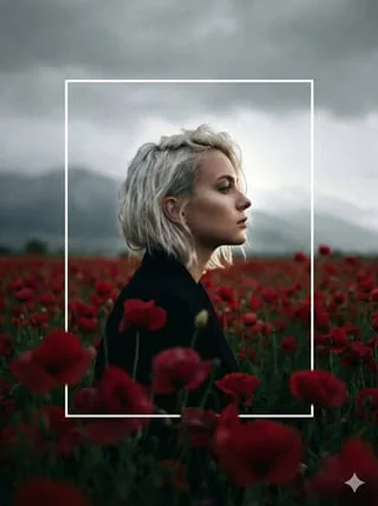

```text
A cinematic, high-contrast profile portrait of a woman with short, platinum-blonde hair, standing in a vast field of deep crimson flowers. The scene is set under a heavy, overcast grey sky with a moody, melancholic atmosphere. A thin, white rectangular frame is superimposed in the center of the composition; the woman's head and shoulders overlap and break the top and bottom edges of the frame for a modern, artistic effect. The lighting is soft and diffused from behind, creating a subtle rim light on her profile and hair. The foreground flowers are softly blurred with a shallow depth of field, and a faint, misty mountain silhouette is visible in the distant background. High-grain, filmic aesthetic.
```

Model: Nano Banana
Author: Heisenberg

[ProjectD](https://aitoolsradar.com/en/prompts/2ae0df8c1623c3) · [Recorded source](https://x.com/rovvmut_/status/2024712387132346673)
 · [Full original metadata and byte evidence](data/projectd-batch-0062.json)

## Heisenberg #562


```text
A hyper-realistic cinematic portrait of a man with short, textured hair and a well-groomed stubble beard, captured in a dark, moody 'night mode' aesthetic. The man is sitting in a contemplative pose, hands clasped together near his chest, fingers interlaced, with his gaze directed thoughtfully off-camera to the left. He is wearing a premium black high-neck turtleneck sweater and a silver-link luxury wristwatch on his left wrist, with a simple band on his right ring finger. The lighting is dramatic and controlled: a soft rim light outlines his silhouette against an almost pitch-black, shadow-drenched background, while a subtle, soft key light illuminates his face and hands. Shallow depth of field, 85mm portrait lens, ultra-sharp focus on the man's expression and clasped hands, with the chair in the background heavily blurred into complete darkness. Minimalist, professional, editorial photography, 4:5 aspect ratio, clean composition focusing strictly on the upper torso and face.
```

Model: Nano Banana
Author: Heisenberg

[ProjectD](https://aitoolsradar.com/en/prompts/d1dccad7ef2e4a) · [Recorded source](https://x.com/rovvmut_/status/2042467417990017141)
 · [Full original metadata and byte evidence](data/projectd-batch-0062.json)

## Heisenberg #579

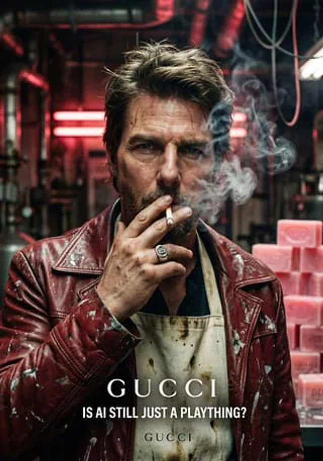

```text
A highly detailed, cinematic portrait of Tom Cruise, featuring a gritty, industrial aesthetic. He has messy, spiked dark-blonde hair, facial stubble, and a look of intense, weary focus. He is captured in a close-up shot, holding a lit cigarette to his mouth with his right hand; a thick trail of white smoke curls upward. On his finger is a prominent silver signet ring engraved with a luxury interlocking "GG" logo. The man wears a distressed, dark red leather jacket heavily marked with white paint splatters and deep creases, layered over a filthy, stained cream-colored canvas apron. The center of the frame features the word [GUCCI] in a clean, white, authoritative serif font. Below it, in smaller text on the apron, is the phrase "IS AI STILL JUST A PLAYTHING?" followed by a second, faded "GUCCI" logo. The background is a blurred industrial laboratory or "soap factory" setting. To the right are stacks of translucent pink rectangular soap blocks. In the upper background, dark industrial machinery and hanging wires are illuminated by glowing red horizontal neon lights, creating a moody, high-contrast atmosphere. The entire image has a heavy film grain, a hazy atmosphere, and a color palette dominated by deep reds, pale pinks, and grimy earth tones.
```

Model: Nano Banana
Author: Heisenberg

[ProjectD](https://aitoolsradar.com/en/prompts/6633a0ed6c85e3) · [Recorded source](https://x.com/rovvmut_/status/2028499516119453886)
 · [Full original metadata and byte evidence](data/projectd-batch-0062.json)

## Heisenberg #641

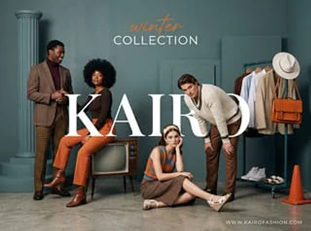

```text
A wide-angle, studio fashion advertisement with a sophisticated retro-modern aesthetic. The scene is set against a monochromatic teal-grey (#506D6D) architectural backdrop featuring minimalist geometric props, including a fluted column and stepped circular platforms. The lighting is professionally diffused studio light, creating soft, graduated shadows that provide depth without harshness.

The Subjects:
Four models are posed in a cohesive, stylish group dynamic:

A Black man on the far left, standing tall in a brown tweed blazer, a deep burgundy turtleneck, and dark yellow-and-brown checkered trousers. He is smiling and warmly holding the hand of the woman next to him.

A Black woman with a voluminous afro, sitting sideways on a vintage 1950s wooden television set. She wears a dark brown knit top and vibrant burnt orange (#E88D4D) trousers with sleek brown leather boots.

A White woman sitting on the floor in the center, leaning forward with her hand to her face. she wears a vintage-style headband, an argyle-patterned sleeveless top in orange and slate blue, a brown wool skirt, and white wedge sandals.

A White man leaning into the frame from the center-right, hands on his knees. He wears a heavy cream-colored cable-knit sweater with dark trim and tailored brown trousers.
Furniture & Props:
To the right stands a minimalist dark teal industrial clothing rack. It displays curated garments including hanging shirts, a wide-brimmed white fedora, and a prominent structured orange leather messenger bag. At the base of the rack are white high-top sneakers and sandals. A single, truncated orange cone prop sits in the foreground.
Primary Text: A massive, high-contrast white serif font (Bodoni-style) reading "KAIRO" is overlaid across the center-left, partially occluding the models to create a layered, 3D effect.
Header: At the top center, the words "winter" (in orange cursive script) and "COLLECTION" (in white clean sans-serif) are centered.
Footer: The URL "http://KAIROFASHION.COM" is printed in small, wide-tracked white sans-serif in the bottom right corner.
Color Palette:
A sophisticated mix of Teal-Grey, Burnt Orange, Chocolate Brown, and Crisp White, creating a warm yet muted autumnal atmosphere.
```

Model: Nano Banana
Author: Heisenberg

[ProjectD](https://aitoolsradar.com/en/prompts/b87e369c419807) · [Recorded source](https://x.com/rovvmut_/status/2029228739192865157)
 · [Full original metadata and byte evidence](data/projectd-batch-0062.json)

## Heisenberg #783

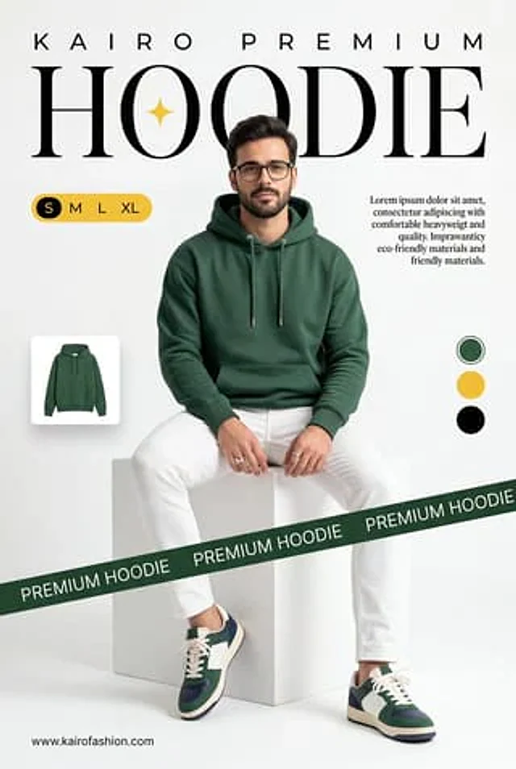

```text
A professional commercial fashion advertisement featuring [a young male model] in the uploaded image, sitting on a minimalist white matte cube. He has a neutral, confident expression and is looking directly at the camera.

Attire & Styling:
Hoodie: A high-quality, [heavyweight forest green (British Racing Green) hoodie]. It features a relaxed fit, a spacious kangaroo pocket, and metal-tipped drawstrings.
Bottoms: Clean, slim-fit white trousers with visible seams.
Footwear: Stylish low-top sneakers in a color-blocked design of forest green, navy blue, and white, with off-white midsoles and white laces.
Accessories: Simple silver bands/rings on his fingers.

Graphic Design & Layout:
Typography: The word [HOODIE] is written in a massive, elegant high-contrast serif font across the top. A small, four-pointed yellow spark icon is centered inside the "O". Above this, [K A I R O  P R E M I U M] is printed in a wide-spaced sans-serif font.
Branding Elements: A dark green diagonal "caution tape" style ribbon crosses the bottom third of the frame, with the words [PREMIUM HOODIE] repeating in white uppercase text.
UI Accents: * A yellow pill-shaped size selector labeled "S M L XL" on the left.
A small thumbnail of the hoodie floating on the mid-left.
Three circular color swatches (Green, Yellow, Black) on the right side.
Two blocks of justified serif body text describing the product's comfort and eco-friendly materials.
The URL [www.meigen.ai] in the bottom left corner.

Environment & Lighting:
Setting: A clean, bright, white-on-white minimalist studio cove.
Lighting: Soft, diffused studio lighting creates gentle shadows under the model and the cube, emphasizing the rich texture of the green fabric and the crispness of the white pants.
Color Palette: Deep forest green, bright white, and golden yellow accents.
```

Model: Nano Banana
Author: Heisenberg

[ProjectD](https://aitoolsradar.com/en/prompts/bf0ec3d622e282) · [Recorded source](https://x.com/rovvmut_/status/2029599397483532714)
 · [Full original metadata and byte evidence](data/projectd-batch-0062.json)

## Heisenberg #815

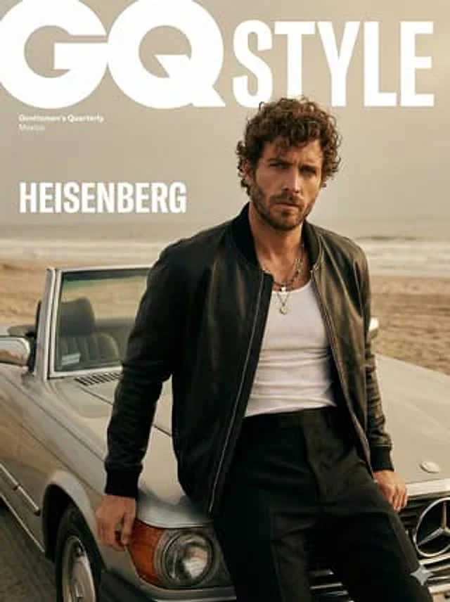

```text
A cinematic fashion editorial portrait of male model for a GQ Style magazine cover. He is leaning against the hood of a vintage 1960s silver convertible on a hazy, overcast beach.

Subject & Pose: A male model with a well-groomed dark beard and messy, curly dark hair. He is looking directly at the camera with an intense, neutral expression. He is wearing a heavy, oversized black leather bomber jacket with large utility pockets, worn open over a white ribbed tank top and high-waisted black trousers with double-buckle belt detailing. Two thin gold necklaces with small pendants hang mid-chest.

Setting & Composition: Outdoor beach setting with a very shallow depth of field. The background shows a desaturated, sandy shore and a pale, misty sky with a soft horizon line. The car is a polished metallic silver, reflecting the flat light of the sky. The camera angle is at eye-level, framing the subject from the waist up.

Lighting & Color: Soft, diffused daylight with a moody, cinematic color grade. The palette is dominated by muted earth tones, blacks, and silvers. High-end film grain is visible throughout.

Typography (Overlay): Large, bold white "GQ Style" logo across the top in a classic serif font. Smaller white sans-serif text on the mid-left reads "HEISENBERG"
```

Model: Nano Banana
Author: Heisenberg

[ProjectD](https://aitoolsradar.com/en/prompts/6816db751ab60b) · [Recorded source](https://x.com/rovvmut_/status/2025093067787960824)
 · [Full original metadata and byte evidence](data/projectd-batch-0062.json)

## Heisenberg #822

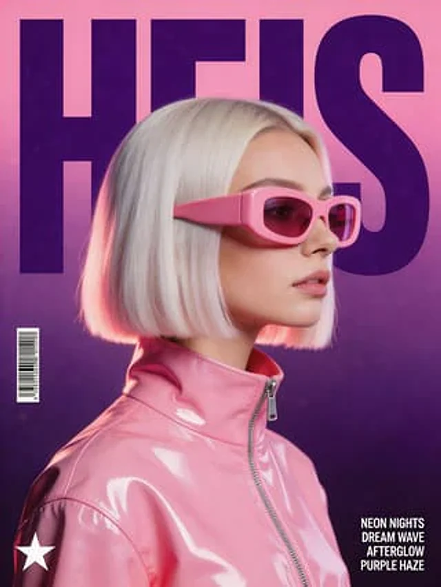

```text
A stylized, retro-futuristic music poster in a synthwave aesthetic. The central focus is a woman in profile with a platinum blonde bob haircut, wearing oversized, chunky pink opaque visor sunglasses and a high-collar, extremely glossy pink vinyl jacket with visible zipper detail. Behind her, the word "HEIS" is written in massive, dark purple, condensed block typography, partially hidden by her head. The background is a clean gradient shifting from soft magenta to deep purple, overlaid with a subtle film grain texture. Lighting: Soft studio lighting with high-specular highlights on the glossy jacket and rim lighting on the hair. Color Palette: Dominant shades of bubblegum pink, deep violet, and lavender. Graphics: A small barcode on the left, a minimalist star logo in the bottom-left corner, and four lines of small sans-serif song lyrics in the bottom-right corner. Atmosphere: High-fashion, electronic dance music vibe, clean and polished composition.
```

Model: Nano Banana
Author: Heisenberg

[ProjectD](https://aitoolsradar.com/en/prompts/74eb6f8d42f4f9) · [Recorded source](https://x.com/rovvmut_/status/2026574551207792783)
 · [Full original metadata and byte evidence](data/projectd-batch-0062.json)

## Heisenberg #830

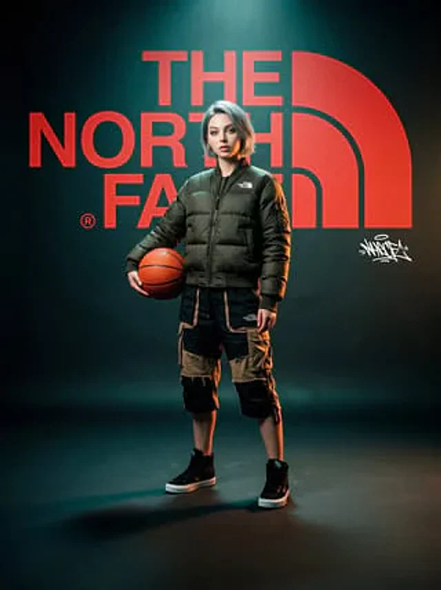

```text
A high-fashion, cinematic brand concept poster for "The North Face." The scene features a woman in the uploaded image, standing in a stylized studio. They are dressed in edgy, oversized urban streetwear: a dark olive-green quilted puffer bomber jacket, layered black and tan distressed techwear shorts below knees, and black sneakers with white soles. The person holds a classic orange basketball at their hip. In the background, a massive, bold red "THE NORTH FACE" logo and its iconic half-dome symbol are stacked and centered, dominating the upper half of the frame. To the right of the subject, there's a small white stylized graffiti-style signature. The lighting is moody and dramatic, featuring a teal-tinted atmosphere with a warm rim light hitting the subject’s right side. The floor is a dark, smooth studio surface with a soft shadow cast forward. The overall aesthetic is gritty, futuristic, and high-contrast, with a heavy film grain texture.
```

Model: Nano Banana
Author: Heisenberg

[ProjectD](https://aitoolsradar.com/en/prompts/d105bef834f5e1) · [Recorded source](https://x.com/rovvmut_/status/2041451587403399395)
 · [Full original metadata and byte evidence](data/projectd-batch-0062.json)

## Heisenberg #848

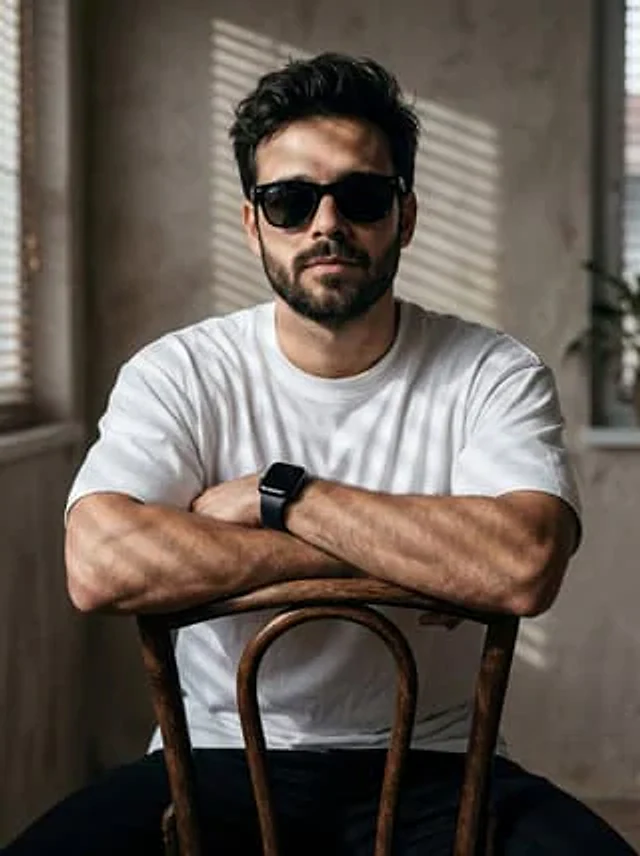

```text
A high-resolution, cinematic portrait of a young man with messy, voluminous dark hair and a well-groomed beard. He is wearing classic black wayfarer-style sunglasses and a clean, oversized white t-shirt. The man is seated backward on a vintage dark wood chair, resting his muscular, crossed forearms comfortably along the top of the curved backrest. On his left wrist, he wears a sleek black smartwatch with a rectangular face.

The scene is defined by dramatic, high-contrast lighting filtered through Venetian blinds, casting sharp, rhythmic horizontal shadow bars across his face, torso, and the textured, warm-grey plaster wall in the background. The atmosphere is moody and serene, with a shallow depth of field that keeps the focus sharp on the man’s expression and the texture of his hair, while the lower portion of the chair and his black trousers softly blur into the foreground. The color palette is neutral and sophisticated, dominated by crisp whites, deep blacks, and warm earthy wood tones.
```

Model: Nano Banana
Author: Heisenberg

[ProjectD](https://aitoolsradar.com/en/prompts/74ffce66c384af) · [Recorded source](https://x.com/rovvmut_/status/2040832305925894162)
 · [Full original metadata and byte evidence](data/projectd-batch-0062.json)

## Heisenberg #897


```text
Generate an image of a man in the uploaded image in which the entire scene is layered with heavy, horizontal motion-blur streaks in shades of teal, yellow, and white, creating a "speed-light" effect. These colorful blurs must appear both behind the man and superimposed over his body and face, behaving like reflections on a glass mirror. A medium shot of a man standing perfectly still in the center of a frame, looking down at a red smartphone held with both hands. He is wearing a white t-shirt under a translucent, light gray windbreaker jacket and a dark wristwatch. The background is a chaotic, vibrant blur of horizontal light trails in colors of neon blue, orange, yellow, and white, suggesting a high-speed train or city traffic. Crucially, these colorful motion-blurred light streaks pass both behind and directly over the man's body, appearing semi-transparent as they overlap his torso and arms, creating a double-exposure effect. The man's face and hair are in sharp focus, showing a calm expression, contrasting with the high-speed motion of the environment. Cinematic lighting, hyper-realistic, 8k resolution.
```

Model: Nano Banana
Author: Heisenberg

[ProjectD](https://aitoolsradar.com/en/prompts/8555b19bb4316a) · [Recorded source](https://x.com/rovvmut_/status/2039904241050173853)
 · [Full original metadata and byte evidence](data/projectd-batch-0062.json)

## Heisenberg #917

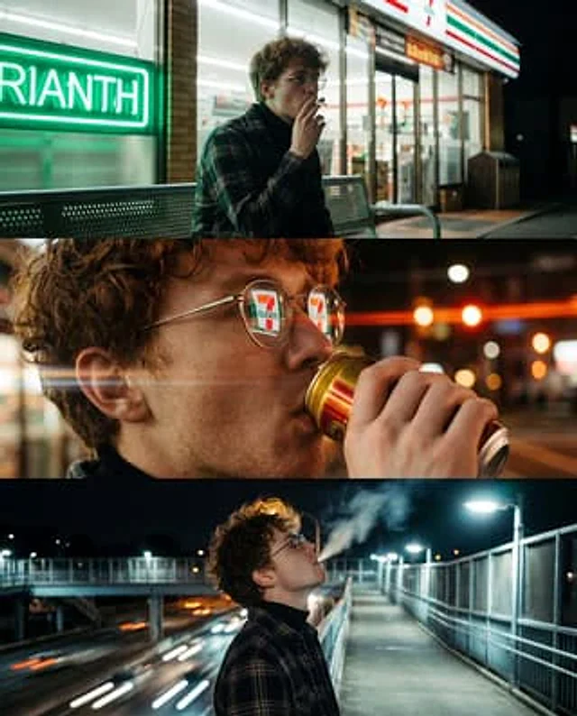

```text
A vertical triptych of three cinematic, night-time urban photographs featuring a young man with messy, curly reddish-brown hair and thin, round wire-frame glasses.
Top Panel: The man is seated in front of a 7-Eleven storefront. He wears a dark plaid flannel shirt over a black turtleneck. He is captured in a candid moment, holding a lit cigarette to his lips. To the left, there's a vibrant green neon sign. The lighting is dominated by a cool, fluorescent green glow and the warm interior light of the convenience store.
Middle Panel: An extreme close-up profile shot. He is drinking from a gold-and-red metallic beverage can. His glasses catch a sharp, vivid reflection of the 7-Eleven logo and orange-red street lights. A subtle lens flare streaks horizontally across his face. The background is a soft, warm bokeh of city lights and traffic signals.
Bottom Panel: The man stands on a pedestrian overpass overlooking a busy highway. He has his head tilted back, exhaling a thick wisp of white smoke into the night air. Below him, the blurred streaks of white headlights and red taillights create a sense of motion. The overpass structure is lit with cool-toned industrial lamps, contrasting with his warm skin tones.
Style: 35mm film aesthetic, cinematic grain, shallow depth of field, high contrast, urban noir mood.
```

Model: Nano Banana
Author: Heisenberg

[ProjectD](https://aitoolsradar.com/en/prompts/1bc725982a0057) · [Recorded source](https://x.com/rovvmut_/status/2033793020940980720)
 · [Full original metadata and byte evidence](data/projectd-batch-0062.json)

## Heisenberg #932

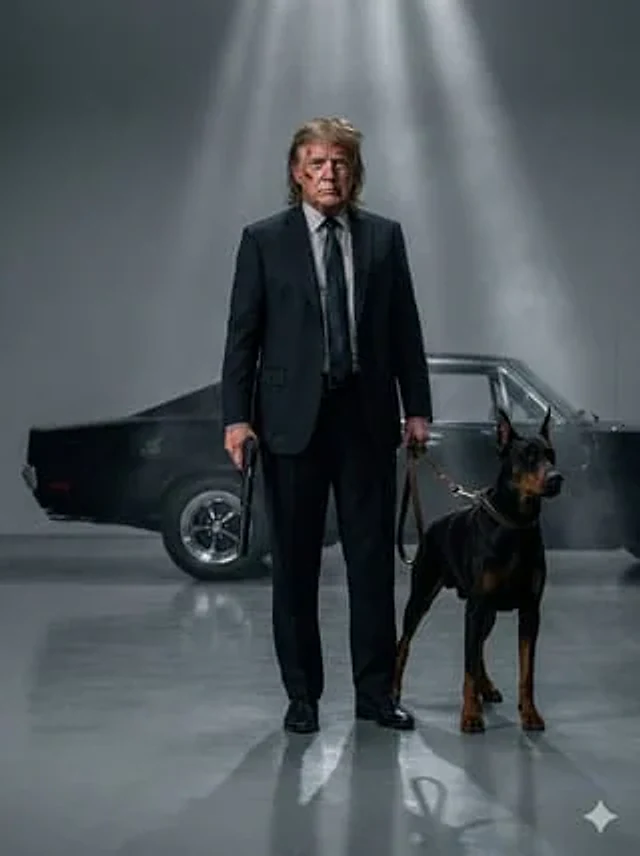

```text
Full body cinematic shot of the person in the uploaded image as a hitman in a tailored black suit and tie standing in an empty studio space beside a muscular Doberman dog on a leash. The man has a bruised face with blood marks, messy shoulder-length hair, and a calm but intense expression. He is holding a pistol in one hand. Behind them is a vintage black muscle car with chrome rims partially visible in soft shadow. Minimalist grey background, dramatic studio lighting from above creating soft reflections on the glossy floor. Ultra realistic skin texture, cinematic depth of field, sharp focus, subtle fog in the background, moody atmosphere, 85mm lens look, volumetric light, film still from a neo-noir action movie, high dynamic range, photorealistic, 8k, symmetrical composition. 3:4 aspect ratio.
```

Model: Nano Banana
Author: Heisenberg

[ProjectD](https://aitoolsradar.com/en/prompts/4d1f38e2931c0a) · [Recorded source](https://x.com/rovvmut_/status/2026162681171075451)
 · [Full original metadata and byte evidence](data/projectd-batch-0062.json)

## Heisenberg #982

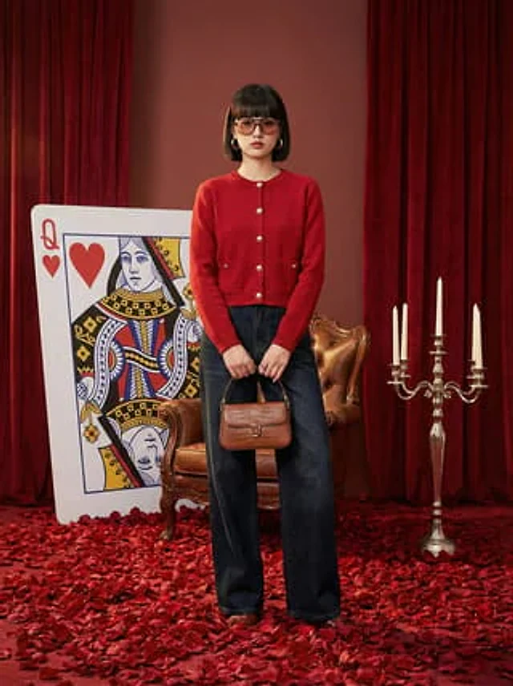

```text
{
  "meta": {
    "image_quality": "High",
    "image_type": "Studio Photography",
    "resolution_estimation": "1024x1280",
    "file_characteristics": {
      "compression_artifacts": "Low",
      "noise_level": "None",
      "lens_type_estimation": "Standard Prime (approx. 50mm)"
    }
  },
  "global_context": {
    "scene_description": "A fashion editorial shot featuring a woman in a red cardigan and dark jeans standing in a surreal Alice in Wonderland-themed studio. The floor is covered in a thick layer of red rose petals. Behind her sits a vintage leather armchair and a giant 'Queen of Hearts' playing card leaned against red velvet curtains. A silver candelabra with white candles stands to the right.",
    "environment_type": "Studio",
    "time_of_day": "N/A (Indoor Artificial)",
    "weather_atmosphere": "Theatrical, Romantic, Surreal",
    "lighting": {
      "source": "Studio Softboxes",
      "direction": "Frontal-left (45-degree angle)",
      "quality": "Soft",
      "color_temperature": "Warm Neutral (~3200K - 4000K)"
    },
    "color_palette": {
      "dominant_hex_estimates": [
        "#8B0000",
        "#E31B23",
        "#1A1B2E",
        "#FFFFFF"
      ],
      "accent_colors": [
        "#C5A059",
        "#000000"
      ],
      "contrast_level": "High"
    }
  },
  "composition": {
    "camera_angle": "Eye-level",
    "framing": "Full-body shot",
    "depth_of_field": "Medium (background elements slightly soft but legible)",
    "focal_point": "The woman in the red cardigan",
    "symmetry_type": "None",
    "rule_of_thirds_alignment": "Subject is centered horizontally; eyes align with the upper third line."
  },
  "objects": [
    {
      "id": "obj_001",
      "label": "Female Model",
      "category": "Person",
      "location": {
        "relative_position": "Center",
        "bounding_box_percentage": {
          "x": 25.0,
          "y": 14.0,
          "width": 30.0,
          "height": 70.0
        }
      },
      "dimensions_relative": "Large",
      "distance_from_camera": "Near",
      "pose_orientation": "Standing upright, slightly turned to the left, looking directly at camera.",
      "material": "Skin, hair, fabric",
      "surface_properties": {
        "texture": "Smooth skin, soft knit, denim",
        "reflectivity": "Low",
        "micro_details": "Dark bob haircut, gold hoop earrings, tinted glasses.",
        "wear_state": "Pristine"
      },
      "color_details": {
        "base_color_hex": "#E31B23",
        "secondary_colors": [
          "#1A1B2E"
        ],
        "gradient_or_pattern": "Solid colors"
      },
      "interaction_with_light": {
        "shadow_casting": "Soft shadow cast to the right and onto the floor petals",
        "highlight_zones": "Left side of face and cardigan shoulder",
        "translucency": "None"
      },
      "relationships": [
        {
          "type": "wearing",
          "target_object_id": "obj_002"
        },
        {
          "type": "holding",
          "target_object_id": "obj_004"
        }
      ]
    },
    {
      "id": "obj_002",
      "label": "Red Cardigan",
      "category": "Clothing",
      "location": {
        "relative_position": "Upper Center",
        "bounding_box_percentage": {
          "x": 26.0,
          "y": 24.0,
          "width": 25.0,
          "height": 26.0
        }
      },
      "dimensions_relative": "Medium",
      "distance_from_camera": "Near",
      "pose_orientation": "Buttoned at the top, open at the bottom",
      "material": "Knitted wool/cashmere",
      "surface_properties": {
        "texture": "Ribbed cuffs and hem, fine knit body",
        "reflectivity": "None",
        "micro_details": "Four visible gold-tone circular buttons",
        "wear_state": "New"
      },
      "color_details": {
        "base_color_hex": "#E31B23",
        "secondary_colors": [
          "#C5A059"
        ],
        "gradient_or_pattern": "Solid"
      },
      "interaction_with_light": {
        "shadow_casting": "Folds create soft internal shadows",
        "highlight_zones": "Upper shoulders and sleeve edges"
      }
    },
    {
      "id": "obj_003",
      "label": "Wide-leg Jeans",
      "category": "Clothing",
      "location": {
        "relative_position": "Lower Center",
        "bounding_box_percentage": {
          "x": 29.0,
          "y": 41.0,
          "width": 26.0,
          "height": 42.0
        }
      },
      "dimensions_relative": "Medium-Large",
      "distance_from_camera": "Near",
      "pose_orientation": "Straight vertical hang",
      "material": "Denim",
      "surface_properties": {
        "texture": "Coarse weave, visible center crease/seam",
        "reflectivity": "None",
        "micro_details": "Contrast stitching, black belt with gold buckle",
        "wear_state": "New"
      },
      "color_details": {
        "base_color_hex": "#1A1B2E",
        "secondary_colors": [
          "#C5A059"
        ],
        "gradient_or_pattern": "Dark indigo wash"
      }
    },
    {
      "id": "obj_004",
      "label": "Handbag",
      "category": "Accessory",
      "location": {
        "relative_position": "Center-Right (Model's hand)",
        "bounding_box_percentage": {
          "x": 37.0,
          "y": 62.0,
          "width": 15.0,
          "height": 10.0
        }
      },
      "dimensions_relative": "Small",
      "distance_from_camera": "Near",
      "pose_orientation": "Held by chain strap",
      "material": "Leather, Metal",
      "surface_properties": {
        "texture": "Embossed/quilted paisley-like pattern",
        "reflectivity": "Medium (chain and leather sheen)",
        "micro_details": "Silver-tone chain link strap",
        "wear_state": "New"
      },
      "color_details": {
        "base_color_hex": "#000000",
        "secondary_colors": [
          "#C0C0C0"
        ]
      }
    },
    {
      "id": "obj_005",
      "label": "Queen of Hearts Card",
      "category": "Prop",
      "location": {
        "relative_position": "Mid-Right",
        "bounding_box_percentage": {
          "x": 58.0,
          "y": 35.0,
          "width": 30.0,
          "height": 40.0
        }
      },
      "dimensions_relative": "Large",
      "distance_from_camera": "Mid",
      "pose_orientation": "Leaning against background at a 45-degree angle",
      "material": "Cardboard/Foamcore",
      "surface_properties": {
        "texture": "Matte",
        "reflectivity": "Low",
        "micro_details": "Stylized 'Q' and heart icons in corners",
        "wear_state": "Pristine"
      },
      "color_details": {
        "base_color_hex": "#FFFFFF",
        "secondary_colors": [
          "#E31B23"
        ]
      },
      "text_content": {
        "raw_text": "Q",
        "font_style": "Serif",
        "font_weight": "Bold",
        "text_case": "Uppercase",
        "alignment": "Corner-aligned",
        "color_hex": "#E31B23"
      }
    },
    {
      "id": "obj_006",
      "label": "Candelabra",
      "category": "Furniture/Prop",
      "location": {
        "relative_position": "Far Right",
        "bounding_box_percentage": {
          "x": 81.0,
          "y": 29.0,
          "width": 18.0,
          "height": 45.0
        }
      },
      "dimensions_relative": "Medium",
      "distance_from_camera": "Mid",
      "pose_orientation": "Standing vertical",
      "material": "Silver Metal, Wax",
      "surface_properties": {
        "texture": "Polished/Metallic",
        "reflectivity": "High",
        "micro_details": "Ornate curved arms, three visible white tapered candles (unlit)",
        "wear_state": "New"
      },
      "color_details": {
        "base_color_hex": "#C0C0C0",
        "secondary_colors": [
          "#FFFFFF"
        ]
      }
    },
    {
      "id": "obj_007",
      "label": "Rose Petals",
      "category": "Decor",
      "location": {
        "relative_position": "Bottom / Floor",
        "bounding_box_percentage": {
          "x": 0.0,
          "y": 72.0,
          "width": 100.0,
          "height": 28.0
        }
      },
      "dimensions_relative": "Large (as a group)",
      "distance_from_camera": "Near to Mid",
      "pose_orientation": "Scattered randomly",
      "material": "Organic / Silk",
      "surface_properties": {
        "texture": "Velvety/Soft",
        "reflectivity": "Low",
        "micro_details": "Varying shades of red, slight curling at edges",
        "wear_state": "Fresh"
      },
      "color_details": {
        "base_color_hex": "#8B0000",
        "secondary_colors": [
          "#E31B23"
        ]
      }
    }
  ],
  "background_details": {
    "texture": "Velvet Drapes",
    "patterns": "Vertical heavy folds/pleats",
    "lighting_behavior": "Absorbs light in deep folds, soft sheen on raised edges",
    "additional_elements": [
      "Vintage brown leather tufted armchair (partially obscured)",
      "Large cluster of red roses near the base of the card"
    ]
  },
  "foreground_elements": {
    "particles": "None",
    "artifacts": "Slight floor-level haze where light meets petals"
  },
  "reconstruction_notes": {
    "mandatory_elements_for_recreation": "Red knit cardigan with gold buttons, dark wide-leg denim, floor covered in red rose petals, oversized Queen of Hearts card, red velvet curtain backdrop.",
    "sensitivity_factors": "The specific saturation of the red (cardigan must match curtains and petals), the height of the petal layer (must feel thick/carpeting), and the theatrical studio lighting.",
    "ambiguities": "The exact texture of the handbag's embossing is complex; the model's footwear is almost entirely hidden by the wide-leg jeans and petals."
  }
}
```

Model: Nano Banana
Author: Heisenberg

[ProjectD](https://aitoolsradar.com/en/prompts/0b8988947e9254) · [Recorded source](https://x.com/rovvmut_/status/2022587678328525084)
 · [Full original metadata and byte evidence](data/projectd-batch-0062.json)

## Heisenberg #990

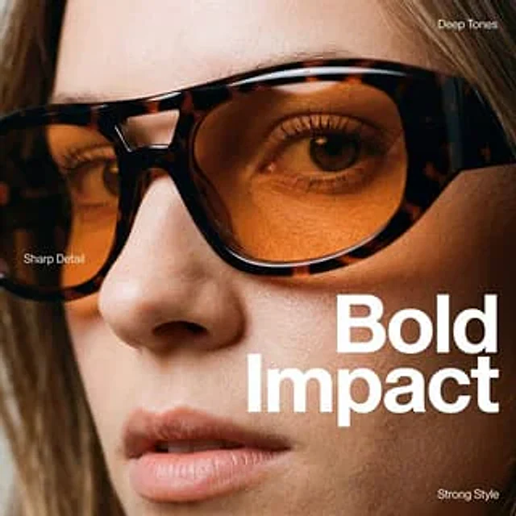

```text
An extreme close-up, high-fashion editorial portrait focusing on the right side of a person's face. The composition is a tight crop showing the bridge of the nose, a portion of the lips, and a single eye peering through sunglasses. The shot is characterized by a heavy, cinematic film grain and a warm, sophisticated studio atmosphere.
Eyewear: Large-frame, wrap-around sunglasses made of high-gloss dark tortoiseshell acetate (mottled black and deep mahogany). The lenses are a vibrant, translucent amber-orange, allowing the eye and eyelashes behind the lens to remain visible but color-tinted.
Person: A person with smooth skin showing natural texture and fine pores. The lighting is soft-side lighting from the right, creating a gentle shadow on the left side of the nose and a subtle highlight on the cheekbone and lower lip.
Typography: Bold, white, geometric sans-serif text reading "Bold Impact" is overlaid on the lower-right cheek. Three smaller, delicate labels are scattered: "Deep Tones" (top right), "Sharp Detail" (on the left lens), and "Strong Style" (bottom right).
Color Palette: A rich mix of skin tones (#E8A88A), burnt orange (#B8541C), and deep espresso (#1A0D0B), contrasted with crisp white text (#FFFFFF).
Lighting: Warm studio lighting with a soft-focus depth of field. The background consists of out-of-focus hair and skin, keeping all attention on the eye and the texture of the acetate frames.
Atmosphere: Premium, editorial fashion magazine aesthetic; high-contrast but with soft transitions.
```

Model: Nano Banana
Author: Heisenberg

[ProjectD](https://aitoolsradar.com/en/prompts/8497b4e3834068) · [Recorded source](https://x.com/rovvmut_/status/2032343238015938917)
 · [Full original metadata and byte evidence](data/projectd-batch-0062.json)

## Hoor #583

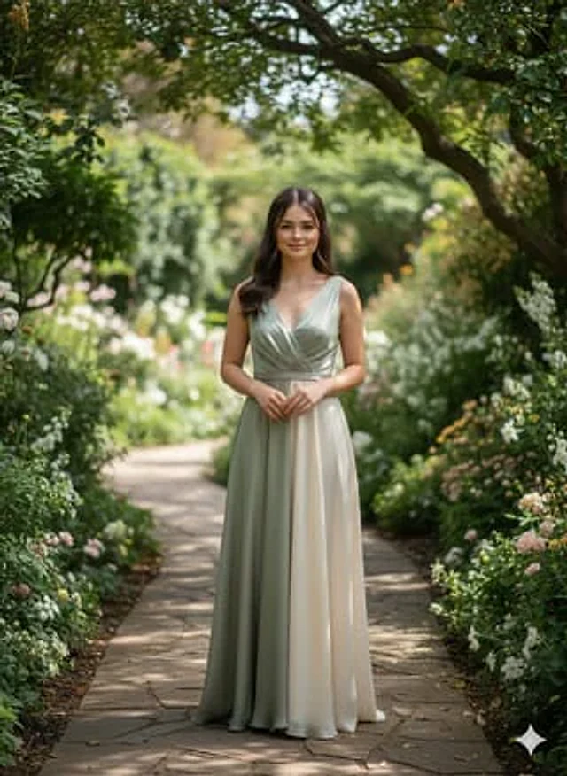

```text
{
  "render_goal": "Natural cinematic garden portrait with timeless elegance",
  "subject": {
    "pose": "female standing naturally on a garden path, relaxed posture",
    "expression": "calm composed confidence with a genuine soft smile"
  },
  "wardrobe": "elegant silk chiffon gown in muted sage or soft ivory, minimal drape, realistic fabric weight, subtle movement, no shimmer, no fantasy elements",
  "environment": {
    "location": "lush botanical garden in daylight",
    "props": "realistic flowers and greenery, natural sunlight filtering through leaves, gentle shadows, earthy tones, organic depth of field"
  },
  "camera_style": "cinematic photography, 50mm lens look, shallow depth of field, natural skin texture, realistic color grading, film-like softness"
}
```

Model: Nano Banana
Author: Hoor

[ProjectD](https://aitoolsradar.com/en/prompts/1e3d5b45d5b4b9) · [Recorded source](https://x.com/hoor_world06/status/2007722778032484576)
 · [Full original metadata and byte evidence](data/projectd-batch-0062.json)

## Hoor #738

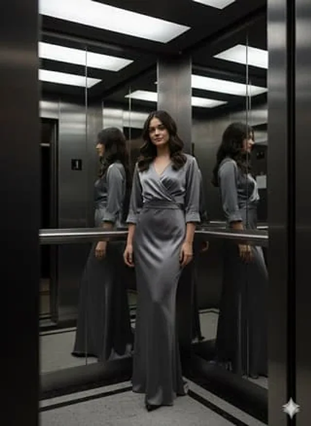

```text
{
  "render_goal": "Contemporary cinematic fashion portrait",
  "subject": {
    "pose": "female standing inside a luxury elevator",
    "expression": "subtle confident smile"
  },
  "wardrobe": "sleek satin gown in muted graphite tone",
  "environment": {
    "location": "brushed metal elevator interior",
    "props": "soft ceiling lights, mirror reflections"
  }
}
```

Model: Nano Banana
Author: Hoor

[ProjectD](https://aitoolsradar.com/en/prompts/e1d9816466bca0) · [Recorded source](https://x.com/hoor_world06/status/2008566343147126894)
 · [Full original metadata and byte evidence](data/projectd-batch-0062.json)

## INK #1147

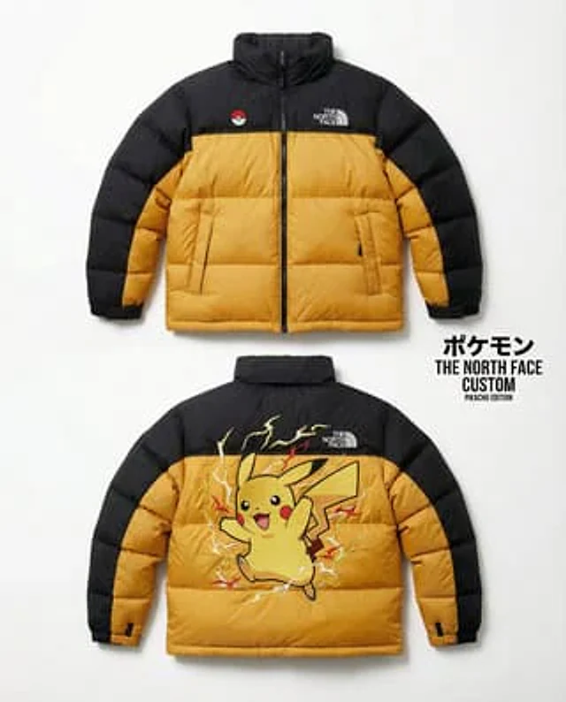

```text
High-end editorial product shot of a custom The North Face Nuptse 700 puffer jacket inspired by [POKEMON].
The jacket’s primary colorway automatically derives from [POKEMON]’s dominant palette (main body color as base tone, secondary accents used sparingly for contrast), translated into premium, wearable hues — never cartoonish, always fashion-forward.
A large-scale embroidered [POKEMON] artwork dominates the back panel, adapted to the jacket’s quilted structure.
Embroidery style reflects [POKEMON]’s core identity:

aggressive Pokémon → bold stitch density, sharp contours
elegant or mystical Pokémon → flowing lines, layered thread gradients

armored or mechanical Pokémon → heavy, structured embroidery with tactile depth

The front of the jacket remains minimal and restrained:
clean TNF logo, subtle Poké Ball patch, no additional graphics.

Material realism is critical: visible fabric sheen, natural puff volume, precise seam alignment, embroidery threads sitting slightly raised from the nylon surface.

Shot in a Japanese fashion magazine product layout, pure white background.
Front and back views presented together, jacket floating upright, perfectly centered.
Lighting is clean, studio-soft with controlled contrast to emphasize texture and craftsmanship.

Mood: luxury streetwear meets collectible archive piece.
No model. No props. No distractions.
Ultra-sharp focus, high resolution, editorial polish, timeless design.
```

Model: Nano Banana
Author: INK

[ProjectD](https://aitoolsradar.com/en/prompts/274a66babbc748) · [Recorded source](https://x.com/0xInk_/status/2009203433325432953)
 · [Full original metadata and byte evidence](data/projectd-batch-0062.json)

## INK #880

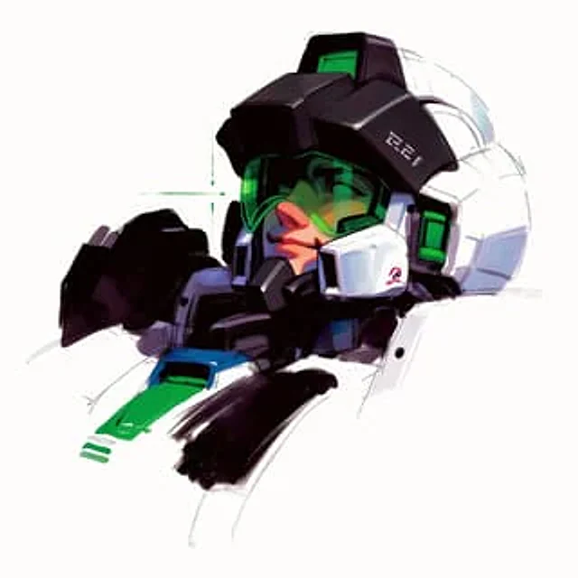

```text
Convert to hyper-realistic 3D CGI collectible figurine render. Physically-based rendering, octane render quality. Preserve the original character design, pose, and outfit exactly. Transform all surfaces into real-world materials: fabric with visible weave and drape, metal with wear, scratches and oxidation, synthetic matte skin. Pure white studio background, clean seamless white backdrop, soft diffused lighting with subtle rim light. No cel shading, no toon rendering. High-end statue/collectible photography aesthetic. Ultra detailed, 8K. Fix and reconstruct all hands and fingers with correct anatomy: natural finger count, proper joint articulation, realistic proportions, no fused or melted digits. Remove all 2D artifacts, compression glitches, and Midjourney inconsistencies. Ensure full anatomical coherence across the entire figure: symmetrical features, clean silhouette, no floating elements, no distorted limbs, no duplicated body parts. Hyper-detailed hair simulation: individual strand rendering, realistic hair clumping, natural flow and gravity, visible scalp at roots, micro flyaways, SSS translucency on hair tips. Every surface pushed to maximum realism: pore-level skin texture, fabric fiber micro-detail, specular highlights on every material, depth in shadows
```

Model: Nano Banana
Author: INK

[ProjectD](https://aitoolsradar.com/en/prompts/a700b6b254aab9) · [Recorded source](https://x.com/0xInk_/status/2043581294777713094)
 · [Full original metadata and byte evidence](data/projectd-batch-0062.json)

## Iqra Saifi #1251

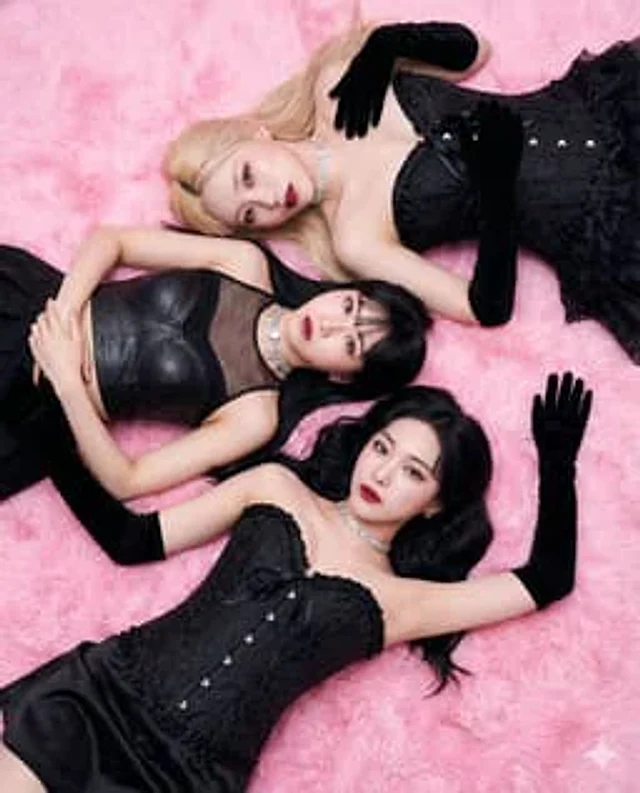

```text
{
  "scene_description": "Three young women lying down on a textured surface. The bodies are intertwined in a triangular composition.",
  "background": "Plush, high-pile bright pink faux fur rug or fabric.",
  "subject_details": {
    "demographics": "Three young Asian women (K-pop idol aesthetic), pale skin tones.",
    "styling_theme": "Gothic Lolita / Dark Coquette / Black on Pink.",
    "makeup": "Consistent across all three: dark red gradient lips, soft smoky eye makeup, defined brows.",
    "subject_1_top": {
      "position": "Lying horizontally at the top.",
      "hair": "Blonde, long wavy hair.",
      "outfit": "Black corset top with ruffled straps, black velvet opera gloves, crystal choker necklace."
    },
    "subject_2_middle_right": {
      "position": "Lying diagonally below Subject 1, head resting near Subject 1's shoulder.",
      "hair": "Black, long straight hair.",
      "outfit": "Black leather/latex bustier top with sheer mesh panel, crystal collar necklace."
    },
    "subject_3_bottom_center": {
      "position": "Lying vertically in the foreground, head resting near Subject 2's chest.",
      "hair": "Black, long wavy hair.",
      "outfit": "Black brocade corset with lace trim, black opera gloves, black satin skirt, crystal choker.",
      "pose": "Arms extended upwards and outwards, framing the composition."
    }
  },
  "exact_pose_anatomical": {
    "viewpoint": "Bird's-eye view (Directly overhead).",
    "heads": "All three faces are angled upwards towards the camera lens.",
    "eyes": "Direct eye contact from all subjects.",
    "limbs": "Arms are positioned to create leading lines; Subject 3's gloved arms reach up towards the other two."
  },
  "camera_technical_values": {
    "angle": "90-degree Top Down.",
    "focal_length": "50mm (Standard lens to capture the group without wide-angle distortion).",
    "aperture": "f/5.6 (To ensure all three faces, which are on slightly different planes, are in sharp focus).",
    "shutter_speed": "1/125s (Studio setting).",
    "iso": "ISO 100 (Clean image quality).",
    "framing": "Tight framing, filling the canvas with the subjects and the pink texture."
  },
  "lighting_setup": {
    "type": "Soft Studio Lighting (Beauty Dish or Softbox).",
    "direction": "Frontal/Overhead (relative to the camera).",
    "quality": "Even, shadowless illumination on the faces ('Butterfly lighting').",
    "contrast": "High contrast between the jet-black outfits and the bright pink background/pale skin.",
    "highlights": "Soft specular highlights on the black leather and latex textures."
  }
}
```

Model: Nano Banana
Author: Iqra Saifi

[ProjectD](https://aitoolsradar.com/en/prompts/d31ea9d563f375) · [Recorded source](https://x.com/IqraSaifiii/status/2011117557391225023)
 · [Full original metadata and byte evidence](data/projectd-batch-0062.json)

## Iqra Saifi #1290

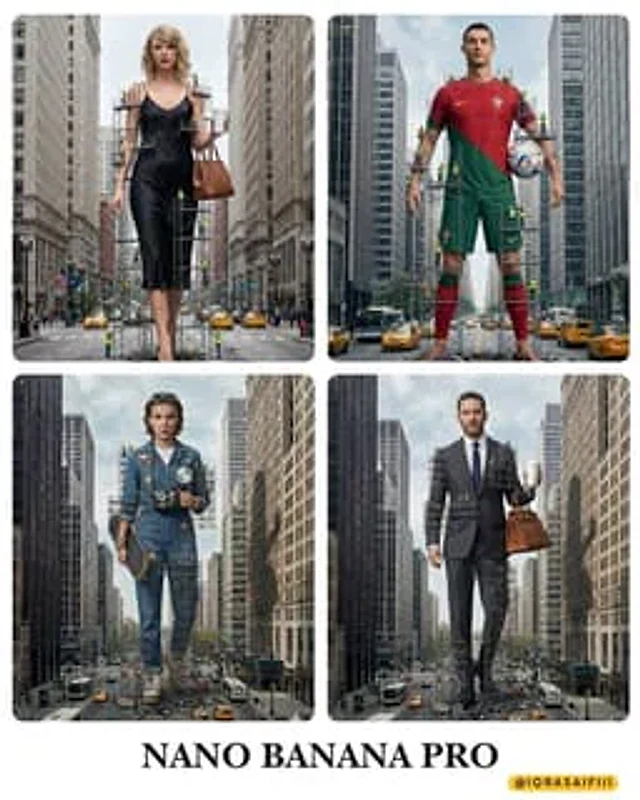

```text
{
  "description": "A colossal woman standing in a city street, appearing to be 'under construction' with scaffolding surrounding her body.",
  "aesthetic": "Hyper-realistic composite, cinematic, urban fantasy.",
  "subject_details": {
    "celebrity_likeness": "Taylor Swift.",
    "features": {
      "face": "Blue eyes, signature red lipstick, distinct facial structure.",
      "hair": "Golden blonde, long, wavy texture cascading over shoulders."
    },
    "apparel": {
      "dress": "Black satin slip dress with a deep V-neck and a high slit on the right thigh.",
      "accessories": "Holding a standard white disposable coffee cup in the right hand. Carrying a brown leather luxury handbag in the left hand.",
      "footwear": "Bare feet or heels (obscured by street debris/cracks)."
    }
  },
  "surreal_elements": {
    "scaffolding": "Intricate metal construction scaffolding structures built around her arms, torso, and legs, following the contour of her body.",
    "miniatures": "Tiny construction workers in yellow hard hats and high-vis vests climbing the scaffolding on her body.",
    "destruction": "The asphalt street beneath her feet is cracking and shattering under the immense weight, creating a crater pattern."
  },
  "exact_pose_anatomical": {
    "posture": "Standing tall with a slight contrapposto (weight shifted to one hip).",
    "orientation": "Front-facing, towering over the viewer/city.",
    "right_arm": "Bent at the elbow, raised to hold the coffee cup at chest level.",
    "left_arm": "Extended downwards holding the handbag.",
    "gaze": "Direct, calm eye contact with the camera.",
    "scale": "Subject appears to be approximately 50 stories tall, matching the height of surrounding skyscrapers."
  },
  "environment": {
    "location": "Avenue in a major metropolis (resembling Chicago or NYC).",
    "elements": "Skyscrapers flanking both sides, busy traffic with miniature yellow taxis and buses way below.",
    "perspective": "Aerial view relative to the city, but eye-level relative to the subject."
  },
  "camera_technical_values": {
    "lens": "35mm (Wide angle to capture the full scale of the subject against the skyline).",
    "aperture": "f/11 (Deep depth of field to keep both the giant subject and the city background relatively sharp).",
    "shutter_speed": "1/500s.",
    "iso": "ISO 100.",
    "resolution": "8k, high fidelity textures."
  },
  "lighting_setup": {
    "source": "Natural Daylight.",
    "quality": "Soft, diffused sunlight (slightly overcast).",
    "direction": "Overhead/Frontal.",
    "shadows": "Subject casts a massive, long shadow onto the city streets below."
  }
}
```

Model: Nano Banana
Author: Iqra Saifi

[ProjectD](https://aitoolsradar.com/en/prompts/5ba27a753cb255) · [Recorded source](https://x.com/IqraSaifiii/status/2011072648303018074)
 · [Full original metadata and byte evidence](data/projectd-batch-0062.json)

## Iqra Saifi #1356

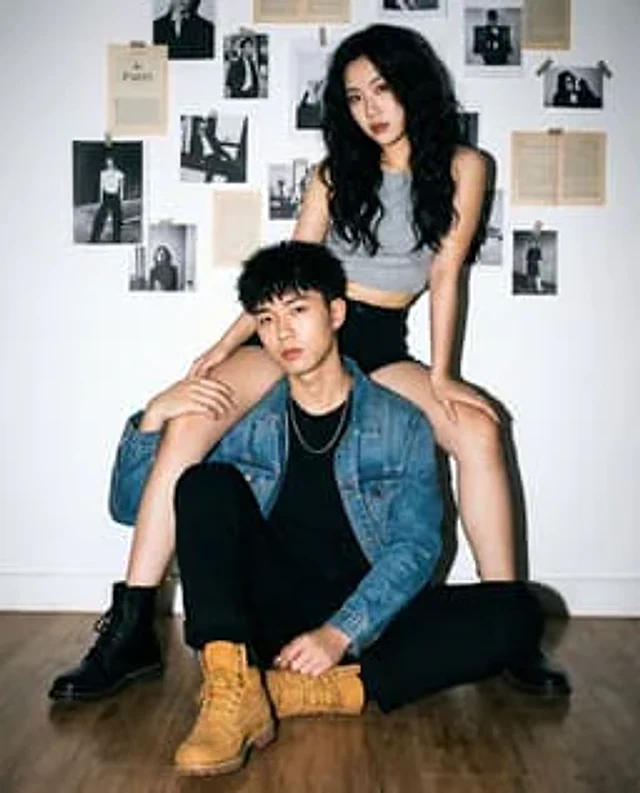

```text
"Young Asian couple, cool/edgy fashion models.",
      "female_hair": "Long, black, naturally little wavy hair (soft waves, not crimped), smooth texture with flyaways.",
      "male_hair": "Short, black, textured messy cut.",
      "outfits": {
        "female": "Grey crop top, black shorts, bare legs.",
        "male": "Blue denim jacket, black t-shirt, silver chain, blue jeans (one leg rolled up), mismatched boots (black combat boot on left, tan work boot on right)."
      }
    },
    "exact_pose_anatomical": {
      "male_pose": {
        "position": "Seated on the floor, facing forward.",
        "legs": "Left leg bent at knee, foot planted flat. Right leg bent inwards (cross-legged style) resting on the floor.",
        "arms": "Right arm resting casually on his own right knee. Left arm reaching up and back to hold the female's thigh securely.",
        "posture": "Leaning slightly forward, relaxed spine."
      },
      "female_pose": {
        "position": "Perched/Kneeling directly behind the male subject.",
        "legs": "Straddling the male subject's left shoulder. Her left thigh is draped over his shoulder, shin hanging down in front of his chest. Her right leg is tucked behind him (kneeling on the floor).",
        "arms": "Right hand resting on top of the male's right shoulder for balance. Left arm obscured.",
        "posture": "Torso upright, looming over the male figure.",
        "head": "Tilted slightly to the left, chin up."
      }
    },
    "camera_technical_values": {
      "perspective": "Low Angle / Eye-level with seated subjects.",
      "focal_length": "35mm (Capturing the full interaction and wall context).",
      "lighting": "Direct On-Camera Flash. Hard shadows cast directly behind the subjects on the wall.",
      "environment": "White wall with taped B&W photos and vintage book pages ('de PARIS'). Wooden floor."
```

Model: Nano Banana
Author: Iqra Saifi

[ProjectD](https://aitoolsradar.com/en/prompts/b490e4b48c38fd) · [Recorded source](https://x.com/IqraSaifiii/status/2011780502546759715)
 · [Full original metadata and byte evidence](data/projectd-batch-0062.json)

## Iqra Saifi #1397

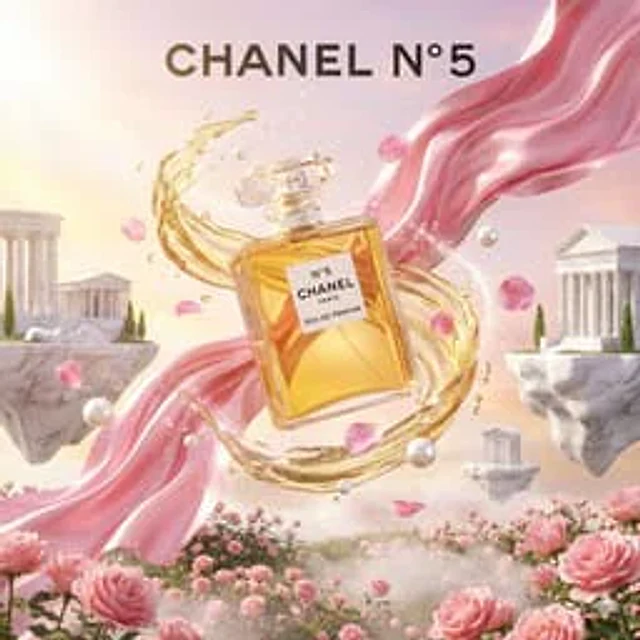

```text
High-end 3D advertising poster for [INSERT PRODUCT NAME]. A realistic [INSERT PRODUCT DESCRIPTION] is floating in the center of a magical fantasy landscape. The product is surrounded by a dynamic swirling vortex of [INSERT LIQUID OR ELEMENT] mixed with glowing magical sparkles and floating [INSERT INGREDIENTS]. Background features surreal floating islands made of [INSERT MATERIAL] hovering over a [INSERT LANDSCAPE]. Hyper-realistic CGI render, Octane render, bright cinematic lighting, magical atmosphere. At the bottom center, bold white typography text reads "[INSERT YOUR TAGLINE HERE]". Advertising photography style, 8k resolution --ar 2:3 --v 6.0
```

Model: Nano Banana
Author: Iqra Saifi

[ProjectD](https://aitoolsradar.com/en/prompts/305a460a1e3639) · [Recorded source](https://x.com/IqraSaifiii/status/2011788910297563310)
 · [Full original metadata and byte evidence](data/projectd-batch-0062.json)

## Iqra Saifi #1430

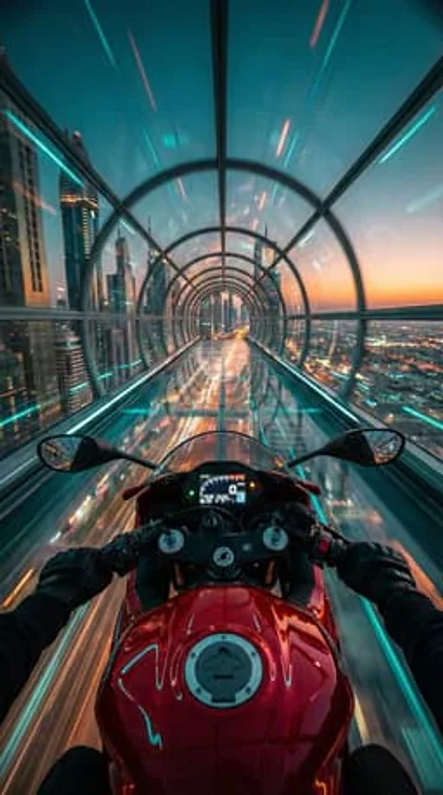

```text
"Red futuristic sport motorcycle (POV perspective)",
      "visible_elements": "Glossy red fuel tank with fuel cap, clip-on handlebars, black gloved hands gripping the grips, illuminated digital dashboard (slightly blurred)",
      "action": "Speeding at hyper-velocity through a suspended structure",
      "pose": "First-Person View (POV) / Rider's eye perspective looking slightly downward at the bike and forward into the horizon"
    },
    "environment": {
      "setting": "Transparent glass hyperloop tunnel / skyway",
      "location": "High altitude above a futuristic cyberpunk metropolis",
      "background_details": "Sprawling city grid with infinite street lights below, skyscrapers, motion-blurred light trails",
      "horizon": "Dusk/Twilight sky with a gradient of deep teal fading into a warm sunset orange strip"
    },
    "lighting_and_color": {
      "color_palette": "Cinematic Teal and Orange (Complementary colors)",
      "primary_tones": "Cyan/Turquoise glass reflections, Deep Red motorcycle paint, Golden/Orange horizon glow",
      "lighting_style": "High contrast, neon ambient lighting, specular highlights on the metal and glass surfaces"
    },
    "camera_technical": {
      "camera_angle": "Wide-angle POV (14mm to 16mm equivalent)",
      "focus": "Sharp focus on the motorcycle tank and handlebars, radial motion blur on the tunnel walls and city",
      "aperture": "f/2.8 (to capture low light details)",
      "shutter_speed": "1/30s (simulated drag shutter to create heavy motion blur effects on the surroundings)",
      "iso": "ISO 800",
      "composition": "Central symmetry, leading lines created by the tunnel structure converging at the center vanishing point"
    },
    "style_descriptors": [
      "Cyberpunk",
      "Synthwave aesthetic",
      "Hyper-realistic",
      "High velocity",
      "Futuristic",
      "Cinematic",
      "8k resolution",
      "Unreal Engine 5 render style"
```

Model: Nano Banana
Author: Iqra Saifi

[ProjectD](https://aitoolsradar.com/en/prompts/258672cc88492f) · [Recorded source](https://x.com/IqraSaifiii/status/2011643251678462424)
 · [Full original metadata and byte evidence](data/projectd-batch-0062.json)

## Iqra Saifi #458

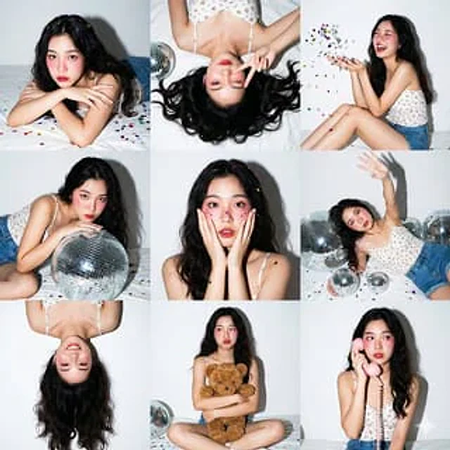

```text
3x3 Photo Collage / 9-Panel Grid.",
      "layout": "Nine vertical portrait images arranged in a square grid.",
      "consistency": "Same subject, same outfit, and same lighting across all 9 panels."
    },
    "aesthetic_style": {
      "theme": "Gen Z Home Party / 'Maiden Pavilion' Photoshoot.",
      "lighting_technique": "Direct On-Camera Flash (Hard Light).",
      "visuals": "High contrast, sharp shadows, chaotic fun, vibrant colors against a white background."
    },
    "subject_details": {
      "appearance": "Young Asian woman, fair skin, long dark wavy hair with volume.",
      "outfit": "White floral camisole top, blue denim shorts.",
      "makeup": "Heavy pink blush (Igari style), red lips, glitter on cheeks."
    },
    "environment_and_props": {
      "background": "White wall with taped photos, white bed sheets.",
      "decor": "Silver disco balls (various sizes), colorful metallic confetti scattered everywhere, brown teddy bear, pink retro corded phone."
    },
    "panel_pose_breakdown": {
      "1_top_left": "Lying on stomach (prone), resting chin on crossed arms, looking at camera. Confetti in hair.",
      "2_top_center": "Top-down view lying on back, winking one eye, making a peace sign near face. Hair fanned out.",
      "3_top_right": "Sitting sideways, knees bent, laughing candidly while throwing a handful of confetti in the air.",
      "4_middle_left": "Leaning upper body over a large silver disco ball, looking intensely at the camera.",
      "5_middle_center": "Close-up portrait. Hands touching cheeks in a 'surprised' or 'shy' gesture. Confetti stuck to cheeks.",
      "6_middle_right": "Lying on back amongst the disco balls, one arm reaching up towards the ceiling/camera.",
      "7_bottom_left": "Upside-down perspective (head at bottom of frame), playful expression, hair cascading down.",
      "8_bottom_center": "Sitting cross-legged (Lotus position), hugging the brown teddy bear tight, pouting slightly.",
      "9_bottom_right": "Sitting up, holding the pink retro telephone receiver to ear, looking sideways as if listening to gossip."
    },
    "camera_technical_values": {
      "focal_length": "35mm (Versatile environmental portrait lens).",
      "aperture": "f/5.6 (Ensures subject and props are in focus).",
      "shutter_speed": "1/200s (Flash sync to freeze confetti motion).",
      "iso": "ISO 200.",
      "lighting": "Hard flash creates a distinct drop shadow behind the subject on the white wall and specular highlights on the disco balls."
    }
  },
  "midjourney_string": "3x3 photo grid collage of a cute Asian girl at a home party, wearing white floral top and
```

Model: Nano Banana
Author: Iqra Saifi

[ProjectD](https://aitoolsradar.com/en/prompts/ff458d7a3ac8e6) · [Recorded source](https://x.com/IqraSaifiii/status/2010083845761314964)
 · [Full original metadata and byte evidence](data/projectd-batch-0062.json)

## Iqra Saifi #531

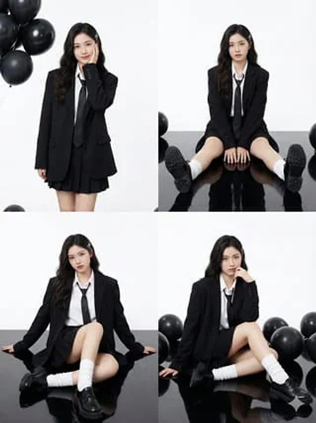

```text
{
"Young Asian woman, pale porcelain skin, long dark wavy hair with side bangs.",
      "accessories": "A silver rectangular hair clip on the left side of the head.",
      "apparel": {
        "outerwear": "Oversized black structured blazer (suit jacket).",
        "inner": "White collared button-up shirt, loose black necktie.",
        "bottoms": "Black pleated mini skirt (mostly obscured by the oversized blazer).",
        "legwear": "White loose slouch socks (leg warmers style) scrunching at the ankles.",
        "footwear": "Black chunky leather platform derby shoes."
      },
      "makeup": "K-pop/Douyin style: fair skin, soft gradient red lips, subtle blush, defined eyeliner."

"2x2 Photo Collage (4-Panel Grid).",
    },
    "environment_and_props": {
      "studio_setting": "High-key photography studio.",
      "background": "Seamless bright white backdrop.",
      "flooring": "Glossy black reflective floor (creating clear reflections of the shoes and legs).",
      "props": "Cluster of black helium balloons (matte and glossy finish) visible in the top-left and scattered on the floor in other panels."
    },
    "panel_pose_breakdown": {
      "panel_1_top_left": {
        "framing": "Thigh-up shot.",
        "pose": "Standing straight. Left hand rests gently against the left cheek (palm facing jaw). Right arm hangs naturally by side. Head tilted slightly.",
        "gaze": "Looking directly at camera with a soft smile.",
        "prop_placement": "Black balloons floating in the top left corner."
      },
      "panel_2_top_right": {
        "framing": "Full body, seated.",
        "pose": "Sitting on the floor with knees bent upwards and feet flat on the ground. Hands resting loosely on the floor between legs or on shins.",
        "gaze": "Direct eye contact, neutral expression.",
        "details": "Symmetrical composition."
      },
      "panel_3_bottom_left": {
        "framing": "Full body, seated angle.",
        "pose": "Sitting on the floor, leaning torso back, supporting weight with both arms extended behind her. Legs bent, one knee angled higher than the other.",
        "gaze": "Looking slightly to the side with a cool attitude."
      },
      "panel_4_bottom_right": {
        "framing": "Full body, seated.",
        "pose": "Sitting with legs bent to the side. Left hand is raised, touching the chin/neck area thoughtfully. Right arm extended back for support.",
        "gaze": "Direct eye contact, slight smirk."
      }
    },
    "camera_technical_values": {
      "lens": "50mm to 85mm (Standard portrait lens).",
      "aperture": "f/8.0 (Deep depth of field, keeping the entire subject sharp against the white background).",
      "shutter_speed": "1/160s (Studio sync).",
      "iso": "ISO 100 (Clean, noise-free image).",
      "lighting_setup": "Softbox lighting. Large diffuse light source from the front to create shadowless, flattering illumination on the face ('Beauty Light').",
      "contrast": "High contrast between the black outfit and the stark white background."
```

Model: Nano Banana
Author: Iqra Saifi

[ProjectD](https://aitoolsradar.com/en/prompts/f79598f9b3faa1) · [Recorded source](https://x.com/IqraSaifiii/status/2010421791613919416)
 · [Full original metadata and byte evidence](data/projectd-batch-0062.json)

## Iqra Saifi #664

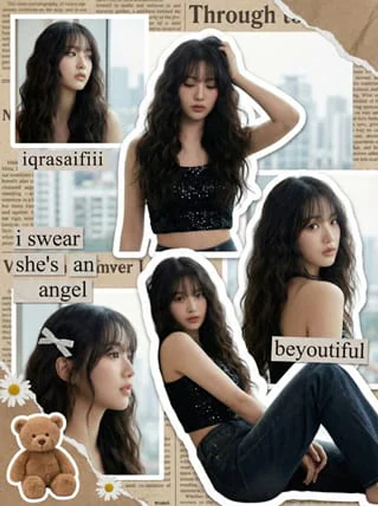

```text
{
"art_style_description": {
      "type": "Digital Scrapbook / Fan-Edit Collage.",
      "aesthetic": "Y2K, Coquette, K-pop Idol Fan Art.",
      "visual_structure": "Multiple photographic cutouts of the same subject arranged in a chaotic but cohesive layout on top of a vintage textured background. Each cutout has a thick white stroke/outline to resemble a sticker."
    },
    "subject_details": {
      "demographics": "Young Asian woman (K-pop idol aesthetic), fair skin, delicate features.",
      "hair": "Long, voluminous, dark wavy hair with air bangs. In one panel, she wears a small white ribbon clip.",
      "outfit": "Black sequined/embellished crop top (bralette style), dark denim jeans.",
      "makeup": "Peach-toned blush, glossy lips, soft eyeliner."
    },
    "pose_breakdown_panels": {
      "panel_1_top_center": "Portrait shot. Subject looking straight ahead/slightly down with hand in hair, elbows raised. Background shows a blurred cityscape.",
      "panel_2_bottom_right": "Seated/Reclining pose. Subject leaning back, one arm supporting weight, looking coolly at the camera. Wearing jeans.",
      "panel_3_middle_right": "Over-the-shoulder shot. Subject looking back at the camera with a soft gaze, arm raised touching head.",
      "panel_4_bottom_left": "Close-up portrait. Subject looking to the side, wearing a white bow hair clip.",
      "panel_5_top_left": "Bust-up shot. Subject gazing off-camera with a dreamy expression."
    },
    "graphic_elements_and_overlays": {
      "background_texture": "Vintage newspaper print text (sepia/beige toned).",
      "stickers": {
        "text": "Ransom-note style text blocks reading 'iqrasaifiii', 'i swear she's an angel', and 'beyoutiful'.",
        "objects": "A brown plush teddy bear sticker in the bottom left corner.",
        "decor": "White daisy flower graphics, jagged torn paper edges."
      }
    },
    "camera_technical_values": {
      "source_photo_style": "High-end fashion editorial photography.",
      "lens": "85mm (Portrait telephoto).",
      "lighting": "Natural Window Light (Soft, directional sunlight coming from the side).",
      "color_grading": "Slightly desaturated source photos contrasted against the warm beige newspaper background.",
      "resolution": "High fidelity cutouts."
    },
    "composition": "Overlapping layers. The center and right photos are larger, while smaller details fill the corners."
```

Model: Nano Banana
Author: Iqra Saifi

[ProjectD](https://aitoolsradar.com/en/prompts/729f9ec637793b) · [Recorded source](https://x.com/IqraSaifiii/status/2010451647294820764)
 · [Full original metadata and byte evidence](data/projectd-batch-0062.json)

## Iris #515


```text
{
  "prompt_type": "Ultra Photorealistic Image Generation",
  "subject": {
    "description": "Young woman with long, straight dark brown hair cascading down her back",
    "skin_tone": "Sun-kissed, glowing complexion",
    "features": "Side profile visible, smiling/laughing expression, hands raised covering eyes/face playfully",
    "details": "Red manicured fingernails, subtle jewelry including a ring on the left hand and a thin bracelet"
  },
  "fashion_and_styling": {
    "outfit": "White, vintage-inspired corset-style mini dress with Swiss dot texture",
    "garment_details": "Sweetheart neckline, ruffled cap sleeves, front lace-up ribbon detailing, fitted bodice, ruffled hem, slightly sheer fabric",
    "aesthetic": "Coquette, cottagecore, soft feminine luxury, summer vacation style"
  },
  "pose_and_action": {
    "pose": "Seated elegantly on a chair, body angled slightly away from the camera",
    "gesture": "Both hands raised to shield eyes from the sun or in a candid moment of laughter, head tilted back slightly",
    "interaction": "Relaxed posture sitting at a cafe table"
  },
  "environment": {
    "setting": "Outdoor luxury hotel terrace or cafe balcony overlooking a scenic landscape",
    "background_elements": "Historic yellow building with 'HOTEL FLORENCE' signage, lush green mountains in the distance, cloudy blue sky, vintage globe street lamps",
    "foreground_elements": "Round glass-top table, black wrought-iron garden chairs",
    "props": "Two white ceramic coffee cups on saucers, a paperback book lying on the table"
  },
  "lighting": {
    "type": "Natural bright daylight, afternoon sun",
    "quality": "High contrast, casting sharp shadows on the table, backlighting on hair creating a halo effect, sun-drenched atmosphere",
    "direction": "Side/Front lighting illuminating the subject"
  },
  "mood_and_atmosphere": {
    "vibe": "Joyful, candid, luxurious, carefree, Italian summer holiday",
    "emotion": "Happiness, relaxation, playfulness"
  },
  "technical_camera_details": {
    "quality": "8k resolution, RAW photo, hyper-realistic, highly detailed texture",
    "camera_simulation": "DSLR, 85mm portrait lens",
    "aperture": "f/2.8 (shallow depth of field to blur the background mountains and hotel)",
    "shutter_speed": "1/500s (to freeze the candid movement)",
    "iso": "100 (clean, noise-free image)",
    "color_grading": "Vibrant, natural colors with slightly warm tones, clear whites"
  }
}
```

Model: Nano Banana
Author: Iris

[ProjectD](https://aitoolsradar.com/en/prompts/66b3cb97763ada) · [Recorded source](https://x.com/xIrissy/status/2011768378969481414)
 · [Full original metadata and byte evidence](data/projectd-batch-0062.json)

## Iris #559

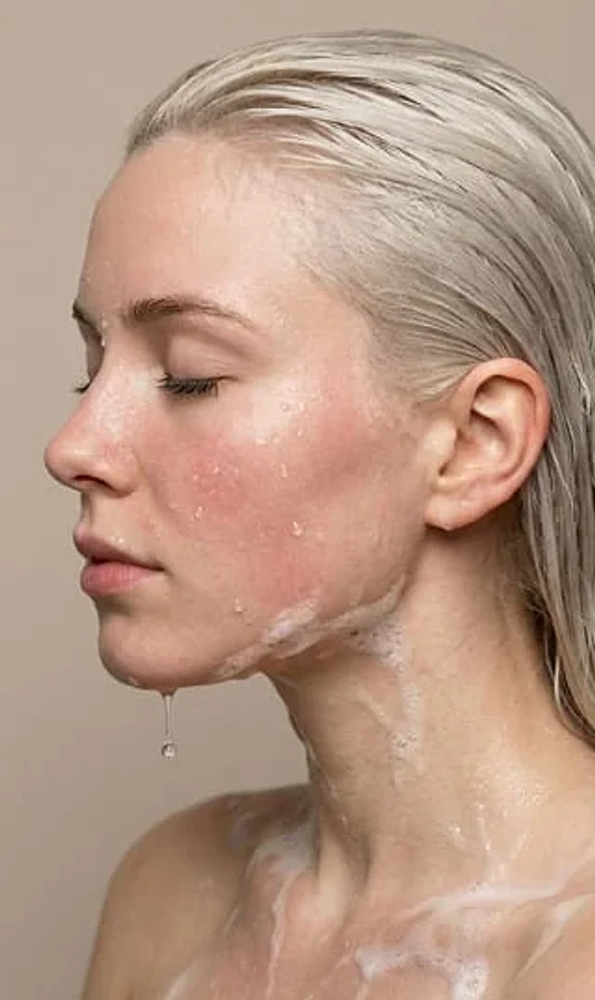

```text
{
  "prompt_type": "Ultra Photorealistic Portrait",
  "subject": {
    "demographics": "Young woman",
    "perspective": "Side profile view (facing left)",
    "appearance": {
      "skin": {
        "texture": "Hyper-realistic, wet skin texture with visible pores, natural flushed redness on cheeks",
        "details": "Multiple clear water droplets clinging to the face, white soapy foam/suds along the jawline, neck, and collarbone",
        "wetness": "A single distinct water droplet dripping from the chin"
      },
      "hair": {
        "color": "Silver / Platinum Blonde",
        "style": "Slicked back, completely wet, strands defined by water",
        "texture": "Fine, straight"
      },
      "face": {
        "eyes": "Closed, relaxed eyelids",
        "brows": "Natural, unshaped",
        "lips": "Soft, natural pink, slightly parted",
        "expression": "Serene, calm, spa-like relaxation"
      }
    }
  },
  "pose": {
    "head_position": "Turned 90 degrees to the left showing full profile",
    "body": "Shoulders bare (suggesting nudity or strapless top), neck elongated",
    "action": "Standing or sitting still while bathing/washing face"
  },
  "styling": {
    "makeup": "No makeup / fresh face aesthetic",
    "elements": "White soap suds/foam running down the neck and chest",
    "vibe": "Clean beauty, skincare campaign, raw and organic"
  },
  "environment": {
    "setting": "Minimalist studio or bathroom setting",
    "background": "Solid neutral beige / tan color",
    "details": "Clean, uncluttered, focus entirely on the subject"
  },
  "lighting": {
    "type": "Soft diffused studio lighting",
    "quality": "Even illumination, soft highlights on the wet skin and water droplets",
    "shadows": "Gentle modeling shadows under the jaw and ear",
    "direction": "Side lighting accentuating the profile"
  },
  "camera_settings": {
    "shot_type": "Close-up portrait / Headshot",
    "lens": "85mm or 105mm Macro lens",
    "aperture": "f/2.8 to f/4.0 (keeping the face sharp while softening the hair slightly)",
    "focus": "Sharp focus on the eyelashes and water droplets on the cheek",
    "shutter_speed": "1/200s (to freeze the dripping water)"
  },
  "technical_details": {
    "resolution": "8k",
    "quality_tags": [
      "Ultra-detailed",
      "Macro photography",
      "Subsurface scattering",
      "Wet skin shader",
      "Ray tracing",
      "Unreal Engine 5 render style",
      "Raw photo quality"
    ],
    "mood": "Intimate, cleansing, peaceful, sensory"
  }
}
```

Model: Nano Banana
Author: Iris

[ProjectD](https://aitoolsradar.com/en/prompts/7b88d2a0e1faf4) · [Recorded source](https://x.com/xIrissy/status/2009692941011571059)
 · [Full original metadata and byte evidence](data/projectd-batch-0062.json)

## Iris #607

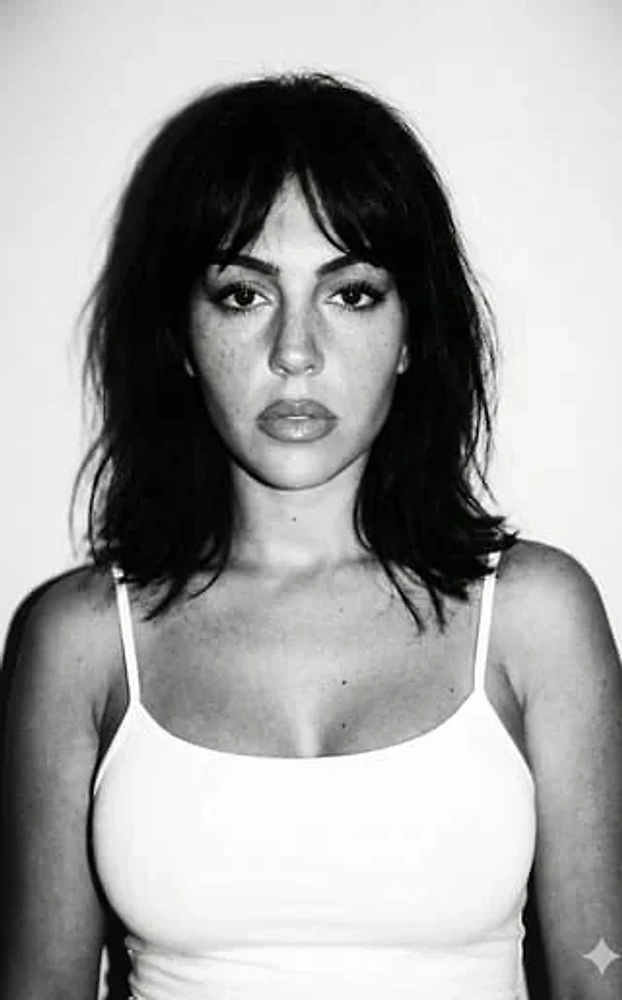

```text
{
  "image_analysis": {
    "subject": {
      "type": "Georgina Rodríguez",
      "expression": "Neutral, slightly sultry, contemplative, looking off-camera to the right",
      "pose": "Portrait shot, head and shoulders, slightly angled body"
    },
    "facial_features": {
      "skin": "Fair with prominent natural freckles dusted across the nose and cheeks",
      "eyes": "Dark, almond-shaped, gazing sideways, adorned with winged eyeliner and mascara",
      "eyebrows": "Dark, well-defined, slightly arched",
      "lips": "Full, plump, glossy, slightly parted",
      "structure": "Soft jawline, youthful features"
    },
    "hair": {
      "color": "Dark brown or black",
      "style": "Shoulder-length, layered, tousled waves, messy texture",
      "details": "Curtain bangs framing the face, loose flyaways catching the light"
    },
    "attire": {
      "garment": "White tank top / camisole",
      "details": "V-neck, thin spaghetti straps, simple texture"
    },
    "lighting_and_atmosphere": {
      "type": "Flash photography",
      "contrast": "High contrast black and white",
      "shadows": "Hard shadow behind the subject indicating direct front-facing flash",
      "vibe": "Vintage, 90s grunge aesthetic, lo-fi, candid"
    },
    "technical_enhancements": {
      "resolution": "4k HD, 8k resolution",
      "quality": "Ultra-detailed, photorealistic, sharp focus",
      "texture": "Fine film grain, realistic skin texture"
    }
  },
  "generated_prompt": "A hyper-realistic 4k HD black and white portrait of a Georgina Rodríguez with shoulder-length dark messy hair and curtain bangs. She has prominent freckles on her nose and cheeks, full glossy lips slightly parted, and dark eyes looking to the side with winged eyeliner. She is wearing a simple white V-neck camisole. The lighting is direct flash photography style creating a vintage 90s aesthetic with high contrast and a hard shadow against a plain background. The image should feature ultra-detailed skin texture, fine film grain, and sharp focus, capturing a candid, sultry mood."
}
```

Model: Nano Banana
Author: Iris

[ProjectD](https://aitoolsradar.com/en/prompts/37d4a50e0e9751) · [Recorded source](https://x.com/xIrissy/status/2016366007871475787)
 · [Full original metadata and byte evidence](data/projectd-batch-0062.json)

## Javeriya 🇺🇸 #732

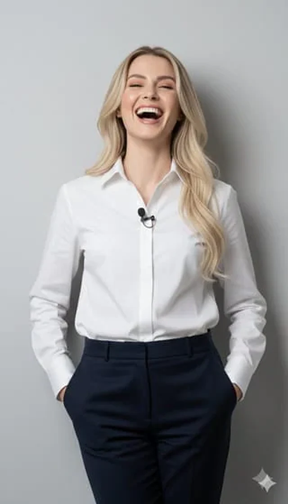

```text
{
  "action": "image_generation",
  "action_input": {
    "prompt": "A high-detail, 8K close-up portrait of the same woman from the previous images with the same facial features and long blonde wavy hair. She is captured in a moment of genuine, joyful laughter with her head slightly tilted back and eyes closed. She is wearing a crisp white button-down social shirt with a small black lapel microphone attached. The background is a minimalist, smooth light gray studio wall. The lighting is soft and professional, highlighting the texture of the fabric and the natural details of her expression. Cinematic quality, realistic skin textures, 2:3 aspect ratio.",
    "aspect_ratio": "2:3"
  }
}
```

Model: Nano Banana
Author: Javeriya 🇺🇸

[ProjectD](https://aitoolsradar.com/en/prompts/b3638f6c3a39ba) · [Recorded source](https://x.com/JadoonKhan281/status/2018704062582297014)
 · [Full original metadata and byte evidence](data/projectd-batch-0062.json)

## Javeriya ✨ #1426

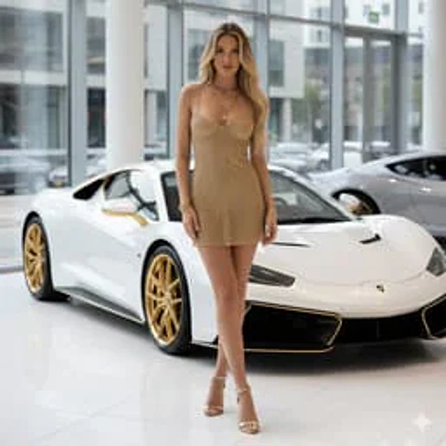

```text
Gemini Nano Banana Pro 3.0  🍌

Prompt: 

{
  "image_description": {
    "subject": {
      "person": "A slender blonde woman with long hair, wearing a sheer, shimmering gold mesh mini dress with thin spaghetti straps and a vertical gold zipper detail.",
      "accessories": "Layered gold necklaces, gold bracelets, and metallic gold high-heeled sandals.",
      "pose": "Standing elegantly in front of a luxury car, legs crossed at the ankles, looking directly at the camera."
    },
    "vehicle": {
      "type": "A sleek, modern white supercar with gold accents.",
      "details": "High-gloss white paint, metallic gold rims, gold trim around the windows, and low-profile body styling."
    },
    "environment": {
      "location": "A bright, high-end luxury car showroom.",
      "lighting": "Clean, architectural indoor lighting with soft reflections on the polished white floor.",
      "background": "Large floor-to-ceiling glass windows showing other vehicles in a blurred outdoor setting."
    },
    "technical_style": {
      "composition": "Full-body shot, eye-level angle, centered subject.",
      "aesthetic": "High-fashion photography, photorealistic, sharp focus on the subject with a shallow depth of field (bokeh) in the background.",
      "color_palette": "Dominant white and gold, with neutral grey and black architectural tones."
    }
  }
}
```

Model: Nano Banana
Author: Javeriya ✨

[ProjectD](https://aitoolsradar.com/en/prompts/fb1819dadaf0b2) · [Recorded source](https://x.com/JadoonKhan281/status/2011264537450987944)
 · [Full original metadata and byte evidence](data/projectd-batch-0062.json)

## Jennie #1408

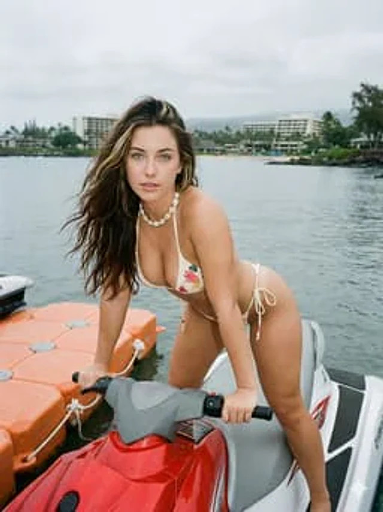

```text
Which pose do you like more? 🤣

Generated with Nano Banana Pro:

Prompt:
{
  "subject": {
    "demographics": {
      "age": "early 20s",
      "gender": "female",
      "ethnicity": "Caucasian"
    },
    "hair": {
      "color": "dark brown with blonde highlights",
      "style": "long, loose, slightly windswept, falling over shoulders",
      "texture": "natural, fine strands"
    },
    "face": {
      "shape": "oval",
      "eyes": "light green, almond-shaped, direct gaze at camera",
      "nose": "straight bridge",
      "lips": "full, natural color, slight pout",
      "skin_texture": "natural, minimal makeup, slight tan"
    },
    "body_proportions": {
      "build": "hyper-curvy athletic, extreme hourglass silhouette",
      "bust": "voluminous, heavy, naturally weighted with clear gravity effect, projecting outward, creating tension on the thin bikini straps",
      "waist": "extraordinarily narrow, cinched, high-definition abdominal tone, visible vertical 'Ab crack' line",
      "hips": "wide, flared, significantly wider than the ribcage and shoulders",
      "legs": "thick, muscular thighs with toned definition, wide stance",
      "skin_details": "smooth even tan, realistic skin folds at the hip-waist junction, subtle goosebumps from the cold environment"
    },
    "attire": {
      "item": "string bikini",
      "color": "cream with lighter flower designs",
      "material": "nylon swimwear fabric",
      "top_details": "triangle cups, halter neck tie, back tie",
      "bottom_details": "matching high-cut string bikini bottoms, tie-side closure, positioned high on the iliac crest to elongate the torso"
    },
    "accessories": {
      "neck": "short conch shell necklace"
    }
  },
  "pose": {
    "type": "seated leaning forward",
    "location": "on personal watercraft",
    "orientation": "body angled slightly right, face turned frontal",
    "arms": {
      "position": "resting on handlebars",
      "hands": "holding grips"
    },
    "legs": {
      "position": "straddling seat",
      "left_leg": "bent, resting on footwell",
      "right_leg": "bent, obscured"
    },
    "torso": {
      "posture": "leaning forward over handlebars"
    }
  },
  "setting": {
    "location": "coastal water with floating dock",
    "foreground": "red/white Yamaha personal watercraft, orange plastic floating dock",
    "background": "calm water, distant shoreline with resort hotels and trees under overcast sky",
    "props": "other personal watercraft partially visible",
    "clutter": "natural elements"
  },
  "camera": {
    "shot_type": "medium shot",
    "angle": "eye-level",
    "framing": "subject centered",
    "focal_length": "35mm",
    "depth_of_field": "moderate, background slightly soft",
    "perspective": "straight on",
    "aspect_ratio": "3:4"
  },
  "lighting": {
    "source": "overcast daylight",
    "direction": "diffused from above",
    "quality": "soft, even, no harsh shadows",
    "highlights": "subtle sheen on water and fiberglass",
    "shadows": "soft, barely defined",
    "color_temperature": "cool daylight (6000K)"
  },
  "mood_and_expression": {
    "emotion": "calm, direct, slightly alluring",
    "gaze": "direct eye contact with camera",
    "atmosphere": "casual, overcast, aquatic"
  },
  "style_and_realism": {
    "aesthetic": "candid lifestyle photograph, raw, unfiltered",
    "realism_level": "photorealistic, natural film grain",
    "skin_rendering": "natural texture, no airbrushing",
    "imperfections": "natural wind in hair, water droplets on PWC"
  },
  "colors_and_tone": {
    "palette": "muted greens, blues, grays, natural skin tones",
    "contrast": "medium",
    "saturation": "natural, slightly desaturated due to overcast light",
    "white_balance": "cool daylight"
  },
  "technical_details": {
    "resolution": "high resolution",
    "sharpness": "focus on subject's face and PWC details",
    "noise": "visible film grain"
  }
}
```

Model: Nano Banana
Author: Jennie

[ProjectD](https://aitoolsradar.com/en/prompts/3429408c27577c) · [Recorded source](https://x.com/PurelyJennie/status/2009333419218554971)
 · [Full original metadata and byte evidence](data/projectd-batch-0062.json)

## Johnn #1003

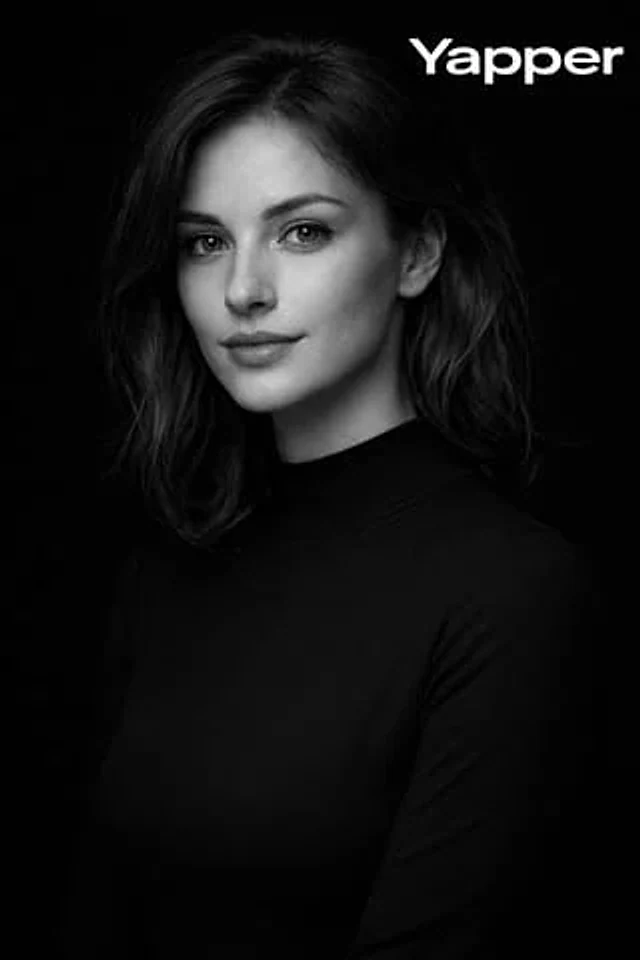

```text
{
"prompt": "High-contrast monochromatic studio portrait of a European woman around 25 years old. She has natural facial proportions, delicate cheekbones, expressive eyes, and realistic skin texture with visible pores and fine detail. Her expression is calm, elegant, and confident, looking softly toward the camera. She is posed gracefully with one hand lightly touching her neck and shoulders slightly angled. She is wearing a simple elegant black dress that softly frames her collarbones and shoulders. Hair is natural and softly styled with visible strand detail. Use minimal modern studio lighting with a single focused key light slightly above eye level, creating soft sculpted highlights on the face and subtle shadows for depth. Background is pure black, clean and textureless. Composition is a tight head-and-shoulders portrait with sharp focus on the eyes and shallow depth of field. Style: cinematic fine-art monochrome photography, modern editorial studio aesthetic, ultra-realistic, high contrast, 8K resolution, sharp micro-details."
}
```

Model: Nano Banana
Author: Johnn

[ProjectD](https://aitoolsradar.com/en/prompts/b3033d1bcc3881) · [Recorded source](https://x.com/john_my07/status/2030802157679878498)
 · [Full original metadata and byte evidence](data/projectd-batch-0062.json)

## Johnn #1076

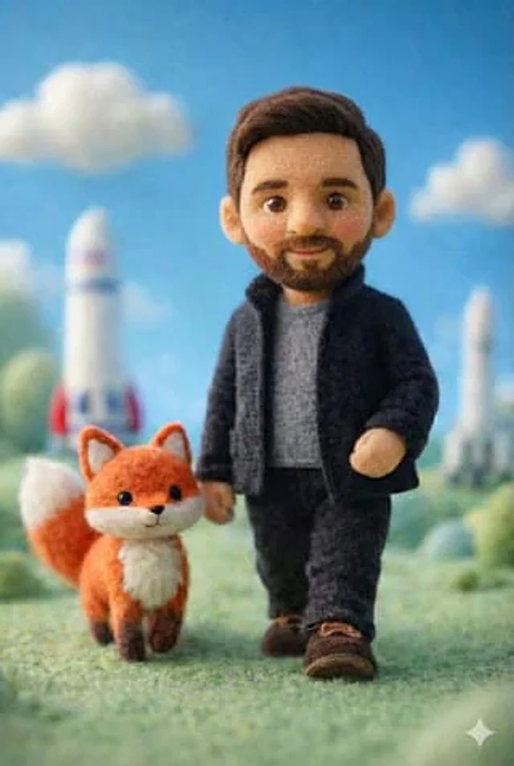

```text
A handcrafted felt miniature scene featuring a soft wool doll character with simplified facial features, round button eyes, rosy cheeks, and a gentle smile. The character wears a dark felt jacket, gray wool t-shirt, and matching trousers, styled in a minimal casual tech look. He is walking on grassy felt terrain alongside a small felt fox companion. Whimsical storybook environment with pastel greenery, soft clouds, and a bright blue sky, subtle miniature rockets blurred in the background. Macro photography style, shallow depth of field, soft natural daylight, stop-motion animation aesthetic, ultra-detailed felt fibers and fabric textures, cozy cinematic mood, high quality.
```

Model: Nano Banana
Author: Johnn

[ProjectD](https://aitoolsradar.com/en/prompts/356a6514d366b5) · [Recorded source](https://x.com/john_my07/status/2012051946979667992)
 · [Full original metadata and byte evidence](data/projectd-batch-0062.json)

## Johnn #1175

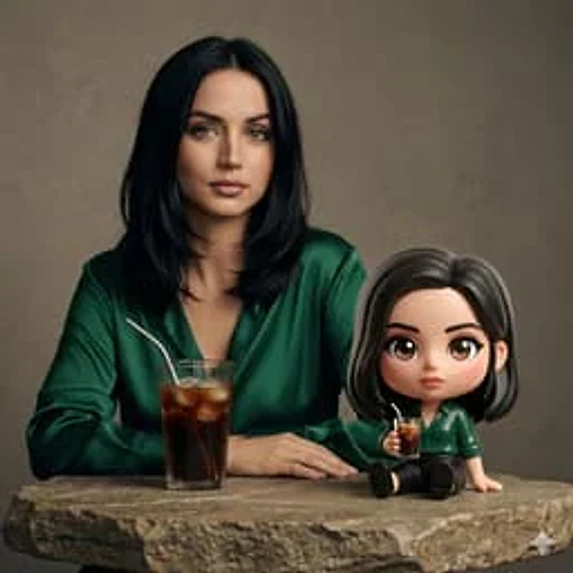

```text
{
  "aspect_ratio": "1:1",
  "scene_type": "cinematic_studio_portrait",
  "environment": {
    "background_color": "warm_muted_gray",
    "surface": "natural_textured_stone_table",
    "mood": "intimate_evening_cafe",
    "atmosphere": "cozy_moody"
  },
  "primary_subject": {
    "identity": "Ana de Armas",
    "pose": "seated_relaxed",
    "expression": "soft_calm_confident",
    "appearance": {
      "hair": "black_shoulder_length_soft_layers",
      "makeup": "subtle_evening_makeup",
      "outfit": "dark_brown_satin_blouse"
    },
    "focus": "sharp_subject_isolation"
  },
  "props": {
    "main_drink": {
      "type": "cold_brew_coffee",
      "glass": "clear_glass_with_ice",
      "straw": "metal_straw"
    },
    "stylized_figure": {
      "style": "high_quality_3d_chibi_collectible",
      "design": {
        "head": "oversized_rounded",
        "eyes": "large_expressive",
        "cheeks": "soft_blush",
        "features": "simplified_cute"
      },
      "likeness": "same_as_primary_subject",
      "pose": "holding_miniature_cold_brew_glass",
      "material": "glossy_with_soft_reflections"
    }
  },
  "lighting": {
    "type": "soft_cinematic",
    "direction": "angled_key_with_gentle_falloff",
    "highlights": "subtle_reflections_on_glass_and_chibi",
    "shadows": "smooth_and_moody"
  },
  "camera": {
    "depth_of_field": "shallow",
    "focus_priority": "real_subject_then_chibi",
    "look": "cinematic_photography"
  },
  "style_notes": [
    "realistic_human_combined_with_stylized_3d_character",
    "premium_collectible_toy_aesthetic",
    "warm_color_grading",
    "cozy_evening_tone",
    "ultra_detailed",
    "photoreal_subject"
  ]
}
```

Model: Nano Banana
Author: Johnn

[ProjectD](https://aitoolsradar.com/en/prompts/4fada9c7da951a) · [Recorded source](https://x.com/john_my07/status/2010264538562867271)
 · [Full original metadata and byte evidence](data/projectd-batch-0062.json)

## Johnn #514

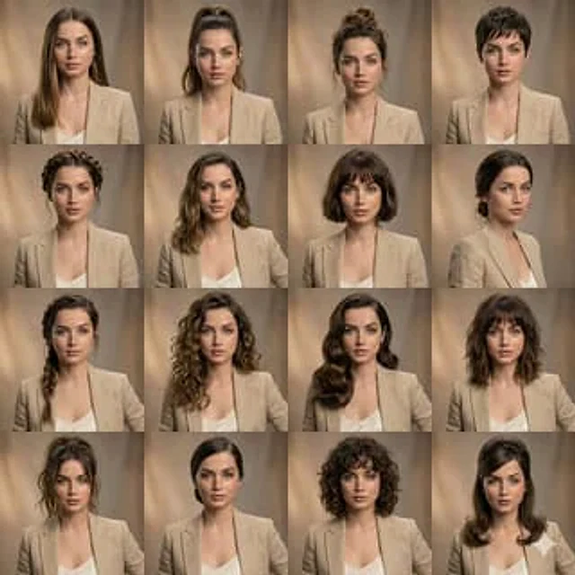

```text
{
  "scene_type": "editorial beauty collage",
  "subject": {
    "identity_lock": true,
    "face_consistency": "perfectly matched across all frames",
    "expression": "unchanged, neutral and relaxed",
    "skin": "realistic texture, natural pores, high fidelity"
  },
  "layout": {
    "grid": "4x3",
    "framing": "equal-sized portrait panels",
    "consistency": "symmetrical facial alignment in every frame"
  },
  "hairstyle_variations": [
    "sleek long straight hair",
    "high ponytail",
    "textured messy bun",
    "pixie haircut",
    "braided crown",
    "soft flowing waves",
    "short bob with bangs",
    "low tied bun",
    "side braid",
    "loose defined curls"
  ],
  "styling": {
    "outfit": "same neutral wardrobe across all panels",
    "makeup": "identical clean beauty makeup in every shot"
  },
  "lighting": {
    "type": "soft studio lighting",
    "tone": "warm",
    "shadows": "gentle and natural"
  },
  "background": {
    "style": "subtle blurred studio backdrop",
    "color": "warm neutral tones"
  },
  "quality": {
    "detail": "ultra-detailed",
    "photography": "professional portrait",
    "finish": "high-end editorial look"
  }
}
```

Model: Nano Banana
Author: Johnn

[ProjectD](https://aitoolsradar.com/en/prompts/168361999d6980) · [Recorded source](https://x.com/john_my07/status/2013525972524712055)
 · [Full original metadata and byte evidence](data/projectd-batch-0062.json)

## Johnn #761


```text
{
  "image_prompt": {
    "type": "Ultra-realistic culinary infographic",
    "subject": {
      "cuisine": "Indonesian",
      "base_element": "A traditional serving bowl holding a steaming hot dish",
      "levitating_ingredients": [
        "Tender meat pieces",
        "Golden crispy tofu",
        "Rich sauce droplets in mid-air",
        "Fresh green herbs",
        "Red chilies",
        "Sliced lime",
        "Crushed garlic",
        "Crispy fried shallots"
      ]
    },
    "composition": {
      "layout": "Minimal, vertically stacked layout",
      "arrangement": "Ingredients floating naturally as if suspended in motion",
      "background": "Textured rustic wooden tabletop",
      "visual_hierarchy": "The bowl remains grounded at the base, with ingredients ascending above it"
    },
    "graphic_design_elements": {
      "labels": "Clean Indonesian-language annotations",
      "lines": "Fine white connector lines",
      "style": "High-end editorial food infographic, magazine-quality design"
    },
    "lighting_and_mood": {
      "lighting": "Controlled cinematic studio lighting",
      "color_palette": "Warm, appetizing color tones",
      "effects": "Visible steam and frozen-action food elements"
    },
    "technical_specs": {
      "camera_settings": "Shallow depth of field with crisp focal detail, DSLR-style capture",
      "details": "Extremely detailed surface textures",
      "resolution": "8K, photorealistic finish"
    }
  }
}
```

Model: Nano Banana
Author: Johnn

[ProjectD](https://aitoolsradar.com/en/prompts/d0eee22c70a49c) · [Recorded source](https://x.com/john_my07/status/2018524475306938771)
 · [Full original metadata and byte evidence](data/projectd-batch-0062.json)

## Johnn #912

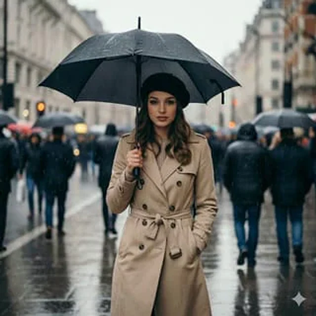

```text
{
  "render_goal": "Ultra-cinematic, hyper-realistic rainy street portrait with shallow depth of field",
  "scene": {
    "location": "busy city street",
    "weather": "steady rain, wet reflective roads, soft mist in the air",
    "time": "overcast daytime",
    "atmosphere": "moody, cinematic, emotionally rich"
  },
  "subject": {
    "identity": "girl identical to the reference",
    "action": "walking forward through a crowded street while holding an umbrella",
    "pose": "natural walking posture, relaxed shoulders",
    "expression": "calm, confident, slightly intense",
    "eye_direction": "looking directly at the camera from a distance",
    "outfit": {
      "style": "elegant, modern, attractive",
      "fit": "well-tailored, flattering silhouette",
      "fabric_behavior": "slightly affected by rain, realistic wet textures"
    }
  },
  "composition": {
    "camera_distance": "medium to long shot",
    "framing": "subject centered with balanced negative space",
    "angle": "eye-level, cinematic street photography",
    "focus": "razor-sharp focus on the girl only",
    "depth_of_field": "extremely shallow"
  },
  "background": {
    "crowd": "dense crowd walking in all directions",
    "motion": "crowd fully blurred with motion blur",
    "detail_level": "faces and bodies indistinguishable",
    "separation": "strong subject-background isolation"
  },
  "lighting": {
    "type": "soft diffused natural light",
    "highlights": "subtle rain highlights and reflections",
    "color_tone": "cool cinematic color grading with slight contrast"
  },
  "visual_style": {
    "look": "cinematic street photography",
    "realism": "ultra-realistic skin, fabric, and rain physics",
    "quality": "8K detail, high dynamic range",
    "post_processing": "film-like contrast, subtle grain, no oversharpening"
  },
  "constraints": {
    "accuracy": "match reference pose, framing, mood, and focus precisely",
    "avoid": [
      "cartoon look",
      "overexposed highlights",
      "extra subjects in focus",
      "stylized or fantasy elements"
    ]
  }
}
```

Model: Nano Banana
Author: Johnn

[ProjectD](https://aitoolsradar.com/en/prompts/6da18aa56be152) · [Recorded source](https://x.com/john_my07/status/2009832919603311045)
 · [Full original metadata and byte evidence](data/projectd-batch-0062.json)

## K #1029

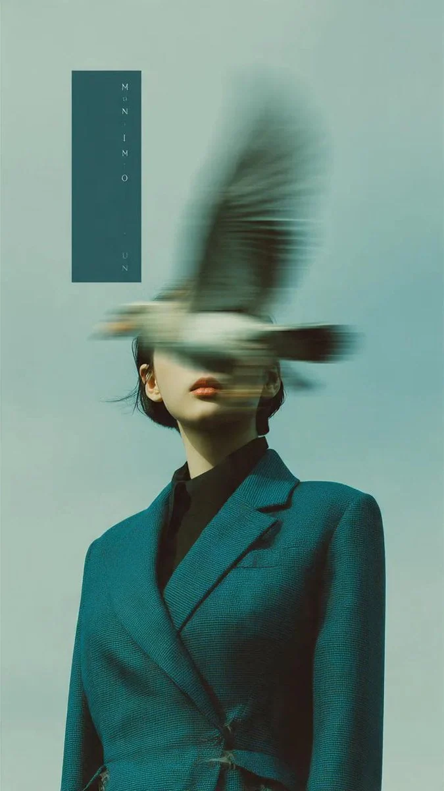

```text
Editorial photography, a woman wearing a structured deep teal blazer standing against a pale blue sky. A bird in heavy motion blur is flying across her face, obscuring her features, surrealist style. High-grain paper texture, cinematic soft lighting, minimalist composition. Magazine cover aesthetic with a clean white vertical sidebar on the left containing bold black typography. Muted cool tones, artistic blur, 35mm film aesthetic, avant-garde fashion vibe
```

Model: Nano Banana
Author: K

[ProjectD](https://aitoolsradar.com/en/prompts/818dd466534b69) · [Recorded source](https://x.com/ChillaiKalan__/status/2029072361669181640)
 · [Full original metadata and byte evidence](data/projectd-batch-0062.json)

## K #1031

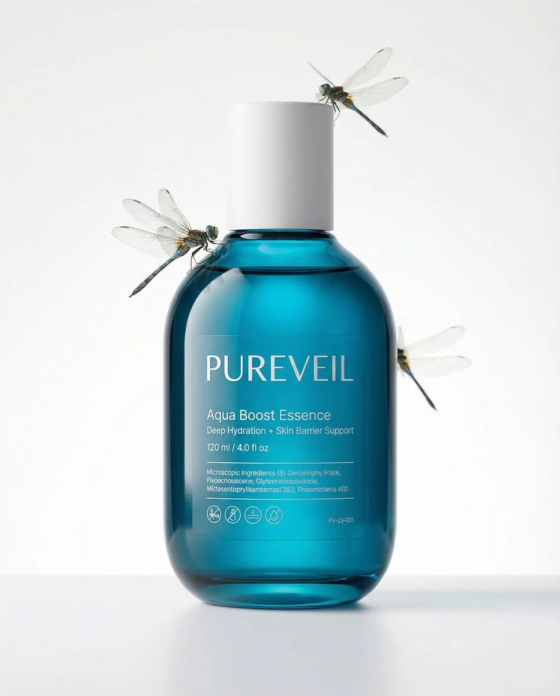

```text
A professional skincare shot of a [product container] with [cap/lid], labeled [brand, product, descriptor, volume] with [foil/ink/embossing]. [Number] [animal type(s)] in [colors] are arranged [positions/actions] around it. [Held/placed/floating] naturally. Clean white background, soft shadow, bright lighting, ultra-high resolution, 8k, professional cosmetic photography.
```

Model: Nano Banana
Author: K

[ProjectD](https://aitoolsradar.com/en/prompts/cb31c39f75eefc) · [Recorded source](https://x.com/ChillaiKalan__/status/2039599784173195358)
 · [Full original metadata and byte evidence](data/projectd-batch-0062.json)

## K #1110


```text
Ultra-realistic skincare advertising photography featuring a frosted citrus glass bottle labeled “Glow Recipe – Lemon Brightening Glow Serum (30 ml)” floating mid-air. Sparkling lemon water splashes swirl around the bottle with glowing droplets and lemon slices suspended. Soft yellow studio background, crisp reflections, cinematic commercial lighting, shallow depth of field, ultra-detailed 8K beauty campaign.
```

Model: Nano Banana
Author: K

[ProjectD](https://aitoolsradar.com/en/prompts/2db732c6b0401d) · [Recorded source](https://x.com/ChillaiKalan__/status/2031020301262409863)
 · [Full original metadata and byte evidence](data/projectd-batch-0062.json)

## K #1148


```text
Cinematic medium shot of a young man with a trimmed beard and short brown hair, standing upright in a lush meadow at
twilight. He is captured in profile, looking toward the right, holding a professional black mirrorless camera with a long
telephoto lens to his eye level. He wears an olive green corduroy button-down shirt over a plain white t-shirt. The man's chest below the area is hidden inside the grass. The foreground features
tall, sharp blades of grass and soft, out-of-focus wheat stalks creating a natural frame. The foreground is filled with tall, deeply blurred wispy wild grasses, with one very prominent blade
starting near the camera and arcing high above and across his head, creating a strong layer of depth. The background is a
masterclass in bokeh: deep moody blues and greens of distant rolling hills and trees, with a soft motion blur effect on the foliage Large, warm golden bokeh light orbs glow softly in the distance
near a blurred stone archway. High-end photography, 85mm lens, f/1.8, moody atmosphere, sharp focus on the subject with a creamy, cinematic background. ar 4:5
```

Model: Nano Banana
Author: K

[ProjectD](https://aitoolsradar.com/en/prompts/be4a68385ebb30) · [Recorded source](https://x.com/ChillaiKalan__/status/2043664090384801799)
 · [Full original metadata and byte evidence](data/projectd-batch-0062.json)

## K #1178


```text
Adidas sneakers in the box, minimalist product photography, clean warm studio scene, textured beige wall in the background, soft directional
sunlight creating long shadows, simple table surface, the product placed in a playful conceptual composition,overlaid with a hand-drawn white outline doodle
[character] interacting with the product, mixed media
style combining real photography and sketch illustration, premium branding feel, shallow depth of field, ultra-realistic, no extra text, no watermarks, 8K,
1:1.
```

Model: Nano Banana
Author: K

[ProjectD](https://aitoolsradar.com/en/prompts/23c2e913e03cf3) · [Recorded source](https://x.com/ChillaiKalan__/status/2029815700160971067)
 · [Full original metadata and byte evidence](data/projectd-batch-0062.json)

## K #1203


```text
A cinematic portrait of a handsome man with a short styled haircut and trimmed beard, wearing a plain brown t-shirt and round black sunglasses, standing in side profile against a textured concrete wall, warm golden-hour sunlight, shallow depth of field, muted earthy tones, natural light, sharp focus, modern fashion photography, 35mm lens, high detail, realistic.
```

Model: Nano Banana
Author: K

[ProjectD](https://aitoolsradar.com/en/prompts/dc49e320614df4) · [Recorded source](https://x.com/ChillaiKalan__/status/2009993252381049331)
 · [Full original metadata and byte evidence](data/projectd-batch-0062.json)

## K #1226


```text
A cinematic black-and-white street portrait of a young woman photographer standing in a city street, holding a mirrorless camera with both hands. She has soft natural makeup, sharp expressive eyes, and loosely tied dark hair with wisps framing her face. She wears a black turtleneck sweater and a camera strap around her neck. The background is an urban street with blurred pedestrians and lights creating creamy bokeh. Shallow depth of field, 85mm lens look, natural soft light, high contrast monochrome tones, realistic skin texture, candid moment, moody documentary photography style, ultra-detailed, film grain, timeless aesthetic.
```

Model: Nano Banana
Author: K

[ProjectD](https://aitoolsradar.com/en/prompts/a509c7dad4ad88) · [Recorded source](https://x.com/ChillaiKalan__/status/2011845501357064442)
 · [Full original metadata and byte evidence](data/projectd-batch-0062.json)

## K #1314


```text
Ultra-realistic 8K cinematic black-and-white portrait photograph, portrait aspect ratio 1664*2080. An 18-year young handsome man with a slim skinny body, lean physique, narrow shoulders and waist, youthful proportions, captured in a COMPLETELY NEW attitude-heavy pose with a NEW background position. He is standing this time (not seated), slightly off-center in the frame, body angled three-quarters away from the camera, one shoulder closer to lens, head tilted downward with chin tucked, strong swag-filled stance. One hand casually gripping the horse lead near his thigh, the other hand lifted near chest level with relaxed fingers to clearly show rings. Keep my face exactly the same as in the uploaded photo - do not change or edit my face. 100% face accuracy. Facial expression is cold, detached, controlled dominance; gaze downward and sideways, partially hidden behind dark sunglasses, creating a mysterious authority vibe. Natural facial structure with light stubble, real skin pores
```

Model: Nano Banana
Author: K

[ProjectD](https://aitoolsradar.com/en/prompts/5bfd08d5b1a741) · [Recorded source](https://x.com/ChillaiKalan__/status/2011107308823331127)
 · [Full original metadata and byte evidence](data/projectd-batch-0062.json)

## K #1410


```text
A hyper-realistic commercial product shot of a
lemon soda can, with fresh lemon slices bursting
out of the can in a dynamic splash. The can is
covered in cold condensation droplets, glossy
metallic texture, vibrant yellow-green color palette.
Lemon wedges and citrus juice splashes frozen
mid-air, ultra-detailed lemon pulp visible. Fresh
green leaves floating around, dark green gradient
background, soft studio lighting, dramatic high-
lights, shallow depth of field, cinematic advertising
style, ultra-sharp focus, 8K resolution, photorealis-
tic, premium beverage ad. img
```

Model: Nano Banana
Author: K

[ProjectD](https://aitoolsradar.com/en/prompts/36667fa9878bb2) · [Recorded source](https://x.com/ChillaiKalan__/status/2010358364048597154)
 · [Full original metadata and byte evidence](data/projectd-batch-0062.json)

## K #1431


```text
Product ad style AI image on a mountain peak above clouds Created with Google Nano Banana Pro Prompt used: Ultra realistic cinematic image of a White Monster Energy Ultra can standing on a sharp mountain peak above a sea of clouds, extreme high altitude atmosphere, dramatic stormy sky, golden sunrise breaking through clouds, wind whipping snow and mist around the can, liquid condensation and ice particles on the surface, bold powerful presence, epic scale contrast
```

Model: Nano Banana
Author: K

[ProjectD](https://aitoolsradar.com/en/prompts/9f39f1595367ee) · [Recorded source](https://x.com/ChillaiKalan__/status/2011457611724677533)
 · [Full original metadata and byte evidence](data/projectd-batch-0062.json)

## K #381


```text
Panning shot of a mysterious soccer player in red proffesional soccer jearsy mid air kicking a ball, motion blur, cinematic lighting agains a Light gree gradient background with streaking
lights --ar 4:5 --raw --stylize 700
```

Model: Nano Banana
Author: K

[ProjectD](https://aitoolsradar.com/en/prompts/e254dc4c5d55eb) · [Recorded source](https://x.com/ChillaiKalan__/status/2019364350151234040)
 · [Full original metadata and byte evidence](data/projectd-batch-0062.json)

## K #396


```text
Use the uploaded image as the exact visual reference for jar design, label, strawberries, raspberries, flowers, leaves, condensation droplets, red gradient background, and reflective surface.

Camera:
Locked front-facing camera.
No zoom.
No rotation.
No angle change.
Studio composition remains centered.

Style:
Premium beauty commercial.
Smooth assembling sequence.
Ultra realistic.
Slow motion but not dramatic.

Scene – Start (Empty Setup):
Start with an empty red gradient background and glossy reflective surface.
No jar.
No fruits.
No flowers.
No water droplets.

Assembling Sequence:

1. The glass jar base smoothly slides into frame from below and settles perfectly centered.
2. The lid gently lowers from above and aligns perfectly on the jar.
3. Condensation droplets subtly appear on the glass surface as if forming naturally.
4. Raspberries roll in softly from left and right, stopping naturally around the base.
5. Strawberry halves slide into position at the front.
6. Whole strawberries gently drop from above into the open jar top and settle naturally.
7. Small white flowers softly fall into place between the strawberries.
8. Green leaves slide in behind the jar to frame it.
9. Final micro water droplets appear on fruits for freshness effect.

All movements smooth and controlled.
No bouncing.
No exaggerated motion.
No dramatic lighting changes.

Lighting:
Keep original studio lighting.
Deep red background glow remains consistent.
Soft reflections on the glossy surface.

Sound (if supported):
Soft subtle assembling sound design.
Gentle fruit placement sounds.
Light glass contact sound.
No music or very subtle premium ambient tone.

End Frame:
Fully assembled composition exactly matching the reference image.
Everything perfectly arranged.
Hold for 1–2 seconds.
Ultra clean luxury skincare commercial finish.
```

Model: Nano Banana
Author: K

[ProjectD](https://aitoolsradar.com/en/prompts/3b2af015e94f5b) · [Recorded source](https://x.com/ChillaiKalan__/status/2029019321364824452)
 · [Full original metadata and byte evidence](data/projectd-batch-0062.json)

## K #405


```text
Ultra-detailed 3D plush cartoon character, inspired by classic animated TV style, standing in center frame, full body visible. Character designed as a soft toy with realistic fluffy fur texture, smooth rounded shapes, vibrant saturated colors, big expressive eyes, cute proportions, Using the image of [Doraemon's] character, [Nobita carries Doraemon on his back].

High-resolution Pixar-style 3D rendering, soft studio lighting, subtle rim light, clean gradient background (blue tone), cinematic lighting, depth of field, highly detailed fur strands, soft shadows under feet, glossy nose, toy-like material, ultra sharp 8K render.

Centered composition, minimal background, character facing camera, symmetrical pose, adorable expression.
```

Model: Nano Banana
Author: K

[ProjectD](https://aitoolsradar.com/en/prompts/241edc5790839d) · [Recorded source](https://x.com/ChillaiKalan__/status/2029730855908954544)
 · [Full original metadata and byte evidence](data/projectd-batch-0062.json)

## K #467


```text
A high fashion magazine pictorial of an Alpine-looking woman in her early 20s who stands still, looking at the camera, turning her head in the center, surrounded by a blurry silhouette of people passing by. She has a calm, stoic look on her face and is wearing a black minimalist outfit. The background is clean, bright and slightly abstract, and emphasizes the contrast between motion blur and static appearance. Editing style, film composition, pure art photography, soft magazine texture, high resolution. --ar 4:5
```

Model: Nano Banana
Author: K

[ProjectD](https://aitoolsradar.com/en/prompts/96ee6b98e16a2b) · [Recorded source](https://x.com/ChillaiKalan__/status/2020715808939549011)
 · [Full original metadata and byte evidence](data/projectd-batch-0062.json)

## K #539


```text
A dynamic fashion advertisement for Nike showing a hyper-realistic model mid-twist jump, light trails following her limbs. Background: prism-shifting gradient (hot magenta to sapphire) with refracted lens flares. The model wears iridescent Nike runner tights and a cropped tech hoodie in holographic white. Bold serif "NIKE" and motion-glitched "LUMINA" in layered text behind. High-energy, futuristic aesthetic with fashion gloss
```

Model: Nano Banana
Author: K

[ProjectD](https://aitoolsradar.com/en/prompts/446704dca606d9) · [Recorded source](https://x.com/ChillaiKalan__/status/2036806218988315056)
 · [Full original metadata and byte evidence](data/projectd-batch-0062.json)

## K #577


```text
Ultra-high-end photorealistic commercial skincare product photography featuring a matte white plastic pump bottle centered and upright, labeled “hella beauty” in clean black minimalist typography with smaller text reading “water bank moisture lotion” and subtle product details beneath, the bottle placed on a layered natural stone surface surrounded by carefully arranged organic props including smooth gray river stones, pale beige textured rock formations, soft green moss clusters,delicate white pom-pom flowers, cream-colored
daisy-like blossoms, light green fern leaves, and a
muted sage rose, all arranged in a balanced
symmetrical composition, background a soft warm
beige studio backdrop with gentle gradient and no
visible edges, foreground partially framed by softly
blurred out-of-focus white flowers creating depth,
lighting soft diffused daylight-style studio lighting
from upper left producing gentle shadows, natural
highlights on the bottle and petals, and a calm airymood, color palette dominated by warm neutrals, soft
whites, sage greens, and muted earth tones, textures
highly detailed including matte plastic, porous stone,
velvety petals, and moist moss, shallow depth of field
with sharp focus on the product label and midground
elements and smooth bokeh in foreground and
background, premium botanical skincare advertising aesthetic,
clean minimal luxury composition, cinematic realism,
ultra-detailed 8K, studio-grade hyperrealism, no extra
text, no borders, no stylization beyond natural
photorealism.
```

Model: Nano Banana
Author: K

[ProjectD](https://aitoolsradar.com/en/prompts/fe05d9678725eb) · [Recorded source](https://x.com/ChillaiKalan__/status/2016138326571626611)
 · [Full original metadata and byte evidence](data/projectd-batch-0062.json)

## K #584


```text
[product], centered top down flat lay, surrounded by [ingredients], fresh slices and whole pieces, glossy wet look, water splash frozen mid motion around the product, dewy droplets on label and surface, warm beige seamless background, soft directional sunlight, crisp realistic shadow, high end skincare advertising, ultra realistic macro product photography, 100mm lens look, f/8 sharp focus, clean composition, no extra text, 8k, 1:1
```

Model: Nano Banana
Author: K

[ProjectD](https://aitoolsradar.com/en/prompts/a88e981a8d9a0f) · [Recorded source](https://x.com/ChillaiKalan__/status/2016074622882742569)
 · [Full original metadata and byte evidence](data/projectd-batch-0062.json)

## K #602


```text
A cinematic street portrait of a young woman standing still in a busy urban crowd, captured with motion blur all around her. She has short, slightly messy hair and a calm, introspective expression, looking directly at the camera. She wears a soft beige sweater and a textured brown skirt, minimal accessories. The background is a city street filled with people in motion, creating a dreamy long-exposure effect. Shallow depth of field, subject in sharp focus, crowd blurred, natural soft daylight, muted color palette, film photography style, emotional and artistic mood, high detail, realistic, 35mm lens, f/1.8.
```

Model: Nano Banana
Author: K

[ProjectD](https://aitoolsradar.com/en/prompts/50dd91251c133a) · [Recorded source](https://x.com/ChillaiKalan__/status/2009484351873151176)
 · [Full original metadata and byte evidence](data/projectd-batch-0062.json)

## K #624


```text
Use uploaded photo as absolute main reference. Preserve Seblak kuah identity, ingredients, textures, and proportions; do not add anything not present.
Intact ceramic bowl rises in a smooth swirling twirl motion; slight controlled tilt, stable anchor.
Destroy ONLY the FOOD: crackers/kerupuk tear and split revealing bubbly porous texture; toppings (as in reference) separate naturally; spicy broth stretches
```

Model: Nano Banana
Author: K

[ProjectD](https://aitoolsradar.com/en/prompts/cabae963aa9b01) · [Recorded source](https://x.com/ChillaiKalan__/status/2015383108452057585)
 · [Full original metadata and byte evidence](data/projectd-batch-0062.json)

## K #662


```text
Cinematic ultra-high-end product photography of an official Monster Energy drink can a standard vertical black aluminum energy drink can featuring the iconic neon 
reen claw logo of Monster Energy - standing on a dark, rough, textured surface. The can is being engulfed and seemingly possessed by a thick, glossy, jet-black symbiotic liquid inspired by the organic alien symbiote from the 2018 film Venom, directed by Ruben Fleischer. The viscous substance behaves like a living entity - muscular,predatory, and semi-sentient— forming elongated, sinewy tendrils that stretch
upward and wrap tightly around the can as if claiming it. The texture must closely resemble Venom's cinematic symbiote: dense, oily, hyper-glossy, elastic, with visible surface tension, micro ripples, sharp blade-like protrusions, and subtle vein-like striations. It should feel alive, aggressive, and biomechanical _ not random liquid splashes.The black symbiote appears to be merging with the Monster can's aluminum surface crawling over it, partially fusing into the metal, as if infecting or possessing the product. Some tendrils anchor to the ground while others rise dynamically into the air, creating tension and controlled chaos. The green claw logo remains clearly visible and becomes the focal contrast element against the dark mass. Camera angle: dramatic low-angle hero shot, slightly tilted (Dutch angle) for cinematicintensity, captured with a macro cinema lens at close range. Shallow depth of field, razor-sharp focus on the logo and the liquid interaction, extreme macro detail. Lighting: moody, high-contrast lighting with strong cold blue rim light sculpting the wet reflective contours of the symbiote and enhancing the metallic sheen of the blackaluminum can. Subtle green light spill from the neon logo reflecting onto nearbyglossy tendrils. Deep shadows with controlled specular highlights for a premium cinematic look.Atmosphere: floating micro-particles, dust, and fine mist suspended in the air,catching the rim light to create depth. Subtle volumetric haze and cinematic diffusion.Background: deep dark void with faint cool blue bokeh and minimal gradient separation, reinforcing a mysterious, powerful, almost supernatural atmosphere. Ultra-realistic, photorealistic, hyper-detailed textures, HDR, 8K resolution, cinematic color grading, dramatic tension, premium commercial advertising aesthetic.

IMAGE 2
High-quality commercial photograph of a
sleek,thin aluminum Del Valle peach juice
can suspended diagonally in a dynamic,
gravity-defying composition. The scene
conveys a sense of freshness, featuring hyper-realistic slices of juicy peaches and vibrant green leaves spiraling around the can along with splashes of crystal-clear water and delicate droplets. The lighting is bright and airy, creating a soft, refreshing glow throughout the image. The color palette consists of warm peach tones, soft corals and vibrant greens on a minimalist back ground with a peach-toned gradient and shallow depth of field, showing blurred peaches in the background. Commercial aesthetic, macro detail, refreshing and vibrant atmosphere.

IMAGE 3 
A close-up product photograph of a dark
blue glass bottle for "SAUVAGE ELIXIR Dior" perfume, nestled within dark, textured,wet-looking tree bark and small dried botanical sprigs with glowing orange tips. Thelighting is low
moody  warm
orange and deep blue highlights across the wet wood and the glossy bottle. The background is dark and natural.

IMAGE 4 
A dynamic, high-speed photograph cap-
tures a bottle of Jack Daniel's Tennessee
Apple whiskey, with its signature green
label and square glass shape, splashing of
green liquid. Water droplets and fresh green
apples with leaves explode outwards
around the bottle. The scene is illuminated
by vibrant green light from background,
highlighting the texture of the glass, liquid,
and fruit against a dark green, gradient
background green and black green
ratio 4:5
```

Model: Nano Banana
Author: K

[ProjectD](https://aitoolsradar.com/en/prompts/fbc5e6a7c65528) · [Recorded source](https://x.com/ChillaiKalan__/status/2028650885472203209)
 · [Full original metadata and byte evidence](data/projectd-batch-0062.json)

## K #665


```text
A soft-focus, cinematic portrait of a young woman with delicate facial features and light golden hair, caught in motion. Her face appears partially blurred and ghosted, with flowing strands of hair captured mid-sway, creating a dreamy, ethereal motion effect. Her expression is serene and slightly distant, with parted lips and eyes softly open. The entire frame is bathed in golden beige and sepia tones, evoking a nostalgic, painterly atmosphere. The lighting is natural and diffused, coming from a nearby window, casting a warm glow on her skin and illuminating the strands of hair that dance across the frame. Photographed with a Canon EOS R5 using an 85mm lens at f/1.2, ISO 320, shutter speed 1/8s with intentional slow exposure and handheld movement to create the artistic motion blur. The focus is soft, with a shallow depth of field that isolates the subject from the pale, creamy background. Post-processed in Adobe Lightroom and Photoshop: cinematic LUTs applied, warmth enhanced through split-toning (shadows in soft amber, highlights in cream), clarity reduced, and motion streaks refined with displacement layers and radial blur filters. A very subtle fine grain adds a filmic texture. Final mood: emotional, hazy, poetic. Style references: fine art portraiture, vintage editorial, and analog dream sequences. 4K ultra-resolution, no harsh contrasts, smooth gradients preserved.
```

Model: Nano Banana
Author: K

[ProjectD](https://aitoolsradar.com/en/prompts/5503719094ad5f) · [Recorded source](https://x.com/ChillaiKalan__/status/2022733333218955487)
 · [Full original metadata and byte evidence](data/projectd-batch-0062.json)

## K #677


```text
Reflection in glass window, layered composition, subject of a beautiful woman partially obscured. Fujifilm GFX100S, 80mm f/1.7 Natural diffused light Muted Portra LUT Aspect 3:4 harmony: 60% realism / 40% artistic. sRef: layered documentary imagery. Hidden tokens: glass reflection blur, layered city depth."
```

Model: Nano Banana
Author: K

[ProjectD](https://aitoolsradar.com/en/prompts/fdef74b3bd9a12) · [Recorded source](https://x.com/ChillaiKalan__/status/2026846972351852719)
 · [Full original metadata and byte evidence](data/projectd-batch-0062.json)

## K #697


```text
Create an ultra-photorealistic studio portrait using the uploaded image as the ONLY identity reference. The subject must retain exact facial identity — same facial structure, proportions, skin tone, hairstyle, and natural features. Do not alter or beautify the face.
The subject is wearing a sharply tailored,
```

Model: Nano Banana
Author: K

[ProjectD](https://aitoolsradar.com/en/prompts/58dc6d3559624a) · [Recorded source](https://x.com/ChillaiKalan__/status/2036659588259553747)
 · [Full original metadata and byte evidence](data/projectd-batch-0062.json)

## K #728


```text
Full body fashion editorial of a beautiful Indonesian woman, wet pavement outside warkop, soft rain blur background.
Canon R5, 85mm f/1.4
Overcast natural light
Cool-toned Portra LUT
Harmony: 70% documentary.
sRef: rainy street realism.
Hidden tokens: damp air texture, reflective asphalt.
```

Model: Nano Banana
Author: K

[ProjectD](https://aitoolsradar.com/en/prompts/24317934849590) · [Recorded source](https://x.com/ChillaiKalan__/status/2028296737006170536)
 · [Full original metadata and byte evidence](data/projectd-batch-0062.json)

## K #781


```text
A cute young girl with short black hair and bangs smiling while holding a red KitKat Dark chocolate bar covering one eye, resting her cheek on her hand, wearing a cozy red and beige patterned winter sweater. The background and table are solid bright red. Several KitKat chocolate bars are placed on the table in front of her. Soft studio lighting, vibrant colors, commercial food advertisement style, ultra-realistic photography, sharp focus, high detail, 50mm lens, shallow depth of field, professional product photography, centered composition.
```

Model: Nano Banana
Author: K

[ProjectD](https://aitoolsradar.com/en/prompts/2bdcf4567874f5) · [Recorded source](https://x.com/ChillaiKalan__/status/2030089473577693629)
 · [Full original metadata and byte evidence](data/projectd-batch-0062.json)

## K #790


```text
Ultra-realistic cinematic portrait of a stylish man in a black suit, captured from behind with his head turned over his shoulder, giving a sharp, intense look toward the camera. Short textured hair with subtle highlights, well-groomed beard. Dramatic spotlight from above creating a warm golden halo effect on his hair and face, fading into a dark background. Strong chiaroscuro lighting with deep shadows and soft highlights.
```

Model: Nano Banana
Author: K

[ProjectD](https://aitoolsradar.com/en/prompts/3996eaa92be14d) · [Recorded source](https://x.com/ChillaiKalan__/status/2034783762769486109)
 · [Full original metadata and byte evidence](data/projectd-batch-0062.json)

## K #805


```text
Ultra-realistic cinematic football poster in the style of elite Premier League key featuring me with intense competitive energy, using a dramatic dual-composition layout where a large ultra-detailed hero close-up of the player's face appears in
the background with mouth open in a powerful shout, veins slightly visible,
sweat on skin, realistic pores and sharp facial definition, keare slightly turned
and syres focused forward with aggressive determination, while in the
foreground the same player appears full body in dynamic football action
such as striking the ball, sprinting or preparing a pass, with athletic posture,
natural movement, realistic muscle tension and subtle motion blur on the limbs,
both portraits matching perfectly in identity, face and proportions. The player's
uniComi must be of manchester united, respecting the exact style palette, thop-
edities, elements and posture with hyper-realistic football kit texture.
```

Model: Nano Banana
Author: K

[ProjectD](https://aitoolsradar.com/en/prompts/d7e06c3a73e1f2) · [Recorded source](https://x.com/ChillaiKalan__/status/2015653367557828661)
 · [Full original metadata and byte evidence](data/projectd-batch-0062.json)

## K #817


```text
A man smiling and posing with his arms crossed, wearing a maroon knitted high-collar sweater, with a high-end Rolex watch visible on his wrist. The background is a clean white wall with harsh sunlight creating a sharp shadow diagonal on the wall, studio portrait.
```

Model: Nano Banana
Author: K

[ProjectD](https://aitoolsradar.com/en/prompts/b60ee3a51f1bc8) · [Recorded source](https://x.com/ChillaiKalan__/status/2026654389398896958)
 · [Full original metadata and byte evidence](data/projectd-batch-0062.json)

## K #827


```text
A vertical cinematic editorial image composed of four horizontal film frames stacked vertically within a portrait (4:5) format. Cold Nordic coastline with black sand beach, calm ocean water, and massive jagged gray mountains in the background covered with mist and low clouds. Overcast sky, soft diffused daylight, desaturated cool tones.

Frame 1 (top):
Wide landscape shot of a lone woman walking along the shoreline, very small in frame, mountains dominating the scene, strong negative space, flat horizon.
Frame 2:
Medium frontal shot of the same woman standing still, centered. Pale skin, straight black shoulder-length hair moving slightly in wind, neutral serious expression. Wearing a brown cable-knit turtleneck sweater dress. Holding a black leather handbag.
Frame 3:
Extreme close-up of both hands gripping a structured black leather handbag with a curved gold metal handle. Sleeves visible, background heavily blurred.
Frame 4 (bottom):
Over-the-shoulder portrait as she turns her head back toward the camera, sharp eyes, calm intense expression, mountains softly blurred behind.

Ultra-realistic photography, cinematic film still, editorial fashion look, natural skin texture, no glam lighting, shallow depth of field, muted Nordic color grading, realistic proportions, 35mm lens feel, cold atmosphere.
```

Model: Nano Banana
Author: K

[ProjectD](https://aitoolsradar.com/en/prompts/2de1fc72ca5a07) · [Recorded source](https://x.com/ChillaiKalan__/status/2017517770578227637)
 · [Full original metadata and byte evidence](data/projectd-batch-0062.json)

## K #841


```text
Use the attached image of the model as facial reference and physical features. Black and white high-fashion editorial portrait of uploaded person, wearing a loose white blouse. She poses with one arm raised, partially covering her face while holding her hair up, creating a dramatic and artistic composition. Her gaze is intense and captivating, directed toward the camera, exuding a strong, enigmatic aura. Background: minimalist plain wall with sharp natural daylight casting defined shadows, adding depth and contrast. Lighting: harsh natural sunlight, high-contrast setup highlighting facial contours, sharp cheekbones, and texture of the hair and fabric. Pose: bold and expressive, arm lifted framing the face, emphasizing raw emotion and editorial style. Camera: eye-level angle, close-up framing focusing on facial expression, texture, and dramatic shadow play. Captured with a Canon EOS R5 full-frame DSLR, 85mm f/1.8 lens for crisp detail, tonal depth, and fine grain. Style: high-fashion editorial in monochrome.
```

Model: Nano Banana
Author: K

[ProjectD](https://aitoolsradar.com/en/prompts/c8943ba3219766) · [Recorded source](https://x.com/ChillaiKalan__/status/2010663134743368058)
 · [Full original metadata and byte evidence](data/projectd-batch-0062.json)

## K #868


```text
Use 100% of the uploaded reference image for the exact face, identity, and facial structure — do not alter facial features. A high-contrast black-and-white fashion portrait of a handsome young man in his late 20s with black hair and a well-groomed black beard, looking over his shoulder toward the camera. He wears a stylish black leather jacket with visible grain texture and modern rectangular sunglasses with deep red-tinted lenses.
```

Model: Nano Banana
Author: K

[ProjectD](https://aitoolsradar.com/en/prompts/f72d64337f0624) · [Recorded source](https://x.com/ChillaiKalan__/status/2010202953123295307)
 · [Full original metadata and byte evidence](data/projectd-batch-0062.json)

## K #901


```text
Photorealistic cinematic portrait of a young East Asian woman standing outdoors at sunset, side-profile close-up, looking thoughtfully into the distance. Soft golden hour lighting illuminating one side of her face, warm orange and teal color grading. She wears a black coat and dark scarf, hair loosely tied back with soft natural strands around her face. Natural skin texture, realistic facial details, minimal makeup. Shallow depth of field with blurred landscape background, smooth bokeh, dramatic atmospheric mood, soft gradient sky transitioning from warm orange to cool green tones. Shot on 85mm lens, f/1.8, ultra-realistic, high dynamic range, cinematic composition, moody, film still aesthetic.
```

Model: Nano Banana
Author: K

[ProjectD](https://aitoolsradar.com/en/prompts/e7d8a65e5a932d) · [Recorded source](https://x.com/ChillaiKalan__/status/2022635065910464957)
 · [Full original metadata and byte evidence](data/projectd-batch-0062.json)

## K #934


```text
Luxury fashion editorial portrait of a woman standing beside a majestic dragon, her forehead gently resting against its scaled head. She wears an elaborate ice-gray couture gown with intricate embroidery, crystal embellishments, and structured shoulders, evoking regal power and quiet intimacy. Hair styled in a sleek braided updo, adorned with refined statement jewelry. Cinematic fantasy realism, emotional stillness, mythic elegance. Cold, muted color palette of silver, stone, and ash tones. Soft natural overcast light, subtle highlights on textures of fabric and dragon scales. Shallow depth of field, ultra-detailed realism, high-end editorial aesthetic, epic yet intimate mood, medium format photography look, Vogue-level fantasy couture, no text.
```

Model: Nano Banana
Author: K

[ProjectD](https://aitoolsradar.com/en/prompts/3aff5cd7f7e701) · [Recorded source](https://x.com/ChillaiKalan__/status/2013495788824117576)
 · [Full original metadata and byte evidence](data/projectd-batch-0062.json)

## K #945


```text
A MAN WITH LIGHT-MEDIUM SKIN, SHORT DARK CURLY HAIR WITH A FADE HAIRCUT,BROWN EYES,
AND A WELL-GROOMED SHORT BEARD, WEARING A GLOSSY OVERSIZED RED PUFFER JACKET AND
LOOSE RED PANTS WITH WHITE AND RED NIKE SNEAKERS, CROUCHING LOW WITH ONE KNEE UP AND
ONE LEG FORWARD, LEFT ARM RESTING CASUALLY OVER THE RAISED KNEE AND RIGHT HAND
RELAXED NEAR THE OTHER LEG, BODY ANGLED SLIGHTLY TO THE SIDE WHILE HEAD TILTS
FORWARD LOOKING DIRECTLY AT THE CAMERA WITH A CONFIDENT EXPRESSION, ULTRA WIDE-ANGLE
LOW PERSPECTIVE SHOT EMPHASIZING THE FRONT SNEAKER APPEARING LARGE AND DOMINANT IN
THE FOREGROUND, SET IN A FULLY RED ENVIRONMENT WITH SMOOTH FLOOR AND BACKDROP
FEATURING LARGE WHITE NIKE SWOOSH LOGOS BEHIND AND FLOWING RIBBON-LIKE RED SHAPES
AROUND, HYPER-REALISTIC PHOTOGRAPHY, EXTREMELY SHARP DETAILS ON FABRIC SHINE AND
SNEAKER TEXTURE, DRAMATIC STUDIO LIGHTING WITH STRONG HIGHLIGHTS AND SOFT SHADOWS
SATURATED MONOCHROMATIC RED COLOR PALETTE WITH WHITE ACCENTS, MODERN STREETWEAR
CAMPAIGN STYLE, NO BLUR, NO DISTORTION, NO EXTRA LIMBS, NO ARTIFACTS
```

Model: Nano Banana
Author: K

[ProjectD](https://aitoolsradar.com/en/prompts/4417643233966c) · [Recorded source](https://x.com/ChillaiKalan__/status/2034898321639121310)
 · [Full original metadata and byte evidence](data/projectd-batch-0062.json)

## K #949


```text
A cinematic golden-hour photograph of a young woman standing on a wooden viewpoint balcony overlooking a city, leaning casually against the railing. She wears an oversized grey knitted sweater, a long brown skirt, and brown ankle boots, with a small leather crossbody bag. A white folding bicycle rests beside her, and an orange cat sleeps peacefully on the wooden railing next to her. In the background, soft-focus hills with a tall communication tower rise above the city. Warm sunset light, pastel sky with gentle clouds, shallow depth of field, calm and dreamy mood, realistic photography, high detail, natural colors, 35mm lens, soft bokeh.
```

Model: Nano Banana
Author: K

[ProjectD](https://aitoolsradar.com/en/prompts/4c483c818a759c) · [Recorded source](https://x.com/ChillaiKalan__/status/2009618534826152362)
 · [Full original metadata and byte evidence](data/projectd-batch-0062.json)

## K #970


```text
Create a hyper-realistic 8K UHD cinematic poster portrait of a man inspired by the reference image, with a similar hairstyle, facial structure, and body build while maintaining a natural realistic look. Shot as if captured on a 35mm lens, f/1.8, with sharp focus, creamy bokeh, cinematic color grading, and detailed DSLR skin texture.

Design a modern graphic poster titled “Chill-out.” The man wears a red hoodie, black cuffed joggers, red and white Air Jordan high-top sneakers, dark sunglasses, and silver rings. He sits in a relaxed reclined pose leaning against oversized typography, one leg bent and the other slightly extended toward the viewer. His body angles right while his face turns toward the camera in a confident three-quarter view.

Background is matte textured black. Large bold white sans-serif text “chill” and “out” forms a bench-like structure, with “chill” underlined. Add orange circles, squares, thin white grid lines, and phrases: “Life is so much easier when you just chill-out” and “Less stress, more chill.”

Bottom-right watermark: K(@ ChillaiKalan) ,
```

Model: Nano Banana
Author: K

[ProjectD](https://aitoolsradar.com/en/prompts/f8f1053f6d7594) · [Recorded source](https://x.com/ChillaiKalan__/status/2031417651390722459)
 · [Full original metadata and byte evidence](data/projectd-batch-0062.json)

## K #977


```text
soft, round face
fuller cheeks
small chin
slightly larger, expressive eyes (but still identity-consistent)
no beard, no sharp jawline, no adult features
Expression should be innocent, warm, and slightly playful, with a gentle smile and direct eye contact.
Body proportions should be cute and childlike (small, slightly chubby body, slightly larger head).

Pose: relaxed standing with hands behind the back, with a subtle natural tilt in head and shoulders to avoid stiffness.
Hair should match the reference but appear soft, slightly voluminous, and naturally styled, not overly sharp or artificial.
Skin should be soft and stylized, with subtle subsurface scattering (SSS) for a warm glow, matte finish (no plastic shine), and gentle natural blush on cheeks.
The character wears a half sleeves cotton sweater with a puzzle pattern, where:

colors are soft but lively and slightly vibrant
not oversaturated and not washed out
The fabric shows a realistic knit texture and soft folds
Lighting should be soft and cinematic:

key light from upper-left
gentle fill light
subtle rim light on hair
Background should be a rich blue gradient, brighter behind the subject and darker toward the edges, with smooth depth (not flat).
Output should be:

1:1 aspect ratio
mid-length framing (head to waist)
high-detail, clean 3D render
film-quality finish (not toy-like, not overly realistic)
```

Model: Nano Banana
Author: K

[ProjectD](https://aitoolsradar.com/en/prompts/6694ef56e3c9ea) · [Recorded source](https://x.com/ChillaiKalan__/status/2038114762945655072)
 · [Full original metadata and byte evidence](data/projectd-batch-0062.json)

## K #988


```text
Ultra-realistic fashion beauty crop of a female model wearing the reference red baseball cap and matching red hoodie. Framing: Tight portrait crop from nose to forehead, cap and eyes filling the frame. Focus: The embroidered logo perfectly centered above the model’s eyes, stitching detail and thread depth clearly visible. Pose: Model gripping the hoodie collar softly with both hands, creating subtle fabric folds. Lighting: Soft frontal studio light with faint shadow sculpting on cheekbones and under the cap. Background: Minimal warm studio backdrop, ivory-to-beige gradient. Mood: Bold, confident, fashion-house campaign energy. Finish: Ultra-sharp fabric detail, cinematic realism, shallow depth of field, no text, no branding overlays.
```

Model: Nano Banana
Author: K

[ProjectD](https://aitoolsradar.com/en/prompts/9f27d99a6df1e6) · [Recorded source](https://x.com/ChillaiKalan__/status/2018171062580920797)
 · [Full original metadata and byte evidence](data/projectd-batch-0062.json)

## K #994


```text
A professional high-end graphic design advertisement composition on a pure solid white canvas. Centered is a perfectly symmetrical, large solid rounded square (not a hollow frame). The entire interior of this square is filled with a smooth, vibrant color gradient fading from [Top-Left Color/Hex] to [Bottom-Right Color/Hex].

A [Description of Character] is positioned such that the bottom of their torso is perfectly flush and aligned with the very bottom edge of the square, leaving no thick colored border visible beneath them. Crucially, the person and their clothing maintain natural, realistic colors and textures, illuminated by professional studio lighting that is independent of the background gradient (preventing any color cast on their skin or clothes).

They are firmly and realistically gripping [Product Description]. Crucially, the top of their head and hair break the top boundary of the square, partially overlapping the white background. Their hands and the [Product Name] also break the side boundaries for a powerful 3D breakout effect, extending onto the white canvas.

Typography Layout: At the top, in the white space distinctly above the square with a clear gap, is the [Font Style] brand text '[Brand Name]' in [Top Text Color]. In the bottom-right corner, layered directly on top of the gradient inside the square, is a block of small, thin, clean [Bottom Text Color] descriptive text: '[Slogan/Tagline]'.

The lighting is [Lighting Type: e.g., Sharp/Soft], crisp, and commercial, emphasizing the textures of both the subject and the product."
```

Model: Nano Banana
Author: K

[ProjectD](https://aitoolsradar.com/en/prompts/757e89a7a2cc24) · [Recorded source](https://x.com/ChillaiKalan__/status/2025388456470610002)
 · [Full original metadata and byte evidence](data/projectd-batch-0062.json)

## Kaan #1036


```text
Shirtless male subject, hyper-realistic skin texture, deep tan, 1970s Hollywood aesthetic, vintage gold-rimmed aviator sunglasses with amber tint, unlit cigarette held in mouth, masculine ruggedness, medium close-up, low-angle perspective, background of blurred palm trees and hazy Los Angeles hillside, high-key natural sunlight, warm tungsten glow, golden hour color grading, shot on 35mm film, Arriflex 35 BL, 50mm T1.3, heavy film grain, authentic Kodak Portra 400 stock, slight lens flare, sun-bleached highlights, retro film-still style, directed by Quentin Tarantino
```

Model: Nano Banana
Author: Kaan

[ProjectD](https://aitoolsradar.com/en/prompts/8fae64039237fc) · [Recorded source](https://x.com/kaanakz/status/2019797008110825959)
 · [Full original metadata and byte evidence](data/projectd-batch-0062.json)

## Kaan #1071


```text
High-quality stylized 3D CGI big-head cartoon render of Harry Potter, square profile picture composition, oversized head and small shoulders in a playful Pixar-style caricature. Head and facial features exaggerated while keeping him instantly recognizable: messy dark hair, round glasses, lightning-shaped scar on the forehead, curious and brave expression. Portrait framing focused on the large head with a small portion of the shoulders visible, wearing Hogwarts robe collar and tie. Smooth polished materials, glossy animated film shading with refined Pixar-style character rendering. Soft cinematic lighting creating gentle highlights on the glasses. Minimalist bright magical red background inspired by Hogwarts colors, clean composition optimized for social media profile pictures, ultra-detailed, no text, no watermark.
```

Model: Nano Banana
Author: Kaan

[ProjectD](https://aitoolsradar.com/en/prompts/04437ac80de9de) · [Recorded source](https://x.com/kaanakz/status/2033569344890802668)
 · [Full original metadata and byte evidence](data/projectd-batch-0062.json)

## Kaan #1304


```text
A high-fashion black and white editorial campaign image with a 3:4 aspect ratio, split into two vertical sections. Strong contrast, rich tonal depth, cinematic grain.
RIGHT SIDE:

A man captured mid-step in a Parisian street café scene. Architecture dissolves into soft gradients and shadow. Light sculpts the face and garments rather than illuminating the scene.
He wears a tweed tailored jacket and matching trousers, the fabric rendered through contrast and texture rather than color. The tweed weave is emphasized through light and shadow.

Black leather Chelsea boots blend into the tonal range.

A structured leather bag appears as a bold silhouette.
Expression is introspective, distant. Movement feels frozen, deliberate.
STYLE & MOOD:

Timeless, cinematic, intellectual, masculine restraint, European fashion cinema.
LEFT SIDE:

A monochrome product composition on a light-to-dark gradient background. Items float slightly, defined by shadow and form. Minimal typographic price indicators.
OVERALL FEEL:

Classic fashion cinema, archival quality, serious tone.
NEGATIVE PROMPT:

Color accents, glossy lighting, modern street aesthetics, commercial catalog look.
```

Model: Nano Banana
Author: Kaan

[ProjectD](https://aitoolsradar.com/en/prompts/1e3def2dfda1c1) · [Recorded source](https://x.com/kaanakz/status/2018098287631630489)
 · [Full original metadata and byte evidence](data/projectd-batch-0062.json)

## Kaan #326


```text
{
  "resolution": "8K UHD",
  "aspect_ratio": "3:4",
  "image_style": "hyper-realistic commercial dessert photography",
  "global_settings": {
    "quality": "Ultra-high detail, razor-sharp focus, luxury dessert clarity",
    "lighting": "Controlled studio lighting emphasizing texture, layers, and syrup highlights",
    "motion": "Frozen mid-air elements with subtle gravity realism",
    "background_style": "Solid or smooth gradient background, color varies per module",
    "camera": "High-speed photography look, shallow to medium depth of field",
    "post_processing": "Rich contrast, warm tones, natural shine, no artificial glow"
  },
  "modules": { "module_1_classic_baklava_stack_explosion": {
      "scene_description": "A dramatic stack of classic pistachio baklava with flying syrup droplets",
      "baklava": {
        "type": "Traditional pistachio baklava",
        "layers": "Ultra-thin phyllo layers clearly visible",
        "cut": "Diamond-shaped pieces",
        "position": "Stacked and floating mid-air"
      },
      "details": {
        "nuts": "Finely ground bright green pistachios between layers",
        "syrup": "Golden sugar syrup glistening on edges"
      },
      "motion_effects": {
        "syrup": "Small syrup droplets splashing outward",
        "crumbs": "Tiny phyllo flakes suspended in air"
      },
      "background": {
        "color": "Deep emerald green",
        "texture": "Smooth, seamless"
      }
    }, "module_2_minimal_baklava_plate_floating": {
      "scene_description": "Minimalist premium baklava presentation with controlled floating crumbs",
      "baklava": {
        "type": "Single-layer pistachio baklava pieces",
        "arrangement": "Neatly aligned rectangular cuts",
        "surface": "Glossy with light syrup sheen"
      },
      "accent_elements": {
        "nuts": "Crushed pistachio dust lightly floating",
        "syrup": "Thin syrup drizzle frozen mid-air"
      },
      "motion_effects": {
        "particles": "Subtle floating crumbs and nut dust"
      },
      "background": {
        "color": "Warm beige",
        "gradient": "Very soft tonal gradient"
      }
    }, "module_3_baklava_syrup_pour_drama": {
      "scene_description": "Cinematic syrup pour over baklava stack",
      "baklava": {
        "type": "Thick stacked baklava slices",
        "texture": "Highly detailed crispy layers"
      },
      "additional_elements": {
        "syrup": {
          "state": "Thick golden syrup pouring from above",
          "motion": "Frozen in elegant flowing strands"
        },
        "nuts": [
          "Whole pistachio kernels",
          "Crushed pistachio fragments"
        ]
      },
      "motion_effects": {
        "splashes": "Micro syrup splashes on impact points",
        "particles": "Floating nut fragments"
      },
      "background": {
        "color": "Dark chocolate brown",
        "tone": "High contrast, luxury feel"
      }
    }, "module_4_modern_baklava_floating_composition": {
      "scene_description": "Modern deconstructed baklava composition in mid-air",
      "elements": {
        "phyllo": "Crispy golden phyllo sheets floating separately",
        "nuts": "Pistachio layers suspended between sheets",
        "syrup": "Glossy syrup threads connecting elements"
      },
      "motion_effects": {
        "flakes": "Ultra-fine pastry flakes suspended",
        "drops": "Minimal syrup droplets"
      },
      "background": {
        "color": "Muted olive green",
        "texture": "Smooth, seamless"
      }
    }
  },
  "negative_prompt": [
    "text",
    "logos",
    "branding",
    "hands",
    "people",
    "utensils",
    "plates",
    "tables",
    "cartoon style",
    "excessive syrup pooling",
    "burnt pastry",
    "overexposure",
    "artificial glow",
    "low detail textures"
  ]
}
```

Model: Nano Banana
Author: Kaan

[ProjectD](https://aitoolsradar.com/en/prompts/651389fde9577d) · [Recorded source](https://x.com/kaanakz/status/2009204329236828239)
 · [Full original metadata and byte evidence](data/projectd-batch-0062.json)

## Kaan #398


```text
{
  "aspect_ratio": "3:4",
  "render_mode": "raw",
  "series": [
    {
      "index": "1/5",
      "prompt": "two hands pulling apart a hot freshly baked pizza slice, long elastic mozzarella cheese stretch between the slice and the pie, blistered crust edges, steam rising, crumbs falling mid-air, warm cinematic light, ultra high-detail food action photography",
      "category": "cheese pull",
      "lighting": "warm cinematic oven light",
      "detail_level": "ultra-detailed"
    },
    {
      "index": "2/5",
      "prompt": "two hands pulling apart a syrup-soaked baklava piece, thin crispy phyllo layers cracking, rich pistachio filling visible, thick honey syrup stretching and dripping mid-air, golden warm light, cinematic dessert action photography",
      "category": "syrup & crunch",
      "lighting": "golden warm light",
      "detail_level": "ultra-detailed"
    },
    {
      "index": "3/5",
      "prompt": "two hands breaking a molten chocolate lava cake in half, glossy dark chocolate flowing out from the center, steam rising gently, crumbs suspended mid-air, soft warm spotlight, cinematic dessert action photography",
      "category": "molten chocolate",
      "lighting": "soft warm spotlight",
      "detail_level": "ultra-detailed"
    },
    {
      "index": "4/5",
      "prompt": "two hands tearing a glazed cinnamon roll apart, sticky cinnamon sugar filling stretching in glossy strands, icing dripping slowly, fluffy dough texture visible, cozy warm bakery light, high-detail cinematic food photography",
      "category": "sticky pull",
      "lighting": "warm bakery light",
      "detail_level": "ultra-detailed"
    },
    {
      "index": "5/5",
      "prompt": "two hands splitting a classic New York-style cheesecake slice, ultra-creamy interior slowly separating, crumbly biscuit base breaking apart, subtle cream stretch, soft studio warm light, cinematic high-detail dessert photography",
      "category": "creamy separation",
      "lighting": "soft warm studio light",
      "detail_level": "ultra-detailed"
    }
  ]
}
```

Model: Nano Banana
Author: Kaan

[ProjectD](https://aitoolsradar.com/en/prompts/0dc6f3898ace6f) · [Recorded source](https://x.com/kaanakz/status/2011762827866845208)
 · [Full original metadata and byte evidence](data/projectd-batch-0062.json)

## Kaan #456


```text
{
  "resolution": "8K UHD",
  "aspect_ratio": "3:4",
  "image_style": "hyper-realistic commercial food photography",
  "global_settings": {
    "quality": "Ultra-high detail, razor-sharp focus, premium street food clarity",
    "lighting": "Controlled studio lighting emphasizing meat texture, char marks, and sauce glistening",
    "motion": "Frozen mid-air elements with subtle gravity realism",
    "background_style": "Solid or smooth gradient background, color varies per module",
    "camera": "High-speed photography look, shallow to medium depth of field",
    "post_processing": "Rich contrast, warm savory tones, natural shine, appetizing color grading"
  },
  "modules": {
    
    "module_1_classic_doner_slice_explosion": {
      "scene_description": "A dramatic vertical döner stack with flying meat slices and sauce droplets",
      "doner": {
        "type": "Traditional Turkish döner kebab slices",
        "texture": "Thinly sliced beef and lamb mix with visible char marks",
        "cut": "Paper-thin ribbons",
        "position": "Stacked vertically and floating mid-air"
      },
      "details": {
        "char_marks": "Dark caramelized edges with grill stripes",
        "fat_marbling": "Glistening fat streaks between meat layers",
        "seasoning": "Visible spice particles on meat surface"
      },
      "motion_effects": {
        "meat_slices": "Individual döner slices spiraling outward",
        "sauce": "White garlic sauce and red chili sauce droplets splashing",
        "herbs": "Fresh parsley leaves floating in air"
      },
      "background": {
        "color": "Deep crimson red",
        "texture": "Smooth, seamless"
      }
    },

    "module_2_minimal_doner_durum_floating": {
      "scene_description": "Minimalist premium döner dürüm presentation with controlled floating ingredients",
      "doner": {
        "type": "Perfectly wrapped dürüm (wrap) cross-section",
        "arrangement": "Single dürüm cut in half, floating vertically",
        "surface": "Lightly toasted lavash bread with golden char marks"
      },
      "accent_elements": {
        "filling": "Layered döner meat, lettuce, tomatoes, onions visible in cross-section",
        "sauce": "White garlic yogurt sauce drizzling elegantly",
        "vegetables": "Fresh red tomato slices, crisp lettuce, purple onion rings"
      },
      "motion_effects": {
        "particles": "Subtle floating spice particles and herb fragments",
        "drops": "Sauce droplets frozen mid-fall"
      },
      "background": {
        "color": "Warm terracotta orange",
        "gradient": "Very soft tonal gradient"
      }
    },

    "module_3_doner_sauce_pour_drama": {
      "scene_description": "Cinematic sauce pour over döner meat pile",
      "doner": {
        "type": "Mountain of freshly sliced döner meat",
        "texture": "Highly detailed crispy edges and tender interior"
      },
      "additional_elements": {
        "sauces": {
          "white_sauce": {
            "state": "Thick creamy garlic yogurt sauce pouring from above",
            "motion": "Frozen in elegant flowing ribbon"
          },
          "red_sauce": {
            "state": "Spicy red chili sauce drizzling alongside",
            "motion": "Thin crimson streams intertwining with white sauce"
          }
        },
        "vegetables": [
          "Sliced tomatoes",
          "Chopped lettuce",
          "Thinly sliced onions",
          "Fresh parsley sprigs"
        ]
      },
      "motion_effects": {
        "splashes": "Micro sauce splashes on meat surface",
        "particles": "Floating spice particles and herb fragments",
        "steam": "Subtle heat vapor rising from meat"
      },
      "background": {
        "color": "Dark charcoal black",
        "tone": "High contrast, premium street food aesthetic"
      }
    },

    "module_4_modern_doner_deconstructed_composition": {
      "scene_description": "Modern deconstructed döner composition in mid-air",
      "elements": {
        "bread": "Pieces of toasted lavash bread floating separately",
        "meat": "Individual döner slices suspended at different angles",
        "vegetables": "Tomato slices, lettuce leaves, onion rings floating between layers",
        "sauces": "Glossy sauce ribbons connecting elements artistically"
      },
      "motion_effects": {
        "particles": "Ultra-fine spice dust suspended in air",
        "drops": "Scattered sauce droplets frozen in motion",
        "steam": "Minimal heat waves rising from meat"
      },
      "background": {
        "color": "Muted sage green",
        "texture": "Smooth, seamless"
      }
    },

    "module_5_rotating_doner_spit_close_up": {
      "scene_description": "Extreme close-up of döner meat on vertical spit with knife slice frozen in time",
      "doner_spit": {
        "type": "Vertical döner tower on rotating spit",
        "texture": "Layers of seasoned meat with charred outer crust",
        "detail": "Visible spices, fat marbling, and grill marks"
      },
      "action_elements": {
        "knife": "Large döner knife mid-slice through meat",
        "meat_slice": "Fresh slice falling away from spit",
        "shavings": "Meat shavings and crispy bits floating"
      },
      "motion_effects": {
        "particles": "Charred bits and seasoning particles in air",
        "steam": "Heat vapor wisps rising from fresh cut"
      },
      "background": {
        "color": "Rich golden amber",
        "texture": "Smooth gradient"
      }
    },

    "module_6_doner_plate_overhead_explosion": {
      "scene_description": "Overhead shot of döner plate with ingredients exploding upward",
      "composition": {
        "base": "Thin lavash bread pieces on bottom",
        "center": "Pile of döner meat slices",
        "explosion": "All ingredients bursting upward in circular pattern"
      },
      "flying_elements": [
        "Döner meat slices spiraling",
        "French fries launching upward",
        "Grilled peppers and tomatoes",
        "Fresh parsley and sumac",
        "Sauce droplets spraying",
        "Lemon wedges"
      ],
      "motion_effects": {
        "height_variation": "Elements at different heights creating depth",
        "rotation": "Some elements rotating while airborne"
      },
      "background": {
        "color": "Deep burgundy red",
        "style": "Vignette effect focusing on center"
      }
    }

  },
  "negative_prompt": [
    "text",
    "logos",
    "branding",
    "hands",
    "people",
    "utensils beyond döner knife",
    "full plates visible",
    "tables",
    "restaurant interior",
    "cartoon style",
    "raw meat",
    "excessive grease pooling",
    "burnt or overcooked appearance",
    "overexposure",
    "artificial glow",
    "low detail textures",
    "unappetizing colors",
    "plastic-looking food"
  ]
}
```

Model: Nano Banana
Author: Kaan

[ProjectD](https://aitoolsradar.com/en/prompts/a8a4006e7a47c5) · [Recorded source](https://x.com/kaanakz/status/2009941784965853278)
 · [Full original metadata and byte evidence](data/projectd-batch-0062.json)

## Kaan #472


```text
Using the provided reference_image as the primary source for identity, clothing colors, and visual attributes, create a full-body 3D stylized anthropomorphic cartoon version of the character. Preserve facial structure, body proportions, silhouette, and distinctive traits exactly as in the reference_image.
The outfit must match the clothing colors from the reference_image. Extract and apply the exact dominant and secondary colors from the reference_image to the hoodie, cargo pants, and sneakers. Do not introduce new colors. Do not default to orange or neon green unless they exist in the reference_image.
Modern streetwear styling is allowed, but color palette must strictly follow the reference_image.
Confident relaxed pose with hands in pockets.
Minimal studio background using the dominant background color sampled from the reference_image, or a harmonized tone derived from it. Soft studio lighting, smooth shadows, high-detail fabric texture, Pixar-quality 3D render, ultra-clean composition, centered framing, 8K resolution.
Add enforcement: “Strict color adherence to reference_image. No automatic color substitution.
```

Model: Nano Banana
Author: Kaan

[ProjectD](https://aitoolsradar.com/en/prompts/08cbcdb300b7c5) · [Recorded source](https://x.com/kaanakz/status/2022396003425702301)
 · [Full original metadata and byte evidence](data/projectd-batch-0062.json)

