# ProjectD backfill batch 63

Complete original prompts and exact existing ProjectD images. Actual model labels and any available credits or notices are retained. Missing authors or license metadata are not filled in.

## Kaan #535

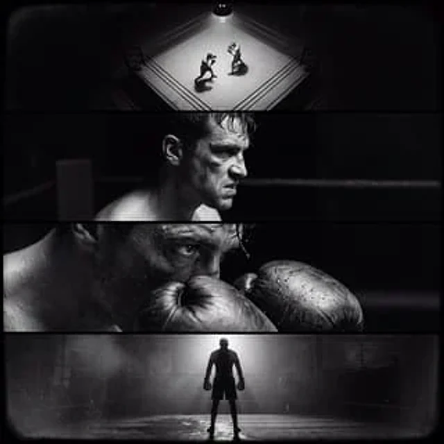

```text
Create a single film noir–style cinematic image divided into four horizontal panels, all depicting the same boxer and the same boxing ring environment, unified by lighting, atmosphere, and narrative progression across four stages of a fight.

Overall style:

Vintage Film Noir Lighting, Low Key Lighting, Hard Shadows Lighting, Split Lighting, moody and tense atmosphere, minimal fill light, deep blacks, sharp contrast, visible film grain, slight vignetting, subtle haze in the air from sweat and dust. Industrial warehouse boxing gym setting, night atmosphere, light beams cutting through darkness, damp canvas reflecting highlights. Clean horizontal separation between panels, cinematic split-screen composition, consistent character identity across all panels.

Top panel – ROUND 1, BIRD’S-EYE SHOT:

Bird’s Eye View of the boxing ring. Stark top-down composition, ropes forming geometric frames. Two boxers circling each other. Our main subject slightly forward in stance, gloves raised. Overhead spotlight creating strong geometric shadows across the canvas. Sweat barely visible. Light slicing through darkness, corners of the ring fading into black.

Second panel – ROUND 2, SIDE CLOSE-UP SHOT:

Side-profile close-up of the main boxer mid-fight. From Side, intense expression, jaw clenched. One side of the face sharply lit by a hard key light, the other completely swallowed in shadow. Sweat and minor bruising beginning to appear. Split Lighting carving the facial structure in classic noir sculpting. Background dissolves into darkness, only faint ring ropes visible.

Third panel – ROUND 3, EXTREME CLOSE-UP:

Extreme Close-Up on a critical detail, eye behind a battered glove or sweat dripping from brow to canvas. Heavy shadow dominance. Light catching only the iris and the texture of the glove leather. Micro cuts, swelling, fine skin texture visible. Film grain pronounced. The rest of the frame nearly pure black.

Bottom panel – FINAL ROUND, MEDIUM WIDE BACK SHOT:

Medium Wide Shot from behind the boxer. From Behind perspective. The subject standing alone in the ring after a decisive moment, shoulders rising with breath. Opponent down or barely visible in shadow. Rim Lighting outlining the silhouette. Wet canvas reflecting fragmented light. Light haze in the air enhancing depth. The ring fading into darkness beyond the ropes.

High detail, High Quality, Photorealism Style, cinematic composition, cohesive identity across all four panels, dramatic storytelling progression within a single unified noir frame.
```

Model: Nano Banana
Author: Kaan

[ProjectD](https://aitoolsradar.com/en/prompts/7ee46333f34887) · [Recorded source](https://x.com/kaanakz/status/2027814444437307602)
 · [Full original metadata and byte evidence](data/projectd-batch-0063.json)

## Kaan #838

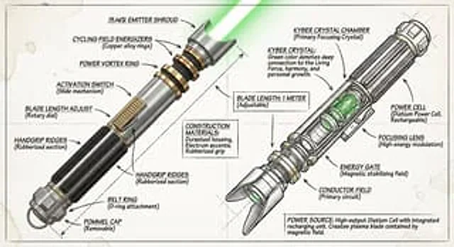

```text
Create an infographic image of Nike Air Jordan 1 High OG sneaker, combining a realistic photograph or photoreal render of the object with technical annotation overlays placed directly on top. Use black ink–style line drawings and text (technical pen / engineering diagram aesthetic) for all annotations. Include precise arrows pointing to specific parts, detailed labels naming each component (toe box, swoosh logo, wings logo, collar, tongue, lace holes, midsole, outsole, heel counter, perforations, stitching patterns), materials used (premium leather, rubber outsole, foam cushioning), and historical notes (designed by Peter Moore, 1985, banned by NBA). Show both side profile and slight 3/4 angle. Background should be clean white or very light neutral. Overall style: a hybrid of product photography and vintage technical manual illustration. High resolution, ultra-detailed, 4K quality.
```

Model: Nano Banana
Author: Kaan

[ProjectD](https://aitoolsradar.com/en/prompts/c8537b2663067d) · [Recorded source](https://x.com/kaanakz/status/2017678718882476378)
 · [Full original metadata and byte evidence](data/projectd-batch-0063.json)

## Karlos #1061

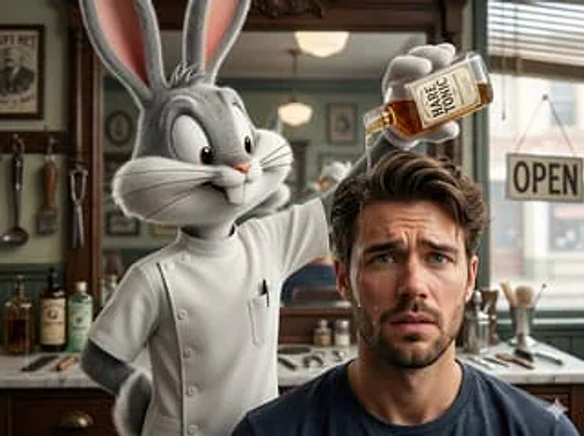

```text
Cinematic 8k hyper-realistic close-up shot. A 3D realistic Bugs Bunny, faithful to his classic design but with detailed fur texture, wearing a white barber uniform. He is holding a bottle labeled "HARE TONIC" and pouring liquid onto the head of a sitting man. Man [photos reference with hair] has a worried and nervous expression, water dripping down his face. Vintage barbershop background with a mirror. Dynamic lighting, high detail, photorealistic rendering style
```

Model: Nano Banana
Author: Karlos

[ProjectD](https://aitoolsradar.com/en/prompts/dc75f035539b0a) · [Recorded source](https://x.com/de_mon010/status/2038263197925253176)
 · [Full original metadata and byte evidence](data/projectd-batch-0063.json)

## Karlos #533

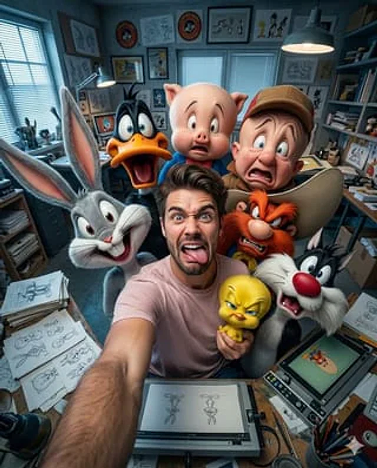

```text
Ultra-realistic 4:5 vertical format ultra wide angle 13mm selfie of me with Bugs Bunny, Daffy Duck, Porky Pig, Elmer Fudd, Yosemite Sam, Tweety, Sylvester in my studio. I am wearing pale pink t-shirt. We're all making silly, exaggerated faces. High camera angle. Extreme wide lense no fish-eye distortion. Realistic, live action characters no cartoon, cinematic lighting, all realistic characters integrated with stylized realism.
```

Model: Nano Banana
Author: Karlos

[ProjectD](https://aitoolsradar.com/en/prompts/919e7d14c3c428) · [Recorded source](https://x.com/de_mon010/status/2037732319348633909)
 · [Full original metadata and byte evidence](data/projectd-batch-0063.json)

## Kashberg #1005

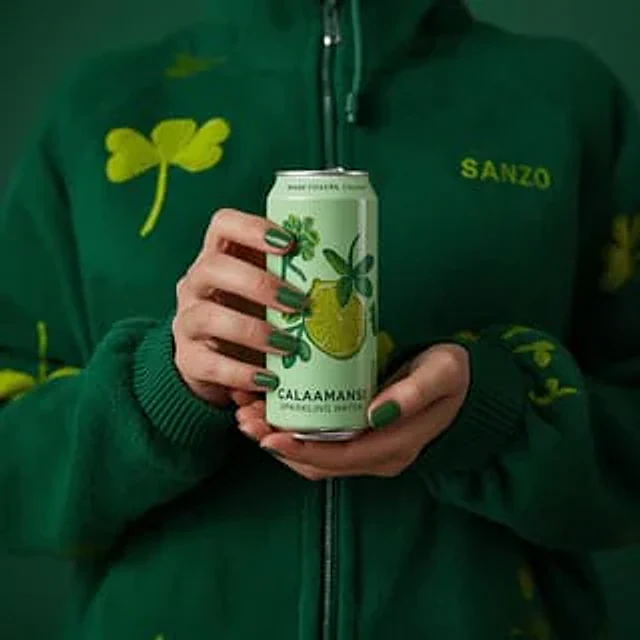

```text
A photorealistic product shot of a person holding a slim, light green can of Sanzo Calamansi Sparkling Water. The person is wearing a dark green, fuzzy fleece zip-up hoodie patterned with light green four-leaf clovers. Both hands are holding the can centrally in front of their torso, displaying perfectly manicured nails painted in a glossy green polish. The can features an illustration of a sliced calamansi lime with green leaves. The background is a solid, moody dark green, creating a striking monochromatic green aesthetic. Soft, professional studio lighting, highly detailed.
```

Model: Nano Banana
Author: Kashberg

[ProjectD](https://aitoolsradar.com/en/prompts/75c1ca9790ef59) · [Recorded source](https://x.com/Kashberg_0/status/2027171001486967062)
 · [Full original metadata and byte evidence](data/projectd-batch-0063.json)

## Kashberg #1083

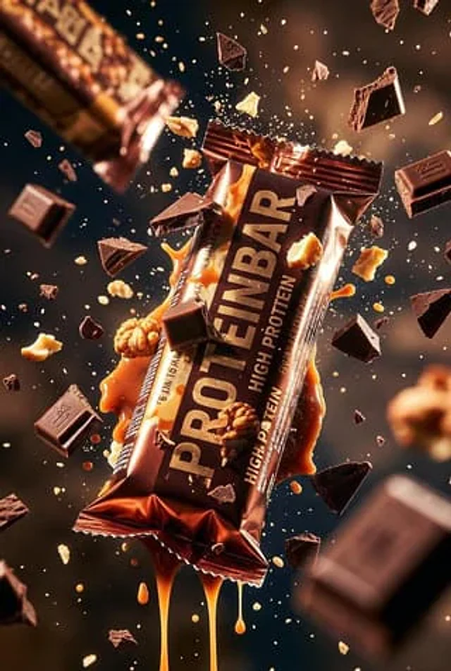

```text
Ultra-cinematic product photography of a premium protein bar wrapped in metallic packaging, floating at a dynamic angle; explosive chocolate chunks, caramel drips, and nut fragments frozen mid-air; high-speed splash and crumble effect, dramatic studio lighting with sharp highlights; rich brown and gold palette, ultra-detailed textures, shallow depth of field, photorealistic, 8K, fitness luxury advertising.
```

Model: Nano Banana
Author: Kashberg

[ProjectD](https://aitoolsradar.com/en/prompts/00a6b05a445ca5) · [Recorded source](https://x.com/Kashberg_0/status/2019985216308429143)
 · [Full original metadata and byte evidence](data/projectd-batch-0063.json)

## Kashberg #1087


```text
Photorealistic editorial portrait of a smiling woman using the exact same face from the reference image. She wears oversized black sunglasses with orange lenses and small gold earrings. Slightly leaning forward in a close wide-angle perspective, with a playful, mischievous expression and subtle smirk. Clean blue studio background with soft gradient. Bright soft lighting with gentle contrast, sharp focus, minimal high-fashion mood.
```

Model: Nano Banana
Author: Kashberg

[ProjectD](https://aitoolsradar.com/en/prompts/402214f9a742e7) · [Recorded source](https://x.com/Kashberg_0/status/2045337223638515794)
 · [Full original metadata and byte evidence](data/projectd-batch-0063.json)

## Kashberg #1102

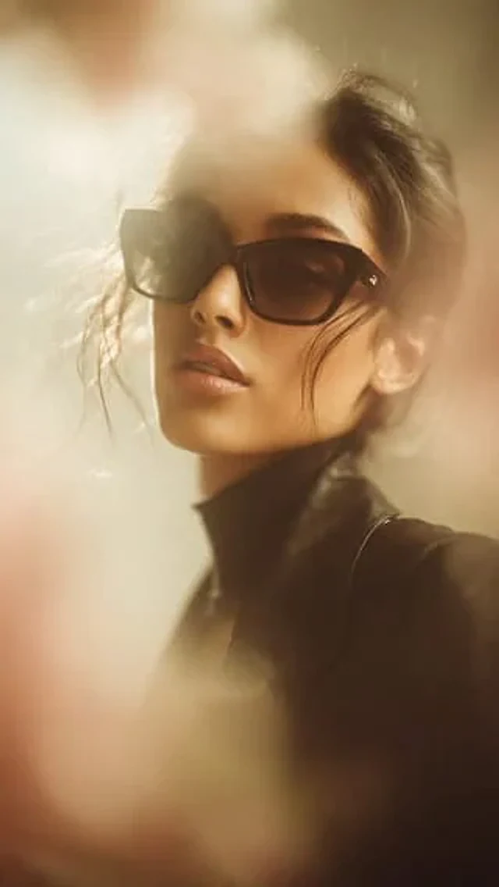

```text
Ultra-realistic cinematic fashion portrait of a stylish woman wearing oversized black cat-eye sunglasses, soft warm golden sunlight, hazy foreground blur creating dreamy depth, shallow depth of field, glowing skin, natural makeup, glossy nude lips, loose messy updo hairstyle with soft strands falling, black high-neck outfit, luxury editorial vibe, shot through translucent fabric for soft diffusion, 85mm lens, f/1.8, creamy bokeh, golden hour lighting, warm beige color grading, high detail, photorealistic, Vogue style photography, soft focus edges, elegant and minimal background
```

Model: Nano Banana
Author: Kashberg

[ProjectD](https://aitoolsradar.com/en/prompts/0ff0d4120ba296) · [Recorded source](https://x.com/Kashberg_0/status/2027738988673700214)
 · [Full original metadata and byte evidence](data/projectd-batch-0063.json)

## Kashberg #1201

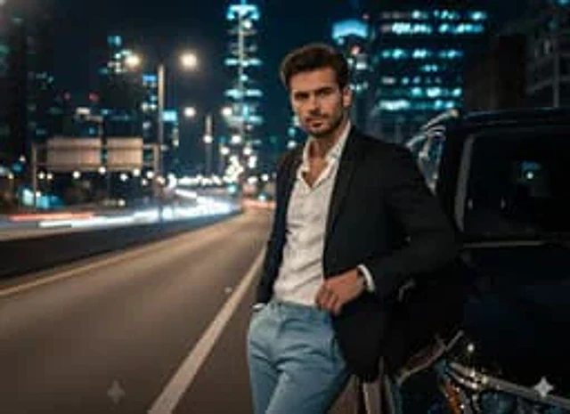

```text
A cinematic night-time urban portrait of a confident, handsome man leaning against a black luxury SUV on a modern city highway. He is wearing a black blazer over a white unbuttoned dress shirt and light blue tailored trousers, one hand in his pocket, the other resting on the car. Clean haircut, light stubble, sharp masculine features. Skyscrapers with glowing windows in the background, streetlights creating bokeh, long light trails from passing traffic. Moody, high-contrast lighting, shallow depth of field, professional fashion photography, ultra-realistic, 85mm lens, f/1.8, cinematic color grading, luxury lifestyle aesthetic.
```

Model: Nano Banana
Author: Kashberg

[ProjectD](https://aitoolsradar.com/en/prompts/965f1c7a8b8364) · [Recorded source](https://x.com/Kashberg_0/status/2008815653424390145)
 · [Full original metadata and byte evidence](data/projectd-batch-0063.json)

## Kashberg #1205

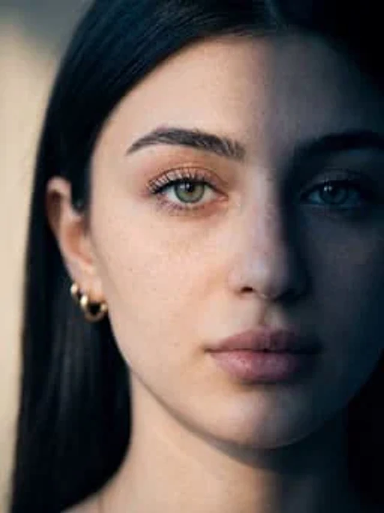

```text
Ultra-realistic close-up portrait of a young woman with fair skin and subtle freckles, green eyes, and natural full lips, dark straight hair tucked behind the ear, wearing small gold hoop earrings. Dramatic split lighting across the face — one half illuminated with soft natural light, the other half in deep shadow with cool blue tones. High detail skin texture, sharp focus on eyes and eyelashes, minimal makeup, cinematic lighting, moody atmosphere, shallow depth of field, 85mm lens, f/1.8, photorealistic, editorial beauty photography.
```

Model: Nano Banana
Author: Kashberg

[ProjectD](https://aitoolsradar.com/en/prompts/eb23f749f6dc51) · [Recorded source](https://x.com/Kashberg_0/status/2045717144319697140)
 · [Full original metadata and byte evidence](data/projectd-batch-0063.json)

## Kashberg #1230

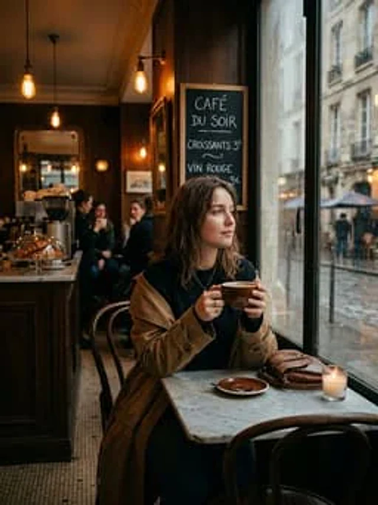

```text
Cinematic photo of a young woman sitting alone in a cozy Parisian café on a rainy day, holding a cup of coffee and looking out a large window with raindrops on the glass. Warm vintage café interior with wooden walls, hanging Edison bulbs, marble table, croissants and coffee machine visible in the background. A chalkboard menu reading “Café du Soir, Croissants, Vin Rouge.” Soft natural window light mixed with warm indoor lighting, shallow depth of field, street with umbrellas and classic European buildings outside. Moody, cozy atmosphere, realistic photography, 50mm lens, high detail, cinematic color grading, lifestyle photography, ultra-realistic, 4k.
```

Model: Nano Banana
Author: Kashberg

[ProjectD](https://aitoolsradar.com/en/prompts/5dd8c5b517d8b6) · [Recorded source](https://x.com/Kashberg_0/status/2032786956288143858)
 · [Full original metadata and byte evidence](data/projectd-batch-0063.json)

## Kashberg #1253

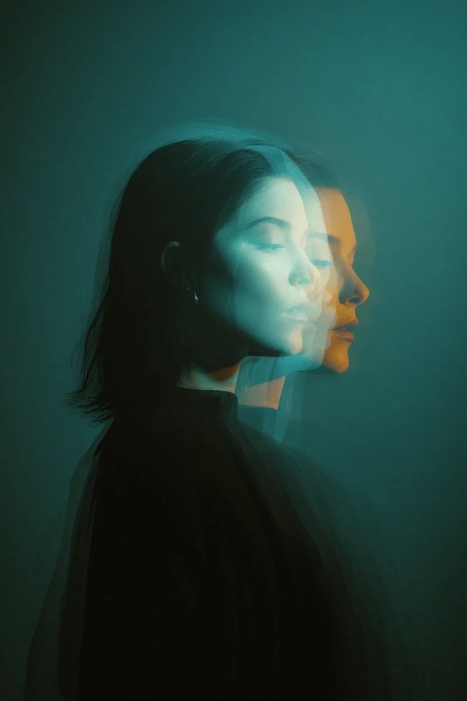

```text
Cinematic double exposure portrait of a woman in side profile, two overlapping faces slightly offset, teal and orange moody lighting, soft motion blur, dark minimal background, high contrast, studio photography, dreamy atmosphere, ultra-realistic skin texture, shallow depth of field, 85mm lens, dramatic fine art portrait, volumetric lighting. 🎨
```

Model: Nano Banana
Author: Kashberg

[ProjectD](https://aitoolsradar.com/en/prompts/6bc602bdb24c6f) · [Recorded source](https://x.com/Kashberg_0/status/2031893424979546397)
 · [Full original metadata and byte evidence](data/projectd-batch-0063.json)

## Kashberg #1273

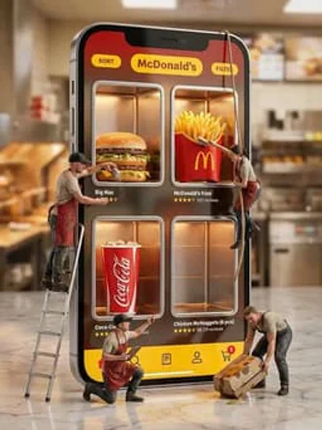

```text
Ultra-realistic creative advertising scene showing a giant smartphone displaying a McDonald’s food-ordering app interface inside a modern restaurant kitchen. The phone screen features neatly arranged food compartments like a vending machine: a Big Mac burger, McDonald’s fries, a Coca-Cola cup, and chicken McNuggets with star ratings and reviews visible. Miniature restaurant workers in aprons interact with the phone—one climbing a rope to place fries, one on a ladder adjusting the burger, one kneeling to inspect the interface, and another lifting a delivery box. Playful scale contrast, hyper-detailed textures, glossy food realism, cinematic lighting, shallow depth of field. Premium commercial photography style, sharp focus, warm tones, high realism, imaginative brand storytelling, surreal yet believable composition.
```

Model: Nano Banana
Author: Kashberg

[ProjectD](https://aitoolsradar.com/en/prompts/f480c08c0c6861) · [Recorded source](https://x.com/Kashberg_0/status/2017516657623875632)
 · [Full original metadata and byte evidence](data/projectd-batch-0063.json)

## Kashberg #1275

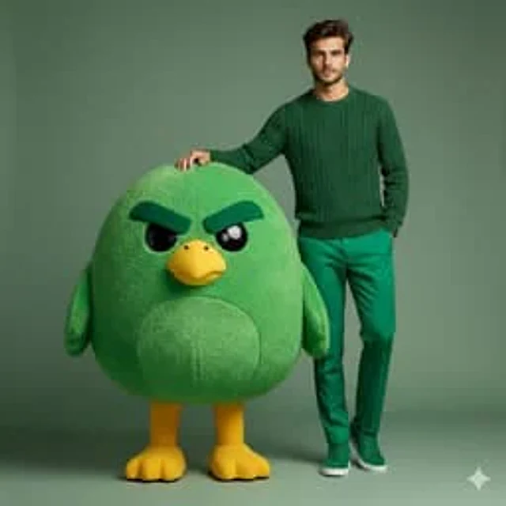

```text
High-end studio fashion portrait of a handsome male model standing beside a large plush green cartoon bird mascot. Minimal matte green background with soft tonal gradient. Model wearing a dark green cable-knit sweater, tailored emerald green trousers, and green sneakers, one hand resting casually on the mascot’s head, relaxed confident posture. Mascot is oversized, round, plush-textured, vivid green with thick expressive eyebrows, glossy eyes, and a bright yellow beak and feet. Soft diffused studio lighting, subtle shadows, ultra-sharp focus, rich fabric and texture detail, premium fashion campaign aesthetic, clean composition, modern playful luxury vibe, high resolution.
```

Model: Nano Banana
Author: Kashberg

[ProjectD](https://aitoolsradar.com/en/prompts/a9241660b9760a) · [Recorded source](https://x.com/Kashberg_0/status/2017953338881692117)
 · [Full original metadata and byte evidence](data/projectd-batch-0063.json)

## Kashberg #1325

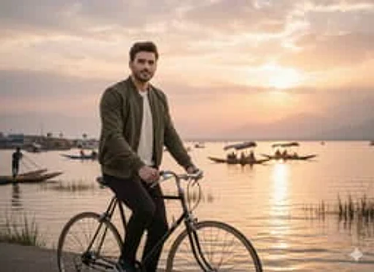

```text
A realistic cinematic photograph of a handsome man riding a bicycle along the edge of Dal Lake at sunset, wearing an olive-green jacket over a light sweater, black trousers and dark shoes. He has short styled hair and a trimmed beard, looking calmly toward the camera with a slight confident expression. Warm golden-hour light reflecting on the lake, traditional shikara boats with people rowing in the background, soft ripples in the water, distant mountains under a pastel sky with orange and pink hues. Shallow depth of field, natural colors, high detail, lifestyle travel photography, ultra-realistic, 4K quality.
```

Model: Nano Banana
Author: Kashberg

[ProjectD](https://aitoolsradar.com/en/prompts/d35c959b6c6af6) · [Recorded source](https://x.com/Kashberg_0/status/2008445407052050856)
 · [Full original metadata and byte evidence](data/projectd-batch-0063.json)

## Kashberg #1399

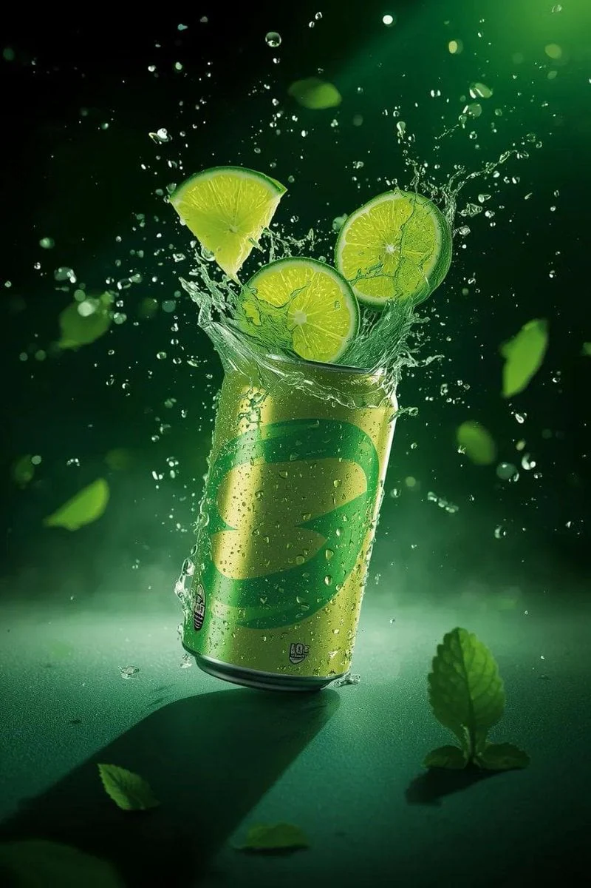

```text
A hyper-realistic commercial product shot of a refreshing lime soda can exploding with energy in mid-air. A vibrant green aluminum can covered in condensation, surrounded by sliced limes, mint leaves, and shards of ice, with a dramatic water splash bursting from the top. Lime wedges collide with the can, frozen in motion, droplets suspended in the air. Deep emerald green gradient background with glowing particles, cinematic studio lighting, high contrast highlights, ultra-sharp focus on the can, macro-level texture detail. Dynamic action composition, refreshing summer mood, premium beverage advertising style, photorealistic, 8k resolution.
```

Model: Nano Banana
Author: Kashberg

[ProjectD](https://aitoolsradar.com/en/prompts/af763ee855aac6) · [Recorded source](https://x.com/Kashberg_0/status/2011423604823720358)
 · [Full original metadata and byte evidence](data/projectd-batch-0063.json)

## Kashberg #317

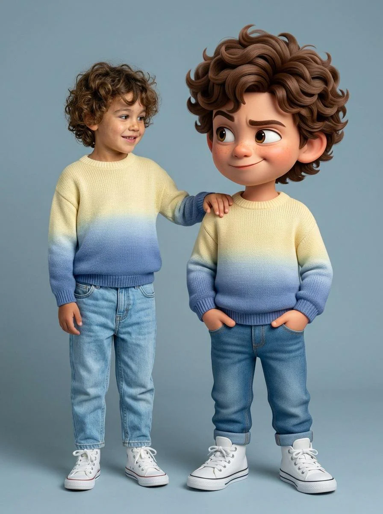

```text
Ultra-high-quality hyper-realistic photo featuring a real human and a giant 3D Pixar-style version of THE SAME person — both strictly based on the uploaded reference image. The real person and the Pixar character must have identical facial structure, hairstyle, facial expression, body proportions, height, and clothing.
Both are wearing a knitted sweater with a gradient from light yellow to pink, high-waisted blue jeans, and white high-top sneakers.
The pose must exactly match the reference: the real person stands relaxed with a friendly smile, with their hand naturally resting on the shoulder of the Pixar character. The Pixar version stands slightly wider, arms confidently positioned near the pockets, with a playful sly smirk, one raised eyebrow, and expressive Pixar-style eyes.
The Pixar character should be proportionally larger, but anatomically identical to the real person. The facial expression, head tilt, posture, and body language must precisely replicate the reference image.
Clean gray-blue studio background, soft even studio lighting, realistic shadows, crisp fabric texture, smooth Pixar-style skin shading, cinematic sharpness.
DO NOT change the pose, reaction, clothing, or proportions. Strict adherence to the reference.
```

Model: Nano Banana
Author: Kashberg

[ProjectD](https://aitoolsradar.com/en/prompts/9ebefce5b0e8b7) · [Recorded source](https://x.com/Kashberg_0/status/2029142137015812314)
 · [Full original metadata and byte evidence](data/projectd-batch-0063.json)

## Kashberg #369

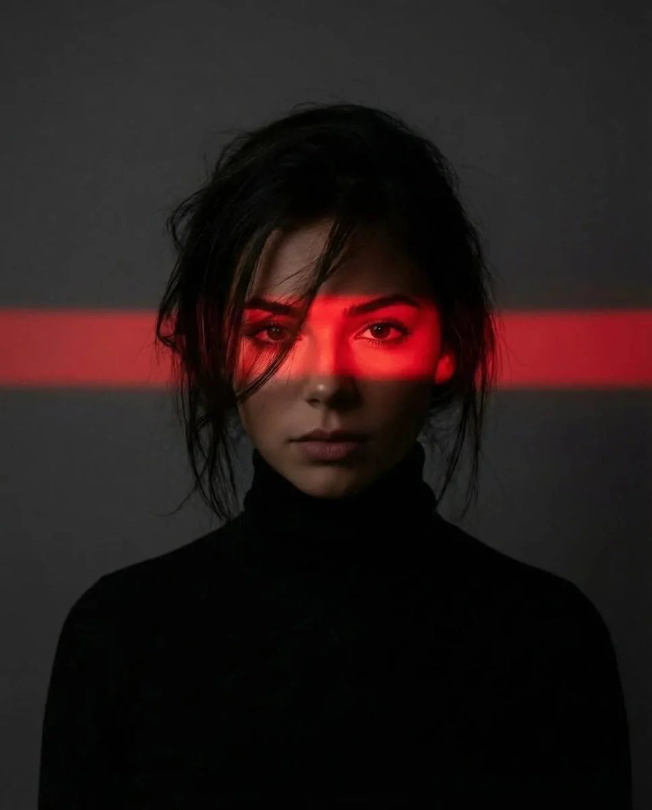

```text
Cinematic studio portrait of a young man with messy textured hair, wearing a black turtleneck, centered composition, dark minimal background, dramatic low-key lighting, a horizontal red neon light strip cutting across his eyes, strong contrast shadows covering lower face, intense gaze, moody atmosphere, cyberpunk aesthetic, ultra-realistic, sharp focus, 85mm lens, shallow depth of field, high detail, editorial photography style.
```

Model: Nano Banana
Author: Kashberg

[ProjectD](https://aitoolsradar.com/en/prompts/5987e391256163) · [Recorded source](https://x.com/Kashberg_0/status/2035918574674665977)
 · [Full original metadata and byte evidence](data/projectd-batch-0063.json)

## Kashberg #372

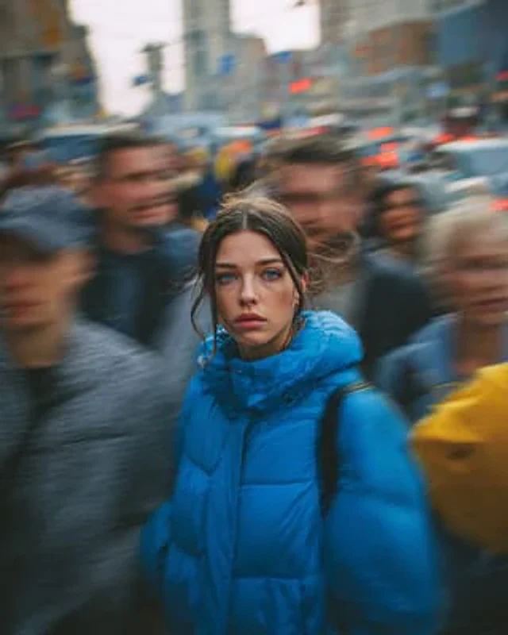

```text
Ultra-realistic cinematic street portrait of a young woman in a bright blue puffer jacket standing still in the middle of a busy city crowd, intense eye contact with camera, shallow depth of field, motion-blurred pedestrians rushing around her, urban background with traffic lights and tall buildings, cool color grading, natural skin tones, soft overcast lighting, 85mm lens, f/1.8, high detail, sharp focus on subject, dynamic motion blur, editorial photography, 8k.
```

Model: Nano Banana
Author: Kashberg

[ProjectD](https://aitoolsradar.com/en/prompts/2ee4d6e6d7a868) · [Recorded source](https://x.com/Kashberg_0/status/2026100670500339830)
 · [Full original metadata and byte evidence](data/projectd-batch-0063.json)

## Kashberg #437

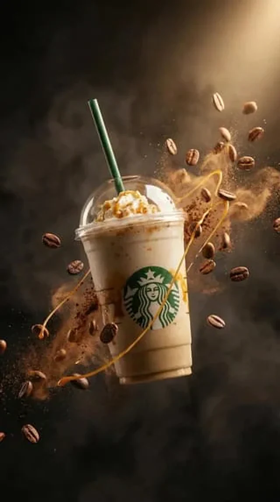

```text
Ultra-realistic commercial product photography of a caramel frappuccino in a clear plastic cup with dome lid and green straw, topped with whipped cream and caramel drizzle, floating mid-air. Coffee beans exploding around the cup with fine coffee powder dust particles suspended in the air, dynamic caramel splash trails swirling around the drink. Dark smoky background with dramatic spotlight from above, warm golden rim lighting, high contrast, sharp focus, macro details, cinematic depth of field, hyper-detailed texture, premium beverage advertisement, 8K resolution.
```

Model: Nano Banana
Author: Kashberg

[ProjectD](https://aitoolsradar.com/en/prompts/ce985f0ec0822f) · [Recorded source](https://x.com/Kashberg_0/status/2024707382727889320)
 · [Full original metadata and byte evidence](data/projectd-batch-0063.json)

## Kashberg #567

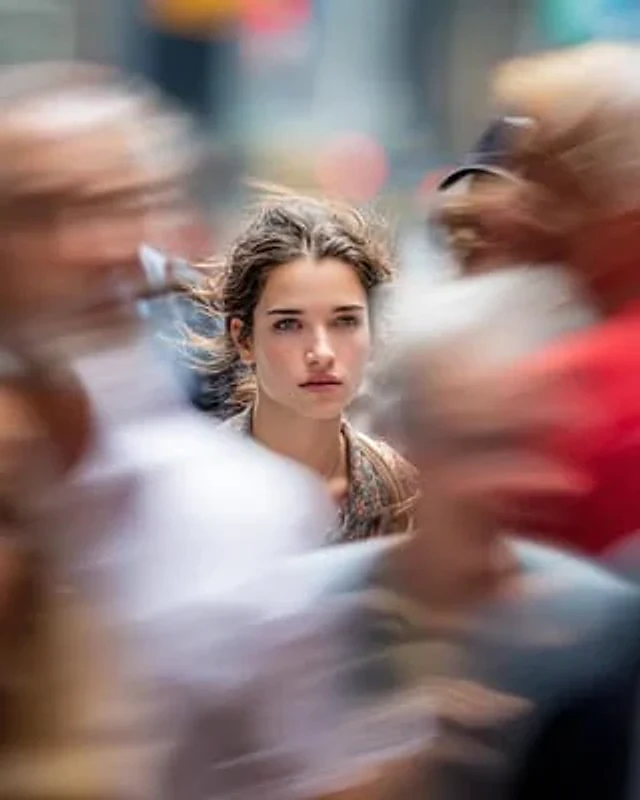

```text
Model looking at camera, close up of face, busy New York street, motion blurred people crossing frame, 200mm zoom lens
```

Model: Nano Banana
Author: Kashberg

[ProjectD](https://aitoolsradar.com/en/prompts/dcd82513b3dad2) · [Recorded source](https://x.com/Kashberg_0/status/2034788160253960306)
 · [Full original metadata and byte evidence](data/projectd-batch-0063.json)

## Kashberg #581

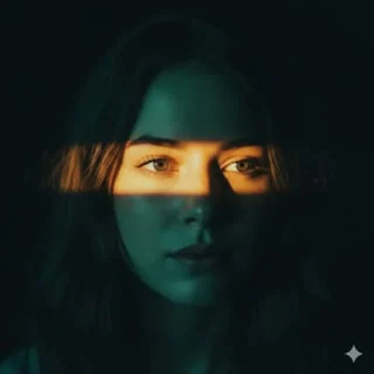

```text
Ultra-realistic cinematic portrait of a young woman with soft brown hair, centered composition, dark moody background, dramatic horizontal strip of warm golden sunlight cutting across her eyes, teal and orange color grading, half of the face in deep shadow, intense eye contact, sharp facial details, soft skin texture, high contrast lighting, volumetric light beam effect, shallow depth of field, 85mm lens, f/1.8, studio quality, symmetrical framing, mysterious atmosphere, 4K, hyper-detailed.
```

Model: Nano Banana
Author: Kashberg

[ProjectD](https://aitoolsradar.com/en/prompts/8f55f21199363d) · [Recorded source](https://x.com/Kashberg_0/status/2026212158548369776)
 · [Full original metadata and byte evidence](data/projectd-batch-0063.json)

## Kashberg #650

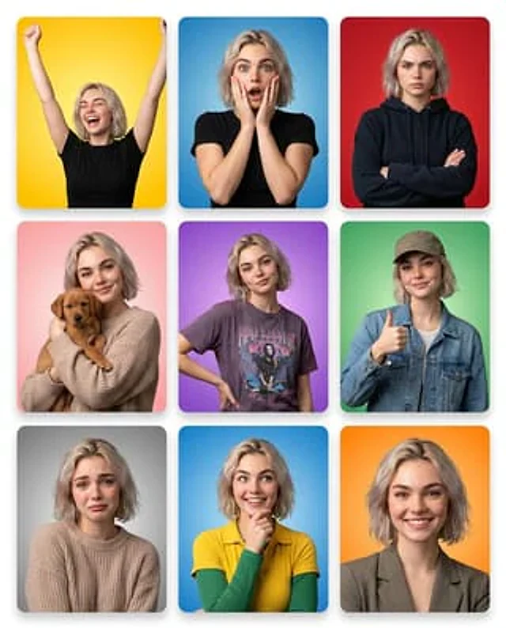

```text
Panels are NOT edge-to-edge
Visible thin white spacing between panels Subtle outer white margin around the entire grid clean modern UI-style layout
Slight rounded corners on each tile
Panel 1 — Joyful / Celebratory (Yellow) Bright yellow gradient background
Arms raised
Eyes closed
Big open laugh
Energetic posture
Panel 2 — Shocked (Blue)
Blue gradient background
Hands on cheeks
Wide eyes
Open mouth
Raised brows
Panel 3 — Serious / Stern (Red)
Red background
Arms crossed
Furrowed brows
Neutral tight lips
Wearing dark hoodie
Panel 4 — Affectionate (Pink)
Soft pink gradient
Holding small brown puppy
Gentle smile
Cozy knit sweater
Panel 5 — Confident / Sassy (Purple)
Purple gradient background
One hand on hip
Slight smirk
Graphic t-shirt
Relaxed stance
Panel 6 — Friendly / Casual Approval (Green)
Green gradient background
Wearing cap + denim jacket
Thumbs-up
Relaxed smile
Panel 7 — Sad / Emotional (Gray)
Gray gradient background
Slight downward gaze
Eyebrows slightly raised in center
Lips slightly curved downward
```

Model: Nano Banana
Author: Kashberg

[ProjectD](https://aitoolsradar.com/en/prompts/16739575adff05) · [Recorded source](https://x.com/Kashberg_0/status/2029370003485802945)
 · [Full original metadata and byte evidence](data/projectd-batch-0063.json)

## Kashberg #723

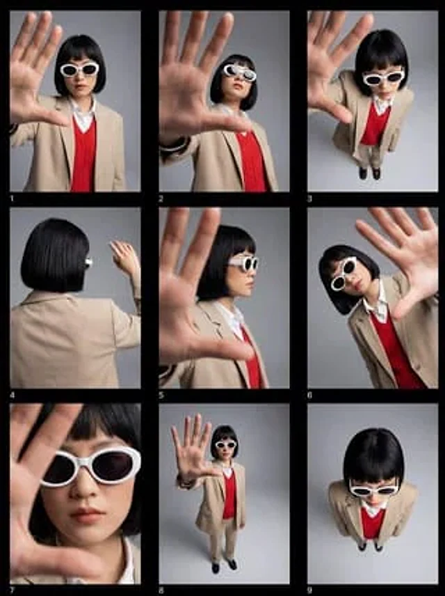

```text
Editorial fashion contact sheet of a modern woman with a sharp black bob haircut wearing white oval sunglasses, a beige tailored suit over a red sweater vest and white shirt, photographed in a minimalist studio with a neutral grey backdrop. Multiple frames arranged in a 3×3 grid showing varied angles—front, side, top-down, back view—while the subject repeatedly reaches her hand toward the camera lens, creating strong depth and perspective distortion. Clean high-fashion styling, bold color contrast, soft diffused studio lighting, crisp focus, contemporary magazine aesthetic, 35mm–50mm look, ultra-sharp, high resolution.
```

Model: Nano Banana
Author: Kashberg

[ProjectD](https://aitoolsradar.com/en/prompts/0264ea708103bb) · [Recorded source](https://x.com/Kashberg_0/status/2018544770440925209)
 · [Full original metadata and byte evidence](data/projectd-batch-0063.json)

## Kashberg #746

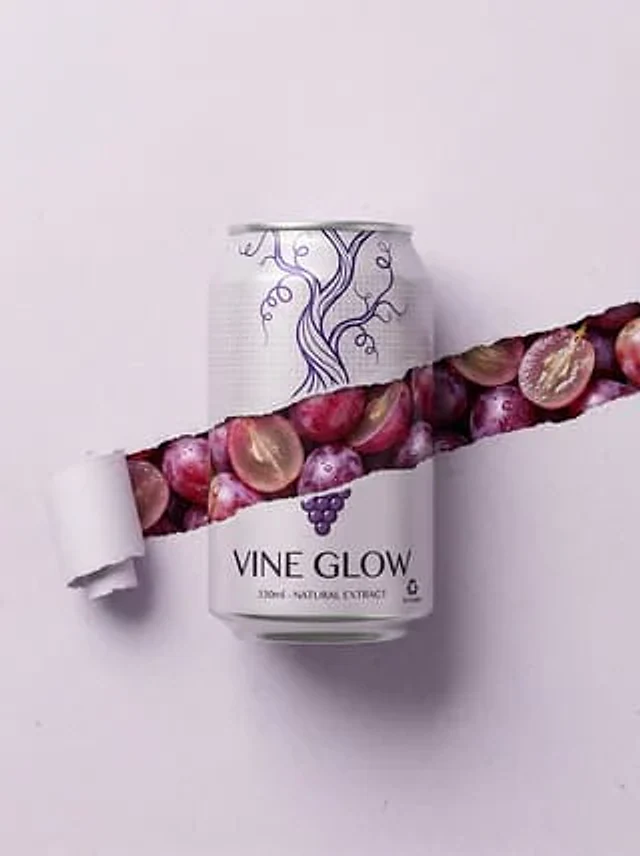

```text
Grape Can – “Vine Glow”

Minimalist product photography of a 330ml aluminum can labeled “VINE GLOW – Natural Extract”, centered on a clean light grey background. The can features elegant purple vine line art. A realistic horizontal torn paper effect cuts across the middle of the can and background, revealing fresh red and purple grapes inside with water droplets and glossy texture. Soft studio lighting, high detail, sharp focus, commercial advertising style, modern packaging design, symmetrical composition, ultra-realistic, 8k resolution.
```

Model: Nano Banana
Author: Kashberg

[ProjectD](https://aitoolsradar.com/en/prompts/6daaa97105fd78) · [Recorded source](https://x.com/Kashberg_0/status/2029476310125560281)
 · [Full original metadata and byte evidence](data/projectd-batch-0063.json)

## Kashberg #795

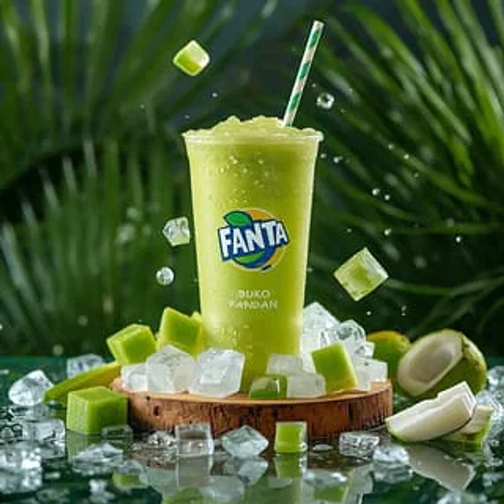

```text
Ultra-realistic commercial product photography of a cold green tropical drink in a transparent plastic cup with Fanta Buko Pandan branding, crushed ice inside, condensation droplets on the cup, green striped paper straw, surrounded by floating ice cubes and pandan jelly cubes, coconut pieces and pandan leaves around the base, drink placed on a small wooden platform, reflective wet surface with scattered ice, tropical jungle leaves background, vibrant green color palette, refreshing summer beverage advertisement, dramatic studio lighting, shallow depth of field, macro details, high-speed splash photography, 8k ultra detailed, professional advertising shot.
Optional parameters
•Aspect ratio: --ar 1:1
•Style: --style raw
•Quality: --q 2

Prompt:

Premium advertising photo of Fanta Buko Pandan tropical beverage, tall clear cup filled with icy green pandan coconut drink, condensation droplets on the cup, white straw, surrounded by crystal ice cubes and pandan jelly cubes, fresh coconut halves and pandan stalks on table, placed on a wooden display stand, glossy reflective surface, lush tropical leaf background with soft bokeh, vibrant green tones, cinematic lighting, hyper-realistic food photography, commercial beverage campaign style, ultra sharp details, 8k resolution, shallow depth of field.
Optional parameters
•Aspect ratio: --ar 1:1
•Lighting: studio softbox lighting
•Style keywords: photorealistic, beverage advertising, macro texture
```

Model: Nano Banana
Author: Kashberg

[ProjectD](https://aitoolsradar.com/en/prompts/e8a92f8d3c93f6) · [Recorded source](https://x.com/Kashberg_0/status/2033341324305608968)
 · [Full original metadata and byte evidence](data/projectd-batch-0063.json)

## Kashberg #804

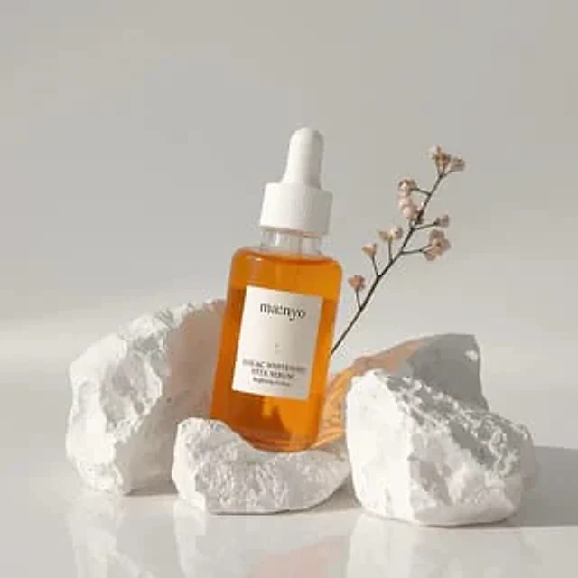

```text
Minimalist studio product photography of an amber glass dropper serum bottle with white cap, labeled “ma:nyo Galac Whitening Vita Serum”, placed between large textured white stones, soft beige background, warm sunlight casting natural shadows, subtle golden glow reflecting through the glass, small delicate dried flowers beside the bottle, glossy reflective surface, high-end skincare advertisement, ultra-realistic, 85mm lens, shallow depth of field, soft diffused lighting, clean aesthetic, 8k resolution.
```

Model: Nano Banana
Author: Kashberg

[ProjectD](https://aitoolsradar.com/en/prompts/3d11c6f3d3a5c7) · [Recorded source](https://x.com/Kashberg_0/status/2026270010814136482)
 · [Full original metadata and byte evidence](data/projectd-batch-0063.json)

## Kashberg #854

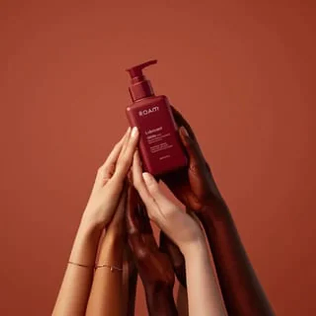

```text
Minimalist product photography of a matte red pump bottle labeled ‘ROAM lubricant’, held by multiple diverse hands with different skin tones, arranged elegantly around the bottle. Soft studio lighting, warm monochromatic terracotta background, smooth shadows, luxury skincare aesthetic, high-end commercial style, sharp focus, centered composition, clean and modern branding, glossy finish on bottle, subtle reflections, editorial beauty shot, 4k resolution.
```

Model: Nano Banana
Author: Kashberg

[ProjectD](https://aitoolsradar.com/en/prompts/4ef52ac3066e6e) · [Recorded source](https://x.com/Kashberg_0/status/2041012030216536237)
 · [Full original metadata and byte evidence](data/projectd-batch-0063.json)

## Kashberg #921

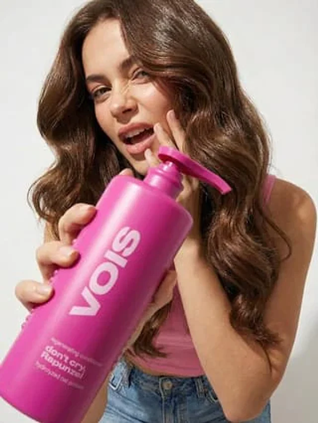

```text
Ultra-realistic beauty advertisement, close-up of a young woman with long wavy brown hair, soft glowing skin, wearing a pink sleeveless top, holding a large pink conditioner bottle labeled “VOIS” toward the camera, playful facial expression, natural makeup, bright studio lighting, clean white background, shallow depth of field, high-end cosmetic campaign, 85mm lens, sharp focus, glossy product texture, vibrant pink tones
```

Model: Nano Banana
Author: Kashberg

[ProjectD](https://aitoolsradar.com/en/prompts/8bf274fd3970e2) · [Recorded source](https://x.com/Kashberg_0/status/2041761330806595879)
 · [Full original metadata and byte evidence](data/projectd-batch-0063.json)

## Kashberg #956

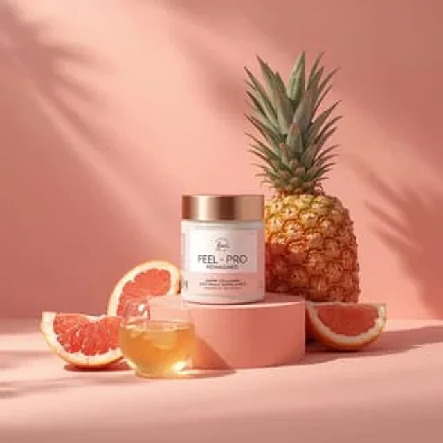

```text
Minimalist luxury product photography of a collagen supplement jar placed on a soft pastel peach background, cylindrical pedestal base, surrounded by fresh pineapple and sliced grapefruit, a small glass cup with golden liquid in front, warm sunlight casting soft palm leaf shadows, clean aesthetic, high-end skincare branding, soft diffused lighting, realistic textures, subtle reflections, shallow depth of field, editorial style, 4k, ultra-detailed.
```

Model: Nano Banana
Author: Kashberg

[ProjectD](https://aitoolsradar.com/en/prompts/714abca2bfc821) · [Recorded source](https://x.com/Kashberg_0/status/2034201918571188405)
 · [Full original metadata and byte evidence](data/projectd-batch-0063.json)

## Kashberg #957

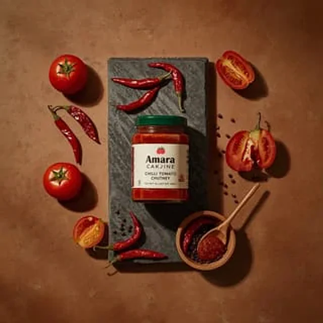

```text
Top-down premium food photography of a glass jar of chili tomato chutney placed on a dark stone slab, surrounded by fresh red tomatoes, sliced tomatoes, red chili peppers, black peppercorns, and a small wooden bowl with chutney and spoon. Warm earthy background, soft directional lighting, rich shadows, high contrast, minimal styling, commercial product shoot, ultra-detailed, 4K.
```

Model: Nano Banana
Author: Kashberg

[ProjectD](https://aitoolsradar.com/en/prompts/2e23a8c36068d9) · [Recorded source](https://x.com/Kashberg_0/status/2038456800190808446)
 · [Full original metadata and byte evidence](data/projectd-batch-0063.json)

## Kashberg #972

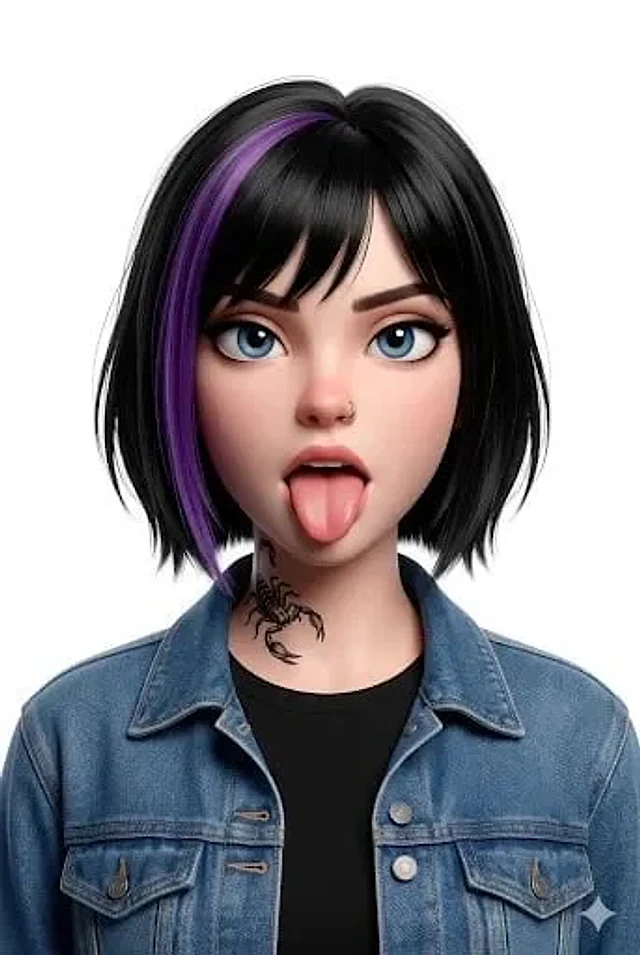

```text
3D stylized character portrait of a young man, curly dark hair, wearing black round glasses and a dark hoodie, subtle smirk expression while looking sideways, small tattoo on the neck, smooth skin, highly detailed Pixar-style character design, soft studio lighting, clean light gray background, ultra-sharp, cinematic render, high detail, modern animated film style.
```

Model: Nano Banana
Author: Kashberg

[ProjectD](https://aitoolsradar.com/en/prompts/6d520bf8114792) · [Recorded source](https://x.com/Kashberg_0/status/2029817553288319295)
 · [Full original metadata and byte evidence](data/projectd-batch-0063.json)

## Kashberg #998

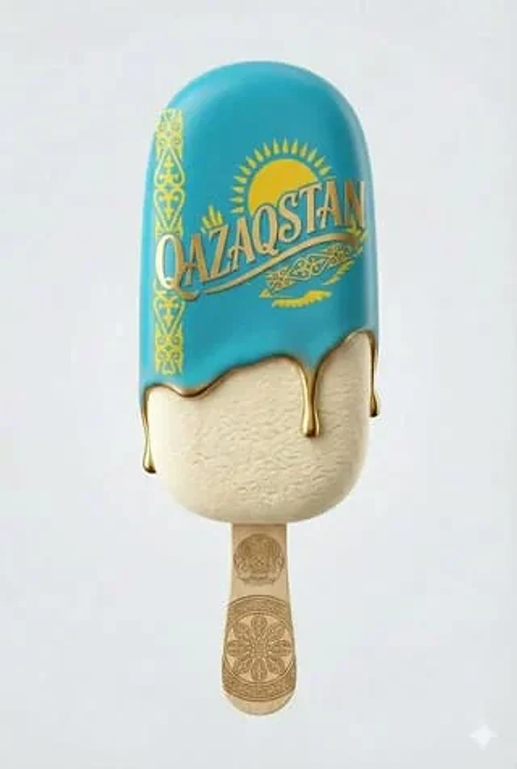

```text
A minimalist, ultra-realistic product shot of a premium ice cream bar inspired by Kazakhstan. The popsicle is coated in glossy turquoise icing with elegant gold ornamental patterns and the word “QAZAQSTAN” embossed in metallic gold, featuring a golden sun-and-eagle motif. The lower half reveals creamy vanilla ice cream with smooth texture and subtle melting drips. Wooden stick engraved with traditional Kazakh patterns. Clean white studio background, soft diffused lighting, sharp focus, luxury food branding aesthetic, high-detail textures, modern cultural fusion design, 8K quality.
```

Model: Nano Banana
Author: Kashberg

[ProjectD](https://aitoolsradar.com/en/prompts/f94591ac3aa848) · [Recorded source](https://x.com/Kashberg_0/status/2018170311364198617)
 · [Full original metadata and byte evidence](data/projectd-batch-0063.json)

## Keskin #1250

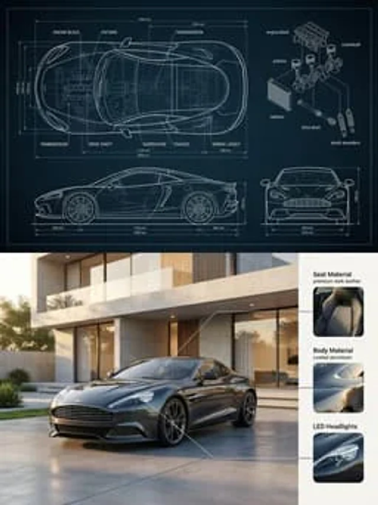

```text
{
  "objective": "Create a premium split composition showing a detailed automotive blueprint (top) and a perfectly matching real-world car with material breakdown (bottom), with a carefully designed high-end background",
  "aspect_ratio": "3:4",
  "composition": {
    "layout": "vertical_split",
    "split_ratio": "50:50",
    "alignment": "precise, centered",
    "continuity_rule": "bottom car must EXACTLY match blueprint geometry, proportions, and design"
  },

  "top_section": {
    "type": "engineering_blueprint",
    "style": "ultra-detailed CAD drawing",
    "background": {
      "color": "#0b1d2a",
      "texture": "subtle grid lines",
      "vignette": "very slight edge darkening"
    },
    "linework": {
      "color": "white with faint cyan glow",
      "thickness_variation": "technical precision",
      "sharpness": "very crisp"
    },
    "views": {
      "top_view": "dominant center",
      "side_view": "bottom left",
      "front_view": "bottom right"
    },
    "technical_elements": {
      "dimension_lines": true,
      "units": "mm",
      "arrows": "thin CAD arrows",
      "labels": [
        "ENGINE BLOCK",
        "PISTONS",
        "TRANSMISSION",
        "DRIVE SHAFT",
        "SUSPENSION",
        "CHASSIS",
        "WIRING LAYOUT"
      ],
      "exploded_diagram": {
        "position": "top right",
        "components": [
          "engine block",
          "crankshaft",
          "pistons",
          "radiator",
          "drive shaft",
          "shock absorbers"
        ],
        "connection_lines": "dashed white"
      }
    },
    "detail_level": "engineering-grade, extremely dense"
  },

  "bottom_section": {
    "type": "real_product + material_breakdown",
    "layout": "car_left_material_panel_right",

    "environment": {
      "type": "luxury architectural setting",
      "design_intent": "background must feel intentional, premium, and editorial — not random",

      "scene": {
        "location": "modern minimalist luxury house exterior",
        "architecture": [
          "clean concrete walls",
          "large floor-to-ceiling glass panels",
          "subtle wood accents",
          "sharp geometric lines"
        ],
        "ground": "smooth concrete driveway with slight reflection",
        "background_elements": [
          "minimal landscaping (bonsai-style trees or trimmed bushes)",
          "no clutter",
          "balanced negative space"
        ]
      },

      "lighting": {
        "time": "golden hour (soft warm sunlight)",
        "direction": "side lighting to enhance car shape",
        "shadows": "soft and elongated",
        "reflections": "physically accurate on car paint"
      },

      "depth": {
        "depth_of_field": "moderate",
        "background_blur": "slight cinematic blur",
        "focus_priority": "car remains razor sharp"
      }
    },

    "car_render": {
      "style": "photorealistic automotive photography",
      "camera": {
        "angle": "3/4 front angle",
        "height": "slightly low for hero perspective",
        "lens": "35mm",
        "framing": "car occupies left 60% of bottom section"
      },
      "constraints": [
        "exact match to blueprint",
        "no added design features",
        "realistic proportions only"
      ]
    },

    "material_panel": {
      "position": "right side",
      "style": "Apple-style product breakdown",
      "background": "soft off-white panel with subtle shadow separation",
      "layout": "vertical stack with spacing",

      "items": [
        {
          "title": "Seat Material",
          "visual": "macro close-up of seat texture",
          "material": "premium leather or fabric",
          "lighting": "soft diffused",
          "annotation": "thin line pointing to interior seat"
        },
        {
          "title": "Body Material",
          "visual": "close-up of painted metal with reflections",
          "material": "coated aluminum / steel",
          "annotation": "points to car exterior panel"
        },
        {
          "title": "LED Headlights",
          "visual": "detailed glowing LED headlight close-up",
          "material": "modern LED system",
          "annotation": "points to front headlight"
        }
      ],

      "typography": {
        "font": "modern sans-serif",
        "style": "clean, minimal",
        "hierarchy": "clear titles + small labels"
      }
    }
  },

  "style": {
    "fusion": [
      "engineering blueprint",
      "luxury automotive ad",
      "product design presentation"
    ],
    "quality": "ultra high-end",
    "finish": "polished, editorial-grade"
  },

  "negative_constraints": [
    "no mismatch between blueprint and car",
    "no messy or cluttered background",
    "no unrealistic reflections",
    "no over-saturated colors",
    "no random environments",
    "no extra parts not in blueprint"
  ],

  "render_settings": {
    "sharpness": "high",
    "dynamic_range": "wide",
    "color_grading": "natural cinematic",
    "noise": "minimal"
  }
}
```

Model: Nano Banana
Author: Keskin

[ProjectD](https://aitoolsradar.com/en/prompts/06abfe1ebc1aa1) · [Recorded source](https://x.com/craftian_keskin/status/2039777786639126806)
 · [Full original metadata and byte evidence](data/projectd-batch-0063.json)

## Keskin #334

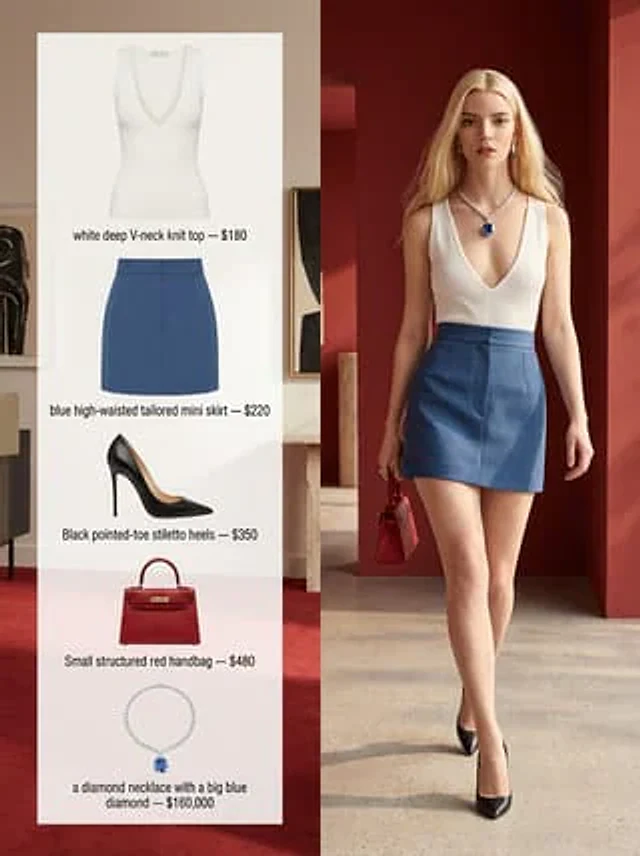

```text
A refined fashion editorial image with a 3:4 aspect ratio, split into two clear sections.

Right side:
A fashionable, confident, sensual woman standing and walking casually in a modern architectural space with red luxurious walls and soft natural light. She wears a top with a deep V neckline, a 90-60-90 figure, tucked into a high-waisted blue tailored short skirt, On her feet are sleek black stiletto heels, elegant and minimal. She carries a small structured red handbag in one hand and she is wearing a luxurious diamond necklace with a blue diamond on it.

Her hair is open emphasizing her facial structure. She wears subtle statement earrings. The look is refined, modern, and effortlessly chic. Natural daylight, soft shadows, realistic skin texture. Casual fashion photography style with an editorial, high-end feel. alive color palette, warm tones, shallow depth of field, cinematic realism.

Style & Mood:
Modern elegance, quiet luxury, confident, minimal, editorial casual.

Photography Details:
Eye-level angle, candid stance, 35mm lens, natural lighting, high detail, photorealistic.

Left side:
A clean, minimalist product breakdown layout on a neutral background. The individual fashion items worn by the woman are displayed separately, neatly arranged with subtle shadows. Each item includes a small, elegant price label in refined sans-serif typography:

– white deep V-neck knit top — $180
– blue high-waisted tailored mini skirt — $220
– Black pointed-toe stiletto heels — $350
– Small structured red handbag — $480
– a diamond necklace with a big blue diamond — $160000

The left side feels like a luxury fashion catalog or e-commerce lookbook, with a red carpet, luxurious walls, art pieces on wall

Overall Style & Mood:
Quiet luxury, modern elegance, editorial fashion, high-end retail aesthetic.

Lighting & Quality:
Soft natural light, studio-clean clarity on product side, photorealistic, ultra-high resolution, professional fashion photography.

Negative Prompt:
Cluttered layout, oversized text, flashy logos, mannequins, people on left side, harsh lighting, low resolution, cartoon style.
```

Model: Nano Banana
Author: Keskin

[ProjectD](https://aitoolsradar.com/en/prompts/b1101dd3ea7a7a) · [Recorded source](https://x.com/craftian_keskin/status/2009665973058515294)
 · [Full original metadata and byte evidence](data/projectd-batch-0063.json)

## Keskin #366

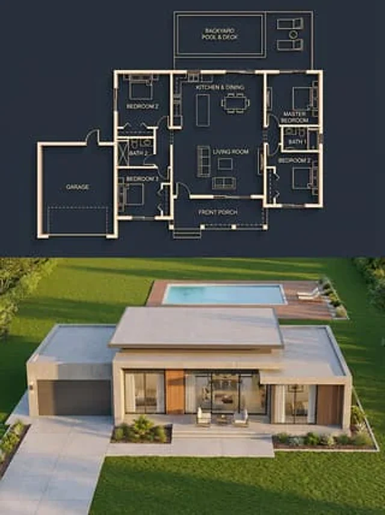

```text
{
  "objective": "Create a split architectural visualization where the top is a detailed dark-themed blueprint and the bottom is a photorealistic house that matches the blueprint EXACTLY",

  "aspect_ratio": "3:4",

  "composition": {
    "layout": "vertical split",
    "top_section": "blueprint",
    "bottom_section": "realistic render",
    "alignment": "perfect structural correspondence between both sections"
  },

  "top_section": {
    "type": "architectural blueprint",
    "style": "dark luxury blueprint (similar to reference image 2)",

    "visual_style": {
      "background": "deep navy / charcoal blue",
      "lines": "thin glowing beige/gold lines",
      "walls": "slightly extruded 3D effect",
      "labels": "clean modern sans-serif",
      "lighting": "soft ambient glow"
    },

    "content": {
      "rooms": [
        "3 bedrooms (left, right, bottom-right)",
        "central living room",
        "kitchen + dining (top center)",
        "2 bathrooms",
        "garage (left side connected)",
        "front porch",
        "backyard pool with deck"
      ],
      "details": [
        "furniture outlines (beds, sofa, dining table)",
        "door swings and openings",
        "window placements",
        "circulation paths",
        "exact proportions and spacing"
      ]
    }
  },

  "bottom_section": {
    "type": "photorealistic house render",

    "constraint": "MUST MATCH THE BLUEPRINT EXACTLY — no added, removed, or shifted rooms",

    "architecture": {
      "style": "modern single-story house",
      "roof": "flat layered roof",
      "materials": [
        "smooth concrete walls",
        "wood panel accents",
        "large glass windows"
      ]
    },

    "layout_mapping_rules": [
      "garage must be on the left side exactly as blueprint",
      "main entrance aligned with living room",
      "pool positioned in backyard matching blueprint dimensions",
      "window placements correspond to each room location",
      "bedroom volumes visible externally in correct positions"
    ],

    "environment": {
      "setting": "suburban neighborhood",
      "elements": [
        "green lawn",
        "minimal landscaping",
        "clean driveway leading to garage",
        "pool deck matching blueprint footprint"
      ]
    },

    "lighting": {
      "time": "golden hour",
      "style": "soft natural light with realistic shadows"
    },

    "camera": {
      "angle": "slightly elevated front perspective",
      "lens": "35mm architectural view"
    }
  },

  "consistency_rules": [
    "room positions must be identical between blueprint and render",
    "no extra structures added in render",
    "all doors and windows must align logically",
    "pool size and placement must match exactly",
    "garage placement must match blueprint"
  ],

  "style": {
    "top": "architectural visualization (dark premium)",
    "bottom": "photorealistic modern house",
    "overall": "clean, high-end architectural presentation"
  },

  "negative_constraints": [
    "no mismatch between blueprint and render",
    "no extra rooms",
    "no fantasy elements",
    "no unrealistic proportions",
    "no cluttered environment"
  ]
}
```

Model: Nano Banana
Author: Keskin

[ProjectD](https://aitoolsradar.com/en/prompts/18d8c56f6093db) · [Recorded source](https://x.com/craftian_keskin/status/2040757362382798888)
 · [Full original metadata and byte evidence](data/projectd-batch-0063.json)

## Keskin #374

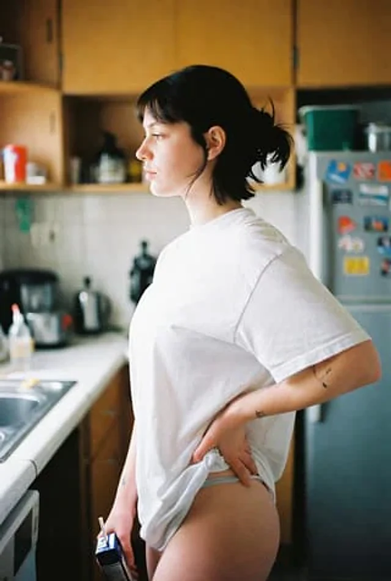

```text
{
  "type": "image_generation_prompt",
  "style": "photorealistic, lifestyle photography",
  "sexualization": "none",
  "description": {
    "subject": "A young woman standing casually in a home kitchen, seen in side profile",
    "pose": "Relaxed posture, one hand resting on her hip while the other holds a small drink carton with a straw",
    "expression": "Neutral, thoughtful, slightly distant gaze looking forward",
    "appearance": {
      "hair": "Dark hair tied in a loose low bun with natural strands framing the face",
      "clothing": "Oversized white t-shirt worn casually, simple underwear partially visible due to the relaxed fit of the shirt",
      "tattoos": "Small, minimal black-ink tattoos on the forearm, subtle and understated"
    }
  },
  "environment": {
    "location": "A modest, lived-in home kitchen",
    "details": "Wooden cabinets, countertop appliances, a refrigerator covered with colorful magnets and souvenirs",
    "lighting": "Soft natural daylight coming from a window, warm and slightly muted",
    "atmosphere": "Quiet, everyday domestic moment"
  },
  "camera": {
    "angle": "Side profile view",
    "framing": "Medium shot capturing the subject from mid-thigh to head",
    "lens": "35mm lifestyle lens",
    "depth_of_field": "Moderate, background softly in focus to preserve environmental context"
  },
  "image_quality": {
    "realism": "High",
    "texture_detail": "Natural fabric folds, skin texture, and kitchen surface details visible",
    "grain": "Light natural film grain for an authentic look"
  },
  "mood": "Calm, intimate, documentary-style",
  "constraints": [
    "Non-sexualized, everyday realism",
    "Focus on natural lifestyle and atmosphere",
    "No exaggerated poses or expressions",
    "Candid, slice-of-life aesthetic"
  ]
}
```

Model: Nano Banana
Author: Keskin

[ProjectD](https://aitoolsradar.com/en/prompts/e62f1f7f234ee6) · [Recorded source](https://x.com/craftian_keskin/status/2010784341975318837)
 · [Full original metadata and byte evidence](data/projectd-batch-0063.json)

## Keskin #516

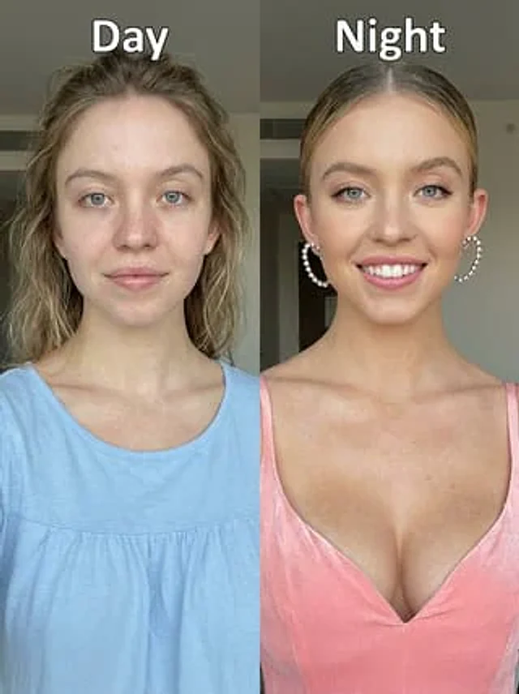

```text
Before-and-after upper-body portrait photo of Sydney Sweeney, smiling in both images, split vertically down the center into two equal halves for a direct visual comparison. Clear text labels appear at the top of each half.

Left side – “Day” (label at top):
Natural, no makeup look. Realistic skin texture with visible pores, slight under-eye shadows, natural lips, minimal grooming. Soft, relaxed smile. Hair casually styled. She is wearing a simple nightgown for bed, comfortable and modest. Daytime feeling, fresh and unstyled, authentic at-home appearance.

Right side – “Night” (label at top):
Professional makeup applied: even skin tone, subtle contouring, enhanced eyes with mascara and eyeliner, defined brows, soft lipstick. Bright, confident smile. Hair styled elegantly. She is wearing a beautiful, pink dress with a deep neckline

Both sides show the same pose, framing, camera distance, background, and angle to ensure the contrast comes purely from makeup, styling, and wardrobe.

Photography & Camera Style:
Smartphone camera realism, portrait mode look, handheld feel, natural lighting, slight digital noise, mild compression artifacts, realistic color balance, minimal retouching, honest skin detail. Casual but clear comparison photo rather than studio perfection.

Aspect ratio:
3:4 (portrait)

negative prompt:
beauty filters, over-smoothed skin, exaggerated makeup, inconsistent lighting, mismatched expressions, face distortion, studio glamour lighting, cinematic look, watermark, text artifacts (except “Day” and “Night” labels)
```

Model: Nano Banana
Author: Keskin

[ProjectD](https://aitoolsradar.com/en/prompts/2cd4ccb0c0955e) · [Recorded source](https://x.com/craftian_keskin/status/2011148742913900843)
 · [Full original metadata and byte evidence](data/projectd-batch-0063.json)

## Keskin #593

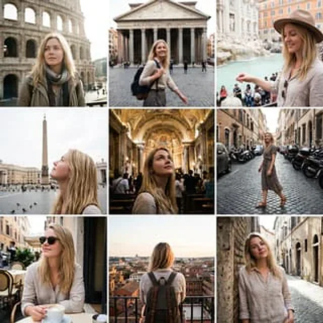

```text
{
  "Objective": "Create a 3x3 Instagram-style grid of low-quality smartphone photos featuring the same extremely beautiful blonde woman traveling in Rome, capturing iconic landmarks with a natural, unfiltered aesthetic.",
  "Composition": {
    "layout": "3x3 grid",
    "aspect_ratio": "1:1",
    "framing": "each square is a different candid moment, forming a cohesive Instagram profile layout"
  },
  "Subject": {
    "type": "young woman",
    "appearance": {
      "hair": "blonde",
      "beauty": "extremely beautiful, natural attractiveness",
      "skin": "realistic skin texture, no glossiness, no smoothing",
      "makeup": "minimal, natural look",
      "expression": "candid, relaxed, travel lifestyle expressions"
    },
    "consistency": "same woman across all 9 photos"
  },
  "Scenes": [
    {
      "position": "top left",
      "location": "Colosseum",
      "pose": "standing casually, looking away"
    },
    {
      "position": "top center",
      "location": "Pantheon",
      "pose": "walking or mid-step candid"
    },
    {
      "position": "top right",
      "location": "Trevi Fountain (Love Fountain)",
      "pose": "throwing coin or smiling softly"
    },
    {
      "position": "middle left",
      "location": "Vatican Obelisk (St. Peter’s Square)",
      "pose": "looking up at architecture"
    },
    {
      "position": "middle center",
      "location": "Sistine Chapel",
      "pose": "looking upward, subtle awe expression"
    },
    {
      "position": "middle right",
      "location": "Roman city street",
      "pose": "walking candid, street lifestyle"
    },
    {
      "position": "bottom left",
      "location": "Roman cafe street",
      "pose": "sitting casually, relaxed"
    },
    {
      "position": "bottom center",
      "location": "panoramic cityscape viewpoint",
      "pose": "back facing camera, overlooking city"
    },
    {
      "position": "bottom right",
      "location": "historic Roman alley or landmark",
      "pose": "leaning or standing naturally"
    }
  ],
  "Photography": {
    "camera": "smartphone",
    "style": "Instagram casual travel",
    "quality": "intentionally low quality",
    "lighting": "natural sunlight, uneven exposure",
    "imperfections": [
      "motion blur",
      "grain/noise",
      "slight overexposure or underexposure",
      "lens distortion",
      "unbalanced framing"
    ],
    "effects": [
      "no beauty filter",
      "no skin retouching",
      "authentic dynamic range",
      "slightly washed or inconsistent colors"
    ]
  },
  "Mood": "carefree travel, European summer, candid lifestyle",
  "Rendering": {
    "style_keywords": [
      "instagram grid",
      "rome travel photos",
      "smartphone photography",
      "low quality aesthetic",
      "natural beauty",
      "tourist lifestyle"
    ],
    "realism": "highly realistic smartphone look",
    "detail_level": "natural imperfect detail",
    "aspect_ratio": "--ar 1:1"
  },
  "Response_Format": {
    "type": "image_generation_prompt_json",
    "editable_fields": [
      "scenes",
      "lighting",
      "poses",
      "wardrobe"
    ]
  }
}
```

Model: Nano Banana
Author: Keskin

[ProjectD](https://aitoolsradar.com/en/prompts/7dfe6eb374876c) · [Recorded source](https://x.com/craftian_keskin/status/2036461032651235759)
 · [Full original metadata and byte evidence](data/projectd-batch-0063.json)

## Keskin #862

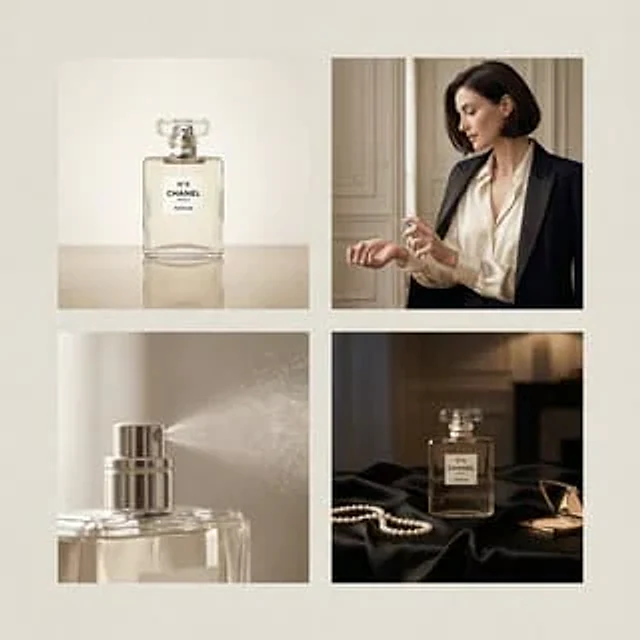

```text
2×2 grid luxury perfume advertisement for Chanel perfume, four distinct yet cohesive high-end commercial images, elegant Parisian aesthetic, timeless fashion branding.

Panel 1 – Hero Product Elegance

Minimalist studio shot of a Chanel perfume bottle centered on a reflective surface. Soft, diffused lighting highlights the glass clarity, sharp edges, and iconic label. Neutral background in beige, ivory, or soft black. Luxurious, calm, iconic composition.

Panel 2 – Parisian Lifestyle Mood

Elegant adult woman in a classic Parisian interior vintage molding. She gently applies Chanel perfume to her neck or wrist. Natural light, effortless beauty, refined posture. Editorial fashion photography style, understated luxury.

Panel 3 – Sensory Detail Close-Up

Macro close-up of the Chanel perfume bottle with fine mist dispersing into the air. Light catches the spray particles. Soft shadows, shallow depth of field. Emphasis on texture, fragrance atmosphere, and sensory refinement.

Panel 4 – Cinematic Night Glamour

Moody, cinematic scene with the Chanel perfume bottle placed on a dark surface beside silk fabric or pearls. Low-key lighting, warm highlights, deep shadows. Evokes mystery, confidence, and timeless femininity.

All four images are visually unified through refined color grading, restrained contrast, and classic Chanel luxury cues.

Visual Style

Luxury fashion advertising
Editorial, timeless, refined
Soft contrast
Muted neutral palette
High realism
Clean composition
Parisian elegance

Camera & Lighting

Professional studio and editorial photography
50–85mm lens look
Shallow depth of field
Soft diffused lighting
Controlled highlights and shadows
Perfect label clarity

Mood Keywords

Elegant
Iconic
Sophisticated
Timeless
Feminine
Confident
Luxury

Negative Prompt

Cheap packaging, distorted logo, misspelled branding, harsh lighting, oversaturation, cluttered background, CGI look, cartoon style, watermark, text overlays, knockoff perfume bottles

Aspect Ratio

Overall canvas: 1:1
Grid: 2×2 equal squares
Optimized for luxury brand advertising and social campaigns
```

Model: Nano Banana
Author: Keskin

[ProjectD](https://aitoolsradar.com/en/prompts/f13cd9efa27eff) · [Recorded source](https://x.com/craftian_keskin/status/2016146144590541290)
 · [Full original metadata and byte evidence](data/projectd-batch-0063.json)

## Keskin #873

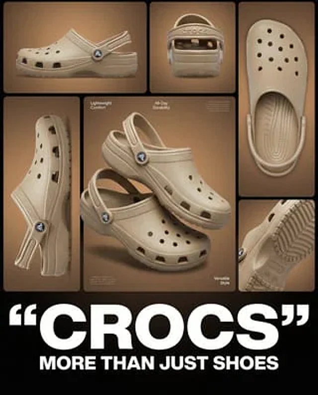

```text
Multi-image product collage poster featuring beige/tan Crocs clog shoes, designed as a modern footwear advertisement.

The layout combines multiple product angles arranged in a structured grid:

Side profile view showing the clog silhouette and ventilation holes

Rear view highlighting the heel strap and branding

Top-down view showing the cushioned footbed texture

Close-up detail of the sole tread and side logo

A hero product image in the foreground with one shoe stacked against another, creating depth

Clean studio background with a warm brown-to-black gradient, giving a cozy, lifestyle-oriented tone.
The Crocs appear matte, lightweight, and comfortable, with realistic foam texture and soft shadows.

Large bold headline typography at the bottom reads:
“CROCS”
Subheading: “MORE THAN JUST SHOES”

Small blocks of descriptive lifestyle copy appear subtly in the background, reinforcing comfort, durability, and versatility. Overall composition feels like a social media brand post or poster ad.

Visual Style

Modern product advertising
Lifestyle + catalog hybrid
Warm earthy color palette
Soft studio lighting
Photorealistic textures
Clean composition
Professional footwear photography

Camera & Composition

Multiple angles combined into one layout
85mm–100mm product photography look
Sharp focus on shoes
Soft shadows beneath products
Balanced exposure
No distortion

Mood & Branding

Comfort
Everyday lifestyle
Durable
Casual confidence
Practical yet stylish
Approachable brand feel

Negative Prompt

Low resolution, incorrect shoe shape, warped branding, misspelled logo, glossy plastic look, harsh reflections, cluttered layout, inconsistent lighting, cartoon style, CGI look, watermark, text artifacts
```

Model: Nano Banana
Author: Keskin

[ProjectD](https://aitoolsradar.com/en/prompts/44c778d7e8160b) · [Recorded source](https://x.com/craftian_keskin/status/2015437854206529710)
 · [Full original metadata and byte evidence](data/projectd-batch-0063.json)

## Kris Kashtanova #842

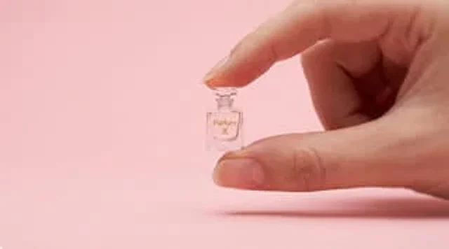

```text
macro photograph, minimalist advertising style, a hyper-realistic miniature [PRODUCT] crafted from [MATERIAL], delicately poised between a person's thumb and forefinger against a seamless, matte [BG_COLOR] cyclorama under professional Top-Down_Spotlight that casts subtle, soft shadows, with the impeccably groomed hand accentuating the object's intricate contours while the composition remains perfectly centered with a shallow depth of field to highlight its exquisite craftsmanship
```

Model: Nano Banana
Author: Kris Kashtanova

[ProjectD](https://aitoolsradar.com/en/prompts/f4ce1f29ec681c) · [Recorded source](https://x.com/icreatelife/status/2023170582796542373)
 · [Full original metadata and byte evidence](data/projectd-batch-0063.json)

## Latte #1322

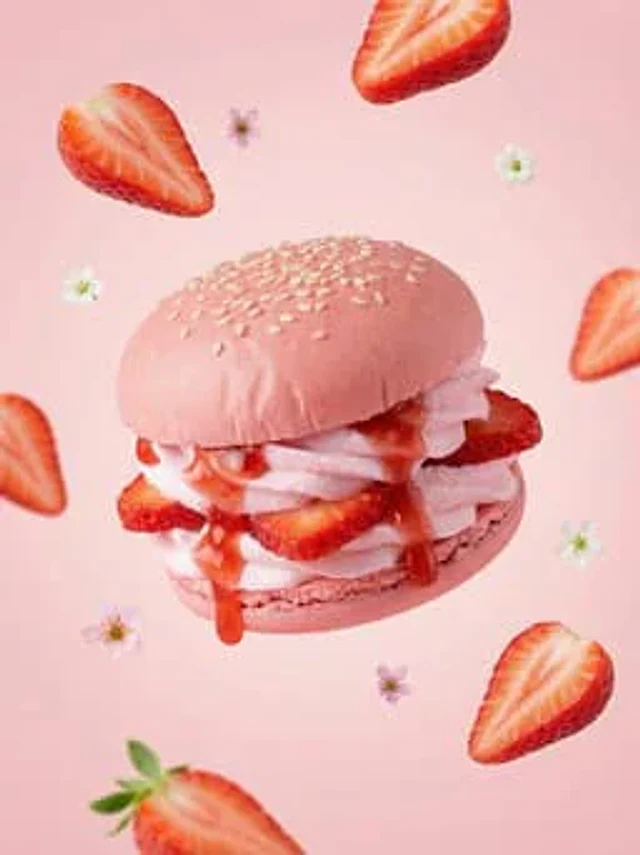

```text
A hyper-realistic {FRUIT} dessert burger, centered composition, soft pastel {FRUIT_COLOR} color palette. Fluffy {FRUIT_COLOR} burger buns with smooth matte texture and light sesame seeds on top. Layers of fresh sliced {FRUIT} and airy white whipped cream inside, with glossy {FRUIT} sauce dripping naturally. Floating {FRUIT} slices and tiny flowers surrounding the burger. Minimal {FRUIT_COLOR} gradient background, soft studio lighting, luxury food advertising style, ultra clean, high detail, shallow depth of field.
```

Model: Nano Banana
Author: Latte

[ProjectD](https://aitoolsradar.com/en/prompts/dafa9d0365697e) · [Recorded source](https://x.com/0xbisc/status/2018350105787879512)
 · [Full original metadata and byte evidence](data/projectd-batch-0063.json)

## Latte #1329

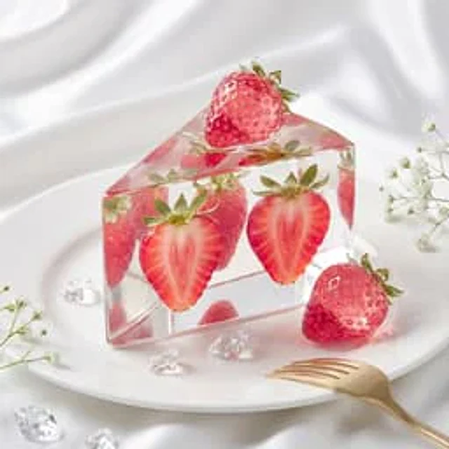

```text
Create a luxury fashion-editorial still life of a sharp triangular prism cake slice made of hard crystal-clear glass-like material, with the featured fruit being [orange], using a single unified candy-glass color tone while preserving the fruit’s original natural hue and form logic, explicitly excluding stems and leaves from recoloring so they retain natural green, the transparent glass cake has polished edges, elegant refraction, crisp highlights and internal reflections identical to solid crystal, inside the cake thick full-bodied seedless fruit cross-sections appear as pure clear glass with perfectly smooth seamless surfaces, one whole fruit in mirror-polished translucent crystal-glass candy style sits on top and another rests beside it, all fruit instances sharing identical color tone and material finish except leaves, arranged on a glossy white ceramic plate with clear crystal shards, a champagne-gold metallic fork and minimal baby’s-breath accents against softly draped white silk fabric, composed with balanced proportions and refined negative space, lit with soft diffused high-end editorial lighting that preserves candy-like color richness and material clarity, hyper-realistic, ultra-detailed, premium aesthetic, no text, no typography, no logo, no watermark, no graphic elements, exclude rough texture, matte surface, cube, square or round cake, ice cube, acrylic or resin block, cloudy transparency, people, hands, faces
```

Model: Nano Banana
Author: Latte

[ProjectD](https://aitoolsradar.com/en/prompts/e896feaaef2a5d) · [Recorded source](https://x.com/0xbisc/status/2013230019963986172)
 · [Full original metadata and byte evidence](data/projectd-batch-0063.json)

## Latte #1380

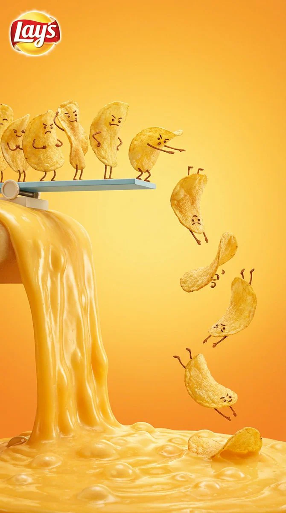

```text
Vertical snack advertising visual with playful anthropomorphic tone. At the top, golden Lay’s potato chips arranged in a neat vertical queue, each chip posed like a diver on a diving platform, some slightly bent forward, some mid-tilt, suggesting preparation and focus before jumping. Below them, thick molten cheese flowing downward, glossy and stretchy, forming a rich cheese lava pool at the bottom. Several chips are frozen mid-air in clean diving poses, angled downward like synchronized divers, capturing a precise pre-splash moment. Warm yellow and cheese-orange gradient background, studio advertising lighting, soft highlights, refined shadows. Strong central axis composition, clear visual hierarchy. Minimalist graphic layout, fun yet premium commercial food photography aesthetic, ultra-detailed textures, hyper-realistic, 8K resolution.
```

Model: Nano Banana
Author: Latte

[ProjectD](https://aitoolsradar.com/en/prompts/e7299faa59ed3c) · [Recorded source](https://x.com/0xbisc/status/2011045800017871206)
 · [Full original metadata and byte evidence](data/projectd-batch-0063.json)

## Lex #828

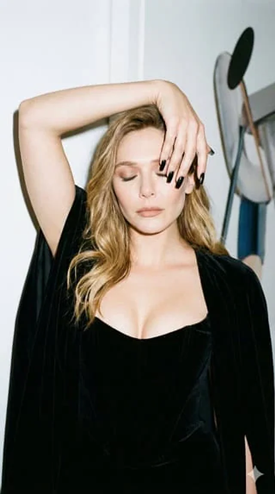

```text
{
  "image_style": {
    "type": "photorealistic",
    "aesthetic": "Instagram shot",
    "effects": [
      "film grain",
      "direct flash"
    ]
  },
  "composition": {
    "framing": "waist-up photograph",
    "aspect_ratio": "9:16"
  },
  "subject": {
    "description": "young woman",
    "constraint_note": "do not alter the sensitivity of the face and features",
    "pose": {
      "orientation": "facing the camera directly",
      "head": "tilted slightly to the side",
      "eyes": "closed",
      "action": "covering her face with her hand, pulling her elbow away and lifting it to the side",
      "mood": [
        "elegant",
        "pensive",
        "playful"
      ]
    },
    "appearance": {
      "attire": [
        "black velvet corset",
        "expensive black cape"
      ],
      "hair": "loose",
      "makeup": {
        "style": "nude",
        "lipstick": "matte nude"
      },
      "details": [
        "décolletage highlighted",
        "long, square black nails"
      ]
    }
  },
  "setting": {
    "background": "white wall",
    "foreground_elements": "art object placed in front of the wall"
  }
}
```

Model: Nano Banana
Author: Lex

[ProjectD](https://aitoolsradar.com/en/prompts/6ce984b7825485) · [Recorded source](https://x.com/lexx_aura/status/2011830747439481225)
 · [Full original metadata and byte evidence](data/projectd-batch-0063.json)

## Lex #900

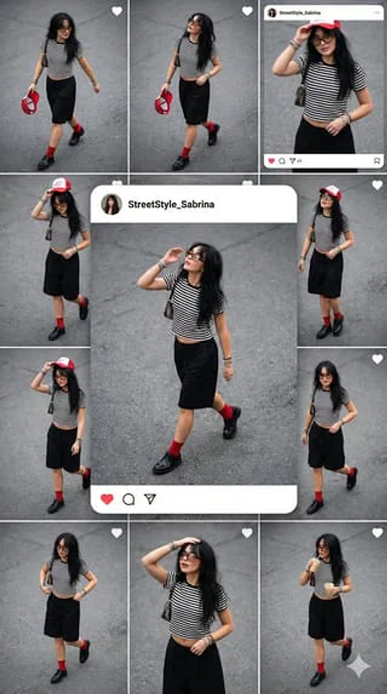

```text
{
  "request_type": "image_generation_prompt",
  "source_material": {
    "input_required": true,
    "description": "User uploaded image for face reference."
  },
  "technical_specs": {
    "resolution": "64K DSLR shot resolution",
    "aspect_ratio": "9:16",
    "render_engines": [
      "Octane Render",
      "Unreal Engine 5"
    ],
    "realism_level": "High-resolution realism"
  },
  "composition": {
    "perspective": "High-angle, top-down view",
    "layout_style": "Modern social media grid (Instagram feed concept)",
    "layout_structure": {
      "central_element": "Larger, framed highlighted post",
      "surrounding_elements": "Clean grid pattern formed by smaller images"
    },
    "content_type": "Dynamic, urban street-style photo collage",
    "ui_overlay": {
      "enabled": true,
      "style": "Minimal social media interface mimicry",
      "elements": [
        "White rounded rectangles showing a username",
        "Subtle heart icons",
        "Minimal interaction indicators"
      ]
    }
  },
  "subject": {
    "identity": {
      "description": "Young woman",
      "facial_reference": "Same face as the uploaded image"
    },
    "appearance": {
      "hair": "Long black hair, worn loose and slightly messy",
      "vibe": "Confident, edgy, effortlessly cool"
    },
    "clothing": {
      "top": "Black-and-white horizontal striped cropped T-shirt",
      "bottom": "Loose black knee-length shorts",
      "footwear": {
        "shoes": "Polished black leather shoes",
        "socks": "Bright red socks"
      },
      "eyewear": "Oversized tinted sunglasses"
    },
    "accessories": {
      "headwear": {
        "item": "Red-and-white baseball cap",
        "usage": "Sometimes worn, sometimes held in hand"
      },
      "bag": "Small shoulder bag",
      "jewelry": "Stacked bracelets",
      "other": "Takeaway drink cup"
    },
    "actions_and_poses": {
      "style": "Candid moments captured in motion, not posed",
      "examples": [
        "Walking along the street",
        "Walking mid-step",
        "Adjusting cap",
        "Looking up toward camera",
        "Fixing bag",
        "Holding drink"
      ],
      "narrative_effect": "Natural lifestyle storytelling, varying poses across frames"
    }
  },
  "environment": {
    "setting": "Asphalt city street",
    "ground_surface": "Textured gray asphalt, minimal and uncluttered",
    "role": "Neutral backdrop emphasizing fashion and movement"
  },
  "lighting_and_color": {
    "lighting_type": "Natural daylight with soft shadows",
    "photographic_feel": "Realistic street photography",
    "color_palette": {
      "base": "Muted and urban tones",
      "contrast_accents": ["Bright red socks", "Red-and-white cap"]
    }
  },
  "style_and_mood": {
    "overall_mood": "Candid, contemporary, effortlessly cool",
    "aesthetic_blend": [
      "Fashion photography",
      "Street culture",
      "Social media aesthetics"
    ],
    "keywords": [
      "Urban street photography",
      "Top-down perspective",
      "Instagram grid layout",
      "Candid lifestyle shots",
      "Street fashion",
      "Casual cool aesthetic",
      "Muted city tones",
      "Social media UI overlay",
      "Natural light",
      "Modern editorial style"
    ]
  }
}
```

Model: Nano Banana
Author: Lex

[ProjectD](https://aitoolsradar.com/en/prompts/bdf99102565a04) · [Recorded source](https://x.com/lexx_aura/status/2009220608026939630)
 · [Full original metadata and byte evidence](data/projectd-batch-0063.json)

## LexiPrompt #330

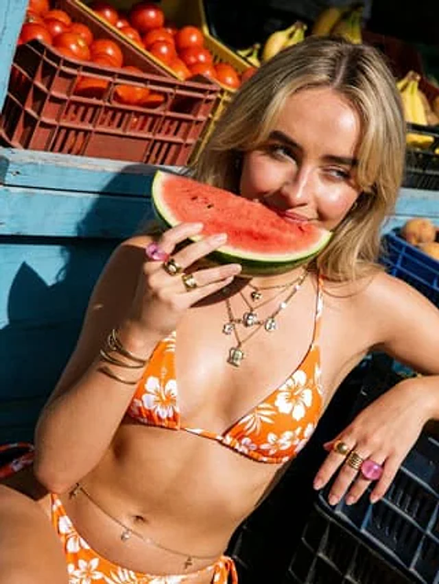

```text
{
  "image_generation_prompt": {
    "subject": {
      "description": "Young woman with a strong resemblance to Sabrina Carpenter.",
      "hair": "Middle-parted, straight, and smooth texture with soft layers framing the face; natural physics as it rests over the shoulders.",
      "face": "Enigmatic expression with a subtle gaze, sun-kissed dewy skin texture, visible fine pores, and a light flush on the cheeks.",
      "body": "Slender physique with a tanned skin tone, showing realistic skin grain and soft highlights on the midriff."
    },
    "attire": {
      "clothing": "A vibrant orange string bikini with a white tropical floral print; the fabric has a slight sheen and thin spaghetti straps that tie at the neck and hips.",
      "style": "Bohemian Summer / Coastal Chic."
    },
    "styling_and_accessories": {
      "jewelry": [
        "Layered gold necklaces with various eclectic charms and pendants",
        "Multiple gold statement rings on several fingers",
        "A chunky translucent pink ring",
        "Sculptural gold wrap-around bracelets on both wrists",
        "A delicate gold belly chain resting across the waist"
      ]
    },
    "environment": {
      "setting": "A rustic outdoor fruit market stall featuring weathered blue wooden structures.",
      "background": "Stacked plastic crates filled with produce including ripe red tomatoes, bunches of yellow bananas, and various shadowed market goods.",
      "water": "None"
    },
    "pose": {
      "posture": "Seated on the ground, leaning slightly forward with a playful and relaxed demeanor.",
      "arms": "One hand is holding a large slice of watermelon up to her face, while the other arm is extended outward, resting against the blue stall structure.",
      "angle": "Eye-level shot with a slight tilt."
    },
    "lighting_and_mood": {
      "lighting": "Bright, direct natural sunlight creating high-contrast shadows and vivid highlights.",
      "mood": "Vibrant, sun-drenched, and candidly cinematic.",
      "colors": "A primary palette of saturated watermelon red, cobalt blue, and sun-ripened orange, grounded by earthy grey gravel."
    },
    "camera_and_technical": {
      "style": "Ultra Photorealistic, RAW photo.",
      "lens": "35mm wide-angle prime.",
      "aperture": "f/4.0 for a balance of sharp subject detail and environmental context.",
      "quality_tags": [
        "8k resolution",
        "highly detailed",
        "volumetric lighting",
        "ray tracing reflections",
        "hyper-realistic texture",
        "Hasselblad photography"
      ]
    }
  }
}
```

Model: Nano Banana
Author: LexiPrompt

[ProjectD](https://aitoolsradar.com/en/prompts/ffb131da7fce8a) · [Recorded source](https://x.com/Artist04048661/status/2029294271879168502)
 · [Full original metadata and byte evidence](data/projectd-batch-0063.json)

## lilzula #780

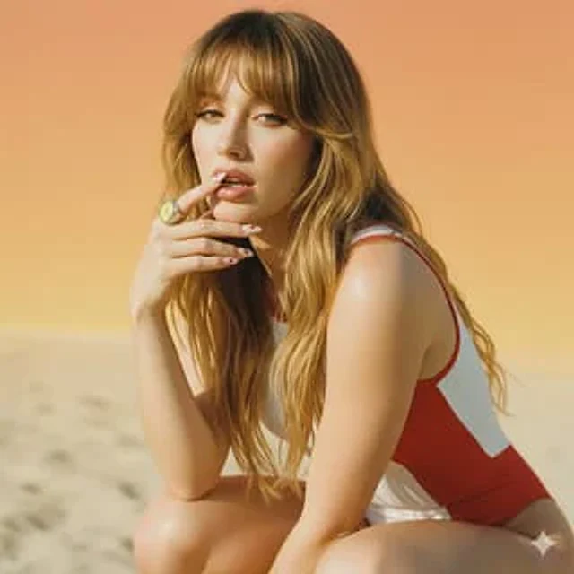

```text
{
  "image_request": {
    "style": {
      "genre": "Editorial fashion portrait",
      "aesthetic": "2000s retro-pop, Californian summer vibe",
      "mood": "Confident, sultry, youthful",
      "quality": "High-quality, cinematic",
      "aspect_ratio": "Portrait"
    },
    "identity": {
      "face_lock": "Use the original face exactly as provided",
      "constraints": "Do not change any facial features, proportions, asymmetry, or details",
      "realism": "100% photorealistic face preservation"
    },
    "subject": {
      "gender": "Woman",
      "expression": "Confident and sultry",
      "mouth": "Slightly open",
      "gaze": "Direct eye contact with the camera"
    },
    "hair": {
      "color": "Soft golden-brown",
      "length": "Long",
      "style": "Shaggy haircut with full bangs"
    },
    "pose": {
      "body_position": "Crouching forward",
      "hands": {
        "gesture": "One hand raised to the face",
        "detail": "Finger touching bottom lip"
      },
      "attitude": "Bold, self-assured"
    },
    "fashion": {
      "outfit": "White and red athletic-style bodysuit"
    },
    "makeup": {
      "eyes": "Peach eyeshadow with winged eyeliner",
      "lips": "Glossy berry-red lipstick",
      "overall": "Soft, warm-toned editorial makeup"
    },
    "accessories": {
      "jewelry": "Chunky silver jewelry",
      "ring": "Large silver ring with yellow watch-face detail",
      "nails": {
        "style": "Long manicured nails",
        "design": "Red heart accents"
      }
    },
    "lighting": {
      "type": "Bright, warm, high-key natural sunlight",
      "shadows": "Soft and natural"
    },
    "environment": {
      "background": "Blurred warm orange and sandy-yellow gradient",
      "suggested_location": "Outdoor desert or poolside atmosphere"
    },
    "camera": {
      "style": "35mm film photography look",
      "focus": "Sharp focus on face and hand",
      "depth_of_field": "Shallow depth of field",
      "color": "Vibrant, cinematic tones"
    },
    "final_notes": {
      "textures": "Natural skin, hair, and fabric detail",
      "editing": "No face alteration, no over-smoothing",
      "overall_feel": "High-fashion cinematic editorial portrait"
    }
  }
}
```

Model: Nano Banana
Author: lilzula

[ProjectD](https://aitoolsradar.com/en/prompts/9fb701dd17f237) · [Recorded source](https://x.com/lilzula_009_me/status/2012364198672547950)
 · [Full original metadata and byte evidence](data/projectd-batch-0063.json)

## Lloyd Creates #1074

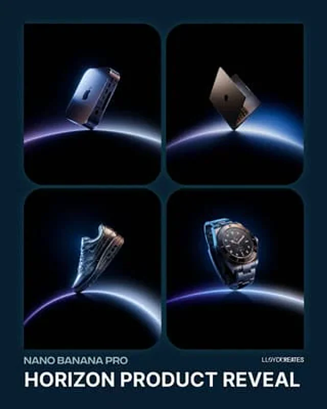

```text
{
  "project_name": "Premium_Dark_Horizon_Product_Reveal",
  "USER_CUSTOMIZATION": {
    "INSTRUCTIONS": "Replace 'current_setting' with the product you want to render. The system will AUTOMATICALLY position it in a specific, fixed pose: tilted back with its bottom-front tip touching the horizon edge.",
    "product": {
      "current_setting": "Mac Mini",
      "description": "The product will be rendered with a dark, metallic, highly detailed finish."
    }
  },
  "settings": {
    "style": "Cinematic, high-contrast product photography in a dark environment. Ultra-sharp focus, rich color grading.",
    "aspect_ratio": "4:5"
  },
  "prompt_construction": {
    "MAIN_SUBJECT": {
      "subject": "The [product from USER_CUSTOMIZATION] is perfectly centered.",
      "appearance": "It has a premium, dark silver/chrome-like finish, looking solid and incredibly sharp. There is an ever-so-slight, subtle warmth mixed into the reflections on the metallic surfaces, giving it depth.",
      "pose_and_contact": "CRITICAL: The product is tilted back dramatically, away from the viewer towards the top of the frame. Its bottom-front tip or edge is PRECISELY touching the sharp center edge of the horizon arc. It must NOT float above the arc. This pose prominently displays the main surface (e.g., laptop lid with logo, phone screen/back, watch face)."
    },
    "HORIZON_ARC": {
      "description": "A single, clean, massive, dark horizon line arcs across the entire width of the screen from left to right. It is NOT a complete sphere, glowing ball, or circle, but the very edge of a dark planet-like surface.",
      "light_profile": "The edge itself is defined by a thin, sharp, soft-glow blue light. The light is thinnest and sharpest (purplish-blue) in the bottom-left, widening slightly to a brighter, soft white-blue rim on the right before fading. It must NOT reveal the spherical form of the surface below; the area below the arc must remain pitch black.",
      "reflection_effect": "CRITICAL: There are ABSOLUTELY NO reflections of the product on the horizon surface. The surface is dark and matte."
    },
    "LIGHTING_AND_BACKGROUND": {
      "background": "Pure, absolute black negative space. There are NO visible light rays, gradients, starfields, halos, or any other light shapes above or around the product.",
      "key_lighting": "A strong key light from the TOP-LEFT sculpts the product, emphasizing its form and the logo/main feature. It does NOT create visible rays.",
      "rim_lighting": "A distinct rim light from the BACK-LEFT separates the product from the dark background.",
      "fill_lighting": "A soft fill light from the BOTTOM-RIGHT opens up the shadows slightly.",
      "color_cast": "All lighting is dominated by deep, rich blues, consistent with the horizon arc."
    },
    "COMPOSITION_AND_FRAMING": {
      "framing": "The product is perfectly centered. The camera distance is fixed, ensuring the product is large and dominant but NEVER cut off.",
      "perspective": "A sharp, eye-level perspective relative to the product's center, looking slightly down towards the horizon."
    }
  },
  "NEGATIVE_CONSTRAINTS": [
    "visible light rays",
    "glow or light source in the top left corner",
    "product floating above the arc",
    "product not touching the arc edge",
    "product lying flat",
    "visible sphere or glowing orb form below the arc",
    "halos or circular lights above the product",
    "harsh light glows",
    "reflections of the product on the horizon",
    "background other than pure black",
    "product cut off by frame edge",
    "upside-down or downward curve",
    "squiggly arc"
  ],
  "FULL_PROMPT_STRING": "A cinematic product photograph of [product from USER_CUSTOMIZATION] with a dark, sharp, silver/chrome finish and subtle warmth. The product is perfectly centered, tilted back dramatically with its bottom-front tip precisely touching the sharp center edge of a single, massive, dark horizon arc that spans the frame. This arc is a thin, sharp, soft-glow blue light, purplish-blue in the bottom-left, widening to a soft white-blue rim on the right, before fading to pitch black. The area below the arc is absolute black. There are NO reflections on the horizon. The background is pure, light-ray-free, halo-free black negative space. There is NO glow or light source in the top left corner. Key light from the top-left, rim light from the back-left, and soft fill from the bottom-right create a dramatic, volumetric, blue-dominated lighting scheme. The product is never cut off. 8k resolution, highly detailed."
}
```

Model: Nano Banana
Author: Lloyd Creates

[ProjectD](https://aitoolsradar.com/en/prompts/a0c3fa58ff60d7) · [Recorded source](https://x.com/lloydcreates/status/2015866705197580703)
 · [Full original metadata and byte evidence](data/projectd-batch-0063.json)

## Lloyd Creates #1198

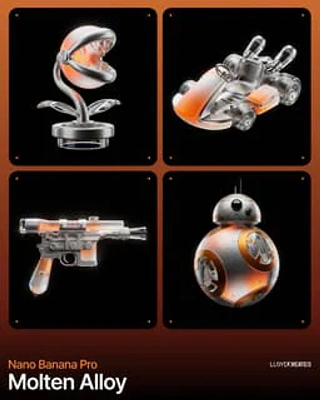

```text
{
  "image_generation_request": {
    "subject": {
      "placeholder": "[INSERT YOUR PRODUCT HERE]",
      "positioning": "centrally aligned, perfectly centered, levitating in mid-air",
      "framing": "full object visibility, no cropping, no cut-off edges, ample negative space around the product"
    },
    "visual_style": {
      "aesthetic": "ultra-modern industrial design, hyper-realistic product photography, cinematic tech-minimalism",
      "background": {
        "color": "#000000",
        "finish": "pure void, matte black, non-reflective"
      },
      "lighting": {
        "type": "top-down rim lighting, subtle key light",
        "effects": [
          "spectral dispersion",
          "chromatic aberration on glass edges",
          "prismatic light refraction",
          "soft caustic highlights"
        ]
      }
    },
    "materials_and_textures": {
      "primary_blends": [
        "anodized brushed aluminum with micro-circular grain",
        "frosted translucent polycarbonate with internal orange-to-white gradient glow",
        "optically clear glass with rainbow refractive edges",
        "matte sandblasted metallic surfaces"
      ],
      "details": "high-precision CNC machined edges, tactile knurling, smooth organic fillets"
    },
    "constraints": {
      "mandatory_omissions": [
        "no lighting boxes",
        "no softboxes",
        "no tripod stands",
        "no pedestals",
        "no platforms",
        "no props",
        "no text",
        "no watermarks",
        "no human hands",
        "no floor line",
        "no background gradients"
      ],
      "compositional_rules": "The product must be the sole inhabitant of the frame. Ensure zero contact with any surface. Maintain absolute symmetry and 100% black levels for the background environment."
    },
    "color_palette": {
      "background": "#000000",
      "accents": [
        "#FF4500",
        "#FFFFFF",
        "#808080",
        "spectral rainbow/prismatic dispersion"
      ]
    }
  }
}
```

Model: Nano Banana
Author: Lloyd Creates

[ProjectD](https://aitoolsradar.com/en/prompts/33a6ced6677dfe) · [Recorded source](https://x.com/lloydcreates/status/2029268041628823967)
 · [Full original metadata and byte evidence](data/projectd-batch-0063.json)

## Lloyd Creates #1354


```text
{
"project_name": "Distorted_Luxury_Motion",

"USER_CUSTOMIZATION": {
"product_description": "PRODUCT HERE"
},
"settings": {
"style": "Avant-garde luxury product photography, abstract distortion, dreamlike etherealism, monochromatic with subtle color accents.",
"aspect_ratio": "4:5",
"camera_angle": "Camera positioned low, looking up at the product which stands perfectly vertical and upright"
},
"prompt_construction": {
"MAIN_SUBJECT": {
"subject": "{{USER_CUSTOMIZATION.product_description}}",
"presentation": "The product stands perfectly vertical and upright, completely isolated. It is the sole object in the frame. The product is rendered with surreal, fluid distortion effects along its edges, appearing semi-solid as if vibrating or viewed through heat haze. The core form remains recognizable. No additional materials, fabrics, liquids, or extensions are added to the product."
},
"VISUAL_EFFECTS": {
"distortion": "Heavy 'scanline' or 'refraction' distortion effects applied only to the product itself. The edges and contours are wavy, rippled, and stretched, similar to looking through heat haze or warped glass. The distortion warps the product's silhouette.",
"blur_and_smudge": "Motion blur and gaussian blur soften details, creating a 'smudged' painterly look. Light appears to drag and streak across the product's form only.",
"ghosting": "Subtle vibratory ghosting on the product's edges only, reinforcing the feeling of movement.",
"color_treatment": "Predominantly monochromatic with silver, black, and grey tones. Subtle iridescent color notes (cyan, magenta) appear only within the distortion effects and highlights on the product's edges."
},
"LIGHTING_AND_COLOR": {
"background": "MANDATORY: Pure solid black background, hex code #000000, RGB (0,0,0). The entire background must be uniformly black with no gradients, no grey tones, no white, no other colors. Absolute flat black darkness with zero variation.",
"background_restrictions": "The background has zero atmospheric effects: no glow, no light rays, no light beams, no light streaks, no halos, no fog, no mist, no haze, no gradients, no vignettes, no ambient light bleeding. The black remains pure, flat, and completely untouched by any lighting effects.",
"product_lighting": "Strict high-contrast chiaroscuro lighting on the product only. Bright, blown-out highlights on the rim and ridges create sharp contrast against deep shadows. These highlights have subtle, clean iridescent quality (cyan, magenta, silver) contained within the product's edges only. Light does not escape or radiate beyond the product's boundaries.",
"light_source": "Single key light source illuminating only the product. The light ends at the product's edges and does not extend into the background. No fill light, no background lights, no secondary light sources, no light spill into the void, no rays, no beams, no streaks."
},
"COMPOSITION": {
"perspective": "Camera positioned below eye level, angled slightly upward. The product stands perfectly vertical - perpendicular to the ground plane - in the center of frame.",
"positioning": "The product is suspended and floating in the void. It has no base, no ground surface beneath it, no support structure. It exists isolated in empty space.",
"framing": "The product is completely within the frame with all edges visible. It must never be cropped or cut off by the canvas edges. No frames or borders around the image.",
"isolation": "Only the product exists in frame. No contextual environment, no surfaces, no additional objects, no props, no added materials."
},
"NEGATIVE_CONSTRAINTS": [
"white background",
"grey background",
"colored background",
"gradient background",
"light background",
"any background color other than pure black #000000",
"light rays",
"light beams",
"light streaks shooting across background",
"diagonal light streaks",
"radial light beams",
"volumetric light rays",
"god rays",
"sunbeams",
"light shafts",
"studio light streaks",
"tilted product",
"laying down",
"horizontal orientation",
"diagonal angle",
"dutch angle",
"product rotation",
"ground surface",
"floor",
"base",
"platform",
"pedestal",
"reflections on ground",
"pooling liquid",
"melting onto surface",
"fabric draping",
"cloth extensions",
"liquid extensions",
"additional materials attached to product",
"background glow",
"atmospheric haze in background",
"light halos in void",
"background lighting effects",
"chromatic aberration in background",
"light spill into black areas",
"ambient background illumination",
"background vignette",
"background gradient",
"background fog",
"background mist",
"extra light sources",
"fill light",
"rim light on background",
"multiple products",
"double exposure",
"added glass objects",
"water droplets",
"other objects",
"props",
"contextual environment",
"frames",
"borders",
"product cut off by edges",
"cropped product",
"extreme low angle",
"extreme perspective distortion",
"sharp focus",
"perfect clarity",
"static image",
"flat lighting",
"warm color palette",
"saturated colors",
"vibrant colors",
"complex background",
"realistic rendering",
"eye-level view",
"high angle view",
"straight horizon lines",
"clean edges",
"no distortion",
"matte finish",
"natural daylight",
"softbox lighting",
"bokeh",
"film grain",
"commercial catalog look",
"studio setup visible",
"photography equipment visible"
],
}
}
```

Model: Nano Banana
Author: Lloyd Creates

[ProjectD](https://aitoolsradar.com/en/prompts/80038ca20d2821) · [Recorded source](https://x.com/lloydcreates/status/2016559834456273296)
 · [Full original metadata and byte evidence](data/projectd-batch-0063.json)

## Lloyd Creates #393


```text
{
  "image_generation_request": {
    "subject_settings": {
      "product_placeholder": "[INSERT PRODUCT NAME HERE]",
      "positioning": "absolute center, floating, levitating, suspended in mid-air",
      "framing": "full view, no cropping, product must be entirely within frame, generous padding around edges"
    },
    "environment_and_background": {
      "background_color": "#000000",
      "background_type": "pure void, infinite black depth",
      "elements_to_exclude": [
        "lighting boxes",
        "softboxes",
        "stands",
        "pedestals",
        "platforms",
        "text",
        "watermarks",
        "props",
        "surface reflections",
        "studio equipment"
      ]
    },
    "texture_and_material_blending": {
      "primary_finish": "anodized obsidian metal with microscopic grit",
      "secondary_finish": "high-gloss fluid chrome",
      "accent_texture": "Mac Pro inspired precision-machined hemispherical lattice, 3D lattice venting pattern",
      "optical_effects": "monatomic light dispersion, prismatic diffraction on edges, ethereal holographic sheen"
    },
    "lighting_and_color_palette": {
      "key_colors": [
        { "name": "Pure Black", "hex": "#000000" },
        { "name": "Electric Indigo", "hex": "#4B0082" },
        { "name": "Phthalo Blue", "hex": "#000F89" },
        { "name": "Spectral Iridescence", "description": "Thin-film interference rainbow highlights" }
      ],
      "lighting_style": "hard rim lighting, chiaroscuro, high contrast, sharp specular highlights, no ambient fill"
    },
    "negative_constraints": {
      "strict_exclusion": "out of frame, cut off product, blurry edges, tripod, light stand, floor, table, shadows on floor, light flare icons, glowing boxes, copyright text, logo, cluttered background, grey tones, messy geometry"
    },
    "technical_specs": {
      "style": "Hyper-realistic 3D render",
      "engine_hints": "Octane Render, Raytraced, 8k, Unreal Engine 5, Cinematic Lighting"
    }
  }
}
```

Model: Nano Banana
Author: Lloyd Creates

[ProjectD](https://aitoolsradar.com/en/prompts/f64522684bae46) · [Recorded source](https://x.com/lloydcreates/status/2026867752376418613)
 · [Full original metadata and byte evidence](data/projectd-batch-0063.json)

## Lloyd Creates #439


```text
{
  "image_generation_request": {
    "subject": {
      "placeholder": "[INSERT PRODUCT HERE]",
      "position": "dead center, eye-level, perfectly centered in frame",
      "presentation": "levitating, floating in a weightless void, no stands, no platforms, no pedestals, no visible supports"
    },
    "environment": {
      "background": "absolute solid pitch black, hex code #000000, infinite void",
      "lighting": "rim lighting, cinematic chiaroscuro, high-contrast glints on metallic edges, soft orange glow from internal recesses"
    },
    "aesthetic_style": {
      "textures": [
        "shot-blasted matte titanium",
        "brushed aerospace-grade aluminum",
        "anodized dark grey metal",
        "ribbed industrial vertical cooling fins"
      ],
      "optical_effects": "viewed through vertical fluted reeded glass, subtle chromatic distortion, refractive glass warping, radial motion blur on outer edges",
      "color_palette": {
        "primary_background": "#000000",
        "secondary_metal": "#8E8E8E",
        "accent_glow": "#FF8C00",
        "highlights": "#FFFFFF"
      }
    },
    "composition_constraints": {
      "framing": "ensure full product visibility, do not cut off edges, wide safety margins around the subject",
      "elements_to_exclude": [
        "text",
        "logos",
        "watermarks",
        "softboxes",
        "light stands",
        "floor",
        "horizon line",
        "props",
        "human hands",
        "shadows on surfaces"
      ]
    },
    "technical_specs": {
      "focal_length": "85mm macro lens",
      "depth_of_field": "deep focus on product, blurred refractive foreground glass",
      "render_engine": "photorealistic octane render, 8k resolution, ray-traced reflections"
    }
  }
}
```

Model: Nano Banana
Author: Lloyd Creates

[ProjectD](https://aitoolsradar.com/en/prompts/e312428a81b150) · [Recorded source](https://x.com/lloydcreates/status/2027745604600811970)
 · [Full original metadata and byte evidence](data/projectd-batch-0063.json)

## Lloyd Creates #474


```text
{
  "image_generation_request": {
    "subject": "[INSERT PRODUCT HERE]",
    "environment": {
      "background": "A smooth, professional dual-tone gradient transition between #111B24 and #CAEFFF",
      "lighting": "High-contrast studio lighting with bright rim highlights to emphasize glossy textures"
    },
    "style_elements": {
      "aesthetic": "Y2K Frutiger Aero meets modern hyper-realism",
      "optical_effects": [
        "Dynamic glass refraction",
        "Prismatic chromatic aberration at the edges of transparent objects",
        "Iridescent lens flares",
        "Distorted glass overlays floating in the foreground"
      ],
      "composition": "Floating, gravity-defying arrangement with a wide-angle perspective",
      "textures": "Polished chrome, transparent acrylic, and high-gloss plastic"
    },
    "technical_specs": {
      "resolution": "8k UHD",
      "render_engine": "Octane Render style",
      "detailing": "Macro photography focus, hyper-detailed mechanical parts"
    }
  }
}
```

Model: Nano Banana
Author: Lloyd Creates

[ProjectD](https://aitoolsradar.com/en/prompts/5171428ea6bc6d) · [Recorded source](https://x.com/lloydcreates/status/2019788303214776494)
 · [Full original metadata and byte evidence](data/projectd-batch-0063.json)

## Lloyd Creates #814


```text
{
  "request": {
    "product": "[PRODUCT HERE]",
    "background_color": "#59925C",
    "style": "prismatic_industrial_minimalism",
    "visual_elements": {
      "structure": "multiple separate vertical acrylic layers forming the product silhouette — each layer is a distinct flat panel with visible air gaps between them, like slices of the product spaced apart",
      "material": "high-clarity glass with rainbow prismatic iridescent tint",
      "hardware": "stainless steel through-bolts with visible internal Allen hexagonal socket heads — bolts pass through all layers front to back, holding them together with visible spacing",
      "orientation": "strictly upright vertical placement, full object visibility",
      "lighting": "dispersive spectral highlights and sharp caustics"
    },
    "composition": {
      "frame": "wide shot, no cropping, centered full-product view",
      "camera_angle": "eye-level studio perspective, slightly angled to reveal gaps between layers",
      "depth_of_field": "deep enough to maintain focus on hardware details",
      "background": "seamless solid #59925C background with no floor, surface, pedestal, platform, table, shadow ground, or horizon line — the product floats against a uniform single-color field",
      "grounding": "no visible ground plane, no reflective surface beneath the product"
    },
    "rendering_details": {
      "transparency": "multi-layered refraction with thin-film interference",
      "finish": "polished edges with subtle holographic light dispersion",
      "hardware_detail": "macro-precision on hex-head bolt sockets",
      "layer_direction": "every glass/acrylic layer is strictly vertical — no horizontal slabs, curved shells, or molded forms",
      "layer_separation": "each glass panel must be visibly separated with clear air gaps — not fused or touching — bolts are the only element connecting the layers"
    }
  }
}
```

Model: Nano Banana
Author: Lloyd Creates

[ProjectD](https://aitoolsradar.com/en/prompts/1799ef46bdd052) · [Recorded source](https://x.com/lloydcreates/status/2020332873736196341)
 · [Full original metadata and byte evidence](data/projectd-batch-0063.json)

## Lloyd Creates #840


```text
{
  "subject_gender_placeholder": "[CHOOSE: woman]",
  "aesthetic_lodestar": "cinematic luxury hypebeast editorial, strictly monochrome, shadowless stasis, deep rich blacks, single-frame photograph",
  "composition": {
    "frame": "minimalist controlled studio, clinical stark clarity, extremely dynamic camera angles capturing the action from aggressive low or high perspectives. No grid layouts, solitary subject focus.",
    "background": "pure, seamless, blown-out white infinite void, completely free of floor or wall shadows",
    "focus": "razor-sharp deep focus across the entire subject in motion"
  },
  "subject_action": {
    "pose": "impossible, gravity-defying airborne contortions and explosive mid-air leaps, frozen at the absolute peak of movement with extreme bodily tension",
    "energy": "maximum athletic tension meets high-fashion structure, controlled chaos suspended in time, creating sculptural, almost unbelievable silhouettes against the void"
  },
  "wardrobe_styling": {
    "vibe": "creative street fashion x avant-garde tailoring, non-provocative, clean and impactful silhouettes with varied layering",
    "garment_variations": [
      "Open cardigan sweaters layered over premium t-shirts",
      "Oversized knitwear and structured lounger sweaters",
      "Technical bomber jackets or varsity jackets",
      "Japanese minimalist silhouettes (unstructured, flowing, layered)",
      "Premium denim jackets and jeans styles",
      "Japanese Americana wear and styles",
      "Moncler puffer jackets",
      "Statement structured outerwear (as previously defined)"
    ],
    "brands_reference": ["Supreme", "Fear of God", "Maison Margiela", "Martine Rose", "UMBRO", "Aimé Leon Dore", "RHUDE", "Maison Kitsuné", "NikeLab", "Moncler", "Issey Miyake"],
    "accessories": {
      "general": "scarves, neck bandanas, paisley bandanas hanging from pockets (used sparingly when sensible)",
      "womens_specific": "Avant-Garde style bags, Saint Laurent structured totes or crossbodies, designer baseball caps, trucker caps, premium wool beanies (applied only if subject is woman)"
 "details": "only apply head gear objects on the subject's head, nowhere else"
    },
    "key_details": "focus on singular statement outfits without excessive bulk, oversized cuts contrasting with sharp tailoring, prominent branding, varied fabric weights rendered through pure texture without shadow"
  },
  "footwear_focus": {
    "models": ["Nike SB Dunk", "Off-White™ x Nike deconstructed models", "Converse Chuck 70 premium high-top", "Vans Vault Slip-On", “Adidas Samba”, “New Balance 327”, “ASICS Onitsuka Tiger Sneakers”],
    "details": "the only object on the subject's feet, highly visible and pristine, forming the anchor point of the dynamic motion"
  },
  "visual_color_treatment": {
    "base_spectrum": "pure, uncompromising black and white with ultra-deep, rich black tones",
    "blend_mode": "cohesive fusion of extreme textural contrasts and shadowless spectral lighting",
    "palette_components": {
      "rich_matte_black": "pure light-absorbing wools, denim, and heavy cottons, vantablack-like density, crushing blacks for maximum depth rendered solely through surface texture",
      "high_sheen_monochrome": "polished leather, reflective technical nylon, glossy polymers catching pure white specular highlights without casting shadows",
      "monochrome_solarization": "ghostly spectral edge-lighting, inverted luminance highlights defining folds and outlines, stark, hyper-contrasted glowing edges"
    }
  },
  "lighting_dynamics": "flat, high-key, omnidirectional diffused studio lighting. Zero cast shadows on subjects, floor, or background. Form and depth are flattened, relying entirely on the stark contrast between glossy surfaces, crushed rich blacks, and the glowing solarized edge contours for definition."
}
```

Model: Nano Banana
Author: Lloyd Creates

[ProjectD](https://aitoolsradar.com/en/prompts/399b1f19a8a47d) · [Recorded source](https://x.com/lloydcreates/status/2009813602660712485)
 · [Full original metadata and byte evidence](data/projectd-batch-0063.json)

## Lloyd Creates #865


```text
{
  "image_generation_request": {
    "subject": "[PRODUCT]",
    "product_finish": {
      "primary": "matte black with subtle light absorption",
      "secondary": "polished metallic silver with mirror-like reflections",
      "treatment": "duotone — matte black body with metallic silver accents, trim, edges, or panel insets"
    },
    "composition": {
      "placement": "dead center, full view, floating suspended within the folded surface environment",
      "scale": "product occupies roughly 30-40% of the frame",
      "constraints": [
        "product must be entirely visible with no cropping",
        "no pedestals, stands, platforms, or ground planes",
        "the surface folds frame the product but never obscure more than 10% of it",
        "product is the sharpest element in the scene"
      ]
    },
    "background_environment": {
      "description": "A single continuous undulating surface that fills the entire frame, folding over and around itself in large voluminous waves — like a massive sheet of pleated metallic silk or a single machined metal panel that has been softly twisted and draped. This is NOT multiple separate ribbons or strands. It is ONE connected surface.",
      "base_color": "[INSERT DEEP BACKGROUND COLOR visible in crevices — e.g. pure black, midnight navy]",
      "surface_color_1": "[INSERT GRADIENT COLOR A — e.g. soft lavender, warm copper, pearl rose]",
      "surface_color_2": "[INSERT GRADIENT COLOR B — e.g. deep indigo, cobalt blue, violet]",
      "color_behavior": "The two colors blend in a smooth continuous gradient across the single surface, shifting based on the surface's curvature and light angle. Where the surface faces the light it shows color_1, where it curves away it transitions to color_2. The transition is seamless with no hard edges or stripes.",
      "surface_texture": {
        "type": "fine parallel ribs embossed into the surface — like the grooves on a vinyl record or finely pleated accordion fabric",
        "rib_description": "extremely fine, uniform, tightly spaced parallel lines that follow the flow direction of the surface. The ribs are a TEXTURE on the surface, not separate objects. They create a subtle corrugated micro-relief that catches light along each tiny ridge.",
        "rib_density": "very high — approximately 50-100 visible lines per inch of surface, creating a dense linear grain",
        "rib_depth": "shallow — the ribs are subtle surface detail, not deep cuts. They create gentle highlight-shadow alternation across the surface"
      },
      "surface_form": {
        "fold_style": "large, smooth, voluminous folds like draped heavy silk — broad sweeping curves with gentle twists",
        "fold_count": "3-5 major folds visible, each one wide and generous, NOT many small tangled ribbons",
        "fold_behavior": "folds overlap softly, tucking under and over each other with smooth transitions. Where folds meet they create deep soft shadow crevices",
        "tension": "the surface appears smooth and taut across each fold, with no wrinkles or crumpling — like stretched satin over a curved form",
        "edges": "no visible edges — the surface appears to extend beyond the frame in all directions, as if we are seeing a close-up section of an infinite draped form"
      },
      "material": {
        "finish": "satin metallic — a soft brushed-metal luminosity between matte and mirror. The surface has a pearlescent quality where colors shift with viewing angle",
        "light_interaction": "soft specular highlights along the crest of each rib, gentle shadows in each rib valley, creating an overall shimmering linear texture across the broad folds"
      }
    },
    "lighting": {
      "type": "soft, diffused, directional — as if a large softbox is illuminating from upper-left, creating a warm-to-cool gradient across the scene",
      "shadow_behavior": "deep soft shadows in fold crevices, gradual falloff — no harsh edges",
      "highlight_behavior": "broad soft highlights across fold peaks, with fine linear shimmer from the rib texture",
      "restrictions": "no visible light sources, no lens flare, no reflections of studio equipment"
    },
    "style": {
      "aesthetic": "parametric design art, computational sculpture, abstract luxury",
      "mood": "luxurious, smooth, tactile, premium product showcase",
      "critical_note": "The background must look like a SINGLE continuous folded metallic surface with fine ribbed texture — NOT like multiple separate ribbons, cables, wires, or strands bundled together. Think of one sheet of finely pleated metal that has been elegantly draped and folded."
    },
    "technical_specs": {
      "quality": "8k resolution, extreme surface texture detail, tack-sharp product focus",
      "render_style": "photorealistic 3D render, Octane or Redshift quality",
      "aspect_ratio": "1:1 square",
      "exclusions": "text, watermarks, logos on background, extra props, lens flare, studio equipment, flat surfaces, any ground plane, separate ribbons, wire bundles, rope-like forms"
    }
  }
}
```

Model: Nano Banana
Author: Lloyd Creates

[ProjectD](https://aitoolsradar.com/en/prompts/cdb276e69b2e96) · [Recorded source](https://x.com/lloydcreates/status/2021984673216209395)
 · [Full original metadata and byte evidence](data/projectd-batch-0063.json)

## Lloyd Creates #925


```text
{
  "options": {
    "gender": ["man", "woman"]
  },
  "prompt": "A high-fashion editorial shot of a [GENDER] model sitting or standing on a flying magic carpet during takeoff. The model is wearing a sophisticated, layered outfit featuring the structured silhouettes and premium textures typical of luxury brands like Celine, Balenciaga, Ralph Lauren, Givenchy, and Zegna. The clothes billow elegantly in the wind. The carpet is ornate and detailed, kicking up a subtle dust cloud as it ascends from a sun-drenched, minimalist architectural terrace. The lighting is cinematic and warm, highlighting the motion and the luxurious fabrics. Low angle perspective focusing entirely on the subject and the scene."
}
```

Model: Nano Banana
Author: Lloyd Creates

[ProjectD](https://aitoolsradar.com/en/prompts/ba3380598295c2) · [Recorded source](https://x.com/lloydcreates/status/2012343238472892738)
 · [Full original metadata and byte evidence](data/projectd-batch-0063.json)

## Lloyd Creates #955


```text
{
  "ultra_high_fidelity_request": {
    "subject": "[PRODUCT]",
    "framing": {
      "position": "Strictly centered and levitating",
      "boundary": "Full product visibility, zero cropping, isolated in 3D space",
      "background": "Solid pure black hex #000000"
    },
    "optical_effects": {
      "iridescence": "Extremely brilliant spectral iridescence, vivid neon oil-slick gradients",
      "volumetric": "Internal volumetric lighting, ethereal inner glow, light scattering within the material",
      "refraction": "High-index caustic light refraction, prismatic color splitting at the edges",
      "luminosity": "Super-saturated holographic highlights, intense electric blues and deep magentas"
    },
    "material_finish": {
      "texture": "Ultra-glossy liquid-smooth finish",
      "base": "Deep translucent obsidian glass with infinite depth",
      "reflections": "Crisp ray-traced mirror reflections of an invisible light source"
    },
    "negative_constraints": [
      "No platforms", "No floor", "No light boxes", "No softboxes", 
      "No props", "No text", "No shadows on surfaces", "No pedestals"
    ]
  }
}
```

Model: Nano Banana
Author: Lloyd Creates

[ProjectD](https://aitoolsradar.com/en/prompts/13cf142811fafe) · [Recorded source](https://x.com/lloydcreates/status/2021382862193426822)
 · [Full original metadata and byte evidence](data/projectd-batch-0063.json)

## LOKII #801


```text
{
  "prompt_configuration": {
    "type": "Ultra Photorealistic Editorial Portrait",
    "aspect_ratio": "3:4",
    "style_model": "Raw Flash Photography"
  },
  "prompt_structure": {
    "subject_description": {
      "identity": "Exceptionally beautiful young woman, early 20s, magnetic screen presence, effortless confidence.",
      "hair": "Long, thick dark brown hair with soft volume, slightly tousled, framing the face and falling forward over both shoulders.",
      "face": "Striking symmetrical face, large expressive eyes with intense eye contact, relaxed brows, soft glossy lips slightly parted, natural confident smile.",
      "pose": "Standing very close to the camera with a subtle forward lean from the waist. Shoulders gently rolled back and chest naturally lifted. Chin slightly lowered while eyes look straight into the lens for strong intimacy. Right hand raised near cheek level, clearly holding an ornate Venetian masquerade mask angled outward and fully visible. Left hand resting at the hip to accentuate curves."
    },
    "attire_and_accessories": {
      "outfit": "Silver sequin dress with thin straps and a deep, elegant neckline that naturally frames cleavage without exaggeration. Fabric catches flash light with intense sparkle.",
      "accessories": [
        "Ornate silver-and-black Venetian masquerade mask with detailed filigree, held in the right hand.",
        "Minimal diamond necklace sitting just above the neckline."
      ]
    },
    "environment_and_atmosphere": {
      "setting": "Luxury rooftop or balcony at night.",
      "background": "Very dark, softly blurred city lights with no distractions.",
      "lighting": "Direct flash placed slightly above eye level, sculpting the eyes, cheekbones, collarbones, neckline, and mask with crisp highlights and clean shadows."
    },
    "technical_specifications": {
      "image_quality": "8K UHD, ultra-photorealistic, raw fashion photography.",
      "camera_style": "35mm editorial lens, paparazzi flash aesthetic, cinematic realism.",
      "focus": "Tack-sharp focus on eyes and mask, shallow depth of field.",
      "texture": "Natural skin texture with realistic pores, high-detail sequin reflections, sharply defined mask details, natural hair strands."
    }
  }
}
```

Model: Nano Banana
Author: LOKII

[ProjectD](https://aitoolsradar.com/en/prompts/112c703e50e7ef) · [Recorded source](https://x.com/TheLOKII_/status/2008519233072931237)
 · [Full original metadata and byte evidence](data/projectd-batch-0063.json)

## 𝐌 #1018


```text
[product], high-end product advertising, white seamless background, exploded view with inner mechanics revealed, outer shell hovering above core, micro screws and components suspended, perfect alignment guides implied, crisp soft shadow, ultra realistic, macro product photography, 100mm lens look, f/8, 8k, 1:1
```

Model: Nano Banana
Author: 𝐌

[ProjectD](https://aitoolsradar.com/en/prompts/7547bfa49fbee7) · [Recorded source](https://x.com/Strength04_X/status/2011630600101429445)
 · [Full original metadata and byte evidence](data/projectd-batch-0063.json)

## 𝐌 #1030


```text
Cute 3D render of a [subject], matte surface, kneaded clay icon style, simple stylized design, [doing action], [emotion or mood], rounded proportions, soft sculpted details, playful body language, vibrant [color1], [color2], and [color3] accents, clean white background, minimal composition, soft ambient lighting, subtle shadow, charming character design, high-resolution, polished toy-like aesthetic
```

Model: Nano Banana
Author: 𝐌

[ProjectD](https://aitoolsradar.com/en/prompts/bbb9945f29213f) · [Recorded source](https://x.com/Strength04_X/status/2042931585100795991)
 · [Full original metadata and byte evidence](data/projectd-batch-0063.json)

## 𝐌 #1044


```text
{
  "prompt_details": {
    "subject": {
      "description": "Handsome male trekker, dark wavy hair (no cap), full beard, rugged appearance",
      "expression": "Relaxed, calm, enjoying the nature",
      "clothing": "Green check flannel shirt layered over a black T-shirt, black cargo trekking pants, blue hiking boots, wristwatch, neck gaiter"
    },
    "environment": {
      "location": "Mountain campsite",
      "elements": "Pitched camping tent in background, lush green hills, rocky ground, perhaps a small campfire",
      "time_of_day": "Golden hour or soft afternoon light"
    },
    "style": {
      "type": "Hyper-realistic outdoor photography",
      "quality": "8k resolution, cinematic lighting, sharp focus, detailed texture",
      "camera_angle": "Eye-level or slightly low angle"
    }
  },
  "full_prompt_text": "A handsome male trekker sitting comfortably at a mountain campsite, no cap, showing dark wavy hair and a beard. He is wearing a green check shirt over a black t-shirt, black cargo pants, and blue hiking boots. A camping tent is visible in the background amidst lush green mountains. Soft natural lighting, realistic skin texture, cinematic outdoor adventure style, 8k resolution."
}
```

Model: Nano Banana
Author: 𝐌

[ProjectD](https://aitoolsradar.com/en/prompts/9463433fc8fb8a) · [Recorded source](https://x.com/Strength04_X/status/2008794302630309945)
 · [Full original metadata and byte evidence](data/projectd-batch-0063.json)

## 𝐌 #1055


```text
A hyper-realistic image of a sliced kiwi splashing in a spray of water with droplets suspended in the air. Fresh kiwi slices, dynamically arranged in a floating composition, create a smooth green background. The smooth green gradient creates a fresh, bright, and juicy aesthetic. Studio lighting, soft shadows, high detail, macro photography of objects, an emphasis on texture and reflections. Ultra-realistic rendering, 8K, sharp focus, rich green tones. --ar 9:16 --raw
```

Model: Nano Banana
Author: 𝐌

[ProjectD](https://aitoolsradar.com/en/prompts/14d5358afad76d) · [Recorded source](https://x.com/Strength04_X/status/2016528524543488246)
 · [Full original metadata and byte evidence](data/projectd-batch-0063.json)

## 𝐌 #1093


```text
A HYPER-REALISTIC, 8K, MEDIUM SHOT CAPTURED WITH A WIDE-ANGLE LENS FROM A SLIGHTLY LOW ANGLE SHOWCASING A YOUNG PERSON IN A DYNAMIC, MID-ACTION POSE ON A SKATEBOARD, RIDING DOWN AN URBAN STREET AT DUSK. THE SUBJECT, WITH UPLOADED FACE AS REFERENCE, HAS LONG, LIGHT-COLORED HAIR FLOWING DYNAMICALLY TO THEIR RIGHT, INDICATING MOTION. THEY ARE WEARING A LIGHT GREY OR OFF-WHITE HOODIE FEATURING A PROMINENT, BRIGHT YELLOW HEON OUTLINE GRAPHIC THAT SPELLS "PAVELTUTORIAL ACROSS THE CHEST. THEIR LEGS ARE CLAD IN LIGHT BROWN OR BEIGE PANTS, INTRICATELY OUTLINED WITH A VIBRANT ORANGE-RED NEON GLOW THAT ALSO EMITS SMALL, FLICKERING NEON WISPS AROUND THEM, SUGGESTING ENERGY. THEIR FEET ARE ADORNED WITH BRIGHT PINK NEON-OUTLINED SNEAKERS, WHICH MATCH THE GLOWING PINK OUTLINE OF THE SKATEBOARD DECK BENEATH THEM. AROUND THE SKATEBOARD AND THE SUBJECT'S FEET, THERE ARE WHIMSICAL, GLOWING PINK NEON HEARTS AND STARBURSTS, ADDING A SURREAL, ENERGETIC TOUCH. THE BACKGROUND IS AN URBAN STREET SCENE, RENDERED WITH A SHALLOW DEPTH OF FIELD, CREATING A BEAUTIFUL BOKEH EFFECT OF WARM, OUT-OF-FOCUS ORANGE AND YELLOW STRING LIGHTS STRUNG ACROSS BUILDINGS, SUGGESTING A FESTIVE OR LIVELY ATMOSPHERE. SILHOUETTES OF BLURRED PEDESTRIANS CAN BE SEEN IN THE DISTANCE. THE OVERALL LIGHTING IS CINEMATIC, WITH A SOFT GOLDEN HOUR GLOW FROM THE BACKGROUND CONTRASTING WITH THE VIBRANT. VOLUMETRIC NEON LIGHTING EMANATING FROM THE SUBJECT AND THEIR ACCESSORIES, CREATING HIGHLY

DETAILED TEXTURES AND A CAPTIVATING VISUAL.
```

Model: Nano Banana
Author: 𝐌

[ProjectD](https://aitoolsradar.com/en/prompts/fc60909d99e75f) · [Recorded source](https://x.com/Strength04_X/status/2018710563371749624)
 · [Full original metadata and byte evidence](data/projectd-batch-0063.json)

## 𝐌 #1146


```text
Ultra-cinematic product photography of a purple energy drink can labeled “INFINITY ENERGY DRINK – NIGHT KING” in bold white typography, floating mid-air at a dynamic three-quarter angle, wrapped with sleek black over-ear headphones; explosive liquid arcs and splashes frozen in time around the can, crystal-clear ice cubes and glossy berries (raspberries, blueberries, strawberries) suspended in motion, tiny droplets and mist filling the scene; dramatic high-contrast studio lighting with a powerful top key light, sharp rim lights tracing the can edges, and deep shadows for a dark, premium mood; monochromatic purple color palette with luminous highlights and metallic reflections, subtle neon glow accents; shallow depth of field isolating the can as the hero subject, hyper-detailed condensation on the aluminum surface, macro texture on fruit and water; volumetric light rays, floating particles, high-speed splash photography aesthetic, photorealistic, ultra-detailed, 8K, luxury advertising style, sharp focus, no watermark.
```

Model: Nano Banana
Author: 𝐌

[ProjectD](https://aitoolsradar.com/en/prompts/9e5936e44db002) · [Recorded source](https://x.com/Strength04_X/status/2012092187509768400)
 · [Full original metadata and byte evidence](data/projectd-batch-0063.json)

## 𝐌 #1168


```text
minimal studio shot on pure white background, real [Food Name] emerging from a paper packaging, the visible part outside the packaging is fully photorealistic, the continuation of the same food is drawn as a clean black line illustration printed directly on the surface of the packaging, perfectly aligned with the real food shape, the illustration stays strictly on the packaging material, not floating, not extending into the background, seamless transition between real and printed illustration, modern minimal branding, top-down composition, soft shadows.
```

Model: Nano Banana
Author: 𝐌

[ProjectD](https://aitoolsradar.com/en/prompts/13d2bbde214312) · [Recorded source](https://x.com/Strength04_X/status/2034647395884212556)
 · [Full original metadata and byte evidence](data/projectd-batch-0063.json)

## 𝐌 #1196


```text
Use the uploaded product image as reference. Create an ultra-realistic commercial image of a Garoto chocolate bar. Show a broken bar with melted chocolate texture, visible cocoa details and rich gloss. Add subtle chocolate splashes and floating crumbs. Clean studio setup, vibrant colored background, bold advertising style for social media. 8K ultra realistic, high sharpness, high contrast, professional lighting with realistic shadows and highlights, no text, no watermark, no blur, no distortion, no low quality, no cartoonish style
```

Model: Nano Banana
Author: 𝐌

[ProjectD](https://aitoolsradar.com/en/prompts/c79d35f3f98075) · [Recorded source](https://x.com/Strength04_X/status/2013579683686961503)
 · [Full original metadata and byte evidence](data/projectd-batch-0063.json)

## 𝐌 #1234


```text
{
  "cinematic miniature winter world built around a giant Nutella jar, thick chocolate hazelnut spread flowing out forming a glossy mountain ski slope, tiny skiers skiing down the chocolate hill covered with light snow powder, miniature alpine village with wooden cabins and pine trees, ski lift with small gondolas carrying people, snowy forest background and distant mountains, soft winter lighting, ultra realistic textures of melting chocolate and snow, macro tilt shift photography, fantasy food landscape, commercial food advertising style, highly detailed, 8k",
  "negative_prompt": "blurry, low resolution, distorted jar, incorrect logo, messy composition, unrealistic proportions, extra limbs, duplicate people",
  "aspect_ratio": "4:5",
  "style": "ultra realistic macro photography",
  "lighting": "soft cinematic winter daylight",
  "camera": "macro lens, tilt shift effect",
  "quality": "high detail, 8k"
}
```

Model: Nano Banana
Author: 𝐌

[ProjectD](https://aitoolsradar.com/en/prompts/b17c1f3af0bc48) · [Recorded source](https://x.com/Strength04_X/status/2029194313784016901)
 · [Full original metadata and byte evidence](data/projectd-batch-0063.json)

## 𝐌 #1237


```text
A rugged, matte-black chronograph watch with bold orange accents is tightly framed between two textured rock formations, creating a natural vignette that directs all focus toward the dial; the scene opens with an ultra-close macro perspective, the camera slowly sliding laterally through the narrow rocky gap, maintaining an intimate, compressed field of view with no zoom-out, as if discovering the watch hidden within a harsh alpine environment. Cold mountain air subtly moves fine dust particles and faint mist across the frame, catching soft, diffused daylight that spills in from above, while a warm, low-angle sunlight grazes the rocks and reflects gently onto the watch face, creating a striking contrast between cool shadows and warm highlights. The camera continues a controlled micro-orbit around the watch at close range, allowing specular highlights to travel across the brushed metal bezel, engraved screws, and slightly textured rubber strap, emphasizing durability and premium craftsmanship. The orange indices and hands glow subtly as light shifts across the sapphire crystal, revealing crisp reflections and slight curvature distortions. In the blurred background, towering mountain peaks remain softly out of focus, adding depth without distraction, while tiny vibrations in the environment cause minuscule pebble shifts near the base, reinforcing realism. As the shot progresses, a faint breeze brushes across the strap, introducing barely perceptible movement, while light intensity fluctuates naturally as if clouds are passing overhead. The sequence ends in a locked, ultra-tight hero composition, perfectly centered within the rock frame, with high contrast, razor-sharp detail on the dial, and a cinematic interplay of shadow, texture, and controlled highlights that reinforce a premium, adventure-driven identity.
```

Model: Nano Banana
Author: 𝐌

[ProjectD](https://aitoolsradar.com/en/prompts/a8bdbc3d5c2732) · [Recorded source](https://x.com/Strength04_X/status/2038224276835471420)
 · [Full original metadata and byte evidence](data/projectd-batch-0063.json)

## 𝐌 #1241


```text
Surrounding the submarine are multiple small bright yellow LEGO fish swimming at different depths, with several air bubbles rising upward in sharp detail. The seabed is made of LEGO bricks, including textured sand, blue tiles, and colorful coral elements in red, green, and yellow. The water is clear turquoise with soft light rays filtering from above, creating realistic underwater caustics and reflections.

Shallow depth of field (f/1.8), strong bokeh background, 50mm lens, ultra-realistic lighting, vibrant colors, high detail, professional macro photography style.
```

Model: Nano Banana
Author: 𝐌

[ProjectD](https://aitoolsradar.com/en/prompts/71fe3842b5b909) · [Recorded source](https://x.com/Strength04_X/status/2033996156225917017)
 · [Full original metadata and byte evidence](data/projectd-batch-0063.json)

## 𝐌 #1246


```text
Pergola Blueprint Prompt: Hand-drawn architectural pencil sketch of a wooden garden pergola on white paper. Front and slight side elevation view with clear proportions.

Construction lines, dimensions and handwritten notes visible. Wooden posts and cross beams precisely drafted. Professional but hand-sketched technical style. Clean white background.

Finished Pergola: Fully built wooden pergola in a real garden, matching the exact structure and proportions from the sketch. Viewed from a low front corner perspective at eye level, showing depth and the full beam structure instead of a flat elevation. Natural wood texture with realistic joints and connections. Installed on grass with surrounding plants. Soft daylight with grounded shadows. Photorealistic architectural visualization.
```

Model: Nano Banana
Author: 𝐌

[ProjectD](https://aitoolsradar.com/en/prompts/8632b92fc975ae) · [Recorded source](https://x.com/Strength04_X/status/2027936240985903452)
 · [Full original metadata and byte evidence](data/projectd-batch-0063.json)

## 𝐌 #1252


```text
Professional photography, medium-wide shot. A massive, realistic diorama world filling the entire workspace horizon, depicting a cross-section of a suburban backyard where a confused alien is hilariously misusing everyday Earth objects. The structure features a typical wooden fence and garden shed merged with a UFO partially hidden behind bushes (with soft LED underglow). Intricate details include a miniature green alien figurine wearing a flower pot as a hat, attempting to "walk" a vacuum cleaner on a leash like a dog, using a garden hose as a telephone, sitting in a birdbath fully clothed reading a pizza menu upside-down, and trying to plant TV remote controls in soil like seeds. A confused golden retriever figurine watches with head tilted. On the patio, miniature human figures peek through window curtains looking shocked and bewildered. The lawn features misplaced items: umbrella stuck in ground upside-down filled with cereal, lawn chair hanging from tree branch, sprinkler shooting water straight up. The background consists entirely of physical 3D forms, featuring sculpted foam neighboring houses with lights on, clay trees, and a painted evening sky with tiny stars, with absolutely no flat backdrops. A realistic human artisan is positioned in the back-right background, actively working on the scene, using fine tweezers to adjust the tiny vacuum cleaner "leash," grinning widely at the absurdity. Dual-layer workspace lighting combines with warm evening suburban lighting plus soft UFO glow (blue-green LED) to highlight the contrast between normal suburban textures and surreal alien confusion. Compose the scene for a 9:16 vertical aspect ratio with balanced framing and no cropped elements. Ensure all primary subjects, key actions, and facial features remain within a central safe zone, avoiding edge cropping across the selected aspect ratio. If a human creator or artisan is present in the scene, render the person as a realistic individual. Use the uploaded image reference as the exact facial identity of the creator. Maintain consistent facial structure, proportions, and likeness. Do not reinterpret, stylize, or substitute the face.
```

Model: Nano Banana
Author: 𝐌

[ProjectD](https://aitoolsradar.com/en/prompts/dd8cbf6ddea090) · [Recorded source](https://x.com/Strength04_X/status/2008872906911314231)
 · [Full original metadata and byte evidence](data/projectd-batch-0063.json)

## 𝐌 #1302


```text
A high-detail, cinematic shot of an astronaut floating in outer space with the Earth's blue curvature and atmosphere in the background. The astronaut is wearing a realistic, weathered white space suit. They are holding a metallic thermos from which dark coffee or amber liquid is spilling out, forming perfect spherical droplets and a beautiful splash due to zero gravity. The lighting is dramatic, with a strong glow from the sun reflecting off the helmet's visor and the liquid droplets. 8k resolution, hyper-realistic, photorealistic, cosmic atmosphere.
```

Model: Nano Banana
Author: 𝐌

[ProjectD](https://aitoolsradar.com/en/prompts/c481ec7ce2af62) · [Recorded source](https://x.com/Strength04_X/status/2008495362529493218)
 · [Full original metadata and byte evidence](data/projectd-batch-0063.json)

## 𝐌 #1307


```text
Ultra-cinematic product photography of a neon-green energy drink can labeled “VOLT RUSH”, tilted at a sharp diagonal, bursting through glowing citrus slices and electric sparks. Frozen splashes of lime juice and ice shards suspended mid-air, micro droplets visible. High-contrast studio lighting with green neon rim lights, dark background, glossy aluminum texture, shallow depth of field, photorealistic, 8K, premium ad style.
```

Model: Nano Banana
Author: 𝐌

[ProjectD](https://aitoolsradar.com/en/prompts/615aeea2d6a910) · [Recorded source](https://x.com/Strength04_X/status/2011981449688482135)
 · [Full original metadata and byte evidence](data/projectd-batch-0063.json)

## 𝐌 #1361


```text
a window looking out an airplane and you can see a 4k image of a futuistic, very modern house on top of a mountain with snow, nothing is surrounding the house expect clouds, and snow the angle in which the photo is taken is. slightly from above, the picture is black and white and looks like it was shot on camera, the photo is taken straight out the window not from the side.
```

Model: Nano Banana
Author: 𝐌

[ProjectD](https://aitoolsradar.com/en/prompts/8e1ca2c0767587) · [Recorded source](https://x.com/Strength04_X/status/2011050049258865019)
 · [Full original metadata and byte evidence](data/projectd-batch-0063.json)

## 𝐌 #318


```text
Ultra-clean modern recipe infographic. Showcase briyani in a visually appealing finished form—sliced, plated, or portioned—floating slightly in perspective or angled view. Arrange ingredients, steps, and tips around the dish in a dynamic editorial layout, not restricted to top-down. Ingredients Section: Include icons or mini illustrations for each ingredient with quantities. Arrange them in clusters, lists, or circular flows connected visually to the dish. Steps Section: Show preparation steps with numbered panels, arrows, or lines, forming a logical flow around the main dish. Include small cooking icons (knife, pan, oven, timer) where helpful. Additional Info (optional): Total calories, prep/cook time, servings, spice level—displayed as clean bubbles or badges near the dish. Visual Style: Editorial infographic meets lifestyle food photography. Vibrant, natural food colors, subtle drop shadows, clean vector icons, modern typography, soft gradients or glassmorphism for step panels. Accent colors can highlight key info (calories, prep time). Composition Guidelines: Finished meal as hero visual (perspective or angled) Ingredients and steps flow dynamically around the dish Clear visual hierarchy: dish > steps > ingredients > optional stats Enough negative space to keep design airy and readable Lighting & Background: Soft, natural studio lighting, minimal textured or gradient background for premium editorial feel. Output: 1080×1080, ultra-crisp, social-feed optimized, no watermark.
```

Model: Nano Banana
Author: 𝐌

[ProjectD](https://aitoolsradar.com/en/prompts/455d1ab32e8fd3) · [Recorded source](https://x.com/Strength04_X/status/2013186574390046844)
 · [Full original metadata and byte evidence](data/projectd-batch-0063.json)

## 𝐌 #320


```text
Ultra-clean modern recipe infographic. Showcase Noodles  in a visually appealing finished form—sliced, plated, or portioned—floating slightly in perspective or angled view. Arrange ingredients, steps, and tips around the dish in a dynamic editorial layout, not restricted to top-down. Ingredients Section: Include icons or mini illustrations for each ingredient with quantities. Arrange them in clusters, lists, or circular flows connected visually to the dish. Steps Section: Show preparation steps with numbered panels, arrows, or lines, forming a logical flow around the main dish. Include small cooking icons (knife, pan, oven, timer) where helpful. Additional Info (optional): Total calories, prep/cook time, servings, spice level—displayed as clean bubbles or badges near the dish. Visual Style: Editorial infographic meets lifestyle food photography. Vibrant, natural food colors, subtle drop shadows, clean vector icons, modern typography, soft gradients or glassmorphism for step panels. Accent colors can highlight key info (calories, prep time). Composition Guidelines: Finished meal as hero visual (perspective or angled) Ingredients and steps flow dynamically around the dish Clear visual hierarchy: dish > steps > ingredients > optional stats Enough negative space to keep design airy and readable Lighting & Background: Soft, natural studio lighting, minimal textured or gradient background for premium editorial feel. Output: 1080×1080, ultra-crisp, social-feed optimized, no watermark.”
```

Model: Nano Banana
Author: 𝐌

[ProjectD](https://aitoolsradar.com/en/prompts/55f600d7599f6d) · [Recorded source](https://x.com/Strength04_X/status/2021205279933857921)
 · [Full original metadata and byte evidence](data/projectd-batch-0063.json)

## 𝐌 #359


```text
- A high-fidelity, wide-angle interior shot captures a surreal, mixed-media composition within a modern living room. It features a man resembling the face in the reference photo—using an uploaded face as a reference—wearing a bright yellow hoodie and black pants, sitting centrally on a plush light gray sofa. The scene seamlessly blends photorealistic 3D environments with cel-shaded 2D anime and cartoon characters interacting directly with the physical space.

On the right side of the subject on the sofa, Nobita sits casually waving his hand, while on the left side, Doraemon leans casually on a pillow. Behind the sofa, two framed posters hang on the white wall—one featuring Son Goku and Vegeta, and the other featuring Trunks in a dynamic anime style. In the foreground, Shinchan lies relaxed on a textured gray carpet near a plate of dorayaki, while a chibi version of Son Goku stands triumphantly on a cream-colored knit pouf. On the left side of the room, Vegeta stands tall on a grooved wooden side table in a confident pose, while a miniature version of Trunks is near the wooden coffee table in the center, as if observing the scene with a curious expression.

Soft natural light streams in from the left side through sheer curtains, creating subtle volumetric lighting that accentuates the texture of the blanket, the wood grain of the tiered table, and the leaves of the snake plant in the corner of the room. The entire scene is rendered in 8K resolution with sharp focus, vivid colors, and a dreamy, cinematic, and playful aesthetic blending between the real world and the anime world, with no AI visible.
```

Model: Nano Banana
Author: 𝐌

[ProjectD](https://aitoolsradar.com/en/prompts/9ddff7e6488be8) · [Recorded source](https://x.com/Strength04_X/status/2015676042460168488)
 · [Full original metadata and byte evidence](data/projectd-batch-0063.json)

## 𝐌 #404


```text
Create a technical infographic of [OBJECT] with a 45-degree isometric 3D perspective showing the device slightly tilted to reveal depth and dimension.
Combine a realistic photoreal render with black ink technical annotations on pure white background. Include:
Key component labels with color-coded callout boxes
Internal component visibility through transparent/cutaway sections
Measurements, dimensions, and precise scale markers
Material callouts and quantities
Color-coded arrows for function/flow: RED (power/battery), BLUE (data/connectivity), ORANGE (thermal/processor), GREEN (sensors/haptics)
Simple schematics or cross-sectional diagrams where relevant

Place “OBJECT” title in a hand-drawn technical box (top-left corner).
Style: Black linework (technical pen/architectural), sketched but precise. Object remains clearly visible. Educational museum-exhibit vibe. Clean composition, balanced negative space.
Perspective: Isometric 3D angle—tilted to show depth, dimension, and internal architecture dramatically. Like a professional product teardown or engineering manual.
Colors: ~10-15% accent density. Black dominant. White background.
Output: 1080×1080, ultra-crisp, social-feed optimized.
```

Model: Nano Banana
Author: 𝐌

[ProjectD](https://aitoolsradar.com/en/prompts/70af10ee5cef4c) · [Recorded source](https://x.com/Strength04_X/status/2024375445345779759)
 · [Full original metadata and byte evidence](data/projectd-batch-0063.json)

## 𝐌 #430


```text
Ultra-realistic food photography of a prepared creamy white sauce penne pasta served in a minimal ceramic bowl. Perfectly cooked penne coated evenly in rich, glossy cream sauce, topped with freshly grated parmesan cheese and finely chopped green herbs. Clean white studio background, soft diffused lighting, gentle shadows under the bowl, natural highlights on the sauce, realistic texture and thickness. Centered composition, shallow depth of field, premium restaurant-style presentation, high-detail food styling, 8K quality, sharp focus, no text, no labels, no hands, no props, no watermark.
```

Model: Nano Banana
Author: 𝐌

[ProjectD](https://aitoolsradar.com/en/prompts/55a06ccb16fca8) · [Recorded source](https://x.com/Strength04_X/status/2016073152820846633)
 · [Full original metadata and byte evidence](data/projectd-batch-0063.json)

## 𝐌 #461


```text
Ultra-clean modern editorial infographic poster (1080x1080), premium magazine layout meets lifestyle photography/illustration.

**TITLE:**
Large, bold sans-serif text at top center: "HUMAN LIVER"

**CENTRAL VISUAL:**
A realistic, high-fidelity 3D illustration of the Human Liver (showing Right/Left lobes and Gallbladder). Color palette: Terracotta, deep brownish-red, and soft coral, set against a clean soft beige/off-white background. Lighting is studio-soft.

**LAYOUT SECTIONS (Matching the reference):**

* **Section 1 - Quick Facts (Top Left/Right floating bubbles):**
    * "Weight: ~1.5 kg (Heaviest internal organ)"
    * "Regeneration: Can grow back from 25%"
    * "Location: Upper Right Abdomen"
    * "Blood Flow: Filters 1.4 Liters/min"

* **Section 2 - Core Parts / Systems (Labels pointing to central organ):**
    * Right Lobe
    * Left Lobe
    * Gallbladder (Greenish sac underneath)
    * Common Bile Duct
    * Hepatic Portal Vein

* **Section 4 - Functions / Uses (Left side list with minimal icons):**
    * **Detoxification:** Filters toxins from blood.
    * **Bile Production:** Digestion of fats.
    * **Metabolism:** Processes carbs & proteins.
    * **Storage:** Stores Glycogen, Iron, Vitamins.

* **Section 5 - Related Highlights (Right side list with minimal icons):**
    * **Chemical Factory:** Performs 500+ vital functions.
    * **Immune Defense:** Fights infections in blood.
    * **Clotting:** Produces proteins for blood clotting.

* **Section 6 - Tips / Best Practices (Bottom row, card style with icons):**
    1.  **Limit Alcohol:** Prevents cirrhosis/fatty liver.
    2.  **Hydration:** Water helps flush toxins.
    3.  **Balanced Diet:** Low sugar, high fiber.
    4.  **Vaccination:** Hepatitis A & B protection.
    5.  **Exercise:** Burn triglycerides/fat.

**STYLE:**
Glassmorphism effects on text boxes, soft drop shadows, medical accuracy mixed with high-end graphic design aesthetics.
```

Model: Nano Banana
Author: 𝐌

[ProjectD](https://aitoolsradar.com/en/prompts/3591584b34b500) · [Recorded source](https://x.com/Strength04_X/status/2015630390887895118)
 · [Full original metadata and byte evidence](data/projectd-batch-0063.json)

## 𝐌 #465


```text
Using the attached image, create a professional industrial packaging design illustration sheet for the packaging of [PRODUCT NAME]

Feature a centered hero 3D render with realistic materials, soft studio lighting, and commercial-grade finish quality.
Surround the hero render with technical views: front, side, top, bottom, angled perspective, and flat layout.

Include structural construction sketches, fold lines, seam details, and dimension arrows with measurements in millimeters.
Show materials and finishes (matte, glossy print, plastic, paper, glass, etc.) using handwritten-style annotations.
Add color swatches, realistic product illustrations, and subtle shadows.

Background should resemble clean sketchbook paper, combining realistic rendering with pencil sketch overlays.
Modern industrial design aesthetic, ultra-detailed, portfolio-ready presentation.

Stable Diffusion settings:
CFG: 7–9
Steps: 30–40
Sampler: DPM++
Resolution: 1024×1280 or higher
Aspect Ratio: 3:4
```

Model: Nano Banana
Author: 𝐌

[ProjectD](https://aitoolsradar.com/en/prompts/57978b446bc5e2) · [Recorded source](https://x.com/Strength04_X/status/2017093337564746040)
 · [Full original metadata and byte evidence](data/projectd-batch-0063.json)

## 𝐌 #469


```text
Ultra-clean modern recipe infographic. Showcase Pizza  in a visually appealing finished form—sliced, plated, or portioned—floating slightly in perspective or angled view. Arrange ingredients, steps, and tips around the dish in a dynamic editorial layout, not restricted to top-down. Ingredients Section: Include icons or mini illustrations for each ingredient with quantities. Arrange them in clusters, lists, or circular flows connected visually to the dish. Steps Section: Show preparation steps with numbered panels, arrows, or lines, forming a logical flow around the main dish. Include small cooking icons (knife, pan, oven, timer) where helpful. Additional Info (optional): Total calories, prep/cook time, servings, spice level—displayed as clean bubbles or badges near the dish. Visual Style: Editorial infographic meets lifestyle food photography. Vibrant, natural food colors, subtle drop shadows, clean vector icons, modern typography, soft gradients or glassmorphism for step panels. Accent colors can highlight key info (calories, prep time). Composition Guidelines: Finished meal as hero visual (perspective or angled) Ingredients and steps flow dynamically around the dish Clear visual hierarchy: dish > steps > ingredients > optional stats Enough negative space to keep design airy and readable Lighting & Background: Soft, natural studio lighting, minimal textured or gradient background for premium editorial feel. Output: 1080×1080, ultra-crisp, social-feed optimized, no watermark.”
```

Model: Nano Banana
Author: 𝐌

[ProjectD](https://aitoolsradar.com/en/prompts/a19b15f09efc77) · [Recorded source](https://x.com/Strength04_X/status/2024758790038442001)
 · [Full original metadata and byte evidence](data/projectd-batch-0063.json)

## 𝐌 #492


```text
A high-end commercial food photograph of the same two tacos from the reference image, preserving their exact structure, fillings, proportions, and arrangement. The camera angle is slightly adjusted to a more flattering three-quarter close-up, enhancing depth and appetite appeal without altering the tacos themselves. Soft cinematic lighting highlights the textures of the tortillas and fillings, with subtle steam and natural sheen to emphasize freshness. The background is replaced with a clean, modern, out-of-focus setting in warm complementary tones that enhance the food without distracting from it. Shallow depth of field, crisp focus on the tacos, rich contrast, natural colors, and premium restaurant advertising quality. No added or removed ingredients, refined composition, lighting, and environment.

Image 2: Exploded-view commercial visualization of the taco from the image, presented as premium recipe-style breakdown.

The taco is deconstructed into four visible ingredients, matching the original taco precisely in composition, color, and texture. No additional ingredients.

The ingredients are separated and arranged in a clean vertical stack, evenly spaced from bottom to top, floating in place with precise alignment and symmetry.

Ingredient order (bottom → top):

Soft wheat taco tortilla

Shredded red cabbage

Grilled chicken pieces

Sauce with garnish (topped with a small mixed garnish of diced onion, tomato, and parsley, approximately 5–6 small cubes total, lightly mixed, placed naturally on top)

Each ingredient is visually distinct and clearly readable in shape and texture.

Annotation design requirements:

– Large, bold sans-serif font, high legibility at feed scale

– Each annotation placed inside a solid or softly rounded rectangular color block

– Background color of each block corresponds subtly to the ingredient color (tomato red, lettuce green, meat warm brown, sauce white/cream, pita beige)

– High contrast text (dark on light, light on dark)

– Thick, clean connector lines pointing clearly to each ingredient

– No transparency that reduces readability

– Annotations must visually dominate over background without covering ingredients

Background is soft, neutral, and atmospheric, with subtle depth and gentle gradients, inspired by premium food advertising.

Overall style is clean, modern, and appetizing, commercial-ready without technical or schematic feel.

No extra elements, no substitutions, no reinterpretation of ingredients.
```

Model: Nano Banana
Author: 𝐌

[ProjectD](https://aitoolsradar.com/en/prompts/bfeac9cb67f9b2) · [Recorded source](https://x.com/Strength04_X/status/2011770206839062641)
 · [Full original metadata and byte evidence](data/projectd-batch-0063.json)

## 𝐌 #522


```text
A hyper-realistic, cinematic close-up of a freshly baked pepperoni pizza slice being lifted from the pie, with long, dramatic cheese pulls stretching down in silky strands.
Golden, slightly charred crust with visible texture, bubbling mozzarella, glossy pepperoni slices, fresh basil leaves on top, and juicy cherry tomatoes scattered across the pizza.
Soft steam rising from the hot slice, creating a warm, mouth-watering atmosphere.
Shot on a DSLR, 50mm lens, shallow depth of field, sharp focus on the cheese stretch, background softly blurred.
Warm studio lighting with natural highlights, rich colors, realistic shadows, premium food-advertisement look.
```

Model: Nano Banana
Author: 𝐌

[ProjectD](https://aitoolsradar.com/en/prompts/e4b580cd0bc7fa) · [Recorded source](https://x.com/Strength04_X/status/2008416515129999715)
 · [Full original metadata and byte evidence](data/projectd-batch-0063.json)

## 𝐌 #556


```text
Ultra-realistic cinematic beverage product photography of a vibrant red aluminum juice can captured from a dramatic top-down three-quarter angle, the can lying diagonally on its side as if just knocked over, with the opening facing toward the camera and a burst of clear liquid splashing outward in a sweeping arc across the frame; the can features bold white “Juice” typography and strawberry illustrations, partially wet with condensation and splash residue; glossy liquid spreads across a reflective surface below, forming dynamic ripples and elongated reflections that lead the eye through the composition; fresh ripe strawberries—whole, sliced, and halved—are scattered asymmetrically around the can, some resting in the liquid pool, others frozen mid-air as if tossed, with varying scale and depth for cinematic layering; background is a smooth coral-to-rose gradient studio backdrop viewed at an angle, enhancing depth and motion; lighting is dramatic cinematic lighting with a strong side key light creating sharp highlights on the can rim and liquid splash, rim lighting separating strawberries from the background, and deep soft shadows adding contrast and mood; color palette is bold and saturated with strawberry red, crimson liquid, fresh green leaves, and warm pink tones; composition is dynamic and off-center with diagonal energy, shallow depth of field isolating the can while foreground splashes remain crisp and background elements softly fall off; mood is energetic, high-impact, and cinematic, evoking premium blockbuster-style beverage advertising with hyper-realistic fluid dynamics, ultra-detailed textures, dramatic contrast, and 8K ultra-high-definition realism.
```

Model: Nano Banana
Author: 𝐌

[ProjectD](https://aitoolsradar.com/en/prompts/4c78e108cd59a4) · [Recorded source](https://x.com/Strength04_X/status/2009118898864771537)
 · [Full original metadata and byte evidence](data/projectd-batch-0063.json)

## 𝐌 #573


```text
{
 "task": "photorealistic_product_visual",
 "input": {
 "reference_image": "USER_UPLOADED_IMAGE",
 "preserve_product_identity": true,
 "preserve_label_text": true,
 "preserve_object_shape": true,
 "preserve_centered_composition": true
 },
 "scene": {
 "environment": "high-key studio",
 "background": "pure white seamless",
 "negative_space": "very high",
 "depth_of_field": "layered depth with strong subject isolation"
 },
 "subject": {
 "primary_object": "single product object",
 "position": "perfectly centered, floating",
 "orientation": "upright",
 "scale": "natural product scale",
 "clarity": "ultra-sharp, high micro-contrast"
 },
 "human_elements": {
 "hands": {
 "count": 2,
 "layering": "positioned behind a frosted glass surface",
 "visual_effect": "frosted glass diffusion, milky blur, softened edges",
 "transparency": "semi-opaque",
 "focus": "intentionally out of focus",
 "gesture": "slow, delicate, abstract reach",
 "interaction": "no contact with the product"
 }
 },
 "optical_effects": {
 "frosted_glass": {
 "applied_to": "hands only",
 "blur_type": "diffusion blur",
 "edge_softness": "high",
 "light_scatter": "subtle bloom"
 }
 },
 "lighting": {
 "style": "soft diffused studio lighting",
 "direction": "frontal with gentle top wash",
 "shadows": "extremely soft and minimal",
 "highlights": "clean, controlled highlights on the product only",
 "contrast": "low overall, high on product"
 },
 "materials_rendering": {
 "product_surface": "premium, realistic, tactile",
 "reflections": "clean and intentional",
 "imperfections": "none"
 },
 "aesthetic": {
 "mood": "ethereal, calm, refined",
 "style": "high-end editorial product photography",
 "visual_language": "minimal, airy, modern, poetic",
 "emotion": "care, purity, precision"
 },
 "camera": {
 "lens": "85mm",
 "aperture": "f/2.0",
 "angle": "eye-level",
 "camera_motion": "none"
 },
 "post_processing": {
 "retouching": "luxury commercial polish",
 "grain": "none",
 "color_grading": "clean whites with subtle warmth on the product"
 },
 "output": {
 "resolution": "ultra_high_resolution",
 "focus_priority": "product only",
 "clarity_separation": "product razor sharp, background and hands diffused",
 "artifacts": "none"
 }
}
```

Model: Nano Banana
Author: 𝐌

[ProjectD](https://aitoolsradar.com/en/prompts/7e5e907b4119cc) · [Recorded source](https://x.com/Strength04_X/status/2021462365146116101)
 · [Full original metadata and byte evidence](data/projectd-batch-0063.json)

## 𝐌 #580


```text
{
   "Create a hyper-realistic tourism advertisement collage in a single 1:1 image divided into a 2x2 grid. Each section shows a hand holding a sleek, ultra-thin smartphone in portrait orientation, slightly tilted to create a strong 3D portal effect where iconic national food emerges out of the phone screen into the real world. Consistent hand, phone design, and lighting style across all four panels.",
  "layout": {
    "type": "grid",
    "rows": 2,
    "columns": 2,
    "aspect_ratio": "1:1"
  },
  "scenes": [
    {
      "position": "top-left",
      "country": "France",
      "text": "France",
      "food": "Golden buttery croissant on a white plate with strawberries",
      "background": "Eiffel Tower, green fields, bright blue sky",
      "elements": ["flying birds", "commercial airplane", "French flag"],
      "lighting": "warm natural daylight",
      "mood": "fresh, elegant, classic"
    },
    {
      "position": "top-right",
      "country": "Italy",
      "text": "Italy",
      "food": "Hot Italian pizza with basil leaves and visible steam",
      "background": "Colosseum, Rome skyline at sunset",
      "elements": ["orange sky", "flying birds"],
      "lighting": "golden sunset light",
      "mood": "warm, passionate, flavorful"
    },
    {
      "position": "bottom-left",
      "country": "Japan",
      "text": "Japan",
      "food": "Assorted sushi and sashimi platter on wooden tray",
      "background": "Tokyo skyline at night with Tokyo Tower and neon lights",
      "elements": ["airplane trail", "city glow"],
      "lighting": "cool night lighting with neon highlights",
      "mood": "modern, clean, refined"
    },
    {
      "position": "bottom-right",
      "country": "Mexico",
      "text": "Mexico",
      "food": "Colorful street tacos with lime and salsa",
      "background": "Colonial Mexican street with warm sunset tones",
      "elements": ["birds flying", "festive atmosphere"],
      "lighting": "warm cinematic sunset",
      "mood": "vibrant, festive, energetic"
    }
  ],
  "style": {
    "realism": "ultra-photorealistic",
    "lighting": "cinematic",
    "depth": "strong depth of field and realistic shadows",
    "colors": "vibrant but natural tourism-ad palette",
    "quality": "4K ultra-sharp"
  },
  "constraints": {
    "no_watermark": true,
    "no_brand_logos": true,
    "no_extra_text": true,
    "clean_composition": true
  }
}
```

Model: Nano Banana
Author: 𝐌

[ProjectD](https://aitoolsradar.com/en/prompts/75a107f58c9834) · [Recorded source](https://x.com/Strength04_X/status/2019701962959372771)
 · [Full original metadata and byte evidence](data/projectd-batch-0063.json)

## 𝐌 #633


```text
Ultra-realistic smoothie explosion, banana slices, strawberry pieces, blueberry splash, chia seeds, liquid swirl frozen mid-air, bright studio lighting, glossy liquid texture, premium health drink ad style, shallow depth, ultra sharp, frozen motion, cinematic 8K realism --ar 2:3 --v 6 --style raw
```

Model: Nano Banana
Author: 𝐌

[ProjectD](https://aitoolsradar.com/en/prompts/267c97f56cc35d) · [Recorded source](https://x.com/Strength04_X/status/2019225201242943804)
 · [Full original metadata and byte evidence](data/projectd-batch-0063.json)

## 𝐌 #637


```text
Industrial engineering-style infographic of an object (match exactly the object from the uploaded photo reference).
Ultra-precise technical rendering of the object placed at the center, with accurate proportions, textures, materials, and surface details identical to the reference photo.
Surround the object with industrial–grade technical elements:
• Blueprint-inspired dimension lines (length, width, height, radius, angle, tolerances).
• Cross-section cutaway view revealing internal components with engineering hatching patterns.
• Exploded-view assembly diagram showing bolts, brackets, joints, wiring, bearings, or internal mechanisms.
• Material specification blocks (steel type, plastics, alloys, coatings, finishes).
• Process flow arrows describing manufacturing steps (CNC, casting, welding, injection, stamping).
• Load & stress indicator graphics with arrows, vector force diagrams, thermal flow, or torque direction.
• Part numbering following industrial annotation style (Part A01, A02, etc).
• Tech data panels like: weight, volume, tolerances, rated load, pressure, RPM, operating temperature.
• QR-style data block or barcode element for extra industrial feel.
Design style:
• clean, structured, engineering-oriented layout
• color palette of steel grey, dark navy, orange/yellow safety accents
• background like a technical drafting sheet or industrial metal texture (subtle, not distracting)
• sharp sans-serif typeface using actual engineering annotation style
• shadows minimal, prioritizing clarity and precision
Overall vibe: serius, presisi, manufaktur-grade, seperti poster teknik pabrik atau katalog industrial tooling.
Aspect Ratio: 9:16
```

Model: Nano Banana
Author: 𝐌

[ProjectD](https://aitoolsradar.com/en/prompts/876e3257de076b) · [Recorded source](https://x.com/Strength04_X/status/2021082486294675765)
 · [Full original metadata and byte evidence](data/projectd-batch-0063.json)

## 𝐌 #638


```text
Ultra-realistic cinematic night cityscape inspired by Times Square, New York. A wide-angle street-level view of a busy urban intersection at night with wet asphalt reflecting neon lights. Massive curved LED billboard on a corner building displaying a hyper-realistic gourmet burger advertisement, glowing vividly and dominating the scene. Surrounding skyscrapers covered with bright digital screens, brand signage, and colorful ads. Motion-blurred traffic trails from passing cars, subtle pedestrians near sidewalks, dramatic contrast between dark sky and illuminated buildings. Cyber-urban atmosphere, commercial advertising aesthetic, long-exposure photography look, sharp architectural details, realistic lighting and reflections, ultra-high resolution, 8K photorealism, cinematic depth, no text overlay.
```

Model: Nano Banana
Author: 𝐌

[ProjectD](https://aitoolsradar.com/en/prompts/009abde43aa50c) · [Recorded source](https://x.com/Strength04_X/status/2013552127705260441)
 · [Full original metadata and byte evidence](data/projectd-batch-0063.json)

## 𝐌 #663


```text
A premium studio product photograph of a tall, slim red aluminum sparkling water can standing upright and centered against a seamless vivid red background, the can covered in fine condensation droplets with crisp white typography reading “GOOD IDEA” and smaller flavor text beneath, positioned on a matte red surface with subtle reflections, surrounded symmetrically by fresh ripe strawberries with glossy seeds and deep red flesh, some resting directly on the surface and others placed on small red rectangular blocks to the left and right, delicate white elderflower blossoms scattered between the fruit for contrast, the lighting soft yet directional from the upper left creating gentle highlights on the can's metallic texture and soft shadows beneath the fruit, the color palette dominated by saturated reds with clean white accents and natural green stems, the composition minimal and perfectly balanced with generous negative space above the product, shallow depth of field, ultra-sharp focus on the can, high-end commercial aesthetic, photorealistic, studio-grade, cinematic realism.
```

Model: Nano Banana
Author: 𝐌

[ProjectD](https://aitoolsradar.com/en/prompts/3b53993e683042) · [Recorded source](https://x.com/Strength04_X/status/2017622879190573425)
 · [Full original metadata and byte evidence](data/projectd-batch-0063.json)

## 𝐌 #666


```text
Ultra-clean modern recipe infographic. Showcase Roast chicken in a visually appealing finished form—sliced, plated, or portioned—floating slightly in perspective or angled view. Arrange ingredients, steps, and tips around the dish in a dynamic editorial layout, not restricted to top-down. Ingredients Section: Include icons or mini illustrations for each ingredient with quantities. Arrange them in clusters, lists, or circular flows connected visually to the dish. Steps Section: Show preparation steps with numbered panels, arrows, or lines, forming a logical flow around the main dish. Include small cooking icons (knife, pan, oven, timer) where helpful. Additional Info (optional): Total calories, prep/cook time, servings, spice level—displayed as clean bubbles or badges near the dish. Visual Style: Editorial infographic meets lifestyle food photography. Vibrant, natural food colors, subtle drop shadows, clean vector icons, modern typography, soft gradients or glassmorphism for step panels. Accent colors can highlight key info (calories, prep time). Composition Guidelines: Finished meal as hero visual (perspective or angled) Ingredients and steps flow dynamically around the dish Clear visual hierarchy: dish > steps > ingredients > optional stats Enough negative space to keep design airy and readable Lighting & Background: Soft, natural studio lighting, minimal textured or gradient background for premium editorial feel. Output: 1080×1080, ultra-crisp, social-feed optimized, no watermark.”
```

Model: Nano Banana
Author: 𝐌

[ProjectD](https://aitoolsradar.com/en/prompts/e86e3e2b5827f0) · [Recorded source](https://x.com/Strength04_X/status/2027015461762920946)
 · [Full original metadata and byte evidence](data/projectd-batch-0063.json)

## 𝐌 #674


```text
A hyper-realistic commercial product photography shot of a condensation-covered beverage can labeled "MANGO TANGO JUICE" bursting dynamically out of crystal clear turquoise ocean water. The can is surrounded by a splash of golden mango juice and water. Levitating around the can are fresh whole mangoes, diced mango cubes, and crystal clear ice cubes. The foreground includes vibrant tropical flowers and green palm leaves framing the shot. The background features a blurred sunny tropical beach with palm trees. Bright cinematic backlighting with a sun flare, sparkling water reflections, high contrast, 8k resolution, vibrant colors.
```

Model: Nano Banana
Author: 𝐌

[ProjectD](https://aitoolsradar.com/en/prompts/6da8b1c8495f73) · [Recorded source](https://x.com/Strength04_X/status/2010290781819695350)
 · [Full original metadata and byte evidence](data/projectd-batch-0063.json)

## 𝐌 #679


```text
{
  "objective": "Create a side-by-side comparison image featuring a technical sketch and real photograph of the Great Wall of China",
  "image_specifications": {
    "style": "Mixed media (Technical drawing + Real photograph)",
    "layout": "Horizontal split - Left side: Sketch with measurements, Right side: Real photo",
    "aspect_ratio": "3:2"
  },
  "left_side": {
    "content_type": "Technical sketch of the Great Wall of China",
    "features": [
      "Detailed architectural lines showing wall segments, watchtowers, and defensive structures",
      "Numerical measurements for wall height, width, and tower spacing",
      "Elevation labels for wall sections and towers",
      "Side elevation and top-down layout illustrating wall curvature along terrain"
    ],
    "text_annotations": {
      "units": "Metric (meters)",
      "language": "English",
      "font_style": "Blueprint or engineering-style typography"
    },
    "positioning": "Take up the left half of the image"
  },
  "right_side": {
    "content_type": "High-resolution real photo of the Great Wall of China",
    "features": [
      "Wide panoramic view of the wall stretching across mountains",
      "Natural daylight with clear or lightly clouded sky",
      "Realistic colors with visible stone texture and surrounding landscape"
    ],
    "positioning": "Take up the right half of the image"
  },
  "visual_elements": {
    "border_division": "Vertical line or subtle transition between left (sketch) and right (photo)",
    "color_palette": {
      "left": "Monochrome or blueprint blue for sketch",
      "right": "Natural realistic colors"
    }
  },
  "output_format": {
    "type": "Image",
    "use_case": [
      "Educational poster",
      "Architectural comparison",
      "Historical visualization",
      "Tourism visual aid"
    ],
    "high_resolution": true
  }
}
```

Model: Nano Banana
Author: 𝐌

[ProjectD](https://aitoolsradar.com/en/prompts/c51f4b4021203b) · [Recorded source](https://x.com/Strength04_X/status/2020051579710374133)
 · [Full original metadata and byte evidence](data/projectd-batch-0063.json)

## 𝐌 #689


```text
Hyper-realistic cinematic product photograph of a luxury sports car front three-quarter view, glossy paint reflecting sharp highlights. Water mist and rain droplets explode around the car in frozen motion, light streaks emphasizing speed. Dramatic studio lighting with strong rim light and soft fill, shallow depth of field, ultra-sharp focus, dark minimal background, premium automotive advertising realism.
```

Model: Nano Banana
Author: 𝐌

[ProjectD](https://aitoolsradar.com/en/prompts/9cc1ed539d0656) · [Recorded source](https://x.com/Strength04_X/status/2020318286538473577)
 · [Full original metadata and byte evidence](data/projectd-batch-0063.json)

## 𝐌 #691


```text
A first-person point-of-view (POV) shot inside a modern supermarket aisle. The viewer's hands are holding a mixed fruit jam jar with colorful branding, showing a blend of strawberry, blueberry, and orange flavors. Floating around the jar are sleek, semi-transparent Augmented Reality (AR) digital interfaces and holographic HUDs. The overlays display "Flavor Mix" with fruit icons, "Nutrition Info," and a glowing "Freshness Meter" reading 9/10. A digital shopping list with checkmarks for bread and butter appears beside the jar, along with small recipe suggestions like breakfast toast, pancakes, and desserts. The background shelves are slightly blurred with other products and shoppers, creating realistic depth of field. Bright, clean lighting with a futuristic retail atmosphere, ultra-realistic, cinematic look, high-tech AR glasses perspective, vertical composition.
```

Model: Nano Banana
Author: 𝐌

[ProjectD](https://aitoolsradar.com/en/prompts/d754afa4202857) · [Recorded source](https://x.com/Strength04_X/status/2015794054110552310)
 · [Full original metadata and byte evidence](data/projectd-batch-0063.json)

## 𝐌 #696


```text
Transform this image [Upload Your Image] into a 64K DSLR shot resolution of A stylish urban fashion collage composed of multiple candid street-style shots arranged in a vertical split layout. The setting is a European-style city street with stone-paved sidewalks, historic architecture, and muted neutral tones. The overall atmosphere feels modern, artsy, and lifestyle-driven, blending fashion photography with everyday urban moments. The main subject is a fashion-forward young woman (same face as the uploaded image) with long black hair, wearing a coordinated vintage-inspired outfit. She has a confident, playful, slightly rebellious attitude expressed through her body language and facial expressions. Her outfit consists of a brown plaid blazer, a white button-up shirt, and a pale yellow tie, paired with loose dark trousers and two-tone leather shoes. She accessories with a brown fitted cap, large amber-tinted aviator sunglasses, silver hoop earrings, and a small shoulder bag. White wireless earbuds are visible in some frames, reinforcing a casual, modern lifestyle aesthetic.

Left panel: A reflective mirror shot taken through a glass surface, showing the subject (same face as the uploaded image) holding a smartphone up to her face while taking a photo. The reflection slightly distorts the scene, creating layered depth with urban elements like street markings and building facades blending into the glass. Top-right panel: A high-angle shot looking down at the subject (same face as the uploaded image) as she leans forward toward the camera, lips pursed in a playful pout, emphasizing her expressive personality and bold eyewear.

Bottom-right panel: A close-up selfie angle where she looks directly into the camera while holding an iced coffee in a clear plastic cup, earbuds in, with sunlight softly illuminating her face and sunglasses.

Overlayed across the center of the collage is a minimalist music player UI, semi-transparent, displaying a paused or playing track with progress bar and controls, adding a digital, lifestyle-tech aesthetic. The interface floats above the imagery, blending seamlessly with the collage and reinforcing a "day-in-the-life" mood. Lighting is natural daylight with soft shadows. The color palette is muted and earthy browns, greys, yellows-enhanced with subtle film grain and a slightly desaturated, editorial color grade. The overall mood is effortlessly cool, candid, and contemporary, mixing street fashion, music culture, and casual city exploration. Style & Quality Tags: Street-style fashion photography, lifestyle editorial, urban aesthetic, candid moments, vintage-inspired outfit, natural light, muted color grading, subtle film grain, modern collage layout, high-resolution, Instagram editorial style.

Octane render & Unreal Engine 5.
```

Model: Nano Banana
Author: 𝐌

[ProjectD](https://aitoolsradar.com/en/prompts/636fc484061446) · [Recorded source](https://x.com/Strength04_X/status/2008470156146860416)
 · [Full original metadata and byte evidence](data/projectd-batch-0063.json)

