# ProjectD backfill batch 64

Complete original prompts and exact existing ProjectD images. Actual model labels and any available credits or notices are retained. Missing authors or license metadata are not filled in.

## 𝐌 #708

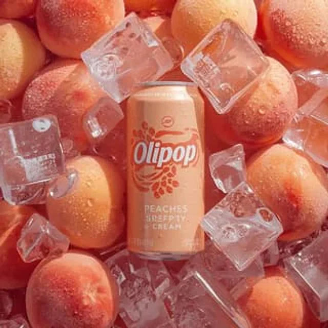

```text
Ultra-realistic commercial product photography of a pastel peach-colored soda can labeled “OLIPOP – Peaches & Cream” placed upright in the center, surrounded tightly by fresh whole peaches at the bottom and large transparent ice cubes stacked around and partially covering the top of the can, heavy condensation droplets covering the can and fruit, tiny carbonation bubbles visible on the peaches, crushed ice texture with sharp edges and frosty highlights, soft diffused studio lighting.
```

Model: Nano Banana
Author: 𝐌

[ProjectD](https://aitoolsradar.com/en/prompts/368e11020b8e94) · [Recorded source](https://x.com/Strength04_X/status/2022677800046797093)
 · [Full original metadata and byte evidence](data/projectd-batch-0064.json)

## 𝐌 #709

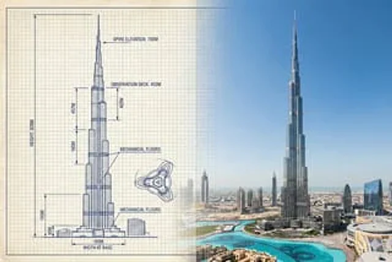

```text
{
  "objective": "Create a side-by-side comparison image featuring a technical sketch and real photograph of the Burj Khalifa",
  "image_specifications": {
    "style": "Mixed media (Technical drawing + Real photograph)",
    "layout": "Horizontal split - Left side: Sketch with measurements, Right side: Real photo",
    "aspect_ratio": "3:2"
  },
  "left_side": {
    "content_type": "Technical sketch of the Burj Khalifa",
    "features": [
      "Detailed architectural lines showing tiered setbacks",
      "Numerical height and width measurements",
      "Elevation labels for different tower sections",
      "Side and front elevation views (top-down projection if space allows)"
    ],
    "text_annotations": {
      "units": "Metric (meters)",
      "language": "English",
      "font_style": "Blueprint or engineering-style typography"
    },
    "positioning": "Take up the left half of the image"
  },
  "right_side": {
    "content_type": "High-resolution real photo of the Burj Khalifa",
    "features": [
      "Full view of the tower from base to spire",
      "Natural daylight with clear sky",
      "Color image with Dubai skyline or Downtown Dubai context"
    ],
    "positioning": "Take up the right half of the image"
  },
  "visual_elements": {
    "border_division": "Vertical line or subtle transition between left (sketch) and right (photo)",
    "color_palette": {
      "left": "Monochrome or blueprint blue for sketch",
      "right": "Natural realistic colors"
    }
  },
  "output_format": {
    "type": "Image",
    "use_case": ["Educational poster", "Architectural comparison", "Engineering visualization", "Tourism visual aid"],
    "high_resolution": true
  }
}
```

Model: Nano Banana
Author: 𝐌

[ProjectD](https://aitoolsradar.com/en/prompts/9fc49151191526) · [Recorded source](https://x.com/Strength04_X/status/2018989160699502958)
 · [Full original metadata and byte evidence](data/projectd-batch-0064.json)

## 𝐌 #719

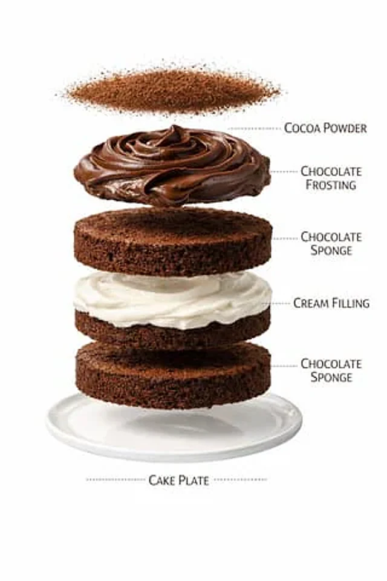

```text
Ultra-realistic premium food photography of a layered chocolate cake on a white plate, centered composition, three thick moist chocolate sponge layers with a smooth white cream filling in the middle, topped with glossy rich chocolate ganache frosting, decorated with fresh raspberries, dark chocolate curls, shards, and small gold sugar pearls, clean minimal light grey studio background, soft diffused professional lighting, gentle natural shadows, ultra-sharp texture detail showing porous sponge and creamy layers, high-end bakery advertising style, shallow depth of field, macro food photography look, photorealistic, 8K resolution, elegant dessert presentation, no text, no watermark
Negative prompt:
blurry, low resolution, cartoon style, CGI look, artificial textures, messy composition, oversaturated colors, harsh shadows, noise, watermark, text, extra objects, distorted cake shape.
```

Model: Nano Banana
Author: 𝐌

[ProjectD](https://aitoolsradar.com/en/prompts/72d492455ef864) · [Recorded source](https://x.com/Strength04_X/status/2023741334335713360)
 · [Full original metadata and byte evidence](data/projectd-batch-0064.json)

## 𝐌 #743

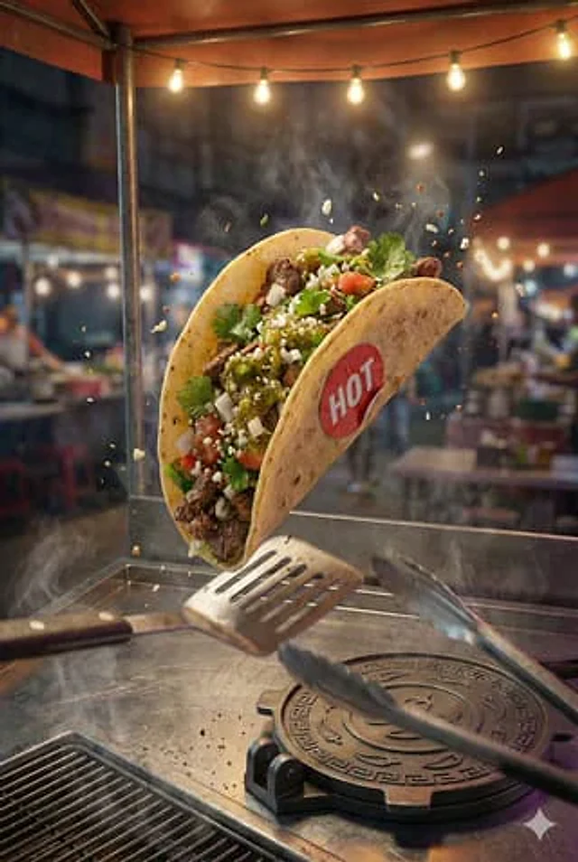

```text
Generate a '2:3' hyper-realistic, high-resolution poster featuring the attached taco image. Adjust its perspective if needed to match the scene’s perspective and blend naturally into the composition.

COMPOSITION:
Capture a dynamic freeze-frame moment of a taco mid-flip during a street-side catch, shot from a Dutch tilted low three-quarter angle that exaggerates motion and urgency. The camera is positioned slightly below the taco, angled upward, with the taco large and dominant dead-center in the frame, sharply in focus, suspended just above a scarred stainless-steel street cart counter. A single harsh overhead streetlamp mounted top left casts a focused cone of warm light, carving crisp highlights and deep shadows that emphasize motion blur in the background while keeping the taco tack-sharp. The atmosphere is alive with subtle steam rising from the cart grill at bottom left, faint oil smoke drifting upward, and tiny airborne crumbs frozen mid-air. The tone is clean, appetizing, cinematic, and urban. The food-signature prop is a custom round taco press stamped with geometric chili patterns, resting closed on the counter in the lower right foreground beneath the airborne taco, its metal edges catching the lamp’s glare. The story-signature prop is a battered transit-station flip-clock timer mounted on the back wall at top right, showing '19 03' on split flip panels, implying split-second timing and street rhythm. Wet pavement reflections shimmer in the blurred background, grounding the scene in a late-night street setting. Keep visible wiring and cables subtly running along the wall toward the neon and props, with a faint magenta/purple spill mixing into the neon glow on the wall and paper.

HEADER: 'STREET FLIGHT'
The header is physically formed from bent single neon tubing (no double tubes). Neon tubes are made of reflective glass with neon gas inside, mounted on a chipped concrete wall in the upper center background behind the taco. The neon tubes glow 'warm amber', with uneven brightness, faint buzzing, and soot-darkened mounting brackets. The header is stacked on two lines: 'STREET' above 'FLIGHT'. The letters cast soft neon spill and distorted shadows across the wall’s cracked surface, with minimal grime dulling parts of the glow, and thin black power cables feeding into the neon from the right.

TAGLINE: 'Caught in Motion'
The tagline is printed in bold condensed sans-serif on a narrow strip of grease-stained receipt paper taped directly beneath the neon header using four translucent yellow tape pieces. The paper sags slightly at the center, edges curled and darkened by oil, catching a softer secondary glow from the neon above with a faint magenta/purple tint in the spill.

CALL TO ACTION: 'ORDER NOW'
The cta is integrated into the taco press hardware in the foreground as on an angled metal bar/handle element, reading as bold, worn black lettering with slight chipping and grease settled into the letter edges, plus a hard specular highlight running along the metal.

STICKER: 'HOT'
A small circular red vinyl sticker is physically adhered directly to the taco shell, perfectly centered, with slight white highlights. The sticker conforms to the taco curvature, shows tiny wrinkles under the adhesive, and tiny air pockets are trapped beneath the adhesive to reflect realism.
```

Model: Nano Banana
Author: 𝐌

[ProjectD](https://aitoolsradar.com/en/prompts/1b0edb5fc30b0d) · [Recorded source](https://x.com/Strength04_X/status/2015332757862514985)
 · [Full original metadata and byte evidence](data/projectd-batch-0064.json)

## 𝐌 #775

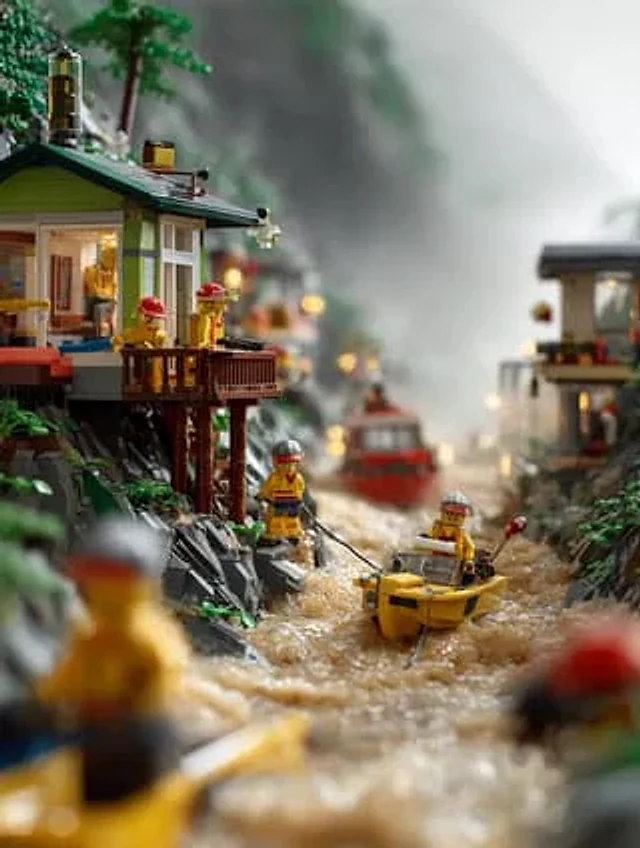

```text
LEGO mountain flood rescue scene, torrential rain causing river overflow in a LEGO mountain village, rescue boats and ropes used by LEGO firefighters, houses perched on slopes surrounded by muddy floodwater, misty mountains in background, dramatic cinematic lighting, intense LEGO disaster realism --ar 3:4
```

Model: Nano Banana
Author: 𝐌

[ProjectD](https://aitoolsradar.com/en/prompts/fcaeb1a1a6a39e) · [Recorded source](https://x.com/Strength04_X/status/2015486383713116644)
 · [Full original metadata and byte evidence](data/projectd-batch-0064.json)

## 𝐌 #777

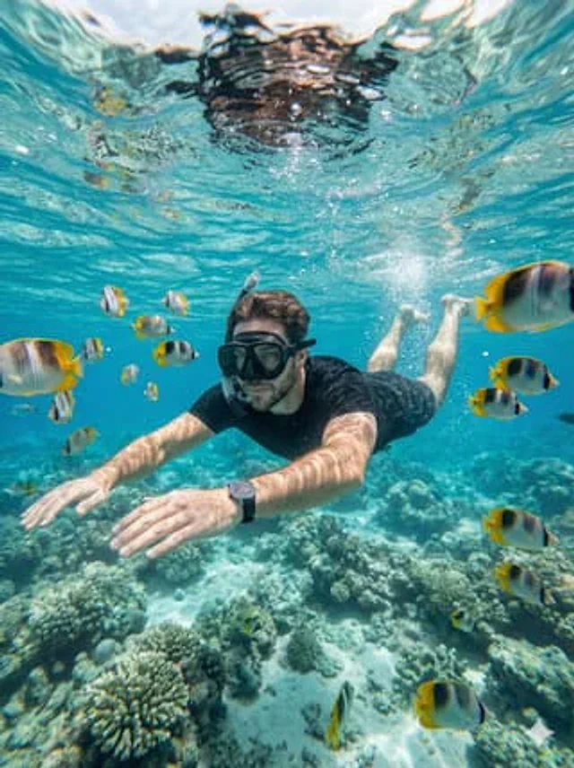

```text
Create a hyper-realistic underwater close-range portrait captured with a wide-angle action camera in a waterproof housing. The camera is very close to the Subject (≈0.5–1 m), positioned slightly below face level and angled upward, with wide-angle distortion emphasizing depth while keeping the Subject dominant.

Mid-shot to ¾ body framing. The Subject fills most of the frame, with face and upper body clearly visible. Schools of tropical fish swim closely around, some passing near the lens to create layered depth, with mild motion blur on fish closest to the camera.

Natural sunlight enters from above, producing bright caustic patterns on the Subject and surrounding water, strong highlights near the surface, and soft blue gradients below. Floating water particles are visible between the camera and Subject, with slight refraction distortion around mask edges and hands.

The Subject appears calm and relaxed, floating effortlessly with subtle body movement suggesting buoyancy and breathing through the snorkel.

A shallow coral reef is visible below, slightly softened by depth, while nearby fish remain sharper. The water surface shimmers above with gentle ripples.

Color behavior reflects natural underwater absorption: dominant blues and aquas, vibrant yellow and black fish patterns retained, and skin tones realistic with a slightly cool cast.

The image should feel like a real close-distance snorkeling travel photo intimate, immersive, and authentic.

Do not alter facial structure or identity. The Subject must remain 1000% identical to the reference image.
```

Model: Nano Banana
Author: 𝐌

[ProjectD](https://aitoolsradar.com/en/prompts/9adb2e261332de) · [Recorded source](https://x.com/Strength04_X/status/2010666164129849800)
 · [Full original metadata and byte evidence](data/projectd-batch-0064.json)

## 𝐌 #792

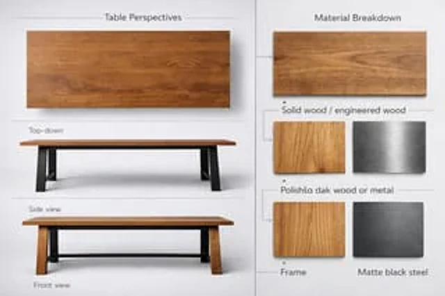

```text
{
  "objective": "Create a detailed product showcase image of a table design with multiple perspectives and material information",
  "image_specifications": {
    "style": "Realistic 3D render or high-quality product illustration",
    "layout": "Split view",
    "aspect_ratio": "3:2 or 4:3",
    "background": "Neutral (light gray or white) to enhance clarity and contrast"
  },
  "left_side": {
    "section_title": "Table Perspectives",
    "views": [
      {
        "view": "Top-down",
        "description": "Display the full table from above, showing tabletop shape, surface texture, and edge details"
      },
      {
        "view": "Side view",
        "description": "Profile of the table to show leg design, table height, and tabletop thickness"
      },
      {
        "view": "Front view",
        "description": "Straight-on view to show width, symmetry, and leg alignment"
      }
    ],
    "visual_style": "Consistent lighting and shadows for realism, subtle shadows to define form"
  },
  "right_side": {
    "section_title": "Material Breakdown",
    "content": [
      {
        "material": "Tabletop Surface",
        "material_type": "Solid wood / engineered wood",
        "swatch_image": "Close-up wood texture sample",
        "label_style": "Clean sans-serif text with arrows pointing to table sections"
      },
      {
        "material": "Legs",
        "material_type": "Polished oak wood or metal",
        "swatch_image": "Close-up material texture sample",
        "label_style": "Consistent labeling with visual connection to perspective images"
      },
      {
        "material": "Frame",
        "material_type": "Matte black steel",
        "swatch_image": "Small metallic texture sample",
        "label_style": "Minimalist annotations"
      }
    ]
  },
  "visual_elements": {
    "separation": "Vertical dividing line or subtle split background",
    "color_palette": "Natural tones for materials, grayscale for background and lines",
    "typography": "Modern, readable font for labels and section titles"
  },
  "output_format": {
    "type": "Image",
    "high_resolution": true,
    "use_case": ["Product sheet", "Interior design catalog", "Furniture showcase"]
  }
}
```

Model: Nano Banana
Author: 𝐌

[ProjectD](https://aitoolsradar.com/en/prompts/e44270c0c40a06) · [Recorded source](https://x.com/Strength04_X/status/2018964408417018277)
 · [Full original metadata and byte evidence](data/projectd-batch-0064.json)

## 𝐌 #806

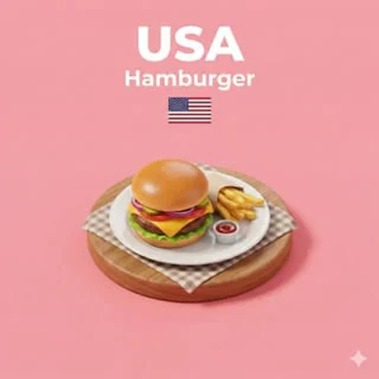

```text
Present a clear, 45° top-down isometric miniature 3D cartoon scene of [COUNTRY]’s signature dish: [FOOD], with soft refined textures, realistic PBR materials, and gentle lifelike lighting.
Create a small raised diorama-style base showcasing the dish in a highly recognizable presentation, with simple complementary elements (plate, table surface, or minimal garnish).
Use a clean solid [COLOR] background.

At the top-center, display [COUNTRY] in large bold text, directly beneath it show [FOOD] in medium text, and place a small simplified national icon or flag below the subtext.
All text must automatically match the background contrast (white or black).

Composition: perfectly centered layout, square 1080x1080, ultra-clean, high-clarity miniature diorama aesthetic.”
```

Model: Nano Banana
Author: 𝐌

[ProjectD](https://aitoolsradar.com/en/prompts/efa627d7b9b2df) · [Recorded source](https://x.com/Strength04_X/status/2015771756812963853)
 · [Full original metadata and byte evidence](data/projectd-batch-0064.json)

## 𝐌 #810

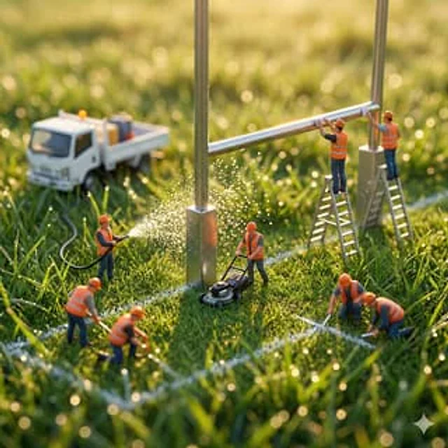

```text
{
  "prompt": "Ultra-realistic macro photography of miniature construction workers working inside a lush green grass field at golden hour. Tiny workers wearing safety helmets and reflective orange-yellow vests are installing and cleaning a large metallic rugby goal post structure emerging from the grass. One worker is spraying water from a hose connected to a small white utility truck parked in the background, visible water droplets sparkling in sunlight. Another worker is pushing a small lawn mower trimming grass. Two workers are standing on metal ladders adjusting and polishing the horizontal bar of the goal post. Additional workers are cleaning grass lines with tools, creating white chalk field markings across the grass. Dew drops on grass blades glowing with soft bokeh in background. Extremely shallow depth of field, cinematic lighting, warm natural sunlight, high detail textures, realistic metal reflections, soft background blur, tilt-shift effect, 8K resolution, professional macro lens photography, hyper-realistic miniature diorama style.",
  "negative_prompt": "blurry, low resolution, cartoon style, CGI look, unrealistic proportions, oversaturated colors, harsh shadows, distorted anatomy, messy composition, noisy image, watermark, text, logo",
  "settings": {
    "resolution": "1024x1024",
    "lighting": "golden hour natural sunlight",
    "camera": "macro lens 100mm",
    "depth_of_field": "very shallow",
    "style": "photorealistic miniature diorama",
    "quality": "ultra high detail",
    "aspect_ratio": "1:1"
  }
}
```

Model: Nano Banana
Author: 𝐌

[ProjectD](https://aitoolsradar.com/en/prompts/60f6afc372eea1) · [Recorded source](https://x.com/Strength04_X/status/2021588784895406168)
 · [Full original metadata and byte evidence](data/projectd-batch-0064.json)

## 𝐌 #821

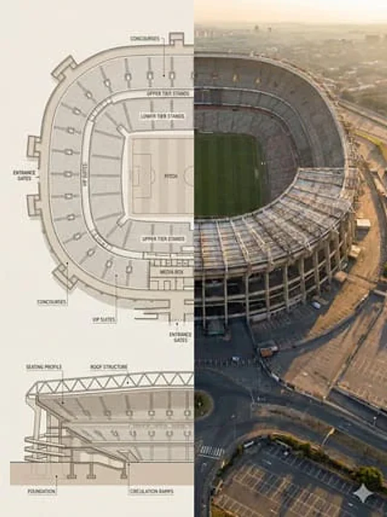

```text
Split composition image, left and right halves clearly divided in 16:9 widescreen format.
Left Half:
Highly detailed architectural floor plan and cross-section illustration of [LANDMARK] in a modern minimalist style. Top-down view showing main structural layout, internal divisions, circulation paths, key chambers or spaces with labels. Material callouts, structural support systems, and architectural details clearly marked. Neutral beige and warm gray color palette, clean linework, soft shadows, subtle textures. Professional architectural-presentation style. Include detailed cross-sectional diagram showing vertical layers and internal structure. Blueprint aesthetic with technical accuracy and labeled sections.
Right Half:
Ultra-realistic aerial exterior photograph of [LANDMARK] captured from above and to the side (elevated isometric perspective, not straight overhead). Shows the complete structure with authentic weathered textures, aged materials, surrounding landscape, dramatic golden-hour sunlight creating sharp shadows, atmospheric haze suggesting historical significance. The perspective reveals both external grandeur and internal scale simultaneously. Warm golden-light lighting, realistic patina and wear patterns, authentic architectural proportions. Feels like an aerial photograph capturing the monument’s true majesty and scale.
Both halves align visually, clearly showing architectural engineering blueprint vs. the actual monumental structure in its archaeological or historical reality.
Style & Mood:
•Architectural blueprint visualization meets historical aerial photography
•Engineering precision and historical significance
•Educational, museum-exhibit presentation
•Engineering schematic-to-reality comparison
•Grandeur emphasizing scale and architectural sophistication
Lighting & Color:
•Left: Flat, even lighting, neutral blueprint tones, technical aesthetic
•Right: Golden-hour natural light, dramatic shadows, warm tones, atmospheric depth
•Consistent warm palette between both halves
Camera & Technical Details:
•Left: Top-down orthographic + detailed cross-sectional architectural view with labeled sections
•Right: Elevated aerial perspective (45-degree isometric angle), capturing full structure from above-and-to-the-side
•High resolution, sharp architectural details on left; photorealistic weathered textures on right
Negative Prompt:
Cartoon style, low detail, cluttered composition, modern elements, unrealistic proportions, harsh lighting, exaggerated colors, text overlays, watermarks, CGI look, sterile rendering, straight-down overhead view, no atmospheric quality, overly pristine condition.
```

Model: Nano Banana
Author: 𝐌

[ProjectD](https://aitoolsradar.com/en/prompts/d06b220cd0ac89) · [Recorded source](https://x.com/Strength04_X/status/2018935306473590938)
 · [Full original metadata and byte evidence](data/projectd-batch-0064.json)

## 𝐌 #823


```text
Ultra-clean modern recipe infographic. Showcase Vanilla Ice Cream Scoops with syrup and toppings in angled perspective.

Ingredients Section: Icons for milk, cream, sugar, vanilla.

Steps Section: Mixing base, freezing, scooping shown with numbered panels.

Additional Info: Calories, prep time, servings displayed in badges.

Visual Style: Dessert infographic with pastel colors, soft gradients, modern typography.

Composition Guidelines: Ice cream scoops as hero visual with ingredients and steps around it.

Lighting & Background: Soft dessert-style lighting with minimal background.

Output: 1080×1080, ultra-crisp, social-feed optimized, no watermark.
```

Model: Nano Banana
Author: 𝐌

[ProjectD](https://aitoolsradar.com/en/prompts/01316ac010970d) · [Recorded source](https://x.com/Strength04_X/status/2033184147003633695)
 · [Full original metadata and byte evidence](data/projectd-batch-0064.json)

## 𝐌 #824

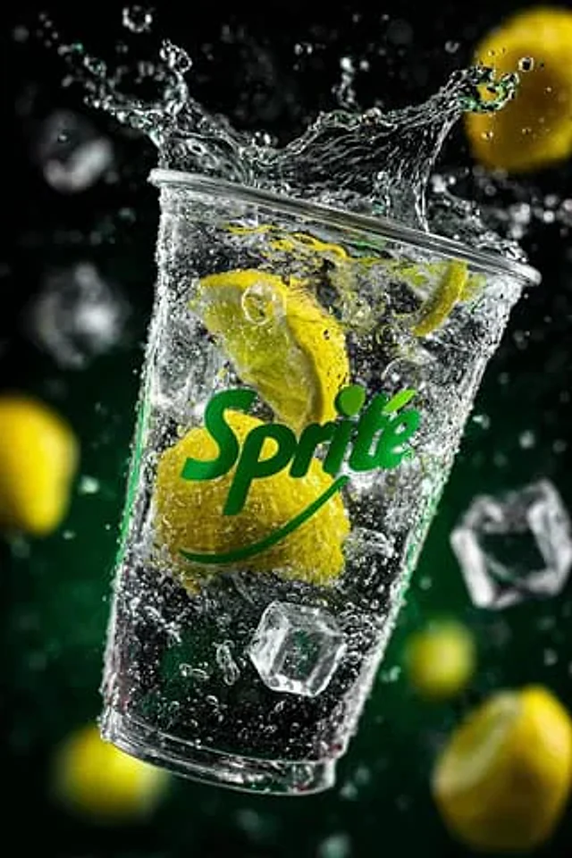

```text
A transparent cup filled with fresh Sprite lemon soda floating in the air, surrounded by sparkling lemon-lime soda splashes, bright ice cubes, and tiny carbonation bubbles bursting around the drink. The cup features green minimal text design, giving a fresh and clean brand look. Hyper-realistic beverage product photography with professional studio lighting, crisp texture details, macro clarity as if shot with Sony A7s. Black and neon green background highlighting freshness --stylize 250
```

Model: Nano Banana
Author: 𝐌

[ProjectD](https://aitoolsradar.com/en/prompts/5cf0bbffb673d8) · [Recorded source](https://x.com/Strength04_X/status/2029237065783873715)
 · [Full original metadata and byte evidence](data/projectd-batch-0064.json)

## 𝐌 #826

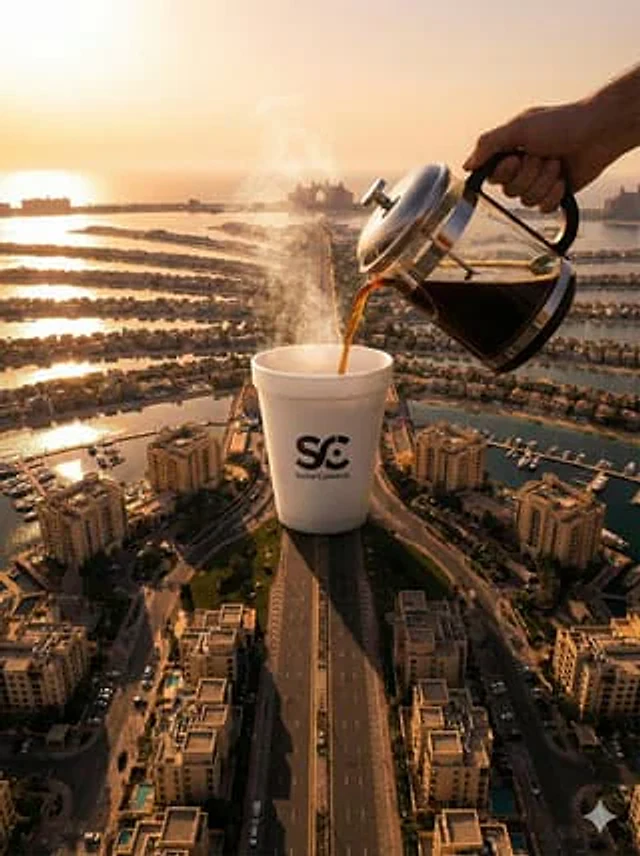

```text
An aerial photograph captures a surreal scene where a giant white foam cup, branded with the 'SC Social Connects' logo from image_8.png, is placed on the central trunk of the Palm Jumeirah in Dubai. A hand holds a glass and metal coffee pot, pouring steaming coffee into the oversized cup. The Palm's fronds, marina, and Dubai's skyline are bathed in warm, golden sunset light, with long shadows and reflections on the water.
```

Model: Nano Banana
Author: 𝐌

[ProjectD](https://aitoolsradar.com/en/prompts/85570f89dd56f1) · [Recorded source](https://x.com/Strength04_X/status/2009900632527036785)
 · [Full original metadata and byte evidence](data/projectd-batch-0064.json)

## 𝐌 #853

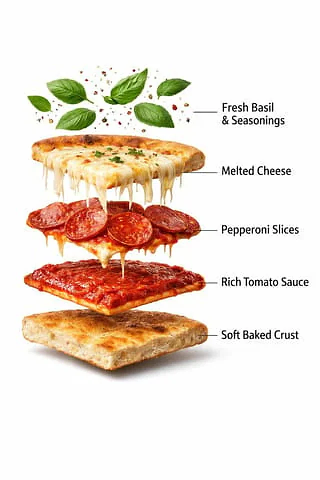

```text
- Ultra-realistic prepared pepperoni pizza slice, fully assembled, gooey melted mozzarella cheese stretching and dripping over the edges, crispy pepperoni slices on top, rich tomato sauce beneath, thick golden baked crust, fresh basil leaves and light seasoning floating subtly above, clean pure white background, professional commercial food photography lighting, soft natural shadows under the slice, sharp focus, extreme texture detail, glossy cheese, crunchy crust surface, studio shot, minimal composition, no text, no labels, no hands, premium food advertisement style, 8K resolution, ultra-detailed, hyper-realistic.
```

Model: Nano Banana
Author: 𝐌

[ProjectD](https://aitoolsradar.com/en/prompts/056503180197fd) · [Recorded source](https://x.com/Strength04_X/status/2012909080785072329)
 · [Full original metadata and byte evidence](data/projectd-batch-0064.json)

## 𝐌 #866

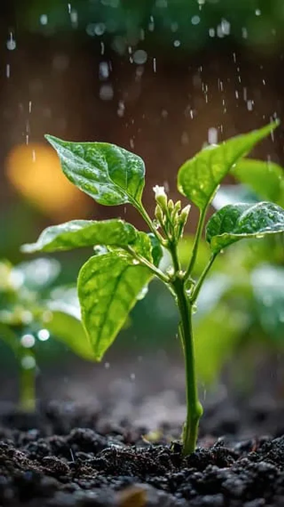

```text
A small chili plant with glossy green leaves and one tiny white flower bud forming, emerging from dark damp soil. Light rain falling gently, droplets visible mid-air. Ground-level camera angle, intense macro detail on leaf veins and wet soil granules. Soft daylight with warm evening tones, natural reflections on wet surfaces. Background garden softly blurred with circular bokeh highlights. Backlit leaves with subtle translucency. Shot on 100mm macro lens, shallow depth of field, f/2.8
```

Model: Nano Banana
Author: 𝐌

[ProjectD](https://aitoolsradar.com/en/prompts/25b494d368d0d9) · [Recorded source](https://x.com/Strength04_X/status/2025073987521507338)
 · [Full original metadata and byte evidence](data/projectd-batch-0064.json)

## 𝐌 #867

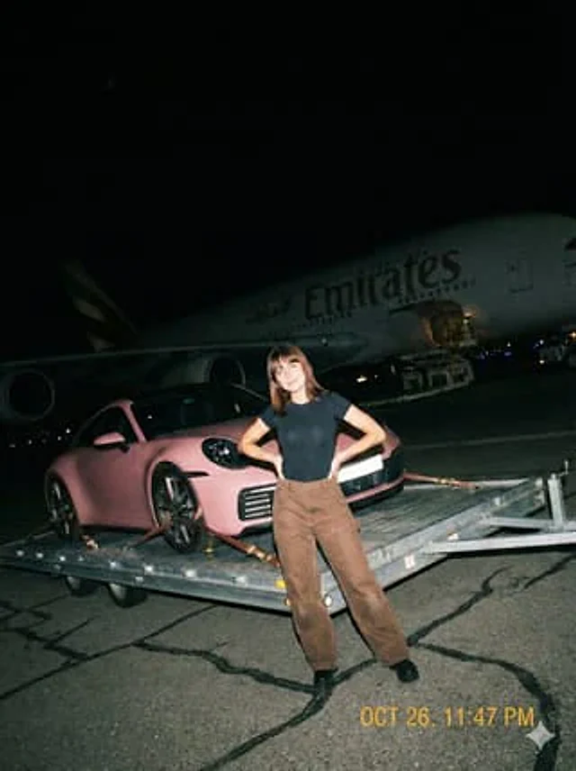

```text
A gritty, handheld iPhone photo taken at night on an airport tarmac with harsh direct on-camera flash. Imperfect, slightly crooked framing, like a spon-taneous snap. In the foreground, the woman stands beside a pink Porsche 911 on a flatbed trailer, mid-coy gesture, body angled three-quarters, one hand near her face. She wears wide Carhartt-style jeans and a fitted top, straight bangs framing her face flirty, casual, unplanned. In the background, a huge Emirates Airbus A380 looms in darkness, barely visible beyond flash falloff, cargo door open. Blown highlights on her, hard shadows on concrete, the plane mostly swallowed by night.
```

Model: Nano Banana
Author: 𝐌

[ProjectD](https://aitoolsradar.com/en/prompts/2210c330675a90) · [Recorded source](https://x.com/Strength04_X/status/2015428737005912073)
 · [Full original metadata and byte evidence](data/projectd-batch-0064.json)

## 𝐌 #877

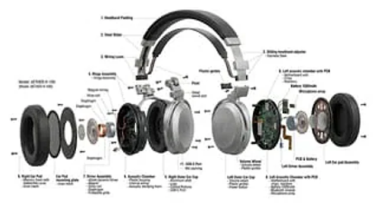

```text
product design, [object or vehicle with material accents], exploded view diagram, white background, three-dimensional, highly detailed internal components, studio lighting, product photography, best quality
```

Model: Nano Banana
Author: 𝐌

[ProjectD](https://aitoolsradar.com/en/prompts/ab7668404a6389) · [Recorded source](https://x.com/Strength04_X/status/2028442638781984986)
 · [Full original metadata and byte evidence](data/projectd-batch-0064.json)

## 𝐌 #893

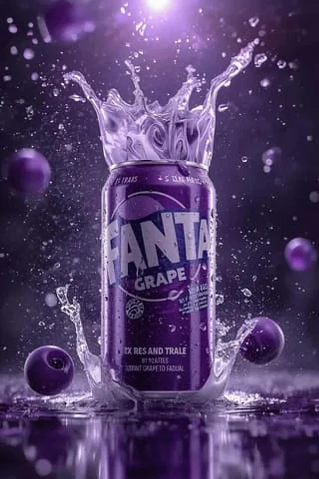

```text
Motion settles into a striking hero shot: can centered, purple liquid frozen in sculptural form, berries suspended mid-air. No text, no logos, no transitions—pure visual impact.
Style & Mood:
Ultra-premium soda advertisement, dark luxury aesthetic, cinematic slow motion, high-contrast lighting, glossy reflections, dramatic yet elegant energy.
Camera & Technical Direction:
Locked-off camera, high-speed macro cinematography, realistic fluid dynamics, controlled splash physics, volumetric lighting, shallow depth of field, hyper-detailed droplets.
```

Model: Nano Banana
Author: 𝐌

[ProjectD](https://aitoolsradar.com/en/prompts/a7548ff662c3a7) · [Recorded source](https://x.com/Strength04_X/status/2011671243922293065)
 · [Full original metadata and byte evidence](data/projectd-batch-0064.json)

## 𝐌 #895

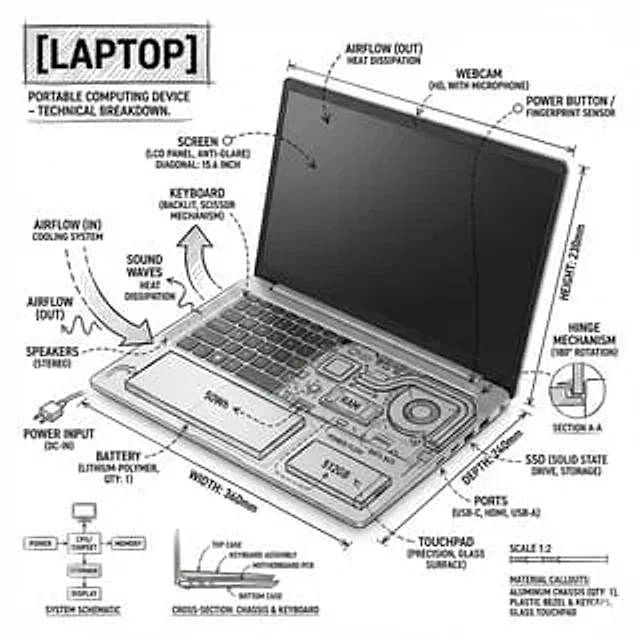

```text
Create an infographic image of laptop ,combining a realistic photograph or photoreal render of the object with technical annotation overlays placed directly on top.

Use black ink–style line drawings and text (technical pen / architectural sketch look) on a pure white studio background, including:
•Key component labels
•Internal cutaway or exploded-view outlines
•Measurements, dimensions, and scale markers
•Material callouts and quantities
•Arrows indicating function, force, or flow (air, sound, power, pressure)
•Simple schematic or sectional diagrams where relevant

Place the title [OBJECT] inside a hand-drawn technical annotation box in one corner.

Style & layout rules:
•The real object remains clearly visible beneath the annotations
•Annotations feel sketched, technical, and architectural
•Clean composition with balanced negative space
•Educational, museum-exhibit / engineering-manual vibe

Visual style:
Minimal technical illustration aesthetic, black linework over realistic imagery, precise but slightly hand-drawn feel.

Color palette:
White background, black annotation lines and text only. No colors.

Output:
1080×1080, ultra-crisp, social-feed optimized, no watermark.”

Es par ek text post bnao X ke liye ki ye mere dwara bnata gya hai
```

Model: Nano Banana
Author: 𝐌

[ProjectD](https://aitoolsradar.com/en/prompts/a2a4465803c6b3) · [Recorded source](https://x.com/Strength04_X/status/2013602849658429459)
 · [Full original metadata and byte evidence](data/projectd-batch-0064.json)

## 𝐌 #905

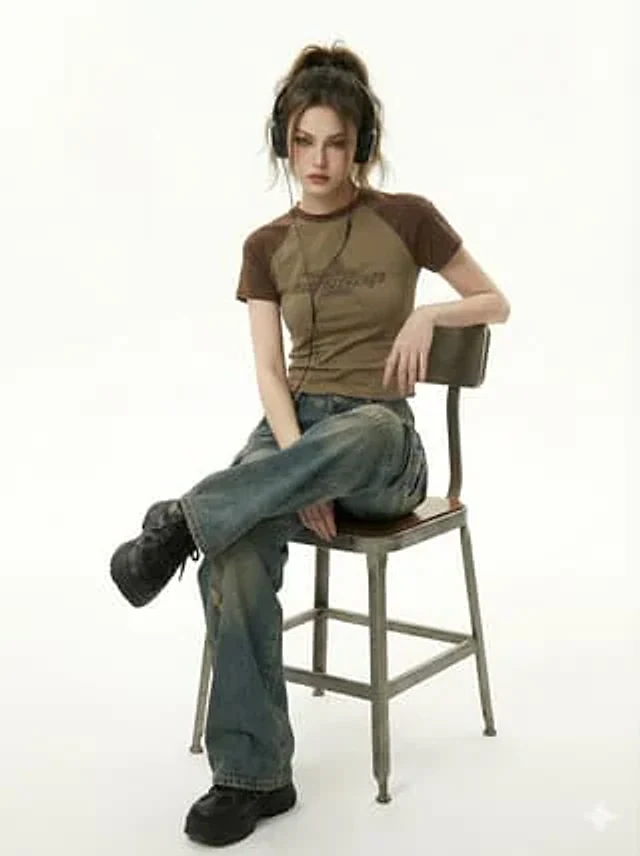

```text
She kneels in a pristine white studio, shot from a low mid angle with a slight upward tilt that emphasizes quiet dominance. She wears a Y2K inspired brown and olive raglan tee with a worn retro star logo reading sssap, paired with oversized distressed wide leg denim cargos and chunky black streetwear shoes. Her messy ponytail and loose strands frame a sharp, defiant gaze, softened by large black wired headphones adding a cyber edge. Soft diffused studio lighting reveals fabric texture and subtle shadows, while her provocative yet controlled expression channels indie sleaze mixed with Harajuku editorial rebellion.
```

Model: Nano Banana
Author: 𝐌

[ProjectD](https://aitoolsradar.com/en/prompts/588ec7642e97a4) · [Recorded source](https://x.com/Strength04_X/status/2009446845358186930)
 · [Full original metadata and byte evidence](data/projectd-batch-0064.json)

## 𝐌 #915

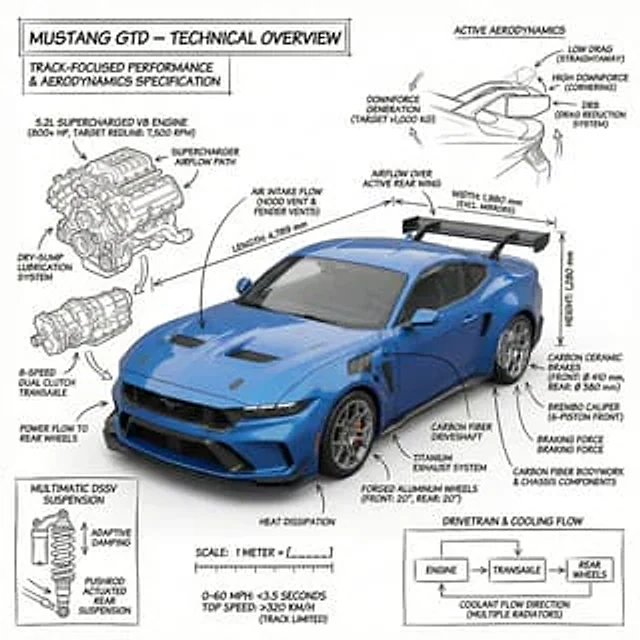

```text
Create an infographic image of Mustang GTD  combining a realistic photograph or photorealistic render of the object with technical annotation overlays placed directly on top.

Use black ink–style line drawings and text (blue Mustang GTD   ) on a pure white studio background.

Include:
•Key component labels
•Internal cutaway or exploded-view outlines (where relevant)
•Measurements, dimensions, and scale markers
•Material callouts and quantities
•Arrows indicating function, force, or flow (all the functions that comes with bugatti Chiron)
•Simple schematic or sectional diagrams where applicable

Place the title Mustang GTD  inside a real technical annotation box in one corner.

Style & layout rules:
•The real object remains clearly visible beneath the annotations(no annotation on the real object)
•Annotations look hand-sketched, technical, and architectural
•Clean composition with balanced negative space
•Educational, museum-exhibit / engineering-manual vibe

Visual style:
Minimal technical illustration aesthetic.
Black linework layered over realistic imagery.
Precise but slightly hand-drawn feel.

Color palette:
Pure white background.
Black annotation lines and text only.
No colors.

Output:
1080 × 1080 resolution
Ultra-crisp
Social-feed optimized
No watermark
```

Model: Nano Banana
Author: 𝐌

[ProjectD](https://aitoolsradar.com/en/prompts/816fab0226bde5) · [Recorded source](https://x.com/Strength04_X/status/2018276369353015519)
 · [Full original metadata and byte evidence](data/projectd-batch-0064.json)

## 𝐌 #918

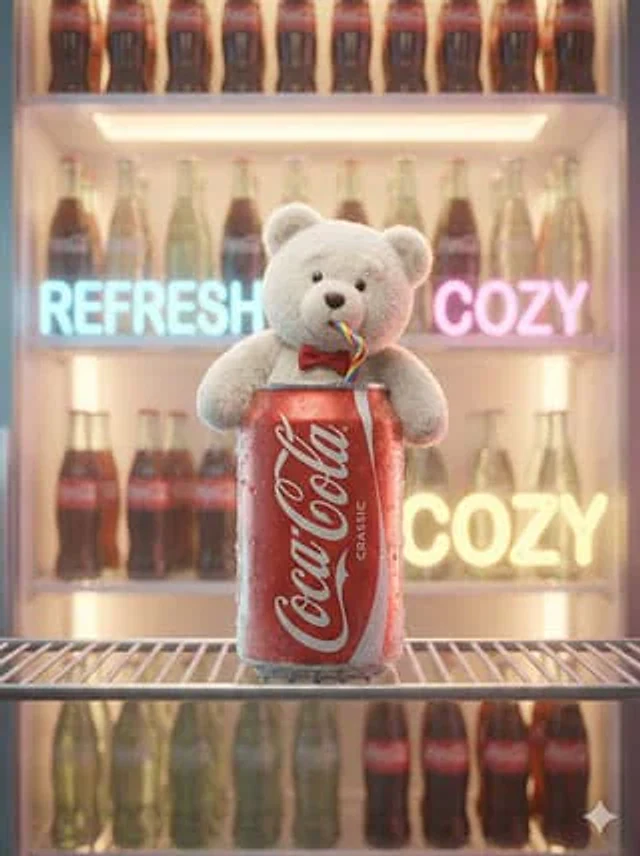

```text
A cute, cinematic brand fantasy scene featuring a fluffy white teddy bear mascot emerging from a chilled soda Coca-Cola can, holding a colorful striped straw.

The can is placed inside a glowing refrigerator filled with neatly stacked glass soda bottles. Soft neon lighting, pastel reflections, condensation droplets on metal, playful yet premium advertising style. Shallow depth of field, ultra-detailed fur texture, glossy highlights, vibrant red-and-white color pal-ette, whimsical mood, Pixar-level realism, stu-dio-quality lighting, high contrast, square composi-tion, 1080×1080, ultra-HD, commercial brand photog-raphy.
```

Model: Nano Banana
Author: 𝐌

[ProjectD](https://aitoolsradar.com/en/prompts/be264769d4a58c) · [Recorded source](https://x.com/Strength04_X/status/2008912370551357865)
 · [Full original metadata and byte evidence](data/projectd-batch-0064.json)

## 𝐌 #947


```text
A Pixar-style 3D animated character of a single banana. Handsome male character with sharp confident eyes, thick stylish eyebrows, and a wide charismatic grin showing bright white sparkling teeth. Smooth slightly glossy yellow peel texture with subtle highlights. The banana has small cartoon arms and legs, standing upright with arms crossed in a proud hero-like pose. Teeth are shiny and perfectly white with small sparkle effects. In the background, a bunch of bananas is slightly blurred.The character is standing on a wooden dining table near a sunny window in a cozy modern home. Vibrant colors, cinematic lighting, soft shadows, high-fidelity textures, ultra-detailed.
```

Model: Nano Banana
Author: 𝐌

[ProjectD](https://aitoolsradar.com/en/prompts/0a96bd9954c19b) · [Recorded source](https://x.com/Strength04_X/status/2025388911451848929)
 · [Full original metadata and byte evidence](data/projectd-batch-0064.json)

## 𝐌 #966

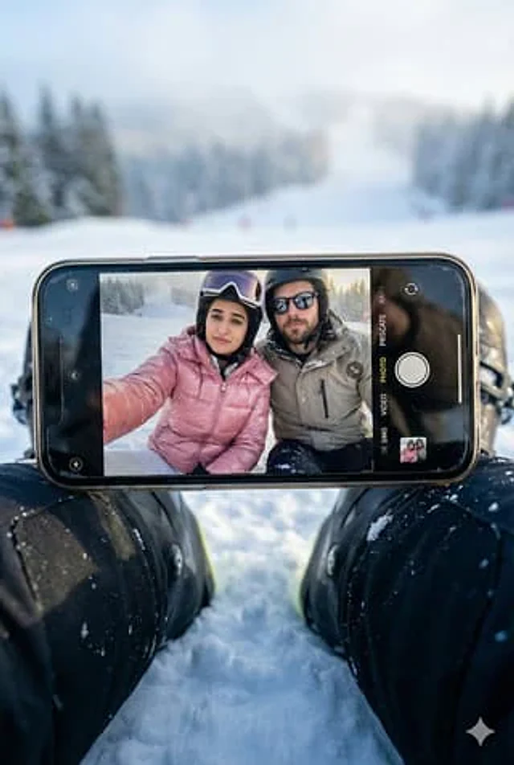

```text
Create a hyper-realistic winter scene in a vertical 3:4 aspect ratio with cinematic realism and natural detail. The foreground features compacted snow with subtle ice sparkle, cool blue shadows, and cold ambient light. A smartphone is placed perfectly horizontally across black ski boots, stable and centered, with visible smudges, micro-reflections, edge highlights, and slight screen glare. The iPhone camera Ul is clearly visible, including icons and the shutter button, reinforcing an authentic, unedited iPhone capture. On the phone screen, Subject 1 and Subject 2 are seated closely together on the snow, framed from a low angle so only their upper bodies are visible, creating an intimate mirror-selfie-style composition. Subject 2 sits slightly forward, holding the phone at arm's length with the phone back visible, wearing a glossy pink puffer jacket with realistic quilting, natural folds, helmet, and goggles; her face is fully clear and visible with a relaxed, confident expression. Subject 1 sits directly beside her, shoulders nearly touching, wearing a neutral ski jacket with light snow dusting, a helmet, and dark sunglasses reflecting the snowy environment: his face is also fully clear and visible, with a calm, relaxed posture. The background within the screen shows a snowy slope and distant ski-area elements softened by realistic depth and atmospheric haze. Lighting blends cool winter tones with warm sunlight reflections, producing natural shadows, lifelike highlights, and subtle imperfections. The final image must feel HD, realistic, candid, and cinematic, with both subjects facial features preserved exactly and remaining 1000% identical to the uploaded images.
```

Model: Nano Banana
Author: 𝐌

[ProjectD](https://aitoolsradar.com/en/prompts/6a38bc88d6049b) · [Recorded source](https://x.com/Strength04_X/status/2008361785322336674)
 · [Full original metadata and byte evidence](data/projectd-batch-0064.json)

## 𝐌 #967

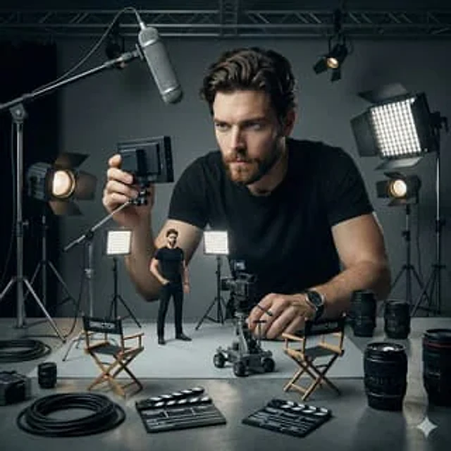

```text
Ultra-realistic cinematic studio scene of a woman supervising a miniature behind-the-scenes film set starring her tiny self.

She checks a miniature monitor while the small figure stands near scaled lighting rigs.

Both versions share identical facial features, body language, and clothing.

Mini director chairs, cables, clapperboards, and lenses fill the studio space.

Low-key cinematic lighting emphasizes realism and depth.
```

Model: Nano Banana
Author: 𝐌

[ProjectD](https://aitoolsradar.com/en/prompts/dedeaae224d3b8) · [Recorded source](https://x.com/Strength04_X/status/2015380025365938616)
 · [Full original metadata and byte evidence](data/projectd-batch-0064.json)

## 𝐌 #969

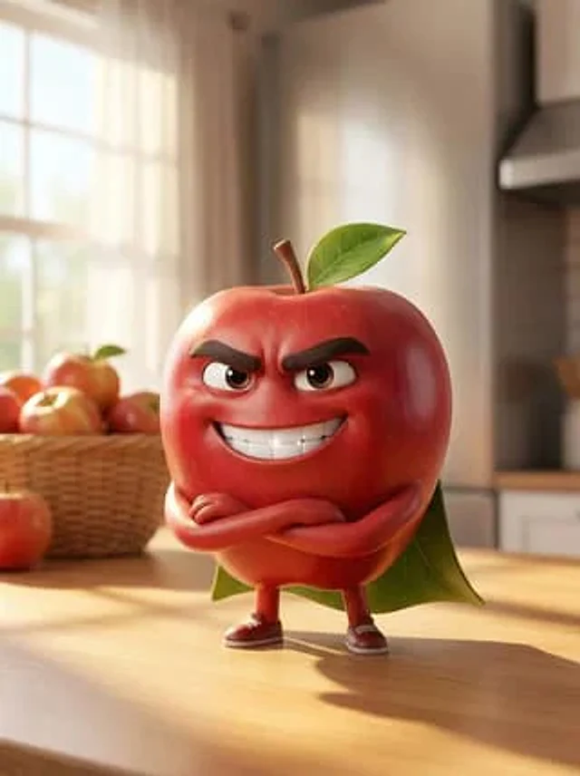

```text
A Pixar-style 3D animated character of a single red apple. Handsome male character with sharp confident eyes, thick stylish eyebrows, and a wide charismatic grin showing bright white sparkling teeth. Smooth slightly glossy red skin texture with subtle highlights and natural gradients. The apple has small cartoon arms and legs, standing upright with arms crossed in a proud hero-like pose.

Teeth are shiny and perfectly white with small sparkle effects. In the background, a basket of apples is slightly blurred. The character is standing on a wooden dining table near a sunny window in a cozy modern home. Vibrant colors, cinematic lighting, soft shadows, high-fidelity textures, ultra-detailed, 8k.
```

Model: Nano Banana
Author: 𝐌

[ProjectD](https://aitoolsradar.com/en/prompts/090dc85c8b7006) · [Recorded source](https://x.com/Strength04_X/status/2025495088668008917)
 · [Full original metadata and byte evidence](data/projectd-batch-0064.json)

## Maercih #1117

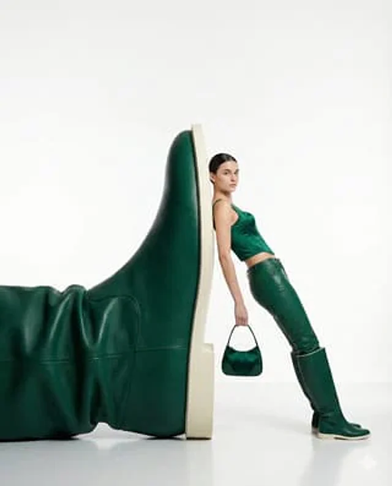

```text
{
  "style": "high-fashion editorial, minimalist surrealism",
  "subject": "a confident woman leaning casually against an oversized green leather boot sculpture",
  "pose": "relaxed yet powerful stance, body slightly angled, one arm holding a small handbag",
  "outfit": {
    "top": "emerald green fitted sleeveless top",
    "bottom": "matching green leather pants",
    "footwear": "knee-high green leather boots",
    "accessories": "small structured green handbag"
  },
  "composition": {
    "scale": "dramatic contrast between human figure and oversized object",
    "framing": "full body shot, centered subject with negative space",
    "background": "pure white seamless studio backdrop",
    "floor": "glossy white reflective surface"
  },
  "lighting": {
    "type": "soft studio lighting",
    "mood": "clean, premium, editorial",
    "shadows": "subtle, natural, controlled"
  },
  "color_palette": "monochromatic green tones with neutral white",
  "camera": {
    "angle": "eye-level",
    "lens": "85mm fashion lens",
    "depth_of_field": "sharp focus on subject, smooth background"
  },
  "vibe": "luxury fashion campaign, modern, confident, surreal elegance",
  "quality": "ultra-high resolution, crisp details, magazine-ready"
}
```

Model: Nano Banana
Author: Maercih

[ProjectD](https://aitoolsradar.com/en/prompts/72f2742daf8090) · [Recorded source](https://x.com/Maercihh/status/2019648173652996217)
 · [Full original metadata and byte evidence](data/projectd-batch-0064.json)

## Maercih #1312

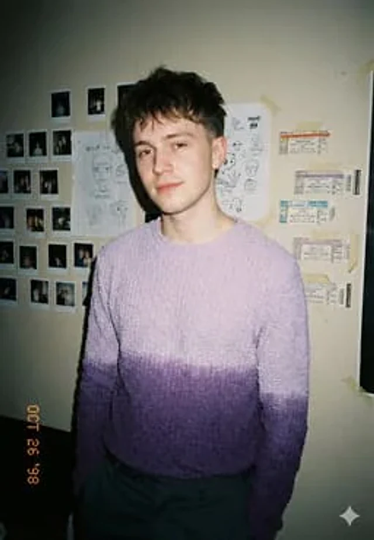

```text
{
  "scene": "An intimate indoor portrait taken in a personal bedroom or studio space, walls covered with taped photos, sketches, and ticket stubs",
  "subject": {
    "gender": "male",
    "age": "early 20s",
    "expression": "calm, slightly guarded, introspective",
    "pose": "standing casually, shoulders relaxed, slight lean, hands out of frame",
    "gaze": "direct but unforced eye contact with the camera",
    "hair": "short, messy crop with natural volume, slightly uneven fringe",
    "wardrobe": {
      "top": "textured knit sweater with soft purple gradient fade",
      "bottom": "muted trousers, understated and casual",
      "style": "effortless, lived-in, indie editorial"
    }
  },
  "environment": {
    "location": "personal room or creative space",
    "background_elements": [
      "polaroid photographs taped to wall",
      "handwritten sketches and doodles",
      "concert or travel ticket stubs",
      "masking tape visible and imperfect"
    ],
    "atmosphere": "nostalgic, personal, slightly raw"
  },
  "lighting": {
    "type": "direct on-camera flash",
    "quality": "harsh but controlled",
    "shadow": "hard shadows falling behind subject",
    "mood": "late 90s / early 2000s candid realism"
  },
  "camera": {
    "shot_type": "medium portrait",
    "lens": "35mm",
    "perspective": "eye-level, snapshot-style framing",
    "depth_of_field": "deep enough to keep wall details readable",
    "imperfections": "slight vignetting, flash falloff"
  },
  "color_grading": {
    "palette": "muted neutrals with soft lavender emphasis",
    "contrast": "moderate",
    "tones": "natural skin tones with slight warmth"
  },
  "texture_and_detail": {
    "skin": "real texture, visible blemishes, no smoothing",
    "fabric": "clearly defined knit texture",
    "grain": "noticeable film grain",
    "timestamp": "subtle date stamp in corner"
  },
  "style": "analog-inspired, diary-like portrait, lo-fi editorial realism",
  "negative_prompt": [
    "studio lighting",
    "beauty retouching",
    "plastic skin",
    "perfect symmetry",
    "over-sharpening",
    "clean minimal background",
    "AI artifacts"
  ]
}
```

Model: Nano Banana
Author: Maercih

[ProjectD](https://aitoolsradar.com/en/prompts/2bcfc5c3713b98) · [Recorded source](https://x.com/Maercihh/status/2016448117617602890)
 · [Full original metadata and byte evidence](data/projectd-batch-0064.json)

## Maercih #1332

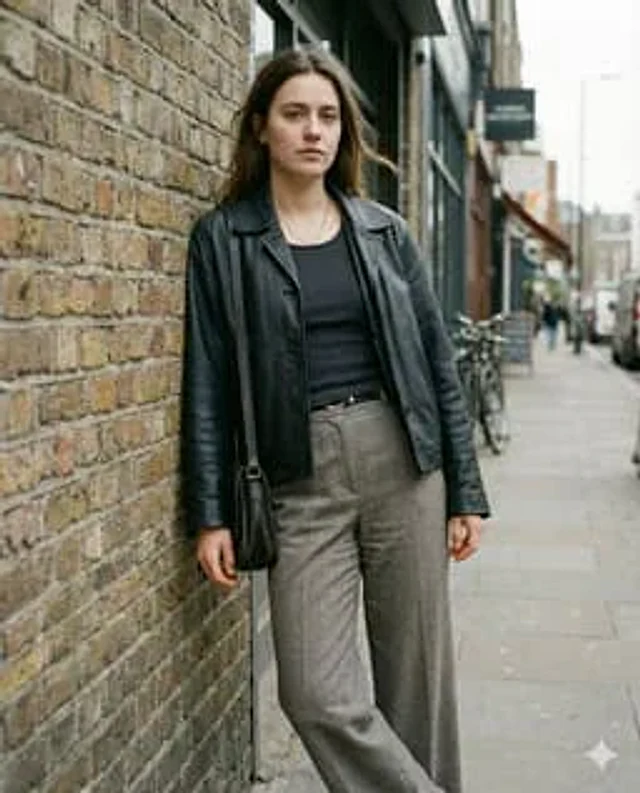

```text
{
  "scene": "Urban street portrait on a quiet city sidewalk",
  "subject": {
    "gender": "female",
    "age_range": "late 20s to early 30s",
    "expression": "neutral, introspective, calm confidence",
    "pose": "standing casually, leaning slightly against a brick wall, weight shifted to one leg, arms relaxed",
    "gaze": "looking directly at camera, unfazed, understated presence"
  },
  "wardrobe": {
    "outerwear": "black leather jacket with natural wear and soft creases",
    "top": "dark charcoal ribbed tank top",
    "bottom": "high-waisted tailored wool trousers in muted grey",
    "accessories": "small dark leather crossbody bag, minimal jewelry",
    "styling_notes": "effortless, functional, lived-in fashion, no trend exaggeration"
  },
  "hair_and_makeup": {
    "hair": "natural medium-length hair, loose and slightly wind-touched, no styling product shine",
    "makeup": "minimal or none, natural skin texture visible, subtle under-eye shadows, real pores"
  },
  "environment": {
    "location": "narrow city street with brick wall and storefronts",
    "background": "softly out-of-focus bicycles and pedestrians in the distance",
    "era_feel": "timeless contemporary, everyday realism"
  },
  "lighting": {
    "type": "natural overcast daylight",
    "direction": "soft frontal with gentle side falloff",
    "contrast": "low to medium contrast",
    "notes": "no harsh highlights, no dramatic rim light"
  },
  "camera": {
    "lens": "50mm full-frame look",
    "framing": "full-body portrait, eye-level perspective",
    "depth_of_field": "moderately shallow, subject separated subtly from background",
    "movement": "static, documentary stillness"
  },
  "color_and_texture": {
    "color_palette": "muted earth tones, soft greys, natural skin tones",
    "texture": "visible fabric weave, brick texture, light film grain",
    "grading": "neutral, slightly cool, filmic, no teal-orange"
  },
  "aesthetic_constraints": [
    "no plastic skin",
    "no beauty retouching",
    "no cinematic exaggeration",
    "no fashion editorial posing",
    "no artificial glow",
    "avoid AI symmetry"
  ],
  "overall_vibe": "quiet confidence, observational, grounded realism, modern street portrait"
}
```

Model: Nano Banana
Author: Maercih

[ProjectD](https://aitoolsradar.com/en/prompts/7bc29738b61dad) · [Recorded source](https://x.com/Maercihh/status/2010582030669807956)
 · [Full original metadata and byte evidence](data/projectd-batch-0064.json)

## Maercih #1349

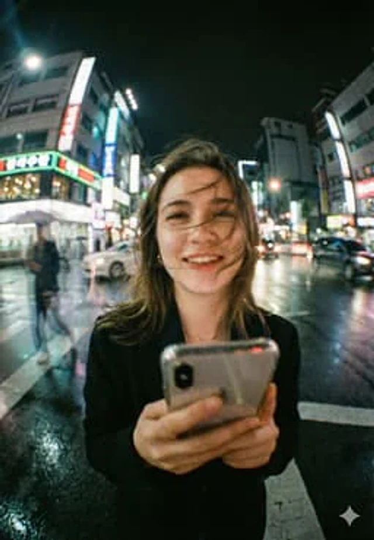

```text
{
  "model": "gemini-nano-banana-pro",
  "mode": "image",
  "aspect_ratio": "4:5",
  "quality": "ultra",
  "style": "cinematic_realism",
  "scene": {
    "setting": "busy neon-lit city street at night, wet road after rain, glowing signboards and traffic behind subject",
    "weather": "light drizzle just ended, reflective pavement, humid atmosphere",
    "background": "soft bokeh city lights, moving cars, faint pedestrian motion blur, tall buildings with colorful signage",
    "time": "night"
  },
  "subject": {
    "type": "young woman",
    "pose": "standing in the middle of a crosswalk, holding a smartphone close to camera",
    "expression": "natural warm smile, candid and joyful",
    "hair": "slightly messy hair blown across face by wind",
    "wardrobe": "dark coat or blazer, minimal accessories",
    "props": ["smartphone"]
  },
  "composition": {
    "framing": "close-up portrait with wide-angle distortion, subject centered, phone in foreground",
    "camera_distance": "very close, intimate street-photo feel",
    "perspective": "wide lens perspective, slight fisheye look, background stretching outward",
    "depth_of_field": "shallow to medium, subject readable but background lights creamy",
    "foreground_detail": "phone and hands slightly soft due to motion and lens character"
  },
  "camera": {
    "lens": "24mm wide-angle (slight fisheye character)",
    "aperture": "f/1.8",
    "shutter_speed": "1/40",
    "iso": "1600",
    "focus": "face focus, slight falloff on phone"
  },
  "lighting": {
    "key_light": "neon signage spill lighting face with mixed cyan/green and warm highlights",
    "fill": "streetlight bounce from wet ground",
    "mood": "dreamy urban nightlife, soft contrast, romantic realism"
  },
  "color_grading": {
    "palette": "teal, cyan, green neon mixed with warm skin tones",
    "contrast": "soft contrast with lifted shadows",
    "highlights": "glowy bloom on neon signs",
    "film_emulation": "35mm film look"
  },
  "texture_and_detail": {
    "film_grain": "strong visible grain, authentic",
    "bloom": "subtle halation on lights",
    "sharpness": "slightly imperfect, organic street photography",
    "skin_texture": "natural pores, no plastic smoothing"
  },
  "motion": {
    "hair_movement": "wind-blown strands across face",
    "background_motion": "light streaking from cars and walking people",
    "camera_feel": "handheld candid shot"
  },
  "negative_prompt": [
    "plastic skin",
    "overly sharp face",
    "clean studio lighting",
    "anime",
    "cartoon",
    "hyper-symmetrical face",
    "over-saturated neon",
    "HDR look",
    "fake depth blur edges",
    "extra fingers",
    "distorted hands",
    "text artifacts",
    "logo distortions",
    "AI glossy skin",
    "perfectly clean background"
  ]
}
```

Model: Nano Banana
Author: Maercih

[ProjectD](https://aitoolsradar.com/en/prompts/3c30c38c44afe5) · [Recorded source](https://x.com/Maercihh/status/2013478541753753795)
 · [Full original metadata and byte evidence](data/projectd-batch-0064.json)

## Maercih #1351

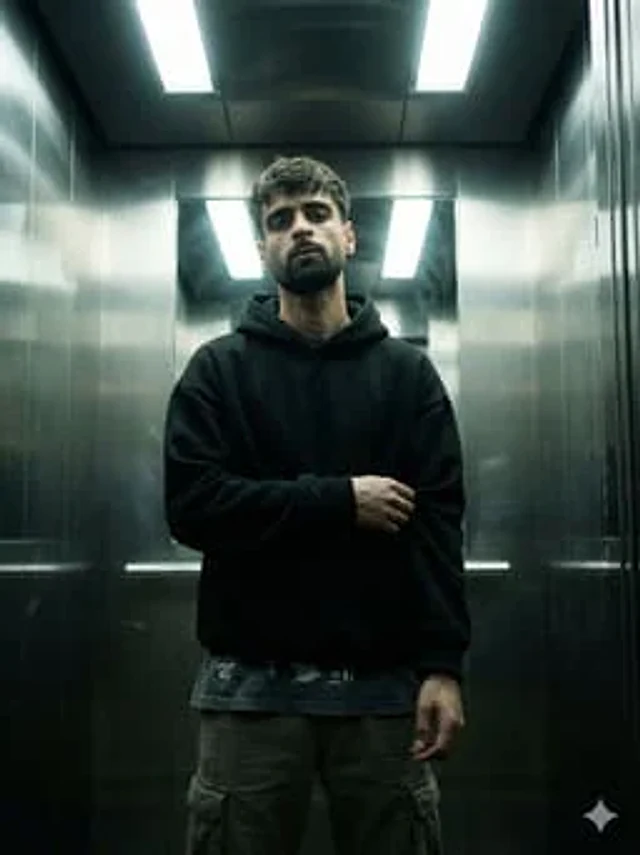

```text
{
    "genre": "cinematic urban realism",
    "mood": ["tense", "cold", "isolated", "quiet intensity"],
    "theme": "a man caught in a moment of silence inside a sterile industrial elevator"
  },
  "subject": {
    "description": "young man with calm intense expression",
    "face": {
      "skin": "natural pores, realistic texture, slight under-eye shadow, no retouching",
      "beard": "short trimmed beard, natural density",
      "expression": "neutral but intimidating, relaxed jaw, eyes locked on camera"
    },
    "hair": {
      "style": "messy short crop",
      "detail": "slight volume on top, natural uneven strands, not styled too clean"
    },
    "pose": {
      "body_language": "still and grounded, subtle confidence",
      "hands": "one arm folded across torso, other arm relaxed downward",
      "stance": "centered, shoulders slightly forward, minimal movement"
    }
  },
  "wardrobe": {
    "top": "oversized black hoodie, heavy fabric, matte texture",
    "layering": "dark graphic tee slightly visible below the hoodie hem",
    "bottom": "dark cargo pants with stitched pockets",
    "styling_notes": "streetwear minimal, clean silhouette, no bright branding"
  },
  "environment": {
    "location": "metal elevator interior",
    "materials": ["brushed stainless steel walls", "reflective panels", "subtle fingerprints and smudges"],
    "lighting_elements": "overhead fluorescent light panels",
    "atmosphere": "thin mist/smoke floating around subject, faint haze near corners",
    "background": "no extra people, no clutter, clean symmetrical elevator geometry"
  },
  "cinematography": {
    "shot_type": "medium-full portrait",
    "framing": "perfect symmetrical centered composition",
    "camera_angle": "slightly low angle for dominance and tension",
    "lens": {
      "focal_length": "35mm",
      "look": "cinematic wide portrait with depth",
      "distortion_control": "minimal distortion, straight vertical elevator lines"
    },
    "depth_of_field": {
      "aperture": "f/2.8",
      "focus": "sharp focus on eyes and face",
      "falloff": "soft background blur but still readable environment"
    }
  },
  "lighting": {
    "type": "overhead harsh fluorescent top-light",
    "contrast": "medium-high with deep shadows under jaw and hoodie folds",
    "highlights": "soft bloom on metallic walls, controlled, not blown out",
    "fill": "very subtle ambient bounce to keep facial details visible",
    "notes": "keep lighting realistic and slightly underexposed for cinematic tension"
  },
  "color_grade": {
    "style": "dark cinematic teal-green industrial grade",
    "shadows": "cool teal tint",
    "highlights": "neutral to slightly cold",
    "saturation": "muted low saturation",
    "contrast": "clean but gritty",
    "black_levels": "slightly crushed blacks, not fully clipped"
  },
  "texture_details": {
    "skin": "realistic pores and micro texture",
    "fabric": "hoodie fleece texture visible, natural folds and weight",
    "metal": "subtle reflections, tiny scratches, elevator realism",
    "grain": "subtle film grain throughout"
  },
  "post_processing": {
    "sharpness": "sharp only on face, not over-sharpened",
    "vignette": "soft vignette around corners",
    "haze": "light haze for depth separation",
    "final_finish": "cinematic, grounded, documentary realism"
  },
  "negative_prompt": [
    "plastic skin",
    "beauty retouch",
    "anime",
    "cartoon",
    "overly smooth face",
    "HDR glow",
    "over-saturated colors",
    "extreme bokeh",
    "warped elevator walls",
    "extra fingers",
    "distorted hands",
    "unrealistic reflections",
    "text",
    "logos",
    "watermark"
  ],
  "output_settings": {
    "aspect_ratio": "3:4 vertical portrait",
    "resolution": "high detail",
    "quality": "photorealistic",
    "style": "cinematic realism"
  }
}
```

Model: Nano Banana
Author: Maercih

[ProjectD](https://aitoolsradar.com/en/prompts/96d2c3f9082495) · [Recorded source](https://x.com/Maercihh/status/2012032403620131316)
 · [Full original metadata and byte evidence](data/projectd-batch-0064.json)

## Maercih #1363

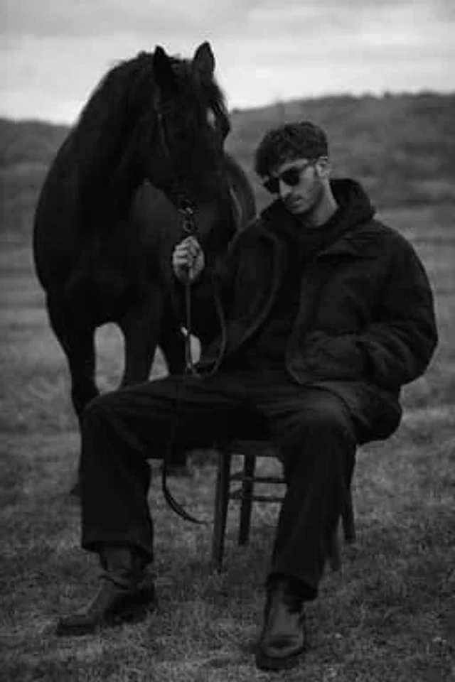

```text
{
  "model": "Nano Banana Pro",
  "scene": "Open field landscape under an overcast sky, minimal natural surroundings",
  "subject": {
    "type": "Young man",
    "pose": "Seated on a wooden chair, legs relaxed apart, holding a horse lead calmly",
    "expression": "Detached, introspective, controlled",
    "gaze": "Looking downward, partially obscured by sunglasses",
    "emotion": "Quiet dominance, solitude, inner gravity"
  },
  "appearance": {
    "hair": {
      "color": "Dark",
      "style": "Short, slightly tousled curls"
    },
    "facial_features": {
      "beard": "Light stubble",
      "accessories": ["Dark sunglasses"]
    },
    "skin": "Natural texture, matte finish"
  },
  "attire": {
    "outerwear": "Oversized dark padded jacket",
    "innerwear": "Dark hoodie",
    "pants": "Relaxed-fit dark trousers",
    "footwear": "Black leather boots",
    "style_note": "Minimalist, masculine, utilitarian fashion"
  },
  "secondary_subject": {
    "type": "Black horse",
    "position": "Standing beside the man, head lowered slightly",
    "interaction": "Held calmly by a loose lead",
    "symbolism": "Strength, instinct, controlled power"
  },
  "environment": {
    "location": "Open grassy field",
    "background": [
      "Rolling hills",
      "Soft distant landscape",
      "No urban elements"
    ],
    "atmosphere": "Quiet, isolated, contemplative"
  },
  "lighting": {
    "type": "Natural diffused daylight",
    "conditions": "Overcast sky",
    "effect": "Soft shadows, low contrast, even tonal range"
  },
  "camera": {
    "angle": "Eye-level to slightly low-angle",
    "lens": "50mm cinematic portrait lens",
    "depth_of_field": "Moderate, subject and horse in focus, background gently blurred",
    "framing": "Vertical, full-body portrait with symbolic spacing"
  },
  "color_palette": {
    "mode": "Black and white",
    "tones": ["deep blacks", "soft grays", "muted highlights"]
  },
  "mood": "Stoic, restrained, powerful",
  "style": {
    "aesthetic": "Fine-art editorial portrait",
    "realism": "Photorealistic",
    "inspiration": "Minimalism, masculinity, symbolism",
    "post_processing": "High-quality monochrome grading, subtle film grain, soft contrast"
  },
  "details": {
    "chair": "Simple wooden chair, understated",
    "lead_tension": "Loose, intentional calm",
    "motion": "Stillness dominates the frame"
  },
  "themes": [
    "Controlled power",
    "Man and instinct",
    "Silence as authority",
    "Strength without display"
  ],
  "quality": "Ultra-detailed, cinematic black-and-white portrait with editorial depth"
}
```

Model: Nano Banana
Author: Maercih

[ProjectD](https://aitoolsradar.com/en/prompts/14c63df45d1f28) · [Recorded source](https://x.com/Maercihh/status/2009835486144279008)
 · [Full original metadata and byte evidence](data/projectd-batch-0064.json)

## Maercih #1367

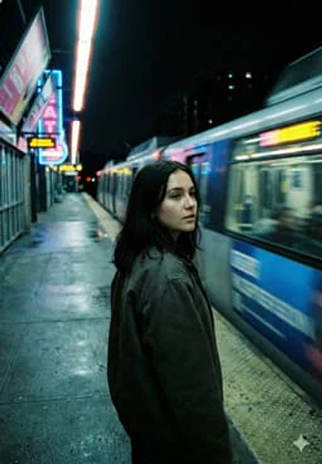

```text
{
  "model": "Nano Banana Pro",
  "scene": "Underground metro platform at night with a train rushing past",
  "subject": {
    "type": "Young woman",
    "pose": "Standing near the platform edge, body facing forward, head turned slightly toward the camera",
    "expression": "Thoughtful, distant, quietly alert",
    "gaze": "Looking sideways toward the camera, unfixed, introspective",
    "emotion": "Isolation, reflection, restrained tension"
  },
  "appearance": {
    "hair": {
      "color": "Dark brown to black",
      "style": "Loose, straight, natural fall"
    },
    "skin": "Natural complexion with soft shadows",
    "makeup": "Minimal, realistic, understated"
  },
  "attire": {
    "outerwear": "Oversized dark jacket",
    "style_note": "Functional, muted, urban anonymity"
  },
  "environment": {
    "location": "City subway platform",
    "background_elements": [
      "Blurred metro train in motion",
      "Neon signage",
      "Platform lights",
      "Wet reflective floor surface",
      "Metal railings and tiled platform edge"
    ],
    "atmosphere": "Cold, nocturnal, transient"
  },
  "lighting": {
    "primary": "Artificial fluorescent platform lighting",
    "secondary": "Neon signage glow",
    "effect": "Cool-toned highlights with soft facial shadows"
  },
  "camera": {
    "angle": "Eye-level, slightly behind the subject",
    "lens": "35mm cinematic street lens",
    "shutter_effect": "Motion blur on passing train",
    "depth_of_field": "Moderate, subject sharp with moving background blur",
    "framing": "Vertical, cinematic street composition"
  },
  "color_palette": {
    "dominant": ["teal", "cool blue", "deep black"],
    "accents": ["neon pink", "electric yellow"]
  },
  "mood": "Lonely, cinematic, suspended in time",
  "style": {
    "aesthetic": "Neo-noir street photography",
    "realism": "Photorealistic",
    "inspiration": "Urban cinema, night transit, modern solitude",
    "post_processing": "Cool cinematic grading, slight grain, high contrast shadows"
  },
  "details": {
    "motion_contrast": "Still subject against fast-moving train",
    "floor_reflections": "Wet surface reflecting neon lights",
    "sound_implied": "Rushing train, distant city hum"
  },
  "themes": [
    "Urban loneliness",
    "Waiting",
    "Movement vs stillness",
    "Anonymous city life"
  ],
  "quality": "Ultra-detailed, cinematic night street photograph with motion depth"
}
```

Model: Nano Banana
Author: Maercih

[ProjectD](https://aitoolsradar.com/en/prompts/0e4adadcacec85) · [Recorded source](https://x.com/Maercihh/status/2009944367377653780)
 · [Full original metadata and byte evidence](data/projectd-batch-0064.json)

## Maercih #1377

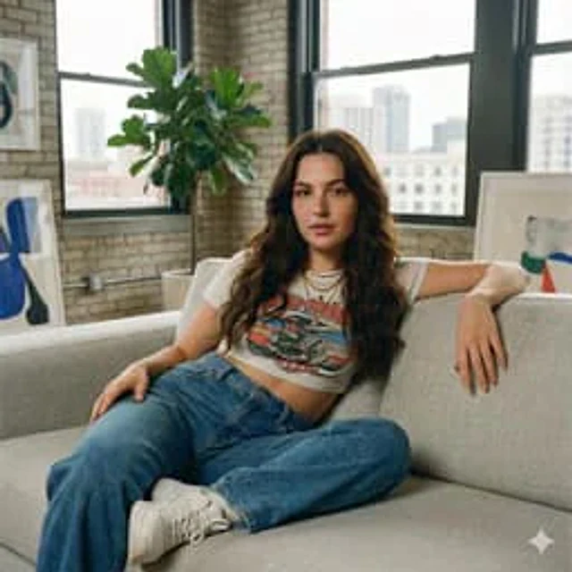

```text
{
  "model": "Nano Banana Pro",
  "scene": "Modern loft living room with large industrial windows",
  "subject": {
    "type": "Young woman",
    "pose": "Reclining casually on a fabric sofa, one arm resting along the backrest, legs relaxed",
    "expression": "Calm, self-assured, quietly confident",
    "gaze": "Direct eye contact with the camera",
    "emotion": "Ease, confidence, natural presence"
  },
  "appearance": {
    "hair": {
      "color": "Dark brown",
      "style": "Loose, long waves with natural volume"
    },
    "skin": "Natural complexion with subtle freckles and realistic texture",
    "makeup": "Minimal, clean, natural tones"
  },
  "attire": {
    "top": "Vintage-style cropped graphic t-shirt",
    "bottoms": "High-waisted relaxed-fit blue jeans",
    "footwear": "White casual sneakers",
    "accessories": [
      "Layered gold necklaces"
    ],
    "style_note": "Effortless modern street-lifestyle fashion"
  },
  "environment": {
    "location": "Urban loft apartment",
    "background": [
      "Exposed brick walls",
      "Large black-framed windows",
      "City skyline softly visible outside",
      "Indoor potted plant",
      "Abstract framed artwork leaning against walls"
    ],
    "atmosphere": "Airy, contemporary, lived-in"
  },
  "lighting": {
    "primary": "Soft natural daylight from large windows",
    "effect": "Balanced illumination with gentle facial shadows",
    "contrast": "Low to moderate, natural realism"
  },
  "camera": {
    "angle": "Eye-level lifestyle portrait",
    "lens": "35mm lifestyle lens",
    "depth_of_field": "Moderate, subject in focus with softly blurred background",
    "framing": "Horizontal composition, relaxed editorial framing"
  },
  "color_palette": {
    "dominant": ["neutral beige", "denim blue"],
    "accents": ["warm skin tones", "muted green", "soft brick red"]
  },
  "mood": "Relaxed, confident, contemporary",
  "style": {
    "aesthetic": "Lifestyle editorial photography",
    "realism": "Photorealistic",
    "texture": "Visible denim grain, fabric upholstery detail",
    "post_processing": "Natural color grading, subtle warmth, no heavy filters"
  },
  "details": {
    "sofa": "Light neutral fabric couch with soft texture",
    "windows": "Tall industrial-style windows with diffused city light",
    "motion": "Still, candid moment"
  },
  "themes": [
    "Modern femininity",
    "Comfort and confidence",
    "Everyday luxury",
    "Authentic presence"
  ],
  "quality": "Ultra-detailed, high dynamic range, professional lifestyle photography"
}
```

Model: Nano Banana
Author: Maercih

[ProjectD](https://aitoolsradar.com/en/prompts/341b718d1be7b4) · [Recorded source](https://x.com/Maercihh/status/2009487340285440312)
 · [Full original metadata and byte evidence](data/projectd-batch-0064.json)

## Maercih #1384

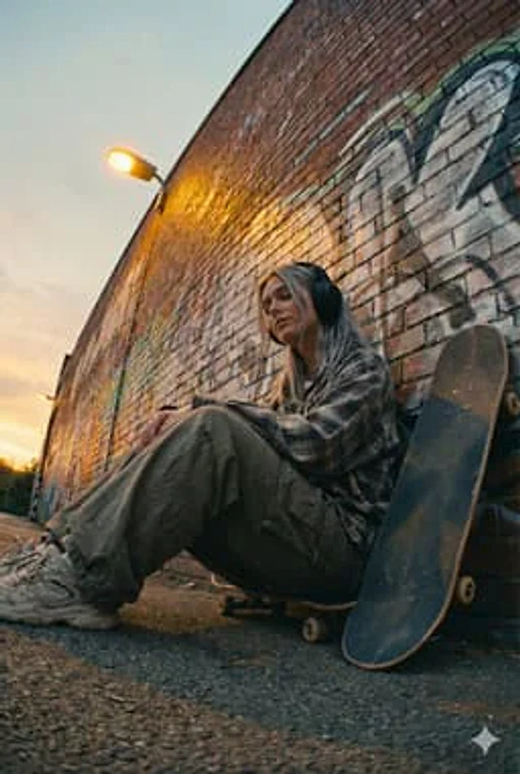

```text
{
  "model": "Nano Banana Pro",
  "scene": "Urban street corner at dusk beside a brick wall covered in graffiti",
  "subject": {
    "type": "Young woman",
    "pose": "Sitting on a skateboard with knees bent, back resting against a brick wall",
    "expression": "Calm, introspective, slightly distant",
    "gaze": "Eyes gently closed or lowered, absorbed in music",
    "emotion": "Stillness, reflection, quiet detachment"
  },
  "appearance": {
    "hair": {
      "color": "Silver-blonde",
      "style": "Loose, slightly tousled"
    },
    "accessories": "Over-ear black headphones",
    "skin": "Natural tone with soft evening light"
  },
  "attire": {
    "top": "Oversized plaid flannel shirt",
    "bottoms": "Loose cargo pants",
    "footwear": "Worn white sneakers",
    "style_note": "Relaxed streetwear, functional and unstyled"
  },
  "environment": {
    "location": "City alley or side street",
    "background": "Brick wall with faded graffiti art",
    "props": [
      "Skateboard leaning against the wall",
      "Street lamp mounted above"
    ],
    "atmosphere": "Urban, quiet, end-of-day calm"
  },
  "lighting": {
    "primary": "Warm street lamp light",
    "secondary": "Soft natural twilight",
    "effect": "Golden highlights on brick texture, gentle shadows"
  },
  "camera": {
    "angle": "Low-angle three-quarter view",
    "lens": "35mm cinematic lens",
    "depth_of_field": "Moderate, subject in focus with softly blurred background",
    "framing": "Vertical composition emphasizing street depth and wall lines"
  },
  "color_palette": {
    "dominant": ["warm brick red", "muted olive", "soft amber"],
    "accents": ["cool gray", "faded graffiti tones"]
  },
  "mood": "Urban, introspective, grounded",
  "style": {
    "aesthetic": "Cinematic street photography",
    "realism": "Photorealistic",
    "texture": "Rough brick, worn asphalt, fabric folds",
    "post_processing": "Warm highlights with slightly muted saturation"
  },
  "details": {
    "ground": "Rough asphalt with small debris",
    "board": "Scuffed skateboard deck showing use",
    "motion": "Still frame, no action or blur"
  },
  "themes": [
    "Urban solitude",
    "Music as escape",
    "Youth and pause",
    "Belonging without noise"
  ],
  "quality": "Ultra-detailed, high dynamic range, professional cinematic street portrait"
}
```

Model: Nano Banana
Author: Maercih

[ProjectD](https://aitoolsradar.com/en/prompts/63be9c306bb55a) · [Recorded source](https://x.com/Maercihh/status/2008456001503015309)
 · [Full original metadata and byte evidence](data/projectd-batch-0064.json)

## Maercih #1385

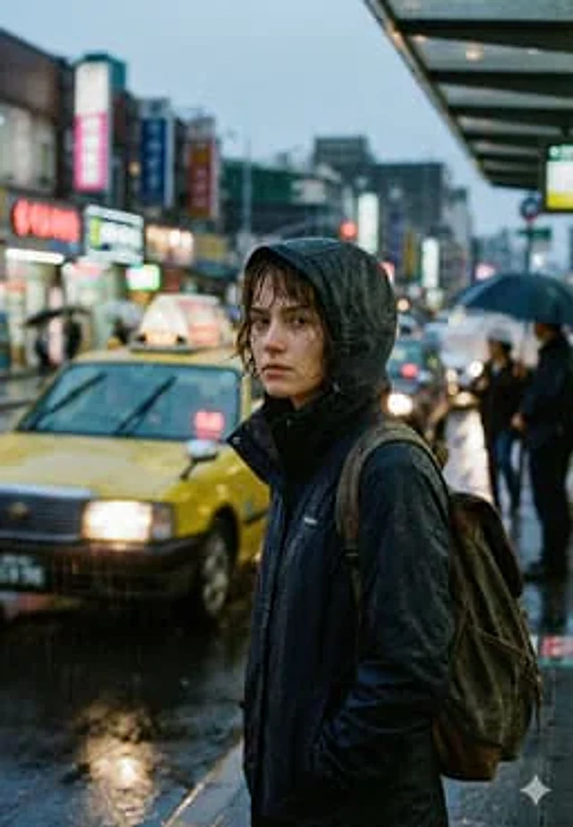

```text
{
  "project_type": "cinematic_image",
  "title": "Rain Doesn’t Pause the City",
  "creative_direction": {
    "genre": "cinematic urban realism",
    "influences": [
      "modern street photography",
      "neo-noir cinema",
      "documentary realism",
      "architectural urban mood"
    ],
    "emotion": [
      "quiet loneliness",
      "introspection",
      "urban solitude",
      "calm under pressure"
    ]
  },
  "scene": {
    "environment": "dense city street",
    "architecture": "mid-rise commercial buildings with neon signage",
    "time_of_day": "early evening, blue hour",
    "weather": {
      "type": "heavy rain",
      "details": "visible raindrops, wet surfaces, rain streaks in the air"
    },
    "ground": "wet asphalt with reflective puddles"
  },
  "subject": {
    "type": "single human subject",
    "description": "young woman standing alone on the sidewalk",
    "pose": "stationary, body angled slightly away from the camera, head turned toward lens",
    "expression": "neutral, distant, introspective",
    "wardrobe": {
      "outerwear": "dark hooded rain jacket",
      "accessories": ["backpack"],
      "condition": "rain-soaked fabric, visible droplets"
    },
    "physical_details": {
      "hair": "wet, slightly messy, framing the face",
      "skin": "natural texture, no heavy retouching"
    }
  },
  "background": {
    "elements": [
      "yellow taxi with headlights on",
      "blurred moving traffic",
      "pedestrians holding umbrellas",
      "neon shop signs in multiple languages"
    ],
    "depth": "deep urban perspective with layered visual elements",
    "motion_effect": "subtle motion blur on vehicles and pedestrians"
  },
  "cinematography": {
    "camera_type": "full-frame digital cinema camera",
    "lens": "35mm prime",
    "aperture": "wide open for shallow depth of field",
    "focus": "sharp focus on subject, background softly defocused",
    "camera_position": "eye-level, street perspective",
    "movement": "static frame, background motion creates contrast"
  },
  "lighting": {
    "primary_source": "ambient city lighting",
    "secondary_sources": [
      "vehicle headlights",
      "neon signs",
      "storefront lights"
    ],
    "lighting_style": "soft, diffused, natural",
    "contrast": "moderate, cinematic"
  },
  "color_grading": {
    "palette": ["cool blues", "teal shadows", "warm amber highlights"],
    "saturation": "controlled, muted",
    "black_levels": "slightly lifted for filmic look",
    "highlights": "soft roll-off"
  },
  "post_processing": {
    "film_grain": "subtle, cinematic",
    "sharpness": "subject emphasized, background softened",
    "noise": "minimal, natural",
    "vignette": "very subtle"
  },
  "visual_style": {
    "realism": "high",
    "aesthetic": "moody, atmospheric, modern",
    "inspiration_keywords": [
      "cinematic rain",
      "urban isolation",
      "street realism",
      "architectural mood"
    ]
  },
  "output_quality": {
    "resolution": "high",
    "dynamic_range": "high",
    "detail_priority": "subject and environment textures preserved"
  },
  "usage": {
    "platform": "social media / X",
    "intent": "artistic storytelling, cinematic visual identity",
    "reusability": "modular prompt structure"
  }
}
```

Model: Nano Banana
Author: Maercih

[ProjectD](https://aitoolsradar.com/en/prompts/70f99f4be45375) · [Recorded source](https://x.com/Maercihh/status/2011680577389502562)
 · [Full original metadata and byte evidence](data/projectd-batch-0064.json)

## Maercih #1391

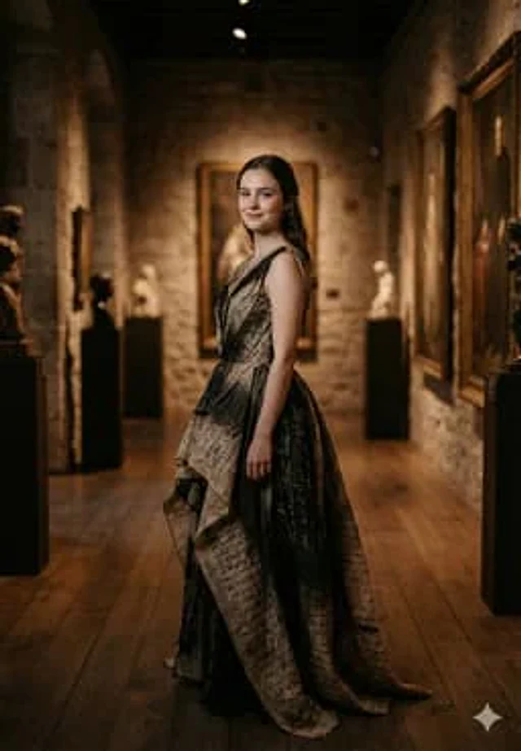

```text
{
  "model": "Nano Banana Pro",
  "scene": "Historic art gallery corridor with classical sculptures and framed paintings",
  "subject": {
    "type": "Young woman",
    "pose": "Standing gracefully in three-quarter profile, body slightly turned, hands relaxed",
    "expression": "Soft, confident smile with calm composure",
    "gaze": "Looking gently toward the camera",
    "emotion": "Elegance, quiet confidence, cultural presence"
  },
  "appearance": {
    "hair": {
      "color": "Dark brown",
      "style": "Pulled back neatly with loose natural flow"
    },
    "skin": "Natural complexion, softly illuminated",
    "makeup": "Minimal, refined, classical"
  },
  "attire": {
    "dress": {
      "type": "Flowing couture-style gown",
      "design": "Layered fabric panels printed with handwritten script",
      "colors": "Muted sepia, charcoal, parchment tones",
      "texture": "Soft, draped fabric with subtle sheen"
    },
    "style_note": "Literary, artistic, museum-worthy fashion"
  },
  "environment": {
    "location": "Old stone-walled museum or gallery hall",
    "floor": "Polished wooden floorboards",
    "background_elements": [
      "Classical bust sculptures on pedestals",
      "Large framed paintings along stone walls"
    ],
    "atmosphere": "Quiet, reverent, timeless"
  },
  "lighting": {
    "primary": "Warm gallery spotlights from above",
    "secondary": "Soft ambient lighting along the corridor",
    "effect": "Gentle highlights on fabric folds and face, deep background shadows"
  },
  "camera": {
    "angle": "Eye-level full-body portrait",
    "lens": "50mm cinematic portrait lens",
    "depth_of_field": "Shallow to moderate, subject crisp with softly blurred background",
    "framing": "Vertical composition emphasizing height and elegance"
  },
  "color_palette": {
    "dominant": ["warm amber", "aged parchment brown"],
    "accents": ["deep charcoal", "golden highlights"]
  },
  "mood": "Timeless, cultured, graceful",
  "style": {
    "aesthetic": "Fine-art fashion photography",
    "inspiration": "Classical art, literature, museum couture",
    "realism": "Photorealistic",
    "texture": "Visible fabric grain, stone wall detail",
    "post_processing": "Warm cinematic grading, subtle vignette, gentle contrast"
  },
  "details": {
    "fabric_motion": "Soft drape pooling naturally on the floor",
    "background_depth": "Long corridor perspective enhancing grandeur",
    "motion": "Still, poised moment"
  },
  "themes": [
    "Art and identity",
    "Fashion as language",
    "Timeless beauty",
    "Human presence within history"
  ],
  "quality": "Ultra-detailed, high dynamic range, professional cinematic fine-art portrait"
}
```

Model: Nano Banana
Author: Maercih

[ProjectD](https://aitoolsradar.com/en/prompts/6ce7f3cb0b6493) · [Recorded source](https://x.com/Maercihh/status/2009212599486042528)
 · [Full original metadata and byte evidence](data/projectd-batch-0064.json)

## Maercih #685

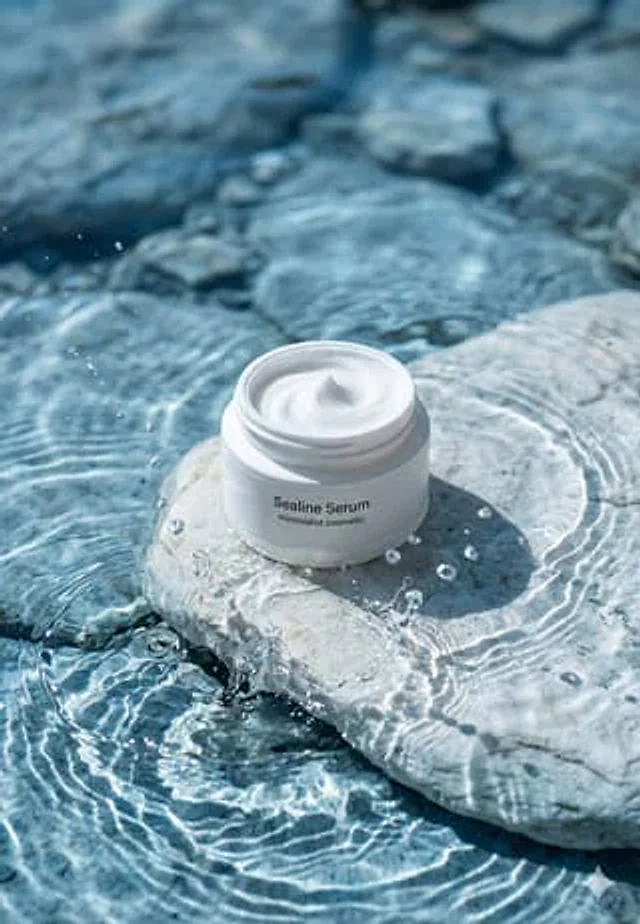

```text
{
  "prompt": "A premium minimalist skincare product photography scene featuring an open white cosmetic jar labeled 'Sealine Serum'. The jar is placed on a smooth, pale stone partially submerged in crystal-clear shallow water. The cream inside the jar has a soft, glossy swirl with a pristine, silky texture. Gentle water ripples surround the stone, creating natural light refractions and caustic patterns on the surface below. Small water droplets and subtle splashes add freshness and motion. The environment feels serene, clean, and natural, evoking purity, hydration, and calm luxury. The color palette is cool and airy, dominated by soft whites, light blues, and stone neutrals. Lighting is bright, diffused daylight with soft highlights and minimal shadows, emphasizing texture, moisture, and realism. The composition is centered and balanced, with shallow depth of field and a softly blurred background for a high-end cosmetic advertising look. Ultra-realistic, photoreal, editorial-quality product shot.",
  "negative_prompt": "harsh shadows, dirty water, cluttered background, plastic texture, low resolution, oversharpening, unrealistic reflections, strong color cast, text artifacts, watermark, logo distortion, messy cream surface",
  "style": "luxury skincare advertising",
  "camera": {
    "type": "DSLR",
    "lens": "90mm macro",
    "aperture": "f/5.6",
    "iso": 100,
    "shutter_speed": "1/250"
  },
  "lighting": {
    "type": "natural diffused daylight",
    "direction": "top and side",
    "contrast": "low to medium",
    "temperature": "cool-neutral"
  },
  "composition": {
    "framing": "centered product focus",
    "angle": "slightly elevated",
    "orientation": "portrait",
    "depth_of_field": "shallow with soft background blur"
  },
  "quality": {
    "resolution": "8K",
    "detail": "ultra-fine texture detail",
    "sharpness": "high",
    "realism": "photorealistic"
  }
}
```

Model: Nano Banana
Author: Maercih

[ProjectD](https://aitoolsradar.com/en/prompts/b449708065fa64) · [Recorded source](https://x.com/Maercihh/status/2018556431100993733)
 · [Full original metadata and byte evidence](data/projectd-batch-0064.json)

## Maercih #812


```text
{
  "style": "cinematic realism, high-end editorial photography",
  "subject": {
    "type": "woman",
    "age_range": "mid-20s",
    "pose": "seated sideways on a bench, holding an open book, head turned slightly off-camera",
    "expression": "calm, reflective, distant gaze",
    "wardrobe": "deep black velvet wrap dress, soft texture, natural styling",
    "hair": "long, dark, loose waves, natural volume",
    "makeup": "minimal, realistic skin texture, no plastic smoothing"
  },
  "environment": {
    "location": "sunlit library loft",
    "details": "tall glass windows, wooden shelves filled with books, warm interior tones, dust particles visible in air",
    "time_of_day": "golden hour",
    "atmosphere": "quiet, intimate, intellectual"
  },
  "lighting": {
    "type": "strong golden hour backlight",
    "direction": "side-back window light",
    "effects": "natural lens flare, light streaks across frame, soft bloom on highlights, volumetric rays",
    "contrast": "medium-high with warm highlights and soft shadow falloff"
  },
  "camera": {
    "shot_type": "medium portrait",
    "angle": "slightly low eye-level",
    "lens": "85mm full-frame",
    "aperture": "f1.8",
    "depth_of_field": "shallow, subject sharp, background creamy blur",
    "focus": "eyes and face plane"
  },
  "color_grading": {
    "palette": "warm amber and honey tones with soft neutral shadows",
    "look": "film-like, subtle grain, cinematic dynamic range"
  },
  "composition": {
    "framing": "rule of thirds, subject right-weighted",
    "foreground": "soft blurred flare and book edge",
    "background": "window grid lines and shelves as leading lines",
    "motion": "still subject, drifting light particles"
  },
  "quality": {
    "resolution": "8k",
    "texture": "natural skin detail, realistic fabric texture",
    "rendering": "photorealistic, no over-sharpening, no CGI gloss"
  }
}
```

Model: Nano Banana
Author: Maercih

[ProjectD](https://aitoolsradar.com/en/prompts/205ecb6782bfa4) · [Recorded source](https://x.com/Maercihh/status/2021190087657353591)
 · [Full original metadata and byte evidence](data/projectd-batch-0064.json)

## Maercih #953


```text
The soft touch.

Nano Banana pro on Gemini 

Prompt 

{
  "product_photography_prompt": {
    "subject": "Hands holding a shampoo bottle with lather.",
    "hands": {
      "description": "A person's hands with natural skin tone.",
      "action": "One hand holds the bottle, the other is cupped to catch foam.",
      "condition": "Covered in thick, white, bubbly soap lather."
    },
    "bottle": {
      "type": "Pump bottle.",
      "material": "Matte white plastic.",
      "dispenser": "Light blue pump.",
      "contents": "White shampoo, visible as foam."
    },
    "label": {
      "color": "White",
      "text_color": "Black",
      "logo": "Circular with 'WAATAL' inside.",
      "main_text": "Hydrate SHAMPOO (script and bold font).",
      "sub_text": "Super Hydrating Shampoo. For All Hair Types. Made in Australia. 500ml."
    },
    "foam": {
      "texture": "Thick, rich, bubbly lather.",
      "color": "White",
      "location": "Covering hands, bottle neck, and dispenser."
    },
    "background": {
      "color": "Solid soft light blue.",
      "texture": "Seamless, smooth studio background."
    },
    "lighting": {
      "type": "Soft, diffused studio lighting.",
      "direction": "Even illumination, highlighting foam texture and hands."
    },
    "style": {
      "type": "Clean, minimalist product photography.",
      "shot": "Close-up.",
      "focus": "Sharp focus on hands, bottle, and foam.",
      "mood": "Fresh, clean, natural."
    }
  }
}
```

Model: Nano Banana
Author: Maercih

[ProjectD](https://aitoolsradar.com/en/prompts/d4ec9aaec3ff62) · [Recorded source](https://x.com/Maercihh/status/2025163854469341484)
 · [Full original metadata and byte evidence](data/projectd-batch-0064.json)

## Marcio Lima 利真 マルシオ 💎 #1072

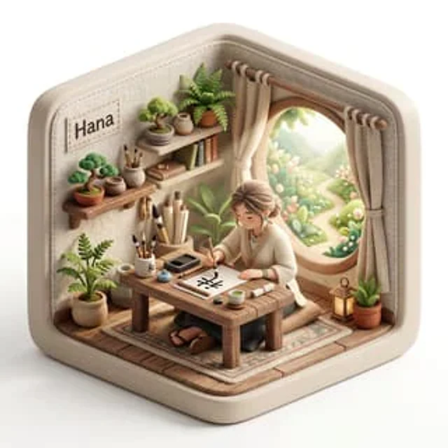

```text
Create a 3D isometric diorama illustration of an original character named [CHARACTER NAME], peacefully working or practicing a creative activity in a nature-inspired environment, sitting at a wooden desk near a large open window with sunlight flowing in and soft greenery visible outside.

The character should be inspired by [ARCHETYPE / PROFESSION – e.g. writer, painter, meditator, calligraphy artist, tea master] and have a unique visual identity, including soft, natural clothing, organic textures, and a calm, introspective personality.

The entire scene must have a handcrafted felt aesthetic, with soft rounded shapes, visible stitching details, and clean, polished textures.

The diorama is enclosed inside a rounded cube structure with subtle hexagonal proportions, made of [MATERIAL STYLE – e.g. soft matte ceramic, light frosted resin, natural wood finish].

The environment must strongly reflect a peaceful, nature-connected lifestyle, including plants, natural wood furniture, soft textiles, and minimalistic decor.

On the desk, include small detailed objects such as [OBJECT 1 – e.g. tea cup], [OBJECT 2 – e.g. brush or pen], [OBJECT 3 – e.g. notebook or scroll].

Lighting should be bright, soft, and natural, with warm sunlight beams entering through the window, creating a serene and airy atmosphere, with a clean white background outside the diorama.

Render in 1080x1080, ultra-detailed, photorealistic style.

Include a small stitched fabric name tag sewn onto the INNER wall of the diorama (top-left corner inside the cube), clearly integrated into the scene, not floating and not outside the structure, displaying the name: [CHARACTER NAME].
```

Model: Nano Banana
Author: Marcio Lima 利真 マルシオ 💎

[ProjectD](https://aitoolsradar.com/en/prompts/d98badcd5fc26a) · [Recorded source](https://x.com/Preda2005/status/2035592959685525590)
 · [Full original metadata and byte evidence](data/projectd-batch-0064.json)

## Max #1358

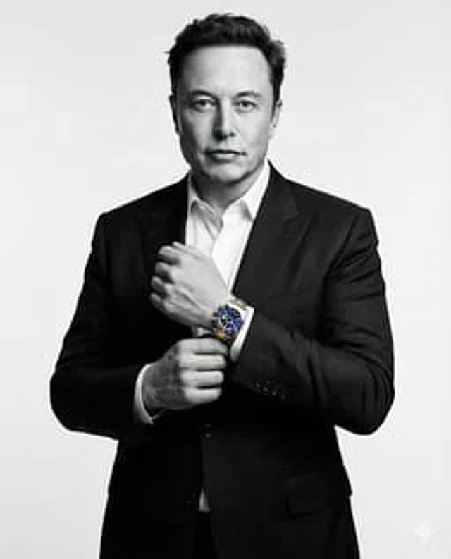

```text
8K Ultra-Realistic Promotional
High contrast black-and-white luxury editorial photograph of a confident Elon Musk wearing a perfectly tailored suit, standing against a clean studio backdrop. He is adjusting his wristwatch with his right hand on his left wrist in a poised, powerful gesture, drawing strong visual focus to an elegant luxury wristwatch displayed in full color. Sharp, dramatic studio lighting with deep shadows, sculpted jawline, high definition facial contours, crisp textures of premium suit fabric, refined masculine energy. Cinematic contrast, shallow depth of field, ultra sharp details, hyper-real clarity, photorealistic finish, premium European aesthetics, timeless and sleek composition, ultr polished luxury watch advertisement style, no noise, no blur, no imperfections, high dynamic range, and image size 4 5.
```

Model: Nano Banana
Author: Max

[ProjectD](https://aitoolsradar.com/en/prompts/1a0dcd9c0bbdfb) · [Recorded source](https://x.com/Max__Build/status/2017469861811859752)
 · [Full original metadata and byte evidence](data/projectd-batch-0064.json)

## MayorkingAI #453

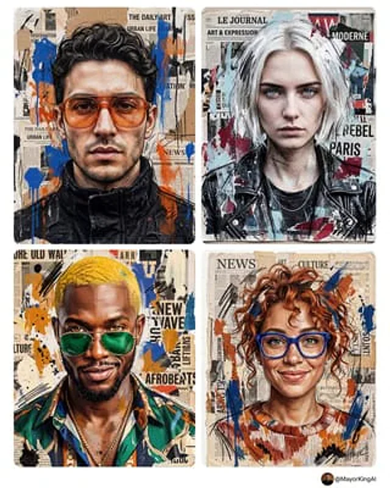

```text
Mixed-media portrait of [SUBJECT], [EXPRESSION], [GAZE DIRECTION], with [ACCESSORY/STYLING], realistic identity, black sketch strokes, torn newspaper collage, acrylic paint splashes, editorial print texture, blending realism and abstract expressionism, premium poster aesthetic, tactile handmade feel, high contrast, ultra-detailed face and eyes, [PRIMARY COLORS] and [SECONDARY COLORS]
```

Model: Nano Banana
Author: MayorkingAI

[ProjectD](https://aitoolsradar.com/en/prompts/7bfa2f674a310e) · [Recorded source](https://x.com/MayorKingAI/status/2036534946433736932)
 · [Full original metadata and byte evidence](data/projectd-batch-0064.json)

## Meem #1188


```text
{
  "type": "photorealistic skincare product photography",
  "product": {
    "name": "VOIS – tsunami hydration",
    "container": "blue cosmetic cream jar",
    "position": "diagonally placed and partially embedded in fresh white snow",
    "details": "light hoarfrost and frozen condensation crystals on the jar surface"
  },
  "scene": {
    "environment": "soft powdery snow with sparkling ice crystals",
    "elements": "small blue primrose flowers with green leaves scattered around, some partially buried",
    "background": "clean minimal snowy bokeh with cold airy atmosphere"
  },
  "lighting": "bright winter side sunlight creating crisp highlights and soft natural shadows",
  "camera": {
    "lens": "85mm macro",
    "aperture": "f/2.8",
    "iso": 100,
    "depth_of_field": "shallow"
  },
  "style": "premium commercial skincare advertisement, cinematic macro composition",
  "quality": "ultra-detailed, photorealistic, 8K",
  "constraints": ["no people", "no text overlays", "minimal background"]
}
```

Model: Nano Banana
Author: Meem

[ProjectD](https://aitoolsradar.com/en/prompts/00ca1b89277a5f) · [Recorded source](https://x.com/mehvishs25/status/2033349315763323051)
 · [Full original metadata and byte evidence](data/projectd-batch-0064.json)

## Meem #542

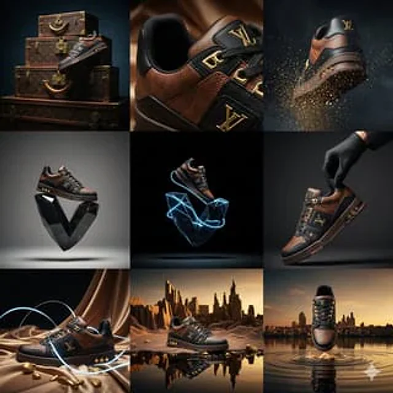

```text
{
  "campaign_metadata": {
    "brand_identity": "Louis Vuitton Malletier",
    "product_focus": "Luxury Leather Sneaker / Trainer",
    "aspect_ratio": "3:4",
    "aesthetic": "High-Fashion Editorial | Avant-Garde Luxury"
  },
  "visual_dna": {
    "materials": ["Full-grain calf leather", "Monogram Embossed Canvas", "Polished Gold Hardware"],
    "color_scheme": ["Cognac Brown", "Deep Obsidian", "Champagne Gold"],
    "lighting": "High-contrast Chiaroscuro | Soft-box Key Lighting"
  },
  "grid_layout_execution": {
    "row_1_heritage": {
      "cell_1_1": "Hero profile: Shoe resting on a vintage LV trunk, side-lit to show leather grain.",
      "cell_1_2": "Extreme macro: Focus on the gold-tone 'LV' lace aglets and precision stitching.",
      "cell_1_3": "Dynamic: Gold dust/particles swirling around the sole as it 'steps' into frame."
    },
    "row_2_innovation": {
      "cell_2_1": "Minimalist: The shoe balanced atop an abstract, floating glass 'V' sculpture.",
      "cell_2_2": "Floating: Deconstructed view showing the sole and upper suspended in a void.",
      "cell_2_3": "Sensory: A gloved hand adjusting the tongue, emphasizing soft leather suppleness."
    },
    "row_3_surrealism": {
      "cell_3_1": "Color Palette: Monochromatic scene in LV 'Havane' brown with liquid silk drapes.",
      "cell_3_2": "Abstraction: Symbolic representation of the rubber sole pattern as a geometric desert landscape.",
      "cell_3_3": "Fusion: The shoe walking on a mirror-still lake reflecting a Parisian sunset skyline."
    }
  }
}
```

Model: Nano Banana
Author: Meem

[ProjectD](https://aitoolsradar.com/en/prompts/e29b3cb0f5f704) · [Recorded source](https://x.com/mehvishs25/status/2017067361673896150)
 · [Full original metadata and byte evidence](data/projectd-batch-0064.json)

## Meem #604

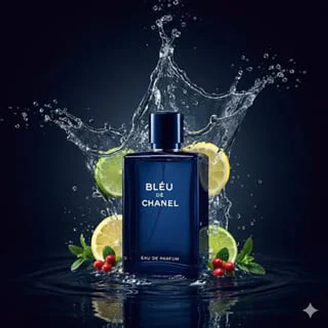

```text
{
  "global_settings": {
    "resolution": "8K",
    "aspect_ratio": "3:4",
    "style": "photorealistic cinematic product photography",
    "detail_level": "extreme micro-detail",
    "sharpness": "ultra-sharp",
    "noise": "none",
    "compression_artifacts": "none",
    "color_depth": "rich 16-bit color",
    "render_quality": "luxury commercial grade",
    "ai_finish": "clean AI-enhanced realism"
  },

  "module_1": {
    "scene_identity": "forest_green_perfume",
    "environment": {
      "setting": "dense forest atmosphere",
      "background": "soft blurred green foliage with depth separation",
      "foreground": "natural forest floor with soil, moss, and small debris",
      "props": [
        "flat natural stone platform",
        "irregular rock placed slightly behind the bottle",
        "pine tree branches with visible needles on the right side"
      ],
      "atmosphere": "soft drifting smoke or mist rising behind the bottle"
    },
    "product": {
      "object_type": "perfume bottle",
      "material": "ribbed translucent glass",
      "color": "deep emerald green liquid",
      "shape": "cylindrical with vertical grooves",
      "cap": {
        "material": "metal",
        "finish": "polished gold",
        "shape": "smooth cylindrical"
      },
      "label": "no visible branding text"
    },
    "lighting": {
      "key_light": "soft diffused natural light from front-left",
      "fill_light": "subtle ambient forest light",
      "highlights": "gentle reflections on glass ribs and gold cap",
      "shadows": "soft realistic shadows under bottle and rocks"
    },
    "camera": {
      "angle": "eye-level product angle",
      "focus": "sharp focus on bottle, shallow depth of field",
      "lens_effect": "natural bokeh background"
    },
    "mood": "fresh, woody, calm, premium, nature-inspired"
  },

  "module_2": {
    "scene_identity": "blue_water_splash_perfume",
    "environment": {
      "setting": "dark aquatic studio scene",
      "background": "deep navy to black gradient",
      "surface": "rippling water with reflective highlights",
      "motion_elements": [
        "large upward water splash behind bottle",
        "floating water droplets suspended mid-air"
      ],
      "props": [
        "lemon slices (yellow flesh visible)",
        "green citrus slice",
        "small red berries",
        "green herb sprigs"
      ]
    },
    "product": {
      "object_type": "perfume bottle",
      "material": "opaque glass",
      "color": "deep midnight blue",
      "shape": "rectangular with sharp edges",
      "cap": {
        "material": "matching dark glass",
        "shape": "cylindrical"
      },
      "text_visible": [
        "BLEU DE CHANEL",
        "EAU DE PARFUM"
      ]
    },
    "lighting": {
      "key_light": "strong directional light from upper front",
      "rim_light": "cool highlights on water splash",
      "reflections": "specular highlights on glass and water surface"
    },
    "camera": {
      "angle": "slightly tilted dynamic angle",
      "focus": "sharp on bottle and splash",
      "motion_freeze": "high-speed capture look"
    },
    "mood": "fresh, energetic, aquatic, luxury fragrance ad"
  }
```

Model: Nano Banana
Author: Meem

[ProjectD](https://aitoolsradar.com/en/prompts/a3d14542e0b1ef) · [Recorded source](https://x.com/mehvishs25/status/2016150891678912784)
 · [Full original metadata and byte evidence](data/projectd-batch-0064.json)

## Meem #654


```text
Ultra-clean modern recipe infographic. Showcase chowmin in a visually appealing finished form sliced, plated, or portioned floating slightly in perspective or angled view. Arrange ingredients, steps, and tips around the dish in a dynamic editorial layout, not restricted to top-down. Ingredients Section: Include icons or mini illustrations for each ingredient with quantities. Arrange them in clusters, lists, or circular flows connected visually to the dish. Steps Section: Show preparation steps with numbered panels, arrows, or lines, forming a logical flow around the main dish. Include small cooking icons (knife, pan, oven, timer) where helpful. Additional Info (optional): Total calories, prep/cook time, servings, spice level—displayed as clean bubbles or badges near the dish. Visual Style: Editorial infographic meets lifestyle food photography. Vibrant, natural food colors, subtle drop shadows, clean vector icons, modern typography, soft gradients or glassmorphism for step panels. Accent colors can highlight key info (calories, prep time). Composition Guidelines: Finished meal as hero visual (perspective or angled) Ingredients and steps flow dynamically around the dish Clear visual hierarchy: dish > steps > ingredients > optional stats Enough negative space to keep design airy and readable Lighting & Background: Soft, natural studio lighting, minimal textured or gradient background for premium editorial feel. Output: 1080×1080, ultra-crisp, social-feed optimized, no watermark.
```

Model: Nano Banana
Author: Meem

[ProjectD](https://aitoolsradar.com/en/prompts/08fef824c8a4c0) · [Recorded source](https://x.com/mehvishs25/status/2016502011278324039)
 · [Full original metadata and byte evidence](data/projectd-batch-0064.json)

## Meem #786

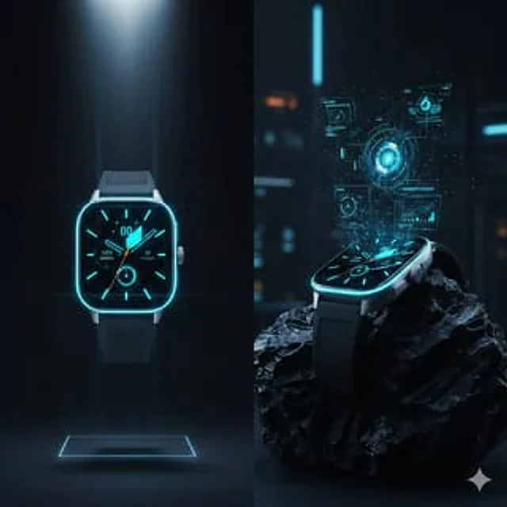

```text
{
  "campaign_metadata": {
    "brand_identity": "Quantum Horizon Tech",
    "product_focus": "Titanium Luxury Smartwatch",
    "aspect_ratio": "3:4",
    "aesthetic": "Cyber-Luxury | Technical Minimalism"
  },
  "visual_dna": {
    "materials": ["Brushed Aerospace Titanium", "Sapphire Crystal", "Fluorocarbon Strap"],
    "color_scheme": ["Space Grey", "Electric Cyan", "Matte Black"],
    "lighting": "Top-down Rim Lighting | Neon Accents | Cold Studio Tones"
  },
  "grid_layout_execution": {
    "row_1_precision": {
      "cell_1_1": "Hero: Watch floating vertically, illuminated by a single beam of light.",
      "cell_1_2": "Macro: The digital crown's knurled texture and the red action button detail.",
      "cell_1_3": "Dynamic: Liquid metal ripples splashing against the titanium casing."
    },
    "row_2_lifestyle": {
      "cell_2_1": "Minimal: Watch resting on a raw piece of jagged obsidian rock.",
      "cell_2_2": "Innovation: Holographic UI elements projecting from the watch face into the air.",
      "cell_2_3": "Sensory: Close-up of the strap clicking into the magnetic lug with precision."
    },
    "row_3_surreal": {
      "cell_3_1": "Color: A gradient of deep blues and purples with light-trail long exposure.",
      "cell_3_2": "Abstraction: Deconstructed internal gears and chips floating like a nebula.",
      "cell_3_3": "Fusion: The watch submerged in a digital 'data' ocean with glowing currents."
    }
  }
}
```

Model: Nano Banana
Author: Meem

[ProjectD](https://aitoolsradar.com/en/prompts/5568c8b8f86c2e) · [Recorded source](https://x.com/mehvishs25/status/2017793115147444527)
 · [Full original metadata and byte evidence](data/projectd-batch-0064.json)

## Meem #961


```text
{
  "master_prompt": {
    "scene_type": "ultra-premium cinematic luxury hair oil product photography",

    "product": {
      "type": "luxurious branded herbal hair oil",
      "container": "premium dark amber glass bottle with elegant gold dropper cap",
      "label": "minimal luxury branding with embossed gold typography",
      "oil_texture": "rich golden oil with crystal clarity and glossy viscosity",
      "ingredients_visual": [
        "fresh coconut halves",
        "amla berries",
        "almonds",
        "hibiscus flowers",
        "green herbal leaves"
      ]
    },

    "composition": {
      "action": "golden hair oil droplets pouring elegantly from a glass dropper captured mid-air",
      "surrounding_elements": [
        "floating herbal ingredients suspended in motion",
        "tiny golden oil droplets sparkling in light",
        "soft mist of botanical particles",
        "subtle golden dust accents for premium feel"
      ],
      "placement": "hero bottle centered on polished black marble surface with luxury reflections"
    },

    "lighting": {
      "style": "luxury cosmetic studio lighting",
      "effects": [
        "soft rim lighting outlining the bottle silhouette",
        "warm backlight illuminating the golden oil inside the bottle",
        "gentle top light highlighting the glass dropper and oil droplets",
        "subtle side lighting enhancing glass reflections"
      ]
    },

    "color_palette": {
      "background": "deep charcoal fading into warm golden bokeh",
      "accents": "rich amber gold, botanical green, glossy black reflections, subtle champagne highlights"
    },

    "technical_specs": {
      "camera": "macro lens with slight low angle for premium dominance",
      "shutter": "ultra-fast freeze motion capturing oil droplets",
      "depth_of_field": "shallow focus on bottle and dropper with cinematic background blur",
      "quality": "8K resolution, ultra-photorealistic cosmetic product detailing"
    }
  }
}
```

Model: Nano Banana
Author: Meem

[ProjectD](https://aitoolsradar.com/en/prompts/372f21763b937a) · [Recorded source](https://x.com/mehvishs25/status/2029369297030807801)
 · [Full original metadata and byte evidence](data/projectd-batch-0064.json)

## Meem #983


```text
{
The Cinematic Momo Duo
Subject & Scene
 * Finished Dish: Freshly steamed dumplings (momos) stacked on a rustic wooden board.
 * The Details: Glossy dough with delicate handmade pleats, a light sheen of oil, and thick dramatic steam rising.
 * Exploded View: A side-by-side or split scene showing the "deconstructed" momo. Floating dumpling wrappers, balls of spiced minced filling, and scattered fresh herbs.
Motion & Action
 * Frozen in Time: Flour particles suspended mid-air, motion-frozen spices, and a dramatic slow-motion splash effect.
 * Atmosphere: Wispy, swirling steam and falling herb leaves.
Setting & Background
 * Environment: A dark, moody, rustic kitchen.
 * Surface: A weathered, textured wooden cutting board with grains and cracks visible.
Lighting & Color
 * Style: Cinematic studio lighting.
 * Palette: Warm, inviting tones with high contrast and deep shadows for a professional editorial look.
Technical Specs
 * Camera: Macro photography, 8K resolution, hyper-detailed textures.
 * Focus: Shallow depth of field (blurred background) with sharp, crisp focus on the ingredients.
```

Model: Nano Banana
Author: Meem

[ProjectD](https://aitoolsradar.com/en/prompts/cda455c553c096) · [Recorded source](https://x.com/mehvishs25/status/2019098547451568397)
 · [Full original metadata and byte evidence](data/projectd-batch-0064.json)

## Melisa♡ #315

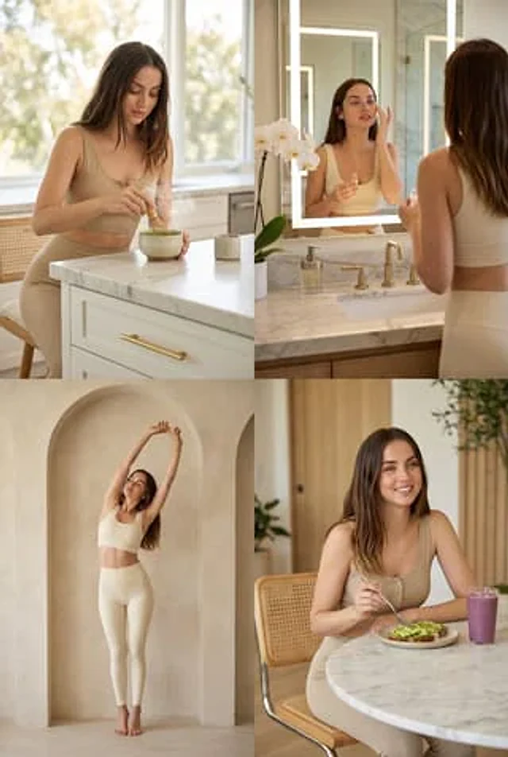

```text
{
  "overall_theme": {
    "description": "A curated series of four ultra-photorealistic vignettes showcasing a luxurious, wellness-focused lifestyle.",
    "mood": "Calm, serene, balanced, sophisticated, peaceful, rejuvenating.",
    "style": "Minimalist, high-end, contemporary, clean aesthetic, aspirational."
  },
  "subject": {
    "description": "Young woman.",
    "appearance": {
      "hair": "Long, dark brown, wavy, natural texture.",
      "skin": "Clear, glowing, natural.",
      "makeup": "No-makeup makeup look, dewy finish.",
      "physique": "Fit, toned."
    },
    "expression": "Serene, composed, gently smiling, focused."
  },
  "wardrobe": {
    "outfit_base": "Matching ribbed beige/cream activewear set.",
    "variations": [
      "Sleeveless crop top and high-waisted leggings.",
      "Long-sleeve crop top and high-waisted leggings."
    ],
    "style": "Comfortable, stylish, high-quality fabric."
  },
  "environmental_details": {
    "lighting": {
      "type": "Natural daylight.",
      "quality": "Soft, diffused, warm, bright.",
      "source": "Large windows (implied or visible)."
    },
    "color_palette": {
      "dominant": ["Warm Beige", "Cream", "White", "Marble Grey"],
      "accents": ["Green (plants)", "Gold (fixtures, details)", "Natural Wood", "Soft Purple (smoothie)"]
    },
    "materials": ["White Marble", "Light Wood", "Stone", "Ceramic", "Glass", "Linen"]
  },
  "scenes": [
    {
      "location": "Modern Luxury Kitchen",
      "environment": "White marble island and countertops, white shaker cabinets, gold hardware, integrated wine fridge, large window.",
      "pose": "Standing at the island, body angled slightly, looking down.",
      "action": "Whisking a hot beverage in a small bowl.",
      "props": ["Ceramic bowl", "Wooden whisk", "Steam", "Mug with 'H'", "Wine fridge"]
    },
    {
      "location": "High-End Bathroom",
      "environment": "Large backlit mirror, white marble vanity, white walls, orchid plant.",
      "pose": "Standing facing the mirror, one hand applying product to face.",
      "action": "Applying skincare.",
      "props": ["Cotton pad", "Skincare bottle", "Lit Diptyque candle", "Whole coconut", "Glass jars"]
    },
    {
      "location": "Minimalist Wellness Space",
      "environment": "Textured beige walls with curved arches, stone water fountain, eucalyptus in a vase.",
      "pose": "Full-body stretch, arms extended overhead, head tilted back, eyes closed.",
      "action": "Stretching.",
      "props": ["Stone water feature", "Large perfume bottle", "Eucalyptus vase"]
    },
    {
      "location": "Bright Café Corner",
      "environment": "Round white marble table, cane chair, large window overlooking a street.",
      "pose": "Sitting at the table, smiling while eating, holding a fork.",
      "action": "Eating avocado toast.",
      "props": ["Avocado toast on plate", "Purple smoothie in glass", "Fork", "Assouline book", "Notebooks", "Small flowers"]
    }
  ],
  "camera_and_technical": {
    "type": "DSLR Photography",
    "style": "Editorial lifestyle",
    "lens": "Prime lens (e.g., 50mm or 85mm f/1.4)",
    "focus": "Sharp focus on the subject in each frame.",
    "depth_of_field": "Shallow, creating a soft, creamy bokeh in the background.",
    "resolution": "Ultra-high resolution, photorealistic textures.",
    "composition": "Four-panel grid collage."
  }
}
```

Model: Nano Banana
Author: Melisa♡

[ProjectD](https://aitoolsradar.com/en/prompts/79e62559178c6d) · [Recorded source](https://x.com/xmliisu/status/2008486850378293427)
 · [Full original metadata and byte evidence](data/projectd-batch-0064.json)

## Melisa♡ #368

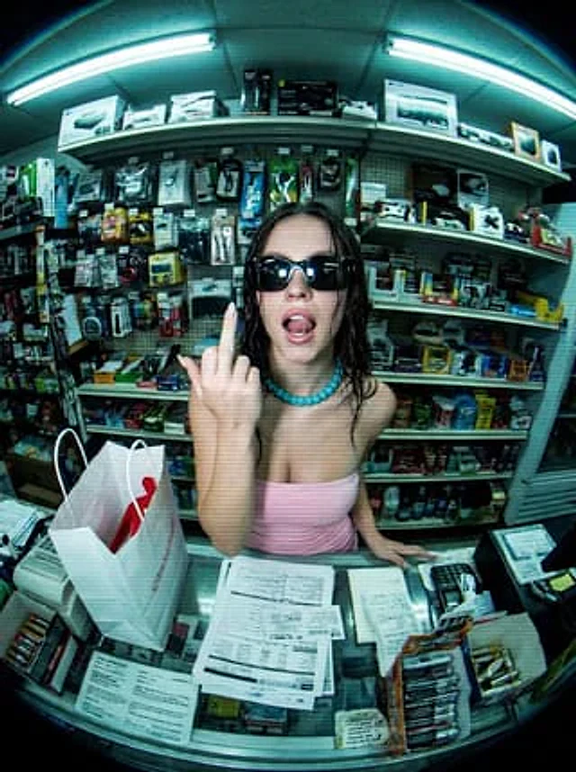

```text
{
  "image_description": {
    "title": "Surveillance Feed: Defiant Subject in Retail Shop",
    "aspect_ratio": "4:5",
    "mood": "Raw, gritty, confrontational, authentic"
  },
  "visual_elements": {
    "subject": {
      "framing": "Centered from mid-torso upward",
      "pose": "Head tilted back looking up at camera, relaxed yet defiant posture",
      "action": "Hand raised with middle finger extended (silhouette, ghosted by motion)",
      "facial_features": "Largely obscured by blur, mouth open with tongue faintly visible",
      "apparel": "Dark oversized sunglasses reflecting ambient light"
    },
    "environment": {
      "location": "Cramped retail shop interior",
      "foreground": "Cluttered checkout counter, papers, white shopping bag with red rope handles",
      "background": "Densely packed shelves with small items, souvenirs, and figurines (abstracted by low resolution)"
    }
  },
  "technical_specifications": {
    "camera_perspective": "High-mounted, steep downward angle, top-down CCTV view",
    "lens_distortion": "Subtle fisheye warping at frame edges",
    "lighting": "Harsh flat fluorescent, blown highlights, dull shadows",
    "color_grading": "Cool green-blue cast, uneven color reproduction, visible banding, reduced dynamic range"
  },
  "image_fidelity": {
    "quality": "Intentionally degraded, low-fidelity",
    "artifacts": [
      "Strong motion blur",
      "Digital smearing",
      "Compression artifacts",
      "Heavy noise",
      "Scan lines"
    ],
    "sharpness": "Low perceived sharpness, distinct details stretched and indistinct"
  },
  "full_prompt_text": "A heavily distorted, low-fidelity surveillance-style image depicts the Subject standing behind a cramped retail checkout counter inside a cluttered shop, captured from a high-mounted camera angled steeply downward in a top-down CCTV perspective. The image quality is intentionally degraded, with strong motion blur, digital smearing, compression artifacts, heavy noise, scan lines, and subtle fisheye distortion warping the frame edges, making fine details indistinct and stretched. The Subject is centered from mid-torso upward, looking up toward the camera with the head tilted back; facial features are largely obscured by blur and artifacts, though dark oversized sunglasses dominate the face, reflecting ambient light, and the mouth appears open with the tongue faintly visible. One hand is raised toward the camera with the middle finger extended, clearly readable in silhouette but softened and ghosted by motion and low clarity, conveying a relaxed yet defiant posture. The foreground checkout counter is cluttered with papers and a white shopping bag with red rope handles, while the background shelves are densely packed with small items, souvenirs, and figurines that blend into abstract shapes due to low resolution and noise. Harsh, flat fluorescent lighting produces blown highlights, dull shadows, uneven color reproduction, and a cool green-blue color cast with visible banding and reduced dynamic range. Despite an effectively deep depth of field, perceived sharpness remains low, reinforcing a raw, gritty, confrontational mood that emphasizes the authenticity of an unpolished, unenhanced surveillance feed in a vertical 4:5 aspect ratio"
}
```

Model: Nano Banana
Author: Melisa♡

[ProjectD](https://aitoolsradar.com/en/prompts/026b233f8f40da) · [Recorded source](https://x.com/xmliisu/status/2015679962573889621)
 · [Full original metadata and byte evidence](data/projectd-batch-0064.json)

## Melisa♡ #546

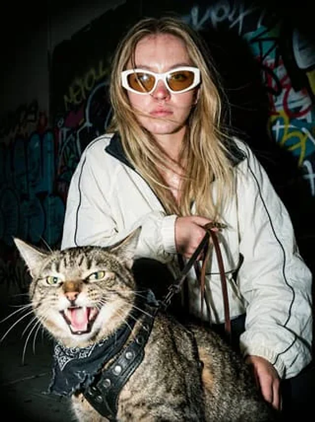

```text
{
  "image_prompt_data": {
    "subjects": {
      "human": {
        "appearance": "Young woman with long, tousled blonde hair falling over shoulders.",
        "facial_features": "Neutral to serious expression, visible rosy mark or redness on the bridge of the nose, glossy lips.",
        "pose": "Crouching or leaning forward, hand gripping a leather leash."
      },
      "animal": {
        "type": "Tabby cat (brown, black, and grey stripes).",
        "expression": "Mouth wide open in a hiss, meow, or yawn; visible teeth and tongue; intense and energetic expression.",
        "position": "Foreground, sitting or standing while leashed."
      }
    },
    "attire_and_accessories": {
      "human_clothing": "White nylon track jacket or windbreaker with black piping/stripes running down the sleeves; retro sporty aesthetic.",
      "eyewear": "Thick-framed white rectangular sunglasses with amber/orange tinted lenses.",
      "animal_gear": "Black leather harness adorned with metal studs, black paisley bandana around the neck.",
      "props": "Brown leather leash held taut."
    },
    "setting_and_background": {
      "location": "Urban exterior at night.",
      "background": "Dark wall covered in colorful, blurred graffiti tags (blue, yellow, red paint visible).",
      "atmosphere": "Gritty, underground, street-style vibe."
    },
    "lighting_and_style": {
      "lighting_technique": "Direct camera flash (flash photography), hard lighting with high contrast, bright foreground subjects against a dark background.",
      "visual_style": "Paparazzi style, candid, edgy fashion editorial, raw and realistic.",
      "color_palette": "High contrast; bright whites, deep blacks, amber tints, and muted graffiti colors."
    },
    "technical_specifications": {
      "quality": "4K, Ultra HD, photorealistic.",
      "details": "High resolution, sharp focus on the woman and cat, detailed texture on the cat's fur and the jacket fabric.",
      "aspect_ratio": "Portrait."
    }
  }
}
```

Model: Nano Banana
Author: Melisa♡

[ProjectD](https://aitoolsradar.com/en/prompts/47d4829310308b) · [Recorded source](https://x.com/xmliisu/status/2018681442151084258)
 · [Full original metadata and byte evidence](data/projectd-batch-0064.json)

## Melisa♡ #627

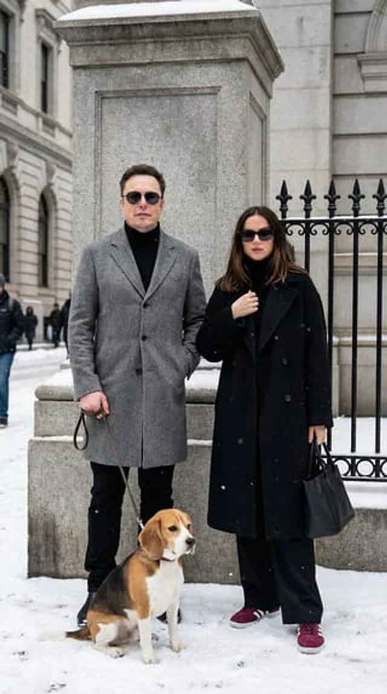

```text
{
  "prompt_title": "Sophisticated Urban Winter Couple Portrait",
  "environment": {
    "setting": "Upscale urban street corner during winter.",
    "architecture": "Massive grey stone pillar/building corner with classical detailing.",
    "background_elements": "Black wrought-iron fence with decorative gold finials/spikes. Classical stone building facade visible in background.",
    "ground": "Covered in fresh, clean white snow.",
    "atmosphere": "Light snow falling, snowflakes visible in the air. Cold, crisp winter day.",
    "color_palette": "Cool neutrals, stone grey, bright white snow, deep blacks, accent of burgundy."
  },
  "subjects": [
    {
      "id": "male_subject",
      "appearance": "Young adult male, fair skin, short dark hair styled neatly.",
      "clothing": {
        "outerwear": "Knee-length textured grey wool overcoat (possibly herringbone or tweed).",
        "top": "Black turtleneck sweater.",
        "bottoms": "Black tailored trousers, relaxed straight fit.",
        "footwear": "Black leather dress shoes or boots.",
        "accessories": "Black wayfarer-style sunglasses."
      },
      "pose": "Standing confident and upright, one hand in coat pocket, other hand holding a dog leash. Looking slightly to the side."
    },
    {
      "id": "female_subject",
      "appearance": "Young adult female, fair skin, dark hair pulled back into a sleek, tight bun.",
      "clothing": {
        "outerwear": "Long, oversized black wool coat.",
        "top": "Black fitted turtleneck.",
        "bottoms": "Black wide-leg trousers.",
        "footwear": "Burgundy/Maroon suede retro sneakers with white stripes (Adidas Gazelle style).",
        "accessories": "Black oval sunglasses, thin black belt with silver buckle, small gold hoop earrings, holding a black leather tote bag."
      },
      "pose": "Standing next to male subject, hand touching lapel of coat, other hand holding bag at side. Radiating 'cool girl' aesthetic."
    }
  ],
  "additional_elements": {
    "animal": {
      "breed": "Beagle dog.",
      "pose": "Sitting obediently on the snow at the man's feet.",
      "appearance": "Tri-color fur (brown, black, white), wearing a collar and attached to a black leash."
    }
  },
  "lighting_and_mood": {
    "lighting_type": "Soft, diffuse overcast natural light (winter daylight). No harsh shadows.",
    "mood": "Chic, minimalist, 'Old Money' aesthetic, quiet luxury, sophisticated, serene, fashionable.",
    "tonality": "Desaturated slightly with high contrast between the black clothing and white snow."
  },
  "technical_details": {
    "style": "Ultra Photorealistic, High-End Street Style Photography.",
    "camera_settings": {
      "lens": "85mm portrait lens.",
      "aperture": "f/2.8 for slight depth of field separation from the stone background.",
      "shutter_speed": "Fast enough to freeze falling snowflakes.",
      "iso": "Low ISO (100) for grain-free clarity."
    },
    "quality_modifiers": "8k resolution, highly detailed fabric textures (wool grain, leather sheen, suede texture), sharp focus on eyes/sunglasses, subsurface scattering on skin, cinematic composition, rule of thirds."
  }
}
```

Model: Nano Banana
Author: Melisa♡

[ProjectD](https://aitoolsradar.com/en/prompts/b14aeebf2ae28f) · [Recorded source](https://x.com/xmliisu/status/2011692205925159084)
 · [Full original metadata and byte evidence](data/projectd-batch-0064.json)

## Milo #1056

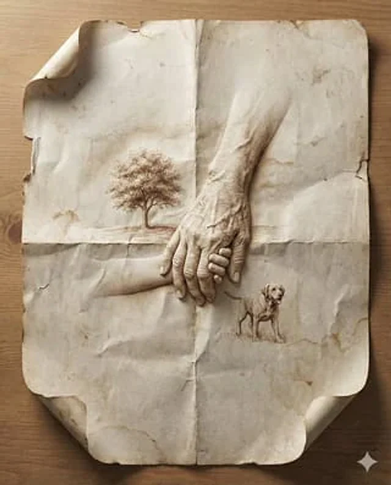

```text
8K Ultra-Realistic Promotional
Design a hyper-realistic close-up image of a folded sheet of aged paper. Within the paper’s creases and surfaces, depict a [SCENE OR MEMORY] emerging naturally from the folds, like sculpted origami.
The environment and figures (if present) appear embossed or printed directly into the paper, using wrinkles, grain, and ink textures to build the illusion. Include subtle shadows, curled edges, torn corners, and ink fading to enhance realism.
Set the paper on a neutral tabletop with soft directional light from one side, casting gentle shadows and enhancing dimensional depth.
Photorealistic, emotional storytelling, handcrafted visual illusion, 8K ultra-detail, and image size 4 5.
```

Model: Nano Banana
Author: Milo

[ProjectD](https://aitoolsradar.com/en/prompts/89ed0ef202b765) · [Recorded source](https://x.com/Milo_Bahi_02/status/2011389738591338958)
 · [Full original metadata and byte evidence](data/projectd-batch-0064.json)

## Milo #1161


```text
Create a hyper-realistic miniature planet showcasing [KASHMIR] with famous landmarks seamlessly curving around the spherical surface. Position bold 3D white text “[KASHMIR]” naturally integrated across the lush green central parkland with realistic shadows and dimensional depth. Capture from a top-down orbiting angle that emphasizes the dramatic planet curvature. Use soft golden hour daylight filtering through partly cloudy skies, casting gentle shadows on emerald grass and surrounding trees. The background should blend into a swirling atmospheric sky. Apply vibrant greens, warm earth tones, and soft blues. Render in polished photorealistic style with fine architectural detail. 1080x1080 format.
```

Model: Nano Banana
Author: Milo

[ProjectD](https://aitoolsradar.com/en/prompts/1ecc6bf55cec06) · [Recorded source](https://x.com/Milo_Bahi_02/status/2008699484260495802)
 · [Full original metadata and byte evidence](data/projectd-batch-0064.json)

## Milo #1310

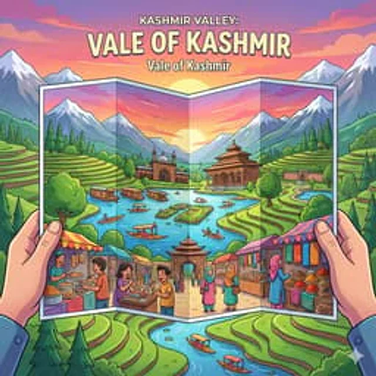

```text
Ultra-Realistic Promotional
Create a high-resolution 1080x1080 stylized travel poster style illustration that looks like a folded tourist brochure being held by two hands in the foreground. The brochure features a vibrant, cartoonish yet detailed depiction of [KASHMIR VALLEY] Show iconic cultural elements and architecture of [Often Called VALE OF KASHMIR] surrounded by lush greenery or local landscapes. Include shopping scenes with people eating street food at local markets, and colorful [SUN/SUNSET] in the background. The overall style should be Pixar-inspired, bright and cheerful, soft shadows, and rich 3D depth. The hands holding the brochure should be pixar stylized, with gentle shadows and cool tones, matching the exact expression and perspective as the reference image. The background should seamlessly blend and match the landscape extending beyond the brochure edges.
```

Model: Nano Banana
Author: Milo

[ProjectD](https://aitoolsradar.com/en/prompts/452eef274cc07f) · [Recorded source](https://x.com/Milo_Bahi_02/status/2008388128961389047)
 · [Full original metadata and byte evidence](data/projectd-batch-0064.json)

## Milo #1328

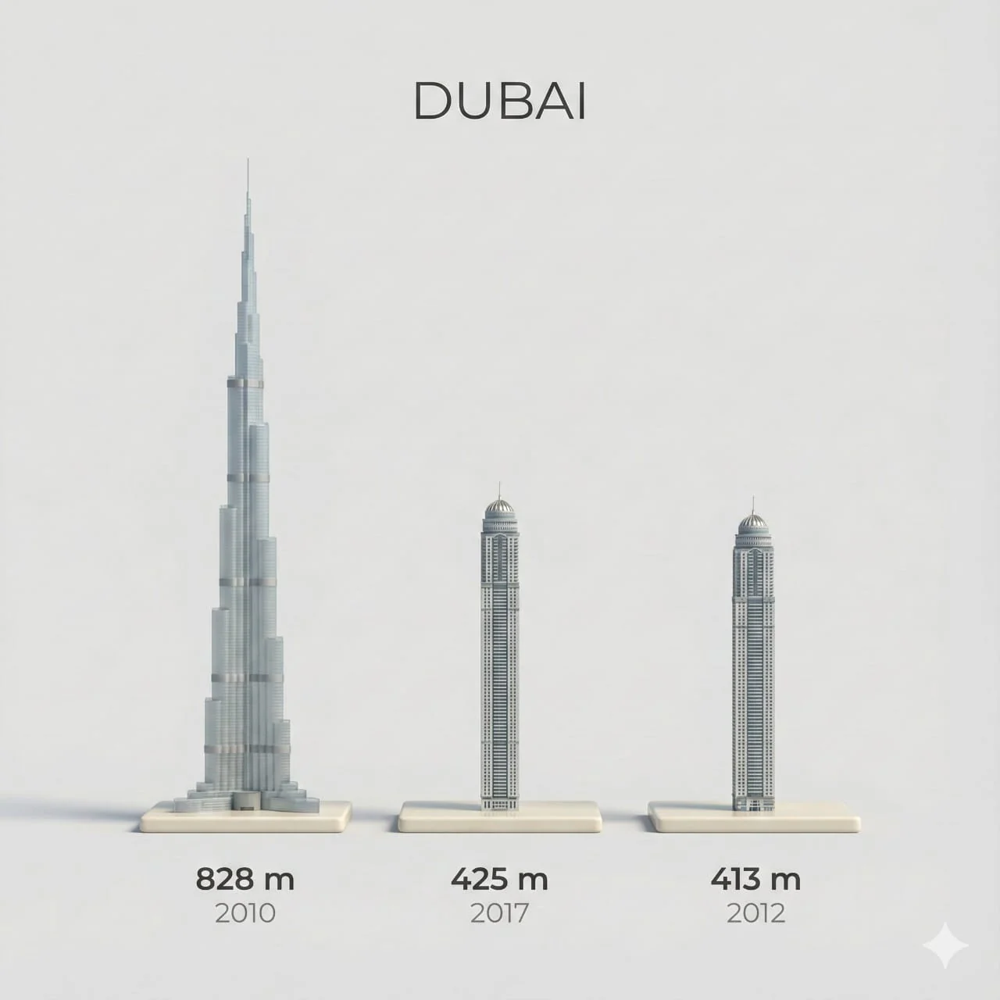

```text
Ultra-Realistic Promotional
Present a clear, side miniature 3D cartoon view of [DUBAI] tallest buildings. Use minimal textures with realistic materials and soft, lifelike lighting and shadows. Use a clean, minimalistic composition showing exactly the three tallest buildings in spot, arranged from LEFT to RIGHT in STRICT descending height order. The tallest must appear visibly tallest, the second must be clearly shorter than the first, and the third must be clearly shorter than the second.
All buildings must follow accurate relative proportions: if a building is taller in real life, it MUST be taller in the image by the same approximate ratio. No building may be visually stretched or compressed. Each building should stand separately on a thin, simple ceramic base.
Below each base, centered text should display:
Height in meters – semibold sans-serif, medium size
Year built – lighter-weight sans-serif, smaller size, directly beneath the height text
Provide consistent padding, spacing, leading, and kerning. Write “DUBAI” centered above the buildings using a medium-sized sans-serif font. No building top should overlap or touch the text above. Use accurate architectural proportions based on real-world references. Maintain consistent camera angle and identical scale for each building model.
No forced perspective. Use straight-on orthographic-style rendering. Do not exaggerate or stylize size differences beyond proportional accuracy. Use a square 1080x1080 composition. Use a clean, neutral background. Ensure no extra objects are present.
```

Model: Nano Banana
Author: Milo

[ProjectD](https://aitoolsradar.com/en/prompts/f0bf25182d1dd7) · [Recorded source](https://x.com/Milo_Bahi_02/status/2009073595776204834)
 · [Full original metadata and byte evidence](data/projectd-batch-0064.json)

## Milo #1435

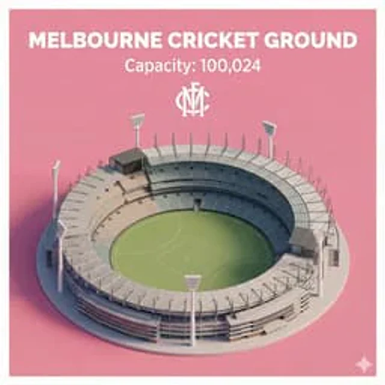

```text
Ultra-Realistic Promotional
Present a clear, 45° top-down isometric miniature 3D cartoon scene of [MELBOURNE CRICKET STADIUM], with soft refined textures, realistic PBR materials, and gentle lifelike lighting. Use a clean solid [GREEN, WHITE OR PINK ] background. At the top center, display the name of this stadium in large bold text, then directly beneath it show its real seating capacity in medium text, and place the official logo associated with this stadium below the capacity. All text must match the background contrast automatically (white or black). Centered layout, square 1080×1080 dimension.
```

Model: Nano Banana
Author: Milo

[ProjectD](https://aitoolsradar.com/en/prompts/4c06a52e399fd8) · [Recorded source](https://x.com/Milo_Bahi_02/status/2011045292209291663)
 · [Full original metadata and byte evidence](data/projectd-batch-0064.json)

## Milo #661


```text
8K Ultra-Realistic Promotional
Present a clear, 45° top-down isometric miniature 3D scene of the [SUBWAY SYSTEM / LINE NAME]. The scene includes stylized diorama elements such as platforms, miniature trains, stairwells, signage, tiled walls, vending machines, and people waiting.
Use soft, refined textures, realistic PBR materials, and lifelike lighting with subtle shadows to enhance dimensional clarity.
At the top center, place the title “[LINE NAME]” in bold sans-serif text. Below it, add a train icon followed by “Service Status” (small text) and “[STATUS MESSAGE]”  red medium text for delays or green for on-time service.
Use a soft, solid tile white background for clarity. Clean, centered, editorial infographic style.
Square format 1080×1080, ultra-detailed 3D render, miniature realism, 8K look, image size 1: 1
```

Model: Nano Banana
Author: Milo

[ProjectD](https://aitoolsradar.com/en/prompts/4aa49b3aa3a67b) · [Recorded source](https://x.com/Milo_Bahi_02/status/2011751906318958830)
 · [Full original metadata and byte evidence](data/projectd-batch-0064.json)

## Milo #735


```text
8k Ultra-Realistic Promotional
Create an exquisite miniature 3D cartoon-style scene of the user-specified company, viewed from a 45° top down perspective, with the company’s most iconic building or campus at the center, surrounded by proportionally scaled product icons, cartoon figures, vehicles, and playful elements representing everyday activities. Render in Cinema 4D with refined, smoothly rounded modeling, rich PBR textures, gentle lifelike lighting, and soft shadows for a warm, polished feel, using a clean solid-color background.
Integrate accurate real-time stock market data for the specified date into a minimalistic layout, displaying the company name or stock ticker at the top center in large text, the date in extra-small text, and the stock price range in medium text with clear trend icons and charts, all in the user-specified language and without text backgrounds, subtly overlapping the scene if needed.
Very important: verify stock data accuracy for the given company/ticker and date before generation; if unavailable, notify the user and stop.
Parameters: aspect ratio (user input, default 1:1), date (user input/current), company/ticker (user input).
Example: Company – Google, Date – 01/01/2026.
```

Model: Nano Banana
Author: Milo

[ProjectD](https://aitoolsradar.com/en/prompts/c640deff6a54b5) · [Recorded source](https://x.com/Milo_Bahi_02/status/2009430294286553161)
 · [Full original metadata and byte evidence](data/projectd-batch-0064.json)

## Milo #736


```text
8k Ultra-Realistic Promotional
Generate a whimsical miniature world featuring [KASHMIR SNOWFALL LAND MARK NAME] crafted entirely from colorful modeling clay. Every element buildings, trees, waterways, and urban features should appear hand  sculpted with visible fingerprints and organic clay textures. Use a playful, childlike style with vibrant colors: bright azure sky, puffy cream clouds, emerald trees, and buildings in warm yellows, oranges, reds, and blues.
The handmade quality should be evident in every surface and gentle curve. Capture from a wide perspective showcasing the entire miniature landscape in a harmonious, joyful composition. Include no text, words, or signage only sculptural clay elements that define the location through recognizable architectural features. 1080x1080 dimension.
```

Model: Nano Banana
Author: Milo

[ProjectD](https://aitoolsradar.com/en/prompts/111c6622e25900) · [Recorded source](https://x.com/Milo_Bahi_02/status/2008765662488059907)
 · [Full original metadata and byte evidence](data/projectd-batch-0064.json)

## Minahil #1199


```text
A low-angle, cinematic close-up shot looking through a rain-slicked car window. Inside the car, a contemplative man with short dark hair and slight stubble is visible, looking out toward the city. The focus is sharp on the water droplets clinging to the glass, while the man and the background are slightly softer.
​Setting & Atmosphere: A bustling European city street at night during a rainstorm. The atmosphere is melancholic yet cozy. In the reflection of the car door and window, blurred city lights, glowing neon shop signs (blues and reds), and the outlines of historical architecture are visible.
​Lighting & Color: * Lighting: Naturalistic night lighting provided by street lamps and neon signs, creating a cool blue and teal base with warm orange and red highlights.
​Reflections: Complex reflections of wet pavement and passing cars on the dark metallic surface of the vehicle.
​Technical Specs: 35mm lens, f/1.8 aperture for shallow depth of field, high contrast, moody film grain, hyper-realistic textures, shot on Sony A7R IV style.
```

Model: Nano Banana
Author: Minahil

[ProjectD](https://aitoolsradar.com/en/prompts/ce30f5a384042a) · [Recorded source](https://x.com/Minahil42298354/status/2039732389979607055)
 · [Full original metadata and byte evidence](data/projectd-batch-0064.json)

## Minahil #1239


```text
A high-fashion editorial portrait of a young woman standing by a large, rustic wooden window. She is captured in a candid, over-the-shoulder gaze, looking directly into the camera with a soft, natural expression. One hand is gently resting on the window frame.

​Lighting & Atmosphere:

The scene is defined by golden hour sunlight streaming through the window, creating a dramatic "blind shadow" or shutter-effect across her face and blouse. The lighting is warm and high-contrast, with a hazy, ethereal atmosphere that emphasizes a quiet, "Film Noir" mood in a modern setting.

​Wardrobe & Style:

She is wearing a translucent, pleated silk chiffon blouse in a muted champagne tone. The fabric is light and airy, catching the backlighting to create a soft glow. Her hair is styled in a tousled, effortless bob with natural texture.

​Technical Specifications:

​Lens: Shot on 85mm f/1.4 for a shallow depth of field.

​Focus: Sharp focus on the eyes with a creamy, soft bokeh background featuring indoor plants and warm interior tones.

​Quality: 8K resolution, cinematic color grading, fine grain, professional photography.
```

Model: Nano Banana
Author: Minahil

[ProjectD](https://aitoolsradar.com/en/prompts/3214fc6280630d) · [Recorded source](https://x.com/Minahil42298354/status/2043336493419123094)
 · [Full original metadata and byte evidence](data/projectd-batch-0064.json)

## Minahil #690


```text
{
  "master_prompt": {
    "global_settings": {
      "style": "Hyper-realistic commercial product photography", 
      "layout": "Vertical split-screen, two distinct modules",
      "resolution": "8K UHD, cinematic lighting",
      "details": "Extreme clarity, frozen motion splashes, micro-condensation"
    },
    "module_1_left": {
      "subject": {
        "type": "Clear tall glass of thick chocolate milkshake",
        "details": "Frothy texture, visible condensation on glass",
        "text_on_glass": ["CHOCOLATE MILK SHAKE", "mock up", "protein"]
      },
      "action": "Dynamic chocolate liquid splash erupting from the base and top",
      "floating_elements": [
        "Whole blueberries with water droplets",
        "Fresh green mint leaves",
        "Tiny chocolate particles suspended in air"
      ],
      "background": {
        "color": "Deep dark blue with soft golden bokeh particles",
        "lighting": "Cool moonlight-style rim lighting"
      }
    },
    "module_2_right": {
      "subject": {
        "type": "Slim gold metallic Nescafé can",
        "details": "Heavy condensation, matte gold finish",
        "text_on_can": ["NESCAFÉ", "CHOCOLATE SHAKE", "NEW LOOK", "PROTEIN BOOST"]
      },
      "action": "Explosive chocolate liquid crown splash at the base",
      "floating_elements": [
        "Roasted coffee beans",
        "Swirling thick white steam/smoke rising from the top",
        "Glowing amber embers and sparks"
      ],
      "background": {
        "color": "Warm chocolate brown to dark amber gradient",
        "atmosphere": "Moody, intense, and smoky"
      }
    },
    "surface_details": {
      "base": "Reflective dark wet surface with liquid pooling",
      "shadows": "Soft separated realistic shadows"
    }
  }
}
```

Model: Nano Banana
Author: Minahil

[ProjectD](https://aitoolsradar.com/en/prompts/ba72aa8acb7da1) · [Recorded source](https://x.com/Minahil42298354/status/2019630789474861400)
 · [Full original metadata and byte evidence](data/projectd-batch-0064.json)

## Minahil #755


```text
A young woman with an elegant, polished look. In one frame, she has an expressive, surprised "O" face; in the other, a soft, confident smile.
​Attire: A vibrant crimson red floor-length gown featuring intricate floral lace embroidery, a sheer neckline, and subtle sequin detailing that catches the light.
​Hair & Makeup: Her hair is styled in a soft, romantic updo with loose tendrils. She wears bold red lipstick that perfectly matches her dress and classic, warm-toned eye makeup.
​Setting & Composition:
​Environment: An outdoor garden during golden hour. The background is filled with soft-focus white spring blossoms (like cherry or almond trees) and lush greenery.
​Lighting: Backlit by a warm, setting sun, creating a "halo" effect on her hair and a soft, ethereal glow across the scene.
​The Contrast: She is holding or wearing a professional black DSLR camera with a large lens. The mechanical, matte-black texture of the camera creates a sharp contrast against the delicate, red lace of the evening gown.
​Technical Details:
​Photography Style: Cinematic portraiture with a shallow depth of field (bokeh), making the subject pop against the blurred garden background.
​Composition: A side-by-side diptych showing two different poses: one front-facing and playful, one profile-view and serene.
```

Model: Nano Banana
Author: Minahil

[ProjectD](https://aitoolsradar.com/en/prompts/7cb997614725bc) · [Recorded source](https://x.com/Minahil42298354/status/2025148839301091523)
 · [Full original metadata and byte evidence](data/projectd-batch-0064.json)

## Minhaa #1344


```text
{
  "image": {
    "general": {
      "style": "photorealistic",
      "mood": "candid, playful",
      "lighting": {
        "type": "natural",
        "intensity": "harsh",
        "effect": {
          "high_contrast": true,
          "highlights": {
            "intensity": "strong",
            "focus": "on the subject and couch"
          },
          "shadows": {
            "intensity": "deep",
            "focus": "on the subject, couch"
          }
        }
      },
      "image_ratio": "3:4"
    },
    "scene": {
      "location": {
        "type": "indoor",
        "style": "modern living room",
        "elements": {
          "sofa": {
            "type": "plush",
            "color": "white",
            "texture": "soft, luxurious"
          },
          "lighting_source": {
            "type": "sunlight",
            "direction": "streaming from a large window",
            "effect": "bright and direct"
          },
          "room_features": [
            "minimalistic decor",
            "large windows",
            "open space with natural light"
          ]
        }
      }
    },
    "subject": {
      "identity": {
        "name": "England model
```

Model: Nano Banana
Author: Minhaa

[ProjectD](https://aitoolsradar.com/en/prompts/8b425e7a54ecdc) · [Recorded source](https://x.com/tabu_8114/status/2018218587811709107)
 · [Full original metadata and byte evidence](data/projectd-batch-0064.json)

## Minhaa #1395


```text
{
  "subject": {
    "description": "Young East Asian woman, positioned in profile turning to look back at the viewer.",
    "pose": "Looking over shoulder, slight head tilt, body angled away from camera.",
    "expression": "Soft, neutral to slightly melancholic, contemplative gaze, lips slightly parted."
  },
  "clothing": {
    "upper_body": "Dark, structured jacket or blazer, possibly pinstriped or textured fabric.",
    "visibility": "Mostly obscured by shadow and foreground elements."
  },
  "hair": {
    "color": "Dark brown to black.",
    "style": "Long, loose, tousled waves, slightly messy texture.",
    "lighting_interaction": "Strongly backlit, creating a glowing halo effect on loose strands (rim lighting)."
  },
  "face": {
    "skin_tone": "Fair/pale with warm undertones.",
    "features": "Soft facial structure, almond-shaped eyes, natural eyebrows.",
    "makeup": "Minimal, 'no-makeup' look, natural lip color."
  },
  "accessories": {
    "visible_items": "None clearly visible due to framing and lighting."
  },
  "environment": {
    "setting": "Cluttered interior space, resembling a workshop, storage room, or old bookstore.",
    "background_elements": "Wooden shelves stacked with indistinct objects, papers, boxes, and plastic packaging.",
    "foreground_elements": "Blurred translucent objects (possibly glass, plastic sheets, or dust covers) creating layers and reflections."
  },
  "lighting": {
    "source": "Natural sunlight streaming through a window on the left.",
    "quality": "Golden hour, warm, diffuse but directional.",
    "effects": "Strong backlighting/rim lighting on hair, volumetric dust motes dancing in the light, lens flares, soft glare, dramatic contrast between light and shadow."
  },
  "camera": {
    "perspective": "Eye-level, shot through a foreground obstruction (glass or clutter).",
    "focus": "Shallow depth of field (bokeh), sharp focus on eyes/face, blurred background and foreground.",
    "lens_character": "Soft focus, film grain simulation, slight bloom effect."
  },
  "style": {
    "aesthetic": "Cinematic, atmospheric, nostalgic, slice-of-life, ethereal.",
    "mood": "Dreamy, intimate, quiet, sentimental.",
    "visual_reference": "Film photography, Japanese photobook style."
  }
}
```

Model: Nano Banana
Author: Minhaa

[ProjectD](https://aitoolsradar.com/en/prompts/423ed604195461) · [Recorded source](https://x.com/tabu_8114/status/2008765230441246824)
 · [Full original metadata and byte evidence](data/projectd-batch-0064.json)

## Minhaa #1401


```text
Gemini Nano Banana Pro 🍌 
{
  "image_type": "photographic portrait",
  "orientation": "vertical",
  "framing": "medium shot",
  "composition": {
    "pose": "standing, torso angled away from camera with head turned back over shoulder",
    "gesture": "arms relaxed, shoulders slightly raised creating a soft curve",
    "body_language": "playful, gentle confidence, approachable",
    "asymmetry": "dynamic asymmetry created by over-the-shoulder pose",
    "negative_space": "moderate negative space above head and around subject within interior setting"
  },
  "subject": {
    "count": 1,
    "gender_presentation": "female",
    "age_appearance": "teenager to young adult",
    "expression": "soft smile, relaxed facial muscles",
    "gaze": "direct eye contact with camera",
    "hair": {
      "color": "medium to dark brown",
      "length": "long",
      "style": "straight, center-parted, tucked behind ears, smooth texture"
    },
    "skin": {
      "tone": "light",
      "texture": "smooth, natural, lightly retouched"
    }
  },
  "wardrobe_and_accessories": {
    "dress": {
      "type": "sleeveless floral dress",
      "base_color": "light blue",
      "pattern": "multicolor floral print",
      "fit": "fitted bodice with gathered skirt",
      "fabric_appearance": "lightweight, soft, slightly matte"
    },
    "accessories": {
      "visible_jewelry": "none prominent",
      "hair_accessories": "none"
    }
  },
  "background": {
    "type": "interior room",
    "setting": "hotel or bedroom",
    "elements": [
      "bed with white linens",
      "side tables",
      "lamp",
      "arched ceiling detail",
      "visible cables on floor"
    ],
    "depth": "background moderately in focus, secondary to subject"
  },
  "lighting": {
    "style": "natural ambient indoor lighting",
    "direction": "soft frontal and side light",
    "contrast": "low",
    "shadows": "very soft, minimal shadowing on face and body",
    "highlights": "gentle highlights on cheeks, eyes, and hair",
    "lighting_quality": "warm, diffused"
  },
  "color_and_tone": {
    "color_mode": "color",
    "white_balance": "warm",
    "palette": "soft pastels and warm neutrals",
    "contrast_curve": "smooth with low contrast",
    "mood": "warm, romantic, candid"
  },
  "camera_and_technical_traits": {
    "camera_distance": "close to medium",
    "lens_appearance": "wide to standard smartphone lens",
    "depth_of_field": "deep, subject and background mostly in focus",
    "sharpness": "high overall clarity",
    "grain": "minimal"
  },
  "artistic_style": {
    "genre": "lifestyle portrait",
    "aesthetic": "candid, feminine, casual elegance",
    "influences": "social media portraiture, lifestyle photography",
    "retouching_style": "light skin smoothing, natural color enhancement"
  },
  "overall_impression": {
    "tone": "friendly, youthful, charming",
    "visual_focus": "face and over-the-shoulder pose",
    "use_case": "social media content, lifestyle reference, casual portrait inspiration"
  },

  "trending_text_overlay": [
    "Dream Military",
    "RESERVE",
    "Virat Kohli"
  ]
}
```

Model: Nano Banana
Author: Minhaa

[ProjectD](https://aitoolsradar.com/en/prompts/cd8cad4966ef8a) · [Recorded source](https://x.com/tabu_8114/status/2009265431119646925)
 · [Full original metadata and byte evidence](data/projectd-batch-0064.json)

## Minhaa #1416


```text
Gemini Nano Banana Pro

Prompt:

{ "image_type": "photograph", "genre": "casual portrait", "composition": { "framing": "close-up, chest-up portrait", "angle": "slightly tilted, camera held above eye level and angled downward", "orientation": "portrait with diagonal tilt", "subject_placement": "subject positioned slightly off-center, face occupying left-middle area", "crop": "tight crop with partial arm visible in foreground" }, "subject": { "count": 1, "gender_presentation": "female-presenting", "age_range": "young adult", "facial_features": { "skin_tone": "light, neutral-warm", "complexion": "clear, smooth with natural texture", "eyes": "light green/gray, almond-shaped", "eyebrows": "medium thickness, natural shape", "nose": "straight, small to medium", "lips": "natural pink, closed-mouth slight smile" }, "hair": { "color": "dark brown", "length": "long", "style": "straight, tucked behind ear on one side", "part": "slight side part" }, "expression": "soft, relaxed, friendly", "gaze": "looking directly into camera", "accessories": [ "small silver stud earrings" ], "clothing": { "type": "sports jersey", "fit": "loose athletic fit", "color": "white with black accents", "details": [ "black collar trim", "black logos and text", "shield-style emblem on chest", "large curved black graphic text" ] } }, "lighting": { "type": "natural light", "direction": "side/front light from window", "quality": "soft, diffused", "shadows": "minimal, gentle", "highlights": "subtle skin highlights on cheek and forehead" }, "color_palette": { "dominant_colors": [ "white", "soft gray", "black" ], "accent_colors": [ "natural skin tones", "brown hair" ], "overall_tone": "neutral, clean, airy" }, "background": { "setting": "indoor", "elements": [ "sheer white curtains", "window frame partially visible" ], "depth_of_field": "moderate, background slightly soft but recognizable", "style": "minimalist, uncluttered" }, "technical_details": { "camera_type": "DSLR", "focal_length_equivalent": "wide-angle selfie lens", "resolution": "high", "sharpness": "sharp focus on face", "noise": "minimal", "white_balance": "neutral" }, "artistic_style": { "aesthetic": "clean, natural, lifestyle", "retouching": "very minimal, natural skin texture preserved", "mood": "calm, approachable, casual" }, "typography": { "presence": true, "location": "on jersey", "style": "bold sans-serif sports branding", "color": "black", "readability": "partially visible due to crop" } }
```

Model: Nano Banana
Author: Minhaa

[ProjectD](https://aitoolsradar.com/en/prompts/87655743bf956b) · [Recorded source](https://x.com/tabu_8114/status/2008543000750948734)
 · [Full original metadata and byte evidence](data/projectd-batch-0064.json)

## Minhaa #1433


```text
Gemini Nano Banana Pro

Prompt:

{ "image_type": "photograph", "genre": "urban lifestyle portrait", "composition": { "framing": "three-quarter body portrait", "angle": "eye-level, straight-on", "orientation": "portrait", "subject_placement": "subject positioned slightly right of center", "background_balance": "large-scale mural occupying left background", "visual_hierarchy": "foreground subject emphasized against graphic mural backdrop" }, "subject": { "count": 1, "gender_presentation": "female-presenting", "age_range": "young adult", "facial_features": { "skin_tone": "light, neutral", "complexion": "smooth with natural texture", "eyes": "light-colored", "eyebrows": "full, softly shaped", "nose": "straight, proportional", "lips": "natural pink, smiling with teeth slightly visible" }, "hair": { "color": "medium brown", "length": "shoulder-length", "style": "loose waves", "part": "center part" }, "expression": "playful, cheerful", "gaze": "directed toward camera", "pose": { "stance": "relaxed, casual", "hands": "one hand holding a drink cup, other supporting straw" }, "accessories": [ "clear plastic cup with lid and straw" ], "clothing": { "top": "oversized t-shirt", "color": "White", "bottom": "black lounge pants", "fit": "loose, relaxed streetwear", "style": "casual, modern" } }, "lighting": { "type": "natural daylight", "direction": "diffuse frontal light", "quality": "soft, even", "shadows": "minimal, low contrast", "highlights": "subtle highlights on face and hair" }, "color_palette":#AmulProteinWPL { "dominant_colors": [ "white", "gray", "yellow" ], "accent_colors": [ "cherry beverage", "black mural outlines" ], "overall_tone": "urban, contemporary, playful" }, "background": { "setting": "outdoor urban space", "environment": "city courtyard or alley", "elements": [ "large monochrome mural portrait of Elon Musk with yellow graphic accents", "modern building facades", "metal railing", "stone or concrete pavement" ], "style": "street art–influenced", "depth_of_field": "deep, background clearly visible" }, "technical_details": { "camera_type": "smartphone camera", "focal_length_equivalent": "standard wide lens", "sharpness": "high overall sharpness", "noise": "low", "dynamic_range": "balanced highlights and shadows", "white_balance": "neutral" }, "artistic_style": { "aesthetic": "urban lifestyle, social media–ready", "retouching": "minimal, natural appearance", "mood": "fun, relaxed, youthful", "contrast": "moderate with strong graphic background" }, "typography": { "presence": false } }
```

Model: Nano Banana
Author: Minhaa

[ProjectD](https://aitoolsradar.com/en/prompts/9f4c115a7fb692) · [Recorded source](https://x.com/tabu_8114/status/2009625504597561668)
 · [Full original metadata and byte evidence](data/projectd-batch-0064.json)

## Miz #1131


```text
{
  "prompt": "A young red-haired woman sitting inside a bright retro-style fast food restaurant, eating a cheeseburger. She is seated in a red vinyl booth by a large window with sunlight streaming in. She is winking while taking a bite of the burger. On the table in front of her is a red tray holding a burger, French fries, and a soft drink in a white cup with red palm tree graphics. The restaurant interior features white tiled walls with red accents and a framed picture on the wall. The lighting is warm and natural, creating a casual, candid atmosphere.",
  "style": "photorealistic",
  "lighting": "natural sunlight, warm tones",
  "camera_angle": "eye-level, centered composition",
  "environment": "retro American fast food diner",
  "mood": "playful and casual",
  "details": "sharp focus, high resolution, realistic skin texture, vibrant colors"
}
```

Model: Nano Banana
Author: Miz

[ProjectD](https://aitoolsradar.com/en/prompts/a2a7811c6bad91) · [Recorded source](https://x.com/mizq06/status/2028878781612798040)
 · [Full original metadata and byte evidence](data/projectd-batch-0064.json)

## Mo #348


```text
A realistic, highly detailed geographic map viewed from above, accurately representing the region where [COUNTRY] is located. Rising from the map is a miniature 3D diorama of [CITY], precisely positioned at its real geographic location. The diorama features iconic architecture, natural landmarks, and cultural elements seamlessly emerging from the map surface. Ultra-realistic materials, fine textures, and depth of field. Soft studio lighting with subtle shadows, cinematic composition, premium macro photography style. Square 1:1 format, high detail, realistic scale.
```

Model: Nano Banana
Author: Mo

[ProjectD](https://aitoolsradar.com/en/prompts/90bf3e71f1e11f) · [Recorded source](https://x.com/Kerroudjm/status/2008937653694013753)
 · [Full original metadata and byte evidence](data/projectd-batch-0064.json)

## Mo #354


```text
A high-end editorial photo of a [PRODUCT] placed flat on a [TEXTURED SURFACE], captured from a direct top-down view. The surface is gently disturbed to suggest recent motion or interaction. The front of the product is fully visible and properly oriented upright. The area around the product is intentionally left open to optionally place [COMPLEMENTARY OBJECTS] that visually enhance the scene. Natural sunlight from the upper left casts warm, realistic shadows. 3D realism, luxury product photography, shallow depth of field, 1:1 format.
```

Model: Nano Banana
Author: Mo

[ProjectD](https://aitoolsradar.com/en/prompts/d85f7d46e7ecbb) · [Recorded source](https://x.com/Kerroudjm/status/2008559850968473671)
 · [Full original metadata and byte evidence](data/projectd-batch-0064.json)

## Mo #419


```text
A high-end editorial studio photograph of a (PRODUCT FORM, e.g. bottle, jar, tube…), made of (MATERIAL, e.g. glass, ceramic, matte plastic…) with a (COLOR) (DETAIL, e.g. cap, texture, label…). The product is placed on a natural, textured (BASE SURFACE, e.g. stone, wood, marble…) slab, itself resting on a round mirror laid on a (SURFACE TONE, e.g. beige, sand, light gray…) surface. Around the mirror and on the slab are scattered droplets of (LIQUID, e.g. serum, oil, gel…) with realistic reflections. A few sprigs of (DECORATIVE NATURAL ELEMENTS, e.g. lavender, eucalyptus, rose petals…) lie gently across the slab and mirror, connecting both surfaces naturally. Strong, warm sunlight filters from the top left, casting soft diagonal leaf shadows to simulate filtered daylight. The aesthetic is (VISUAL STYLE, e.g. minimalist, organic, fresh, premium…), with realistic materials and natural textures highlighted by golden hour tones. Style: 3D realism, luxury product photography, shallow depth of field. Format: 1:1, ultra-detailed.
```

Model: Nano Banana
Author: Mo

[ProjectD](https://aitoolsradar.com/en/prompts/19302881ce70ab) · [Recorded source](https://x.com/Kerroudjm/status/2010275488703381858)
 · [Full original metadata and byte evidence](data/projectd-batch-0064.json)

## Mo #511


```text
A vibrant, high-end advertising visual of a [PRODUCT NAME] can/bottle floating dynamically in the center. The background is a soft gradient inspired by the drink’s color, blending into fresh sky-blue tones for a refreshing summer feel.  A powerful splash of [LIQUID TYPE] explodes around the product, forming the word ”[WORD]” in smooth, fluid, organic liquid typography.  Crystal-clear ice cubes burst around the composition, with fresh [FRUITS RELATED TO THE DRINK] (whole and sliced) flying in the air. Juicy splashes, droplets, light mist, and condensation create an intense refreshing atmosphere.  Bright sunlight, glossy highlights, commercial lighting, premium brand look, dynamic motion, hyper-detailed, semi-realistic illustration style, ultra-clean, 4k, sharp focus.
```

Model: Nano Banana
Author: Mo

[ProjectD](https://aitoolsradar.com/en/prompts/4b52ba4f4f4176) · [Recorded source](https://x.com/Kerroudjm/status/2011108316882014431)
 · [Full original metadata and byte evidence](data/projectd-batch-0064.json)

## Mo #856


```text
A high-end studio photograph of a [YOUR COCKTAIL], shot from a high-angle slightly top-down perspective. The drink is served in its appropriate traditional glass with an elegant design and professional garnish. Artfully scattered around the base of the glass are fresh fruits and ingredients associated with the cocktail recipe. The scene features a warm, summery atmosphere with a light orange-tinted background. Artistic soft shadows of tropical palm leaves are cast across the frame, creating a vacation vibe. Realistic condensation on the glass, soft golden hour lighting, 8k resolution, professional food photography, sharp focus, clean and sophisticated composition.
```

Model: Nano Banana
Author: Mo

[ProjectD](https://aitoolsradar.com/en/prompts/3bd11f134ce84e) · [Recorded source](https://x.com/Kerroudjm/status/2010403834699685983)
 · [Full original metadata and byte evidence](data/projectd-batch-0064.json)

## Mr Das #1287


```text
Create a hyper-realistic three-panel vertical cinematic collage in 9:16 aspect ratio, editorial fashion photography style. The collage consists of three distinct vertical frames stacked seamlessly, each featuring the exact same man with consistent face, skin tone, short black hair, sharp jawline, and intense gaze directly at the viewer, as if from the same reference photo.

Top panel: The man stands confidently on a misty mountain ridge at sunrise, dramatic Himalayan peaks in the background with golden light piercing through low clouds. He wears a rugged dark olive green tactical field jacket with rolled sleeves, black cargo pants, and sturdy hiking boots. Cool blue-gray color grading with subtle film grain.

Middle panel: The man leans against an ancient stone pillar inside a grand abandoned temple in a dense tropical jungle, soft diffused sunlight filtering through overgrown vines and carved arches. He wears a lightweight white linen button-up shirt (slightly unbuttoned at the top) tucked into slim khaki trousers, with brown leather loafers. Warm earthy tones with teal shadows and cinematic haze.

Bottom panel: The man walks along a serene lakeside at golden hour, crystal-clear water reflecting snow-capped mountains in the distance, surrounded by pine trees. He wears a black merino wool turtleneck sweater layered under a tailored charcoal wool overcoat, dark jeans, and polished Chelsea boots. Moody teal-orange cinematic grading with soft bokeh and gentle film grain.

Maintain perfect facial consistency across all three panels — same man, same reference face, no variations in features. Ultra-detailed skin texture, realistic fabric details, natural lighting per environment. Cinematic color grading, subtle film grain, editorial composition, high-end fashion photography aesthetic, shot on 35mm film, 4k resolution, photorealistic, masterpiece.
```

Model: Nano Banana
Author: Mr Das

[ProjectD](https://aitoolsradar.com/en/prompts/5a4604f1efe48c) · [Recorded source](https://x.com/MrDasOnX/status/2040639446044102992)
 · [Full original metadata and byte evidence](data/projectd-batch-0064.json)

## Muhammad Waseem 🇵🇰 #1347


```text
A French New Wave–style minimalist lovers scene, black and white, 1950s–1960s European cinema tone. A couple standing close but not touching, quiet intimacy expressed through proximity rather than action. The woman leans slightly toward the man; the man looks past her, thoughtful. Simple, understated clothing — trench coats, wool coats, knit sweaters, classic shirts. No glamour, no styling excess. Natural faces, minimal makeup, authentic expressions.
Set on an empty Parisian street or narrow European alley, early morning or overcast daylight. Café chairs stacked, a bicycle against a wall, stone textures, shuttered windows. Static camera, eye-level framing, wide negative space, imperfect composition. Soft natural light, gentle shadows, subtle 35mm film grain.
Emotion conveyed through stillness, silence, and unresolved tension — love present but unspoken. Minimal dialogue energy, poetic realism, quiet longing, human fragility. Inspired by Godard / Truffaut, anti-dramatic, observational cinema, timeless intimacy, restrained romance, art-house melancholy.
```

Model: Nano Banana
Author: Muhammad Waseem 🇵🇰

[ProjectD](https://aitoolsradar.com/en/prompts/4b16f3f456bee6) · [Recorded source](https://x.com/Itswsm105f/status/2015296685354721690)
 · [Full original metadata and byte evidence](data/projectd-batch-0064.json)

## ᴍᴜʀᴘʜʏ #1137


```text
Hyper-realistic professional FMCG ice cream commercial ad poster. Magnum Classic in dark chocolate brown featuring dual composition: one sealed Magnum wrapper and one bitten ice cream bar, arranged on a polished black marble surface.  

Background: a luxurious night-time rooftop setting overlooking a blurred city skyline with golden lights bokeh, evoking exclusivity and indulgence.  
Cool night air with subtle drifting mist.  

The sealed pack positioned slightly behind at a refined angle, gold branding catching ambient city light.  
The opened Magnum bar in front with a bite taken out, chocolate shell cracking dramatically revealing creamy vanilla core.  

The product hyper-detailed — sharp chocolate fracture edges catching warm golden highlights, molten interior texture visible, slight melting at edges, reflection visible on marble surface below.  

Floating micro chocolate shards suspended mid-air.  

Composition: bitten bar dominates foreground, packaging secondary, cinematic negative space blending into city lights.  

Typography:  
top left — Magnum logo gold.  
center — “MAGNUM CLASSIC”.  
bottom left — “Crack Into Pleasure”.  
below — “BELGIAN CHOCOLATE · THICK SHELL · VANILLA CORE”.  
bottom right — “Indulgence Starts Here”.  
thin separator.  
bottom center — “http://magnumicecream.co m
left vertical — “CLASSIC · 2026”.  

Lighting: mixed lighting — soft city glow + warm rim light enhancing chocolate gloss, deep cinematic contrast.  

Mood: sensual, luxurious, late-night indulgence.  

Shot on ARRI Alexa Mini LF, 100mm macro, shallow DOF, HDR, ultra photorealistic, cinematic FMCG poster, 4:5 portrait.

Hyper-realistic professional FMCG ice cream commercial ad poster. Kwality Walls Cornetto Butterscotch featuring dual composition: one sealed Cornetto pack and one open cone with a bite taken out, arranged on a slightly reflective street-side surface.  

Background: vibrant Indian summer street scene during golden hour, soft-focus silhouettes of people, colorful stalls, and warm festive tones.  
Warm sunlight haze with floating dust particles.  

The sealed pack positioned upright behind, branding clearly visible.  
The open cone in front with a bite exposing creamy caramel core and crunchy layers.  

The product hyper-detailed — crisp waffle cone, glossy caramel ribbons catching sunlight, slight melting edges, reflection visible below.  

Floating caramel bits and nut fragments mid-air.  

Composition: dynamic and lively, cone hero foreground, background adds cultural warmth without distraction.  

Typography:  
top left — Kwality Walls logo.  
center — “CORNETTO BUTTERSCOTCH”.  
bottom left — “Har Bite Mein Khushi”.  
below — “CREAMY · CRUNCHY · CARAMEL SWIRL”.  
bottom right — “Taste the Joy”.  
thin separator.  
bottom center — “http://kwalitywalls.in”.  
left vertical — “CORNETTO · 2026”.  

Lighting: natural golden sunlight, warm highlights, soft shadows, slight lens flare.  

Mood: joyful, nostalgic, everyday happiness.  

Shot on ARRI Alexa Mini LF, 50mm, shallow DOF, HDR, vibrant FMCG ad poster.
```

Model: Nano Banana
Author: ᴍᴜʀᴘʜʏ

[ProjectD](https://aitoolsradar.com/en/prompts/c2a9199b20fe71) · [Recorded source](https://x.com/Diplomeme/status/2041733251992293735)
 · [Full original metadata and byte evidence](data/projectd-batch-0064.json)

## ᴍᴜʀᴘʜʏ #1155


```text
Hyper-realistic professional automotive commercial ad poster. [BRAND] [MODEL] in [COLOR] parked at a perfect 3/4 front angle on [SURFACE]. Background: [ENVIRONMENT]. [WEATHER/ATMOSPHERE]. The car hyper-detailed — every panel line sharp, all lights on and glowing, [SIGNATURE DESIGN DETAIL] catching [LIGHT SOURCE], alloy wheels clean and sharp, car reflection visible on [SURFACE] below. [ATMOSPHERE DETAIL — mist / dust / rain / stars].
Typography: top left — [BRAND] logo white. Center — “[MODEL NAME]” in large bold white. Bottom left — “[HEADLINE TAGLINE]” in italic serif white. Below — “[ENGINE · FEATURE · FEATURE]” in 8px tracked caps white. Bottom right — “Starting [PRICE]*” white. Thin horizontal rule separating tagline from specs. Bottom center — “[BRAND WEBSITE]” 7px tracked caps. Left edge vertical — “[MODEL · YEAR]” 7px white rotated 90 degrees.
Lighting: [MAIN LIGHT SOURCE], strong specular on car panels, all brand lights illuminated, [MOOD LIGHT — warm amber / cold blue / golden sunrise / storm dramatic]. Mood: [MOOD]. Shot on ARRI Alexa Mini LF, 50mm anamorphic, shallow DOF, HDR, professional automotive ad campaign poster, 4:5 portrait.
```

Model: Nano Banana
Author: ᴍᴜʀᴘʜʏ

[ProjectD](https://aitoolsradar.com/en/prompts/08f4ecd07c8334) · [Recorded source](https://x.com/Diplomeme/status/2041366564516368436)
 · [Full original metadata and byte evidence](data/projectd-batch-0064.json)

## ᴍᴜʀᴘʜʏ #1160


```text
High-end cinematic campaign poster. A Minute Maid Pulpy orange bottle positioned off-center right on a sun-bleached linen draped over rough coastal stone. Surrounding: a heavy ceramic glass half-filled with pulpy orange juice, fresh orange wedges, dried wildflowers. Background: deep terracotta darkness bleeding to warm amber glow at top — Mediterranean late afternoon atmosphere. Two thin horizontal gold rule lines framing the upper and lower composition.
Typography overlaid: left-aligned Playfair Display headline “Sun,” on first line, italic amber “Pulp &” second line, “Soul.” third line — stacked at 64–72px, white and gold alternating. Right-aligned italic Cormorant Garamond subtext “Real pulp. Real warmth. Real morning.” in warm cream. Bottom left spaced caps “MEDITERRANEAN · SLOW PRESSED · SUNRISE RITUAL” in faint amber. Top left eyebrow “MINUTE MAID · PULPY ORANGE” in tracked caps.
Lighting: natural diffused window light left-frame, warm terracotta fill, golden pulp glow through glass. Mood: slow coastal morning, honest premium warmth. Shot on ARRI Alexa 35, 75mm prime, shallow DOF, terracotta-ivory bokeh, HDR, lifestyle brunch campaign poster, 4:5 portrait.

High-end minimalist campaign poster. A clean Real fruit juice carton standing perfectly centered on cool white Italian marble, surrounded by split pomegranates showing jewel-red seeds, a fresh mint sprig, and scattered ice chips. Background: warm ivory-to-pale-sage gradient, soft botanical shadow suggestion of leaves at edges. Large thin circular frame element surrounding the bottle — elegant geometric restraint.
Typography overlaid: large light-weight Cormorant Garamond serif headline “Quietly” then italic bold “Brilliant.” stacked left-aligned in deep forest green, generous line spacing. Small Josefin Sans ultra-tracked subtext “NO DRAMA · JUST FRUIT” below in sage. Thin horizontal divider line. Footer italic “Cold pressed · Botanical blend · Naturally yours” in light sage. Top right “Collection No. 08” in delicate italic grey-green.
Lighting: soft cool overhead diffused studio light, clean marble reflection, zero drama. Mood: refined wellness luxury, botanical calm. Shot on Sony VENICE 2, 90mm macro, ultra-shallow DOF, sage bokeh, HDR, lifestyle wellness poster, 4:5 portrait
```

Model: Nano Banana
Author: ᴍᴜʀᴘʜʏ

[ProjectD](https://aitoolsradar.com/en/prompts/c9c879cd03b87f) · [Recorded source](https://x.com/Diplomeme/status/2040646451425063037)
 · [Full original metadata and byte evidence](data/projectd-batch-0064.json)

## ᴍᴜʀᴘʜʏ #1227


```text
Hyper-realistic luxury product campaign poster, 1:1 square format. brand name shampoo bottle standing centered on surface — marble / wood / ice / terrazzo / granite. Background: background — forest bokeh / white infinity / tropical foliage / arctic gradient / violet void. Foreground: ingredients — amla berries / orchid bloom / ice crystals / citrus slices / silk threads scattered naturally around bottle base. Bottle surface hyper-detailed — brand logo catching single overhead spotlight as sharp specular highlight, label color rich and saturated, cap gleaming. Bottle casting natural shadow on surface below, surface reflection of bottle visible beneath.
Fine atmosphere — morning mist / water droplets / dry ice fog / golden dust particles suspended around bottle catching the light. Single hero ingredient — aloe curl / rose petal / keratin oil spill / white gardenia resting against bottle base. Everything arranged as if placed by nature not a stylist.
Typography: top center — “brand name” in 10px Josefin Sans tracked white caps letter-spacing 8px. Center left — large Playfair Display italic stacked headline: “line 1” and “line 2” — 56px white, second line in accent color. Bottom — thin accent color horizontal rule full width. Below rule — “key benefit · key benefit · key benefit” in 8px tracked white caps. Bottom right — “brand tagline” in 9px Cormorant Garamond italic accent color. Right edge vertical — “ingredient · ingredient · ingredient” in 7px white caps rotated 90 degrees.
Lighting: lighting direction — single hard overhead spotlight / soft diffused morning light / cold clinical blue-white / warm golden side light, strong specular on bottle logo and cap, mood light — warm amber fill / cold blue ambient / tropical bright / pure white wrap. Mood: mood — indian home warmth / clinical confidence / tropical joy / salon authority / pure minimalism. Shot on Hasselblad H6D, 85mm anamorphic macro, shallow DOF, palette color bokeh, HDR, luxury haircare campaign, 1:1 square format.
```

Model: Nano Banana
Author: ᴍᴜʀᴘʜʏ

[ProjectD](https://aitoolsradar.com/en/prompts/0892d92fc3e133) · [Recorded source](https://x.com/Diplomeme/status/2040831603199672577)
 · [Full original metadata and byte evidence](data/projectd-batch-0064.json)

## ᴍᴜʀᴘʜʏ #1443


```text
Murphy magazine fashion editorial photograph. Androgynous model early 30s, sharp bone structure, flawless skin, hair slicked back, neutral composed expression, standing perfectly straight full body centered against a massive polished black marble architectural facade — reflective stone, towering vertical panels, subtle veining, high-gloss luxury surface. Wearing an immaculate oversized black double-breasted long coat single button fastened, black wide-leg trousers with razor sharp centre crease, black leather pointed toe mule, one sculptural black leather architectural bag on left shoulder, designer Louis Vuitton. Left hand on hip, right arm hanging, chin slightly raised, looking directly into lens with complete calm authority. High-gloss cinematic lighting with controlled studio key light from left, cool monochrome highlights carving sharp reflections across coat and marble surface, face precisely sculpted with high contrast shadow and highlight. Background: deep black marble fills entire frame zero sky visible — tonal black on black ultra luxury.

Typography overlaid exactly as Murphy magazine cover: top center — “MURPHY” in massive modern serif 90px white, letter-spaced 20px. Below masthead left — “PARIS” in 8px Josefin Sans tracked white caps. Top right — “Fall / Winter 2026” in 9px italic Cormorant Garamond white. Bottom left — editorial headline in stacked Playfair Display italic: “Monochrome” line 1, “Motion,” line 2, “Modern Power.” line 3 — 52px white, “Power.” in metallic silver. Bottom right — “Issue No. 01 · €12.00” in 8px tracked Josefin Sans white. Left edge vertical — “Photography · Styling · Creative Direction” in 7px white caps rotated 90 degrees.

Shot on Hasselblad H6D-400C, 85mm, shallow DOF, glossy marble bokeh, HDR, Murphy high-gloss fashion editorial cover, 4:5 portrait
```

Model: Nano Banana
Author: ᴍᴜʀᴘʜʏ

[ProjectD](https://aitoolsradar.com/en/prompts/5bbb194fc239fb) · [Recorded source](https://x.com/Diplomeme/status/2041196287077597676)
 · [Full original metadata and byte evidence](data/projectd-batch-0064.json)

## Nano Banana 2 #364


```text
Make a photo of a cute ball-shaped version of a [animal], with big adorable over-sized eyes, it has no head, instead its face is part of the ball, its head and body are one. They are in their usual habitat. Must be almost spherical and cartoonishly cute. Its eyes are looking up in the most adorable cheeky fashion.
```

Model: Nano Banana
Author: Nano Banana 2

[ProjectD](https://aitoolsradar.com/en/prompts/c1873a8c565633) · [Recorded source](https://x.com/NanoBanana/status/2027298143134478451)
 · [Full original metadata and byte evidence](data/projectd-batch-0064.json)

## Nano Banana Pro #308


```text
Create a collection of icons representing [a theme], they belong together as a single theme. Put them in a 3x3 grid. The background is white. Make the icons in a colorful and tactile 3D style. No text.

- dogs with different emotions
- bananas
- January
- the same cat in different emotions
```

Model: Nano Banana
Author: Nano Banana Pro

[ProjectD](https://aitoolsradar.com/en/prompts/7f59a386f45f02) · [Recorded source](https://x.com/NanoBanana/status/2009660363227152653)
 · [Full original metadata and byte evidence](data/projectd-batch-0064.json)

## Nano Banana Pro #351


```text
Create a collection of icons representing [a theme], they belong together as a single theme. Put them in a 2x2 grid (no lines). The background is pure white. Make the icons as risograph prints. No text. No color distortion. Vibrant and not faded. Stochastic stippling and sand-like noise pattern within color fills. Each icon has a thick black outline.
```

Model: Nano Banana
Author: Nano Banana Pro

[ProjectD](https://aitoolsradar.com/en/prompts/a0be0fd91307d5) · [Recorded source](https://x.com/NanoBanana/status/2011857121835458929)
 · [Full original metadata and byte evidence](data/projectd-batch-0064.json)

## Nas #1345


```text
{
"style": "ultra-realistic food photography, luxury editorial, macro-detail, natural textures",
  "images": [
    {
      "id": "image_1",
      "subject": "assorted praline tower",
      "composition": "staggered vertical tower, center frame, loose organic stacking",
      "details": {
        "fillings": [
          "hazelnut chunks irregularly clumped at base",
          "raspberry gel naturally puddled",
          "salted caramel with realistic flow lines",
          "coffee ganache with smooth wave texture",
          "passionfruit filling with visible pulp specks"
        ],
        "accent": "one unique metallic gold nut per filling type placed at layer transitions",
        "stand": "brushed gold stand with subtle reflections"
      },
      "lighting": {
        "type": "dramatic side lighting",
        "angle": "35 degrees left",
        "effects": "authentic filling refractions, layered shadow play"
      },
      "background": "teal-to-navy gradient with suspended gold motes",
      "mood": "luxurious, indulgent, artisanal depth"
    },
    {
      "id": "image_2",
      "subject": "ruby chocolate tablet",
      "composition": "floating hexagonal segments above black textured paper liner",
      "details": {
        "surface": "hand-tempered imperfections, translucent ruby pink",
        "inclusions": "embedded fruit flecks visible through chocolate",
        "motion": "ruby cacao nibs falling in gravity-realistic arc from one segment"
      },
      "lighting": {
        "key": "top-down at 12 o'clock",
        "rim": "soft pink rim light at 3 o'clock",
        "effects": "authentic shadows, enhanced translucency"
      },
      "background": "black-to-warm pink radial gradient with subtle sparkle specks",
      "mood": "modern, vibrant, floating tension"
    },
    {
      "id": "image_3",
      "subject": "white chocolate bonbons",
      "composition": "organic cluster on clear glass stand",
      "details": {
        "marbling": [
          "central bonbon with irregular orange passionfruit veins",
          "surrounding bonbons with pink raspberry swirls",
          "green matcha flecks with varied density"
        ],
        "cutaway": "one bonbon sliced vertically showing gel core with real fruit speckles",
        "props": "dried fruit flecks scattered below (orange zest curls, raspberry seeds)"
      },
      "lighting": {
        "key": "soft high-key front light at 10 degrees",
        "rim": "rear rim light at 35 degrees",
        "effects": "enhanced marbling contrast and glass refractions"
      },
      "background": "soft taupe with fruit-toned bokeh",
      "mood": "elegant, fresh, handcrafted"
    },
    {
      "id": "image_5",
      "subject": "dark chocolate pistachio bar",
      "composition": "vertical bar centered on polished black granite slab",
      "details": {
        "cross_section": "precision side cut revealing layered pistachio filling",
        "filling": "whole roasted green pistachios suspended in smooth white chocolate matrix",
        "binding": "subtle golden honey swirl",
        "break": "front broken segment with clean snap and visible pistachio pieces",
        "props": "whole roasted pistachios arranged in ascending curve, honey drips nearby"
      },
      "lighting": {
        "key": "soft spotlight from top-left at 45 degrees",
        "rim": "warm side rim light from right at 30 degrees",
        "highlight": "single pinpoint highlight on largest pistachio"
      },
      "background": "dark espresso brown gradient with floating pistachio shell dust particles",
      "mood": "rich, bold, premium indulgence"
    }
  ]
}
```

Model: Nano Banana
Author: Nas

[ProjectD](https://aitoolsradar.com/en/prompts/e0d49a133e75b7) · [Recorded source](https://x.com/Nas_tech_AI/status/2011592765570785538)
 · [Full original metadata and byte evidence](data/projectd-batch-0064.json)

## Nas #495


```text
Create an infographic image of [OBJECT], combining a realistic photograph or photorealistic render of the object with technical annotation overlays placed directly on top. Use black ink–style line drawings and text (technical pen / architectural sketch look) on a pure white studio background. Include: •Key component labels •Internal cutaway or exploded-view outlines (where relevant) •Measurements, dimensions, and scale markers •Material callouts and quantities
```

Model: Nano Banana
Author: Nas

[ProjectD](https://aitoolsradar.com/en/prompts/deeb08ddb0d7e5) · [Recorded source](https://x.com/Nas_tech_AI/status/2041546763426009455)
 · [Full original metadata and byte evidence](data/projectd-batch-0064.json)

## Natty Windstorm #628


```text
{
  "prompt": "A woman relaxing poolside at a tropical resort at night, lying on a cushioned lounge chair beside a rustic wooden table. She is wearing a colorful floral bikini and matching wrap skirt, resting her head on her hand while looking calmly toward the camera. A tall red cocktail in a glass sits on the table next to a glowing lantern candle. The background features a lit swimming pool with reflections on the water, palm trees, string lights, and a thatched-roof cabana with soft draped curtains. Warm ambient lighting, tropical vacation atmosphere, cinematic night photography, shallow depth of field, high detail, realistic skin tones.",
  "style": "photorealistic",
  "lighting": "warm ambient night lighting with soft highlights",
  "camera": "85mm lens, shallow depth of field",
  "resolution": "1024x1536"
}
```

Model: Nano Banana
Author: Natty Windstorm

[ProjectD](https://aitoolsradar.com/en/prompts/51f70352aa247e) · [Recorded source](https://x.com/NattyWindstorm/status/2033892204645912843)
 · [Full original metadata and byte evidence](data/projectd-batch-0064.json)

## Nexora #1165


```text
A painterly exaggerated cartoon portrait combining sculpted 3D anatomy with hand-painted illustration textures, spider-verse inspired visual language, distorted facial geometry and expressive asymmetry, intentionally breaking realism while preserving general identity cues such as skin tone and hairstyle, bold line work mixed with painted shadows, halftone textures and color splashes graphic animated illustration aesthetic, solid pink studio background, frontal expressive pose, stylized lighting translated into brush-painted highlights, dynamic composition, rich paint texture and high-end hybrid cartoon render.
```

Model: Nano Banana
Author: Nexora

[ProjectD](https://aitoolsradar.com/en/prompts/f0b51cd581285d) · [Recorded source](https://x.com/frametheory058/status/2045081650175058314)
 · [Full original metadata and byte evidence](data/projectd-batch-0064.json)

## Next Step © #370


```text
panning shot of a blurry female silhouette, soft motion blur trailing behind her, gentle film grain, diffused edge lighting, deep red gradient background with glowing haze, soft-focus facial features, smooth atmospheric glow,

slow-shutter cinematic effect
```

Model: Nano Banana
Author: Next Step ©

[ProjectD](https://aitoolsradar.com/en/prompts/65a3fe80e6d94e) · [Recorded source](https://x.com/nextstepst/status/2026308234420666586)
 · [Full original metadata and byte evidence](data/projectd-batch-0064.json)

## Nikhil #1014


```text
Create a highly cinematic, realistic photo of a person using the face from the uploaded image. The person is standing alone under a single streetlight at night in heavy rain. The rain is pouring down dramatically, with visible droplets and water splashing on the ground. The streetlight casts a strong golden glow, lighting only the person while the surroundings fade into darkness. The ground is wet and reflective, creating beautiful reflections of the light. The camera angle is slightly low and centered, giving a powerful, movie-like look. The person is wearing a dark stylish outfit like a long coat or jacket, with water dripping from clothes and hair. Their expression is calm and intense. Cinematic lighting, dramatic contrast, volumetric light rays through rain, ultra realistic photography, Hollywood movie scene, high detail, atmospheric depth.
```

Model: Nano Banana
Author: Nikhil

[ProjectD](https://aitoolsradar.com/en/prompts/22890ddb647323) · [Recorded source](https://x.com/NikhilRajX/status/2036128381763461566)
 · [Full original metadata and byte evidence](data/projectd-batch-0064.json)

## Nikhil #1183


```text
Portrait of [your description], face illuminated by dramatic cinematic volumetric god rays, intense shafts of golden light beams cutting through dusty abandoned warehouse, sunlight streaming through broken high windows and cracked roof, floating dust particles and haze making light visible, strong rim light and backlighting, moody high-contrast atmosphere, industrial concrete pillars and rusted metal in background, film still, epic cinematic lighting, volumetric fog, god rays, atmospheric depth, ultra-detailed skin texture, shallow depth of field, shot on 35mm Arri Alexa, cinematic color grade, teal shadows and warm golden highlights --ar 3:4 --stylize 250 --v 6 --q 2
```

Model: Nano Banana
Author: Nikhil

[ProjectD](https://aitoolsradar.com/en/prompts/43b1730957299c) · [Recorded source](https://x.com/NikhilRajX/status/2032013831548125557)
 · [Full original metadata and byte evidence](data/projectd-batch-0064.json)

## Nikhil #1277


```text
Create a creative photo of a person using the face from the uploaded image. The person is standing in a simple environment while surrounded by hand-drawn doodle elements. Around them are sketch-style drawings like arrows, lightning, stars, scribbles, and abstract shapes, as if drawn with a marker. Some doodles interact with the person, like wings on their back, a crown above their head, or energy lines around their body. The style is a mix of real photo and doodle art. The person is wearing casual modern clothes like a t-shirt, jacket, jeans, and sneakers. The background is clean so the doodles stand out. High contrast, creative composition, slightly messy sketch style, fun and expressive, ultra detailed, modern social media aesthetic.
```

Model: Nano Banana
Author: Nikhil

[ProjectD](https://aitoolsradar.com/en/prompts/22293e35f99068) · [Recorded source](https://x.com/NikhilRajX/status/2036656563352678474)
 · [Full original metadata and byte evidence](data/projectd-batch-0064.json)

## Nikhil #958


```text
Create a highly cinematic and realistic photo of a person using the face from the uploaded image. The person is sitting inside a car at night, looking out through a rain-covered window. The camera is positioned outside the car, capturing the person through the wet glass. Raindrops and streaks of water are clearly visible on the window, with reflections of city lights, neon signs, and passing cars blending into the glass. The person’s face is softly lit by ambient street lights and subtle interior car lighting, creating a moody and emotional expression. The background outside is blurred with colorful bokeh lights (red, blue, yellow), giving a deep cinematic feel. The person is wearing a modern outfit like a hoodie or jacket. The mood feels introspective and film-like. Ultra realistic photography, shallow depth of field, dramatic lighting, reflections, rain texture, Hollywood movie scene composition, high detail.
```

Model: Nano Banana
Author: Nikhil

[ProjectD](https://aitoolsradar.com/en/prompts/643f9d1662f59e) · [Recorded source](https://x.com/NikhilRajX/status/2035707444777865469)
 · [Full original metadata and byte evidence](data/projectd-batch-0064.json)

## Nilisty #1422


```text
the only thing i need to become a black swan is the nano banana pro.

{
  "scene_type": "nighttime flash portrait on stone steps, backless black dress, platinum ponytail, over-shoulder glance",

  "camera_perspective": {
    "pov": "photographer standing above and behind her",
    "angle": "shooting DOWN at her from above, she's looking UP and back",
    "distance": "medium shot - from hips up, back fully visible",
    "framing": "4:5 vertical, she fills lower portion, stone steps fill background",
    "height": "elevated above subject, creating looking-down angle"
  },

  "subject": {
    "action": "sitting on stone steps, back to camera, looking back over RIGHT shoulder up at photographer",
    
    "pose": {
      "overall_position": "SEATED on stone steps, back facing camera, twisted to look back",
      
      "body_angle": {
        "orientation": "back to camera - approximately 170 degrees away",
        "twist": "upper body twisted RIGHT to look back over shoulder",
        "seated": "sitting on step, weight on hips"
      },
      
      "back": {
        "visibility": "ENTIRE BACK EXPOSED - from shoulders to lower back",
        "state": "smooth, toned, tanned, the focal point",
        "spine": "visible line down center, thin dress string following it",
        "shoulder_blades": "visible, elegant muscle definition",
        "lower_back": "visible almost to top of butt, dress sits very low"
      },
      
      "upper_body": {
        "shoulders": "bare, tanned, smooth",
        "posture": "elegant, slight twist from looking back"
      },
      
      "arms": {
        "position": "in front of body, not visible from this angle",
        "hands": "possibly resting on steps or in lap, hidden from view"
      },
      
      "head_and_neck": {
        "turn": "looking back over RIGHT shoulder",
        "rotation": "significant twist - approximately 120 degrees from body",
        "chin": "slightly lifted, looking up at camera above",
        "neck": "elongated, elegant line, halter strap visible"
      },
      
      "overall": "classic over-shoulder seated pose, maximum back exposure"
    },
    
    "expression": {
      "eyes": {
        "color": "GREEN/HAZEL - striking, catching flash light",
        "direction": "looking UP at camera, direct eye contact",
        "state": "soft but focused, slightly intense, engaged",
        "energy": "confident, knowing, 'I know you're looking'"
      },
      "mouth": {
        "lips": "full, natural pink with slight gloss",
        "expression": "relaxed, soft slight pout, mouth closed",
        "state": "natural, subtle"
      },
      "brows": "natural, groomed, soft arch",
      "overall": "soft sultry confidence, the over-shoulder smolder"
    },

    "physical": {
      "age": "early 20s",
      
      "face": {
        "structure": "model features, high cheekbones, defined jaw, symmetrical",
        "shape": "oval, balanced",
        "skin": "flawless, glowing, tanned",
        "makeup": "natural/soft glam - subtle bronzer, soft brows, natural lip"
      },
      
      "body": {
        "type": "slim, toned, lean",
        "back": {
          "visibility": "FULLY EXPOSED - the main feature",
          "state": "smooth, toned, athletic definition",
          "tan": "even golden tan"
        },
        "shoulders": "narrow, feminine, toned",
        "skin_tone": "TANNED/BRONZED - golden, sun-kissed"
      },
      
      "hair": {
        "color": "PLATINUM BLONDE - very light, white-blonde, icy",
        "style": "HIGH PONYTAIL - messy, textured",
        "details": {
          "position": "high on crown of head",
          "texture": "messy, piece-y, textured waves",
          "volume": "voluminous, full, movement",
          "pieces": "some loose strands around face and nape"
        },
        "roots": "slightly darker roots visible, natural",
        "length": "long ponytail reaching mid-back",
        "state": "styled messy, intentionally undone, editorial texture",
        "vibe": "high fashion messy ponytail, effortful effortlessness"
      },
      
      "skin": {
        "tone": "golden tan, bronzed, warm",
        "state": "glowing, smooth, catching flash beautifully",
        "back": "flawless, even tan, highlight on shoulder blades"
      }
    },

    "outfit": {
      "dress": {
        "type": "BACKLESS HALTER DRESS/TOP",
        "color": "BLACK - solid, deep black",
        "material": {
          "type": "likely satin or similar",
          "finish": "slight sheen, elegant drape"
        },
        "construction": {
          "neckline": "HALTER - ties around neck",
          "neck_strap": "thin STRING tie at back of neck",
          "back": {
            "style": "COMPLETELY BACKLESS - extreme open back",
            "depth": "opens to LOWER BACK, almost to top of butt",
            "coverage": "essentially none on back"
          },
          "spine_detail": {
            "type": "single thin STRING running down spine",
            "path": "from neck tie down center of back to lower back/waist",
            "effect": "minimal connection, emphasizes naked back"
          },
          "front": "presumably covered, not visible in shot"
        },
        "fit": {
          "back": "completely open, skin fully exposed",
          "waist": "dress begins at very low back/upper hip",
          "skirt": "appears to flow from low waist"
        },
        "effect": "maximum skin showing while technically dressed"
      }
    }
  },

  "environment": {
    "setting": "outdoor STONE STEPS at NIGHT",
    "location_type": "possibly museum, monument, fancy building entrance, European architecture",
    
    "steps": {
      "material": "STONE - limestone or similar, large format",
      "color": "BEIGE/TAN/CREAM - warm neutral stone color",
      "texture": "smooth, weathered, some natural variation",
      "pattern": "large rectangular slabs",
      "state": "clean, architectural"
    },
    
    "background": {
      "main": "stone steps continuing up behind her",
      "foliage": "dark greenery/plants visible in upper left corner",
      "depth": "steps create leading lines toward camera"
    },
    
    "lighting": {
      "type": "CAMERA FLASH - direct, harsh, nighttime",
      "time": "NIGHT - dark ambient, flash illuminating subject",
      "quality": "hard flash light, typical night photography",
      "effect": {
        "on_subject": "brightly lit, glowing skin, highlights on back",
        "on_background": "stone steps illuminated, slight falloff",
        "shadows": "minimal on subject (front-lit), some behind"
      },
      "contrast": "flash-lit subject against darker night environment",
      "color_temperature": "flash is neutral/cool, skin reads warm"
    },
    
    "atmosphere": "nighttime outdoor, European/architectural, date night vibes"
  },

  "color_story": {
    "palette_name": "Blonde on Black on Stone at Night",
    
    "dominant": {
      "beige_stone": "steps/background - warm neutral, 50%",
      "black_dress": "her outfit - deep black, contrast"
    },
    
    "subject_colors": {
      "platinum_hair": "very light blonde, almost white - bright against dark",
      "tanned_skin": "golden bronze - warm, glowing",
      "green_eyes": "striking color pop"
    },
    
    "contrast": {
      "hair_vs_dress": "platinum blonde against black = high contrast",
      "skin_vs_dress": "tan skin against black = beautiful definition",
      "subject_vs_background": "lit subject against darker surroundings"
    },
    
    "temperature": "warm tones (skin, stone) with cool flash light"
  },

  "photography_technical": {
    "type": "flash portrait, nighttime outdoor",
    "lighting": "ON-CAMERA or OFF-CAMERA FLASH",
    
    "aspect_ratio": "4:5 vertical",
    
    "composition": {
      "subject": "lower center of frame, looking up",
      "background": "steps filling upper portion",
      "angle": "shot from above looking down",
      "leading_lines": "step edges lead to subject"
    },
    
    "focus": {
      "focal_point": "sharp on face and back",
      "depth_of_field": "moderate, background slightly soft"
    },
    
    "exposure": {
      "subject": "well-exposed from flash",
      "ambient": "darker, night time",
      "style": "flash-forward night photography"
    }
  },

  "narrative": {
    "story": "night out, sitting on steps outside fancy venue, someone captures the moment from above",
    "mood": "confident, elegant, 'caught looking back' moment",
    "context": "date night? event? European vacation? the dress is the story"
  },

  "vibe": {
    "core": "platinum ponytail in backless black dress, sitting on stone steps at night, flash photo looking back",
    "energy": "elegant confidence, old money night out, main character moment",
    "mood": "sophisticated, sultry, intentional",
    "aesthetic": "European night out, editorial flash, fashion moment",
    "temperature": "warm skin against cool night",
    "caption_energy": "'🖤' or location tag or 'night' or no caption"
  },

  "what_makes_it_hit": {
    "the_back": "fully exposed back is THE shot - skin is the star",
    "the_dress_detail": "thin string down spine = minimal coverage, maximum impact",
    "the_over_shoulder": "classic pose, direct eye contact, engaging",
    "the_ponytail": "high messy platinum = editorial, effortless glamour",
    "the_tan": "golden skin against black dress = beautiful contrast",
    "the_stone_steps": "architectural setting elevates from basic to editorial",
    "the_flash": "night flash aesthetic = raw, real, elevated party photo",
    "the_angle": "shot from above = interesting perspective, shows full back"
  },

  "recreation_critical_requirements": {
    "MUST_HAVE": [
      "PLATINUM BLONDE hair - very light, white-blonde",
      "HIGH MESSY PONYTAIL - textured, voluminous, pieces escaping",
      "GREEN/HAZEL eyes",
      "TANNED/BRONZED skin - golden, glowing",
      "BLACK BACKLESS HALTER DRESS/TOP",
      "VERY LOW BACK - open to lower back, almost to butt",
      "THIN STRING tie at neck (halter)",
      "THIN STRING running down SPINE from neck to lower back",
      "ENTIRE BACK EXPOSED - shoulders to lower back visible",
      "SEATED on STONE STEPS - beige/tan colored",
      "Back to camera, looking over RIGHT SHOULDER up at camera",
      "NIGHTTIME setting",
      "FLASH PHOTOGRAPHY lighting",
      "Shot from ABOVE looking down at her",
      "4:5 vertical aspect ratio"
    ],
    
    "pose_exact": "seated on steps, back to camera, looking over right shoulder up at photographer above",
    "dress_exact": "black halter with thin string neck tie and single thin string down exposed spine, extremely low open back",
    "hair_exact": "platinum blonde high messy ponytail, voluminous, textured, pieces loose",
    "lighting_exact": "direct flash at night, subject illuminated against darker surroundings",
    "setting_exact": "outdoor stone/limestone steps, architectural, nighttime"
  }
}
```

Model: Nano Banana
Author: Nilisty

[ProjectD](https://aitoolsradar.com/en/prompts/f1f93b2418d47e) · [Recorded source](https://x.com/nilisty/status/2009326322594795979)
 · [Full original metadata and byte evidence](data/projectd-batch-0064.json)

## Oogie #1067


```text
{
"style": "cinematic realism, surreal moment frozen in time",
"scene": "a suburban street in front of an old slightly worn house with muted yellow walls, white window frames, and a red wooden fence, overcast daylight with soft diffused lighting",
"subject": {
"type": "young woman",
"appearance": "blonde hair mid-motion, slightly messy, expressive shocked face with wide eyes and open mouth",
"outfit": "mustard yellow jumpsuit, white socks with stripes, white sneakers",
"pose": "falling backward in mid-air, body tilted diagonally, one leg raised high, arms flailing for balance",
"emotion": "surprised, chaotic, comedic panic"
},
"action": "a grocery bag has exploded mid-air, items floating above her as if gravity paused for a split second",
"objects": {
"floating_items": [
"brown paper grocery bag",
"kale leaves",
"cherry tomatoes",
"oranges",
"egg carton",
"baguette bread",
"milk carton"
],
"ground_element": "a banana peel on the sidewalk directly below her, implying the cause of the fall"
},
"environment": {
"foreground": "concrete sidewalk with subtle cracks and dirt",
"midground": "red wooden fence",
"background": "vintage suburban house with slightly weathered texture, curtains visible in windows, greenery on the sides"
},
"camera": {
"angle": "low angle, slightly tilted upward to enhance the floating effect",
"lens": "35mm cinematic lens",
"focus": "sharp focus on subject, slight depth of field blur on background",
"framing": "subject centered with floating objects forming a loose arc above"
},
"lighting": {
"type": "natural overcast daylight",
"quality": "soft shadows, diffused light, realistic skin tones",
"direction": "top-front lighting"
},
"motion": {
"effect": "frozen action, subtle motion blur on hair and some objects for realism",
"physics": "objects distributed unevenly with slight randomness, realistic gravity interruption feel"
},
"color_palette": "muted cinematic tones with mustard yellow as the dominant accent, soft greens and reds for contrast",
"mood": "quirky, unexpected, slightly absurd but grounded in realism",
"details": {
"textures": "visible fabric folds, realistic food textures, worn paint on house, concrete grain",
"imperfections": "slight asymmetry in object placement, natural facial tension, non-perfect alignment"
},
"quality": {
"resolution": "high detail, 4k",
"rendering": "photorealistic, minimal AI artifacts, natural skin texture (no plastic look)"
}
}
```

Model: Nano Banana
Author: Oogie

[ProjectD](https://aitoolsradar.com/en/prompts/6c6b0910f1855d) · [Recorded source](https://x.com/oggii_0/status/2041185290245878092)
 · [Full original metadata and byte evidence](data/projectd-batch-0064.json)

## Oogie #1156


```text
Ultra-realistic luxury cosmetic product photography of a deep red glass jar labeled “the ACT Body Salt Scrub”, placed on a glossy reflective black surface. The jar is open and overflowing with fresh strawberries and raspberries, with berry juice dripping over the rim. Water droplets cover the jar creating a fresh, dewy look. Around the jar are scattered raspberries, strawberries, green leaves, and small white flowers. Background is a smooth gradient rich crimson red studio backdrop. Dramatic studio lighting, soft highlights, sharp macro detail, commercial beauty product advertisement style, high contrast, extremely detailed textures, 8k resolution, shallow depth of field, photorealistic, luxury skincare branding, centered composition.
```

Model: Nano Banana
Author: Oogie

[ProjectD](https://aitoolsradar.com/en/prompts/d4d7528db29793) · [Recorded source](https://x.com/oggii_0/status/2029237707386568814)
 · [Full original metadata and byte evidence](data/projectd-batch-0064.json)

## Oogie #1177


```text
Eco-Friendly Skincare Product “Minimalist skincare bottle made of frosted glass, placed in a serene natural setting with flowing water, green leaves, and soft sunlight rays, clean aesthetic inspired by The Body Shop, sustainability-focused branding, soft pastel tones, high-end product photography, calm and pure atmosphere”
```

Model: Nano Banana
Author: Oogie

[ProjectD](https://aitoolsradar.com/en/prompts/f6fa629578fc3c) · [Recorded source](https://x.com/oggii_0/status/2035582838649827509)
 · [Full original metadata and byte evidence](data/projectd-batch-0064.json)

