# ProjectD backfill batch 65

Complete original prompts and exact existing ProjectD images. Actual model labels and any available credits or notices are retained. Missing authors or license metadata are not filled in.

## Oogie #1187

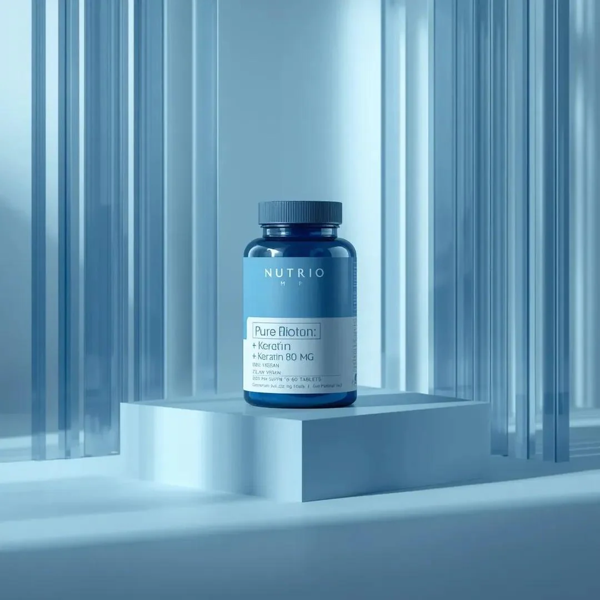

```text
Ultra-realistic minimalist product photography featuring a cylindrical supplement container labeled “NUTRIO Pure Biotin – + Keratin 80 MG – 7500 mcg per serving – 100% Vegan – 60 Day Supply – 60 Tablets”. The container has a matte blue lid and upper section with a clean white lower label. The product is centered in a monochromatic soft blue studio environment, surrounded by thin vertical transparent acrylic glass panels that create subtle reflections and layered depth. The container sits on a smooth geometric platform with crisp edges, maintaining a balanced modern composition. Lighting is soft premium studio lighting from the upper left, producing gentle shadows, realistic reflections on the acrylic panels, and smooth gradients across the matte packaging surface. The background remains minimal and monochromatic to emphasize the product. Clean pharmaceutical advertising aesthetic, precise geometry, photorealistic textures, shallow depth of field, ultra-detailed 8K commercial product photography
```

Model: Nano Banana
Author: Oogie

[ProjectD](https://aitoolsradar.com/en/prompts/dd6b2a17e8c9c5) · [Recorded source](https://x.com/oggii_0/status/2030614693291991536)
 · [Full original metadata and byte evidence](data/projectd-batch-0065.json)

## Oogie #1191

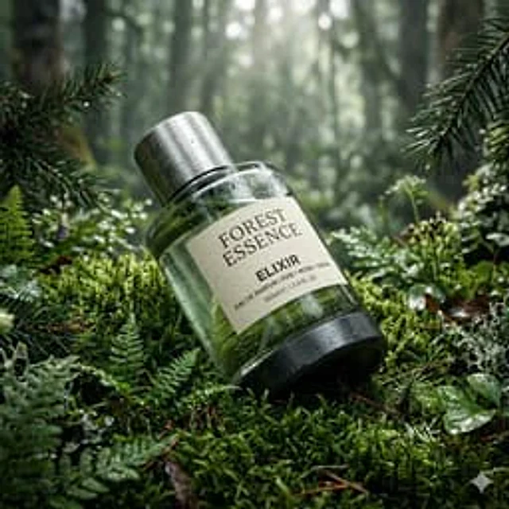

```text
Ultra-realistic premium fragrance product shot of a perfume bottle (Forest Essence Elixir), positioned at a (low macro angled shot) resting diagonally on lush (deep green moss surface in a forest setting), cylindrical design with a transparent glass center revealing green-tinted liquid, textured (matte black base) and brushed (metallic silver cap) with visible condensation droplets, surrounded by dense (forest foliage and pine branches) softly framing the scene, subtle (morning mist
```

Model: Nano Banana
Author: Oogie

[ProjectD](https://aitoolsradar.com/en/prompts/4a36b37b53bf7e) · [Recorded source](https://x.com/oggii_0/status/2039312763491917901)
 · [Full original metadata and byte evidence](data/projectd-batch-0065.json)

## Oogie #1217


```text
a stack of three [FOOD ITEM] with [LIQUID] dripping down, on a white background, in the style of food photography, magazine cover "[FOOD] pixel", macro shot, studio lighting, nikon z6 ii, volumetric lighting, neutral tones. https://t.co/Op9uSIyKUr
```

Model: Nano Banana
Author: Oogie

[ProjectD](https://aitoolsradar.com/en/prompts/42dc8b2b0d17d3) · [Recorded source](https://x.com/oggii_0/status/2011829870893125708)
 · [Full original metadata and byte evidence](data/projectd-batch-0065.json)

## Oogie #1219

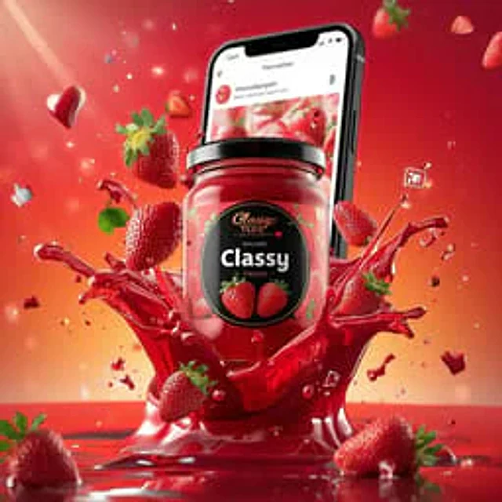

```text
Ultra-realistic commercial food product advertising scene featuring a glass jar labeled "Classy Strawberry Jam" floating dynamically in mid-air. The jar is filled with glossy vibrant red strawberry jam and has a black lid with a premium black label showing fresh strawberries and the Classy brand logo clearly visible. Surrounding the jar are splashes of thick strawberry jam bursting outward in dramatic fluid motion, with droplets and shards of transparent glass frozen mid-air. Fresh whole strawberries, sliced strawberries, and green strawberry leaves float around the product to emphasize freshness. Behind the jar is a large smartphone screen displaying a social media post layout, suggesting an Instagram-style interface, symbolizing viral promotion. Floating around the composition are social media icons such as hearts, likes, comment bubbles, and hashtag symbols to represent online engagement. The background is a vibrant red-orange gradient with glowing highlights that enhance the energetic advertising feel. Cinematic studio lighting highlights the glossy texture of the jam, reflective glass jar, and dynamic splashes. High-end commercial advertising style, macro product photography, ultra-detailed textures, shallow depth of field, photorealistic, 8K resolution.
```

Model: Nano Banana
Author: Oogie

[ProjectD](https://aitoolsradar.com/en/prompts/174f780c71581f) · [Recorded source](https://x.com/oggii_0/status/2033019623004844148)
 · [Full original metadata and byte evidence](data/projectd-batch-0065.json)

## Oogie #1223

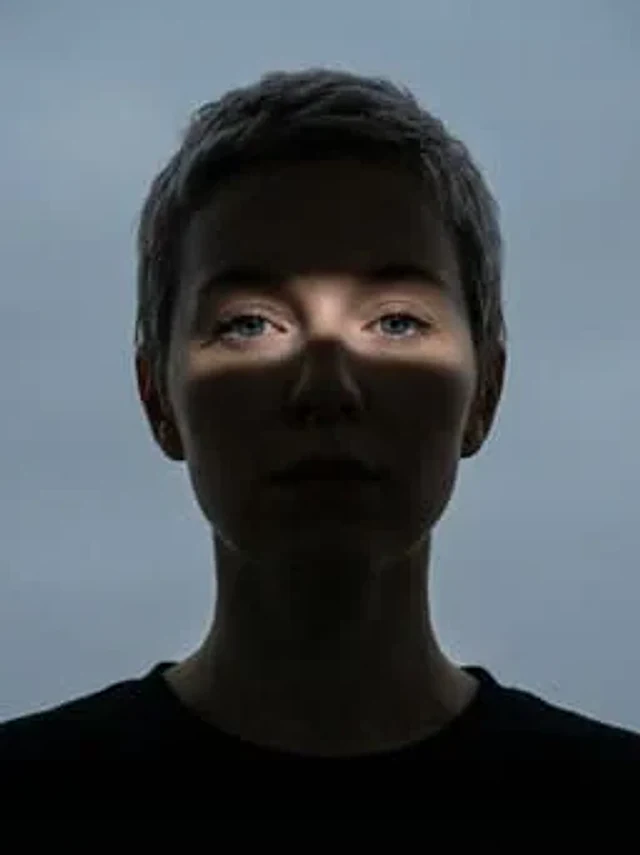

```text
Close-up portrait of a woman (Same face as reference image)looking directly at the camera. Her face and neck are mostly obscured by deep shadow. A single, narrow horizontal band of light cuts across her face, illuminating only her eyes and the bridge of his nose. He has a strong, defined jawline and short, textured hair. She is wearing a simple black shirt. The background is a plain, overcast grayish-blue sky. Dramatic, high-contrast lighting creates a moody, cinematic atmosphere.
```

Model: Nano Banana
Author: Oogie

[ProjectD](https://aitoolsradar.com/en/prompts/4211ec2743ab0f) · [Recorded source](https://x.com/oggii_0/status/2044775603145224640)
 · [Full original metadata and byte evidence](data/projectd-batch-0065.json)

## Oogie #1289

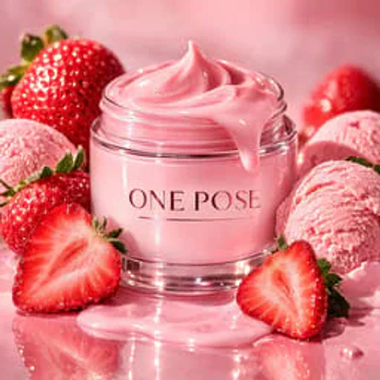

```text
Ultra-realistic luxury skincare product photography featuring a glass cosmetic jar labeled “ONE POSE” placed at the center of a glossy reflective surface. The jar contains a vibrant strawberry-pink cream with a soft gradient fading into a frosted white lid, and a smooth swirl of creamy pink product melting over the top and dripping down the sides of the jar like glossy dessert glaze. Surrounding the product are fresh ripe strawberries and halved strawberries with visible seeds and juicy texture, arranged naturally around the base. Soft scoops of strawberry ice cream sit beside the fruit, slightly melting and blending into a glossy pink cream puddle that spreads across the surface. The background is a soft pastel pink studio gradient that enhances the strawberry tones. Premium studio lighting from above and the side creates crisp reflections on the glass jar, soft highlights on the melting cream and ice cream texture, and gentle shadows beneath the product. The composition feels indulgent and dessert-inspired while maintaining a clean luxury cosmetic advertising aesthetic, hyper-realistic textures, shallow depth of field, cinematic lighting, ultra-detailed 8K product photography.
```

Model: Nano Banana
Author: Oogie

[ProjectD](https://aitoolsradar.com/en/prompts/683e45eb7e82bc) · [Recorded source](https://x.com/oggii_0/status/2030986112878235810)
 · [Full original metadata and byte evidence](data/projectd-batch-0065.json)

## Oogie #1383


```text
Refined 3D isometric composition (45° angle) in a Glassmorphism + Soft Claymorphism style.
The center of the composition features gold bars, rendered with hyper-realistic PBR materials, placed inside or surrounded by semi-transparent glass forms.

Visual Style Characteristics

Materials:
Primary focus on frosted glass with strong background blur. Element edges feature a subtle white inner glow, simulating polished glass bevels.

Layers:
A multi-layered composition where UI and graphic elements float at different transparency levels, creating a pronounced sense of depth.

Geometry:
Perfectly soft, rounded corners (Apple-style squircles).

Element Details

Central Object:
Highly detailed gold bars with precise engravings, realistically reflecting within surrounding glass surfaces.

Interface:
Floating panels with a frosted glass effect (40–60% opacity). Panels display clean sans-serif typography showing data for January 30, 2026: price, trend arrow, and a neon micro-chart.

Environment:
Stylized elements (vault door, market icons) crafted from a mix of polished metal and semi-transparent plastic.

Technical Parameters

Lighting:
Soft studio lighting, realistic caustics (light passing through glass), and global illumination (GI).

Background:
Solid powder blue color (#B0E0E6), providing contrast with translucent layers.

Render:
Cinema 4D, Octane Render, 8K resolution, ultra-high detail, clean minimalism.
```

Model: Nano Banana
Author: Oogie

[ProjectD](https://aitoolsradar.com/en/prompts/a210377fe86000) · [Recorded source](https://x.com/oggii_0/status/2017190570922582392)
 · [Full original metadata and byte evidence](data/projectd-batch-0065.json)

## Oogie #311

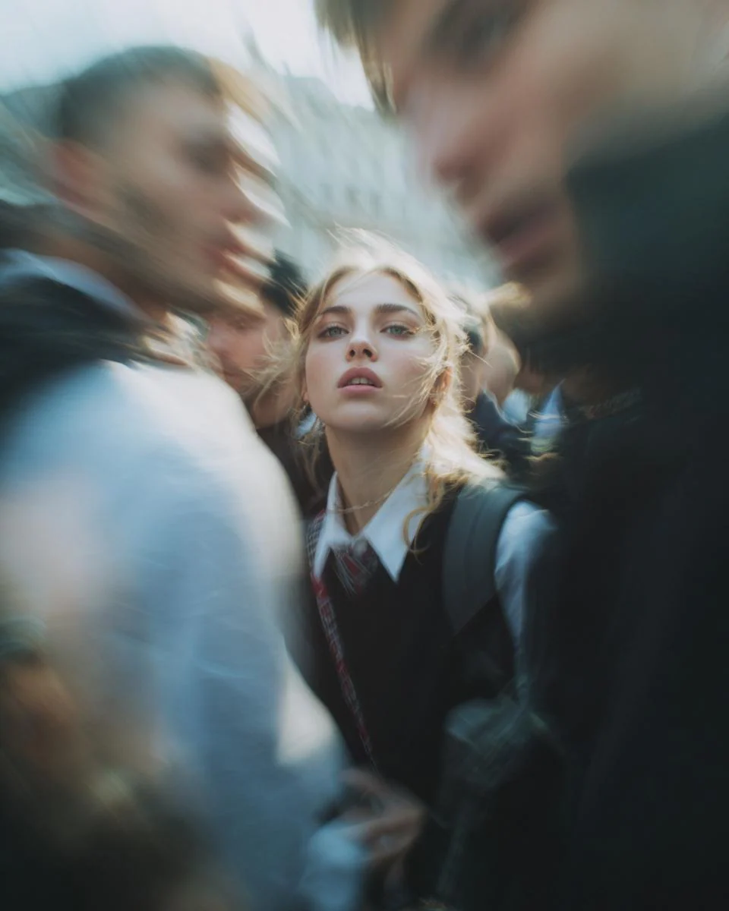

```text
Paparazzi-style extreme close-up photo of a woman with striking facial features, caught off-guard while turning toward the camera. Face and shoulders only, shot from a low angle. Strong harsh on-camera flash, grainy high-ISO, raw candid street-photography feel. Background shows a crowded scene with motion blur (Paris Fashion Week atmosphere). Intense, spontaneous energy, imperfect and real. She is wearing a school uniform. Ultra-realistic, cinematic realism, high detail skin texture, slight lens distortion.

Camera style: “35mm paparazzi lens, f/2.8, flash blown highlights”
Look: “2000s tabloid photo aesthetic”
Quality: “sharp focus on face, background heavily blurred and streaked”
```

Model: Nano Banana
Author: Oogie

[ProjectD](https://aitoolsradar.com/en/prompts/9421db7d9626d3) · [Recorded source](https://x.com/oggii_0/status/2011304086847832089)
 · [Full original metadata and byte evidence](data/projectd-batch-0065.json)

## Oogie #316

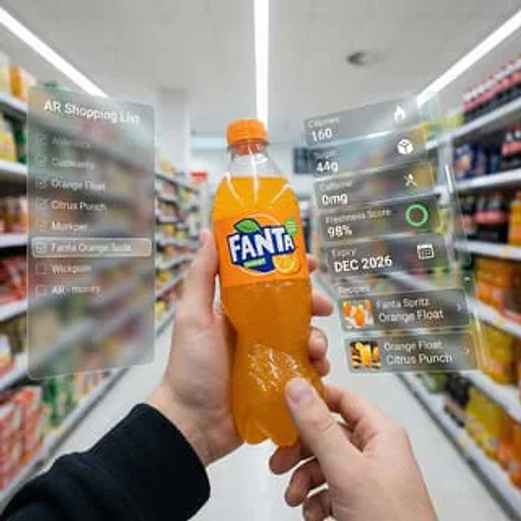

```text
First-person perspective inside a brightly lit supermarket aisle. Realistic human hands are holding a bottle of Fanta soda close to the camera. The vivid orange drink in its iconic branded bottle is surrounded by a multi-layered holographic augmented reality interface displaying nutritional data, including calorie count, sugar content, caffeine level, freshness indicator, expiration date, and recommended refreshing recipes and cocktails based on Fanta.
The UI elements smoothly shift and reorganize based on the viewer’s gaze direction, as if dynamically responding to user focus. In the left peripheral vision, a vertical semi-transparent shopping list is visible with checked-off items, where Fanta is highlighted as the currently active selection.
Hyper-realistic mixed reality, clean futuristic AR design, glass-like UI panels, soft ambient glow, realistic lighting and shadows, natural depth of field, immersive first-person interface, showcasing next-generation retail technology.
```

Model: Nano Banana
Author: Oogie

[ProjectD](https://aitoolsradar.com/en/prompts/ad8443d22767df) · [Recorded source](https://x.com/oggii_0/status/2015451528929464593)
 · [Full original metadata and byte evidence](data/projectd-batch-0065.json)

## Oogie #365

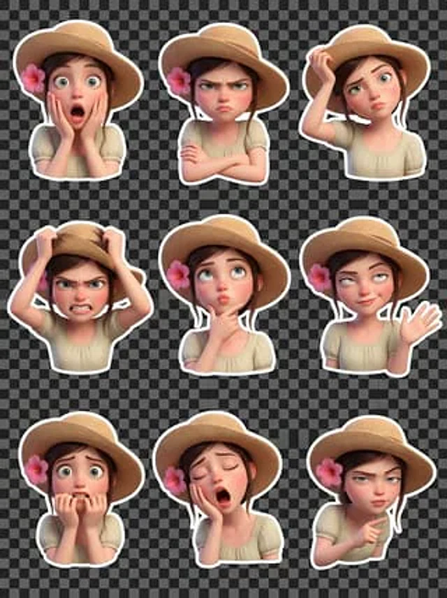

```text
Using the uploaded selfie as the ONLY and exclusive face reference, generate a Pixar-style 3D character sticker set. The character must be clearly recognizable as the person from the selfie. Create a neat 3×3 grid collage (nine stickers total). Final aspect ratio is strictly 4:5. Each cell shows a distinct pose and facial expression. Style and tone: Pixar-style 3D animation with a meme-oriented feel. Exaggerated, slightly absurd emotions, playful overacting. 

Highly readable expressions at small sizes, with expressive eyes, eyebrows, and mouth. Subtle hand gestures where appropriate. Background and output: Fully transparent background (PNG). No backdrop, no background shadows. No text, captions, logos, or UI elements. Stickers must be ready for direct use in messengers. Consistency: Same hairstyle, clothing, colors, and character proportions across all nine stickers. Only facial expression and pose change.

Clean, polished 3D sticker look. Emotions (one per sticker, 3×3 grid): Surprised, Annoyed, Confused, Frustrated, Thoughtful, Sarcastic, Worried, Bored, Curious.
```

Model: Nano Banana
Author: Oogie

[ProjectD](https://aitoolsradar.com/en/prompts/42cb0a2df6b207) · [Recorded source](https://x.com/oggii_0/status/2034263750539411550)
 · [Full original metadata and byte evidence](data/projectd-batch-0065.json)

## Oogie #407

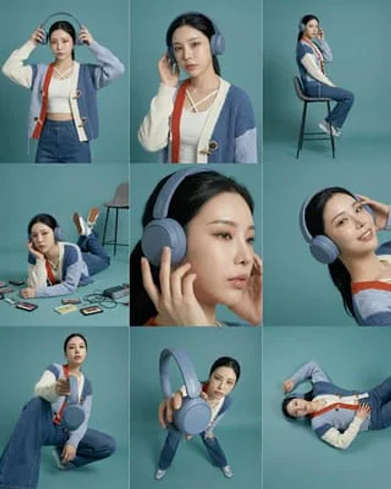

```text
3×3 storyboard grid, nine panels, same subject and outfit, consistent teal studio background, soft diffused lighting, clean editorial lifestyle photography
young East Asian woman, natural makeup, black hair tied back, wearing white fitted top, blue/cream color-block cardigan with red strap, blue jeans, sneakers, pastel blue over-ear wireless headphones
panel sequence (left→right, top→bottom): 1 standing adjusting headphones, front view
2 close-up portrait touching earcup
3 side profile sitting on tall stool
4 lying on stomach with cassette tapes + retro player
5 extreme close-up headphones + face detail
6 tilted head smiling portrait
7 low-angle crouch reaching headphones toward camera
8 forced perspective product shot, headphones close to lens
9 lying on back relaxed pose
style: minimal, pastel tones, soft shadows, sharp focus, commercial product photography, consistent framing, balanced grid layout, mix of wide/medium/close shots
```

Model: Nano Banana
Author: Oogie

[ProjectD](https://aitoolsradar.com/en/prompts/591b1ddf686ed3) · [Recorded source](https://x.com/oggii_0/status/2042288316868149748)
 · [Full original metadata and byte evidence](data/projectd-batch-0065.json)

## Oogie #433


```text
Premium minimalist skincare product photography. A translucent pink liquid cleanser bottle with a white pump dispenser placed vertically at the center of the frame. The bottle rests inside an organic pool of soft pink foamy bubbles, with airy soap lather spreading outward in smooth, rounded shapes. Small transparent bubbles float around the foam surface. Clean matte pastel pink background with subtle gradient. Soft diffused top lighting with gentle rim light creates a luminous glow through the liquid, highlighting the pump tube inside the bottle. Sharp focus, high clarity, realistic liquid refraction, smooth plastic and glass textures, luxury beauty advertising style, modern cosmetic branding, ultra-realistic, 8K detail, high dynamic range.

Negative Prompt:

hands, people, faces, clutter, harsh reflections, label distortion, unreadable text, warped pump, hard shadows, grain, noise, low resolution, CGI look, cartoon style, messy foam, uneven lighting, watermark
```

Model: Nano Banana
Author: Oogie

[ProjectD](https://aitoolsradar.com/en/prompts/455e843e987130) · [Recorded source](https://x.com/oggii_0/status/2009163133810823368)
 · [Full original metadata and byte evidence](data/projectd-batch-0065.json)

## Oogie #435

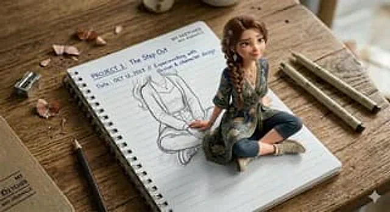

```text
A creative 3D illusion artwork of a cute young girl stepping out of a spiral notebook page placed on a wooden desk. The notebook has lined paper with handwritten text at the top. The girl looks semi-realistic 3D cartoon style, soft wavy brown hair, natural makeup, sweet smile, wearing a pastel crop top and high-waisted light grey jeans with white sneakers. Her lower body appears sketched in pencil on the notebook while the upper body looks realistic and popping out of the page.
```

Model: Nano Banana
Author: Oogie

[ProjectD](https://aitoolsradar.com/en/prompts/645d55ca8e4844) · [Recorded source](https://x.com/oggii_0/status/2028389324677611935)
 · [Full original metadata and byte evidence](data/projectd-batch-0065.json)

## Oogie #452

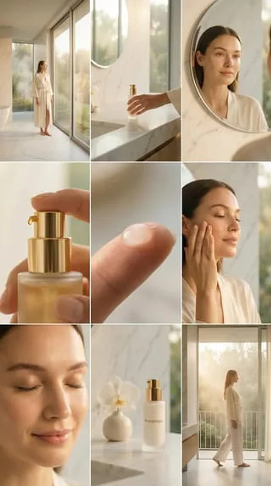

```text
{
  "subject": {
    "person": "Woman, appears to be in her 20s or 30s",
    "pose_and_expression": [
      "Standing by window, looking out, relaxed",
      "Reaching for bottle on counter, hand focus",
      "Looking in mirror, slight smile",
      "Hand dispensing serum from bottle, close-up",
      "Serum drop on fingertip, macro shot",
      "Applying serum to face, eyes closed, serene",
      "Face close-up, eyes closed, content",
      "Bottle and orchid on counter, still life",
      "Walking away from camera, standing by window"
    ]
  },
  "clothing": {
    "items": "White robe, white pajamas/loungewear",
    "material": "Soft, flowing fabric",
    "style": "Casual, luxurious"
  },
  "hair": {
    "color": "Dark brown",
    "style": "Pulled back, neat bun or ponytail"
  },
  "face": {
    "makeup": "Natural, minimal",
    "skin": "Clear, glowing",
    "expression": "Calm, serene, content"
  },
  "accessories": {
    "jewelry": "Simple ring on ring finger",
    "props": [
      "Glass skincare bottle with gold pump dispenser",
      "Product label: 'Promptopia'",
      "White orchid in a small white vase"
    ]
  },
  "environment": {
    "location": "Modern, luxurious bathroom",
    "elements": [
      "Large floor-to-ceiling windows",
      "Marble countertop and walls",
      "Round mirror",
      "View of trees/garden outside",
      "Fog or mist outside window"
    ],
    "atmosphere": "Serene, spa-like, tranquil"
  },
  "lighting": {
    "source": "Natural daylight",
    "quality": "Warm, golden, soft, diffused",
    "time_of_day": "Sunrise or golden hour"
  },
  "camera": {
    "type": "Photography collage",
    "shots": [
      "Wide shot",
      "Medium shot",
      "Close-up",
      "Macro shot"
    ],
    "focus": "Sharp on subject and product, soft background blur (bokeh)"
  },
  "style": {
    "aesthetic": "Cinematic, editorial, beauty, wellness, clean, minimalist",
    "color_palette": "Warm neutrals, white, gold, natural greens"
  }
}
```

Model: Nano Banana
Author: Oogie

[ProjectD](https://aitoolsradar.com/en/prompts/a2fbd010fb3dbd) · [Recorded source](https://x.com/oggii_0/status/2009580453083201822)
 · [Full original metadata and byte evidence](data/projectd-batch-0065.json)

## Oogie #471

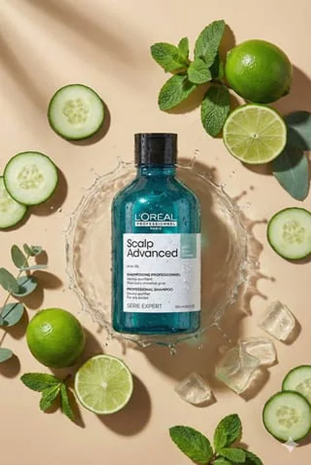

```text
Create top-down flat lay product photo. Use the uploaded product as the main object, centered. Analyze the product type from the photo and automatically choose matching props/ingredients for an aesthetic flat lay around it (minimal, premium, on-brand). Preserve exact geometry, size, colors, label design, and all text on the product (no changes). Warm beige seamless background, soft directional sunlight, crisp realistic shadow. 
Ultra-realistic macro product photography, 100mm lens look, f/8, sharp focus, clean composition, no extra text, 8k, format 2:3.
```

Model: Nano Banana
Author: Oogie

[ProjectD](https://aitoolsradar.com/en/prompts/1a0f38a245593d) · [Recorded source](https://x.com/oggii_0/status/2015992913000595614)
 · [Full original metadata and byte evidence](data/projectd-batch-0065.json)

## Oogie #476

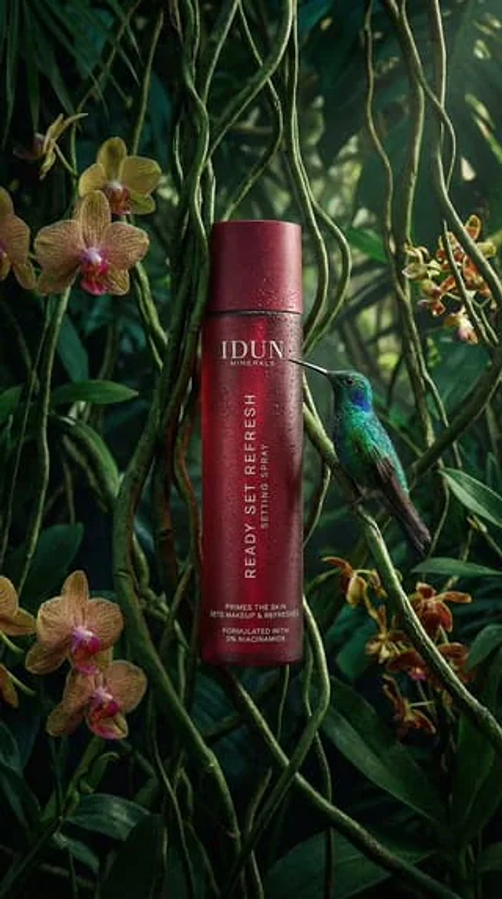

```text
{
  "subject": {
    "primary": "Cosmetic spray bottle",
    "secondary": "Hummingbird",
    "brand": "IDUN MINERALS",
    "product_name": "READY SET REFRESH"
  },
  "packaging": {
    "form_factor": "Cylindrical bottle",
    "component_parts": [
      "Main body",
      "Cap (flush with body)"
    ],
    "material_appearance": "Matte finish, likely plastic or coated metal",
    "condition": "Pristine, new",
    "reflections": "Vertical highlight on the left side, mirrored reflection in water below"
  },
  "label_design": {
    "type": "Direct print onto bottle",
    "layout_orientation": "Mixed (Horizontal brand/details, Vertical product name)",
    "typography": {
      "font_family": "Sans-serif",
      "casing": "All uppercase",
      "style": "Clean, minimalist",
      "alignment": "Left aligned relative to the vertical axis for product name, centered horizontally for brand"
    }
  },
  "text_visible": {
    "brand_header": [
      "IDUN",
      "MINERALS"
    ],
    "body_vertical": [
      "READY SET REFRESH",
      "SETTING SPRAY"
    ],
    "footer_details": [
      "PRIMES THE SKIN",
      "SETS MAKEUP & REFRESHES",
      "FORMULATED WITH",
      "3% NIACINAMIDE"
    ],
    "reflection_text": "Inverted mirror image of all text visible on the water surface"
  },
  "colors": {
    "packaging_base": "Deep red / Burgundy",
    "text": "White",
    "foliage": [
      "Deep emerald green",
      "Forest green",
      "Moss green"
    ],
    "hummingbird": [
      "Iridescent green (head/back)",
      "Dark grey/brown (wings)",
      "Reddish/pink (tail feathers)",
      "Black (beak)"
    ],
    "water": "Dark, almost black with reflections"
  },
  "materials": {
    "bottle": "Matte rigid material",
    "environment": [
      "Liquid water",
      "Moss",
      "Fern leaves",
      "Palm-like leaves"
    ],
    "biological": "Feathers (bird)"
  },
  "human_elements": {
    "visible": false
  },
  "environment": {
    "setting": "Simulated rainforest or jungle floor",
    "foreground": "Still water surface",
    "midground": "Mossy bank, bottle placement",
    "background": "Dense tropical foliage"
  },
  "lighting": {
    "quality": "Soft, moody, atmospheric",
    "direction": "Side lighting from left (creating highlight on bottle)",
    "shadows": "Soft shadows in the foliage, dark water providing high contrast reflection",
    "highlights": "specular highlight on hummingbird head, diffuse highlight on bottle curve"
  },
  "camera": {
    "angle": "Eye-level with water surface",
    "framing": "Vertical portrait",
    "focus": "Sharp focus on bottle and hummingbird",
    "depth_of_field": "Shallow (background leaves are blurred/bokeh)",
    "composition": "Rule of thirds (bottle on left third line, bird entering from right)"
  },
  "style": {
    "category": "Product photography",
    "theme": "Nature, Organic, Eco-luxury",
    "mood": "Serene, fresh, premium"
  }
}
```

Model: Nano Banana
Author: Oogie

[ProjectD](https://aitoolsradar.com/en/prompts/364e48a94f5d15) · [Recorded source](https://x.com/oggii_0/status/2020367995131105685)
 · [Full original metadata and byte evidence](data/projectd-batch-0065.json)

## Oogie #487


```text
A hyperrealistic premium product photography scene of a transparent cosmetic jar labeled “MARINE LIFE” mango and passionfruit body scrub exploding open mid-air, with the white lid floating slightly above the jar and a thick, whipped, golden-yellow scrub bursting upward in a dramatic splash, glossy and textured with visible black passionfruit seeds, surrounded by suspended mango cubes, scored mango halves, and halved passionfruits with glistening pulp, golden liquid droplets and splashes frozen in motion around the jar, the container tilted slightly to the right and centered in frame, shot from a straight-on macro perspective, illuminated by soft yet high-contrast studio lighting from above and slightly behind to create glowing highlights on the wet textures and translucent splashes, subtle shadows beneath the floating elements, a smooth warm beige gradient background enhancing the tropical color palette of saturated yellows, oranges, and deep purple fruit tones, ultra-sharp focus on the jar and scrub with shallow depth of field for the outer fruit, cinematic realism, luxury skincare advertising aesthetic, crisp reflections, 8K photorealistic detail, energetic and fresh mood.
```

Model: Nano Banana
Author: Oogie

[ProjectD](https://aitoolsradar.com/en/prompts/67e6f5d7a9763d) · [Recorded source](https://x.com/oggii_0/status/2017949173140820260)
 · [Full original metadata and byte evidence](data/projectd-batch-0065.json)

## Oogie #509

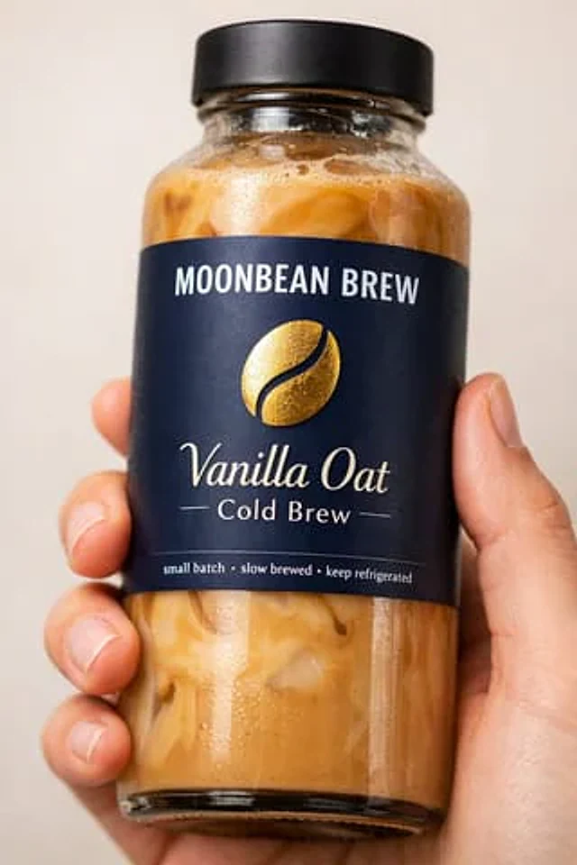

```text
A tight close-up commercial product photo of a premium [PRODUCT TYPE] labeled “[BRAND NAME]”. The product is [SHAPE / FORM FACTOR], made of [MATERIAL], containing [LIQUID / CONTENT COLOR + TEXTURE DETAILS] with visible [TEXTURE EFFECTS: bubbles / swirls / pulp / condensation / thickness]. It has a [CAP / LID TYPE + COLOR + FINISH].

The main label is [PRIMARY LABEL COLOR] with a smooth matte finish. At the top of the label, the brand name “[BRAND NAME]” is printed in clean bold [TEXT COLOR] uppercase sans-serif typography. Below the brand name is a minimalist illustration of [ICON DESCRIPTION], in [FOIL / PRINT STYLE: gold foil / holographic foil / embossed ink], giving it a premium look. Under the icon, the product name reads “[PRODUCT NAME / VARIANT]” in a modern mixed-font layout (thin serif + sans-serif combination). Smaller text includes phrases like “[MICRO TEXT 1]”, “[MICRO TEXT 2]”, and “[MICRO TEXT 3]” in tiny [MICRO TEXT COLOR] print. Optional fine detail accents such as [PATTERN / LINEWORK / MICROGRAPHIC ELEMENTS] enhance the modern premium branding.

A human hand holds the [BOTTLE/CAN/JAR/TUBE] from the side, fingers wrapped around the middle with clean short nails visible. No face or clothing is visible.

The background is a soft neutral [BACKGROUND COLOR TONE], studio-style, clean and minimal. Lighting is soft diffused studio lighting, with gentle highlights along the [MATERIAL] edges and very smooth natural shadows. The photo is sharply focused on the label and [CONTENT TEXTURE], with a slightly blurred background. The overall aesthetic is premium, minimal, modern [CATEGORY] branding, high-end commercial product photography.
```

Model: Nano Banana
Author: Oogie

[ProjectD](https://aitoolsradar.com/en/prompts/b04153f0a8d839) · [Recorded source](https://x.com/oggii_0/status/2010210489813680211)
 · [Full original metadata and byte evidence](data/projectd-batch-0065.json)

## Oogie #521

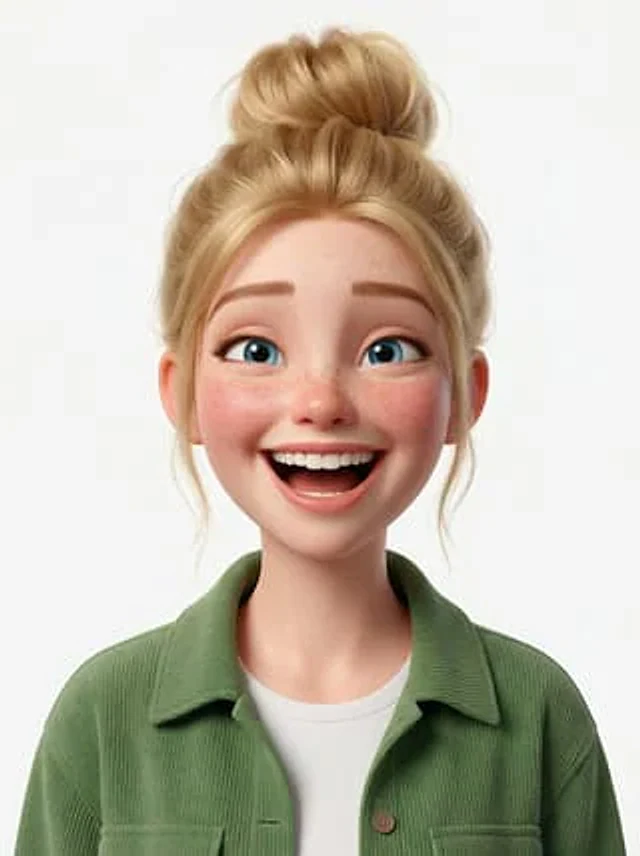

```text
Create a head-and-shoulders Pixar-style 3D avatar of an edgy person based on the reference image with a black bob, purple hair streak, and a small nose ring. She has a defiant, playful expression, sticking her tongue out with wide, confident eyes while wearing a classic denim jacket. Isolated on a seamless white background, the render features flawless 3D skin and soft cinematic lighting for a clean, minimalist aesthetic.
```

Model: Nano Banana
Author: Oogie

[ProjectD](https://aitoolsradar.com/en/prompts/5adc3391990bc6) · [Recorded source](https://x.com/oggii_0/status/2040691670384366063)
 · [Full original metadata and byte evidence](data/projectd-batch-0065.json)

## Oogie #541

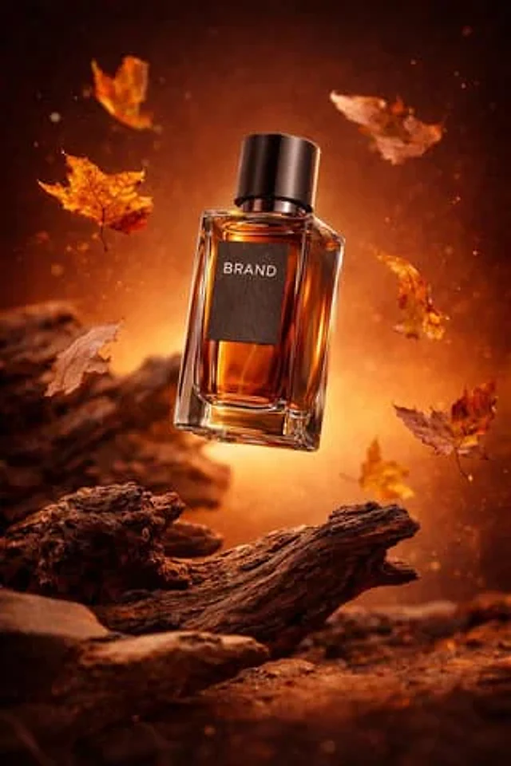

```text
Ultra-realistic luxury perfume product shot (9: 16, 4K). A clear rectangular glass perfume bottle with warm amber liquid and a metallic cap, floating mid-air above rugged driftwood/roots. Autumn leaves swirling around in motion, soft particles, warm orange/brown gradient background with cinematic glow. Studio-quality lighting (soft key +rim), crisp reflections, sharp label reading [BRAND], shallow depth of field, high-end commercial retouching, dramatic bokeh, no extra text, no watermark.
```

Model: Nano Banana
Author: Oogie

[ProjectD](https://aitoolsradar.com/en/prompts/2568ddec1ad24d) · [Recorded source](https://x.com/oggii_0/status/2011385771530592547)
 · [Full original metadata and byte evidence](data/projectd-batch-0065.json)

## Oogie #543

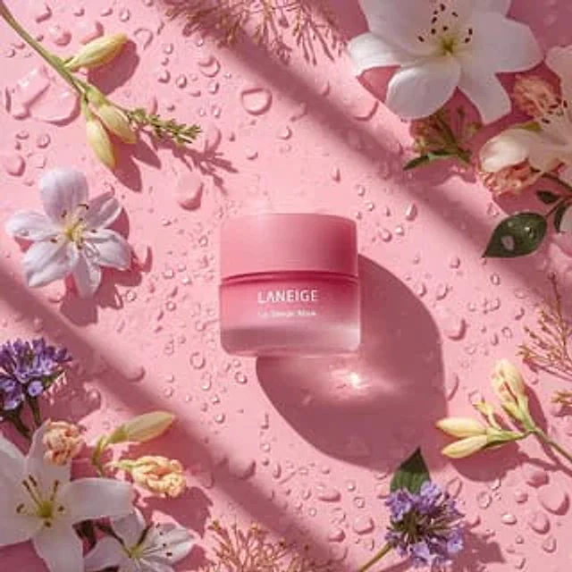

```text
A hyper-realistic beauty product photograph of a pink [LANEIGE Lip Sleeping Mask] jar placed at the center of a vibrant pastel-pink surface covered in fresh water droplets, the jar upright with a frosted pink lid and glossy translucent body, surrounded organically by delicate flowers including purple blossoms, pale lilies, yellow sprigs, and green leaves arranged diagonally around the product, soft diffused studio lighting from above creating gentle highlights and natural shadows, moisture beads sparkling across the background for a fresh dewy feel, clean skincare editorial aesthetic, feminine and luxurious mood, balanced flat-lay composition, shallow depth of field, ultra-detailed textures, photorealistic, high-end cosmetic advertising style, 8K quality
```

Model: Nano Banana
Author: Oogie

[ProjectD](https://aitoolsradar.com/en/prompts/353e6a7b08250a) · [Recorded source](https://x.com/oggii_0/status/2019637570133717072)
 · [Full original metadata and byte evidence](data/projectd-batch-0065.json)

## Oogie #544

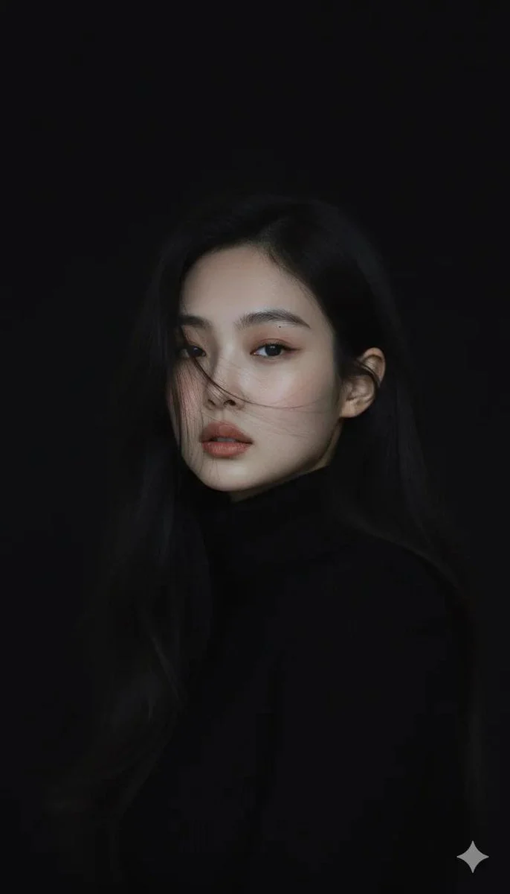

```text
Moody cinematic portrait of a young woman with clear fair skin and barely-there makeup, warm natural lips. Loose dark brown hair, softly textured. Calm, self-assured expression. She's wearing a fitted black turtleneck sweater, clean lines, understated elegance. Dark minimal background fading into black. Gentle diffused front light, soft shadows, subtle film grain, organic color grading, shallow depth of field, high-end editorial feel.
```

Model: Nano Banana
Author: Oogie

[ProjectD](https://aitoolsradar.com/en/prompts/25f7eb21585ae9) · [Recorded source](https://x.com/oggii_0/status/2013234871238598793)
 · [Full original metadata and byte evidence](data/projectd-batch-0065.json)

## Oogie #549

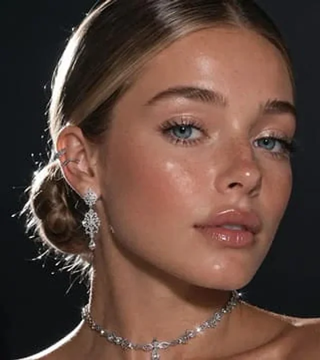

```text
An extreme close-up focusing on a pretty lady's face and neck. She has blue eyes, she is wearing intricate silver jewelry and a sleek, middle-parted low bun with a high-shine finish. Her hair - dirty blonde hair, The makeup is "clean girl" aesthetic-dewy skin, clear gloss, and shimmering champagne eyeshadow. Dramatic rim lighting against a dark charcoal background, sharp focus on the jewelry reflections and individual hair edges.
```

Model: Nano Banana
Author: Oogie

[ProjectD](https://aitoolsradar.com/en/prompts/4125de476e51ef) · [Recorded source](https://x.com/oggii_0/status/2042586039450243514)
 · [Full original metadata and byte evidence](data/projectd-batch-0065.json)

## Oogie #557

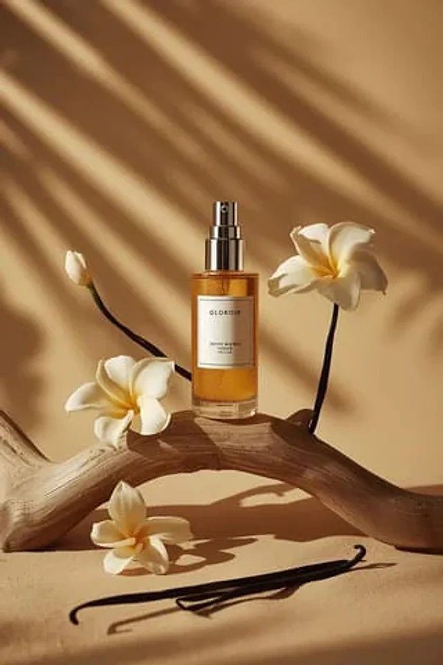

```text
- Ultra-cinematic luxury skincare product photography of a translucent amber serum pump bottle standing upright at the center of the frame, perched on a curved piece of textured driftwood, featuring a minimalist label with crisp black typography and fine condensation droplets on the glass; the bottle is framed by creamy white tropical flowers in full bloom and a single unopened bud, arranged symmetrically along the wood for sculptural balance, with slender vanilla pods resting in the foreground; background is a warm, desert-toned studio environment with sweeping shadow patterns cast across a soft sand-colored backdrop, creating a dramatic play of light and depth; lighting is high-contrast cinematic lighting with a strong directional key light from the left producing glowing highlights through the amber liquid, sharp rim lighting along the glass edges, and deep shadow falloff for a moody, editorial look;

color palette is rich and sensual with golden ambers, warm caramel, soft ivory, and deep earthy browns; composition is a centered hero shot with a slight low-angle perspective and shallow depth of field, keeping the bottle razor-sharp while background elements dissolve into creamy bokeh; mood is elegant, mysterious, and high-fashion, evoking premium fragrance-inspired skincare advertising with hyper-realistic textures, dramatic contrast, cinematic atmosphere, and 8K

ultra-high-definition realism.
```

Model: Nano Banana
Author: Oogie

[ProjectD](https://aitoolsradar.com/en/prompts/87a779297248bb) · [Recorded source](https://x.com/oggii_0/status/2010381168810799353)
 · [Full original metadata and byte evidence](data/projectd-batch-0065.json)

## Oogie #588

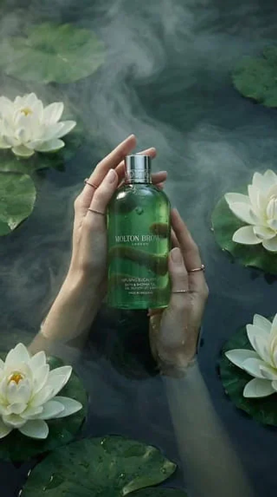

```text
Luxury product photography of a green translucent bath and shower gel bottle held gently by two feminine hands submerged in calm water. The bottle is centered, glossy, with water droplets on the surface, silver metallic cap, elegant minimal label design. The water is deep teal-green with soft mist swirling across the surface. White lotus flowers and large green lily pads float around the hands. The hands wear delicate thin gold rings. Soft, diffused natural lighting, moody spa atmosphere, high-end skincare advertisement style, ultra-realistic, cinematic composition, shallow depth of field, 85mm lens, high resolution, editorial beauty shot, serene and calming aesthetic.
```

Model: Nano Banana
Author: Oogie

[ProjectD](https://aitoolsradar.com/en/prompts/2976099201744b) · [Recorded source](https://x.com/oggii_0/status/2028125035433714003)
 · [Full original metadata and byte evidence](data/projectd-batch-0065.json)

## Oogie #600

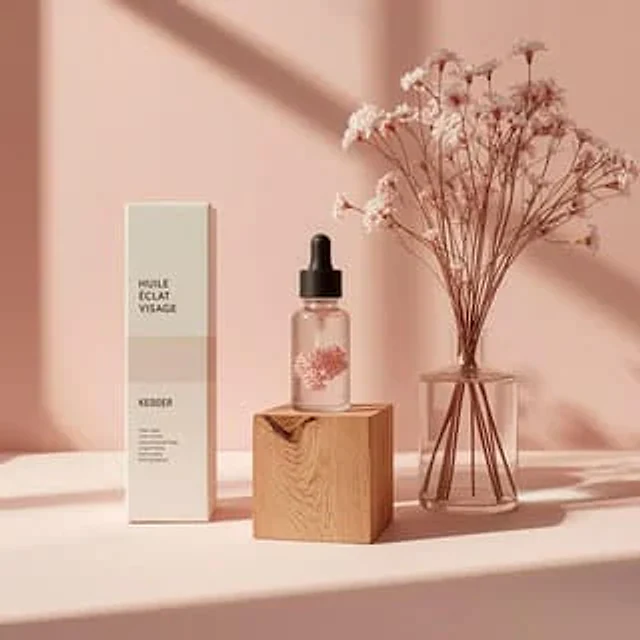

```text
Ultra-realistic minimalist studio product photography of a small transparent glass facial oil dropper bottle with a black rubber pipette cap, containing pale pink serum with dried pink floral elements suspended inside, placed centered on top of a natural raw wooden cube block with visible grain and split texture. To the left of the cube stands a tall matte white rectangular skincare box with minimal black typography reading “HUILE ÉCLAT VISAGE,” clean modern branding, and subtle logo near the bottom. To the right of the cube is a clear cylindrical glass vase filled with water and thin stems of dried pink gypsophila flowers extending upward and outward. The entire composition is arranged on a smooth matte pastel pink surface with a matching soft pink seamless studio background. Strong directional soft light comes from the left side, casting long, soft-edged realistic shadows of the flowers and objects onto the pink background. Lighting is natural-style, -det diffused, and warm, creating gentle highlights on the glass, subtle reflections on the serum bottle, and soft texture on the wooden block. Camera angle is straight-on at tabletop height, medium framing, all main objects in sharp focus with minimal depth of field blur. Color palette is dominated by blush pink, soft rose tones, warm light wood, clean white, and transparent glass. Mood is clean, airy, feminine, elegant, Scandinavian minimal aesthetic, premium skincare branding style, photorealistic, studio-grade realism, ultra
```

Model: Nano Banana
Author: Oogie

[ProjectD](https://aitoolsradar.com/en/prompts/c85dd2d9f282ba) · [Recorded source](https://x.com/oggii_0/status/2016131317759672439)
 · [Full original metadata and byte evidence](data/projectd-batch-0065.json)

## Oogie #613

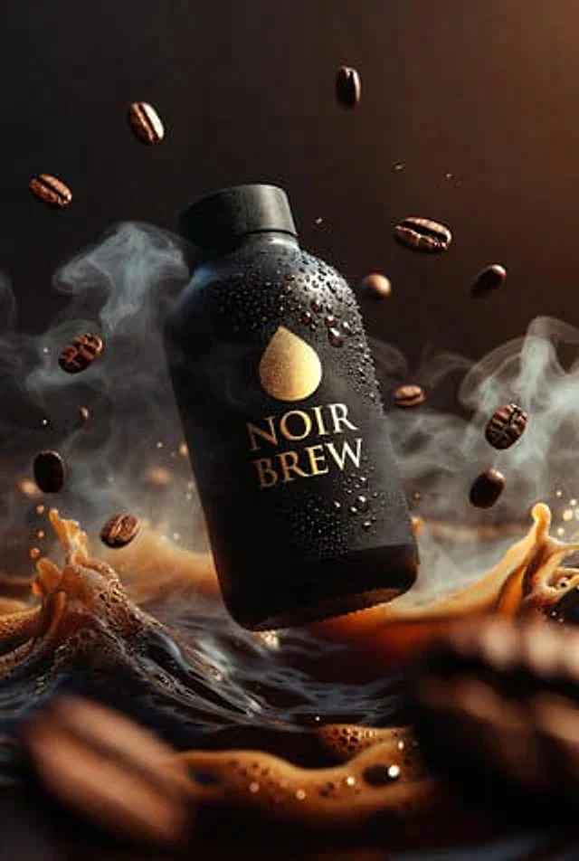

```text
Ultra-cinematic premium coffee bottle labeled “NOIR BREW”, matte black glass with gold typography, floating upright amid swirling espresso waves and roasted coffee beans. Steam and mist curling around the bottle, dramatic low-key lighting with warm highlights and deep shadows, rich brown color grading, macro condensation details, cinematic depth of field, photorealistic, 8K, luxury branding aesthetic.
```

Model: Nano Banana
Author: Oogie

[ProjectD](https://aitoolsradar.com/en/prompts/e9229cc01a9c19) · [Recorded source](https://x.com/oggii_0/status/2012108162447585523)
 · [Full original metadata and byte evidence](data/projectd-batch-0065.json)

## Oogie #656

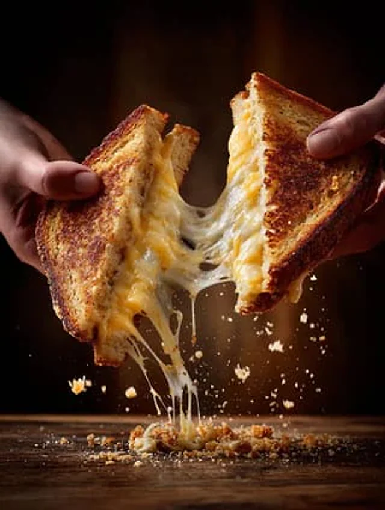

```text
two hands pulling apart a grilled cheese sandwich, strands of melted cheddar stretching dramatically between the halves, toasted bread edges crisp and golden, crumbs falling mid-air, warm cozy light, cinematic food action photography
```

Model: Nano Banana
Author: Oogie

[ProjectD](https://aitoolsradar.com/en/prompts/a58f1bf61b09e9) · [Recorded source](https://x.com/oggii_0/status/2011112123653603558)
 · [Full original metadata and byte evidence](data/projectd-batch-0065.json)

## Oogie #675

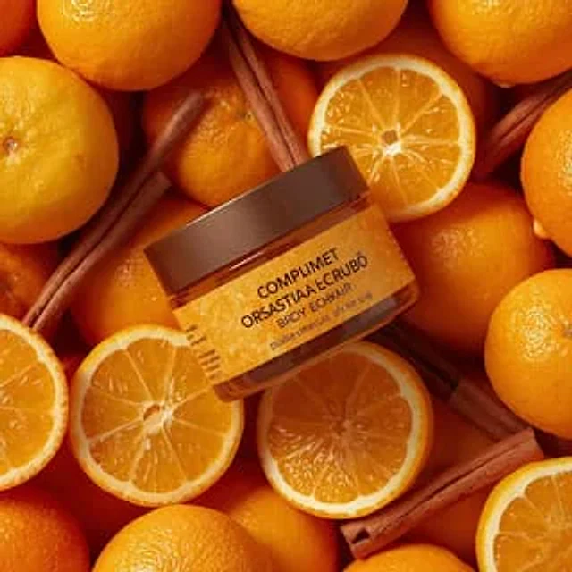

```text
Use the uploaded image as the exact visual reference for composition, jar design, orange slices, whole oranges, cinnamon sticks, lighting, and orange background. Maintain the same top-down perspective and color palette.

Camera:
Top-down camera angle (exactly as in the image).
Camera slowly zooms in toward the jar.
Very smooth and controlled movement.
No rotation.
No camera shake.

Action:

The jar remains perfectly still in the center of the frame.
```

Model: Nano Banana
Author: Oogie

[ProjectD](https://aitoolsradar.com/en/prompts/a14a54a4570e2a) · [Recorded source](https://x.com/oggii_0/status/2029116168800485686)
 · [Full original metadata and byte evidence](data/projectd-batch-0065.json)

## Oogie #682

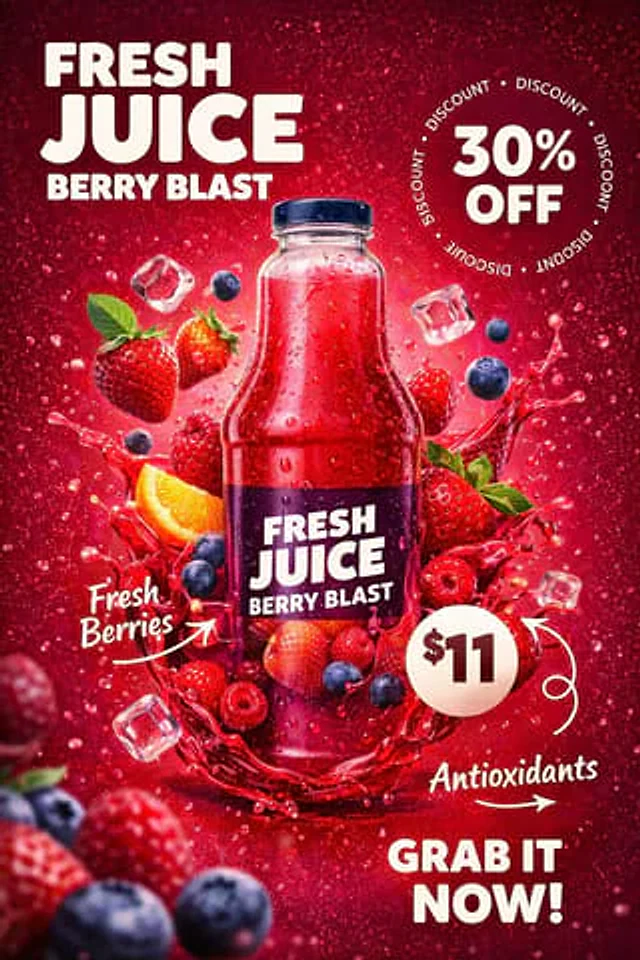

```text
Exact uploaded [BOTTLE_NAME] bottle (label unchanged). Vertical poster. Center bottle w/ condensation. Add [JUICE_COLOR] liquid splash wrap + ice cubes + [INGREDIENTS] floating (controlled). Background: [BG_COLOR] gradient + vignette + grain.
Top-left: “FRESH JUICE” + “[FLAVOR_TAGLINE]”. Right: circular “30% OFF” ring. Lower-right: price circle “[PRICE]”. Bottom-right CTA “[CTA]”. White doodle arrows. Studio key+rim, 85mm, sharp text, no watermark.
```

Model: Nano Banana
Author: Oogie

[ProjectD](https://aitoolsradar.com/en/prompts/6f4eb2325f9521) · [Recorded source](https://x.com/oggii_0/status/2010731794820444198)
 · [Full original metadata and byte evidence](data/projectd-batch-0065.json)

## Oogie #720

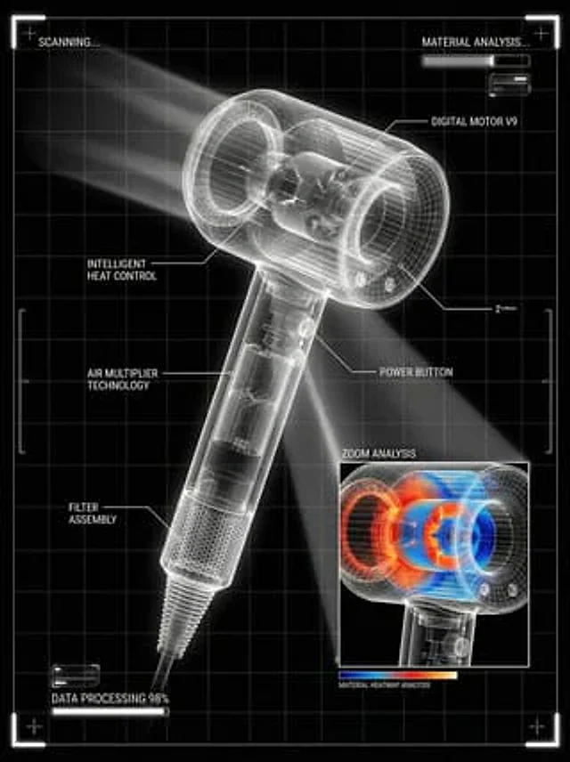

```text
You are a world-class director of industrial visualization and a futuristic interface designer specializing in advanced visual engineering diagnostic tools.

Your task is to transform the downloaded product into a futuristic visualization of the technical scanning interface, similar to the product analyzed in a high-tech laboratory diagnostic system.

input:
uploaded product image

style:

• black background with a clear white grid of the drawing
• the product is made in the form of a luminous translucent X-ray frame model
• clear geometry of the technical grid
• Ultra-sharp white lines and edges
• Minimalistic HUD interface design in sci-fi style

INTERFACE ELEMENTS:

• thin white lettering-callouts with pointer lines describing the components of the product
• Zoom analysis field, showing a product fragment in close-up
• A colored layer of the heat map of the material (red/ orange/blue) is displayed inside the zoom field.
• Scan indicators such as:
"THE SCAN..."
"MATERIAL ANALYSIS..."
"98% DATA PROCESSING"
• Small loading panels and user interface diagnostic modules
• luminous markers in the form of angular frames around the image

VISUAL LANGUAGE:

• Advanced engineering drawing design
• Futuristic laboratory scanning interface
• Engineering visualization of the product at the Apple level
• Ultra-pure composition
• High-contrast black and white interface

lighting:

• subtle white glow around the frame
• Volumetric light beam scanning
• Technical sci-fi visualization

composition:

• in the center of the product
• Grid-aligned interface layout
• Scalable analysis panel in one corner
• Minimalistic but highly technical

exit:

Futuristic product scanning interface
, visualization of technical diagnostics
, technical analysis screen
, ultra clean, ultra clear, 8K
```

Model: Nano Banana
Author: Oogie

[ProjectD](https://aitoolsradar.com/en/prompts/21d2f89b73d10f) · [Recorded source](https://x.com/oggii_0/status/2040835609850474571)
 · [Full original metadata and byte evidence](data/projectd-batch-0065.json)

## Oogie #731


```text
A hyper-realistic, cinematic close-up of a sizzling gourmet cheeseburger. The thick, juicy beef patty features a heavy, glossy char and is blanketed in vibrant orange cheddar cheese that melts and oozes down the sides in thick, viscous streams over a toasted brioche bun. The atmosphere is dramatic and smoky, with thick wisps of white and blue steam swirling upwards, surrounded by floating bright orange sparks, glowing embers, and frozen droplets of grease suspended in the air. The lighting is high-contrast and dramatic against a deep black background, emphasizing the glistening textures. Shot with a macro lens, shallow depth of field, and 8k resolution commercial food photography style.
```

Model: Nano Banana
Author: Oogie

[ProjectD](https://aitoolsradar.com/en/prompts/5febc6ecc191b4) · [Recorded source](https://x.com/oggii_0/status/2009984389481148510)
 · [Full original metadata and byte evidence](data/projectd-batch-0065.json)

## Oogie #744

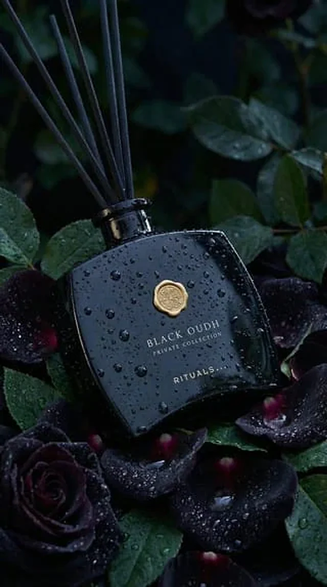

```text
Ultra-realistic luxury product photography of a black glass reed diffuser bottle labeled “BLACK OUDH – Private Collection – RITUALS” in elegant gold serif typography. The bottle has a curved rectangular shape with soft edges, a glossy reflective surface, and a gold wax-seal style emblem centered near the top. Thin black diffuser reeds extend upward from the bottle neck.

The bottle is covered in realistic water droplets and condensation, as if freshly misted after rain. It is placed among deep black roses and dark burgundy petals with visible water droplets, surrounded by rich green leaves. The scene is moody and dramatic with a dark botanical background, softly blurred (shallow depth of field, bokeh effect).

Lighting is cinematic and low-key, with soft diffused highlights reflecting off the wet glass surface. Cool-toned lighting (deep greens and midnight blues) enhances the dark, luxurious atmosphere. The gold emblem and lettering subtly catch the light, creating a premium, high-end aesthetic.

Composition: vertical portrait orientation (4:5 ratio), centered product placement, slightly angled bottle resting naturally among roses. Foreground roses partially frame the bottom of the bottle. Background is dark foliage fading into shadow.

Texture emphasis: hyper-detailed water droplets, glossy glass reflections, velvety rose petals, matte black reeds.

Style: high-end commercial fragrance advertising, macro lens, 85mm, f/2.0, shallow depth of field, photorealistic, 8K resolution, sharp focus on bottle, dramatic contrast, rich blacks, luxury perfume campaign aesthetic.
```

Model: Nano Banana
Author: Oogie

[ProjectD](https://aitoolsradar.com/en/prompts/223b932db83ced) · [Recorded source](https://x.com/oggii_0/status/2021939791768826247)
 · [Full original metadata and byte evidence](data/projectd-batch-0065.json)

## Oogie #749

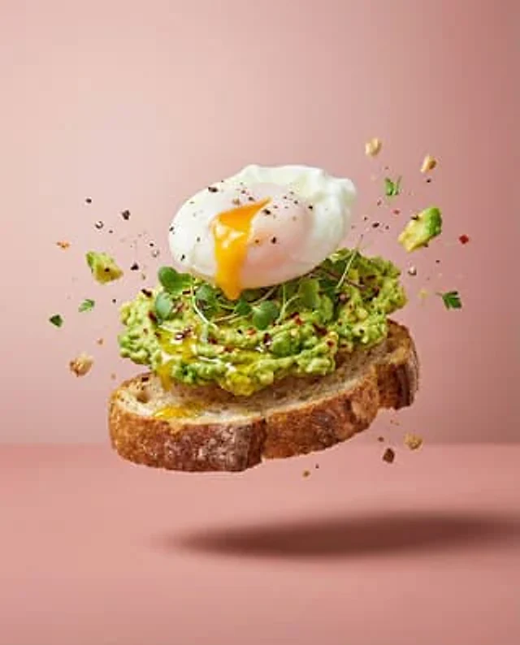

```text
Professional studio food photography series featuring deconstructed dishes in high-speed levitation. Against a seamless dusty pink background with soft, diffused studio lighting, ingredients float and explode dynamically. Subjects include a hovering stack of tiramisu components (gelato, ladyfingers, mascarpone, coffee beans), borscht ingredients (beets, rye bread, herbs) suspended above a ceramic bowl of soup on a wooden board, and sourdough toast with mashed avocado and a runny poached egg separating in mid-air. Capture fine details like flying crumbs, spice particles, herbs, and liquid droplets with sharp focus and a shallow depth of field. A soft shadow is cast beneath the main floating elements.
```

Model: Nano Banana
Author: Oogie

[ProjectD](https://aitoolsradar.com/en/prompts/be87adac9a24b6) · [Recorded source](https://x.com/oggii_0/status/2013488775356391702)
 · [Full original metadata and byte evidence](data/projectd-batch-0065.json)

## Oogie #754

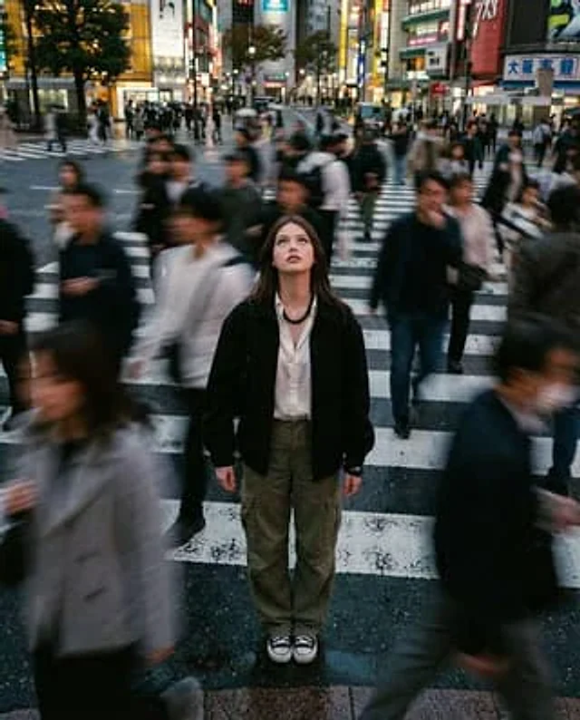

```text
Cinematic street photography capturing a moment in motion with a crowd blur effect. Overhead portrait of me standing still on a crosswalk, wearing a white button-up shirt, black oversized jacket, and olive green cargo pants. Motion-blurred crowd rushes past. Moody city lighting, 35mm film aesthetic, shallow depth of field, sharp focus on my portrait, showcasing an artistic and timeless style.
```

Model: Nano Banana
Author: Oogie

[ProjectD](https://aitoolsradar.com/en/prompts/d82aea793d3cac) · [Recorded source](https://x.com/oggii_0/status/2011477148935340157)
 · [Full original metadata and byte evidence](data/projectd-batch-0065.json)

## Oogie #762

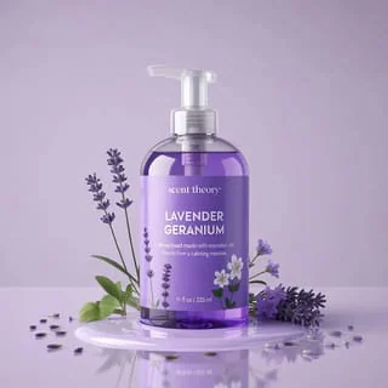

```text
Use the uploaded image as the exact visual reference for product design, label, lavender placement, liquid color, milk puddle, and soft purple background .Camera Movement:Full 360° slow-motion orbit around the product.Smooth, steady circular motion.Constant speed .No shake .No sudden acceleration .No zoom in or out.Keep product centered at all times.Framing:Mid close-up product shot.Bottle remains perfectly upright and fixed in position.
```

Model: Nano Banana
Author: Oogie

[ProjectD](https://aitoolsradar.com/en/prompts/cb15e224a8b156) · [Recorded source](https://x.com/oggii_0/status/2026929094164885863)
 · [Full original metadata and byte evidence](data/projectd-batch-0065.json)

## Oogie #803

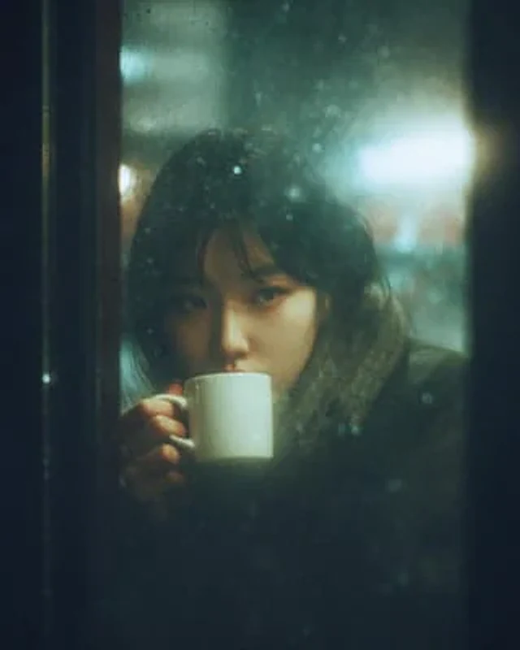

```text
A cinematic, moody photograph of a young woman sitting inside a café at night, seen through a rain-covered window. Raindrops and condensation blur the glass, creating a dreamy, nostalgic atmosphere. She has soft features, dark hair with bangs, and is holding a small white ceramic mug close to her face, sipping a warm drink. Warm interior light contrasts with cool teal and blue city lights outside. Shallow depth of field, soft focus, film grain, muted colors, melancholic mood, intimate composition, reflective glass, bokeh lights in the background, realistic photography, 35mm film look, low light, cinematic color grading.
```

Model: Nano Banana
Author: Oogie

[ProjectD](https://aitoolsradar.com/en/prompts/aec96cb9cc9c69) · [Recorded source](https://x.com/oggii_0/status/2015378809508503595)
 · [Full original metadata and byte evidence](data/projectd-batch-0065.json)

## Oogie #919

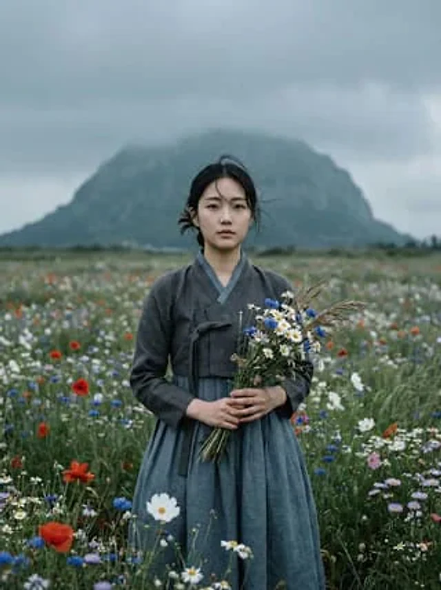

```text
Ultra-realistic cinematic portrait of a young East Asian woman standing alone in a vast wildflower meadow. She is centered in the frame, facing the camera directly with a calm, introspective expression. She wears a traditional Korean hanbok in muted charcoal gray and soft blue tones, with natural fabric texture and subtle folds. Her dark hair is loosely tied back with a few strands gently blown across her face by the wind.

She holds a small hand-picked bouquet of wildflowers—white daisies, blue cornflowers, and dry grass stems—clasped softly in both hands at waist level. The meadow is filled with colorful wildflowers (reds, whites, blues, purples) stretching into the distance.

In the background, a large mist-covered mountain rises softly out of focus, partially obscured by low clouds and fog, creating a moody, atmospheric depth. Overcast sky with soft diffused natural light, cool color palette, muted contrast, cinematic realism.

Shallow depth of field, sharp focus on subject, creamy background bokeh. Natural skin texture, realistic facial details, no makeup look. Fine art photography style, emotional, poetic, timeless. Shot on a full-frame camera, 85mm lens, f/1.8, ultra-high resolution, photorealistic, no text, no watermark.
```

Model: Nano Banana
Author: Oogie

[ProjectD](https://aitoolsradar.com/en/prompts/52df10e3782f9a) · [Recorded source](https://x.com/oggii_0/status/2019094555501686847)
 · [Full original metadata and byte evidence](data/projectd-batch-0065.json)

## Oogie #935

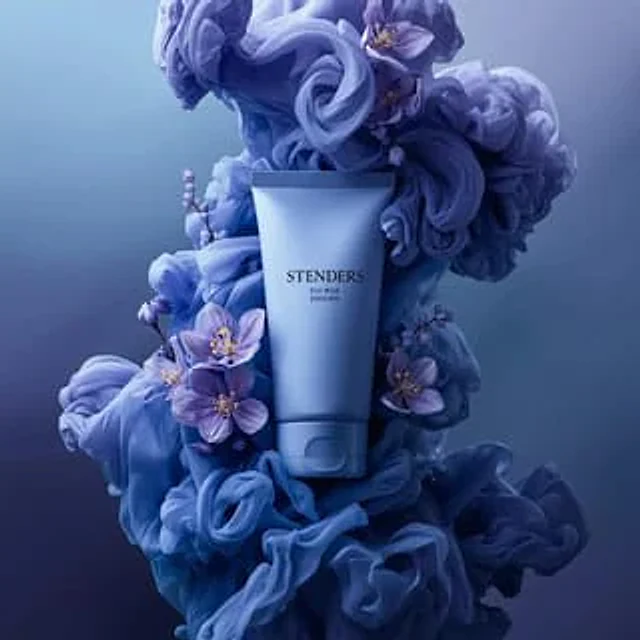

```text
Ultra-realistic luxury cosmetic product photography in a dramatic monochromatic blue-violet composition. A sleek satin-finish periwinkle-blue squeeze tube labeled “STENDERS” stands vertically centered in the frame, featuring elegant silver typography and a reflective metallic chrome cap. The tube is surrounded by voluminous swirling clouds of ink-like smoke in layered shades of lavender, indigo, and icy blue, creating a soft, billowing texture that wraps around the product. Interwoven throughout the smoke are fresh purple and lilac flowers with intricate petal details and vibrant yellow centers, along with delicate sprigs of tiny violet blossoms for added dimension. Soft directional lighting from the upper left highlights the smooth curvature of the tube, adds subtle sheen to the metallic cap, and creates depth within the smoke plumes. The background seamlessly blends cool blue and purple tones, enhancing the ethereal, floral fragrance aesthetic. Hyper-detailed textures of petals and vapor, cinematic depth, high-end perfumed skincare advertising style, 8K

ultra-high resolution
```

Model: Nano Banana
Author: Oogie

[ProjectD](https://aitoolsradar.com/en/prompts/586793b19f5251) · [Recorded source](https://x.com/oggii_0/status/2027729036307533900)
 · [Full original metadata and byte evidence](data/projectd-batch-0065.json)

## Oogie #963


```text
Ultra-realistic lifestyle beverage advertisement featuring a chilled bottle of “UNIK – Jaggery & Natural Tigernut Drink.” The bottle stands on a clean marble or gym countertop surrounded by natural ingredients such as tigernuts, almonds, coconut slices, and dates. A smooth splash of creamy tigernut milk flows upward behind the bottle while ice cubes scatter around it. The bottle is covered with condensation droplets indicating cold freshness. The background features a bright modern fitness studio with soft natural lighting and blurred gym equipment. The composition communicates energy, health, and natural nutrition. High-end commercial beverage photography, macro details, shallow depth of field, ultra-realistic textures, photorealistic lighting, clean advertising style, 8K resolution.
```

Model: Nano Banana
Author: Oogie

[ProjectD](https://aitoolsradar.com/en/prompts/e4b56e3e8b7ab4) · [Recorded source](https://x.com/oggii_0/status/2033147596727001224)
 · [Full original metadata and byte evidence](data/projectd-batch-0065.json)

## Oogie #985

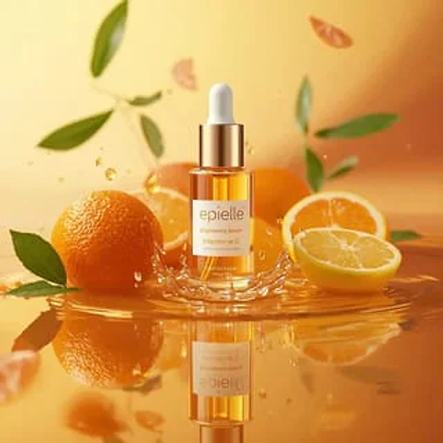

```text
Ultra-high-end photorealistic skincare product photography featuring a clear cylindrical glass dropper bottle filled with translucent golden serum, centered and slightly tilted backward, with a matte white rubber dropper and metallic gold collar, the front label clearly reading “epielle Brightening Serum Vitamin C” with citrus illustrations, placed on a glossy reflective orange liquid surface creating a sharp mirror reflection beneath the bottle, surrounded by whole and sliced citrus fruits including bright orange oranges, a halved ruby grapefruit with visible pulp, and a sliced yellow lemon positioned symmetrically around the bottle, small golden serum droplets and splashes frozen mid-air around the base, fresh green citrus leaves floating softly in the background, background consisting of a smooth warm gradient transitioning from pale yellow on the left to deep orange on the right, lighting is strong soft studio lighting from upper left creating crisp highlights on glass and liquid, luminous glow through the serum, subtle shadows, and high contrast reflections, color palette dominated by vibrant orange, yellow, gold, and fresh green accents, textures extremely detailed including glossy glass, liquid viscosity, citrus peel pores, juicy pulp, and reflective surface, shallow depth of field with razor-sharp focus on the bottle label and fruit in the midground and gentle bokeh in the background, premium commercial cosmetic advertising style, clean modern composition, cinematic realism, ultra-detailed 8K photorealism, studio-grade quality
```

Model: Nano Banana
Author: Oogie

[ProjectD](https://aitoolsradar.com/en/prompts/eff688aac35036) · [Recorded source](https://x.com/oggii_0/status/2017103651559657540)
 · [Full original metadata and byte evidence](data/projectd-batch-0065.json)

## Özge Döner #1184

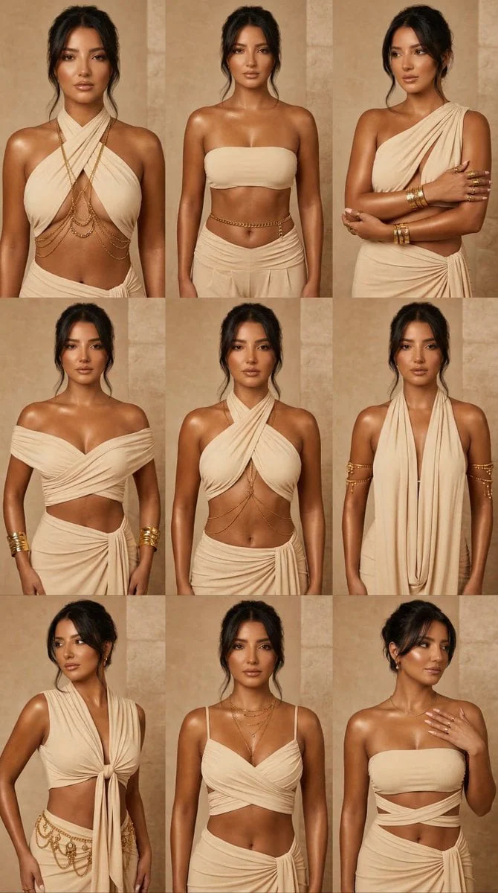

```text
{
  "generation_request": {
    "meta_data": {
      "tool": "NanoBanana Pro",
      "task_type": "fashion_variation_grid_9panel",
      "language": "en",
      "priority": "highest",
      "version": "v1.0_GOLDEN_GODDESS_JEWELRY_9GRID"
    },
    "input": {
      "mode": "text_to_image",
      "notes": "Create a 3x3 high-fashion goddess editorial grid featuring the same elegant woman with luxurious gold body jewelry and draped styling."
    },
    "output_settings": {
      "aspect_ratio": "4:5",
      "orientation": "portrait",
      "resolution_target": "ultra_high_res",
      "num_images": 1,
      "layout": {
        "type": "grid",
        "rows": 3,
        "cols": 3,
        "gutter": "thin",
        "outer_border": "none",
        "panel_consistency": "very_high"
      },
      "render_style": "golden_goddess_editorial",
      "sharpness": "editorial_crisp",
      "grain": "subtle_clean"
    },
    "scene": {
      "environment": "warm sand-toned luxury studio with subtle stone texture",
      "lighting": "golden diffused light with bronzed highlights on skin and jewelry",
      "mood": "divine, radiant, regal, sensual"
    },
    "subject": {
      "description": "same elegant adult woman across all 9 panels",
      "face": "same identity in all panels, calm regal expression",
      "skin": "sunlit bronzed luminous skin texture",
      "hair": "soft dark hair styled loosely back with glowing face-framing strands",
      "makeup": "gold-bronze eyelids, subtle liner, luminous skin, glossy nude lips",
      "expression": "serene, elevated, goddess-like"
    },
    "wardrobe": {
      "top": "soft ivory or sand draped wrap tops with goddess-inspired constructions",
      "bottom": "flowing low-rise draped bottoms",
      "accessories": "dramatic gold cuff bracelets, layered gold body chains, gold waist jewelry, delicate rings",
      "styling": "ancient goddess meets modern couture"
    },
    "composition_rules": {
      "face_visibility": "mandatory in all 9 panels",
      "framing": "mid-length to upper-thigh framing",
      "identity_consistency": "same woman in every panel"
    },
    "panel_design": {
      "panel_1": "front portrait with crossed halter drape and gold chest jewelry",
      "panel_2": "front portrait with bandeau drape and gold waist chain",
      "panel_3": "three-quarter portrait with one-shoulder drape and layered gold accessories",
      "panel_4": "front portrait with off-shoulder draped wrap and stacked gold cuffs",
      "panel_5": "front portrait with sculptural crossed neckline and gold body chain",
      "panel_6": "front portrait with elongated halter drape and arm jewelry",
      "panel_7": "three-quarter portrait with tied-front drape and ornate waist chain",
      "panel_8": "front portrait with diagonal wrapped bust and gold accents",
      "panel_9": "front portrait with bandeau and crisscross waist drape, hand touching collarbone"
    },
    "camera": {
      "lens": "85mm portrait lens",
      "style": "luxury goddess fashion photography",
      "depth_of_field": "shallow",
      "angle": "eye-level"
    },
    "quality_control": {
      "identity_consistency": "maximum",
      "panel_consistency": "very_high",
      "face_priority": "absolute",
      "anatomy_accuracy": "maximum",
      "hands_priority": "very_high",
      "jewelry_integrity": "very_high",
      "fabric_realism": "high"
    },
    "negative_prompt": [
      "cheap costume jewelry",
      "different woman",
      "extra fingers",
      "missing fingers",
      "warped anatomy",
      "plastic skin",
      "text",
      "watermark",
      "logo"
    ]
  }
}
```

Model: Nano Banana
Author: Özge Döner

[ProjectD](https://aitoolsradar.com/en/prompts/7ea3b696e44a08) · [Recorded source](https://x.com/astronomerozge1/status/2031462324821741847)
 · [Full original metadata and byte evidence](data/projectd-batch-0065.json)

## Özge Döner #1200

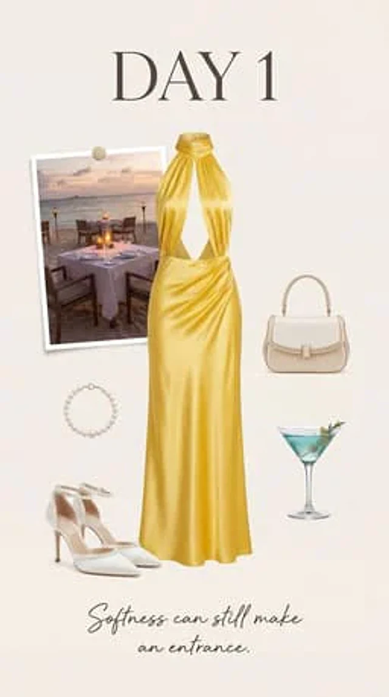

```text
{
  "generation_request": {
    "meta_data": {
      "tool": "NanoBanana Pro",
      "task_type": "luxury_fashion_moodboard_editorial",
      "language": "en",
      "priority": "highest",
      "version": "v2.5_DAY1_YELLOW_HALTER_SATIN_MINIMAL_ITEMS_GOLD_TEXT"
    },
    "input": {
      "mode": "image_to_image",
      "reference_image_usage": "high",
      "notes": "Use the uploaded reference only as a layout and visual styling guide. Create a clean, elegant luxury fashion moodboard with the editorial feeling: soft ivory background, large refined 'DAY 1' title at the top, one pinned seaside restaurant photo, one hero yellow satin halter-neck evening dress with an open back, and only a minimal number of supporting elements. Show only one pair of pearl-white heels, only one matching luxury evening bag, only one jewelry item, and only one sea-inspired martini cocktail. Do not include extra accessories, extra bags, extra shoes, or extra jewelry. The composition must feel minimal, expensive, balanced, and professionally art directed, with strong hierarchy and generous negative space. The dress should be the main focal point, with a sleek modern silhouette, fluid satin drape, and premium fashion-house finish. The seaside restaurant photo should show an upscale evening dinner setup directly on the sand, with candlelight and romantic luxury atmosphere. The cocktail should be one elegant sea-inspired martini with ocean-blue or sea-glass tones. Add one short motivational quote near the bottom in a refined handwritten or script style. All visible typography, including the 'DAY 1' title and the quote, should be rendered in elegant metallic gold tones with a luxurious editorial finish."
    },
    "output_settings": {
      "aspect_ratio": "4:5",
      "orientation": "portrait",
      "resolution_target": "ultra_high_res",
      "num_images": 1,
      "render_style": "luxury_editorial_collage_realism",
      "sharpness": "ultra_crisp",
      "grain": "subtle_print_texture",
      "dynamic_range": "soft_high_end",
      "color_grade": "sunset_gold_pearl_coastal_luxury"
    },
    "layout": {
      "background": "soft warm ivory or premium matte neutral tone",
      "composition": "large DAY 1 title at the top, one pinned seaside photo, one central hero dress, one pair of shoes, one bag, one jewelry item, one cocktail, one short quote",
      "design_feel": "minimal luxury editorial board with balanced spacing and no clutter"
    },
    "fashion_story": {
      "hero_dress": "yellow satin halter-neck backless evening dress, sleek modern silhouette, elegant drape, luxurious reflections",
      "shoes": "one pair of pearl-white heels with delicate pearl-thread detailing",
      "bag": "one small luxury evening bag in pearl white, ivory, champagne, or soft gold tone",
      "jewelry": "one elegant pearl bracelet or one refined pearl jewelry piece only"
    },
    "lifestyle_element": {
      "date_setting": "luxury beachside evening restaurant directly on the sand, candlelight, elegant table setting, romantic atmosphere",
      "cocktail": "one sea-inspired martini with ocean-toned blue-green color and premium garnish"
    },
    "text_element": {
      "title": "DAY 1",
      "title_style": "large elegant editorial serif in metallic gold",
      "quote_examples": [
        "Softness can still make an entrance.",
        "Choose the night that feels like you.",
        "Elegance is how you arrive."
      ],
      "quote_style": "one short refined handwritten or script quote in metallic gold",
      "instruction": "use only one short quote"
    },
    "must_have": [
      "reference-inspired clean luxury layout",
      "large DAY 1 title in gold",
      "yellow satin halter-neck backless dress",
      "one pair of pearl-white heels",
      "one matching luxury bag",
      "one jewelry item only",
      "one sea-inspired martini",
      "one seaside dinner photo",
      "one short motivational quote in gold",
      "minimal elegant composition"
    ],
    "negative_prompt": [
      "extra bag",
      "extra shoes",
      "extra jewelry",
      "extra accessories",
      "too many objects",
      "messy collage",
      "cheap styling",
      "too much text",
      "wrong dress color",
      "flat uninspired layout",
      "cartoon",
      "low detail",
      "logo",
      "watermark"
    ]
  }
}
Prompt(right):
{
  "generation_request": {
    "meta_data": {
      "tool": "NanoBanana Pro",
      "task_type": "reference_locked_fashion_editorial_scene",
      "language": "en",
      "priority": "highest",
      "version": "v1.1_REFERENCE_WOMAN_IN_DAY1_LOOK_MORE_NATURAL"
    },
    "references": {
      "reference_image_style": {
        "source": "UPLOAD_MOODBOARD_IMAGE",
        "purpose": "OUTFIT_ACCESSORIES_STYLING_SCENE_GUIDE",
        "strict_lock": false,
        "preserve_palette": true,
        "preserve_vibe": true,
        "preserve_outfit_details": true,
        "preserve_accessories": true,
        "preserve_scene_direction": true,
        "affect_face": false
      },
      "reference_image_face": {
        "source": "UPLOAD_WOMAN_REFERENCE_IMAGE",
        "purpose": "FACE_IDENTITY_LOCK",
        "strict_lock": true,
        "face_similarity_priority": "MAX",
        "identity_lock_strength": 0.97,
        "no_identity_blending": true,
        "no_age_shift": true,
        "preserve_skin_texture": true
      }
    },
    "input": {
      "mode": "image_to_image",
      "notes": "Use the uploaded woman reference as the identity base. Dress her in a look closely matching the moodboard: yellow satin halter-neck backless evening dress, pearl-white heels, matching luxury evening bag, and minimal pearl jewelry. Do not make the woman look overly perfect, mannequin-like, or artificial. She must feel like a real elegant woman photographed during a luxury seaside dinner, not a fashion doll. Keep natural skin texture, subtle facial asymmetry, believable posture, relaxed shoulders, real body weight, and candid human presence. Show her seated at a luxury beachside restaurant directly on the sand during evening golden hour into night, naturally holding or reaching for a sea-inspired martini cocktail. The dress, shoes, bag, and jewelry should remain clearly visible and strongly matched to the moodboard, but the overall image should feel lived-in, cinematic, and natural rather than overly staged."
    },
    "output_settings": {
      "aspect_ratio": "4:5",
      "orientation": "portrait",
      "resolution_target": "ultra_high_res",
      "num_images": 1,
      "render_style": "natural_luxury_realism",
      "sharpness": "clean_natural",
      "grain": "subtle_film",
      "dynamic_range": "soft_high_end",
      "color_grade": "sunset_gold_pearl_coastal_natural"
    },
    "scene": {
      "environment": "luxury beachside restaurant directly on the sand at evening golden hour fading into night",
      "details": "candlelit table, elegant place setting, warm ambient lights, sea view, refined romantic atmosphere",
      "pose": "woman seated naturally, slightly turned, relaxed and elegant, interacting casually with the cocktail, not stiff, not overly posed",
      "mood": "romantic, upscale, warm, feminine, cinematic, believable"
    },
    "subject": {
      "identity": "uploaded woman reference with strong but natural resemblance",
      "outfit": "yellow satin halter-neck backless evening dress closely matching the moodboard",
      "shoes": "pearl-white heels clearly visible",
      "bag": "matching evening bag clearly visible",
      "jewelry": "minimal pearl jewelry",
      "beauty": "natural luxury beauty, realistic skin texture, soft evening glam, human and believable"
    },
    "camera": {
      "framing": "three-quarter seated fashion portrait wide enough to show shoes, bag, and dress shape",
      "angle": "natural editorial angle, slightly observational rather than overly staged",
      "focus": "sharp on face, dress texture, shoes, bag, cocktail, and table details",
      "depth_of_field": "soft cinematic background separation"
    },
    "lighting": {
      "type": "natural luxury evening lighting",
      "quality": "warm sunset and candlelit ambience with soft fill, realistic facial shadows, elegant satin highlights, no overexposure",
      "skin_rendering": "realistic skin texture, no plastic effect, no beauty filter look"
    },
    "must_have": [
      "realistic human presence",
      "natural face",
      "no mannequin look",
      "strong resemblance to uploaded woman",
      "yellow satin halter dress",
      "visible pearl-white heels",
      "visible matching bag",
      "minimal pearl jewelry",
      "luxury seaside date setting",
      "sea-inspired martini",
      "photoreal quality"
    ],
    "negative_prompt": [
      "mannequin look",
      "fashion doll look",
      "plastic skin",
      "over-smoothed face",
      "beauty filter",
      "stiff pose",
      "unnatural symmetry",
      "different outfit",
      "different shoes",
      "different bag",
      "identity mismatch",
      "blurry face",
      "bad anatomy",
      "extra fingers",
      "deformed hands",
      "cartoon",
      "logo",
      "watermark",
      "text"
    ]
  }
}
```

Model: Nano Banana
Author: Özge Döner

[ProjectD](https://aitoolsradar.com/en/prompts/bbd2abf58d7b64) · [Recorded source](https://x.com/astronomerozge1/status/2036433262583628096)
 · [Full original metadata and byte evidence](data/projectd-batch-0065.json)

## Özge Döner #1208

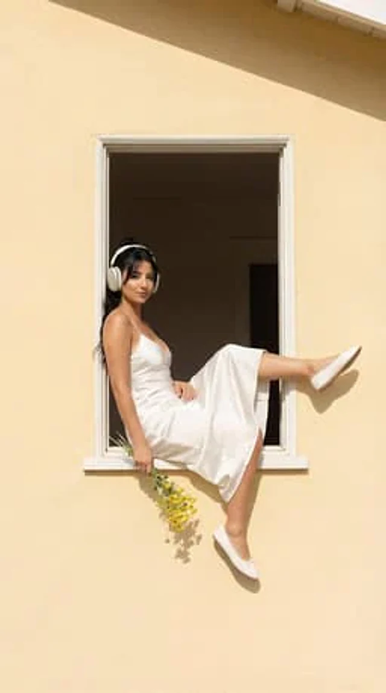

```text
{
  "generation_request": {
    "meta_data": {
      "tool": "NanoBanana Pro",
      "task_type": "photoreal_fashion_editorial_window_pose",
      "version": "v1.0_YELLOW_HOUSE_WINDOW_GIRL_WHITE_SATIN",
      "priority": "highest"
    },

    "references": {
      "reference_image_1": {
        "source": "UPLOAD_REFERENCE_IMAGE",
        "purpose": "POSE_AND_COMPOSITION_LOCK",
        "strict_lock": true,
        "match_reference_priority": "MAX",
        "preserve_window_frame": true,
        "preserve_leg_position": true,
        "preserve_body_angle": true,
        "preserve_camera_distance": true,
        "no_style_drift": true
      },
      "reference_image_2": {
        "source": "UPLOAD_FACE_REFERENCE (OPTIONAL)",
        "purpose": "FACE_IDENTITY_LOCK",
        "strict_lock": true,
        "face_similarity_priority": "MAX",
        "no_identity_blending": true,
        "no_beautify": true,
        "no_age_shift": true,
        "preserve_skin_texture": true,
        "preserve_facial_proportions": true
      }
    },

    "creative_direction": {
      "concept": "A playful, editorial fashion moment: a young woman sitting casually inside an open window of a yellow house, one leg lifted outward, captured as a clean, modern lifestyle photograph.",
      "mood": "fresh, carefree, stylish, youthful",
      "style_keywords": "European street style, playful femininity, minimal editorial"
    },

    "scene": {
      "location": "residential exterior",
      "architecture": {
        "house_color": "soft warm yellow facade",
        "window": "simple rectangular window with white interior walls",
        "background": "clean, uncluttered, sunlit wall"
      },
      "time": "midday",
      "lighting": "direct natural sunlight, crisp shadows"
    },

    "subject": {
      "gender": "female",
      "pose": {
        "position": "sitting inside the window frame",
        "legs": "one leg extended outward and raised, the other relaxed",
        "arms": "one arm hanging freely outside the window"
      },
      "expression": "neutral to calm, relaxed confidence",
      "gaze": "looking forward or slightly to the side"
    },

    "wardrobe": {
      "dress": {
        "type": "white satin slip dress",
        "style": "thin straps, minimal, fluid fabric",
        "length": "midi",
        "finish": "soft satin sheen"
      },
      "headphones": {
        "type": "over-ear",
        "color": "pure white",
        "style": "clean, modern, minimal"
      },
      "shoes": {
        "type": "flat or low-heel shoes",
        "color": "white",
        "style": "simple, elegant"
      }
    },

    "accessories": {
      "flowers": {
        "type": "fresh yellow flowers",
        "placement": "held loosely in one hand",
        "look": "natural, slightly wild bouquet"
      }
    },

    "photography": {
      "camera_style": "fashion editorial street photography",
      "lens": "35mm",
      "framing": "centered subject, full body within window frame",
      "depth_of_field": "moderate, background sharp",
      "color_grade": "warm yellows, clean whites, natural skin tones"
    },

    "output_settings": {
      "aspect_ratio": "4:5",
      "orientation": "portrait",
      "resolution_target": "ultra_high_res",
      "render_style": "ultra_photoreal_editorial",
      "sharpness": "clean_and_crisp",
      "dynamic_range": "natural_not_hdr",
      "no_text": true,
      "no_watermark": true,
      "no_logo": true
    },

    "quality_controls": {
      "anatomy": {
        "no_deformed_limbs": true,
        "no_extra_fingers": true
      },
      "fabric": {
        "satin_reads_real": true
      },
      "coherence": {
        "wardrobe_consistent": true,
        "pose_identical_to_reference": true
      }
    },

    "negative_prompt": [
      "patterned dress",
      "dark or black clothing",
      "headphones not white",
      "boots or dark shoes",
      "busy background",
      "cartoon, illustration, anime",
      "HDR, oversharpening",
      "text, watermark, logo",
      "deformed anatomy"
    ]
  }
}
```

Model: Nano Banana
Author: Özge Döner

[ProjectD](https://aitoolsradar.com/en/prompts/f148ed9a7dac2a) · [Recorded source](https://x.com/astronomerozge1/status/2011519692666470461)
 · [Full original metadata and byte evidence](data/projectd-batch-0065.json)

## Özge Döner #1321


```text
{
  "generation_request": {
    "meta_data": {
      "tool": "NanoBanana Pro",
      "task_type": "photoreal_cinematic_travel_couple_low_angle_airplane_overhead_with_baby",
      "version": "v1.1_SHOULDERS_CARRY_PLANE_SKY_HERO_SHOT_BABY_LIFT",
      "priority": "highest"
    },
    "references": {
      "female_reference_image": {
        "slot": 1,
        "purpose": "FEMALE_IDENTITY_LOCK",
        "strict_identity_lock": true
      },
      "male_reference_image": {
        "slot": 2,
        "purpose": "MALE_IDENTITY_LOCK",
        "strict_identity_lock": true
      },
      "composition_reference_image": {
        "source": "UPLOAD_REFERENCE_IMAGE (OPTIONAL)",
        "purpose": "COMPOSITION_POSE_PROP_LOCK",
        "strict_lock": true,
        "no_layout_drift": true,
        "preserve_framing": true
      }
    },
    "output_settings": {
      "aspect_ratio": "4:5",
      "orientation": "portrait",
      "resolution": "ultra_high_res",
      "render_style": "ultra_photoreal_cinematic_lifestyle",
      "sharpness": "crisp_but_natural",
      "film_grain": "subtle_analog",
      "color_grade": "clean_true_to_life_warm_daylight"
    },
    "hard_constraints": [
      "Exactly 3 subjects only: one female, one male, and one baby (infant/toddler).",
      "Faces of the adult couple must match the uploaded references with maximum similarity (no morphing).",
      "Match the reference composition: extreme low-angle hero shot, man carrying woman on his shoulders.",
      "Woman holds the baby securely and lifts the baby slightly upward (safe, realistic lift; not extreme).",
      "A commercial airplane must be clearly visible overhead in the sky (top area of frame).",
      "No text, no logos, no watermark.",
      "Photoreal anatomy (no extra limbs/fingers), realistic footwear and clothing folds."
    ],
    "camera": {
      "style": "cinematic travel lifestyle photo",
      "lens": "24mm",
      "aperture": "f/2.8",
      "focus": "sharp on couple faces and baby, slight falloff toward shoes",
      "shutter_speed": "1/1600",
      "iso": 100,
      "white_balance": "bright clear daylight"
    },
    "lighting": {
      "type": "direct sunny daylight",
      "contrast": "medium",
      "highlights": "natural sun highlights, controlled (no blown skin)",
      "shadows": "soft-ish due to open sky bounce"
    },
    "prompt": {
      "scene_summary": "Ultra-photoreal cinematic travel lifestyle photo. Extreme low-angle hero perspective looking up at a family against a wide open blue sky. The man carries the woman on his shoulders; she sits securely with legs draped to each side, sneakers visible close to camera. The woman holds a baby securely and lifts the baby upward in a joyful 'flying' moment (safe realistic lift: baby raised only slightly above her face level, supported with both hands, baby’s head/neck naturally supported). The man smiles, holding the woman’s legs/ankles for support, stance stable and natural. A commercial passenger airplane flies overhead, centered near the top of the frame, clearly recognizable with realistic scale, motion blur minimal.\n\nWardrobe & vibe (match reference):\n- Soft casual neutrals: man in a cream/beige sweater and light denim; woman in an oversized pastel/pink sweatshirt; clean white sneakers.\n- Baby in a simple pastel onesie (no text/logos), weather-appropriate.\n- Natural, candid happiness; relaxed weekend travel vibe.\n\nComposition & realism:\n- Blue sky fills most of the background; minimal clouds.\n- Strong perspective distortion typical of a 24mm lens; sneakers and legs appear slightly larger due to proximity.\n- Realistic skin texture, fabric knit detail, and accurate shadows.\n- Ensure faces are clearly visible and sharp, with natural expressions (no beautify filter).\n\nSafety/pose realism:\n- Baby is held securely with both hands, no extreme overhead throwing, no unsafe angles.",
      "styling_notes": [
        "keep the exact low-angle hero shot",
        "man carrying woman on shoulders remains the core pose",
        "woman lifts baby slightly upward while keeping secure support",
        "airplane must be visible and not cropped",
        "avoid sunglasses unless they exist in the identity references"
      ]
    },
    "negative_prompt": [
      "extra people",
      "missing airplane",
      "airplane cropped",
      "unsafe baby pose (throwing baby high)",
      "baby unsupported head/neck",
      "cartoon",
      "anime",
      "cgi",
      "plastic skin",
      "over-smoothing",
      "face morph",
      "identity drift",
      "deformed hands",
      "extra fingers",
      "extra limbs",
      "text",
      "logo",
      "watermark",
      "blown highlights"
    ]
  }
}
```

Model: Nano Banana
Author: Özge Döner

[ProjectD](https://aitoolsradar.com/en/prompts/e9cc8c2dd6f233) · [Recorded source](https://x.com/astronomerozge1/status/2008270616206483695)
 · [Full original metadata and byte evidence](data/projectd-batch-0065.json)

## Özge Döner #1352

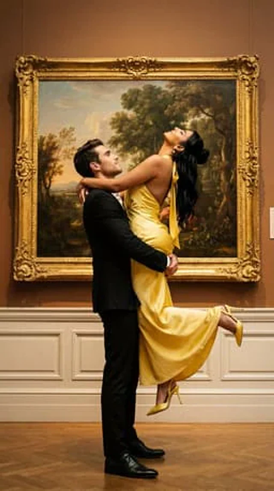

```text
{
  "generation_request": {
    "meta_data": {
      "tool": "NanoBanana Pro",
      "task_type": "photoreal_cinematic_romantic_fine_art_editorial",
      "version": "v1.1_GALLERY_FRAME_COUPLE_LIFT_EMBRACE_YELLOW_HALTER_SATIN",
      "priority": "highest"
    },

    "references": {
      "reference_image_1": {
        "source": "UPLOAD_REFERENCE_IMAGE",
        "purpose": "POSE_COMPOSITION_LIGHTING_REFERENCE",
        "strict_lock": true,
        "match_reference_priority": "MAX",
        "preserve_pose_geometry": true,
        "preserve_framing_and_cropping": true,
        "preserve_background_structure": true,
        "preserve_mood_and_lighting": true,
        "no_style_drift": true
      },
      "reference_image_2": {
        "source": "UPLOAD_FACE_REFERENCE (OPTIONAL)",
        "purpose": "FACE_IDENTITY_LOCK_FEMALE",
        "strict_lock": true,
        "face_similarity_priority": "MAX",
        "no_identity_blending": true,
        "no_beautify": true,
        "no_age_shift": true,
        "preserve_skin_texture": true,
        "preserve_facial_proportions": true
      },
      "reference_image_3": {
        "source": "UPLOAD_FACE_REFERENCE (OPTIONAL)",
        "purpose": "FACE_IDENTITY_LOCK_MALE",
        "strict_lock": true,
        "face_similarity_priority": "MAX",
        "no_identity_blending": true,
        "no_beautify": true,
        "no_age_shift": true,
        "preserve_skin_texture": true,
        "preserve_facial_proportions": true
      }
    },

    "creative_direction": {
      "concept": "A cinematic, museum-gallery romance scene: a couple in an intimate lift embrace, posed in front of a large ornate framed classical landscape painting. High-end editorial, dramatic but elegant. The woman wears a striking yellow satin halter-neck gown tied at the back of the neck, with matching yellow high heels.",
      "mood": "intimate, luxurious, timeless, fine-art cinematic",
      "style_keywords": "old-master atmosphere, museum lighting, romantic tension, film still"
    },

    "scene": {
      "location": "museum/gallery interior",
      "background": {
        "hero_object": "a large ornate gold frame containing a classical landscape painting",
        "wall": "warm brown gallery wall",
        "lower_wall": "white wainscoting / panel molding",
        "floor": "dark warm wood"
      },
      "composition": "full-body vertical frame, couple centered, painting fills most of the background"
    },

    "subjects": {
      "male": {
        "wardrobe": "black suit, black trousers, black shoes",
        "pose": "standing, lifting the woman at her waist/thigh, stable posture, looking up at her face"
      },
      "female": {
        "wardrobe": {
          "dress": "yellow silk satin halter-neck gown, neck-tie strap (tied behind the neck), fitted bodice, elegant drape, subtle sheen, high-fashion finish",
          "fabric_notes": "realistic satin highlights, soft folds, premium couture construction"
        },
        "shoes": "yellow high-heel sandals or classic yellow pumps (matching the dress)",
        "pose": "arched back, head tilted upward, hair flowing, one leg bent and lifted, arms around his shoulders/neck",
        "vibe": "elegant, sensual, not explicit"
      }
    },

    "photography": {
      "camera_style": "cinematic fashion/editorial still",
      "lens": "50mm prime (natural perspective)",
      "lighting": {
        "key": "soft directional gallery light from above/front",
        "fill": "minimal, moody shadows preserved",
        "highlights": "subtle sheen on frame gilding and strong satin specular highlights on the yellow dress"
      },
      "depth_of_field": "moderate (couple sharp, painting slightly softer but readable)",
      "color_grade": "warm cinematic browns, deep blacks, luminous yellow satin, subtle film contrast",
      "film_look": "subtle 35mm grain, gentle halation on highlights"
    },

    "output_settings": {
      "aspect_ratio": "9:16",
      "orientation": "portrait",
      "resolution_target": "ultra_high_res",
      "render_style": "ultra_photoreal_cinematic_film_still",
      "sharpness": "crisp_but_natural",
      "film_grain": "subtle_35mm",
      "dynamic_range": "natural_not_hdr",
      "no_text": true,
      "no_watermark": true,
      "no_logo": true
    },

    "quality_controls": {
      "anatomy": {
        "no_deformed_hands": true,
        "no_extra_fingers": true,
        "natural_lift_pose_physics": true
      },
      "wardrobe_materials": {
        "satin_reads_real": true,
        "strong_satin_speculars": true,
        "suit_fabric_reads_real": true,
        "gold_frame_detail_high": true
      }
    },

    "negative_prompt": [
      "white lace dress",
      "wrong dress color (not yellow)",
      "wrong dress neckline (not halter-neck tie)",
      "wrong shoe color (not yellow)",
      "text, watermark, logo",
      "cartoon, anime, illustration",
      "overexposed HDR look",
      "messy background clutter",
      "warped frame geometry",
      "incorrect lift pose physics",
      "deformed hands, extra fingers",
      "overly sexual explicit nudity"
    ]
  }
}
```

Model: Nano Banana
Author: Özge Döner

[ProjectD](https://aitoolsradar.com/en/prompts/1082a947091c2f) · [Recorded source](https://x.com/astronomerozge1/status/2011832282894520420)
 · [Full original metadata and byte evidence](data/projectd-batch-0065.json)

## Özge Döner #1360

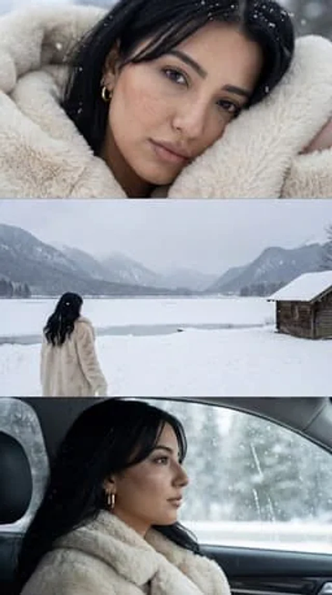

```text
{
  "generation_request": {
    "meta_data": {
      "tool": "NanoBanana Pro",
      "task_type": "text_to_image_cinematic_editorial_triptych",
      "version": "v1.0_WINTER_CINEMATIC_TRIPTYCH_3_STRIPS",
      "priority": "highest"
    },
    "output_settings": {
      "aspect_ratio": "4:5",
      "orientation": "portrait",
      "resolution": "ultra_high_res",
      "render_style": "ultra_photoreal_cinematic_editorial",
      "sharpness": "crisp_but_natural",
      "film_grain": "subtle_analog",
      "color_grade": "cool_winter_filmic",
      "retouch_level": "editorial_minimal_keep_texture",
      "noise_reduction": "low"
    },
    "composition": {
      "layout": "single image composed as a 3-panel vertical triptych (three horizontal strips stacked top/middle/bottom)",
      "panel_borders": "thin clean separators, no text, no frames, no watermark",
      "overall_style": "cohesive cinematic series with consistent color, lensing, and snowfall"
    },
    "lighting_and_camera": {
      "lighting": "soft overcast winter daylight, diffused, gentle contrast",
      "lens": "85mm for close portrait, 35mm for landscape, 50mm for car profile",
      "aperture": "f/2.8 portrait panels, f/5.6 landscape panel",
      "iso": "200-400",
      "shutter": "1/250"
    },
    "creative_prompt": {
      "scene_summary": "Create ONE single ultra-photoreal cinematic editorial image as a three-strip triptych (top/middle/bottom).\n\nTOP PANEL (close beauty):\n- Extreme close-up of a young woman’s face nestled into a plush cream faux-fur hood/coat collar.\n- Visible natural freckles across nose and cheeks, realistic pores and skin texture (no plastic smoothing).\n- Copper/red hair with soft bangs, a few snowflakes melting on hair and fur.\n- Gold hoop earrings (subtle luxury).\n- Expression: calm, slightly wistful, eyes looking toward camera.\n\nMIDDLE PANEL (wide landscape):\n- Wide shot of a frozen lake and snowy field with distant mountains.\n- A small wooden cabin on the right side of frame (cozy, rustic), light snow falling.\n- The same woman seen from behind/three-quarter angle on the left, wearing the same cream fur coat with hood.\n- Cinematic negative space, gentle atmospheric haze, crisp winter air.\n\nBOTTOM PANEL (car profile):\n- Inside a car, side profile portrait of the same woman seated by the window.\n- Snow visible outside through the window; soft reflections on glass.\n- She wears the same cream fur coat; red hair flowing, gold geometric/rectangular earring detail.\n- Expression: thoughtful, looking forward (not at camera).\n\nCOHESION REQUIREMENTS:\n- Maintain the same woman identity across all three panels.\n- Consistent winter color palette: cool blues/greys with warm skin tones and cream fur.\n- Natural snowfall across all panels; snowflakes scale and motion should be realistic.\n- Premium editorial feel, photoreal, cinematic continuity.\n\nNo text, no logos, no watermark."
    },
    "hard_constraints": [
      "ONE single image containing THREE horizontal panels stacked vertically.",
      "Same woman identity across all panels.",
      "Cream faux-fur hood/coat in all panels.",
      "Natural freckles and realistic skin texture.",
      "Photoreal snowfall (no fake bokeh dots).",
      "No text, no logos, no watermark."
    ],
    "negative_prompt": [
      "text",
      "logo",
      "watermark",
      "cartoon",
      "anime",
      "cgi",
      "over-retouched skin",
      "plastic skin",
      "identity drift between panels",
      "extra people",
      "distorted face",
      "warped hands",
      "fake looking snow",
      "oversharpening",
      "harsh flash lighting"
    ]
  }
}
```

Model: Nano Banana
Author: Özge Döner

[ProjectD](https://aitoolsradar.com/en/prompts/d37d20b8278170) · [Recorded source](https://x.com/astronomerozge1/status/2007883620862890340)
 · [Full original metadata and byte evidence](data/projectd-batch-0065.json)

## Özge Döner #1362

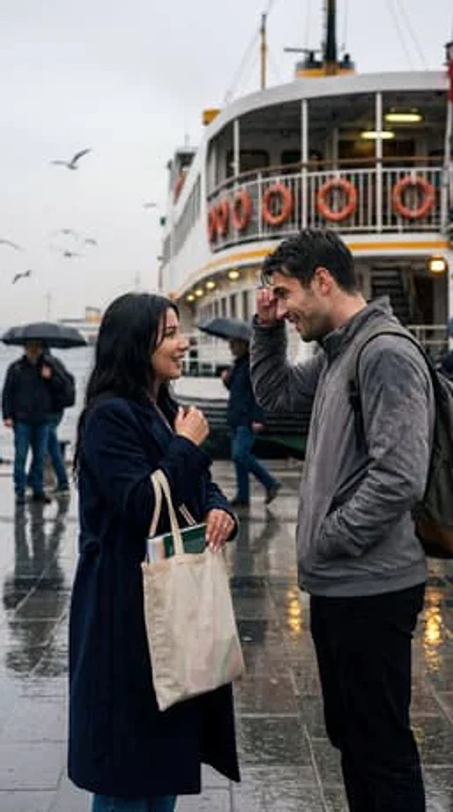

```text
{
  "generation_request": {
    "meta_data": {
      "tool": "NanoBanana Pro",
      "task_type": "photoreal_candid_street_romance",
      "version": "v1.1_ISTANBUL_FERRY_RAIN_REUNION_LOVE_EN",
      "priority": "highest"
    },

    "output_settings": {
      "aspect_ratio": "4:5",
      "orientation": "portrait",
      "resolution_target": "ultra_high_res",
      "render_style": "ultra_photoreal_candid_street_film_still",
      "sharpness": "crisp_but_natural",
      "film_grain": "subtle_35mm",
      "color_grade": "restrained_cinematic_realism",
      "dynamic_range": "natural_not_hdr",
      "skin_rendering": "real_texture_no_retouch"
    },

    "global_rules": {
      "camera_language": "35mm lens equivalent, eye-level, imperfect framing, candid documentary feel, focus on eyes when people are present",
      "authenticity_markers": "subtle halation on highlights, tiny film gate weave, slight background motion blur only, real street clutter, no studio look",
      "lighting_language": "motivated natural light only (overcast rain daylight + ferry terminal practicals), deep but detailed shadows"
    },

    "creative_prompt": {
      "scene_summary": "Istanbul, rainy day at the ferry terminal. Two university students in their early 20s unexpectedly run into each other right in front of a ferry. A candid, unposed moment—love as a quiet accident in the rain.",

      "subjects": {
        "count": 2,
        "description": "the same young man and woman (early 20s), ordinary and real, not model-like; faces visible and sharp",
        "expression": "surprise, shy warmth, a tiny relieved smile—restrained micro-expressions only",
        "skin_and_face": "natural skin texture, slight under-eye shadows, no beauty retouch, no plastic skin"
      },

      "wardrobe_and_props": {
        "clothing": "simple student clothing in natural neutral tones (beige, grey, navy, soft brown), slightly wrinkled; no logos",
        "wetness": "hair slightly wet, fabric darkened by rain, realistic water beads on coats and backpacks",
        "props": "both hold books and carry backpacks/tote bags; book edges slightly damp; hands gripping straps naturally"
      },

      "micro_action": "they stop mid-step, realizing it’s each other; one adjusts a slipping book; the other wipes rain from their eyebrow; they share a short eye contact that lasts a second longer than normal",

      "environment_details": {
        "location": "Istanbul ferry terminal (Eminönü/Karaköy/Kadıköy vibe), directly in front of a docked ferry",
        "background": "ferry hull and windows behind them, wet pavement, puddle reflections, seagulls blurred in distance, people moving with umbrellas out of focus",
        "street_elements": "rain streaks visible, water droplets on railings, worn signage shapes but no readable text"
      },

      "lighting": "overcast rain daylight, soft and diffused; practical terminal lights give gentle warm highlights; deep but detailed shadows; subtle halation on wet highlights",

      "composition": "eye-level medium shot, slightly off-center, imperfect crop, faces and eyes tack sharp; background softly receding; slight motion blur only in distant passersby and rain",

      "mood": "quiet, intimate, realistic—two people sharing a private moment in a public place"
    },

    "negative_prompt": [
      "studio lighting",
      "beauty retouch",
      "plastic skin",
      "model faces",
      "posed romance poster look",
      "perfect symmetry",
      "HDR",
      "AI glow",
      "fake bokeh shapes",
      "overly clean background",
      "unrealistic rain",
      "text",
      "logo",
      "watermark",
      "cartoon",
      "painterly"
    ]
  }
}
```

Model: Nano Banana
Author: Özge Döner

[ProjectD](https://aitoolsradar.com/en/prompts/1d977a9ecc744a) · [Recorded source](https://x.com/astronomerozge1/status/2009613642522661037)
 · [Full original metadata and byte evidence](data/projectd-batch-0065.json)

## Özge Döner #1390

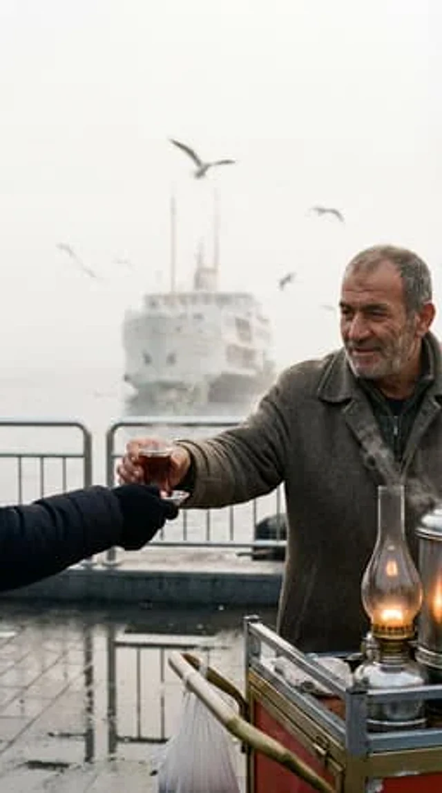

```text
{
  "output_settings": {
    "aspect_ratio": "4:5",
    "orientation": "portrait",
    "resolution_target": "ultra_high_res",
    "render_style": "ultra_photoreal_candid_street_film_still",
    "sharpness": "crisp_but_natural",
    "film_grain": "subtle_35mm",
    "color_grade": "restrained_cinematic_realism",
    "dynamic_range": "natural_not_hdr",
    "skin_rendering": "real_texture_no_retouch"
  },
  "global_rules": {
    "camera_language": "35mm lens equivalent, eye-level, imperfect framing, candid documentary feel, focus on eyes when a person is present",
    "authenticity_markers": "subtle halation on highlights, tiny film gate weave, slight background motion blur only, realistic street clutter, no studio look",
    "lighting_language": "motivated natural light only (shop window, street lamp, overcast daylight, sunset), deep but detailed shadows"
  },
  "negative_prompt": [
    "studio lighting",
    "beauty retouch",
    "plastic skin",
    "over-sharpened",
    "HDR",
    "AI glow",
    "perfect symmetry",
    "overly clean background",
    "fake bokeh",
    "text",
    "logo",
    "watermark",
    "cartoon",
    "painterly"
  ]
}
{
  "scene_summary": "Early morning in Eminönü, ferry docks, soft fog and breath in cold air, documentary street realism.",
  "subject": "Tea vendor handing a steaming tea glass to a customer, candid moment.",
  "micro_action": "steam rising as fingers touch the glass, tiny smile",
  "environment_details": "ferry silhouette in mist, seagulls blurred in background, wet railings, puddles",
  "lighting": "soft morning light diffused by fog, highlights with subtle halation"
}
```

Model: Nano Banana
Author: Özge Döner

[ProjectD](https://aitoolsradar.com/en/prompts/b3c5072677bc3e) · [Recorded source](https://x.com/astronomerozge1/status/2009224783951487477)
 · [Full original metadata and byte evidence](data/projectd-batch-0065.json)

## Özge Döner #1398

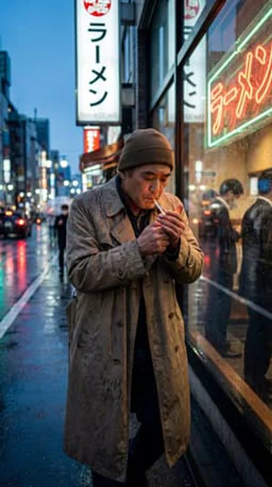

```text
{ "generation_request": { "meta_data": { "tool": "NanoBanana Pro", "task_type": "photoreal_artistic_street_photography", "version": "v1.0_STREET_ART_REALISM_SER_EN", "priority": "highest" }, "output_settings": { "aspect_ratio": "4:5", "orientation": "portrait", "resolution_target": "ultra_high_res", "render_style": "ultra_photoreal_candid_film_still", "sharpness": "crisp_but_natural", "film_grain": "subtle_35mm", "color_grade": "restrained_cinematic_realism", "dynamic_range": "natural_not_hdr", "skin_rendering": "real_texture_no_retouch" }, "creative_prompt": { "scene_summary": "Candid artistic street photograph on location in [CITY/NEIGHBORHOOD]. A real, unposed moment that feels documentary and emotionally true.", "subject": "A [AGE] [GENDER] wearing [CLOTHING], caught mid-action: [MICRO-ACTION]. Natural facial expression, slight asymmetry preserved.", "camera": "35mm lens equivalent, eye-level, close but respectful distance, imperfect framing like a real street photographer, focus on the eyes, shallow-to-medium depth of field.", "lighting": "Motivated natural light from [SOURCE: shop window / street lamp / sunset / neon], deep but detailed shadows, no studio lighting.", "environment_details": "Street textures: worn posters, scratched metal, rain-speckled pavement, subtle reflections in glass, real urban clutter, no clean studio background.", "authenticity_markers": "Subtle motion blur on background only, slight halation on highlights, tiny film gate weave, realistic grain, no beauty retouch.", "mood": "[MOOD: melancholic / hopeful / tense / quiet joy], cinematic but believable." }, "negative_prompt": [ "studio lighting", "beauty retouch", "plastic skin", "over-sharpened", "HDR", "AI glow", "perfect symmetry", "overly clean background", "fake bokeh shapes", "text", "logo", "watermark", "painterly", "cartoon" ] } }
```

Model: Nano Banana
Author: Özge Döner

[ProjectD](https://aitoolsradar.com/en/prompts/af83d16daa8d4d) · [Recorded source](https://x.com/astronomerozge1/status/2009225482382762410)
 · [Full original metadata and byte evidence](data/projectd-batch-0065.json)

## Özge Döner #1404

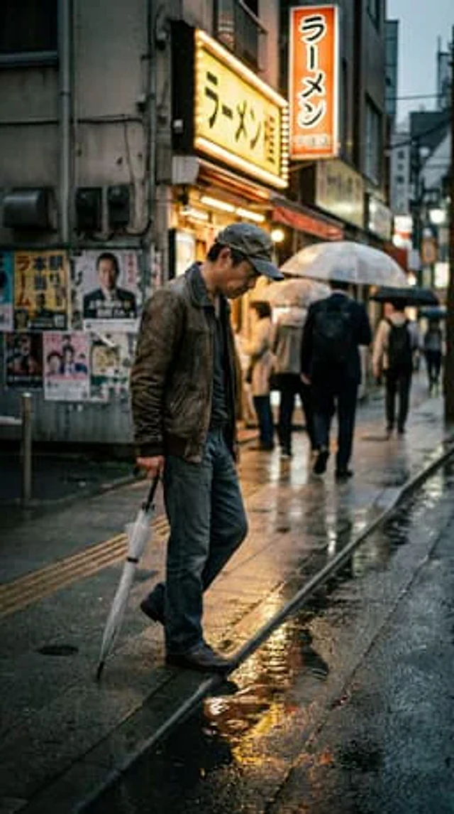

```text
{
  "generation_request": {
    "meta_data": {
      "tool": "NanoBanana Pro",
      "task_type": "photoreal_artistic_street_photography",
      "version": "v1.0_STREET_ART_REALISM_SER_EN",
      "priority": "highest"
    },
    "output_settings": {
      "aspect_ratio": "4:5",
      "orientation": "portrait",
      "resolution_target": "ultra_high_res",
      "render_style": "ultra_photoreal_candid_film_still",
      "sharpness": "crisp_but_natural",
      "film_grain": "subtle_35mm",
      "color_grade": "restrained_cinematic_realism",
      "dynamic_range": "natural_not_hdr",
      "skin_rendering": "real_texture_no_retouch"
    },
    "creative_prompt": {
      "scene_summary": "Candid artistic street photograph on location in [CITY/NEIGHBORHOOD]. A real, unposed moment that feels documentary and emotionally true.",
      "subject": "A [AGE] [GENDER] wearing [CLOTHING], caught mid-action: [MICRO-ACTION]. Natural facial expression, slight asymmetry preserved.",
      "camera": "35mm lens equivalent, eye-level, close but respectful distance, imperfect framing like a real street photographer, focus on the eyes, shallow-to-medium depth of field.",
      "lighting": "Motivated natural light from [SOURCE: shop window / street lamp / sunset / neon], deep but detailed shadows, no studio lighting.",
      "environment_details": "Street textures: worn posters, scratched metal, rain-speckled pavement, subtle reflections in glass, real urban clutter, no clean studio background.",
      "authenticity_markers": "Subtle motion blur on background only, slight halation on highlights, tiny film gate weave, realistic grain, no beauty retouch.",
      "mood": "[MOOD: melancholic / hopeful / tense / quiet joy], cinematic but believable."
    },
    "negative_prompt": [
      "studio lighting",
      "beauty retouch",
      "plastic skin",
      "over-sharpened",
      "HDR",
      "AI glow",
      "perfect symmetry",
      "overly clean background",
      "fake bokeh shapes",
      "text",
      "logo",
      "watermark",
      "painterly",
      "cartoon"
    ]
  }
}
```

Model: Nano Banana
Author: Özge Döner

[ProjectD](https://aitoolsradar.com/en/prompts/d24e1b095426ff) · [Recorded source](https://x.com/astronomerozge1/status/2008988591800877159)
 · [Full original metadata and byte evidence](data/projectd-batch-0065.json)

## Özge Döner #1405


```text
{
  "generation_request": {
    "meta_data": {
      "tool": "NanoBanana Pro",
      "task_type": "photorealistic_single_image_editorial",
      "version": "v1.6_SUNSET_SEA_RED_DRESS_EDITORIAL",
      "priority": "highest"
    },
    "references": {
      "female_character_reference_image": "UPLOAD_FEMALE_REFERENCE (REQUIRED: IDENTITY + POSE INSPIRATION)"
    },
    "output_settings": {
      "aspect_ratio": "2:3",
      "orientation": "portrait",
      "resolution": "ultra_high_res",
      "render_style": "ultra_photoreal_high_fashion_editorial",
      "sharpness": "crisp_but_natural",
      "film_grain": "subtle_analog_film",
      "color_grade": "sunset_cinematic_warm_luxury"
    },
    "hard_constraints": [
      "ONE subject only (female).",
      "Perfect identity match to the uploaded reference (no face or body changes).",
      "No text, no logos, no watermarks.",
      "Perfect anatomy: hands, legs, proportions correct.",
      "Photoreal skin texture; no plastic or over-smoothed skin.",
      "No extra people, reflections, or background faces."
    ],
    "creative_prompt": {
      "scene_summary": "Ultra-photoreal high-fashion editorial portrait at the seaside during sunset. The same woman as the reference poses confidently on dark coastal rocks by the ocean. She wears a striking red halter-neck mini dress with soft flowing fabric and elegant movement. Her posture is poised and feminine, seated slightly angled toward the camera with legs bent naturally.\n\nHair: long, glossy dark waves worn down, softly shaped by the sea breeze. Makeup: luminous editorial glam—defined brows, subtle contour, glowing skin, soft smoky eyes, glossy nude-rose lips. Expression: confident, calm, magnetic, direct eye contact with the camera.\n\nBackground: open sea with gentle waves, distant horizon line, dramatic sunset sky in gradients of deep orange, pink, purple, and blue with scattered clouds. Lighting: cinematic dusk lighting with subtle fill flash on the subject to balance exposure; natural rim light from the sunset outlining hair and shoulders. Skin tones warm and realistic.\n\nCamera: 85mm editorial portrait lens look, shallow depth of field; subject tack sharp while ocean and clouds fall off softly. Mood: sensual, powerful, timeless, luxury fashion campaign energy—editorial, cinematic, and iconic."
    },
    "negative_prompt": [
      "any text, logo, watermark",
      "identity drift",
      "extra people",
      "distorted anatomy",
      "extra limbs or fingers",
      "cartoon, anime, CGI look",
      "plastic or over-smoothed skin",
      "harsh flash blowout",
      "low resolution",
      "overly saturated colors",
      "cheap styling or artificial fabric look"
    ]
  }
}
```

Model: Nano Banana
Author: Özge Döner

[ProjectD](https://aitoolsradar.com/en/prompts/455bc95eb348ff) · [Recorded source](https://x.com/astronomerozge1/status/2008595862771892704)
 · [Full original metadata and byte evidence](data/projectd-batch-0065.json)

## Özge Döner #392

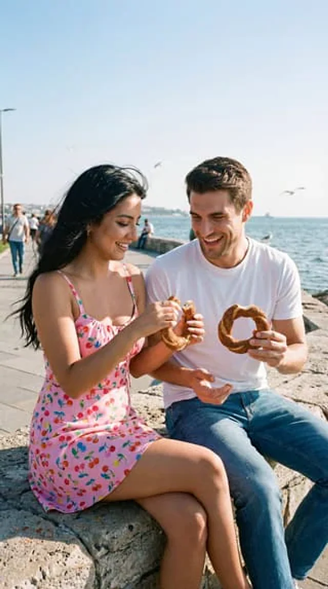

```text
{
  "generation_request": {
    "meta_data": {
      "tool": "NanoBanana Pro",
      "task_type": "photoreal_candid_street_romance",
      "version": "v1.2_MODA_SEASIDE_SIMIT_SUNNY_CHERRY_DRESS_EN",
      "priority": "highest"
    },

    "output_settings": {
      "aspect_ratio": "4:5",
      "orientation": "portrait",
      "resolution_target": "ultra_high_res",
      "render_style": "ultra_photoreal_candid_street_film_still",
      "sharpness": "crisp_but_natural",
      "film_grain": "subtle_35mm",
      "color_grade": "true_to_life_sunny_natural",
      "dynamic_range": "natural_not_hdr",
      "skin_rendering": "real_texture_no_retouch"
    },

    "global_rules": {
      "camera_language": "35mm lens equivalent, eye-level, imperfect framing, candid documentary feel, focus on eyes when people are present",
      "authenticity_markers": "subtle halation on highlights, tiny film gate weave, real street clutter, slight background motion blur only, no studio look",
      "lighting_language": "motivated natural light only (sunlight + sky fill), deep but detailed shadows"
    },

    "creative_prompt": {
      "scene_summary": "Moda seaside in Istanbul on a sunny day. A young couple in their early 20s sits near the shore eating simit. A candid, unposed film-still moment—quiet love inside everyday life.",

      "subjects": {
        "count": 2,
        "description": "the same young man and woman (early 20s), ordinary and real, not model-like; faces visible and eyes sharp",
        "expression": "small genuine smiles, relaxed presence, natural micro-expressions",
        "skin_and_face": "natural skin texture, no beauty retouch, no plastic skin, slight imperfections preserved"
      },

      "wardrobe_and_props": {
        "female": "pink dress with colorful cherry pattern, simple fit, slightly moving in sea breeze, natural minimal makeup, long wavy hair",
        "male": "blue denim jeans and a plain white t-shirt, slightly wrinkled, no logos",
        "props": "two simits in their hands, a simple tote/backpack nearby, no branding"
      },

      "micro_action": "they break pieces of simit, share a bite, laugh softly; the wind lifts the dress hem slightly; crumbs fall naturally onto their hands",

      "environment_details": {
        "location": "Moda coast, Istanbul",
        "background": "sea horizon, gentle waves, a few distant people walking softly out of focus, seagulls in the sky, sunlit railing and rocks",
        "ground_details": "worn stone or concrete edge, small everyday clutter (a bottle cap or leaf), but clean and believable, no staged props"
      },

      "lighting": "bright sunny daylight with soft sky fill; controlled highlights; subtle halation on sunlit edges; deep but detailed shadows under chins and clothing folds",

      "composition": "eye-level medium shot, slightly off-center, imperfect framing like real street photography; faces sharp; background gently receding; no perfect symmetry",

      "mood": "warm, simple, human—an everyday Istanbul love scene"
    },

    "negative_prompt": [
      "studio lighting",
      "beauty retouch",
      "plastic skin",
      "model faces",
      "posed romance poster look",
      "perfect symmetry",
      "HDR",
      "AI glow",
      "fake bokeh shapes",
      "overly clean staged scene",
      "text",
      "logo",
      "watermark",
      "cartoon",
      "painterly"
    ]
  }
}
```

Model: Nano Banana
Author: Özge Döner

[ProjectD](https://aitoolsradar.com/en/prompts/7af6a2afb1acc2) · [Recorded source](https://x.com/astronomerozge1/status/2010681577987055947)
 · [Full original metadata and byte evidence](data/projectd-batch-0065.json)

## Özge Döner #525

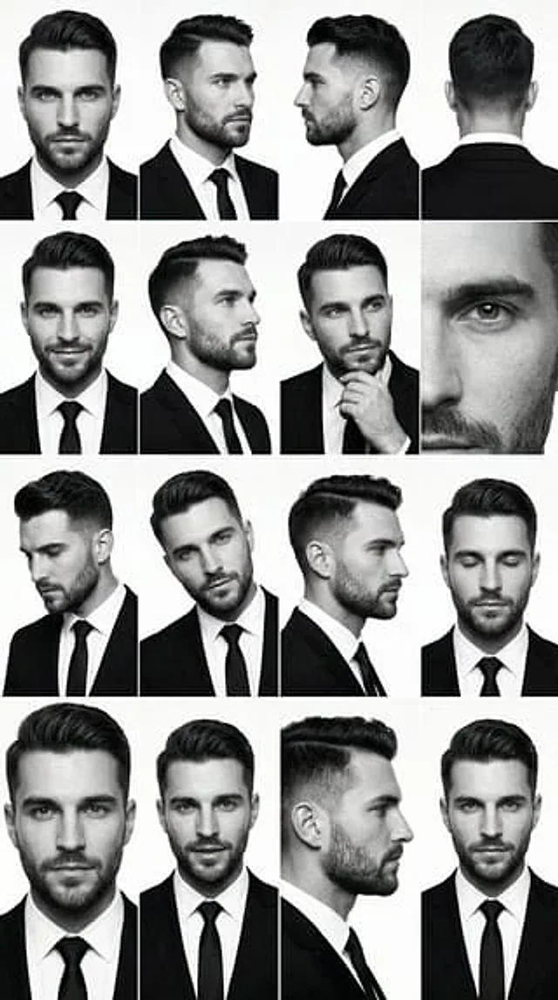

```text
{
 "generation_request": {
 "meta_data": {
 "task_type": "bw_male_expression_grid_identity_swap",
 "language": "en",
 "priority": "highest",
 "version": "v1.0_BW_MALE_GRID_KEEP_POSES_SWAP_IDENTITY"
 },
 "input": {
 "mode": "image_to_image",
 "reference_image_usage": "very_high",
 "preserve_identity": true,
 "preserve_facial_features": true,
 "preserve_hairstyle": true,
 "notes": "PRIMARY STRUCTURE ANCHOR: use the uploaded male 4x4 grid image (suit photobooth). Keep the exact 4x4 layout, crop, spacing, poses, gestures, hand placements, and framing in every panel. PRIMARY IDENTITY ANCHOR: use the uploaded reference photo of the target adult man. Replace the man in ALL panels with the reference identity while preserving the original pose and expression intensity. Keep suit-and-tie styling and clean studio background. Maintain consistent identity across all 16 panels."
 },
 "output": {
 "aspect_ratio": "1:1",
 "resolution": "ultra_high",
 "num_images": 1,
 "layout": {
 "type": "grid",
 "rows": 4,
 "cols": 4,
 "gutter": "thin",
 "panel_consistency": "very_high"
 },
 "sharpness": "crisp_studio",
 "grain": "subtle_analog_bw"
 },
 "scene": {
 "environment": "clean white studio backdrop",
 "lighting": {
 "style": "high-key studio",
 "key_light": "front softbox",
 "fill": "balanced fill",
 "avoid": "dramatic cinematic shadows"
 },
 "camera": {
 "lens": "50mm",
 "framing": "mid chest to head (varies per panel but keep same as structure image)",
 "focus": "eyes sharp"
 }
 },
 "subject": {
 "type": "adult man",
 "wardrobe": "black suit, white shirt, black tie (match structure image), no logos",
 "grooming": "match reference hairstyle as closely as possible while keeping overall look consistent",
 "anatomy_rules": "realistic hands, correct fingers, no distortions"
 },
 "style": {
 "color": "pure black and white",
 "contrast": "medium_high",
 "background": "keep identical to structure image",
 "finish": "clean studio print look"
 },
 "quality_control": {
 "identity_lock": "strict",
 "hands_priority": "very_high",
 "avoid": [
 "extra fingers",
 "missing fingers",
 "deformed hands",
 "warped face",
 "uneven eyes",
 "melted mouth",
 "identity drift across panels",
 "text",
 "watermark",
 "logo"
 ]
 },
 "negative_prompt": [
 "color",
 "sepia",
 "cinematic lighting",
 "blur",
 "low resolution",
 "distorted anatomy",
 "plastic skin",
 "face mismatch"
 ]
 }
}
```

Model: Nano Banana
Author: Özge Döner

[ProjectD](https://aitoolsradar.com/en/prompts/c68969fd445cf4) · [Recorded source](https://x.com/astronomerozge1/status/2027499546545148011)
 · [Full original metadata and byte evidence](data/projectd-batch-0065.json)

## Özge Döner #927

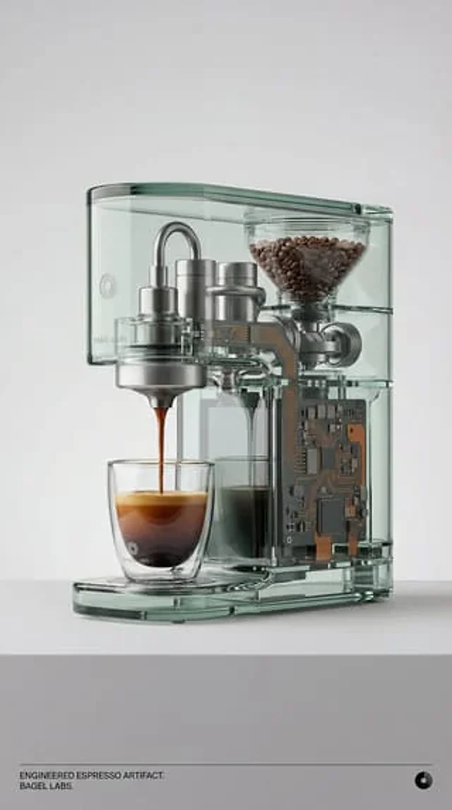

```text
BAGEL LABS.
Act as a creative director curating a wide-ranging, eclectic collection of “recontextualized everyday objects.”

DIVERSE OBJECT SELECTION (MANDATORY VARIETY):
Randomly select ONE object from these distinct categories to ensure diversity:
Analog Office & Desk:
Sport & Leisure:
Barware & Kitchen:
Utility & Tools:
Grooming:
Travel:

SELECTED CATEGORY:
Barware & Kitchen

CHOSEN OBJECT:
A coffee machine and coffee cup — instantly recognizable, reimagined as a luxury technological artifact.

THE CONCEPT:
Recontextualize the everyday coffee machine as a transparent, high-precision object of engineered beauty.  
A fully glass espresso machine reveals its internal systems: hot water circulation, pressure chambers, coffee bean hopper, grinding mechanism, and extraction pathway. Integrated computer circuitry runs through the machine like a nervous system, visually linking ritual, data, and energy.

Fresh coffee is actively pouring from the machine into a matching glass cup, captured mid-flow. The moment feels frozen, precise, and intentional—ritual meets technology.

MATERIALS & FINISH:
- COFFEE MACHINE BODY:
  Precision-molded optical glass with subtle green-tinted transparency. Internal structure is fully visible and meticulously organized.
- INTERNAL COMPONENTS:
  - Hot water tubes and pressure lines clearly visible, rendered in brushed titanium and warm grey.
  - Coffee bean chamber visible at the top with realistic roasted beans.
  - Grinding and extraction mechanisms exposed, engineered and clean.
- CIRCUITRY:
  Integrated PC-style circuitry embedded within the machine’s internal architecture.
  - Circuit paths in muted industrial orange.
  - Supporting components in graphite and titanium tones.
  Circuits are physical and structural, not glowing or decorative.
- COFFEE CUP:
  Matching optical glass cup with weighted base and refined silhouette.
  Subtle BAGEL LABS logomark engraved near the base.
- BRAND INTEGRATION:
  BAGEL LABS logomark engraved into the glass body of the machine (side or rear plane), and subtly etched on the cup.
  No stickers. No printed logos.

ACTION / MOMENT:
Coffee is visibly flowing from the machine into the glass cup.
Liquid motion is realistic and smooth.
Crema and color gradient are visible through the glass, emphasizing transparency and material depth.

PRESENTATION (NO BOXES):
The coffee machine and cup stand fully exposed on a minimal pedestal or surface.
No packaging, no housing, no covers.
All components are visible by design.

PHOTOGRAPHY & LIGHTING:
Style: High-end product editorial (Wallpaper* / Dezeen).
Lighting: Soft, studio high-key lighting with carefully controlled reflections to highlight glass thickness, liquid motion, and internal depth. No harsh shadows.
Background: Clean, seamless light grey or white cyclorama.

COLOR & GRADING:
Primary tones: transparent glass with subtle green tint, warm greys, titanium neutrals.
Accent: restrained BAGEL LABS orange within the circuitry only.
Overall mood: clean, intelligent, technological luxury.

GRAPHIC OVERLAYS (UI):
- Bottom Left:
  A small, minimalist two-line descriptor identifying the object.
- Bottom Right:
  A small, discreet, monochrome BAGEL LABS logomark.
Do not visualize font names or color codes.

CAMERA & DETAIL:
Full-frame, 50mm equivalent.
Ultra-high realism: accurate glass refraction, liquid physics, micro-detail in circuits and mechanical parts.
Shallow depth of field allowed, but machine and cup must remain fully legible.

NEGATIVE PROMPT:
No people, no hands, no kitchens, no cafes, no clutter, no packaging, no stickers, no printed text on surfaces, no neon colors, no glow effects, no cartoon or CGI look, no fingerprints, no dust, no watermarks.
```

Model: Nano Banana
Author: Özge Döner

[ProjectD](https://aitoolsradar.com/en/prompts/ccb66b9de59a50) · [Recorded source](https://x.com/astronomerozge1/status/2008944996091564518)
 · [Full original metadata and byte evidence](data/projectd-batch-0065.json)

## Özge Döner #933

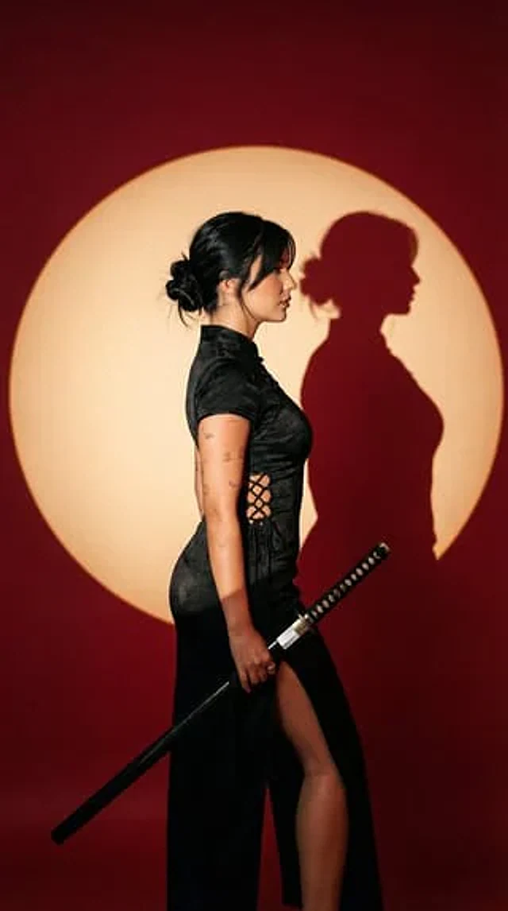

```text
{
  "generation_request": {
    "meta_data": {
      "task_type": "photoreal_editorial_spotlight_disk_fashion_portrait",
      "language": "en",
      "priority": "highest",
      "version": "v1.0_RED_BACKDROP_CIRCLE_SPOTLIGHT_KATANA_EDITORIAL"
    },
    "output": {
      "aspect_ratio": "4:5",
      "resolution": "high",
      "num_images": 4
    },
    "scene": {
      "concept": "minimal graphic studio portrait with a circular spotlight disk and crisp shadow silhouette",
      "environment": "deep red seamless background, no props, no clutter",
      "composition": "3/4 body or full-body, side profile; subject placed slightly right of center; large circular spotlight disk behind subject"
    },
    "subject": {
      "person": "adult woman",
      "wardrobe": {
        "dress": "fitted black cheongsam-inspired dress, high slit, lace-up side detailing, matte fabric with subtle texture"
      },
      "hair_makeup": {
        "hair": "messy low bun, a few loose strands framing face",
        "makeup": "soft glam, defined eyeliner, natural lips, realistic skin texture"
      },
      "details": {
        "tattoos": "subtle small tattoos on upper arm, realistic ink"
      },
      "pose": "side profile stance, shoulders relaxed, one hand resting near hip, holding a katana angled downward in a safe, non-aggressive pose",
      "expression": "calm, composed, editorial"
    },
    "props": {
      "katana": {
        "style": "realistic katana with correct proportions, simple handle wrap, subtle metal sheen",
        "handling_notes": "safe grip, blade angled down, no threatening gesture"
      }
    },
    "lighting": {
      "style": "single hard key light + spotlight gobo/disk",
      "notes": "create a large circular warm spotlight disk (cream/peach) on the red background; crisp hard-edged shadow silhouette of subject visible on the disk; high contrast; minimal fill"
    },
    "camera": {
      "shot": "editorial studio fashion portrait",
      "lens_mm": 50,
      "aperture": 2.8,
      "focus": "sharp on face, dress texture, and sword handle; background smooth",
      "quality_tags": "ultra-detailed, clean edges, subtle film grain"
    },
    "color_grade": {
      "palette": "deep red background + warm cream spotlight disk + neutral skin + black wardrobe",
      "contrast": "high",
      "tone": "cinematic editorial, smooth highlight rolloff"
    },
    "negative_prompt": "text, logo, watermark, frame, border, clutter, softbox lighting, flat lighting, blur, lowres, plastic skin, over-smoothing, extra fingers, deformed hands, incorrect katana geometry, gore, blood, violence"
  }
}
```

Model: Nano Banana
Author: Özge Döner

[ProjectD](https://aitoolsradar.com/en/prompts/91205de59e8fd0) · [Recorded source](https://x.com/astronomerozge1/status/2021291111633858589)
 · [Full original metadata and byte evidence](data/projectd-batch-0065.json)

## Özge Döner #936

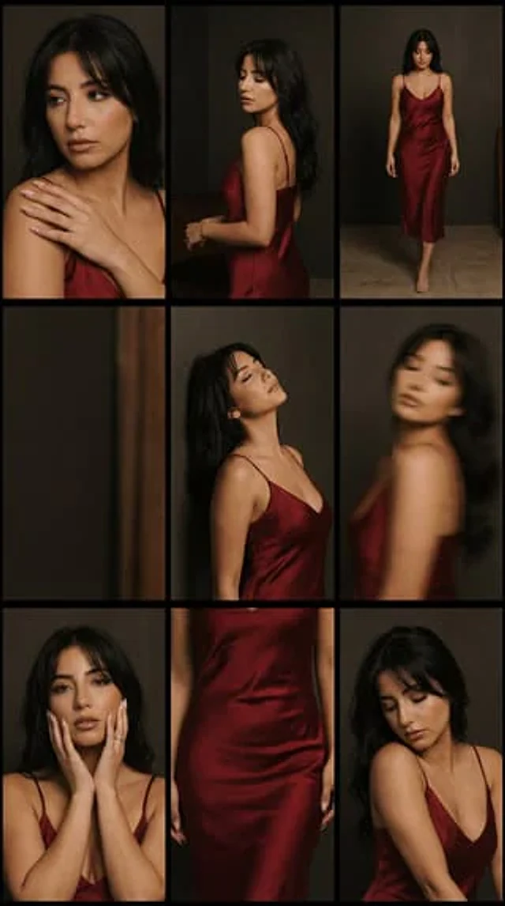

```text
{
  "generation_request": {
    "meta_data": {
      "tool": "NanoBanana Pro",
      "task_type": "photoreal_cinematic_fashion_contact_sheet",
      "version": "v1.0_RED_DRESS_INTIMATE_EDITORIAL_3x3_NO_TEXT",
      "priority": "highest"
    },

    "references": {
      "reference_image_1": {
        "source": "UPLOAD_REFERENCE_IMAGE (OPTIONAL)",
        "purpose": "FACE_IDENTITY_LOCK",
        "strict_lock": true,
        "face_similarity_priority": "MAX",
        "no_identity_blending": true,
        "no_beautify": true,
        "preserve_skin_texture": true,
        "preserve_facial_proportions": true
      }
    },

    "output_settings": {
      "aspect_ratio": "1:1",
      "resolution_target": "ultra_high_res",
      "render_style": "cinematic_fashion_editorial",
      "sharpness": "soft_cinematic_focus",
      "film_grain": "subtle_analog_35mm",
      "dynamic_range": "natural_not_hdr",
      "color_grade": "muted_warm_reds_dark_neutrals",
      "skin_rendering": "real_skin_microtexture_no_plastic"
    },

    "layout": {
      "type": "contact_sheet",
      "grid": "3x3",
      "spacing": "thin_clean_dividers",
      "panel_consistency": "same_subject_same_outfit_same_scene",
      "no_text_overlay": true
    },

    "camera": {
      "camera_type": "full_frame_cinema_camera",
      "lens": "50mm_and_85mm_mix",
      "aperture": "f1.8",
      "depth_of_field": "shallow",
      "focus_behavior": "eyes_priority_some_frames_soft_motion",
      "processing": "no_ai_sharpening_no_hdr"
    },

    "lighting": {
      "type": "low_key_cinematic_indoor_light",
      "source": "window_light_side_falloff",
      "contrast": "medium_to_low",
      "shadows": "soft_deep",
      "highlights": "controlled_skin_specular"
    },

    "wardrobe_and_styling": {
      "dress": "deep_red_silk_satin_slip_dress",
      "fabric_behavior": "fluid_realistic_drape_soft_specular",
      "straps": "thin_delicate",
      "overall_style": "intimate_high_fashion_editorial"
    },

    "hair_and_makeup": {
      "hair": "natural_loose_with_soft_bangs",
      "movement": "subtle_natural_motion",
      "makeup_style": "soft_editorial",
      "eyes": "natural_smoky_low_contrast",
      "lips": "muted_rose_nude",
      "skin_finish": "natural_luminous_real"
    },

    "posing_and_storytelling": {
      "poses": [
        "close_up_shoulder_touch",
        "mid_body_turning_away",
        "full_body_walking_away",
        "leaning_against_wall",
        "head_tilted_back_emotional",
        "eyes_closed_intimate",
        "soft_motion_blur_moment",
        "hands_touching_face",
        "dress_detail_closeup"
      ],
      "emotion": "introspective_sensual_vulnerable",
      "movement": "slow_natural_unposed"
    },

    "background": {
      "environment": "dark_interior_gallery_or_room",
      "colors": [
        "deep_red",
        "charcoal_gray",
        "dark_green"
      ],
      "texture": "matte_walls_soft_reflections",
      "distractions": "none"
    },

    "creative_prompt": {
      "scene_summary": "A cinematic 3x3 fashion contact sheet capturing an intimate, emotional editorial story of a woman in a deep red satin dress. Each frame feels like a quiet moment from an arthouse film — soft focus, natural movement, emotional restraint, and sensual minimalism.",
      "aesthetic": "arthouse_fashion_editorial",
      "mood": "quiet_intimate_cinematic"
    },

    "negative_prompt": [
      "text",
      "typography",
      "logo",
      "brand_name",
      "watermark",
      "poster_design",
      "magazine_layout",
      "beauty_filter",
      "plastic_skin",
      "over_smoothing",
      "cgi",
      "anime",
      "cartoon",
      "ai_artifacts",
      "extra_people",
      "distorted_body",
      "bad_hands",
      "extra_fingers",
      "over_sharpened"
    ]
  }
}
```

Model: Nano Banana
Author: Özge Döner

[ProjectD](https://aitoolsradar.com/en/prompts/78799ddbf48ebe) · [Recorded source](https://x.com/astronomerozge1/status/2010410887257923690)
 · [Full original metadata and byte evidence](data/projectd-batch-0065.json)

## Passion #1348

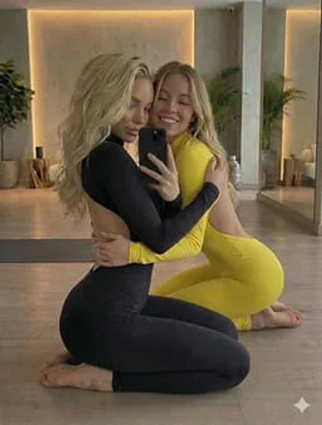

```text
POV: You’re having a casual floor hang with the internet’s favorite IT girl, Sydney Sweeney.

Nano Banana Pro 🍌 

Prompt 👇🏽 

{
  "meta": {
    "aspect_ratio": "3:4",
    "quality": "ultra_photorealistic, raw, unedited photograph",
    "resolution": "8k",
    "camera": "Smartphone camera (high-end model)",
    "lens": "Wide-angle smartphone lens",
    "style": "Mirror selfie, warm atmosphere, candid moment",
    "composition": "A mirror selfie photograph taken by the woman on the left, capturing two blonde women kneeling and embracing on a wooden floor in a studio setting."
  },
  "scene": {
    "location": "Indoor luxury yoga studio or spa lounge",
    "environment": [
      "Light wood plank flooring",
      "Large wall-to-wall mirror reflecting the subjects and large potted palm plants",
      "Textured beige walls with a warm backlit architectural alcove in the background",
      "Wooden stool and yoga mat visible in the background"
    ],
    "time": "Indeterminate time, warm indoor lighting",
    "atmosphere": "Warm, intimate, friendly, serene, luxurious"
  },
  "lighting": {
    "type": "Soft, warm ambient artificial light",
    "source": "Recessed ceiling lights and prominently from the warm backlit feature in the background",
    "effect": "A soft, golden glow enveloping the scene, creating warm tones on skin and clothing and gentle shadows."
  },
  "subject": {
    "identity": "Two blonde women kneeling together. The woman on the left is a platinum blonde. The woman on the right is actress Sydney Sweeney.",
    "body": {
      "pose": "Both women are kneeling on the floor, barefoot, embracing snugly side-by-side. The platinum blonde woman on the left holds up a black smartphone to take the photo in the mirror, looking at the screen. Sydney Sweeney on the right is smiling broadly, looking towards the mirror, her arms wrapped around the other woman.",
      "physique": "Both women have fit physiques and long wavy blonde hair."
    },
    "outfit": {
      "clothing_left": "A tight-fitting, black, long-sleeved, open-back bodysuit.",
      "clothing_right (Sydney Sweeney)": "A tight-fitting, bright yellow, long-sleeved, open-back bodysuit."
    }
  },
  "realism_focus": {
    "textures": "Fabric texture of the stretch bodysuits (black and yellow), grain of the wooden floor planks, realistic skin texture, individual strands of wavy blonde hair, clear reflections in the large mirror.",
    "imperfections": "Natural folds and creases in the bodysuits from the pose, realistic details of bare feet (soles, toes), slight smudges on the mirror surface."
  }
}
```

Model: Nano Banana
Author: Passion

[ProjectD](https://aitoolsradar.com/en/prompts/4b7f2a4a3f595c) · [Recorded source](https://x.com/Passionai0/status/2011176114644009188)
 · [Full original metadata and byte evidence](data/projectd-batch-0065.json)

## Picts by AI #1034


```text
{
"metadata": {
"image_type": "photograph",
"primary_purpose": "editorial"
},
"composition": {
"rule_applied": "rule of thirds",
"aspect_ratio": "1:1",
"layout": "layered",
"focal_points": [
"Man in dark overcoat standing on the right side of the frame",
"Illuminated cruise ships floating in the misty bay"
],
"visual_hierarchy": "Eye starts on the dark, high-contrast figure of the man on the right, follows his downward gaze, then moves left across the glass railing to the textured plant, and finally drifts up to the illuminated ships and hazy mountains in the background",
"balance": "asymmetric"
},
"color_profile": {
"dominant_colors": [
{
"color": "Black",
"hex": "#0D0D0D",
"percentage": "25",
"role": "primary subject and foreground silhouettes"
},
{
"color": "Mid Gray",
"hex": "#808080",
"percentage": "45",
"role": "background bay, sky, and mountains"
},
{
"color": "Light Gray",
"hex": "#D3D3D3",
"percentage": "30",
"role": "fog, sky highlights, and water reflections"
}
],
"color_palette": "monochromatic",
"temperature": "cool",
"saturation": "black and white",
"contrast": "high contrast"
},
"lighting": {
"type": "natural window",
"source_count": "single source",
"direction": "diffused from above",
"directionality": "diffused",
"quality": "soft light",
"intensity": "moody",
"contrast_ratio": "high contrast (dramatic shadows)",
"mood": "mysterious",
"shadows": {
"type": "soft gradual edges",
"density": "deep black",
"placement": "under subject, obscuring facial details and coat folds",
"length": "short"
},
"highlights": {
"treatment": "subtle",
"placement": "on the water surface, ship lights, and plant leaves"
},
"ambient_fill": "present",
"light_temperature": "neutral"
},
"technical_specs": {
"medium": "digital photography",
"style": "realistic",
"texture": "grainy",
"sharpness": "slightly soft",
"grain": "film grain",
"depth_of_field": "deep",
"perspective": "straight on"
},
"artistic_elements": {
"genre": "portrait",
"influences": [
"Cinematic noir",
"Melancholic travel photography"
],
"mood": "calm",
"atmosphere": "Quiet, contemplative, slightly melancholic morning or evening with heavy atmospheric mist",
"visual_style": "minimal"
},
"typography": {
"present": false,
"fonts": [],
"placement": "none",
"integration": "subtle"
},
"subject_analysis": {
"primary_subject": "A man wearing a long dark overcoat and dress shoes, looking downward in thought",
"positioning": "right",
"scale": "environmental",
"interaction": "interacting with environment",
"facial_expression": {
"mouth": "closed smile",
"smile_intensity": "no smile",
"eyes": "looking away",
"eyebrows": "neutral",
"overall_emotion": "serious",
"authenticity": "candid"
},
"hands_and_gestures": {
"left_hand": "in pocket",
"right_hand": "in pocket",
"finger_positions": "relaxed",
"finger_interlacing": "none",
"hand_tension": "relaxed",
"interaction": "resting inside coat pockets",
"naturalness": "organic casual gesture"
},
"body_positioning": {
"posture": "leaning",
"angle": "45 degree turn",
"weight_distribution": "leaning right",
"shoulders": "relaxed"
}
},
"background": {
"setting_type": "outdoor",
"spatial_depth": "deep",
"elements_detailed": [
{
"item": "Glass balcony railing with metal handrail",
"position": "center",
"distance": "midground",
"size": "dominant",
"condition": "pristine",
"specific_features": "Transparent panels running horizontally across the frame"
},
{
"item": "Potted leafy shrub",
"position": "bottom left",
"distance": "foreground",
"size": "medium",
"condition": "thriving",
"specific_features": "Dense, small leaves catching subtle highlight reflections"
},
{
"item": "Smooth cylindrical planter pot",
"position": "bottom right",
"distance": "foreground",
"size": "small",
"condition": "pristine",
"specific_features": "Minimalist matte finish, containing another plant"
},
{
"item": "Illuminated cruise ships",
"position": "center",
"distance": "background",
"size": "small",
"condition": "pristine",
"specific_features": "Bright deck lights piercing through the fog"
},
{
"item": "Coastal mountains/hills",
"position": "top",
"distance": "background",
"size": "dominant",
"condition": "weathered",
"specific_features": "Silhouetted and hazy due to thick atmospheric fog"
}
],
"wall_surface": {
"material": "glass and metal",
"surface_treatment": "smooth",
"texture": "perfectly smooth",
"finish": "glossy",
"color": "transparent with gray reflections",
"color_variation": "gradient",
"features": "clean, modern architectural lines",
"wear_indicators": "pristine"
},
"floor_surface": {
"material": "tile",
"color": "mid-gray",
"pattern": "solid rectangular panels with distinct grout lines"
},
"objects_catalog": "Glass railing (midground horizontal), large leafy potted plant (bottom left foreground), sleek light-colored planter pot (bottom right foreground), three illuminated cruise ships (background bay), distant coastal town buildings (background right)",
"background_treatment": "gradient"
},
"generation_parameters": {
"prompts": [
"Cinematic black and white photograph of a man in a dark overcoat leaning against a modern glass balcony railing. He is positioned on the right, looking down thoughtfully with his hands in his pockets. In the background, a moody, fog-covered bay with large illuminated cruise ships and hazy mountains. Deep atmospheric perspective, film grain, soft diffused lighting, melancholic mood.",
"A moody monochromatic shot from a high-end coastal balcony. A silhouetted male figure stands resting against the glass barrier. Dense fog over a calm sea, dotted with the glowing lights of several distant ships. Potted plants frame the bottom corners. Melancholic, minimalist, rich gray tones, Leica photography style."
],
"keywords": [
"black and white",
"moody",
"fog",
"overcoat",
"balcony",
"cruise ships",
"cinematic",
"contemplative"
],
"technical_settings": "ISO 400, f/5.6 to maintain background visibility while keeping subject sharp, shutter speed 1/125s, shot on a medium focal length (e.g., 50mm).",
"post_processing": "Converted to monochrome, contrast adjusted to create a strong silhouette for the subject while maintaining soft midtones in the foggy background, added subtle film grain for texture."
}
}
```

Model: Nano Banana
Author: Picts by AI

[ProjectD](https://aitoolsradar.com/en/prompts/23d3e15705c01c) · [Recorded source](https://x.com/pictsbyai/status/2031053123196694930)
 · [Full original metadata and byte evidence](data/projectd-batch-0065.json)

## Picts by AI #1119


```text
{
"metadata": {
"image_type": "photograph",
"primary_purpose": "editorial/portrait"
},
"composition": {
"rule_applied": "rule of thirds and one-point perspective",
"aspect_ratio": "2:3",
"layout": "asymmetric single subject with deep environmental context",
"focal_points": [
"Subject's brightly lit face on the right",
"The deep vanishing point of the colonnade on the left"
],
"visual_hierarchy": "Eye starts at the subject's face on the right due to contrast, travels down his dark silhouette, then follows the repeating diagonal lines of the pillars to the deep vanishing point on the far left.",
"balance": "asymmetric - the heavy, dark mass of the subject in the right foreground is balanced by the repeating, high-contrast structural elements receding into the deep background on the left"
},
"color_profile": {
"dominant_colors": [
{
"color": "Black",
"hex": "#0a0a0a",
"percentage": "45%",
"role": "primary subject clothing and deep architectural shadows"
},
{
"color": "Light Gray",
"hex": "#c8c8c8",
"percentage": "35%",
"role": "illuminated faces of the concrete pillars and floor"
},
{
"color": "Mid Gray",
"hex": "#6e6e6e",
"percentage": "20%",
"role": "shadow transitions and ambient background"
}
],
"color_palette": "monochromatic",
"temperature": "neutral",
"saturation": "black and white",
"contrast": "high contrast"
},
"lighting": {
"type": "natural window/archway light",
"source_count": "multiple sources - repeating archways on the left acting as large softboxes",
"direction": "90-degree side",
"directionality": "highly directional",
"quality": "soft light on the subject, hard geometric light on the architecture",
"intensity": "moody/high-key architectural highlights with low-key subject shadows",
"contrast_ratio": "high contrast (dramatic shadows)",
"mood": "dramatic/mysterious/sophisticated",
"shadows": {
"type": "harsh defined edges on structural elements, soft gradual edges on the subject's face",
"density": "deep black",
"placement": "cast across the floor, interior of the walkway, and the right side of the subject",
"length": "long - horizontal shadow projection across the corridor floor"
},
"highlights": {
"treatment": "preserved",
"placement": "on the left-facing planes of the pillars, the floor near the openings, and the subject's left cheek and nose"
},
"ambient_fill": "absent",
"light_temperature": "neutral"
},
"technical_specs": {
"medium": "digital photography",
"style": "realistic/editorial",
"texture": "smooth to slightly grainy",
"sharpness": "tack sharp on subject with natural lens fall-off in deep background",
"grain": "film grain - moderate level",
"depth_of_field": "deep - the subject is isolated by contrast, but the background architecture retains recognizable structure deep into the frame",
"perspective": "straight on at eye level with strong one-point vanishing perspective"
},
"artistic_elements": {
"genre": "portrait/editorial",
"influences": [
"Cinematic noir photography",
"Classic street and fashion photography",
"Brutalist architectural photography"
],
"mood": "sophisticated/dramatic/contemplative",
"atmosphere": "A quiet, isolated, and highly structured urban moment with a cinematic and slightly mysterious edge.",
"visual_style": "structured/geometric/clean"
},
"typography": {
"present": false,
"fonts": [],
"placement": "",
"integration": ""
},
"subject_analysis": {
"primary_subject": "Young Caucasian male wearing a dark turtleneck, long dark leather or heavy cotton trench coat, dark trousers, and dark Chelsea boots.",
"positioning": "right rule of thirds placement, anchoring the foreground",
"scale": "full body/environmental",
"interaction": "interacting with environment - leaning against architecture",
"facial_expression": {
"mouth": "neutral",
"smile_intensity": "no smile",
"eyes": "looking away to the right, out of frame",
"eyebrows": "relaxed",
"overall_emotion": "serious/contemplative/guarded",
"authenticity": "posed/editorial"
},
"hands_and_gestures": {
"left_hand": "hidden inside coat pocket",
"right_hand": "hidden inside coat pocket",
"finger_positions": "not visible",
"finger_interlacing": "none",
"hand_tension": "relaxed",
"interaction": "resting inside pockets, pulling the coat slightly back",
"naturalness": "deliberately posed but mimicking organic casual posture"
},
"body_positioning": {
"posture": "standing/leaning - left shoulder resting against the stone pillar",
"angle": "profile to 45 degree turn facing right",
"weight_distribution": "leaning right, resting weight on the pillar and left leg, right leg crossed over loosely",
"shoulders": "tilted due to the lean, left shoulder engaged with the wall"
}
},
"background": {
"setting_type": "outdoor/semi-enclosed architectural colonnade or covered walkway",
"spatial_depth": "deep - extreme vanishing point creating many layered planes of pillars",
"elements_detailed": [
{
"item": "Square architectural pillar 1 (foreground)",
"position": "right",
"distance": "foreground",
"size": "dominant",
"condition": "pristine/weathered",
"specific_features": "Smooth concrete or stone facing, acts as the structural prop for the subject"
},
{
"item": "Repeating architectural pillars (background)",
"position": "left",
"distance": "midground to deep background",
"size": "medium to small receding",
"condition": "pristine/weathered",
"specific_features": "Creating a rhythmic geometric pattern of light and shadow"
},
{
"item": "Ceiling coffers/beams",
"position": "top left",
"distance": "midground",
"size": "medium",
"condition": "pristine",
"specific_features": "Recessed rectangular ceiling details catching directional light"
}
],
"wall_surface": {
"material": "concrete/stone paneling",
"surface_treatment": "smooth with slight porous texture, finished architectural panels",
"texture": "slightly textured/matte",
"finish": "matte",
"color": "Neutral light gray to mid gray (in grayscale)",
"color_variation": "gradient due to strong lighting fall-off",
"features": "clean, visible horizontal and vertical panel seams/joints indicating modular construction",
"wear_indicators": "pristine institutional/civic architecture"
},
"floor_surface": {
"material": "concrete/stone",
"color": "Mid gray to dark gray in shadows",
"pattern": "solid with subtle smooth texture"
},
"objects_catalog": "Repeating concrete/stone structural pillars, paneled ceiling structure, solid paved floor",
"background_treatment": "sharp transitions into deep shadow, geometric, high contrast"
},
"generation_parameters": {
"prompts": [
"A cinematic black and white fashion editorial photograph of a young handsome man with wavy textured dark hair, wearing a black turtleneck and a long unbuttoned black leather trench coat. He is leaning his left shoulder against a large smooth concrete pillar in an endless architectural colonnade. He has both hands in his coat pockets, right leg crossed casually over the left. He is looking off-camera to the right with a serious, contemplative expression. The setting features strong one-point perspective with repeating archways receding deeply to the left. Highly directional, high-contrast natural light entering from the left, casting harsh geometric shadows on the concrete floor and walls, but providing soft dramatic light on the man's face. Shot on 35mm film, tack sharp subject, moody, sophisticated, striking geometry.",
"B&W photography, full body portrait of a man in a dark overcoat leaning on a structural column. Deep one-point perspective corridor on the left. High contrast, directional side lighting, distinct shadows, brutalist concrete architecture, moody, editorial fashion style."
],
"keywords": [
"black and white",
"editorial",
"trench coat",
"colonnade",
"one-point perspective",
"high contrast",
"chiaroscuro",
"cinematic",
"leaning",
"geometric shadows"
],
"technical_settings": "Camera: Full frame DSLR or 35mm film camera. Lens: 35mm to 50mm for natural perspective. Aperture: f/5.6 to f/8 to maintain focus on the subject while keeping the deep background structurally defined but slightly softer. Shutter speed: 1/250s or faster to prevent motion blur. ISO: 100-400 for clean shadows or natural film grain.",
"post_processing": "Black and white conversion with high contrast S-curve, deep crushed blacks, preserved highlights on the skin and structural edges, enhanced clarity on the concrete textures, and subtle film grain overlay."
}
}
```

Model: Nano Banana
Author: Picts by AI

[ProjectD](https://aitoolsradar.com/en/prompts/f818f72b71687d) · [Recorded source](https://x.com/pictsbyai/status/2041191823180181722)
 · [Full original metadata and byte evidence](data/projectd-batch-0065.json)

## Picts by AI #1133


```text
{
"metadata": {
"image_type": "photograph",
"primary_purpose": "editorial"
},
"composition": {
"rule_applied": "rule of thirds",
"aspect_ratio": "2:3",
"layout": "layered",
"focal_points": [
"Subject's face and sunglasses",
"Flowing silhouette of the black overcoat"
],
"visual_hierarchy": "Eye starts at the subject's face/sunglasses, travels down the sweeping lines of the black coat to the stride of the grey trousers, then moves back to register the black vehicle and architectural background",
"balance": "asymmetric"
},
"color_profile": {
"dominant_colors": [
{
"color": "Deep Black",
"hex": "#111111",
"percentage": "45%",
"role": "primary subject clothing and vehicle"
},
{
"color": "Slate Grey",
"hex": "#5A5D60",
"percentage": "20%",
"role": "trousers and street surface"
},
{
"color": "Navy Blue",
"hex": "#1C2331",
"percentage": "25%",
"role": "background building facade"
},
{
"color": "Warm Amber",
"hex": "#ECAE62",
"percentage": "2%",
"role": "accent light from sconce"
}
],
"color_palette": "monochromatic with cool bias and a warm accent",
"temperature": "cool",
"saturation": "desaturated",
"contrast": "medium contrast"
},
"lighting": {
"type": "mixed",
"source_count": "multiple sources",
"direction": "diffused from above",
"directionality": "diffused",
"quality": "soft light",
"intensity": "moody",
"contrast_ratio": "medium contrast",
"mood": "dramatic",
"shadows": {
"type": "soft gradual edges",
"density": "gray",
"placement": "under vehicle, beneath subject's coat, under jawline",
"length": "short"
},
"highlights": {
"treatment": "subtle",
"placement": "reflections on sunglasses, leather shoes, car bumper, and subtle sheen on cheekbone"
},
"ambient_fill": "present",
"light_temperature": "cool (blue) with a localized warm (golden) practical light"
},
"technical_specs": {
"medium": "digital photography",
"style": "realistic",
"texture": "smooth",
"sharpness": "slightly soft",
"grain": "film grain",
"depth_of_field": "medium",
"perspective": "straight on"
},
"artistic_elements": {
"genre": "street",
"influences": [
"Paparazzi street style photography",
"High fashion editorial candid shots"
],
"mood": "sophisticated",
"atmosphere": "Cinematic, moody urban transit with a cool, detached, fashionable energy",
"visual_style": "clean"
},
"typography": {
"present": false,
"fonts": [],
"placement": "none",
"integration": "none"
},
"subject_analysis": {
"primary_subject": "A stylish adult male walking briskly in a tailored black overcoat and sunglasses",
"positioning": "center",
"scale": "full",
"interaction": "isolated",
"facial_expression": {
"mouth": "parted slightly open",
"smile_intensity": "no smile",
"eyes": "hidden by sunglasses, appearing to look straightforward",
"eyebrows": "neutral",
"overall_emotion": "serious",
"authenticity": "candid"
},
"hands_and_gestures": {
"left_hand": "hidden entirely inside the left pocket of the overcoat",
"right_hand": "hidden entirely inside the right pocket of the overcoat",
"finger_positions": "not visible",
"finger_interlacing": "none",
"hand_tension": "relaxed",
"interaction": "resting in pockets",
"naturalness": "organic casual gesture"
},
"body_positioning": {
"posture": "walking",
"angle": "facing slightly left of camera in mid-stride",
"weight_distribution": "shifted onto the front right leg",
"shoulders": "level"
},
"hair_analysis": {
"length": "medium-short, approximately 3-4 inches on top, reaching just past the nape of the neck in the back",
"style_name": "slicked back undercut or taper",
"texture": "straight but highly styled, wet-look texture with visible comb tracks",
"imperfections": "some slight flyaway strands visible at the very back edge near the collar, natural separation of hair clumps from product wear",
"part_location": "no distinct part, pushed straight back",
"styling_state": "heavy product use, likely a high-hold pomade or gel giving a glossy, structured hold",
"volume": "low volume, sleek and close to the scalp"
}
},
"background": {
"setting_type": "outdoor urban street",
"spatial_depth": "medium",
"elements_detailed": [
{
"item": "Black Jeep Wrangler (grill, bumper, front tire)",
"position": "left and directly behind subject",
"distance": "midground",
"size": "medium",
"condition": "worn",
"specific_features": "matte black plastic bumper, dirty tire treads, distinct round headlight casing outline"
},
{
"item": "Potted plant (thin-leafed shrub/small tree, possibly oleander or olive)",
"position": "left mid-upper quadrant",
"distance": "background",
"size": "small",
"condition": "thriving",
"specific_features": "housed in a dark planter, thin sprawling branches, small pale green leaves"
},
{
"item": "Wall sconce / lantern",
"position": "top left quadrant",
"distance": "background",
"size": "small",
"condition": "pristine",
"specific_features": "black metal housing, classic trapezoidal shape, emitting warm yellow light"
}
],
"wall_surface": {
"material": "painted wood/masonry facade",
"surface_treatment": "smooth paint with architectural paneling and molding",
"texture": "perfectly smooth",
"finish": "matte",
"color": "dark navy blue",
"color_variation": "uniform",
"features": "clean, horizontal routed lines, framed window with closed horizontal blinds",
"wear_indicators": "pristine"
},
"floor_surface": {
"material": "asphalt street and concrete curb",
"color": "medium slate grey",
"pattern": "solid with slight urban texture/grit"
},
"objects_catalog": "Subject's black overcoat, subject's grey trousers, subject's black leather pointed shoes, subject's black wayfarer sunglasses, black Jeep Wrangler (partial), potted plant, wall sconce, architectural building facade.",
"background_treatment": "slightly blurred to separate subject"
},
"generation_parameters": {
"prompts": [
"A candid paparazzi-style street photography shot of a handsome man walking briskly down an overcast city street. He has slicked-back dark hair, wearing classic black sunglasses, a long flowing black tailored overcoat, and relaxed grey trousers. Both hands are tucked casually into his coat pockets. In the background, there is a black Jeep parked, and a dark navy blue building facade with classic molding and an illuminated warm wall sconce. Shot on 85mm lens, slight film grain, desaturated cool tones, cinematic moody lighting, fashion editorial vibe.",
"A low-angle fashion street style tracking shot of a male model in mid-stride. He wears a heavy black wool trench coat, wide-leg grey dress pants, and dark wayfarer sunglasses. Wet-look slicked back hair. He walks past a dark SUV on a grey asphalt street. The background features a deep blue storefront with a glowing vintage street lamp. Soft overcast lighting, muted color palette, sharp focus on the subject with a slightly soft background."
],
"keywords": [
"street style",
"menswear",
"candid photography",
"black overcoat",
"urban fashion"
],
"technical_settings": "Camera: DSLR or Mirrorless, Lens: 85mm or 105mm, Aperture: f/2.8 or f/4 to achieve medium depth of field, Shutter Speed: 1/500s or faster to freeze walking motion, ISO: 400-800 for overcast lighting and slight grain.",
"post_processing": "Desaturated color grade pulling down greens and warm tones (except for the localized lamp light), crushed blacks for a matte shadow look, added subtle film grain, slight vignette, cool temperature overall white balance shift."
}
}
```

Model: Nano Banana
Author: Picts by AI

[ProjectD](https://aitoolsradar.com/en/prompts/8e98555eba69da) · [Recorded source](https://x.com/pictsbyai/status/2039615557272494205)
 · [Full original metadata and byte evidence](data/projectd-batch-0065.json)

## Pierrick Chevallier | IA #1417


```text
a vintage postage stamp depicting [iconic monument of a capital with people interacting in the scene]. 
Pastel colors, extremely thin black border all around it, simple background, paper texture, high details
```

Model: Nano Banana
Author: Pierrick Chevallier | IA

[ProjectD](https://aitoolsradar.com/en/prompts/abd5e301087aa6) · [Recorded source](https://x.com/CharaspowerAI/status/2041191723892707663)
 · [Full original metadata and byte evidence](data/projectd-batch-0065.json)

## Pinodi #1442


```text
{
  "image_generation_parameters": {
    "aspect_ratio": "9:16",
    "subject_description": {
      "character": "A stunning young woman with long, sleek dark hair fanned out across white pillows. She has a soft, confident smile and is wearing stylish black rectangular sunglasses.",
      "apparel": "She is wearing a white ribbed-knit tube top that shows detailed fabric texture and a pair of minimalist black bikini bottoms.",
      "accessories": "A delicate thin black choker necklace with a tiny pendant is visible on her neck. Her nails are manicured with a light, neutral polish.",
      "pose": "Lying flat on her back on a bed, viewed from a high-angle 'selfie' perspective. Her right arm is extended toward the camera, creating a sense of depth. Her legs are slightly bent at the knees, resting on the bed."
    },
    "environment_and_composition": {
      "setting": "A dimly lit bedroom at night. The bed has rumpled white cotton sheets and soft pillows that catch the light and shadow.",
      "background_elements": "In the soft-focus background, a dark wooden bed frame and several posters/polaroids are pinned to a dimly lit wall, adding a personal, lived-in atmosphere.",
      "foreground_objects": "A black television remote control lies on the white sheets next to her leg, adding to the casual, candid nature of the shot."
    },
    "technical_style": {
      "lighting": "Harsh direct flash photography style, reminiscent of a late-night smartphone capture. This creates high contrast, bright highlights on the skin and clothing, and deep, sharp shadows behind the subject.",
      "camera_settings": "Shot on a high-end mobile camera, f/1.8 aperture for slight background blur, high ISO resulting in a subtle, aesthetic film grain.",
      "image_quality": "Ultra-photorealistic, 8k resolution, highly detailed skin pores, visible fabric fibers, cinematic composition, hyper-detailed textures, RAW photo quality."
    },
    "negative_prompt": "cartoon, drawing, anime, low quality, distorted face, extra fingers, deformed hands, blurry, low resolution, watermark, text, signature, bright daylight, overhead ceiling light."
  }
}
```

Model: Nano Banana
Author: Pinodi

[ProjectD](https://aitoolsradar.com/en/prompts/89b9c4756cfd84) · [Recorded source](https://x.com/PinodiArt/status/2012238711275057344)
 · [Full original metadata and byte evidence](data/projectd-batch-0065.json)

## Professor #1129


```text
Transform the uploaded image into a stylized 3D claymation character. Soft felt / fuzzy texture skin, rounded exaggerated facial features, big expressive eyes, thick soft eyebrows, slightly oversized nose, warm blush tones on cheeks. Playful open-mouth expression. Clean pure white studio background. Soft diffused studio lighting, subtle rim light, shallow depth of field. Pixar-style charm, stop-motion aesthetic, highly detailed fibers and soft materials, cinematic render, warm vibrant tones.
```

Model: Nano Banana
Author: Professor

[ProjectD](https://aitoolsradar.com/en/prompts/c0db3cf44cbc9a) · [Recorded source](https://x.com/Professor_134/status/2026976077072183696)
 · [Full original metadata and byte evidence](data/projectd-batch-0065.json)

## proper #300


```text
inspired by a classic pokemon gameboy screenshot but it's highly detailed beautiful pixel art, include cool effects from moves used, modern minimal ui
```

Model: Nano Banana
Author: proper

[ProjectD](https://aitoolsradar.com/en/prompts/f2a9bba66eea1f) · [Recorded source](https://x.com/ProperPrompter/status/2027157212863631567)
 · [Full original metadata and byte evidence](data/projectd-batch-0065.json)

## Rowan #1331


```text
Donald Trump and Sabrina Carpenter

Nano Banana Pro 

Prompt:

{
  "lighting": {
    "mood": "Candid, slightly harsh evening lighting",
    "type": "On-camera flash",
    "shadows": "Strong shadows visible, especially on the woman's neck and behind the subjects",
    "direction": "Frontal lighting",
    "intensity": "Harsh, creating highlights on faces and the dress"
  },
  "background": {
    "setting": "Likely an indoor evening event or party",
    "elements": "Faint, indistinct shapes of other people or objects in the distance",
    "description": "Extremely dark and underexposed due to flash",
    "depth_of_field": "Shallow, background is completely blurred"
  },
  "typography": {
    "details": "No visible text or logos",
    "present": "None"
  },
  "composition": {
    "angle": "Slightly from the right, eye-level",
    "focus": "Sharp focus on the two subjects, particularly their faces",
    "framing": "Tight framing on the couple",
    "shot_type": "Medium shot",
    "orientation": "Portrait",
    "positioning": "Woman on the left, man on the right, standing closely together"
  },
  "color_profile": {
    "palette": "Dark suit, bright red tie, silver sparkling dress, warm skin tones, dark background",
    "contrast": "High contrast due to flash",
    "saturation": "Moderate saturation",
    "color_grading": "Typical 1990s flash photography, slightly warm hues",
    "dominant_colors": [
      "#000000",
      "#FFFFFF",
      "#C0C0C0",
      "#FF0000"
    ]
  },
  "technical_specs": {
    "grain": "Visible film grain",
    "source": "Photograph, likely film from the 1990s",
    "sharpness": "Relatively sharp on subjects, background is blurry and dark",
    "resolution": "Medium resolution scan",
    "aspect_ratio": "Approx. 9:16 (square)"
  },
  "subject_analysis": {
    "man": {
      "hair": "Blonde, brushed back",
      "attire": "Dark navy suit, white collared shirt, bright red tie",
      "identity": "Donald Trump (younger)",
      "position": "Right side of the frame",
      "expression": "Mouth open, possibly speaking or grimacing"
    },
    "woman": {
      "hair": "Shoulder-length blonde hair",
      "attire": "Silver, sparkling, spaghetti-strap dress",
      "jewelry": "Small earring visible on left ear",
      "identity": "Blonde woman (possibly Kara Young)",
      "position": "Left side of the frame",
      "expression": "Looking directly at camera, slightly open mouth"
    }
  },
  "artistic_elements": {
    "mood": "Slightly awkward, caught-in-the-moment",
    "style": "Candid celebrity snapshot",
    "texture": "Prominent texture of the woman's sparkling silver dress",
    "expression": "Man is speaking or grimacing, woman is looking directly at the camera with a slightly open mouth",
    "compositional_balance": "Balanced, with the two subjects occupying the majority of the frame"
  },
  "generation_parameters": {
    "prompt": "A candid photograph from the 1990s of Donald Trump in a dark suit and red tie, standing next to a blonde woman in a silver sparkling dress. Both are looking at the camera, with Trump's mouth open. The image is taken with an on-camera flash at an evening event, with a very dark background.",
    "style_tags": [
      "1990s photography",
      "flash photography",
      "candid snapshot",
      "celebrity photo"
    ],
    "negative_prompt": "modern photography, digital look, bright background, perfectly posed, studio lighting"
  }
}
```

Model: Nano Banana
Author: Rowan

[ProjectD](https://aitoolsradar.com/en/prompts/890cd2019a28eb) · [Recorded source](https://x.com/rowanali09/status/2009167827262193907)
 · [Full original metadata and byte evidence](data/projectd-batch-0065.json)

## sadiaamir #1134


```text
{
  "image_request": {
    "subject": "Woman",
    "setting": {
      "location": "Parking lot outside a party venue",
      "time_of_day": "Nighttime",
      "lighting": "Direct flash photography with slight motion blur"
    },
    "woman_details": {
      "hair": {
        "description": "Maintains the original length, color, and volume exactly as shown in the reference image",
        "style": "Unchanged from the provided image"
      },
      "facial_features": "Identical to the reference image with no modifications",
      "makeup": {
        "lips": "Subtle glossy finish",
        "general": "Clearly visible makeup"
      },
      "pose": {
        "main_body": "Arms crossed, positioned very close to the camera",
        "hands": "One hand lifted near the face, suggesting an attempt to shield from the camera"
      },
      "expression": "Unfocused and distracted"
    },
    "attire": {
      "top": "White strapless lace corset featuring front hook or clasp closures",
      "bottom": "Light-wash denim low-rise skinny jeans",
      "accessories": {
        "bag": "White shoulder bag",
        "jewelry": [
          "Necklace (kept on)",
          "Bracelet (kept on)"
        ]
      }
    },
    "style_keywords": [
      "Night-out party vibe",
      "Y2K aesthetic",
      "Trendy fashion"
    ],
    "camera_perspective": {
      "distance": "Extremely close range",
      "framing": "Tight close-up",
      "angle": "Straight-on, front-facing"
    },
    "image_specifications": {
      "dimensions": "1200 x 1200 pixels"
    },
    "additional_notes": "Image appears to be captured casually by a friend."
  }
}
```

Model: Nano Banana
Author: sadiaamir

[ProjectD](https://aitoolsradar.com/en/prompts/874d3aa18e0907) · [Recorded source](https://x.com/sadiaamir000786/status/2011444902408671530)
 · [Full original metadata and byte evidence](data/projectd-batch-0065.json)

## said #1038


```text
Create a technical infographic of [OBJECT] with a 45-degree isometric 3D perspective showing the device slightly tilted to reveal depth and dimension.
Combine a realistic photoreal render with black ink technical annotations on pure white background. Include:
Key component labels with color-coded callout boxes
Internal component visibility through transparent/cutaway sections
Measurements, dimensions, and precise scale markers
Material callouts and quantities
Color-coded arrows for function/flow: RED (power/battery), BLUE (data/connectivity), ORANGE (thermal/processor), GREEN (sensors/haptics)
Simple schematics or cross-sectional diagrams where relevant

Place “OBJECT” title in a hand-drawn technical box (top-left corner).
Style: Black linework (technical pen/architectural), sketched but precise. Object remains clearly visible. Educational museum-exhibit vibe. Clean composition, balanced negative space.
Perspective: Isometric 3D angle—tilted to show depth, dimension, and internal architecture dramatically. Like a professional product teardown or engineering manual.
Colors: ~10-15% accent density. Black dominant. White background.
Output: 1080×1080, ultra-crisp, social-feed optimized.
```

Model: Nano Banana
Author: said

[ProjectD](https://aitoolsradar.com/en/prompts/9e811449ddd04f) · [Recorded source](https://x.com/saidstetic/status/2027042348207599633)
 · [Full original metadata and byte evidence](data/projectd-batch-0065.json)

## Sairah #1258


```text
Cinematic street portrait of a young woman walking through a busy shopping street at golden hour, holding bright yellow shopping bags, wind-blown wavy hair, soft natural makeup, intense eye contact with camera, shot from a slightly low angle close-up, dynamic motion blur in the background crowd, sharp focus on face, warm sunlight casting dramatic highlights and shadows, urban European architecture, shallow depth of field, 35mm lens, f/1.8, high contrast, rich warm tones, editorial fashion photography style, ultra-realistic, 8k.
```

Model: Nano Banana
Author: Sairah

[ProjectD](https://aitoolsradar.com/en/prompts/c47aa48d184393) · [Recorded source](https://x.com/Sairah_0/status/2044616580890575125)
 · [Full original metadata and byte evidence](data/projectd-batch-0065.json)

## Sairah #776


```text
Ultra wide-angle low-angle portrait shot from ground perspective, young woman leaning over camera, hands reaching toward lens creating foreground distortion, bright midday sun with strong lens flare, clear blue sky background, wind-blown messy hair glowing in backlight, soft freckles and natural skin texture, wearing cozy cream knit sweater and mustard wide-leg pants, cinematic lighting, shallow depth of field, high detail, 35mm fisheye look, vibrant colors, fashion editorial style
```

Model: Nano Banana
Author: Sairah

[ProjectD](https://aitoolsradar.com/en/prompts/67a973bddd251d) · [Recorded source](https://x.com/Sairah_0/status/2044411171433075106)
 · [Full original metadata and byte evidence](data/projectd-batch-0065.json)

## Saman | AI #1342


```text
{
  "task": "Generate a hyper-real studio photograph that matches the composition of the reference image: a centered adult person in a tuxedo, surrounded by many hands entering the frame from all sides holding objects toward the person, with a curtain backdrop whose color matches the theme.",
  "variables": {
    "USER_PHOTO": "<<UPLOAD_OR_URL_TO_USER_FACE_OR_PORTRAIT>>",
    "SUBJECT_THEME": "<<ONE_CLEAR SUBJECT, e.g. 'music', 'gaming', 'cooking', 'finance', 'fitness'>>",
    "HAND_PROPS": [
      "<<PROP_1 RELATED TO SUBJECT_THEME>>",
      "<<PROP_2 RELATED TO SUBJECT_THEME>>",
      "<<PROP_3 RELATED TO SUBJECT_THEME>>",
      "<<PROP_4 RELATED TO SUBJECT_THEME>>",
      "<<PROP_5 RELATED TO SUBJECT_THEME>>",
      "<<PROP_6 RELATED TO SUBJECT_THEME>>",
      "<<PROP_7 RELATED TO SUBJECT_THEME>>",
      "<<PROP_8 RELATED TO SUBJECT_THEME>>"
    ]
  },
  "prompt": "Create an ultra photorealistic studio photo (hyper-real, DSLR look) with the SAME composition and framing as the reference: a centered adult person standing front-facing, waist-up to mid-thigh visible, wearing a dark navy tuxedo jacket, crisp white shirt, and black bow tie, smiling confidently. The person has round eyeglasses and neat facial hair (mustache + short beard), but the FACE must be replaced with the user's likeness from USER_PHOTO while keeping natural skin texture, pores, and realistic facial proportions (no plastic skin, no cartooning). The lighting is clean professional studio lighting with soft shadows, high dynamic range, crisp detail.\n\nSurround the person with 8–10 different hands and forearms entering the frame from the edges (top, left, right, bottom), each holding an object and aiming it toward the center person (close to the face/upper torso). The hands belong to different people (varied sleeves/patterns/colors), but keep them realistic and anatomically correct.\n\nIMPORTANT: The ONLY changing elements across generations are: (1) the user's face from USER_PHOTO, and (2) the objects held in the hands. Everything else stays consistent: the tuxedo pose, camera angle, lens look, and overall composition.\n\nOBJECT RULE: Select HAND_PROPS so they are strongly related to SUBJECT_THEME. The objects must be clearly visible, realistic, and varied (mix of modern and vintage if it fits). Examples by theme:\n- music: studio headphones, microphone, vinyl record, cassette, guitar pick, small synth, metronome\n- gaming: controller, handheld console, gaming headset, mouse, keyboard, VR accessory\n- cooking: chef thermometer, whisk, spice grinder, mini pan, piping bag, recipe card\n- finance: calculator, credit card reader, stock ticker printout, smartphone with finance app, receipt roll\n- fitness: smartwatch, resistance band, shaker bottle, jump rope handle\n\nBACKGROUND: Use a curtain backdrop (like a stage/studio curtain) with a color palette that matches SUBJECT_THEME (e.g., deep teal/purple for music, neon accents for gaming, warm beige/terracotta for cooking, cool gray/blue for finance, fresh greens for fitness). Keep the curtain texture and folds realistic.\n\nCamera/Render: 50mm lens look, shallow-to-moderate depth of field, sharp focus on the person’s face, slightly softer hands near the edges, high resolution, editorial portrait photography, natural reflections on objects, accurate specular highlights, no distortion.\n\nMaintain the exact 'surrounded by hands offering devices' vibe, but swap devices for theme-related objects. No text, no logos, no brand marks.",
  "reference_instructions": {
    "use_user_photo_as_identity_reference": true,
    "identity_strength": "high",
    "preserve_pose_and_outfit": true,
    "preserve_composition": "strict",
    "only_allow_changes": [
      "center face identity from USER_PHOTO",
      "HAND_PROPS objects",
      "curtain color palette matched to SUBJECT_THEME"
    ]
  },
```

Model: Nano Banana
Author: Saman | AI

[ProjectD](https://aitoolsradar.com/en/prompts/782e2f3ebb1d5f) · [Recorded source](https://x.com/Samann_ai/status/2015781209490526596)
 · [Full original metadata and byte evidence](data/projectd-batch-0065.json)

## Saman | AI #412


```text
Create a hyper-real, studio portrait using [USER_PHOTO] as the exact identity reference (same face, hairstyle, skin texture, and age). Depict the person as a confident [PROFESSION] sitting casually on a modern white ergonomic office chair, legs crossed, centered in frame. Add a stylized “multi-arm” illusion (6–8 arms total) radiating behind the torso like a modern Shiva/Vishnu-inspired silhouette, but photorealistic: each extra arm must have correct anatomy, believable joints, tendons, skin pores, and natural shadowing; no warped fingers.

PROPS (must be profession-relevant): Automatically choose and place different tools that a real [PROFESSION] would use, one per hand/arm, all clearly readable and accurate in design. Examples of categories: primary tool, secondary tool, communication device, measurement/diagnostic tool, accessory, and a “hero” prop. Keep one real smartphone in the main/front hand. Avoid generic random objects—every prop must logically belong to [PROFESSION]. If [PROFESSION] is digital/tech: include items like laptop, tablet, camera/monitor, light meter, stylus, keyboard, mic, etc. If [PROFESSION] is medical: stethoscope, clipboard, otoscope, syringe (safe/clinical), etc. If [PROFESSION] is culinary: chef knife, tongs, plating tweezers, recipe tablet, etc. (Always match [PROFESSION].)

BACKGROUND COLOR (topic-matched): Use a seamless paper studio backdrop with a single dominant color that matches the profession theme (e.g., warm mustard for creative/media, cool teal for healthcare, graphite/steel for engineering, rich olive for outdoors, deep burgundy for luxury). The color should complement skin tones and wardrobe. Add subtle gradient falloff and soft bounce for depth (no flat background).

LIGHTING & SET: High-end commercial studio look. One large soft key light from camera-left, controlled fill from right, crisp rim light to separate subject, and realistic specular highlights on props. Include a large circular silver reflector disk behind the subject (partially visible) for visual punch. Add a subtle shadow on the floor consistent with light direction.

WARDROBE & STYLING: Outfit must be believable for a top-tier [PROFESSION] (clean, modern, slightly stylized), with texture detail (fabric weave, seams). Add minimal accessories (watch/bracelet) that feel premium. Expression: focused, slightly intense, “in the zone.”

COMPOSITION & CAMERA: Full-body vertical portrait (4:5), 50mm lens look, eye-level camera, sharp focus on face, shallow depth of field but props still readable. Ultra-detailed skin, natural color grading, high dynamic range, crisp micro-contrast.

REALISM RULES: No cartoon, no CGI look. No extra faces, no duplicated heads. Hands must be anatomically correct (5 fingers), no melted objects, no unreadable text logos unless naturally present. Keep the scene clean and premium.

Output: hyper-real editorial photograph, 8K detail, studio-quality retouching, natural skin texture preserved.
```

Model: Nano Banana
Author: Saman | AI

[ProjectD](https://aitoolsradar.com/en/prompts/04cc8f74b4b18f) · [Recorded source](https://x.com/Samann_ai/status/2017190762346078697)
 · [Full original metadata and byte evidence](data/projectd-batch-0065.json)

## Saman | AI #426


```text
A high-detail artistic 3D portrait of the person in the photo, reimagined as a fragmented sculptural mask. The face is vertically split: one side is made of matte charcoal-black stone with deep cracks, while the other side is polished, radiant leaf gold. The entire composition is overlaid on a dark architectural blueprint background featuring intricate gold grid lines, technical diagrams, and elegant golden serif typography. Cinematic lighting, hyper-realistic textures, Kintsugi-inspired aesthetic, luxury conceptual art, 8k resolution, moody and sophisticated atmosphere.
```

Model: Nano Banana
Author: Saman | AI

[ProjectD](https://aitoolsradar.com/en/prompts/5bb62732ab75d8) · [Recorded source](https://x.com/Samann_ai/status/2018708807371628802)
 · [Full original metadata and byte evidence](data/projectd-batch-0065.json)

## Sandip Sharma✍ #1425


```text
Good Night X Fam ♥️ 

☆ Sexy & Hot Virgin Young Lady in own luxury bedroom.

☆ The one who takes it in the arms will be golden tonight.

☆ Gemini Nano Banana Presenting this beautiful images.

☆ I love you all X creators 

☆ Genuine Prompt here:-

{
  "scene": {
    "type": "bedroom_interior",
    "lighting": "soft natural morning daylight, diffused through blinds",
    "atmosphere": "cozy, intimate, serene domestic"
  },
  "subject": {
    "appearance": {
      "hair": "voluminous dark brown hair, soft waves, slightly tousled over one shoulder",
      "face": "warm olive complexion, high cheekbones, full natural lips, expressive brown eyes",
      "expression": "gentle, confident smile, soft direct eye contact",
      "makeup": "dewy natural glow, subtle rosy blush, nude matte lips"
    },
    "pose": {
      "position": "lying prone (on stomach) on a bed",
      "orientation": "facing the camera",
      "arms": "resting on forearms, right hand gently touching hair near the temple",
      "legs": "knees bent with feet raised and ankles casually crossed",
      "perspective": "high-angle selfie point of view"
    },
    "attire": {
      "top": "coral pink ribbed tank top with thin straps",
      "bottom": "matching coral pink lounge shorts with ruffled edges",
      "accessories": "white crew socks pulled up"
    }
  },
  "environment": {
    "bedding": "crisp white rumpled sheets and fluffy white duvet",
    "background": {
      "elements": [
        "two large windows with white horizontal blinds",
        "floral accent pillows with pink and green patterns",
        "small side table with a pink mug and various skincare bottles",
        "potted green plant providing a touch of color"
      ],
      "focus": "soft bokeh background for depth of field"
    }
  },
  "photography": {
    "style": "hyperrealistic instagram-style selfie",
    "technical": {
      "detail": "ultra-sharp skin texture, visible pores, natural lighting highlights",
      "framing": "medium close-up, 4:5 aspect ratio",
      "quality": "8k resolution, photorealistic"
    }
  }
}

Thanku so much🙏
```

Model: Nano Banana
Author: Sandip Sharma✍

[ProjectD](https://aitoolsradar.com/en/prompts/bc48d086bc9adc) · [Recorded source](https://x.com/SandipSharmaEng/status/2011092169608872101)
 · [Full original metadata and byte evidence](data/projectd-batch-0065.json)

## Sandip Sharma✍ #1436


```text
Good Afternoon X Fam ♥️ 

Ana de Armas
Sydney Sweeney
Sadie Sink
Indian Lady

Gemini Nano Banana Presenting

Prompt:-

{
  "subject": {
    "person": "Ek sundar mahila jiske lambe, ghane, aur wavy kaale baal hain.",
    "expression": "Shaant aur pur-aitmaad (confident) expression, aankhen seedhe camera ki taraf.",
    "clothing": "Ek luxurious deep red silk ya satin ka sleeveless evening gown, jisme v-neckline hai.",
    "pose": "Bed par ek taraf jhuk kar (reclining) leti hui hai, haath aaram se aage ki taraf rakha hua."
  },
  "setting": {
    "location": "Ek bohot hi bada aur luxurious classic-style bedroom.",
    "furniture": [
      {
        "item": "Canopy bed",
        "details": "Sone ka (gold) ornate headboard aur upar ek bada beige fabric ka canopy drape."
      },
      {
        "item": "Dressing table",
        "details": "Gold-trimmed vanity table jiske upar perfumes, crystal bottles, aur laal gulab ka guldasta rakha hai."
      },
      {
        "item": "Rug",
        "details": "Zameen par ek intricate blue aur gold pattern wala traditional Persian ya Oriental rug."
      }
    ],
    "lighting": "Warm aur soft lighting. Ek chandelier upar hai aur bed ke side mein ek elegant lamp jal raha hai.",
    "background": "Khidki se bahar shehar ki raushni (city skyline at night) dikhayi de rahi hai."
  },
  "aesthetic": {
    "color_palette": ["Deep Red", "Gold", "Cream", "Royal Blue", "Emerald Green"],
    "mood": "Opulent, elegant, sophisticated aur cozy.",
    "photography_style": "High-end fashion photography, sharp focus on the subject, soft bokeh in the background."
  }
}
```

Model: Nano Banana
Author: Sandip Sharma✍

[ProjectD](https://aitoolsradar.com/en/prompts/fac6cd7be4c875) · [Recorded source](https://x.com/SandipSharmaEng/status/2011716046915584445)
 · [Full original metadata and byte evidence](data/projectd-batch-0065.json)

## 𝗦𝗮𝗻𝗶𝗮 #1092


```text
{
  "type": "image_generation_prompt",
  "style": "ultra-realistic, cinematic, sci-fi mech aesthetic, cyberpunk",
  "resolution": "8K",
  "aspect_ratio": "2:3",
  "scene": {
    "location": "industrial workshop",
    "background": "clean minimal workshop environment with subtle machinery elements and soft atmospheric haze"
  },
  "subject": {
    "gender": "female",
    "role": "cyberpunk mechanic",
    "identity": {
      "same_face": true,
      "same_character": true,
      "preserve_facial_features": true,
      "realism": "exact facial structure, skin texture, and expression retained"
    },
    "pose": {
      "stance": "standing strong and confident",
      "body_language": "powerful, grounded posture"
    },
    "appearance": {
      "outfit": {
        "jacket": "purple futuristic techwear jacket",
        "details": [
          "tactical straps",
          "utility pouches",
          "reinforced armored panels",
          "futuristic cyberpunk textures"
        ]
      }
    },
    "equipment": {
      "exosuit_backpack": {
        "type": "massive mechanical industrial exosuit",
        "components": [
          "large industrial engine core",
          "exposed wires and cables",
          "metal pipes and hydraulic tubes",
          "heavy mechanical armor plates",
          "mechanical joints and connectors"
        ],
        "style": "futuristic sci-fi mech design, functional and industrial"
      }
    }
  },
  "lighting": {
    "type": "cinematic industrial lighting",
    "details": [
      "soft dramatic shadows",
      "cool and warm mixed highlights",
      "subtle volumetric light",
      "metal reflections and glow accents"
    ]
  },
  "camera": {
    "focus": "sharp focus on subject and exosuit",
    "depth_of_field": "shallow with soft background separation",
    "composition": "centered, full-body or mid-body portrait"
  },
  "quality": {
    "detail_level": "hyper detailed",
    "textures": "ultra realistic skin, fabric, and metal textures",
    "sharpness": "extremely sharp",
    "noise": "clean high-resolution render"
  },
  "mood": "powerful, futuristic, cinematic, sci-fi industrial",
  "constraints": [
    "no cartoon style",
    "no low detail",
    "no distortion",
    "no watermark",
    "no text overlay",
    "no unrealistic anatomy"
  ],
  "output_goal": "Create a hyper-realistic cinematic portrait of a cyberpunk mechanic girl wearing a massive mechanical exosuit backpack with industrial engine components, wires, pipes, and metal armor, standing strong in a minimal workshop environment with dramatic lighting and ultra-detailed sci-fi mech aesthetics."
}
```

Model: Nano Banana
Author: 𝗦𝗮𝗻𝗶𝗮

[ProjectD](https://aitoolsradar.com/en/prompts/5a6cd025653254) · [Recorded source](https://x.com/saniaspeaks_/status/2026812324082782705)
 · [Full original metadata and byte evidence](data/projectd-batch-0065.json)

## 𝗦𝗮𝗻𝗶𝗮 #1113


```text
{
  "image_generation": {
    "subject": {
      "description": "young woman sitting at the edge of a skyscraper rooftop with a dramatic city view below",
      "pose": "sitting with legs extended toward the camera, both hands raised making peace signs",
      "expression": "playful confident smile",
      "gaze": "looking directly at the camera"
    },
    "appearance": {
      "hair": {
        "color": "dark brown",
        "style": "covered with a light beige headscarf flowing in the wind"
      },
      "skin": {
        "tone": "fair natural skin tone",
        "texture": "smooth realistic skin"
      },
      "makeup": "light natural makeup"
    },
    "outfit": {
      "outerwear": "long patterned coat",
      "inner_layer": "black top with denim jacket",
      "bottom": "light blue jeans",
      "footwear": "colorful sneakers with orange soles"
    },
    "environment": {
      "setting": "urban city high-rise rooftop",
      "background_elements": [
        "busy city street far below",
        "cars and taxis on the road",
        "tall buildings on both sides",
        "glass rooftop surface"
      ],
      "time_of_day": "daytime"
    },
    "lighting": {
      "type": "natural daylight",
      "direction": "soft overhead light",
      "effect": "bright urban lighting with balanced shadows"
    },
    "camera": {
      "angle": "extreme high angle / top-down perspective",
      "framing": "full body with exaggerated perspective",
      "lens": "wide-angle lens",
      "depth_of_field": "deep focus showing detailed city below"
    },
    "aesthetic": {
      "style": "urban lifestyle photography",
      "vibe": "adventurous bold city energy",
      "color_palette": "vibrant city tones with pops of orange and blue"
    },
    "effects": {
      "grading": "cinematic vibrant color grading",
      "sharpness": "high detail with slight depth exaggeration"
    },
    "quality": {
      "resolution": "high resolution",
      "render": "photorealistic",
      "details": "sharp textures with strong perspective depth"
    }
  }
}
```

Model: Nano Banana
Author: 𝗦𝗮𝗻𝗶𝗮

[ProjectD](https://aitoolsradar.com/en/prompts/2fafa0853fd9f6) · [Recorded source](https://x.com/saniaspeaks_/status/2033772942799343930)
 · [Full original metadata and byte evidence](data/projectd-batch-0065.json)

## 𝗦𝗮𝗻𝗶𝗮 #1242


```text
{
  "type": "image_generation_prompt",
  "style": "ultra-realistic editorial fashion photography, Vogue-style",
  "resolution": "8K HDR",
  "aspect_ratio": "3:1",
  "composition": {
    "layout": "3x1 horizontal grid",
    "description": "three-panel editorial portrait composition featuring the same person in different artistic styles",
    "symmetry": "balanced spacing and clean alignment across all panels"
  },
  "identity_preservation": {
    "gender": "female",
    "use_reference_image": true,
    "strict_identity_lock": true,
    "notes": "Maintain the exact facial features, skin tone, hair type, and natural proportions from the uploaded reference photo."
  },
  "panels": [
    {
      "position": "left",
      "style": "studio portrait",
      "environment": {
        "background": "neutral minimalist studio backdrop"
      },
      "lighting": "soft studio lighting with cinematic face illumination",
      "clothing": "minimalist black or neutral turtleneck",
      "expression": "calm and confident",
      "focus": "sharp focus on the face with shallow depth of field",
      "color_grading": "magazine-quality tones"
    },
    {
      "position": "center",
      "style": "black and white artistic portrait",
      "environment": {
        "location": "outdoor setting",
        "background": "tree shadows and natural light patterns"
      },
      "camera_angle": "dynamic upward angle",
      "lighting": "natural sunlight creating dramatic contrast",
      "expression": "elegant and dramatic",
      "color_mode": "monochrome black and white",
      "focus": "high detail on facial structure and hair"
    },
    {
      "position": "right",
      "style": "fashion close-up",
      "environment": {
        "background": "soft warm-toned backdrop"
      },
      "accessories": [
        "wide fashionable hat or elegant scarf"
      ],
      "lighting": "soft warm lighting enhancing facial features",
      "details": "delicate fabric textures and sharp detail on eyes and skin",
      "expression": "stylish, confident, slightly intense"
    }
  ],
  "visual_style": {
    "aesthetic": "high-end fashion editorial",
    "lighting": "cinematic lighting across panels",
    "depth_of_field": "shallow",
    "textures": "photorealistic skin and fabric textures",
    "color_transition": "smooth transitions between frames",
    "finish": "glossy magazine look"
  },
  "constraints": [
    "no facial alterations",
    "no cartoon style",
    "no distortions",
    "no watermark",
    "no text overlays"
  ],
  "output_goal": "Create a cohesive 3x1 editorial portrait grid of the same woman in three distinct fashion photography styles with ultra-realistic detail and cinematic lighting."
}
```

Model: Nano Banana
Author: 𝗦𝗮𝗻𝗶𝗮

[ProjectD](https://aitoolsradar.com/en/prompts/267142055a99cd) · [Recorded source](https://x.com/saniaspeaks_/status/2030972409637982607)
 · [Full original metadata and byte evidence](data/projectd-batch-0065.json)

## 𝗦𝗮𝗻𝗶𝗮 #684


```text
Cinematic motion-blur photography shot on a Leica SL3 with a 50mm Summilux at f/2.8, captured from a chest-level frontal angle using slow shutter panning. 

Lighting setup: flat overcast daylight acting as soft diffusion, allowing long blur trails without harsh contrast. 

Color tone: muted concrete greys and pale skin neutrals inspired by A24 films. 

Subject: a Gen-Z female model standing completely still, sharp eyes, symmetrical face, real skin pores visible, wearing understated fashion. 

Crowd action: hundreds of commuters rushing past in all directions, bodies stretched into smooth horizontal and diagonal blur. 

Emotion: quiet rebellion through stillness. 

Aesthetic: editorial calm vs chaos. 

Post: clean motion physics, fine grain, no glitches, no face distortion, no warped anatomy.
```

Model: Nano Banana
Author: 𝗦𝗮𝗻𝗶𝗮

[ProjectD](https://aitoolsradar.com/en/prompts/c45e40d3efb8a7) · [Recorded source](https://x.com/saniaspeaks_/status/2040991383008199123)
 · [Full original metadata and byte evidence](data/projectd-batch-0065.json)

## 𝗦𝗮𝗻𝗶𝗮 #704


```text
{
  "image_generation": {
    "subject": {
      "description": "young woman standing in a lush green mountain valley",
      "pose": "standing naturally with hands gently together, looking slightly upward",
      "expression": "calm, peaceful, soft smile",
      "gaze": "looking toward the sky"
    },
    "appearance": {
      "hair": {
        "color": "dark brown",
        "style": "straight, shoulder-length with a red headband"
      },
      "face": {
        "skin_tone": "fair and natural",
        "makeup": "minimal, natural makeup"
      }
    },
    "outfit": {
      "top": "traditional patterned dress with colorful floral design",
      "outerwear": "mustard yellow shawl draped over shoulders"
    },
    "environment": {
      "setting": "green mountainous landscape",
      "background_elements": [
        "rolling green hills",
        "tall pine trees",
        "misty mountains",
        "cloudy sky",
        "grassy field"
      ]
    },
    "lighting": {
      "type": "natural outdoor light",
      "quality": "soft and diffused",
      "time": "daytime"
    },
    "camera": {
      "angle": "eye-level",
      "framing": "mid shot",
      "depth_of_field": "moderate, background softly blurred"
    },
    "aesthetic": {
      "style": "natural lifestyle photography",
      "vibe": "peaceful, fresh, scenic",
      "color_palette": "green, mustard yellow, earthy tones"
    },
    "quality": {
      "resolution": "high",
      "realism": "photorealistic",
      "detail": "high detail"
    }
  }
}
```

Model: Nano Banana
Author: 𝗦𝗮𝗻𝗶𝗮

[ProjectD](https://aitoolsradar.com/en/prompts/e74e60c3c2550f) · [Recorded source](https://x.com/saniaspeaks_/status/2026450660540010760)
 · [Full original metadata and byte evidence](data/projectd-batch-0065.json)

## 𝗦𝗮𝗻𝗶𝗮 #718


```text
{
  "image_generation": {
    "subject": {
      "description": "young woman standing at the entrance of a subway staircase in a city",
      "pose": "standing on subway steps, body facing downward, head turned back over shoulder",
      "expression": "calm, slightly curious, thoughtful",
      "gaze": "looking directly at the camera"
    },
    "appearance": {
      "hair": {
        "color": "light brown",
        "style": "shoulder-length wavy hair with bangs"
      },
      "face": {
        "skin_tone": "fair",
        "makeup": "natural makeup with subtle definition"
      },
      "accessories": [
        "small shoulder bag",
        "pink faux-fur bag accessory"
      ]
    },
    "outfit": {
      "top": "beige fitted ribbed turtleneck sweater with button details on sleeves",
      "bottom": "high-waisted olive green tailored pants",
      "footwear": "not visible"
    },
    "environment": {
      "setting": "urban subway entrance",
      "background_elements": [
        "green metal railings",
        "subway sign reading Christopher St Sheridan Sq",
        "city street with pedestrians and taxis"
      ],
      "location_vibe": "busy city atmosphere"
    },
    "lighting": {
      "type": "natural daylight",
      "direction": "soft ambient street lighting",
      "quality": "balanced with gentle highlights and shadows"
    },
    "camera": {
      "angle": "slightly elevated eye-level",
      "framing": "three-quarter body shot",
      "lens": "35mm",
      "depth_of_field": "moderate, subject in sharp focus with softly blurred background"
    },
    "aesthetic": {
      "style": "urban lifestyle fashion photography",
      "vibe": "cinematic, casual, metropolitan",
      "color_palette": "warm neutrals, olive green, muted city tones"
    },
    "quality": {
      "realism": "highly realistic",
      "resolution": "high resolution",
      "look": "editorial street-style photograph"
    }
  }
}
```

Model: Nano Banana
Author: 𝗦𝗮𝗻𝗶𝗮

[ProjectD](https://aitoolsradar.com/en/prompts/ecd08a316fea67) · [Recorded source](https://x.com/saniaspeaks_/status/2018178058868732010)
 · [Full original metadata and byte evidence](data/projectd-batch-0065.json)

## 𝗦𝗮𝗻𝗶𝗮 #769


```text
{
  "image_generation": {
    "subject": {
      "description": "young woman sitting on stone steps in a quiet old European street",
      "pose": "seated casually on worn stone stairs, legs crossed slightly, holding a notebook and pen",
      "expression": "thoughtful, calm, introspective",
      "action": "writing notes while glancing to the side"
    },
    "appearance": {
      "hair": {
        "color": "dark brown",
        "style": "messy bun with soft bangs framing the face"
      },
      "face": {
        "features": "soft natural facial features",
        "makeup": "minimal, natural look"
      }
    },
    "outfit": {
      "top": "black oversized blazer",
      "bottom": "blue straight-leg jeans",
      "shoes": "black ballet flats"
    },
    "accessories": {
      "bag": "small brown leather shoulder bag",
      "objects": [
        "small notebook",
        "pen",
        "closed book placed beside her"
      ]
    },
    "environment": {
      "setting": "old European alleyway",
      "background": "weathered stone wall, green wooden door, cobblestone street",
      "architecture": "vintage, rustic, historic textures"
    },
    "lighting": {
      "type": "natural daylight",
      "quality": "soft, diffused",
      "mood": "warm, calm, cinematic"
    },
    "camera": {
      "angle": "eye-level",
      "framing": "medium full-body shot",
      "style": "editorial lifestyle photography",
      "focus": "sharp subject with subtly textured background",
      "quality": "high resolution, realistic"
    },
    "aesthetic": {
      "style": "Parisian street style",
      "vibe": "artistic, literary, cozy",
      "color_palette": "neutral earth tones, muted greens, stone gray, denim blue"
    }
  }
}
```

Model: Nano Banana
Author: 𝗦𝗮𝗻𝗶𝗮

[ProjectD](https://aitoolsradar.com/en/prompts/a728ff0966caa2) · [Recorded source](https://x.com/saniaspeaks_/status/2015795776363081772)
 · [Full original metadata and byte evidence](data/projectd-batch-0065.json)

## 𝗦𝗮𝗻𝗶𝗮 #863


```text
{
  "image_generation": {
    "subject": {
      "description": "young woman enjoying a calm self-care moment",
      "expression": "relaxed, thoughtful, peaceful",
      "face": "natural facial features with a gray clay face mask applied evenly",
      "skin": "natural skin tone, soft texture"
    },
    "hair": {
      "style": "hair wrapped in a white towel turban",
      "appearance": "clean, spa-style look"
    },
    "outfit": {
      "clothing": "white bathrobe",
      "style": "minimal, cozy, spa aesthetic",
      "accessories": "small gold hoop earrings, delicate gold necklace"
    },
    "pose": {
      "hands": "one hand holding a ceramic mug, other hand lightly touching the side of the head",
      "posture": "upright, relaxed stance"
    },
    "props": {
      "mug": "white ceramic mug with a cute cat design",
      "theme": "morning relaxation, wellness routine"
    },
    "environment": {
      "setting": "bright indoor space near a window",
      "background": "soft white wall with natural window light and leafy green houseplant",
      "mood": "calm, fresh, minimal"
    },
    "lighting": {
      "type": "natural sunlight",
      "direction": "side-lit through a window",
      "effect": "soft shadows, warm highlights"
    },
    "camera": {
      "style": "lifestyle photography",
      "angle": "medium close-up",
      "focus": "sharp focus on subject, softly blurred background",
      "quality": "high-resolution, photorealistic"
    },
    "aesthetic": {
      "theme": "self-care, wellness, morning routine",
      "color_palette": "soft whites, neutral tones, natural greens",
      "vibe": "clean, peaceful, luxurious yet minimal"
    }
  }
}
```

Model: Nano Banana
Author: 𝗦𝗮𝗻𝗶𝗮

[ProjectD](https://aitoolsradar.com/en/prompts/68f2c46939b91e) · [Recorded source](https://x.com/saniaspeaks_/status/2015284406307692759)
 · [Full original metadata and byte evidence](data/projectd-batch-0065.json)

## 𝗦𝗮𝗻𝗶𝗮 #888


```text
{
  "type": "image_generation_prompt",
  "style": "ultra-photorealistic, cinematic, high-end fashion editorial",
  "aspect_ratio": "1:1",
  "resolution": "high resolution, maximum realism",
  "scene": {
    "time": "night",
    "weather": "rainy",
    "location": "urban London street"
  },
  "environment": {
    "primary_setting": "inside a classic red British telephone booth",
    "ground": "wet pavement reflecting city lights",
    "atmosphere": [
      "visible raindrops under soft street lighting",
      "subtle fog in the background",
      "blurred headlights",
      "cinematic bokeh lights"
    ]
  },
  "subject": {
    "gender": "female",
    "appearance": {
      "physique": "fit, elegant, confident presence",
      "expression": "serious, confident, charismatic",
      "pose": {
        "full_body_visible": true,
        "stance": "standing inside the telephone booth",
        "right_hand": "holding the old-fashioned phone receiver",
        "left_hand": "casually inside coat pocket"
      }
    },
    "clothing": {
      "outfit": "tailored black suit",
      "outerwear": "long dark trench coat slightly wet from rain",
      "style": "elegant, cinematic, fashion editorial"
    }
  },
  "lighting": {
    "type": "moody cinematic street lighting",
    "effects": [
      "dramatic contrast",
      "realistic rain reflections on glass panels",
      "soft highlights on wet surfaces",
      "natural reflections from city lights"
    ]
  },
  "camera": {
    "framing": "full-body shot from head to toe",
    "composition": "centered subject inside telephone booth",
    "focus": "sharp focus on subject, soft blur in background",
    "style": "cinematic photography"
  },
  "mood": {
    "tone": "dark, elegant, cinematic",
    "aesthetic": "high-end fashion editorial with urban atmosphere"
  },
  "constraints": [
    "no cartoon or illustration",
    "no unrealistic lighting",
    "no distortion",
    "no watermark",
    "no text"
  ],
  "output_goal": "Create an ultra-photorealistic cinematic night scene of a confident woman standing inside a classic red British telephone booth in rainy London, with dramatic lighting, realistic reflections, and a high-end fashion editorial aesthetic."
}
```

Model: Nano Banana
Author: 𝗦𝗮𝗻𝗶𝗮

[ProjectD](https://aitoolsradar.com/en/prompts/28913990267c4a) · [Recorded source](https://x.com/saniaspeaks_/status/2025153830552494523)
 · [Full original metadata and byte evidence](data/projectd-batch-0065.json)

## 𝗦𝗮𝗻𝗶𝗮 #903


```text
{
  "image_generation": {
    "subject": {
      "description": "stylish young woman sitting on an airplane wing high above the clouds",
      "pose": "seated casually on the airplane wing, one hand extended forward as if taking a selfie, relaxed but confident posture",
      "expression": "calm, confident, composed",
      "gaze": "looking toward the camera with a cool, self-assured expression"
    },
    "appearance": {
      "hair": {
        "style": "long, natural, slightly flowing in the wind",
        "look": "casual and effortless"
      },
      "accessories": [
        "dark sunglasses",
        "minimal jewelry"
      ],
      "vibe": "adventurous, bold, modern"
    },
    "outfit": {
      "style": "sporty casual",
      "details": "black hoodie, black fitted pants, clean white sneakers"
    },
    "environment": {
      "setting": "high above the clouds on an airplane wing",
      "sky": "clear blue sky with soft clouds below",
      "atmosphere": "open, airy, dramatic aerial view"
    },
    "lighting": {
      "type": "natural sunlight",
      "style": "bright and cinematic",
      "direction": "side lighting from the sun",
      "quality": "crisp highlights with soft shadows"
    },
    "camera": {
      "angle": "wide selfie-style perspective from a slightly elevated angle",
      "lens": "ultra wide-angle",
      "depth_of_field": "deep focus capturing both subject and vast sky background",
      "composition": "dynamic, adventurous framing emphasizing height and openness"
    },
    "aesthetic": {
      "style": "cinematic adventure photography",
      "vibe": "bold, fearless, modern, travel lifestyle",
      "color_grading": "clean cinematic tones with natural blues and soft contrast"
    },
    "quality": {
      "realism": "photorealistic",
      "detail": "high detail",
      "resolution": "high resolution",
      "finish": "professional, crisp, ultra-realistic"
    }
  }
}
```

Model: Nano Banana
Author: 𝗦𝗮𝗻𝗶𝗮

[ProjectD](https://aitoolsradar.com/en/prompts/1dcc87ac0310eb) · [Recorded source](https://x.com/saniaspeaks_/status/2021553869168550103)
 · [Full original metadata and byte evidence](data/projectd-batch-0065.json)

## 𝗦𝗮𝗻𝗶𝗮 #974


```text
{
  "type": "image_generation_prompt",
  "language": "English",
  "aspect_ratio": "9:16",
  "style": "cinematic, ultra-realistic, high-speed action photography",
  "identity_preservation": {
    "use_reference_image": true,
    "strict_identity_lock": true,
    "notes": "Do not change face, hair, or facial features. Preserve the exact facial identity, hairstyle, proportions, and expression from the reference image."
  },
  "subject": {
    "gender": "female",
    "position_in_frame": "foreground, right side",
    "pose": {
      "seating": "sitting in a small folding camping chair on top of a sand dune",
      "legs": "crossed casually",
      "posture": "leaning back comfortably"
    },
    "expression": "confident, playful, relaxed with a subtle smile",
    "appearance": {
      "outfit": {
        "clothing": "black outfit (top and pants)",
        "boots": "brown boots",
        "headwear": "dark baseball cap",
        "accessories": [
          "sunglasses",
          "headset microphone"
        ]
      }
    }
  },
  "secondary_subject": {
    "vehicle": {
      "type": "powerful off-road pickup truck",
      "style_reference": "Ford Raptor–style",
      "action": "driving aggressively at full speed over the sand dune",
      "motion_state": "slightly airborne",
      "effects": [
        "dramatic explosion of sand and dust",
        "visible motion blur emphasizing speed"
      ],
      "position_in_frame": "background, slightly left and centered"
    }
  },
  "environment": {
    "location": "desert sand dunes",
    "time_of_day": "golden hour",
    "atmosphere": "warm, cinematic, dramatic contrast between calm and chaos"
  },
  "lighting": {
    "type": "natural golden hour sunlight",
    "quality": "soft and warm",
    "effects": [
      "gentle highlights on flying sand particles",
      "soft shadows",
      "cinematic teal and orange color balance"
    ]
  },
  "camera": {
    "angle": "low, cinematic angle",
    "lens": "telephoto ~85mm",
    "depth_of_field": "shallow",
    "focus": {
      "foreground": "woman in sharp focus",
      "background": "truck slightly motion-blurred"
    }
  },
  "color_grading": {
    "palette": [
      "warm beige sand",
      "muted sky tones",
      "subtle teal and orange accents"
    ],
    "style": "filmic, natural, HDR"
  },
  "quality": {
    "resolution": "8K",
    "detail_level": "ultra-high",
    "texture": "realistic sand, fabric, skin, and dust textures",
    "grain": "subtle film grain",
    "rendering": "photorealistic, no CGI look"
  },
  "constraints": [
    "No cartoon or illustrated style",
    "No artificial sharpening",
    "No exaggerated effects",
    "Maintain natural skin tones",
    "Do not alter facial identity"
  ],
  "output_goal": "Create a cinematic, ultra-realistic desert action image featuring a calm, confident woman seated in the foreground while a powerful off-road truck explodes through the dunes behind her, emphasizing contrast, motion, and cinematic storytelling."
}
```

Model: Nano Banana
Author: 𝗦𝗮𝗻𝗶𝗮

[ProjectD](https://aitoolsradar.com/en/prompts/17ce838f09052b) · [Recorded source](https://x.com/saniaspeaks_/status/2013211205268312521)
 · [Full original metadata and byte evidence](data/projectd-batch-0065.json)

## 𝗦𝗮𝗻𝗶𝗮 #989


```text
{
  "type": "image_generation_prompt",
  "format": "triptych",
  "aspect_ratio": "vertical, three stacked panels",
  "identity_preservation": {
    "use_original_image_reference": true,
    "strict_identity_lock": true,
    "face_changes_allowed": false,
    "clothing_changes_allowed": false,
    "notes": "Maintain 100% original facial structure, proportions, moles, eyes, nose, mouth, skin texture, hairstyle, and original clothing exactly as in the reference image."
  },
  "subject": {
    "gender": "female",
    "appearance": {
      "hair": {
        "style": "dark, tousled hair",
        "details": "natural movement with a few strands lifted by breeze"
      },
      "expression_style": "natural, candid, introspective"
    }
  },
  "composition": {
    "layout": "three vertically stacked photographs (triptych)",
    "background": "bright, clear blue sky",
    "setting": "outdoor, rooftop-like environment"
  },
  "panels": {
    "top_panel": {
      "camera_angle": "low angle",
      "pose": "looking down toward the camera",
      "expression": "direct, slightly pensive gaze",
      "lighting": "bright sunlight illuminating one side of face and shoulder with soft shadows"
    },
    "middle_panel": {
      "camera_angle": "eye-level to slightly low",
      "pose": "head turned away, gazing to the right",
      "expression": "thoughtful, distant",
      "environment_detail": "small portion of brown columned roof visible in lower left",
      "composition_note": "subject slightly off-center emphasizing open sky"
    },
    "bottom_panel": {
      "camera_angle": "close-up profile",
      "pose": "eyes closed, head slightly tilted back",
      "expression": "calm, reflective",
      "lighting": "sunlight accentuating facial and neck contours"
    }
  },
  "camera": {
    "type": "35mm film camera aesthetic",
    "lens_aperture": "f/1.8–f/2.8",
    "focus": "sharp focus on face with shallow depth of field",
    "grain": "visible natural film grain"
  },
  "lighting": {
    "source": "natural daylight",
    "time_of_day": "afternoon",
    "quality": "soft, diffused sunlight",
    "direction": "front and side lighting",
    "artificial_light": "none"
  },
  "color_and_style": {
    "palette": [
      "vivid blue sky",
      "warm natural skin tones"
    ],
    "style": "editorial portrait with analog film aesthetic",
    "atmosphere": "calm, airy, serene, nostalgic",
    "contrast": "subtle",
    "saturation": "natural with slight enhancement"
  },
  "quality": {
    "realism": "high",
    "detail": "natural skin texture, realistic lighting",
    "imperfections": "preserved"
  },
  "constraints": [
    "No facial alterations",
    "No clothing changes",
    "No artificial lighting",
    "No digital beauty filters",
    "No CGI or illustration",
    "No text or watermarks"
  ],
  "output_goal": "Create a serene, film-like triptych portrait of the same woman against a clear blue sky, preserving her exact identity, clothing, and natural expressions with an airy editorial and analog aesthetic."
}
```

Model: Nano Banana
Author: 𝗦𝗮𝗻𝗶𝗮

[ProjectD](https://aitoolsradar.com/en/prompts/d331c77b801efb) · [Recorded source](https://x.com/saniaspeaks_/status/2011768680279834631)
 · [Full original metadata and byte evidence](data/projectd-batch-0065.json)

## Sarah #1124


```text
Ultra-realistic portrait of a woman (from uploaded image), messy hair slightly windswept, wearing a worn leather jacket. Bright white car light sweeping across the face from one side to the other, freezing a moment of illumination while the rest fades into shadow. Night street environment, cinematic motion feel.
```

Model: Nano Banana
Author: Sarah

[ProjectD](https://aitoolsradar.com/en/prompts/e1ec05417186c4) · [Recorded source](https://x.com/AIwithSarah_/status/2039207783384613057)
 · [Full original metadata and byte evidence](data/projectd-batch-0065.json)

## Sarah #1248


```text
A high-detail photograph of a defiant woman posing nonchalantly. She has a messy aesthetic, wearing oversized grunge clothing. The background is a cluttered, dimly lit urban environment. Technical details: 85mm focal length, sharp focus on eyes, cinematic lighting, photorealistic textures, 8k resolution, gritty atmosphere
```

Model: Nano Banana
Author: Sarah

[ProjectD](https://aitoolsradar.com/en/prompts/e13c52070ccc30) · [Recorded source](https://x.com/AIwithSarah_/status/2039926149091057911)
 · [Full original metadata and byte evidence](data/projectd-batch-0065.json)

## Saul Goodman #1243


```text
Transform the uploaded logo into a realistic dessert scene where the logo silhouette is formed naturally by melted chocolate spread across a plate, while the plate and dessert presentation are also subtly designed around the same logo as a brand identity.The logo must keep its exact shape and proportions, appearing both as a clean branded element (engraved or printed on the plate) and as a naturally melted chocolate formation created through real fluid behavior.

Material details:
Rich dark chocolate with high viscosity and glossy reflective surface.
Thicker areas forming smooth pools, thinner areas creating soft fading edges.
Visible chocolate streaks where it has been dragged or spread naturally.
Subtle ripples and surface tension curves, with occasional small air bubbles.

Physics behavior:
Chocolate should behave realistically — slow flow, rounded edges, gravity pulling it into thicker pools.
Slight directional flow suggesting it was poured or spread.
Variations in thickness depending on how it settled on the plate.
Natural imperfections — no perfectly sharp lines.

Surface interaction:
Ceramic or porcelain dessert plate with subtle gloss finish.
Plate includes a minimal branded logo (engraved, embossed, or printed).
Chocolate partially overlaps or interacts with the plate’s logo design for realism.
Small chocolate smears or residue near edges.

Environment & atmosphere:
Fine dining or café dessert setting.
Partially eaten dessert (cake, pastry, or mousse) nearby.
Subtle crumbs, fork marks, and realistic usage details.
Refined but not overly staged.

Lighting:
Soft warm lighting (restaurant or café ambiance).
Highlights reflecting on chocolate surface.
Gentle shadows adding depth to textures.

Camera & composition:
Slightly angled top-down macro shot.
Logo clearly visible through chocolate formation.
Balanced composition showing both dessert and branding.

Format:
Aspect ratio: STRICT 4:5 vertical.
No text overlays.

Style:
Hyper-real food photography.
Luxury dessert aesthetic with natural fluid realism.
Brand integrated into environment.
```

Model: Nano Banana
Author: Saul Goodman

[ProjectD](https://aitoolsradar.com/en/prompts/1a82d592e26654) · [Recorded source](https://x.com/Goodmanprotocol/status/2038979200795934955)
 · [Full original metadata and byte evidence](data/projectd-batch-0065.json)

## Saul Goodman #1261


```text
8K Ultra Photorealistic cinematic freeze-frame of a {PROFESSION} slipping on a banana peel, mid-air fall with exaggerated shock expression, arms and legs extended. Preserve identity exactly. 10–15 clear {PROFESSION}-related objects floating naturally with clean spacing. Realistic environment matching the profession. Eye-level, full-body, natural lighting, realistic shadows. Style: cinematic, meme-like, controlled chaos. Avoid distortion, clutter, unrelated objects, bad lighting.
```

Model: Nano Banana
Author: Saul Goodman

[ProjectD](https://aitoolsradar.com/en/prompts/e255608fa81bc2) · [Recorded source](https://x.com/Goodmanprotocol/status/2044791188914671975)
 · [Full original metadata and byte evidence](data/projectd-batch-0065.json)

## Saul Goodman #376


```text
Ultra-wide-angle hyper-realistic shooting in top-down mode. A group of 4 real people sitting at a square dining table. The camera is pushed far back, creating a significant negative space (empty floor area) around the people and the table, which provides a clear, minimalistic composition. Scene [ATMOSPHERE AND CLOTHING]: Four people are dressed in [STYLE OF CLOTHING]. Their interaction is specific: [DESCRIBE EACH PERSON'S ACTIONS]. The table is a custom-made physical prop, designed as an Instagram post: it has a solid white stripe ONLY along the top and bottom edges (no white frames on the left or right). - The upper white stripe shows a drawn profile photo with [LOGO DESCRIPTION], the username "[USERNAME]", followed by a small blue icon with a confirmed check mark, and "..." on the right. - Red hearts, comment and share icons are painted on the bottom white stripe on the left, and a Bookmarks icon on the right. The center of the table is filled in [THE EXACT COLOR OF THE CENTER and the hexadecimal CODE]. The table shows [FOOD ITEMS/ITEM DESCRIPTIONS]. important: ALL food, beverages, objects, and hands that interact with them must be located strictly within this central area, colored in [COLOR]. NOTHING should go beyond the white stripes or beyond the table. The background of the floor is made in [THE COLOR OF THE FLOOR] to create a visual separation. Professional studio lighting with clear shadows. 8k, clear focus.
```

Model: Nano Banana
Author: Saul Goodman

[ProjectD](https://aitoolsradar.com/en/prompts/72f7817f64aafb) · [Recorded source](https://x.com/Goodmanprotocol/status/2045009725218226475)
 · [Full original metadata and byte evidence](data/projectd-batch-0065.json)

## Saul Goodman #387


```text
Create a 3:4 cinematic, atmospheric editorial portrait using the attached photo as the exact face and identity reference. A solitary man/woman stands alone in the middle of vast, wind-swept sage green grass fields. Tall grass surrounds the subject completely, flowing in strong currents like ocean waves, partially obscuring the body and creating motion,depth, and solitude. The subject wears a simple, loose white shirt that softly contrasts with the rich green landscape.
Dark hair is slightly messy, with natural strands moving in the wind. The head is gently tilted downward, eyes cast toward the ground, conveying a quiet, introspective, melancholic mood. Expression is calm, distant, and emotionally restrained. Compose the frame slightly off-center, from a subtle elevated angle. No visible horizon, the frame is fully immersed in grass texture. Use a muted natural palette of sage green, deep olive, and soft off-white. Shoot vertical 3:4, telephoto perspective, shallow depth of field, cinematic framing. Film photography aesthetic with visible grain, soft edge falloff, atmospheric light, wind-driven motion blur in the grass. Quiet, poetic storytelling; ultra-detailed yet natural, magazine-cover editorial quality. No text, no watermark.
```

Model: Nano Banana
Author: Saul Goodman

[ProjectD](https://aitoolsradar.com/en/prompts/7be7aafee21b60) · [Recorded source](https://x.com/Goodmanprotocol/status/2038617381388583283)
 · [Full original metadata and byte evidence](data/projectd-batch-0065.json)

## Saul Goodman #561


```text
A dynamic full-body urban illustration of a man (use the exact face from the provided reference image, ensuring high facial accuracy and identity preservation). He wears an oversized white hoodie with subtle black and red accents, paired with loose white track pants and bold, eye-catching white sneakers.
The character has a sharp, confident gaze directed forward, conveying intensity and self-assurance. The composition is captured from a dramatic low-angle perspective, emphasizing power and dominance. His stance is strong and grounded, with exaggerated perspective on the sneakers in the foreground for added depth.
Surrounding him are fragmented concrete elements and subtle debris, suggesting an urban, gritty environment. The background is a clean white canvas featuring bold red paint splashes and abstract geometric shapes, creating a modern street-art aesthetic.
The visual style combines crisp, clean line art with vibrant flat colors and soft cel shading for depth and dimension. The rendering should feel like a high-end urban illustration or stylized editorial artwork.
Lighting is bright, even, and diffused across the entire scene, minimizing harsh shadows while maximizing clarity and detail.
Ultra-detailed, sharp focus, 8K resolution, vertical composition
```

Model: Nano Banana
Author: Saul Goodman

[ProjectD](https://aitoolsradar.com/en/prompts/e947fdaa1469d7) · [Recorded source](https://x.com/Goodmanprotocol/status/2042609010659201189)
 · [Full original metadata and byte evidence](data/projectd-batch-0065.json)

## Saul Goodman #587


```text
Transform the uploaded logo into a realistic urban wall scene where the logo silhouette is revealed through layers of torn posters. The logo must keep its exact shape and proportions, appearing as if multiple posters have been ripped away over time, exposing the shape naturally within the layered paper textures.

Material details:
Multiple overlapping poster layers with different colors, prints, and paper types.
Ripped edges with fibrous texture, curls, and torn fragments.
Aged paper with fading, stains, glue residue, and slight peeling.
Some areas showing older layers beneath, creating depth.

Physics behavior:
Paper tearing should look natural — irregular edges, varying thickness, partial detachment.
Edges curling outward due to humidity and time.
Glue holding some sections while others peel away.
Layer separation revealing deeper textures gradually.

Surface interaction:
Rough concrete or plaster wall beneath the posters.
Glue marks and residue where posters were attached.
Cracks, dirt, and weathering visible on exposed wall areas.

Environment:
Urban street setting - alley wall or city corner.
Hints of surrounding posters, graffiti, or wear.
No overly clean or staged look.

Lighting:
Natural daylight or soft urban lighting.
Shadows inside torn layers creating depth.
Subtle highlights on curled paper edges.

Atmosphere:
Raw.
Layered.
Time-worn.
Authentic street texture.

Camera & composition:
Straight-on or slightly angled close-up view.
Logo clearly visible through torn layers.
Depth emphasized through overlapping paper textures.

Format:
Aspect ratio: STRICT 4:5 vertical.
No text overlays.

Style:
Hyper-real urban surface photography.
Physically accurate material aging and layering.
```

Model: Nano Banana
Author: Saul Goodman

[ProjectD](https://aitoolsradar.com/en/prompts/a355fb32a85382) · [Recorded source](https://x.com/Goodmanprotocol/status/2044599335221104970)
 · [Full original metadata and byte evidence](data/projectd-batch-0065.json)

## Saul Goodman #635


```text
Create a digital modern maximalism style sports collage of [TEAm Name] [Player name] visuals with grainy textures, abstract geometric shapes, dynamic grid layout, minimal background, contemporary editorial composition, inspired by [BRAND NAME ex Nike...] campaigns and modern sports graphic design, strong visual rhythm, bold and emotional atmosphere. Post-process film grain, and specially cinematic color-graded tones for serious intensity.
```

Model: Nano Banana
Author: Saul Goodman

[ProjectD](https://aitoolsradar.com/en/prompts/897c196f01d3d8) · [Recorded source](https://x.com/Goodmanprotocol/status/2045387100842070500)
 · [Full original metadata and byte evidence](data/projectd-batch-0065.json)

## Selena 🔥 #1389


```text
Ana de Armas
Sydney Sweeney Picture

Gemini Nano Banana Pro

Prompt:
{
  "image_generation_request": {
    "aspect_ratio": "3:4",
    "style": "Cinematic Fashion Photography",
    "quality": "8K / Ultra-High Detail",
    "subject": {
      "identity": "Young adult woman, Shakira-inspired likeness",
      "pose": {
        "description": "Dynamic balletic stance, spontaneous and joyful",
        "position": "Balancing on one leg, other leg bent and lifted high, body slightly tilted",
        "arms": "One arm raised catching snowflakes with open palm, other arm following the flow of movement"
      },
      "expression": {
        "mood": "Genuinely happy and lively",
        "features": "Wide natural smile, slightly parted lips, eyes sparkling with emotion, cheeks flushed from cold"
      },
      "physical_details": {
        "skin": "Realistic texture, fine pores, subtle asymmetry, soft highlights, no plastic smoothing",
        "hair": "Long dark hair flowing from beanie, damp strands clinging to cheeks/forehead from melting snow"
      }
    },
    "apparel": {
      "theme": "Monochrome creamy-white winter look",
      "layers": [
        {
          "item": "Oversized puffer jacket",
          "details": "Thick creamy-white, fluffy texture, visible stitching, realistic down volume and compression folds"
        },
        {
          "item": "Cropped hoodie",
          "details": "Creamy-white soft cotton, gentle wrinkles, worn underneath jacket"
        },
        {
          "item": "High-waisted leggings",
          "details": "Matte stretch fabric, creamy-white, subtle tension at knees and hips"
        }
      ],
      "accessories": [
        {
          "item": "Knit beanie",
          "details": "Extra-fluffy, visible yarn texture, creamy-white"
        },
        {
          "item": "Mittens",
          "details": "Long creamy-white fluffy fibers, catching falling snowflakes"
        }
      ],
      "footwear": {
        "style": "Moon-boot inspired lace-up winter boots",
        "details": "White fur-lined, realistic rubber soles, snow buildup around the edges"
      }
    },
    "environment": {
      "setting": "Nighttime exterior of a modern luxury building",
      "architecture": "Sharp geometric wood with triangular patterns",
      "props": "Black luxury SUV parked nearby, partially covered in frost and snow",
      "ground": "Thick uneven snow blanket with visible footprints and compression points",
      "weather": "Heavy dense snowfall, large snowflakes frozen in mid-motion with slight blur"
    },
    "lighting_and_atmosphere": {
      "primary_lighting": "Cold blue-white ambient winter light",
      "secondary_lighting": "Warm orange glow from building interior/windows",
      "visual_effects": [
        "Cinematic color separation",
        "Soft bokeh highlights in background",
        "Shallow depth of field",
        "Reflections softened by frost"
      ]
    },
    "technical_specs": {
      "camera": "Full-frame DSLR/Mirrorless",
      "lens": "50mm–85mm prime lens aesthetic",
      "optics": "Natural perspective, high dynamic range (HDR), realistic exposure",
      "post_processing": "Authentic textures, no over-sharpening, cinematic realism"
    }
  }
```

Model: Nano Banana
Author: Selena 🔥

[ProjectD](https://aitoolsradar.com/en/prompts/a387ffa084f3fc) · [Recorded source](https://x.com/Queen_khan143/status/2011438269712507284)
 · [Full original metadata and byte evidence](data/projectd-batch-0065.json)

## ShaHid WaNii #1037


```text
{
  "global_settings": {
    "resolution": "8K ultra high definition",
    "aspect_ratio": "3:4 vertical",
    "image_quality": "extreme detail, ultra sharp focus",
    "lighting_style": "warm cinematic lighting with golden bokeh background",
    "depth_of_field": "shallow depth of field, strong subject separation",
    "render_style": "AI-edited, hyper-detailed, photorealistic with stylized realism",
    "color_grading": "warm tones, golden highlights, soft shadows",
    "background": "out-of-focus golden circular bokeh lights"
  },

  "Module_1_Image_1_Style": {
    "subject": "Cat-shaped tortilla chips",
    "primary_container": {
      "type": "red paper snack bag",
      "design": "large illustrated cartoon cat on front",
      "graphics": "simple facial features, soft pastel tones",
      "material": "matte paper texture"
    },
    "chip_details": {
      "shape": "cat heads with pointed ears",
      "color": "golden-orange fried texture",
      "surface": "crispy, bubbled, slightly uneven",
      "facial_features": {
        "eyes": "small black circular dots",
        "mouth": "simple curved line",
        "whiskers": "thin dark lines"
      }
    },
    "poses_and_interactions": {
      "one_chip": "holding a miniature cheeseburger",
      "one_chip": "holding a red-and-white striped soda cup with straw",
      "one_chip": "holding a triangular cheese slice",
      "foreground_chips": "sitting outside the bag on surface"
    },
    "composition": {
      "camera_angle": "slightly above eye level",
      "framing": "tight vertical framing",
      "focus": "sharp on chips, blurred background"
    }
  },

  "Module_2_Image_2_Style": {
    "subject": "Sheep-shaped popcorn figures",
    "primary_container": {
      "type": "classic popcorn bucket",
      "design": "red and white vertical stripes",
      "material": "cardboard with soft matte finish"
    },
    "sheep_details": {
      "body": "made entirely of popcorn kernels",
      "head": "smooth white rounded face",
      "ears": "small rounded ears with pale yellow inner tone",
      "eyes": "tiny black dots",
      "mouth": "thin curved smile line"
    },
    "poses_and_accessories": {
      "one_sheep": "wearing red-blue 3D glasses",
      "one_sheep": "holding a small popcorn bucket",
      "one_sheep": "holding a black TV remote",
      "multiple_sheep": "peeking from behind popcorn pile"
    },
    "composition": {
      "layering": "sheep stacked and clustered",
      "foreground": "extra popcorn scattered around base",
      "focus": "central sheep in sharp focus"
    }
  },

  "Module_3_Image_3_Style": {
    "subject": "Bear-shaped chicken popcorn nuggets",
    "primary_container": {
      "type": "white popcorn-style bucket",
      "branding": "text reads 'Chicken Popcorn'",
      "graphics": "simple chef hat icon above text",
      "decoration": "small colored polka dots"
    },
    "nugget_details": {
      "shape": "teddy bear silhouettes",
      "color": "golden-brown fried coating",
      "texture": "crunchy breaded surface",
      "facial_features": {
        "eyes": "small black beads",
        "nose": "rounded black nose",
        "mouth": "tiny dark line"
      }
    },
    "poses_and_accessories": {
      "one_nugget": "wearing black sunglasses",
      "one_nugget": "holding fries in red-striped cup",
      "one_nugget": "holding soda cup with straw",
      "foreground_nuggets": "standing outside bucket"
    },
    "composition": {
      "camera_distance": "medium close-up",
      "bucket_position": "centered vertically",
      "lighting": "warm highlights emphasizing texture''
```

Model: Nano Banana
Author: ShaHid WaNii

[ProjectD](https://aitoolsradar.com/en/prompts/27f4b5718e2592) · [Recorded source](https://x.com/meng_dagg695/status/2015256585984176226)
 · [Full original metadata and byte evidence](data/projectd-batch-0065.json)

## ShaHid WaNii #1108


```text
{
  "master_prompt": {
    "global_settings": {
      "resolution": "8K",
      "aspect_ratio": "3:4",
      "render_style": "hyper-realistic AI-generated food photography",
      "focus": "extreme detail, sharp textures, dynamic motion, cinematic lighting",
      "depth_of_field": "shallow with foreground focus",
      "noise": "none",
      "artifacts": "none"
    },

    "Module_1_Image_Style": {
      "subject": "Single ice cream cone standing upright",
      "ice_cream": {
        "top": "vanilla soft-serve swirl",
        "toppings": [
          "two whole strawberries",
          "one chocolate wafer roll",
          "one chocolate square partially embedded"
        ],
        "sauces": [
          "dark chocolate sauce dripping",
          "green pistachio-like glaze dripping"
        ]
      },
      "cone": {
        "type": "waffle cone",
        "texture": "crisp grid pattern",
        "condition": "sauce dripping down the cone and pooling at the base"
      },
      "motion_elements": {
        "floating": [
          "small colorful candy spheres",
          "liquid droplets suspended mid-air"
        ],
        "splashes": "sauce splashes around cone base"
      },
      "background": {
        "style": "soft bokeh",
        "colors": [
          "orange",
          "green",
          "purple",
          "gold"
        ],
        "lighting": "warm, cinematic, high contrast"
      }
    },

    "Module_2_Image_Style": {
      "subject": "Strawberry ice cream bar on wooden stick, tilted diagonally",
      "ice_cream": {
        "base": "pink strawberry ice cream",
        "top_layer": "white cream layer",
        "toppings": [
          "sliced strawberries embedded",
          "whole strawberries floating"
        ]
      },
      "stick": {
        "material": "wood",
        "text": "ai ice",
        "orientation": "visible, centered"
      },
      "motion_elements": {
        "liquid": "cream and strawberry liquid splashing outward",
        "floating_objects": [
          "metal spoons with pink liquid",
          "whole strawberries",
          "mint leaves",
          "droplets"
        ]
      },
      "background": {
        "style": "soft gradient with bokeh particles",
        "colors": [
          "peach",
          "blue",
          "cream"
        ],
        "lighting": "bright highlights with soft shadows"
      }
    },

    "Module_3_Image_Style": {
      "subject": "Spherical scoop composition of strawberry and vanilla ice cream",
      "ice_cream": {
        "layers": [
          "pink strawberry scoop",
          "white vanilla scoop"
        ],
        "embedded_elements": [
          "halved strawberries",
          "whole strawberries"
        ]
      },
      "motion_elements": {
        "liquid": "pink strawberry liquid splashing and dripping downward",
        "floating_objects": [
          "blueberries",
          "strawberries",
          "liquid droplets"
        ],
        "utensils": "metal spoons suspended mid-air with liquid"
      },
      "surface_detail": {
        "texture": "smooth ice cream with visible melting edges",
        "droplets": "high-gloss liquid beads"
      },
      "background": {
        "style": "cool-toned blur",
        "colors": [
          "light blue",
          "gray"
        ],
        "lighting": "clean studio lighting with specular highlights"
      }
    }
```

Model: Nano Banana
Author: ShaHid WaNii

[ProjectD](https://aitoolsradar.com/en/prompts/2d244475529349) · [Recorded source](https://x.com/meng_dagg695/status/2016534463459832095)
 · [Full original metadata and byte evidence](data/projectd-batch-0065.json)

## ShaHid WaNii #1216


```text
{
  "image_type": "commercial product advertisement",
  "resolution_target": "8K",
  "aspect_ratio": "3:4",
  "orientation": "vertical",

  "scene": {
    "environment": "studio product photography",
    "background": {
      "color": "dark charcoal to black gradient",
      "texture": "smooth matte",
      "lighting_falloff": "soft radial gradient toward center"
    }
  },

  "composition": {
    "style": "floating product arrangement",
    "depth": "multi-layer depth with foreground, midground, background objects",
    "camera_angle": "slightly top-down perspective",
    "camera_distance": "medium close-up",
    "focus": "sharp focus on central package, slightly softer on background elements",
    "visual_flow": "diagonal downward flow from top-left to bottom-right"
  },

  "primary_objects": [
    {
      "object_type": "snack_package",
      "brand_text": "BOO!",
      "position": "upper center",
      "orientation": "tilted slightly upward left-to-right",
      "packaging_color": "black glossy plastic",
      "text_details": {
        "main_text": "BOO!",
        "font_style": "bold sans-serif",
        "text_colors": ["white", "purple", "orange"],
        "secondary_text": "NEW!",
        "language": "Cyrillic"
      },
      "graphics": [
        "cartoon monster face with triangular teeth",
        "paint splash graphic in purple",
        "ice cream cone illustration with black swirl"
      ]
    },

    {
      "object_type": "snack_package",
      "brand_text": "BOO!",
      "position": "center",
      "orientation": "slightly angled",
      "packaging_color": "black glossy plastic",
      "text_details": {
        "main_text": "BOO!",
        "secondary_text": "NEW!",
        "accent_color": "orange"
      },
      "graphics": [
        "orange paint splash",
        "black ice cream cone graphic",
        "small candy illustrations"
      ]
    },

    {
      "object_type": "snack_package",
      "brand_text": "BOO!",
      "position": "bottom",
      "orientation": "back side facing camera",
      "packaging_color": "black glossy plastic",
      "visible_elements": [
        "nutrition text block",
        "barcode",
        "multicolor ingredient indicator bars"
      ]
    }
  ],

  "secondary_objects": [
    {
      "object_type": "ice_cream_cone",
      "color": "black",
      "texture": "waffle cone pattern",
      "ice_cream": "black soft swirl",
      "positions": [
        "right side near center",
        "bottom left",
        "background scattered"
      ]
    },

    {
      "object_type": "berries",
      "colors": ["red", "dark blue"],
      "shape": "small spherical",
      "positions": "floating around packages"
    },

    {
      "object_type": "caramel_candy",
      "shape": "round flat candy discs",
      "color": "orange caramel",
      "positions": "floating mid-scene"
    },

    {
      "object_type": "nut_fragments",
      "color": "light beige",
      "size": "small crumb particles",
      "distribution": "scattered floating around scene"
    }
  ],

  "lighting": {
    "type": "studio lighting",
    "key_light": "soft directional light from upper left",
    "fill_light": "soft ambient fill",
    "rim_light": "subtle edge highlight on packaging",
    "reflections": "visible glossy reflections on plastic packaging",
    "shadows": "soft shadows beneath floating objects"
  },

  "materials": {
    "packaging": "glossy plastic",
    "cone": "matte waffle texture",
    "berries": "smooth slightly reflective skin",
    "candies": "semi-gloss caramel surface"
  },

  "color_palette": {
    "dominant": ["black", "dark gray"],
    "accent": ["orange", "purple", "red", "blue"],
    "highlight": ["white"]
  },

  "motion_effect": {
    "style": "frozen motion",
    "objects": "packages, cones, candies appear suspended mid-air",
    "particle_effect": "small crumbs floating"
  },

  "render_quality": {
    "detail_level": "ultra high detail",
    "sharpness": "crisp edges",
    "noise": "none",
    "texture_detail": "high fidelity",
    "realism": "photorealistic commercial product render"
  }
}
```

Model: Nano Banana
Author: ShaHid WaNii

[ProjectD](https://aitoolsradar.com/en/prompts/135e22e916efe5) · [Recorded source](https://x.com/meng_dagg695/status/2030575120520237388)
 · [Full original metadata and byte evidence](data/projectd-batch-0065.json)

