# ProjectD backfill batch 66

Complete original prompts and exact existing ProjectD images. Actual model labels and any available credits or notices are retained. Missing authors or license metadata are not filled in.

## ShaHid WaNii #1276

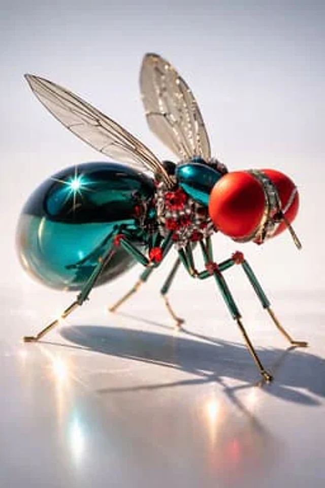

```text
{
    "resolution": "Ultra HD 8K",
    "aspect_ratio": "3:4",
    "render_quality": "extreme macro detail, studio-grade sharpness, high dynamic range",
    "lighting": "controlled studio lighting, strong specular highlights, crisp reflections, soft shadows",
    "focus": "ultra-sharp foreground, shallow depth of field background",
    "style": "hyper-detailed AI-edited macro realism",

    "MODULE_1_IMAGE_1_STYLE": {
      "subject": "mechanical insect resembling a fly",
      "pose": "standing on a reflective flat surface, body angled slightly forward, legs spread naturally",
      "body_structure": {
        "abdomen": "smooth oval metallic teal body with mirror-like reflections",
        "thorax": "complex mechanical structure with visible joints and red accent components",
        "head": "large spherical red compound eyes with matte finish",
        "legs": "thin metallic legs, green-tinted segments with gold-colored joints and tips",
        "wings": "two translucent wings with visible vein patterns, slightly raised"
      },
      "materials": {
        "primary": "polished metal, glass-like surfaces",
        "secondary": "gold-toned joints, red accent nodes"
      },
      "surface_interaction": "sharp reflections visible beneath legs and abdomen",
      "background": "clean light gray to white gradient with no visible texture",
      "visual_effects": [
        "star-like light flares on metallic surfaces",
        "high-gloss reflections",
        "precision macro clarity"
      ]
    },

    "MODULE_2_IMAGE_2_STYLE": {
      "subject": "organic fly covered with jewel-like elements",
      "pose": "standing on a dark textured surface, body angled slightly left",
      "body_structure": {
        "head": "large compound eyes with brown-gold mesh texture",
        "body": "dense black hair-like texture beneath embedded gemstones",
        "abdomen": "rounded form densely covered in diamond-like crystals",
        "legs": "thin black insect legs with fine hair details",
        "wings": "two wings fully visible, gold-veined framework filled with clear gemstone-like facets"
      },
      "materials": {
        "primary": "diamond-like crystals",
        "secondary": "gold metallic wing veins",
        "organic_elements": "fine black bristles and hairs"
      },
      "surface_interaction": "wet-looking dark ground with subtle sparkle",
      "background": "dark blurred background with soft bokeh",
      "visual_effects": [
        "micro light reflections in gemstones",
        "sparkling highlights",
        "high contrast macro lighting"
      ]
    },

    "MODULE_3_IMAGE_3_STYLE": {
      "subject": "golden mechanical mosquito-like insect",
      "pose": "feeding posture with proboscis touching skin surface",
      "body_structure": {
        "head": "smooth polished gold spherical head with visible mechanical seams",
        "proboscis": "thin metallic needle-like structure with a visible red droplet at the tip",
        "abdomen": "transparent cylindrical chamber partially filled with red liquid",
        "legs": "long thin gold metallic legs bent at sharp angles",
        "wings": "two translucent wings with gold vein structures, angled upward"
      },
      "materials": {
        "primary": "polished gold metal",
        "secondary": "clear glass-like container",
        "liquid": "deep red translucent fluid"
      },
      "surface_interaction": "human skin texture visible with pores and natural unevenness",
      "background": "dark neutral gradient with soft falloff",
      "visual_effects": [
        "precise reflections on gold surfaces",
        "realistic liquid refraction",
        "macro skin texture clarity"
      ]
    }
  }
}
```

Model: Nano Banana
Author: ShaHid WaNii

[ProjectD](https://aitoolsradar.com/en/prompts/e7c1b986a76dc9) · [Recorded source](https://x.com/meng_dagg695/status/2017858648693780480)
 · [Full original metadata and byte evidence](data/projectd-batch-0066.json)

## ShaHid WaNii #416

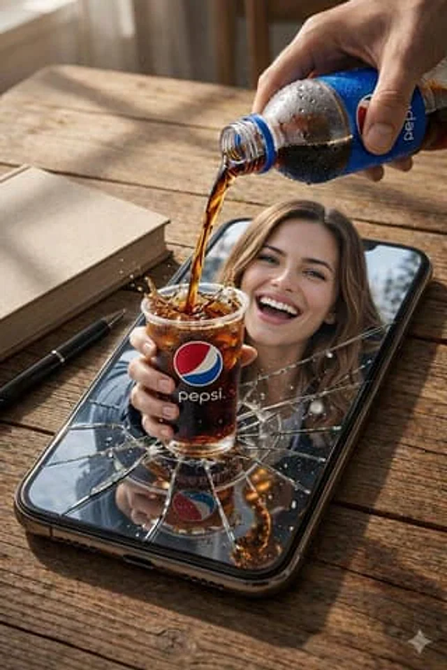

```text
{
  "resolution": "8K UHD",
  "style": "photorealistic AI-edited composite, cinematic realism",
  "scene_type": "surreal product-style composition",
  "camera": {
    "angle": "slightly elevated top-down angle",
    "focus": "sharp foreground with shallow depth of field",
    "lens_effects": [
      "natural depth of field",
      "high clarity",
      "macro-level liquid detail"
    ]
  },
  "environment": {
    "surface": "wooden table with visible grain texture",
    "lighting": {
      "type": "soft natural daylight",
      "direction": "from upper left",
      "shadows": "soft realistic shadows under objects"
    },
    "background": {
      "indoor": true,
      "elements": [
        "blurred interior background",
        "snowy outdoor scenery visible inside phone screen in one image"
      ]
    }
  },
  "main_object": {
    "smartphone": {
      "position": "lying flat on wooden table",
      "orientation": "vertical portrait orientation",
      "color": "black",
      "screen_state": "visibly cracked glass with radial fracture lines",
      "screen_interaction": "screen appears broken outward, allowing subject to emerge"
    }
  },
  "human_subject": {
    "visibility": "upper body visible through phone screen",
    "expression": "wide smile, visible teeth",
    "eye_direction": "looking toward the viewer",
    "gender_presentation": "female-presenting",
    "hair": {
      "color": "light brown",
      "style": "loose, shoulder-length"
    },
    "clothing_variants": [
      {
        "outfit": "casual indoor look",
        "details": "neutral top visible behind phone screen"
      },
      {
        "outfit": "winter clothing",
        "details": [
          "dark padded jacket",
          "light turtleneck sweater",
          "black gloves",
          "black fur hat"
        ]
      }
    ]
  },
  "action": {
    "primary_action": "soda being poured into a transparent plastic cup",
    "motion": "liquid splash frozen mid-air",
    "liquid_behavior": [
      "visible carbonation bubbles",
      "splash droplets",
      "overflow splash effect"
    ]
  },
  "beverage": {
    "type": "cola",
    "cup": {
      "material": "transparent plastic",
      "filled_with": "dark carbonated soda with ice",
      "logo": "Pepsi logo clearly visible"
    },
    "bottle": {
      "material": "plastic",
      "label": "Pepsi branding visible",
      "condition": "condensation droplets on bottle surface",
      "held_by": "human hand entering frame from top right"
    }
  },
  "secondary_objects": [
    {
      "object": "book",
      "position": "left side of phone",
      "color": "light beige cover",
      "state": "closed"
    },
    {
      "object": "pen",
      "position": "near book on table",
      "color": "black",
      "orientation": "diagonal"
    }
  ],
  "effects": {
    "surreal_elements": [
      "subject emerging from phone screen",
      "physical interaction between digital and real space"
    ],
    "particles": [
      "liquid droplets",
      "snow particles in winter scene variant"
    ],
    "glass_effects": [
      "cracked screen shards",
      "reflections on broken glass"
    ]
  },
  "color_palette": {
    "dominant_colors": [
      "warm brown",
      "black",
      "deep cola brown",
      "blue and red branding accents"
    ],
    "contrast": "high contrast between warm table tones and cool screen elements"
  },
  "post_processing": {
    "sharpness": "ultra-sharp",
    "clarity": "high micro-detail",
    "noise": "none",
    "dynamic_range": "high"
  },
  "mood": "playful, surreal, visually striking",
  "realism_level": "high realism with intentional AI-edited surreal effect"
}
```

Model: Nano Banana
Author: ShaHid WaNii

[ProjectD](https://aitoolsradar.com/en/prompts/52fc12d023de87) · [Recorded source](https://x.com/meng_dagg695/status/2010615081491677185)
 · [Full original metadata and byte evidence](data/projectd-batch-0066.json)

## ShaHid WaNii #530

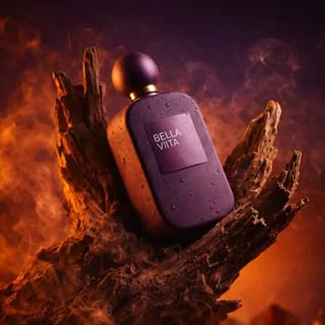

```text
{
  "master_prompt": {
    "global_settings": {
      "resolution": "8K",
      "aspect_ratio": "1:1",
      "image_type": "photorealistic AI-generated product photography",
      "detail_level": "ultra-high detail, macro clarity",
      "noise": "none",
      "artifacts": "none",
      "focus": "sharp subject, controlled depth of field"
    },

    "module_1_image_1_style": {
      "subject": {
        "object_type": "cosmetic bottle",
        "label_text_visible": "NAHDA SKINCARE",
        "product_type_text": "SHOWER GEL / SHOWER GEL",
        "bottle_material": "frosted translucent glass",
        "liquid_color": "soft pale yellow",
        "shape": "cylindrical with rounded shoulders",
        "cap": {
          "material": "metallic",
          "color": "silver",
          "surface_pattern": "hexagonal honeycomb texture",
          "finish": "matte"
        },
        "surface_details": "small and medium water droplets evenly distributed"
      },
      "environment": {
        "setting": "forest floor",
        "base_surface": "weathered tree stump",
        "surroundings": [
          "green moss",
          "small yellow wildflowers",
          "tree trunk to the right",
          "fine spider web attached to moss"
        ],
        "background": "soft forest bokeh with diffused sunlight",
        "atmosphere": "humid, natural, calm"
      },
      "lighting": {
        "type": "natural diffused light",
        "direction": "soft backlight and side illumination",
        "highlights": "gentle glow through liquid",
        "shadows": "soft, natural"
      },
      "camera": {
        "angle": "eye-level product shot",
        "lens_style": "macro product photography",
        "depth_of_field": "shallow"
      },
      "color_palette": [
        "pale yellow",
        "soft green",
        "natural brown",
        "muted gold"
      ]
    },

    "module_2_image_2_style": {
      "subject": {
        "object_type": "perfume bottle",
        "label_text_visible": "FOREST",
        "bottle_color": "deep matte green",
        "material": "opaque glass",
        "shape": "rectangular with rounded edges",
        "cap": {
          "material": "metallic",
          "color": "gold",
          "finish": "glossy cylindrical"
        },
        "surface_details": "dense fine water droplets covering bottle"
      },
      "environment": {
        "setting": "forest pathway",
        "base_surface": "moss-covered stone or log",
        "foreground_elements": [
          "orange autumn leaf",
          "fallen brown leaves"
        ],
        "background": "tall trees fading into mist",
        "atmosphere": "misty, cool, forest depth"
      },
      "lighting": {
        "type": "warm ambient forest light",
        "direction": "top-front diffused",
        "effects": "soft glow and mist illumination"
      },
      "camera": {
        "angle": "straight-on centered composition",
        "lens_style": "portrait product lens",
        "depth_of_field": "moderate with soft background blur"
      },
      "color_palette": [
        "forest green",
        "gold",
        "autumn orange",
        "earth brown"
```

Model: Nano Banana
Author: ShaHid WaNii

[ProjectD](https://aitoolsradar.com/en/prompts/91ac7fc387ebc7) · [Recorded source](https://x.com/meng_dagg695/status/2020094371107074147)
 · [Full original metadata and byte evidence](data/projectd-batch-0066.json)

## ShaHid WaNii #852

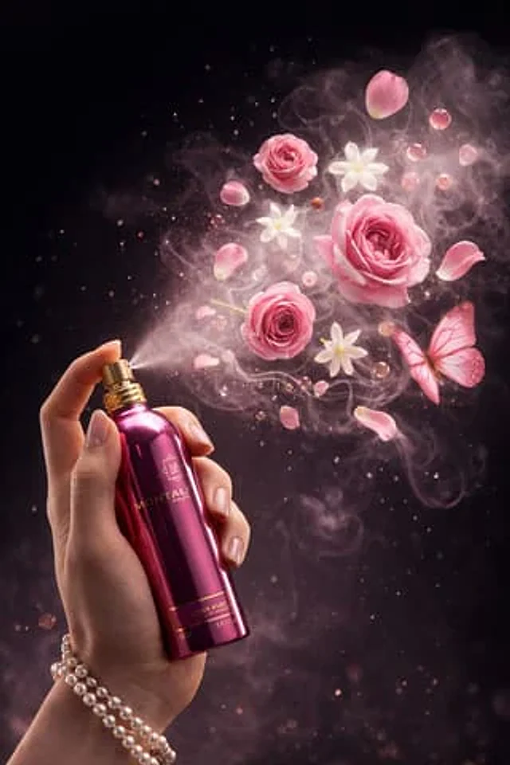

```text
{
  "resolution": "8K",
  "aspect_ratio": "3:4",
  "style": "high-end AI-edited studio photography",
  "subject": {
    "primary": "human hand holding a metallic pink perfume bottle",
    "hand_details": {
      "skin": "smooth, well-groomed",
      "nails": "short to medium length, natural nude tone",
      "accessory": "white pearl bracelet on wrist"
    },
    "bottle": {
      "material": "metallic reflective",
      "color": "deep metallic pink",
      "shape": "cylindrical with rounded shoulders",
      "nozzle": "gold spray nozzle, cap removed",
      "charm": {
        "material": "gold",
        "shape": "small geometric star-like tag",
        "attachment": "hanging from bottle neck via thin metal loop"
      },
      "visible_text": "MONTALE"
    }
  },
  "action": {
    "spray": {
      "type": "fine atomized mist",
      "direction": "left to right",
      "texture": "soft, smoke-like, semi-transparent"
    }
  },
  "elements_emerging_from_mist": {
    "flowers": {
      "pink_roses": "fully bloomed roses floating in air",
      "rose_petals": "individual pink petals suspended mid-air",
      "white_flowers": "small star-shaped white blossoms with thin petals"
    },
    "butterfly": {
      "color": "pink",
      "wings": "semi-translucent with visible veins",
      "position": "right side of frame"
    },
    "particles": {
      "type": "small glowing bokeh-like specks",
      "colors": ["soft pink", "warm gold"]
    }
  },
  "background": {
    "color": "dark black to deep brown gradient",
    "environment": "studio, no visible location"
  },
  "lighting": {
    "type": "soft cinematic studio lighting",
    "highlights": ["bottle curves", "gold nozzle", "mist", "flowers"],
    "contrast": "high subject-to-background contrast"
  },
  "composition": {
    "orientation": "vertical",
    "subject_position": "slightly left of center",
    "depth": "foreground hand, mid-air mist and flowers, dark background"
  },
  "quality": {
    "sharpness": "ultra-sharp",
    "detail_level": "extreme micro-detail",
    "finish": "luxury advertising grade"
  }
}
```

Model: Nano Banana
Author: ShaHid WaNii

[ProjectD](https://aitoolsradar.com/en/prompts/2255f4f95cf64f) · [Recorded source](https://x.com/meng_dagg695/status/2019001264416362931)
 · [Full original metadata and byte evidence](data/projectd-batch-0066.json)

## Shams #574

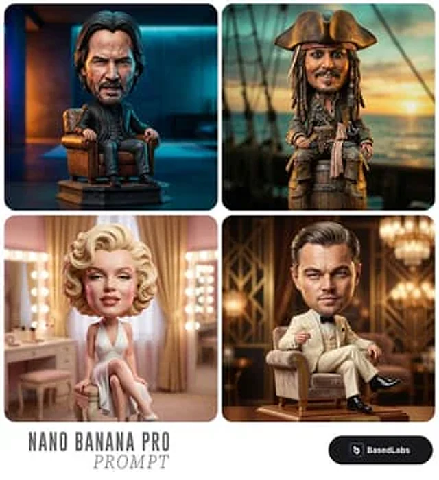

```text
Highly detailed caricature figurine of [SUBJECT] as a cute but intense bobblehead-style collectible statue, exaggerated oversized head with hyper-realistic facial features, deep wrinkles, fierce intense expression, slightly open mouth showing teeth, sitting relaxed in a vintage armchair, wearing [OUTFIT], dramatic colorful studio lighting, [BACKGROUND], modern collectible toy photography style, sharp focus, cinematic depth of field, extremely intricate sculpting details, realistic skin texture, professional product photography, 8k quality
```

Model: Nano Banana
Author: Shams

[ProjectD](https://aitoolsradar.com/en/prompts/c3751a77149e8b) · [Recorded source](https://x.com/ShamsAmin56/status/2021519254151942239)
 · [Full original metadata and byte evidence](data/projectd-batch-0066.json)

## Sharon Riley #1006

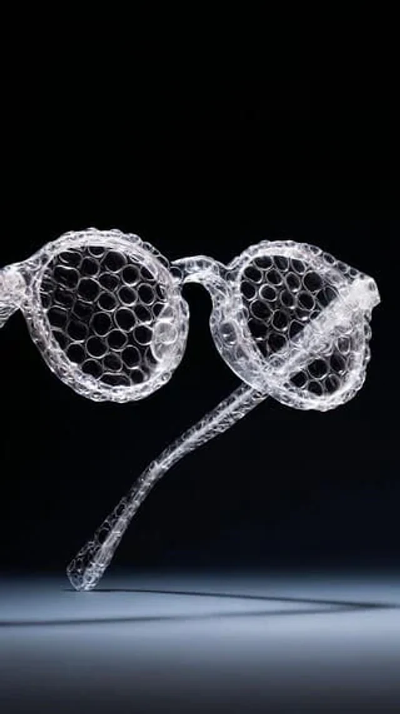

```text
{
  "prompt": "A studio shot of a transparent bubble wrap fashion elegant [ITEM], empty with nothing inside. The material is clear, glossy, and highly detailed, capturing the texture of inflated bubbles. Minimalist composition, high-fashion editorial style, soft diffused studio lighting, neutral background, ultra-clean aesthetic, photorealistic rendering, sharp focus.",
  "style": {
    "lighting": "soft diffused studio lighting",
    "background": "neutral seamless backdrop",
    "mood": "modern, minimalist, elegant",
    "quality": "ultra-detailed, photorealistic",
    "material": "transparent bubble wrap"
  }
}
```

Model: Nano Banana
Author: Sharon Riley

[ProjectD](https://aitoolsradar.com/en/prompts/dc358f1615dc80) · [Recorded source](https://x.com/Just_sharon7/status/2015757888283652351)
 · [Full original metadata and byte evidence](data/projectd-batch-0066.json)

## Sharon Riley #1017

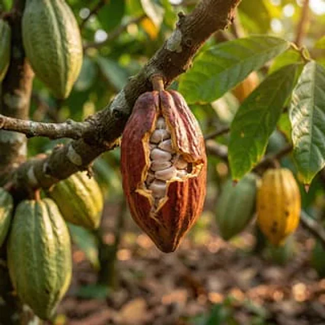

```text
High-quality realistic commercial shot of a cocoa plantation in landscape orientation, cocoa tree as background, one cocoa pod partially split open on the branch in the center, fresh cocoa beans clearly visible inside with fibrous natural texture, slight irregular opening, surrounding pods and leaves softly out of focus, rich earthy brown and green tones, warm natural daylight with soft directional highlights, shallow depth of field, premium agricultural realism, no text, no people, no branding.
```

Model: Nano Banana
Author: Sharon Riley

[ProjectD](https://aitoolsradar.com/en/prompts/6dd5714331e269) · [Recorded source](https://x.com/Just_sharon7/status/2015730476632474105)
 · [Full original metadata and byte evidence](data/projectd-batch-0066.json)

## Sharon Riley #1048

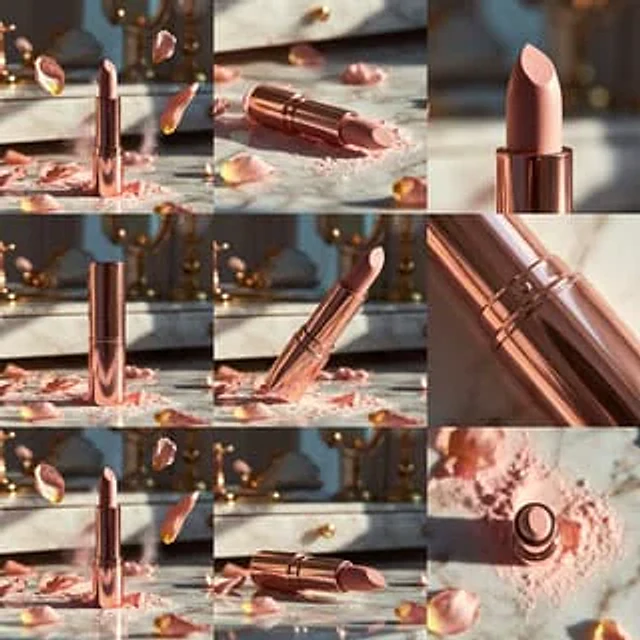

```text
Elegant rose-gold lipstick standing upright on a reflective marble surface, surrounded by flying rose petals and soft powder dust. Warm studio lighting with dramatic shadows, luxury vanity background with blurred mirrors and golden accents, cinematic mood, macro product photography, ultra-sharp details, glossy textures, premium cosmetic brand style.

3×3photo grid with different angles and poses. Same character, consistent look, clean lighting, real photoshoot vibe 2k.
```

Model: Nano Banana
Author: Sharon Riley

[ProjectD](https://aitoolsradar.com/en/prompts/6e7c602a6a4796) · [Recorded source](https://x.com/Just_sharon7/status/2015812732977824176)
 · [Full original metadata and byte evidence](data/projectd-batch-0066.json)

## Sharon Riley #1060

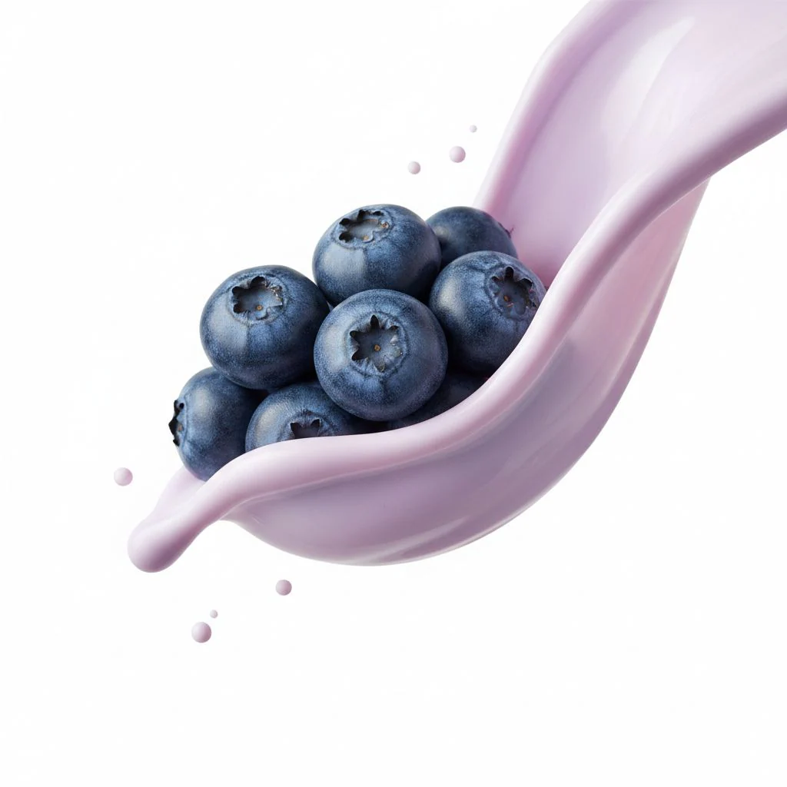

```text
A high-speed studio photograph of a cluster of fresh blueberries suspended midair, softly wrapped by a gentle flow of pale blueberry yogurt, smooth and restrained liquid motion, minimal splash, thick and creamy texture, elegant curved yogurt flow hugging the berries, very few small droplets, calm fluid dynamics, photorealistic macro food photography, ultra-realistic texture, professional studio lighting, soft diffuse highlights, pure white background, isolated object, clean cutout, no CGI, no 3D render, no illustration
```

Model: Nano Banana
Author: Sharon Riley

[ProjectD](https://aitoolsradar.com/en/prompts/32edee6e40d845) · [Recorded source](https://x.com/Just_sharon7/status/2020688064964940218)
 · [Full original metadata and byte evidence](data/projectd-batch-0066.json)

## Sharon Riley #1109

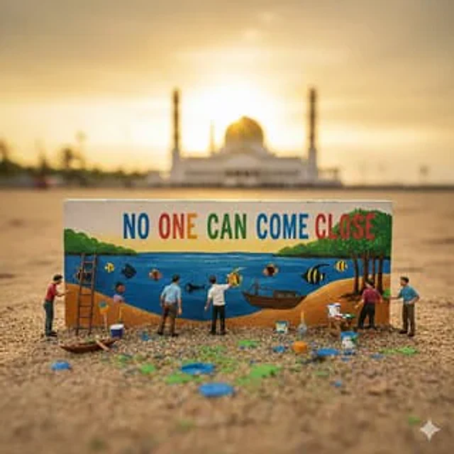

```text
{
  "scene": {
    "description": "Artistic miniature diorama of youthful figurines collaboratively painting a vibrant environmental mural on a small outdoor wall near Gedung Sate, Bandung.",
    "location": "Near Gedung Sate, Bandung, Indonesia",
    "environment": "Urban cultural landmark setting with a cozy, handcrafted miniature scale"
  },
  "subjects": {
    "characters": "Miniature youth figurines",
    "actions": [
      "painting a large colorful mural",
      "climbing tiny ladders",
      "holding paint brushes and buckets",
      "splashing paint playfully"
    ],
    "expressions": "Energetic, joyful, creative"
  },
  "mural_details": {
    "theme": "Environmental awareness and positivity",
    "elements": [
      "green mountains",
      "lush trees",
      "bicycles symbolizing eco-friendly transport",
      "clean flowing rivers"
    ],
    "text": "You're the best, Sharon"
  },
  "props": {
    "items": [
      "tiny paint buckets",
      "mini ladders",
      "small paint brushes",
      "paint splashes on ground and wall"
    ]
  },
  "style": {
    "art_form": "Miniature diorama",
    "photography": "Cinematic macro photography",
    "detail_level": "Highly detailed textures and figures"
  },
  "lighting": {
    "type": "Warm, soft lighting",
    "mood": "Bright, cheerful, uplifting"
  },
  "camera": {
    "depth_of_field": "Shallow depth of field",
    "focus": "Sharp focus on figurines and mural"
  },
  "color_palette": {
    "tones": [
      "Bright",
      "Cheerful",
      "Vivid"
    ]
  },
  "render_settings": {
    "aspect_ratio": "4:5",
    "quality": 2,
    "stylization": "2/5"
  }
}
```

Model: Nano Banana
Author: Sharon Riley

[ProjectD](https://aitoolsradar.com/en/prompts/c8e7f29687be51) · [Recorded source](https://x.com/Just_sharon7/status/2011978683230347749)
 · [Full original metadata and byte evidence](data/projectd-batch-0066.json)

## Sharon Riley #1141

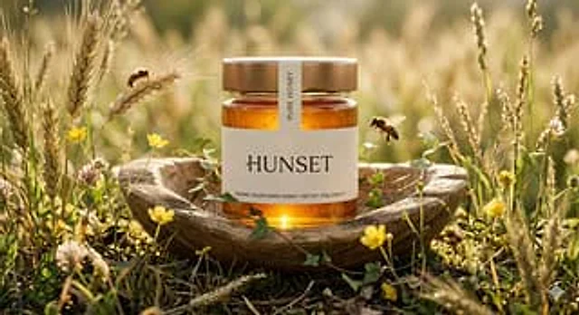

```text
Ultra-realistic cinematic product shot of a premium honey jar placed inside a shallow wooden hollow surrounded by tall wild wheat and tiny yellow meadow flowers, captured from an intimate low-angle macro perspective with slight cinematic depth, transparent glass jar filled with luminous deep golden honey, topped with a satin bronze metallic lid and a narrow cream seal strip crossing vertically over the cap, minimal luxury label reading “HUNSET”, jar lightly touched by thin climbing ivy strands for a refined organic detail, one realistic honeybee hovering near the front glass surface while another rests on a wheat stem behind the jar, environment set in a quiet countryside field during late afternoon, warm sunlight filtering through wheat stalks from behind creating glowing translucency inside the honey and soft halo edges around the jar, foreground with blurred wheat tips and soft natural bokeh, distant background fading into creamy green and amber tones, shallow depth of field with extreme sharpness on jar textures, visible honey thickness, subtle glass reflections, detailed plant fibers and pollen particles in air, cinematic luxury advertising mood, shot on 90mm macro lens, f/2.2, ultra-detailed natural textures, premium organic brand campaign style, 8k resolution, no text, no watermark.
```

Model: Nano Banana
Author: Sharon Riley

[ProjectD](https://aitoolsradar.com/en/prompts/4856c30e906bec) · [Recorded source](https://x.com/Just_sharon7/status/2039694451552272532)
 · [Full original metadata and byte evidence](data/projectd-batch-0066.json)

## Sharon Riley #1189

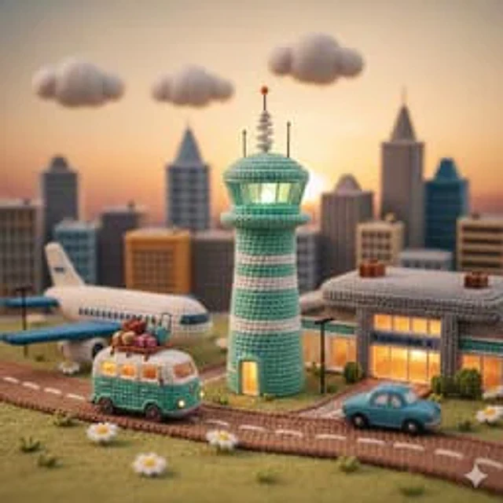

```text
A highly detailed miniature diorama entirely made of crochet and amigurumi yarn, whimsical cute style, featuring a tall mint-green crocheted airport control tower with white accents and antenna on top, a small teal crocheted camper van with luggage on roof driving on a crocheted road, tiny crocheted blue classic car, a large crocheted passenger airplane parked near an orange-lit terminal building, crocheted city skyline with tall buildings in the background, sunset sky with soft clouds and golden hour lighting, tiny crocheted daisies and grass patches on the ground, textured yarn stitches visible everywhere, cozy handmade craft aesthetic, soft pastel colors, dreamy warm atmosphere, macro photography style, bokeh background, ultra detailed, cute and charming
```

Model: Nano Banana
Author: Sharon Riley

[ProjectD](https://aitoolsradar.com/en/prompts/d9d48e4bc091de) · [Recorded source](https://x.com/Just_sharon7/status/2017994945785643125)
 · [Full original metadata and byte evidence](data/projectd-batch-0066.json)

## Sharon Riley #1224

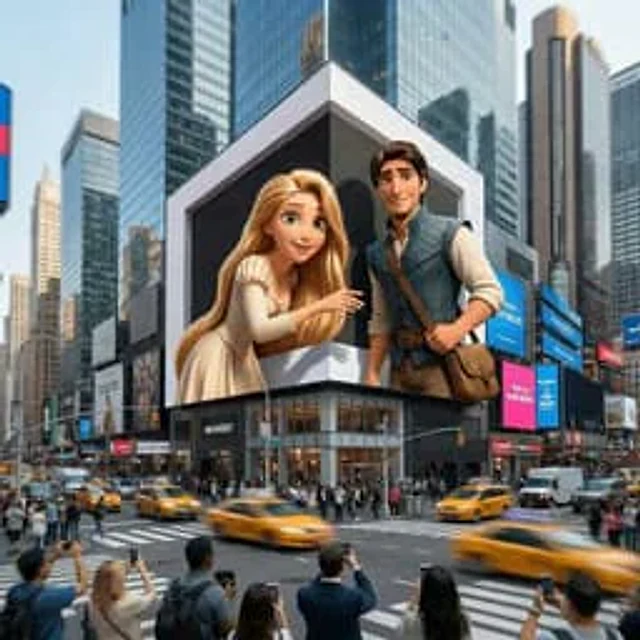

```text
{
  "scene": {
    "location": "Busy Western metropolitan intersection, inspired by New York Times Square",
    "architecture": {
      "surroundings": "Modern glass skyscrapers, large digital billboards, clean urban architecture",
      "special_features": [
        "Massive L-shaped naked-eye 3D LED screen on building corner"
      ]
    },
    "lighting": "Daylight from real city environment casting realistic shadows and reflections onto screen edges and nearby buildings",
    "tone": "Premium, editorial, museum-grade, cinematic, grounded, respectful, playful yet premium"
  },
  "characters": [
    {
      "name": "Rapunzel",
      "source": "Tangled",
      "render_style": "High-end cinematic 3D",
      "details": "Faithful to original design, enhanced with ultra-detailed textures, lighting, and depth"
    },
    {
      "name": "Flynn Rider",
      "source": "Tangled",
      "render_style": "High-end cinematic 3D",
      "details": "Faithful to original design, enhanced with ultra-detailed textures, lighting, and depth"
    },
    {
      "name": "Judy Hopps",
      "source": "Zootopia",
      "positioning": "Slightly forward, leaning out of the screen, upper body and ears subtly breaking screen boundary",
      "details": "Alive and expressive, near-photorealistic fur texture and facial expression"
    },
    {
      "name": "Nick Wilde",
      "source": "Zootopia",
      "positioning": "Beside Judy, relaxed posture, half-smiling, tail and shoulder extending into real-world space",
      "details": "Alive and expressive, near-photorealistic fur texture and facial expression"
    }
  ],
  "animation": {
    "style": "Naked-eye 3D, cinematic, polished but not uncanny",
    "purpose": "Hollywood-level outdoor advertising installation designed to stop pedestrians in their tracks",
    "overall_feel": "Playful, premium, cinematic, grounded"
  }
}
```

Model: Nano Banana
Author: Sharon Riley

[ProjectD](https://aitoolsradar.com/en/prompts/77a36ee2626299) · [Recorded source](https://x.com/Just_sharon7/status/2029508809971118124)
 · [Full original metadata and byte evidence](data/projectd-batch-0066.json)

## Sharon Riley #1265

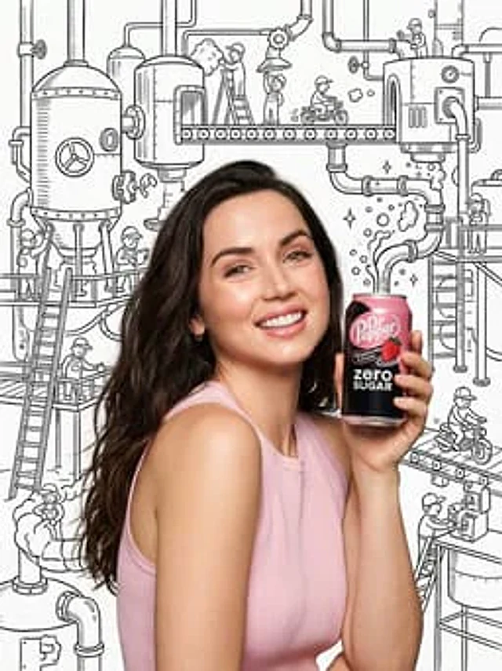

```text
{
  "prompt": "A high-quality realistic photograph of Ana de Armas with glowing skin, long dark hair, and a bright happy smile showing teeth, holding a can of 'Dr Pepper Strawberries & Cream Zero Sugar' near her face. The background is a creative, whimsical 2D black-and-white line art illustration of a soda factory. The illustration features stylized pipes, industrial tanks, and tiny cartoon workers on ladders and motorbikes. Some of the hand-drawn pipes appear to 'connect' to the soda can, with illustrated bubbles flowing out. Ana is wearing a light pink sleeveless top, complementing the soda can aesthetic. Bright, clean studio lighting, 8k resolution, mixed media art style.",
  "key_elements": {
    "mixed_media": "Combine realistic photography of Ana de Armas with 2D hand-drawn illustration in one cohesive image",
    "contrast": "Realistic Ana pops against black-and-white line art",
    "interaction": "Illustrated pipes connect to soda can with bubbles flowing",
    "color_palette": "Light pink clothing matching pink/red tones of soda can for a high-end commercial look"
  },
  "style": "mixed media, whimsical, high-end commercial",
  "resolution": "8k",
  "lighting": "bright, clean studio lighting"
}
```

Model: Nano Banana
Author: Sharon Riley

[ProjectD](https://aitoolsradar.com/en/prompts/da03831dd191ba) · [Recorded source](https://x.com/Just_sharon7/status/2030315357651845379)
 · [Full original metadata and byte evidence](data/projectd-batch-0066.json)

## Sharon Riley #1316

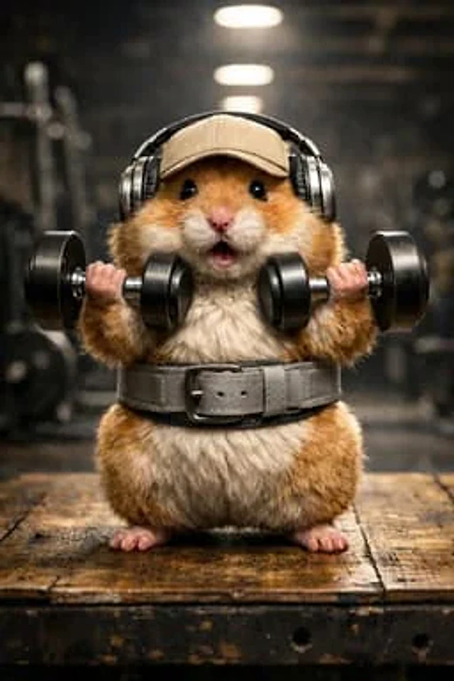

```text
A hyper-detailed, adorable golden hamster in a bright, cheerful gym, animated in smooth cinematic motion. The chubby hamster, fluffy and round, lifts oversized black dumbbells with both tiny paws, bouncing slightly with effort. It wears playful over-ear headphones, a backwards beige baseball cap, and a soft grey weightlifting belt. Mouth open in an excited squeak, eyes sparkling with joy and determination. Warm, soft lighting with gentle shadows shifts subtly across the scene, highlighting floating dust motes and colorful gym equipment. Camera slowly pans around the hamster, showing dynamic angles from three-quarters and low perspectives. Fun textures and whimsical details remain visible throughout. Motion is lively, charming, and heartwarming, 8K ultra-realistic cinematic style, shallow depth of field, soft focus transitions, gentle ambient gym sounds.
--ar 3:4 --stylize 250 --v 6
```

Model: Nano Banana
Author: Sharon Riley

[ProjectD](https://aitoolsradar.com/en/prompts/52442d962631b3) · [Recorded source](https://x.com/Just_sharon7/status/2018258206964027484)
 · [Full original metadata and byte evidence](data/projectd-batch-0066.json)

## Sharon Riley #1323

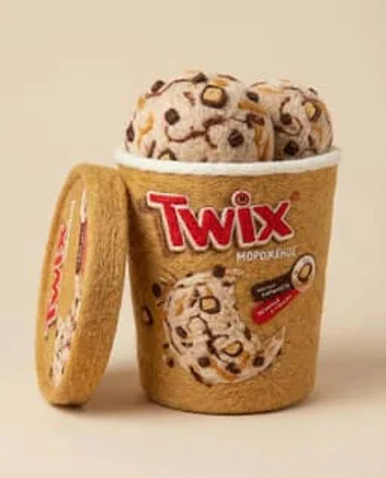

```text
{
  "prompt": "A realistic, needle-felted sculpture of a product from a photo, captured in a high-detail macro studio shot with a whimsical aesthetic.",
  "subject": {
    "type": "Needle-felted sculpture",
    "based_on": "User-provided product photograph",
    "material": "Soft wool felt",
    "attributes": [
      "Fluffy textures",
      "Hand-felted details",
      "Soft edges",
      "Cozy appearance",
      "3D look"
    ]
  },
  "photography": {
    "shot_type": "Studio shot",
    "focus": "Macro focus",
    "detail_level": "High detail"
  },
  "lighting": {
    "type": "Soft, diffused lighting",
    "mood": "Warm and gentle"
  },
  "setting": {
    "background": "Minimal, solid pastel color"
  },
  "aesthetics": {
    "overall_style": "Whimsical and charming"
  },
  "parameters": {
    "aspect_ratio": "4:5"
  }
}
```

Model: Nano Banana
Author: Sharon Riley

[ProjectD](https://aitoolsradar.com/en/prompts/08f7ee65f8169d) · [Recorded source](https://x.com/Just_sharon7/status/2009566056227238069)
 · [Full original metadata and byte evidence](data/projectd-batch-0066.json)

## Sharon Riley #1326

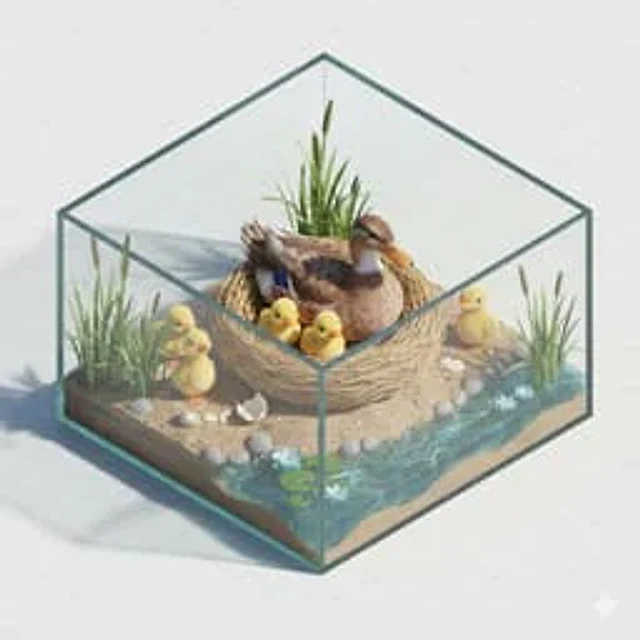

```text
Isometric miniature nature diorama showing a mother [PARROT]  feeding newborn chicks in a nest on a tree branch. Leaves forming clean geometric layers, soft sky background, light breeze effect. Balanced lighting, pastel greens and blues, wholesome storybook atmosphere. Clean isometric perspective, macro detail, professional 3D render.
```

Model: Nano Banana
Author: Sharon Riley

[ProjectD](https://aitoolsradar.com/en/prompts/22b93dd96e3668) · [Recorded source](https://x.com/Just_sharon7/status/2012034903433716185)
 · [Full original metadata and byte evidence](data/projectd-batch-0066.json)

## Sharon Riley #1341


```text
{
  "prompt": "Isometric 3D kawaii scene of chibi baby bears designing a mountain snow map inside a cozy wooden hideout. The isometric cutaway room features a large hand-drawn map spread across a tilted work table, decorated with tiny flags, paw-print markers, and string lines connecting different locations. Three baby bears wear soft hooded outfits in warm terracotta, foggy blue, and oatmeal beige. One bear stands on a small stool placing a flag on the map, another measures distances using a string and wooden ruler, while the third sketches snowy paths with a crayon. The room includes wooden shelves filled with rolled maps, compasses, ink bottles, backpacks, and snow boots placed near the door. Small windows reveal snow-covered mountains and pine forests outside.",
  "style": {
    "art_style": "kawaii 3D",
    "perspective": "isometric cutaway",
    "geometry": "rounded, toy-like proportions",
    "render_type": "ultra-detailed 3D render"
  },
  "lighting": {
    "type": "warm indoor lighting",
    "mood": "soft and cozy",
    "contrast": "gentle highlights with smooth shadows"
  },
  "color_palette": {
    "primary": ["pastel earthy tones"],
    "accent": ["warm terracotta", "foggy blue", "oatmeal beige"]
  },
  "atmosphere": {
    "emotion": "wholesome and adventurous",
    "vibe": "cozy, playful, story-driven"
  },
  "quality": {
    "detail_level": "ultra detailed",
    "resolution": "8k",
    "rating": "masterpiece, premium quality"
  }
}
```

Model: Nano Banana
Author: Sharon Riley

[ProjectD](https://aitoolsradar.com/en/prompts/aa6c6611216a14) · [Recorded source](https://x.com/Just_sharon7/status/2011747649398194268)
 · [Full original metadata and byte evidence](data/projectd-batch-0066.json)

## Sharon Riley #1355


```text
{
  "prompt": "massive giant inflatable WhatsApp logo floating in the ocean near the beach, huge rectangular green mermaid logo with white siren face, long flowing white wavy hair, green crown with stars, ultra-detailed brand-accurate WhatsApp siren, enormous 100-meter diameter inflatable platform, emerald green rubber texture with subtle glossy highlights, classic green and white color scheme, dozens of people in swimsuits playing and lying on the giant inflatable, some standing, some sitting, some swimming around the edges, tropical beach setting, golden sand, turquoise ocean waves gently crashing around the edges, bright sunny day, aerial drone top-down perspective, very wide angle overhead shot, crystal clear water, people casting small shadows on the white face, vibrant summer atmosphere, advertising campaign style, hyperrealistic, extremely detailed, 8k",
  "negative_prompt": "text, letters, words, deformed, blurry, low resolution, bad anatomy, extra limbs, watermark, logo in corner, people inside the face, dark mood, night, winter, snow, ugly, cartoon, illustration, painting, sketch, 3d render, plastic toy look",
  "aspect_ratio": "16:9",
  "style": "photorealistic",
  "lighting": "bright natural sunlight, golden hour rim light, soft shadows",
  "camera": "drone aerial view, directly overhead, 200mm lens, slight wide angle distortion",
  "quality_tags": "masterpiece, best quality, ultra detailed, highly detailed, sharp focus, cinematic lighting, 8k resolution"
}
```

Model: Nano Banana
Author: Sharon Riley

[ProjectD](https://aitoolsradar.com/en/prompts/e5428d6fcf2d79) · [Recorded source](https://x.com/Just_sharon7/status/2011422517156860056)
 · [Full original metadata and byte evidence](data/projectd-batch-0066.json)

## Sharon Riley #1366


```text
{
  "subject": {
    "primary": "Two foil sachets of Marvico Tomato Mix Paste seasoning tilted diagonally",
    "secondary": "A rustic metal pot filled with rich, bubbling red Nigerian-style tomato stew containing assorted meats and tripe",
    "details": [
      "Vibrant red tomato sauce consistency",
      "Fresh whole tomato splash at the bottom foreground",
      "Sachets feature green and gold 'MARVICO' branding with realistic tomato illustrations",
      "A cheerful young Western blonde woman with long hair, wearing a casual bright outfit, holding the sachets and smiling at the camera"
    ]
  },
  "composition": {
    "layout": "Dynamic vertical advertisement",
    "focal_point": "Product sachets held by the girl in the center-left, overlapping a large pot of stew in the top-right",
    "background": "Solid textured red gradient with a subtle grainy paper effect",
    "perspective": "Eye-level with a slight Dutch angle for energy"
  },
  "typography": {
    "main_text": "Better Christmas stew don sure",
    "sub_text": "...original from nature",
    "font_style": "Bold, playful white bubble script for main text; minimalist lowercase sans-serif for sub-text",
    "placement": "Centered at the bottom over the red background"
  },
  "color_palette": {
    "dominant": ["Crimson Red", "Deep Scarlet"],
    "accents": ["Forest Green", "Metallic Gold", "Bright White"],
    "lighting": "Studio lighting with high contrast to make the red sauce look glossy and appetizing"
  },
  "style_descriptors": [
    "Commercial food photography",
    "West African culinary aesthetic",
    "High-definition textures",
    "Vibrant and warm color grading",
    "Professional product placement",
    "Lifestyle advertising with a relatable model"
  ],
  "technical_settings": {
    "aspect_ratio": "4:5",
    "sharpness": "High",
    "texture": "Subtle film grain on the background"
  }
}
```

Model: Nano Banana
Author: Sharon Riley

[ProjectD](https://aitoolsradar.com/en/prompts/c52e1f657d81be) · [Recorded source](https://x.com/Just_sharon7/status/2011383874937663775)
 · [Full original metadata and byte evidence](data/projectd-batch-0066.json)

## Sharon Riley #1368


```text
Luxury product photography of artisanal vanilla ground coffee packaged in a soft sculpted ivory pouch with gentle wave contours, minimal branding embossed into fabric. The pouch rests on a rustic oak tabletop dusted with coffee grounds, accompanied by a hand-carved wooden scoop spilling aromatic powder.
Natural Madagascar vanilla pods curve organically around the base, blending into drifting coffee granules that form a subtle flowing aroma path instead of a spiral.
On the pouch front, a modern sensory chart: thin matte gold lines showing flavor balance — low acidity, rich sweetness, full-bodied depth.
Warm morning sunlight enters from the left at a low angle, creating soft shadows and tactile fabric highlights. Background fades into a cozy café interior with creamy bokeh lights, evoking calm morning rituals.
Ultra-sharp macro texture on vanilla pods and coffee grains, cinematic depth of field, premium lifestyle aesthetic, inviting, warm, handcrafted, high-end brand feel.
```

Model: Nano Banana
Author: Sharon Riley

[ProjectD](https://aitoolsradar.com/en/prompts/1b8f64f3835d5e) · [Recorded source](https://x.com/Just_sharon7/status/2012110717592457678)
 · [Full original metadata and byte evidence](data/projectd-batch-0066.json)

## Sharon Riley #470

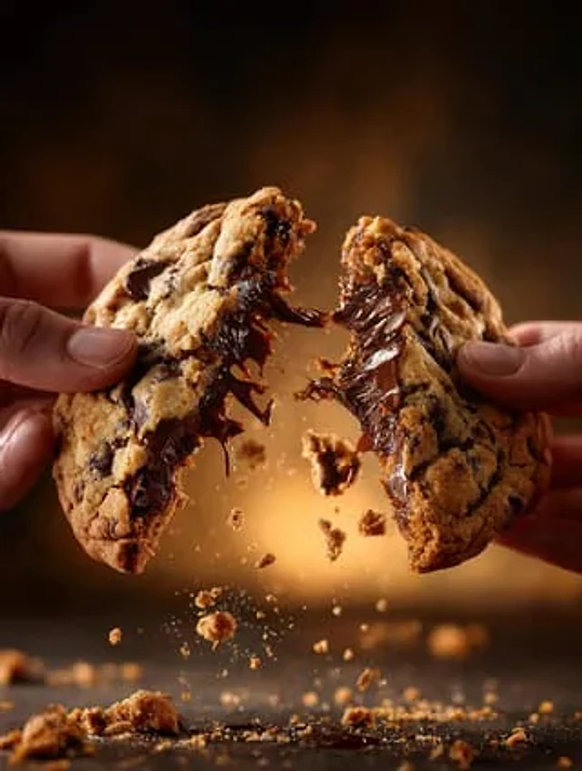

```text
{
  "model": "Nano Banana / Gemini-style",
  "aspect_ratio": "3:4",
  "render_mode": "raw",
  "series": [
    {
      "index": "1/5",
      "prompt": "two hands pulling apart a grilled cheese sandwich, strands of melted cheddar stretching dramatically between the halves, toasted bread edges crisp and golden, crumbs falling mid-air, warm cozy light, cinematic food action photography",
      "category": "cheese pull",
      "lighting": "warm cozy cinematic light",
      "detail_level": "high-detail"
    },
    {
      "index": "2/5",
      "prompt": "two hands breaking a warm chocolate chip cookie in half, melted chocolate strands stretching between the pieces, crumbs falling mid-air, cozy warm light, high-detail food action photography",
      "category": "chocolate stretch",
      "lighting": "soft cozy warm light",
      "detail_level": "high-detail"
    },
    {
      "index": "3/5",
      "prompt": "two hands splitting a peanut butter and jelly sandwich in half, thick peanut butter and jam stretching in gooey strands, toasted bread edges crisp, crumbs falling mid-air, warm cozy backlight, high-detail food action photography",
      "category": "gooey spread pull",
      "lighting": "warm backlight",
      "detail_level": "high-detail"
    },
    {
      "index": "4/5",
      "prompt": "two hands tearing a syrup-soaked Belgian waffle, caramel strands stretching between pieces, crumbs and syrup droplets suspended mid-air, golden hour backlight, cozy cinematic food action photography",
      "category": "syrup stretch",
      "lighting": "golden hour backlight",
      "detail_level": "ultra-detailed"
    },
    {
      "index": "5/5",
      "prompt": "two hands breaking a southern-style buttery biscuit in half, hot steam rising, melted butter pooling inside the cracks, crumbs falling mid-air, warm country kitchen light, cinematic high-detail food action photography",
      "category": "steam & butter",
      "lighting": "warm kitchen light",
      "detail_level": "ultra-detailed"
    }
  ]
}
```

Model: Nano Banana
Author: Sharon Riley

[ProjectD](https://aitoolsradar.com/en/prompts/b5e72acc4bd067) · [Recorded source](https://x.com/Just_sharon7/status/2011261271946187209)
 · [Full original metadata and byte evidence](data/projectd-batch-0066.json)

## Sharon Riley #497

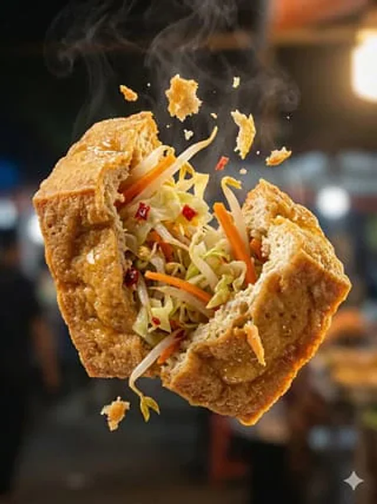

```text
"Macro food photography of a crispy martabak telur tearing open mid-air, thin golden wrapper shattering with a crack, hot filling of minced beef, scallions, and egg bursting outward. Flecks of fried onion and pepper suspended in motion, steam visible, glossy oil sheen catching the light. Warm Indonesian street-stall lighting, tungsten + charcoal warmth, dramatic rim light, ultra high texture detail (bubbled wrapper, layered interior).Editorial food shot, shallow depth of field, bokeh of night market signage, Nikon Z9 look, 105mm macro, fast shutter freeze, hyper-real crumbs. --ar 3:4"
```

Model: Nano Banana
Author: Sharon Riley

[ProjectD](https://aitoolsradar.com/en/prompts/5853f0240789c8) · [Recorded source](https://x.com/Just_sharon7/status/2009937038670540843)
 · [Full original metadata and byte evidence](data/projectd-batch-0066.json)

## Sharon Riley #518

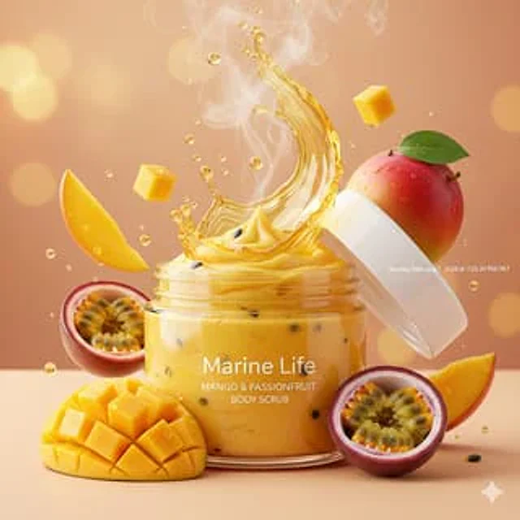

```text
Luxurious tropical body scrub product photography, open jar of bright vibrant yellow-orange Mango & Passionfruit body scrub, creamy whipped texture with visible fruit particles, Marine Life brand, elegant minimal packaging, white lid slightly lifted, juicy mango cubes and halved passionfruit floating around, dynamic splash of golden-yellow liquid and fruit juice in the air, fresh exotic fruit pieces mid-air, glossy wet droplets, vibrant juicy colors, appetizing and premium aesthetic, warm golden hour lighting, soft bokeh background in warm peach tones, highly detailed, cinematic product shot, commercial advertising style, 8k, ultra realistic

Video prompt

Ultra-luxurious tropical body scrub commercial video. Open jar of Marine Life Mango & Passionfruit Body Scrub with creamy whipped texture and visible fruit particles. White lid slightly lifted. Juicy mango cubes and halved passionfruit floating dynamically around the jar. Golden-yellow liquid and fruit juice splash dramatically in mid-air. Fresh exotic fruit pieces hover and rotate around the product. Glossy wet droplets on jar and fruit, emphasizing freshness and luxury. Warm golden hour lighting with soft bokeh background in peach tones. Camera slowly circling the product, capturing texture, shine, and vibrant colors in ultra-realistic 8K detail. Cinematic close-ups, smooth slow motion for splashes and floating fruits, commercial advertising style. Background minimalistic to enhance premium aesthetic.
Optional camera directions / effects:
Start with extreme close-up on whipped texture, then pull out to reveal floating fruits.
Slow-motion splash of fruit juice with backlighting to highlight droplets.
Gentle rotating 360° pan around the jar for product showcase.
Focus pull from foreground fruit to product label.
Subtle lens flare from warm golden light for cinematic luxury feel.
```

Model: Nano Banana
Author: Sharon Riley

[ProjectD](https://aitoolsradar.com/en/prompts/f8585279a7c8b9) · [Recorded source](https://x.com/Just_sharon7/status/2017969858017931581)
 · [Full original metadata and byte evidence](data/projectd-batch-0066.json)

## Sharon Riley #599

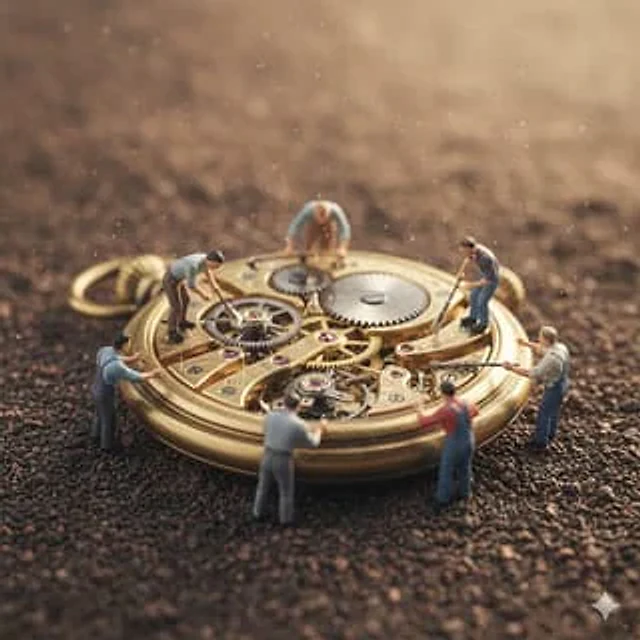

```text
{
  "prompt": "Ultra-realistic macro scene depicting tiny restoration workers collaboratively repairing an antique pocket watch. Several figures delicately clean intricate brass gears using fine brushes, while others stabilize the open watch casing and hold miniature components in place. The pocket watch lies on a textured natural surface, such as weathered wood or stone, emphasizing age and history. The scene symbolizes time, patience, craftsmanship, and teamwork.",
  "style": {
    "photography_type": "Macro photography",
    "realism": "Ultra-realistic",
    "mood": "Emotional and cinematic",
    "lighting": "Soft, warm, directional lighting with gentle highlights and natural shadows",
    "depth_of_field": "Shallow depth of field with sharp focus on foreground details and smooth background bokeh"
  },
  "composition": {
    "shot_type": "Close-up macro",
    "angle": "Slightly elevated perspective",
    "focus": "Extreme detail on gears, tools, and figurines’ interactions",
    "framing": "Pocket watch centered with workers distributed naturally across the mechanism"
  },
  "textures_and_details": {
    "materials": "Aged metal, polished brass gears, worn leather strap, natural surface grain",
    "details": "Visible dust particles, subtle scratches, fingerprints, and mechanical wear"
  },
  "atmosphere": {
    "tone": "Warm, nostalgic, hopeful",
    "symbolism": "Restoration of time through collective effort and care"
  },
  "render_settings": {
    "aspect_ratio": "4:5",
    "quality": 2,
    "resolution": "High-resolution",
    "style_precision": "Professional studio-level composition"
  }
}
```

Model: Nano Banana
Author: Sharon Riley

[ProjectD](https://aitoolsradar.com/en/prompts/5a6c0e085d2b8c) · [Recorded source](https://x.com/Just_sharon7/status/2011621455558221930)
 · [Full original metadata and byte evidence](data/projectd-batch-0066.json)

## Sharon Riley #601

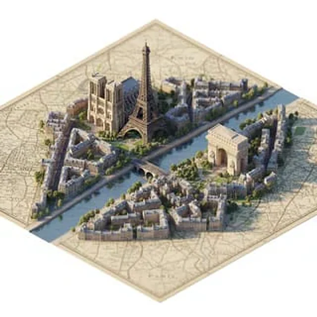

```text
{
"description": "Create a highly detailed, photorealistic miniature diorama style isometric map of [CITY/LOCATION] placed on a vintage textured paper map.",
  "perspective": {
    "type": "isometric",
    "angle": "45 degree top down",
    "look": "macro photography with tilt-shift miniature effect"
  },
  "geography": {
    "shape": "follows real geographic shape of [CITY/LOCATION]",
    "landmarks": {
      "oversized": true,
      "dominant": true,
      "primary_focus": "monuments",
      "secondary_elements": "smaller and simplified"
    },
    "architecture": "ultra detailed miniature",
    "roads": "selective",
    "greenery": true,
    "water_bodies": true,
    "terrain": true,
    "materials": ["stone", "wood", "concrete", "glass", "foliage"]
  },
  "lighting": {
    "type": "soft cinematic daylight",
    "effects": ["natural shadows", "warm highlights", "subtle atmospheric depth"]
  },
  "water": {
    "rivers": true,
    "coastlines": true,
    "depth_gradients": "smooth",
    "reflections": "gentle"
  },
  "map_base": {
    "type": "old world cartographic paper",
    "features": ["visible grid lines", "paper grain", "printed place names"]
  },
  "focus": {
    "sharp_on_landmarks": true,
    "edge_falloff": "gentle"
  },
  "quality": {
    "museum_quality": true,
    "handcrafted_diorama_realism": true,
    "ultra_high_resolution": true
  },
  "background": {
    "color": "clean pure white",
    "restrictions": ["no floating text", "no logos", "no watermarks", "no futuristic or cartoon elements"]
  },
  "aspect_ratio": "4:5"
}
```

Model: Nano Banana
Author: Sharon Riley

[ProjectD](https://aitoolsradar.com/en/prompts/ba2e5144b5552f) · [Recorded source](https://x.com/Just_sharon7/status/2016087583999361297)
 · [Full original metadata and byte evidence](data/projectd-batch-0066.json)

## Sharon Riley #612

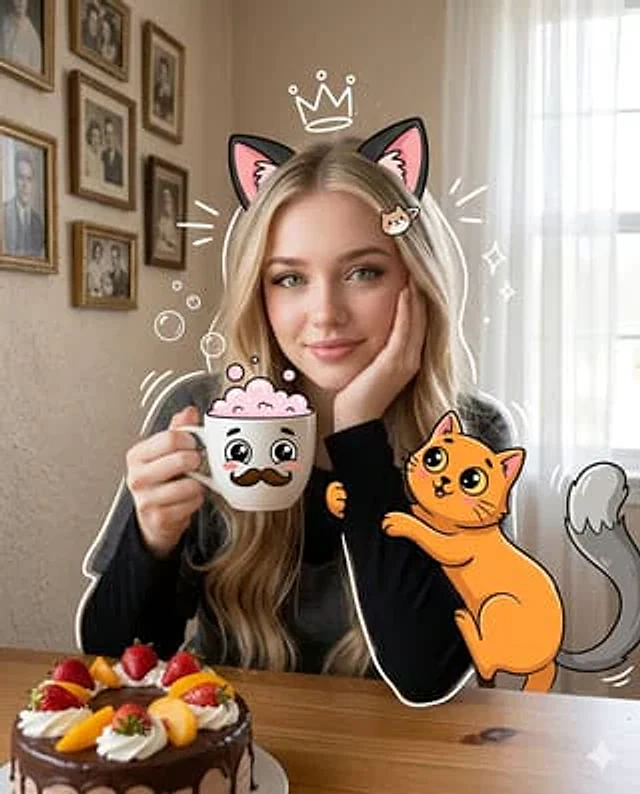

```text
{
  "title": "Whimsical Cozy Portrait",
  "input_image": "[UPLOAD YOUR IMAGE]",
  "description": "Transform the uploaded image into a 64K DSLR-quality ultra-hyperrealistic cozy, whimsical mixed-media portrait combining realistic photography with playful cartoon illustrations.",
  "subject": {
    "person": {
      "appearance": {
        "hair": "blonde, loosely tied with soft strands framing the face",
        "eyes": "light green",
        "makeup": "natural",
        "top": "dark grey layered over black long-sleeve shirt",
        "expression": "resting cheek gently on one hand, dreamy and slightly tired",
        "accessories": [
          "black-and-pink cat ears",
          "small cute hair clip"
        ]
      },
      "pose": "sitting at a wooden table, holding a white ceramic mug in one hand"
    },
    "animated_elements": [
      {
        "type": "cartoon_cat",
        "color": "bright orange",
        "expression": "excited, curious",
        "action": "climbing up her arm",
        "features": "exaggerated big eyes, expressive paws"
      },
      {
        "type": "cartoon_tail",
        "color": "grey",
        "position": "right side, partially out of frame"
      }
    ]
  },
  "props": {
    "mug": {
      "color": "white",
      "illustration": "cute cartoon face with big expressive eyes and small mustache",
      "drink": "pink foam bubbles rising from the top"
    },
    "dessert": {
      "type": "chocolate cake",
      "toppings": ["whipped cream", "sliced strawberries", "peach slice"]
    }
  },
  "environment": {
    "room": {
      "walls": "beige textured",
      "lighting": "soft daylight streaming through window with sheer white curtains",
      "decor": "vintage framed photographs in casual gallery arrangement",
      "atmosphere": "warm, cozy, intimate"
    }
  },
  "illustration_effects": {
    "style": [
      "hand-drawn cartoon overlays",
      "white doodle-style accents: bubbles, playful lines, sparkles, hand-drawn crown",
      "soft white illustrated outlines around woman and objects"
    ]
  },
  "composition": {
    "aspect_ratio": ["1:1", "4:5 vertical"],
    "depth_of_field": "shallow",
    "mood": ["cozy", "cute", "whimsical", "soft", "playful", "warm"]
  },
  "rendering": {
    "technique": ["Octane render", "Ultra-hyperrealistic", "Unreal Engine 5"],
    "details": "ultra-detailed, high-resolution, soft natural lighting, warm tones, Instagram-worthy",
    "texture_contrast": "realistic textures (skin, fabric, wood, wall) vs smooth vector-style illustrations"
  }
}
```

Model: Nano Banana
Author: Sharon Riley

[ProjectD](https://aitoolsradar.com/en/prompts/1d8556c41223dc) · [Recorded source](https://x.com/Just_sharon7/status/2029006238101680432)
 · [Full original metadata and byte evidence](data/projectd-batch-0066.json)

## Sharon Riley #615


```text
{
  "composition": {
    "orientation": "vertical",
    "style": "ultra-cinematic",
    "scene_type": "mid-air suspended elements",
    "depth_of_field": "cinematic shallow depth"
  },
  "subject": {
    "main_elements": [
      "cascading roasted coffee beans",
      "floating chocolate bonbons",
      "mid-air coffee cup with swirling latte art",
      "splashes of milk frozen in motion",
      "splashes of espresso frozen in motion",
      "fine coffee grounds dusting through the air"
    ],
    "motion_state": "frozen action splash photography"
  },
  "color_palette": {
    "primary_colors": [
      "rich coffee brown",
      "warm cream",
      "espresso black"
    ],
    "background": "deep velvety black"
  },
  "lighting": {
    "type": "dramatic high-contrast studio lighting",
    "highlights": "glossy reflections on liquids",
    "shadows": "deep cinematic shadows"
  },
  "texture_detail": {
    "liquids": [
      "glossy milk splashes",
      "glossy espresso splashes",
      "crema bubbles with micro-detail"
    ],
    "solids": [
      "matte roasted coffee beans",
      "smooth chocolate bonbon surfaces",
      "fine granular coffee grounds"
    ]
  },
  "photography_style": {
    "genre": "premium café advertising",
    "aesthetic": "editorial splash photography",
    "clarity": "crisp ultra-detailed"
  },
  "camera": {
    "camera_model": "Nikon D850 (virtual)",
    "lens": "105mm macro",
    "aperture": "f/4.0",
    "focus": "sharp subject focus with background falloff"
  },
  "render_quality": {
    "detail_level": "hyper-detailed",
    "realism": "photorealistic",
    "finish": "high-end commercial output"
  }
}
```

Model: Nano Banana
Author: Sharon Riley

[ProjectD](https://aitoolsradar.com/en/prompts/5e373939176e0a) · [Recorded source](https://x.com/Just_sharon7/status/2012291576119312710)
 · [Full original metadata and byte evidence](data/projectd-batch-0066.json)

## Sharon Riley #681

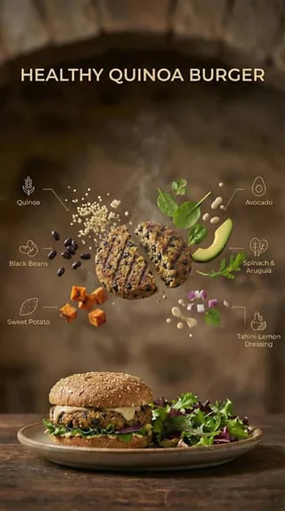

```text
{
"presentation": "Deconstructed exploded view floating in mid-air above a finished burger on a plate",
    "burger_paddy": "Grilled quinoa and black bean patty with visible char marks, split in half with steam rising",
    "floating_ingredients": [
      "Grains of cooked quinoa",
      "Whole black beans",
      "Roasted sweet potato cubes",
      "Fresh spinach and arugula leaves",
      "Slices of ripe avocado",
      "Drips of creamy tahini-lemon dressing",
      "Diced red onion"
    ],
    "plated_item": "A complete burger on a seeded whole-grain bun with fresh greens and dressing, served on a ceramic plate with a side salad"
  },
  "style": {
    "aesthetic": "Professional commercial food photography",
    "lighting": "Warm, cinematic, moody lighting with soft highlights on the textures of the food",
    "background": "Dark, rustic, textured stone or clay oven-like background with a shallow depth of field (bokeh)",
    "color_palette": "Earthy tones, deep browns, vibrant greens, and warm oranges"
  },
  "composition": {
    "angle": "Eye-level, straight-on shot",
    "dynamic_elements": "Floating gravity-defying arrangement, wisps of steam, droplets of sauce",
    "text_overlay_optional": "Clean gold serif typography at the top reading 'HEALTHY QUINOA BURGER'"
  },
  "technical_specs": {
    "focus": "Sharp focus on the floating patty and ingredients",
    "lens": "Macro lens for high detail texture on grains and vegetables",
    "quality": "8k resolution, photorealistic, commercial advertising quality"
  }
}
```

Model: Nano Banana
Author: Sharon Riley

[ProjectD](https://aitoolsradar.com/en/prompts/e7f0cc3d0ecbd1) · [Recorded source](https://x.com/Just_sharon7/status/2016340217146507313)
 · [Full original metadata and byte evidence](data/projectd-batch-0066.json)

## Sharon Riley #710

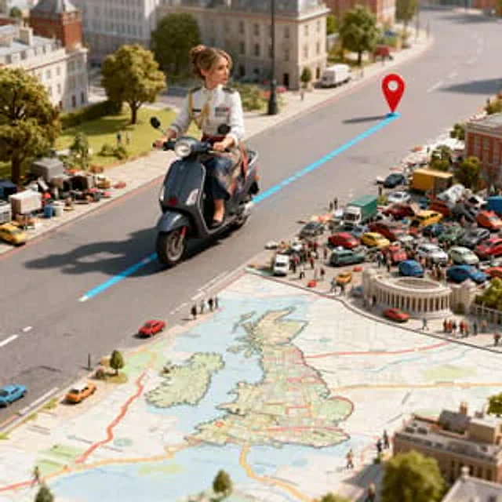

```text
Use the same face from the reference image without changing facial features 
Vertical (4:5 or 9:16) surreal 3D scene featuring a photorealistic character generated strictly from the attached reference image (accurate facial likeness, skin texture, age, proportions).

Front-facing view, camera slightly above eye level, the character riding her own scooter/motorbike directly on top of the blue GPS route line itself, moving forward toward a red destination pin.
The character wears culturally accurate clothing inspired by [west], with realistic fabric behavior and riding posture.
Below, a stylized GPS-style city map of [United Kingdom] fills the scene. A chaos zone at [Greenwich ] shows dense miniature cars, people, buildings, trees, and urban clutter concentrated near the destination.
Natural daylight, cinematic shadows, sharp focus on the character, and subtle depth of field on the map.

High-end concept-art quality combining photoreal human + stylized miniature city.
```

Model: Nano Banana
Author: Sharon Riley

[ProjectD](https://aitoolsradar.com/en/prompts/91cff90e32142b) · [Recorded source](https://x.com/Just_sharon7/status/2015314306578182501)
 · [Full original metadata and byte evidence](data/projectd-batch-0066.json)

## Sharon Riley #730

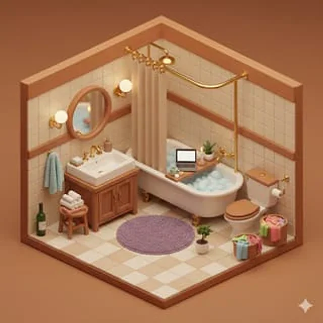

```text
{
  "prompt": "cute cozy isometric 3D miniature bathroom diorama, warm cozy aesthetic, detailed tiny room corner view, warm terracotta and beige color palette, small japanese-style bathroom scene, cream ceramic subway tiles with warm wooden trim, vintage clawfoot bathtub filled with blue bubbly foam, wooden bath tray across tub with open laptop, green mug, soap, candles, small potted plant, golden brass curved shower rod with beige shower curtain, round wooden mirror, white porcelain sink with wooden vanity cabinet, brass faucet, toilet with wooden seat, small wooden stool with rolled white towels and books, green wine bottle, tiny bonsai plant, wall mounted gold sconces with warm glowing bulbs, light blue fluffy towel hanging on wall hook, laundry basket with pink and orange clothes, wicker laundry hamper full of colorful towels, round plush purple bath mat, checkered beige-white floor tiles, small potted plant in white pot, cozy warm lighting, soft shadows, extremely detailed miniature dollhouse style, warm inviting atmosphere, soft bokeh, ken follett miniature aesthetic, tilt-shift effect, 8k, hyperdetailed, trending on artstation",
  "negative_prompt": "blurry, low quality, realistic scale, huge objects, people, human figures, text, watermark, logo, overexposed, underexposed, modern chrome, cold blue lighting, hospital style, empty room, cartoon, anime, 2D, sketch, painting, drawing",
  "aspect_ratio": "4:3",
  "style": "miniature diorama, isometric, cozy interior, warm tones, detailed product photography",
  "lighting": "soft warm golden hour lighting, cozy ambient glow, practical light sources from sconces",
  "camera_angle": "isometric 45 degree corner view, looking down into the room corner, miniature photography style",
  "quality_tags": "masterpiece, best quality, ultra detailed, 8k, sharp focus, intricate details",
  "additional_weights": {
    "miniature": 1.3,
    "diorama": 1.4,
    "isometric": 1.35,
    "cozy": 1.25,
    "warm lighting": 1.2,
    "detailed textures": 1.3
  }
}
```

Model: Nano Banana
Author: Sharon Riley

[ProjectD](https://aitoolsradar.com/en/prompts/e44690aa7e2694) · [Recorded source](https://x.com/Just_sharon7/status/2011801500541206983)
 · [Full original metadata and byte evidence](data/projectd-batch-0066.json)

## Sharon Riley #879

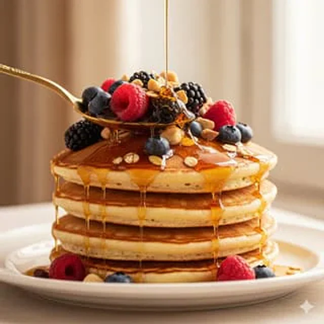

```text
Ultra-luxury food commercial of a stack of thick, fluffy American pancakes with perfectly golden-brown edges. Pure maple syrup cascades slowly down the sides in glossy, slow-motion streams, highlighting every drip. Pancakes topped with fresh mixed berries (blueberries, raspberries, blackberries), scattered roasted hazelnuts and almonds, and crunchy oat flakes. Cinematic close-up shots with rich warm morning light, soft beige bokeh background, hyper-detailed textures emphasizing fluffiness and glossiness. Luxury golden ornate spoon takes a delicate bite, with syrup stretching realistically. Smooth camera moves circling and slightly top-down over the stack, emphasizing elegance and indulgence. Minimalistic, high-end plating, cinematic depth of field, extremely appetizing, mouthwatering, trending food photography aesthetic, ultra-realistic 8K detail, professional ad-style video. Include subtle background soft music or ambient café sounds for premium feel.
```

Model: Nano Banana
Author: Sharon Riley

[ProjectD](https://aitoolsradar.com/en/prompts/7e82f4cda50f19) · [Recorded source](https://x.com/Just_sharon7/status/2017938415627772122)
 · [Full original metadata and byte evidence](data/projectd-batch-0066.json)

## Sharon Riley #896

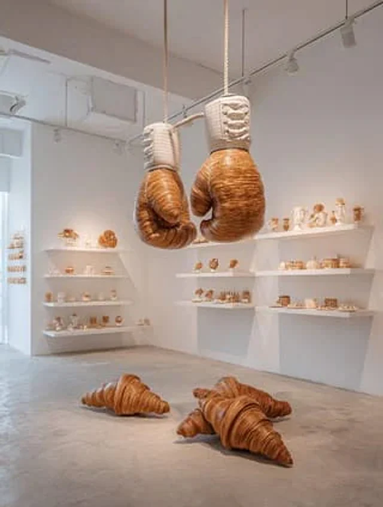

```text
{
  "scene": "Minimalist white contemporary art gallery",
  "environment": {
    "floor": "smooth concrete floor",
    "lighting": "soft warm museum lighting",
    "atmosphere": "clean, surreal, high-end contemporary museum aesthetic"
  },
  "main_subject": {
    "description": "Oversized sports equipment sculpture made entirely from croissants",
    "material": "hyper-realistic golden flaky croissant pastry",
    "sports_equipment_options": [
      "boxing gloves",
      "dumbbells",
      "basketballs",
      "kettlebells",
      "barbell"
    ],
    "placement": "center of the gallery on white pedestal",
    "scale": "oversized, dominant focal point"
  },
  "secondary_elements": {
    "floating_shelves": "white floating shelves on walls",
    "miniature_objects": "tiny pastry-based sports objects and croissant sculptures",
    "arrangement": "evenly spaced, gallery-style display"
  },
  "visual_style": {
    "texture_detail": "ultra-realistic pastry layers, crisp flaky edges, buttery sheen",
    "color_palette": "white, warm gold, soft beige",
    "composition": "symmetrical, minimal, museum exhibition layout"
  },
  "photography": {
    "style": "professional photography",
    "camera": "high-resolution, sharp focus",
    "depth_of_field": "subtle depth, gallery clarity",
    "quality": "ultra-detailed, premium art photography"
  }
}
```

Model: Nano Banana
Author: Sharon Riley

[ProjectD](https://aitoolsradar.com/en/prompts/df9873f7457693) · [Recorded source](https://x.com/Just_sharon7/status/2012019416884789443)
 · [Full original metadata and byte evidence](data/projectd-batch-0066.json)

## Sharon Riley #930


```text
A slow, sensual luxury chocolate commercial shot in ultra-high definition. The scene opens in near darkness as a premium espresso-brown gift box with soft gold accents slowly rotates on a reflective surface. A warm spotlight reveals the embossed title “SWEET PROMISE” in an elegant serif font, paired with a subtle botanical emblem. As the lid gently lifts in slow motion, molten milk chocolate surges upward in a gravity-defying burst, captured at 120fps for dramatic fluid motion. Glossy heart-shaped chocolates rise and orbit the splash, rotating gracefully at different depths, their surfaces catching highlights like polished jewels. Thick chocolate ribbons stretch, drip, and shatter into silky droplets mid-air while cocoa powder blooms softly like a golden mist. Cinematic mocha-and-gold color grading, shallow depth of field, creamy bokeh background, soft rim lighting outlining every chocolate curve. Macro close-ups transition into wide hero shots, emphasizing texture, gloss, and richness. The motion feels slow, seductive, and indulgent—pure luxury confectionery advertising, premium product film, elegant pacing, emotionally rich, visually irresistible.
```

Model: Nano Banana
Author: Sharon Riley

[ProjectD](https://aitoolsradar.com/en/prompts/b5fe6cb3fb1482) · [Recorded source](https://x.com/Just_sharon7/status/2018163221979677025)
 · [Full original metadata and byte evidence](data/projectd-batch-0066.json)

## Sharon Riley #964

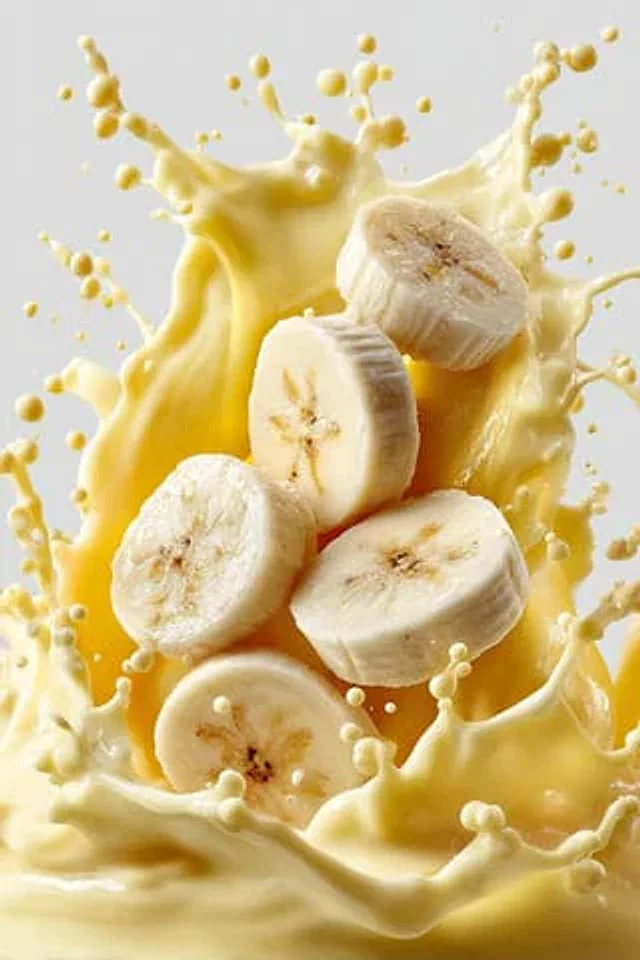

```text
{
"subject": {
    "primary": "Vibrant orange slices",
    "action": "Falling through the air toward rising milk",
    "secondary": "Thick, glossy white milk splash forming arcs and crown-like curves",
    "details": "Milk droplets frozen mid-air with creamy texture"
  },
  "environment": {
    "background": "Clean blue studio backdrop",
    "lighting": "Cinematic soft studio lighting with dramatic highlights and shadows"
  },
  "visual_style": {
    "genre": "Ultra-realistic commercial splash photography",
    "textures": "High-detail creamy milk and fresh citrus pulp",
    "motion": "Frozen action, high-speed capture",
    "depth_of_field": "Shallow depth of field"
  },
  "camera": {
    "lens": "85mm macro",
    "framing": "Wide composition",
    "focus": "Sharp focus on splash and fruit"
  },
  "composition": {
    "aspect_ratio": "3:4",
    "color_palette": ["Vibrant Orange", "Pure White", "Clean Blue"]
  },
  "quality": {
    "detail_level": "Ultra-high detail",
    "rendering": "Photorealistic"
  },
  "profile": "9ewnbdc"
}
```

Model: Nano Banana
Author: Sharon Riley

[ProjectD](https://aitoolsradar.com/en/prompts/d111fef80f8031) · [Recorded source](https://x.com/Just_sharon7/status/2013660094664446322)
 · [Full original metadata and byte evidence](data/projectd-batch-0066.json)

## Sharon Riley #981

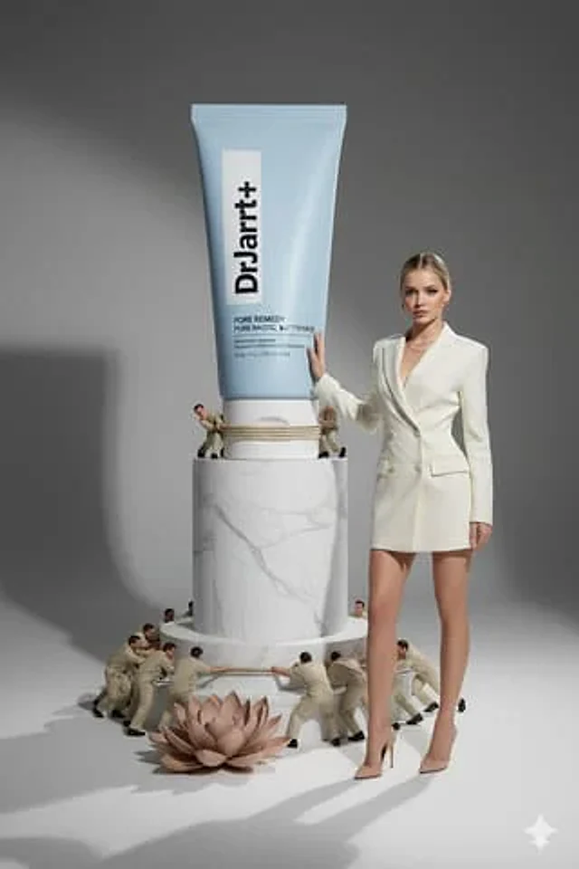

```text
A surreal, minimalist luxury advertising scene in a clean modern studio with a soft neutral gray background, dramatic directional lighting and subtle cinematic shadows. A gigantic oversized tube of Dr.Jart+ Pore Remedy Pure Mastic Butter Mask (light blue tube, white label, bold black “Dr.Jart+” text clearly visible) stands triumphantly on a tall multi-tiered white marble pedestal like a monument. Around the base, 20–30 tiny realistic miniature male workers in matching beige/off-white uniforms and overalls are pulling thick ropes tied around the massive tube, straining with intense effort, dynamic poses, muscles tense, tugging mostly forward.

Place a tall elegant Western woman in her late 20s in the foreground, positioned much closer to the camera for a stronger ad focus. She stands slightly in front of the pedestal, waist-up to mid-thigh framing, creating a premium beauty campaign feel. She has glowing fair skin, sharp cheekbones, soft natural makeup with luminous skin finish, slick low bun hairstyle, and a confident high-fashion gaze directed toward the camera. She wears a structured ivory tailored blazer dress with minimal gold accessories and nude heels. One hand lightly touches the giant tube while her body subtly angles toward it, creating a powerful hero-product connection.

At the foot of the pedestal lies a large open lotus flower sculpture in soft pinkish-brown tones. High-end commercial skincare photography, hyper-realistic 3D render, ultra-sharp 8K details, cinematic composition, shallow depth of field slightly blurring the miniature workers while keeping the woman and product crisp and dominant, luxury beauty campaign aesthetic, epic scale contrast, clean elegant studio environment, shot by Veo.
```

Model: Nano Banana
Author: Sharon Riley

[ProjectD](https://aitoolsradar.com/en/prompts/2ca3033768fc70) · [Recorded source](https://x.com/Just_sharon7/status/2024794186906759514)
 · [Full original metadata and byte evidence](data/projectd-batch-0066.json)

## Sharon Riley #984

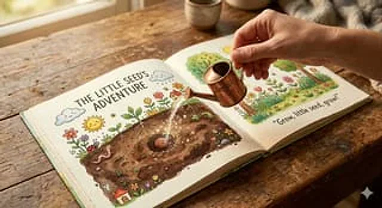

```text
{
  "prompt": "An open children’s picture book rests on a wooden table, showing a whimsical illustration of a small brown seed in cartoon soil. A realistic human hand pours water from a tiny can, with a sparkling stream. Warm golden light, magical mood, overhead close-up, photorealistic, 4K.",
  "style": "photorealistic",
  "lighting": "warm golden",
  "mood": "magical",
  "perspective": "overhead close-up",
  "resolution": "4K",
  "elements": [
    {
      "type": "book",
      "description": "children’s picture book open on wooden table"
    },
    {
      "type": "illustration",
      "description": "whimsical small brown seed in cartoon soil"
    },
    {
      "type": "hand",
      "description": "realistic human hand pouring water from tiny can"
    },
    {
      "type": "water",
      "description": "sparkling stream"
    }
  ]
}
```

Model: Nano Banana
Author: Sharon Riley

[ProjectD](https://aitoolsradar.com/en/prompts/59a2dcfb317642) · [Recorded source](https://x.com/Just_sharon7/status/2038525426084323378)
 · [Full original metadata and byte evidence](data/projectd-batch-0066.json)

## Sharon Riley #992

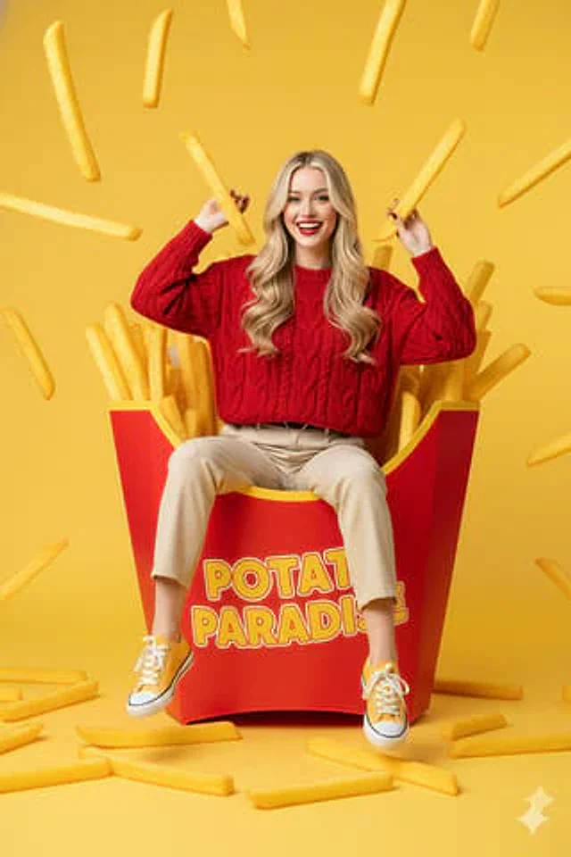

```text
{
  "prompt": "young western woman with long blonde hair sitting playfully inside a giant red french fry carton, surrounded by oversized golden-brown fries, some fries floating in the air, she is wearing a textured red sweater and beige trousers with yellow sneakers, cheerful expression, bright yellow studio background, surreal commercial photography style, high saturation, sharp focus, clean composition, 8k resolution, professional lighting",
  "negative_prompt": "low quality, blurry, distorted face, bad anatomy, extra limbs, dull colors, messy background, text, watermark, grainy, realistic size fries",
  "aspect_ratio": "3:4",
  "style": "surreal commercial photography",
  "lighting": "vibrant studio lighting with soft shadows",
  "camera": "eye-level medium shot, 50mm lens",
  "quality_tags": "masterpiece, ultra-detailed, high-end commercial aesthetic"
}
```

Model: Nano Banana
Author: Sharon Riley

[ProjectD](https://aitoolsradar.com/en/prompts/4292e7e7af1191) · [Recorded source](https://x.com/Just_sharon7/status/2011038954896965955)
 · [Full original metadata and byte evidence](data/projectd-batch-0066.json)

## Shushant Lakhyani #695


```text
ultra realistic cinematic portrait poster of a confident man using the attached face image as reference, centered headshot with shoulders visible and a calm powerful expression. Use dramatic studio lighting with a soft key light and subtle rim lighting for depth and contrast. The background should be dark matte black or charcoal with a luxury cinematic feel. Place very large tall condensed vertical typography behind the subject in the same stretched style as the reference image, partially hidden by the subject, with the text placeholder “[INSERT TITLE TEXT HERE]”. The typography should be metallic gold with a subtle foil shine. Dress the subject in a refined masculine outfit such as a black tailored suit or elegant modern sherwani. Style the image as a classy luxury editorial poster with deep black and gold tones, ultra realistic skin detail, shallow depth of field, cinematic color grading, and high resolution professional photography
```

Model: Nano Banana
Author: Shushant Lakhyani

[ProjectD](https://aitoolsradar.com/en/prompts/fc2db9992376a7) · [Recorded source](https://x.com/shushant_l/status/2032819113308074313)
 · [Full original metadata and byte evidence](data/projectd-batch-0066.json)

## simeon-sanai #1019

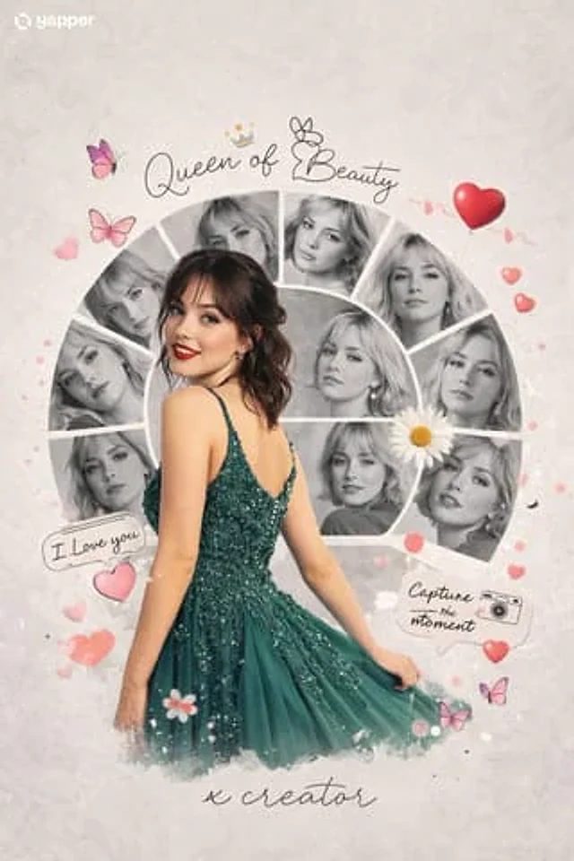

```text
A creative romantic digital photo collage featuring a young handsome woman in a peacock green frock. The main subject is a full-body cutout placed slightly left, turned back and smiling over her shoulder, wearing a peacock green embellished rich frock. Behind and around her is a semi-circular collage of multiple black-and-white portrait shots of the same woman, each in different expressions and poses, arranged in curved segments. The background is a soft light grey textured surface with a minimal aesthetic.Decorative elements include pink butterflies, a floral daisy near the center, red heart balloons, and cute love-themed stickers Handwritten-style text elements like “Queen of Beauty,” “I Love you,” and “Capture the moment” are scattered around. A small heartbeat line with a heart icon is included. At the bottom, the name “x creator” appears in elegant cursive typography. Soft shadows, smooth cutout blending, high-end Photoshop manipulation, romantic mood, pastel tones.
```

Model: Nano Banana
Author: simeon-sanai

[ProjectD](https://aitoolsradar.com/en/prompts/8f88eaf18e6c4c) · [Recorded source](https://x.com/Naiknelofar788/status/2042270514501312771)
 · [Full original metadata and byte evidence](data/projectd-batch-0066.json)

## simeon-sanai #1050

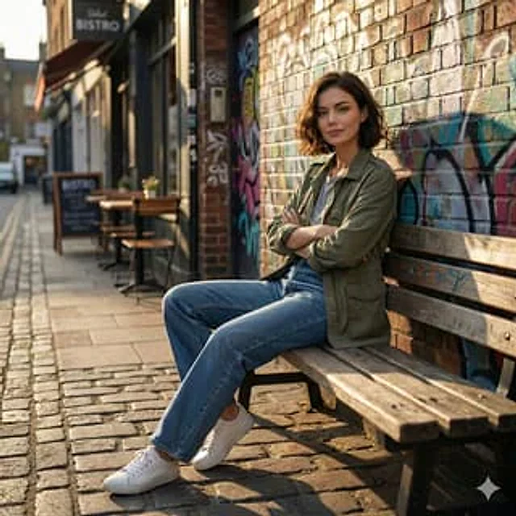

```text
Cinematic realistic street scene, beautiful young woman with short wavy bob haircut, natural hourglass body shape with correct human proportions, sitting relaxed on a wooden bench in front of a small restaurant, graffiti wall behind her, late afternoon side sunlight with strong shadows. Casual urban outfit: inner t-shirt with a light open outer jacket, relaxed denim pants, sneakers. Soft cinematic color grading, shallow depth of field, ultra-detailed, photorealistic
```

Model: Nano Banana
Author: simeon-sanai

[ProjectD](https://aitoolsradar.com/en/prompts/30db2f89c00c6f) · [Recorded source](https://x.com/Naiknelofar788/status/2017805744486396063)
 · [Full original metadata and byte evidence](data/projectd-batch-0066.json)

## simeon-sanai #1052

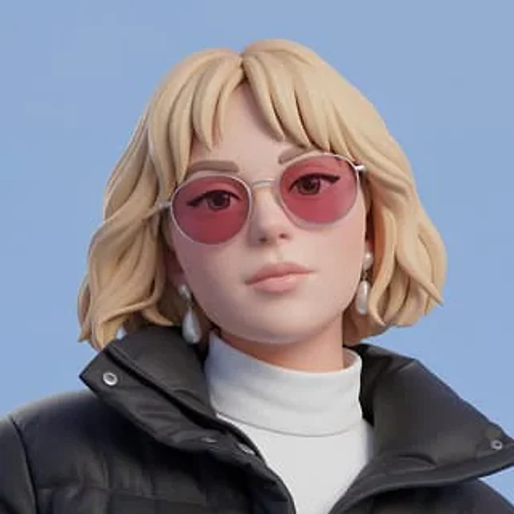

```text
Use a user-uploaded image as the source and convert the person into a stylized 3D character while preserving identity, facial structure, pose, hairstyle, clothing, and overall composition exactly as shown in the photo. The result should clearly resemble the real person.

The visual style is a stylized 3D character with a soft minimal cartoon 3D aesthetic, inspired by Pixar-like visuals but more minimal, toy-figure renders, and clean product-style character design. The balance should favor stylization over realism without changing the person’s real-world appearance.

Skin should appear as smooth matte plastic with a soft, uniform texture and gentle subsurface scattering. Facial features should remain faithful to the original image while being simplified in form. The expression should stay neutral and natural to the source photo.

Lighting should be clean and controlled, similar to a studio softbox setup, with very soft shadows, low contrast, and subtle highlights. The background should be a solid [BACKGROUND COLOR] with no gradient.

The camera should feel front-facing with a medium close-up framing, similar to a 50mm lens, with no distortion. Output quality should be high resolution with clean edges, no noise, strong style consistency, and a clearly non-photorealistic finish.
```

Model: Nano Banana
Author: simeon-sanai

[ProjectD](https://aitoolsradar.com/en/prompts/f7a3b50ac24423) · [Recorded source](https://x.com/Naiknelofar788/status/2031893220314202619)
 · [Full original metadata and byte evidence](data/projectd-batch-0066.json)

## simeon-sanai #1053

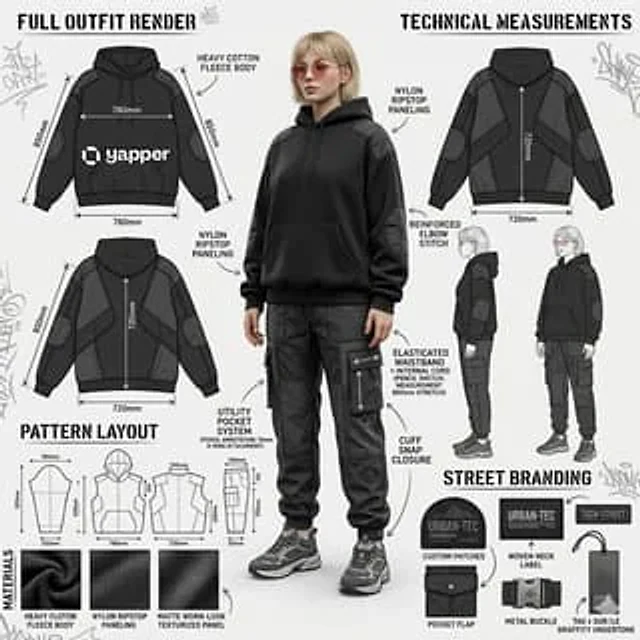

```text
Using the attached image, create a professional industrial fashion design illustration sheet for a high-end streetwear outfit.
A centered heroic full-body 3D render of a modern urban look (oversized hoodie, cargo pants, sneakers), with realistic fabric physics, detailed stitching, and layered textiles. Soft studio lighting with subtle shadows and premium editorial finish.
Surround with technical views:
Front, back, side, 3/4 perspective
Flat lay pattern layout
Include sketches:
Panel segmentation (oversized cuts)
Stitching and seam details
Elastic waistband, cuffs, drawstrings
Measurement arrows in millimeters
Materials (handwritten notes):
Heavy cotton fleece, nylon, ripstop
Matte + slightly worn textures
Reinforced stress zones
Extras:
Street branding placement (logos, tags, patches)
Pocket systems and utility design
Style: Clean sketchbook + graffiti undertone, realistic + pencil hybrid, ultra-detailed.
```

Model: Nano Banana
Author: simeon-sanai

[ProjectD](https://aitoolsradar.com/en/prompts/38cd1039cb3428) · [Recorded source](https://x.com/Naiknelofar788/status/2038942399746212173)
 · [Full original metadata and byte evidence](data/projectd-batch-0066.json)

## simeon-sanai #1090

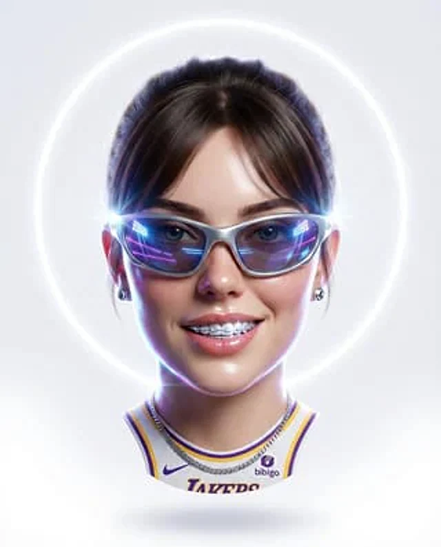

```text
Hyper-stylized dynamic 3D floating head portrait of the attached reference image, perfectly centered, upright, symmetrical, filling 80% of the 4:5 frame. No neck. No shoulder edges. Clean cut-out. Subject floating in white space.Predominantly white background enhanced with subtle tonal gradients and soft volumetric glow. A thin luminous neon halo ring glows behind the head, slightly diffused but clean and circular.

Facial features match reference photo precisely. Expression: confident, dominant smirk with focused eye contact. Diamond-studded braces sparkle under sharp lighting.

Sleek silver sports sunglasses reflect digital stadium lights and neon streaks. Chrome stud earrings and polished silver chain subtly visible.

Official lakers shirt strictly front view chest logo and sponsor visible only.

Lighting combines bright frontal fill with strong rim lights. Subtle neon reflections trace along jawline edges. Micro lens flares appear at high-intensity highlights.

White-on-white energy with controlled neon accents. Futuristic champion aura. Glossy skin, exaggerated reflections, cinematic intensity.

Aspect ratio 4:5.
```

Model: Nano Banana
Author: simeon-sanai

[ProjectD](https://aitoolsradar.com/en/prompts/d75c98ad187b69) · [Recorded source](https://x.com/Naiknelofar788/status/2026207647968743551)
 · [Full original metadata and byte evidence](data/projectd-batch-0066.json)

## simeon-sanai #1207

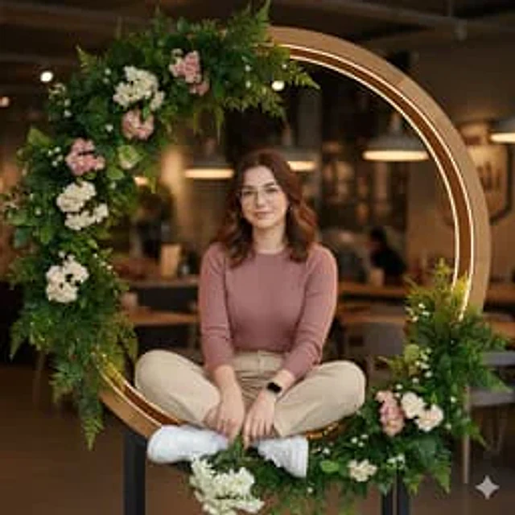

```text
Create an ultra-realistic, high-end lifestyle portrait of one adult subject, captured in a calm, elegant, modern café environment. The subject is seated casually inside a circular wooden frame embedded with warm LED rim lighting, surrounded by lush green foliage and soft floral decor. The pose is relaxed and natural: one leg crossed over the other, body slightly angled, shoulders relaxed, hands resting naturally while holding a small bouquet of fresh flowers. Overall mood is warm, clean, elegant, youthful, and approachable — pure realism only. No stylization, no fantasy, no cinematic exaggeration.

Maintain 100% facial accuracy: exact bone structure, eye shape, eyelid fold, eyebrow shape, nose bridge and tip, lip shape, jawline, chin, cheek volume, hairline, and facial proportions

Identity must remain perfectly consistent from all angles (front, 3/4, side, seated pose, slight head tilt)

No face blending, no beautification, no symmetry correction

No AI face drift

Preserve real skin texture: pores, fine lines, natural imperfections

Expression: soft, natural smile, relaxed and genuine

Soft pastel long-sleeve knit top (dusty pink / muted rose tone)

High-waisted, straight-fit beige or cream trousers

Clean white chunky sneakers

Minimal accessories only (simple earrings, smartwatch or minimal wrist accessory)

Hair neatly styled, natural, pulled back or softly tied

Natural makeup: realistic skin tones, no heavy retouching

Modern café or lifestyle studio interior

Circular wooden structure with embedded warm LED light ring

Green plants and floral arrangements integrated into the frame

Soft bokeh background with warm ambient lighting

Clean, uncluttered setting with depth and realism

Full-body or 3/4 body vertical portrait

Eye-level camera angle

50mm–85mm lens look

Natural perspective, no distortion

Subject centered within the circular frame

Shallow depth of field, background softly blurred

Soft, warm, diffused lighting

LED rim light gently outlining the circular frame

Even facial illumination with natural shadow falloff

No harsh highlights, no blown whites

Realistic skin reflections and depth

Negative prompt:

No stylization

No cinematic color grading

No beauty filters

No smooth or plastic skin

No exaggerated proportions

No painterly or illustrated look

No artificial glow

No face morphing or identity shift

Ultra-photorealistic

Editorial lifestyle photography quality

Natural colors, true-to-life skin tones

Identity remains unchanged and accurate from every angle
```

Model: Nano Banana
Author: simeon-sanai

[ProjectD](https://aitoolsradar.com/en/prompts/a1c4df1b04614c) · [Recorded source](https://x.com/Naiknelofar788/status/2010352197289345443)
 · [Full original metadata and byte evidence](data/projectd-batch-0066.json)

## simeon-sanai #1209

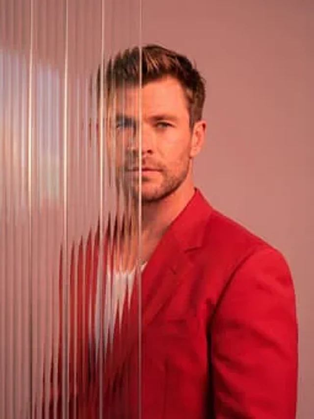

```text
A striking editorial portrait photograph of a person wearing a red blazer, shot against a soft light pink studio background. The left half of the face and body is partially obscured by multiple overlapping vertical strips of tall narrow reeded ribbed frosted glass panels, creating a realistic distortion and refraction effect where the features appear blurred, shifted, and fragmented behind the glass. The right side of the face is clearly visible with sharp detail. Dramatic cool-toned studio lighting with a blue-purple color grade overall. The glass strips run vertically from top to bottom of the frame, covering approximately the left 40 to 50 percent of the image. Serious neutral facial expression. High-fashion editorial style, photorealistic, no text, no watermark, no overlays, clean composition. Vertical portrait orientation, 3:4 ratio.
```

Model: Nano Banana
Author: simeon-sanai

[ProjectD](https://aitoolsradar.com/en/prompts/ae8d0279e3316d) · [Recorded source](https://x.com/Naiknelofar788/status/2045689019007426749)
 · [Full original metadata and byte evidence](data/projectd-batch-0066.json)

## simeon-sanai #1233

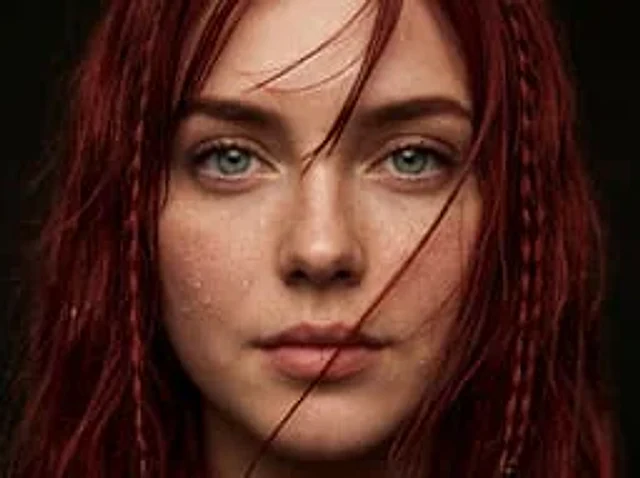

```text
Using the uploaded image as the only reference. create an ultra-photorealistic cinematic close-up portrait of a young woman with vivid red hair and piercing blue-green eyes. Her hair is slightly wet and blown across her face, with delicate braids woven through the strands. Tiny water droplets and natural skin texture glisten across her freckles and cheeks, illuminated by warm dramatic lighting against a dark background.She looks slightly upward with a calm, intense expression, capturing a moment of quiet strength. Emphasize hyper-real skin detail, freckles, wet hair strands, reflective water droplets, and luminous eyes. Shallow depth of field, dramatic contrast, moody cinematic lighting, intimate portrait composition, ultra-detailed textures, 8k photorealism.
```

Model: Nano Banana
Author: simeon-sanai

[ProjectD](https://aitoolsradar.com/en/prompts/925996b0daf46c) · [Recorded source](https://x.com/Naiknelofar788/status/2030925927040037301)
 · [Full original metadata and byte evidence](data/projectd-batch-0066.json)

## simeon-sanai #1255

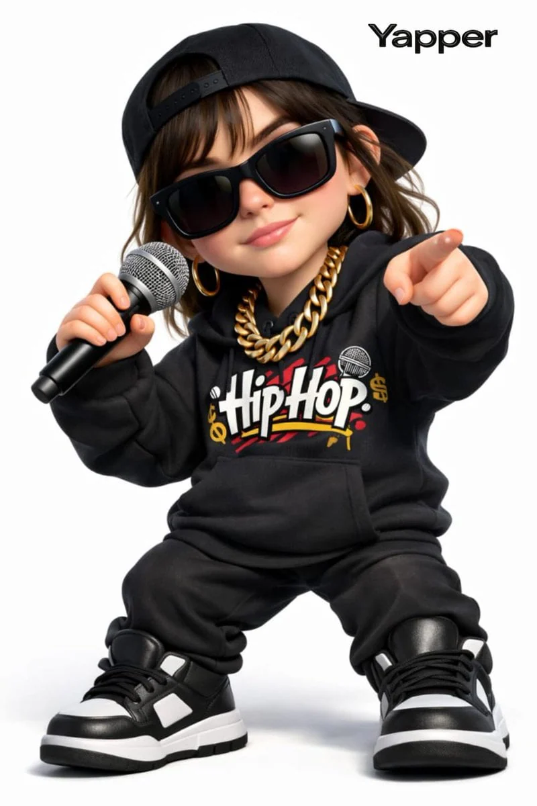

```text
Create a 3D cartoon-style woman with a rap style (the face is inspired by the reference image). She should have a large head and oversized sneakers, an extra-large hoodie with a rap-style print, loose black pants, big sunglasses, and a thick chain necklace. Place her in a fun pose, with a white background, cinematic lighting, and a highly detailed Pixar-style render.
```

Model: Nano Banana
Author: simeon-sanai

[ProjectD](https://aitoolsradar.com/en/prompts/1050f007eadbf1) · [Recorded source](https://x.com/Naiknelofar788/status/2032026944481739045)
 · [Full original metadata and byte evidence](data/projectd-batch-0066.json)

## simeon-sanai #1283

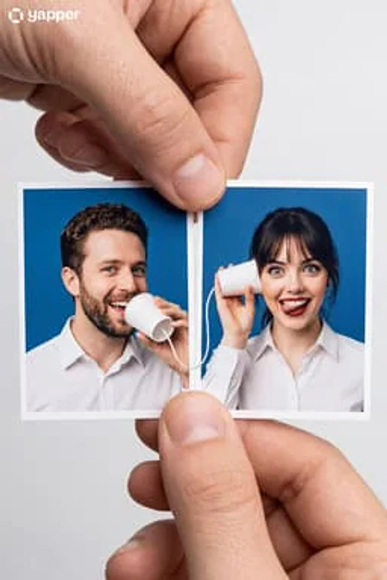

```text
Create a Portrait Master Object: Two passport-sized photo prints held side-by-side by a person's thumb and index finger.
**Passport Photo Background:** Use a solid blue background (the standard official passport photo color for Indonesian marriage books for certain even/odd birth years).
**Clothing:** Both subjects in the photo wear formal and neat white collared shirts.
**Male Subject (Left Photo):** Make his face and hair 100% similar to the given reference.
He poses as if talking into a white paper cup, with a cheerful laughing expression.
**Female Subject (Right Photo):** Make her face and hair 100% similar to the given reference.
She poses as if holding a white paper cup to her ear, listening. Her expression is funny with a wide smile and a slightly stuck-out tongue.
**Interactive Prop:** There is a white string coming out from under the male's paper cup and connecting to the female's paper cup. Because the two photos are placed next to each other, this prop creates the illusion of a "string phone" connecting the two photos.
```

Model: Nano Banana
Author: simeon-sanai

[ProjectD](https://aitoolsradar.com/en/prompts/794e80d1d1ce4c) · [Recorded source](https://x.com/Naiknelofar788/status/2041695940797690203)
 · [Full original metadata and byte evidence](data/projectd-batch-0066.json)

## simeon-sanai #1293

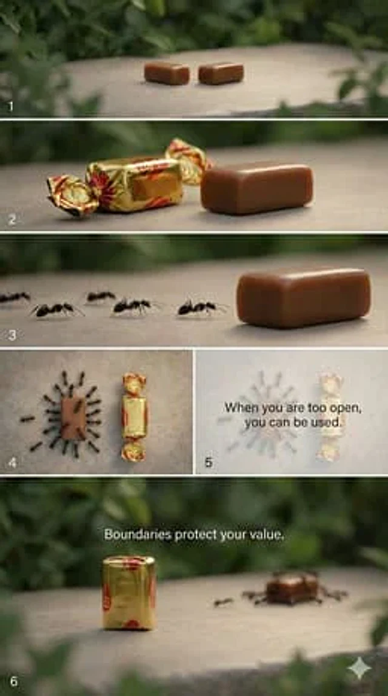

```text
{
  "style": "cinematic, symbolic, minimal, realistic",
  "aspect_ratio": "9:16",
  "scenes": [
    {
      "scene_number": 1,
      "description": "A quiet outdoor setting with a clean surface under soft natural light. Two identical toffees are placed side by side.",
      "camera": "slow zoom-in",
      "mood": "calm, neutral"
    },
    {
      "scene_number": 2,
      "description": "One toffee is neatly wrapped in shiny paper. The other toffee is unwrapped, fully exposed.",
      "camera": "static close-up",
      "mood": "contrast, anticipation"
    },
    {
      "scene_number": 3,
      "description": "Ants begin to appear and slowly crawl toward the unwrapped toffee, completely ignoring the wrapped one.",
      "camera": "macro shot, slow motion",
      "mood": "uneasy, revealing"
    },
    {
      "scene_number": 4,
      "description": "More ants gather around the unwrapped toffee, covering it, while the wrapped toffee remains untouched and protected.",
      "camera": "top-down shot",
      "mood": "warning, realization"
    },
    {
      "scene_number": 5,
      "description": "Text fades in on screen as the ants swarm the unwrapped toffee.",
      "text_overlay": "When you are too open, you can be used.",
      "camera": "gentle fade",
      "mood": "reflective"
    },
    {
      "scene_number": 6,
      "description": "Final frame focuses on the wrapped toffee standing alone, clean and intact.",
      "text_overlay": "Boundaries protect your value.",
      "camera": "slow zoom-out",
      "mood": "empowering, calm"
    }
  ],
  "audio": {
    "background_music": "soft ambient piano",
    "sound_effects": "subtle nature ambience"
  }
}
```

Model: Nano Banana
Author: simeon-sanai

[ProjectD](https://aitoolsradar.com/en/prompts/f2548d86e0686e) · [Recorded source](https://x.com/Naiknelofar788/status/2017460732938621180)
 · [Full original metadata and byte evidence](data/projectd-batch-0066.json)

## simeon-sanai #1308

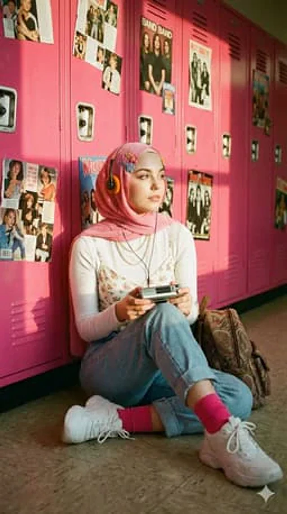

```text
A cinematic, nostalgic portrait of a young hijab woman (use the reference photo) sitting cross-legged on the floor of a retro school hallway, bathed in warm, golden-hour sunlight. She has a soft, contemplative expression, gazing dreamily off-camera to the right. She wears a pink chiffon hijab adorned with colorful star-shaped hair clips on the left side.Her outfit is Y2K-inspired: a white long shirt layered under a white spaghetti-strap camisole with a delicate vintagefloral print, layered pearl necklaces, high-waisted light-wash denim jeans cuffed at the ankles, vibrant hot-pink ribbed socks, and chunky white sneakers. She holds a vintage silver cassette player in both hands and wears large, retro orange foam headphones. A woven paisley-patterned backpack sits next to her.The background features a row of vibrant hot-pink metal lockers covered in retro magazine cutouts and band posters. Strong, diagonal shadows from a nearby window cast a dramatic, warm glow across the lockers and her face. Dreamy coming-of-age movie aesthetic, high-resolution textures, soft depth of field, 35mm film grain style --ar 9:16 --style raw
```

Model: Nano Banana
Author: simeon-sanai

[ProjectD](https://aitoolsradar.com/en/prompts/8b507b5a5fedb4) · [Recorded source](https://x.com/Naiknelofar788/status/2016161656712396957)
 · [Full original metadata and byte evidence](data/projectd-batch-0066.json)

## simeon-sanai #339

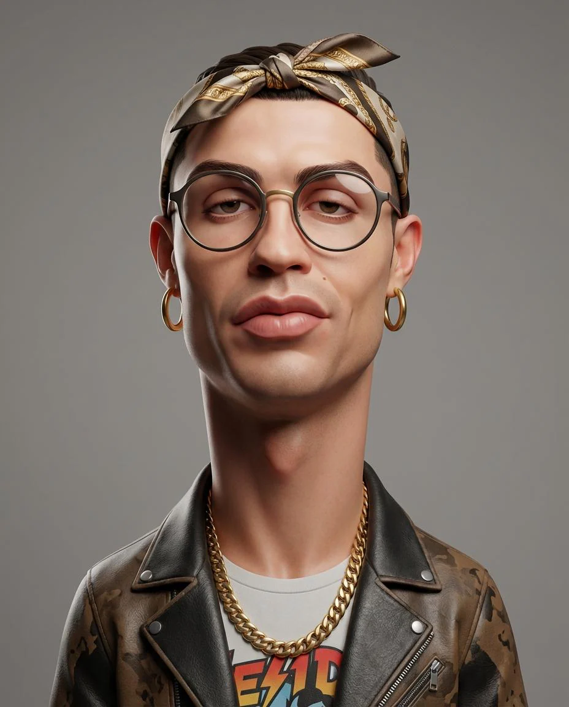

```text
Create an exaggerated stylized 3D caricature character portrait with strong intentional deformation and a clean, controlled surface finish. Use the person from the ATTACHED REFERENCE PHOTO. Preserve the subject’s identity, facial likeness, skin tone, and defining features, but reinterpret them into a bold caricatured 3D form with an elongated neck, oversized head-to-neck ratio, droopy eyelids, heavy lips, and slightly asymmetrical facial structure.Render as a human-like 3D character with smooth, studio-clean skin and intentionally designed detail, avoiding random texture or noise. Style with bold accessories such as round or oval glasses, hoop earrings, gold chains, headscarves or bandanas, and street-luxury clothing.

Use neutral studio lighting with soft shadows and even illumination, no dramatic contrast, against a plain neutral grey or off-white background. The overall aesthetic should feel weird, fashion-forward, collectible, and character-driven rather than cute or realistic.

Ultra high definition, premium cinematic 3D render quality, hyper-realistic hyper realism, clean materials, no freckles, no dirt, no grain, no noise, no speckling, no text, no logos, no watermarks.

Aspect ratio 4:5.
```

Model: Nano Banana
Author: simeon-sanai

[ProjectD](https://aitoolsradar.com/en/prompts/4522ba4c13d9e1) · [Recorded source](https://x.com/Naiknelofar788/status/2032256273782358153)
 · [Full original metadata and byte evidence](data/projectd-batch-0066.json)

## simeon-sanai #391

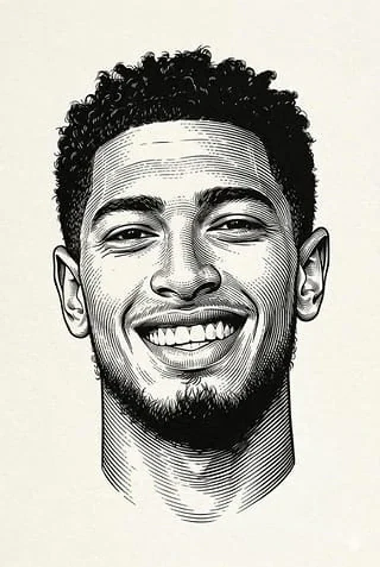

```text
Black and white engraved portrait illustration of a person.
Drawn in classic woodcut / linocut engraving style, high contrast black ink on textured off-white paper background. Fine cross-hatching and line shading to create depth and shadow, bold black ink shadows under chin and around hair, strong contour lines, traditional printmaking aesthetic.
Minimal composition, centered portrait, no body visible, clean negative space, vintage editorial illustration style, ultra detailed linework, sharp crisp ink strokes, professional vector-ready engraving look, monochrome palette, dramatic contrast.
Negative Prompt:
color, watercolor, soft shading, blurred lines, low contrast, realistic photography, 3D render, anime style, cartoon style, messy sketch, thick uneven strokes, background objects, noisy texture, pixelated, distorted face, extra eyes, extra ears, bad anatomy, modern digital painting, glossy skin, overexposed highlights
```

Model: Nano Banana
Author: simeon-sanai

[ProjectD](https://aitoolsradar.com/en/prompts/48fb7b3722a8c6) · [Recorded source](https://x.com/Naiknelofar788/status/2042785774245154868)
 · [Full original metadata and byte evidence](data/projectd-batch-0066.json)

## simeon-sanai #478

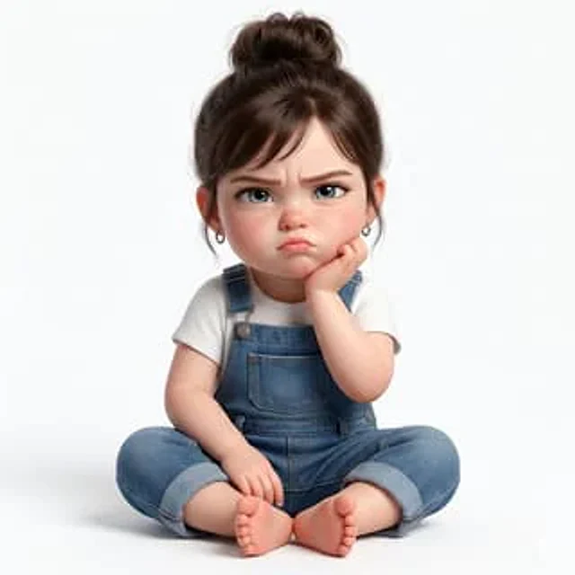

```text
Create a super cute, hyper-realistic 3D render of a toddler girl who is a younger version of the person in the provided reference photo.

The facial structure must strongly match the reference image. Accurately replicate the exact eye shape, eye color, skin tone, lip shape, nose structure, cheek fullness, eyebrow shape, and overall facial proportions. The toddler version should clearly resemble the same person at a younger age while maintaining realistic childlike softness and rounded features.
If any accessory (such as an earring or similar detail) appears in the reference image, replicate it accurately in size, colour, and placement.
Expression:

Distinctly grumpy and pouty. Chin resting on her left palm. One eye slightly squinted in mild annoyance. Eyebrows gently furrowed. Lips pushed forward in a stubborn pout. Expression must feel natural and emotionally believable, not exaggerated.
Hair:

Hairstyle should be adapted from the reference image while keeping it toddler-appropriate. Styled in a messy high bun with soft, natural baby hair strands framing the face.
Outfit:

White short-sleeve t-shirt under classic blue denim overalls with visible stitching and metal clasps.
Pose & Background:

Sitting cross-legged on a clean white studio background. Feet slightly angled toward the camera. Balanced composition with full body visible.
Style & Quality:

Ultra-detailed Pixar/Disney-inspired 3D animation aesthetic. Professional CGI rendering. 1:1 aspect ratio. 8K resolution. Sharp focus. Cinematic studio lighting with soft subsurface scattering on the skin. Smooth textures, realistic fabric physics, soft global illumination, and natural shadow falloff.
```

Model: Nano Banana
Author: simeon-sanai

[ProjectD](https://aitoolsradar.com/en/prompts/7b589c5f0ae26d) · [Recorded source](https://x.com/Naiknelofar788/status/2028747310759542860)
 · [Full original metadata and byte evidence](data/projectd-batch-0066.json)

## simeon-sanai #491

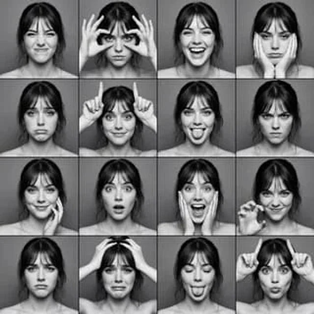

```text
{
  "generation_request": {
    "meta_data": {
      "task_type": "black_and_white_photobooth_expression_grid_4x4",
      "language": "en",
      "priority": "highest",
      "version": "v1.0_BW_PHOTOBOOTH_EXPRESSIONS_4X4"
    },
    "input": {
      "mode": "image_to_image",
      "reference_image_usage": "very_high",
      "preserve_identity": true,
      "preserve_facial_features": true,
      "preserve_hairstyle": true,
      "notes": "Use the reference as the primary anchor. Create a black-and-white photobooth-style expression grid. Keep the same adult woman identity and hair. Each panel should show a different facial expression. Minimal background, direct photobooth flash look, natural skin texture."
    },
    "output": {
      "aspect_ratio": "1:1",
      "resolution": "ultra_high",
      "num_images": 1,
      "layout": {
        "type": "grid",
        "rows": 4,
        "cols": 4,
        "gutter": "thin",
        "panel_consistency": "high"
      },
      "sharpness": "crisp_photobooth",
      "grain": "subtle_analog_bw"
    },
    "scene": {
      "concept": "classic photobooth contact sheet with expressive faces",
      "environment": "plain neutral backdrop, no props",
      "lighting": {
        "style": "direct photobooth flash",
        "key_light": "front flash, slightly hard but flattering",
        "shadows": "soft short shadows behind subject",
        "avoid": "cinematic side light, dramatic backgrounds"
      },
      "camera": {
        "lens": "50mm",
        "distance": "tight head-and-shoulders framing",
        "focus": "eyes sharp in every panel"
      }
    },
    "subject": {
      "type": "adult woman",
      "wardrobe": "simple strapless or bare-shoulder photobooth look (no logos)",
      "hair": "keep same hairstyle across all panels",
      "makeup": "minimal, natural",
      "anatomy_rules": "correct facial proportions, no warped eyes/mouth"
    },
    "expression_set": {
      "panel_01": "scrunched smile, eyes squeezed slightly",
      "panel_02": "intense stare with fingers framing eyes",
      "panel_03": "big laugh, mouth open, joyful",
      "panel_04": "bored / unimpressed face, chin in hands",
      "panel_05": "sad pout, watery eyes look",
      "panel_06": "goofy face with both hands making small horns above head",
      "panel_07": "playful tongue out, cheeky grin",
      "panel_08": "angry glare, eyebrows down",
      "panel_09": "flirty look, hand touching cheek",
      "panel_10": "surprised wide eyes, mouth slightly open",
      "panel_11": "fake scream / excited shout, hands near face",
      "panel_12": "mischievous grin with claw-like hand pose",
      "panel_13": "confused frown, lips pressed",
      "panel_14": "crying face, hands on head, dramatic",
      "panel_15": "tongue out with eyes closed, playful",
      "panel_16": "duck face with small devil horns gesture"
    },
    "style": {
      "color": "pure black and white",
      "contrast": "medium-high",
      "background": "flat gray",
      "finish": "slight photobooth grain, clean edges"
    },
    "quality_control": {
      "identity_lock": "strict",
      "hands_priority": "high",
      "avoid": [
        "extra fingers",
        "missing fingers",
        "deformed hands",
        "warped face",
        "uneven eyes",
        "melted mouth",
        "plastic skin",
        "text",
        "watermark",
        "logo"
      ]
    },
    "negative_prompt": [
      "color",
      "sepia",
      "overly cinematic lighting",
      "beauty retouch plastic skin",
      "low resolution",
      "blur",
      "distorted anatomy"
    ]
  }
}
```

Model: Nano Banana
Author: simeon-sanai

[ProjectD](https://aitoolsradar.com/en/prompts/c5f40b55af76fe) · [Recorded source](https://x.com/Naiknelofar788/status/2031169815927468186)
 · [Full original metadata and byte evidence](data/projectd-batch-0066.json)

## simeon-sanai #540

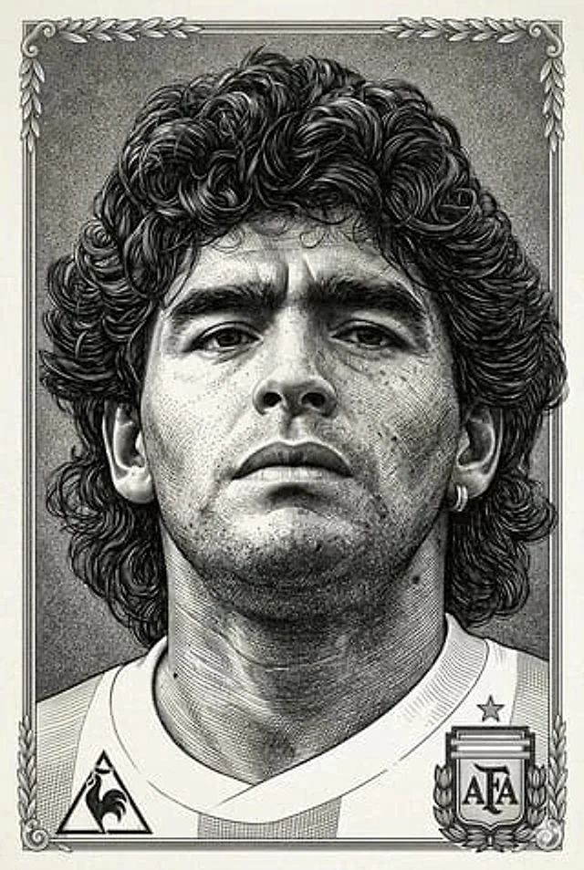

```text
Create image, aspect ratio 2:3
A close-up portrait of a person in a hyper-detailed line-art/engraving style with very dense hatching. Features only two colors: black & white/monochrome graphite. Thousands of fine lines form the skin, with dramatic lighting contrasts.
```

Model: Nano Banana
Author: simeon-sanai

[ProjectD](https://aitoolsradar.com/en/prompts/d7b92226c40647) · [Recorded source](https://x.com/Naiknelofar788/status/2046049269078241532)
 · [Full original metadata and byte evidence](data/projectd-batch-0066.json)

## simeon-sanai #569


```text
Create a 3×3 grid in
3:4 aspect ratio for a high-end commercial marketing campaign using the uploaded product as the central subject.

Each frame must present a distinct visual concept while maintaining perfect product consistency across all nine images.

Grid Concepts (one per cell):

1. Iconic hero still life with bold composition

2. Extreme macro detail highlighting material, surface, or texture

3. Dynamic liquid or particle interaction surrounding the product

4. Minimal sculptural arrangement with abstract forms

5. Floating elements composition suggesting lightness and innovation

6. Sensory close-up emphasizing tactility and realism

7. Color-driven conceptual scene inspired by the product palette

8. Ingredient or component abstraction (non-literal, symbolic)

9. Surreal yet elegant fusion scene combining realism and imagination

Visual Rules:
Product must remain 100% accurate in shape, proportions, label, typography, color, and branding
No distortion, deformation, or redesign of the product
Clean separation between product and background

Lighting & Style:
Soft, controlled studio lighting
Subtle highlights, realistic shadows
High dynamic range, ultra-sharp focus
Editorial luxury advertising aesthetic
Premium sensory marketing look

Overall Feel:
Modern, refined, visually cohesive
High-end commercial campaign
Designed for brand websites, social grids, and digital billboards
Hyperreal, cinematic, polished, and aspirational
```

Model: Nano Banana
Author: simeon-sanai

[ProjectD](https://aitoolsradar.com/en/prompts/a16671b64bca09) · [Recorded source](https://x.com/Naiknelofar788/status/2015634929066070042)
 · [Full original metadata and byte evidence](data/projectd-batch-0066.json)

## simeon-sanai #597

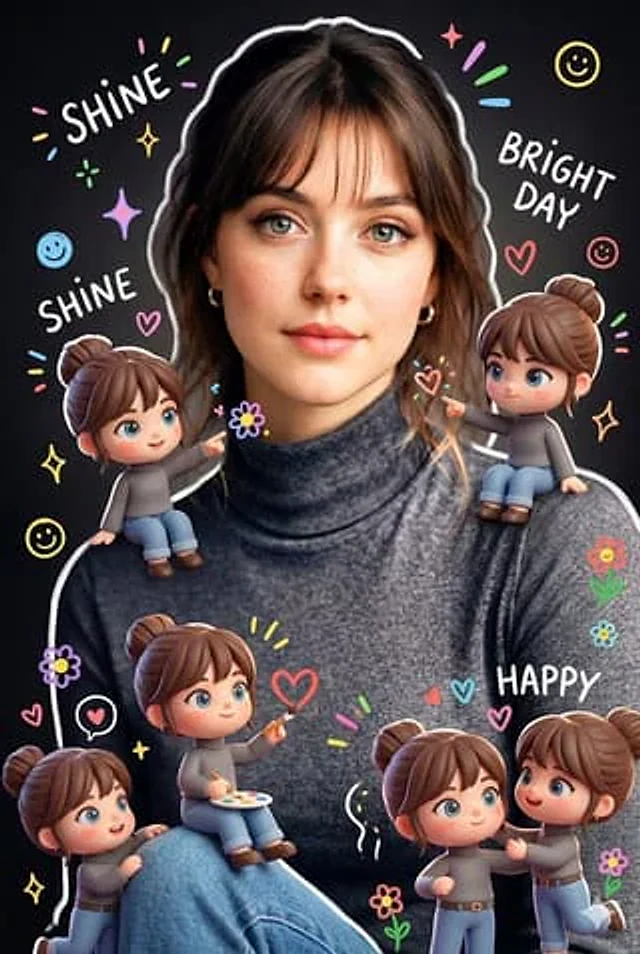

```text
Surrounding the realistic main subject are multiple cute, 3D-style chibi miniatures of the same person, with identical facial features, hairstyle, body proportions, and outfit. 
The chibi figures are naturally distributed around the subject, interacting playfully with her or nearby elements in a charming, non-intrusive way.

Overlay the image with vibrant, hand-drawn doodle effects: soft white outlines around the subject, playful sparkles, doodle hearts, tiny flowers, smiley icons, and floating white handwritten phrases like "shine", "bright day", and "happy".

The style seamlessly blends hyper-realistic photography with colorful, soft cartoon illustrations.
Keep the original face, body shape, and proportions of the main subject unchanged. aspect ratio 2:3
```

Model: Nano Banana
Author: simeon-sanai

[ProjectD](https://aitoolsradar.com/en/prompts/b750e9c1ee75a7) · [Recorded source](https://x.com/Naiknelofar788/status/2030296182745170292)
 · [Full original metadata and byte evidence](data/projectd-batch-0066.json)

## simeon-sanai #646


```text
Ultra-realistic cinematic close-up portrait of a young man with wet skin and damp, messy hair. He is lightly touching the frame of dark, rectangular aviator sunglasses beaded with clear water droplets. The lighting is low-key and dramatic, creating deep shadows that emphasize the moisture on his skin and the fine texture of his beard. He wears a plain, form-fitting matte black t-shirt that blends into a dark, minimal background. Detailed hand gesture showing defined knuckles and a silver ring with stone on the pinky finger. Razor-sharp micro-details, shallow depth of field, 85mm f/1.4 lens effect, moody high-contrast realism, and a high-end fashion editorial aesthetic.

Use my uploaded face image as the  facial and identity reference.
```

Model: Nano Banana
Author: simeon-sanai

[ProjectD](https://aitoolsradar.com/en/prompts/d0cab3deb80f38) · [Recorded source](https://x.com/Naiknelofar788/status/2011283991870259558)
 · [Full original metadata and byte evidence](data/projectd-batch-0066.json)

## simeon-sanai #667


```text
A hyper-realistic macro shot of a paintbrush creating a thick textured paint stroke on a clean white background. The paint forms the shape and colors of the [COUNTRY FLAG], flowing dynamically like a wave. Inside the paint stroke, a highly detailed miniature cityscape of [COUNTRY NAME] emerges, including iconic landmarks such as [LANDMARK 1], [LANDMARK 2], [LANDMARK 3]. The paint has visible brush textures, glossy acrylic finish, rich vibrant colors.
```

Model: Nano Banana
Author: simeon-sanai

[ProjectD](https://aitoolsradar.com/en/prompts/7b8caae6c94b58) · [Recorded source](https://x.com/Naiknelofar788/status/2042058511937679439)
 · [Full original metadata and byte evidence](data/projectd-batch-0066.json)

## simeon-sanai #774


```text
Create a hyper-realistic, high-detail studio photoshoot featuring the same person from the reference photo with the exact facial features, skin tone, hairstyle, proportions, and identity fully preserved (no changes to face or structure). She is wearing stylish Gen-Z fashion attire trendy, minimal, modern streetwear. She is leaning casually on a realistic, fluffy, life-sized Labubu character, rendered in soft fur texture with playful expression. A British Shorthair cat sits or poses nearby, also hyperrealistic with detailed fur and natural posture.

The entire scene is set against a smooth, seamless, vibrant orange studio backdrop with professional studio lighting, crisp shadows, clean highlights, and a premium fashion editorial vibe. Ultra-photorealistic, flawless skin texture (but unchanged identity), high-end photography style, full-body or mid-shot composition.
```

Model: Nano Banana
Author: simeon-sanai

[ProjectD](https://aitoolsradar.com/en/prompts/9d92c9c4b10a4d) · [Recorded source](https://x.com/Naiknelofar788/status/2021574480766943706)
 · [Full original metadata and byte evidence](data/projectd-batch-0066.json)

## simeon-sanai #851


```text
An ultra-realistic miniature [YOUR BRAND] showroom balanced on a human palm, designed with transparent glass walls. Inside, tiny lifelike figures are enjoying [PRODUCTS]. On the rooftop, a glowing 3D logo shines brightly, while the front facade displays the brand name in a bold, recognizable typeface. Outside the showroom, a miniature delivery person is standing with a branded delivery bag strapped to their back, ready to deliver orders.The showroom’s interior is styled like a cozy retail outlet, with miniature products and branding details on display. Lighting is cinematic with warm tones, crisp details, and natural shadows. Captured in professional product photography style, the scene conveys a vibrant, iconic, and instantly recognizable atmosphere. 1080x1080 dimension.
```

Model: Nano Banana
Author: simeon-sanai

[ProjectD](https://aitoolsradar.com/en/prompts/88da411fd6bf85) · [Recorded source](https://x.com/Naiknelofar788/status/2044605023557222629)
 · [Full original metadata and byte evidence](data/projectd-batch-0066.json)

## simeon-sanai #859


```text
Editorial 3x3 photo grid in a clean soft beige studio. Character (matches reference 100%) wearing lightweight dark navy shirt, ivory trousers, barefoot for raw simplicity. Lighting: large diffused key light directly front-right, silver reflector left, subtle rim from top. Shots to include: 1. extreme close-up of lips + cheekbone with blurred hand partially covering (85mm, f/1.8, razor-thin DOF); 2. tight crop on eyes looking into lens with reflection of light strip visible (85mm, f/2.0); 3. black & white close portrait resting chin on fist, face filling frame (50mm, f/2.2); 4. over-shoulder shot, blurred foreground fabric curtain framing half face (85mm, f/2.0); 5. very close frontal with hands overlapping face, light streak across eyes (50mm, f/2.5); 6. tight angled portrait showing hair falling into eyes, soft-focus background (85mm, f/2.2); 7. crop of hands touching jawline, eyes cropped out (50mm, f/3.2, detail-focused); 8. half-body seated sideways on low cube, head turned sharply away, blurred foreground (35mm, f/ 4.5); 9. intense close-up of profile with single tear-like water droplet, cinematic light slice across (85mm, f/ 1.9). Angles: mostly tight headshots with slight high/low tilts, maintaining variation. Capture RAW, professional muted grade, smooth tonal contrast, subtle cinematic grain. Mood: intimate, introspective, character-led editorial minimalism with delicate use of fabric as prop.
```

Model: Nano Banana
Author: simeon-sanai

[ProjectD](https://aitoolsradar.com/en/prompts/13fe6682cc2587) · [Recorded source](https://x.com/Naiknelofar788/status/2021903910617915795)
 · [Full original metadata and byte evidence](data/projectd-batch-0066.json)

## simeon-sanai #884


```text
Ultra-realistic street fashion editorial photograph in New York City / Wall Street area, shot in vertical 3:4 (1152×1536). A stylish woman stands in the lower-right foreground on a wide concrete sidewalk at a street corner, posed in left-facing profile (body angled left, head slightly forward), calm confident expression. She wears large black rectangular sunglasses, pearl drop earrings, hair sleek center-part pulled into a low bun, subtle makeup with warm blush and muted lipstick. Outfit: oversized chocolate-brown leather bomber jacket with pronounced shoulders and glossy creases, layered over a light blue collared shirt and a dark necktie. Hands in front holding a folded newspaper: “THE WALL STREET” clearly visible across the top of the paper. She wears white gloves and high-waisted white pants (clean, structured).

Environment / Street Elements (Must match):

A tall black metal street pole dominates the right side foreground, wrapped with white tape bands and small worn stickers; at the top right there’s a black-and-white “ONE WAY” sign (arrow pointing right). Just left of the pole is a yellow/orange pedestrian traffic signal with the white walking figure illuminated. Above and behind, multiple large American flags hang from the stone building façade, the nearest flag filling the upper center-left area with visible red-and-white stripes and blue field. Background is a canyon of tall buildings: left side is an older light beige stone building with rectangular windows, vent-like panels, and dark trim at the base; right side shows modern tall buildings and a long street receding into the distance. On the roadway to the right is a pinkish-red lane (bus/bike lane feel) with textured sidewalk corner and a small red tactile paving patch near the pole base. Far background includes tiny pedestrians and cars along the street; everything is sharp enough to read the scene but remains secondary to the subject.

Composition / Perspective:

Wide-angle street perspective with strong vertical lines; the camera is at rough chest height aimed slightly upward so the signal, flags, and signs tower above the subject. Subject is framed from mid-thigh up, placed bottom-right, leaving large negative space of architecture and street signage above. Maintain exact spacing: pole near right edge, pedestrian signal centered above subject, flags hanging upper-left, street depth vanishing toward upper-right background.

Lighting / Color / Texture:

Overcast daylight with soft shadows, neutral highlights. Warm, slightly desaturated film look (beige stone tones, muted browns), subtle contrast, gentle lifted blacks. Add fine film grain and slight texture like a candid editorial street shot. Natural skin texture, realistic leather sheen and folds, realistic newspaper paper texture.

Camera / Lens / Settings (Emulation):

Full-frame look, 24–28mm wide lens, documentary/editorial street style, moderate depth of field (subject crisp, background slightly softer but still readable). Slight vintage/film-grade color science.

Hard Rules (No deviations):

Do not change the pose, outfit layers (brown leather jacket + blue shirt + tie), sunglasses shape, pearl earrings, bun hairstyle, white gloves, white pants, the “THE WALL STREET” newspaper text, the “ONE WAY” sign, the walking man icon, the American flags, or the exact NYC street-corner composition. No extra props, no extra people in foreground, no cropping changes, no stylization beyond realistic film/editorial grain.

Negative Prompt (Strict):

no illustration, no CGI look, no anime, no painterly texture, no extra typography overlays, no added logos, no changed signs, no different newspaper title, no different flag placement, no blur on main subject, no heavy HDR, no neon colors, no beauty-plastic skin, no distorted hands, no warped buildings, no random lens flares.
```

Model: Nano Banana
Author: simeon-sanai

[ProjectD](https://aitoolsradar.com/en/prompts/64fe84436feb68) · [Recorded source](https://x.com/Naiknelofar788/status/2021083866258342114)
 · [Full original metadata and byte evidence](data/projectd-batch-0066.json)

## simeon-sanai #950


```text
[product setup],create minimalist product photo, clean warm studio scene, textured beige wall background, soft directional sunlight creating long shadows, simple tabletop surface, product arranged in a playful concept composition, hand drawn white line doodle overlay of [character] interacting with the product, mixed media look combining real photography and sketch illustration, high end branding feel, shallow depth of field, ultra realistic, no extra text, no watermark, 8k, 1:1
```

Model: Nano Banana
Author: simeon-sanai

[ProjectD](https://aitoolsradar.com/en/prompts/35419728b9bd24) · [Recorded source](https://x.com/Naiknelofar788/status/2027544179560353948)
 · [Full original metadata and byte evidence](data/projectd-batch-0066.json)

## simply #1098


```text
High-contrast black-and-white studio photo of a woman seated on the floor wearing a black sweater, black trousers, and black leather ankle boots. Legs are bent and open toward the camera, with one boot sole prominently facing the lens. Upper body slightly reclined, calm expression. Clean white background, dramatic low-angle composition. Don’t change the face. (Use the attached image)
```

Model: Nano Banana
Author: simply

[ProjectD](https://aitoolsradar.com/en/prompts/47f0778190f2e1) · [Recorded source](https://x.com/kingofdairyque/status/2011340606975721923)
 · [Full original metadata and byte evidence](data/projectd-batch-0066.json)

## simply #1229


```text
A panning studio portrait of a mysterious female figure captured in side profile, her head subtly turned forward as motion blur streaks softly through her hair and jawline. She wears a matte charcoal wool coat with softened edges, standing against a solid Pantone 137 C orange background that fills the frame entirely. The image features intentional horizontal motion blur from a slow shutter pan, preserving facial structure while allowing peripheral smearing. Soft studio lighting with diffused highlights, low contrast, and lifted blacks creates a faded analog film look with fine grain and muted saturation. Shot on a full-frame camera using a 50mm lens at f/2.8, ISO 200, shutter speed 1/15s, vertical orientation, tight portrait framing, shallow depth of field. The mood is cinematic, introspective, and modern editorial visual language aligned with 032c and A24 aesthetics.
```

Model: Nano Banana
Author: simply

[ProjectD](https://aitoolsradar.com/en/prompts/23bbc6727e5e35) · [Recorded source](https://x.com/kingofdairyque/status/2008773580893679871)
 · [Full original metadata and byte evidence](data/projectd-batch-0066.json)

## simply #1296


```text
A high-realism, professional editorial photograph inside an Orthodox church.
A young woman with natural facial proportions and a calm, focused expression is kneeling on the stone floor, seated back on her heels. She wears an elegant white long-sleeve dress with a high neckline and a fabric belt tied at the waist; the fabric shows realistic folds, weight, and subtle texture. Her head is modestly covered with a traditional white headscarf (kosynka), softly draped and slightly translucent at the edges.
She is positioned in right side profile, holding a thin paintbrush in her right hand, carefully applying paint to a large Orthodox icon placed on a wooden easel in front of her. The brush gently touches the icon's surface, emphasizing a moment of concentration and reverence.
The icon depicts an elderly Orthodox saint with a long grey beard, dressed in traditional liturgical garments, with a softly glowing golden halo. Cyrillic inscriptions are visible on the icon, including "IC XC" and other Church Slavonic lettering. The saint holds a small icon in his hands. The painted surface shows realistic craquelure, brush strokes, gold leaf imperfections, and aged varnish.
Background: a richly decorated iconostasis filled with golden icons set in arched frames, carved wooden details, burning candles and hanging oil lamps. On the right side, a tall arched stained-glass window casts soft multicolored light onto the floor, creating subtle rainbow reflections. On the left, part of the altar is visible with a cross and additional icons.
Lighting is warm, layered, and atmospheric — golden ambient candlelight combined with soft natural light from the window, creating gentle shadows and depth. Skin appears fully natural with visible pores, subtle tonal variations, and no artificial smoothing. Makeup is refined and realistic, enhancing the eyes and lips without exaggeration.
Camera perspective: 50–85mm lens look, shallow depth of field, sharp focus on the woman's face, hand, and brush, with the background softly blurred. High optical clarity, true-to-life color balance, realistic exposure. The composition emphasizes the contrast between the matte white fabric of the dress and the luminous gold tones of the iconostasis. Ultra-realistic, photographic, human, non-stylized.
```

Model: Nano Banana
Author: simply

[ProjectD](https://aitoolsradar.com/en/prompts/e4abc912b40999) · [Recorded source](https://x.com/kingofdairyque/status/2008902313898033412)
 · [Full original metadata and byte evidence](data/projectd-batch-0066.json)

## simply #1346


```text
A highly realistic mirror selfie of a young woman taken through the reflection of a round tabletop mirror with a chrome metal frame and stand. The composition feels intimate and natural, like a quiet personal care moment.
She is wearing a thin white spaghetti-strap tank top. Her head is wrapped in a soft grey-beige terry towel styled as a turban, fully covering her hair. Under her left eye, a single pair of gold hydrogel eyepatches is applied — semi-circular, slightly reflective with a subtle metallic sheen.
Her face appears makeup-free or with very minimal natural makeup. Skin looks fresh, hydrated, and real, with visible natural texture, soft pores, slight tonal variations, and gentle under-eye shadows. Lips have a neutral tone with a light natural gloss. She wears small gold hoop earrings.
She holds a black iPhone with a triple-camera module (similar to iPhone 11 Pro or newer) in her right hand, angled toward the mirror. Her expression is calm and relaxed, slightly tired but peaceful, with her gaze directed slightly downward at the phone screen.
Environment & background:
Behind her is a grey concrete-textured wall. On the left side of the frame, a window allows soft natural daylight to enter, creating gentle, diffused illumination with a slightly cool tone.
On the table in front of the mirror:
On the left: a clear glass diffuser bottle with wooden sticks, labeled “ASOMA”.
On the right: a brown glass candle jar, partially burned, with visible wax residue.
Mood & lighting:
Soft natural daylight, subtle shadows, no harsh highlights. Scandinavian / loft-style bathroom atmosphere, minimalistic, cozy, quiet. Color palette consists of muted greys, warm beige, soft whites, and restrained gold accents.
Photographic realism, candid lifestyle photography feel, shallow depth of field, natural lens perspective (50–85mm equivalent), true-to-life proportions, no beauty retouching, no plastic skin, no exaggerated features, high detail, realistic reflections, authentic mirror distortion, editorial-quality realism.
```

Model: Nano Banana
Author: simply

[ProjectD](https://aitoolsradar.com/en/prompts/02f1e4246a917a) · [Recorded source](https://x.com/kingofdairyque/status/2009490797889245228)
 · [Full original metadata and byte evidence](data/projectd-batch-0066.json)

## simply #342


```text
Use this photo attached to create an ultra-realistic printed portrait with authentic photo-print shine.
A straight-on, centered head-and-shoulders portrait of a young woman, neutral confident expression, eyes looking directly at the camera. Composition is perfectly aligned and symmetrical, identical to a school ID / yearbook / magazine archive photo.
She has long, smooth brown hair, center-parted, softly layered, neatly styled. Makeup is polished but natural, editorial-clean: warm brown eyeshadow, softly defined eyeliner, voluminous lashes, subtle contour, peach blush, and glossy nude lips. Skin is smooth, flawless, softly matte with natural highlights, realistic pores visible.
She wears a dark navy blazer with white piping, white collared shirt, dark sweater vest, and navy striped tie, styled like a formal school uniform portrait. Small silver hoop earrings.
EXACT FILTER & PRINT SHINE (VERY IMPORTANT):
Apply a real photo-print filter, not digital glow:
Subtle semi-gloss paper sheen
Light reflective shine across cheeks, forehead, and lips, as if light is bouncing off printed ink
Very mild lamination glare, thin diagonal highlights
Slight softening from ink absorption, not blur
Gentle warm undertone from printed ink
Fine paper grain texture visible on skin and background
Looks like a scanned or photographed printed photo
NO glassy skin
NO beauty filter glow
NO cinematic bloom
LIGHTING:
Direct frontal harsh flash ALWAYS ON, similar to ID or studio flash:
Even exposure
Bright eye catchlights
Minimal shadows
Flat, clean lighting typical of printed portraits
BACKGROUND:
Flat cool blue textured studio backdrop, evenly lit, slightly muted by print ink.
TEXT & LAYOUT (PRINTED):
Below the portrait, centered and printed on the page:
Bold serif font:
HIGHSCHOOL GAL
Below in smaller italic serif font, quotation style:
“You put the ‘over’ in ‘lover,’ put the ‘ex’ in ‘next’
Ain’t no ‘I’ in ‘trouble,’ just the ‘U’ since we met”
Text appears ink-printed, slightly imperfect edges, natural spacing, no digital sharpness.
OVERALL LOOK:
Real printed photograph
Magazine / yearbook archive
Soft shine, subtle glare
Paper texture + ink warmth
Not digital, not glossy poster
Looks physically touchable
```

Model: Nano Banana
Author: simply

[ProjectD](https://aitoolsradar.com/en/prompts/72be4db57391a6) · [Recorded source](https://x.com/kingofdairyque/status/2008441233816109505)
 · [Full original metadata and byte evidence](data/projectd-batch-0066.json)

## simply #829


```text
Cinematic street photography capturing a moment in motion with a crowd blur effect. Overhead portrait of me standing still on a crosswalk, wearing a white button-up shirt, black oversized jacket, and olive green cargo pants. Motion-blurred crowd rushes past. Moody city lighting, 35mm film aesthetic, shallow depth of field, sharp focus on my portrait, showcasing an artistic and timeless style.
```

Model: Nano Banana
Author: simply

[ProjectD](https://aitoolsradar.com/en/prompts/07640c4feada26) · [Recorded source](https://x.com/kingofdairyque/status/2011249682153132335)
 · [Full original metadata and byte evidence](data/projectd-batch-0066.json)

## Sindhu Sherni🦁 #1357


```text
Ultra-realistic macro scene depicting tiny restoration workers collaboratively repairing an antique pocket watch. Several figures delicately clean intricate brass gears using fine brushes, while others stabilize the open watch casing and hold miniature components in place. The pocket watch lies on a textured natural surface, such as weathered wood or stone, emphasizing age and history. The scene symbolizes time, patience, craftsmanship, and teamwork.",
  "style": {
    "photography_type": "Macro photography",
    "realism": "Ultra-realistic",
    "mood": "Emotional and cinematic",
    "lighting": "Soft, warm, directional lighting with gentle highlights and natural shadows",
    "depth_of_field": "Shallow depth of field with sharp focus on foreground details and smooth background bokeh"
  },
  "composition": {
    "shot_type": "Close-up macro",
    "angle": "Slightly elevated perspective",
    "focus": "Extreme detail on gears, tools, and figurines’ interactions",
    "framing": "Pocket watch centered with workers distributed naturally across the mechanism"
  },
  "textures_and_details": {
    "materials": "Aged metal, polished brass gears, worn leather strap, natural surface grain",
    "details": "Visible dust particles, subtle scratches, fingerprints, and mechanical wear"
  },
  "atmosphere": {
    "tone": "Warm, nostalgic, hopeful",
    "symbolism": "Restoration of time through collective effort and care"
  },
  "render_settings": {
    "aspect_ratio": "4:5",
    "quality": 2,
    "resolution": "High-resolution",
    "style_precision": "Professional studio-level composition"
  }
}
```

Model: Nano Banana
Author: Sindhu Sherni🦁

[ProjectD](https://aitoolsradar.com/en/prompts/ca250fba30f41b) · [Recorded source](https://x.com/SindhuK66662473/status/2011688509665657263)
 · [Full original metadata and byte evidence](data/projectd-batch-0066.json)

## Sindhu Sherni🦁 #1392


```text
Hyper-realistic editorial photo shot at eye level with a 12mm ultra-wide lens, full-frame camera, deep focus, and visible barrel distortion with curved room edges. A small rectangular room fully covered in real newspaper pages—walls, floor, and ceiling—showing crisp text, ink bleed, and paper texture.
A woman sits cross-legged on the floor, hands pressed to her cheeks, mouth in a shocked “O.” Long wavy hair, natural skin texture with visible pores and subtle freckles. She wears red octagonal sunglasses, a black-and-white checkered harlequin jacket, vibrant red cargo pants, and matching chunky sneakers.
Soft, diffuse frontal lighting, minimal shadows. Cinematic high-contrast color grade, mostly black and white with red as the only saturated accent, ultra-detailed, photorealistic fashion photography.
```

Model: Nano Banana
Author: Sindhu Sherni🦁

[ProjectD](https://aitoolsradar.com/en/prompts/ad3fe91c32d73b) · [Recorded source](https://x.com/SindhuK66662473/status/2011031706749522391)
 · [Full original metadata and byte evidence](data/projectd-batch-0066.json)

## Sindhu Sherni🦁 #1415


```text
Cinematic, ultra-realistic scene depicting Venezuelan opposition leader María Corina Machado presenting her Nobel Peace Prize medal to Donald Trump. Machado stands with a calm yet determined expression, holding the Nobel medal as a symbol of hope and democracy. Trump receives it thoughtfully, set against a dignified indoor setting. In the background, subtle symbolism appears: softly blurred US and Venezuelan flags, a faint glow of light symbolizing freedom, and a distant crowd suggesting democratic aspirations. Mood is serious, historic, and hopeful. Professional lighting, shallow depth of field, high detail, photo-journalistic realism.”
```

Model: Nano Banana
Author: Sindhu Sherni🦁

[ProjectD](https://aitoolsradar.com/en/prompts/eaa017e216aa4b) · [Recorded source](https://x.com/SindhuK66662473/status/2012020162195857782)
 · [Full original metadata and byte evidence](data/projectd-batch-0066.json)

## Smiling Khan #1000


```text
cinematic 8-photo storytelling collage featuring the same girl throughout the journey.
Frame 1: Bedroom desk — laptop bag packed, morning light.
Frame 2: Leaving home — headphones on, confident walk.
Frame 3: City sidewalk — coffee aroma vibes, motion blur.
Frame 4: Entering café — warm interiors, soft smiles.
Frame 5: Laptop open — deep focus, typing.
Frame 6: Coffee sip — thoughtful pause.
Frame 7: Closing laptop — productive satisfaction.
Frame 8: Walking back home — golden hour calm.
Editorial lifestyle mood, natural tones, cinematic depth, ultra-realistic.
```

Model: Nano Banana
Author: Smiling Khan

[ProjectD](https://aitoolsradar.com/en/prompts/9e3e6366ccb5cf) · [Recorded source](https://x.com/AIwithkhan/status/2010183814245724376)
 · [Full original metadata and byte evidence](data/projectd-batch-0066.json)

## Smiling Khan #789


```text
A cinematic 4-panel photo collage showing a quiet, introspective city walk with smoking as a character detail.
• Frame 1: Sitting briefly on wide stone stairs, cigarette lit, city lights behind
• Frame 2: Standing still under a warm streetlamp, slow smoke drifting upward
• Frame 3: Walking past old European buildings, cigarette between fingers
• Frame 4: Pausing near a closed shop window, reflection visible with smoke haze
Consistent outfit — minimalist black outfit, ankle boots. Low-key lighting, soft bokeh, cinematic shadows, film-still realism, editorial mood, 1:1 aspect ratio.
```

Model: Nano Banana
Author: Smiling Khan

[ProjectD](https://aitoolsradar.com/en/prompts/1cd5da0b8d7546) · [Recorded source](https://x.com/AIwithkhan/status/2008177924651044876)
 · [Full original metadata and byte evidence](data/projectd-batch-0066.json)

## Smiling Khan #834


```text
A cute 3D chibi-style character leaning against a parked mini chibi Jeep, wearing a clean monochrome outfit: plain t-shirt, straight-fit pants, and minimalist sneakers. Holding a takeaway coffee cup, relaxed confident smile. Big head, expressive eyes, modern fade haircut. Cozy café courtyard with wooden chairs, warm sunlight, soft depth of field, Pixar-quality 3D render, playful yet premium aesthetic, square aspect rat
```

Model: Nano Banana
Author: Smiling Khan

[ProjectD](https://aitoolsradar.com/en/prompts/b35f9f45e81c89) · [Recorded source](https://x.com/AIwithkhan/status/2011097903599927573)
 · [Full original metadata and byte evidence](data/projectd-batch-0066.json)

## Snow #923


```text
Ultra realistic cinematic portrait of a young man with sharp masculine features and light stubble, snow dusted hair slightly longer and pushed back, calm but intense eyes looking slightly away from the camera, wearing a charcoal hooded winter jacket layered over a black turtleneck, standing in a deserted snowy street at night, heavy snowfall swirling around him, snowflakes catching light mid air, cold breath visible, dim ambient street lighting with a single overhead lamp casting soft shadows, background filled with snow covered buildings and faint fog, low key lighting with cool blue tones, subtle rim light separating the subject from the background, medium close up framing, 50mm lens look, shallow depth of field, cinematic contrast, realistic skin texture, film grain, moody atmosphere, loneliness, quiet strength, winter noir aesthetic, professional photography realism.
```

Model: Nano Banana
Author: Snow

[ProjectD](https://aitoolsradar.com/en/prompts/9eca986e47449e) · [Recorded source](https://x.com/iamrealsnow/status/2012135339763101836)
 · [Full original metadata and byte evidence](data/projectd-batch-0066.json)

## Sophia✨ #1218


```text
A cinematic 1970s-inspired fashion portrait of a young woman seated on worn stone steps outside a cozy street café. She holds a deep-green ceramic coffee cup with gold rim accents, resting it gently in her hands, gazing softly at the camera with calm, timeless confidence.

Her hair falls in natural waves with loose strands framing her face, styled with vintage 1970s elegance. Makeup is classic: matte crimson lips, subtle winged eyeliner, warm blush, and softly defined brows. She wears a relaxed forest-green knitted sweater paired with a flowing black tulle skirt, complemented by a warm plaid scarf in earthy tones. A dark-green leather crossbody bag with gold details sits beside her.

The background shows an autumn street scene with fallen leaves, amber-lit café windows, and a quiet, serene urban atmosphere. Shot with an 85mm lens at f/1.8, the image features shallow depth of field, warm analog film grain, muted earthy colors, and a dreamy, cinematic fashion editorial feel inspired by 1970s film aesthetics.
```

Model: Nano Banana
Author: Sophia✨

[ProjectD](https://aitoolsradar.com/en/prompts/596ebdf7b56cc3) · [Recorded source](https://x.com/Sophia_here12/status/2008846206227632397)
 · [Full original metadata and byte evidence](data/projectd-batch-0066.json)

## Sophia✨ #1295


```text
Calm eyes, simple elegance.

A high-fashion close-up portrait of a woman with relaxed shoulders and a gentle, composed smile. She wears a soft ivory couture top with a clean neckline, set in a warm-lit studio with delicate, translucent dust particles floating softly around her face.
```

Model: Nano Banana
Author: Sophia✨

[ProjectD](https://aitoolsradar.com/en/prompts/1ccdf4aee38e40) · [Recorded source](https://x.com/Sophia_here12/status/2010179276973191428)
 · [Full original metadata and byte evidence](data/projectd-batch-0066.json)

## Sudee🥀 #496


```text
{
  "task": "Create an iPhone-realistic photobooth collage (4 photos in a 2x2 grid)",
  "subjects": [
    {
      "id": "Subject 1",
      "description": "EXACTLY from the Reference Image (same face, hairstyle, skin tone, body proportions, overall look).",
      "outfit": "EXACTLY the same as in the Reference Image. Do not change clothing, glasses, or accessories."
    },
    {
      "id": "Subject 2",
      "description": "EXACTLY from the Reference Image (same face, hairstyle, skin tone, body proportions, overall look).",
      "outfit": "EXACTLY the same as in the Reference Image. Do not change clothing, glasses, or accessories."
    }
  ],
  "scene": {
    "location": "Inside a small BOX photo booth",
    "background": "Matte blue walls and blue floor, tight enclosed corner, clean minimal environment",
    "camera_look": "Ultra wide / slight fisheye lens look with subtle perspective distortion typical of photobox cameras. iPhone 17 Pro, photobooth wide-angle.",
    "lighting": "Bright neutral-white flash lighting, evenly illuminating faces, soft shadow falloff on blue walls, crisp detail, realistic skin texture. Direct neutral white flash (no yellow / no warm tone).",
    "aesthetic": "4K, amateur photobooth aesthetic, high contrast but still natural, no cinematic grading, no heavy beauty filter, no blur, no text, no watermark."
  },
  "layout": {
    "type": "2x2 grid collage",
    "aspect_ratio": "9:16 (vertical collage)",
    "style": "Clean, with NO white borders, NO frame lines, NO gaps, and NO outlines between photos (seamless collage). Each frame fills its quadrant edge-to-edge."
  },
  "frames": [
    {
      "position": "top-left",
      "content": "Subject 1 leans diagonally toward the camera from the front-left, one arm stretched down, playful serious face; Subject 2 stands behind in the center, arms raised and flexing like “strongman”, smiling."
    },
    {
      "position": "top-right",
      "content": "Subject 2 leans forward toward the camera, hands on knees, curious expression; Subject 1 enters from the right side very close to camera, tilting her head, one arm arched above her head like a half-heart pose, soft smile."
    },
    {
      "position": "bottom-left",
      "content": "Piggyback pose — Subject 1 on Subject 2’s back, arms wrapped around shoulders; both laughing big, faces close to camera, dynamic motion vibe."
    },
    {
      "position": "bottom-right",
      "content": "Subject 2 bends sideways/leans forward with a goofy face; Subject 1 stands behind making playful “claw/horns” hand gestures above Subject 2’s head, slightly pouting for fun."
    }
  ]
}
```

Model: Nano Banana
Author: Sudee🥀

[ProjectD](https://aitoolsradar.com/en/prompts/b6ae4f1c8d9a6f) · [Recorded source](https://x.com/NameIsSudee/status/2008809931550716249)
 · [Full original metadata and byte evidence](data/projectd-batch-0066.json)

## Sudee🥀 #916


```text
{
  "prompt": "High-resolution nighttime editorial portrait shot with on-camera flash. A young woman standing outdoors at night under blooming cherry blossom trees, holding a transparent clear umbrella covered in raindrops. Her hair is wet and slightly wavy, framing her face naturally. She wears a brown leather jacket with a matching skirt, styled minimal and modern. One hand reaches slightly toward the camera, creating depth and intimacy. Strong flash lighting with a dark background, rain droplets frozen in motion, cinematic contrast, shallow depth of field, fashion editorial vibe, realistic skin tones, sharp focus. No text, no watermark.",
  "style": "fashion editorial, cinematic, modern",
  "camera": {
    "shot_type": "portrait",
    "lighting": "on-camera flash",
    "depth_of_field": "shallow"
  },
  "lighting": {
    "type": "strong flash",
    "environment": "nighttime",
    "effect": ["high contrast", "frozen raindrops"]
  },
  "environment": {
    "location": "outdoor nighttime setting",
    "elements": ["cherry blossom trees", "rain", "dark background"]
  },
  "wardrobe": {
    "outfit": ["Silver leather jacket", "matching skirt"],
    "style": "minimal, modern"
  },
  "mood": ["intimate", "cinematic", "editorial"],
  "quality": ["high-resolution", "sharp focus", "realistic skin tones"],
  "constraints": ["no text", "no watermark"]
}
```

Model: Nano Banana
Author: Sudee🥀

[ProjectD](https://aitoolsradar.com/en/prompts/f8da45a81471b8) · [Recorded source](https://x.com/NameIsSudee/status/2009236662149316854)
 · [Full original metadata and byte evidence](data/projectd-batch-0066.json)

## Synthia #1020


```text
A cute 3D chibi-style character of the uploaded image leaning against a parked mini chibi scooter, wearing a clean monochrome outfit with a t-shirt, straight-fit pants, and minimalist sneakers, holding a takeaway juice cup with a relaxed confident smile, big head and expressive eyes, modern fade haircut, set in a cozy café courtyard with wooden chairs, warm golden sunlight, soft depth of field, pastel color palette, smooth rounded proportions, subtle texture detailing, global illumination with gentle rim light, soft natural shadows, playful yet premium Pixar-quality 3D render, toy-like finish, Google Gemini cinematic but cozy mood, ultra-clean high-detail output, Instagram-ready composition, square aspect ratio 1:1
```

Model: Nano Banana
Author: Synthia

[ProjectD](https://aitoolsradar.com/en/prompts/e15645a04c8be7) · [Recorded source](https://x.com/AIwithSynthia/status/2012060251231822295)
 · [Full original metadata and byte evidence](data/projectd-batch-0066.json)

## Synthia #1104


```text
A highly detailed pebble mosaic portrait of a beautiful woman, where the entire image is constructed from thousands of smooth natural stones and pebbles. The pebbles vary in size and color to form realistic facial features, hair, skin tones, and clothing patterns. The woman has long flowing hair and is wearing a richly patterned red traditional dress. The background is also composed of carefully arranged river stones creating a textured mosaic wall. Ultra-detailed stone texture, gemini natural earthy colors, soft lighting, artistic stone mosaic craftsmanship, gemini photorealistic composition, 8k resolution, intricate pebble placement, handcrafted mosaic art style.
```

Model: Nano Banana
Author: Synthia

[ProjectD](https://aitoolsradar.com/en/prompts/23e6969c5d45f1) · [Recorded source](https://x.com/AIwithSynthia/status/2031520039850094952)
 · [Full original metadata and byte evidence](data/projectd-batch-0066.json)

## Synthia #1106


```text
A cinematic fashion studio scene of a woman hand-sewing a miniature dress worn by a tiny version of herself seated on a pin cushion.
She uses a fine needle and silk thread, concentrating intensely as fabric tension is adjusted.
The miniature garment features perfectly scaled seams, buttons, and lifelike fabric weight in it .
Workbench filled with miniature scissors, chalk, rulers, pattern papers, and thread reels.
Warm cinematic lighting reveals textile grain, skin pores, and metal reflections.
Macro depth of field, fashion editorial composition, ultra-photoreal realism, 8K quality.

Style: cinematic miniature tailoring realism, no cartoon, no CGI
```

Model: Nano Banana
Author: Synthia

[ProjectD](https://aitoolsradar.com/en/prompts/762f1a08d33a43) · [Recorded source](https://x.com/AIwithSynthia/status/2024111444334407809)
 · [Full original metadata and byte evidence](data/projectd-batch-0066.json)

## Synthia #1140


```text
A cute stylized 3D collectible figurine inspired by Cristiano Ronaldo, with short styled hair and an athletic build, wearing a modern football kit and standing confidently with hands on hips. Next to him is a large Kinder Joy egg featuring a cartoon avatar of the same football star printed on the shell. The scene is placed on a wooden table with soft natural lighting, shallow depth of field, cozy indoor background with blurred plants, highly detailed Pixar-style 3D render, glossy toy texture, cinematic lighting, ultra-detailed product photography, designer toy aesthetic. ⚽🥚
```

Model: Nano Banana
Author: Synthia

[ProjectD](https://aitoolsradar.com/en/prompts/4fe3a63723ca91) · [Recorded source](https://x.com/AIwithSynthia/status/2032973567760232717)
 · [Full original metadata and byte evidence](data/projectd-batch-0066.json)

## Synthia #1145


```text
Ultra-realistic cinematic two-frame composition. In the top golden vintage frame, an elegant stylish woman wearing a beige blazer, white shirt, and black sunglasses smiles while pouring tea from an ornate engraved copper teapot outward from the frame. The tea flows smoothly out of the frame into the lower frame. In the bottom golden frame, the same woman tilts her head back slightly with a joyful expression, holding a traditional Turkish tea glass as the tea splashes dramatically into it mid-air. Nighttime city skyline with warm glowing lights and water reflections in the background, shallow depth of field, dramatic lighting, high detail, surreal perspective illusion where the liquid connects both frames, cinematic photography, ultra realistic, 8k.
```

Model: Nano Banana
Author: Synthia

[ProjectD](https://aitoolsradar.com/en/prompts/dc279e2f5ef293) · [Recorded source](https://x.com/AIwithSynthia/status/2030799128343798247)
 · [Full original metadata and byte evidence](data/projectd-batch-0066.json)

## Synthia #1176


```text
Use the uploaded image as the primary subject reference. Transform the person into a stylized caricature with a slightly oversized head and a smaller body while preserving facial identity, expression, hairstyle, and key features.
Place the subject casually leaning against a vintage dark green classic car on a narrow cobblestone street with warm glowing street lamps on both sides. Maintain a relaxed, confident pose.
Outfit should match or naturally enhance the original clothing from the uploaded image (adapt if needed to fit the scene). Keep textures realistic and well-detailed.
Style: 3D cartoon realism, cinematic lighting, shallow depth of field, ultra-detailed, soft shadows, warm tones, high resolution, vibrant but natural colors.
```

Model: Nano Banana
Author: Synthia

[ProjectD](https://aitoolsradar.com/en/prompts/eebeb7a05618bf) · [Recorded source](https://x.com/AIwithSynthia/status/2038172237560439254)
 · [Full original metadata and byte evidence](data/projectd-batch-0066.json)

## Synthia #1236


```text
A cinematic 3×3 grid of film-still frames featuring the same couple during a quiet countryside road stop at dusk. A young woman with short dark hair wearing a light patterned blouse stands beside a cream vintage convertible on a rural dirt road, open fields and rolling hills stretching into the distance. Each frame here shows a distinct cinematic angle: extreme close-up of her face with natural skin texture, intimate medium shot of the couple leaning on the car, back view of the woman facing the landscape, wide establishing shot with the car in tall grass, high-angle top-down shot of the couple beside the convertible, dramatic low-angle portrait against the sky, clean side profile close-up, three-quarter rear view of the couple near the car, and a full back view of them walking away hand in hand down the road. Soft natural dusk lighting, muted earthy tones, realistic colors, shallow depth of field, subtle film grain, consistent facial features across all frames, emotional cinematic mood, professional cinematography reference sheet style, ultra-realistic photography.
```

Model: Nano Banana
Author: Synthia

[ProjectD](https://aitoolsradar.com/en/prompts/51c8f03138df0f) · [Recorded source](https://x.com/AIwithSynthia/status/2009855866582003777)
 · [Full original metadata and byte evidence](data/projectd-batch-0066.json)

## Synthia #1245


```text
studio fashion collage, 3x3 grid layout, same subject repeated in different poses across all panels, clean seamless white background, soft diffused studio lighting, minimalist aesthetic, playful editorial storytelling
subject styled in smart casual outfit (navy sweater, relaxed denim, glasses, polished shoes), holding and interacting with a structured luxury handbag as the central prop, quirky narrative scenes in each frame:
top row — crouching and interacting with a white cat beside handbag, tossing playing cards mid-air while holding bag, standing holding a bunch of white balloons
middle row — pushing a shopping cart filled with bright tennis balls, close-up portrait using a magnifying glass toward camera, sitting on stacked vintage suitcases holding handbag with a tennis ball
bottom row — standing with cat draped over shoulders holding bag, sitting backwards on a wooden chair with tennis ball under chair, standing pose with cat sitting inside handbag
consistent styling across all frames, balanced composition, symmetrical spacing, editorial grid layout, subtle humor and surreal elements, crisp sharp focus, high fashion campaign vibe, photorealistic, ultra clean shadows, 50mm lens look, f2.0
```

Model: Nano Banana
Author: Synthia

[ProjectD](https://aitoolsradar.com/en/prompts/584a0fbf5e3b17) · [Recorded source](https://x.com/AIwithSynthia/status/2044780006812110949)
 · [Full original metadata and byte evidence](data/projectd-batch-0066.json)

## Synthia #1257


```text
Ultra-realistic cinematic fashion photograph of a stylish blonde woman standing confidently between two moving escalators inside a luxury shopping mall, wearing a sheer black lace long-sleeve top and flowing skirt, holding a small white designer handbag, her hair dramatically blowing sideways as if caught in motion, blurred crowd moving up and down the escalators creating dynamic motion streaks around her, she remains sharp and perfectly focused in the center, dramatic fashion editorial lighting, shallow depth of field, high contrast, Vogue magazine style, motion blur photography, symmetrical escalator composition, luxury mall interior, 85mm lens, f/1.8, ultra detailed, film grain, cinematic color grading.
```

Model: Nano Banana
Author: Synthia

[ProjectD](https://aitoolsradar.com/en/prompts/f5651fb89b784b) · [Recorded source](https://x.com/AIwithSynthia/status/2030443205599404475)
 · [Full original metadata and byte evidence](data/projectd-batch-0066.json)

## Synthia #1285


```text
Instagram logo made from thick knitted wool yarn, handcrafted textile design, soft colorful gradient yarn threads, rounded square shape with stitched camera symbol, visible knitting pattern, cozy fabric realism, macro product photography, soft studio lighting, clean minimal gemini background, ultra-detailed fibers, premium handmade aesthetic, centered composition, 1:1 aspect ratio
```

Model: Nano Banana
Author: Synthia

[ProjectD](https://aitoolsradar.com/en/prompts/c859558293094e) · [Recorded source](https://x.com/AIwithSynthia/status/2027773020442599659)
 · [Full original metadata and byte evidence](data/projectd-batch-0066.json)

## Synthia #1371


```text
A clean, modern personal branding mockup featuring a cohesive visual identity for a female creator or entrepreneur. The scene includes a minimalist brand kit displayed on a soft neutral background: a framed portrait with elegant typography, a circular logo with a hand-drawn line-art face illustration, and branded merchandise such as a white t-shirt, tote bag, and ceramic mug printed with the same logo. A grid-style social media layout showcases portrait photography, behind-the-scenes content, quotes, and solid color brand tiles in warm beige, cream, and muted terracotta tones. Google Gemini The overall aesthetic is creative, modern, and minimal, with soft natural lighting, premium lifestyle photography, balanced composition, Scandinavian-inspired design, high-end branding presentation, editorial feel, and consistent typography. Ideal for a personal brand, content creator, or lifestyle entrepreneur identity showcase.
```

Model: Nano Banana
Author: Synthia

[ProjectD](https://aitoolsradar.com/en/prompts/869a0b280d71cc) · [Recorded source](https://x.com/AIwithSynthia/status/2009592182630744078)
 · [Full original metadata and byte evidence](data/projectd-batch-0066.json)

## Synthia #1381


```text
A hyper-realistic cinematic scene of a woman carefully painting a miniature football figurine of Cristiano Ronaldo in a Portugal national team jersey. The tiny footballer is frozen mid-dribble with the ball at his feet, standing on a round grass base placed on a wooden desk. The woman wears a matching red Portugal jersey and focuses intently while holding a fine paintbrush near the figure’s face. Soft natural window light creates warm highlights and gentle shadows, shallow depth of field with a blurred shelf of collectibles in the background. Ultra-detailed textures on fabric, skin, and paint strokes, photorealistic scale illusion, cinematic storytelling composition, premium studio realism, 50mm lens look, high-end editorial mood
```

Model: Nano Banana
Author: Synthia

[ProjectD](https://aitoolsradar.com/en/prompts/e16471347af606) · [Recorded source](https://x.com/AIwithSynthia/status/2011329615814607139)
 · [Full original metadata and byte evidence](data/projectd-batch-0066.json)

## Synthia #490


```text
A high-quality photo collage featuring the same person with identical facial features and expression, shown in multiple frames with different hairstyles. Each panel displays a unique hairstyle such as long straight hair, high ponytail, messy bun, pixie cut, braided crown, soft waves, short bob with bangs, low bun, side braid, and loose curls. Consistent neutral outfit and makeup across all images, soft studio lighting, warm blurred background, realistic skin texture, symmetrical face consistency, ultra-detailed, editorial beauty look, 4x3 grid layout, professional portrait photograph
```

Model: Nano Banana
Author: Synthia

[ProjectD](https://aitoolsradar.com/en/prompts/53799cfc7503cc) · [Recorded source](https://x.com/AIwithSynthia/status/2013225585297043665)
 · [Full original metadata and byte evidence](data/projectd-batch-0066.json)

## Synthia #647


```text
A hyper-realistic cinematic scene of a giant woman filmmaker carefully adjusting a miniature vintage film camera on a tripod, inside a professional studio setup. A tiny elegant woman in a flowing pastel blue dress stands beside the camera like a model on set. Surrounding them are detailed studio lights, softboxes, film reels, cables, and a clapperboard. The giant woman has soft natural makeup, blonde hair tied back, and an intense focused expression. Dramatic soft lighting, shallow depth of field, ultra-detailed textures, 8K, photorealistic, cinematic composition, studio photography, volumetric lighting.
```

Model: Nano Banana
Author: Synthia

[ProjectD](https://aitoolsradar.com/en/prompts/2f8d631c423f66) · [Recorded source](https://x.com/AIwithSynthia/status/2039602803220591004)
 · [Full original metadata and byte evidence](data/projectd-batch-0066.json)

## Synthia #725


```text
High-fashion summer outfit infographic with color-coordinated floating elements arranged in an elegant exploded circular composition, featuring a breathable straw hat, sleeveless organic cotton top, fluid pleated skirt, artisan leather sandals, and a woven palm-leaf bag; refined callouts highlight fabric breathability, crisp texture, moisture-wicking, and seasonal comfort, with warm neutral tones of ivory, terracotta, sand, and soft tan; subtle motion trails and airy fabric swirls suggest a gentle summer breeze, bright natural sunlight creates soft shadows and a sun-kissed glow, Mediterranean gemini lifestyle mood, premium editorial aesthetic, ultra-sharp details, minimal typography, luxury fashion magazine infographic style, Instagram-ready
```

Model: Nano Banana
Author: Synthia

[ProjectD](https://aitoolsradar.com/en/prompts/9dff11a8784b84) · [Recorded source](https://x.com/AIwithSynthia/status/2017128891568312769)
 · [Full original metadata and byte evidence](data/projectd-batch-0066.json)

## Synthia #768


```text
Bright summer infographic showcasing watermelon juice, icy texture, watermelon wedges floating. Steps: 📷 Select Ripe Watermelon 📷 Cut & Remove Seeds 📷 Blend Smooth 📷 Serve Chilled Info Bar: Hydration Boost: 92% Freshness Level: High High-contrast red & green palette.
```

Model: Nano Banana
Author: Synthia

[ProjectD](https://aitoolsradar.com/en/prompts/0aacbd5a3a1c98) · [Recorded source](https://x.com/AIwithSynthia/status/2016432642951151894)
 · [Full original metadata and byte evidence](data/projectd-batch-0066.json)

## Synthia #836


```text
Cinematic surreal scene of a young woman falling forward through a swirling vortex of everyday objects inside a cozy room, arms reaching toward the camera as if trying to regain balance. Around her, objects float in chaotic slow motion: an excited Rottweiler dog mid-jump holding a donut, a soft teddy bear drifting weightlessly, open books with pages flipping in the air, scattered papers, a red backpack, eyeglasses spinning, pillows floating, a leather wallet, and a mug of coffee splashing dramatically with liquid suspended in mid-air. A pink frosted donut tumbles near the floor while sunlight streams through a window casting soft shadows. The woman wears a casual beige sweater and light pants, barefoot, hair slightly flowing from motion. Ultra-realistic cinematic lighting, dynamic motion blur, shallow depth of field, high detail, dramatic perspective, 35mm lens, surreal storytelling atmosphere, studio-quality photography, 8K.
```

Model: Nano Banana
Author: Synthia

[ProjectD](https://aitoolsradar.com/en/prompts/a50b62e3438852) · [Recorded source](https://x.com/AIwithSynthia/status/2030062558372319415)
 · [Full original metadata and byte evidence](data/projectd-batch-0066.json)

## Synthia #849


```text
A hyper-realistic cinematic scene of a young woman sitting at a wooden desk in a vintage library filled with old books. She is delicately holding and adjusting a tiny miniature version of herself standing on the table. The miniature woman wears an elegant flowing green dress with fine fabric details and subtle glowing particles around her. The larger woman looks focused and gentle, as if crafting or designing the tiny figure. Soft warm lighting from vintage wall lamps creates a cozy atmosphere, with sewing tools like scissors, threads, measuring tape, and fabric pieces scattered on the desk. Shallow depth of field, ultra-detailed, 8K, realistic skin textures, soft shadows, magical realism, cinematic composition.
```

Model: Nano Banana
Author: Synthia

[ProjectD](https://aitoolsradar.com/en/prompts/7cf6a494a897e1) · [Recorded source](https://x.com/AIwithSynthia/status/2040304148516651431)
 · [Full original metadata and byte evidence](data/projectd-batch-0066.json)

