# ProjectD backfill batch 67

Complete original prompts and exact existing ProjectD images. Actual model labels and any available credits or notices are retained. Missing authors or license metadata are not filled in.

## Synthia #891

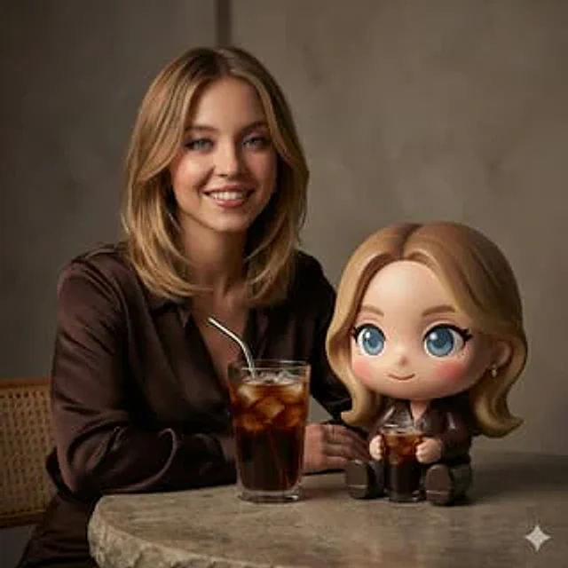

```text
A cinematic studio portrait of a woman seated at a textured stone table against a muted warm gray background. She wears a dark brown satin blouse, subtle evening makeup, and softly layered shoulder-length hair. In front of her is a glass of cold brew coffee with ice and a metal straw. Placed beside it is a glossy 3D chibi figurine of the same woman, with a big rounded head, expressive eyes, soft blush cheeks, and simplified facial features, holding a miniature cold brew glass. The chibi has a high-quality collectible toy look with gentle reflections. Intimate evening café vibe, moody soft lighting, shallow depth of field, realistic human combined with stylized 3D character, cinematic and cozy, 1:1 aspect ratio.
```

Model: Nano Banana
Author: Synthia

[ProjectD](https://aitoolsradar.com/en/prompts/1c34b8252ad110) · [Recorded source](https://x.com/AIwithSynthia/status/2010213849618886946)
 · [Full original metadata and byte evidence](data/projectd-batch-0067.json)

## Synthia #907

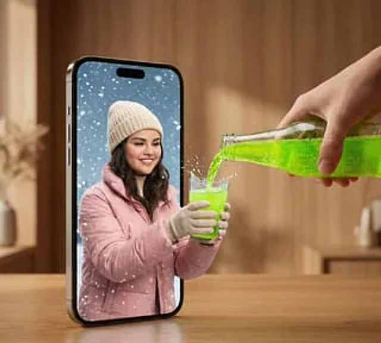

```text
A hyper-realistic surreal photograph of a modern smartphone lying flat on a wooden table, its screen acting as a portal between two worlds. From inside the phone screen, a smiling young man dressed in winter clothing—puffer jacket, knit beanie, gloves—extends his hands outward into the real world, holding a clear glass. From outside the phone, a real human hand pours a bright neon-green carbonated drink into the glass, with liquid splashes frozen mid-air as it crosses the boundary between the digital screen and reality. Snowflakes drift inside the phone screen while the real environment remains warm and minimal. Gemini Ultra-detailed textures, cinematic lighting, shallow depth of field, photorealistic surrealism, high-resolution editorial photography.
```

Model: Nano Banana
Author: Synthia

[ProjectD](https://aitoolsradar.com/en/prompts/f0524012328c7c) · [Recorded source](https://x.com/AIwithSynthia/status/2020737033669324969)
 · [Full original metadata and byte evidence](data/projectd-batch-0067.json)

## Taaruk #1009

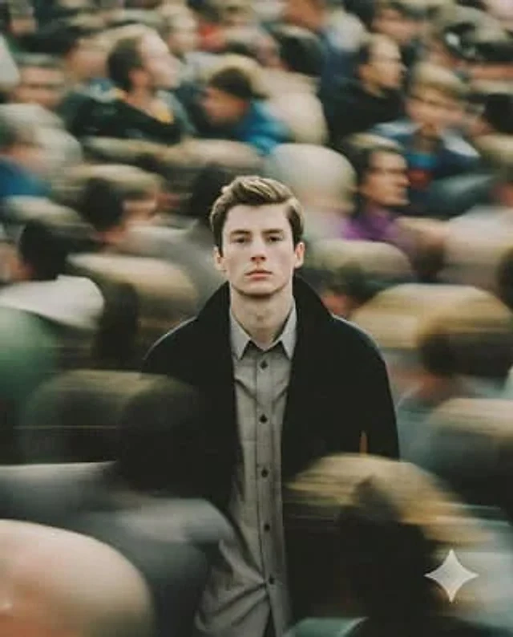

```text
A cinematic portrait of a young man standing still in the middle of a busy crowd, sharp focus on the subject while people around him are heavily motion blurred, creating a dynamic sense of movement. The subject has a calm, serious expression, wearing a dark coat over a minimal outfit. Shot in a crowded urban environment, natural soft lighting, shallow depth of field, center composition. Long exposure effect with streaking motion blur surrounding the subject, ultra-realistic, 8K, high detail, cinematic color grading.
```

Model: Nano Banana
Author: Taaruk

[ProjectD](https://aitoolsradar.com/en/prompts/32001b9b9450b9) · [Recorded source](https://x.com/Taaruk_/status/2026523437469253945)
 · [Full original metadata and byte evidence](data/projectd-batch-0067.json)

## Taaruk #1027

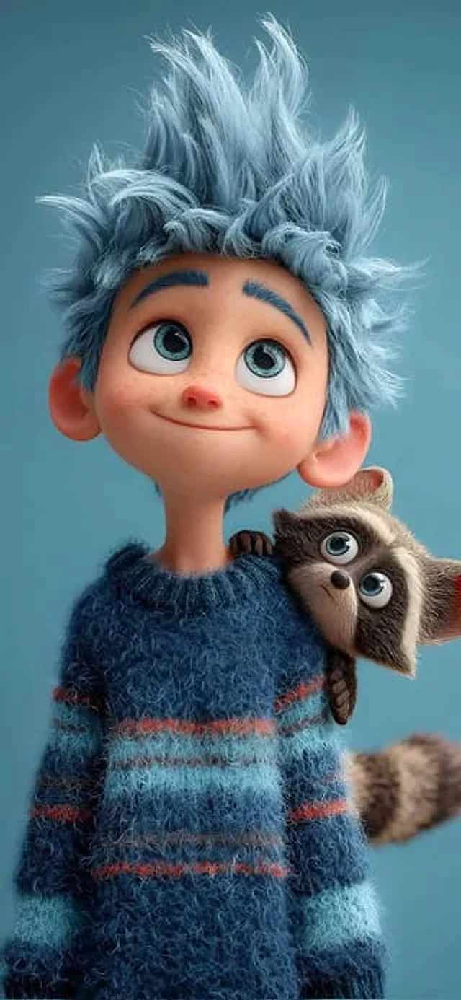

```text
Cute stylized 3D animated boy with messy fluffy blue hair and big expressive eyes, soft freckles on face, wearing a fuzzy blue striped sweater, small adorable raccoon sitting on his shoulder, looking upward with a gentle smile, Pixar-style character design, soft studio lighting, pastel blue background, ultra-detailed fur and fabric texture, cinematic portrait composition, high-quality 3D render, 8K.
```

Model: Nano Banana
Author: Taaruk

[ProjectD](https://aitoolsradar.com/en/prompts/ec4b694e95d58a) · [Recorded source](https://x.com/Taaruk_/status/2029567508244750343)
 · [Full original metadata and byte evidence](data/projectd-batch-0067.json)

## Taaruk #1039

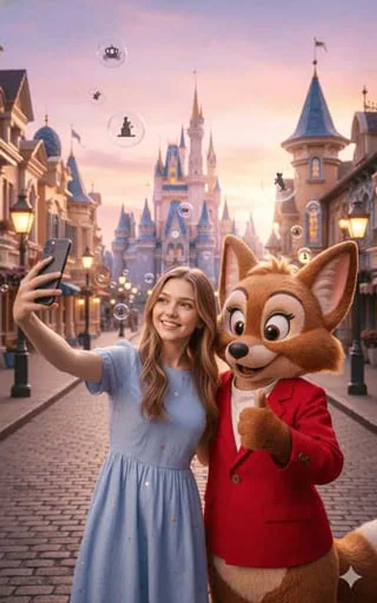

```text
{
  "Objective": "Create a joyful, cinematic fantasy photograph set in a magical fairytale theme park"
      "Type": "Young woman",
      "Pose": "Taking a selfie at arm’s length",
      "Expression": "Warm, joyful smile",
      "Clothing": "Light blue dress",
      "Action": "Holding a smartphone, facing the camera"
    },
    "SecondarySubject": {
      "Type": "Anthropomorphic fox mascot",
      "Appearance": "Cute, friendly fox character",
      "Clothing": "Red jacket",
      "Pose": "Standing beside the woman, giving a thumbs-up",
      "Emotion": "Playful and welcoming"
    }
  },
  "SceneDescription": {
    "Location": "Magical fairytale theme park",
    "Foreground": "Woman and fox mascot posing for a selfie",
    "Background": {
      "Landmark": "Grand fairytale castle at the end of the street",
      "Street": "Charming cobblestone road",
      "Architecture": "Classic European-style buildings",
      "LightingElements": "Glowing vintage street lamps"
    },
    "AtmosphericDetails": {
      "FloatingElements": "Soap bubbles drifting through the air",
      "MagicalAccents": "Some bubbles contain tiny whimsical silhouettes",
      "Mood": "Whimsical, joyful, storybook magic"
    }
  },
  "LightingAndMood": {
    "TimeOfDay": "Golden hour",
    "LightingStyle": "Warm highlights with gentle shadows",
    "Sky": "Soft pastel tones",
    "OverallMood": "Dreamy, uplifting, cinematic fantasy realism"
  },
  "PhotographyStyle": {
    "Genre": "Theme park photography",
    "Composition": "Cinematic framing with strong depth",
    "DepthOfField": "Shallow depth of field",
    "DetailLevel": "Ultra-detailed textures",
    "ColorGrading": "Vibrant yet soft, pastel-enhanced",
    "Resolution": "High resolution, sharp focus on subjects"
  },
  "ArtDirection": {
    "Style": "Dreamy fantasy realism",
    "VisualTone": "Joyful, magical, immersive",
    "RealismBalance": "Photorealistic with subtle fantasy elements"
  },
  "NegativePrompt": [
    "dark mood",
    "horror",
    "low resolution",
    "blurry faces",
    "harsh shadows",
    "oversaturated colors",
    "distorted anatomy",
    "uncanny characters"
  ],
  "ResponseFormat": {
    "Type": "Single image",
    "Orientation": "Portrait",
    "AspectRatio": "2:3"
  }
}
```

Model: Nano Banana
Author: Taaruk

[ProjectD](https://aitoolsradar.com/en/prompts/ee733e8d546049) · [Recorded source](https://x.com/Taaruk_/status/2008453808968659330)
 · [Full original metadata and byte evidence](data/projectd-batch-0067.json)

## Taaruk #1051

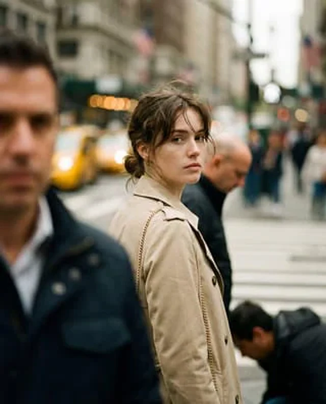

```text
{
  "Objective": "Create a realistic candid street photograph with cinematic documentary realism",
  "PersonaDetails": {
    "Subject": {
      "Type": "Young woman",
      "Pose": "Standing at a city crosswalk, captured mid-turn",
      "Gaze": "Looking directly toward the camera",
      "Expression": "Calm, introspective, slightly distant",
      "Hair": "Loosely tied back with soft strands framing the face",
      "Wardrobe": {
        "Outerwear": "Beige trench coat",
        "Accessories": "Thin gold chain shoulder bag"
      }
    }
  },
  "SceneDescription": {
    "Location": "Busy urban crosswalk",
    "BackgroundElements": [
      "Pedestrians in motion",
      "Yellow taxis",
      "Tall city buildings"
    ],
    "Motion": "Subtle background movement suggesting city life"
  },
  "Composition": {
    "Framing": "Waist-up candid framing",
    "Moment": "Unposed, spontaneous mid-turn capture",
    "DepthOfField": "Shallow depth of field",
    "Focus": "Ultra-sharp subject with background motion blur"
  },
  "LightingAndColor": {
    "Lighting": "Natural overcast daylight",
    "ColorPalette": "Muted neutral tones",
    "Bokeh": "Soft cinematic bokeh"
  },
  "PhotographyStyle": {
    "Genre": "Street photography",
    "Aesthetic": "Documentary-style realism",
    "LensLook": "85mm lens perspective",
    "DetailLevel": "High detail, photorealistic textures"
  },
  "Mood": {
    "Tone": "Quiet, reflective, urban",
    "Atmosphere": "Authentic, lived-in city moment"
  },
  "ArtDirection": {
    "Style": "Photorealistic",
    "RealismLevel": "True-to-life, candid capture",
    "Processing": "Minimal, natural post-processing"
  },
  "NegativePrompt": [
    "posed look",
    "fashion editorial",
    "studio lighting",
    "oversaturated colors",
    "heavy retouching",
    "cartoon",
    "anime",
    "blurry subject"
  ],
  "ResponseFormat": {
    "Type": "Single image",
    "Orientation": "Portrait",
    "AspectRatio": "2:3"
  }
}
```

Model: Nano Banana
Author: Taaruk

[ProjectD](https://aitoolsradar.com/en/prompts/161e6c6892779b) · [Recorded source](https://x.com/Taaruk_/status/2008745209547669542)
 · [Full original metadata and byte evidence](data/projectd-batch-0067.json)

## Taaruk #1062

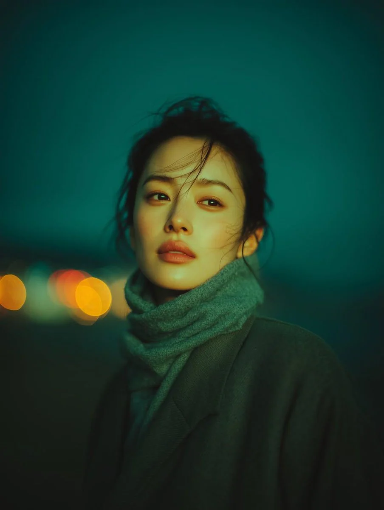

```text
A cinematic night-time portrait of a young woman standing outdoors, softly lit by ambient city lights. She wears a dark elegant coat with a thick wool scarf wrapped around her neck. Loose strands of hair gently blown by the wind frame her face. Moody teal-green color grading, soft cinematic lighting, shallow depth of field, creamy bokeh city lights glowing in the background. Calm, introspective expression, natural skin texture, subtle makeup, film-like softness, atmospheric and emotional tone. Shot on a fast lens (85mm f/1.4 look), ultra-realistic photography, high detail, low noise, 8K quality.
```

Model: Nano Banana
Author: Taaruk

[ProjectD](https://aitoolsradar.com/en/prompts/94256c6d1cb149) · [Recorded source](https://x.com/Taaruk_/status/2016491419570155780)
 · [Full original metadata and byte evidence](data/projectd-batch-0067.json)

## Taaruk #1069

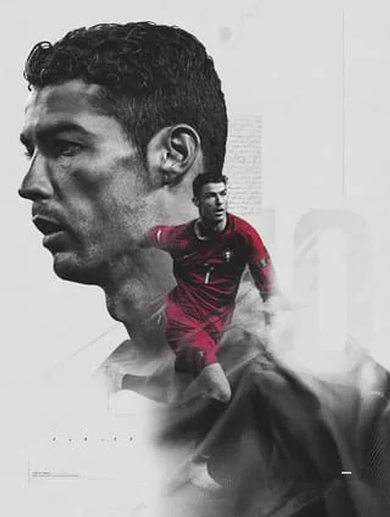

```text
A dramatic double exposure portrait of a professional football player, large side-profile face in black and white with intense expression, combined with a smaller full-body action shot of the same player running in a red jersey, dynamic motion, dust and smoke particles blending the layers, high contrast lighting, textured grain, minimal clean background, editorial sports poster style, ultra-detailed, sharp focus, cinematic composition, 8K resolution.
```

Model: Nano Banana
Author: Taaruk

[ProjectD](https://aitoolsradar.com/en/prompts/dd88cd5dc080ed) · [Recorded source](https://x.com/Taaruk_/status/2041034974380581255)
 · [Full original metadata and byte evidence](data/projectd-batch-0067.json)

## Taaruk #1075

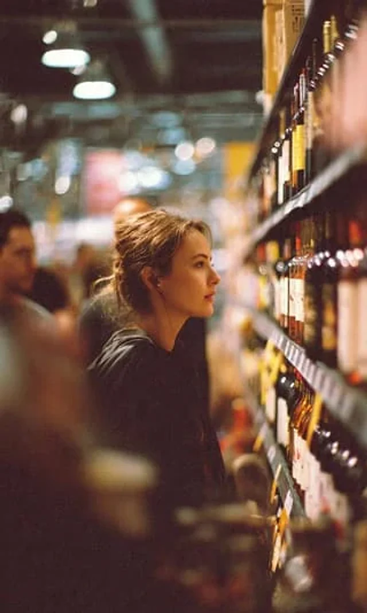

```text
A cinematic side-profile portrait of a young woman standing in a grocery store aisle, carefully looking at a shelf filled with wine bottles. She has her hair tied in a loose messy bun and wears a simple dark outfit. The environment is softly lit with warm indoor lighting, creating a cozy, realistic atmosphere. The shelves are filled with neatly arranged bottles, while other shoppers appear blurred in the background. Shallow depth of field with strong foreground and background blur, creamy bokeh lights, natural skin tones, documentary-style photography, candid moment, 50mm lens, f/1.8, ultra-realistic detail, cinematic color grading, 8K.
```

Model: Nano Banana
Author: Taaruk

[ProjectD](https://aitoolsradar.com/en/prompts/d4b172491da389) · [Recorded source](https://x.com/Taaruk_/status/2045388206699667792)
 · [Full original metadata and byte evidence](data/projectd-batch-0067.json)

## Taaruk #1078

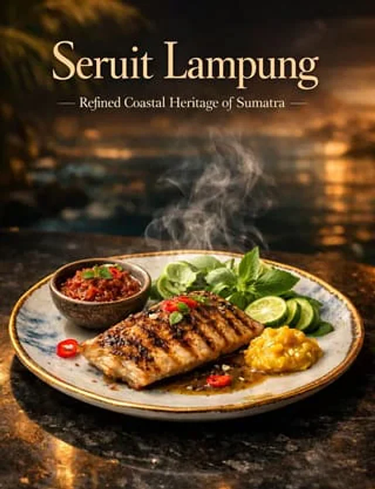

```text
Luxury cinematic food photography of traditional Indonesian “Seruit Lampung” — beautifully grilled fish fillet glazed with chili sambal, garnished with red chili slices, fresh basil, and lime wedges. Served on an elegant ceramic plate with a small bowl of sambal and a side of golden mashed condiment. Visible steam rising from the hot dish. Background shows a refined coastal sunset ambiance with soft bokeh reflections on water, warm golden-hour lighting. Shot on a polished marble table surface. Fine-dining restaurant atmosphere, shallow depth of field, dramatic food styling, ultra-realistic, 85mm lens, f/2.0, rich contrast, 8K resolution. Elegant editorial food magazine style.
```

Model: Nano Banana
Author: Taaruk

[ProjectD](https://aitoolsradar.com/en/prompts/83c0396e0e2f0e) · [Recorded source](https://x.com/Taaruk_/status/2021795147416264928)
 · [Full original metadata and byte evidence](data/projectd-batch-0067.json)

## Taaruk #1080

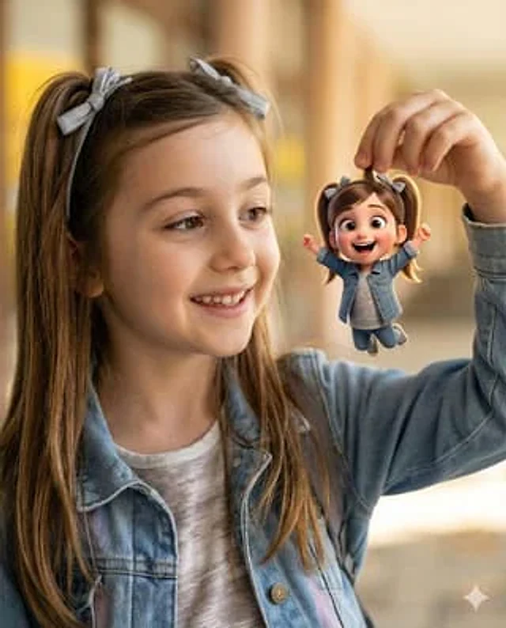

```text
{
  "Objective": "Create a heartwarming, whimsical portrait blending photorealistic realism with a tiny Pixar-style animated character",
  "PersonaDetails": {
    "PrimarySubject": {
      "Type": "Young girl",
      "Expression": "Bright, joyful smile",
      "Hair": {
        "Style": "Long light-brown hair",
        "Accessories": "Cute ribbon bows"
      },
      "Wardrobe": {
        "Outerwear": "Casual denim jacket",
        "Top": "Soft neutral-colored shirt"
      }
    },
    "SecondarySubject": {
      "Type": "Tiny 3D cartoon version of the girl",
      "Scale": "Miniature, held delicately between fingers",
      "Style": "Pixar-style 3D character",
      "Proportions": "Oversized expressive eyes, rounded features",
      "Hair": "Pigtails matching the real girl",
      "Wardrobe": "Denim outfit matching the real subject",
      "Pose": "Arms raised joyfully"
    }
  },
  "Composition": {
    "Framing": "Close-up to medium portrait",
    "Interaction": "Clear playful interaction between girl and miniature character",
    "DepthOfField": "Shallow depth of field",
    "Focus": "Ultra-sharp focus on both faces"
  },
  "LightingAndBackground": {
    "Lighting": "Warm natural daylight",
    "Background": {
      "Style": "Soft golden bokeh",
      "Mood": "Dreamy, magical"
    }
  },
  "ArtDirection": {
    "StyleFusion": [
      "Photorealistic child portrait photography",
      "Pixar-style 3D animated character"
    ],
    "Aesthetic": "Magical realism with playful scale contrast",
    "TextureDetail": "Ultra-detailed skin, fabric, and 3D materials"
  },
  "MoodAndTone": {
    "Mood": "Heartwarming, joyful, whimsical",
    "EmotionalFeel": "Wonder, innocence, playful imagination"
  },
  "PhotographyStyle": {
    "Genre": "Cinematic lifestyle portrait photography",
    "LensFeel": "Portrait lens with creamy bokeh",
    "ImageQuality": "8K ultra-high realism"
  },
  "NegativePrompt": [
    "uncanny valley",
    "scary doll",
    "low-quality 3D",
    "harsh lighting",
    "oversaturated colors",
    "blurry focus",
    "flat expression"
  ],
  "ResponseFormat": {
    "Type": "Single image",
    "Orientation": "Portrait",
    "AspectRatio": "2:3"
  }
}
```

Model: Nano Banana
Author: Taaruk

[ProjectD](https://aitoolsradar.com/en/prompts/8e49637b2b5301) · [Recorded source](https://x.com/Taaruk_/status/2011282431744336078)
 · [Full original metadata and byte evidence](data/projectd-batch-0067.json)

## Taaruk #1084

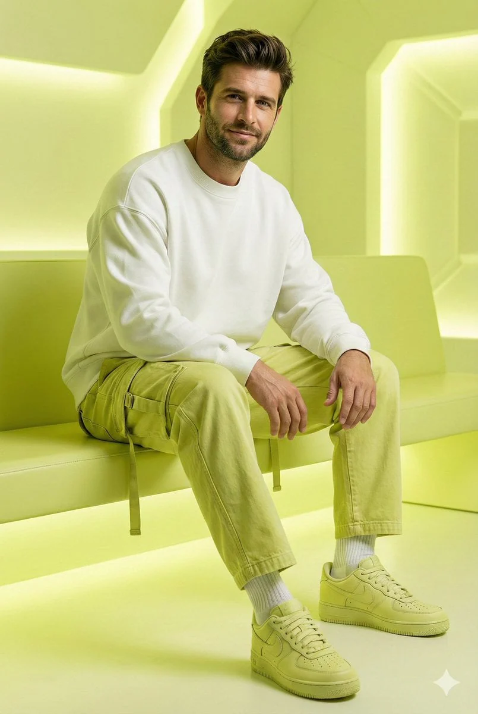

```text
A young man with a slight smile see the uploaded picture as reference for the face wearing outfit: oversized white sweatshirt, lemon green oversized combat jean, styled with footwear: lemon green neutral Nike sneakers and white ribbed socks. Environment: futuristic lemon green-tone studio background. Lighting: soft cinematic glow highlighting skin and fabric textures. Style: fashion editorial x futuristic. Model seats on lemon green bench elegantly with a relaxed posture.
```

Model: Nano Banana
Author: Taaruk

[ProjectD](https://aitoolsradar.com/en/prompts/19c2d82dc00f5b) · [Recorded source](https://x.com/Taaruk_/status/2020728313006936161)
 · [Full original metadata and byte evidence](data/projectd-batch-0067.json)

## Taaruk #1091

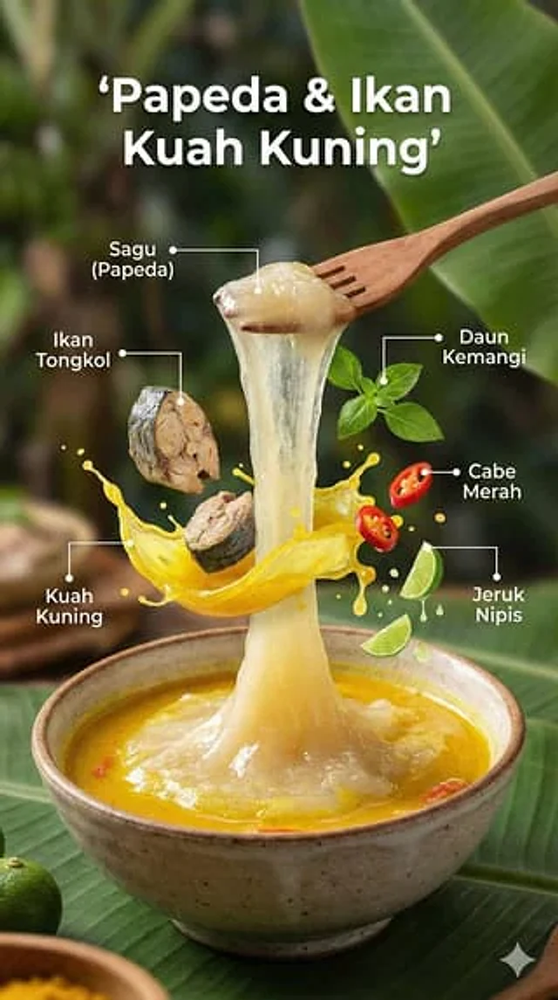

```text
Ultra-realistic cinematic food photography of a traditional Indonesian dish, presented as a floating ingredients infographic. The finished dish sits at the bottom in a ceramic bowl on a wooden surface. Above it, key ingredients float in mid-air in a clean vertical layout, each clearly separated and visually balanced. Thin minimalist pointer lines connect ingredients to elegant readable labels. Natural textures, hyper-detailed food surfaces, glossy sauces, steam rising gently, high-speed splash effects frozen in motion. Soft studio lighting mixed with natural daylight, shallow depth of field, premium editorial food poster style, commercial advertising quality, ultra-sharp focus, 8K resolution, realistic shadows, clean background.
```

Model: Nano Banana
Author: Taaruk

[ProjectD](https://aitoolsradar.com/en/prompts/f18345a6ee9eb1) · [Recorded source](https://x.com/Taaruk_/status/2019806212599284155)
 · [Full original metadata and byte evidence](data/projectd-batch-0067.json)

## Taaruk #1095

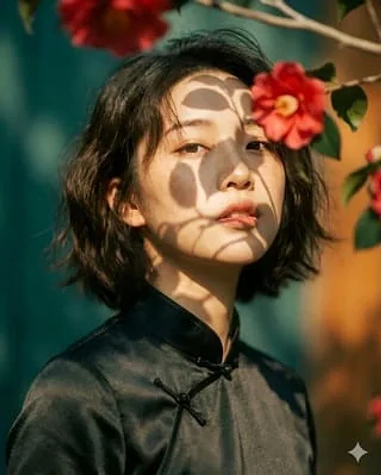

```text
Artistic portrait of an elegant Asian woman wearing a black silk cheongsam (qipao), standing among red camellia flowers and delicate branches, soft natural sunlight filtering through leaves creating beautiful shadow patterns across her face, short slightly messy bob haircut, natural freckles and minimal makeup, calm thoughtful expression, cinematic shallow depth of field, dreamy garden atmosphere, warm golden hour lighting, soft bokeh background, fine art photography style, ultra-realistic skin texture, high detail, 85mm lens, 8K.
```

Model: Nano Banana
Author: Taaruk

[ProjectD](https://aitoolsradar.com/en/prompts/349b5225c82920) · [Recorded source](https://x.com/Taaruk_/status/2033544696119853426)
 · [Full original metadata and byte evidence](data/projectd-batch-0067.json)

## Taaruk #1099

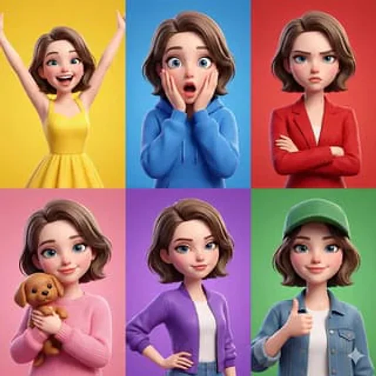

```text
3D Pixar-style animated girl shown in a 6-panel grid, same character with short brown hair and big blue eyes, different emotions (happy, shocked, angry, caring, confident, thumbs up), colorful solid backgrounds (yellow, blue, red, pink, purple, green), soft studio lighting, smooth 3D render, vibrant colors, ultra-detailed, 4K, animated movie quality.
```

Model: Nano Banana
Author: Taaruk

[ProjectD](https://aitoolsradar.com/en/prompts/4ca0479b8a6f72) · [Recorded source](https://x.com/Taaruk_/status/2023035676791603643)
 · [Full original metadata and byte evidence](data/projectd-batch-0067.json)

## Taaruk #1111

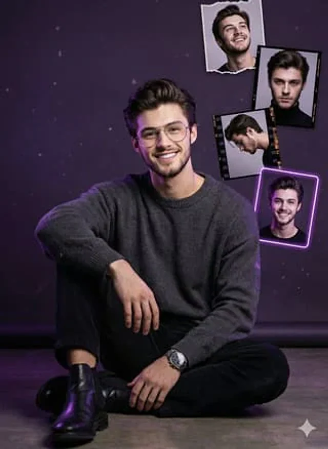

```text
{
  "Objective": "Create a stylish, cinematic birthday-themed studio portrait with a modern celebratory poster aesthetic",
  "PersonaDetails": {
    "Subject": {
      "Type": "Young man",
      "Pose": "Sitting casually on the floor",
      "Expression": "Confident, friendly smile",
      "Gaze": "Looking directly at the camera",
      "Accessories": [
        "Glasses",
        "Wristwatch"
      ]
    }
  },
  "Wardrobe": {
    "Top": "Dark grey sweater",
    "Bottom": "Black trousers",
    "Footwear": "Black leather boots",
    "Style": "Clean, modern, understated"
  },
  "SceneDescription": {
    "Environment": "Studio setting",
    "Background": {
      "Color": "Deep purple",
      "Details": "Subtle glowing particles floating in the background"
    }
  },
  "GraphicElements": {
    "Typography": {
      "Text": "Happy Birthday",
      "Style": "Neon typography",
      "Color": "Soft purple and white glow",
      "Placement": "Top corner of the composition"
    },
    "FloatingFrames": {
      "Description": "Multiple framed portrait snapshots of the same person",
      "Variations": [
        "Different poses and moods",
        "Film negative–style frames",
        "Neon-outlined light frames"
      ],
      "Arrangement": "Floating around the subject with balanced spacing"
    }
  },
  "Composition": {
    "Framing": "Medium full-body portrait",
    "Layout": "Centered subject with surrounding floating elements",
    "Balance": "Clean, poster-style composition",
    "DepthOfField": "Shallow depth of field with layered depth"
  },
  "LightingAndColor": {
    "LightingStyle": "Cinematic studio lighting",
    "RimLight": "Soft purple rim light for edge separation",
    "Contrast": "High contrast with controlled highlights",
    "ColorPalette": [
      "Deep purple",
      "Black",
      "Soft white highlights"
    ]
  },
  "ArtDirection": {
    "Style": "Modern celebratory poster",
    "Aesthetic": "Stylish, cinematic, social-media–ready",
    "DetailLevel": "Ultra-detailed textures and crisp edges",
    "RealismLevel": "Photorealistic with graphic design overlays"
  },
  "PhotographyStyle": {
    "Genre": "Professional studio portrait photography",
    "Finish": "High-end, polished, digital poster look",
    "Resolution": "Ultra-high resolution, sharp focus"
  },
  "Mood": {
    "Tone": "Celebratory, confident, modern",
    "Energy": "Positive, stylish, personal"
  },
  "NegativePrompt": [
    "messy composition",
    "low resolution",
    "flat lighting",
    "oversaturated neon",
    "cartoon style",
    "blurry text",
    "cluttered background"
  ],
  "ResponseFormat": {
    "Type": "Single composite image",
    "Orientation": "Portrait",
    "AspectRatio": "4:5",
    "UseCase": [
      "Social media post",
      "Birthday poster",
      "Digital celebration graphic"
    ]
  }
}
```

Model: Nano Banana
Author: Taaruk

[ProjectD](https://aitoolsradar.com/en/prompts/03bddf396b3f76) · [Recorded source](https://x.com/Taaruk_/status/2010626509690831267)
 · [Full original metadata and byte evidence](data/projectd-batch-0067.json)

## Taaruk #1116

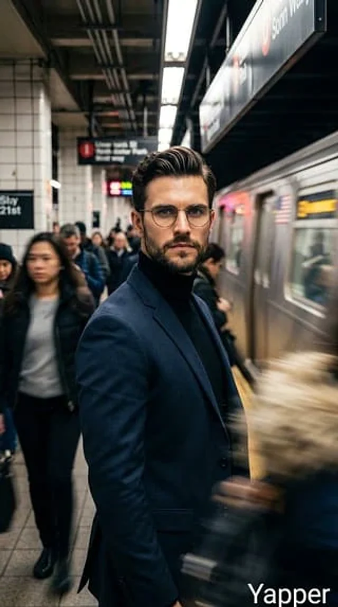

```text
Cinematic portrait of a stylish man standing on a busy subway platform, wearing a dark tailored suit and black turtleneck with round glasses, serious confident expression, commuters rushing past creating motion blur around him, subway train beside the platform with metallic reflections, urban underground atmosphere, dramatic fluorescent subway lighting, shallow depth of field, subject sharply in focus while the crowd is blurred, modern thriller movie scene aesthetic, ultra-realistic photography, 85mm lens, high detail, 8K
```

Model: Nano Banana
Author: Taaruk

[ProjectD](https://aitoolsradar.com/en/prompts/84bca747e039a4) · [Recorded source](https://x.com/Taaruk_/status/2033407780640698583)
 · [Full original metadata and byte evidence](data/projectd-batch-0067.json)

## Taaruk #1139

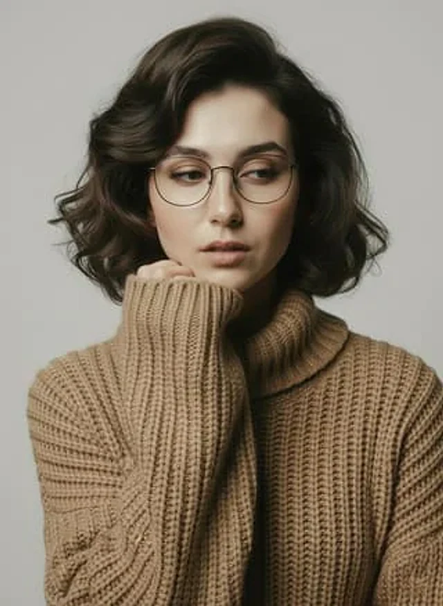

```text
{
  "Objective": "Create a minimalist fashion studio portrait series with a calm, Scandinavian editorial mood",
  "PersonaDetails": {
    "Subject": {
      "Type": "Young woman",
      "Hair": "Short, softly waved dark-brown hair",
      "Accessories": "Thin round eyeglasses",
      "Expression": "Calm, introspective",
      "Skin": "Natural skin texture with minimal retouching"
    }
  },
  "Wardrobe": {
    "Top": "Chunky camel-colored knit turtleneck sweater",
    "Bottom": "Beige trousers",
    "Style": "Timeless autumn fashion"
  },
  "SceneDescription": {
    "Environment": "Minimalist studio",
    "Background": "Neutral off-white backdrop",
    "OverallFeel": "Clean, airy, understated"
  },
  "PortraitSeries": {
    "SeriesType": "Four-image set",
    "Poses": [
      {
        "Description": "Seated pose with hands gently clasped under the chin",
        "Mood": "Quiet, reflective"
      },
      {
        "Description": "Front-facing portrait with eyes lowered",
        "Mood": "Soft, contemplative"
      },
      {
        "Description": "Three-quarter side profile with arms crossed",
        "Mood": "Poised, thoughtful"
      },
      {
        "Description": "Close-up portrait with sweater sleeve raised near the face",
        "Mood": "Intimate, tactile"
      }
    ]
  },
  "Composition": {
    "Framing": "Varied framing from close-up to mid-length",
    "NegativeSpace": "Generous, balanced negative space",
    "DepthOfField": "Shallow depth of field for gentle separation"
  },
  "LightingAndColor": {
    "Lighting": "Soft, diffused studio lighting",
    "Highlights": "Subtle, natural highlights",
    "ColorPalette": "Muted warm neutrals (camel, beige, off-white)"
  },
  "ArtDirection": {
    "Style": "Scandinavian editorial photography",
    "Aesthetic": "Minimalist, timeless, understated luxury",
    "TextureEmphasis": "Knit fabric and natural skin detail"
  },
  "PhotographyStyle": {
    "Genre": "Professional fashion studio photography",
    "RealismLevel": "High realism with restrained processing",
    "Finish": "Clean, modern, magazine-ready"
  },
  "Mood": {
    "Tone": "Calm, introspective, serene",
    "SeasonalFeel": "Autumn warmth and quiet elegance"
  },
  "NegativePrompt": [
    "busy background",
    "harsh lighting",
    "bold colors",
    "heavy makeup",
    "over-retouching",
    "glossy fashion look",
    "street photography"
  ],
  "ResponseFormat": {
    "Type": "Portrait series",
    "ImageCount": 4,
    "Orientation": "Portrait",
    "AspectRatio": "2:3"
  }
}
```

Model: Nano Banana
Author: Taaruk

[ProjectD](https://aitoolsradar.com/en/prompts/01398648a61e5a) · [Recorded source](https://x.com/Taaruk_/status/2009911679728206114)
 · [Full original metadata and byte evidence](data/projectd-batch-0067.json)

## Taaruk #1170

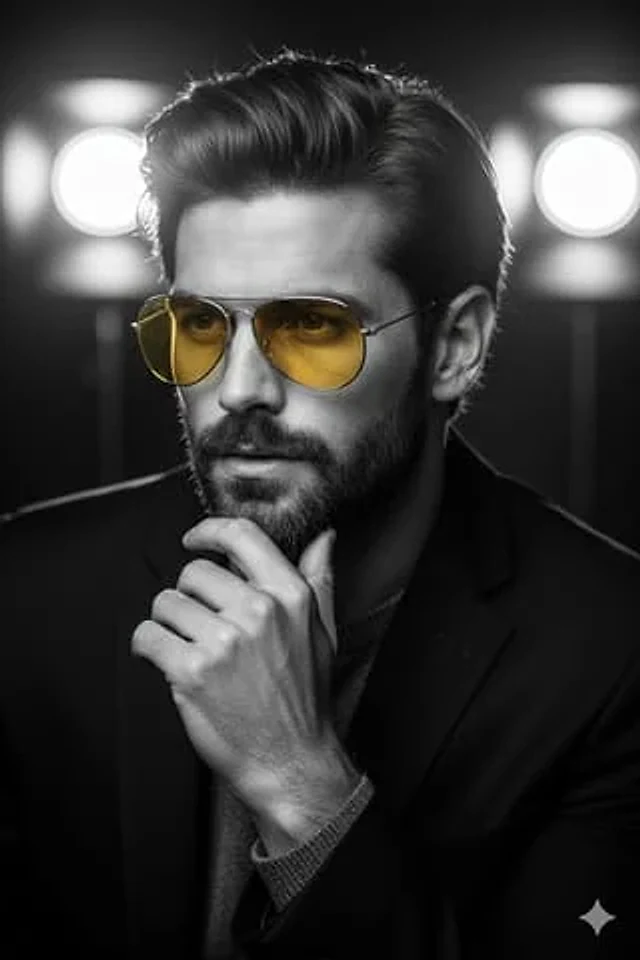

```text
{
  "Objective": "Create a dramatic black-and-white cinematic portrait with a classic film-noir mood and selective color emphasis",
  "PersonaDetails": {
    "Subject": {
      "Type": "Young man",
      "Hair": "Medium-length, naturally styled",
      "FacialHair": "Well-groomed beard",
      "Pose": "Thoughtful pose with one hand resting near the chin",
      "Expression": "Introspective, confident, composed",
      "Wardrobe": "Dark jacket",
      "Accessories": {
        "Sunglasses": {
          "Type": "Stylish aviator sunglasses",
          "LensColor": "Warm amber/yellow-tinted lenses",
          "SpecialTreatment": "Only colored element in an otherwise monochrome image"
        }
      }
    }
  },
  "Composition": {
    "Framing": "Close-up to mid-close portrait",
    "Angle": "Eye-level, slightly cinematic framing",
    "DepthOfField": "Shallow depth of field",
    "Focus": "Sharp focus on facial features and sunglasses"
  },
  "LightingAndAtmosphere": {
    "LightingStyle": "Strong cinematic backlighting",
    "Effects": [
      "Glowing bokeh lights in the background",
      "Studio or stage-light appearance"
    ],
    "Contrast": "High contrast with deep blacks and bright highlights",
    "Mood": "Moody, dramatic, contemplative"
  },
  "ArtDirection": {
    "Style": "Classic film-noir photography",
    "ColorTreatment": {
      "Base": "Black-and-white",
      "Accent": "Selective color on amber/yellow lenses"
    },
    "TextureDetail": "Ultra-detailed skin, hair, and fabric textures",
    "Aesthetic": "Elegant, timeless, cinematic"
  },
  "PhotographyStyle": {
    "Genre": "Professional cinematic portrait photography",
    "ImageQuality": "Ultra-high resolution, crisp detail",
    "Finish": "Refined, editorial, gallery-worthy"
  },
  "Mood": {
    "Tone": "Serious, reflective, stylish",
    "EmotionalFeel": "Quiet intensity and classic masculinity"
  },
  "NegativePrompt": [
    "full color image",
    "flat lighting",
    "low contrast",
    "modern casual snapshot",
    "oversharpening",
    "plastic skin",
    "cartoon",
    "anime"
  ],
  "ResponseFormat": {
    "Type": "Single image",
    "Orientation": "Portrait",
    "AspectRatio": "2:3"
  }
}
```

Model: Nano Banana
Author: Taaruk

[ProjectD](https://aitoolsradar.com/en/prompts/883635503bd302) · [Recorded source](https://x.com/Taaruk_/status/2010724643737686242)
 · [Full original metadata and byte evidence](data/projectd-batch-0067.json)

## Taaruk #1186

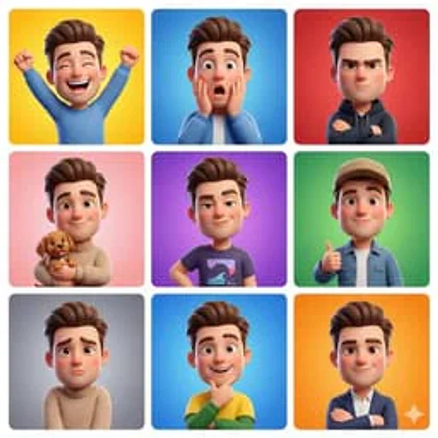

```text
3D cartoon avatar character showing different emotions arranged in a 3x3 grid, same male character with brown hair, Pixar-style animation, each square showing a different expression (happy, shocked, angry, caring with a puppy, confident, thumbs up, sad, thinking, professional), colorful gradient backgrounds for each panel, soft studio lighting, smooth 3D rendering, expressive eyes and facial expressions, modern emoji-style character design, clean composition, ultra-detailed, vibrant colors, 8K.
```

Model: Nano Banana
Author: Taaruk

[ProjectD](https://aitoolsradar.com/en/prompts/11bb81af6e99d2) · [Recorded source](https://x.com/Taaruk_/status/2029204838945570982)
 · [Full original metadata and byte evidence](data/projectd-batch-0067.json)

## Taaruk #1194

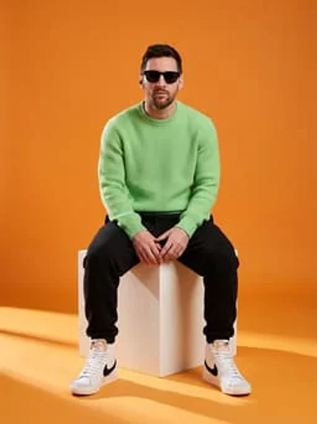

```text
A stylish male model sitting on a white cube in a minimalist studio with a vibrant orange background. He is wearing a fitted green knit sweater, black pants, and white sneakers, paired with black sunglasses for a modern, confident look. The model sits relaxed with hands resting together, facing the camera. Soft directional lighting creates subtle shadows on the floor and background, adding depth and a premium fashion editorial feel. Clean composition, centered framing, smooth backdrop, high contrast colors, sharp details, professional studio photography, ultra-realistic, 8K.
```

Model: Nano Banana
Author: Taaruk

[ProjectD](https://aitoolsradar.com/en/prompts/fee3f57aa56a1b) · [Recorded source](https://x.com/Taaruk_/status/2043179565896655237)
 · [Full original metadata and byte evidence](data/projectd-batch-0067.json)

## Taaruk #1232

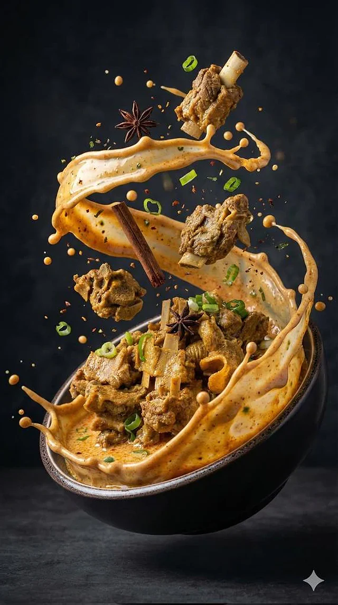

```text
Ultra-realistic cinematic food photography of a bowl of rich spicy meat soup exploding upward in a dynamic splash, tender bone-in meat pieces floating mid-air with creamy curry broth forming swirling liquid ribbons, star anise, cinnamon sticks, green onions, and spices suspended in motion, dramatic dark studio background, high-speed splash capture, macro texture detail on meat and broth, steam rising, shallow depth of field, vibrant warm colors, gourmet food advertising style, hyper-detailed liquid physics, 8K, perfect composition.
```

Model: Nano Banana
Author: Taaruk

[ProjectD](https://aitoolsradar.com/en/prompts/59d8f6d26f5b15) · [Recorded source](https://x.com/Taaruk_/status/2029485155442892960)
 · [Full original metadata and byte evidence](data/projectd-batch-0067.json)

## Taaruk #1238

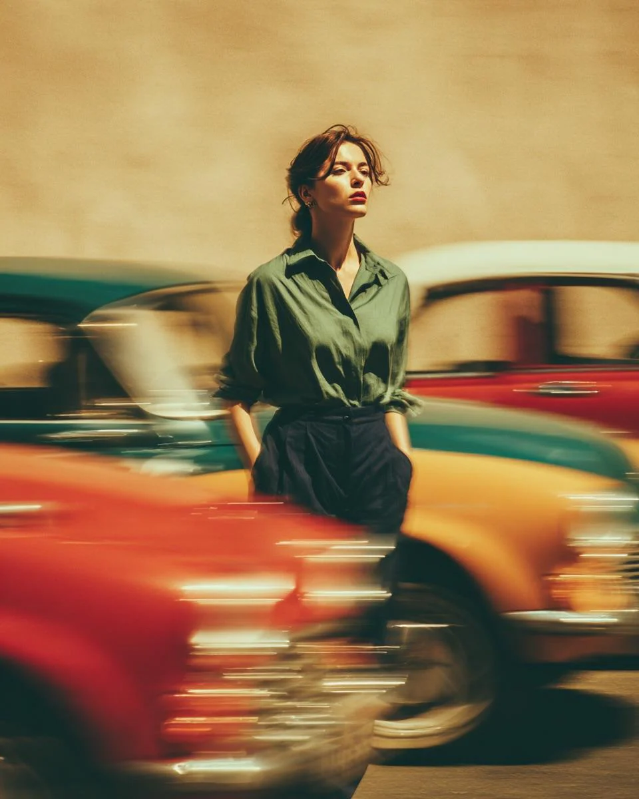

```text
{
  "image_generation_prompt": {
    "subject": {
      "description": "Stylish woman",
      "expression": "calm and confident",
      "pose": "standing still, hands in pockets",
      "attire": {
        "top": "loose sage-green button-up shirt, tucked in",
        "bottom": "high-waisted dark trousers"
      }
    },
    "scene_dynamics": {
      "action": "vintage cars rushing past at high speed",
      "effect": "dramatic motion blur trails, long-exposure photography effect, dynamic motion contrast"
    },
    "environment": {
      "setting": "Street portrait",
      "atmosphere": "nostalgic, busy but focused"
    },
    "lighting_and_color": {
      "lighting": "warm golden-hour lighting",
      "color_palette": "muted retro palette",
      "accents": "reds, teals, and yellows streaking across the frame"
    },
    "technical_specifications": {
      "focus": "strong subject isolation, sharp focus on the woman, shallow depth of field",
      "style": "cinematic realism, editorial fashion mood, nostalgic 1970s film look",
      "texture": "soft grain, ultra-detailed",
      "resolution": "high resolution"
    }
  }
}
```

Model: Nano Banana
Author: Taaruk

[ProjectD](https://aitoolsradar.com/en/prompts/8b13f58c0cd4d2) · [Recorded source](https://x.com/Taaruk_/status/2015263403393355980)
 · [Full original metadata and byte evidence](data/projectd-batch-0067.json)

## Taaruk #1256

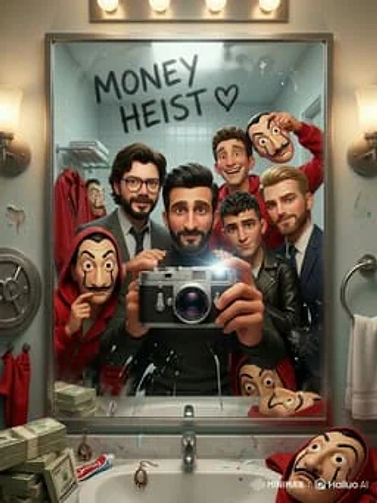

```text
Cinematic mirror selfie scene inspired by a retro 80s sci-fi horror vibe, a group of teenagers and a photographer posing together in a bathroom mirror, vintage camera flash lighting, Christmas string lights around the mirror, walkie-talkies and retro gadgets on the sink, handwritten fog text on the mirror reading “RUN” and “Stranger Things”, nostalgic atmosphere, moody blue and red lighting, cinematic storytelling composition, Pixar-style 3D characters, ultra-detailed, soft reflections, 8K.
```

Model: Nano Banana
Author: Taaruk

[ProjectD](https://aitoolsradar.com/en/prompts/ee73249660109f) · [Recorded source](https://x.com/Taaruk_/status/2032770762525065405)
 · [Full original metadata and byte evidence](data/projectd-batch-0067.json)

## Taaruk #1259

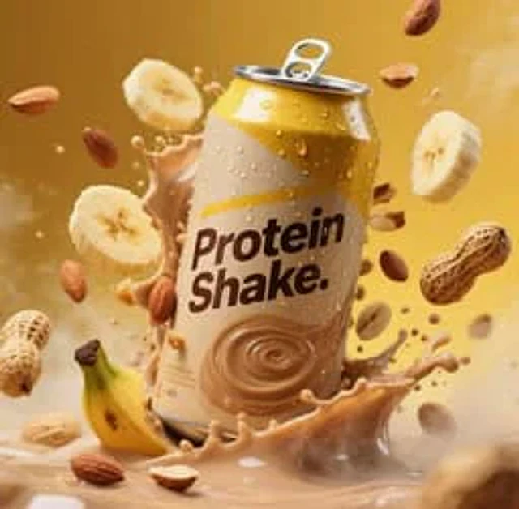

```text
Hyper-realistic product advertisement of a protein shake can with yellow and cream design, surrounded by floating banana slices, almonds, and peanuts, dynamic milk splash bursting around the can, glossy condensation droplets on surface, vibrant warm yellow background, high-speed splash photography, ultra-detailed textures, commercial food photography style, dramatic lighting, 8K.
```

Model: Nano Banana
Author: Taaruk

[ProjectD](https://aitoolsradar.com/en/prompts/c9b40afbf6ba62) · [Recorded source](https://x.com/Taaruk_/status/2034139605696712863)
 · [Full original metadata and byte evidence](data/projectd-batch-0067.json)

## Taaruk #1280

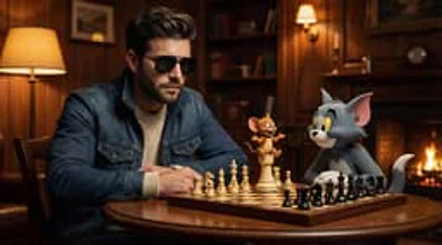

```text
A cinematic, ultra-realistic scene of a stylish man wearing sunglasses and a denim jacket, seated at a round wooden table in a warm, wood-paneled study with a fireplace glowing in the background. He is playing chess against two iconic cartoon-style characters: a grey animated cat and a small brown animated mouse. The mouse stands playfully on a chess piece while the cat focuses on the board. Perfect blend of photorealistic human and high-quality 3D animated characters, Pixar-level rendering for the cartoons, realistic skin textures for the human. Cozy ambient lighting, cinematic shadows, shallow depth of field, dramatic composition, storytelling mood, hyper-detailed chessboard, 50mm lens look, ultra-sharp focus, 8K ultra-realistic, Hollywood movie still.
```

Model: Nano Banana
Author: Taaruk

[ProjectD](https://aitoolsradar.com/en/prompts/28cade1af69492) · [Recorded source](https://x.com/Taaruk_/status/2017803404022583659)
 · [Full original metadata and byte evidence](data/projectd-batch-0067.json)

## Taaruk #1288

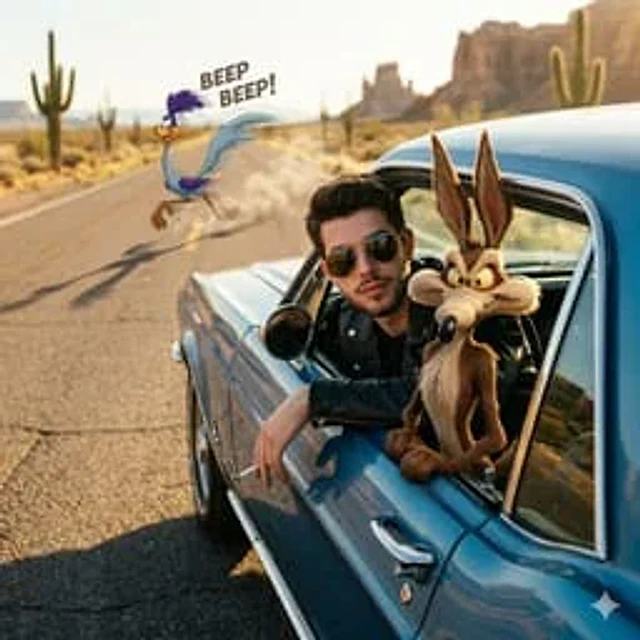

```text
A stylish young man wearing a black leather jacket and aviator sunglasses leans out of the window of a vintage blue car on an empty desert highway. He casually holds a cigarette, looking confidently at the camera. Beside him, a 3D cartoon coyote character (in the style of classic animation, exaggerated features, expressive face) is sitting on the car door, interacting naturally with the real-world environment. In the background, a cartoon roadrunner is sprinting fast along the road, kicking up dust. The scene blends hyper-realistic photography with high-quality 3D animated characters seamlessly. Desert landscape with cacti, warm golden hour lighting, long shadows, cinematic depth of field, ultra-detailed textures, reflections in sunglasses, motion blur on running character, 35mm lens, f/2.0, high contrast, 8K, film still aesthetic.
```

Model: Nano Banana
Author: Taaruk

[ProjectD](https://aitoolsradar.com/en/prompts/a4125e4cf7a795) · [Recorded source](https://x.com/Taaruk_/status/2044650233611907528)
 · [Full original metadata and byte evidence](data/projectd-batch-0067.json)

## Taaruk #1291


```text
Ultra-realistic gaming mouse floating above a desk, surrounded by glowing golden energy rings and flying electronic components, dramatic cinematic lighting, futuristic tech aesthetic, detailed mousepad and cables on wooden desk, sparks and particles in the air, high-speed motion effect, premium product advertising, hyper-detailed textures, depth of field, 8K, studio lighting.
```

Model: Nano Banana
Author: Taaruk

[ProjectD](https://aitoolsradar.com/en/prompts/d3afaed7b64ae2) · [Recorded source](https://x.com/Taaruk_/status/2029817590579966012)
 · [Full original metadata and byte evidence](data/projectd-batch-0067.json)

## Taaruk #1292

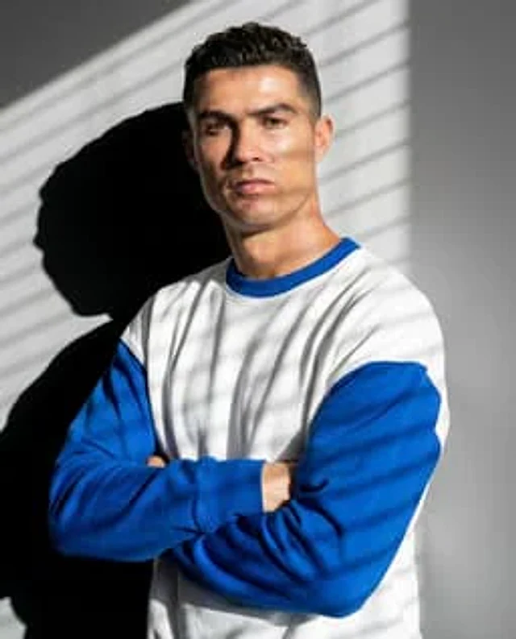

```text
Ultra-realistic fashion studio portrait of a confident man and woman standing with arms crossed, wearing matching white sweatshirts with blue sleeves, dramatic sunlight streaming through window blinds casting striped shadows across their faces and clothing, clean minimal studio background, strong facial features, natural skin texture, cinematic lighting, high contrast shadow patterns, editorial fashion photography style, 85mm lens, shallow depth of field, ultra-detailed skin and fabric texture, professional studio lighting, 8K.
```

Model: Nano Banana
Author: Taaruk

[ProjectD](https://aitoolsradar.com/en/prompts/20c914ca0079cc) · [Recorded source](https://x.com/Taaruk_/status/2030277890844262604)
 · [Full original metadata and byte evidence](data/projectd-batch-0067.json)

## Taaruk #1330

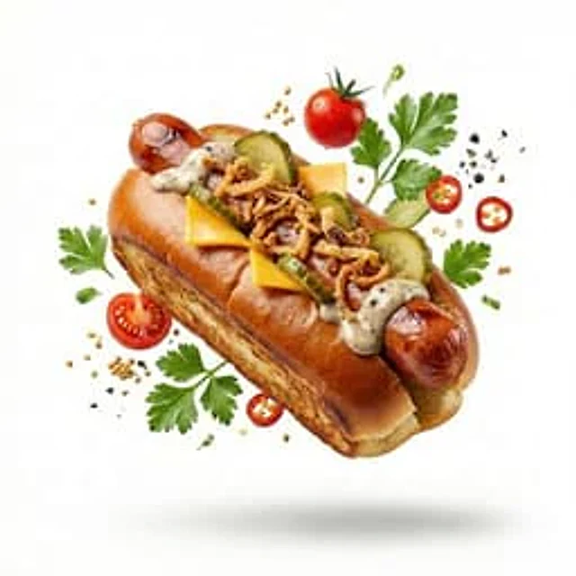

```text
{
  "image_prompt": {
    "main_concept": "High-end commercial food photography with a floating composition (food levitation effect).",
    "composition": {
      "arrangement": "Hero food item suspended in mid-air with complementary ingredients orbiting in perfect balance",
      "background": "Pure white background",
      "shadows": "Soft shadows beneath the suspended food"
    },
    "subject_variations": [
      {
        "item": "Creamy raspberry ice cream",
        "details": "Pistachio crumbs, chocolate chunks, mint leaves, berry drizzle"
      },
      {
        "item": "Gourmet hotdog",
        "details": "Glossy sausage, toasted bun, melted cheese, pickles, crispy onions, herbs, sauce"
      },
      {
        "item": "Handmade dumplings",
        "details": "Visible filling, fresh herbs, spices, pumpkin pieces, dipping sauce"
      }
    ],
    "lighting_and_color": {
      "type": "Studio lighting",
      "highlights": "Clean highlights",
      "color_accuracy": "Natural color accuracy, realistic depth"
    },
    "technical_specs": {
      "style": "Minimalist luxury aesthetic, modern advertising style, commercial product photography",
      "focus": "Ultra-sharp focus on textures, crisp edges",
      "quality": "Hyper-realistic details, high resolution, 8K quality"
    }
  }
}
```

Model: Nano Banana
Author: Taaruk

[ProjectD](https://aitoolsradar.com/en/prompts/37332eb33fea28) · [Recorded source](https://x.com/Taaruk_/status/2016058734271987737)
 · [Full original metadata and byte evidence](data/projectd-batch-0067.json)

## Taaruk #1333

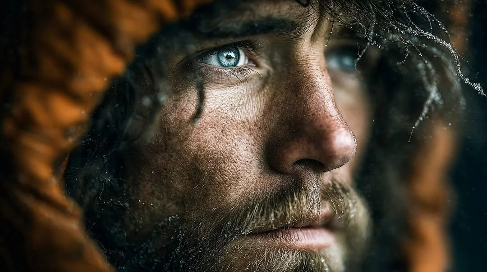

```text
{
  "Objective": "Create an intense cinematic close-up portrait conveying survival, resilience, and raw human strength in a harsh winter environment",
  "PersonaDetails": {
    "Subject": {
      "Type": "Rugged adult man",
      "Eyes": {
        "Color": "Piercing icy blue",
        "Focus": "Primary focal point of the image, razor sharp"
      },
      "FacialFeatures": {
        "Beard": "Thick, full beard",
        "Skin": "Weathered with visible pores, fine texture, and subtle scars"
      },
      "Expression": "Intense, stoic, emotionally restrained",
      "Wardrobe": {
        "Outerwear": "Heavy winter coat with fur-lined hood",
        "Framing": "Hood partially framing the face"
      }
    }
  },
  "EnvironmentalDetails": {
    "Season": "Winter",
    "Atmosphere": "Cold, harsh, unforgiving",
    "Snow": {
      "Details": "Snowflakes clinging to hair, eyelashes, eyebrows, and beard",
      "Motion": "Frozen mid-air and resting naturally on facial hair"
    }
  },
  "Composition": {
    "Framing": "Extreme close-up portrait",
    "Crop": "Tight crop emphasizing eyes and facial texture",
    "DepthOfField": "Very shallow depth of field",
    "Focus": "Ultra-sharp on eyes, soft falloff toward edges"
  },
  "LightingAndMood": {
    "LightingStyle": "Dramatic low-key cinematic lighting",
    "KeyLight": "Soft, directional light sculpting facial structure",
    "RimLight": "Cold rim light separating subject from background",
    "ColorGrading": "Moody cinematic tones with cold blues and warm brown accents",
    "Mood": "Intense, raw, powerful, solitary"
  },
  "ArtDirection": {
    "Style": "Hyper-realistic cinematic photography",
    "Aesthetic": "Survival realism, raw human endurance",
    "TextureEmphasis": [
      "Photorealistic skin pores",
      "Beard hair detail",
      "Fur-lined fabric texture",
      "Ice and snow particles"
    ]
  },
  "PhotographyStyle": {
    "Genre": "Cinematic survival portrait photography",
    "RealismLevel": "Extreme photorealism",
    "DetailLevel": "8K ultra-high detail with controlled sharpness"
  },
  "Theme": {
    "Concept": "Survival, resilience, endurance against nature",
    "EmotionalImpact": "Strength, determination, quiet defiance"
  },
  "NegativePrompt": [
    "smooth skin",
    "beauty retouching",
    "flat lighting",
    "low contrast",
    "cartoon",
    "anime",
    "fantasy illustration",
    "blurry eyes"
  ],
  "ResponseFormat": {
    "Type": "Single image",
    "Orientation": "Portrait",
    "AspectRatio": "2:3"
  }
}
```

Model: Nano Banana
Author: Taaruk

[ProjectD](https://aitoolsradar.com/en/prompts/0ea212781339f8) · [Recorded source](https://x.com/Taaruk_/status/2011453009553969357)
 · [Full original metadata and byte evidence](data/projectd-batch-0067.json)

## Taaruk #1382

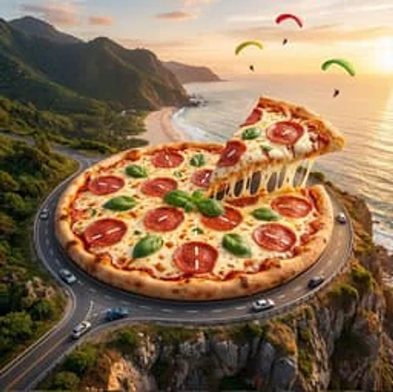

```text
{
  "Objective": "Create a surreal, hyper-detailed fantasy world where pizza becomes an integral part of landscapes and technology",
  "Concept": "Imaginative surrealism blending photorealistic food textures with cinematic fantasy environments",
  "Scenes": [
    {
      "SceneName": "Pizza Coastline Mountain Road",
      "SceneDescription": {
        "Environment": "Dramatic coastal cliffs overlooking the ocean",
        "PrimaryStructure": "A giant pepperoni pizza forming a winding mountain road",
        "WorldIntegration": {
          "Cheese": "Melted cheese forming the roadway surface",
          "Toppings": "Pepperoni slices and basil leaves acting as traffic islands and terrain features"
        },
        "ScaleElements": {
          "Vehicles": "Tiny cars driving across the pizza road",
          "ScaleContrast": "Massive pizza landscape versus miniature vehicles"
        }
      },
      "LightingAndMood": {
        "TimeOfDay": "Golden hour",
        "Lighting": "Warm coastal sunlight with long shadows",
        "Mood": "Whimsical, epic, playful wonder"
      },
      "Composition": {
        "Camera": "Cinematic wide-angle view",
        "Perspective": "Elevated, sweeping landscape shot",
        "DepthOfField": "Moderate depth with foreground and background clarity"
      }
    },
    {
      "SceneName": "Pizza Futuristic Car",
      "SceneDescription": {
        "Environment": "Rainy neon-lit cyberpunk city street at night",
        "PrimarySubject": "A pizza slice transformed into a futuristic car",
        "DesignDetails": {
          "Body": "Pizza crust and melted cheese forming aerodynamic shape",
          "Toppings": "Pepperoni and basil integrated into vehicle design",
          "Wheels": "Realistic rubber tires attached to the pizza vehicle"
        },
        "Motion": "Speeding through the street with dynamic motion blur"
      },
      "LightingAndMood": {
        "TimeOfDay": "Night",
        "Lighting": "Moody cyberpunk neon lights in red, teal, and magenta",
        "Atmosphere": "Rain, mist, reflections on wet asphalt",
        "Mood": "Energetic, futuristic, playful surrealism"
      },
      "Composition": {
        "Camera": "Low-angle wide shot",
        "Perspective": "Dynamic chase-style framing",
        "DepthOfField": "Shallow depth of field with background bokeh"
      }
    }
  ],
  "ArtDirection": {
    "Style": "Playful yet photorealistic surrealism",
    "TextureQuality": {
      "Food": "Ultra-realistic pizza textures, visible oil sheen, stretchy melted cheese",
      "Environment": "High-detail rocks, asphalt, rain droplets, reflections"
    },
    "RealismBalance": "Photorealistic materials combined with impossible scale and concepts"
  },
  "VisualStyle": {
    "Resolution": "8K ultra-high detail",
    "ColorGrading": "Cinematic contrast with warm coastal tones and cool neon city tones",
    "Depth": "Strong sense of scale and dimensionality"
  },
  "Mood": {
    "OverallTone": "Imaginative, whimsical, cinematic",
    "EmotionalFeel": "Playful awe and creative wonder"
  },
  "NegativePrompt": [
    "flat lighting",
    "cartoon-only style",
    "low detail textures",
    "plastic food",
    "blurry focus",
    "dull colors"
  ],
  "ResponseFormat": {
    "Type": "Two-scene cinematic illustration or render",
    "OutputOptions": [
      "Split composition",
      "Diptych",
      "Two separate images"
    ],
    "AspectRatio": "16:9"
  }
}
```

Model: Nano Banana
Author: Taaruk

[ProjectD](https://aitoolsradar.com/en/prompts/e1a8548e2816fc) · [Recorded source](https://x.com/Taaruk_/status/2010350361144610992)
 · [Full original metadata and byte evidence](data/projectd-batch-0067.json)

## Taaruk #1393

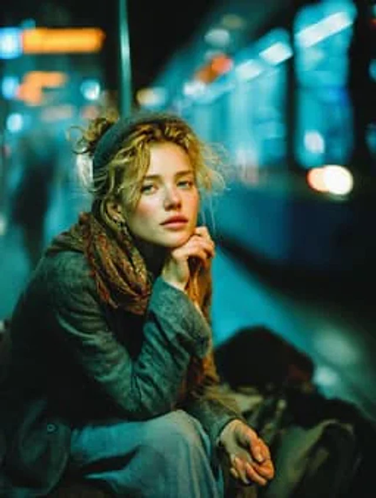

```text
{
  "Objective": "Create a moody cinematic portrait capturing quiet introspection on a subway platform at night",
  "PersonaDetails": {
    "Subject": {
      "Type": "Young woman",
      "Hair": {
        "Style": "Soft curly blonde hair loosely tied back",
        "Accessory": "Simple headband"
      },
      "FacialDetails": {
        "Freckles": "Natural, visible",
        "Expression": "Calm, introspective, emotionally reserved"
      },
      "Pose": "Seated on a subway bench, resting chin on her hand",
      "Gaze": "Looking slightly downward or into the distance"
    }
  },
  "Wardrobe": {
    "Outerwear": "Textured wool coat",
    "Accessories": "Knitted scarf",
    "ClothingStyle": "Muted, casual, understated urban wear"
  },
  "SceneDescription": {
    "Location": "Subway platform",
    "TimeOfDay": "Night",
    "Environment": {
      "Lighting": "Neon city lights along the platform",
      "Reflections": "Light reflections glowing on metal and tiled surfaces"
    }
  },
  "Composition": {
    "Framing": "Medium cinematic portrait",
    "DepthOfField": "Shallow depth of field",
    "Focus": "Sharp focus on subject with dreamy background blur"
  },
  "LightingAndColor": {
    "Lighting": "Low-light ambient subway illumination",
    "ColorPalette": {
      "Primary": "Cool teal neon tones",
      "Secondary": "Warm amber highlights"
    },
    "Highlights": "Soft highlights with controlled bloom",
    "ColorGrading": "Cinematic, film-inspired night tones"
  },
  "AtmosphericEffects": {
    "Bokeh": "Dreamy neon bokeh in background",
    "FilmGrain": "Subtle film grain for cinematic texture",
    "Mood": "Quiet, reflective, emotionally resonant"
  },
  "ArtDirection": {
    "Style": "Cinematic urban realism",
    "Aesthetic": "Film still / narrative photography",
    "DetailEmphasis": [
      "Natural skin texture",
      "Fabric texture",
      "Light reflections"
    ]
  },
  "PhotographyStyle": {
    "Genre": "Low-light cinematic portrait photography",
    "LensLook": "85mm lens perspective",
    "RealismLevel": "Ultra-realistic",
    "Resolution": "8K detail"
  },
  "Theme": {
    "Concept": "Solitude and reflection in a modern city",
    "EmotionalTone": "Melancholic calm, quiet anticipation"
  },
  "NegativePrompt": [
    "harsh flash",
    "daylight",
    "posed glamour",
    "oversaturated colors",
    "plastic skin",
    "cartoon",
    "anime",
    "blurry subject"
  ],
  "ResponseFormat": {
    "Type": "Single image",
    "Orientation": "Portrait",
    "AspectRatio": "2:3"
  }
}
```

Model: Nano Banana
Author: Taaruk

[ProjectD](https://aitoolsradar.com/en/prompts/48385730d063a1) · [Recorded source](https://x.com/Taaruk_/status/2012144333970133351)
 · [Full original metadata and byte evidence](data/projectd-batch-0067.json)

## Taaruk #1400

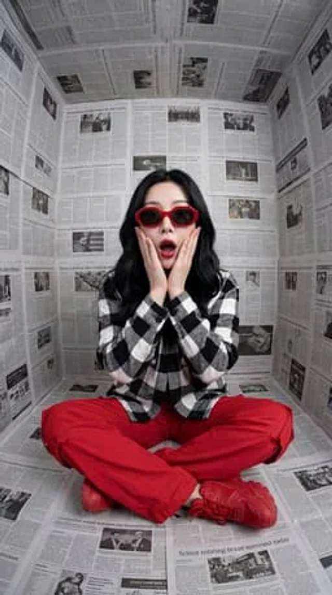

```text
{
  "Objective": "Create a stylized fashion portrait with bold color contrast and a modern surreal editorial aesthetic",
  "PersonaDetails": {
    "Subject": {
      "Type": "Young woman",
      "Pose": "Sitting cross-legged",
      "Expression": "Dramatic surprise, hands holding cheeks, mouth slightly open",
      "Hair": "Long black hair framing the face",
      "Accessories": "Bold red sunglasses"
    }
  },
  "Wardrobe": {
    "Top": "Black-and-white checkered shirt",
    "Bottom": "Red pants",
    "Footwear": "Red sneakers",
    "ColorTheme": "Vibrant red contrasted against monochrome surroundings"
  },
  "SceneDescription": {
    "Environment": "Small enclosed room",
    "SurfaceTreatment": {
      "Walls": "Covered entirely in newspaper pages",
      "Floor": "Covered entirely in newspaper pages",
      "Ceiling": "Covered entirely in newspaper pages"
    },
    "Concept": "Monochrome newspaper textures creating a graphic, immersive backdrop"
  },
  "Composition": {
    "Framing": "Centered, symmetrical composition",
    "CameraAngle": "Straight-on",
    "Balance": "Strong geometric and visual symmetry",
    "Focus": "Sharp focus across subject and environment"
  },
  "LightingAndColor": {
    "Lighting": "Soft studio lighting",
    "ShadowQuality": "Clean, controlled shadows",
    "Contrast": "High contrast between black-and-white newspapers and red clothing",
    "ColorPalette": [
      "Black",
      "White",
      "Vibrant red"
    ]
  },
  "ArtDirection": {
    "Style": "Editorial fashion photography",
    "Aesthetic": "Modern surrealism",
    "DetailLevel": "Crisp details with high realism",
    "VisualImpact": "Graphic, bold, eye-catching"
  },
  "PhotographyStyle": {
    "Genre": "High-fashion editorial portrait",
    "ImageQuality": "Ultra-high resolution, 8K clarity",
    "Finish": "Clean, sharp, magazine-ready"
  },
  "Mood": {
    "Tone": "Playful shock, surreal curiosity",
    "Energy": "Bold, expressive, contemporary"
  },
  "NegativePrompt": [
    "uneven lighting",
    "blurred details",
    "busy color palette",
    "low contrast",
    "casual snapshot",
    "cartoon style",
    "vintage look"
  ],
  "ResponseFormat": {
    "Type": "Single image",
    "Orientation": "Portrait",
    "AspectRatio": "2:3"
  }
}
```

Model: Nano Banana
Author: Taaruk

[ProjectD](https://aitoolsradar.com/en/prompts/ad2d9ad316b42a) · [Recorded source](https://x.com/Taaruk_/status/2012011717975556167)
 · [Full original metadata and byte evidence](data/projectd-batch-0067.json)

## Taaruk #310

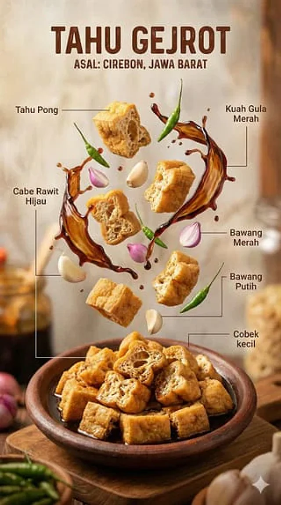

```text
{
  "image_prompt": {
    "type": "Hyper-realistic food infographic",
    "subject": {
      "cuisine": "Indonesian",
      "base_element": "Traditional bowl with steaming hot dish at the bottom",
      "levitating_ingredients": [
        "Juicy meat",
        "Crispy tofu",
        "Glossy sauce splashes",
        "Fresh herbs",
        "Chilies",
        "Lime",
        "Garlic",
        "Fried shallots"
      ]
    },
    "composition": {
      "layout": "Clean vertical composition",
      "arrangement": "Realistic gravity-defying/floating elements",
      "background": "Rustic wooden surface",
      "visual_hierarchy": "Bowl anchored at bottom, ingredients rising vertically"
    },
    "graphic_design_elements": {
      "labels": "Clear Indonesian text",
      "lines": "Thin white pointing lines",
      "style": "Editorial infographic layout, professional food magazine style"
    },
    "lighting_and_mood": {
      "lighting": "Cinematic studio lighting",
      "color_palette": "Warm tones",
      "effects": "Dramatic steam, motion-frozen ingredients"
    },
    "technical_specs": {
      "camera_settings": "Shallow depth of field, sharp focus, DSLR look",
      "details": "Ultra-detailed textures",
      "resolution": "8K ultra-realistic"
    }
  }
}
```

Model: Nano Banana
Author: Taaruk

[ProjectD](https://aitoolsradar.com/en/prompts/7e340bf1db3a0a) · [Recorded source](https://x.com/Taaruk_/status/2017865644365255078)
 · [Full original metadata and byte evidence](data/projectd-batch-0067.json)

## Taaruk #331

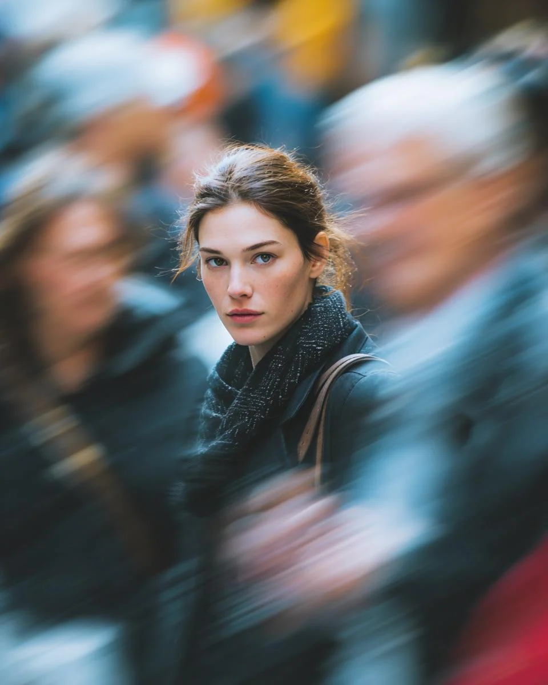

```text
Ultra-realistic cinematic street portrait of a young woman standing still in a crowded city street, sharp focus on her face with calm, intense expression. Long-exposure effect with people moving around her creating strong directional motion blur, streaked crowd movement while the subject remains perfectly still. Natural soft daylight, shallow depth of field, creamy bokeh, realistic skin texture, subtle freckles, neutral makeup, dark winter coat and scarf. Emotional, introspective mood, urban storytelling photography, DSLR quality, 85mm lens look, f/1.8, high dynamic range, 8K, professional color grading.
```

Model: Nano Banana
Author: Taaruk

[ProjectD](https://aitoolsradar.com/en/prompts/44f296cc4f0848) · [Recorded source](https://x.com/Taaruk_/status/2018685474131562751)
 · [Full original metadata and byte evidence](data/projectd-batch-0067.json)

## Taaruk #410

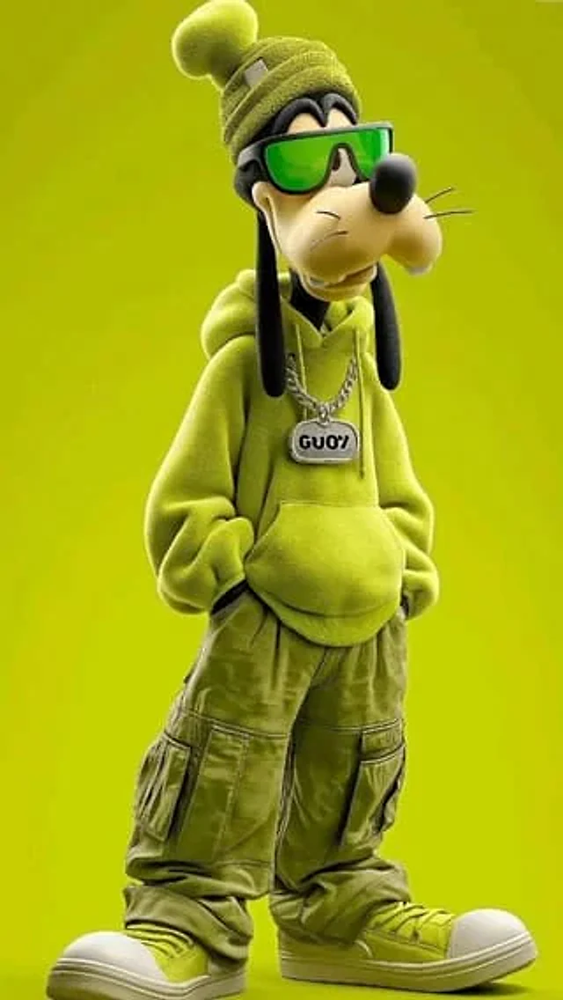

```text
Full-body 3D stylized anthropomorphic cartoon dog character wearing modern streetwear, oversized neon green hoodie, cargo pants, chunky sneakers, reflective sunglasses, silver chain necklace. Confident relaxed pose with hands in pockets. Minimal studio background in solid lime green. Soft studio lighting, smooth shadows, high detail fabric texture, Pixar-quality 3D render, ultra-clean composition, centered framing, fashion editorial character design, 8K resolution.
```

Model: Nano Banana
Author: Taaruk

[ProjectD](https://aitoolsradar.com/en/prompts/7573ade711b1d1) · [Recorded source](https://x.com/Taaruk_/status/2022179786580537521)
 · [Full original metadata and byte evidence](data/projectd-batch-0067.json)

## Taaruk #429

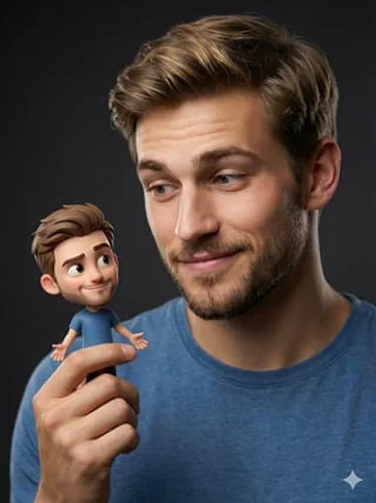

```text
{
  "Objective": "Create a hyper-realistic studio portrait blending photorealism with a whimsical 3D cartoon miniature character",
  "PersonaDetails": {
    "PrimarySubject": {
      "Type": "Young man",
      "Appearance": {
        "Hair": "Light brown hair, neatly styled",
        "FacialHair": "Neatly trimmed beard",
        "Skin": "Photorealistic, natural texture"
      },
      "Expression": "Soft, warm smile",
      "Gaze": "Looking at the miniature character on his fingertips",
      "Wardrobe": "Blue t-shirt"
    },
    "SecondarySubject": {
      "Type": "Tiny 3D cartoon version of the man",
      "Scale": "Miniature, resting on fingertips",
      "Style": "Pixar-style 3D character design",
      "Proportions": "Exaggerated cute proportions",
      "Features": {
        "Eyes": "Large, expressive",
        "Expression": "Friendly, playful pose"
      },
      "Consistency": "Matching hairstyle and outfit of the main subject"
    }
  },
  "Composition": {
    "Framing": "Close-up studio portrait",
    "Focus": "Ultra-sharp focus on both faces",
    "DepthOfField": "Shallow depth of field with soft background blur",
    "Balance": "Clean, centered composition emphasizing interaction"
  },
  "LightingAndMood": {
    "LightingStyle": "Cinematic soft studio lighting",
    "Highlights": "Gentle highlights on skin and miniature character",
    "Background": "Dark neutral backdrop",
    "Mood": "Modern, whimsical, warm"
  },
  "ArtDirection": {
    "StyleFusion": [
      "Photorealistic human portrait",
      "Pixar-style 3D character rendering"
    ],
    "DetailLevel": "High detail with clean textures",
    "RealismBalance": "Realistic human combined with stylized miniature"
  },
  "PhotographyStyle": {
    "Genre": "Professional studio portrait photography",
    "LensLook": "85mm lens perspective",
    "ImageQuality": "High resolution, ultra-sharp clarity"
  },
  "ColorAndTone": {
    "ColorPalette": "Natural skin tones with soft, modern colors",
    "Contrast": "Balanced contrast, smooth tonal transitions"
  },
  "NegativePrompt": [
    "cartoon human",
    "uncanny valley",
    "harsh lighting",
    "oversaturated colors",
    "blurry faces",
    "low detail",
    "messy composition"
  ],
  "ResponseFormat": {
    "Type": "Single image",
    "Orientation": "Portrait",
    "AspectRatio": "2:3"
  }
}
```

Model: Nano Banana
Author: Taaruk

[ProjectD](https://aitoolsradar.com/en/prompts/7fa2d95cc616aa) · [Recorded source](https://x.com/Taaruk_/status/2008818683234361811)
 · [Full original metadata and byte evidence](data/projectd-batch-0067.json)

## Taaruk #529

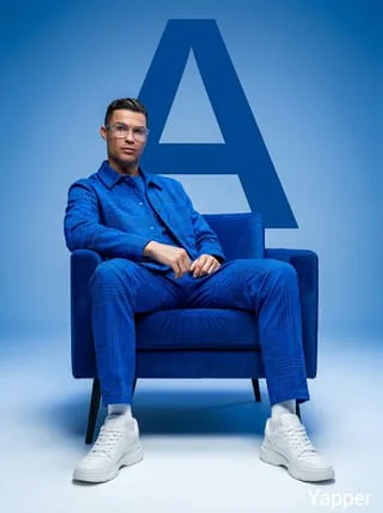

```text
Minimalist fashion studio photoshoot featuring stylish people sitting confidently on a modern chair, monochromatic aesthetic, subjects wearing bold cobalt-blue outfits (tailored suit or modern streetwear set) with white sneakers and clear glasses, relaxed powerful pose with legs apart and hands resting naturally, clean blue studio background with a large geometric letter “A” behind them, soft professional studio lighting, fashion editorial composition, modern luxury brand campaign style, ultra-realistic, sharp focus, high detail, 8K.
```

Model: Nano Banana
Author: Taaruk

[ProjectD](https://aitoolsradar.com/en/prompts/d9a1619ad218a7) · [Recorded source](https://x.com/Taaruk_/status/2033180206975135824)
 · [Full original metadata and byte evidence](data/projectd-batch-0067.json)

## Taaruk #551

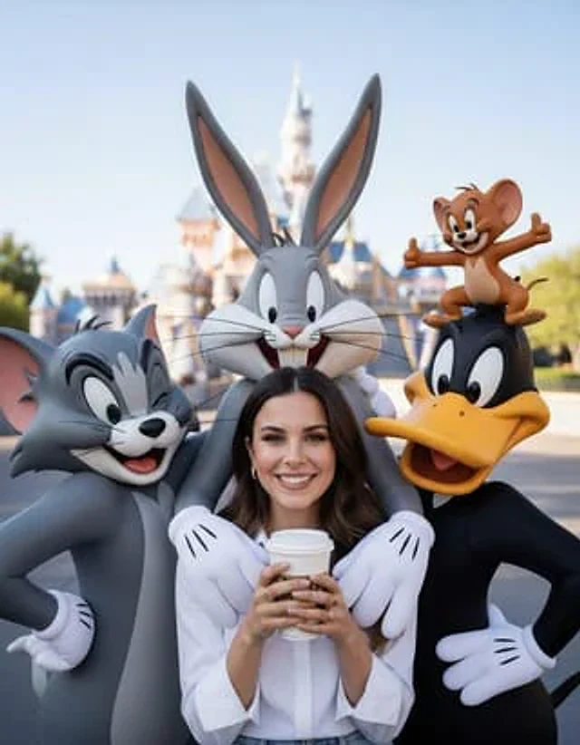

```text
{
  "Objective": "Create a cheerful lifestyle portrait set in a magical theme park with joyful mascot characters",
  "PersonaDetails": {
    "PrimarySubject": {
      "Type": "Young woman",
      "Pose": "Standing relaxed, holding a takeaway coffee cup with both hands",
      "Expression": "Warm smile, cheerful and relaxed",
      "Style": "Casual lifestyle look"
    },
    "MascotCharacters": [
      {
        "Type": "Tall grey rabbit mascot",
        "Interaction": "Hugging the woman from behind",
        "Emotion": "Joyful, playful"
      },
      {
        "Type": "Grey cat mascot",
        "Position": "Standing at her side",
        "Emotion": "Friendly, happy"
      },
      {
        "Type": "Black duck mascot",
        "Position": "Standing on the opposite side",
        "Emotion": "Playful and welcoming"
      },
      {
        "Type": "Small brown mouse mascot",
        "Position": "Playfully posing above the group",
        "Emotion": "Energetic and mischievous"
      }
    ]
  },
  "SceneDescription": {
    "Location": "Famous theme park",
    "Background": {
      "Landmark": "Fairytale castle",
      "Treatment": "Softly blurred for depth"
    },
    "Environment": "Open plaza with a lively, family-friendly atmosphere"
  },
  "Composition": {
    "Framing": "Medium lifestyle portrait",
    "Grouping": "Centered subject surrounded by characters",
    "DepthOfField": "Shallow depth of field",
    "Focus": "Sharp focus on faces with softly blurred background"
  },
  "LightingAndColor": {
    "Lighting": "Bright natural daylight",
    "ColorPalette": "Vibrant, saturated yet balanced colors",
    "Highlights": "Soft, clean highlights enhancing cheerful mood"
  },
  "ArtDirection": {
    "Style": "High realism blended with animated character charm",
    "Aesthetic": "Playful, magical, family-friendly",
    "DetailLevel": "Ultra-detailed textures on clothing and mascot costumes"
  },
  "PhotographyStyle": {
    "Genre": "Theme park lifestyle photography",
    "CompositionStyle": "Cinematic yet candid",
    "ImageQuality": "High resolution, crisp detail"
  },
  "Mood": {
    "Tone": "Happy, welcoming, whimsical",
    "Energy": "Lighthearted, joyful, magical"
  },
  "NegativePrompt": [
    "dark mood",
    "empty background",
    "scary characters",
    "low resolution",
    "blurry faces",
    "harsh shadows",
    "desaturated colors"
  ],
  "ResponseFormat": {
    "Type": "Single image",
    "Orientation": "Portrait",
    "AspectRatio": "2:3"
  }
}
```

Model: Nano Banana
Author: Taaruk

[ProjectD](https://aitoolsradar.com/en/prompts/b3ab333d447fe4) · [Recorded source](https://x.com/Taaruk_/status/2009462964206882926)
 · [Full original metadata and byte evidence](data/projectd-batch-0067.json)

## Taaruk #572

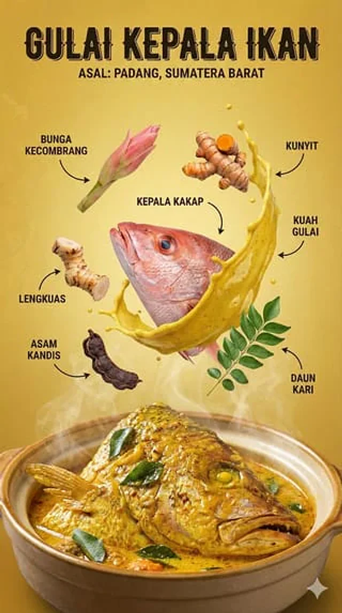

```text
{
  "image_prompt": {
    "type": "Ultra-realistic Indonesian traditional food infographic poster",
    "layout_and_composition": {
      "orientation": "Vertical composition",
      "style": "Modern culinary infographic design, editorial layout",
      "background": "Dramatic but clean background"
    },
    "typography_elements": {
      "headline": {
        "position": "Top",
        "style": "Bold text showing dish name and origin (ASAL)"
      },
      "labels": {
        "style": "Clean Indonesian typography",
        "connectors": "Curved label arrows pointing to ingredients"
      }
    },
    "visual_content": {
      "main_action": "Cinematic floating ingredients suspended in mid-air",
      "details": [
        "Glossy curry splash",
        "Fresh herbs",
        "Spices",
        "Steam rising from the bowl"
      ],
      "textures": "Hyper-detailed, glossy, appetizing"
    },
    "lighting_and_atmosphere": {
      "lighting_style": "Rich golden lighting, studio lighting",
      "mood": "Professional, appetizing, high-end"
    },
    "technical_specs": {
      "quality": "8K ultra-realistic, DSLR quality",
      "focus": "Shallow depth of field",
      "style": "Professional food photography"
    }
  }
}
```

Model: Nano Banana
Author: Taaruk

[ProjectD](https://aitoolsradar.com/en/prompts/15b5e7681b3324) · [Recorded source](https://x.com/Taaruk_/status/2018252656574185981)
 · [Full original metadata and byte evidence](data/projectd-batch-0067.json)

## Taaruk #589

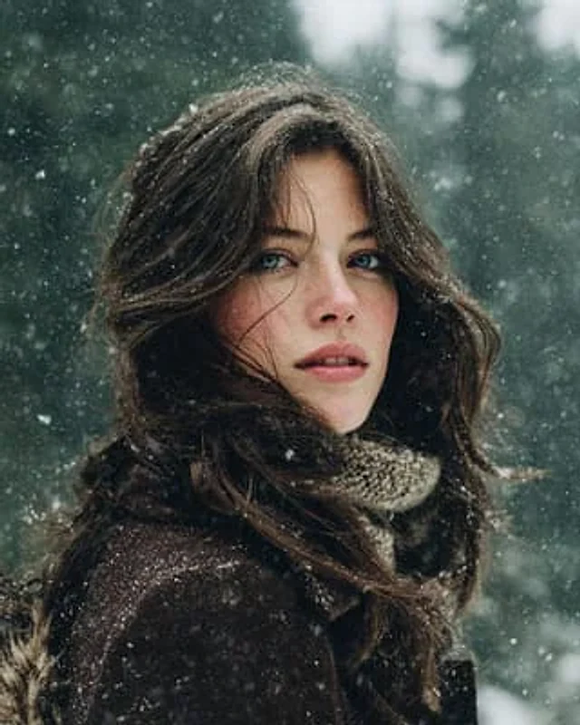

```text
{
  "Objective": "Generate a cinematic, photorealistic portrait inspired by a winter forest atmosphere",
  "PersonaDetails": {
    "Subject": "Young woman",
    "Appearance": {
      "Hair": "Long, wavy dark brown hair, slightly windblown",
      "Eyes": "Light blue",
      "Skin": "Fair with natural freckles",
      "Expression": "Soft, introspective, slightly wistful"
    },
    "Clothing": {
      "Outerwear": "Dark brown wool coat",
      "Accessories": "Knitted scarf in neutral tones"
    }
  },
  "SceneDescription": {
    "Environment": "Snowy forest with soft-focus evergreen trees",
    "Weather": "Gentle snowfall",
    "Season": "Winter",
    "Mood": "Quiet, cinematic, melancholic, ethereal"
  },
  "PhotographyStyle": {
    "Type": "Cinematic portrait photography",
    "Lighting": "Soft natural light, overcast winter lighting",
    "DepthOfField": "Shallow depth of field with creamy bokeh",
    "CameraAngle": "Three-quarter profile, subject looking back over shoulder",
    "Resolution": "Ultra high resolution, sharp facial details"
  },
  "ArtDirection": {
    "ColorPalette": "Muted earth tones, cool greens and soft whites",
    "Texture": "Natural skin texture, visible snow particles",
    "RealismLevel": "Highly photorealistic"
  },
  "NegativePrompt": [
    "cartoon",
    "anime",
    "overly smooth skin",
    "harsh lighting",
    "blurry face",
    "distorted anatomy",
    "oversaturated colors"
  ],
  "ResponseFormat": {
    "Type": "Single image",
    "Orientation": "Portrait",
    "AspectRatio": "2:3"
  }
}
```

Model: Nano Banana
Author: Taaruk

[ProjectD](https://aitoolsradar.com/en/prompts/126466e275007d) · [Recorded source](https://x.com/Taaruk_/status/2008379371405668478)
 · [Full original metadata and byte evidence](data/projectd-batch-0067.json)

## Taaruk #617

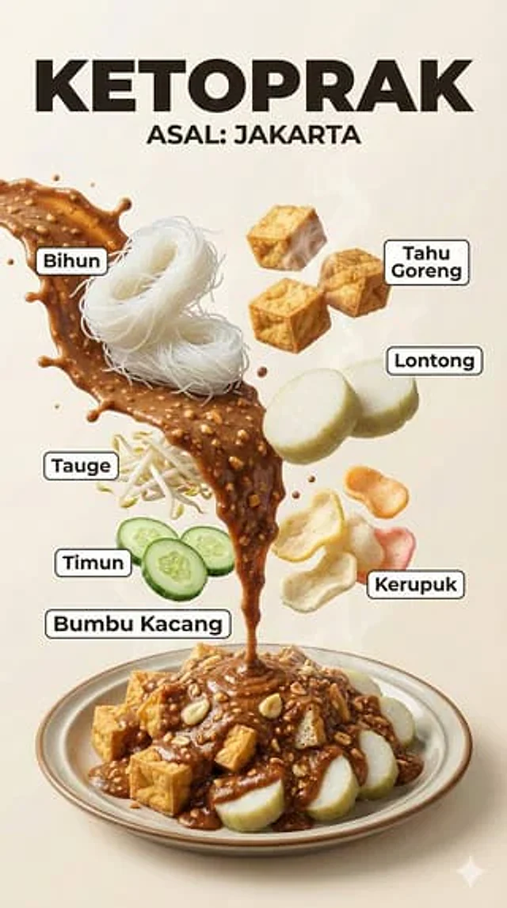

```text
A hyper-realistic Indonesian food infographic poster with dramatic floating ingredients. Vertical composition, bold title text at the top showing the dish name and origin (ASAL). Ingredients levitating in mid-air with clean white label lines and Indonesian text. Cinematic food photography style, ultra-detailed textures, glossy sauces, charred meat, fresh vegetables, steam and smoke effects. Strong contrast lighting, editorial layout, modern typography, professional food magazine look, motion-frozen splashes, realistic shadows, studio lighting, shallow depth of field, 8K ultra-realistic, DSLR quality.
```

Model: Nano Banana
Author: Taaruk

[ProjectD](https://aitoolsradar.com/en/prompts/651180493d93dc) · [Recorded source](https://x.com/Taaruk_/status/2018167340417130614)
 · [Full original metadata and byte evidence](data/projectd-batch-0067.json)

## Taaruk #618

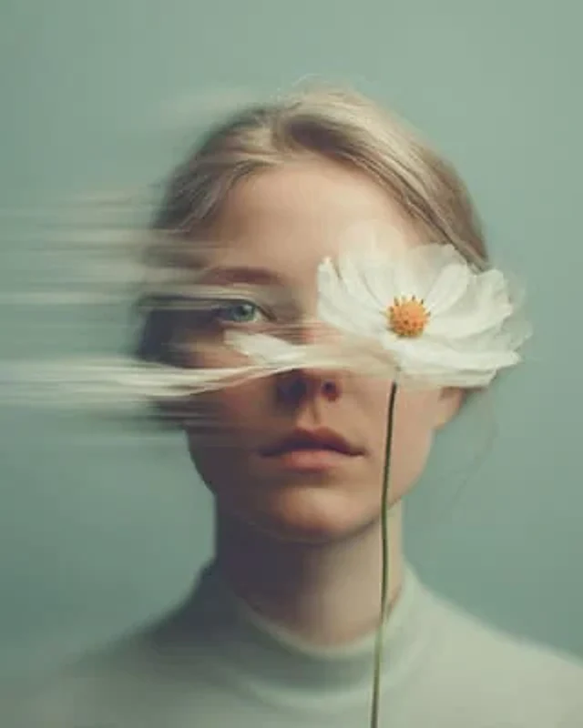

```text
Ultra-realistic fine-art portrait of a young woman with soft natural features, minimal makeup, and calm introspective expression. Pastel muted background in sage green tones. Delicate flowers drifting across the frame in the foreground, creating intentional motion blur and soft streaks of light. Subtle double exposure and slow-shutter motion effects across the face, dreamy and poetic atmosphere. Gentle diffused lighting with smooth highlights on skin, natural texture preserved. Elegant minimalist composition, emotional and serene mood, editorial fine-art photography style, shallow depth of field, cinematic softness, painterly realism, ultra-high resolution, 8K quality.
```

Model: Nano Banana
Author: Taaruk

[ProjectD](https://aitoolsradar.com/en/prompts/690eb96228141d) · [Recorded source](https://x.com/Taaruk_/status/2020780086363054275)
 · [Full original metadata and byte evidence](data/projectd-batch-0067.json)

## Taaruk #631

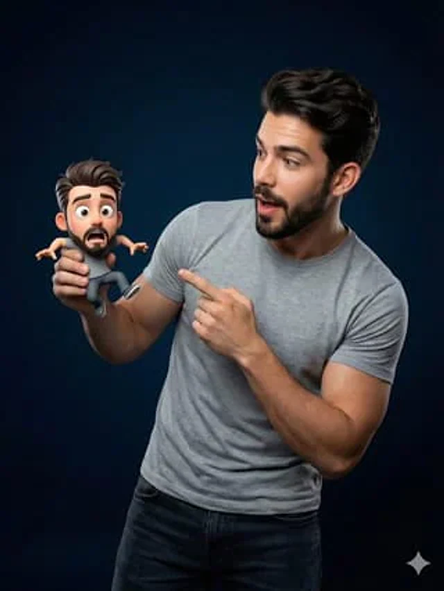

```text
{
  "Objective": "Create a studio portrait blending a real human with a tiny Pixar-style 3D cartoon version of themselves in a playful, whimsical interaction",
  "PersonaDetails": {
    "PrimarySubject": {
      "Type": "Real human",
      "Wardrobe": "Casual grey sweater or t-shirt",
      "Expression": "Surprised and delighted",
      "Pose": "Holding a tiny character in one hand and pointing at it with the other",
      "Skin": "Photorealistic skin texture with natural detail"
    },
    "SecondarySubject": {
      "Type": "Tiny 3D cartoon version of the human",
      "Scale": "Miniature, resting in the human’s hand",
      "Style": "Pixar-style 3D character",
      "Proportions": "Exaggerated cute proportions with rounded features",
      "FacialFeatures": {
        "Eyes": "Large, expressive",
        "Expression": "Friendly, playful"
      },
      "Consistency": "Matching hairstyle and outfit of the real human"
    }
  },
  "Composition": {
    "Framing": "Medium close-up studio portrait",
    "InteractionFocus": "Clear visual relationship between human and miniature character",
    "DepthOfField": "Shallow depth of field",
    "Focus": "Ultra-sharp focus on both faces"
  },
  "LightingAndBackground": {
    "LightingStyle": "Soft cinematic studio lighting",
    "LightQuality": "Smooth highlights with gentle shadow falloff",
    "Background": "Dark blue gradient studio backdrop",
    "Separation": "Subtle rim light for subject-background separation"
  },
  "ArtDirection": {
    "StyleFusion": [
      "Photorealistic human portrait photography",
      "High-quality Pixar-style 3D character rendering"
    ],
    "Integration": "Seamless blending between real and 3D elements",
    "DetailLevel": "Ultra-detailed textures on skin, fabric, and 3D materials"
  },
  "MoodAndTone": {
    "Mood": "Whimsical, fun, lighthearted",
    "Energy": "Playful surprise and delight"
  },
  "PhotographyStyle": {
    "Genre": "Professional studio portrait photography",
    "CameraLook": "High-end cinematic realism",
    "ImageQuality": "High resolution, clean and sharp"
  },
  "NegativePrompt": [
    "uncanny valley",
    "cartoon human",
    "low-quality 3D",
    "harsh lighting",
    "oversaturated colors",
    "blurry focus",
    "flat composition"
  ],
  "ResponseFormat": {
    "Type": "Single image",
    "Orientation": "Portrait",
    "AspectRatio": "2:3"
  }
}
```

Model: Nano Banana
Author: Taaruk

[ProjectD](https://aitoolsradar.com/en/prompts/b8b76dabdb2b99) · [Recorded source](https://x.com/Taaruk_/status/2010269361190371754)
 · [Full original metadata and byte evidence](data/projectd-batch-0067.json)

## Taaruk #657

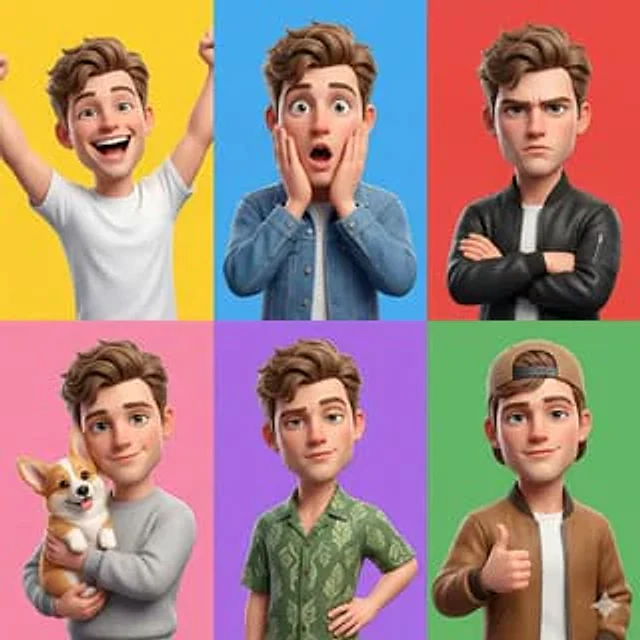

```text
A 3D Pixar-style animated young male character showcased in a 6-panel grid layout, each panel featuring a different facial expression and outfit. Bright solid color backgrounds (yellow, blue, red, pink, purple, green). The character has soft brown wavy hair, expressive large eyes, smooth skin, and stylized cartoon proportions.
```

Model: Nano Banana
Author: Taaruk

[ProjectD](https://aitoolsradar.com/en/prompts/9d9aec936bd16d) · [Recorded source](https://x.com/Taaruk_/status/2022690823062884582)
 · [Full original metadata and byte evidence](data/projectd-batch-0067.json)

## Taaruk #668

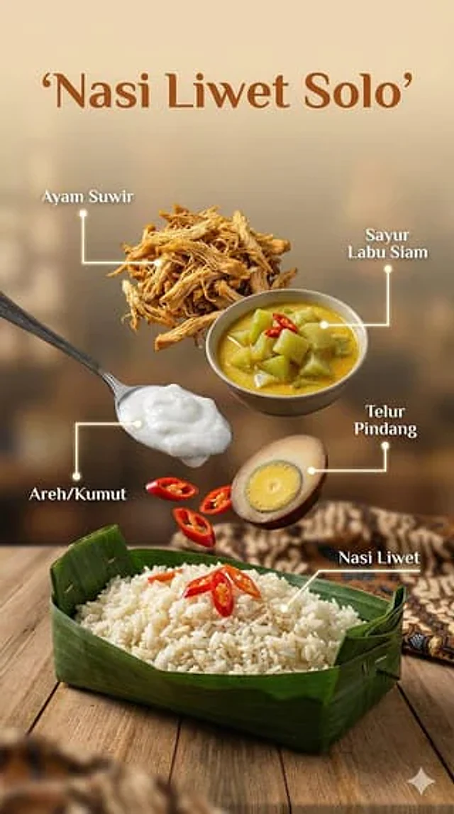

```text
Ultra-realistic cinematic food photography of a traditional Indonesian dish, presented as a floating ingredients composition. Main dish placed at the bottom in a rustic ceramic bowl or banana leaf plate. Key ingredients suspended in mid-air above the dish, perfectly separated and labeled with clean minimalist typography and thin pointer lines. Dynamic splashes of sauce and spices frozen in motion, high-speed food photography. Natural tropical setting with banana leaves, palm trees, warm sunlight, shallow depth of field. Hyper-detailed textures, glossy sauces, steam and smoke effects, editorial food poster style, premium commercial quality, 8K resolution, soft cinematic lighting, realistic shadows, depth and realism.
```

Model: Nano Banana
Author: Taaruk

[ProjectD](https://aitoolsradar.com/en/prompts/7bac8c450cde7e) · [Recorded source](https://x.com/Taaruk_/status/2019254034654195755)
 · [Full original metadata and byte evidence](data/projectd-batch-0067.json)

## Taaruk #669

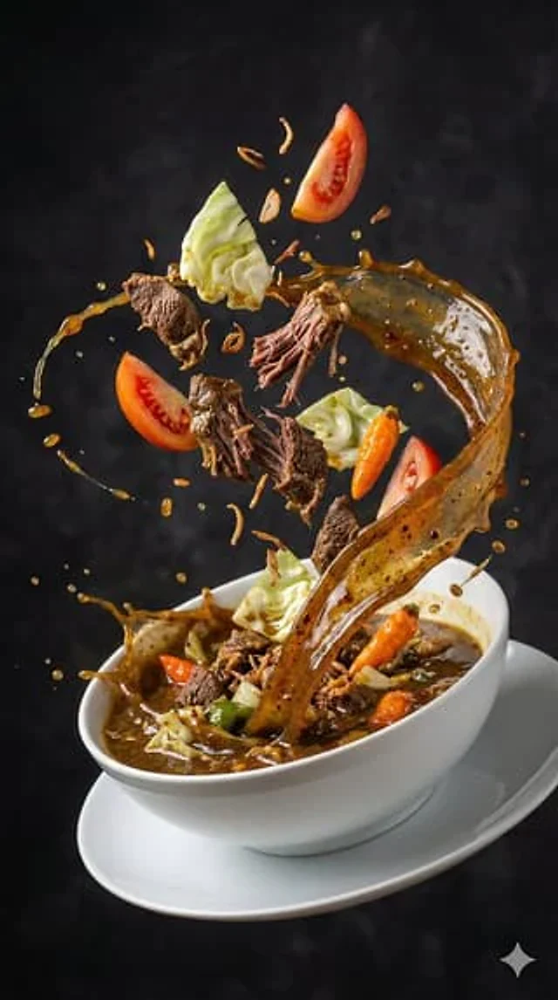

```text
{
  "image_prompt": {
    "subject": "Rich Asian soup",
    "action": "Ingredients exploding upward in mid-air, swirling spiral splash of broth forming a dynamic ribbon shape, liquid splash crown",
    "ingredients": [
      "Floating beef slices",
      "Shrimp",
      "Noodles",
      "Tofu cubes",
      "Chili",
      "Herbs",
      "Tomatoes",
      "Cabbage"
    ],
    "environment": "Dramatic dark textured background",
    "lighting": "Studio lighting, strong rim light, glossy broth reflections, cinematic contrast",
    "photography_style": "Ultra-realistic food photography, high-speed photography, frozen motion, hyper realistic",
    "camera_settings": {
      "lens": "85mm",
      "aperture": "f/4",
      "focus": "Sharp focus, macro clarity",
      "resolution": "8K"
    }
  }
}
```

Model: Nano Banana
Author: Taaruk

[ProjectD](https://aitoolsradar.com/en/prompts/0b9b9d57591a77) · [Recorded source](https://x.com/Taaruk_/status/2022540091244036192)
 · [Full original metadata and byte evidence](data/projectd-batch-0067.json)

## Taaruk #673

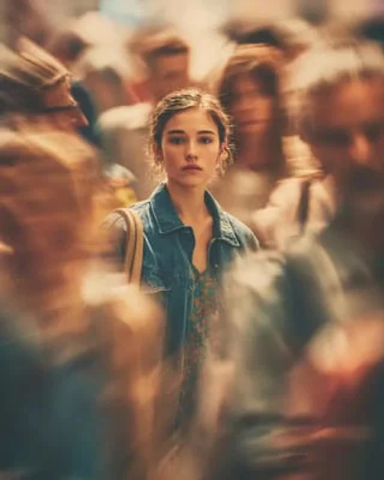

```text
Cinematic portrait of a young person standing still in the middle of a busy crowd, sharp focus on the subject while people move rapidly around them creating strong motion blur. The subject looks directly at the camera with a calm, introspective expression. Soft natural lighting, shallow depth of field, dreamy atmosphere. Crowd blurred using long exposure effect, dynamic movement streaks surrounding the subject. Neutral pastel background tones, subtle color grading, emotional storytelling composition. Shot on 85mm lens, f/1.8, long shutter speed, ultra-realistic skin texture, cinematic photography, 8K resolution.
```

Model: Nano Banana
Author: Taaruk

[ProjectD](https://aitoolsradar.com/en/prompts/a24a29cba98240) · [Recorded source](https://x.com/Taaruk_/status/2021859477130293356)
 · [Full original metadata and byte evidence](data/projectd-batch-0067.json)

## Taaruk #676

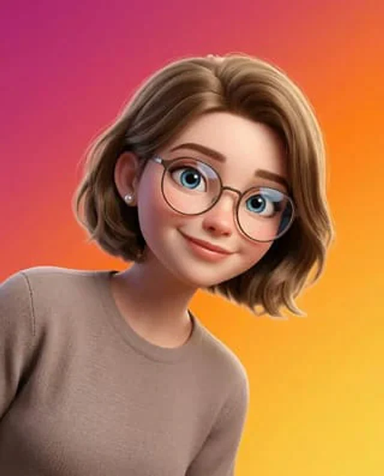

```text
A stylized Pixar-style 3D portrait of a young person with smooth skin, large expressive blue eyes, soft facial features, wearing round transparent glasses, modern hairstyle (short styled hair / soft bob cut), casual outfit (hoodie or minimal sweater), slight head tilt and warm smile, friendly and approachable expression, ultra-clean character design, vibrant orange-to-pink gradient background, soft studio lighting with subtle rim light, cinematic depth of field, ultra-detailed, 8K render, octane render style.
```

Model: Nano Banana
Author: Taaruk

[ProjectD](https://aitoolsradar.com/en/prompts/406147d47a86ef) · [Recorded source](https://x.com/Taaruk_/status/2041366570149265865)
 · [Full original metadata and byte evidence](data/projectd-batch-0067.json)

## Taaruk #692

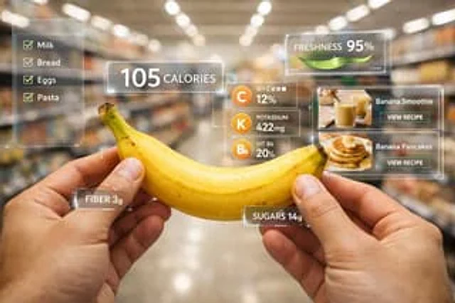

```text
{
  "image_prompt": {
    "viewpoint": "Realistic first-person view (FPV)",
    "action": "Person holding fresh fruit in their hands",
    "subject_variations": [
      "Banana",
      "Strawberries",
      "Apple"
    ],
    "environment": {
      "location": "Modern supermarket aisle",
      "background": "Blurred grocery shelves",
      "lighting": "Bright commercial lighting"
    },
    "augmented_reality_hud": {
      "overlay_style": "Clean sci-fi interface, soft glow, glass-like UI elements",
      "data_display": [
        "Nutritional data (calories, vitamins, fiber, sugars, potassium)",
        "Freshness percentage",
        "Health indicators"
      ],
      "ui_panels": [
        "Checklist items (milk, bread, eggs, pasta)",
        "Recipe suggestions",
        "Smoothie options",
        "Vitamin icons"
      ],
      "visual_effects": "Subtle light particles, depth-aware AR placement"
    },
    "technical_specs": {
      "style": "Ultra-realistic photography blended with futuristic AR technology",
      "aesthetic": "Modern health-tech",
      "focus": "Sharp focus on hands and fruit, shallow depth of field",
      "resolution": "8K",
      "realism": "Cinematic realism"
    }
  }
}
```

Model: Nano Banana
Author: Taaruk

[ProjectD](https://aitoolsradar.com/en/prompts/766dce91f58ece) · [Recorded source](https://x.com/Taaruk_/status/2016421696299991337)
 · [Full original metadata and byte evidence](data/projectd-batch-0067.json)

## Taaruk #698


```text
{
  "Objective": "Create a dreamy fine-art portrait with a romantic, ethereal garden atmosphere",
  "PersonaDetails": {
    "Subject": {
      "Type": "Young woman",
      "Hair": "Short, softly tousled dark hair",
      "Expression": "Calm, introspective, slightly melancholic",
      "Gaze": "Looking gently toward the camera",
      "Wardrobe": {
        "Dress": "Muted teal floral dress with subtle vintage patterns"
      }
    }
  },
  "SceneDescription": {
    "Location": "Lush garden in full bloom",
    "EnvironmentDetails": [
      "Abundant flowering plants",
      "Soft greenery filling the frame"
    ],
    "AtmosphericElements": {
      "FloatingPetals": "White and pale peach flower petals drifting through the air",
      "Motion": "Petals caught mid-motion by a gentle breeze"
    }
  },
  "Composition": {
    "Framing": "Waist-up fine-art portrait",
    "Balance": "Elegant, centered composition",
    "DepthOfField": "Shallow depth of field",
    "Background": "Softly blurred garden with creamy bokeh"
  },
  "LightingAndColor": {
    "Lighting": "Soft natural light under overcast sky",
    "ColorPalette": [
      "Muted greens",
      "Soft teals",
      "Pale peach and white accents"
    ],
    "ColorGrading": "Painterly, desaturated, romantic tones"
  },
  "ArtDirection": {
    "Style": "Fine-art photography blended with cinematic realism",
    "Aesthetic": "Romantic, ethereal, timeless",
    "TextureQuality": "Ultra-detailed fabric and natural skin texture"
  },
  "PhotographyStyle": {
    "LensLook": "85mm lens perspective",
    "Genre": "Fine-art portrait photography",
    "ImageQuality": "High resolution, refined detail",
    "FocusStyle": "Soft yet precise subject focus"
  },
  "Mood": {
    "Tone": "Dreamy, reflective, poetic",
    "EmotionalFeel": "Gentle melancholy and quiet beauty"
  },
  "NegativePrompt": [
    "harsh lighting",
    "modern fashion editorial",
    "oversaturated colors",
    "busy background",
    "plastic skin",
    "cartoon",
    "anime"
  ],
  "ResponseFormat": {
    "Type": "Single image",
    "Orientation": "Portrait",
    "AspectRatio": "2:3"
  }
}
```

Model: Nano Banana
Author: Taaruk

[ProjectD](https://aitoolsradar.com/en/prompts/4c8f767ed8478b) · [Recorded source](https://x.com/Taaruk_/status/2009183590035411178)
 · [Full original metadata and byte evidence](data/projectd-batch-0067.json)

## Taaruk #751


```text
Cinematic portrait of a stylish young person wearing round glasses, standing beside a wall illuminated by bold geometric window light. Strong red, orange, and teal color contrast casting dramatic shadows across the face. Side profile pose, soft contemplative expression, sharp focus on facial features. High contrast lighting with hard-edged rectangular light shapes in the background. Moody atmosphere, artistic color blocking, modern editorial photography style. Shot on 85mm lens, f/1.8, ultra-detailed skin texture, shallow depth of field, dramatic rim lighting, 8K resolution.
```

Model: Nano Banana
Author: Taaruk

[ProjectD](https://aitoolsradar.com/en/prompts/ffb792a1eef842) · [Recorded source](https://x.com/Taaruk_/status/2021933979398492325)
 · [Full original metadata and byte evidence](data/projectd-batch-0067.json)

## Taaruk #764


```text
Ultra-realistic high-speed food photography of a crispy golden fried snack breaking apart mid-air, creamy savory filling stretching between the halves, visible chunks of chicken, peas, carrots, minced meat, noodles, or egg inside. Crumbs and flakes flying in slow motion, hot steam rising, dramatic food explosion effect. Shot in a vibrant night street market environment with warm bokeh lights, blurred food stalls in the background. Shallow depth of field, 85mm lens, f/1.8, ultra-sharp focus on texture, crunchy coating detail, dynamic motion capture, commercial food photography, cinematic lighting, HDR, 8K resolution, hyper-detailed, masterpiece quality.
```

Model: Nano Banana
Author: Taaruk

[ProjectD](https://aitoolsradar.com/en/prompts/3fa86ec2fe00ae) · [Recorded source](https://x.com/Taaruk_/status/2022877843236200588)
 · [Full original metadata and byte evidence](data/projectd-batch-0067.json)

## Taaruk #816


```text
Ultra-detailed 3D chibi-style character with a big head and expressive eyes, cute proportions, smooth stylized skin, friendly smile. The character is casually leaning against a small green off-road Jeep, holding a takeaway coffee cup. Cozy outdoor café courtyard setting with wooden tables, potted plants, warm string lights in the background. Soft golden-hour lighting, shallow depth of field, cinematic bokeh. High-quality Pixar-style 3D render, vibrant colors, clean textures, adorable yet realistic character design, professional character illustration, 8K render.
```

Model: Nano Banana
Author: Taaruk

[ProjectD](https://aitoolsradar.com/en/prompts/e05377306bcacd) · [Recorded source](https://x.com/Taaruk_/status/2017231845545689130)
 · [Full original metadata and byte evidence](data/projectd-batch-0067.json)

## Taaruk #875


```text
{
  "Objective": "Create a high-fashion editorial studio portrait presented as a vertical triptych with cinematic luxury aesthetics",
  "PersonaDetails": {
    "Subject": {
      "Type": "Young woman",
      "Hair": "Long, sleek chestnut-brown hair",
      "Makeup": {
        "Style": "Natural, flawless skin",
        "Emphasis": "Eyes subtly enhanced for intensity"
      },
      "Wardrobe": "Minimalist black outfit",
      "OverallPresence": "Calm, confident, refined"
    }
  },
  "TriptychComposition": {
    "Layout": "Vertical triptych (three stacked frames)",
    "TopFrame": {
      "Framing": "Centered head-and-shoulders portrait",
      "Pose": "Straight-on, symmetrical composition",
      "Expression": "Calm, confident",
      "Focus": "Balanced facial proportions and elegance"
    },
    "MiddleFrame": {
      "Framing": "Extreme close-up of the eyes",
      "Focus": "Eyes in razor-sharp focus",
      "PoseDetail": "Hand partially covering the face",
      "Accessories": "Long, glossy black nails prominently visible",
      "Mood": "Intimate, intense, editorial"
    },
    "BottomFrame": {
      "Framing": "Three-quarter portrait",
      "Pose": "Hand posed elegantly near the lips",
      "Expression": "Subtle, poised, fashion-forward",
      "Focus": "Gesture, styling, and body language"
    }
  },
  "LightingAndAtmosphere": {
    "LightingStyle": "Dramatic directional studio lighting",
    "LightQuality": "Soft shadows with sculpted highlights",
    "Contrast": "Cinematic, high contrast",
    "Background": "Neutral dark studio backdrop"
  },
  "ArtDirection": {
    "Style": "Luxury beauty campaign",
    "Aesthetic": "Vogue-style high-fashion editorial",
    "SkinRendering": "Flawless yet natural skin texture",
    "DetailLevel": "Ultra-detailed with refined realism"
  },
  "PhotographyStyle": {
    "Genre": "High-fashion editorial studio photography",
    "CompositionFeel": "Clean, bold, graphic",
    "ImageQuality": "High resolution, premium commercial finish"
  },
  "Mood": {
    "Tone": "Elegant, powerful, modern",
    "Energy": "Confident, controlled, luxurious"
  },
  "NegativePrompt": [
    "casual fashion",
    "street photography",
    "overly dramatic makeup",
    "soft focus eyes",
    "busy background",
    "oversaturated colors",
    "low contrast",
    "plastic skin"
  ],
  "ResponseFormat": {
    "Type": "Single composite image",
    "Layout": "Vertical triptych",
    "Orientation": "Portrait",
    "AspectRatio": "1:2"
  }
}
```

Model: Nano Banana
Author: Taaruk

[ProjectD](https://aitoolsradar.com/en/prompts/c8a708305a870a) · [Recorded source](https://x.com/Taaruk_/status/2009630448499167474)
 · [Full original metadata and byte evidence](data/projectd-batch-0067.json)

## Taaruk #910


```text
Ultra-realistic cinematic portrait of a young man sitting at a wooden desk in a cozy art studio, smiling warmly at the camera, with a tiny miniature version of himself standing on the table in front of him, perfectly detailed like a small figurine, surrounded by paint brushes, sketches, and art tools, warm ambient lighting from a desk lamp, shallow depth of field, soft bokeh background, creative storytelling composition, scale contrast illusion, hyper-detailed textures, 50mm lens, photorealistic, 8K.
```

Model: Nano Banana
Author: Taaruk

[ProjectD](https://aitoolsradar.com/en/prompts/add09a93986bce) · [Recorded source](https://x.com/Taaruk_/status/2039625508535885876)
 · [Full original metadata and byte evidence](data/projectd-batch-0067.json)

## Taaruk #929


```text
Nano Banana 2 on @Hailuo_AI

Prompt:
Ultra-realistic premium product advertisement of a cappuccino coffee bottle, centered composition, surrounded by dynamic liquid splashes of coffee and milk forming elegant swirling shapes in mid-air. Dramatic environments blending elements of fire, lava, ice shards, marble textures, and dark studio backgrounds.
Hyper-detailed liquid physics, droplets frozen in motion, cinematic lighting with high contrast, glowing highlights, and volumetric light. Coffee splashes mixed with creamy textures, energetic explosion effects, sparks, smoke, and mist.
Luxury branding style, glossy reflections on bottle, sharp label details, rich brown and gold color palette, macro photography, shallow depth of field, 85mm lens, commercial advertising style, studio + fantasy hybrid scene, ultra-detailed, 8K resolution.
```

Model: Nano Banana
Author: Taaruk

[ProjectD](https://aitoolsradar.com/en/prompts/fd406509f0e0e2) · [Recorded source](https://x.com/Taaruk_/status/2027911721860616479)
 · [Full original metadata and byte evidence](data/projectd-batch-0067.json)

## Taaruk #951


```text
Ultra-realistic premium skincare serum bottle (dark green glass with dropper), golden liquid inside, placed on sunlit marble surface with fresh orange slices around, natural citrus vibe, water splash frozen mid-air, detailed droplets and reflections, soft natural sunlight with sharp shadows, minimal aesthetic, macro photography, high detail textures, glossy glass reflections, fresh and vibrant color tones, luxury skincare advertising, 8K, perfect composition.
```

Model: Nano Banana
Author: Taaruk

[ProjectD](https://aitoolsradar.com/en/prompts/1eef48176fd9af) · [Recorded source](https://x.com/Taaruk_/status/2028134684908236967)
 · [Full original metadata and byte evidence](data/projectd-batch-0067.json)

## Taaruk #960


```text
Ultra-realistic product ad of a premium fruit drink bottle, dynamic liquid splash frozen mid-air, fresh fruits (orange, kiwi, strawberry, mango, passionfruit) exploding around the bottle, cinematic golden sunlight, outdoor orchard/beach setting, shallow depth of field, vibrant colors, glossy reflections, high-speed photography style, hyper-detailed liquid physics, clean branding label, 8K, commercial advertising, perfect composition.
```

Model: Nano Banana
Author: Taaruk

[ProjectD](https://aitoolsradar.com/en/prompts/6ebcac8e29046c) · [Recorded source](https://x.com/Taaruk_/status/2027637680696357356)
 · [Full original metadata and byte evidence](data/projectd-batch-0067.json)

## Taaruk #965


```text
A minimalist black and white cinematic portrait featuring two individuals (male and female) in strict side profile, both facing the same direction with calm, introspective expressions, wearing elegant black turtlenecks. The scene is set against a pure black background with dramatic rim lighting outlining their facial contours and hair strands. High contrast lighting creates deep shadows and soft highlights, emphasizing sharp facial structure and texture. Fine art editorial photography style, ultra-realistic, clean composition, subtle film grain, 8K resolution.
```

Model: Nano Banana
Author: Taaruk

[ProjectD](https://aitoolsradar.com/en/prompts/616da005ca122a) · [Recorded source](https://x.com/Taaruk_/status/2041463539047735472)
 · [Full original metadata and byte evidence](data/projectd-batch-0067.json)

## Taaruk #968


```text
A cute stylized 3D cartoon character (boy/girl) with big expressive eyes, soft smooth skin, and round facial features, wearing glasses and a casual striped t-shirt, holding a professional DSLR camera. The character is emerging through a torn paper hole in a clean white wall, with realistic ripped paper edges and depth. Behind the hole is a bright blue gradient background, creating contrast. The character is smiling directly at the viewer, vibrant and friendly mood, Pixar-style rendering, ultra-detailed textures, soft studio lighting, high realism, 8K resolution.
```

Model: Nano Banana
Author: Taaruk

[ProjectD](https://aitoolsradar.com/en/prompts/817db693024c0c) · [Recorded source](https://x.com/Taaruk_/status/2041739710490726845)
 · [Full original metadata and byte evidence](data/projectd-batch-0067.json)

## Taaruk #971


```text
{
  "image_prompt": {
    "main_description": "Poetic cinematic close-up portrait of a young woman partially obscured by soft pink blossoms and petals in the foreground.",
    "subject_details": {
      "appearance": "Young woman, expressive green eyes, calm introspective expression, natural beauty",
      "skin_texture": "Ultra-realistic skin texture",
      "apparel": "Shimmering rose-gold high-neck dress that catches warm sunlight"
    },
    "composition_and_framing": {
      "framing": "Close-up, face in sharp focus through gaps in the flowers",
      "foreground": "Soft pink blossoms and petals, soft blur",
      "background": "Deep blue sky, creamy bokeh",
      "depth": "Shallow depth of field"
    },
    "lighting_and_color": {
      "lighting_source": "Golden-hour lighting",
      "effects": "Delicate shadows of petals across skin, dress catching sunlight",
      "palette": "Pastel pinks, warm peach tones, rose-gold, deep blue"
    },
    "atmosphere_and_style": {
      "mood": "Romantic spring atmosphere, ethereal, poetic",
      "style": "Editorial fashion photography",
      "grading": "Cinematic color grading"
    },
    "technical_specs": {
      "quality": "8K resolution, high detail",
      "visuals": "Ultra-realistic"
    }
  }
}
```

Model: Nano Banana
Author: Taaruk

[ProjectD](https://aitoolsradar.com/en/prompts/801176d38bce69) · [Recorded source](https://x.com/Taaruk_/status/2016357678680039438)
 · [Full original metadata and byte evidence](data/projectd-batch-0067.json)

## Taaruk #973


```text
Premium banana milk drink bottle surrounded by swirling milk splash, floating bananas and berries, dynamic liquid motion, creamy textures, bright yellow background, high-speed splash photography, glossy product lighting, ultra-realistic, commercial food ad style, sharp focus, 8K.
```

Model: Nano Banana
Author: Taaruk

[ProjectD](https://aitoolsradar.com/en/prompts/78cd20098b911b) · [Recorded source](https://x.com/Taaruk_/status/2026317928321413505)
 · [Full original metadata and byte evidence](data/projectd-batch-0067.json)

## Taaruk #993


```text
Nano Banana pro on Gemini app.

Prompt:
Three hands holding colorful glass soda bottles (lemon, grapefruit, lime) clinking together, bright sunny outdoor setting, soft beach/pool background blur, natural light, condensation on bottles, lifestyle photography, vibrant colors, shallow depth of field, candid joyful mood, commercial beverage ad, ultra-realistic, 8K.
IMAGE 2
Three hands holding minimalist glass bottles labeled almond milk, pistachio milk, chocolate oat milk, clean neutral background, soft studio lighting, modern branding, centered composition, smooth shadows, aesthetic product photography, high detail, muted tones, premium look, 8K.
IMAGE 3
Three hands holding iced coffee bottles (latte, mocha, oat milk), warm golden hour sunlight, cafe interior background, soft shadows of leaves on wall, cozy atmosphere, realistic reflections, lifestyle product shot, cinematic warm tones, shallow depth of field, 8K.
IMAGE 4
Three hands holding glowing sports drink bottles stacked vertically, neon blue and red lighting, futuristic tunnel background, motion blur streaks, cyberpunk aesthetic, dramatic lighting, high contrast, dynamic composition, glossy bottles, ultra-realistic, 8K.
```

Model: Nano Banana
Author: Taaruk

[ProjectD](https://aitoolsradar.com/en/prompts/71add58215bc6e) · [Recorded source](https://x.com/Taaruk_/status/2028836648398778447)
 · [Full original metadata and byte evidence](data/projectd-batch-0067.json)

## TechieSA #1002


```text
Create an ultra-realistic sky scene where soft, natural cloud formations organically assemble into the clear silhouette of a [OBJECT]. The cloud shape appears high in a vibrant blue sky, naturally floating above a recognizable nature below.

The composition is square (1080×1080), with the cloud formation occupying the upper portion of the frame while the landscape grounds the scene beneath it. Lighting is crisp and daylight-bright, with sunlit highlights on the clouds that enhance depth, softness, and realism.

The overall mood should feel calm, optimistic, and visually striking, with rich color saturation and a clean, peaceful atmosphere.
```

Model: Nano Banana
Author: TechieSA

[ProjectD](https://aitoolsradar.com/en/prompts/0205bbb8dca61b) · [Recorded source](https://x.com/TechieBySA/status/2038319421626753301)
 · [Full original metadata and byte evidence](data/projectd-batch-0067.json)

## TechieSA #1008


```text
Split composition portrait. PRIMARY SUBJECT (The Real Human - STRICT LIKENESS): On the left, a raw, hyper-realistic photograph of the person from the reference image. CRITICAL: The AI must preserve the exact facial geometry, bone structure, specific imperfections, and skin texture of the source image. Do not beautify or alter the face. This is a documentary-style portrait of the specific individual provided. The subject is wearing the outfit from the visual reference. Pose: Sitting cross-legged on the floor, facing forward, with an authentic smile. SECONDARY SUBJECT (The Miniature): On the right, a tiny, cute 3D Pixar-style animated character, standing or sitting next to the human. This character is a stylized caricature of the human, wearing a matching miniature outfit. SETTING: Seamless pure white studio background. Soft cinematic lighting. 8k resolution, uncropped. --iw 2 make them both hold a soccer ball
```

Model: Nano Banana
Author: TechieSA

[ProjectD](https://aitoolsradar.com/en/prompts/eddd89b3c8621e) · [Recorded source](https://x.com/TechieBySA/status/2022679468666687588)
 · [Full original metadata and byte evidence](data/projectd-batch-0067.json)

## TechieSA #1021


```text
Transform the referenced person into a premium stylized 3D animated character, full body hero shot, standing confidently in the exact center of the frame. Preserve the exact identity and key facial details as closely as possible, including face shape, eyes, nose, mouth, hairstyle, skin tone, and expression, without redesigning the face. Use soft rounded geometry, smooth polished materials, subtle glossy shading, and a modern premium 3D animation style. The pose must feel dynamic, charismatic, and heroic, not stiff. Let the arms and hands naturally perform an expressive gesture that best suits the character’s body shape, personality, and visual balance, chosen intelligently for the most flattering and appealing result. Keep the full body fully visible while the character still feels close, clear, and strongly present to the camera. Use a clean solid background or a soft gradient [BACKGROUND COLOR]. Studio-quality lighting, soft grounded shadow, strong subject separation, clean premium composition, ultra refined, highly detailed, no props, no text, no logos, no watermark
```

Model: Nano Banana
Author: TechieSA

[ProjectD](https://aitoolsradar.com/en/prompts/95cbf1e4982a4b) · [Recorded source](https://x.com/TechieBySA/status/2033873251777044747)
 · [Full original metadata and byte evidence](data/projectd-batch-0067.json)

## TechieSA #1047


```text
A stunning Trompe L’oeil 3D composition, where the subject—using an uploaded face as reference—appears to physically tear through a clean white drawing paper and emerge from a graphite sketch into the real world. The subject’s upper body is fully rendered in hyper-realistic color and texture, wearing the same clothes from the uploaded image, while the lower body remains a 2D pencil sketch on paper. Shot from an aerial (top-down) perspective using a 24mm lens to capture the entire drawing desk environment, including oversized pencils and erasers scattered around. The lighting is a blend of flat studio light for the paper area and dramatic side lighting with volumetric effects for the emerging 3D figure, casting realistic shadows that fall back onto the sketch area. 8K resolution, ray tracing, and advanced shading techniques are used to blur the boundary between illustration and reality in this extraordinary surrealist piece.
```

Model: Nano Banana
Author: TechieSA

[ProjectD](https://aitoolsradar.com/en/prompts/ac3b615a12aaae) · [Recorded source](https://x.com/TechieBySA/status/2036909125347553519)
 · [Full original metadata and byte evidence](data/projectd-batch-0067.json)

## TechieSA #1049


```text
1080x1080 cork-board layout telling the story of [HISTORICAL MOMENT]. At the very top of the board, include a pinned paper label with the title: "HISTORICAL MOMENT" in large handwritten letters. Below it, arrange 5–6 Polaroid photos pinned across the board in a loose chronological path. Each Polaroid shows a key moment from the story with a short handwritten caption beneath it. Connect characters and events with colored strings (red, blue, yellow). Warm nostalgic lighting, soft shadows. Include realistic details: coffee cup rings, paper clips, torn notes, arrows, scribbled hints, and thumbtacks. Vintage, textured, cozy detective-board aesthetic. Highly readable, high contrast, everything framed clearly for 1080x1080
```

Model: Nano Banana
Author: TechieSA

[ProjectD](https://aitoolsradar.com/en/prompts/4fc8499edb1d1c) · [Recorded source](https://x.com/TechieBySA/status/2015881147046101400)
 · [Full original metadata and byte evidence](data/projectd-batch-0067.json)

## TechieSA #1057


```text
Ultra-detailed large-scale miniature diorama of [STADIUM NAME] in [CITY] presented as a premium museum-quality desktop exhibition model.
True architectural scale model craftsmanship with extreme fine detail.
[STADIUM NAME] fully visible and centered in the composition: iconic roof structure, exterior facade details, floodlight towers rising dramatically, the entire stadium accurately represented from ground level to roof.
Surrounding miniature [CITY] city blocks: small local-style residential buildings, grid street layout, tiny trees lining the sidewalks, mini cars and pedestrians for scale realism.
Ground textures: stone pavements, micro streetlights, tiny fan plazas and entrance gates surrounding the stadium.
Materials: realistic miniature concrete and steel texture, matte architectural model surfaces, precise structural detailing, museum-grade craftsmanship.
Display base: elegant rectangular exhibition base, subtle engraved metal plate reading “[CITY] – [STADIUM NAME]”.
Lighting: soft museum spotlighting from above, gentle shadows enhancing the structural details, clean studio environment.
Camera: slightly elevated macro architectural photography angle, tilt-shift miniature aesthetic, center extremely sharp with slight edge depth falloff.
Ultra realistic collectible stadium model, 8K resolution, luxury museum exhibition presentation.
Aspect ratio 4:5 vertical
```

Model: Nano Banana
Author: TechieSA

[ProjectD](https://aitoolsradar.com/en/prompts/6ace68d35033b5) · [Recorded source](https://x.com/TechieBySA/status/2030720984467050550)
 · [Full original metadata and byte evidence](data/projectd-batch-0067.json)

## TechieSA #1065


```text
Generate a 3D isometric diorama illustration of [CHARACTER] working from home at a desk with a laptop and a window. Handmade felt appearance with rounded polished shapes, enclosed in a hexagonal rounded cube frame. The room decor, colours, furniture, wall art, and accessories are all instantly recognisable to [CHARACTER] — reflecting their signature style, iconic items, outfit, and personality. Warm soft lighting, clean white background, 1080x1080, photorealistic quality. No text labels or signs on the base.
```

Model: Nano Banana
Author: TechieSA

[ProjectD](https://aitoolsradar.com/en/prompts/7e255f54a28ff6) · [Recorded source](https://x.com/TechieBySA/status/2032155937532772551)
 · [Full original metadata and byte evidence](data/projectd-batch-0067.json)

## TechieSA #1066


```text
Use the image I sent. Create a hand-drawn portrait illustration with red and yellow pen on notebook paper, inspired by comic book drawings and annotations. Maintain a complete likeness to the subject, expressive lines, spontaneous gestures, sharp and bright outlines, handwritten annotations around the edges, and a realistic texture of the pen strokes. AR 3:4
```

Model: Nano Banana
Author: TechieSA

[ProjectD](https://aitoolsradar.com/en/prompts/147e70d0a7ae55) · [Recorded source](https://x.com/TechieBySA/status/2033633173372866893)
 · [Full original metadata and byte evidence](data/projectd-batch-0067.json)

## TechieSA #1088


```text
A hyper-realistic 3D photo concept showing a hand holding a square polaroid photo labeled “[ELEMENT]”. Inside the photo, there’s a close-up of [ELEMENT], and it flows seamlessly out of the photo frame into the real world, naturally interacting with the surface below. The text “[ELEMENT]” appears printed cleanly on the white border of the photo. Realistic cinematic lighting, ultra-detailed textures, artistic composition
```

Model: Nano Banana
Author: TechieSA

[ProjectD](https://aitoolsradar.com/en/prompts/94dcbfa8b23413) · [Recorded source](https://x.com/TechieBySA/status/2011506876928966716)
 · [Full original metadata and byte evidence](data/projectd-batch-0067.json)

## TechieSA #1089


```text
Pixar/Disney 3D CGI animated movie poster. Soft volumetric lighting, smooth subsurface skin shading, expressive Pixar-style faces, polished studio render quality. Vertical poster, 3:4 ratio.
Show/Movie: [SHOW/MOVIE]
Automatically select the 3 most iconic characters from [SHOW/MOVIE]. Render each as a Pixar 3D CGI character with recognizable likeness, wearing their single most iconic outfit.
TITLE — LOCKED:
Show title at the very top. ALL CAPS. Pure white. Extra bold sans-serif block font. No outlines, no graphic boxes, no mixed case. Large, centered, one line if possible.
PANELS — LOCKED:
Three vertical panels below the title. Each panel shows ONE character, UPPER BODY from waist up, filling the panel with face large and centered. Panel outline is a bold thick stroke in the most iconic accent color of [SHOW/MOVIE] — vivid and saturated, not dark or muted.
∙Left panel: perfectly straight
∙Center panel: perfectly straight, slightly larger than the side panels
∙Right panel: perfectly straight
BACKGROUND — LOCKED FORMAT, VARIABLE PATTERN:
Background uses the 2 most iconic colors of [SHOW/MOVIE] — fully saturated, vivid and punchy, NOT darkened or desaturated. High contrast and visually striking. Behind the panels, fill the background with a large abstract graphic pattern directly inspired by the most iconic visual symbol of [SHOW/MOVIE] — blown up, repeating, semi-transparent. Examples: Breaking Bad = oversized molecular/chemical structures in bright yellow-green. Stranger Things = tangled vine tendrils in vivid red. Peaky Blinders = repeating razor blade motif in sharp silver-burgundy. The Sopranos = bold pinstripe pattern in navy and gold. No scenes, no characters, no locations in the background. Pattern only. Overall image must feel bold, vibrant, energetic and eye-catching — like a premium comic poster, not a muted cinematic still.
RULES:
∙Upper body only — waist to top of head, face prominent and large inside panel
∙Pure white ALL CAPS bold title only — no other text
∙No character names, no watermarks, no logos, no extra graphic elements
∙Colors must be vivid, saturated and high contrast throughout — no muted, faded or desaturated tones anywhere
∙8K, professional Pixar studio render quality
```

Model: Nano Banana
Author: TechieSA

[ProjectD](https://aitoolsradar.com/en/prompts/ffdfca371206d0) · [Recorded source](https://x.com/TechieBySA/status/2035781019404472471)
 · [Full original metadata and byte evidence](data/projectd-batch-0067.json)

## TechieSA #1094


```text
Vertical 4:5 surreal 3D scene featuring a photorealistic character generated strictly from the attached reference image (accurate facial likeness, skin texture, age, proportions).

Front-facing view, camera slightly above eye level, the character riding his own scooter or motorbike directly on top of the blue GPS route line itself, moving forward toward a red destination pin.

The character wears culturally neutral, realistic urban clothing inspired by [COUNTRY], with accurate fabric behavior and natural riding posture.

Below, a stylized GPS-style city map of [CITY] fills the scene. A chaos zone at [LANDMARK / AREA] shows dense miniature cars, people, buildings, trees, and urban clutter concentrated near the destination.

Natural daylight, cinematic shadows, sharp focus on the character, and subtle depth of field on the map.

High-end concept-art quality combining photoreal human + stylized miniature city.
```

Model: Nano Banana
Author: TechieSA

[ProjectD](https://aitoolsradar.com/en/prompts/b1a4472f51e789) · [Recorded source](https://x.com/TechieBySA/status/2015436671286648863)
 · [Full original metadata and byte evidence](data/projectd-batch-0067.json)

## TechieSA #1103


```text
Create a clean, minimalist fashion infographic from an uploaded reference photo of a person.

Extract the outfit worn by the person and present only the clothing and accessories, with no body, no mannequin, and no inflated or air-filled shapes.

Each clothing item should appear naturally relaxed, as if laid flat on a clean studio surface or gently suspended by gravity, with realistic folds, creases, and fabric drape (hoodies slightly collapsed, jackets softly folded, pants relaxed, shoes resting naturally).

Arrange the outfit pieces in a top-to-bottom vertical order (headwear → outerwear → top → bottoms → footwear → accessories), spaced clearly in a calm exploded-view layout.

Character Illustration

In the top-left corner, include a small stylized cartoon / anime-inspired figure of the person from the uploaded reference image:
•Wearing the same outfit shown in the breakdown
•Standing straight like a collectible action figure
•Slightly puffy proportions (soft premium vinyl-toy feel)
•Clean shading, minimal facial detail

Above the character, display the person’s name:
•Clearly readable size
•Black, clean modern sans-serif typography
•No background box

Item Labels & Price Tags

For each clothing item, include:
•A thin, clean connector line pointing to the item
•A large, highly readable retail-style price tag

Each price tag must:
•Display the price as the primary visual element (large, bold, instantly readable)
•Include the item name in smaller secondary text
•Be visually attached to the connector line

Price tag design:
•Rectangular or rounded retail tag style
•Light neutral background (off-white or light gray)
•Dark high-contrast text
•Subtle shadow for depth
•Price text significantly larger than all other tag text

Do not include brand names.

Visual Style
•Pure white studio background
•Soft, even lighting with subtle contact shadows
•Editorial fashion-magazine infographic aesthetic
•Realistic fabric colors and textures
•Clean modern sans-serif typography

Composition
•Centered vertical outfit layout
•Character illustration anchored in the top-left corner
•Strong readability of prices at first glance
•Balanced negative space, uncluttered
•No props, no decorative elements

Output
Ultra-sharp, high-end fashion breakdown
Social-feed optimized
No watermark.
```

Model: Nano Banana
Author: TechieSA

[ProjectD](https://aitoolsradar.com/en/prompts/7d23c56e6ec410) · [Recorded source](https://x.com/TechieBySA/status/2017599847025520679)
 · [Full original metadata and byte evidence](data/projectd-batch-0067.json)

## TechieSA #1115


```text
A hand-painted isometric bird’s-eye view illustration of [COUNTRY] in a vintage map style, featuring iconic landmarks and natural scenery unique to the country. The landscape should blend seamlessly with a parchment-colored map background, and include detailed miniature architecture, cultural symbols, and geographical elements. The country name '[COUNTRY]' should appear in bold serif text below the scene. Maintain warm, earthy tones and soft lighting for a classic, illustrated map feel. 1080x1080 dimension
```

Model: Nano Banana
Author: TechieSA

[ProjectD](https://aitoolsradar.com/en/prompts/0a117545428ce4) · [Recorded source](https://x.com/TechieBySA/status/2037508886639366409)
 · [Full original metadata and byte evidence](data/projectd-batch-0067.json)

## TechieSA #1118


```text
{
 "reference_images": {
 "product_image": "UPLOADED_IMAGE",
 "usage_rule": "Use the uploaded image as the exact visual reference for the product’s form, proportions, materials, and overall identity. Do not redesign or reinterpret the product."
 },

 "layout": {
 "canvas": {
 "orientation": "vertical",
 "aspect_ratio": "3:4",
 "background": "warm neutral paper-like surface"
 },
 "structure": {
 "top_section": "lifestyle_hero",
 "bottom_section": "technical_specification"
 }
 },

 "top_section": {
 "type": "lifestyle_product_image",
 "composition": {
 "placement": "top_center",
 "scale": "dominant",
 "margin": "generous whitespace around product"
 },
 "environment": {
 "setting": "minimal architectural interior",
 "lighting": {
 "type": "natural sunlight",
 "direction": "angled side light",
 "quality": "soft but high-contrast shadows"
 },
 "floor": "subtle concrete or stone surface",
 "background": "textured plaster wall"
 },
 "rendering": {
 "style": "editorial lifestyle photography",
 "detail": "high realism",
 "color_grading": "warm, muted, premium"
 }
 },

 "bottom_section": {
 "type": "technical_specification_panel",
 "layout": {
 "grid": "modular",
 "alignment": "clean, architectural"
 },

 "technical_drawings": {
 "placement": "bottom_left_and_center",
 "style": "architectural line drawings",
 "views": [
 "front view",
 "side view",
 "three-quarter cutaway or profile view"
 ],
 "projection": "orthographic",
 "line_style": {
 "color": "muted red or sepia",
 "weight": "fine technical lines"
 },
 "annotations": {
 "type": "measurement and construction callouts",
 "language": "neutral technical labels",
 "density": "minimal, editorial"
 }
 },

 "materials_panel": {
 "placement": "bottom_right",
 "content": {
 "type": "material_swatches",
 "count": "3-4 depending on product",
 "format": "square or rectangular samples"
 },
 "textures": {
 "source": "derived from the product materials",
 "examples": [
 "fabric",
 "leather",
 "metal",
 "wood",
 "plastic"
 ]
 },
 "labels": {
 "style": "small editorial captions",
 "tone": "technical but refined"
 }
 }
 },

 "typography": {
 "style": "minimal editorial",
 "usage": "subtle captions, no large headlines",
 "color": "soft black or dark brown"
 },

 "overall_style": {
 "mood": "design catalog / product design journal",
 "aesthetic": "architectural, premium, calm",
 "avoid": [
 "clutter",
 "bold colors",
 "heavy branding",
 "overly decorative graphics"
 ]
 },

 "constraints": {
 "do_not": [
 "change product design",
 "invent new materials",
 "add logos unless present in reference",
 "use perspective distortion in drawings"
 ]
 }
}
```

Model: Nano Banana
Author: TechieSA

[ProjectD](https://aitoolsradar.com/en/prompts/fca096a74cc4c2) · [Recorded source](https://x.com/TechieBySA/status/2017550187363750190)
 · [Full original metadata and byte evidence](data/projectd-batch-0067.json)

## TechieSA #1151


```text
Transform the person from the attached photo into a smooth stylized 3D cartoon character in the same style as the reference. Keep all real facial features fully recognizable but translated into exaggerated proportions (elongated head, big eyelids, soft rounded shapes). Skin should look glossy and plastic-like with clean gradients and subtle highlights. Use soft studio lighting, a solid [COLOR] color background, and high-end Pixar- inspired rendering. Simplify details, add gentle rim light, and preserve the person's hairstyle and accessories in stylized form. The final look must match the clean polished 3D aesthetic of the reference,  4:5 dimension.
```

Model: Nano Banana
Author: TechieSA

[ProjectD](https://aitoolsradar.com/en/prompts/7c0490cf122ca8) · [Recorded source](https://x.com/TechieBySA/status/2043020207447310430)
 · [Full original metadata and byte evidence](data/projectd-batch-0067.json)

## TechieSA #1153


```text
A flat-lay collection of exactly 9 hyper-realistic 3D resin fridge magnets arranged on a bright pure white surface in a clean 3x3 grid, themed around [BRAND]. At the very top center, a wide rectangular text magnet spells "BRAND" in bold 3D block letters in the brand's signature colors. Below it, 9 magnets in a clean 3x3 grid: the official logo badge, the most iconic hero product, a secondary iconic product, a third iconic product or packaging, a brand mascot or character chibi, a fifth iconic item, a sixth iconic item, a seventh iconic item, and the brand's storefront or headquarters building facade. Each magnet is small, neatly spaced with generous white space between them, slightly raised with a soft drop shadow beneath. Bright white background, warm studio lighting from above, photorealistic product render, top-down flat-lay angle, 4:5 aspect ratio
```

Model: Nano Banana
Author: TechieSA

[ProjectD](https://aitoolsradar.com/en/prompts/d8d45f64e539d0) · [Recorded source](https://x.com/TechieBySA/status/2040498492347420883)
 · [Full original metadata and byte evidence](data/projectd-batch-0067.json)

## TechieSA #1169


```text
Present a clear, 45° top-down isometric miniature 3D cartoon scene of [COUNTRY]’s signature dish: [FOOD], with soft refined textures, realistic PBR materials, and gentle lifelike lighting.
Create a small raised diorama-style base showcasing the dish in a highly recognizable presentation, with simple complementary elements (plate, table surface, or minimal garnish).
Use a clean solid [COLOR] background.

At the top-center, display [COUNTRY] in large bold text, directly beneath it show [FOOD] in medium text, and place a small simplified national icon or flag below the subtext.
All text must automatically match the background contrast (white or black).

Composition: perfectly centered layout, square 1080x1080, ultra-clean, high-clarity miniature diorama aesthetic.
```

Model: Nano Banana
Author: TechieSA

[ProjectD](https://aitoolsradar.com/en/prompts/a468aaf1c745e1) · [Recorded source](https://x.com/TechieBySA/status/2015763679178792978)
 · [Full original metadata and byte evidence](data/projectd-batch-0067.json)

## TechieSA #1173


```text
Maintain the exact same person and facial identity from the reference photo. Detailed 3D Caricature Prompt:
A professional, ultra-detailed full-body 3D stylized caricature portrait of the person from [REFERENCE IMAGE], standing in a confident upright pose.
ANATOMY & PROPORTIONS: Extremely exaggerated silhouette featuring a massive, oversized head with a large-scale ratio compared to a tiny, diminutive, and short body. The neck is short and thick to support the giant head. Maintain the subject’s exact facial identity, skin tone, and ethnic features from [REFERENCE IMAGE], but with intentional caricature deformation. The character has a mischievous, confident expression, giving a playful wink toward the lens with one eye. A wide smirk reveals a full set of meticulously detailed, sparkling diamond grillz (teeth) that catch and refract the light.
POSE & JEWELRY: The character is standing still but with a dynamic arm gesture; one arm is brought forward, close to the camera lens, to prominently showcase a thick, heavy, iced-out diamond watch on the wrist. Each individual diamond stone on the watch and the grillz is rendered with ray-traced reflections, creating sharp prismatic glints and brilliant sparkles.
CLOTHING & TEXTURES: The character is wearing the exact same outfit, jewelry, and accessories as seen in [REFERENCE IMAGE]. Fabrics (cotton, silk, or denim) are rendered with high-fidelity microscopic textures, showing realistic folds and stitching on a miniature scale. Skin is rendered with premium subsurface scattering, appearing smooth, clean, and studio-perfect, avoiding any blemishes, noise, or grain.
ENVIRONMENT & LIGHTING: Set against a perfectly clean, seamless, solid vibrant blue studio backdrop with no gradients and no distractions. The lighting is a high-end neutral studio setup using softboxes to provide even, bright illumination across the entire figure. Strictly NO backlighting and NO rim light. Focus on soft, diffused front shadows that define the character’s shape. High-intensity light hits the diamonds to ensure they are the brightest points of the image.
TECHNICAL SPECS: Hyper-realistic 3D render, cinematic quality, Octane Render style, 8k resolution, ultra-high definition, sharp focus, clean edges, masterpiece level, no text, no watermarks, no logos, aspect ratio 4:5.
```

Model: Nano Banana
Author: TechieSA

[ProjectD](https://aitoolsradar.com/en/prompts/8f6f94abd82567) · [Recorded source](https://x.com/TechieBySA/status/2027380851030262216)
 · [Full original metadata and byte evidence](data/projectd-batch-0067.json)

## TechieSA #1221


```text
Transform this movie poster into a child’s crayon drawing on lined notebook paper. Every compositional element, character pose, typography, color palette, and layout is preserved exactly as the original — only the art style has changed. Drawn in colored pencil and crayon with wobbly unsteady lines, uneven coloring that goes slightly outside the lines, basic facial features, simplified anatomy. Background filled with heavy crayon scribble strokes. Lined notebook paper visible underneath, including the red margin line. Text redrawn in shaky hand-lettered crayon matching the original font placement. Flat scan of the drawing, slight paper texture.
```

Model: Nano Banana
Author: TechieSA

[ProjectD](https://aitoolsradar.com/en/prompts/1adc1cfdbaa35a) · [Recorded source](https://x.com/TechieBySA/status/2037231299484676544)
 · [Full original metadata and byte evidence](data/projectd-batch-0067.json)

## TechieSA #1240


```text
Ultra-detailed large-scale miniature diorama of the [ICONIC SCENE] from [MOVIE/SHOW] presented as a premium museum-quality desktop exhibition model.
True scale model craftsmanship with extreme fine detail.
[ICONIC SCENE] fully visible and centered in the composition: key characters accurately represented in miniature, iconic props and set pieces recreated in precise detail, the entire scene captured at its most recognizable moment.
Surrounding miniature set environment: accurate location details, atmospheric background elements, tiny environmental details reinforcing the scene’s setting.
Scale: entire scene visible within frame, full environment shown from a wide overhead perspective, no elements cropped out.
Ground textures: surface materials matching the scene’s environment, micro details like debris, furniture, or natural elements adding realism.
Materials: realistic miniature textures matching the scene’s aesthetic, matte model surfaces, precise character and prop detailing, museum-grade craftsmanship.
Display base: elegant rectangular exhibition base, subtle engraved metal plate reading “[MOVIE/SHOW] – [ICONIC SCENE]”.
Lighting: soft museum spotlighting from above, gentle shadows enhancing the scene’s dramatic details, clean studio environment.
Camera: wide elevated bird’s-eye overview angle showing the entire diorama from above, tilt-shift miniature aesthetic, full scene visible from edge to edge, center extremely sharp with slight edge depth falloff, no close-up cropping.
Ultra realistic collectible movie scene model, 8K resolution, luxury museum exhibition presentation.
Aspect ratio 4:5 vertical.​​​​​​​​​​​​​​​​
```

Model: Nano Banana
Author: TechieSA

[ProjectD](https://aitoolsradar.com/en/prompts/5a6f0fb8ee1006) · [Recorded source](https://x.com/TechieBySA/status/2031083876005576937)
 · [Full original metadata and byte evidence](data/projectd-batch-0067.json)

## TechieSA #1244


```text
An architectural floor plan of a [LOCATION] spread across a drafting table, with the spaces rising into inhabitable miniature. The [ROOM 1] emerges with worn materials and weathered surfaces and a solitary figure deep in task under warm amber practical light in progress, the [ROOM 2] rises with contrasting textures and layered detail and two people sharing a human moment under cool contrasting light casting coloured shadows across the walls, the [ROOM 3] pushes up with intimate scale and personal objects and a quiet figure in stillness under a single practical light source casting a warm pool across the floor. The floor material on the plan becomes actual surface underfoot. Walls exist as both lines and actual partitions simultaneously. Sight lines marked on the plan become actual views between spaces. The mechanical systems in the plan, HVAC, plumbing, electrical, pulse with invisible function. Human circulation patterns appear as ghosted movement trails. Architectural scale figures become actual tiny inhabitants living their tiny lives. Section cuts reveal vertical relationships. The architect’s tools surround: scales, pencils, trace paper. Golden design studio light, the plan as promise and proof, 8K, architecture as life container.
```

Model: Nano Banana
Author: TechieSA

[ProjectD](https://aitoolsradar.com/en/prompts/1f72881b6b8457) · [Recorded source](https://x.com/TechieBySA/status/2032193497898336334)
 · [Full original metadata and byte evidence](data/projectd-batch-0067.json)

## TechieSA #1317


```text
Ultra-clean top-down (90° flat lay) infographic. Centered white plate or cup on a light background with [PRODUCT] neatly presented. 

Surround the food with a clear money-flow infographic showing what you pay for: ingredient costs, packaging, labor, rent, branding, operations, and profit. Use icons, percentage bars, pie rings, and arrows flowing outward from the food.

Large price or profit callout as the main focal point, bold sans-serif, high contrast, instantly readable.

Style: premium editorial infographic, Apple UI × National Geographic, clean hierarchy, minimal text, strong visual clarity. Natural food colors, monochrome UI, one accent color for emphasis.

1080×1080, ultra-crisp, no watermark.
```

Model: Nano Banana
Author: TechieSA

[ProjectD](https://aitoolsradar.com/en/prompts/060e822e462ff9) · [Recorded source](https://x.com/TechieBySA/status/2012957106433818777)
 · [Full original metadata and byte evidence](data/projectd-batch-0067.json)

## TechieSA #1396


```text
Create a high-quality vector art illustration of a [COLOR] [BRAND + MODEL] viewed from a dynamic front-side angle, in the style of a modern car sticker design. The car should have detailed shading, black sport rims, and a glossy finish that reflects light. Add the text “[BRAND]” above the car in bold, modern font. Behind the car and text, include angled [STRIPE COLOR] stripes as a background element to add motion and energy. Use a white outline around the entire composition to give the sticker a cutout effect, just like a real die-cut sticker. Place the entire design on a plain white background to mimic how a sticker would appear. The overall design should be sporty, vibrant, and clean. Format: 1080x1080 pixels
```

Model: Nano Banana
Author: TechieSA

[ProjectD](https://aitoolsradar.com/en/prompts/0917936df02c64) · [Recorded source](https://x.com/TechieBySA/status/2011534895412363546)
 · [Full original metadata and byte evidence](data/projectd-batch-0067.json)

## TechieSA #302


```text
A hyper-realistic 3D travel guide infographic poster for [COUNTRY]. The country shape is rendered as a raised, textured terrain map floating on a clean light gray surface. Iconic landmarks are placed as miniature 3D sculpted models at their correct geographic locations across the map — each one highly detailed and photorealistic. Roads or railway lines connect key cities as white paths across the terrain. Around the map, floating 3D decorative props related to travel are scattered: a vintage leather suitcase with travel stickers, a compass rose, crystal heart charms, and a postage stamp seal reading “Travel to COUNTRY.” The national flag of [COUNTRY] is shown as a small realistic folded flag in the upper right corner. Each major city has a bold black label on the map, and beside the map, each city has a neat checklist of its top attractions in clean sans-serif typography. A large bold title at the top reads: “TRAVEL GUIDE TO “COUNTRY”” in black uppercase typography with the word [COUNTRY] in heavy bold. The overall aesthetic is premium editorial travel content — soft studio lighting, photorealistic 3D render, white/light gray background, clean layout.
```

Model: Nano Banana
Author: TechieSA

[ProjectD](https://aitoolsradar.com/en/prompts/a7e92634f81923) · [Recorded source](https://x.com/TechieBySA/status/2043047413770809708)
 · [Full original metadata and byte evidence](data/projectd-batch-0067.json)

## TechieSA #312


```text
Create an infographic image of [OBJECT], combining a realistic photograph or photoreal render of the object with technical annotation overlays placed directly on top.

Use black ink–style line drawings and text (technical pen / architectural sketch look) on a pure white studio background, including:
•Key component labels
•Internal cutaway or exploded-view outlines
•Measurements, dimensions, and scale markers
•Material callouts and quantities
•Arrows indicating function, force, or flow (air, sound, power, pressure)
•Simple schematic or sectional diagrams where relevant

Place the title [OBJECT] inside a hand-drawn technical annotation box in one corner.

Style & layout rules:
•The real object remains clearly visible beneath the annotations
•Annotations feel sketched, technical, and architectural
•Clean composition with balanced negative space
•Educational, museum-exhibit / engineering-manual vibe

Visual style:
Minimal technical illustration aesthetic, black linework over realistic imagery, precise but slightly hand-drawn feel.

Color palette:
White background, black annotation lines and text only. No colors.

Output:
1080×1080, ultra-crisp, social-feed optimized, no watermark.
```

Model: Nano Banana
Author: TechieSA

[ProjectD](https://aitoolsradar.com/en/prompts/170fb38bae28e9) · [Recorded source](https://x.com/TechieBySA/status/2013316513701216688)
 · [Full original metadata and byte evidence](data/projectd-batch-0067.json)

## TechieSA #329


```text
A hyper-realistic 3D world guide infographic poster for [SHOW]. The fictional world of [SHOW] is rendered as a raised, textured terrain map floating on a clean light gray surface — the map shape and landscape must reflect the actual geography and visual aesthetic of [SHOW] (fantasy kingdoms, post-apocalyptic cities, island archipelagos, ninja villages etc). Iconic locations from [SHOW] are placed as miniature 3D sculpted models at their correct canonical positions across the map — each one highly detailed, photorealistic and instantly recognizable to fans. Roads or paths connect key locations as white lines across the terrain. Around the map, floating 3D decorative props and iconic items from [SHOW] are scattered on the light gray surface. The official logo of [SHOW] is shown in the upper right corner. Each major location has a bold black label on the map, and beside the map, each location has a neat checklist of its most iconic characters or moments associated with that place, in clean sans-serif typography. A large bold title at the top reads: “THE WORLD OF SHOW” in black uppercase typography with [SHOW] in heavy bold. The overall aesthetic is premium editorial — soft studio lighting, photorealistic 3D render, white/light gray background, clean layout, 4:5 aspect ratio.
```

Model: Nano Banana
Author: TechieSA

[ProjectD](https://aitoolsradar.com/en/prompts/f769e58f4e423f) · [Recorded source](https://x.com/TechieBySA/status/2045107949639455223)
 · [Full original metadata and byte evidence](data/projectd-batch-0067.json)

## TechieSA #343


```text
Create a typographic art portrait using the uploaded photo of a person as reference. Display a left-facing side profile portrait. The entire image--including the face. hair. and facial features--must be formed exclusively from repeated white calligraphic text using the words: "[PUT WHATEVER WORDS YOU WANT HERE]" The text should follow the natural contours of the face and hair, clearly shaping the person's profile silhouette. Use a deep navy blue background with high contrast The stvle should be clean vector art with sharp edges. Output in high-resolution 8K quality. Do not alter the person's facial identity. No additional colors. no textures. and no watermark. Dimension 4:5
```

Model: Nano Banana
Author: TechieSA

[ProjectD](https://aitoolsradar.com/en/prompts/2a9db254a593cd) · [Recorded source](https://x.com/TechieBySA/status/2022996169698545867)
 · [Full original metadata and byte evidence](data/projectd-batch-0067.json)

## TechieSA #344


```text
Create a branded technical infographic of a [SNACK], combining a realistic photograph or photoreal render of the product with technical annotation overlays placed directly on top. Use black ink–style line drawings with strategic [BRAND COLOR] accents (architectural sketch look) on a pure white studio background, including:
• Key component labels
• Internal cross-section showing structure, layering, or internal design
• Measurements, dimensions, and specifications
• Material callouts with composition and quantities
• Arrows indicating function for primary features and structural integrity
• Simple schematic or sectional diagram showing key mechanical or design elements
• Sustainability callouts
Title placement: Inside a hand-drawn technical annotation box with accent border reading the product name in bold font, positioned in upper corner.
Style & layout rules:
• The realistic product remains clearly visible
• Annotations feel sketched, technical, and architectural
• Accents used for highlight (20-30% of linework), black for primary technical lines (70-80%)
• Clean composition with balanced negative space
• Educational, food-engineering vibe with premium branding
• Include subtle brand logo mark in corner
Visual style: Minimal technical illustration aesthetic, black linework with accents over realistic imagery, precise but slightly hand-drawn feel.
Color palette: White background, black annotation lines/text, [BRAND COLOR] for accents and key callouts only.
Output: 1080×1080, ultra-crisp, social-feed optimized, no watermark
```

Model: Nano Banana
Author: TechieSA

[ProjectD](https://aitoolsradar.com/en/prompts/e725b2c1bf50f0) · [Recorded source](https://x.com/TechieBySA/status/2017669983916982605)
 · [Full original metadata and byte evidence](data/projectd-batch-0067.json)

## TechieSA #357


```text
Ultra-realistic 8K full body portrait of [PERSON’S FULL NAME], wearing a clean and pressed white social shirt with folded collar and a small lapel microphone, dark navy-blue dress pants and polished brown social shoes. Casually and unpretentiously leaning against a smooth light gray studio wall; hands are in pockets and one leg is crossed over the other, with relaxed and confident body language. Add to the wall next to them a prominent vector portrait in black and white of their face and bust - with sharp lines and angles, overlapping polygonal shapes and a minimalist modern graphic style, right below the information: “[PERSON’S FULL NAME]”, and below the name: “[PROFESSION]”
```

Model: Nano Banana
Author: TechieSA

[ProjectD](https://aitoolsradar.com/en/prompts/a30a7fb2b8460f) · [Recorded source](https://x.com/TechieBySA/status/2011898760650170378)
 · [Full original metadata and byte evidence](data/projectd-batch-0067.json)

## TechieSA #373


```text
High-quality stylized 3D CGI Pixar-style render, vertical 3:4 composition, the most iconic characters from [SHOW/MOVIE] captured as a chaotic and joyful bathroom mirror selfie; the most recognizable character holds a large vintage camera up toward the mirror, the remaining characters squeezed tightly into the frame around them, each showing their most signature expression or pose; everyone wearing their most iconic costumes and outfits faithful to the source material; all crammed together creating classic crowded selfie energy; facial proportions gently stylized in Disney/Pixar animation style with expressive eyes while faithfully preserving each character's most recognizable traits, hairstyles and costumes from [SHOW/MOVIE]; the bathroom mirror has realistic toothpaste splatters and subtle smudges; the reflection shows bold black Pixar-style lettering reading "[SHOW/MOVIE]❤️"; the bathroom background is styled to match the world of [SHOW/MOVIE] with thematic props and easter eggs relevant to [SHOW/MOVIE] placed naturally around the scene; lighting combines soft ambient bathroom lighting with a bright camera flash reflecting in the mirror creating gentle specular highlights; warm Pixar-style color grading faithful to the visual tone of [SHOW/MOVIE], smooth highlight rolloff, refined Disney/Pixar cinematic character shading, ultra-detailed 4K render, no watermark
```

Model: Nano Banana
Author: TechieSA

[ProjectD](https://aitoolsradar.com/en/prompts/43a5632f9cc7c9) · [Recorded source](https://x.com/TechieBySA/status/2032557237437116521)
 · [Full original metadata and byte evidence](data/projectd-batch-0067.json)

## TechieSA #383


```text
Create a hyper-realistic exploded vertical infographic composition of [FOOD].
At the top, characteristic particles, droplets, or garnishes associated with the food, frozen mid-air.
Below it, the primary surface or topping layer with rich texture and realistic material detail.
Underneath, the core ingredient layer showing structure, depth, and natural variation.
Below that, the supporting base or interior layer, slightly separated to reveal construction.
At the bottom, a minimal plate, bowl, cup, or base appropriate to the food’s presentation.
Pure white background, soft studio lighting, subtle shadows beneath each floating element, ultra-sharp focus, DSLR macro photography, clean infographic text labels with thin pointer lines, premium editorial food photography aesthetic, 8K quality.
```

Model: Nano Banana
Author: TechieSA

[ProjectD](https://aitoolsradar.com/en/prompts/c6fa2874f10d9a) · [Recorded source](https://x.com/TechieBySA/status/2010305720764551520)
 · [Full original metadata and byte evidence](data/projectd-batch-0067.json)

## TechieSA #399


```text
Create a professional Valentine’s Day advertisement for [BRAND] in 4:5 aspect ratio. The background should use the signature brand color as a clean, vibrant backdrop. Arrange multiple [PRODUCT] items creatively to form a perfect heart shape in the center of the composition. The products should appear realistic and three-dimensional with professional lighting and soft shadows, clearly displaying logos. Add romantic elements like rose petals or flowers floating around the heart. Position the logo at the top center of the image. At the bottom, include a romantic tagline in bold, modern typography that incorporates the brand’s messaging or plays on the product name. Use photorealistic 3D rendering style with studio lighting and premium advertising quality. Maintain a clean, modern aesthetic that matches the visual identity with significant breathing room around all elements.​​​​​​​​​​​​​​​​
```

Model: Nano Banana
Author: TechieSA

[ProjectD](https://aitoolsradar.com/en/prompts/b83f36f95f939b) · [Recorded source](https://x.com/TechieBySA/status/2022269227286102243)
 · [Full original metadata and byte evidence](data/projectd-batch-0067.json)

## TechieSA #421


```text
Create an infographic image of [FOOD], combining a realistic photograph or photoreal render of the object with technical annotation overlays placed directly on top.

Use black ink–style line drawings and text (technical pen / architectural sketch look) on a pure white studio background, including:
•Key component labels
•Internal cutaway or exploded-view outlines
•Measurements, dimensions, and scale markers
•Material callouts and quantities
•Arrows indicating function, force, or flow (air, sound, power, pressure)
•Simple schematic or sectional diagrams where relevant

Place the title “FOOD” inside a hand-drawn technical annotation box in one corner.

Style & layout rules:
•The real object remains clearly visible beneath the annotations
•Annotations feel sketched, technical, and architectural
•Clean composition with balanced negative space
•Educational, museum-exhibit / engineering-manual vibe

Visual style:
Minimal technical illustration aesthetic, black linework over realistic imagery, precise but slightly hand-drawn feel.

Color palette:
White background, black annotation lines and text only. No colors.

Output:
1080×1080, ultra-crisp, social-feed optimized, no watermark.
```

Model: Nano Banana
Author: TechieSA

[ProjectD](https://aitoolsradar.com/en/prompts/dfc127031bc810) · [Recorded source](https://x.com/TechieBySA/status/2015488786445082660)
 · [Full original metadata and byte evidence](data/projectd-batch-0067.json)

## TechieSA #427


```text
Create an exaggerated stylized 3D caricature character portrait with strong intentional deformation and a clean, controlled surface finish. Use the person from the ATTACHED REFERENCE PHOTO. Preserve the subject’s identity, facial likeness, skin tone, and defining features, but reinterpret them into a bold caricatured 3D form with an elongated neck, oversized head-to-neck ratio, droopy eyelids, heavy lips, and slightly asymmetrical facial structure. Render as a human-like 3D character with smooth, studio-clean skin and intentionally designed detail, avoiding random texture or noise. Style with bold accessories such as round or oval glasses, hoop earrings, gold chains, headscarves or bandanas, and street-luxury clothing. Use neutral studio lighting with soft shadows and even illumination, no dramatic contrast, against a plain neutral grey or off-white background. The overall aesthetic should feel weird, fashion-forward, collectible, and character-driven rather than cute or realistic. Ultra high definition, premium cinematic 3D render quality, hyper realistic hyper realism, clean materials, no freckles, no dirt, no grain, no noise, no speckling, no text, no logos, no watermarks. Aspect ratio 4:5
```

Model: Nano Banana
Author: TechieSA

[ProjectD](https://aitoolsradar.com/en/prompts/245b208b6368f7) · [Recorded source](https://x.com/TechieBySA/status/2024088055896801484)
 · [Full original metadata and byte evidence](data/projectd-batch-0067.json)

## TechieSA #445


```text
[PERSON NAME]. 
Act as a high-end sports graphic designer creating a conceptual tribute poster. The style is a complex "dual exposure photo-grid composite" with mixed-media textures.
CENTRAL STRUCTURE (THE VESSEL):
The central focus is a large-scale, high-contrast black and white portrait silhouette of [PERSON NAME]. This main portrait acts as the container.
THE GRID FILL & TEXTURES (MIXED MEDIA):
The interior of the silhouette is populated by a dense "photo mosaic grid" of action shots from the person's career.
CRITICAL TEXTURE INSTRUCTION: Do not just paste flat photos. Apply artistic textures to various grid cells to create a tactile, collage feel. Use effects like:
Halftone Dots: Comic-book style raster patterns on some cells.
Fabric/Embroidery: Subtle thread or canvas textures suggesting a jersey or patch.
Film Grain: Heavy noise on specific high-contrast action shots.
COLOR STRATEGY:
The base is Monochrome B&W. Use selective color overlays (relevant to the team/flag) ONLY on specific grid cells to create a rhythm.
TYPOGRAPHY & BRANDING (STRICT MICRO-SCALING):
Top Left (The Name): Write "[PERSON NAME]" strictly using the font Inter Semibold.
Kerning: Tight negative kerning (-4%).
Size: SMALL and discreet. It must occupy MAXIMUM 20% of the canvas width. Do NOT make it large or loud.
Top Right (The Symbol): Place the primary logo (Team/Brand/Flag).
Size: VERY SMALL. It must occupy MAXIMUM 10% of the canvas width.
COMPOSITION & BACKGROUND:
Background: Off-white or light grey with a visible high-quality paper or concrete texture. It should not be flat digital white.
Alignment: Center the figure perfectly. Maintain wide negative space around the object.
```

Model: Nano Banana
Author: TechieSA

[ProjectD](https://aitoolsradar.com/en/prompts/dcc729c290f6fb) · [Recorded source](https://x.com/TechieBySA/status/2009362050888475052)
 · [Full original metadata and byte evidence](data/projectd-batch-0067.json)

