# ProjectD backfill batch 68

Complete original prompts and exact existing ProjectD images. Actual model labels and any available credits or notices are retained. Missing authors or license metadata are not filled in.

## TechieSA #454

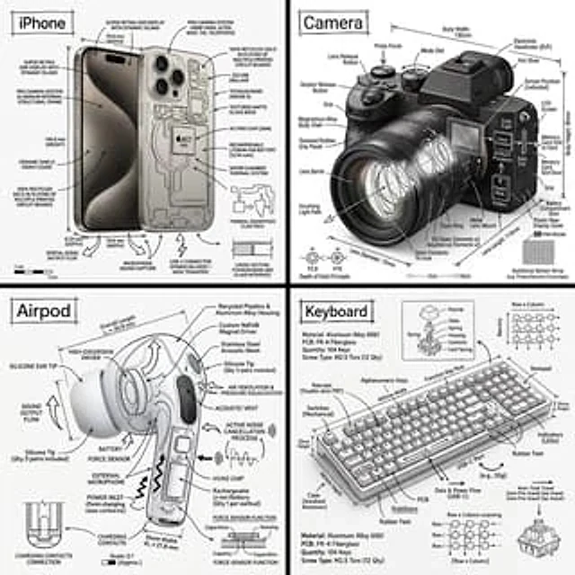

```text
Create an infographic image of [OBJECT], combining a realistic photograph or photoreal render of the object with technical annotation overlays placed directly on top.

Use black ink–style line drawings and text (technical pen / architectural sketch look) on a pure white studio background, including:
•Key component labels
•Internal cutaway or exploded-view outlines
•Measurements, dimensions, and scale markers
•Material callouts and quantities
•Arrows indicating function, force, or flow (air, sound, power, pressure)
•Simple schematic or sectional diagrams where relevant

Place the title “OBJECT” inside a hand-drawn technical annotation box in one corner.

Style & layout rules:
•The real object remains clearly visible beneath the annotations
•Annotations feel sketched, technical, and architectural
•Clean composition with balanced negative space
•Educational, museum-exhibit / engineering-manual vibe

Visual style:
Minimal technical illustration aesthetic, black linework over realistic imagery, precise but slightly hand-drawn feel.

Color palette:
White background, black annotation lines and text only. No colors.

Output:
1080×1080, ultra-crisp, social-feed optimized, no watermark
```

Model: Nano Banana
Author: TechieSA

[ProjectD](https://aitoolsradar.com/en/prompts/fce00c5c1470c5) · [Recorded source](https://x.com/TechieBySA/status/2028111208054661231)
 · [Full original metadata and byte evidence](data/projectd-batch-0068.json)

## TechieSA #483

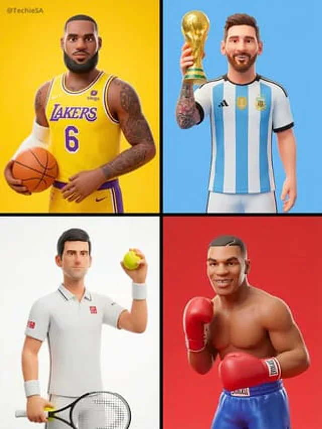

```text
Use a user-uploaded image as the source and convert the person into a stylized 3D character while preserving identity, facial structure, pose, hairstyle, clothing, and overall composition exactly as shown in the photo. The result should clearly resemble the real person.

The visual style is a stylized 3D character with a soft minimal cartoon 3D aesthetic, inspired by Pixar-like visuals but more minimal, toy-figure renders, and clean product-style character design. The balance should favor stylization over realism without changing the person’s real-world appearance.

Skin should appear as smooth matte plastic with a soft, uniform texture and gentle subsurface scattering. Facial features should remain faithful to the original image while being simplified in form. The expression should stay neutral and natural to the source photo.

Lighting should be clean and controlled, similar to a studio softbox setup, with very soft shadows, low contrast, and subtle highlights. The background should be a solid [BACKGROUND COLOR] with no gradient.

The camera should feel front-facing with a medium close-up framing, similar to a 50mm lens, with no distortion. Output quality should be high resolution with clean edges, no noise, strong style consistency, and a clearly non-photorealistic finish.
```

Model: Nano Banana
Author: TechieSA

[ProjectD](https://aitoolsradar.com/en/prompts/32dcad711a18dd) · [Recorded source](https://x.com/TechieBySA/status/2020837883549298730)
 · [Full original metadata and byte evidence](data/projectd-batch-0068.json)

## TechieSA #512

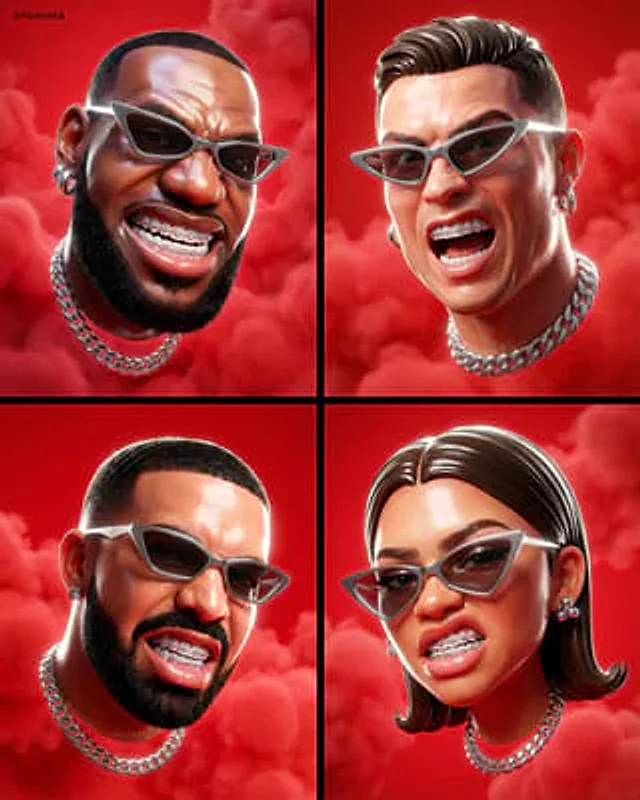

```text
A hyper-stylized, dynamic 3D head portrait floats against a vivid red background with soft volumetric clouds and seamless shading. Only the cartoonish 3D head appears, with no neck visible, and facial features closely matching the reference photo. The head is tilted and fills approximately 80% of the frame. The character displays a fierce, aggressive expression with a wide snarl, revealing teeth adorned with diamond-studded braces. Sharp, angular silver sunglasses with pointed frames fit the face precisely. Additional accessories include chrome earrings and a chunky silver chain necklace. Lighting is bold and metallic, combining strong rim lights from above and behind with a luminous frontal fill that sculpts facial contours and creates glossy skin highlights. The overall look features over-the-top glossy realism, exaggerated proportions, intense reflections, and a futuristic, high-energy aesthetic with partial overlap of elements to enhance depth and dramatic presence. Hyper-detailed 3D forms add vibrant, cinematic intensity and visual impact. Aspect ratio 4:5
```

Model: Nano Banana
Author: TechieSA

[ProjectD](https://aitoolsradar.com/en/prompts/a9e709d88fd78a) · [Recorded source](https://x.com/TechieBySA/status/2024450766874751356)
 · [Full original metadata and byte evidence](data/projectd-batch-0068.json)

## TechieSA #517

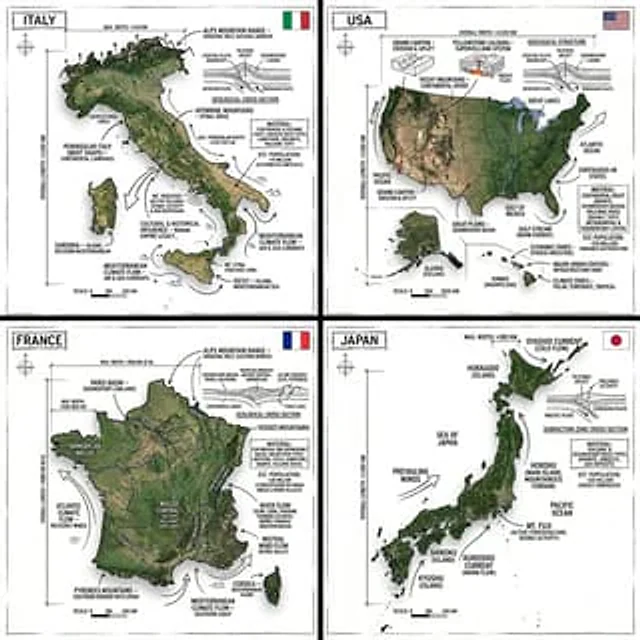

```text
Create an infographic image of [COUNTRY], combining a realistic photograph or photoreal render of the object with technical annotation overlays placed directly on top.

Use black ink–style line drawings and text (technical pen / architectural sketch look) on a pure white studio background, including:
•Key component labels
•Internal cutaway or exploded-view outlines
•Measurements, dimensions, and scale markers
•Material callouts and quantities
•Arrows indicating function, force, or flow (air, sound, power, pressure)
•Simple schematic or sectional diagrams where relevant
Include a small flag of the country in the top right corner.

Place the title [COUNTRY] inside a hand-drawn technical annotation box in one corner.

Style & layout rules:
•The real object remains clearly visible beneath the annotations
•Annotations feel sketched, technical, and architectural
•Clean composition with balanced negative space
•Educational, museum-exhibit / engineering-manual vibe

Visual style:
Minimal technical illustration aesthetic, black linework over realistic imagery, precise but slightly hand-drawn feel.

Color palette:
White background, black annotation lines and text only. No colors.

Output:
1080×1080, ultra-crisp, social-feed optimized, no watermark.
```

Model: Nano Banana
Author: TechieSA

[ProjectD](https://aitoolsradar.com/en/prompts/f1165966fa5563) · [Recorded source](https://x.com/TechieBySA/status/2015850590283124768)
 · [Full original metadata and byte evidence](data/projectd-batch-0068.json)

## TechieSA #523

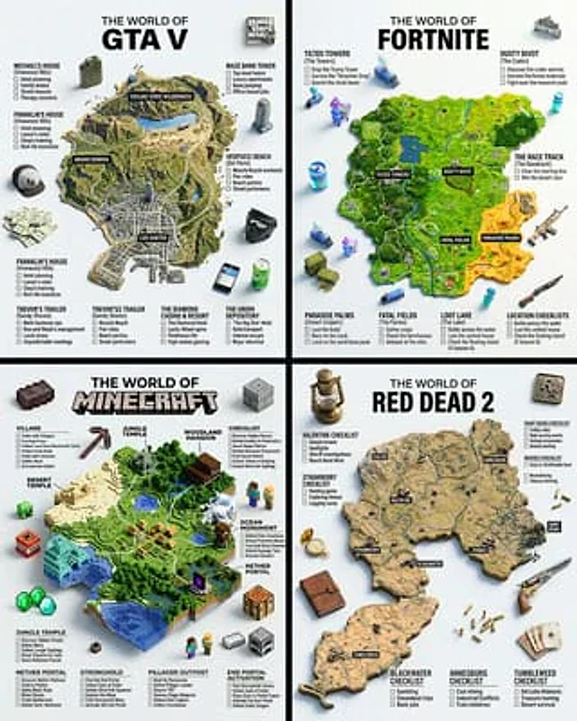

```text
A hyper-realistic 3D game guide infographic poster for [GAME]. The in-game world of [GAME] is rendered as a raised, textured terrain map floating on a clean light gray surface — the map shape and landscape must reflect the actual geography and visual aesthetic of [GAME] (urban, western, fantasy, island etc). Iconic in-game locations from [GAME] are placed as miniature 3D sculpted models at their correct in-game positions across the map — each one highly detailed, photorealistic and instantly recognizable to fans. Roads or paths connect key locations as white lines across the terrain. Around the map, floating 3D decorative props and items iconic to [GAME] are scattered on the light gray surface. The official logo of [GAME] is shown as a small detailed object in the upper right corner. Each major location has a bold black label on the map, and beside the map, each location has a neat checklist of its most iconic moments or activities associated with that place, in clean sans-serif typography. A large bold title at the top reads: “THE WORLD OF GAME” in black uppercase typography with [GAME] in heavy bold. The overall aesthetic is premium editorial — soft studio lighting, photorealistic 3D render, white/light gray background, clean layout, 4:5 aspect ratio
```

Model: Nano Banana
Author: TechieSA

[ProjectD](https://aitoolsradar.com/en/prompts/66d972f4397052) · [Recorded source](https://x.com/TechieBySA/status/2044422529146630350)
 · [Full original metadata and byte evidence](data/projectd-batch-0068.json)

## TechieSA #536

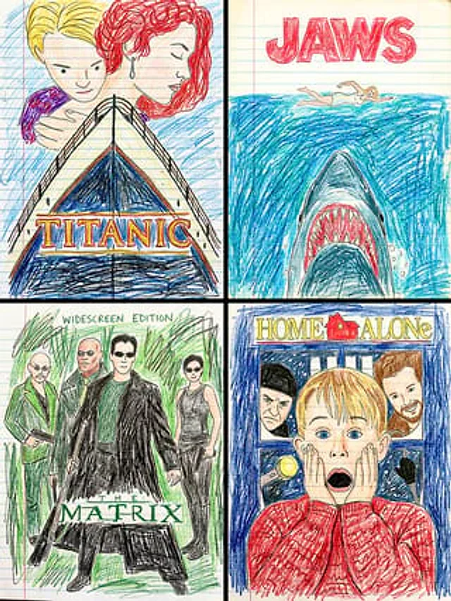

```text
Transform this movie poster into a child’s crayon drawing on lined notebook paper. Every compositional element, character pose, typography, color palette, and layout is preserved exactly as the original — only the art style has changed. Drawn in colored pencil and crayon with wobbly unsteady lines, uneven coloring that goes slightly outside the lines, basic facial features, simplified anatomy. Background filled with heavy crayon scribble strokes. Lined notebook paper visible underneath, including the red margin line. Text redrawn in shaky hand-lettered crayon matching the original font placement. Flat scan of the drawing, slight paper texture.
```

Model: Nano Banana
Author: TechieSA

[ProjectD](https://aitoolsradar.com/en/prompts/ed78f527acda56) · [Recorded source](https://x.com/TechieBySA/status/2036867472918286551)
 · [Full original metadata and byte evidence](data/projectd-batch-0068.json)

## TechieSA #594

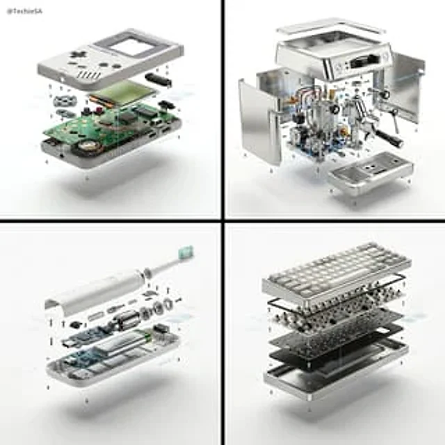

```text
[PRODUCT], high-end product advertising, white seamless background, exploded view with inner mechanics revealed, outer shell hovering above core, micro screws and components suspended, perfect alignment guides implied, crisp soft shadow, ultra realistic, macro product photography, 100mm lens look, f/8, 8k
```

Model: Nano Banana
Author: TechieSA

[ProjectD](https://aitoolsradar.com/en/prompts/80795f28265a2d) · [Recorded source](https://x.com/TechieBySA/status/2010665188731785382)
 · [Full original metadata and byte evidence](data/projectd-batch-0068.json)

## TechieSA #611

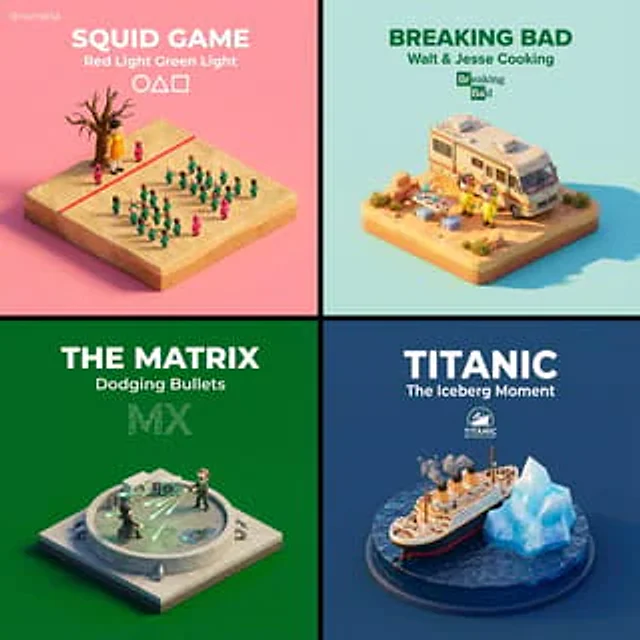

```text
Present a clear, 45° top-down isometric miniature 3D cartoon scene of the iconic scene [SCENE NAME] from [MOVIE/SHOW], with soft refined textures, realistic PBR materials, and gentle lifelike lighting.
Create a small raised diorama-style base that includes the most recognizable elements of this scene, along with tiny stylized characters if needed (no facial details).
Use a clean solid [BACKGROUND COLOR] background.

At the top-center, display [MOVIE/SHOW] in large bold text, directly beneath it show [SCENE NAME] in medium text, and place the official logo associated with [MOVIE/SHOW] below the subtext.
All text must automatically match the background contrast (white or black).

Composition: perfectly centered layout, square 1080x1080, ultra-clean, high-clarity diorama aesthetic.
```

Model: Nano Banana
Author: TechieSA

[ProjectD](https://aitoolsradar.com/en/prompts/7a1d990ddab1f9) · [Recorded source](https://x.com/TechieBySA/status/2012133550817173583)
 · [Full original metadata and byte evidence](data/projectd-batch-0068.json)

## TechieSA #622

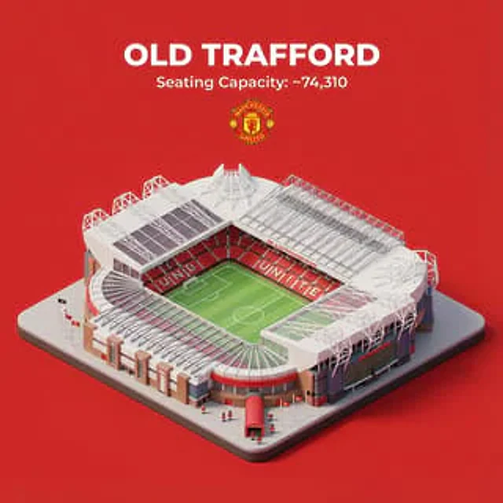

```text
Present a clear, 45° top-down isometric miniature 3D cartoon scene of [STADIUM], with soft refined textures, realistic PBR materials, and gentle lifelike lighting. Use a clean solid [COLOR] background. At the top-center, display the name of this stadium in large bold text, then directly beneath it show its real seating capacity in medium text, and place the official logo associated with this stadium below the capacity. All text must match the background contrast automatically (white or black). Centered layout
```

Model: Nano Banana
Author: TechieSA

[ProjectD](https://aitoolsradar.com/en/prompts/5ad759e6bfa2ce) · [Recorded source](https://x.com/TechieBySA/status/2011145055759974868)
 · [Full original metadata and byte evidence](data/projectd-batch-0068.json)

## TechieSA #629

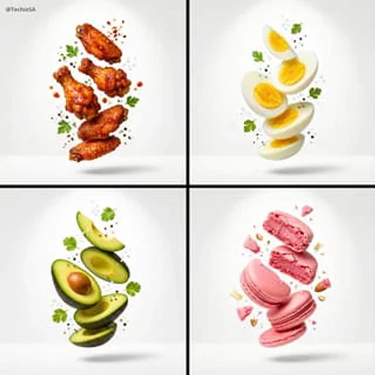

```text
[subject], premium food advertising, white seamless background, high key studio lighting, floating stacked composition, levitating pieces, [ingredient_bits] scattered, clean minimal layout, crisp soft shadow on surface, ultra realistic, macro product photography, 100mm lens look, f/8 sharp focus, subtle texture detail, editorial commercial, 8k
```

Model: Nano Banana
Author: TechieSA

[ProjectD](https://aitoolsradar.com/en/prompts/1b5ddb129b7905) · [Recorded source](https://x.com/TechieBySA/status/2012263633636508040)
 · [Full original metadata and byte evidence](data/projectd-batch-0068.json)

## TechieSA #643

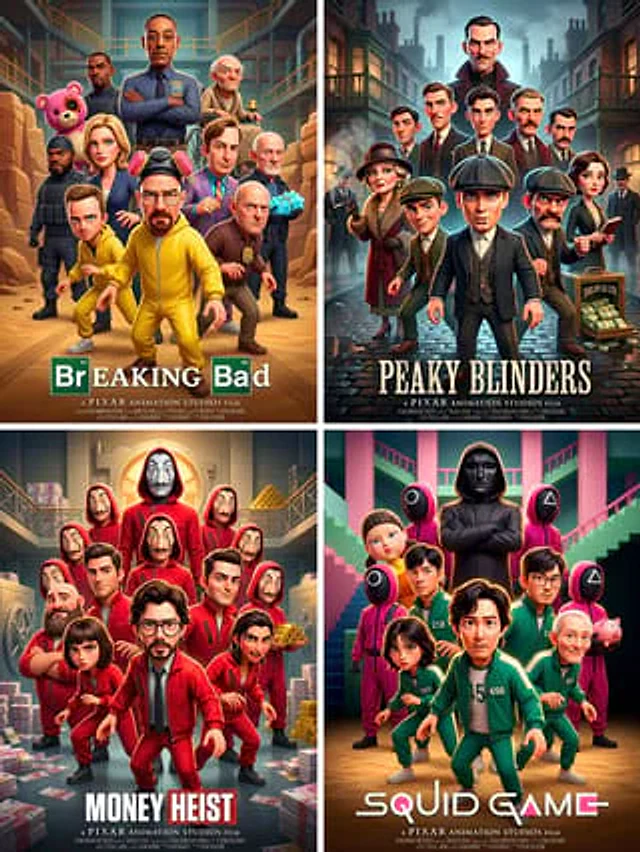

```text
Pixar 3D CGI animated movie poster style, ensemble cast featuring the most iconic and recognizable characters from [MOVIE/SHOW], all rendered as Pixar-style 3D animated characters with exaggerated expressive faces, smooth stylized skin, big eyes, chunky proportions. Characters automatically selected as the most famous heroes and villains from [MOVIE/SHOW]. Dramatic layered composition: central hero front and center, others fanned behind in dynamic action poses. Background color automatically chosen to match the iconic tone and palette of [MOVIE/SHOW]. Bold title text at bottom: [MOVIE/SHOW] in the original film's iconic font style. Cinematic lighting, rim light on characters, deep shadows. 3:4 vertical aspect ratio. High detail, polished Pixar feature film aesthetic.
```

Model: Nano Banana
Author: TechieSA

[ProjectD](https://aitoolsradar.com/en/prompts/7f395b319c1559) · [Recorded source](https://x.com/TechieBySA/status/2037141030047215944)
 · [Full original metadata and byte evidence](data/projectd-batch-0068.json)

## TechieSA #687

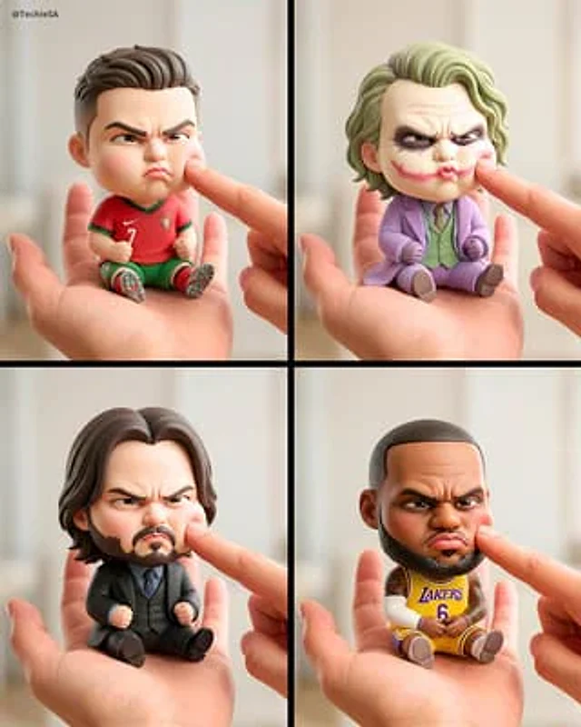

```text
A mini chibi version of the character in the uploaded image, with a big head and small body, sitting on an open left palm for realistic scale. A right hand gently pressing its cheek with an index finger. The character looks annoyed and pouty — puffed cheeks, slightly frowning, squinting eyes. Ultra-detailed chibi style, soft pastel colors, smooth texture, clean lighting, shallow depth of field, strong focus on facial expression and hand interaction, vertical composition 4:5 ratio.​​​​​​​​​​​​​​​​
```

Model: Nano Banana
Author: TechieSA

[ProjectD](https://aitoolsradar.com/en/prompts/5f0b92c45c95f0) · [Recorded source](https://x.com/TechieBySA/status/2029563473592504682)
 · [Full original metadata and byte evidence](data/projectd-batch-0068.json)

## TechieSA #707

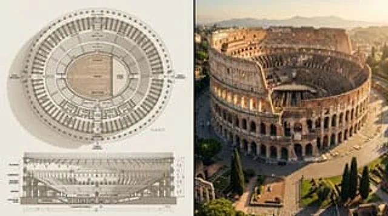

```text
Split composition image, left and right halves clearly divided in 16:9 widescreen format.
Left Half:
Highly detailed architectural floor plan and cross-section illustration of [LANDMARK] in a modern minimalist style. Top-down view showing main structural layout, internal divisions, circulation paths, key chambers or spaces with labels. Material callouts, structural support systems, and architectural details clearly marked. Neutral beige and warm gray color palette, clean linework, soft shadows, subtle textures. Professional architectural-presentation style. Include detailed cross-sectional diagram showing vertical layers and internal structure. Blueprint aesthetic with technical accuracy and labeled sections.
Right Half:
Ultra-realistic aerial exterior photograph of [LANDMARK] captured from above and to the side (elevated isometric perspective, not straight overhead). Shows the complete structure with authentic weathered textures, aged materials, surrounding landscape, dramatic golden-hour sunlight creating sharp shadows, atmospheric haze suggesting historical significance. The perspective reveals both external grandeur and internal scale simultaneously. Warm golden-light lighting, realistic patina and wear patterns, authentic architectural proportions. Feels like an aerial photograph capturing the monument’s true majesty and scale.
Both halves align visually, clearly showing architectural engineering blueprint vs. the actual monumental structure in its archaeological or historical reality.
Style & Mood:
•Architectural blueprint visualization meets historical aerial photography
•Engineering precision and historical significance
•Educational, museum-exhibit presentation
•Engineering schematic-to-reality comparison
•Grandeur emphasizing scale and architectural sophistication
Lighting & Color:
•Left: Flat, even lighting, neutral blueprint tones, technical aesthetic
•Right: Golden-hour natural light, dramatic shadows, warm tones, atmospheric depth
•Consistent warm palette between both halves
Camera & Technical Details:
•Left: Top-down orthographic + detailed cross-sectional architectural view with labeled sections
•Right: Elevated aerial perspective (45-degree isometric angle), capturing full structure from above-and-to-the-side
•High resolution, sharp architectural details on left; photorealistic weathered textures on right
Negative Prompt:
Cartoon style, low detail, cluttered composition, modern elements, unrealistic proportions, harsh lighting, exaggerated colors, text overlays, watermarks, CGI look, sterile rendering, straight-down overhead view, no atmospheric quality, overly pristine condition
```

Model: Nano Banana
Author: TechieSA

[ProjectD](https://aitoolsradar.com/en/prompts/26005d9569426d) · [Recorded source](https://x.com/TechieBySA/status/2018029876356239823)
 · [Full original metadata and byte evidence](data/projectd-batch-0068.json)

## TechieSA #737

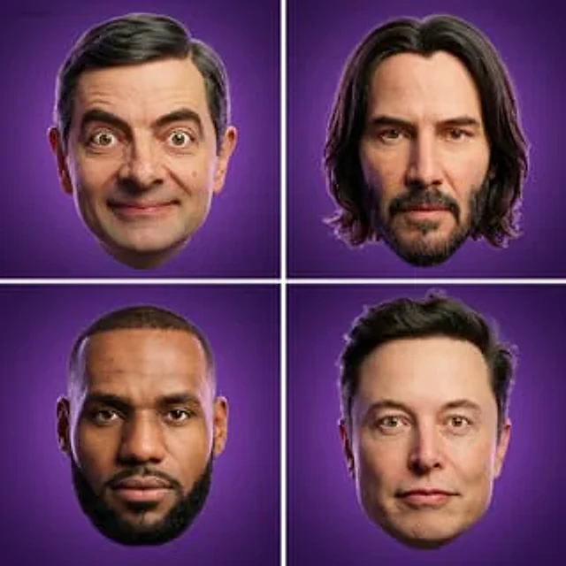

```text
Ultra-detailed stylized 3D portrait using the provided reference photo lebron james as the exact facial base.
Preserve the person perfectly — identical face shape, bone structure, jawline, eyes, nose, lips, skin tone, marks, freckles, expression and proportions.
DO NOT modify facial identity in any way.
Convert ONLY into high-end stylized 3D realism.
Head & elements:
Floating head only (no neck, no shoulders, no body)
Keep EXACTLY whatever the person has on their head in the reference image — same hairstyle, same hair length and texture, same hat, cap, sunglasses, glasses, headphones or any accessory. Do not remove or add anything.
Skin refinement:
Natural smooth skin (not plastic).Visible realistic micro-texture and pores. Subtle subsurface scattering for natural light diffusion. Soft highlights on cheekbones, nose bridge and tip.Balanced realistic shadows for depth
Hair & accessories (if present in reference):
Ultra-realistic volumetric strands.Natural shine and soft rim reflections. Perfectly preserved shape and position
Lighting:
Strong cinematic purple ambient background. Soft frontal key light evenly illuminating the face. Subtle rim light separating head from background. Gentle under-chin shadow for depth. Smooth light gradients, no harsh contrast
Rendering style:
Premium Pixar-quality stylized realism. Clean smooth shading. Global illumination. Soft bloom on highlights. Ultra sharp edgesNoise-free professional CGI
Camera & quality:
Centered portrait composition. Shallow depth of field illusion. Ultra high resolution. Cinematic look
Rules:
Respect reference face 100%.Respect all head accessories and hair exactly. Only convert to stylized 3D. No exaggeration. No cartoon distortion. No facial changes
```

Model: Nano Banana
Author: TechieSA

[ProjectD](https://aitoolsradar.com/en/prompts/a013da6917fca0) · [Recorded source](https://x.com/TechieBySA/status/2034967465487163740)
 · [Full original metadata and byte evidence](data/projectd-batch-0068.json)

## TechieSA #742

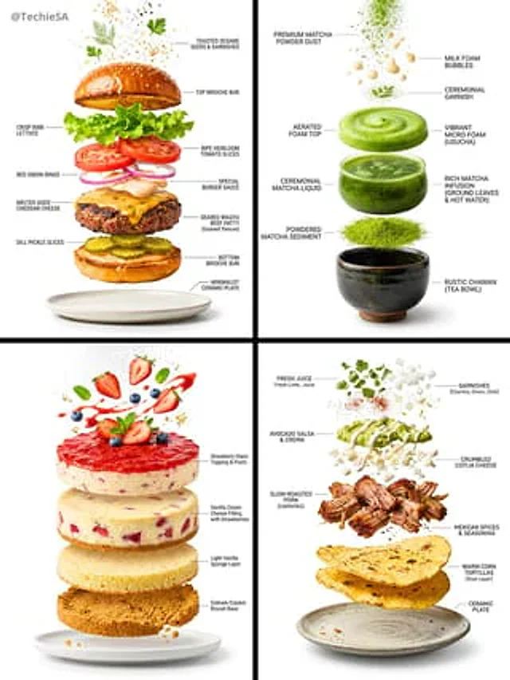

```text
Create a hyper-realistic exploded vertical infographic composition of [FOOD].
At the top, characteristic particles, droplets, or garnishes associated with the food, frozen mid-air.
Below it, the primary surface or topping layer with rich texture and realistic material detail.
Underneath, the core ingredient layer showing structure, depth, and natural variation.
Below that, the supporting base or interior layer, slightly separated to reveal construction.
At the bottom, a minimal plate, bowl, cup, or base appropriate to the food’s presentation.
Pure white background, soft studio lighting, subtle shadows beneath each floating element, ultra-sharp focus, DSLR macro photography, clean infographic text labels with thin pointer lines, premium editorial food photography aesthetic, 8K quality.
```

Model: Nano Banana
Author: TechieSA

[ProjectD](https://aitoolsradar.com/en/prompts/fdc886c6357dd6) · [Recorded source](https://x.com/TechieBySA/status/2028451530198642753)
 · [Full original metadata and byte evidence](data/projectd-batch-0068.json)

## TechieSA #784

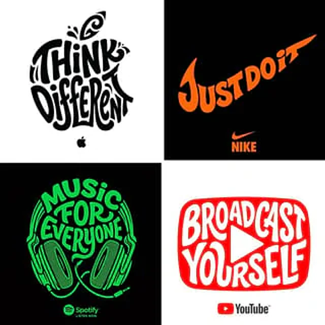

```text
Create a typographic illustration shaped like a [OBJECT], where the text [BRAND SLOGAN] forms the shape — bold and playful lettering style that fills the entire silhouette — letters adapt fluidly to the curves and contours of the [OBJECT] — [COLOR 1, COLOR 2] with [BACKGROUND COLOR] background that enhances the focus on the main shape — include [BRAND] logo positioned below the [OBJECT] — vector-style, clean, high resolution, 1080x1080 pixels, square format.
```

Model: Nano Banana
Author: TechieSA

[ProjectD](https://aitoolsradar.com/en/prompts/83714ac24cd4d7) · [Recorded source](https://x.com/TechieBySA/status/2038261502696648942)
 · [Full original metadata and byte evidence](data/projectd-batch-0068.json)

## TechieSA #791

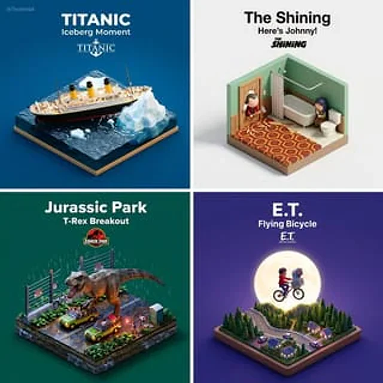

```text
Present a clear, 45° top-down isometric miniature 3D cartoon scene of the iconic scene [SCENE NAME] from [MOVIE/SHOW], with soft refined textures, realistic PBR materials, and gentle lifelike lighting.
Create a small raised diorama-style base that includes the most recognizable elements of this scene, along with tiny stylized characters if needed (no facial details).
Use a clean solid [BACKGROUND COLOR] background.

At the top-center, display “MOVIE/SHOW” in large bold text, directly beneath it show [SCENE NAME] in medium text, and place the official logo associated with [MOVIE/SHOW] below the subtext.
All text must automatically match the background contrast (white or black).

Composition: perfectly centered layout, square 1080x1080, ultra-clean, high-clarity diorama aesthetic.
```

Model: Nano Banana
Author: TechieSA

[ProjectD](https://aitoolsradar.com/en/prompts/fc5e6b175ee8b2) · [Recorded source](https://x.com/TechieBySA/status/2045196602306933060)
 · [Full original metadata and byte evidence](data/projectd-batch-0068.json)

## TechieSA #796

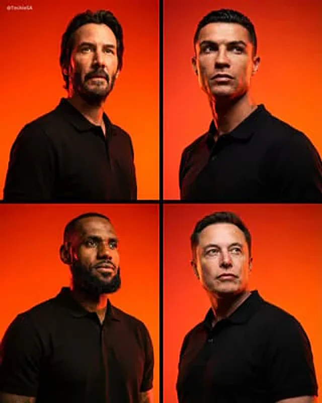

```text
ROLE & AESTHETIC:
You are a world-class editorial portrait photographer specializing in dramatic, colorful studio lighting. Your task is to create a powerful, dynamic portrait with a “heroic” feel.
IDENTITY ANCHOR (CRITICAL STRICT CONSTRAINT):
Source: Use the person from the ATTACHED REFERENCE PHOTO.
Preservation: You must keep their exact facial features, skin tone, hairstyle, and natural likeness perfectly unchanged.
Universal Application: Apply the lighting and angle to the subject regardless of gender.
WARDROBE & STYLING:
Attire: A premium Black Pique Polo Shirt
Texture: Visible cotton pique mesh texture
Fit: Fitted and sharp
Color: Deep matte black (to contrast with the bright background)
Expression: Serious, intense, focused. The subject is looking off-camera into the space above, not directly at the lens.
SCENE & COMPOSITION:
Background: A vibrant, solid orange-red backdrop. It should feature smooth, intense color gradients without any patterns, creating a “hot” atmosphere.
Camera Angle (CRITICAL): Low-angle shot (looking up at the subject). This perspective should make the subject look powerful and dominant.
Framing: Medium close-up (focus on face and shoulders).
LIGHTING (DRAMATIC & COLORFUL):
Palette: Dominated by vibrant orange and deep red hues.
Key Light: Strong, directional lighting that casts deep, dramatic shadows on the face (chiaroscuro effect), emphasizing facial structure.
Rim Light: A strong, dramatic edge light (or color cast) that separates the subject’s shoulders and head from the intensely lit background.
Mood: Mysterious, intense, high-contrast studio aesthetic.
TECHNICAL QUALITY:
Style: Photorealistic, highly detailed.
Texture: Sharp focus on the face, contrasting with the smooth gradients of the background.
Skin: Retain natural pores and texture.
```

Model: Nano Banana
Author: TechieSA

[ProjectD](https://aitoolsradar.com/en/prompts/e6d80129ffb849) · [Recorded source](https://x.com/TechieBySA/status/2041841779025019132)
 · [Full original metadata and byte evidence](data/projectd-batch-0068.json)

## TechieSA #802


```text
Create a soap foam sculpture in the exact shape of the uploaded logo, made entirely of white soap bubbles and foam with realistic bubble textures. Place it on wet bathroom tiles in the brand’s signature color (match the color from the uploaded logo). Top-down view, centered composition. The tiles should be glossy and wet with water droplets scattered across the surface. Add smaller foam bubbles and soap suds around the main logo shape. Grout lines visible between tiles. Additional small foam shapes in corners. Product photography style, clean and vibrant lighting.
```

Model: Nano Banana
Author: TechieSA

[ProjectD](https://aitoolsradar.com/en/prompts/afcb5c50f2e933) · [Recorded source](https://x.com/TechieBySA/status/2009722852010852444)
 · [Full original metadata and byte evidence](data/projectd-batch-0068.json)

## TechieSA #832

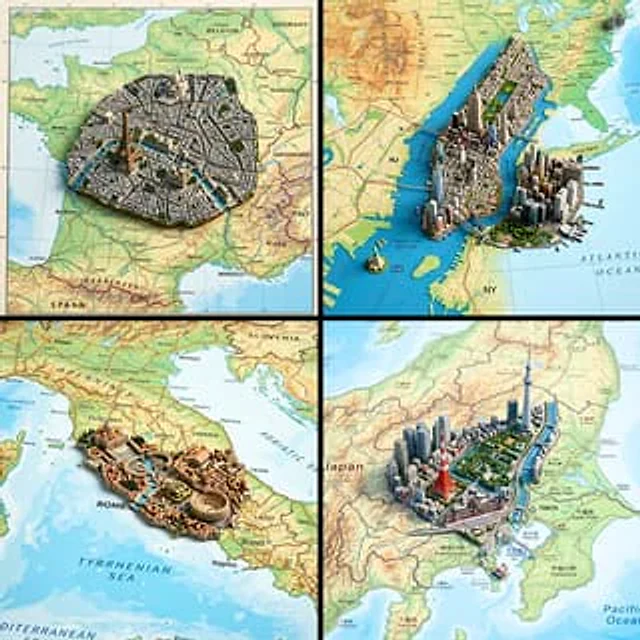

```text
Ultra-realistic top-down geographic map with precise cartographic accuracy, clearly defining the true geographic context of [COUNTRY].

From the exact real-world coordinates of [CITY], a highly detailed miniature 3D diorama rises organically from the map surface, perfectly aligned with its true location.

The diorama features iconic architecture, signature natural landmarks, and authentic cultural elements of the city, seamlessly integrated into the map as if sculpted from it.

Physically accurate materials, realistic surface textures, and true-to-scale proportions.

Shallow depth of field with macro-lens realism, subtle atmospheric perspective.

Soft neutral studio lighting with controlled shadows to enhance depth and realism.

Cinematic composition, premium architectural-model photography style.

Ultra-sharp detail, high dynamic range, photorealistic finish.
Square 1:1 format, realistic scale, museum-quality visual output.
```

Model: Nano Banana
Author: TechieSA

[ProjectD](https://aitoolsradar.com/en/prompts/8979833fa46370) · [Recorded source](https://x.com/TechieBySA/status/2027843262497591580)
 · [Full original metadata and byte evidence](data/projectd-batch-0068.json)

## TechieSA #835

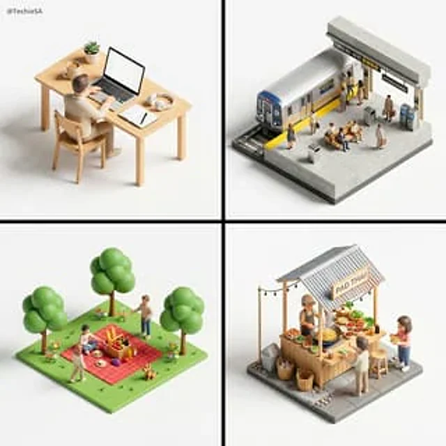

```text
Create a 45° top-down isometric miniature 3D diorama of [SCENE], including all key objects and tiny stylized people interacting naturally with the environment.

Composition:
•Include all relevant props, furniture, or items that make the scene recognizable.
•Tiny characters can sit, stand, walk, or interact with objects as appropriate.
•Soft realistic lighting, gentle shadows, subtle textures, minimal background.
•Maintain consistent scale, camera angle, perspective, and style.

Visual style: clean, editorial Apple-UI aesthetic, bright yet soft colors, ultra-crisp 3D textures.
Background: solid color Crisp White
Output: 1080×1080, ultra-crisp, social-feed optimized, no watermark.
```

Model: Nano Banana
Author: TechieSA

[ProjectD](https://aitoolsradar.com/en/prompts/cb516d8379b2ee) · [Recorded source](https://x.com/TechieBySA/status/2013597392902246904)
 · [Full original metadata and byte evidence](data/projectd-batch-0068.json)

## TechieSA #864

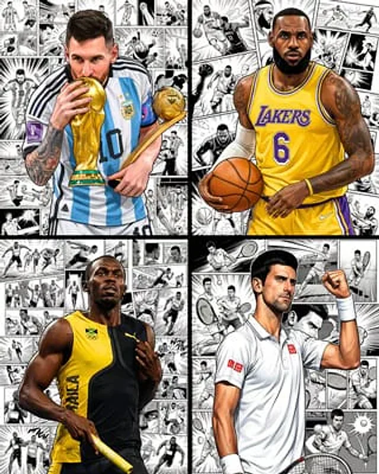

```text
Create an image in 4:5 ratio, with hyper-realistic aesthetics applied to a premium cartoon/cinematographic manga style, combining extreme realism with high-impact illustrated visual language.

The face must be identical to that of the photo sent in 103%, maintaining absolute tidelity the original tactical identity: bone structure, skull shape, proportions, intense expression, eyebrows, eyes, nose, mouth, jaw, mustache, hair and capillary volume.

No aesthetic change, identity change, artificial smoothing or stylization that mischaracterizes the face.

Male character reference pose. Stroke style inspired by high-level realistic cartoon, with well-defined volumes, deep shadows and clean finish.

costume: referenced image, with realistic fabric texture, natural folds and precise lighting.

Background composed of black and white comic panels, organized in multiple narrative frames, creating depth, visual context and sensation of an expanded universe. The panels should look like action scenes and graphic narrative, with varied perspective and dynamic composition.

Professional cinematic lighting, with soft front main light and dramatic contrast, precise face enhancements, controlled shadows, subtle depth of field, extreme sharpness, visible microdetails, premium rendering finish.

Maximum quality, high-budget editorial illustration appearance, full focus on the face, strong visual impact, Realism 333%, no readable texts, no watermarks, no distortions, no artifacts.
```

Model: Nano Banana
Author: TechieSA

[ProjectD](https://aitoolsradar.com/en/prompts/5399f283c6d31d) · [Recorded source](https://x.com/TechieBySA/status/2025580480175710454)
 · [Full original metadata and byte evidence](data/projectd-batch-0068.json)

## TechieSA #870

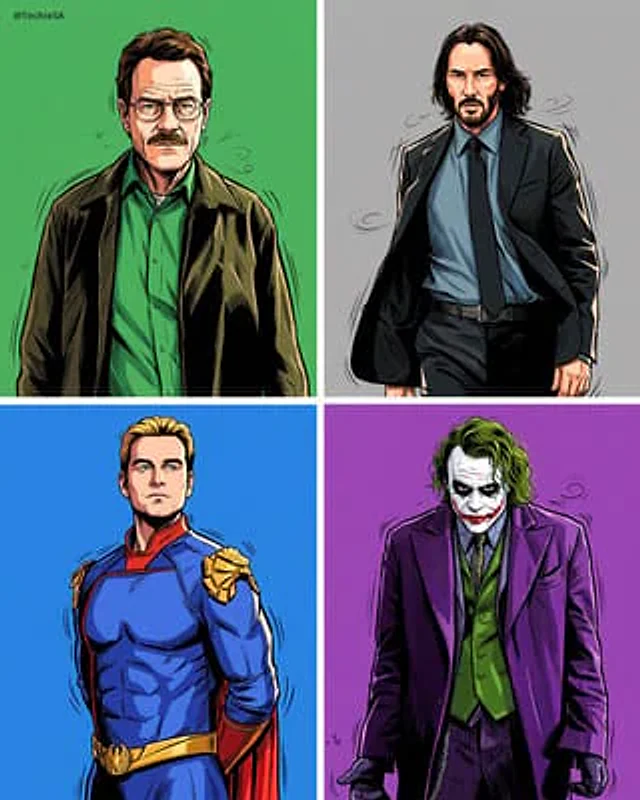

```text
Create a high-contrast digital comic-style illustration of [PERSON] based strictly on the provided reference image.
STRICT IDENTITY LOCK:
∙Preserve exact facial bone structure
∙Preserve exact skin tone
∙Preserve beard density and shape (if applicable)
∙Preserve tattoo placement and design (if visible)
∙Do NOT stylize, redesign, beautify, exaggerate, or cartoonify the face
∙The person must remain clearly recognizable
POSE:
Upper-body focused composition.
Keep the pose exactly the same as in the reference image.
STYLE:
∙Bold black ink outlines
∙Strong dynamic line variation
∙Clean comic-book contouring
∙Cross-hatching shading technique (visible hand-drawn hatch lines)
∙No soft airbrush shading
∙No smooth gradient blending
∙Hard shadow planes
∙Graphic novel illustration style
COLOR SYSTEM:
∙Flat saturated color blocks
∙High contrast between light and shadow
∙No photorealistic rendering
∙No painterly brush strokes
∙Slight warm skin highlights
∙Clothing colors must match the reference image exactly
TEXTURE:
∙Subtle paper grain texture
∙Ink illustration feel
∙Hand-drawn motion lines around arms and shoulders
BACKGROUND:
∙Solid flat background color complementary to the subject’s outfit or chosen palette
∙No environment
∙No depth blur
∙Minimalistic
∙Slight grain texture allowed
ENERGY DETAILS:
∙Hand-drawn motion lines indicating movement
∙Subtle sketch swirls around the subject
∙Dynamic comic vibration lines
LIGHTING:
∙Strong directional light from upper side
∙Hard comic-style shadow edges
∙Deep contrast under arms and jawline
∙Defined muscle contour shadows
COMPOSITION:
∙Vertical 4:5 ratio (Instagram optimized)
∙Subject centered
∙Upper torso dominant
∙Clean negative space around figure
QUALITY:
∙High resolution
∙Clean line clarity
∙Sharp edges
∙No blur
∙No AI artifact distortion
```

Model: Nano Banana
Author: TechieSA

[ProjectD](https://aitoolsradar.com/en/prompts/e3a8e9cba86ec8) · [Recorded source](https://x.com/TechieBySA/status/2028810677301788892)
 · [Full original metadata and byte evidence](data/projectd-batch-0068.json)

## TechieSA #889

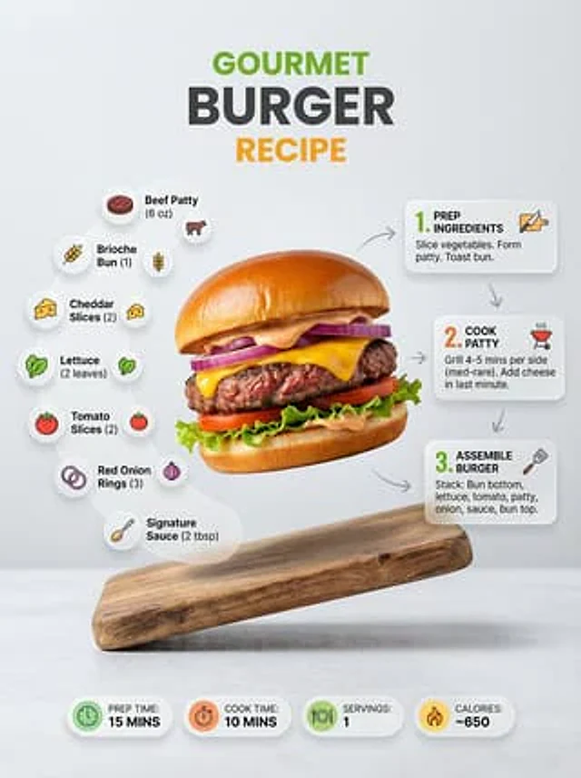

```text
Ultra-clean modern recipe infographic. Showcase [FOOD] in a visually appealing finished form—sliced, plated, or portioned—floating slightly in perspective or angled view. Arrange ingredients, steps, and tips around the dish in a dynamic editorial layout, not restricted to top-down. Ingredients Section: Include icons or mini illustrations for each ingredient with quantities. Arrange them in clusters, lists, or circular flows connected visually to the dish. Steps Section: Show preparation steps with numbered panels, arrows, or lines, forming a logical flow around the main dish. Include small cooking icons (knife, pan, oven, timer) where helpful. Additional Info (optional): Total calories, prep/cook time, servings, spice level—displayed as clean bubbles or badges near the dish. Visual Style: Editorial infographic meets lifestyle food photography. Vibrant, natural food colors, subtle drop shadows, clean vector icons, modern typography, soft gradients or glassmorphism for step panels. Accent colors can highlight key info (calories, prep time). Composition Guidelines: Finished meal as hero visual (perspective or angled) Ingredients and steps flow dynamically around the dish Clear visual hierarchy: dish > steps > ingredients > optional stats Enough negative space to keep design airy and readable Lighting & Background: Soft, natural studio lighting, minimal textured or gradient background for premium editorial feel. Output: 1080×1080, ultra-crisp, social-feed optimized, no watermark
```

Model: Nano Banana
Author: TechieSA

[ProjectD](https://aitoolsradar.com/en/prompts/8685d6842e89cc) · [Recorded source](https://x.com/TechieBySA/status/2012985517139255644)
 · [Full original metadata and byte evidence](data/projectd-batch-0068.json)

## TechieSA #902

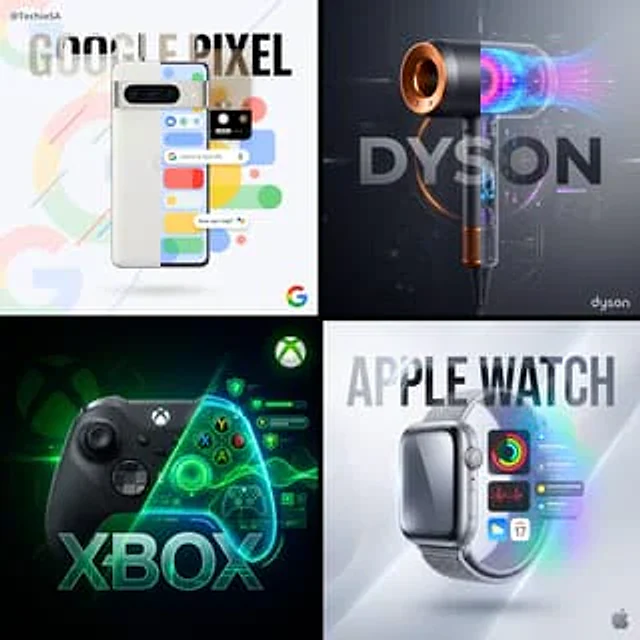

```text
Create a 1:1 cinematic product poster (1080×1080) of [BRAND & PRODUCT], centered and fully visible, floating against a clean background inspired by the brand’s core color palette.

The product must remain intact and uncut, but be conceptually split by design:
• One half is photorealistic, showcasing accurate materials, textures, reflections, buttons, surfaces, and premium build quality
• The other half transforms seamlessly into flat digital elements that represent the brand’s ecosystem — UI fragments, abstract tech shapes, interface cards, schematic overlays, soft holographic effects, or minimal glitch-style geometry

Lighting:
Cinematic, high-end studio lighting with controlled highlights and soft shadows, emphasizing form and depth.

Typography:
Bold double-exposure style text displaying the product or brand name, integrated cleanly into the composition.
Official logo placed subtly and professionally in one corner.
```

Model: Nano Banana
Author: TechieSA

[ProjectD](https://aitoolsradar.com/en/prompts/60f565ba80a849) · [Recorded source](https://x.com/TechieBySA/status/2017188683766538498)
 · [Full original metadata and byte evidence](data/projectd-batch-0068.json)

## TechieSA #914

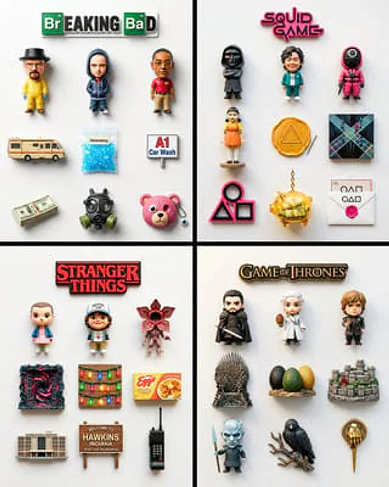

```text
A flat-lay collection of exactly 9 hyper-realistic 3D resin fridge magnets arranged on a plain matte white surface, themed around [COUNTRY]. At the very top center, a wide rectangular text magnet spells "COUNTRY" in bold 3D block letters colored in the nation's flag colors. Below it, 8 magnets are arranged in a loose 3-column grid: 3 iconic architectural landmarks as highly detailed sculpted miniature reliefs (cathedrals, towers, castles, monuments), 1 famous painting or portrait reproduced inside a gold ornate picture frame magnet, 1 traditional food dish and 1 drink (wine bottle + glass, or beer stein, etc.) as glossy ceramic sculpted magnets, 1 illustrated vintage-style map magnet of the country with city markers, and 1 additional cultural symbol or landmark. Each magnet has a slightly raised 3D sculpted look with soft drop shadows on the white surface beneath. Warm studio lighting from above, photorealistic product render, perfectly clean white background, top-down flat-lay angle, 4:5 aspect ratio.
```

Model: Nano Banana
Author: TechieSA

[ProjectD](https://aitoolsradar.com/en/prompts/9d4345a124c154) · [Recorded source](https://x.com/TechieBySA/status/2040134478203416799)
 · [Full original metadata and byte evidence](data/projectd-batch-0068.json)

## TechieSA #928

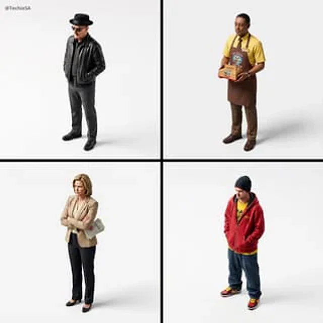

```text
Miniature, full-body, isometric, ultra-realistic figurine of [CHARACTER], wearing their most iconic outfit and colors, in a signature pose or action, instantly recognizable silhouette and expression, clean white studio background, minimal composition, soft realistic shadows, cinematic lighting, hyper-detailed textures, 4K quality
```

Model: Nano Banana
Author: TechieSA

[ProjectD](https://aitoolsradar.com/en/prompts/db3862e6ddc0e3) · [Recorded source](https://x.com/TechieBySA/status/2011074818524029242)
 · [Full original metadata and byte evidence](data/projectd-batch-0068.json)

## TechieSA #938

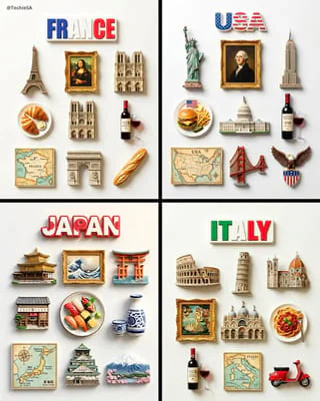

```text
A flat-lay collection of exactly 9 hyper-realistic 3D resin fridge magnets arranged on a plain matte white surface, themed around [COUNTRY]. At the very top center, a wide rectangular text magnet spells "COUNTRY" in bold 3D block letters colored in the nation's flag colors. Below it, 8 magnets are arranged in a loose 3-column grid: 3 iconic architectural landmarks as highly detailed sculpted miniature reliefs (cathedrals, towers, castles, monuments), 1 famous painting or portrait reproduced inside a gold ornate picture frame magnet, 1 traditional food dish and 1 drink (wine bottle + glass, or beer stein, etc.) as glossy ceramic sculpted magnets, 1 illustrated vintage-style map magnet of the country with city markers, and 1 additional cultural symbol or landmark. Each magnet has a slightly raised 3D sculpted look with soft drop shadows on the white surface beneath. Warm studio lighting from above, photorealistic product render, perfectly clean white background, top-down flat-lay angle, 4:5 aspect ratio
```

Model: Nano Banana
Author: TechieSA

[ProjectD](https://aitoolsradar.com/en/prompts/cc133acbcc8766) · [Recorded source](https://x.com/TechieBySA/status/2040075769448214791)
 · [Full original metadata and byte evidence](data/projectd-batch-0068.json)

## TechieSA #940

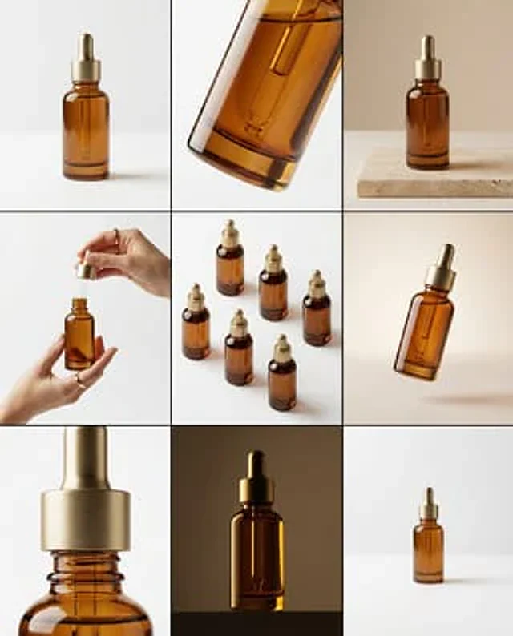

```text
Create a brand visual storyboard for presenting your product with Nano Banana Pro:

Create ONE final image. 

A clean 3×3 [ratio] storyboard grid with nine equal [ratio] sized panels on [4:5] ratio. 

Use the reference image as the base product reference. Keep the same product, packaging design, branding, materials, colors, proportions and overall identity across all nine panels exactly as the reference. The product must remain clearly recognizable in every frame. The label, logo and proportions must stay exactly the same.

This storyboard is a high-end designer mockup presentation for a branding portfolio. The focus is on form, composition, materiality and visual rhythm rather than realism or lifestyle narrative. The overall look should feel curated, editorial and design-driven.

FRAME 1:
Front-facing hero shot of the product in a clean studio setup. Neutral background, balanced composition, calm and confident presentation of the product.

FRAME 2:
Close-up shot with the focus centered on the middle of the product. Focusing on surface texture, materials and print details.

FRAME 3:
Shows the reference product placed in an environment that naturally fits the brand and product category. Studio setting inspired by the product design elements and colours. 

FRAME 4:
Product shown in use or interaction on a neutral studio background. Hands and interaction elements are minimal and restrained, the look matches the style of the package. 

FRAME 5:
Isometric composition showing multiple products arranged in a precise geometric order from the top isometric angle. All products are placed at the same isometric top angle, evenly spaced, clean, structured and graphic.

FRAME 6:
Product levitating slightly tilted on a neutral background that matches the reference image color palette. Floating position is angled and intentional, the product is floating naturally in space.

FRAME 7:
is an extreme close-up focusing on a specific detail of the label, edge, texture or material behavior.

FRAME 8:
The product in an unexpected yet aesthetically strong setting that feels bold, editorial and visually striking.
Unexpected but highly stylized setting. Studio-based, and designer-driven. Bold composition that elevates the brand.

FRAME 9:
Wide composition showing the product in use, placed within a refined designer setup. Clean props, controlled styling, cohesive with the rest of the series.

CAMERA & STYLE:
Ultra high-quality studio imagery with a real camera look. Different camera angles and framings across frames. Controlled depth of field, precise lighting, accurate materials and reflections. Lighting logic, color palette, mood and visual language must remain consistent across all nine panels as one cohesive series.

OUTPUT:
A clean 3×3 grid with no borders, no text, no captions and no watermarks.
```

Model: Nano Banana
Author: TechieSA

[ProjectD](https://aitoolsradar.com/en/prompts/b57e93e74b940f) · [Recorded source](https://x.com/TechieBySA/status/2015404132912226710)
 · [Full original metadata and byte evidence](data/projectd-batch-0068.json)

## TechieSA #941

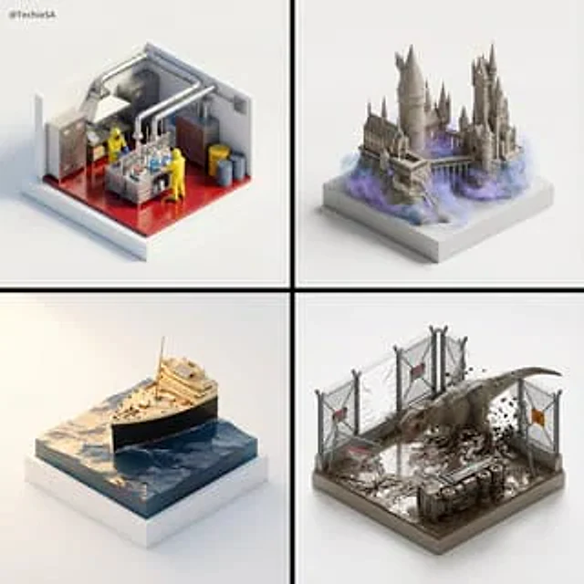

```text
Stylized, ultra high-fidelity 3D isometric miniature diorama, 35–40° isometric view, palm-sized collectible scale, ultra-clean geometry with realistic micro-detail, soft studio lighting from top-left, gentle ambient occlusion, subtle soft shadows, neutral color grading, museum-quality product render, displayed on a simple matte rectangular base, seamless all-white background, 1080x1080. [MOVIE SCENE].
```

Model: Nano Banana
Author: TechieSA

[ProjectD](https://aitoolsradar.com/en/prompts/566574ce79a467) · [Recorded source](https://x.com/TechieBySA/status/2011815709739802811)
 · [Full original metadata and byte evidence](data/projectd-batch-0068.json)

## TechieSA #942

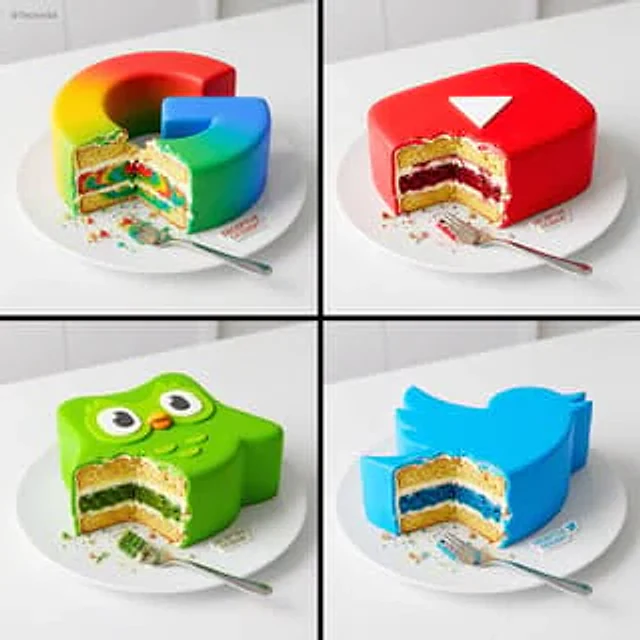

```text
Generate a hyper-realistic digital illustration of a cake meticulously stylized to resemble a [LOGO] resting on a pristine white table. Show it partially bitten to reveal multiple delicious layers (sponge, frosting, crumbs) and shatter the illusion. Capture the moment of surprise with intricate details in the bite mark. Use a slightly overhead angle to emphasize the contrast between the realistic outer shell and the cake interior. Illuminate the scene with soft, diffused lighting to enhance textures and cast subtle shadows for depth. Keep the background minimal and bright to focus on the deceptive dessert. Employ a vibrant, playful palette for the cake layers against the object-mimicking exterior. Render in a photorealistic style with whimsical undertones, making the reveal both visually convincing and appetizing.
```

Model: Nano Banana
Author: TechieSA

[ProjectD](https://aitoolsradar.com/en/prompts/d256105f11261c) · [Recorded source](https://x.com/TechieBySA/status/2029164036588241196)
 · [Full original metadata and byte evidence](data/projectd-batch-0068.json)

## TechieSA #943

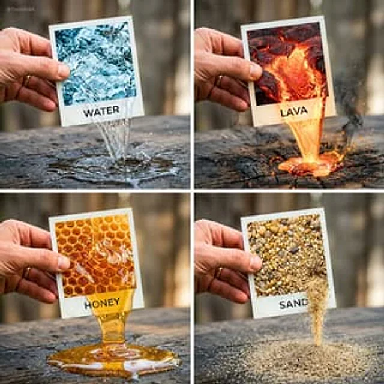

```text
A hyper-realistic 3D photo concept showing a hand holding a square polaroid photo labeled “ELEMENT”. Inside the photo, there’s a close-up of [ELEMENT], and it flows seamlessly out of the photo frame into the real world, naturally interacting with the surface below. The text “ELEMENT” appears printed cleanly on the white border of the photo. Realistic cinematic lighting, ultra-detailed textures, artistic composition, 1080x1080 square format.
```

Model: Nano Banana
Author: TechieSA

[ProjectD](https://aitoolsradar.com/en/prompts/2f05f6577ae9c6) · [Recorded source](https://x.com/TechieBySA/status/2037633578519965864)
 · [Full original metadata and byte evidence](data/projectd-batch-0068.json)

## TechieSA #954

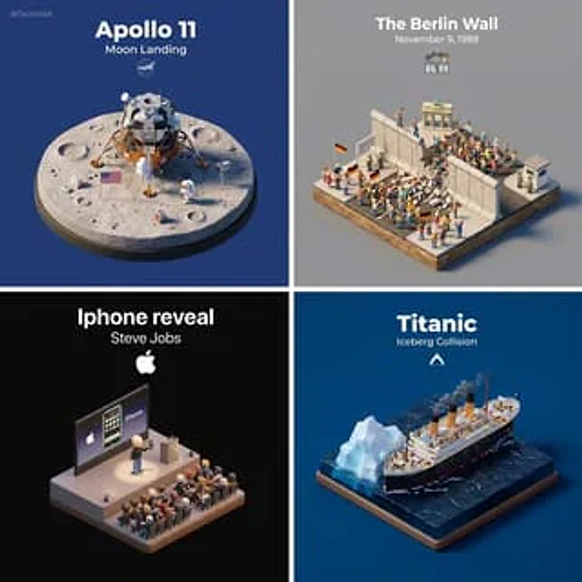

```text
Present a clear, 45° top-down isometric miniature 3D cartoon scene of the historical event “EVENT”, featuring its most iconic moment: [DESCRIPTION]. Use soft refined textures, realistic PBR materials, and gentle lifelike lighting.
Create a small raised diorama-style base that includes the most recognizable elements of this moment, along with tiny stylized characters if needed (no facial details).
Use a clean solid [BACKGROUND COLOR] background.

At the top-center, display “EVENT” in large bold text, directly beneath it show a short descriptive subtitle in medium text, and place a small official symbol or simplified icon below the subtitle.
All text must automatically match the background contrast (white or black).

Composition: perfectly centered layout, square 1080x1080, ultra-clean, high-clarity diorama aesthetic.
```

Model: Nano Banana
Author: TechieSA

[ProjectD](https://aitoolsradar.com/en/prompts/d6fe6695cb6341) · [Recorded source](https://x.com/TechieBySA/status/2045553905128358040)
 · [Full original metadata and byte evidence](data/projectd-batch-0068.json)

## TechieSA #962

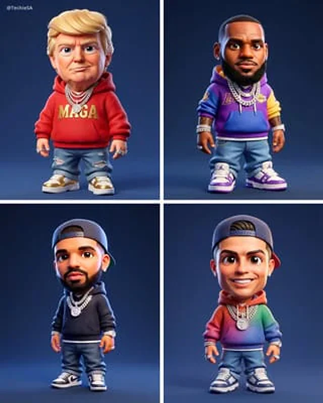

```text
Maintaining the facial features of all creatures…
chibi styled 3d, wearing rapper outfit style, babyoversized head and small body (chibi proportions), preserving the person’s recognizable facial features and likeness. Stylized
realistic but cartoonish, smooth textures, expressive face, big eyes. Full-body character wearing typical streetwear clothing and accessories, including diamond chains. High-quality 3D lighting, vibrant colors, playful proportions, style. Clean DARK BLUE background, studio lighting, sharp focus.
```

Model: Nano Banana
Author: TechieSA

[ProjectD](https://aitoolsradar.com/en/prompts/fc1fb0b8fef83c) · [Recorded source](https://x.com/TechieBySA/status/2026724320953741362)
 · [Full original metadata and byte evidence](data/projectd-batch-0068.json)

## TechieSA #980

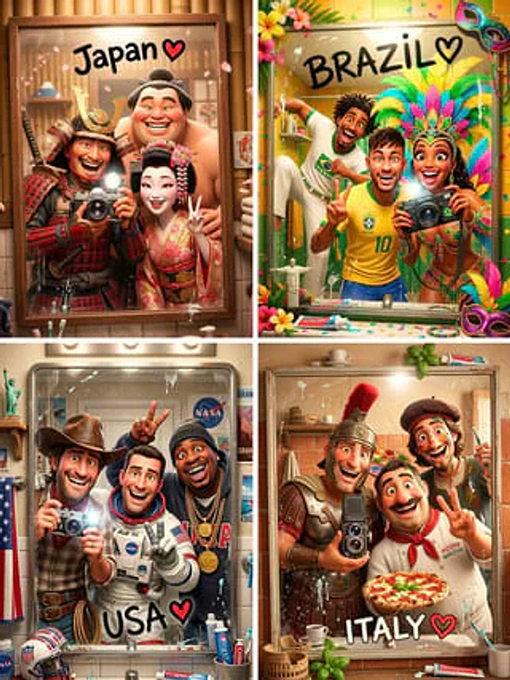

```text
High-quality stylized 3D CGI Pixar-style render, vertical 3:4 composition, three most iconic and recognizable cultural figures from [COUNTRY] captured as a chaotic and joyful bathroom mirror selfie; the most visually striking figure holds the large vintage camera up toward the mirror in their most authentic traditional costume, the remaining figures squeezed tightly into the frame each wearing their most iconic outfit and showing their most signature expression or pose; everyone crammed together filling the entire mirror frame with faces large and close to the camera, tightly packed with no empty space, chaotic crowded energy; facial proportions gently stylized in Disney/Pixar animation style with expressive eyes while faithfully preserving each character's most authentic cultural costume and recognizable traits; the bathroom mirror has realistic toothpaste splatters and water droplets; the reflection shows bold black Pixar-style lettering reading "[COUNTRY]❤️"; the bathroom background is styled to match the cultural identity of [COUNTRY] with authentic thematic props, traditional decorations and iconic landmark easter eggs placed naturally around the scene; lighting combines soft ambient bathroom lighting with a bright camera flash reflecting in the mirror; warm Pixar-style color grading, ultra-detailed 4K render, no watermark
```

Model: Nano Banana
Author: TechieSA

[ProjectD](https://aitoolsradar.com/en/prompts/169a26423f30d1) · [Recorded source](https://x.com/TechieBySA/status/2033551007062409422)
 · [Full original metadata and byte evidence](data/projectd-batch-0068.json)

## The Newz 2.0 #1365

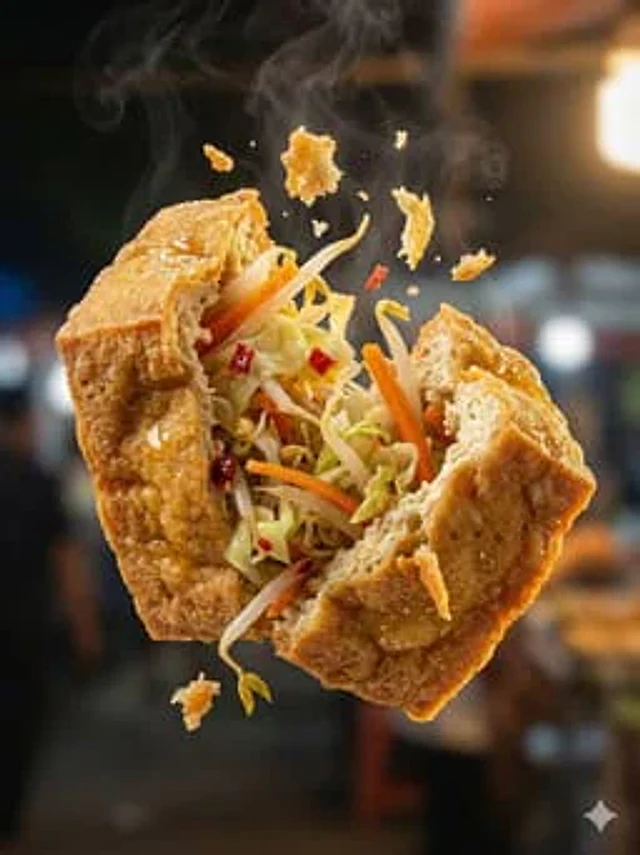

```text
Macro food photography of a crispy martabak telur tearing open mid-air, thin golden wrapper shattering with a crack, hot filling of minced beef, scallions, and egg bursting outward. Flecks of fried onion and pepper suspended in motion, steam visible, glossy oil sheen catching the light. Warm Indonesian street-stall lighting, tungsten + charcoal warmth, dramatic rim light, ultra high texture detail (bubbled wrapper, layered interior).Editorial food shot, shallow depth of field, bokeh of night market signage, Nikon Z9 look, 105mm macro, fast shutter freeze, hyper-real crumbs. --ar 3:4"
```

Model: Nano Banana
Author: The Newz 2.0

[ProjectD](https://aitoolsradar.com/en/prompts/ecfdd15b5b7001) · [Recorded source](https://x.com/TheNewz_816/status/2011300896186253645)
 · [Full original metadata and byte evidence](data/projectd-batch-0068.json)

## The Newz 2.0 #1373

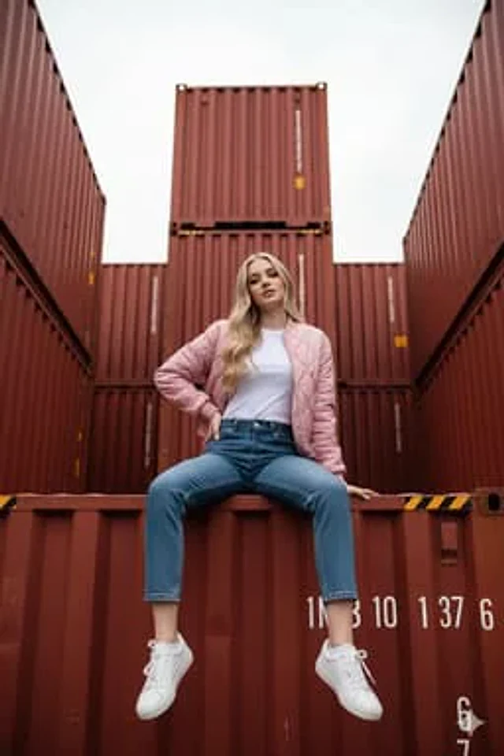

```text
Use the same face from the reference image without changing facial features 

{
  "image_description": "A high-angle, low-perspective full-body portrait of a young western woman with blonde hair sitting on the edge of a red industrial shipping container.",
  "subject": {
    "person": "Young western woman, fit build, serious expression, looking away from the camera toward the horizon.",
    "hair_style": "long blonde",
    "clothing": {
      "jacket": "Light grey quilted puffer bomber jacket with a diamond pattern.",
      "undershirt": "Plain crisp white crew-neck t-shirt.",
      "pants": "Classic medium-wash blue denim jeans, straight fit.",
      "footwear": "Clean, bright white leather low-top sneakers."
    },
    "pose": "Sitting relaxed on the edge of a metal container, legs dangling, leaning slightly back on his right hand."
  },
  "setting": {
    "location": "Industrial shipping yard or port.",
    "background_elements": [
      "Stacked corrugated red metal shipping containers.",
      "A vertical red container behind the subject creates a strong leading line.",
      "Yellow stencil lettering visible on the container beneath the subject."
    ],
    "atmosphere": "Urban, gritty yet clean, modern streetwear aesthetic."
  },
  "composition_and_lighting": {
    "camera_angle": "Low angle looking up, creating a sense of scale and height.",
    "lighting": "Natural, diffused daylight; soft shadows; overcast sky providing even illumination.",
    "color_palette": [
      "Primary: Bold industrial red",
      "Secondary: Denim blue, light grey, and crisp white",
      "Background: Muted grey/white sky"
    ],
    "lens_effects": "Deep depth of field with sharp focus on the subject and the immediate container texture."
  },
  "technical_tags": "Street photography, architectural lines, hyper-realistic, 8k resolution, cinematic lighting, industrial fashion shoot."
}
```

Model: Nano Banana
Author: The Newz 2.0

[ProjectD](https://aitoolsradar.com/en/prompts/2eabeb3ef5dcb2) · [Recorded source](https://x.com/TheNewz_816/status/2011379631740633191)
 · [Full original metadata and byte evidence](data/projectd-batch-0068.json)

## The Newz 2.0 #1378

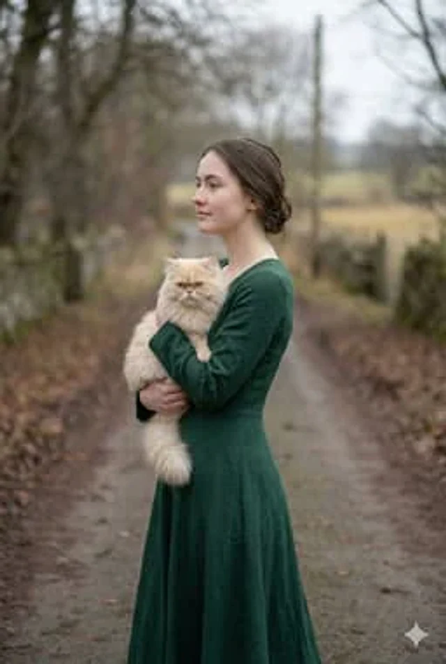

```text
portrait of a young woman in her early 20s walking calmly on a beautiful road, holding a small Persian cat gently in her arms, candid natural pose, elegant flowing dress, soft graceful expression, winter cloudy day, cinematic atmosphere, good lighting fully focused on her, shallow depth of field, background softly blurred, realistic textures, detailed skin, high-resolution, natural colors, soft diffused light, subtle bokeh, professional photography, 85mm lens look

--style realistic --quality high --ar 3:4 --v 6
```

Model: Nano Banana
Author: The Newz 2.0

[ProjectD](https://aitoolsradar.com/en/prompts/19a13d956a54d7) · [Recorded source](https://x.com/TheNewz_816/status/2009246296490889717)
 · [Full original metadata and byte evidence](data/projectd-batch-0068.json)

## The Newz 2.0 #1386

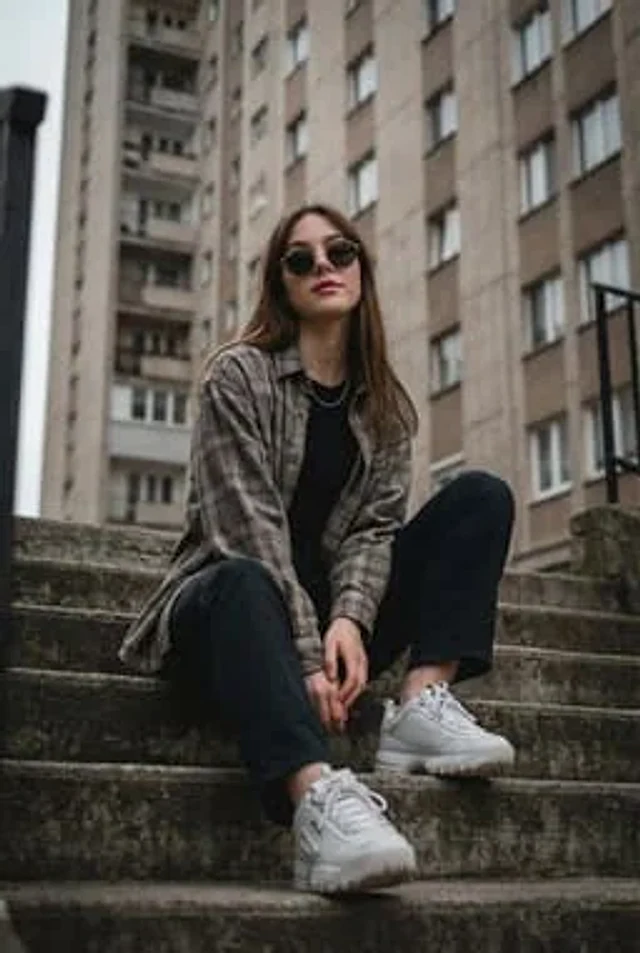

```text
{
  "subject": "Young woman sitting casually on outdoor concrete stairs, posing with a cool, confident demeanor.",
  "clothing": "Oversized grey and beige plaid flannel shirt worn open, plain black crew-neck t-shirt underneath, loose-fitting dark trousers, chunky white sneakers.",
  "hair": "Long, straight light brown hair with a middle part, falling naturally over the shoulders.",
  "face": "Neutral, poised expression with defined red lips, eyes concealed behind sunglasses.",
  "accessories": "Round dark sunglasses with thin metal frames, simple silver chain necklace.",
  "environment": "Urban setting with a tall, grey concrete apartment block featuring a grid of windows in the background, weathered concrete steps in the foreground.",
  "lighting": "Soft, diffuse natural daylight indicative of an overcast sky, creating even illumination without harsh shadows.",
  "camera": "Low-angle shot looking up at the subject, emphasizing the height of the background building, sharp focus on the subject with a slightly softened background.",
  "style": "Urban streetwear photography, 90s grunge aesthetic, moody and atmospheric, cinematic vertical composition."
}
```

Model: Nano Banana
Author: The Newz 2.0

[ProjectD](https://aitoolsradar.com/en/prompts/f8f37b88736324) · [Recorded source](https://x.com/TheNewz_816/status/2009215763937415243)
 · [Full original metadata and byte evidence](data/projectd-batch-0068.json)

## The Newz 2.0 #1406

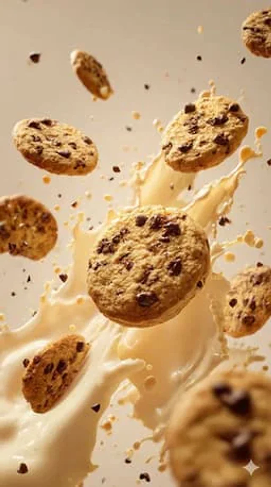

```text
{
  "production_manifest": {
    "metadata": {
      "series_id": "CIN-FOOD-2025",
      "aspect_ratio": "9:16",
      "resolution_target": "8k_uhd"
    },
    "technical_stack": {
      "hardware": {
        "camera": "ARRI Alexa 65",
        "lens_profile": "Large format cinematic prime"
      },
      "film_emulation": {
        "stock": "Kodak Portra 400",
        "characteristics": ["Fine grain", "Natural skin tones", "Warm highlights"]
      },
      "lighting_rig": {
        "style": "Cinematic soft glow",
        "atmosphere": "Timeless indoor",
        "diffusion": "High"
      }
    },
    "artistic_direction": {
      "visionary_style": "Greta Gerwig",
      "composition_rule": "Graphic centered symmetry",
      "physics_engine": "Suspended animation / Zero gravity",
      "background_specification": "Flat off-white / Studio bone"
    },
    "variant_registry": [
      {
        "id": "VAR-001",
        "flavor_profile": "Dark Chocolate Chip & Oat",
        "tonal_emotion": "Playful, cheeky yet chic",
        "ingredients": {
          "primary_solids": ["Dark chocolate chip cookies"],
          "fluid_fx": ["Oat milk splash"],
          "debris": ["Cookie crumbs"]
        }
      },
      {
        "id": "VAR-002",
        "flavor_profile": "Red Velvet",
        "tonal_emotion": "Bold, playful chic",
        "ingredients": {
          "primary_solids": ["Red velvet cake pieces"],
          "fluid_fx": ["Cream cheese frosting swirls"],
          "debris": ["Cocoa dust", "Fine red cake crumbs"]
        }
      },
      {
        "id": "VAR-003",
        "flavor_profile": "Pistachio Macaron",
        "tonal_emotion": "Refined, playful chic",
        "ingredients": {
          "primary_solids": ["Pistachio macarons"],
          "fluid_fx": ["Cream filling swirls"],
          "debris": ["Crushed pistachio nuts"]
        }
      },
      {
        "id": "VAR-004",
        "flavor_profile": "Strawberry Shortcake",
        "tonal_emotion": "Sweet, playful yet chic",
        "ingredients": {
          "primary_solids": ["Fresh strawberry slices"],
          "fluid_fx": ["Whipped cream swirls"],
          "debris": ["Shortcake biscuit crumbs"]
        }
      }
    ]
  }
}
```

Model: Nano Banana
Author: The Newz 2.0

[ProjectD](https://aitoolsradar.com/en/prompts/d8d502c8d3045f) · [Recorded source](https://x.com/TheNewz_816/status/2011044123818549711)
 · [Full original metadata and byte evidence](data/projectd-batch-0068.json)

## The Newz 2.0 #1432

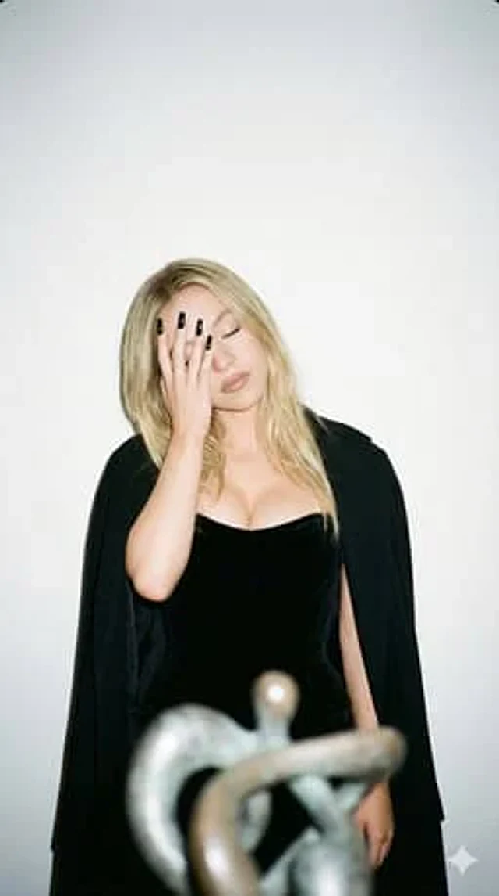

```text
{
  "image_style": {
    "type": "photorealistic",
    "aesthetic": "Instagram shot",
    "effects": [
      "film grain",
      "direct flash"
    ]
  },
  "composition": {
    "framing": "waist-up photograph",
    "aspect_ratio": "9:16"
  },
  "subject": {
    "description": " woman Sydney Sweeney",
    "constraint_note": "do not alter the sensitivity of the face and features",
    "pose": {
      "orientation": "facing the camera directly",
      "head": "tilted slightly to the side",
      "eyes": "closed",
      "action": "covering her face with her hand, pulling her elbow away and lifting it to the side",
      "mood": [
        "elegant",
        "pensive",
        "playful"
      ]
    },
    "appearance": {
      "attire": [
        "black velvet corset",
        "expensive black cape"
      ],
      "hair": "loose",
      "makeup": {
        "style": "nude",
        "lipstick": "matte nude"
      },
      "details": [
        "décolletage highlighted",
        "long, square black nails"
      ]
    }
  },
  "setting": {
    "background": "white wall",
    "foreground_elements": "art object placed in front of the wall"
}
 }
```

Model: Nano Banana
Author: The Newz 2.0

[ProjectD](https://aitoolsradar.com/en/prompts/e1e7fc10f76d7b) · [Recorded source](https://x.com/TheNewz_816/status/2012337157617455596)
 · [Full original metadata and byte evidence](data/projectd-batch-0068.json)

## Tips Excel #371

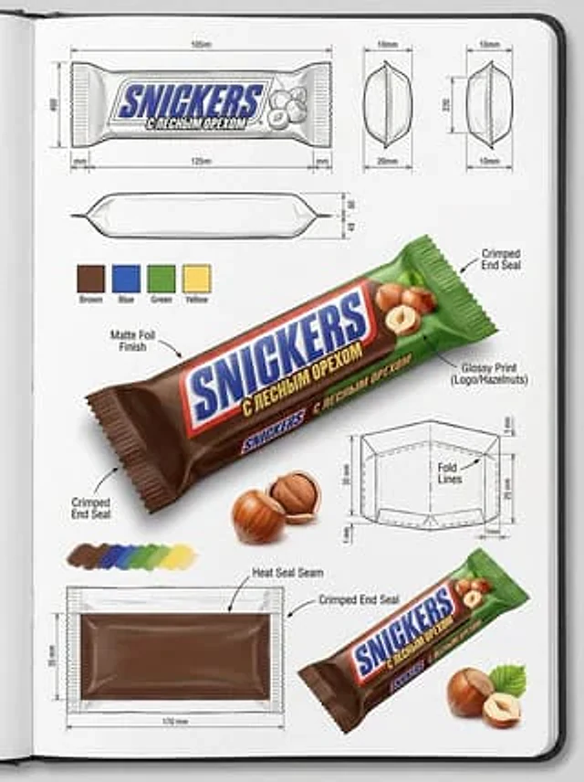

```text
Using the attached image, create an illustration sheet of professional industrial design packaging for the package (PACKAGE TYPE). A centered heroic 3D rendering with realistic materials, soft studio lighting and commercial quality finishes. Surrounded by technical views: front, side, top, bottom, oblique perspective and flat position. Include sketches of the frame structure, crease lines, seam details, and size arrows in millimeters. Show materials and finishes (matte, glossy print, plastic, paper, glass, etc.) in handwritten annotations. Add color swatches, realistic product illustrations, and subtle shadows. Clean sketchbook background, realistic rendering + pencil sketch style, modern design design, ultra-detailed, portfolio ready.
```

Model: Nano Banana
Author: Tips Excel

[ProjectD](https://aitoolsradar.com/en/prompts/a9efcfc1f5dadf) · [Recorded source](https://x.com/gudanglifehack/status/2038342534024544736)
 · [Full original metadata and byte evidence](data/projectd-batch-0068.json)

## Tips Excel #591

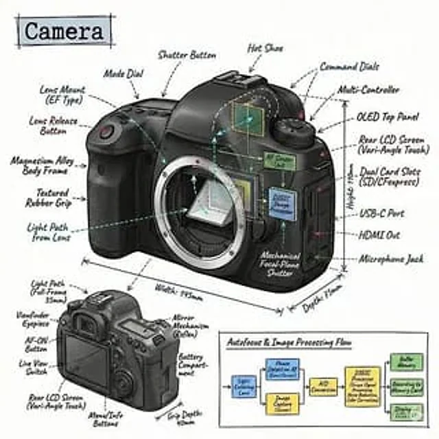

```text
Create an infographic image of [OBJECT], combining a realistic photograph or photorealistic render of the object with technical annotation overlays placed directly on top. Use black ink–style line drawings and text (technical pen / architectural sketch look) on a pure white studio background. Include: •Key component labels •Internal cutaway or exploded-view outlines (where relevant) •Measurements, dimensions, and scale markers •Material callouts and quantities
```

Model: Nano Banana
Author: Tips Excel

[ProjectD](https://aitoolsradar.com/en/prompts/48d250bb7f6712) · [Recorded source](https://x.com/gudanglifehack/status/2038346918406115788)
 · [Full original metadata and byte evidence](data/projectd-batch-0068.json)

## TJ #1144

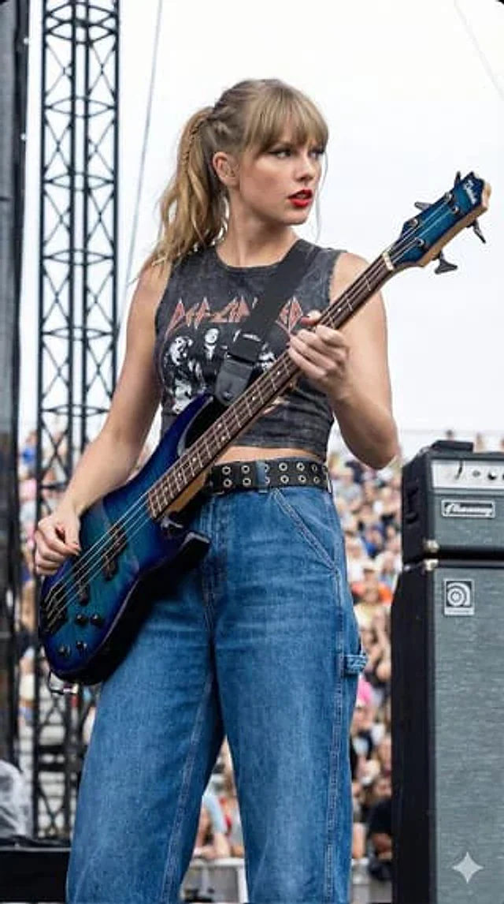

```text
{
  "image_generation_prompt": {
    "subject": {
      "main": "young female musician bass guitarist performing live on an outdoor stage",
      "appearance": "long dark wavy layered hair blowing slightly in wind, fair skin, intense focused facial expression, natural makeup, silver hoop earrings",
      "pose": "standing confidently holding a bass guitar, fingers plucking strings, looking slightly off-camera to the left"
    },
    "attire": {
      "top": "sleeveless dark grey acid-wash graphic crop top with vintage band aesthetic",
      "bottoms": "loose fit wide-leg blue denim carpenter jeans with large pockets",
      "accessories": "black leather belt with double row silver grommets, wide black guitar strap"
    },
    "instrument": {
      "type": "modern electric bass guitar",
      "details": "deep blue burst finish with visible wood grain texture (quilted maple top), black hardware, long guitar neck, intricate fretboard details"
    },
    "environment": {
      "setting": "daytime outdoor concert stage, open air festival vibe",
      "background_elements": "blurred stage truss structures, black bass amplifier stack with metal grille, microphone stand on the left, overcast bright sky"
    },
    "technical_style": {
      "quality": "ultra realistic, 8k uhd, hdr, masterwork, sharp focus, high fidelity textures",
      "lighting": "natural diffuse daylight, soft shadows, cinematic lighting",
      "camera": "telephoto lens, depth of field, bokeh background, portrait photography"
    }
  },
  "parameters": {
    "aspect_ratio": "9:16",
    "orientation": "vertical long",
    "resolution": "highest possible"
  }
}
```

Model: Nano Banana
Author: TJ

[ProjectD](https://aitoolsradar.com/en/prompts/34c6e6e556bbdd) · [Recorded source](https://x.com/TAB_TAB_HH/status/2016049616807198778)
 · [Full original metadata and byte evidence](data/projectd-batch-0068.json)

## Travis Davids #481

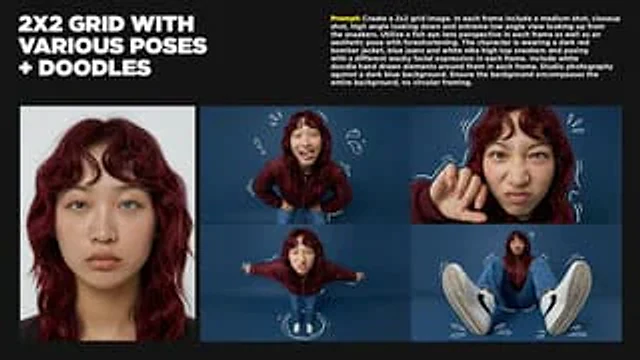

```text
Create a 2x2 grid image. In each frame include a medium shot, closeup shot, high angle looking down and extreme low angle view looking up from the sneakers. Utilize a fish eye lens perspective in each frame as well as an aesthetic pose with foreshortening. The character is wearing a dark red bomber jacket, blue jeans and white nike high top sneakers and posing with a different wacky facial expression in each frame. Include white doodle hand drawn elements around them in each frame. Studio photography against a dark blue background. Ensure the background encompasses the entire background, no circular framing.
```

Model: Nano Banana
Author: Travis Davids

[ProjectD](https://aitoolsradar.com/en/prompts/0844325d1aff4b) · [Recorded source](https://x.com/MrDavids1/status/2012224276900851827)
 · [Full original metadata and byte evidence](data/projectd-batch-0068.json)

## ttmouse - 豆爸 #494

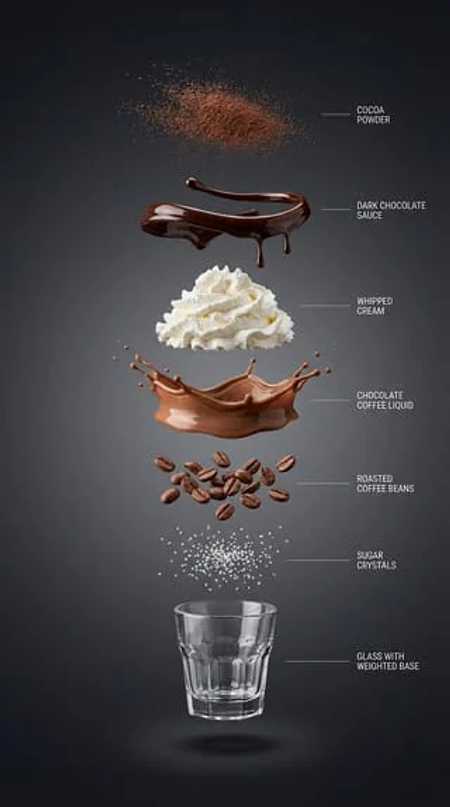

```text
{
“subject”: “巧克力咖啡饮品的超写实垂直爆炸分解图”,
“layout”: “中心垂直对齐，各组件独立悬浮且间距清晰”,
“layers”: [
{
“component”: “可可粉微粒”,
“position”: “顶部”
},
{
“component”: “光泽深色巧克力酱丝带与滴落状”,
“position”: “独立层”
},
{
“component”: “轻盈的打发奶油堆”,
“position”: “独立层”
},
{
“component”: “丝滑的巧克力咖啡液态层”,
“position”: “独立层”
},
{
“component”: “烘焙咖啡豆”,
“position”: “独立层”
},
{
“component”: “糖晶体”,
“position”: “独立层”
},
{
“component”: “带配重底座的小型透明螺纹玻璃杯（空杯）”,
“position”: “底部”
}
],
“background”: “高级深色背景：干净的影棚背景，近黑色的石墨色至木炭色渐变，柔和且平滑”,
“lighting_and_style”: {
“lighting”: “柔和且受控的影棚光，每层下方有清晰的分层阴影”,
“detail”: “超锐利微距写实主义，右侧极简细指示线与英文标签”,
“category”: “高端产品信息图”,
“resolution”: “8K”
}
}
```

Model: Nano Banana
Author: ttmouse - 豆爸

[ProjectD](https://aitoolsradar.com/en/prompts/a9bd9f5bce1bcb) · [Recorded source](https://x.com/ttmouse/status/2008986705962123774)
 · [Full original metadata and byte evidence](data/projectd-batch-0068.json)

## ttmouse - 豆爸 #750


```text
1. 宏观风格与媒介
- 核心媒介: 高清商业人像摄影 (High-end Commercial Photography)
- 美学流派: 新中式美学 (New Chinese Style), 节日时尚大片

2. 主体与IP身份
- 核心主体: 年轻东亚女性侧颜特写 (Close-up profile of young Asian woman)
- IP/名人锁定: 穿着红色旗袍 (Red Cheongsam), 佩戴珍珠项链与红色花卉耳环

3. 世界逻辑与物理
- 物理法则: 真实光学投影 (Real optical projection), 面部光影贴合面部起伏
- 空间构成: 人眼平视视角 (Eye-level), 极近距离接触

4. 数据与信息层
- 文本提取: 无文本
- 品牌与符号: 红色剪纸艺术前景 (Red paper-cut art foreground) - 包含仙鹤、蝴蝶与牡丹纹样

5. 材质与纹理
- 核心材质: 超写实皮肤质感 (Hyper-realistic skin), 哑光卡纸 (Matte cardstock), 温润珍珠
- 触感细节: 逆光下可见的面部绒毛 (Visible vellus hair backlit), 次表面散射效果 (Subsurface scattering)

6. 光影与氛围
- 光照模型: Gobo投影布光 (Gobo lighting/Projected shadows) - 复杂的镂空花纹光影投射在人物面部
- 整体氛围: 金色暖阳侧逆光 (Warm golden hour light), 高饱和度喜庆红调, 梦幻且清晰

7. 技术参数
- 镜头与渲染: 85mm-100mm 微距镜头 (Macro lens), 浅景深 (Shallow depth of field), 前景虚化 (Bokeh foreground)
- 构图指令: 框式构图 (Framed composition), --ar 3:4
```

Model: Nano Banana
Author: ttmouse - 豆爸

[ProjectD](https://aitoolsradar.com/en/prompts/be44b91661e836) · [Recorded source](https://x.com/ttmouse/status/2008273570175349157)
 · [Full original metadata and byte evidence](data/projectd-batch-0068.json)

## ttmouse - 豆爸 #794


```text
1. 宏观风格与媒介
- 核心媒介: Photography
- 美学流派: Traditional Chinese bridal portrait

2. 主体与IP身份
- 核心主体: Woman with updo hairstyle adorned with red paper-cut flowers and butterflies, wearing red traditional attire and pearl jewelry
- IP/名人锁定: None

3. 世界逻辑与物理
- 物理法则: Realistic human proportion
- 空间构成: Eye-level perspective, close-up portrait with paper-cut decorative foreground

4. 数据与信息层
- 文本提取: None
- 品牌与符号: None

5. 材质与纹理
- 核心材质: Red satin cheongsam, red paper-cut ornaments, white glossy pearls, small white pearl earring
- 触感细节: Smooth satin texture, delicate paper-cut texture, glossy pearl surface

6. 光影与氛围
- 光照模型: Soft side lighting, soft shadows
- 整体氛围: Warm, elegant, traditional Chinese festive atmosphere

7. 技术参数
- 镜头与渲染: 50mm lens
- 构图指令: --ar 4:5
```

Model: Nano Banana
Author: ttmouse - 豆爸

[ProjectD](https://aitoolsradar.com/en/prompts/500f16fb7ef5d4) · [Recorded source](https://x.com/ttmouse/status/2010130164169007195)
 · [Full original metadata and byte evidence](data/projectd-batch-0068.json)

## underwood #460

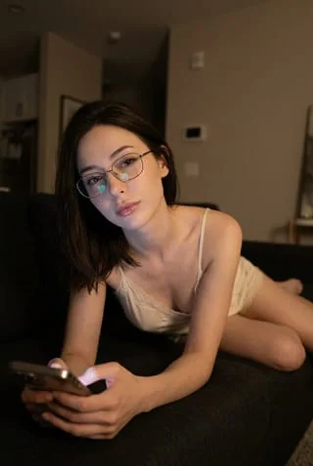

```text
{   "subject": {     "description": "A young adult woman with soft refined features, thin metal glasses, and shoulder-length dark hair, leaning across a couch at night while holding a smartphone, captured in a quiet low-light candid moment.",     "mirror_rules": "not a mirror shot",     "age": "young adult",     "expression": {       "eyes": {         "look": "soft, slightly tired, subtly attentive",         "energy": "low-key and intimate",         "direction": "toward the camera, as if she just looked up from her phone"       },       "mouth": {         "position": "gently closed with a relaxed pout",         "energy": "quiet and unforced"       },       "overall": "a dreamy late-night expression, calm, distant, and mildly seductive without exaggeration"     },     "face": {       "preserve_original": "keep the face proportions delicate and realistic, with a narrow jawline, soft cheeks, defined eyes, glossy lips, and no exaggerated facial distortion",       "makeup": "soft glam makeup, subtle eyeliner, long lashes, smooth skin finish, glossy pink-nude lips, lightly defined brows"     }   },   "hair": {     "color": "dark brown to black",     "style": "shoulder-length, loose, softly tousled with slight volume around the crown",     "effect": "natural flyaways and soft separation, not overly polished"   },   "body": {     "frame": "slim and softly curved",     "waist": "gently defined",     "chest": "natural and softly framed by the neckline",     "legs": "bare, partially folded and extending out of frame",     "skin": {       "visible_areas": "shoulders, collarbone, arms, upper chest, thighs, lower legs",       "tone": "fair with a warm indoor cast",       "texture": "smooth, velvety, lightly softened by low light and lens blur",       "lighting_effect": "warm ambient light on the skin with faint cool phone-screen reflections near the face and hands"     }   },   "pose": {     "position": "leaning forward across a couch, one arm supporting the body, the other hand holding a phone in the foreground",     "base": "casual lounging posture caught mid-movement",     "overall": "informal, intimate, slightly off-balance, as if she paused while scrolling and looked up"   },   "clothing": {     "top": {       "type": "lace-trim camisole or slip-style sleepwear",       "color": "pale cream with a soft blush tint",       "details": "thin straps, delicate lace texture, soft fitted bodice, lightweight fabric",       "effect": "sleepwear-like softness, feminine and understated"     },     "bottom": {       "type": "matching soft shorts or the lower part of a slip",       "color": "pale cream",       "details": "mostly obscured, softly wrinkled fabric, blending into the pose"     }   },   "accessories": {     "jewelry": "small subtle earrings",     "device": "smartphone held close to the camera, dark reflective case, screen glow lighting the fingers",     "prop": "thin metal-framed eyeglasses with visible screen reflections on the lenses"   },   "photography": {     "camera_style": "realistic social-media night portrait, smartphone candid aesthetic",     "angle": "slightly above eye level, close and intimate, with the phone hand entering the foreground",     "shot_type": "medium close-up to three-quarter portrait in vertical framing",     "aspect_ratio": "3:4 vertical",     "texture": "soft focus, slight motion blur, low-light grain, gentle facial smoothing from dim conditions, natural imperfect sharpness",     "lighting": "dim warm room light mixed with cool phone-screen reflections, no hard flash, soft falloff across the couch and wall",     "depth_of_field": "shallow to moderate, face prioritized but softened, foreground hand and phone slightly blurred"   },   "background": {     "setting": "an indoor living room or lounge at night",     "wall_color": "warm beige-gray",     "elements": [       "dark upholstered couch",       "plain softly lit wall",       "minimal visible decor"     ],     "atmosphere": "quiet, private, late-night, softly blurred and still",     "lighting": "very low ambient tungsten-like room light with shadows pooling in the background"   },   "the_vibe": {     "energy": "slow, hushed, intimate",     "mood": "late-night pause, private and emotionally suspended",     "aesthetic": "realistic social-media softness, low-light candid beauty, imperfect but magnetic",     "authenticity": "retain the accidental blur, the off-center body angle, the screen glare on the glasses, and the lived-in couch posture",     "intimacy": "close enough to feel the warmth of the room and the softness of fabric against skin",     "story": "She had been scrolling in silence, then something made her stop and lift her eyes for one quiet second.",     "caption_energy": "soft nocturnal allure, unspoken attention, the kind of moment that feels borrowed rather than staged"   },   "constraints": {     "must_keep": [       "young adult woman",       "thin metal glasses",       "visible screen reflections on the lenses",       "smartphone in hand close to the foreground",       "dark shoulder-length tousled hair",       "pale lace-trim sleepwear",       "leaning across a couch",       "warm dim indoor night lighting",       "soft blur and low-light texture",       "minimal beige-gray wall and dark couch background"     ],     "avoid": [       "studio lighting",       "hard flash",       "over-sharpened skin",       "perfect commercial glamour retouching",       "extra background clutter",       "bright daylight",       "mirror selfie composition",       "heavy accessories",       "exaggerated body proportions",       "watermarks, logos, extra text"     ]   },   "negative_prompt": [     "mirror selfie",     "hard flash",     "studio backdrop",     "ultra sharp DSLR clarity",     "over-retouched skin",     "cartoonish face",     "exaggerated anatomy",     "extra fingers",     "deformed hands",     "heavy jewelry",     "busy room",     "daylight window light",     "smiling broadly",     "strong action pose",     "symmetrical formal composition",     "text overlay",     "watermark",     "logo"   ] }
```

Model: Nano Banana
Author: underwood

[ProjectD](https://aitoolsradar.com/en/prompts/aa2fe60bc14e1c) · [Recorded source](https://x.com/underwoodxie96/status/2033917202567446610)
 · [Full original metadata and byte evidence](data/projectd-batch-0068.json)

## underwood #882

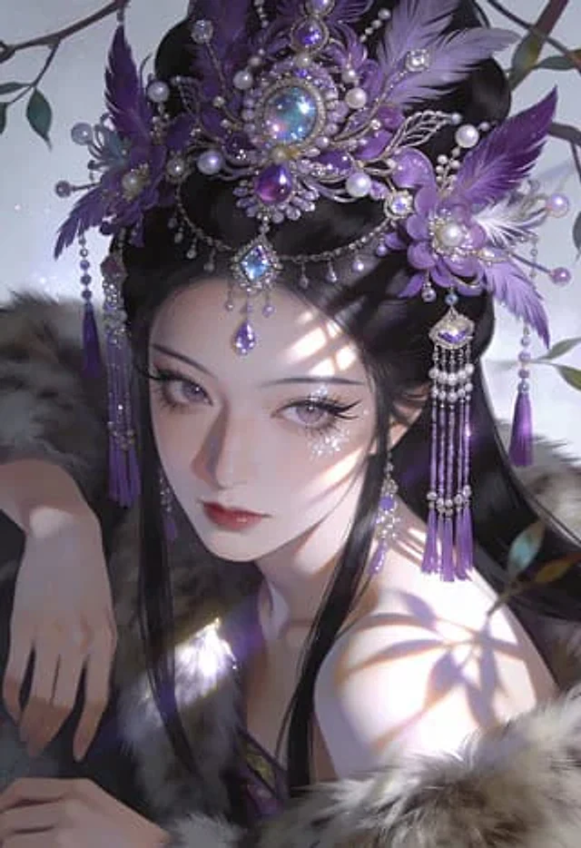

```text
convert anime characters into realistic human portraits  Convert  character into a photorealistic live-action portrait / fashion editorial photograph, modern cinematic style, high-fashion grade, punchy but natural contrast, refined filmic color science, subtle halation and lens bloom, controlled highlights, soft roll-off, realistic skin pores and texture, lifelike hair strands, premium fabric/material rendering, studio-quality lighting with natural depth, preserve the original camera framing and composition exactly, no text, no logo.
```

Model: Nano Banana
Author: underwood

[ProjectD](https://aitoolsradar.com/en/prompts/75dedb4f1f564b) · [Recorded source](https://x.com/underwoodxie96/status/2029149670061064470)
 · [Full original metadata and byte evidence](data/projectd-batch-0068.json)

## Vera Collins #1440

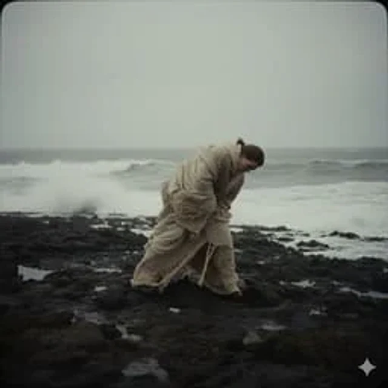

```text
Sometimes I want to stay alone away from the Chaos of City life 

The Realism by gemini nano banana 
Prompt 👇

Wide shot, subject acts as an anchor against a raging wind. Standing on a jagged black rock coastline, waves crashing behind in a gray blur. The subject leans forward against the gale. Outfit is a massive, shapeless layers of raw beige wool and distressed knitwear, creating a silhouette that looks like a eroding sculpture. Lighting is overcast, flat, and moody. Desaturated palette, muted earth tones, sharp texture on the fabric, cinematic anamorphic lens.

Negative Prompt: Sunny beach, vacation vibes, swimsuit, smiling, blue sky, vibrant colors, calm water, generic travel photography, face distortion.
```

Model: Nano Banana
Author: Vera Collins

[ProjectD](https://aitoolsradar.com/en/prompts/eedfa8d490af6f) · [Recorded source](https://x.com/PiyariArisha/status/2011114481015795906)
 · [Full original metadata and byte evidence](data/projectd-batch-0068.json)

## Vigo Zhao #1420

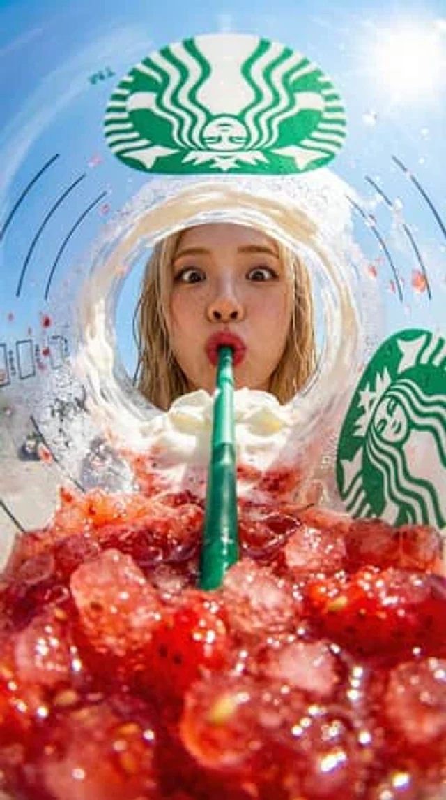

```text
{
  "prompt": "View from inside a Starbucks strawberry frappuccino cup looking up, fisheye lens extreme distortion, worm's eye perspective, crushed strawberry ice macro foreground with glistening bokeh highlights, one single continuous green straw passing through the entire frame from top to bottom connecting lips to ice, person peering down from above through cup opening with wide-eyed excited expression lips pursed on straw top, whipped cream layer, Starbucks logo visible on cup wall, clear blue sky background through opening, high saturation red strawberry vs green straw complementary colors, bright summer daylight, hyper-realistic commercial photography",
  "negative_prompt": "two straws, double straw, multiple straws, broken straw, separated straw, disconnected straw, flat lay, normal perspective, dull colors, deformed face, low saturation, ugly, extra limbs, woman, girl, female",
  "character_reference": {
    "upload": true,
    "control_weight": 0.95,
    "description": "maintain face and identity from reference image, male person, front-facing, slightly downward gaze, wide-eyed excited expression, lips pursed on straw"
  },
  "parameters": {
    "aspect_ratio": "9:16",
    "style_strength": 0.9,
    "composition_reference": "inside-cup fisheye upward shot, face centered in cup opening, single straw runs continuously from person lips down through whipped cream into crushed ice"
  }
}
```

Model: Nano Banana
Author: Vigo Zhao

[ProjectD](https://aitoolsradar.com/en/prompts/67382c7c442b17) · [Recorded source](https://x.com/VigoCreativeAI/status/2041163046874382357)
 · [Full original metadata and byte evidence](data/projectd-batch-0068.json)

## Vigo Zhao #406

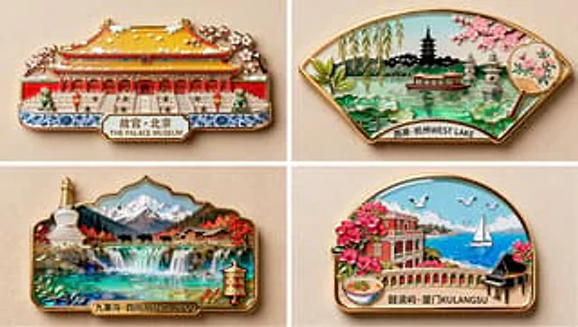

```text
珐琅彩琉璃艺术风格，金属质感，制作一枚冰箱贴，写着"西湖·杭州 WEST LAKE"字样。冰箱贴以断桥拱形轮廓为基底外形，金色金属边框包边。画面描绘西湖经典风景：断桥残雪、湖面莲叶、楼外楼画舫、雷峰塔剪影、三潭印月石灯、粉色桃花与垂柳。左侧点缀龙井茶叶图案，右侧装饰杭绣扇面。采用珐琅彩填色工艺：湖水呈透明翠绿，金属线勾勒波纹细节。浅咖色背景，正面展示，所有元素严格控制在基底轮廓范围内，布局美观协调，产品摄影质感，8K细节
```

Model: Nano Banana
Author: Vigo Zhao

[ProjectD](https://aitoolsradar.com/en/prompts/e2c32d95e002a2) · [Recorded source](https://x.com/VigoCreativeAI/status/2026301375249105195)
 · [Full original metadata and byte evidence](data/projectd-batch-0068.json)

## Viki #1001


```text
A digital fantasy illustration of a small turtle resting on a grassy riverbank at twilight. The turtle has a detailed, textured shell with a soft, warm golden glow emanating from underneath its body, casting light onto the surrounding mossy earth. The scene is filled with magical, floating fireflies or glowing pollen particles that sparkle in the dim, atmospheric light. The turtle's reflection is clearly visible in the calm, still water below. Tall, slender blades of grass rise beside the turtle, silhouetted against a serene, muted gray-blue background. The overall mood is peaceful, ethereal, and cinematic, with high detail and soft, dreamlike lighting.
```

Model: Nano Banana
Author: Viki

[ProjectD](https://aitoolsradar.com/en/prompts/4672cb2814b226) · [Recorded source](https://x.com/churvikv/status/2041512847016890622)
 · [Full original metadata and byte evidence](data/projectd-batch-0068.json)

## Viki #711


```text
A majestic, ancient gnarled tree with thick, twisting roots sits at the center of a lush, mystical landscape, its roots anchoring into a vibrant, foaming stream flowing over moss-covered rocks. Suspended within the dense, dark green canopy of the tree is a radiant, glowing golden orb containing a detailed, ethereal silhouette of a tree of life. In the background, a massive, towering waterfall cascades down a rugged, misty cliffside into the river below. The scene is illuminated by the soft, warm light emanating from the golden orb, contrasting with the moody, overcast sky and the deep, rich greens of the surrounding forest. Photorealistic, cinematic lighting, high fantasy art style, intricate textures on the bark and water, 8k resolution.
```

Model: Nano Banana
Author: Viki

[ProjectD](https://aitoolsradar.com/en/prompts/eea509dc269d6a) · [Recorded source](https://x.com/churvikv/status/2039728974092243121)
 · [Full original metadata and byte evidence](data/projectd-batch-0068.json)

## Viki #847


```text
A surreal, high-resolution conceptual image depicting the transition from winter to spring. In the center, a large, realistic metal zipper is unzipped on a snow-covered landscape, revealing a vibrant, lush meadow of green grass and blooming pink spring flowers underneath. The surrounding area is a winter forest with frost-covered trees and deep snow. The sky above is a magical blend of day and night, featuring a bright, radiant sun with lens flares on the left and a deep blue twilight sky filled with sparkling stars on the right. The lighting is cinematic, highlighting the contrast between the cold, icy texture of the snow and the warm, lively colors of the spring meadow.
```

Model: Nano Banana
Author: Viki

[ProjectD](https://aitoolsradar.com/en/prompts/13515c12f563f7) · [Recorded source](https://x.com/churvikv/status/2044379507948159081)
 · [Full original metadata and byte evidence](data/projectd-batch-0068.json)

## VoxCat #745


```text
东方古风清雅女性正面肖像，超近景贴脸特写，人物正面面对镜头，头部端正，视线直视镜头，脸部几乎充满画面，构图集中，双眼位于视觉中心，整体呈现强烈的人脸主导感。
人物气质清雅、端庄、疏离、含蓄，像高门贵女、仙门弟子、带距离感的古典仕女，安静中带一种不容轻犯的从容。整体观感干净、精致、高级，不做甜美活泼感，不做冷艳危险感，不做现代时尚感。
脸型为窄长鹅蛋脸，脸宽较窄，纵向比例偏长，面中舒展，整体轮廓收紧修长，面部留白适中。额头中等偏高，发际线整齐、轮廓饱满流畅。太阳穴平顺微内收但不凹陷，颧弓不外扩，苹果肌轻微平整，不做甜感饱满苹果肌，面中过渡平整流畅，鼻基底适中，法令区干净。下颌线柔和但走向清晰，下颌角弱化，下巴中等长度偏尖，收口利落精致，骨相轻薄修长，上镜感强。
五官精致古典。眉毛为深棕色自然弯眉，眉形柔弧流畅，眉峰轻微自然，眉尾细而下收，眉眼距离适中偏宽，整体呈现古典温柔感。眼睛为细长杏眼偏凤眼感，双眼对称，眼裂偏长，纵向开合中等偏窄，内眼角略尖清晰，外眼角向外轻微上挑，上眼皮薄而干净，双眼皮窄自然，下眼睑存在感清晰，卧蚕轻微精致不膨胀。眼神直视镜头，目光安静、清澈、疏离、端庄，带轻微不可接近感，不做甜妹无辜感，不做冷艳攻击感。睫毛纤长自然，上睫毛柔和拉长，下睫毛纤细分明，不做夸张浓密效果。鼻子为高挺秀气鼻，山根中等偏高自然顺接额头，鼻梁细直干净，鼻背平整挺拔，鼻头小巧精致微圆，鼻尖轻收，鼻翼窄，鼻孔不外露，中轴稳定，东方精致感，不做夸张欧美高挺鼻。嘴唇为中等厚度唇，唇峰清晰柔和，上唇中等，下唇微饱满，唇形端庄古典，嘴角自然平直，不做甜美嘟唇，不做大笑表情。
皮肤为冷白瓷感肤色，白皙通透匀净，底妆为高完成度瓷感底妆，肤质统一干净，细腻柔滑如上釉瓷器，带高级精修感。面中、鼻梁、鼻尖、眼下有轻微提亮，高光克制细腻，不做韩系油亮水光肌。面部轮廓修容精细但克制，鼻侧影自然，颧侧轻微收紧，下颌修容干净，立体度来自柔和明暗关系而不是夸张硬阴影。
妆容为古风仕女感精致妆容，明确带妆，妆感温暖古典。眼妆以暖橘棕、柔和赤茶、浅珊瑚为主色调，上眼影从睫毛根部向上柔和晕染，色彩干净通透，内眼线轻微填满，外眼线纤细柔和向外轻微拉长，眼尾上扬幅度极克制，下眼睑后半段极轻微暖橘晕染，下睫毛纤细分明，卧蚕以窄面积柔和提亮呈现，不做甜妹膨胀卧蚕。眉妆自然克制，色调与发色协调。腮红为柔和暖杏橘色，位置偏面中偏高，存在感低，自然融入肤色。唇妆为中饱和暖红棕、柔和赤茶调，中心略深边缘柔化，唇面保留轻微质感，整体妆容温暖古典、清雅内敛。
发型为黑色盘发古风发髻，发缝自然偏分，发质顺滑，发量适中偏多，头顶盘成精致高髻，两侧有少量碎发自然垂落修饰脸型，额前轻微碎发但不遮挡眉眼主体。发顶轮廓干净圆润。可搭配低调古风发饰，如蓝宝石花簪、金丝蝶饰、小型珠坠流苏，风格雅致精致，不夸张不繁重，与衣饰色调统一。
服饰为浅蓝色至雾蓝色古风广袖衣裳，面料轻透柔软，带轻纱层叠感，肩颈区域布料自然垂落，领口结构精致干净。面料上可见精致金色凤鸟纹刺绣，纹饰繁复但不凌乱，金线细腻闪烁，局部点缀蓝宝石色小型珠饰。整体造型统一于仙门贵女、古典仕女方向。
光线为柔和均匀正面布光，主光正面略偏上打在额头、眼周、鼻梁、唇部，让脸部中央清晰，五官干净立体。光线均匀柔和，不做强烈明暗对比。整体色调偏冷中性偏蓝灰，背景为柔和雾蓝灰色虚化，与服饰色调形成统一色境。人物肤色保持自然冷白，唇部保留暖红棕形成轻微冷暖对比。画面具有影视级真实摄影质感，细节干净，高级精修，非卡通，非插画，非二次元，偏真实摄影与古风写真效果。
画面仅聚焦于面部、五官、皮肤、妆容、发型与服饰本身，不加入场景信息，不加入动作叙事，不加入手部，不加入背景道具，不加入文字信息。极近景贴脸特写，面部填满画面，正面直视。不做侧脸，不做低头俯视，不做仰拍。非卡通，非插画，非二次元，非3D渲染。
在画面右下角加入专属签名"voxcat"，签名形式为小型自然手写英文签名，笔触干净利落，尺寸较小，不抢主体，不破坏整体构图，与画面古风清雅气质统一；签名颜色可为低饱和白色、灰白色或淡金色，具有高级感与作品标识感。
```

Model: Nano Banana
Author: VoxCat

[ProjectD](https://aitoolsradar.com/en/prompts/e380261445ee07) · [Recorded source](https://x.com/VoxcatAI/status/2037809608794759408)
 · [Full original metadata and byte evidence](data/projectd-batch-0068.json)

## WasifAI #1035


```text
A hyper-realistic product photo of a Kinder Joy surprise egg sitting on a wooden table. The egg packaging features a chibi/cartoon-style illustration of [image Uploaded] posed against a graffiti brick wall background. Next to the egg sits a small detailed collectible figurine of [image Uploaded] in the same chibi art style shown on the packaging. Soft natural lighting, shallow depth of field, photorealistic quality.
```

Model: Nano Banana
Author: WasifAI

[ProjectD](https://aitoolsradar.com/en/prompts/243c00f8cee88d) · [Recorded source](https://x.com/doctorwasif/status/2037393068538679624)
 · [Full original metadata and byte evidence](data/projectd-batch-0068.json)

## WasifAI #1215


```text
A highly detailed 3D caricature of a cheerful man with an oversized head, a big smile showcasing large teeth, and curly voluminous hair. He is wearing a short-sleeved white button-up shirt, brown high-waisted pants with a belt, and traditional sandals. His pose is casual and friendly, with one hand touching his chin in a thoughtful manner. The art style is semi-realistic with exaggerated cartoonish features, set aw against a clean white background.""A highly detailed 3D caricature of a cheerful man with an oversized head, a big smile showcasing large teeth, and curly voluminous hair. He is wearing a short-sleeved white button-up shirt, brown high-waisted pants with a belt, and traditional sandals. His pose is casual and friendly, with one hand touching his chin in a thoughtful manner. The art style is semi-realistic with exaggerated cartoonish features, set against a clean white background
```

Model: Nano Banana
Author: WasifAI

[ProjectD](https://aitoolsradar.com/en/prompts/de43dfacd05316) · [Recorded source](https://x.com/doctorwasif/status/2040971582303318487)
 · [Full original metadata and byte evidence](data/projectd-batch-0068.json)

## WasifAI #598


```text
Create a premium Pixar-style 3D character sticker set that is clearly recognizable as the same person. Use the uploaded image as the ONLY facial reference.
Output Requirements:
3×3 grid layout (9 stickers total)
Final aspect ratio: 4:5
Ultra high resolution (8K)
Clean cream background
Each sticker is separated with clear spacing
Add a subtle drop shadow under each sticker for depth
Character Identity (VERY IMPORTANT):
MUST preserve exact facial structure, hairstyle, grooming details, and unique features from the uploaded image
Maintain high likeness accuracy
Do NOT over beautify or alter identity beyond recognition
Style:
Pixar-style 3D animation
Glossy, high-end rendering
Soft global illumination
Smooth shading
High-detail facial textures
Framing:
All stickers must be head and shoulders (portrait close-up) only
No full-body or mid-body shots allowed
Focus tightly on face and upper shoulders to emphasize expressions
Outfit:
Modern casual and slightly stylized clothing
Each sticker must have a different outfit (no repetition at all)
Clean, minimal, and visually appealing for sticker use
Expressions & Poses (9 variations):
1. Happy smile
2. Laughing
3. Cool (with sunglasses)
4. Angry/serious
5. Surprised
6. Thinking
7. Wink
8. Love (heart eyes and heart gesture)
9. Thumbs up
Sticker Design:
Bold, clean outline
Slightly exaggerated cartoon proportions
Strong emphasis on facial expressions
Optimized for digital sticker platforms
Each sticker must have a smooth rounded bottom cutout (semi-curved base)
No text
Lighting:
Soft studio lighting
Subtle rim light for depth and separation
Goal:
Create a highly engaging, cute, and expressive sticker pack that feels premium and collectable.
```

Model: Nano Banana
Author: WasifAI

[ProjectD](https://aitoolsradar.com/en/prompts/570be6ac966ad4) · [Recorded source](https://x.com/doctorwasif/status/2039340995322446177)
 · [Full original metadata and byte evidence](data/projectd-batch-0068.json)

## WasifAI #752


```text
Editorial 3x3 photo grid in a clean soft beige studio. Character (matches reference 100%) wearing lightweight dark navy shirt, ivory trousers, barefoot for raw simplicity. Lighting: large diffused key light directly front-right, silver reflector left, subtle rim from top. Shots to include: 1. extreme close-up of lips + cheekbone with blurred hand partially covering (85mm, f/1.8, razor-thin DOF); 2. tight crop on eyes looking into lens with reflection of light strip visible (85mm, f/2.0); 3. black & white close portrait resting chin on fist, face filling frame (50mm, f/2.2); 4. over-shoulder shot, blurred foreground fabric curtain framing half face (85mm, f/2.0); 5. very close frontal with hands overlapping face, light streak across eyes (50mm, f/2.5); 6. tight angled portrait showing hair falling into eyes, soft-focus background (85mm, f/2.2); 7. crop of hands touching jawline, eyes cropped out (50mm, f/3.2, detail-focused); 8. half-body seated sideways on low cube, head turned sharply away, blurred foreground (35mm, f/ 4.5); 9. intense close-up of profile with single tear-like water droplet, cinematic light slice across (85mm, f/ 1.9). Angles: mostly tight headshots with slight high/low tilts, maintaining variation. Capture RAW, professional muted grade, smooth tonal contrast, subtle cinematic grain. Mood: intimate, introspective, character-led editorial minimalism with delicate use of fabric as prop.
```

Model: Nano Banana
Author: WasifAI

[ProjectD](https://aitoolsradar.com/en/prompts/b16a5556a27674) · [Recorded source](https://x.com/doctorwasif/status/2020188222287229390)
 · [Full original metadata and byte evidence](data/projectd-batch-0068.json)

## WasifAI #813


```text
{
  "task": "premium_animated_sticker_pack",
  "ref_image": "use_only_uploaded_identity_preserve_all_features",
  "format": { "grid": "4x4", "count": 16, "aspect": "2:3", "spacing": "clean", "alignment": "perfect", "bg": "white" },
  "style": {
    "character": "chibi_65_70_head_dynamic_pose_rounded_expressive",
    "render": "high_end_3D_pixar_quality",
    "outline": "white_stroke"
  },
  "clothing": {
    "type": "modern_streetwear",
    "items": ["hoodies","jackets"],
    "colors": ["blue","purple","orange","teal"],
    "variation": "slight_consistent"
  },
  "text": {
    "placement": "top",
    "style": "bold_curved_gradient",
    "effects": ["white_outline","shadow","emoji"]
  },
  "stickers": [
    ["HAPPY","wave"], ["SAD","down"], ["LOL","laugh"], ["SORRY","hands_together"],
    ["NO!","cross_arms"], ["YES!","thumbs_up"], ["SEE YA!","bye"], ["COOL","finger_guns"],
    ["BUSY","phone"], ["WAIT!","stop"], ["YAWN","sleepy"], ["OH NO!","facepalm"],
    ["OMG","shock"], ["WOW!","point"], ["EWW!","disgust"], ["REALLY?","shrug"]
  ],
  "lighting": "soft_studio_rim_light_bright_clean",
  "extras": ["sparkles","hearts","sweat","motion_lines"],
  "consistency": "same_identity_face_glasses_grooming_quality_proportions",
  "negative": "no_mismatch_no_identity_change_no_realistic_body_no_stiff_no_dull_no_overlap_no_bad_hands_no_blur_no_low_quality_no_inconsistent_no_watermark"
}
```

Model: Nano Banana
Author: WasifAI

[ProjectD](https://aitoolsradar.com/en/prompts/c756127b410945) · [Recorded source](https://x.com/doctorwasif/status/2039709119150702727)
 · [Full original metadata and byte evidence](data/projectd-batch-0068.json)

## WasifAI #996


```text
Hyperrealistic baby @ image in a caricature style, with exaggerated facial features, finely detailed skin texture, meticulously styled hair, cinematic lighting, vibrant color grading, dynamic shadows and highlights, whimsical atmosphere, rendered with photo-real depth and rich composition
```

Model: Nano Banana
Author: WasifAI

[ProjectD](https://aitoolsradar.com/en/prompts/decb4f0a4615f6) · [Recorded source](https://x.com/doctorwasif/status/2041499088990978244)
 · [Full original metadata and byte evidence](data/projectd-batch-0068.json)

## Weinberg #632


```text
A studio-style close-up editorial portrait of a person with strong, well-defined facial features and slightly imperfect, natural skin texture. The subject wears a black tailored turtleneck with sharp, clean lines, layered under a high-collared black jacket in a minimalist contemporary fashion style.The subject wears semi-transparent orange acetate sunglasses — rectangular frames with softly rounded edges, glossy finish, and amber gradient lenses — serving as the only colored element in the image.Color concept: selective color photography — monochrome black-and-white image with only the sunglasses in vivid orange.
Mood is calm and confident, serious expression, direct gaze into the camera.
Lighting is soft frontal studio light with gentle shadows, even skin tones, cinematic contrast, and visible natural skin texture. Shot on a professional portrait camera, f/2.0, ISO 100, 1/125s. High resolution, ultra-sharp focus on the face.

Style: editorial luxury fashion portrait, photorealistic, professional studio photography, no illustration, no painterly effects.
```

Model: Nano Banana
Author: Weinberg

[ProjectD](https://aitoolsradar.com/en/prompts/57f61304bfb68f) · [Recorded source](https://x.com/weiinberg/status/2018707915008618763)
 · [Full original metadata and byte evidence](data/projectd-batch-0068.json)

## Weinberg #729


```text
Create a high-impact editorial studio portrait using the person from the attached reference photo as the only identity source.

Preserve the subject’s facial structure, skin tone, proportions, hairstyle, age, and overall likeness exactly as in the reference image. Do not modify, enhance, reshape, beautify, or reinterpret any facial features. Absolute identity accuracy is required.

The subject is framed in a medium close-up (head and shoulders), photographed from a low-angle perspective looking slightly upward to create a powerful, dominant presence. The subject’s gaze is directed off-camera, upward into space, with a serious, focused, intense expression.

Wardrobe: premium black pique polo shirt with visible cotton mesh texture. The fit is sharp and tailored, deep matte black fabric, structured and clean silhouette.

Background: solid vibrant orange-red studio backdrop with smooth, seamless color gradients. No patterns or texture — only rich, intense color creating a heated, dramatic atmosphere.

Lighting: bold, high-contrast studio lighting dominated by orange and deep red tones. Strong directional key light creates dramatic chiaroscuro shadows that emphasize facial structure and jawline. Add a powerful rim light or edge glow separating the shoulders and head from the background. Maintain depth and dimensionality.

Mood: heroic, intense, commanding, cinematic studio aesthetic.

Technical quality: ultra-photorealistic, highly detailed, sharp focus on the face, visible natural skin texture and pores, no smoothing. Background gradients smooth and clean.

High resolution, studio-grade quality, professional editorial finish
```

Model: Nano Banana
Author: Weinberg

[ProjectD](https://aitoolsradar.com/en/prompts/4ecb0c15282c62) · [Recorded source](https://x.com/weiinberg/status/2028469511108829260)
 · [Full original metadata and byte evidence](data/projectd-batch-0068.json)

## xiaobeiLin(小北) #739


```text
一张高分辨率的3x3网格照片拼贴，包含九个不同的动态姿势，以上传的女性面部照片为参考，背景是充满活力的蔚蓝天空，点缀着朵朵白云，强烈的明暗自然阳光照射下，形成清晰的阴影。人物身穿针织衫，搭配一条裙子，并佩戴一条纤细的银项链。摄影运用了多种焦距，从35mm广角全身镜头到85mm特写人像镜头，画面切换自如。姿势丰富多样，包括：双腿分开、双手抱头的有力姿势；手掌直指镜头的透视效果；透过一只眼睛上方“OK”手势的俏皮特写；双手托腮的欢快中景；以及用手遮住半张脸的忧郁姿势。图像质量高达 8K 分辨率，呈现出超逼真的效果，展现了细腻的肌肤纹理、次表面散射、逼真的衣物褶皱以及根根分明的发丝，呈现出高端商业时尚画册或生活方式宣传片的精致美感。
```

Model: Nano Banana
Author: xiaobeiLin(小北)

[ProjectD](https://aitoolsradar.com/en/prompts/b92a8d1e71ddd1) · [Recorded source](https://x.com/linxiaobei888/status/2009425516638687431)
 · [Full original metadata and byte evidence](data/projectd-batch-0068.json)

## Yaseen Khan Gul #378


```text
{
  "version_control": {
    "target_style": "High-End Fashion Editorial",
    "fidelity_level": "Absolute 1:1 Identity Lock",
    "rendering_engine_constraints": "No CGI, No Illustration, No AI Smoothing"
  },
  "subject_profile": {
    "identity": {
      "name": "Ana de Armas",
      "age_group": "Adult Woman",
      "biometric_integrity": "Preserve 100% original bone structure, facial asymmetry, moles, and eye shape. Zero morphing or enhancement."
    },
    "anatomy_and_skin": {
      "texture": "Visible pores, micro-creases, subtle translucency",
      "physics": "Natural water droplets, soft wet sheen, realistic surface tension on skin",
      "tone": "Natural base skin tone, sun-kissed warmth, no artificial glow"
    },
    "face_details": {
      "eyes": "Natural eye color, soft neutral-pink glossy shadow, thin lash-line eyeliner (no wing), separated curled lashes",
      "brows": "Natural density, straight-to-softly-rounded architecture",
      "nose_and_lips": "Subtle pink warmth on nose bridge; full lips, rose-pink gradient, wet glossy finish, blurred edges, no overlining"
    },
    "hair_styling": {
      "state": "Visibly wet, slicked at roots, damp strands",
      "arrangement": "Loose, flowing over shoulders and back, natural messy texture",
      "match_reference": "1:1 color and style match"
    }
  },
  "composition_and_pose": {
    "action": "Leaning on swimming pool edge, body angled 45-degrees",
    "arm_placement": "One arm naturally resting on pool coping",
    "framing": "Medium close-up, three-quarter angle",
    "mood": "Intimate, calm, grounded, confident"
  },
  "attire_and_wardrobe": {
    "primary_garment": "Minimalist white swimsuit, thin straps, clean lines",
    "fabric_physics": "Realistic tension against wet skin, natural folds and bunching",
    "jewelry": "Statement earrings, natural stones/gold, realistic micro-scratches and reflections"
  },
  "environment_and_lighting": {
    "background": {
      "element": "Turquoise pool water",
      "physics": "Refraction, light-play on pool floor, subtle ripples, realistic movement"
    },
    "lighting_design": {
      "source": "Single-direction natural sunlight",
      "color_temp": "Warm sun-lit tones",
      "exposure": "Slightly underexposed (lowered exposure)",
      "shadows": "Physically accurate contact shadows on collarbones and chest"
    }
  },
  "technical_parameters": {
    "optics": "50mm–85mm focal length equivalent, realistic photographic perspective",
    "depth_of_field": "Shallow, organic bokeh, natural fall-off",
    "resolution_quality": "16k Hyper-Realistic",
    "aspect_ratio": "3:4"
  }
}
```

Model: Nano Banana
Author: Yaseen Khan Gul

[ProjectD](https://aitoolsradar.com/en/prompts/610cfebe87c0a9) · [Recorded source](https://x.com/YaseenK7212/status/2016201701254951241)
 · [Full original metadata and byte evidence](data/projectd-batch-0068.json)

## Yaseen Khan Gul #415


```text
{
  "juice_boxes": [
    {
      "id": 1,
      "product": {
        "brand": "Tip-Top",
        "flavor": "Strawberry",
        "image": {
          "description": "strawberry juice with ripe strawberries",
          "background": {
            "color": "fresh pastel pink",
            "elements": [
              "strawberry halves",
              "juice splashes",
              "dynamic swirling around the pack"
            ]
          }
        }
      },
      "design": {
        "style": {
          "detail": "high-quality detail",
          "texture": "commercial-grade photorealism"
        },
        "aspect_ratio": "2:3"
      }
    },
    {
      "id": 2,
      "product": {
        "brand": "Tip-Top",
        "flavor": "Mango",
        "image": {
          "description": "mango juice with ripe golden mangoes",
          "background": {
            "color": "tropical orange-yellow gradient",
            "elements": [
              "mango cubes",
              "swirling juice streams",
              "energetic and appetizing scene"
            ]
          }
        }
      },
      "design": {
        "style": {
          "texture": "ultra-realistic packaging material texture"
        },
        "aspect_ratio": "2:3"
      }
    },
    {
      "id": 3,
      "product": {
        "brand": "Tip-Top",
        "flavor": "Grape",
        "image": {
          "description": "grape juice with purple grapes",
          "background": {
            "color": "deep purple gradient",
            "elements": [
              "grape bunches",
              "glossy juice splashes",
              "surrounding the carton"
            ]
          }
        }
      },
      "design": {
        "style": {
          "tone": "elegant",
          "mood": "lively commercial promotion style"
        },
        "aspect_ratio": "2:3"
      }
    }
  ]
}
```

Model: Nano Banana
Author: Yaseen Khan Gul

[ProjectD](https://aitoolsradar.com/en/prompts/d88f83cc8a1bbc) · [Recorded source](https://x.com/YaseenK7212/status/2010381897730339152)
 · [Full original metadata and byte evidence](data/projectd-batch-0068.json)

## Yaseen Khan Gul #477


```text
{
  "prompt": {
    "subject": "Hyper-realistic luxury perfume product photograph",
    "product": {
      "bottle": {
        "shape": "Rectangular",
        "material": "Transparent glass",
        "label": {
          "text": "CUCCI",
          "color": "Soft blush-pink",
          "texture": "Matte"
        },
        "cap": {
          "color": "Soft blush-pink",
          "texture": "Matte"
        },
        "placement": {
          "angle": "Gentle diagonal",
          "position": "Center"
        },
        "details": {
          "liquid": "Visible, with soft reflections",
          "highlights": "Glowing on glass edges"
        }
      }
    },
    "environment": {
      "setting": "Lush miniature fantasy meadow",
      "ground": "Moss-covered",
      "flora": {
        "flowers": ["Delicate pink", "Lavender", "Coral wildflowers"],
        "grasses": "Soft green"
      },
      "atmosphere": {
        "air": "Tiny petals drifting",
        "mist": "Faint, floating low"
      }
    },
    "lighting": {
      "source": "Warm golden-pink light from upper left",
      "effect": "Dreamy sunset",
      "type": "Studio-grade with subtle rim light"
    },
    "composition": {
      "depth_of_field": "Cinematic shallow",
      "focus": "Crisp on the brand name",
      "foreground": "Softly blurred blooms",
      "background": {
        "description": "Fading into a pastel bokeh haze",
        "elements": ["Florals", "Foliage"],
        "colors": ["Pink", "Peach", "Violet"]
      }
    },
    "style": {
      "aesthetic": "High-end editorial beauty",
      "mood": "Romantic and ethereal",
      "realism": "Premium realism",
      "quality": "8K",
      "textures": "Ultra-detailed (moss, petals, glass, label)"
    }
  }
}
```

Model: Nano Banana
Author: Yaseen Khan Gul

[ProjectD](https://aitoolsradar.com/en/prompts/a2b25208cdf1e9) · [Recorded source](https://x.com/YaseenK7212/status/2019404118486389234)
 · [Full original metadata and byte evidence](data/projectd-batch-0068.json)

## Yaseen Khan Gul #513


```text
A hyper-detailed, origami-style version of a person, folded from high-quality paper with crisp, clean edges and a realistic paper texture. Intricate geometric folds capture the character’s iconic shape and expressions. Use the same color palette as the reference photo (no black). Place it on a clean studio surface with soft, natural shadows. A minimalist collectible art aesthetic; ultra-photorealistic; 8k, 1080×1080 square.
```

Model: Nano Banana
Author: Yaseen Khan Gul

[ProjectD](https://aitoolsradar.com/en/prompts/ce4d309a2f86a5) · [Recorded source](https://x.com/YaseenK7212/status/2022187418502217977)
 · [Full original metadata and byte evidence](data/projectd-batch-0068.json)

## Yaseen Khan Gul #652


```text
Ultra-realistic summer skincare product photography of a bronzing drop bottle named "Golden Glow - Bronzing Elixir", rectangular matte bottle in warm sun-kissed bronze tone with a clean white cap, placed diagonally on wet beach sand as a gentle ocean wave washes over it, delicate sea foam and tiny bubbles surrounding the base, water partially flowing across the label, fine sand texture visible beneath shallow clear water, golden sunlight casting natural highlights and soft shadows, high-detail water ripples and realistic foam patterns, fresh summer aesthetic, minimal clean branding centered and sharp, warm golden-hour beach lighting, cinematic top-down flat lay composition, natural reflections on wet surface, editorial beauty campaign style, ultra-detailed, photorealistic 8K, soft warm color grading, luxury skincare advertisement Aspect ratio 4.5
```

Model: Nano Banana
Author: Yaseen Khan Gul

[ProjectD](https://aitoolsradar.com/en/prompts/c4be5c5c029e17) · [Recorded source](https://x.com/YaseenK7212/status/2021835757183209806)
 · [Full original metadata and byte evidence](data/projectd-batch-0068.json)

## yusra. #1274


```text
{
  "title": "Optimus Prime Toy Assembly Workshop",
  "style": "Hyper-realistic cinematic portrait",
  "composition": {
    "aspect_ratio": "9:16",
    "orientation": "vertical",
    "resolution": "16K HD",
    "depth_of_field": "shallow",
    "lighting": "dim cinematic workshop lighting focused on the subject",
    "atmosphere": "dramatic, mechanical, highly detailed"
  },
  "subject": {
    "character": "man (based on image 2)",
    "hair": "messy",
    "expression": "focused and meticulous",
    "pose": "sitting at a work table assembling a toy model",
    "clothing": {
      "tshirt_color": "ivory",
      "logo": "Autobots"
    }
  },
  "main_object": {
    "name": "Optimus Prime toy assembly model",
    "source_reference": "image 1",
    "scale": "1/4",
    "state": "partially assembled truck model",
    "box_text": "Optimus Prime – Transformers"
  },
  "environment": {
    "location": "mechanical workshop",
    "wall_details": "graffiti art",
    "computers": "screens displaying Optimus Prime assembly blueprints and mechanical diagrams",
    "tools": [
      "screwdrivers",
      "bolts",
      "robot parts",
      "mechanical components"
    ]
  },
  "table_details": {
    "objects": [
      "robot armor parts",
      "wheels",
      "mechanical pieces",
      "cup of coffee",
      "cigarette"
    ]
  },
  "background": {
    "feature": "heroic replica statue of Optimus Prime"
  },
  "visual_quality": {
    "textures": "ultra-detailed",
    "render_style": "hyper-realistic",
    "cinematic_tone": true
  }
}
```

Model: Nano Banana
Author: yusra.

[ProjectD](https://aitoolsradar.com/en/prompts/037e83cd9ddd7d) · [Recorded source](https://x.com/chatgptpaglu/status/2038836626906902918)
 · [Full original metadata and byte evidence](data/projectd-batch-0068.json)

## yusra. #1407


```text
{
  "prompt_title": "Sophisticated Urban Winter Couple Portrait",
  "environment": {
    "setting": "Upscale urban street corner during winter.",
    "architecture": "Massive grey stone pillar/building corner with classical detailing.",
    "background_elements": "Black wrought-iron fence with decorative gold finials/spikes. Classical stone building facade visible in background.",
    "ground": "Covered in fresh, clean white snow.",
    "atmosphere": "Light snow falling, snowflakes visible in the air. Cold, crisp winter day.",
    "color_palette": "Cool neutrals, stone grey, bright white snow, deep blacks, accent of burgundy."
  },
  "subjects": [
    {
      "id": "male_subject",
      "appearance": "Young adult male, fair skin, short dark hair styled neatly.",
      "clothing": {
        "outerwear": "Knee-length textured grey wool overcoat (possibly herringbone or tweed).",
        "top": "Black turtleneck sweater.",
        "bottoms": "Black tailored trousers, relaxed straight fit.",
        "footwear": "Black leather dress shoes or boots.",
        "accessories": "Black wayfarer-style sunglasses."
      },
      "pose": "Standing confident and upright, one hand in coat pocket, other hand holding a dog leash. Looking slightly to the side."
    },
    {
      "id": "female_subject",
      "appearance": "Young adult female, fair skin, dark hair pulled back into a sleek, tight bun.",
      "clothing": {
        "outerwear": "Long, oversized black wool coat.",
        "top": "Black fitted turtleneck.",
        "bottoms": "Black wide-leg trousers.",
        "footwear": "Burgundy/Maroon suede retro sneakers with white stripes (Adidas Gazelle style).",
        "accessories": "Black oval sunglasses, thin black belt with silver buckle, small gold hoop earrings, holding a black leather tote bag."
      },
      "pose": "Standing next to male subject, hand touching lapel of coat, other hand holding bag at side. Radiating 'cool girl' aesthetic."
    }
  ],
  "additional_elements": {
    "animal": {
      "breed": "Beagle dog.",
      "pose": "Sitting obediently on the snow at the man's feet.",
      "appearance": "Tri-color fur (brown, black, white), wearing a collar and attached to a black leash."
    }
  },
  "lighting_and_mood": {
    "lighting_type": "Soft, diffuse overcast natural light (winter daylight). No harsh shadows.",
    "mood": "Chic, minimalist, 'Old Money' aesthetic, quiet luxury, sophisticated, serene, fashionable.",
    "tonality": "Desaturated slightly with high contrast between the black clothing and white snow."
  },
  "technical_details": {
    "style": "Ultra Photorealistic, High-End Street Style Photography.",
    "camera_settings": {
      "lens": "85mm portrait lens.",
      "aperture": "f/2.8 for slight depth of field separation from the stone background.",
      "shutter_speed": "Fast enough to freeze falling snowflakes.",
      "iso": "Low ISO (100) for grain-free clarity."
    },
    "quality_modifiers": "8k resolution, highly detailed fabric textures (wool grain, leather sheen, suede texture), sharp focus on eyes/sunglasses, subsurface scattering on skin, cinematic composition, rule of thirds."
  }
}
```

Model: Nano Banana
Author: yusra.

[ProjectD](https://aitoolsradar.com/en/prompts/5202e56e86f880) · [Recorded source](https://x.com/chatgptpaglu/status/2011709638652097021)
 · [Full original metadata and byte evidence](data/projectd-batch-0068.json)

## Zar⭕on #1085


```text
Concept & Mood

Intimate lifestyle–fashion editorial with quiet masculine warmth and thoughtful calm.
Soft, cozy atmosphere reminiscent of a private winter afternoon spent reading indoors.
Emotional restraint with gentle confidence — reflective, composed, subtly romantic without performance.
Feels like a real, candid moment captured naturally, not posed or styled for effect.

---

Subject & Anatomy

Adult man with realistic proportions and natural build.
Relaxed posture with subtle asymmetry — body leaning forward slightly, one arm resting on the table, head supported by the hand.
Natural weight distribution through the elbow and forearm resting on the surface.
No tension in the shoulders or neck, posture feels unforced and comfortable.

---

Pose & Perspective

Seated at a wooden table indoors.
Head gently tilted, cheek resting against the palm of the hand.
Other arm relaxed and folded near an open book on the table.
Camera positioned at eye level, slightly off-center, creating an intimate, conversational perspective.
Framing is mid-close portrait, focusing on face, hands, and upper torso.

---

Face & Expression

Soft, calm expression with a subtle, knowing half-smile.
Eyes relaxed and warm, making gentle eye contact with the camera.
Brows natural and expressive, conveying ease and quiet confidence rather than performance.
Facial hair neatly groomed with realistic density and texture.

---

Skin (Key Focus)

Highly realistic skin texture featuring:

visible pores

natural tonal variation

subtle under-eye texture

realistic beard shadow and transitions
Skin appears alive and tactile.
No smoothing, no beauty retouching, no artificial glow or plastic finish.

---

Hair & Grooming

Medium-length dark hair with natural volume and movement.
Softly tousled with slight wave, imperfect strands falling naturally across the forehead.
Hair density realistic, not styled or over-defined.
Beard neatly trimmed, edges soft and organic, not sharply sculpted.

---

Wardrobe & Styling

Cozy red knit sweater with small white heart motifs.
Fabric appears thick and warm, with:

visible knit texture

realistic folds and stretch around elbows and shoulders

natural drape and compression at contact points
Sweater reads as casual, intimate, and personal — not fashion-staged.

---

Environment & Props

Simple indoor setting with a wooden table surface.
An open book placed naturally in front of the subject, pages slightly curved and imperfect.
Background softly blurred, suggesting a quiet home or café interior.
No distracting elements, environment supports calm and intimacy.

---

Lighting

Soft natural window light only.
Light falls gently across the face, creating smooth highlight-to-shadow transitions.
Warm, diffused illumination with no harsh shadows.
No artificial lighting, no flash, no studio feel.

---

Camera & Optics

Photographer mindset.
Full-frame look with a 50–55mm perspective.
Shallow depth of field — face and eyes in sharp focus, background softly blurred.
Natural optical falloff with subtle softness, not clinical sharpness.

---

Color & Film Feel

Warm, restrained color palette:

deep knit red

natural skin tones

warm wood browns

soft neutral background hues
Film-inspired tonality similar to Portra-style color science:
soft contrast, gentle highlights, realistic skin color retention.
No HDR, no heavy grading, no oversaturation.

---

Style & Realism

Cinematic realism with emotional subtlety.
Feels like a real lifestyle or fashion editorial captured on natural light.
Quiet, confident, intimate — grounded in reality.
No exaggeration, no fantasy elements.

---

Technical

Aspect ratio: 3:4
High resolution, ultra-photorealistic detail
Natural grain structure
Shallow depth of field
No text, no logos, no watermarks
```

Model: Nano Banana
Author: Zar⭕on

[ProjectD](https://aitoolsradar.com/en/prompts/f1c14dd5a8cda0) · [Recorded source](https://x.com/Xaroonx/status/2008556843954827601)
 · [Full original metadata and byte evidence](data/projectd-batch-0068.json)

## Zar⭕on #1096


```text
Transform this image [UPLOAD YOU'RE IMAGE] into a 64K DSLR shot resolution of A four-panel fashion collage featuring the same subject styled in a cohesive earth-tone, minimalist streetwear aesthetic, photographed in a calm, modern concrete courtyard or interior patio space. The environment is muted and serene, with light gray walls, raw cement flooring, and subtle natural decor elements that enhance the understated mood. The subject (sameface as the uploaded image) is a athletic build, androgynous-presenting young adult with stylish volume hairs and cool, introspective expression. They wear thin black rectangular glasses, silver jewelry (necklace and earrings), and have intricate black-and-gray tattoo sleeves covering the forearms and hands.

Outfit & Styling:-

Oversized brown T-shirt with a small minimal chest graphic or letter Extremely baggy brown cargo pants with large utility pockets and heavy drapeThick white rope belt tied loosely, hanging dramatically at the waist Chunky white sneakers with a bold sole Large off-white canvas shoulder bag worn crossbody, adding texture and contrast The color palette is warm and neutral: browns, taupe, beige, off-white, and soft gray.

Poses Across the Panels:-

Standing with arms crossed, relaxed but confident

Sitting on a concrete step, leaning forward in a contemplative pose Seated casually with one leg bent, holding

glasses or touching the faceA laid-back pose emphasizing the oversized silhouette and layered textures Background & Props:-

Minimalist decor including a woven straw mat, a wooden box, and a potted branch arrangement in a square planter Small framed wall art arranged in a clean

grid

Soft natural daylight with diffused shadows, no harsh highlights Mood & Aesthetic:- The overall vibe is quiet luxury meets Japanese-inspired minimal streetwear, blending modern fashion, utilitarian design, and calmeditorial styling. The image feels like a fashion lookbook or lifestyle editorial, with emphasis on silhouette, texture, and effortless cool.

Style Keywords:- Minimalist streetwear, neutral tones, oversized fashion, utilitarian cargo pants, androgynous style, editorial fashion collage, modern zen aesthetic, Japanese-inspired fashion, muted color palette.
```

Model: Nano Banana
Author: Zar⭕on

[ProjectD](https://aitoolsradar.com/en/prompts/a3965797baa896) · [Recorded source](https://x.com/Xaroonx/status/2011438513569337757)
 · [Full original metadata and byte evidence](data/projectd-batch-0068.json)

## Zar⭕on #770


```text
48k Hyper-realistic, A cinematic portrait of a young man(keep the facial features unchanged as uploaded image), his hair is messy manbun over the eye ,in a long dark trench coat, surrounded by pigeons flying dramatically around him. Some pigeons fly very close to the camera, wings blurred in motion, others perch on his shoulder. His expression is serious and enigmatic, half of his face obscured by a pigeon in the foreground. Moody lighting with strong shadows and highlights.
```

Model: Nano Banana
Author: Zar⭕on

[ProjectD](https://aitoolsradar.com/en/prompts/6308edae346476) · [Recorded source](https://x.com/Xaroon_x/status/2031377580612542472)
 · [Full original metadata and byte evidence](data/projectd-batch-0068.json)

## Zar⭕on #876


```text
A cinematic forced-perspective street photography scene where a giant worn-out sneaker appears enormous in the foreground, towering over a casually dressed young man leaning against it. The man wears a brown leather jacket, loose blue jeans, sneakers, and a beige cap, standing confidently with hands in pockets. Autumn atmosphere with yellow and orange leaves scattered on the road, talltrees with fall foliage in the background, parked car slightly blurred. Ultra-realistic textures on the shoe sole, visible dirt and fabric wear. Shot from a very low angle to exaggerate scale, shallow depth of field, natural daylight, soft cinematic color grading, realistic shadows, high detail, 8K resolution, professional photography, surreal yet believable forced perspective illusion.
```

Model: Nano Banana
Author: Zar⭕on

[ProjectD](https://aitoolsradar.com/en/prompts/b289855c780b4e) · [Recorded source](https://x.com/Xaroonx/status/2011823507932659844)
 · [Full original metadata and byte evidence](data/projectd-batch-0068.json)

## Zar⭕on #894


```text
Beard. Makeup is minimal and natural, emphasizing clear skin and subtle lip color. The outfit is contemporary high-fashion streetwear with a Y2K and avant-garde influence. The model wears an oversized, light-wash distressed denim jacket draped loosely over the shoulders, layered over a white graphic T-shirt with bold black text reading "ZarOon". The jeans are extremely oversized, low-rise, acid-wash denim with exaggerated wide legs, heavy structure, decorative.
```

Model: Nano Banana
Author: Zar⭕on

[ProjectD](https://aitoolsradar.com/en/prompts/6f8dfc232c8c87) · [Recorded source](https://x.com/Xaroonx/status/2009891192524419457)
 · [Full original metadata and byte evidence](data/projectd-batch-0068.json)

## Zar⭕on #898


```text
{
  "renderEngine": "Blender Cycles / Unreal Engine 5 Lumen",
  "baseStyle": "Stylized 3D CGI character — Pixar meets high-fashion editorial",
  "proportions": "Slightly enlarged head (1.3x natural), compact torso, simplified facial features, exaggerated chunky feet/shoes",
  "skinShader": "Subsurface scattering with physically-based roughness, no pores, smooth cartoon-like finish",
  "clothingPhysics": "Marvelous Designer simulation baked in, wrinkle maps, fabric-specific material shaders",
  "furTech": "XGen or Ornatrix volumetric fur for faux-fur pieces, physics-simulated",
  "resolution": "8192x8192px minimum, 300DPI",
  "backgroundStyle": "Solid flat color, no gradient, no texture — studio seamless backdrop",
  "lightingRig": "Three-point studio: key (45° front-top), fill (opposite side soft), rim (back edge definition)",
  "cameraLens": "35-50mm equivalent, slight vignette, no fisheye",
  "postProcessing": "Subtle chromatic aberration on edges, mild film grain 2%, slight color grade"
}
```

Model: Nano Banana
Author: Zar⭕on

[ProjectD](https://aitoolsradar.com/en/prompts/b0deefaaa3fbaa) · [Recorded source](https://x.com/Xaroon_x/status/2031735211772317828)
 · [Full original metadata and byte evidence](data/projectd-batch-0068.json)

## Zara #1007


```text
Photorealistic cinematic photo, 3:4 vertical frame, shooting from a very low point of grass/flowers (worm's-eye view) on a wide-angle lens-24-28mm. In the center of the frame, chest-deep, is a 25-year-old young woman with fair skin and dark  brown hair, wearing a dark blue/black sweatshirt with a small white inscription on the chest, and a thin chain around his neck. The pose is calm, the body is slightly

turned to the right, the head looks straight at the viewer and is raised; the focus is on the upper body. Foreground: large blurred yellow bees, yellow flowers and green stems, strong sideways, one large warm orange glare/spot at the bottom of the frame. Middle ground: around the model there are wild plants and flowers, some of the stems are sharp, some are in a soft blur.

Background/sky: a large turquoise-blue open sky with large white cumulus clouds on the left and above. There are a lot of small orange petals/seeds/leaves in the air above and around the model, as if they were picked up by the wind; they are at different distances and partially blurred (motion blur + shallow DOF), creating the effect of "floating particles".

Lighting: natural daylight, the sun is high / slightly behind on the left; soft contour illumination of hair and shoulders, sun is on accents + cool sky, light teal-orange grading, moderate vignette.

Parameters/style: shallow depth of field, foreground bokeh, crisp subject, cinematic, ultra realistic, high detail, natural film look, slight haze, no text overlays, no logos, no watermark.

Negative promt: illustration, CGI, cartoon, plastic skin, overexposure, strong noise, dirty background, superfluous people, buildings, wires, large readable inscriptions on clothes, artifacts, deformity of arms/shoulders.
```

Model: Nano Banana
Author: Zara

[ProjectD](https://aitoolsradar.com/en/prompts/be96f8c35c6928) · [Recorded source](https://x.com/ZaraIrahh/status/2044373789107163308)
 · [Full original metadata and byte evidence](data/projectd-batch-0068.json)

## Zara #1054


```text
Use the reference photo to create a realistic female character, soft smile, with a fun and natural expression, without changing the facial structure or features, keeping it as realistic as possible.
Hair: Same as in the reference photo, with natural movement and shine.
Outfit: Modern, stylish casual clothing.
Scene: Set in a cute pink office, showing her being creative. Around her, include mini chibi versions of herself doing funny actions (drinking coffee from a cup, pulling her hair, making silly faces, lying on her stomach on the desk drawing in a notebook). Add doodles and emojis, and include a matching phrase.
Lighting & Format: Natural light, aspect ratio 1080:1350 (4:5).
```

Model: Nano Banana
Author: Zara

[ProjectD](https://aitoolsradar.com/en/prompts/01c182a2d095a9) · [Recorded source](https://x.com/ZaraIrahh/status/2045105124268478650)
 · [Full original metadata and byte evidence](data/projectd-batch-0068.json)

## Zara #1202


```text
Using the uploaded picture as the only reference and without changing the face, create a fashion editorial portrait of a woman sitting confidently in a plush oversized pink faux-fur armchair against a soft pastel pink background; she wears a fluffy pink jacket, white trousers and white lace-up boots, seated with legs crossed and a calm confident expression; surrounded symmetrically by multiple fluffy long-haired cats in cream, gray and white tones perched on the chair arms, backrest and floor around her; highly stylized monochromatic pink aesthetic, soft studio lighting, clean background, luxurious textures in fur fabric and cat fur, centered composition, fashion magazine style, high detail, shallow depth of field, ultra-sharp textures, high dynamic range, 8k ultra-photorealism, masterpiece quality.
```

Model: Nano Banana
Author: Zara

[ProjectD](https://aitoolsradar.com/en/prompts/b259551efa8519) · [Recorded source](https://x.com/ZaraIrahh/status/2032699901499551793)
 · [Full original metadata and byte evidence](data/projectd-batch-0068.json)

## Zara #1270


```text
A high-quality, professional product photograph of a grilled chicken taco filled with juicy grilled chicken pieces with visible char marks, fresh shredded red cabbage, and creamy white sauce topped with small diced tomatoes, onions, and parsley garnish, all placed inside a soft wheat taco tortilla. The taco looks fresh, flavorful, and well-filled with visible textures and vibrant ingredients. Minimalist style, shot against a pure solid white background with soft, natural shadows. 8K resolution, ultra-sharp focus, clean and modern food photography aesthetic.
```

Model: Nano Banana
Author: Zara

[ProjectD](https://aitoolsradar.com/en/prompts/a80002f70ba57a) · [Recorded source](https://x.com/ZaraIrahh/status/2029498497431449924)
 · [Full original metadata and byte evidence](data/projectd-batch-0068.json)

## Zara #468


```text
A high-resolution, close-up editorial-style portrait of a young woman standing against a textured gray concrete wall, captured with direct on-camera flash that creates a raw, moody, high-contrast aesthetic. She is positioned slightly angled to the side with her head tilted back and chin lifted, giving an effortlessly cool, candid expression. Her face has a fair, smooth complexion with a natural sheen from the flash, soft rosy blush across the cheeks, minimal eye makeup, lightly defined brows, and glossy natural pink lips that are slightly parted, conveying a relaxed yet confident mood. Wispy strands of her dark brown hair fall loosely across her face, partially covering one eye, while the rest of her hair is pulled back into a low, casual style, enhancing the spontaneous, fashion-editorial feel. Her eyes look slightly upward and past the camera, adding to the detached, artistic vibe. She is wearing a loose-fitting white oversized T-shirt with bold red typography reading “CALIFORNIA” across the chest, along with smaller black text underneath, giving a casual streetwear aesthetic. Small, subtle stud earrings are visible, adding minimal detail without distracting from the overall look. The lighting is harsh and frontal, producing sharp shadows behind her on the wall and emphasizing skin texture, hair strands, and fabric folds, while the background remains simple and uncluttered. The color palette is muted and neutral—gray wall, white shirt, and red lettering—allowing the subject’s face and expression to remain the focal point. The overall atmosphere feels intimate, modern, slightly gritty, and effortlessly stylish, like a candid fashion snapshot captured at night with flash photography. Use this uploaded photo as the only and exact face reference. The generated image must use this same face exactly as shown, without any changes to identity, facial structure, or expression.
```

Model: Nano Banana
Author: Zara

[ProjectD](https://aitoolsradar.com/en/prompts/bb4a41f32ed3b1) · [Recorded source](https://x.com/ZaraIrahh/status/2010661146349756814)
 · [Full original metadata and byte evidence](data/projectd-batch-0068.json)

## Zara #547


```text
Use the uploaded image as a reference for the character. Create a sweet, cute, youthful-looking girl with a relaxed, languid posture and expressive emotions.
She is holding a large bouquet of flowers wrapped in kraft paper, She is surrounded by many green plants. The image should feel tactile, immersive, and atmospheric, with a sense of surreal sophistication and subtle motion blur. The girl has soft dark brown hair styled naturally, with an asymmetrical composition, glancing left and right,and her hairstyle should enhance the mood. Her makeup is sweet and natural, facial features delicate and realistic.
Lighting should be soft, warm and a lamp orange bulb behind her creates softly orange, with nuanced shadows, creating a warm light on her hair, head and on her face, comforting atmosphere. Clothing should feel casual and realistic, and her pose should be natural and coordinated, conveying a relaxed, comfortable lifestyle. She wears silver hoop earrings.
```

Model: Nano Banana
Author: Zara

[ProjectD](https://aitoolsradar.com/en/prompts/729522546837cc) · [Recorded source](https://x.com/ZaraIrahh/status/2011248143925723306)
 · [Full original metadata and byte evidence](data/projectd-batch-0068.json)

## Zara #653


```text
{ "scene_type": "outdoor urban street portrait", "composition": { "framing": "vertical portrait orientation", "shot_type": "mid-length shot from head to mid-thigh", "camera_angle": "eye-level", "subject_position": "centered with slight rightward offset", "leading_lines": "sidewalk and building facade create linear depth", "depth_of_field": "moderate depth, background softly detailed but not blurred", "balance": "subject balanced against architectural mass on left and greenery on right" }, "subject": { "gender_presentation": "female-presenting", "pose": "relaxed standing pose, one hand in pocket, one arm relaxed", "expression": "neutral to confident with subtle smile", "gaze": "looking directly at camera", "hair": { "style": "long, loose waves", "part": "side-parted", "color": "dark brown with warm undertones", "texture": "soft, voluminous" }, "accessories": [ "round metal-frame sunglasses with dark lenses", "small hoop earrings", "wristwatch with metallic band", "brown leather shoulder bag" ] }, "clothing": { "top": { "type": "sleeveless fitted tank top", "color": "warm beige", "pattern": "thin horizontal white stripes", "fit": "form-fitting" }, "bottom": { "type": baggy pant", "color": "off-white / cream", "fabric_appearance": "structured cotton or linen blend" }, "belt": { "color": "light brown", "buckle": "gold-toned minimalist buckle" } }, "environment": { "location_type": "historic city street", "architecture": { "style": "classical or colonial stone facade", "features": "arched windows, ornate stone detailing, balconies" }, "natural_elements": "trees and shrubs lining the sidewalk", "ground": "concrete sidewalk with adjacent landscaped soil area", "background_activity": "parked cars partially visible, quiet street ambiance" }, "lighting": { "source": "natural sunlight", "time_of_day": "late morning or afternoon", "quality": "soft directional light", "shadows": "gentle shadows cast by trees and buildings", "skin_tone_rendering": "warm and even" }, "color_palette": { "dominant_colors": ["beige", "cream", "brown", "stone gray", "green"], "overall_tone": "warm, natural, lifestyle aesthetic", "contrast": "moderate contrast between subject and background" }, "camera_characteristics": { "lens_look": "standard to short telephoto perspective", "distortion": "minimal distortion", "sharpness": "sharp focus on subject with clear texture detail", "noise": "low noise, clean image" }, "artistic_style": { "genre": "fashion lifestyle photography", "mood": "casual elegance, confident, relaxed", "styling_influence": "modern minimalist with classic elements", "social_media_aesthetic": "Instagram-style street fashion portrait" }, "post_processing": { "color_grading": "warm tones with natural saturation", "contrast_adjustment": "slightly enhanced", "retouching": "minimal, natural skin texture preserved", "overall_finish": "clean and polished" }, "typography": { "present": false } }
```

Model: Nano Banana
Author: Zara

[ProjectD](https://aitoolsradar.com/en/prompts/306e018cee3522) · [Recorded source](https://x.com/ZaraIrahh/status/2015953469547675874)
 · [Full original metadata and byte evidence](data/projectd-batch-0068.json)

## Zara #705


```text
Use this photo attached to create a striking outdoor fashion portrait set in a vibrant flower field during daylight, captured with a digital camera using a harsh flash. The camera angle is low and slightly tilted upward, intensifying the scene's energy and drama. The subject has long, loose, dark brown wavy hair cascading over a voluminous, soft, shaggy lavender faux fur coat that drapes naturally over the body. Surrounding the subject are large, colorful poppies in yellow, pink, and orange, some in the foreground and others in the background, creating an immersive field-of-flowers effect. The sky is clear and blue, providing a crisp, contrasting backdrop. The mood is bold, editorial, and whimsical, making the vibrant colors of the outfit and flowers pop starkly against the serene sky. The overall composition should evoke a playful yet high-fashion atmosphere with a hint of surrealism, emphasizing texture and color through the use of direct flash photography.
```

Model: Nano Banana
Author: Zara

[ProjectD](https://aitoolsradar.com/en/prompts/c8497ab39ed271) · [Recorded source](https://x.com/ZaraIrahh/status/2009073223758238007)
 · [Full original metadata and byte evidence](data/projectd-batch-0068.json)

## Zara #734


```text
{ "scene_type": "outdoor portrait", "composition": { "framing": "medium shot", "orientation": "vertical", "subject_position": "center-right", "pose": "arms crossed, body angled slightly to the right, head turned slightly left", "camera_angle": "eye-level", "depth_of_field": "shallow, strong background blur" }, "subject": { "gender_presentation": "male", "age_range": "mid-20s to early-30s", "skin_tone": "light", "facial_features": "defined jawline, light stubble beard, straight nose, soft cheek contours", "expression": "calm, contemplative, neutral confidence", "gaze_direction": " On camera" }, "hair": { "color": "medium brown", "style": "short to medium length, naturally curly with volume on top", "texture": "soft, slightly tousled" }, "wardrobe": { "top": { "type": "long-sleeve button-up shirt", "color": "white", "material": "lightweight linen or linen-blend", "fit": "relaxed, tailored", "details": "collarless or minimal collar, sleeves rolled to forearm" }, "accessories": { "watch": { "type": "analog wristwatch", "strap_color": "dark brown or black leather", "dial_color": "dark, likely black", "style": "classic, minimalist" } } }, "lighting": { "type": "natural daylight", "quality": "soft, diffused", "direction": "front-left", "contrast": "low to medium", "highlights": "gentle highlights on face and shirt", "shadows": "soft, minimal shadowing" }, "color_palette": { "dominant_colors": ["green", "white", "earth tones"], "background_tones": ["olive green", "forest green", "muted brown"], "overall_temperature": "warm-neutral" }, "background": { "environment": "natural landscape", "elements": ["green shrubs", "trees", "rock formations", "wild vegetation"], "focus": "heavily blurred (bokeh)", "mood": "serene, organic, outdoorsy" }, "artistic_style": { "genre": "lifestyle portrait photography", "aesthetic": "natural, clean, understated elegance", "mood": "calm, confident, introspective", "visual_story": "modern minimalist man in harmony with nature" }, "technical_traits": { "lens_effect": "portrait lens with background compression", "aperture_estimate": "wide (approximately f/1.8–f/2.8)", "sharpness": "high subject sharpness", "noise": "minimal", "post_processing": "light color correction, natural skin tones, subtle contrast enhancement" }, "typography": { "present": false } }
```

Model: Nano Banana
Author: Zara

[ProjectD](https://aitoolsradar.com/en/prompts/dc6c604a3ef54b) · [Recorded source](https://x.com/ZaraIrahh/status/2008192606333988964)
 · [Full original metadata and byte evidence](data/projectd-batch-0068.json)

## Zara #747


```text
{ "scene_type": "lifestyle portrait with animal interaction", "composition": { "framing": "medium shot", "orientation": "portrait", "subject_placement": "human subject seated slightly right of center, animal positioned lower left, heads forming a gentle diagonal", "camera_angle": "eye-level", "depth_of_field": "moderate, background softly blurred but still textured", "visual_balance": "balanced by contrast between human face and animal body mass" }, "subjects": { "human": { "gender_presentation": "female", "age_range": "young adult", "pose": "seated, torso angled slightly left, head turned right", "expression": "soft smile, contemplative, calm", "gaze_direction": "on camera ", "skin_tone": "light", "hair": { "color": "brown", "style": "pulled back into bun or ponytail", "accessory": "dark patterned headscarf" }, "clothing": { "top": "light-colored graphic t-shirt with cherub illustration", "bottom": "dark pants", "accessories": [ "necklace with small bird-shaped pendant", "wristwatch" ] } }, "animal": { "species": "tiger cub", "size": "juvenile", "fur_pattern": "orange with black stripes and white facial markings", "pose": "lying on side, head tilted upward", "interaction": "drinking from bottle held by human" } }, "props": { "bottle": { "type": "baby feeding bottle", "color": "white with blue cap", "decoration": "pink star and small graphic icons", "function": "feeding animal" } }, "environment": { "location_type": "indoor, rustic or zoo-like enclosure", "background_material": "rough stone wall", "floor_texture": "straw or hay scattered on ground", "setting_mood": "warm, intimate, caretaking" }, "lighting": { "type": "soft natural or diffused artificial light", "direction": "from front-left", "quality": "warm, even, low contrast", "shadow_behavior": "gentle shadows, no harsh edges" }, "color_palette": { "dominant_colors": [ "warm beige", "stone gray", "soft brown", "orange" ], "accent_colors": [ "black", "white", "blue", "pink" ], "overall_tone": "warm and earthy" }, "texture_details": { "stone_wall": "coarse, uneven, aged", "fabric": "soft cotton t-shirt, matte finish", "fur": "dense, plush, clearly defined stripes" }, "stylistic_attributes": { "genre": "documentary-style lifestyle photography", "aesthetic": "natural, candid, emotionally warm", "retouching_level": "minimal, realistic skin and texture preservation" }, "technical_characteristics": { "lens_look": "standard to short telephoto", "focal_length_estimate": "35–50mm", "aperture_estimate": "f/2.8–f/4", "sharpness": "sharp focus on faces", "noise": "low", "dynamic_range": "moderate with preserved highlights" }, "emotional_read": { "primary_emotion": "tenderness", "secondary_emotions": [ "curiosity", "care", "gentle joy" ] }, "use_case_potential": [ "editorial storytelling", "animal care advocacy", "lifestyle inspiration", "UGC-style social media content" ] }
```

Model: Nano Banana
Author: Zara

[ProjectD](https://aitoolsradar.com/en/prompts/88ea76afa93de5) · [Recorded source](https://x.com/ZaraIrahh/status/2008342320761254374)
 · [Full original metadata and byte evidence](data/projectd-batch-0068.json)

## Zara #760


```text
A cinematic golden hour portrait of a stylish man leaning against a textured stone wall, wearing dark sunglasses, a beige suede jacket with large front pockets, and a white crew-neck shirt underneath, warm sunlight casting sharp shadows across the wall, soft natural beard, well-groomed dark hair styled back, confident relaxed pose with one hand raised near his face, warm earthy color palette, strong side lighting, high contrast highlights and shadows, shallow depth of field, ultra-realistic fashion photography, editorial street style aesthetic, 85mm lens, f/2.0, crisp detail, natural skin tones, 4K resolution.
```

Model: Nano Banana
Author: Zara

[ProjectD](https://aitoolsradar.com/en/prompts/70d74615530112) · [Recorded source](https://x.com/ZaraIrahh/status/2024808774993694890)
 · [Full original metadata and byte evidence](data/projectd-batch-0068.json)

## Zara #763


```text
{ "composition": { "framing": "mid-length portrait from upper thighs to head", "orientation": "vertical", "camera_angle": "eye-level", "subject_position": "left third of the frame", "balance": "subject balanced against expansive seascape on the right", "depth": "moderate depth with clear foreground subject and distant cityscape background" }, "subject": { "gender_presentation": "male-presenting", "age_range": "young adult", "pose": "relaxed standing posture, torso slightly angled, head turned to the left", "expression": "neutral to contemplative", "gaze_direction": "looking on camera", "hair": { "color": "dark brown to black", "style": "thick, voluminous, tousled, slightly wavy" }, "skin_tone": "light to medium", "facial_features": "defined jawline, straight nose, full lips, clean-shaven" }, "clothing_and_accessories": { "top": { "type": "long-sleeve button-up shirt", "color": "black", "fit": "slim to regular fit", "details": "top buttons undone, lightweight fabric with subtle drape" }, "bottom": { "type": "trousers", "color": "dark navy or black", "fit": "slim fit" }, "accessories": [ { "item": "sunglasses", "color": "black", "held_in": "right hand" }, { "item": "wristwatch", "material": "metal", "worn_on": "left wrist" }, { "item": "bracelet", "color": "red", "worn_on": "right wrist" } ] }, "environment": { "setting": "outdoor, on a boat or waterfront deck", "foreground": "white deck surface", "background": { "elements": [ "open sea with visible water texture", "distant coastal cityscape", "cloud-filled sky" ], "horizon_line": "visible and level" } }, "lighting": { "type": "natural daylight", "quality": "soft and diffused", "direction": "overhead with slight frontal illumination", "shadows": "minimal, soft-edged" }, "color_palette": { "dominant_colors": [ "deep blue", "cyan", "white", "black" ], "contrast": "high contrast between dark clothing and bright environment", "saturation": "moderate, natural tones" }, "technical_characteristics": { "focus": "sharp focus on subject", "depth_of_field": "moderate, background slightly softened but recognizable", "image_clarity": "high", "noise": "minimal", "lens_effect": "no visible distortion, likely standard focal length" }, "artistic_style": { "aesthetic": "clean, modern lifestyle photography", "mood": "calm, confident, aspirational", "visual_theme": "luxury travel or leisure" }, "typography": { "text_present": false } }
```

Model: Nano Banana
Author: Zara

[ProjectD](https://aitoolsradar.com/en/prompts/c2f35c8d6fe692) · [Recorded source](https://x.com/ZaraIrahh/status/2008788225041838336)
 · [Full original metadata and byte evidence](data/projectd-batch-0068.json)

## Zara #785


```text
High-quality professional product photography of a chilled Pepsi can with condensation water droplets and a refreshing, icy look. The aluminum can appears crisp and glossy with realistic highlights, subtle reflections, and visible cold texture. Shot in a minimalist commercial beverage advertising style against a pure white background with soft natural shadows. Sharp focus, ultra-clean composition, modern aesthetic.
```

Model: Nano Banana
Author: Zara

[ProjectD](https://aitoolsradar.com/en/prompts/6d1589b5dea112) · [Recorded source](https://x.com/ZaraIrahh/status/2038543008556015633)
 · [Full original metadata and byte evidence](data/projectd-batch-0068.json)

## Zara #820


```text
{ "image_type": "photograph", "genre": "casual lifestyle portrait", "orientation": "portrait", "composition": { "framing": "medium close-up", "camera_angle": "eye-level", "subject_position": "centered with slight right bias", "crop": "head and upper torso visible", "depth_of_field": "shallow, softly blurred background", "perspective": "natural human-eye perspective" }, "subject": { "count": 1, "gender_presentation": "female-presenting", "age_range": "young adult", "pose": "seated, relaxed posture", "expression": "soft smile, calm and approachable", "gaze": "directly at camera", "skin_tone": "light to medium warm complexion", "facial_features": { "face_shape": "oval", "eyes": "large, dark-colored", "eyebrows": "full, well-defined", "lips": "medium-full with subtle gloss", "makeup": "natural glam; defined eyelashes, eyeliner, even complexion, soft blush, neutral lip color" }, "hair": { "color": "dark brown", "length": "long", "texture": "wavy", "part": "slightly off-center", "styling": "loose, natural waves" }, "accessories": [ "medium-sized gold hoop earrings" ], "clothing": { "outerwear": "light gray coat or blazer", "innerwear": "black top", "style": "casual-chic" } }, "environment": { "setting": "outdoor café or courtyard", "background_elements": [ "brick wall", "wooden beams", "warm wall-mounted lights", "potted green plants", "outdoor seating" ], "location_type": "urban, cozy, semi-enclosed outdoor space", "time_of_day": "late afternoon or early evening" }, "lighting": { "type": "natural ambient with warm artificial accents", "direction": "front and slightly above", "quality": "soft, diffused", "shadows": "minimal, gentle facial contouring", "color_temperature": "warm-neutral" }, "color_palette": { "dominant_colors": [ "warm browns", "brick red", "gray", "black", "natural green" ], "overall_tone": "warm and inviting", "contrast": "moderate" }, "technical_details": { "camera_style": "smartphone or mirrorless camera", "lens_effect": "background blur resembling wide aperture", "sharpness": "high on subject, soft background", "noise": "minimal", "resolution": "high" }, "artistic_style": { "mood": "intimate, relaxed, friendly", "aesthetic": "modern lifestyle photography", "post_processing": "light color correction, subtle skin smoothing, enhanced warmth" }, "props": [ "cup held near bottom frame (partially visible)" ], "background_blur": { "type": "bokeh", "intensity": "medium" } }
```

Model: Nano Banana
Author: Zara

[ProjectD](https://aitoolsradar.com/en/prompts/2826c24f033a2f) · [Recorded source](https://x.com/ZaraIrahh/status/2017407873836614094)
 · [Full original metadata and byte evidence](data/projectd-batch-0068.json)

## Zara #908


```text
{
  "subject": {
    "hair": {
      "length": "long",
      "color": "dark",
      "style": "flowing, face-framing",
      "bangs": true,
      "accents": {
        "type": "braided",
        "color": "gold"
      }
    },
    "eyes": {
      "color": "light blue",
      "expression": "serene",
      "gaze": "direct"
    },
    "lips": {
      "color": "vibrant orange"
    }
  },

  "attire": {
    "gown": {
      "style": "opulent historical-inspired",
      "main_color": "rich teal-blue",
      "collar": "high ruffled white",
      "sleeves": "voluminous white with gathered cuffs",
      "fabric": {
        "pattern": "Indonesian batik + Ukiyo-e wave motifs",
        "pattern_colors": ["gold", "subtle orange"],
        "detail": "intricate"
      }
    }
  },

  "props": {
    "right_hand_mask": {
      "origin": "Indonesian Javanese wayang-inspired",
      "base_color": "white",
      "lips": "red",
      "expression": "happy",
      "decoration": "gold patterns"
    },
    "left_arm_mask": {
      "origin": "Indonesian traditional",
      "base_color": "red",
      "expression": "angry",
      "decoration": "gold patterns",
      "feather_accent": "blue"
    }
  },

  "pose": {
    "composition": "contrapposto",
    "orientation": "slightly facing left",
    "posture": "lying languidly",
    "framing": "centered"
  },

  "shot": {
    "type": "top-down overhead medium shot",
    "focus": "centered on the woman"
  },

  "background": {
    "foliage": {
      "color": "dark teal-green",
      "density": "dense"
    },
    "flowers": [
      { "type": "rose", "color": "cream" },
      { "type": "rose", "color": "pale yellow" },
      { "type": "rose", "color": "vibrant orange" }
    ]
  },

  "lighting": {
    "type": "soft diffused",
    "highlights": "gentle",
    "shadows": "soft"
  },

  "palette": ["teal", "orange", "cream", "white", "gold"],

  "style": {
    "mood": "rich and luxurious",
    "detail_level": "high",
    "textures": "ornate and rich",
    "cultural_respect": true
  },

  "camera": {
    "angle": "overhead",
    "shot_size": "medium",
    "depth_of_field": "shallow",
    "crop": "centered"
  },

  "output": {
    "format": "image-edit-prompt"
  }
}
```

Model: Nano Banana
Author: Zara

[ProjectD](https://aitoolsradar.com/en/prompts/a3eb18bb509022) · [Recorded source](https://x.com/ZaraIrahh/status/2013512902716858758)
 · [Full original metadata and byte evidence](data/projectd-batch-0068.json)

## Zara #952


```text
Use the uploaded image as the exact visual reference.
Keep the product centered.
Do not change the tube position, lighting tone, flower placement, or color palette.
Maintain the deep blue monochromatic aesthetic.
No additional lights.
No color grading changes.
Camera:
Locked camera.
No zoom.
No rotation.
No angle change.
Static premium composition.
Action:
Animate the surrounding voluminous blue swirling clouds in ultra slow motion.
The cloud-like forms (soft fabric/ink-style swirls) gently move and curl around the product.
Movement should feel fluid, heavy, and luxurious.
Soft rolling motion from bottom to top.
Subtle inward spiral motion around the tube.
No aggressive motion.
No fast movement.
No deformation of the product.
Flowers:
Remain mostly stable.
Very subtle natural micro movement as if lightly affected by airflow.
Petals should not detach.
No new petals added.
Physics:
Smooth, dense, smoke-like simulation.
Velvety texture.
Soft shadow transitions within the folds.
Natural depth and layering.

Mood:
Elegant.
Premium.
Artistic beauty campaign.
High-end cosmetic advertisement.

Sound (optional if supported):
Soft ambient atmospheric tone.
Very subtle airy texture.
No voiceover.
End Frame:
Clouds continue slowly flowing around the product.
Product remains sharp and perfectly centered.
Ultra realistic.
Luxury slow-motion finish.
```

Model: Nano Banana
Author: Zara

[ProjectD](https://aitoolsradar.com/en/prompts/fa678e633b6894) · [Recorded source](https://x.com/ZaraIrahh/status/2028077442074566800)
 · [Full original metadata and byte evidence](data/projectd-batch-0068.json)

## zayan #332


```text
Ultra-realistic candid smartphone photograph, 9:16 vertical.
Use the attached image only as a strong visual inspiration for general facial proportions and vibe,
while ensuring the generated subject remains fully original, non-identifiable, and not a face copy.
Scene
Nighttime on a quiet Tokyo city sidewalk beside a building with white ceramic tile walls.
The subject is walking past the camera, partially side-on, captured mid-step in a rushed, accidental moment.
Poses & Gestures (combined naturally)
The subject reacts instinctively to being photographed:
turning her head back mid-walk as if surprised,
raising one hand close to the lens to partially block the camera,
shy, restrained smile forming as she suppresses laughter,
body angled in half-profile while continuing to walk forward,
motion carries her slightly out of frame, imperfect framing.
Expressions are subtle and spontaneous — embarrassed, playful, fleeting — never posed.
Camera & Motion
Shot on a modern smartphone, handheld, rushed capture. Strong uncontrolled camera shake. Heavy directional motion blur across the raised hand, hair, and face. Facial features appear smeared and streaked by movement, faintly recognizable but distorted. Partial ghosting around the body. Imperfect framing, subject nearly leaving the frame.
Lighting
Flash-only lighting fired mid-motion. Harsh flash highlights on skin and hand. Deep surrounding darkness. Uneven exposure, blown highlights, hard shadows typical of hurried night phone photography.
Background
White ceramic tile wall stretches into streaked light bands due to motion blur. Street surroundings fade into darkness with minimal readable detail.
Mood
Candid, shy, slightly playful. Feels intrusive, raw, imperfect, and authentic — like a fleeting memory accidentally captured and never meant to be perfect.
Image Quality
Extremely noisy. Heavily blurred. Raw smartphone look. Not cinematic. Not editorial. Not polished.
Negative Prompt
anime, illustration, painting, stylized,
studio lighting, beauty lighting, soft portrait,
sharp focus, clean face, perfect anatomy, smooth skin,
fashion editorial, posed portrait, cinematic grading, film still,
tripod shot, professional photography,
identity match, face copy, real person replication
```

Model: Nano Banana
Author: zayan

[ProjectD](https://aitoolsradar.com/en/prompts/2db49e52e97cbb) · [Recorded source](https://x.com/HustleXR/status/2011675822076411914)
 · [Full original metadata and byte evidence](data/projectd-batch-0068.json)

## zayan #466


```text
The generated image uses the uploaded image as a reference for the character, wearing a high-necked, tight-fitting black long-sleeved dress. A cluster of withered wood and orange-pink flowers lies beside an old newsstand, the grainy texture of vintage film interwoven, the blurred background with noticeable trailing shadows, and the double-image effect creating a fantastical atmosphere. A bewitchingly beautiful girl, carrying flowers, is shown in profile, her fair skin delicate and translucent. Her exquisite face is blurred with motion, the outline of her figure slightly swaying with the panning camera, the soft focus making the image even more hazy and languid. A warm-toned, low-saturation filter enhances the effect, her long, backlit hair glowing with a soft glow, the messy strands sweeping wildly across her jawline, the details concealing a captivating yet dangerous allure. Cute movements add dynamism, the motion blur blending with the film grain, creating a trendy, Instagram-worthy image while the blurred image outlines a dynamic scene full of story, cleverly balancing bewitching and sweetness.
```

Model: Nano Banana
Author: zayan

[ProjectD](https://aitoolsradar.com/en/prompts/a15a22d9771c43) · [Recorded source](https://x.com/HustleXR/status/2009214441083019511)
 · [Full original metadata and byte evidence](data/projectd-batch-0068.json)

## Zayn Hao #563


```text
使用以 #f6f4f0 为主背景，#2d6dc3 为主蓝色，同时也包含一些橙色元素，制作了一张山水远景风景画。
```

Model: Nano Banana
Author: Zayn Hao

[ProjectD](https://aitoolsradar.com/en/prompts/5461ed9833d848) · [Recorded source](https://x.com/ZaynHao/status/2034103289185505560)
 · [Full original metadata and byte evidence](data/projectd-batch-0068.json)

## Zazzy #1025


```text
A premium 3D stylized version of attached logo, rendered as thick, translucent crystal glass with high refraction. The object is floating amidst fluffy, realistic white cumulus clouds against a bright, clear blue sky. Soft natural sunlight creates bright caustic reflections and rainbow dispersion within the glass. Ethereal, airy, and highly polished 3D aesthetic
```

Model: Nano Banana
Author: Zazzy

[ProjectD](https://aitoolsradar.com/en/prompts/a24b5dda51c004) · [Recorded source](https://x.com/zazzygfx/status/2043753023004954753)
 · [Full original metadata and byte evidence](data/projectd-batch-0068.json)

## Zazzy #621


```text
A hyper-realistic 3D render of a flat logo sculpted as a massive, frosted stone monument standing upright on the jagged peak of a rocky mountain summit.

The logo retains its exact silhouette and proportions but is fully translated into thick, solid carved rock encased in a layer of translucent frost and ice. Each element and shape of the logo is extruded with significant depth and volume, giving it a bold, chunky sculptural mass.

 The surface texture is rough, dark basalt or granite stone, partially obscured by a crystalline frost coating, with deep natural cracks, chipped edges, and fine granular detail across every face. The outer boundary of the logo forms the shell of the sculpture, with negative spaces between design elements carved out as open voids cutting through the rock.
The sculpture sits planted into the top of a rugged mountain peak, partially buried at its base, surrounded by cracked grey rock. A thick, textured layer of white snow and rime ice rests on the top flat surfaces of the logo forms and collects in the crevices and carved edges. Small icicles hang from the lower overhanging curves and edges, catching cold light. The entire structure has a subtle, semi-translucent frozen sheen, softening the harshness of the stone beneath.
The sky behind is filled with a dramatic, dense sea of clouds rolling over distant mountain peaks, creating a misty, ethereal, and cold atmosphere. Soft, diffused light filters through the cloud layer, creating a stark contrast against the dark, frosted stone sculpture. Lighting is soft natural daylight from slightly above and to the left, casting realistic shadows beneath the logo elements and across the rocky peak below. Ambient occlusion deepens the carved negative spaces between the design forms.

Camera angle is slightly low, looking up at the sculpture from a three-quarter front perspective, emphasizing the scale and monumentality of the logo form, mirroring the heroic composition of a landmark monument.

Rendering style: photorealistic, cinematic, ultra-detailed, physically based rendering, no text, no additional elements only the logo as a frosted stone sculpture on a cloud-covered mountain peak.
```

Model: Nano Banana
Author: Zazzy

[ProjectD](https://aitoolsradar.com/en/prompts/5525d328057fcd) · [Recorded source](https://x.com/zazzygfx/status/2044465748714594617)
 · [Full original metadata and byte evidence](data/projectd-batch-0068.json)

