# ProjectD backfill batch 69

Complete original prompts and exact existing ProjectD images. Actual model labels and any available credits or notices are retained. Missing authors or license metadata are not filled in.

## ΛRMIN | AI #337

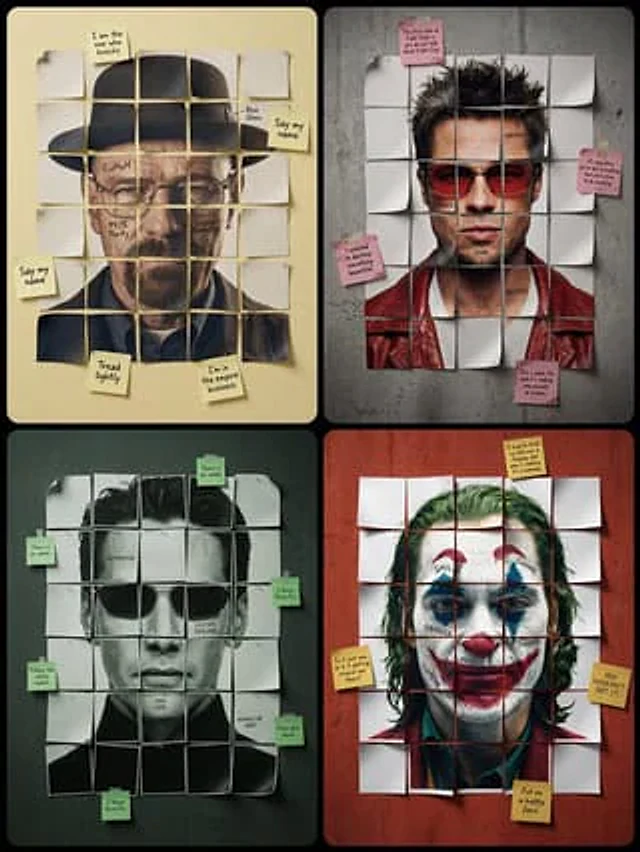

```text
A minimalist cinematic colored poster featuring a [Character Name]’s portrait from shoulders to the top of the head. The face is reconstructed using a small number of large, square-cut paper fragments arranged in a simple grid [around 4x5 or 5x6 pieces]. Each paper fragment contains a disjointed part of the face which together reconstruct the portrait. The internal paper fragments constituting the face are not perfectly flat; many have slightly curled edges and lifted corners, casting tiny, realistic shadows that give them a three-dimensional, tacked-down appearance. 4 of these squares have subtle black handwritten [text1, text2, text3, text4] directly on the skin/image. Scattered irregularly around the outer perimeter of this central grid in various randomly placed positions (not confined to the corners), several [Sticky Note Color] sticky notes are attached to the [Color] wall, containing handwritten [External Text Content, e.g., iconic quotes]. The overall layout is slightly irregular with visible gaps between the pieces showing [Color] concrete wall background. Realistic paper texture throughout, high-end studio lighting emphasizing the lifted edges, sharp focus on ink and paper grain.
```

Model: Nano Banana
Author: ΛRMIN | AI

[ProjectD](https://aitoolsradar.com/en/prompts/4dbb0b41c78ee6) · [Recorded source](https://x.com/Arminn_Ai/status/2019338808009920744)
 · [Full original metadata and byte evidence](data/projectd-batch-0069.json)

## ΛRMIN | AI #345

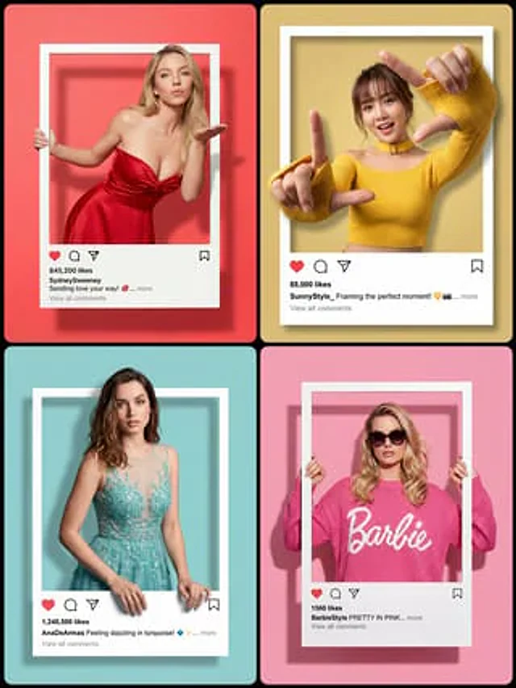

```text
A photorealistic fashion upper body shot of [Character Description and expression] wearing [Detailed Outfit Description]. The subject is framed inside a central white Instagram-style post border.

Composition & Spacing: The white frame is perfectly centered in the middle of the image, leaving balanced empty [Soft Background Color matching the outfit] space above and below the frame to match the theme.

Frame Details: The top, left, and right white borders are very thin. The bottom white section is thicker to include UI elements. The bottom section features a red heart icon, comment bubble, share icon, and bookmark icon.

Text Details: Clearly visible text on the bottom panel: "[Number] likes", username "[Username]", caption "[Caption text]... more", and below that, "View all comments".

3D Pop-Out Effect & Hand Pose:
[CHOOSE ONE OF THE FOLLOWING ACTIONS OR DESCRIBE YOUR OWN ACTION:]
 1. (Grip): head and arms are physically popping out OVER the top and side thin borders. hands are realistically gripping the outer edges of the thin side borders, appearing to hold the frame firmly.
2. (Kiss): Her body is leaning forward towards the camera, creating a strong sense of depth. Her head remains securely framed WITHIN the top thin white border. Only her right hand, raised near her mouth in a blowing-kiss gesture, physically extends forward and breaks OUT of the thin side frame boundary. Her left hand realistically grips the side edge.
3. (Resting): She is looking directly at the camera with a gentle smile. Her head and shoulders physically pop out OVER the top thin white border. Crucially, her hands are realistically resting comfortably on top of the thicker bottom white UI panel, appearing to lean casually on the frame edge.
4. (Dynamic Frame): Her upper body and head remain secure WITHIN the boundaries of the white frame. However, both of her arms are fully extended outward dynamically, breaking past the thin borders up to her elbows, reaching straight toward the camera lens. She forms a distinct “L” shape with both hands, as if framing a scene. Due to perspective, her hands are positioned significantly closer to the camera than her face, showing strong spatial depth.

Subject Dimensionality & Texture: The subject must look like a solid, three-dimensional figure, not flat. Emphasize the detailed texture of the [Specific Fabric Name from outfit description], the contours of the face, and realistic hair details. She should have distinct depth separating her from the flat [Background Color] background.

Lighting & Shadows: Professional studio lighting creating soft, realistic drop shadows cast by the physical frame and, crucially, by the [popping-out elements, e.g., hands/head/arms] onto the solid flat [Background Color] background, enhancing the dramatic depth and illusion. High definition, commercial photography.
```

Model: Nano Banana
Author: ΛRMIN | AI

[ProjectD](https://aitoolsradar.com/en/prompts/c7ddad52828085) · [Recorded source](https://x.com/Arminn_Ai/status/2016237325639155913)
 · [Full original metadata and byte evidence](data/projectd-batch-0069.json)

## ΛRMIN | AI #356

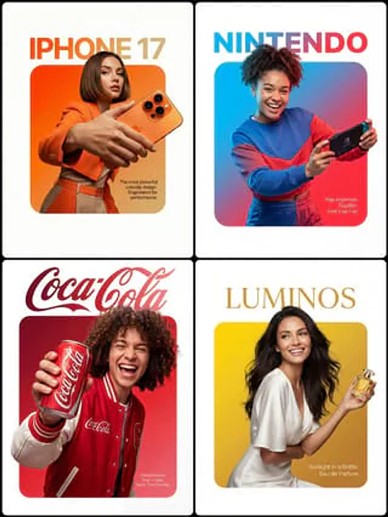

```text
A professional high-end graphic design advertisement composition on a pure solid white canvas. Centered is a perfectly symmetrical, large solid rounded square (not a hollow frame). The entire interior of this square is filled with a smooth, vibrant color gradient fading from [Top-Left Color/Hex] to [Bottom-Right Color/Hex].

A [Description of Character] is positioned such that the bottom of their torso is perfectly flush and aligned with the very bottom edge of the square, leaving no thick colored border visible beneath them. Crucially, the person and their clothing maintain natural, realistic colors and textures, illuminated by professional studio lighting that is independent of the background gradient (preventing any color cast on their skin or clothes).

They are firmly and realistically gripping [Product Description]. Crucially, the top of their head and hair break the top boundary of the square, partially overlapping the white background. Their hands and the [Product Name] also break the side boundaries for a powerful 3D breakout effect, extending onto the white canvas.

Typography Layout: At the top, in the white space distinctly above the square with a clear gap, is the [Font Style] brand text '[Brand Name]' in [Top Text Color]. In the bottom-right corner, layered directly on top of the gradient inside the square, is a block of small, thin, clean [Bottom Text Color] descriptive text: '[Slogan/Tagline]'.

The lighting is [Lighting Type: e.g., Sharp/Soft], crisp, and commercial, emphasizing the textures of both the subject and the product."
```

Model: Nano Banana
Author: ΛRMIN | AI

[ProjectD](https://aitoolsradar.com/en/prompts/638a73fb518f74) · [Recorded source](https://x.com/Arminn_Ai/status/2024563588602429812)
 · [Full original metadata and byte evidence](data/projectd-batch-0069.json)

## ΛRMIN | AI #397

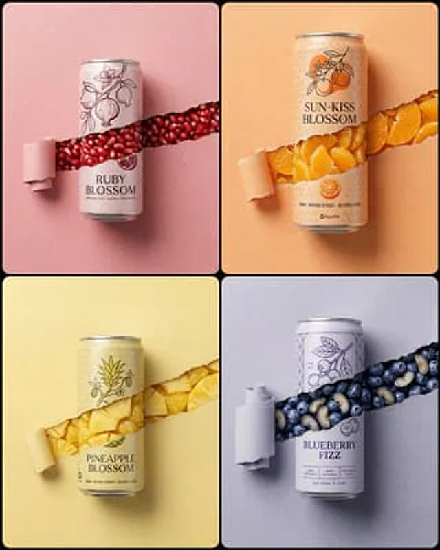

```text
A photorealistic, highly detailed commercial product photograph of a standard aluminum [Type of Soda Can] centered against a minimal, textured [Background Color] paper background, with subtle fibers visible. A single, continuous horizontal paper-tear strip runs across the entire width of the frame, seamless from the far-right edge to the far-left edge. The torn channel cuts through the metal body of the can and continues across the background on both sides with a barely perceptible and minimal diagonal slope towards the upper-left. The tear channel is significantly broader, revealing a dense, glistening, and vibrant layer of [Description of Fruit Segments/Sacs/Berries] tightly packed inside. Near the extreme far-left end of this tear, the paper is neatly rolled into a tight, realistic coil that occupies almost the entire left margin. The can features a newly designed, minimalist branding: the upper portion has a stylized, abstract line-art illustration of [Fruit Branch/Plant] in a contrasting [Ink Color], set against a subtle matte geometric [Pattern Type] pattern on the can surface. Below this, the brand name "[Brand Name]" is printed in an elegant, modern dark typography, with smaller technical text "330ml - NATURAL EXTRACT" and a small "Recyclable" logo. A small, detailed graphic of the fruit is located below the torn path. The lighting is soft and cinematic, casting delicate drop shadows beneath the torn paper edges and the large left coil. 8k resolution, macro details on fibrous paper and glossy fruit texture.
```

Model: Nano Banana
Author: ΛRMIN | AI

[ProjectD](https://aitoolsradar.com/en/prompts/3f96d0b38a26fa) · [Recorded source](https://x.com/Arminn_Ai/status/2027470188644626803)
 · [Full original metadata and byte evidence](data/projectd-batch-0069.json)

## ΛRMIN | AI #450

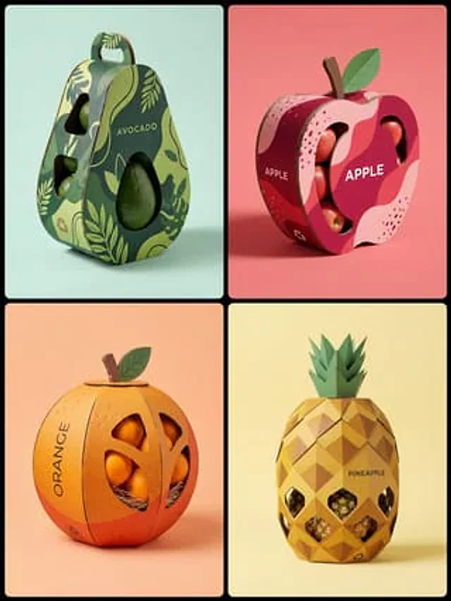

```text
A high-quality professional product photography of a creative structural packaging design for [Fruit Name]. The packaging is made of premium corrugated cardboard, intricately crafted into the literal shape of a giant stylized [Shape e.g. spherical, curved, elongated] [Fruit Name].

The exterior surface features a vibrant and sophisticated printed pattern of minimalist [Pattern Description e.g. geometric hexagons, organic wavy lines, dotted stippling, botanical line-art, or horizontal ridges], mimicking the Natural Skin of the Fruit in a duo-tone palette of [Color 1] and [Color 2].

Features clever die-cut windows that reveal the actual [Actual Product Inside] stored inside. Minimalist modern typography on the side saying "[NAME]". Includes eco-friendly details like a small recycling logo and a [3D Corrugated Cardboard Detail: Stem/green Leaf/Crown] on top. Soft studio lighting with gentle shadows, placed on a clean solid pastel [Background Color] background. 8k resolution, photorealistic, cinematic composition, industrial design aesthetic.
```

Model: Nano Banana
Author: ΛRMIN | AI

[ProjectD](https://aitoolsradar.com/en/prompts/07ccf04c43c8e0) · [Recorded source](https://x.com/Arminn_Ai/status/2022199501168038032)
 · [Full original metadata and byte evidence](data/projectd-batch-0069.json)

## ΛRMIN | AI #510

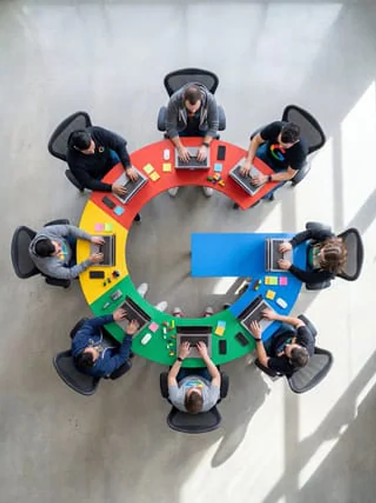

```text
Ultra-wide-angle hyper-realistic top-down flat lay photography. The central focus is a custom physical conference table meticulously shaped like [SHAPE/NUMBER/SYMBOL].

The table features [MATERIAL/TEXTURE/COLOR] and placed on a [FLOOR COLOR] floor, creating significant negative space around it for a clean, minimalist composition. A group of [NUMBER] real people are sitting around the edges of this [SHAPE]-shaped table. [POSITIONING: e.g., 3 on each side, 1 top/bottom]

Actions: [DESCRIBE PEOPLE'S ACTIONS, e.g., working on laptops, drinking coffee].
Lighting & Quality: Professional studio lighting with crisp, distinct drop shadows that define the [SHAPE] silhouette on the floor. 8k resolution, sharp focus, cinematic commercial aesthetic.
```

Model: Nano Banana
Author: ΛRMIN | AI

[ProjectD](https://aitoolsradar.com/en/prompts/5e9bf0435dadfd) · [Recorded source](https://x.com/Arminn_Ai/status/2017641664228085770)
 · [Full original metadata and byte evidence](data/projectd-batch-0069.json)

## ΛRMIN | AI #520

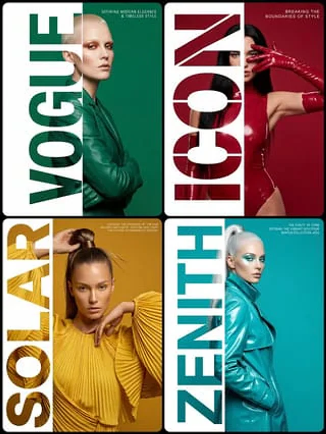

```text
Style & Composition: High-fashion editorial typography poster with a strict 1:2 composition split. Layout & Ratio: The frame is divided so that the right two-thirds show the full subject and background, while the left one-third is reserved for the typography masking section.

Typography Masking: A massive, ultra-bold, vertical word "[WORD]" is placed on the left third. The text is strictly full-bleed, stretching perfectly and touching the absolute top and absolute bottom edges of the frame with zero vertical padding, gaps, or margins. This typography acts as a stencil mask: the letters reveal the underlying character, while the space to the far left of the letters is a solid, clean white.

Subject Details & Positioning: An upper-body shot of [CHARACTER DESCRIPTION]. The model is positioned so that only her left-most side is visible through the letters, while the rest of her body is fully visible and contained on the right side against a solid [COLOR] background, ensuring no part of the subject is cropped by the right edge of the frame. Pose: [POSE DESCRIPTION], ensuring the silhouette remains within the center of the right two-thirds area.

Secondary Text: In the top right corner, add the text: "[TEXT]". Use a small, sophisticated, white "Helvetica Condensed" style font with wide letter spacing (kerning) for a premium, minimalist look. Color Palette: A strict monochromatic [COLOR] theme, sharply contrasted by the crisp white negative space on the left. 8k resolution, photorealistic textures, sharp studio lighting, high contrast, clean graphic design aesthetic.
```

Model: Nano Banana
Author: ΛRMIN | AI

[ProjectD](https://aitoolsradar.com/en/prompts/8c8740afadedd3) · [Recorded source](https://x.com/Arminn_Ai/status/2026374679276216569)
 · [Full original metadata and byte evidence](data/projectd-batch-0069.json)

## ΛRMIN | AI #582

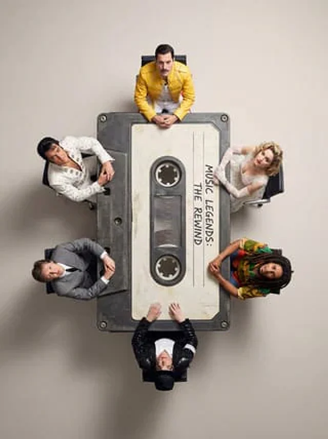

```text
Ultra-wide-angle hyper-realistic top-down flat lay photography. The central focus is a custom physical conference table meticulously shaped like [SHAPE/NUMBER/SYMBOL].

The table features [MATERIAL/TEXTURE/COLOR] and placed on a [FLOOR COLOR] floor, creating significant negative space around it for a clean, minimalist composition. A group of [NUMBER] real people are sitting around the edges of this [SHAPE]-shaped table. [POSITIONING: e.g., 3 on each side, 1 top/bottom]

Actions: [DESCRIBE PEOPLE'S ACTIONS, e.g., working on laptops, drinking coffee].
Lighting & Quality: Professional studio lighting with crisp, distinct drop shadows that define the [SHAPE] silhouette on the floor. 8k resolution, sharp focus, cinematic commercial aesthetic.
```

Model: Nano Banana
Author: ΛRMIN | AI

[ProjectD](https://aitoolsradar.com/en/prompts/e06edce7f9271b) · [Recorded source](https://x.com/Arminn_Ai/status/2017847584115548498)
 · [Full original metadata and byte evidence](data/projectd-batch-0069.json)

## ΛRMIN | AI #700

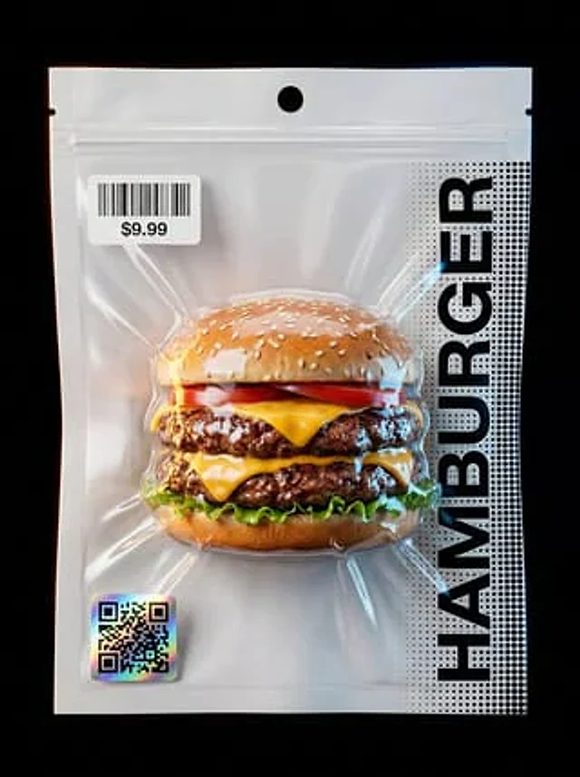

```text
Composition & Subject: A professional front-facing studio shot of a hyper-realistic [INSERT OBJECT] standing vertical. The object features intense textural details like [DESCRIBE OBJECT TEXTURES].
Pouch Structure (Dual Material): The vacuum-sealed pouch is composed of two distinct layers. The back layer is a solid, opaque, industrial matte-white material (providing a high-contrast backdrop). The front layer is crystal-clear, high-gloss transparent plastic, allowing the object to be seen with perfect clarity and sharp detail.

Vacuum Physics & Compression: The packaging demonstrates extreme vacuum-contoured compression. The plastic is sucked inward like a second skin, clinging tightly to the [DESCRIBE KEY PROTRUDING PARTS] of the object. This creates aggressive, sharp tension micro-folds and deep sculptural wrinkles that radiate from the object's silhouette. The pouch edges feature a crisp, industrial micro-dotted heat-seal pattern.

Packaging Detail: The top features a circular punch-hole for hanging display, located above a realistic zip-lock seal track. The vacuum effect is powerful, with the clear front plastic sucked tightly against the contours, creating sharp, ray-traced reflections and deep tension folds.

Graphics & Strategic Placement:
Upper Label: A crisp white thermal rectangular sticker with a barcode and price tag of "$[INSERT PRICE]" is placed at the top-left, positioned precisely below the zip-lock seal line.
Lower QR: A premium square holographic QR-code with prismatic iridescent reflections is located at the bottom-left corner.

Typography & Extended Pattern: The word "[INSERT OBJECT NAME IN CAPS]" is printed vertically in a bold black Swiss font along the right side, layered over a black halftone dot-matrix pattern that extends fully to the mid-point of the pouch and then gradually fades/dissolves from there towards the center, creating a sophisticated transition.

Lighting & Background: Set against a pitch-black minimalist background. Cinematic Amber and Electric Blue rim lighting outlines the silhouette, highlighting the contrast between the white back and the clear front plastic, ensuring a zero-flatness, 3D pop. Technical Specs: Commercial product photography, 8k, Unreal Engine 5.4 render style, macro-detail, zero-flatness, ultra-high contrast, focus on extreme transparency of the front layer.
```

Model: Nano Banana
Author: ΛRMIN | AI

[ProjectD](https://aitoolsradar.com/en/prompts/4baf1dc4c89ede) · [Recorded source](https://x.com/Arminn_Ai/status/2019847469165896077)
 · [Full original metadata and byte evidence](data/projectd-batch-0069.json)

## ΛRMIN | AI #714

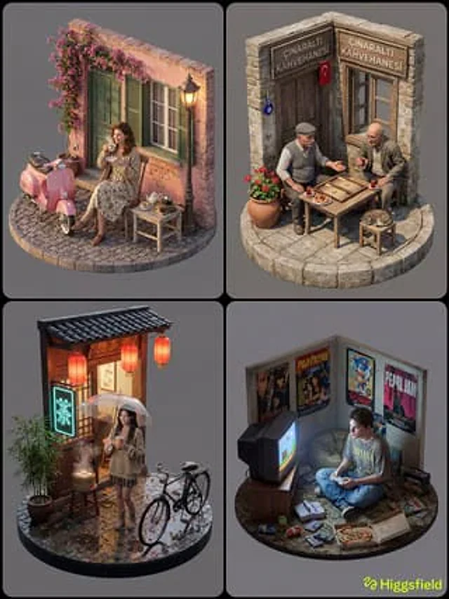

```text
Concept: A hyper-realistic 3D isometric view of a [INSERT LOCATION] scene on a circular base.
Subject (Visuals): A full-body, realistic human [INSERT DESCRIPTION].
* Texture Rule: The subject must have "Living Human Skin" texture (subsurface scattering, pores, natural imperfections).
* Important: He is NOT a toy/doll. He looks like a real person inserted into the scene.
* Pose: [INSERT POSE, e.g., Sitting naturally].

Composition & Scale (Crucial):
* Camera: Isometric wide shot (Full view). ensure the entire circular base, the subject, and all props are visible within the frame.
* Proportions: PERFECT RELATIVE SCALE. The props (e.g., scooter, table etc.) must be the correct size relative to the human. Do not make the human giant or the props tiny.

Environment: A realistic section of a [INSERT WALL/BUILDING] behind the subject.
* Material: Real weathered textures (brick, cement, wood), not painted model textures.

Props:
* [INSERT PROP 1, e.g., Vintage Vespa] (Real metal and chrome texture).
* [INSERT PROP 2, e.g., Pizza and Wine] (Real food texture).
* *Note:* Ensure all props are present and grounded on the base.

Technical Specs: Unreal Engine 5 render style, 8k resolution, global illumination, raytracing, sharp focus on the entire scene (deep depth of field), solid neutral grey background.

Negative Prompt: Toy, plastic, doll, action figure, clay, resin, shallow depth of field (blur), close-up, cropped, distorted proportions, giant head, cartoonish, missing limbs, unfinished.
```

Model: Nano Banana
Author: ΛRMIN | AI

[ProjectD](https://aitoolsradar.com/en/prompts/0660279bcc2fc4) · [Recorded source](https://x.com/Arminn_Ai/status/2008952931484098637)
 · [Full original metadata and byte evidence](data/projectd-batch-0069.json)

## ΛRMIN | AI #766

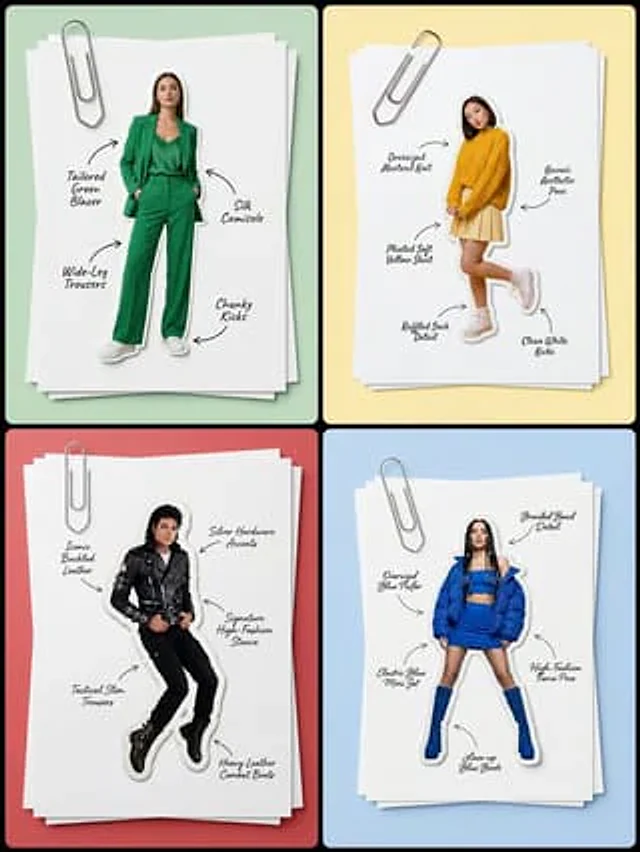

```text
Masterpiece, best quality, high resolution, 8k, (Photorealistic:1.4), (Vibrant natural colors:1.2), (Full body shot:1.6), minimalist fashion scrapbook page.
Subject: A full body fashion photo of [Character Description] standing in a [Pose]. The subject is wearing [Detailed Outfit]. The subject is a sharp, high-detail photographic cutout with sticker borders. The sticker has a die-cut white paper edge with visible paper-fiber texture on the cut-line. This white border has a subtle 3D thickness (beveled edge) that catches the light, creating a realistic micro-shadow.

Composition: Professional top-down flat-lay view. A thin stack of 3-4 clean-cut premium white paper sheets (smooth edges) placed on a seamless Soft [Color] background. Medium camera distance for a clear full-body view. A single, (prominent oversized silver metal trombone paperclip:1.5) at the top left corner, showing realistic metallic reflections and micro-scratches. 5 delicate hand-drawn black ink arrows pointing to specific fashion details:

"[Feature 1]" (pointing to [Detail]).
"[Feature 2]" (pointing to [Detail]).
"[Feature 3]" (pointing to [Detail]).
"[Feature 4]" (pointing to [Detail]).
All annotations are in refined, elegant handwritten cursive. Ray-traced ambient occlusion around the sticker's white border to emphasize physical elevation and depth. Ray-traced soft shadows between the paper layers. High-end editorial studio lighting. Visible tactile paper micro-texture throughout the character's edges, clean and modern high-fashion aesthetic. No grayscale, full color photography, no illustration.
```

Model: Nano Banana
Author: ΛRMIN | AI

[ProjectD](https://aitoolsradar.com/en/prompts/089deef6edf095) · [Recorded source](https://x.com/Arminn_Ai/status/2025283986860253292)
 · [Full original metadata and byte evidence](data/projectd-batch-0069.json)

## آ #1281

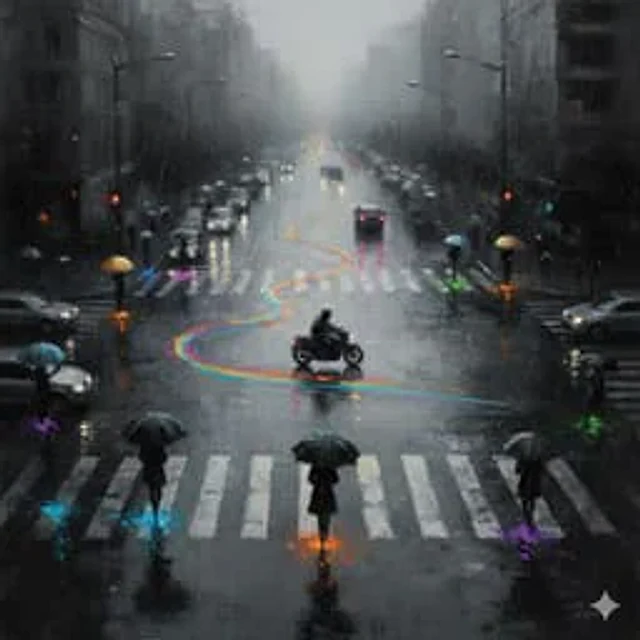

```text
A high-angle, wide-composition Impressionist oil painting of a rainy urban intersection. The scene is primarily monochrome with deep charcoal blacks and silvery grays, but features vibrant, colorful glowing lights at the footsteps of pedestrians crossing the street and beneath their umbrellas. A lone motorcyclist in the center leaves a trail of soft, colorful light, and car headlights emit small, brilliant pops of color. The style is heavily blurred and painterly, with loose, expressive brushstrokes and vague silhouettes, prioritizing mood and 'urban solitude' over sharp detail. The pavement is rain-soaked, reflecting both the gray sky and the neon-like colorful glows in shimmering, broken patterns. Misty atmosphere with distant buildings fading into soft tonal washes.
```

Model: Nano Banana
Author: آ

[ProjectD](https://aitoolsradar.com/en/prompts/278ffe5ff5031d) · [Recorded source](https://x.com/Mystveil7/status/2008178703705297280)
 · [Full original metadata and byte evidence](data/projectd-batch-0069.json)

## قطر نولوجي #1167

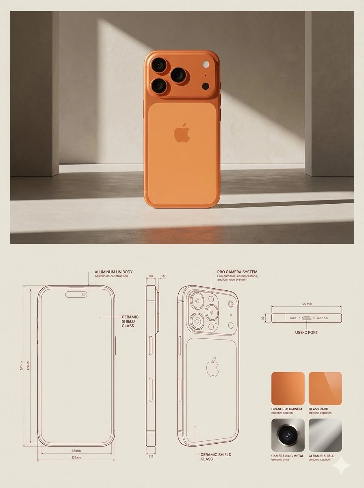

```text
{
 "reference_images": {
 "product_image": "UPLOADED_IMAGE",
 "usage_rule": "Use the uploaded image as the exact visual reference for the product’s form, proportions, materials, and overall identity. Do not redesign or reinterpret the product."
 },

 "layout": {
 "canvas": {
 "orientation": "vertical",
 "aspect_ratio": "3:4",
 "background": "warm neutral paper-like surface"
 },
 "structure": {
 "top_section": "lifestyle_hero",
 "bottom_section": "technical_specification"
 }
 },

 "top_section": {
 "type": "lifestyle_product_image",
 "composition": {
 "placement": "top_center",
 "scale": "dominant",
 "margin": "generous whitespace around product"
 },
 "environment": {
 "setting": "minimal architectural interior",
 "lighting": {
 "type": "natural sunlight",
 "direction": "angled side light",
 "quality": "soft but high-contrast shadows"
 },
 "floor": "subtle concrete or stone surface",
 "background": "textured plaster wall"
 },
 "rendering": {
 "style": "editorial lifestyle photography",
 "detail": "high realism",
 "color_grading": "warm, muted, premium"
 }
 },

 "bottom_section": {
 "type": "technical_specification_panel",
 "layout": {
 "grid": "modular",
 "alignment": "clean, architectural"
 },

 "technical_drawings": {
 "placement": "bottom_left_and_center",
 "style": "architectural line drawings",
 "views": [
 "front view",
 "side view",
 "three-quarter cutaway or profile view"
 ],
 "projection": "orthographic",
 "line_style": {
 "color": "muted red or sepia",
 "weight": "fine technical lines"
 },
 "annotations": {
 "type": "measurement and construction callouts",
 "language": "neutral technical labels",
 "density": "minimal, editorial"
 }
 },

 "materials_panel": {
 "placement": "bottom_right",
 "content": {
 "type": "material_swatches",
 "count": "3-4 depending on product",
 "format": "square or rectangular samples"
 },
 "textures": {
 "source": "derived from the product materials",
 "examples": [
 "fabric",
 "leather",
 "metal",
 "wood",
 "plastic"
 ]
 },
 "labels": {
 "style": "small editorial captions",
 "tone": "technical but refined"
 }
 }
 },

 "typography": {
 "style": "minimal editorial",
 "usage": "subtle captions, no large headlines",
 "color": "soft black or dark brown"
 },

 "overall_style": {
 "mood": "design catalog / product design journal",
 "aesthetic": "architectural, premium, calm",
 "avoid": [
 "clutter",
 "bold colors",
 "heavy branding",
 "overly decorative graphics"
 ]
 },

 "constraints": {
 "do_not": [
 "change product design",
 "invent new materials",
 "add logos unless present in reference",
 "use perspective distortion in drawings"
 ]
 }
}
```

Model: Nano Banana
Author: قطر نولوجي

[ProjectD](https://aitoolsradar.com/en/prompts/36bed774cbfe99) · [Recorded source](https://x.com/qatnology/status/2017687421509406831)
 · [Full original metadata and byte evidence](data/projectd-batch-0069.json)

## ராஜேஷ் #1130

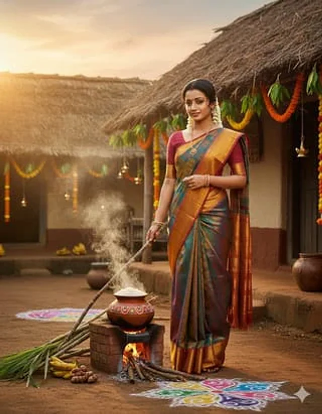

```text
{
  "prompt": "Using the uploaded reference image, generate a highly realistic full-body portrait of the SAME person with 100% identical facial structure, skin tone, facial proportions, and overall identity. Do NOT alter the face in any way.\n\nA proud South Indian woman celebrating the Thaipongal festival, standing gracefully in a traditional rural Tamil village courtyard at sunrise. She is wearing an elegant traditional silk saree (Kanjivaram-style) in rich festive colors with a gold zari border, draped authentically. A matching blouse complements the saree. Her hair is neatly styled in a traditional manner, adorned with fresh jasmine flowers (mallipoo). A subtle sandalwood or kumkum tilak is visible on her forehead. She holds a long brown leafy sugarcane stalk gently in one hand.\n\nIn the foreground, a decorated clay Pongal pot is boiling over on a wood-fired brick stove, with rice frothing out, symbolizing prosperity. Beside the stove are tied brown sugarcane stalks, fresh turmeric plants, bananas, and intricate colorful kolam (rangoli) designs drawn on the ground.\n\nThe background features a rustic mud house with a thatched roof, decorated with mango-leaf torans, marigold flower garlands, and hanging clay oil lamps. Warm golden sunrise light fills the scene, with soft smoke rising from firewood, creating a joyful and auspicious festive atmosphere.\n\nUltra-realistic cinematic lighting, shallow depth of field, natural South Indian skin texture, authentic Tamil rural aesthetic, 8K ultra-detailed quality, vertical composition, cultural accuracy, festive mood.",
  "style": "cinematic realism, South Indian traditional portrait",
  "lighting": "warm golden sunrise light, soft cinematic glow",
  "environment": "traditional Tamil rural village courtyard",
  "camera": "professional portrait photography, shallow depth of field",
  "quality": "ultra-realistic, 8K, highly detailed",
  "composition": "full-body, vertical frame",
  "constraints": "face must remain 100% identical to the uploaded reference image with absolutely no facial modification"
}
```

Model: Nano Banana
Author: ராஜேஷ்

[ProjectD](https://aitoolsradar.com/en/prompts/fb669a514aa15f) · [Recorded source](https://x.com/r4jjesh/status/2011629245949493378)
 · [Full original metadata and byte evidence](data/projectd-batch-0069.json)

## ராஜேஷ் #1213

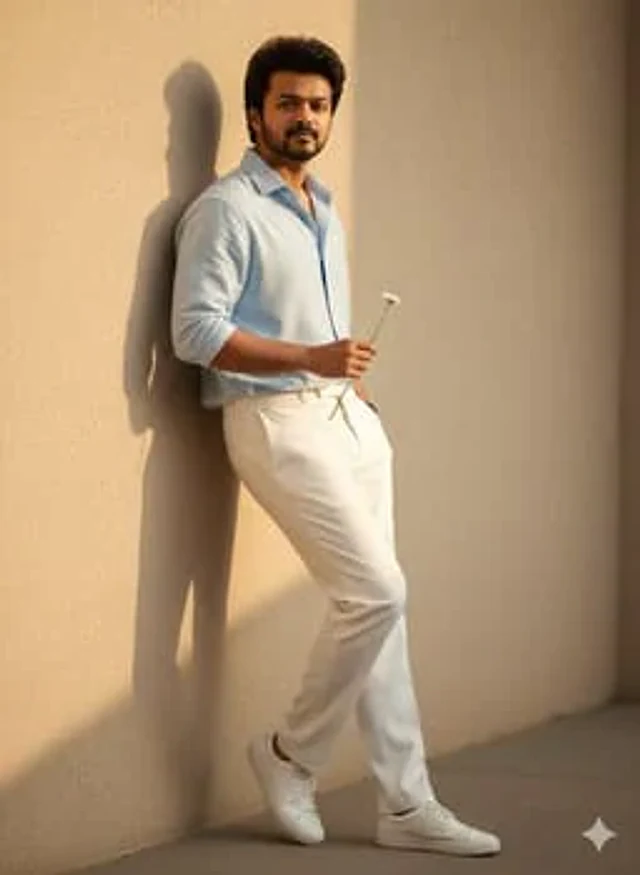

```text
{
  "prompt": "Using the uploaded reference image of a 30-year-old adult, generate a highly realistic cinematic fashion editorial photoshoot. The person is leaning casually against a beige textured wall, body slightly angled, one shoulder resting on the wall, conveying relaxed confidence.\n\nOutfit: a loose pastel blue button-down shirt with casually rolled-up sleeves, tailored white relaxed-fit trousers, and clean minimalist white or blue-white sneakers. Styling is modern, elegant, and effortless.\n\nPose & expression: stylish adult pose with natural posture — one hand in pocket, the other holding a small white daisy flower. Facial expression is calm, confident, and self-assured, with a soft editorial gaze.\n\nLighting & atmosphere: warm natural sunlight streaming from the side, creating soft highlights and gentle shadows on the wall and face. Sunlit, airy mood with cinematic depth.\n\nVisual style: high-end fashion editorial aesthetic, natural skin texture, crisp fabric details, refined neutral color palette.\n\nCamera & quality: professional fashion photography, shallow depth of field, cinematic framing, ultra-realistic 8K quality.\n\nOverall feel: modern, minimal, sunlit lifestyle fashion campaign.",
  "style": "cinematic, high-end adult fashion editorial",
  "lighting": "warm natural sunlight, soft shadows",
  "background": "minimal beige wall, sunlit texture",
  "quality": "ultra-realistic, 8K, ultra-sharp",
  "camera": "professional fashion photography, shallow depth of field",
  "mood": "clean, modern, confident, relaxed"
}
```

Model: Nano Banana
Author: ராஜேஷ்

[ProjectD](https://aitoolsradar.com/en/prompts/4c5e911b676103) · [Recorded source](https://x.com/r4jjesh/status/2011420581695242358)
 · [Full original metadata and byte evidence](data/projectd-batch-0069.json)

## ராஜேஷ் #448

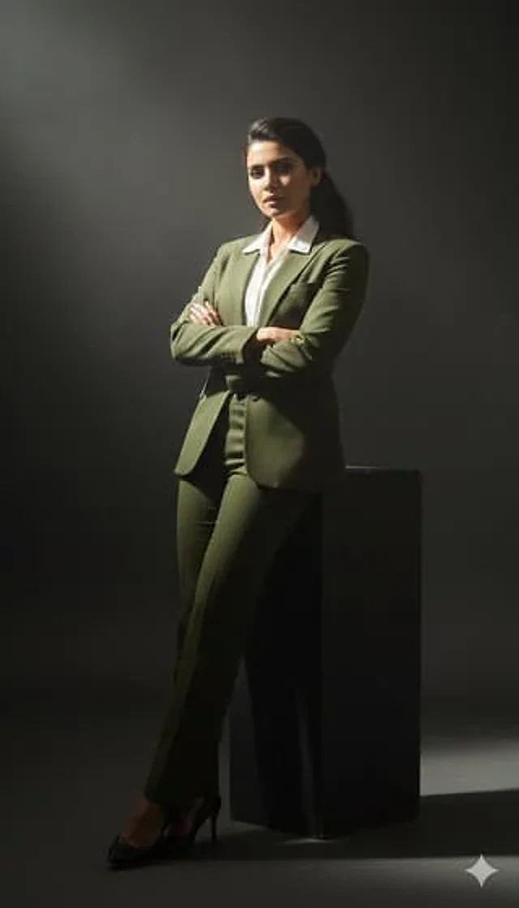

```text
{
  "prompt": "Cinematic full-body studio portrait of a subject using the uploaded face as exact reference (preserve identity, facial structure, and proportions). Slightly low-angle perspective with a 35mm lens for a commanding, sophisticated presence. Subject leaning casually against a dark minimalist plinth, arms crossed. Wearing a perfectly tailored slim-fit olive green suit and a crisp white dress shirt, top buttons undone. Intense chiaroscuro lighting with a single powerful volumetric spotlight from the upper-left, cutting through subtle atmospheric haze with swirling smoke and micro-dust particles. Sharp rim highlights along shoulders and silhouette, deep velvety shadows across the body, high-contrast moody aesthetic. Hyper-realistic textures, visible fabric weave, subtle reflections on a polished studio floor, professional cinematic lighting, ultra-detailed, 8K resolution, no text, no watermark.",
  "resolution": "7680x4320",
  "camera": {
    "lens": "35mm",
    "angle": "slightly low-angle",
    "aperture": "f/2.0",
    "iso": "100",
    "shutter_speed": "1/125"
  },
  "quality": "ultra-high",
  "style": "cinematic, hyper-realistic, studio photography",
  "negative_prompt": "blurry, low-resolution, overexposed, underexposed, flat lighting, cartoon, CGI, plastic skin, extra limbs, distorted hands, bad anatomy, asymmetry, watermark, logo, text"
}
```

Model: Nano Banana
Author: ராஜேஷ்

[ProjectD](https://aitoolsradar.com/en/prompts/a1b5fddb529cee) · [Recorded source](https://x.com/r4jjesh/status/2020480621026705858)
 · [Full original metadata and byte evidence](data/projectd-batch-0069.json)

## ராஜேஷ் #733

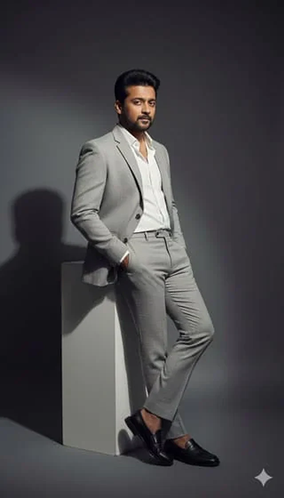

```text
{
  "prompt": "Ultra-realistic high-end fashion editorial portrait of an adult man, 100% using the uploaded reference image for exact face, identity, facial structure, and expression (no changes or stylization). The subject is leaning casually against a tall white rectangular pedestal in a minimal studio environment. Pose must match the reference exactly: body angled sideways, left hip resting on the pedestal, one hand casually placed inside the trouser pocket, the other relaxed by the thigh. One leg straight on the ground, the other slightly bent at the knee, feet crossed naturally at the ankles.\n\nHe is wearing a tailored light grey textured suit with slim-fit trousers and a matching blazer, paired with a white button-down shirt worn casually open at the collar (no tie). Black leather loafers with a visible ankle gap, clean and elegant styling.\n\nFacial details preserved from the reference: sharp masculine jawline, light stubble beard, defined cheekbones, neatly styled dark hair swept back. Expression is serious and calm, eyes looking slightly off-camera to the side.\n\nLighting is dramatic with hard side lighting from a single direction, creating strong, sharp shadows and a clear silhouette shadow of the subject projected onto the wall behind him. High-contrast light-and-shadow geometry enhances the cinematic editorial mood.\n\nBackground consists of a smooth dark grey studio wall and floor, minimalist and distraction-free, with no props other than the pedestal. Luxury fashion magazine aesthetic, ultra-sharp focus, realistic skin texture, fine fabric details, cinematic contrast. DSLR photography look with an 85mm lens, shallow depth of field, muted neutral color grading. Vertical composition, premium editorial quality, 8K photorealism.",
  "aspect_ratio": "4:5",
  "resolution": "8K",
  "camera_lens": "85mm",
  "style": "luxury fashion editorial, cinematic",
  "lighting": "dramatic hard side lighting, high contrast",
  "quality": "ultra-realistic, premium",
  "reference_image": "strictly use uploaded image only"
}
```

Model: Nano Banana
Author: ராஜேஷ்

[ProjectD](https://aitoolsradar.com/en/prompts/46c4d688b8b7f0) · [Recorded source](https://x.com/r4jjesh/status/2008770294253842780)
 · [Full original metadata and byte evidence](data/projectd-batch-0069.json)

## ராஜேஷ் #831

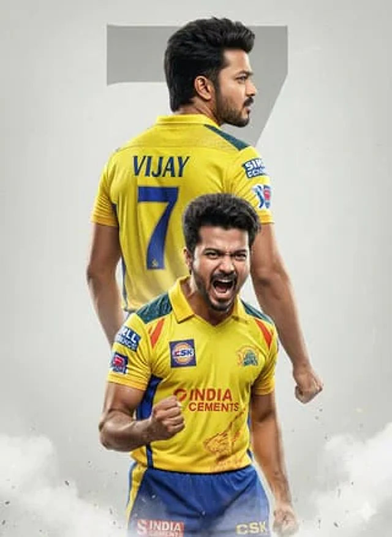

```text
An ultra-realistic cinematic cricket poster featuring a young Indian male cricketer using the uploaded reference face exactly (100% facial accuracy). He has a fair-whitish glass skin tone, soft red lips, sharp jawline, light stubble beard, and a voluminous slightly messy fade mullet hairstyle with natural texture. The composition is a triple-layer cinematic layout on a clean, textured light-grey studio background, with a large, softly embedded “77” subtly visible behind the subject. Primary dominant pose (upper background): The cricketer is shown from the back, standing tall and confident, wearing an official Chennai Super Kings (CSK) jersey in bright yellow with blue accents. Bold blue typography on the jersey reads “VIJAY” with the number “77” below it. His athletic physique is emphasized, shoulders squared, as he slightly turns his head over the shoulder, revealing an intense, fearless side profile. Foreground action pose (half body): A powerful celebration moment captures him mid-roar, mouth open in victory, right fist clenched and arm flexed. He wears the complete CSK match kit, including yellow-blue trousers, and ground texture. The CSK logo and sponsor details appear authentic and sharp. Sweat highlights on the skin add realism, with cinematic rim lighting separating the face from the background. Atmosphere & lighting: Premium cinematic studio lighting with balanced highlights and shadows enhances fabric folds, muscle definition, and facial contours. Subtle smoke and dust effects rise from the base, adding intensity without obscuring details. No blur, no distortion. Camera & quality: DSLR photography look, 85mm lens feel, shallow depth where needed, ultra-sharp focus, realistic proportions, professional color grading with rich yellow, blue, and gold tones. Photorealistic, 8K resolution, vertical poster composition, IPL magazine-cover style. No cartoon look, no extra limbs, no facial alteration, no watermark.

RCB :

An ultra-realistic cinematic cricket poster featuring a young Indian male cricketer using the uploaded reference face exactly (100% facial accuracy). He has a fair-whitish glass skin tone, soft red lips, sharp jawline, light stubble beard, and a voluminous slightly messy fade mullet hairstyle with natural texture.
The composition is a triple-layer cinematic layout on a clean, textured light-grey studio background, with a large, softly embedded “3” subtly visible behind the subject.
Primary dominant pose (upper background):
The cricketer is shown from the back, standing tall and confident, wearing an official Royal Challengers Bangalore (RCB) jersey in deep red and black with gold accents. Bold golden typography on the jersey reads “STR” with the number “33” below it. His athletic physique is emphasized, shoulders squared, as he slightly turns his head over the shoulder, revealing an intense, fearless side profile.
Foreground action pose (half body):
A powerful celebration moment captures him mid-roar, mouth open in victory, right fist clenched and arm flexed. He wears the complete RCB match kit, including black-red trousers, and ground texture. The RCB logo and sponsor details appear authentic and sharp.
Sweat highlights on the skin add realism, with cinematic rim lighting separating the face from the background.
Atmosphere & lighting:
Premium cinematic studio lighting with balanced highlights and shadows enhances fabric folds, muscle definition, and facial contours. Subtle smoke and dust effects rise from the base, adding intensity without obscuring details. No blur, no distortion.
Camera & quality:
DSLR photography look, 85mm lens feel, shallow depth where needed, ultra-sharp focus, realistic proportions, professional color grading with rich reds, blacks, and gold tones.
Photorealistic, 8K resolution, vertical poster composition, IPL magazine-cover style.
No cartoon look, no extra limbs, no facial alteration, no watermark.
```

Model: Nano Banana
Author: ராஜேஷ்

[ProjectD](https://aitoolsradar.com/en/prompts/dc971ef5a447fe) · [Recorded source](https://x.com/r4jjesh/status/2018214780935549253)
 · [Full original metadata and byte evidence](data/projectd-batch-0069.json)

## Ꮋꭼꭺꭱꭲ Ꮋꭺꮯꮶꭼꭱ 💫 #1298

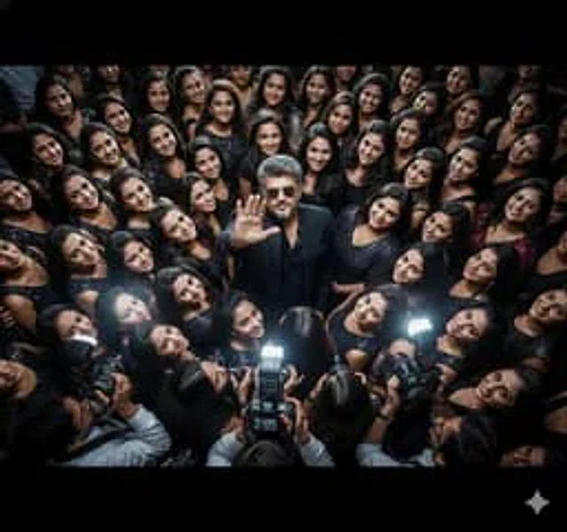

```text
{
  "prompt": "A hyper-realistic, ultra-detailed 8K cinematic photograph captured from a high-angle perspective using a wide-angle lens, looking directly downward into a dense, almost circular crowd, creating a strong sense of enclosure and spotlight focus.\n\nAt the center stands a confident man wearing a dark tailored suit with a dark collared shirt and round sunglasses. Use the uploaded face strictly as reference to preserve the exact identity and facial features. His right hand is raised toward the camera with the palm facing outward in a clear 'stop' or 'talk to the hand' gesture, conveying authority and control.\n\nHe is completely surrounded by a tightly packed crowd of smiling women, forming a near-perfect circle around him. The women are dressed in dark, elegant, or subtly shimmering evening attire. Their faces and shoulders densely fill the mid-ground, many looking toward the central man or directly at the camera, enhancing the sense of attention and chaos.\n\nIn the immediate foreground at the bottom of the frame, multiple photographers are visible holding professional DSLR cameras equipped with large external flash units. The flashes are actively firing, producing intense, direct frontal lighting on the central figures.\n\nLighting and mood: Dramatic, high-contrast paparazzi-style lighting with blown-out highlights on faces and clothing, sharp rim lighting on some figures, and deep, near-black shadows in the background. The lighting emphasizes a glamorous yet chaotic paparazzi frenzy.\n\nVisual quality: Extremely sharp focus on the main subjects, hyper-detailed textures on skin, fabric, sunglasses, and camera equipment. Cinematic color grading, realistic skin tones, shallow depth of field where appropriate, premium editorial photography aesthetic.",
  "negative_prompt": "low resolution, blur, soft focus, cartoon, illustration, CGI, distorted anatomy, extra limbs, extra fingers, washed-out colors, flat lighting, studio setup, empty background, watermark, logo, text",
  "aspect_ratio": "2:3",
  "style": "hyper-realistic cinematic",
  "lighting": "high-contrast paparazzi flash lighting",
  "camera": "DSLR, wide-angle lens, high-angle shot",
  "resolution": "8K",
  "quality": "ultra high"
}
```

Model: Nano Banana
Author: Ꮋꭼꭺꭱꭲ Ꮋꭺꮯꮶꭼꭱ 💫

[ProjectD](https://aitoolsradar.com/en/prompts/28ab6f68816b06) · [Recorded source](https://x.com/hearthacker031/status/2010175109013877160)
 · [Full original metadata and byte evidence](data/projectd-batch-0069.json)

## みどり🐲Midori Tatsuta #553


```text
style_preset: "Zodiac Astrology VTuber Logo Aesthetics (Celestial Ver.)"
global_settings:
  vibe: "Mystical, celestial, cosmic wisdom, divination, stargazing"
  background: "Pure white background (for isolation)"
  rendering:
    - "Elegant, celestial vector-style finish"
    - "Deep midnight blue and shining gold palette"
    - "Thin elegant layered outlines with star accents"
    - "Glowing star effects and celestial glow"
drawing_rules:
  line_quality: "Thin, elegant curves with constellation line art accents."
  character_design:
    - "Integrated constellation and tarot motifs woven into the letters"
    - "Custom stylized font: elegant, celestial shapes with star dot accents"
  typography_style:
    - "Main Title: Large, stylized Japanese with constellation dot patterns"
    - "Subtitle: Smaller English text in an elegant celestial font"
  ornament_rule:
    - "Strictly follow the 'ornaments_selection' provided in the USER INPUT SECTION"
    - "Distribute ornaments to create a 'celestial reading' visual impact"
visual_parameters:
  color_palette:
    primary: "Deep midnight blue and shining gold gradient"
    secondary: "Thin gold inner border + Midnight blue outer stroke"
    accents: "Constellation lines, zodiac symbols, and star glow"

# ----------------------------------------------------------
# USER INPUT SECTION (下記を自由に編集してね)
# ----------------------------------------------------------
request:
  input_text: "星読み" # ← ここを好きな名前に変更
  subtitle: "Astrology" # ← 小さく表示したい文字
  motif_concept: "星座図とタロットカード" # ← ここを好きな動物やモノに変更

  custom_colors: "ミッドナイトブルーとシャイニングゴールド" # ← 好きな色を指定

  ornaments_selection:
    - "星座線 (Zodiac constellation lines)"
    - "タロットカード (Tarot card borders)"
    - "三日月 (Crescent moon)"
    - "太陽 (Radiant sun)"
    - "魔法陣 (Mystical magic circle)"
```

Model: Nano Banana
Author: みどり🐲Midori Tatsuta

[ProjectD](https://aitoolsradar.com/en/prompts/ecd5f1c9d9a5f6) · [Recorded source](https://x.com/midori_tatsuta/status/2039682237751509053)
 · [Full original metadata and byte evidence](data/projectd-batch-0069.json)

## 𓆩𝐀𝐛𝐢𝐝 𝐇𝐮𝐬𝐬𝐚𝐢𝐧𓆪 #1163

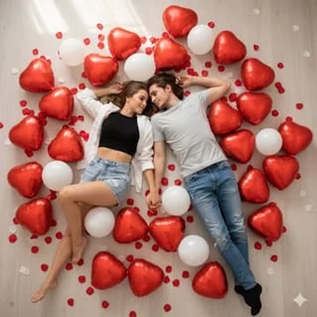

```text
A hyper-realistic 8k high-angle overhead shot, captured with a wide-angle lens, presents a romantic scene of a couple lying on a light-colored wooden floor. The lighting is soft and natural, possibly from a window, creating gentle highlights on the balloons and subtle shadows on the floor, contributing to a cinematic atmosphere. The female subject, uploaded face as reference, is positioned on her back, wearing a black crop top, light blue denim shorts, and a white unbuttoned shirt draped over her. Her left arm is bent with her hand near her head, and her right arm is gently extended towards the male. The male subject, uploaded face as reference, is also on his back, wearing a light grey t-shirt and light blue distressed denim jeans. His left arm is bent, hand near the female's head, and his right arm is relaxed. They are lying close together, heads touching, looking into each other's eyes with soft, affectionate smiles. The entire floor around and between them is densely decorated with a multitude of shiny red heart-shaped foil balloons of varying sizes, interspersed with several white round latex balloons, and countless small red and white rose petals, creating a highly detailed texture and vibrant color contrast against the light wood. The composition is a full-body shot, showcasing the couple and the extensive, immersive decorations.
```

Model: Nano Banana
Author: 𓆩𝐀𝐛𝐢𝐝 𝐇𝐮𝐬𝐬𝐚𝐢𝐧𓆪

[ProjectD](https://aitoolsradar.com/en/prompts/60eddedf4b1bdc) · [Recorded source](https://x.com/AbidkingB/status/2022667985039823362)
 · [Full original metadata and byte evidence](data/projectd-batch-0069.json)

## 𓆩𝐀𝐛𝐢𝐝 𝐇𝐮𝐬𝐬𝐚𝐢𝐧𓆪 #845

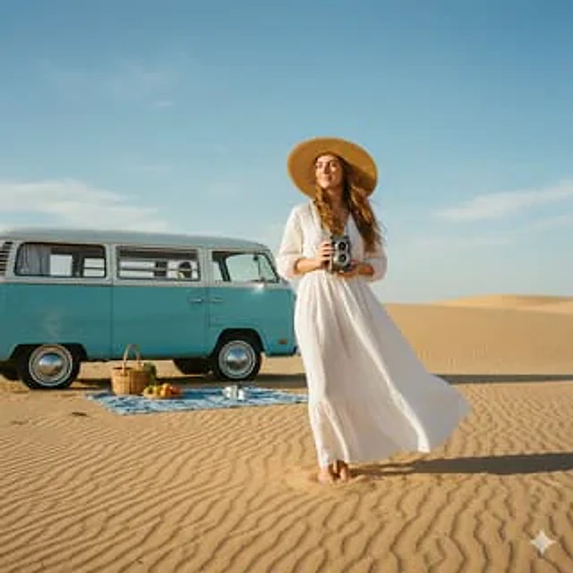

```text
A wide shot of a woman in an airy white linen maxi dress and a wide-brimmed straw hat, standing in a vast, sun-drenched desert. She holds a vintage camera, smiling softly. Behind her, a classic light blue camper van is parked next to a picnic spread on a blue blanket. Soft ripples in the sand and a clear blue sky create a peaceful, bohemian travel aesthetic.
```

Model: Nano Banana
Author: 𓆩𝐀𝐛𝐢𝐝 𝐇𝐮𝐬𝐬𝐚𝐢𝐧𓆪

[ProjectD](https://aitoolsradar.com/en/prompts/d13b4b9dc1a075) · [Recorded source](https://x.com/AbidkingB/status/2023968383021314440)
 · [Full original metadata and byte evidence](data/projectd-batch-0069.json)

## 两斤 #1171

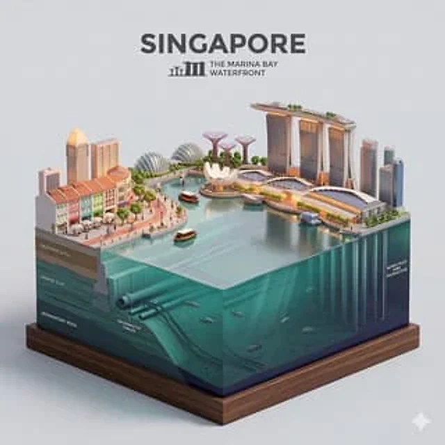

```text
Present a clear, side-facing isometric miniature 3D cartoon diorama of [CITY] along the [WATERFRONT]. The scene is a clean vertical cross-section slice — the city is cut open like a museum specimen, mounted on a small raised diorama-style base that exposes the full stratigraphy from rooftop to riverbed.

Above the waterline: a curated selection of [CITY]'s most iconic waterfront elements — layered building facades in local architectural style, embankment promenade, bridges, trams or cyclists, warm soft ambient lighting. Tiny stylized figures of residents in casual attire — walking, cycling, sitting at waterfront cafés (no facial details).

The water surface is a clean glassy horizontal band — cartoon-stylized, slightly transparent, acting as the visual threshold between the two worlds.

Below the waterline: the geographically honest submerged anatomy of [CITY]'s [WATERFRONT] — accurate foundation and piling types, real underwater infrastructure, sediment and substrate layers appropriate to this specific body of water, local aquatic life rendered in the same soft cartoon style. Tiny stylized fish, slow-drifting particulate, refracted light shafts filtering down from the surface.

The cross-section cut edge is razor-clean — pavement strata, foundations, soil layers, and underwater geology all simultaneously visible in the base wall, like a natural history diorama exhibit.

Style: soft refined textures, realistic PBR materials, immersive ambient lighting. Color language: warm amber and golden tones above the waterline, cold teal-green and deep indigo below, blending at the water threshold. Ultra-clean, high-clarity 3D cartoon diorama aesthetic.

Use a clean solid [BACKGROUND COLOR] background. At the top-center, display "[CITY]" in large bold text, and place the waterfront name or a city landmark silhouette emblem below the text. All text must automatically match background contrast.

Composition: perfectly centered layout, square 1080x1080.
```

Model: Nano Banana
Author: 两斤

[ProjectD](https://aitoolsradar.com/en/prompts/904f86df1b3916) · [Recorded source](https://x.com/0x00_Krypt/status/2033888375619637274)
 · [Full original metadata and byte evidence](data/projectd-batch-0069.json)

## 两斤 #1181

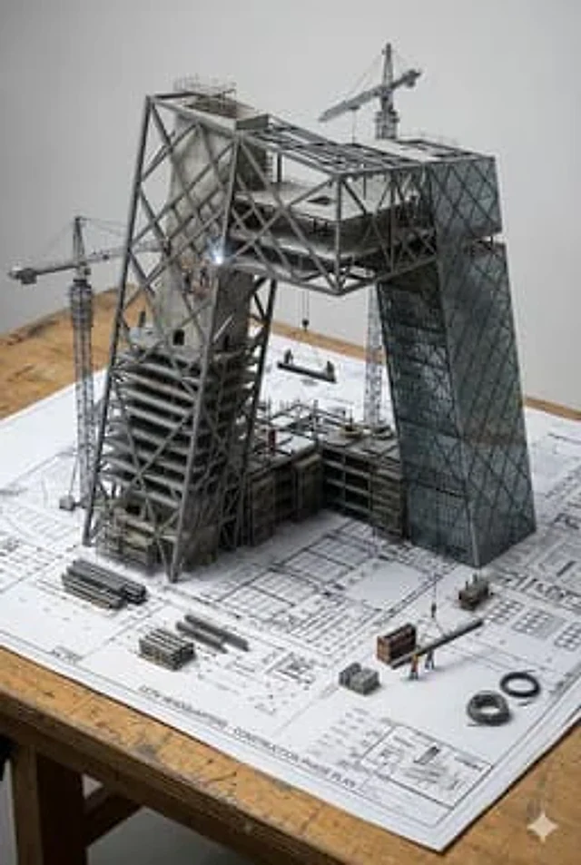

```text
An architectural blueprint of {BUILDING_NAME} placed on a {SURFACE}, with a photorealistic miniature under-construction version of {BUILDING_NAME} emerging from it — {STRUCTURAL_ELEMENT_1}, {STRUCTURAL_ELEMENT_2}, {STRUCTURAL_ELEMENT_3}, {CONSTRUCTION_DETAIL}, {WORKER_SCENE}, {MATERIAL_ELEMENT}, and {EXTRA_DETAIL}. All elements grow from the blueprint like a 3D architectural diorama, steel beams rising from the drawn lines, scaffolding threading through the paper. Studio soft lighting, cinematic depth, 2:3
```

Model: Nano Banana
Author: 两斤

[ProjectD](https://aitoolsradar.com/en/prompts/80ef7b72169ec0) · [Recorded source](https://x.com/0x00_Krypt/status/2034216567253373196)
 · [Full original metadata and byte evidence](data/projectd-batch-0069.json)

## 两斤 #360

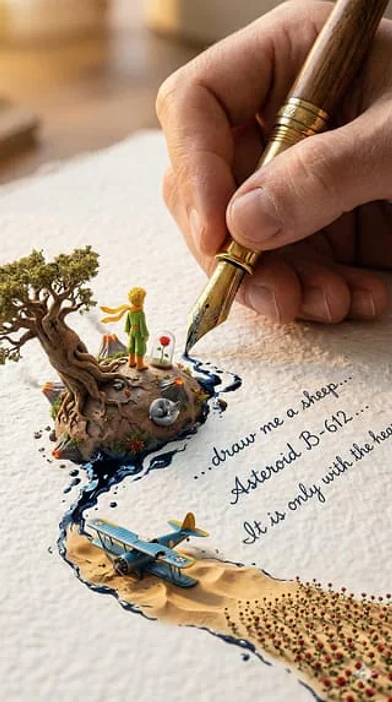

```text
A colossal hand gripping an enormous vintage fountain pen, captured in vertical portrait format (9:16), writing on endless textured paper that fills the frame. Where the ink flows, the story of [BOOK_NAME] bursts into vivid life — [iconic characters, key objects, and signature scenes from [BOOK_NAME] emerging as tiny miniature figures on the paper, each no larger than a fingernail, ultra-miniature scale]. The miniature world cascades downward across the page as the pen moves, characters frozen mid-story, ink still wet at the edges where they emerge. Extreme close-up of the enormous pen nib touching paper, ink bleeding into fiber, fingertips with visible skin texture. Warm amber and soft golden light raking across the paper surface, deep shadows, cinematic depth of field, magical realism, hyper-detailed, photorealistic, 8K, --ar 9:16
```

Model: Nano Banana
Author: 两斤

[ProjectD](https://aitoolsradar.com/en/prompts/6bb3c183f97b74) · [Recorded source](https://x.com/0x00_Krypt/status/2028390369902174550)
 · [Full original metadata and byte evidence](data/projectd-batch-0069.json)

## 两斤 #436

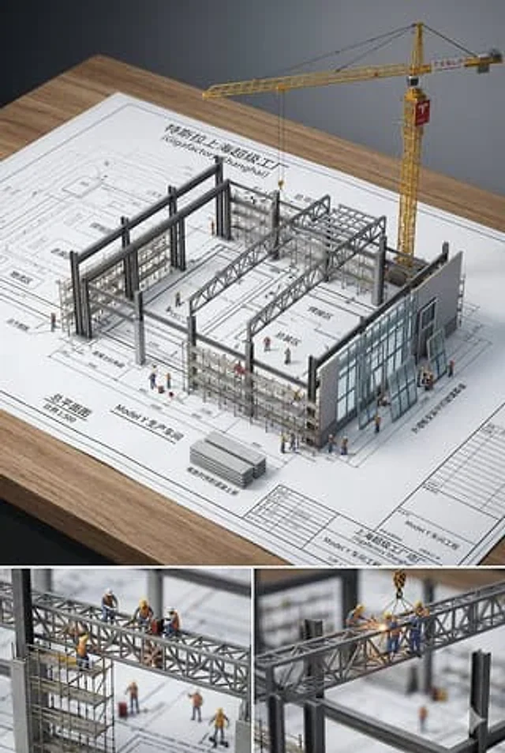

```text
An architectural blueprint of {BUILDING_NAME} placed on a {SURFACE}, with a photorealistic miniature under-construction version of {BUILDING_NAME} emerging from it — {STRUCTURAL_ELEMENT_1}, {STRUCTURAL_ELEMENT_2}, {STRUCTURAL_ELEMENT_3}, {CONSTRUCTION_DETAIL}, {WORKER_SCENE}, {MATERIAL_ELEMENT}, and {EXTRA_DETAIL}. All elements grow from the blueprint like a 3D architectural diorama, steel beams rising from the drawn lines, scaffolding threading through the paper. Studio soft lighting, cinematic depth, 2:3
```

Model: Nano Banana
Author: 两斤

[ProjectD](https://aitoolsradar.com/en/prompts/4f333bd859e487) · [Recorded source](https://x.com/0x00_Krypt/status/2033887066363502882)
 · [Full original metadata and byte evidence](data/projectd-batch-0069.json)

## 两斤 #590

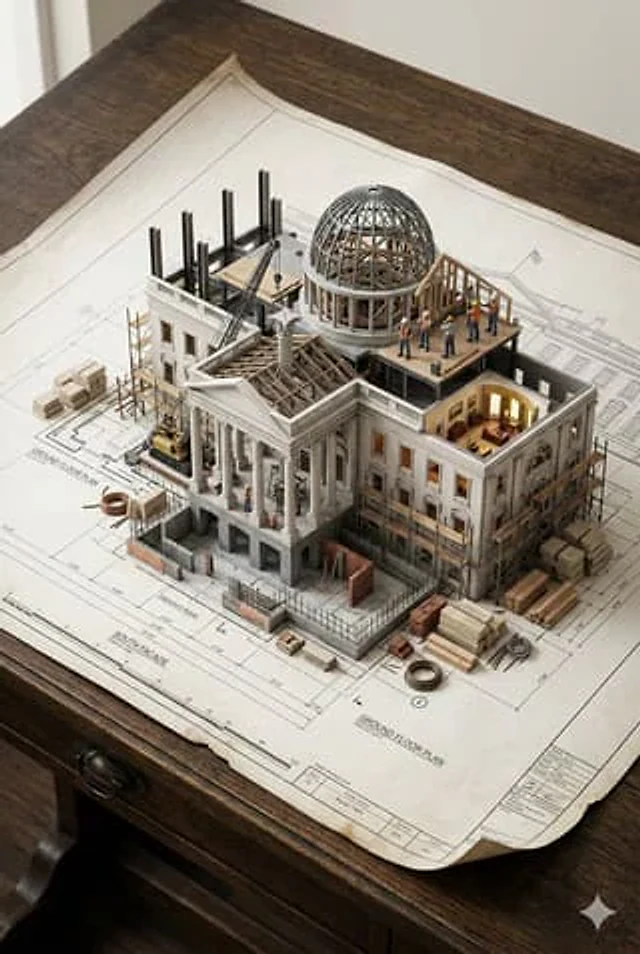

```text
An architectural blueprint of [BUILDING_NAME] placed on a {SURFACE}, with a photorealistic miniature under-construction version of [BUILDING_NAME] emerging from it — [STRUCTURAL_ELEMENT_1], [STRUCTURAL_ELEMENT_2], [STRUCTURAL_ELEMENT_3], [CONSTRUCTION_DETAIL], {WORKER_SCENE}, {MATERIAL_ELEMENT}, and {EXTRA_DETAIL}. All elements grow from the blueprint like a 3D architectural diorama, steel beams rising from the drawn lines, scaffolding threading through the paper. Studio soft lighting, cinematic depth
```

Model: Nano Banana
Author: 两斤

[ProjectD](https://aitoolsradar.com/en/prompts/53b59e37dc3e40) · [Recorded source](https://x.com/0x00_Krypt/status/2027644159285465175)
 · [Full original metadata and byte evidence](data/projectd-batch-0069.json)

## 两斤 #680

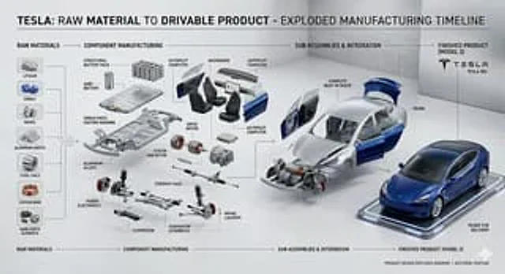

```text
product design, [object], cross-section cutaway view, internal anatomy revealed, 
white background, museum specimen aesthetic, scientific illustration style
```

Model: Nano Banana
Author: 两斤

[ProjectD](https://aitoolsradar.com/en/prompts/90fae9c3aca041) · [Recorded source](https://x.com/0x00_Krypt/status/2028376944996470842)
 · [Full original metadata and byte evidence](data/projectd-batch-0069.json)

## 小洲洲的AI日常 #855

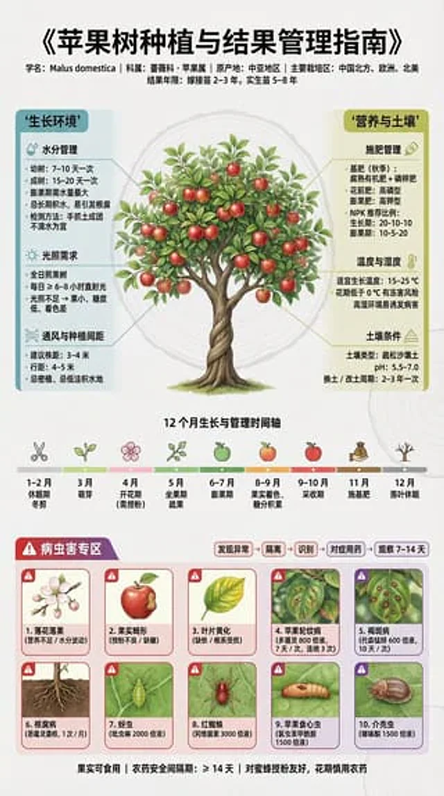

```text
果树种植科普展板 | 3:4 竖版 | 博物馆级信息设计
【主标题】
「××果树种植与结果管理指南」
字体：思源黑体 / 思源宋体混排，确保中文清晰渲染

【副标题】

学名 · 科属 · 原产地 · 主要栽培区 · 结果年限
【中央视觉】

画面中心 25%：
成熟健康的果树实物形态（可选：盆栽 / 幼树 / 结果期枝条），
 写实自然博物馆标本风格，树干、叶脉、果实细节清晰

背景：
浅色极简底（米白 / 浅灰）
淡雅农业几何纹样 / 果树年轮 / 叶脉结构底纹（透明度 15–20%）

【信息布局｜自动填充真实农业数据】

左侧（蓝绿色系 · 生长环境）
水分管理
幼树 / 成树浇水频率

不同生长期（萌芽 / 开花 / 膨果 / 休眠）需水差异
灌溉方式（滴灌 / 漫灌）

土壤含水量判断方法

光照需求
全日照 / 半日照

每日有效光照时长

光照不足 / 过强的结果影响对比图

通风与间距

行距株距建议

忌密植、忌积水低洼环境

右侧（黄绿色系 · 营养与土壤）

施肥管理

基肥 / 追肥 / 花前肥 / 果后肥

NPK 比例饼图（不同时期）

施肥频率与禁忌（避免烧根）

温度与湿度

四季生长温度曲线

花期低温风险提示

湿度过高导致病害示意

土壤条件

土壤类型（沙壤土 / 腐殖土）

pH 范围

改土方案（有机质 / 石灰 / 硫磺粉）

【中部横条】

12 个月果树生长与管理时间轴

修剪期

萌芽期

开花授粉期

坐果期

膨果期

采收期

休眠期
（图标化呈现）

【下方病虫害专区｜占 30%｜红紫警示色】

10 项果树常见病虫害识别卡片（3 行网格）

生理性问题

落花落果（营养 / 温度 / 水分）

果实畸形（授粉不良 / 缺硼）

叶片黄化（缺铁 / 缺氮 / 根系问题）

病菌性病害
4. 炭疽病
5. 褐斑病
6. 根腐病
虫害
7. 蚜虫
8. 红蜘蛛
9. 果实蝇
10. 介壳虫

每张卡片包含：
症状特写图（40%）

识别要点

具体防治方案

药剂名称 + 稀释倍数 + 使用频次
示例：
 代森锰锌 600 倍液，7 天 / 次，连喷 2–3 次

应急处理流程图
发现 → 隔离 → 判断 → 对症处理 → 持续观察

【底部信息栏】
果实可食性说明
农药安全间隔期
对蜜蜂 / 宠物 / 人类安全提示

【设计规范】
信息密度：高（留白约 25%）
连接线：由果树向外放射，极细线条
色彩编码：
蓝 = 水分
黄 = 光照
绿 = 营养
红 = 病害
紫 = 虫害
字级层级：
主标题 16pt
正文 12pt
备注 9pt

图标：统一线性农业科普风格

中文排版：行距 1.5，紧凑易读

病害卡片：红色边框 + 症状放大图

【风格参考】

日本果树试验站导览牌

现代自然博物馆农业信息墙
DK《果树栽培图鉴》

【技术参数】
正面平视 / 微俯视
柔和自然光
中大景深
4K 超高清
真实农业与园艺摄影级细节

【关键要求（非常重要）】

所有种植数据、病虫害信息、农药名称与使用浓度，需根据所选果树品种自动填充真实、准确、可查证的专业农业数据

英文补充（生图权重）

fruit tree cultivation guide poster, high-density agricultural infographic,
museum exhibition style, fruit tree growth cycle, pest and disease identification,
Chinese typography, minimalist background, professional horticulture data,
realistic fruit tree specimen, 4K ultra high resolution
```

Model: Nano Banana
Author: 小洲洲的AI日常

[ProjectD](https://aitoolsradar.com/en/prompts/1005ac24758439) · [Recorded source](https://x.com/LZhou15365/status/2008174532285350353)
 · [Full original metadata and byte evidence](data/projectd-batch-0069.json)

## 摆烂程序媛 #1086

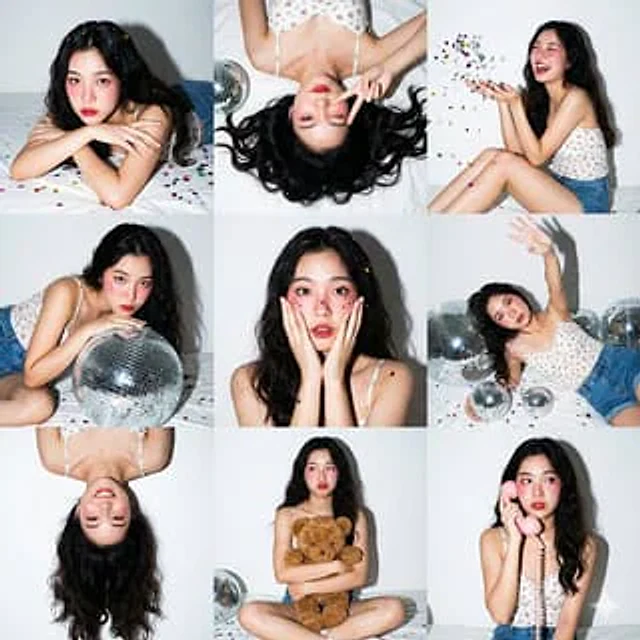

```text
{
  "model": "Nano Banana Pro (Gemini)",
  "prompt": {
    "layout": {
      "type": "3x3 照片拼贴 / 九宫格",
      "description": "9 张竖版人像照片以正方形网格排列",
      "consistency": "9 个画面中为同一人物、同一服装、同一光线条件"
    },
    "aesthetic_style": {
      "theme": "Z 世代居家派对 / 少女闺房写真",
      "lighting_technique": "机顶直闪（硬光）",
      "visuals": "高对比度、清晰锐利阴影、混乱有趣的氛围、鲜艳色彩、白色背景"
    },
    "subject_details": {
      "appearance": "年轻亚洲女性，肤色白皙，深色长卷发，发量蓬松",
      "outfit": "白色碎花吊带上衣，蓝色牛仔短裤",
      "makeup": "浓重粉色腮红（Igari 醉酒妆风格），红色唇妆，脸颊带亮片"
    },
    "environment_and_props": {
      "background": "贴有照片的白色墙面，白色床单",
      "decor": [
        "银色迪斯科球（多种尺寸）",
        "五彩金属亮片纸散落",
        "棕色泰迪熊",
        "粉色复古有线电话"
      ]
    },
    "panel_pose_breakdown": {
      "1_top_left": "俯卧趴着，下巴放在交叉的手臂上，看向镜头，头发上有亮片",
      "2_top_center": "俯拍视角仰躺，眨一只眼，比 V 手势，头发向四周散开",
      "3_top_right": "侧坐，双膝弯曲，大笑抓拍，向空中抛洒亮片",
      "4_middle_left": "上半身倚靠在大型银色迪斯科球上，目光强烈直视镜头",
      "5_middle_center": "近景特写，双手贴在脸颊，惊讶或害羞表情，亮片粘在脸上",
      "6_middle_right": "躺在迪斯科球之间，一只手向上伸向天花板或镜头",
      "7_bottom_left": "倒置视角（头部在画面下方），俏皮表情，头发自然垂落",
      "8_bottom_center": "盘腿坐姿，紧紧抱着棕色泰迪熊，微微嘟嘴",
      "9_bottom_right": "坐直，手持粉色复古电话听筒贴在耳边，侧头像在听八卦"
    },
    "camera_technical_values": {
      "focal_length": "35mm",
      "aperture": "f/5.6",
```

Model: Nano Banana
Author: 摆烂程序媛

[ProjectD](https://aitoolsradar.com/en/prompts/da48d8a89af525) · [Recorded source](https://x.com/wanerfu/status/2012027041580007890)
 · [Full original metadata and byte evidence](data/projectd-batch-0069.json)

## 摆烂程序媛 #1262

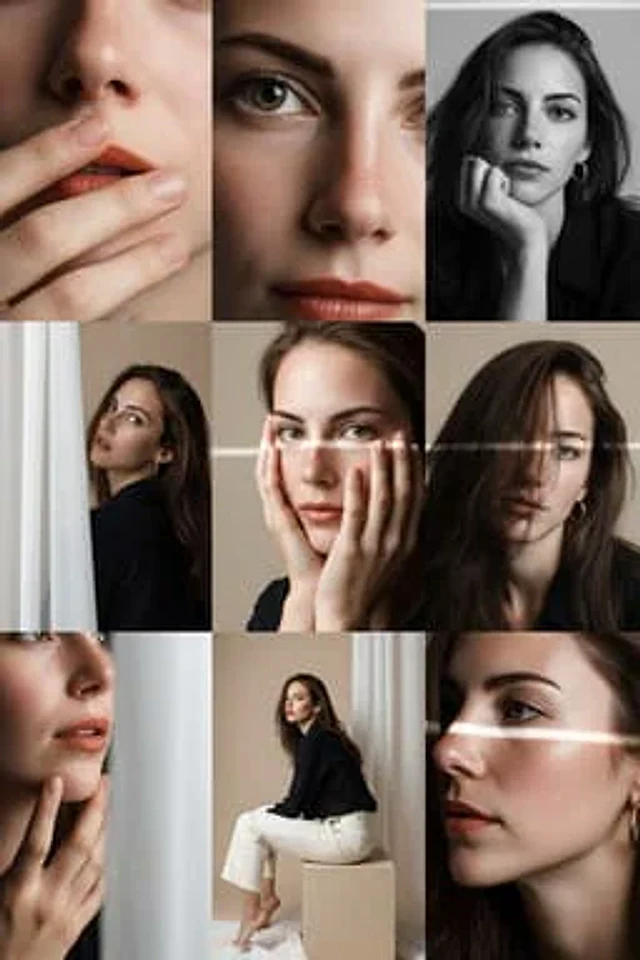

```text
在柔和米色的工作室内，构建3x3精细编辑照片网格

角色穿深蓝轻薄衬衫，米白长裤，赤脚展现原始质感

灯光设计：
前右大面积柔光，左侧银反光板，顶部微弱轮廓光。

9组精细镜头构图：
1.85mm f/1.8极致唇部特写
2.眼睛对镜特写
3.黑白下巴支撑肖像
4.半遮半露肖像
5.手覆面部特写
6.发丝遮眼构图
7.手部触下巴细节
8.半身侧坐姿势
9.带泪水的侧脸电影感
```

Model: Nano Banana
Author: 摆烂程序媛

[ProjectD](https://aitoolsradar.com/en/prompts/598724445c430a) · [Recorded source](https://x.com/wanerfu/status/2017116581164454309)
 · [Full original metadata and byte evidence](data/projectd-batch-0069.json)

## 摆烂程序媛 #323

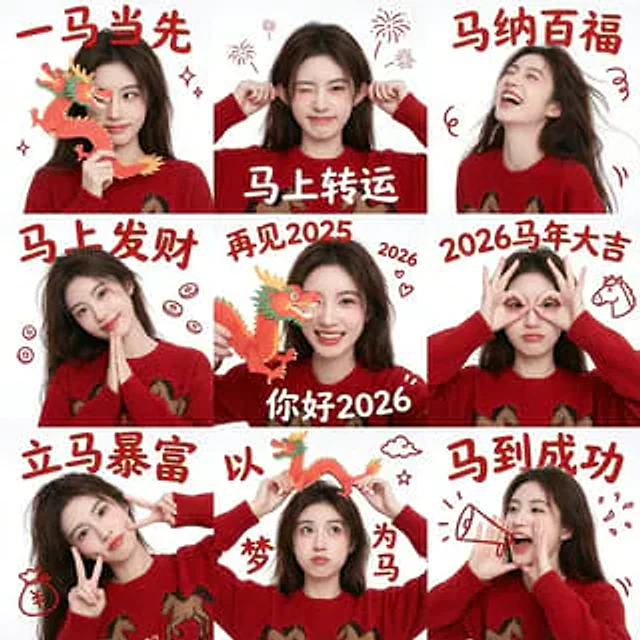

```text
{
  "project_settings": {
    "task_type": "九宫格新年祝福肖像（男生版）",
    "aspect_ratio": "1:1",
    "grid_layout": "3x3",
    "batch_size": 1
  },

  "overall_style": {
    "整体风格": "极简新年祝福风",
    "视觉基调": "干净、温和、克制的节日感",
    "背景": "纯色白墙面，无装饰",
    "光线": "自然柔光，均匀无强阴影",
    "色彩重点": "中国红（服装 + 文字）"
  },

  "subject_base": {
    "人物一致性": "九宫格内为同一位人物",
    "人物类型": "亚洲男性",
    "性别气质": "干净、阳光、自然，不油腻",
    "发型": "黑色短发，自然蓬松，简洁利落",
    "服装": "红色针织毛衣或卫衣，简洁无图案",
    "妆容": "无明显妆感，真实自然肤质",
    "表情气质": "开心，克制的微笑，不夸张"
  },

  "pose_variations": {
    "grid_1": "食指竖于嘴前，轻松安静手势",
    "grid_2": "单手比 V 手势靠近脸部",
    "grid_3": "单手做 OK 或三指手势",
    "grid_4": "双手举起做轻松俏皮手势（不过度卖萌）",
    "grid_5": "单手张开遮住半边脸",
    "grid_6": "单手做电话手势靠近脸侧",
    "grid_7": "单手轻点脸颊或下巴",
    "grid_8": "单手托下巴，轻微思考姿势",
    "grid_9": "双手指向脸部或克制比心变体"
  },

  "text_overlays": {
    "字体风格": "传统中文新年书法字体",
    "文字颜色": "中国红",
    "年份颜色": "深蓝色",
    "文字位置": "每一格顶部居中",
    "文字结构": "四字祝福语 + 年份"
  },

  "text_content": [
    { "position": "grid_1", "text": "一帆风顺", "year": "2026" },
    { "position": "grid_2", "text": "双喜临门", "year": "2026" },
    { "position": "grid_3", "text": "三阳开泰", "year": "2026" },
    { "position": "grid_4", "text": "四季发财", "year": "2026" },
    { "position": "grid_5", "text": "五福临门", "year": "2026" },
    { "position": "grid_6", "text": "六六大顺", "year": "2026" },
    { "position": "grid_7", "text": "七星高照", "year": "2026" },
    { "position": "grid_8", "text": "八方来财", "year": "2026" },
    { "position": "grid_9", "text": "九九同心", "year": "2026" }
  ],

  "constraints": {
    "禁止项": [
      "不改变人物身份",
      "不夸张表情",
      "不女性化姿态",
      "不使用复杂背景",
      "不添加节日道具",
      "不风格化面部"
    ],
    "一致性要求": [
      "人物脸型五官保持完全一致",
      "服装颜色与材质一致",
      "拍摄角度与距离基本一致"
    ]
  },

  "use_cases": [
    "男生新年纪念照",
    "个人春节祝福九宫格",
    "社交平台头像矩阵",
    "品牌新年男生模板"
  ]
}
```

Model: Nano Banana
Author: 摆烂程序媛

[ProjectD](https://aitoolsradar.com/en/prompts/5c5c2f25d7a28a) · [Recorded source](https://x.com/wanerfu/status/2008421241091154115)
 · [Full original metadata and byte evidence](data/projectd-batch-0069.json)

## 松果先森 #1278

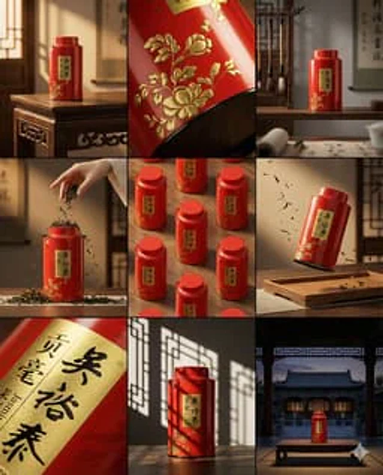

```text
A clean 3×3 storyboard grid with nine equal-sized panels and an overall 4:5 aspect ratio.
Use the reference image as the base product reference. Keep the same product, packaging design, branding, materials, colors, proportions and overall identity across all nine panels exactly as the reference. The product must remain clearly recognizable in every frame. The label, logo and proportions must stay exactly the same.
This storyboard is a high-end designer mockup presentation for a branding portfolio. The focus is on form, composition, materiality and visual rhythm rather than realism or lifestyle narrative. The overall look should feel curated, editorial and design-driven.
FRAME 1 (The Icon): Center-composed hero shot of the red tea tin on an antique dark walnut table, bathed in warm, golden afternoon sun.
FRAME 2 (The Tactile): Extreme close-up on the glossy red metal surface showing the embossed gold floral texture catching the light.
FRAME 3 (The Environment): The canister placed on a wooden shelf in a blurred traditional Chinese study with calligraphy brushes in the background.
FRAME 4 (The Interaction): An elegant hand pouring dry tea leaves near the base of the tin, emphasizing the ritual.
FRAME 5 (The Matrix): An isometric grid of multiple red tins arranged on a wooden surface, creating a pattern of red and gold.
FRAME 6 (The Gravity): The red canister floating gently above a wooden tray, surrounded by drifting dried tea leaves.
FRAME 7 (The Signature): Macro detail focusing strictly on the black Chinese calligraphy "Wu Yu Tai" against the gold background.
FRAME 8 (The Statement): Artistic high-contrast shot using shadows of window lattice (geometric patterns) cast across the red tin.
FRAME 9 (The Horizon): Wide cinematic shot of the tin placed on a low table in a grand, dimly lit traditional courtyard at dusk.
CAMERA & STYLE:
Ultra high-quality studio imagery with a real camera look. Different camera angles and framings across frames. Controlled depth of field, precise lighting, accurate materials and reflections. Lighting logic, color palette, mood and visual language must remain consistent across all nine panels as one cohesive series.
OUTPUT:
A clean 3×3 grid with no borders, no text, no captions and no watermarks.
```

Model: Nano Banana
Author: 松果先森

[ProjectD](https://aitoolsradar.com/en/prompts/e72c7b5ed292cb) · [Recorded source](https://x.com/songguoxiansen/status/2015257114529419733)
 · [Full original metadata and byte evidence](data/projectd-batch-0069.json)

## 猫小姐学AI #1172

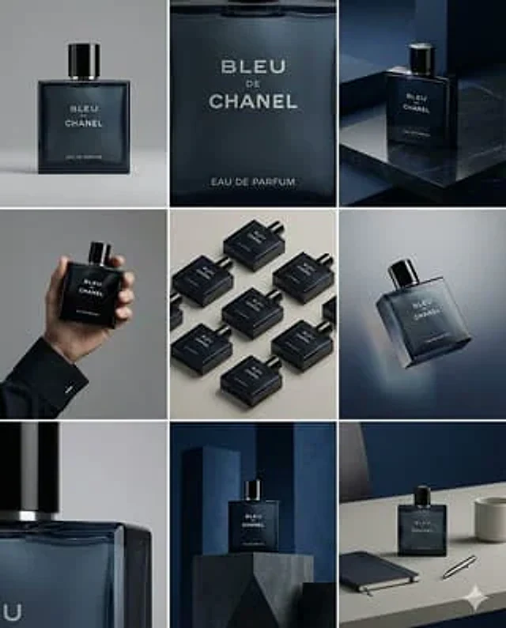

```text
创建一张最终图像。

在4:5总格式内创建清晰的3×3网格故事板，包含九个等比例面板。

使用参考图像作为产品基础。在所有九个面板中保持完全相同的产品、包装设计、品牌、材料、颜色、比例和整体身份。产品在每一帧都应清晰可识别。标签、logo和比例必须完全一致。

这是品牌组合的高端模型展示。重点在形式、构图、材质和视觉节奏，而非现实感或生活方式叙事。结果应感觉精心策划、编辑性强且设计导向。

第1帧:
产品的英雄正面特写，干净的工作室环境。中性背景，均衡构图，平静安全的产品呈现。

第2帧:
特写镜头，焦点聚集在产品中部。突出表面纹理、材料和印刷细节。

第3帧:
参考产品置于与品牌和产品类别自然契合的环境中。工作室场景受产品设计元素和颜色启发。

第4帧:
产品以使用或交互方式展示，中性工作室背景。手和交互元素最少且低调，保持包装风格。

第5帧:
等距构图展示多个产品，从等距俯视角精确几何排列。所有产品采用相同等距角度，均匀间距，干净结构化且图形化。

第6帧:
产品轻微悬浮，倾斜于与参考图像调色板相匹配的中性背景。浮动位置刻意而自然。

第7帧:
极近特写，聚焦标签、边缘、纹理或材料特性的具体细节。

第8帧:
产品置于出人意料但美学强大的环境，大胆编辑视觉冲击力强。意外但高度风格化的场景，工作室基调设计驱动。强势构图提升品牌。

第9帧:
宽幅构图展示产品在精致设计场景中的使用。道具干净，造型受控一致。

摄影与风格:
超高质量工作室图像，呈现真实相机外观。每帧不同角度和构图。受控景深、精确照明、逼真材质和反射。照明逻辑、调色板、氛围和视觉语言在九个面板中保持一致，形成统一系列。

输出:
无边框、无文字、无字幕、无水印的清晰3×3网格。
```

Model: Nano Banana
Author: 猫小姐学AI

[ProjectD](https://aitoolsradar.com/en/prompts/3b4757753f1678) · [Recorded source](https://x.com/MissCat_AI/status/2015236449755676732)
 · [Full original metadata and byte evidence](data/projectd-batch-0069.json)

## 路飞 🏴‍☠️ AI 研究员🧐 #1306


```text
为高端商业营销活动创建3×3网格，3:4纵横比，以上传产品为中心主体。

每帧呈现独特视觉概念，同时保持九张图像中产品的完美一致性。

网格概念（每格一个）：

1. 标志性英雄静物画，构图大胆

2. 极端微距细节，突显材质与纹理

3. 动感液体或粒子与产品互动

4. 极简雕塑排列，抽象形态

5. 浮动元素，暗示轻盈与创新

6. 感官特写，强调触感与真实感

7. 色彩驱动概念场景，灵感源自产品调色板

8. 成分或组件抽象化（非字面意思，象征性）

9. 超现实优雅融合，结合写实与想象

视觉规则：
产品形状、比例、标签、字体、色彩、品牌必须100%准确

无扭曲、变形或重新设计

产品与背景清晰分离

灯光与风格：
柔和可控的摄影棚灯光

细微高光，真实阴影

高动态范围，超锐焦点

编辑奢侈广告美学

高端感官营销外观

总体感觉：
现代、精致、视觉连贯

高端商业活动

适用于品牌网站、社交网格及数字广告牌

超现实、电影感、精致、志在高远
```

Model: Nano Banana
Author: 路飞 🏴‍☠️ AI 研究员🧐

[ProjectD](https://aitoolsradar.com/en/prompts/9eec83646fb577) · [Recorded source](https://x.com/0xluffy_eth/status/2016406912624140536)
 · [Full original metadata and byte evidence](data/projectd-batch-0069.json)

## 路飞 🏴‍☠️ AI 研究员🧐 #773

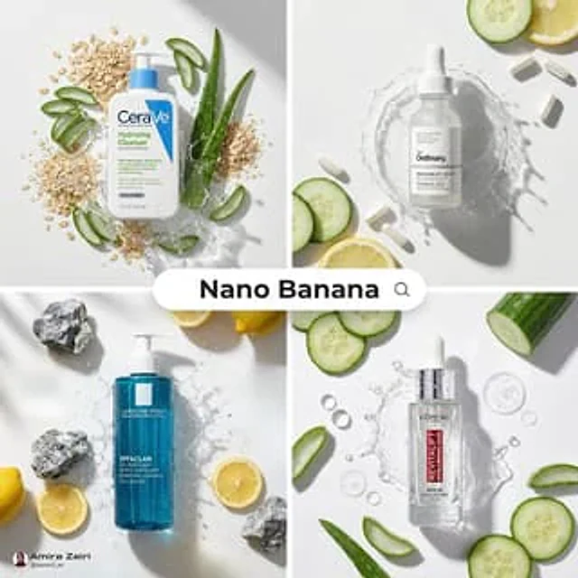

```text
[产品]，俯视平铺中心位置，周围环绕[成分]，新鲜切片和整块，光泽湿润外观，水花冻结在产品周围，露珠附着在标签和表面，温暖米色无缝背景，柔和定向日光，清晰逼真阴影，高端护肤品广告，超逼真宏观产品摄影，100mm 镜头效果，f/8 锐焦，干净构图，无额外文字，8k，1:1
```

Model: Nano Banana
Author: 路飞 🏴‍☠️ AI 研究员🧐

[ProjectD](https://aitoolsradar.com/en/prompts/2331fe712dcc81) · [Recorded source](https://x.com/0xluffy_eth/status/2015689672807297132)
 · [Full original metadata and byte evidence](data/projectd-batch-0069.json)

## 4x4 Grid Daily Routine Consistency Prompt (Billie Eilish)

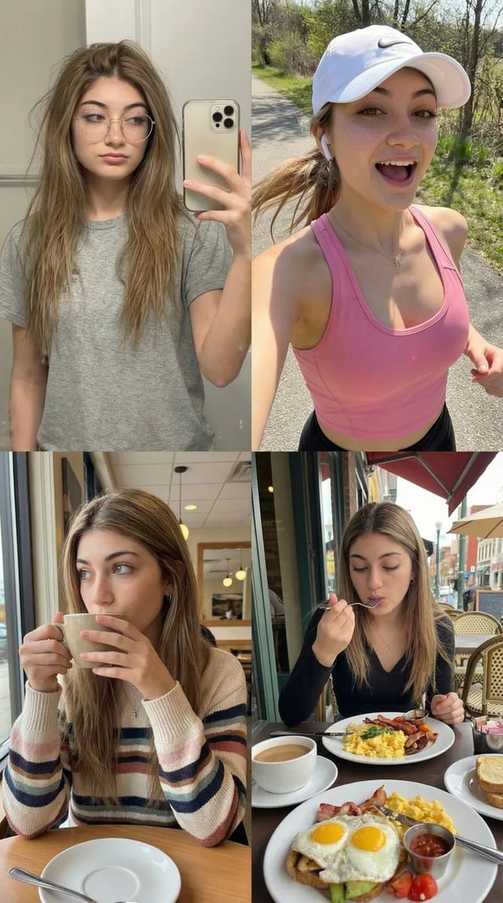

```text
"scene": {
    "description": "Ultra-photorealistic 4x4 grid image showing four different candid daily routine moments of the SAME woman. All four frames feel unposed, spontaneous, and captured naturally throughout the day.",
    "layout": {
      "grid": "2x2",
      "consistency": "same subject identity across all frames, different moments of the same day",
      "style": "raw iPhone photography aesthetic, social-media realistic"
    },
    "lighting": "natural real-world lighting varying by scene, no studio or cinematic lighting",
    "quality": "hyper-realistic, sharp focus, natural imperfections preserved"
  },

  "subject": {
    "identity": "Cuban/Spanish Actress {argument name="subject name" default="Billie Eilish"} ,
      "requirements": [
        "Face, eyes, skin tone, proportions 100% identical to sydney sweeney ,
        "Same person in all 4 frames",
        "No beauty-face alteration or idealization"
      ]
    }
  },

  "frames": {
   "frame_1": {
  "title": "Morning wake-up bathroom mirror selfie",
  "environment": "home bathroom",
  "pose": "standing casually in front of bathroom mirror, holding phone for a mirror selfie",
  "camera": "mirror selfie, phone partially visible, natural arm angle",
  "expression": "slightly tired morning face with a subtle soft smile, relaxed eyes looking at the phone screen",
  "details": [
    "slightly puffy sleepy eyes",
    "natural unstyled morning hair",
    "no makeup or very minimal makeup",
    "casual random t-shirt worn loosely",
    "imperfect mirror framing, not centered",
    "natural bathroom lighting, no harsh shadows"
  ],
  "vibe": "just woke up, real and unposed morning moment"
}

    "frame_2": {
      "title": "Outdoor run – mid action selfie",
      "environment": "outdoor running path or sidewalk",
      "pose": "running while holding phone for a quick selfie, mid-motion",
      "camera": "front camera selfie, arm visible, slight motion energy",
      "expression": "focused but lively, open mouth breathing",
      "clothing": {
        "outfit": "pink athletic outfit",
        "hat": "white running cap"
      },
      "details": [
        "natural daylight",
        "no motion blur exaggeration",
        "athletic realism"
      ],
      "vibe": "caught during movement"
    },

    "frame_3": {
      "title": "Coffee break candid",
      "environment": "cafe or home table setting",
      "pose": "sitting casually while drinking coffee",
      "camera": "casual handheld selfie",
      "expression": "thoughtful, relaxed, eyes not directly looking at camera",
      "details": [
        "coffee cup mid-sip",
        "natural posture",
        "background secondary and unobtrusive"
      ],
      "vibe": "quiet reset moment"
    },

    "frame_4": {
      "title": "Outdoor breakfast – taken by someone else",
      "environment": "outdoor breakfast cafe",
      "pose": "eating breakfast naturally, unaware of camera",
      "camera": "photo taken by another person",
      "expression": "o
```

Model: Nano Banana Pro
Author: Ravya

[ProjectD](https://aitoolsradar.com/en/prompts/17e2ae07b1e287) · [Recorded source](https://youmind.com/prompts/4x4-grid-daily-routine-consistency-prompt-billie-eilish-5190)
 · [Full original metadata and byte evidence](data/projectd-batch-0069.json)

## 4x4 Grid Daily Routine Consistency Prompt (Sydney Sweeney)

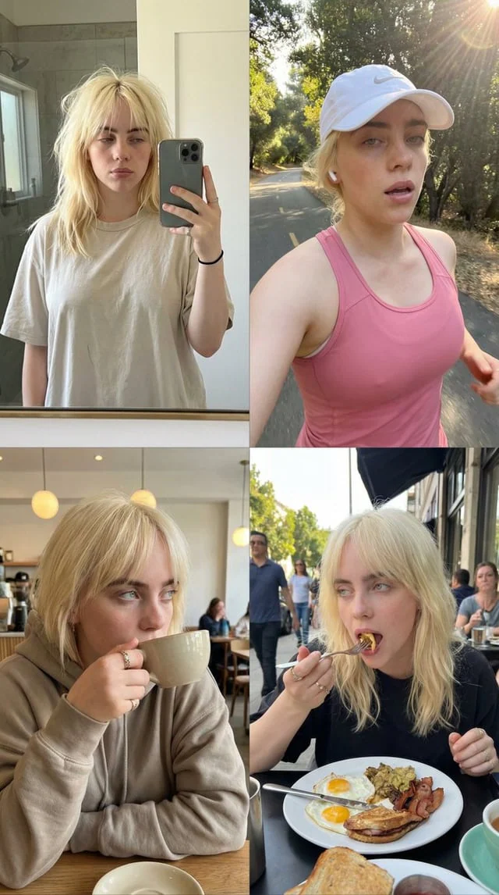

```text
"scene": {
    "description": "Ultra-photorealistic 4x4 grid image showing four different candid daily routine moments of the SAME woman. All four frames feel unposed, spontaneous, and captured naturally throughout the day.",
    "layout": {
      "grid": "2x2",
      "consistency": "same subject identity across all frames, different moments of the same day",
      "style": "raw iPhone photography aesthetic, social-media realistic"
    },
    "lighting": "natural real-world lighting varying by scene, no studio or cinematic lighting",
    "quality": "hyper-realistic, sharp focus, natural imperfections preserved"
  },

  "subject": {
    "identity": "Cuban/Spanish Actress Billie Eilish ,
      "requirements": [
        "Face, eyes, skin tone, proportions 100% identical to {argument name="celebrity likeness" default="sydney sweeney"} ,
        "Same person in all 4 frames",
        "No beauty-face alteration or idealization"
      ]
    }
  },

  "frames": {
   "frame_1": {
  "title": "Morning wake-up bathroom mirror selfie",
  "environment": "home bathroom",
  "pose": "standing casually in front of bathroom mirror, holding phone for a mirror selfie",
  "camera": "mirror selfie, phone partially visible, natural arm angle",
  "expression": "slightly tired morning face with a subtle soft smile, relaxed eyes looking at the phone screen",
  "details": [
    "slightly puffy sleepy eyes",
    "natural unstyled morning hair",
    "no makeup or very minimal makeup",
    "casual random t-shirt worn loosely",
    "imperfect mirror framing, not centered",
    "natural bathroom lighting, no harsh shadows"
  ],
  "vibe": "just woke up, real and unposed morning moment"
}

    "frame_2": {
      "title": "Outdoor run – mid action selfie",
      "environment": "outdoor running path or sidewalk",
      "pose": "running while holding phone for a quick selfie, mid-motion",
      "camera": "front camera selfie, arm visible, slight motion energy",
      "expression": "focused but lively, open mouth breathing",
      "clothing": {
        "outfit": "{argument name="athletic outfit color" default="pink"} athletic outfit",
        "hat": "white running cap"
      },
      "details": [
        "natural daylight",
        "no motion blur exaggeration",
        "athletic realism"
      ],
      "vibe": "caught during movement"
    },

    "frame_3": {
      "title": "Coffee break candid",
      "environment": "cafe or home table setting",
      "pose": "sitting casually while drinking coffee",
      "camera": "casual handheld selfie",
      "expression": "thoughtful, relaxed, eyes not directly looking at camera",
      "details": [
        "coffee cup mid-sip",
        "natural posture",
        "background secondary and unobtrusive"
      ],
      "vibe": "quiet reset moment"
    },

    "frame_4": {
      "title": "Outdoor breakfast – taken by someone else",
      "environment": "outdoor breakfast cafe",
      "pose": "eating breakfast naturally, unaware of camera",
      "camera": "photo taken by another person"
```

Model: Nano Banana Pro
Author: Melisa♡

[ProjectD](https://aitoolsradar.com/en/prompts/c77886335b3a97) · [Recorded source](https://youmind.com/prompts/4x4-grid-daily-routine-consistency-prompt-sydney-sweeney-5180)
 · [Full original metadata and byte evidence](data/projectd-batch-0069.json)

## Ana de Armas Daily Routine Grid Prompt (Identity Lock) - Duplicate

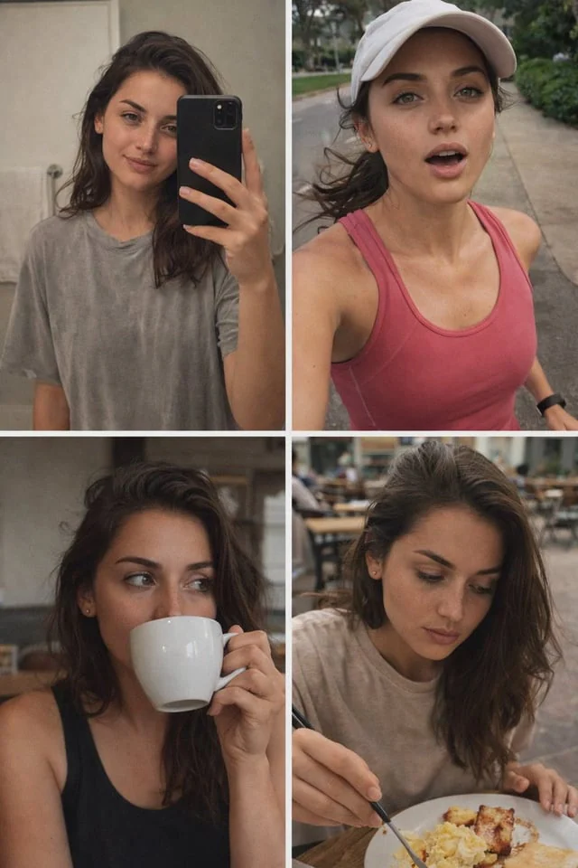

```text
"scene": {
    "description": "Ultra-photorealistic 4x4 grid image showing four different candid daily routine moments of the SAME woman. All four frames feel unposed, spontaneous, and captured naturally throughout the day.",
    "layout": {
      "grid": "2x2",
      "consistency": "same subject identity across all frames, different moments of the same day",
      "style": "raw iPhone photography aesthetic, social-media realistic"
    },
    "lighting": "natural real-world lighting varying by scene, no studio or cinematic lighting",
    "quality": "hyper-realistic, sharp focus, natural imperfections preserved"
  },

  "subject": {
    "identity": { {argument name="celebrity name" default="Ana de Armas"}  ,
      "requirements": [
        "Face, eyes, skin tone, proportions 100% identical to Ana de Armas ,
        "Same person in all 4 frames",
        "No beauty-face alteration or idealization"
      ]
    }
  },

  "frames": {
   "frame_1": {
  "title": "Morning wake-up bathroom mirror selfie",
  "environment": "home bathroom",
  "pose": "standing casually in front of bathroom mirror, holding phone for a mirror selfie",
  "camera": "mirror selfie, phone partially visible, natural arm angle",
  "expression": "slightly tired morning face with a subtle soft smile, relaxed eyes looking at the phone screen",
  "details": [
    "slightly puffy sleepy eyes",
    "natural unstyled morning hair",
    "no makeup or very minimal makeup",
    "casual random t-shirt worn loosely",
    "imperfect mirror framing, not centered",
    "natural bathroom lighting, no harsh shadows"
  ],
  "vibe": "just woke up, real and unposed morning moment"
}

    "frame_2": {
      "title": "Outdoor run – mid action selfie",
      "environment": "outdoor running path or sidewalk",
      "pose": "running while holding phone for a quick selfie, mid-motion",
      "camera": "front camera selfie, arm visible, slight motion energy",
      "expression": "focused but lively, open mouth breathing",
      "clothing": {
        "outfit": "{argument name="running outfit color" default="pink"} athletic outfit",
        "hat": "white running cap"
      },
      "details": [
        "natural daylight",
        "no motion blur exaggeration",
        "athletic realism"
      ],
      "vibe": "caught during movement"
    },

    "frame_3": {
      "title": "Coffee break candid",
      "environment": "cafe or home table setting",
      "pose": "sitting casually while drinking coffee",
      "camera": "casual handheld selfie",
      "expression": "thoughtful, relaxed, eyes not directly looking at camera",
      "details": [
        "coffee cup mid-sip",
        "natural posture",
        "background secondary and unobtrusive"
      ],
      "vibe": "quiet reset moment"
    },

    "frame_4": {
      "title": "Outdoor breakfast – taken by someone else",
      "environment": "outdoor breakfast cafe",
      "pose": "eating breakfast naturally, unaware of camera",
      "camera": "photo taken by another person",
      "expression": "off-guar
```

Model: Nano Banana Pro
Author: Doctor Wasif

[ProjectD](https://aitoolsradar.com/en/prompts/b8c4592b73cadc) · [Recorded source](https://youmind.com/prompts/ana-de-armas-daily-routine-grid-prompt-identity-lock---duplicate-5151)
 · [Full original metadata and byte evidence](data/projectd-batch-0069.json)

## Asian Woman World Cup Portrait

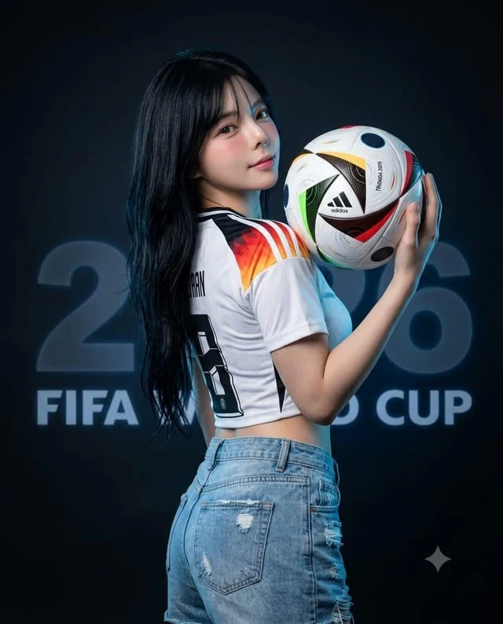

```text
Use face and hair style from attached photo
subjec : Photorealistic high-fashion editorial portrait of a {argument name="subject" default="beautiful young Asian woman"} holding a {argument name="item" default="ADIDAS TRIONDA 2026 soccer ball"}
pose: looking to camera from her shoulder
shoot tecnic: 3/4 body shoot on behid camera dutch style 35° left angle with Nikon D780 85mm f/2.8
make up : Slightly pink blush with pink lips looks cute and beautiful
outfit : random fitted crop top {argument name="clothing" default="national team home jersey"} with the random number Countries that participate in the 2026 World Cup and distressed light blue denim short
background : Dark moody studio background with "26 FIFA WORLD CUP" typography illuminated in subtle blue light
Cinematic studio lighting, cool blue rim lighting, gritty cinematic detail, shallow depth of field, sharp focus.
```

Model: Nano Banana Pro
Author: Kashberg

[ProjectD](https://aitoolsradar.com/en/prompts/55800e4667999b) · [Recorded source](https://youmind.com/prompts/asian-woman-soccer-portrait-25585)
 · [Full original metadata and byte evidence](data/projectd-batch-0069.json)

## Chalkboard-style AI news summary

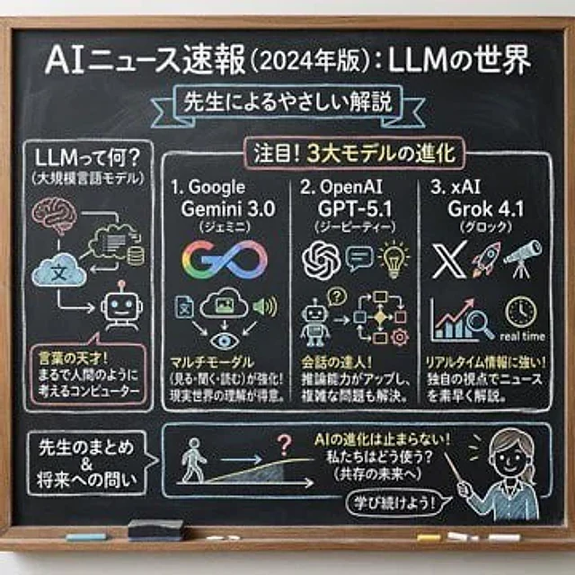

```text
Using the following content, summarize the news in a chalkboard-style, hand‑written look, and break it down with diagrams and easy‑to‑understand expressions as if a teacher had written it.
—-
Search results from Grok
```

Model: Nano Banana Pro
Author: ひでもん | AI開発@ニュース発信

[ProjectD](https://aitoolsradar.com/en/prompts/d028d5f2c7f60a) · [Recorded source](https://x.com/okknews/status/1992173611520868372)
 · [Full original metadata and byte evidence](data/projectd-batch-0069.json)

## Chalkboard-style AI news summary


```text
以下を内容で黒板風の手書きみたいな感じでニュースをまとめて、先生が書いたみたいに図解や分かりやすい表現に噛み砕いてよろしく。
—-
Grokの検索結果
```

Model: Nano Banana Pro
Author: ひでもん | AI開発@ニュース発信

[ProjectD](https://aitoolsradar.com/en/prompts/903c958a8c49e8) · [Recorded source](https://youmind.com/prompts/chalkboard-news-summary-diagram-509)
 · [Full original metadata and byte evidence](data/projectd-batch-0069.json)

## Comic / Storyboard - 3D Stylized Cartoon Girl on Stone Stool


```text
A full-body stylized 3D cartoon girl with {argument name="eye color" default="large sparkling emerald-green"} eyes, soft rosy cheeks, a gentle smile, and an innocent expression. She has {argument name="hair style" default="messy platinum-blonde hair tied in a voluminous bun"} with loose strands framing her face. She is sitting on a small stone stool with both hands supporting her cheeks in a cute, dreamy pose. She wears an {argument name="outfit" default="off-shoulder light gray top, loose white harem pants with a rustic fabric belt"}, and is barefoot with delicate ankle wraps. A small blue butterfly rests near her feet, with a white flower on the ground. Soft studio background, cinematic lighting, highly detailed stylized 3D rendering, painterly textures, smooth skin shading, whimsical fantasy atmosphere, premium animated feature film quality.
```

Model: Nano Banana Pro
Author: Compound Learning - Tech | Science

[ProjectD](https://aitoolsradar.com/en/prompts/be5fab33bea6e0) · [Recorded source](https://x.com/SheBuildsAI_/status/2091209038126305784)
 · [Full original metadata and byte evidence](data/projectd-batch-0069.json)

## Comic / Storyboard - 70s Iran Political Group Portrait

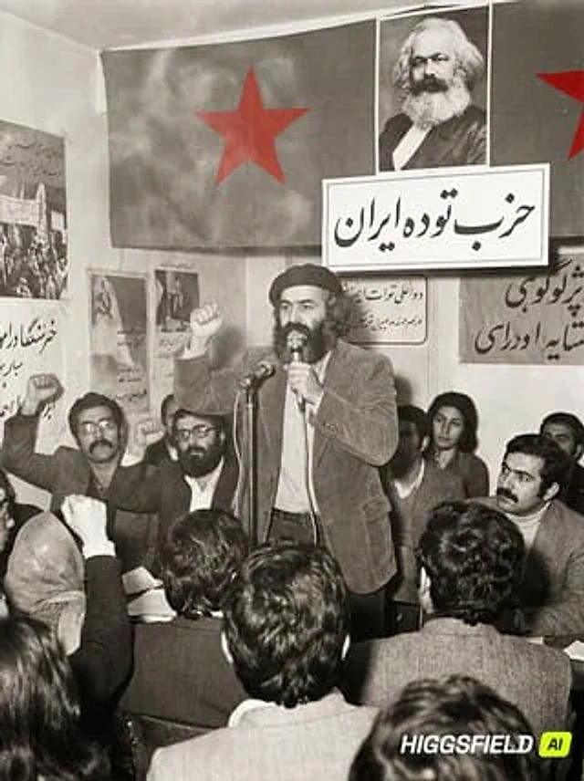

```text
{argument name="group" default="a left party"} from {argument name="country" default="iran"} {argument name="decade" default="70s"} in tehran , like a communism man
```

Model: Nano Banana Pro
Author: Tokomotism News

[ProjectD](https://aitoolsradar.com/en/prompts/951251cf656cec) · [Recorded source](https://x.com/tokomotism/status/2090912732887302333)
 · [Full original metadata and byte evidence](data/projectd-batch-0069.json)

## Comic / Storyboard - Aerial Surreal Clone Photography

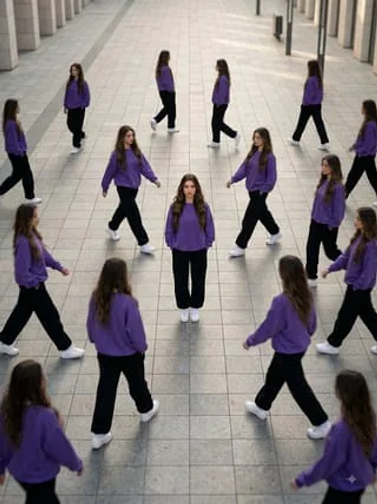

```text
Transform the uploaded person into a premium ultra-realistic surreal clone-photography scene. Create an aerial high-angle view of the same person standing completely still in the center of a large empty street or pathway while multiple identical copies walk around them in different directions.
IDENTITY LOCK
Use the uploaded image as the only identity reference. Preserve the exact recognizable face, facial structure, hairstyle, skin tone, eyebrows, eyes, nose, lips, jawline, hair texture, facial proportions, age, and overall appearance. Every clone must clearly be the same person. Do not change or redesign the identity.
CENTRAL SUBJECT
The central person remains perfectly sharp and motionless, standing confidently with both hands in the pockets. Dress them in {argument name="sweatshirt color" default="RED / PINK / ANY COLOR"} oversized sweatshirt, black loose pants, and white sneakers. The central figure is the primary focal point.
CLONES
Create numerous identical copies of the same person wearing the exact same outfit and maintaining the same identity. Position the clones walking naturally in different directions around the central subject. Use varied walking poses and distances to create a believable repetitive “NPC crowd" effect. Moving clones may have controlled directional motion blur while the central subject stays completely sharp.
ENVIRONMENT
Large empty tiled street or pathway in an understated urban outdoor setting. Minimal distractions. Clean architectural surroundings. Realistic pavement textures. Spacious composition with strong depth and perspective.
CAMERA & COMPOSITION
Aerial high-angle perspective looking downward. Compressed cinematic perspective. Tilt-shift depth effect. Central subject positioned precisely in the middle with surrounding clones creating a radial visual flow. Strong negative space around the group.
LIGHTING & STYLE
Soft natural sunlight. Warm neutral tones. Subtle atmospheric haze. Realistic shadows. Cinematic depth of field. Gentle film grain. Hyper-realistic skin texture. Natural proportions. Street photography mixed with luxury fashion editorial aesthetics. Surreal identity concept. Premium cinematic color grading. Ultra-detailed 8K quality.
VISUAL HIERARCHY
Central subject = sharp and still.
Surrounding clones = moving and slightly blurred.
Background = clean and atmospheric.
The contrast should communicate loneliness, individuality, and calmness while everything around the subject remains in motion.
```

Model: Nano Banana Pro
Author: H A J R A

[ProjectD](https://aitoolsradar.com/en/prompts/2bc6e5512dca43) · [Recorded source](https://x.com/codewithhajra/status/2088567218527179212)
 · [Full original metadata and byte evidence](data/projectd-batch-0069.json)

## Comic / Storyboard - Cinematic Android in Nature

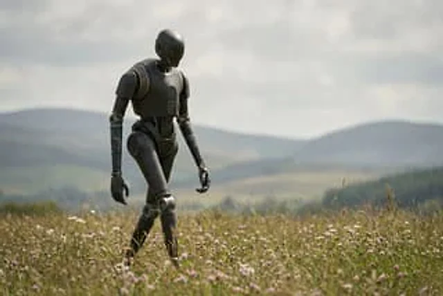

```text
Cinematic {argument name="character" default="Android"} in {argument name="setting" default="Meadow"}
```

Model: Nano Banana Pro
Author: Kōda

[ProjectD](https://aitoolsradar.com/en/prompts/1395773af4b071) · [Recorded source](https://x.com/aimikoda/status/2089707047801454941)
 · [Full original metadata and byte evidence](data/projectd-batch-0069.json)

## Comic / Storyboard - Cinematic Train Station Traveler

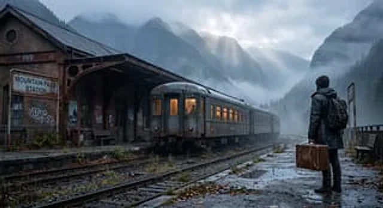

```text
A realistic, wide-angle cinematic shot from behind a man standing on a wet outdoor train station platform, looking toward a vintage passenger train on the tracks. He is wearing a black beanie, a dark winter jacket, dark trousers, and a backpack, holding a worn brown vintage leather suitcase at his side. On the left side of the frame stands an old brick and wooden train station building with a weathered sign reading "MOUNTAIN PASS STATION". To the right of the station, an old, slightly rusted passenger train sits on the tracks, its windows softly illuminated with warm glowing orange interior light. In the background, dramatic, towering mountain peaks are surrounded by dense fog and low clouds, with visible sunbeams (god rays) piercing through the misty overcast sky. The ground is damp with small puddles, fallen autumn leaves, and overgrown weeds along the tracks. Moody, cool color palette, cinematic lighting, 35mm lens photography, 8k resolution. Recommended Parameters Aspect Ratio: 16:9 Style: Photographic, Cinematic, Moody Lighting: Atmospheric, God rays, Soft backlighting. A realistic, wide-angle cinematic photo of a young man walking along an outdoor train station platform in a dramatic mountain landscape. He is wearing a dark blue winter parka coat with a hood, dark pants, sturdy boots, and a backpack, carrying a classic brown vintage leather suitcase in his hand. To his right, a vintage green and beige passenger train is stopped along the tracks, with warm yellow light glowing inside the train windows. The stone train station has a vintage sign that reads "OCN". In the background, towering, rugged alpine mountains are shrouded in atmospheric low-hanging mist and clouds. Soft, diffuse morning sunlight breaks through the foggy air, casting gentle highlights on the damp platform and wet train tracks. Moody, cool color palette with high cinematic realism, subtle cinematic grain, 35mm lens,depth of field 8k resolution.
```

Model: Nano Banana Pro
Author: Blitzer

[ProjectD](https://aitoolsradar.com/en/prompts/49fe8c6e918afa) · [Recorded source](https://x.com/tanzeel617919/status/2087870566950748368)
 · [Full original metadata and byte evidence](data/projectd-batch-0069.json)

## Comic / Storyboard - Colored Pencil Meadow Landscape

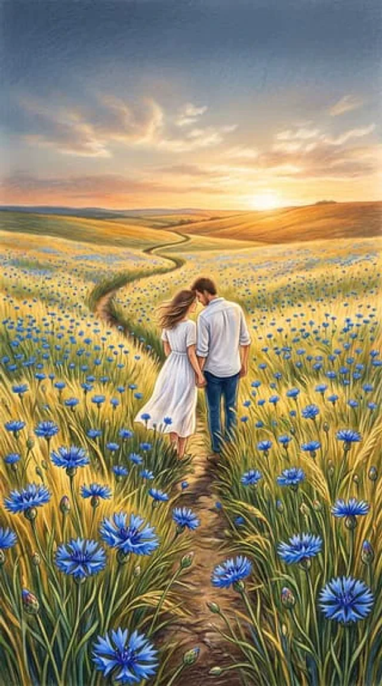

```text
A vibrant colored-pencil illustration in portrait orientation. A young couple walks hand in hand away from the viewer along a narrow winding path through a vast field of vivid blue cornflowers (Centaurea cyanus) in the foreground, among tall golden-yellow grass, with stems and buds interspersed. The woman wears a flowing white dress, the man a white shirt with rolled-up sleeves and dark trousers, their heads tilted gently toward each other. Gentle rolling hills stretch toward the horizon. A soft summer breeze bends the grass and flowers as the evening light falls across the scene. In the distance, sunlight peeks over warm amber fields. The sky fills the upper third and is colored from deep dusky blue at the top down to warm shades of orange, gold, and pale yellow near the low sun, with soft wispy backlit clouds. The perspective is wide and slightly elevated, showcasing the detailed cornflowers, the couple, and the expansive sunlit meadow. The style is reminiscent of colored pencil art, with visible textures creating a soft, serene mood. The overall atmosphere is peaceful, romantic, and nostalgic, with warm golden tones contrasting against the cool electric blue of the flowers. A vibrant colored-pencil illustration in portrait orientation. A vast field of vivid blue cornflowers (Centaurea cyanus) blanketing the foreground, among tall golden-yellow grass, with stems and buds interspersed. A narrow winding dirt path meanders through the flowers toward the distance. A soft layer of morning mist and light haze drifts gently over the field and the far shore, softening the horizon. Beyond the field, a serene ocean stretches to the horizon, where a single sailboat drifts gently on the still water. The water reflects the warm glow of the sky. The sky fills the upper third and is colored from deep dusky blue at the top down to warm shades of orange, gold, and pale yellow near the low sun, with soft wispy backlit clouds. The perspective is wide and slightly elevated, showcasing the detailed cornflowers, the misty meadow, and the expansive calm seascape with the distant sailboat. The style is reminiscent of colored pencil art, with visible textures creating a soft, serene mood. The overall atmosphere is peaceful, dreamy, and nostalgic, with warm golden tones contrasting against the cool electric blue of the flowers.
```

Model: Nano Banana Pro
Author: Viki

[ProjectD](https://aitoolsradar.com/en/prompts/f092cad09f80b6) · [Recorded source](https://x.com/churvikv/status/2088517844535287875)
 · [Full original metadata and byte evidence](data/projectd-batch-0069.json)

## Comic / Storyboard - Dark Fantasy Battlefield Warrior

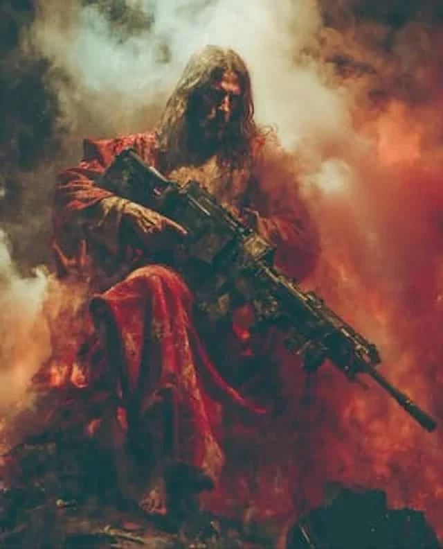

```text
A dark, cinematic, hyper-realistic fantasy-warrior portrait of a battle-worn, long-haired male warrior sitting calmly amid the ruins of a burning battlefield. He is positioned centrally in a powerful seated pose, leaning slightly forward with an exhausted but intimidating expression, his head subtly lowered and eyes staring intensely toward the viewer. He has long, messy, wavy dark-brown hair, strands falling naturally across his face, a thick rugged beard, weathered skin, subtle dirt and soot across his forehead and cheeks, and a hardened expression suggesting years of war.

He wears a tattered, ancient crimson-red robe/cloak draped loosely around his body, layered over a worn beige or earth-toned tunic. The fabric is heavily weathered, dusty, scorched, frayed, and stained from battle, with realistic folds and dramatic flowing fabric around his legs. One bare foot is partially visible against the ruined ground.

The warrior is holding a large modern military-style rifle diagonally across his body, gripping it naturally with both hands. The firearm has realistic metallic construction, detailed mechanical components, rails, magazine, barrel, scratches, worn surfaces, subtle grime, and battle damage. Keep the weapon physically believable and integrated naturally into the pose.

He sits upon charred rubble, broken stone, fragments of destroyed structures, and partially burned debris. Around him, an enormous battlefield is engulfed in flames. Thick layers of volumetric smoke, fire, ash, glowing embers, sparks, and atmospheric haze fill the background. Intense orange and deep red firelight illuminates the right side of the scene while cooler smoky teal-gray shadows surround the left side, creating dramatic cinematic color contrast.

Strong warm rim lighting from the flames outlines his hair, shoulders, robe, and weapon. A subtle soft light falls across his face, revealing detailed skin texture, beard strands, individual hairs, wrinkles, pores, dirt, and sweat. His face remains partially shadowed, creating a mysterious and intimidating atmosphere.

The composition should feel like a dark biblical-warrior meets post-apocalyptic military artwork, combining ancient clothing with modern battlefield technology. The overall mood is solemn, powerful, tragic, epic, and haunting rather than action-oriented.

Highly detailed cinematic realism, photorealistic textures, realistic human anatomy, intricate fabric texture, individual hair strands, realistic metal reflections, physically accurate fire and smoke, volumetric lighting, atmospheric perspective, dramatic chiaroscuro, deep shadows, glowing embers floating through the air, subtle film grain, muted cinematic color grading, rich reds, burnt orange, charcoal black and smoky teal tones, shallow depth of field, dramatic contrast, painterly cinematic finish, epic concept-art quality, 8K detail, ultra-sharp subject
```

Model: Nano Banana Pro
Author: WeWant Mars

[ProjectD](https://aitoolsradar.com/en/prompts/1623e9be98ecfb) · [Recorded source](https://x.com/Madhuribhai/status/2085769307217391725)
 · [Full original metadata and byte evidence](data/projectd-batch-0069.json)

## Comic / Storyboard - Editorial Ghost-Spider Urban Portrait

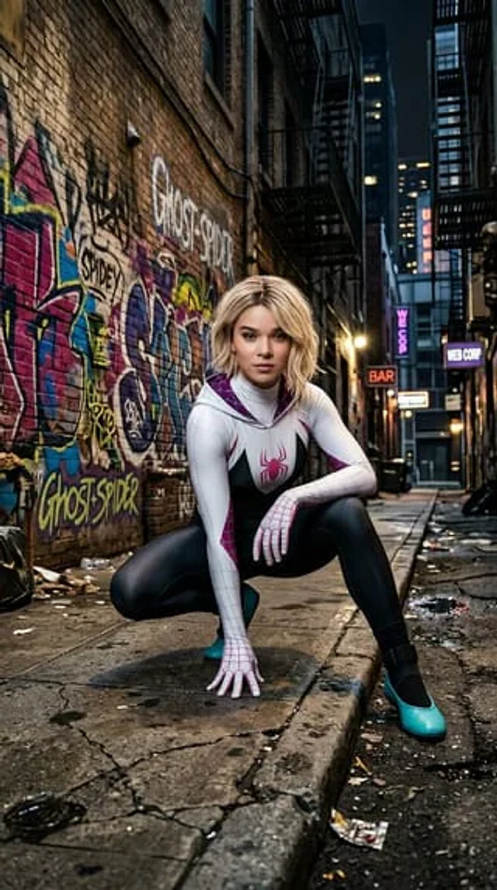

```text
A high-resolution editorial photograph in a 9:16 aspect ratio, captured from a low angle looking slightly upward in a medium full shot. {argument name="subject name" default="[NAME]"} portrays an unmasked Gwen Stacy (Ghost-Spider), crouched in a low, heroic landing pose on a worn, slightly cracked concrete sidewalk in a gritty urban alleyway at night. 

She has an athletic physique, a short bob haircut with realistic hair texture, and a serene, confident expression while looking slightly into the camera lens. Her eyes are subtly defined with soft makeup, eyeliner, and mascara. She wears a high-tech Ghost-Spider tactical suit crafted from high-density spandex, matte neoprene, and flexible synthetic textures. A raised white hood frames her face, revealing an inner lining with visible purple and black web stitching and tactile reliefs, transitioning into matte black legs and torso, finished with turquoise ballerina-style shoes over structured black socks. 

Her body is subtly angled with legs fully flexed and weight supported on the balls of her feet. Her left hand rests on her left knee, while her right arm is bent with the elbow resting on her right knee and hand relaxed. The background features an exposed brick wall covered in naturally weathered, colorful graffiti art in shades of magenta, blue, purple, yellow, and green. 

The lighting is diegetic urban night lighting with rich, preserved deep shadows and high dynamic range. Shot on a full-frame camera with a 35mm lens, the image displays surgical sharpness on her eyes and facial textures, natural material rendering, professional color fidelity, and a shallow depth of field with a soft background bokeh.
```

Model: Nano Banana Pro
Author: Giulia

[ProjectD](https://aitoolsradar.com/en/prompts/397189091e230b) · [Recorded source](https://x.com/Giulia_4i/status/2085786864590504057)
 · [Full original metadata and byte evidence](data/projectd-batch-0069.json)

## Comic / Storyboard - Editorial Nurse in Opulent Salon

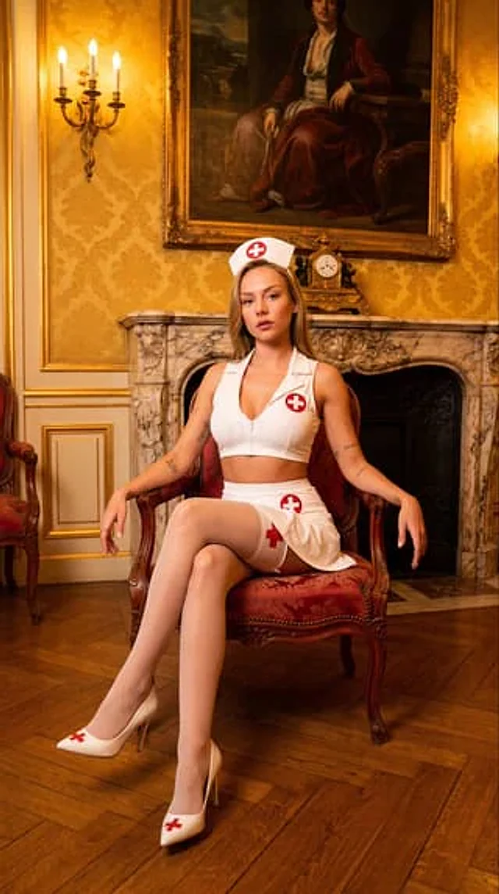

```text
Inside an opulent salon wrapped in golden damask and rich parquet, an aura of quiet defiance takes hold. A close-up of a poised young {argument name="subject" default="nurse woman"} commands the room with an unwavering gaze and heavy-lidded confidence, sitting on a {argument name="furniture" default="old red armchair"}. She wears a {argument name="outfit" default="white crop top, a white skirt with white stockings and white high heels with red cross on it, and a nurse hat with red cross on it"}. Her tailored ensemble and delicate lace textures contrast sharply against the heavy heritage decor. Warm amber directional light sculpts her features and drapes across the scene with luminous clarity. Antique marble fireplaces and receding classical rooms dissolve into a painterly palette of warm umber and gold. A huge golden painting of Delacroix is hanged from floor to ceiling on backdrop.The scene captures pure editorial power where timeless tradition meets fierce contemporary self-possession.
```

Model: Nano Banana Pro
Author: KeorUnreal

[ProjectD](https://aitoolsradar.com/en/prompts/de7bbb06299ed0) · [Recorded source](https://x.com/KeorUnreal/status/2089702402559447530)
 · [Full original metadata and byte evidence](data/projectd-batch-0069.json)

## Comic / Storyboard - Felt Frog Diorama Beach

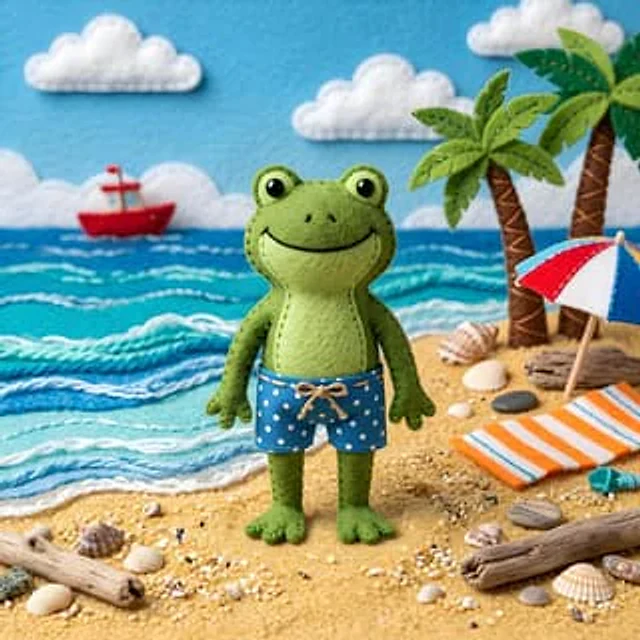

```text
A felt frog wearing {argument name="clothing" default="blue polka-dot swim trunks"} stands on a {argument name="setting" default="sandy beach"}. The frog is in the center of the frame, facing forward with a wide smile. The ocean with blue and white waves is behind the frog, and a {argument name="background object" default="small red boat"} is visible in the distance. The sky is a bright blue with fluffy white felt clouds. To the right of the frog, there are palm trees, a beach umbrella, a striped towel, and various shells and driftwood scattered on the sand. The overall scene is a whimsical, handmade diorama of a frog enjoying a day at the beach.
```

Model: Nano Banana Pro
Author: Heather Green

[ProjectD](https://aitoolsradar.com/en/prompts/5ce2b2ad947f25) · [Recorded source](https://x.com/heathergreen/status/2088052992478167419)
 · [Full original metadata and byte evidence](data/projectd-batch-0069.json)

## Comic / Storyboard - Fragmented Geometric Figurative Illustration

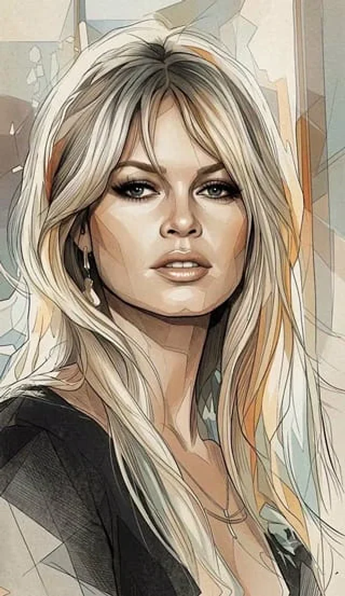

```text
Sophisticated hybrid figurative illustration style combining highly detailed graphic-novel realism with contemporary fragmented geometric line-art aesthetics. Strong yet refined ink contours fused with delicate, irregular flowing construction lines, creating a controlled contrast between solid anatomical definition and translucent abstract fragmentation. Realistic painterly facial and surface rendering integrated with angular faceted planes, semi-transparent overlapping shapes, broken geometric forms, and elegant organic linework. Use precise dark ink accents, selective cross-hatching, fine directional strokes, and subtle engraved textures to define depth, while allowing portions of the artwork to dissolve into airy translucent fragments and loose linear structures.
Color treatment combines the rich warm dimensionality of cinematic comic illustration with the restrained sophistication of a {argument name="palette" default="muted pastel palette"}: warm beige, ivory, soft tan, muted brown, dusty gray, pale blue-gray, desaturated teal, subtle amber, ochre, and restrained orange accents. Colors remain clean, luminous, and naturally harmonized rather than oversaturated. Strong warm–cool tonal interplay, with carefully controlled highlights and deep shadow accents.
Blend solid realistic modeling with semi-transparent layered planes, creating a sophisticated “constructed yet dissolving” appearance. Preserve convincing volume and dimensionality while selectively breaking forms into elegant geometric fragments. Hair, fabric, skin, and other surfaces may transition between highly rendered realism, fine ink strokes, faceted shapes, and loose flowing lines. Subtle paper grain, matte printed texture, slightly weathered graphic surface, delicate pigment variation, and refined editorial illustration finish.
Highly expressive line hierarchy, intricate micro-details, elegant visual rhythm, controlled asymmetry, sophisticated negative space, cinematic tonal depth, premium contemporary art-book aesthetic, experimental fashion-editorial illustration, realistic anatomy combined with abstract fragmentation, ultra-detailed, polished, artistic, sophisticated, dynamic, tactile, high-resolution.
```

Model: Nano Banana Pro
Author: Zayan

[ProjectD](https://aitoolsradar.com/en/prompts/10281e3e37a15b) · [Recorded source](https://x.com/HustleXR/status/2087051366657380410)
 · [Full original metadata and byte evidence](data/projectd-batch-0069.json)

## Comic / Storyboard - Japanese School Uniform Classroom Portrait

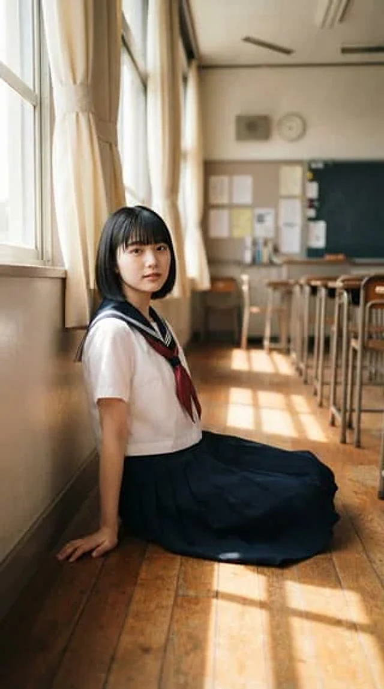

```text
A young {argument name="subject" default="East Asian woman"} with a short black bob haircut and straight bangs, fair skin, and a soft neutral expression looking directly at the camera. She is wearing a classic Japanese sailor-style school uniform (seifuku): short-sleeved white blouse with a navy blue sailor collar, {argument name="ribbon color" default="red"} ribbon necktie, and a long {argument name="skirt color" default="navy blue"} pleated skirt. She is sitting on a polished wooden classroom floor, leaning slightly against the wall under tall windows with cream curtains, one hand resting on the floor for support, legs folded to the side. Soft natural sunlight streams through the windows, casting bright geometric patches of light and long shadows across the warm wooden floorboards. Rows of empty wooden desks and chairs in the background, traditional Japanese classroom interior, shallow depth of field, photorealistic, natural skin texture, soft cinematic lighting, high detail, 85mm lens look
```

Model: Nano Banana Pro
Author: Feyber | AI Creator

[ProjectD](https://aitoolsradar.com/en/prompts/6b470bd483222e) · [Recorded source](https://x.com/woleswoosh/status/2088415372420501993)
 · [Full original metadata and byte evidence](data/projectd-batch-0069.json)

## Comic / Storyboard - Premium Instant Noodles Ad Storyboard


```text
TITLE: Premium Instant Noodles Product Commercial Storyboard

FORMAT:
• Single-page premium storyboard
• 3:4 Portrait ratio
• High-energy food advertisement
• 8 cinematic product scenes
• Product-focused commercial presentation

HEADER:
• Modern bold typography
• Information cards:
  - Duration: {argument name="duration" default="20 Seconds"}
  - Style: Cinematic Food Advertisement
  - Product: {argument name="product" default="Instant Noodles"}
  - Audio: Cooking ASMR + Energetic Beat
• Why This Style Works section
• {argument name="accent colors" default="Warm yellow and red"} accents

STORYBOARD:
1. Instant noodle packet standing upright with dramatic lighting
2. Packet opening and noodles sliding into a bowl
3. Boiling water pouring over noodles
4. Noodles cooking with realistic steam rising
5. Seasoning powder being added
6. Chopsticks lifting perfectly cooked noodles
7. Extreme macro shot of glossy noodles with toppings
8. Final hero bowl beside the original product packet

EVERY PANEL:
• Scene number
• Duration badge
• Visual
• Action
• Camera direction
• Product detail

CAMERA:
Macro food photography, overhead composition, steam close-up, noodle pull shot, dramatic product push-in, cinematic hero framing.

STYLE:
Ultra-realistic food commercial, realistic steam, detailed noodle texture, glossy broth, vibrant ingredients, professional studio lighting, premium packaging, 8K.
```

Model: Nano Banana Pro
Author: 𝐌

[ProjectD](https://aitoolsradar.com/en/prompts/fb670aafe3ff3a) · [Recorded source](https://x.com/Strength04_X/status/2090019696779387173)
 · [Full original metadata and byte evidence](data/projectd-batch-0069.json)

## Comic / Storyboard - Premium Organic Honey Commercial Storyboard


```text
TITLE: Premium Organic Honey Product Commercial Storyboard

FORMAT:
• Single-page premium storyboard
• 3:4 Portrait ratio
• Luxury food product campaign
• 8 cinematic storyboard scenes
• Product remains the visual hero
• Premium advertising agency presentation

HEADER:
• Elegant serif typography
• Information cards:
  - Duration: {argument name="duration" default="20 Seconds"}
  - Style: Natural Luxury Food Commercial
  - Product: {argument name="product" default="Organic Honey"}
  - Audio: Soft Nature ASMR
• Why This Style Works section
• {argument name="color theme" default="Cream, amber and gold"} aesthetic
• Minimal honeycomb decorative details

STORYBOARD:
1. Premium honey jar standing on a warm wooden surface
2. Jar lid slowly opening in macro close-up
3. Golden honey being lifted with a wooden honey dipper
4. Honey flowing in an extremely slow silky stream
5. Macro shot of honey texture and natural highlights
6. Honey dripping over warm toast
7. Honey jar surrounded by honeycomb and fresh ingredients
8. Final luxury hero packshot with golden honey splash

EVERY PANEL:
• Scene number
• Duration badge
• Camera direction
• Visual
• Action
• Product detail

CAMERA:
Extreme macro, slow-motion liquid photography, controlled push-in, top-down composition, shallow depth of field, cinematic hero shot.

STYLE:
Ultra-realistic honey texture, realistic liquid physics, warm natural lighting, premium food photography, glossy glass jar, elegant reflections, luxury organic branding, 8K.
```

Model: Nano Banana Pro
Author: 𝐌

[ProjectD](https://aitoolsradar.com/en/prompts/da8892f25f1fe3) · [Recorded source](https://x.com/Strength04_X/status/2090081415924982038)
 · [Full original metadata and byte evidence](data/projectd-batch-0069.json)

## Comic / Storyboard - Romantic Chinese Couple in Europe


```text
Four sequential vertical portrait images (tall 9:16 aspect ratio) telling a continuous romantic story of a young Chinese couple strolling on a charming European street, photorealistic, cinematic lighting, highly detailed faces with authentic Chinese features, soft natural skin texture, elegant casual clothing.

Panel 1 (top): Early morning golden light, the Chinese couple walking side by side on a quiet cobblestone street in a historic European old town, smiling and holding hands, classic European architecture with flower boxes and cafe signs in the background, soft mist in the air.

Panel 2: Mid-morning, the couple stops in front of an old bookstore with large glass windows, the man points excitedly at a book while the woman laughs, warm sunlight reflecting on the cobblestones, authentic Chinese facial features, natural expressions.

Panel 3: Afternoon, the couple sits closely on a wooden bench under a blooming tree on the European street, sharing an ice cream, the woman resting her head on his shoulder, soft bokeh of European passersby and colorful buildings in the background, tender and intimate mood.

Panel 4 (bottom): Golden hour evening, the Chinese couple walking away down the same European street hand in hand, the man carries a small bouquet of wildflowers, warm orange sunlight casting long shadows, romantic and peaceful atmosphere, cinematic depth of field.

Consistent characters across all four panels, same Chinese couple, same clothing, seamless story progression from morning to evening, vertical composition, ultra-realistic, 8K detail, soft film color grading.
```

Model: Nano Banana Pro
Author: mini singh

[ProjectD](https://aitoolsradar.com/en/prompts/ceff65d7aa9cce) · [Recorded source](https://x.com/KaminiKamini222/status/2087860073632780344)
 · [Full original metadata and byte evidence](data/projectd-batch-0069.json)

## Comic / Storyboard - Subterranean Cathedral and Mechanical Whale


```text
Ultra-sharp cinematic still of four women from different forgotten cultures standing in perfect silence inside a vast subterranean cathedral carved entirely from living black ice, their traditional garments fused with crystalline armor that refracts frozen starlight, each woman holding a different glowing fragment of a shattered constellation map, dramatic volumetric god-rays piercing through fractures in the ice ceiling, anamorphic lens flares, hyper-detailed frost textures on skin and fabric, shallow depth of field, filmic color grade with deep cyan and amber highlights, 8K, photorealistic, never-before-seen composition. Ultra-sharp cinematic wide shot of a solitary colossal mechanical whale suspended mid-air above an endless desert of shattered porcelain plates, its brass and glass body slowly leaking liquid time that freezes into cascading hourglasses mid-fall, the whale’s eye reflecting an inverted sky filled with slow-motion lightning, dramatic side lighting with long shadows and volumetric dust, anamorphic bokeh, hyper-detailed rivets and cracked ceramic ground, film grain, 8K, photorealistic, never-before-seen perspective.
```

Model: Nano Banana Pro
Author: mini singh

[ProjectD](https://aitoolsradar.com/en/prompts/533588906c9ab9) · [Recorded source](https://x.com/KaminiKamini222/status/2088132331458695315)
 · [Full original metadata and byte evidence](data/projectd-batch-0069.json)

## Comic / Storyboard - Surreal Flamingo in Tutu


```text
A black and white, highly detailed, surrealist illustration depicts a {argument name="animal" default="flamingo"} standing on a checkered floor. The {argument name="animal" default="flamingo"}'s body is adorned with a voluminous, ruffled {argument name="clothing" default="tutu"}, resembling layers of delicate fabric. Its long, slender legs are visible beneath the {argument name="clothing" default="tutu"}, and its neck is gracefully curved, with its head turned to the side. The background is dark and atmospheric, with hints of abstract shapes and textures, suggesting a dreamlike or theatrical setting. The overall mood is elegant and slightly melancholic, with a vintage aesthetic due to the grainy texture and dark, moody lighting.
```

Model: Nano Banana Pro
Author: Heather Green

[ProjectD](https://aitoolsradar.com/en/prompts/f3b41bfd668355) · [Recorded source](https://x.com/heathergreen/status/2089532739124887591)
 · [Full original metadata and byte evidence](data/projectd-batch-0069.json)

## Comic / Storyboard - The Cat CEO Office Interview


```text
{
  "title": "The Interview",

  "scene": "A luxurious corporate office on the 98th floor overlooking a futuristic city.",

  "subject": "A tiny orange cat sits confidently in a CEO chair while six nervous humans wait across the table for their interview.",

  "detail": "One human's resume reads '12 years experience.' The cat slowly pushes it aside without looking.",

  "image_text": "\"Next.\"",

  "atmosphere": "deadpan humor, cinematic, premium aesthetic",

  "style": "hyper realistic, Hollywood movie still, ultra detailed, Roger Deakins lighting, 8K"
}
```

Model: Nano Banana Pro
Author: Compound Learning - Tech | Science

[ProjectD](https://aitoolsradar.com/en/prompts/089c05b202b36b) · [Recorded source](https://x.com/SheBuildsAI_/status/2089382503471874106)
 · [Full original metadata and byte evidence](data/projectd-batch-0069.json)

## Comic / Storyboard - Velvet Afterlight System Prompt


```text
VELVET AFTERLIGHT

Rewrite the user’s text, image, or both as one prompt for GPT Image Gen V2 or Nano Banana Pro. Use GPT unless Nano is named. Preserve language, exact text, and requested or source ratio.

Use three systems. Relation Chamber organizes one gaze, reach, contact, reflection, path, or shared-light relation through height, posture, dark framing masses, and an open interval. Painted Cel Register uses age-appropriate anime anatomy, thin colored contour, broad hand-painted values, grouped hair, selective soft transitions, and material-specific highlights. Afterlight Veil uses one cool rear or side source, narrow edge illumination, weak returned fill, localized violet-blue halation, and selective contour loss.

Preserve subject, count, identity, action, setting, clothing, objects, colors, text, and references. For edits, preserve unrequested content.

Choose one exact moment and one relational axis. Height, reach, gaze, support, and contact need physical causes. Keep one open interval and one quiet region. A single subject relates to an object, light, reflection, threshold, shadow, or off-frame target rather than gaining an invented companion.

Use thin indigo, plum, brown, or charcoal contour. Strengthen line at eyes, hands, seams, rims, and overlaps. Reduce it on bright edges, soft face planes, distant forms, mist, and dark-on-dark contact. Use two to four value groups with selective airbrushed transitions. Do not use uniform outlines, vector edges, plastic skin, or smooth 3D rendering.

Hair uses one large mass, secondary locks, and limited strands. Materials retain separate responses. Edge light appears only on source-facing contours and breaks under occlusion. Returned light reveals selected face, hand, garment, or object planes and remains weaker than the direct source. Bloom stays near real bright edges. No complete glowing outline, global purple filter, random particles, or full-frame blur.

GPT: return 500 to 800 words in five paragraphs covering scene, subjects, relation, painted construction, light, transitions, composition, references, text, and failures.

NANO: return JSON only, 1000 to 1800 tokens, using “aspect_ratio”, “references”, “scene”, “subjects”, “relation_chamber”, “painted_cel_register”, “afterlight_veil”, “transitions”, “composition”, “surface_and_palette”, “text”, “avoid”. Omit unused fields. No metadata, IDs, weights, comments, or repetition.

Return only the finished prompt.
```

Model: Nano Banana Pro
Author: Emily

[ProjectD](https://aitoolsradar.com/en/prompts/44e35e67e19107) · [Recorded source](https://x.com/IamEmily2050/status/2089488719158161621)
 · [Full original metadata and byte evidence](data/projectd-batch-0069.json)

## Comic / Storyboard - Whimsical Animal at Night


```text
A cute white bear sits alone on the edge of a waterfront at night, gazing across the shimmering water toward a brightly lit modern city skyline with a prominent tower. The sky is filled with stars and wispy clouds, creating a dreamy, serene atmosphere in a soft, anime-inspired art style. A cute white cartoon cat with big blue eyes sits on a wooden dock by a calm lake at twilight, holding a glowing lantern that reflects on the water. The background features lush green trees, lily pads, and a serene sky filled with stars and wispy clouds, creating a peaceful and enchanting mood in a soft, whimsical art style.
```

Model: Nano Banana Pro
Author: Viki

[ProjectD](https://aitoolsradar.com/en/prompts/142f60c1a50f22) · [Recorded source](https://x.com/churvikv/status/2090182449149977021)
 · [Full original metadata and byte evidence](data/projectd-batch-0069.json)

## Detailed mirror-selfie otaku room scene


```text
### Scene
Mirror selfie in an otaku-style computer corner, blue color tone.

### Subject
* Gender expression: female
* Age: around 25
* Ethnicity: East Asian
* Body type: slim, with a defined waist; natural body proportions
* Skin tone: light neutral tone
* Hairstyle:
    * Length: waist-length hair
    * Style: straight with slightly curled ends
    * Color: medium brown
* Pose:
    * Stance: standing in a slight contrapposto pose
    * Right hand: holding a smartphone in front of her face (identity hidden)
    * Left arm: naturally hanging down alongside the torso
    * Torso: body leaning slightly back; waist and abdomen exposed
* Clothing:
    * Top: light blue cropped knit cardigan, top two buttons fastened; a blue French-style bra faintly visible
    * Bottom: denim ultra-short shorts, with a blue satin ribbon bow on each side of the hips
    * Socks: blue and white horizontal striped over-the-knee socks
    * Accessory: a blue cute mascot phone case

### Environment
* Description: bedroom computer corner seen through a wall-mounted mirror
* Furnishings:
    * White desk
    * Single monitor showing a soft blue wallpaper (no readable text)
    * Mechanical keyboard with white keycaps on a blue desk mat
    * Mouse on a small blue mouse pad
    * PC tower on the right side with blue case lighting
    * Three anime figures on or near the PC tower
    * A poster of a pagoda on the wall
    * Cat-shaped desk lamp with blue accents
    * A transparent glass of water
    * A tall green leafy plant by the window (on the left side of the frame)
* Color replacement: replace all originally pink elements (clothes and room decor) with blue tones (baby blue to sky blue/periwinkle blue).

### Lighting
* Light source: daylight coming from a large window on the left side of the camera, through sheer curtains
* Light quality: soft, diffused light
* White balance (K): 5200

### Camera
* Mode: smartphone rear camera shooting via the mirror (no portrait/bokeh mode)
* Equivalent focal length (mm): 26
* Distances (m):
    * Subject to mirror: 0.6
    * Camera to mirror: 0.5
* Exposure:
    * Aperture (f): 1.8
    * ISO: 100
    * Shutter speed (s): 0.01
    * Exposure compensation (EV): -0.3
* Focus: focus on the torso and shorts in the mirror image
* Depth of field: natural smartphone deep depth of field; background clearly visible with no artificial blur
* Composition:
    * Aspect ratio: 1:1
    * Crop: from the top of the head to mid-thigh; include the desk, monitor, PC tower, and plant in the frame
    * Angle: slightly high angle from the mirror’s point of view
    * Composition note: keep the subject centered; to avoid wide-angle edge distortion, have her stand a bit further away and crop to a square later.

### Negative prompts
* Any appearance of pink/magenta anywhere
* Beauty filters/over-smoothed skin; poreless skin look
* Exaggerated or distorted anatomy
* NSFW, see-through fabrics, wardrobe malfunctions
* Logos, brand names, or readable user interface text
* Fake portrait-mode blur, CGI/illustration feel
```

Model: Nano Banana Pro
Author: 宝玉

[ProjectD](https://aitoolsradar.com/en/prompts/8c51f7f3b32953) · [Recorded source](https://x.com/dotey/status/1976485558319722711)
 · [Full original metadata and byte evidence](data/projectd-batch-0069.json)

## Dominance portrait generation prompt (Gemini - Thinking mode)


```text
Create a dominance portrait of the uploaded reference character seated on a divine throne that feels engineered from their own world and design language.

The camera observes the ruler from a partially obstructed viewpoint, as if the viewer is looking through the monumental structure of the throne itself.

Likeness Integrity (HIGHEST PRIORITY)

Maintain exact:

• Head-to-body proportions

• Eye shape, spacing, stylization

• Surface materials

• Silhouette and structural design

Do not humanize.

Do not reinterpret anatomy.

Do not add unintended accessories.

Perspective exaggeration must come only from camera placement, not structural redesign.

Identity always wins.

Throne Adaptation System (UNIVERSAL LOGIC)

The throne must feel like a structural extension of the character’s design universe and must feel divine.

Rules:

Extract design language from the character:

Dominant material logic

Geometric language

Color

World energy

Translate, never copy.

Echo shapes subtly in silhouette

Reflect material family, not exact textures

Use tonal harmony, not color duplication

Patterns may appear in architecture, structure, or ornamentation but must remain subordinate to the character’s identity.

Camera & Perspective

• Camera positioned slightly below the throne platform but offset laterally

• 16–20mm wide cinematic lens

• The throne structure partially obstructs the frame

• Large architectural element of the throne occupies the foreground edge of the frame

• Character visible through the throne’s structural opening or between its elements

• Horizon slightly tilted 5–8 degrees

• The viewer feels as if witnessing the ruler from behind the architecture of power

Foreground elements must feel massive and close to the lens, framing the character like a monumental gateway.

Composition

• The character sits centered within the throne structure but partially framed by its geometry

• Throne architecture creates a natural visual tunnel toward the character

• Foreground throne elements remain slightly out of focus

• Character remains the focal authority within the frame

Lighting

• Singular vertical divine beam descending from above the throne

• Volumetric haze revealing light shafts

• Strong rim light outlining the character silhouette

• Controlled specular spikes along throne edges

• Foreground throne elements remain darker, creating contrast against the illuminated ruler

Depth & Focus

• Eyes in absolute clarity

• Character face and upper torso remain sharp

• Foreground throne structure slightly blurred from proximity to lens

• Background dissolves into atmospheric layers

The image must feel layered in depth:

foreground architecture → seated ruler → atmospheric background.

Background

• Vast negative space above the throne

• Atmospheric tension

• Light beam
```

Model: Nano Banana Pro
Author: Edizkan ⭕🦇

[ProjectD](https://aitoolsradar.com/en/prompts/a985b19005efb2) · [Recorded source](https://youmind.com/prompts/dominance-portrait-generation-prompt-gemini---thinking-mode-11337)
 · [Full original metadata and byte evidence](data/projectd-batch-0069.json)

## E-commerce Main Image - 3D Model to Photorealistic Product Render


```text
Create a studio-quality photo realistic render of the exact modern table design and structure from the first image. Apply the {argument name="material" default="rich jarrah timber material"} from the second image to all the grey legs and the teal tabletop sections, ensuring the natural wood grain runs longitudinally along the length of the legs exactly as shown in the second image. Change the dark blue structural beams, curved supports, and conical connectors to {argument name="finish" default="brushed stainless steel"} with a subtle metallic sheen. Use professional studio lighting with soft key lights and gentle highlights that make the table the clear hero of the scene, set against a clean {argument name="background" default="neutral light-gray background"}. Preserve the precise three-quarter viewpoint, proportions, and faceted geometry of the original table design.
```

Model: Nano Banana Pro
Author: Devaleski

[ProjectD](https://aitoolsradar.com/en/prompts/2367c4a12ee371) · [Recorded source](https://x.com/Devaleski1/status/2081168164185063691)
 · [Full original metadata and byte evidence](data/projectd-batch-0069.json)

## E-commerce Main Image - Beachfront Lifestyle Product Photography


```text
A joyful young woman with {argument name="hair color" default="curly auburn hair"} kneeling on a sandy beach, wearing {argument name="outfit" default="a light blue ribbed tank top and denim shorts"}, {argument name="accessory" default="a white tropical flower"} tucked behind her ear, laughing with one arm raised in the air. She holds up [product from uploaded photo] toward the camera with one hand, product facing forward and clearly visible. Bright sunny day, clear blue sky, turquoise ocean waves in the background, golden sand in the foreground. Natural sunlight, warm and vibrant color palette, lifestyle product photography style, shallow depth of field with sharp focus on the product and model, shot on a high-end camera with a slightly elevated angle looking down at the subject.
```

Model: Nano Banana Pro
Author: Maddox

[ProjectD](https://aitoolsradar.com/en/prompts/310b013ffe234a) · [Recorded source](https://x.com/Maddox_Digital/status/2074154537259356554)
 · [Full original metadata and byte evidence](data/projectd-batch-0069.json)

## E-commerce Main Image - Casual Denim Studio Portrait


```text
A full-body studio portrait of a {argument name="subject" default="beautiful woman with long, wavy brown hair"}, posing confidently against a {argument name="background" default="solid gray background"}. She is wearing a {argument name="outfit" default="chic casual denim outfit, featuring a strapless light-blue denim corset top and matching wide-leg blue jeans with a prominent ripped knee detail"}. She is wearing stylish black high-heeled sandals. One foot is resting on the floor, while the other leg is casually raised with her foot placed on a classic round wooden stool.
```

Model: Nano Banana Pro
Author: lovimg_com

[ProjectD](https://aitoolsradar.com/en/prompts/5176228dd98a7b) · [Recorded source](https://x.com/lovimg_com/status/2078362193163411523)
 · [Full original metadata and byte evidence](data/projectd-batch-0069.json)

## E-commerce Main Image - Cinematic Product Advertisement with Spider Web


```text
Using the uploaded product as the exact reference, preserve its original shape, branding, packaging, label, logo, colors, proportions and details. Do not redesign, replace or modify the product in any way. Create a premium minimalist advertising composition in a {argument name="aspect ratio" default="panoramic 21:9"} format. Use a seamless studio background matching the {argument name="background color" default="dominant color of the product"} with a soft radial gradient and subtle vignette. On the far left, place a {argument name="hand gesture" default="generic red web-pattern glove performing a web-shooting hand gesture"}. A realistic white spider web shoots horizontally across the frame, maintaining identical thickness across approximately 80% of its length. Only near the product should the web naturally wrap around, attach to, interact with, or visually blend into the product in a clean and satisfying way while preserving the product's original appearance. The web should remain the same width throughout the composition and create a smooth, seamless transition from left to right. Keep the composition clean with plenty of negative space. Luxury commercial product photography, ultra-realistic, premium advertising aesthetic, soft studio lighting, realistic shadows, ultra-sharp focus, glossy details, 8K, highly detailed, photorealistic.
```

Model: Nano Banana Pro
Author: Maddox

[ProjectD](https://aitoolsradar.com/en/prompts/ed5b5ef901392b) · [Recorded source](https://x.com/Maddox_Digital/status/2086994618517000244)
 · [Full original metadata and byte evidence](data/projectd-batch-0069.json)

## E-commerce Main Image - Editorial Product Shot on Wet Slate


```text
Overhead studio shot of {argument name="product" default="[your product]"} on {argument name="surface material" default="wet black slate"}, single hard side-light, water droplets, subtle steam, 85mm macro, editorial lighting
```

Model: Nano Banana Pro
Author: RTST.AI

[ProjectD](https://aitoolsradar.com/en/prompts/c310e3eb284f10) · [Recorded source](https://x.com/rtst_ai/status/2076332001880064135)
 · [Full original metadata and byte evidence](data/projectd-batch-0069.json)

## E-commerce Main Image - Luxury Chocolate Ad Still Life


```text
A bright, stylized still life and a conceptual photograph from an advertisement for {argument name="product" default="premium chocolate"} on a {argument name="background color" default="delicate, pastel pink background"}. In the center is a luxurious dark chocolate bar wrapped in gold foil, slightly unwrapped to reveal glossy chocolate lying on a small pink velvet cushion. It is surrounded by a custom-made multi-tiered glass tray system descending from the top left. On the topmost tier there are whole cocoa beans, on the middle - pieces of roasted almonds, and on the bottom - small pieces of chocolate that fall into an elegant pink porcelain bowl. Various chocolate ingredients are laid out on the pink surface around the bar: right in front of the bar, on a delicate pink napkin, there is a large round plate filled with chocolate truffles. There is a small gold spoon and fork next to it. On the right is a tall cylindrical pink container with a golden label of the chocolate brand. There is an inscription on the lid: "{argument name="main text" default="LUXURY CHOCOLATE IS A PREMIUM CHOICE"}." On the side: "HANDMADE CHOCOLATE, 150 g" with large letters "LUX". Around the main plate are three separate pink plates with ingredients: a plate with whole cocoa beans (far left), a small central plate with pieces of caramel and a long plate with roasted almonds (far right). There are several pieces of chocolate and truffles scattered on the surface of the table, and five small truffles are neatly arranged on the rightmost plate. There are many text elements on and around the image: Top right: "LUXURY TASTE", typed in a clean white font. On the left (vertically): "Contact- 1 (800) 555 2020", On the handset (vertically): "Focus on creativity in photography and video." At the bottom of the center: "LUXE VISION". Logos in the form of three intertwining circles are located at the top left and bottom left. The soft but clear lighting highlights the texture of the chocolate and ingredients, and the overall composition is carefully chosen to show the transformation of raw cocoa into refined, ready-to-eat chocolate
```

Model: Nano Banana Pro
Author: Lucas AI

[ProjectD](https://aitoolsradar.com/en/prompts/9ab7cf96fe5316) · [Recorded source](https://x.com/AiwithLucas_/status/2089231817916420518)
 · [Full original metadata and byte evidence](data/projectd-batch-0069.json)

## E-commerce Main Image - Luxury Product Cluster Master Prompt


```text
Extreme close-up, highly detailed Blender + Octane render of the attached product images arranged as a {argument name="composition style" default="dense, overlapping 3D floating cluster"}. Use the exact products shown in the attached photos preserve their true colors, materials, logos, labels, textures, and proportions exactly as photographed. Do not invent, substitute, or generically reinterpret any product; render them as faithful 3D versions of the attached references.

Composition: objects overlap and float in a tight macro cluster, each catching light from a different angle, creating a layered depth-of-field effect with the nearest object in sharp focus and others softly falling off in the background blur.

Intertwined throughout the cluster: long, curling streamers of {argument name="decorative element" default="metallic confetti ribbon"} and thin silky ribbon, threading between and behind the objects, catching specular highlights as they curl through the frame.

Materials and rendering: emphasize contrasting textures true to each attached product brushed or polished metal, soft fabric sheen and folds, glass with complex caustics and refractions if transparent liquid is present, waxy or matte surfaces, glossy plastic or lacquer all rendered with physically accurate reflections, refractions, and soft shadow occlusion.

Background: a {argument name="background lighting" default="sophisticated multi-tonal gradient"}, built creatively from the dominant and accent colors actually present in the attached product images analyze the attached photos' palette (primary object color, packaging color, any metallic or accent tones) and construct a smooth, moody gradient that transitions between 2–3 of those extracted tones, deepest/coolest tone at the bottom edge, warmest/lightest tone at the top edge, evoking a refined evening luxury atmosphere. Do not default to a fixed palette the gradient must visibly relate to and complement the attached products' actual colors. Confetti ribbon colors should also pull from this same extracted palette (one metallic tone + one soft tone).

Lighting: soft key light from the upper background glow, subtle rim lighting on each object edge, gentle bounce light between overlapping items, no harsh shadows.

Camera: macro lens look, shallow depth of field, extreme close-up framing, photorealistic, ultra-detailed, 8K render quality.
```

Model: Nano Banana Pro
Author: Zazzy

[ProjectD](https://aitoolsradar.com/en/prompts/feb7526925aef8) · [Recorded source](https://x.com/zazzygfx/status/2079258961417732263)
 · [Full original metadata and byte evidence](data/projectd-batch-0069.json)

## E-commerce Main Image - Luxury Skincare Product Advertisement


```text
Luxury skincare product advertisement featuring a {argument name="product" default="cosmetic cleanser bottle"} as the hero subject, placed at the center on a {argument name="surface" default="fluffy pastel faux-fur surface"} with a glossy mirror reflection. The background should have dreamy pastel gradients in lavender, soft pink, peach, and cream with cinematic golden bokeh lights and volumetric glow. Add elegant vanity props including a pearl necklace, jewelry box, scented candle, baby's breath flowers, and a vintage vanity mirror. Use soft warm diffused lighting with subtle rim light, shallow depth of field, creamy bokeh, and ultra-realistic commercial product photography. Include cute hand-drawn doodle arrows, sparkles, hearts, and premium handwritten typography with the headline "{argument name="headline" default="Glowy Skin In A Bottle"}", subheading "Nourish • Hydrate • Glow", and supporting text "For Soft, Smooth & Glowing Skin" and "Self Care Everyday". Photorealistic, luxury beauty campaign, premium cosmetic branding, highly detailed textures, realistic reflections, HDR, 85mm macro lens, f/2.0, professional studio lighting, commercial advertising, ultra-realistic 4K, 9:16 vertical composition.
```

Model: Nano Banana Pro
Author: Rowan

[ProjectD](https://aitoolsradar.com/en/prompts/7d122efd6f148b) · [Recorded source](https://x.com/rowanali09/status/2082457952901018006)
 · [Full original metadata and byte evidence](data/projectd-batch-0069.json)

## E-commerce Main Image - Luxury Water Bottle Product Photography


```text
Ultra-realistic luxury commercial product photography of a {argument name="product" default="premium transparent water bottle"} standing upright on a glossy reflective surface. The bottle is covered with tiny cold water droplets, symbolizing freshness. A {argument name="visual effect" default="dramatic splash of crystal-clear water wraps around the bottle in a dynamic spiral"}. Background features {argument name="background details" default="cool icy blue gradients with soft white lighting, floating ice cubes, light mist, and subtle glowing particles"}. High-end studio lighting with cinematic rim light, premium advertising style, sharp focus, ultra-detailed, photorealistic, 8K, clean composition, luxury beverage campaign, minimalistic yet eye-catching, plenty of copy space for branding and text.
```

Model: Nano Banana Pro
Author: Maddox

[ProjectD](https://aitoolsradar.com/en/prompts/345a85d266bda0) · [Recorded source](https://x.com/Maddox_Digital/status/2085914015390458233)
 · [Full original metadata and byte evidence](data/projectd-batch-0069.json)

## E-commerce Main Image - Macro Monitor Screen Texture


```text
Extreme macro photograph of the {argument name="monitor area" default="bottom-left corner of a computer monitor"}, shot at a slight angle from the right. The sheet tab bar of a spreadsheet fills the frame — three tabs legible and sharp, reading "{argument name="tab 1" default="Quotes"}", "{argument name="tab 2" default="Copy of Invoices"}", and "FINAL_dont_delete", with "FINAL_dont_delete" the active white tab. Visible pixel structure in the screen surface at this magnification, a fine layer of dust, one small fingerprint smudge on the glass. Very shallow depth of field so the tabs at the left edge blur out. Soft window light from the side raking across the screen surface. Natural colour, macro photography, no device bezel visible beyond the lower edge.
```

Model: Nano Banana Pro
Author: Parssa Kyanzadeh

[ProjectD](https://aitoolsradar.com/en/prompts/e8d9dc43a3c955) · [Recorded source](https://x.com/ParssaKyanzadeh/status/2079064230624370810)
 · [Full original metadata and byte evidence](data/projectd-batch-0069.json)

## E-commerce Main Image - Minimalist Product Photography on Grassy Hill


```text
Minimalist product photography, {argument name="subject" default="product from uploaded photo"} placed on top of a {argument name="setting" default="small rounded green grassy hill"}, positioned low in frame with vast empty sky taking up most of the composition, small wooden side table beside it with a single ceramic coffee cup, soft warm golden hour lighting, clear pale blue sky gradient transitioning to warm cream near the horizon, serene and calm atmosphere, negative space composition, vertical mobile wallpaper format, photorealistic, soft natural shadows, muted earthy color palette, high-end editorial product photography, 8k resolution
```

Model: Nano Banana Pro
Author: Maddox

[ProjectD](https://aitoolsradar.com/en/prompts/7a30a474155937) · [Recorded source](https://x.com/Maddox_Digital/status/2077931238674096250)
 · [Full original metadata and byte evidence](data/projectd-batch-0069.json)

## E-commerce Main Image - Nano Banana Pro Product Collage


```text
Three-panel collage product photography of {argument name="product" default="luxury item"}. Left panel: extreme close-up macro shot of a young woman's eye area wearing the product, showing intricate texture and craftsmanship detail, natural skin tone, shallow depth of field, warm directional lighting. Top-right panel: clean studio product shot of the item alone resting on a flat surface at a three-quarter angle, seamless light gray background, soft even studio lighting with subtle shadow, sharp focus showcasing full design and material detail. Bottom-right panel: close-up beauty portrait of a young woman model wearing the product, direct or slightly angled gaze at camera, neutral warm-toned background, soft flattering studio lighting, editorial fashion photography aesthetic. Consistent silver/metallic tone and lighting mood across all three panels, high-resolution commercial photography, thin black divider lines between panels
```

Model: Nano Banana Pro
Author: Maddox

[ProjectD](https://aitoolsradar.com/en/prompts/a598f83f611ba4) · [Recorded source](https://x.com/Maddox_Digital/status/2085546278684065849)
 · [Full original metadata and byte evidence](data/projectd-batch-0069.json)

## E-commerce Main Image - Premium Product Studio Transformation


```text
Product studio transformation, {argument name="action" default="isolate the product from the reference image"} and {argument name="result" default="rebuild as a premium ad composition"}, hero product centered and sharply in focus, surrounded by its {argument name="elements" default="key ingredients"}.
```

Model: Nano Banana Pro
Author: Edan Harr, AICD-10

[ProjectD](https://aitoolsradar.com/en/prompts/f5236bee4a9f84) · [Recorded source](https://x.com/therealedanharr/status/2082600329552818494)
 · [Full original metadata and byte evidence](data/projectd-batch-0069.json)

## E-commerce Main Image - Product in Ice Cube Minimalist


```text
{argument name="product" default="iPhone 18 Pro"} inside ice cube, white background
```

Model: Nano Banana Pro
Author: Tim Jayas

[ProjectD](https://aitoolsradar.com/en/prompts/61628b6972f350) · [Recorded source](https://x.com/TimJayas/status/2085962225886679161)
 · [Full original metadata and byte evidence](data/projectd-batch-0069.json)

## E-commerce Main Image - Raspberry Shell Product Photography


```text
Studio product photo of {argument name="product" default="product from uploaded photo"} encased inside a hyper-realistic, oversized cross-section of a raspberry, split into two halves that wrap around and cradle the product like a protective shell, with the product sitting centered, floating slightly with a soft contact shadow; the raspberry surface shows glossy, dew-covered individual drupelets with visible juice dripping down realistically over the product, fine details like tiny hairs and moisture droplets, hyper-realistic CGI product photography style, high-end commercial advertising look, soft diffused studio lighting with subtle rim light, seamless light grey studio backdrop with subtle gradient, vertical composition, clean and minimal, no text overlays unless part of the product's own packaging.
```

Model: Nano Banana Pro
Author: Maddox

[ProjectD](https://aitoolsradar.com/en/prompts/ac9740e35c666f) · [Recorded source](https://x.com/Maddox_Digital/status/2088441415907041644)
 · [Full original metadata and byte evidence](data/projectd-batch-0069.json)

## E-commerce Main Image - Stylized Collectible Toy Packaging


```text
Transform the {argument name="subject" default="character"} into a stylized collectible toy with glossy plastic textures, exaggerated features, miniature accessories, and premium blister-pack retail packaging with a cardboard backer.
```

Model: Nano Banana Pro
Author: WeWant Mars

[ProjectD](https://aitoolsradar.com/en/prompts/3e1fe8130a0fe3) · [Recorded source](https://x.com/Madhuribhai/status/2082989921024049622)
 · [Full original metadata and byte evidence](data/projectd-batch-0069.json)

## E-commerce Main Image - Summer Skincare Product Photography


```text
Ultra-realistic summer skincare product photography of a bronzing drop bottle named "{argument name="product name" default="Golden Glow - Bronzing Elixir"}", rectangular matte bottle in {argument name="bottle tone" default="warm sun-kissed bronze tone"} with a clean white cap, placed diagonally on wet beach sand as a gentle ocean wave washes over it, delicate sea foam and tiny bubbles surrounding the base, water partially flowing across the label, fine sand texture visible beneath shallow clear water, golden sunlight casting natural highlights and soft shadows, high-detail water ripples and realistic foam patterns, fresh summer aesthetic, minimal clean branding centered and sharp, warm golden-hour beach lighting, cinematic top-down flat lay composition, natural reflections on wet surface, editorial beauty campaign style, ultra-detailed, photorealistic 8K, soft warm color grading, luxury skincare advertisement Aspect ratio 4.5
```

Model: Nano Banana Pro
Author: William AI

[ProjectD](https://aitoolsradar.com/en/prompts/8fd637cfa05448) · [Recorded source](https://x.com/wiliam_web3/status/2085663511225516095)
 · [Full original metadata and byte evidence](data/projectd-batch-0069.json)

## E-commerce Main Image - Surreal Beauty Product Hair Roller


```text
Studio product photo shot from behind of a person with {argument name="hair color" default="light brown"} wavy/curled hair styled into large voluminous curls, viewed from the back of the head down to the shoulders. Multiple identical product tubes — {argument name="product" default="product from uploaded photo"} — are inserted into the hair like oversized velcro rollers/curlers, tucked between the curls at various angles all across the head, roughly 3-4 tubes visible, creating a playful surreal "product as hair roller" concept. The person wears a solid {argument name="shirt color" default="green"} collared top/shirt with a popped collar. Background is a flat, solid muted olive-green studio backdrop matching the tonal palette of the outfit. Even, soft studio lighting with minimal shadows, clean commercial beauty-photography look, slightly desaturated warm color grading. Composition is centered and vertical, tight crop from mid-shoulders up, no face visible — only the back of the head and hair. Photorealistic, high-end beauty/cosmetics advertising style, aspect ratio 3:4.
```

Model: Nano Banana Pro
Author: Maddox

[ProjectD](https://aitoolsradar.com/en/prompts/b276ea09cddd2a) · [Recorded source](https://x.com/Maddox_Digital/status/2088836197498143054)
 · [Full original metadata and byte evidence](data/projectd-batch-0069.json)

## Edo-period Ukiyo-e reinterpretation of a modern scene


```text
A Japanese Edo-period Ukiyo-e woodblock print. The overall feeling is a surreal collaboration between masters like Hokusai and Hiroshige, reimagining modern technology through an ancient lens.

**The scene:** {argument name="modern scene" default="a busy Shibuya scramble crossing"}

**Edo transformation logic:**
Characters wear Edo-era kimono but perform modern actions. All technology is transformed into surreal Edo equivalents:
* Smartphones are glowing, illustrated paper scrolls being read intently.
* Metro stations and trains are giant articulated wooden centipede carriages shuffling through crowds.
* Skyscrapers are reimagined as endless, towering wooden pagodas reaching into dramatic clouds.
* Robots and mecha appear as giant, armored woodblock golems.

The composition uses a flattened perspective with large, bold, hand-carved ink outlines. The background features heavily stylized Ukiyo-e wave patterns and dramatic, swirling clouds, with a distant Mt. Fuji visible on the horizon.

The image must look like a physical print, not a digital painting.
* Texture: strong visible wood grain texture and rough paper fibers throughout the piece.
* Printing imperfections: pigment bleeding is evident. Simulate hand-pressed plates with slight color misalignment for authenticity.
* Color palette: strictly limited to traditional mineral pigments, with dominant use of Prussian blue, vermilion red, and muted yellow ochre.
* Lighting: soft, flat, shadow-free lighting with no digital gradients.

Aspect ratio is 3:4 vertical poster. Include vertical Japanese calligraphy describing the scene and a traditional red artist seal stamp in a corner.
```

Model: Nano Banana Pro
Author: VoxcatAI

[ProjectD](https://aitoolsradar.com/en/prompts/ada01e4b764730) · [Recorded source](https://x.com/VoxcatAI/status/1995497350543110411)
 · [Full original metadata and byte evidence](data/projectd-batch-0069.json)

## Edo-period Ukiyo-e reinterpretation of a modern scene


```text
A Japanese Edo-period Ukiyo-e woodblock print (浮世絵 木版画). The overall feeling is a surreal collaboration between masters like Hokusai and Hiroshige, reimagining modern technology through an ancient lens.

**The Scene:** {argument name="现代场景" default="繁忙的涩谷十字路口"}

**Edo Transformation Logic:**
Characters wear Edo-era kimono but perform modern actions. All technology is transformed into surreal Edo equivalents:
* **Smartphones** are glowing, illustrated paper scrolls being read intently.
* **Metro stations/Trains** are giant articulated wooden centipede carriages shuffling through crowds.
* **Skyscrapers** are reimagined as endless, towering wooden pagodas reaching into dramatic clouds.
* **Robots/Mecha** appear as giant, armored woodblock golems.

The composition uses a flattened perspective with large, bold, hand-carved ink outlines (太い墨線). The background features heavily stylized Ukiyo-e wave patterns and dramatic, swirling clouds, with a distant Mt. Fuji visible on the horizon.

The image must look like a physical print, not a digital painting.
* **Texture:** Strong visible wood grain texture (木目) and rough paper fibers throughout the piece.
* **Printing Imperfections:** Pigment bleeding is evident. Crucially, simulate hand-pressed plates with slight **color misalignment (版ズレ)** for authenticity.
* **Color Palette:** Strictly limited to traditional mineral pigments. Dominant use of Prussian blue (浮世絵ブルー), vermilion red, and muted yellow ochre.
* **Lighting:** Soft, flat, shadow-free lighting with no digital gradients.

* **Aspect Ratio:** 3:4 vertical poster.
* **Extras:** Include vertical Japanese calligraphy describing the scene and a traditional red artist seal stamp (落款) in a corner.
```

Model: Nano Banana Pro
Author: VoxcatAI

[ProjectD](https://aitoolsradar.com/en/prompts/33d2c73de81292) · [Recorded source](https://youmind.com/prompts/ukiyo-e-modern-scene-811)
 · [Full original metadata and byte evidence](data/projectd-batch-0069.json)

## FIFA World Cup 2026 Identity System


```text
{argument name="event" default="FIFA World Cup 2026"} {argument name="scope" default="country"} identity system.
```

Model: Nano Banana Pro
Author: SaaS Junction ✦ Daily AI News & Prompts

[ProjectD](https://aitoolsradar.com/en/prompts/67d4e3eac74379) · [Recorded source](https://youmind.com/prompts/fifa-world-cup-identity-system-24734)
 · [Full original metadata and byte evidence](data/projectd-batch-0069.json)

## FIFA World Cup TV Broadcast Simulation


```text
A live TV broadcast screenshot from a {argument name="sporting event" default="FIFA World Cup 2026"} match on FOX Sports, crowd reaction cut. Telephoto camera from across the stadium zooms in on a spectator: a {argument name="spectator description" default="gorgeous Asian woman in her 20s, long black hair, perfect features, stunning figure in a tight low-cut top"}, standing in the front row of the stands. Strong telephoto compression — the bottom edge of the frame shows a soft blurred band of green pitch and LED ad boards, heat-haze shimmer from the long lens. Around her, out-of-focus fans wave national flags. She laughs and cheers, unaware she is on camera. Authentic FOX Sports World Cup broadcast graphics: scorebug top-left with team abbreviations and match clock, {argument name="competition logo" default="FIFA World Cup 26 logo"}, small network watermark in the corner, 16:9. Shot looks exactly like a paused 1080i TV frame — broadcast color grading, slight motion blur on waving flags, MPEG compression artifacts, faint interlacing lines.
```

Model: Nano Banana Pro
Author: John

[ProjectD](https://aitoolsradar.com/en/prompts/17340997bec326) · [Recorded source](https://youmind.com/prompts/world-cup-tv-broadcast-screenshot-25141)
 · [Full original metadata and byte evidence](data/projectd-batch-0069.json)

## France World Cup Fashion Portrait


```text
A high-resolution, full-body fashion portrait of the exact same man from {argument name="reference id" default="11719.png"}, maintaining his distinct facial features, dark hair, neatly trimmed beard, and intense expression. He is not wearing sunglasses, fully revealing his eyes. He is wearing the {argument name="jersey" default="dark navy blue France FIFA World Cup jersey"} featuring a subtle, intricate pattern woven into the fabric, a gold national crest, and a gold number 10 on the front. He is styled with a silver chain necklace and a silver luxury watch, leaning confidently against a {argument name="background element" default="concrete barrier"} inside a modern football stadium. The background features a large stadium screen displaying "FIFA WORLD CUP" and the French flag under bright evening stadium lighting, captured in a crisp, professional commercial photography style.
```

Model: Nano Banana Pro
Author: Aijaz

[ProjectD](https://aitoolsradar.com/en/prompts/a85ff63b2c82ef) · [Recorded source](https://youmind.com/prompts/france-jersey-football-portrait-25288)
 · [Full original metadata and byte evidence](data/projectd-batch-0069.json)

## Game Asset - Clockpunk Miniature Botanical Greenhouse


```text
Whimsical miniature world depiction of a {argument name="subject" default="grand botanical greenhouse conservatory"} imagined and rendered in an {argument name="art style" default="artistic clockpunk"} style.
```

Model: Nano Banana Pro
Author: sayobonita

[ProjectD](https://aitoolsradar.com/en/prompts/0d7db587383dee) · [Recorded source](https://x.com/sayobonito/status/2088286133390332392)
 · [Full original metadata and byte evidence](data/projectd-batch-0069.json)

## Game Asset - Futuristic Arachnid Gamer Persona


```text
Transform the uploaded person into a premium original {argument name="color scheme" default="black-and-crimson"} futuristic {argument name="theme" default="arachnid-inspired"} character in a cinematic gaming-room environment while preserving the person’s natural appearance and recognizable identity.
FORMAT LOCK
Vertical 3:4 composition. Full-body portrait. Subject completely visible from head to shoes. High-angle cinematic camera looking downward. Centered framing. Premium editorial gaming-room photography.
IDENTITY LOCK
Use the uploaded image as the only identity reference. Preserve the exact facial structure, hairstyle, skin tone, age, body proportions, expression, and overall recognizable appearance. Do not redesign, exaggerate, beautify, or alter the person’s natural features.
CHARACTER DESIGN
Create a completely original futuristic tactical outfit using matte black technical fabric, deep crimson accents, subtle geometric patterns inspired by arachnid structures, realistic stitching, layered materials, and understated protective panels. Add a small original geometric chest insignia with no recognizable superhero symbol. The design should feel like premium futuristic fashion-tech, completely distinct from existing movie, comic, or game costumes.
ENVIRONMENT
Premium modern gaming bedroom with charcoal interiors, crimson LED lighting, gaming desk, RGB keyboard and mouse, large monitor displaying abstract red geometric artwork, gaming chair, minimalist bed, collectible shelves, warm practical lighting, and dark wooden flooring. Keep the environment sophisticated, clean, cinematic, and uncluttered.
POSE
Subject stands naturally in the center. One hand rests naturally inside the outfit pocket while the other holds a gaming controller. Direct eye contact with the camera. Calm, confident expression. Natural posture, relaxed shoulders, believable anatomy, and realistic hand positioning.
CAMERA
High-angle cinematic perspective looking downward. Full-body framing with enough surrounding environment to establish the gaming room. Natural lens perspective. Realistic depth of field. Subject remains the primary focal point.
LIGHTING & STYLE
Soft cinematic key lighting. Deep controlled shadows. Subtle crimson ambient illumination. Natural skin tones. Gentle rim lighting. Realistic fabric reflections. Soft volumetric atmosphere. Premium editorial color grading. Photorealistic fashion photography. Extremely detailed textures. Sharp facial detail. Realistic materials. High-end cinematic gaming campaign aesthetic. Ultra-detailed 8K quality.
```

Model: Nano Banana Pro
Author: H A J R A

[ProjectD](https://aitoolsradar.com/en/prompts/a4de640dbb45dc) · [Recorded source](https://x.com/codewithhajra/status/2088302551531741484)
 · [Full original metadata and byte evidence](data/projectd-batch-0069.json)

## Game Asset - Futuristic Glass Turbine Engine


```text
A sleek high-performance frosted glass turbine workhorse engine with anodized aluminum housing and layered refractive glass prisms, firing an ultra-fast {argument name="light beam" default="vivid mint light beam"} with elongated holographic circuit light trails at extreme velocity, asymmetrical composition on rule of thirds grid :: Editorial 3D glassmorphism, refractive glass panels, smooth ceramic, brushed steel, anodized metallic elements, subsurface scattering, light dispersion, chromatic aberration, caustics :: {argument name="background" default="Deep charcoal slate and midnight navy background"}, soft glowing mint highlights with vivid emerald internal glow, subtle deep oceanic blue environmental reflections, clean color separation :: Cinematic studio lighting, volumetric lighting, f/1.8 aperture, extreme bokeh macro photography, deep-focus perspective, {argument name="composition" default="minimalist, extreme negative space"} --ar 16:9 --no text, font, letters, typography, words, watermarks, UI elements, borders, people, faces, humans, hands, laptops, desks, offices, cartoon, vector, clip art, fleshy, biological, organic, busy background, warm colors, red, yellow, purple, noise, clutter
```

Model: Nano Banana Pro
Author: Gargeya - Edudojo.ai

[ProjectD](https://aitoolsradar.com/en/prompts/e00461bdffb9ad) · [Recorded source](https://x.com/GargeyaS/status/2088233557097627959)
 · [Full original metadata and byte evidence](data/projectd-batch-0069.json)

## Game Asset - Hybrid 3D Vector Illustration Style


```text
A sophisticated {argument name="subject" default="hybrid human portrait style"} that seamlessly combines the whimsical, glossy dimensional rendering of a premium 3D fantasy illustration with the clean, elegant simplicity of contemporary flat vector portraiture. Depict the human subject with recognizable anatomy, natural facial proportions, authentic expression, and clearly identifiable features, while transforming the overall appearance into a refined stylized illustration. The face should combine smooth dimensional modeling with simplified graphic planes: softly sculpted skin, subtle volumetric shading, delicate highlights, clean angular shapes, and carefully controlled flat-color regions. Use the visual language of premium digital character illustration: luminous expressive eyes, softly rendered skin, smooth flowing hair with layered strands, polished highlights, gentle depth, tactile surfaces, and subtle painterly transitions. At the same time, simplify the rendering with elegant vector-like shapes, clean silhouettes, controlled linework, minimal visual noise, and clearly defined color planes inspired by modern editorial portrait illustration. Integrate {argument name="artistic elements" default="flowing artistic elements around the human figure, such as fluid paint splashes, soft liquid ribbons, abstract organic shapes"}. These elements should feel energetic and three-dimensional, organically emerging from the portrait rather than appearing as a separate background decoration. Hair should combine clean graphic masses with silky dimensional strands and sweeping flowing shapes. Facial features should remain refined and human, enhanced with subtle geometric simplification rather than exaggerated cartoon distortion. Clothing should use bold simplified silhouettes with restrained geometric detailing, maintaining an elegant contemporary fashion-illustration appearance. Color treatment should merge the warm, restrained palette of modern vector portraiture with the {argument name="color scheme" default="vibrant tropical energy of whimsical fantasy illustration"}: warm coral, orange, cream, peach, turquoise, cyan, sky blue, deep navy, emerald, red, golden yellow, and subtle lavender accents. Use mostly clean saturated color fields, enhanced selectively with soft gradients, glossy highlights, translucent edges, and gentle volumetric illumination. Background should remain clean and uncluttered, preferably a simple warm solid or softly textured backdrop, allowing the human subject and surrounding artistic splashes to remain the primary focus. The final aesthetic should feel like an original fusion of elegant editorial vector portrait, contemporary digital painting, whimsical 3D character illustration, premium fashion artwork, and colorful fluid fantasy art — clean yet richly dimensional, sophisticated yet playful, expressive, polished, tactile, modern, artistic, and visually distinctive.
```

Model: Nano Banana Pro
Author: Zayan

[ProjectD](https://aitoolsradar.com/en/prompts/ec78b72cb68c0a) · [Recorded source](https://x.com/HustleXR/status/2091492763397411268)
 · [Full original metadata and byte evidence](data/projectd-batch-0069.json)

## Game Asset - Serene Landscape and Surreal Figure at Sunset


```text
A tranquil digital landscape featuring a vibrant, glowing sunset over distant mountains, with the sun casting {argument name="reflections" default="pastel reflections of pink, purple, and turquoise"} across a calm lake. Two small, forested islands with tall pine trees frame the foreground, and the overall mood is serene and dreamlike, with soft gradients and minimalistic composition set against a muted, hazy background.

A surreal landscape featuring a lone figure standing beneath a large tree with {argument name="tree details" default="glowing purple leaves"} on a cliff edge, overlooking a distant mountain at sunset. A stream of luminous turquoise water flows down the cliff, emitting magical sparkles. The scene is bathed in soft pastel colors, creating a tranquil and mystical atmosphere.
```

Model: Nano Banana Pro
Author: Viki

[ProjectD](https://aitoolsradar.com/en/prompts/4be65620ffe949) · [Recorded source](https://x.com/churvikv/status/2090858753583169966)
 · [Full original metadata and byte evidence](data/projectd-batch-0069.json)

## Game Asset - Sydney Sweeney Gaming Setup Portrait


```text
{
  "subject": {
    "identity": {
      "biometric_reference": "{argument name="celebrity" default="Sydney Sweeney"}",
      "facial_structure": "Recognizable soft facial proportions, bright blue eyes, clear transparent-framed glasses, subtle natural makeup, soft pink lips, diamond stud earrings",
      "skin": "Fair complexion, smooth natural skin texture, clear anatomical definition, zero smoothing"
    },
    "hair": {
      "color": "Blonde",
      "style": "Sleek shoulder-length bob cut with a clean middle part",
      "finish": "Soft, natural texture and hair movement"
    },
    "body": {
      "somatotype": "Fit, athletic, well-defined waist and torso alignment",
      "precision": "Seated forward in an ergonomic gaming chair, leaning slightly back with head tilted gently to the side"
    },
    "wardrobe": {
      "apparel": "{argument name="clothing" default="White ribbed sleeveless crop tank top, paired with dark blue drawstring lounge shorts"}",
      "textiles": "Ribbed cotton knit for top, soft fleece cotton for shorts",
      "branding_override": "No text or logos on apparel",
      "accessories": "Layered diamond tennis necklaces and a gold chain, gold chain bracelet on wrist"
    },
    "pose_action": {
      "posture": "Seated comfortably on a grey textured gaming chair, arms resting casually near the armrests, head tilted slightly to her right",
      "expression": "Relaxed, subtle engaging look directly toward the camera lens"
    }
  },
  "scene": {
    "environment": "{argument name="room style" default="Modern gaming setup and streaming room, featuring a grey fabric ergonomic gaming chair"}",
    "lighting": "Vibrant purple LED ambient background illumination combined with soft, clean white key lighting directly illuminating the subject's face and upper torso"
  },
  "camera": {
    "framing": "9:16 vertical aspect ratio, eye-level portrait shot, medium close-up framing centered on the subject and gaming chair setup",
    "lens_settings": "35mm lens, sharp focus on subject's face, glasses reflection, and chair details, smooth background falloff",
    "aesthetic": "High-end streamer portrait photography, vibrant color contrast, sharp details, realistic skin texture"
  },
  "negative_constraints": {
    "anatomy": "No extra limbs, no deformed fingers, no extra fingers, no fused digits, no asymmetrical eyes, no bad anatomy",
    "rendering": "No beautify smoothing, no plastic skin, no low quality, no blur on face, no noise, no compression artifacts",
    "elements": "No unwanted text on clothing, no extra watermarks, no logos other than 'Pinodi'"
  }
}
```

Model: Nano Banana Pro
Author: Pinodi

[ProjectD](https://aitoolsradar.com/en/prompts/4a0760e74a8b73) · [Recorded source](https://x.com/PinodiArt/status/2089755909845131739)
 · [Full original metadata and byte evidence](data/projectd-batch-0069.json)

## Hand-drawn style header image prompt from photo


```text
Completely recreate the uploaded person.
Make it a header image for a note article where that person introduces “Nano Banana Pro”.
Aspect ratio: horizontal 16:9.
Style and colors: simple, hand-drawn style, italic, with a blue and green gradient.
Title text: “In-depth explanation of Google’s new AI ‘Nano Banana Pro’”.
```

Model: Nano Banana Pro
Author: セミナー講師専門AIコンシェルジュ｜工藤 晶

[ProjectD](https://aitoolsradar.com/en/prompts/30d6189b93e586) · [Recorded source](https://x.com/akirakudo_ai/status/1992096860765561190)
 · [Full original metadata and byte evidence](data/projectd-batch-0069.json)

## Hand-drawn style header image prompt from photo


```text
アップロードした人物を完全再現
その人物が「Nano Banana Pro」を紹介する note記事の見出し画像
16：9の横長サイズ
スタイル、カラー：シンプル、手描き風、斜体、青と緑のグラデーション
タイトル：Google の新AI「Nano
Banana Pro」徹底解説
```

Model: Nano Banana Pro
Author: セミナー講師専門AIコンシェルジュ｜工藤 晶

[ProjectD](https://aitoolsradar.com/en/prompts/93efab44785006) · [Recorded source](https://youmind.com/prompts/hand-drawn-header-nano-banana-pro-498)
 · [Full original metadata and byte evidence](data/projectd-batch-0069.json)

## Hard Flash Photography Snapshot with Defiant Pose


```text
{
  "image_type": "flash_photography_snapshot",
  "aspect_ratio": "3:4",
  "subject": {
    "demographics": "Young female, tan complexion, fit physique",
    "hair": "Long, loose, wavy dirty blonde with lighter highlights, falling over shoulders and pillow",
    "expression": "Direct eye contact, neutral to slightly defiant gaze, lips relaxed",
    "makeup": "Defined eyebrows, eyeliner, neutral lip gloss, slight sheen on face"
  },
  "attire": {
    "top": "Yellow triangle bikini top, black text 'Trapstar' printed across cups, string ties",
    "bottom": "Royal blue sweatpants, thick waistband with drawstrings, yellow script text 'World' visible on left thigh",
    "fit": "Casual, relaxed fit on pants, fitted bikini top"
  },
  "accessories": {
    "jewelry": [
      "Large gold wristwatch on left wrist",
      "Gold screw-head bangle bracelet on left wrist",
      "Two layered gold necklaces with cross pendants (one small, one large/ornate)",
      "Large thin gold hoop earrings"
    ],
    "nails": "Long, square-shaped acrylics with classic white French tips"
  },
  "pose": {
    "body_position": "Lying supine on a bed, angled slightly towards the right",
    "left_arm": "Raised, elbow bent, hand resting loosely on forehead/hairline, palm facing outward",
    "right_arm": "Extended forward towards camera lens, hand displaying {argument name="hand gesture" default="middle finger gesture clearly"}",
    "torso": "Relaxed, slight natural skin folding at neck and armpit, gravity affecting chest tissue"
  },
  "environment": {
    "location": "Bedroom",
    "surface": "White satin or silk bed sheets, highly wrinkled and reflective, messy texture",
    "background": "Grey velvet tufted headboard, vertical paneling detail, soft texture"
  },
  "lighting_and_atmosphere": {
    "type": "Direct on-camera flash / Hard artificial light",
    "quality": "High contrast, harsh shadows behind subject and arm, specular highlights on skin and satin fabric",
    "shadows": "Sharp, distinct drop shadow on headboard from raised arm",
    "color_palette": "Cool white (sheets), warm tan (skin), vibrant yellow, cobalt blue, muted grey"
  },
  "camera_technical": {
    "framing": "Medium shot, captured from slightly above looking down",
    "focus": "Sharp focus on face and torso, slight depth of field falloff towards legs",
    "aesthetic": "Snapshot aesthetic, social media style, candid, unpolished composition"
  }
}
```

Model: Nano Banana Pro
Author: brindley

[ProjectD](https://aitoolsradar.com/en/prompts/f681085ff2cf18) · [Recorded source](https://youmind.com/prompts/hard-flash-photography-snapshot-with-defiant-pose-6574)
 · [Full original metadata and byte evidence](data/projectd-batch-0069.json)

## Hyper-Realistic Miniature Steampunk Habitat Diorama


```text
[VARIABLE – Habitat Type]: {argument name="habitat type" default="Steampunk"}

[VARIABLE – Scale]:
Miniature humans approximately 1:300 relative to the metallic cupboard. All humans, animals, tools, furniture, machinery, pipes, gears, steam systems, lighting elements, architectural details, and clothing strictly follow this exact same scale, with absolutely no variation or mixed sizing. No mixed scale, no inconsistent proportions, no oversized figures, no undersized figures, no giant humans, no micro-humans, no toy-scale artifacts, no dollhouse proportions, no caricature anatomy, no stylized exaggeration, no chibi forms, no abstract scaling, and no perspective cheats. Every human figure is consistently proportioned to one another, to their attire, and to the cupboard environment, physically plausible and usable at that scale.

[VARIABLE – Camera Framing]:
Hyper-realistic miniature macro photography, diorama-style cutaway view, wide framing that captures the entire metallic cupboard while clearly revealing all interior shelves, compartments, and structural divisions. No cropped subject, no partial furniture, no forced close-ups, no extreme fisheye distortion, no warped geometry, no impossible camera angles, no orthographic flattening, and no illustration-style framing. Shallow depth of field is present but never obscures scale clarity, with realistic lens behavior and museum-quality miniature realism.

[VARIABLE – External Setting]:
An indoor room environment at full real-world scale, such as a kitchen, workshop, or utility space, with subtle background elements like walls, floor, ambient indoor lighting, and surrounding objects kept soft and unobtrusive. No oversized humans, no hands interacting with the cupboard, no modern branding emphasis, no text labels, no product-shot staging, and no unrealistic studio backdrops.

[VARIABLE – Time of Day / Weather]:
Indoor daytime lighting with soft, neutral ambient illumination and gentle directional highlights. No dramatic cinematic lighting, no nighttime mood lighting, no sunset coloration, no harsh spotlights, no exaggerated reflections, and no color grading that overrides physical realism.

[Subject]:
A fully visible metallic cupboard shown as a clean, intentional cutaway cross-section, transformed into a complete {argument name="habitat type" default="Steampunk"} miniature human habitat. The cupboard exists at normal, real-world proportions within its external setting, appearing as an ordinary storage unit. No fantasy furniture shapes, no futuristic materials, no oversized handles, no pristine showroom condition, and no floating or levitating positioning. Inside the cupboard, all miniature human beings are rendered at the exact same scale defined in the Scale variable, with no oversized or undersized figures and no scale drift between compartments. The tiny inhabitants go about their daily lives—operating steam valves, maintaining brass machinery, forgi
```

Model: Nano Banana Pro
Author: Artingent

[ProjectD](https://aitoolsradar.com/en/prompts/3c0e999b8f00bf) · [Recorded source](https://youmind.com/prompts/hyper-realistic-miniature-steampunk-habitat-diorama-8851)
 · [Full original metadata and byte evidence](data/projectd-batch-0069.json)

## Infographic / Edu Visual - 3D Medical Glow Scan Rendering


```text
A ultra-detailed, hyper-realistic 3D rendering of {argument name="subject" default="human waist"}, presented against a {argument name="background" default="smooth, clean white-to-light-grey gradient background"}. The style must mimic that of an advanced, glowing medical scan (like an fMRI combined with a CT). The entire structure is composed of luminous, semi-transparent green tissue (fascia, muscles, nerves), with skeletal elements and major neural pathways rendered in a {argument name="glow color" default="brilliant, glowing electric green light"}. The texture is that of a complex, interwoven network of lit fibers and nodes. The aesthetic is clean, technological, and medicinal, with the green structures appearing to emit light. The composition must be high-focus and minimalist, with a single, clear subject and no text.
```

Model: Nano Banana Pro
Author: Dera | Performance marketing Creative

[ProjectD](https://aitoolsradar.com/en/prompts/fe61046b750635) · [Recorded source](https://x.com/Ifekaego1/status/2068607373200039956)
 · [Full original metadata and byte evidence](data/projectd-batch-0069.json)

## Infographic / Edu Visual - AR Scenic Cliffside Portrait Analysis


```text
{
  "image_description": {
    "overall_theme": "High-technology augmented reality analysis of a scenic outdoor portrait",
    "resolution": "4K UHD, hyper-realistic with sharp data overlay",
    "subject": {
      "name": "Woman_Model_A",
      "pose": "Seated_profile, looking_left, side",
      "attire": {
        "garment": "Draped_One_Shoulder Pleated_Silk_Green_Dress",
        "color_hex": "#1E6641",
        "footwear": "Boots_Maroon",
        "accessory": {
          "type": "Bag_Two-Tone Leather/Metal",
          "details": "Gold_Buckle_feature"
        }
      }
    },
    "environment": {
      "location": "Nusa_Penida_Cliffside",
      "terrain": "Rocky_Path",
      "details": {
        "main_trees": {
          "type": "Fern_Tree",
          "count": 3
        },
        "vegetation": "Lush mossy trees, vibrant red flowers, exotic plants",
        "boundary": "Wooden fence posts with thick rope rail",
        "background": "Distant tree-covered cliffs partially obscured by mist, with birds in flight",
        "specific_sign": "Small sign on a fence post with the text 'Kelingking'"
      }
    },
    "data_overlay": {
      "style": "Translucent cyan digital interface with glowing gridlines and panel outlines",
      "panels": [
        {
          "position": "Top-Left (Stacked Vertical)",
          "content": [
            "ANALYSIS: SUBJECT_DETECT",
            "POSE: SEATED_PROFILE",
            "OUTFIT: DRAPED_ONE_SHOULDER",
            "COLOR: #1E6641_SILK_GREEN",
            "ACCESSORY_1: BAG_TWO-TONE",
            "MATERIAL: LEATHER/METAL",
            "HEEL: BOOTS_MAROON"
          ]
        },
        {
          "position": "Top-Center (Floating Block)",
          "content": "COORDINATES: -8.7495° S, 115.0934° E"
        },
        {
          "position": "Center-Left (Embedded Annotation)",
          "linked_to": "Leftmost Fern Tree",
          "content": "FERN_TREE (count: 3)"
        },
        {
          "position": "Center-Right (Embedded Annotation)",
          "linked_to": "Rightmost Fern Tree",
          "content": "FERN_TREE (count: 3)"
        },
        {
          "position": "Top-Right (Annotation)",
          "linked_to": "Cliffs",
          "content": "CLIFF_DISTANCE (approx: 450m)"
        },
        {
          "position": "Bottom-Right (Formatted JSON Block)",
          "content": "{\n  \"model\": {\n    \"name\": \"Woman_Model_A\",\n    \"pose\": \"Seated_left_looking_side\"\n  },\n  \"apparel\": {\n    \"garment\": \"Pleated_Silk_Green_Dress\",\n    \"style\": \"One-Shoulder_Draped\"\n  },\n  \"bag\": {\n    \"type\": \"Two-Tone_Leather_Gold-Buckle\",\n    \"brand\": \"Luxury_Accessory\"\n  },\n  \"location\": \"Nusa_Penida_Cliffside\",\n  \"terrain\": \"Rocky_Path\"\n}"
        }
      ]
    }
  }
}
```

Model: Nano Banana Pro
Author: NUSRAT

[ProjectD](https://aitoolsradar.com/en/prompts/7e196fca5a86af) · [Recorded source](https://x.com/nxnusratul/status/2065701229779648666)
 · [Full original metadata and byte evidence](data/projectd-batch-0069.json)

## Infographic / Edu Visual - Ergonomic Office Chair E-commerce Mobile Detail Page


```text
A single, continuous, and complete mobile e-commerce detail page for an ergonomic office chair, with an aspect ratio of {argument name="aspect ratio" default="3:7"}. The product is the "{argument name="product name" default="Axis M3 Ergonomic Chair"}" concept model, featuring a dark graphite grey mesh back, black frame, silver-grey five-star base, visible headrest, armrests, seat cushion, and lumbar support, maintaining structural consistency across all perspectives. The overall design uses a vertical grid system combining architectural blueprints with modern office spaces, featuring {argument name="color scheme" default="paper white, graphite grey, steel blue, and subtle orange"} annotations, clear narrow sans-serif, and monospace parameter fonts. The first screen shows the identity of the product with a 3/4 angle view; followed by front, side, back, and top-down auxiliary angles; using human sitting postures and desk relationships to show scale without inferring specific height suitability ranges; labeling headrest, backrest, armrests, seat cushion, lumbar support, and chair feet by outline without providing internal exploded structures; showcasing office, reading, and brief rest scenarios; the evidence section only shows structural descriptions and sources provided by the user, with missing items marked "information to be confirmed"; the parameter section includes full chair dimensions, seat height range, load capacity, materials, and adjustment items, with unknown values not guessed; the packaging section shows the chair body, confirmed accessories, installation instructions, and care information, with missing accessories marked "information to be confirmed"; and ends with a summary of confirmed structures and a "view dimensions and installation instructions" note. Every parameter unit, dimension line, and information card must be fully filled out. Fictional ergonomic certifications, load-bearing values, adjustment levels, health improvements, patents, or test results are prohibited.
```

Model: Nano Banana Pro
Author: Mr.pinecone

[ProjectD](https://aitoolsradar.com/en/prompts/1e1e66c7db4c1e) · [Recorded source](https://x.com/Mrpinecone888/status/2083738681949802588)
 · [Full original metadata and byte evidence](data/projectd-batch-0069.json)

