# ProjectD backfill batch 70

Complete original prompts and exact existing ProjectD images. Actual model labels and any available credits or notices are retained. Missing authors or license metadata are not filled in.

## Infographic / Edu Visual - European Hamster Wildlife Photography

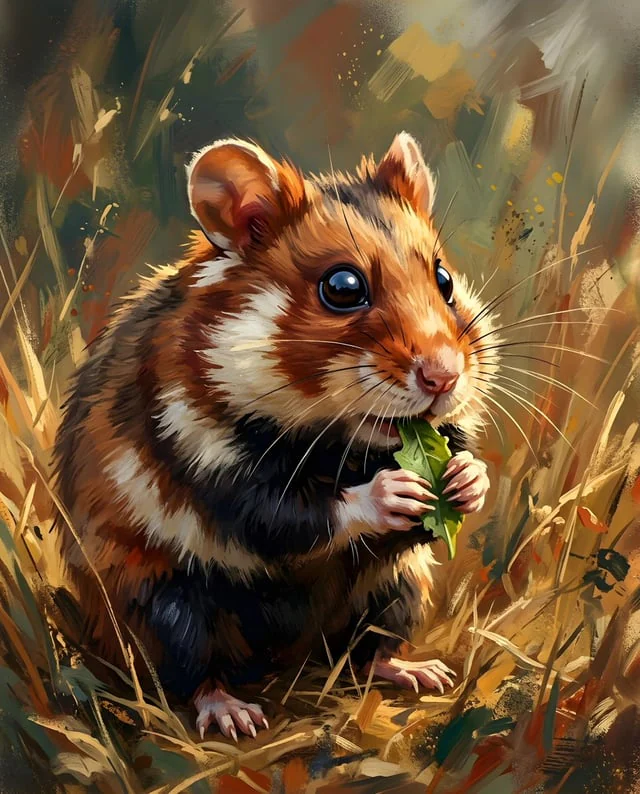

```text
A close-up, eye-level shot captures a {argument name="animal type" default="European hamster"} in a field of dry grass. The {argument name="animal type" default="hamster"}, with its distinctive brown and black fur, is positioned slightly to the left of the frame, facing right. Its tiny paws are holding a {argument name="food item" default="small green leaf"}, which it appears to be eating. The {argument name="animal type" default="hamster"}'s dark, beady eyes are sharp and focused, and its long whiskers are prominent.
```

Model: Nano Banana Pro
Author: Heather Green

[ProjectD](https://aitoolsradar.com/en/prompts/cfe7752d68c9ad) · [Recorded source](https://x.com/heathergreen/status/2086241045193339116)
 · [Full original metadata and byte evidence](data/projectd-batch-0070.json)

## Infographic / Edu Visual - Firefighter Storyboard Infographic

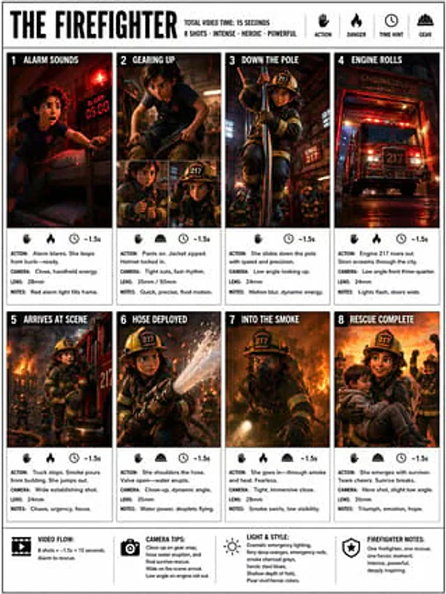

```text
Create a crisp, clean infographic storyboard poster for {argument name="subject" default="THE FIREFIGHTER"}. Wide 16:9 layout, white background, black borders, bold black typography, {argument name="rendering style" default="premium Pixar 3D stylized rendering"}, intense dramatic colors — fiery deep oranges, emergency red
```

Model: Nano Banana Pro
Author: 𝐌

[ProjectD](https://aitoolsradar.com/en/prompts/48917c0d1568cb) · [Recorded source](https://x.com/Strength04_X/status/2071466852614816182)
 · [Full original metadata and byte evidence](data/projectd-batch-0070.json)

## Infographic / Edu Visual - GDR Alternate History Car Design

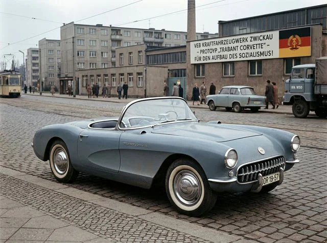

```text
{argument name="car" default="Chevrolet Corvette"} designed in {argument name="location" default="East Germany"} by Trabant engineers in {argument name="era" default="1957"}, retro GDR automotive design, socialist industrial aesthetics, realistic alternate history
```

Model: Nano Banana Pro
Author: Riccardo

[ProjectD](https://aitoolsradar.com/en/prompts/fe3499a2b4870d) · [Recorded source](https://x.com/Riccardo_Nero/status/2065184321514664239)
 · [Full original metadata and byte evidence](data/projectd-batch-0070.json)

## Infographic / Edu Visual - Geometric Mosaic Portrait Illustration

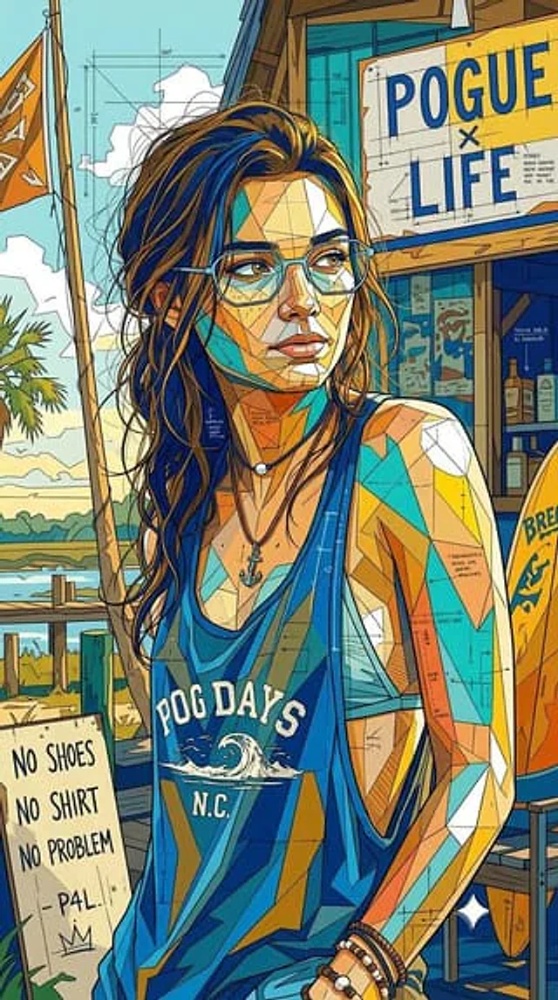

```text
An ultra-detailed {argument name="style" default="geometric mosaic portrait illustration"} blending cubist abstraction, architectural blueprint aesthetics, and contemporary editorial pop-art design. Constructed from thousands of interlocking angular polygon fragments with no color lines, fragmented planes, segmented colorless contours, and intricate line grids. The highly structured composition, with layered technical drawing details embedded throughout, creates a complex look that blends schematic and artwork. Bold {argument name="colors" default="complementary color blocks are dominated by saturated cobalt blue, yellow, turquoise, vibrant golden earth tones, warm orange, and sharp white accents"}. The color treatment is flat yet dimensional, with a balanced contrast between large color fields and subtle geometric micro-details. Clean, vector-like precision combines with the imperfection of hand-drawn sketches and the texture of architectural drawings. Expressive contemporary {argument name="subject" default="character design with stylized facial construction, exaggerated eyeglass shapes, and fragmented surface geometry"}. A dense network of thin construction lines, blueprint markings, technical annotations, abstract map-like divisions, and layered polygonal textures seamlessly integrate into the subject and background. A mixed-media blend of cubism, urban mural art, technical illustration, generative geometry, and modern magazine cover aesthetics. Sharp edge definition, highly detailed surface articulation, intricate tessellation patterns, crystalline segmentation, and sophisticated visual rhythms. The background and subject are treated as a unified geometric ecosystem, with forms flowing continuously throughout. Premium gallery-quality digital artwork, razor-sharp linework, complex layered depth, contemporary design language, architectural abstraction, vibrant modernist color harmonies, highly detailed geometric storytelling, and a visually rich yet clean and organized composition. R 9:16.
```

Model: Nano Banana Pro
Author: zayan

[ProjectD](https://aitoolsradar.com/en/prompts/0da65a76de6d59) · [Recorded source](https://x.com/HustleXR/status/2074377759674057125)
 · [Full original metadata and byte evidence](data/projectd-batch-0070.json)

## Infographic / Edu Visual - Gundam Origin Infographic Generation

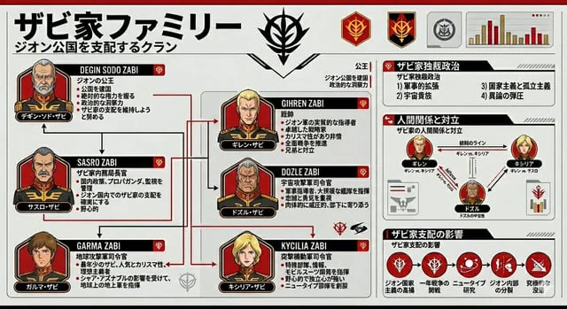

```text
Please summarize the {argument name="subject" default="Zabi family from Gundam Origin"} in an {argument name="style" default="infographic style"}.
```

Model: Nano Banana Pro
Author: ファーラ@ガンプラ

[ProjectD](https://aitoolsradar.com/en/prompts/1f47a3ce1955d8) · [Recorded source](https://x.com/Live_05/status/2065366252391113120)
 · [Full original metadata and byte evidence](data/projectd-batch-0070.json)

## Infographic / Edu Visual - Miniature Pop-up Book Diorama

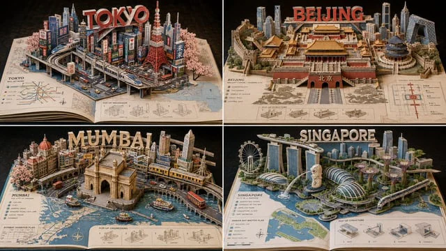

```text
2x2 grid, 16:9, do this for 4 important {argument name="subject" default="Asian cities"}: Generate a photoreal miniature pop-up book diorama for {argument name="subject" default="Asian cities"}.Rules:- infer SUBJECT_DNA automatically- use BASE_DOCUMENT as the physical foundation- the subject must rise from the page as a paper-engineered 3D world- include inferred landmarks, architecture, terrain, infrastructure, cultural motifs, and small scale cues- show folded platforms, stairs, slots, hinges, support struts, and hidden paper mechanics- integrate the subject name or symbolic typography as raised paper letters or structural forms- the base page should contain an inferred map, diagram, blueprint, or printed context relevant to {argument name="subject" default="Asian cities"}- everything must feel crafted from paper, cardstock, ink, miniature model materials, and precise pop-up engineering- no hard-coded city, landmark, tower, temple, map, color, or text unless supplied
```

Model: Nano Banana Pro
Author: Gadgetify

[ProjectD](https://aitoolsradar.com/en/prompts/a21037c4552606) · [Recorded source](https://x.com/Gdgtify/status/2082221056652443680)
 · [Full original metadata and byte evidence](data/projectd-batch-0070.json)

## Infographic / Edu Visual - Professional Beef Taco Product Photography

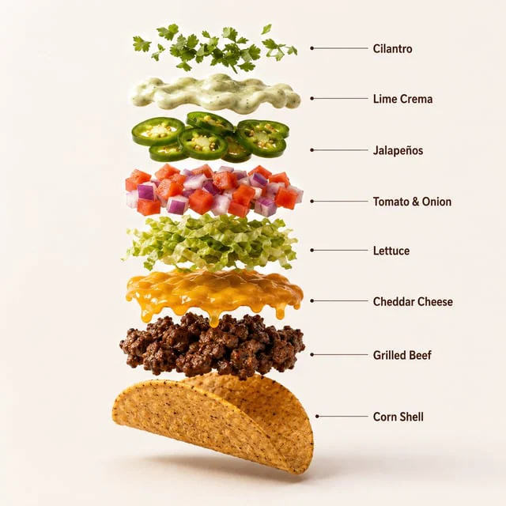

```text
A high-quality professional product photograph of three premium loaded beef tacos arranged neatly on a dark ceramic plate, centered against a warm terracotta-orange seamless studio background. Each taco features a crisp golden corn shell filled with juicy seasoned grilled beef, melted cheddar cheese, fresh shredded lettuce, diced tomatoes, purple onions, jalapeño slices, and creamy lime sauce. The beef has realistic grilled texture and subtle char marks, while the vegetables appear fresh and vibrant with natural moisture. Soft cinematic studio lighting creates rich highlights and subtle shadows beneath the plate. Ultra-sharp focus, DSLR macro food photography, premium Mexican fast-food advertisement style, hyper realistic, clean commercial composition, 8K. Aspect Ratio: 1:1 Create a hyper-realistic exploded vertical infographic composition of a premium loaded beef taco. Top → Bottom structure: Fresh Cilantro Garnish → Lime Crema → Jalapeño Slices → Diced Tomato & Onion → Shredded Lettuce → Melted Cheddar Cheese → Seasoned Grilled Beef → Crispy Corn Shell Every element must be perfectly centered, evenly spaced, and aligned vertically. Show realistic grilled beef texture, melted cheese, crisp vegetables, fresh herbs, creamy sauce, and a detailed crunchy corn shell. Use a warm terracotta-orange seamless studio background, soft commercial lighting, subtle realistic shadows beneath every floating element, ultra-sharp DSLR macro food photography, premium fast-food infographic aesthetic, clean professional composition, hyper realistic, 8K. Add clean minimalist infographic text labels with thin pointer lines using these exact labels: "Cilantro" "Lime Crema" "Jalapeños" "Tomato & Onion" "Lettuce" "Cheddar Cheese" "Grilled Beef" "Corn Shell" Aspect Ratio: 1:1 The tacos start to slowly spin while the ingredients separate gently and precisely, maintaining alignment and scale. The motion is smooth, appetizing, and controlled with no extra effects.
```

Model: Nano Banana Pro
Author: 𝐌

[ProjectD](https://aitoolsradar.com/en/prompts/8a035df4315d60) · [Recorded source](https://x.com/Strength04_X/status/2091192289385451787)
 · [Full original metadata and byte evidence](data/projectd-batch-0070.json)

## Infographic / Edu Visual - Realistic Dodo Bird Illustration

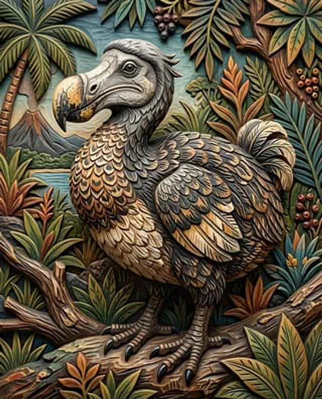

```text
a {argument name="bird species" default="dodo bird"}. Its body is plump and rounded, covered in {argument name="feather colors" default="dark gray and brown feathers"} with lighter, intricate patterns. The bird's legs and feet are visible, with scaly skin and sharp claws. The head is a lighter gray, with a prominent, curved beak that has a {argument name="beak texture" default="cracked texture"}.
```

Model: Nano Banana Pro
Author: Heather Green

[ProjectD](https://aitoolsradar.com/en/prompts/8d54da1c87fa46) · [Recorded source](https://x.com/heathergreen/status/2085878662017032685)
 · [Full original metadata and byte evidence](data/projectd-batch-0070.json)

## Infographic / Edu Visual - Retro 1970s Alphabet Graphic Design

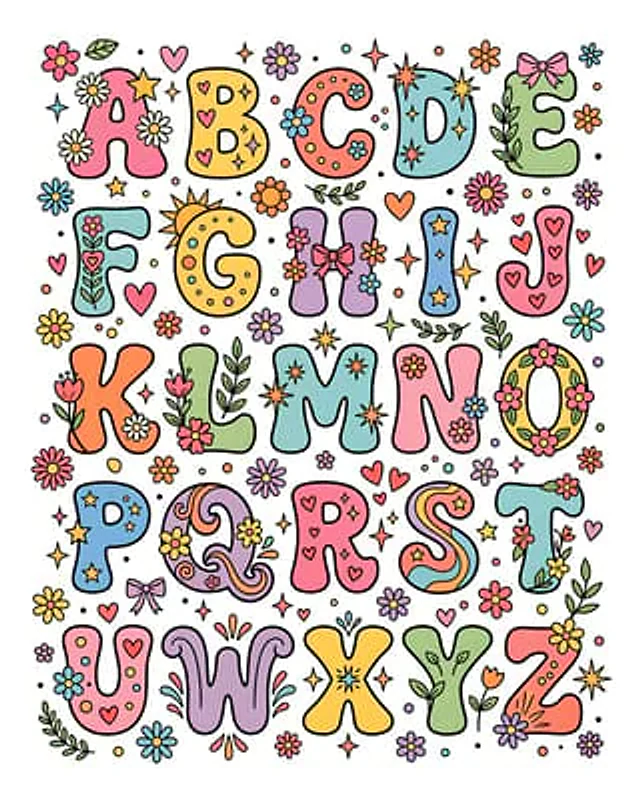

```text
A collection of alphabet letters, {argument name="letters" default="A through Z"} and decorative elements are arranged in rows against a {argument name="background color" default="white background"}. The letters are in a playful, rounded font with thick black outlines and vibrant, pastel colors. Many of the letters are stylized with accompanying graphics: flowers, starbursts, hearts, bows, sparkles. There are also scattered floral and starburst elements throughout the composition. The overall style is reminiscent of {argument name="design era" default="1970s"} graphic design, with a cheerful and whimsical aesthetic.
```

Model: Nano Banana Pro
Author: Heather Green

[ProjectD](https://aitoolsradar.com/en/prompts/c7bc7043955645) · [Recorded source](https://x.com/heathergreen/status/2080337142606111129)
 · [Full original metadata and byte evidence](data/projectd-batch-0070.json)

## Infographic / Edu Visual - Strawberry Milkshake Product and Infographic

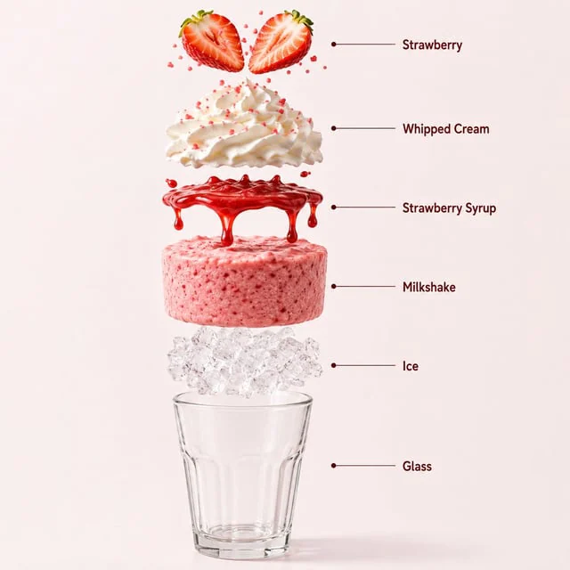

```text
A high-quality professional product photograph of a premium {argument name="flavor" default="strawberry"} milkshake served in a tall transparent glass, centered against a soft {argument name="background color" default="pastel pink"} seamless studio background. The milkshake has a thick creamy texture, glossy syrup dripping inside the glass, a generous swirl of whipped cream on top, fresh fruit slices, and delicate sugar sprinkles. Realistic condensation droplets cover the glass with soft reflections from the studio lights. Elegant soft lighting creates subtle natural shadows beneath the glass. Ultra-sharp focus, DSLR macro beverage photography, premium café advertisement style, hyper realistic, clean commercial composition, 8K. 

Create a hyper-realistic exploded vertical infographic composition of a premium strawberry milkshake. 
Top → Bottom structure: 
Fresh Strawberry Garnish 
→ Whipped Cream 
→ Strawberry Syrup 
→ Creamy Strawberry Shake 
→ Crushed Ice 
→ Transparent Glass Base 
All elements must be perfectly centered, evenly spaced, and vertically aligned. Show realistic strawberry texture, fluffy whipped cream, glossy syrup, thick creamy milkshake consistency, translucent ice, and realistic glass reflections. Use a soft pastel pink seamless studio background with elegant café lighting and subtle realistic shadows beneath each floating element. Ultra-sharp DSLR macro beverage photography, premium dessert drink infographic aesthetic, clean professional composition, hyper realistic, 8K. 
Add clean minimalist infographic text labels with thin pointer lines using these exact labels: 
"Strawberry" 
"Whipped Cream" 
"Strawberry Syrup" 
"Milkshake" 
"Ice" 
"Glass"
```

Model: Nano Banana Pro
Author: 𝐌

[ProjectD](https://aitoolsradar.com/en/prompts/e988c0a83e1c42) · [Recorded source](https://x.com/Strength04_X/status/2090665058980462697)
 · [Full original metadata and byte evidence](data/projectd-batch-0070.json)

## Infographic / Edu Visual - Technical Cutaway Diagram

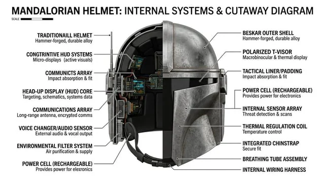

```text
Cutaway diagram of a {argument name="object" default="mechanical device"}, detailed with interior component, on a white background. High-resolution, with a focused technique and text callouts providing information about each part. Interior details, hyper-realistic appearance.
```

Model: Nano Banana Pro
Author: Pierrick Chevallier | IA

[ProjectD](https://aitoolsradar.com/en/prompts/7a6fcca50a3f6e) · [Recorded source](https://x.com/CharaspowerAI/status/2073104523476828533)
 · [Full original metadata and byte evidence](data/projectd-batch-0070.json)

## Infographic / Edu Visual - Voxel Magazine Pop-up Art

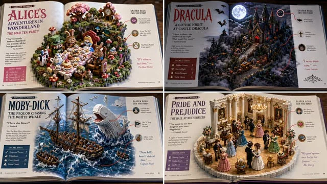

```text
2x2 grid, 16:9, do this for public space, non copyrighted books:   { "Scene_Type": "Macro Photography of an Open Magazine Spread", "Topic": "{argument name=\"franchise\" default=\"[FRANCHISE]\"} - {argument name=\"scene\" default=\"[SCENE]\"}", "AI_Semantic_Inference": { "The_Pop_Up": "A 3D, isometric, highly detailed voxel/clay block of the [SCENE] rising out of the glossy magazine pages.", "The_Layout": "Left and Right margins feature editorial text columns, bold headlines, and 'Secret Stats' boxes.", "The_Callouts": "Red circles drawn around AI_INFER(hidden easter eggs in the 3D model), with red lines connecting them to the 2D margin text." }, "Aesthetic": "Slightly glossy paper texture, vibrant colors, satisfying tactile blend of 2D print media and 3D isometric art." }
```

Model: Nano Banana Pro
Author: Gadgetify

[ProjectD](https://aitoolsradar.com/en/prompts/3e1e56235b3f82) · [Recorded source](https://x.com/Gdgtify/status/2079934742581887010)
 · [Full original metadata and byte evidence](data/projectd-batch-0070.json)

## Luxury Brand About Page Storytelling Layout

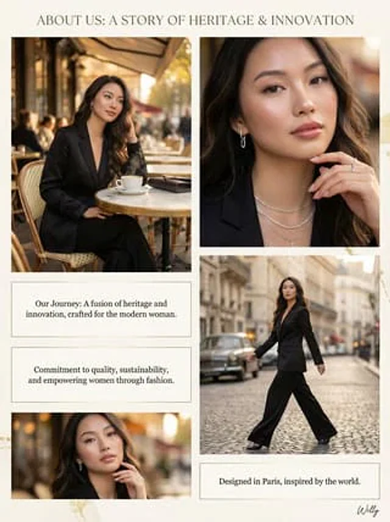

```text
Special Layout Template make by Willy.

Luxury brand about page, storytelling layout, 4:5 ratio.

PAGE TYPE: About page - brand story, visual narrative
LAYOUT: Large image sections alternating with text blocks, timeline arrangement.

SECTION 1:
- Image: A young Caucasian woman in her early 20s : almond-shaped eyes with long defined lashes, high cheekbones, and a subtle V-line jaw. She has  long flowing wavy light brown hair with soft black-coffee highlights cascading over her shoulders. Luminous dewy porcelain skin with a healthy glow and glass skin effect, soft rose blush on cheeks, glossy cherry lips with a subtle smile, slim straight nose, delicate feminine features.
- She wears a cream silk power suit with clean lines and wide-leg trousers, paired with a delicate layered silver necklace. A designer clutch rests on the marble cafe table beside a steaming cup of matcha latte.

SECTION 2:
- Text Block: "{argument name="Text Block 1" default="Our Journey: A fusion of heritage and innovation, crafted for the modern woman."}"
SECTION 3:
- Image: Close-up beauty shot showcasing the glass skin effect and delicate jewelry.
SECTION 4:
- Text Block: "{argument name="Text Block 2" default="Commitment to quality, sustainability, and empowering women through fashion."}"
SECTION 5:
- Image: Full-length shot, showcasing the power suit silhouette in motion.
SECTION 6:
- Text Block: "Designed in Paris, inspired by the world."

DYNAMIC ELEMENTS:
Subtle motion blur as she turns her head slightly with gentle head tilt, soft contemplative expression, steam rising from the matcha latte cup creating warmth and atmosphere.
CAMERA: Hasselblad X2D, 85mm f/1.4 lens, soft diffused golden hour lighting, shallow depth of field, beauty retouching with luminous skin detail.
STYLE: Parisian elegance, power dressing, luxury fashion, ethereal Eurasian beauty, golden hour, warm and cool color palette, high-end fashion editorial.

A stylish handwritten signature "Willy" is elegantly placed in small letters at the Bottom Right corner.

Style keywords: luxury brand, about us, fashion, parisian cafe, glass skin, editorial, commercial, well-lit, proper exposure, storytelling, timeline, 4:5 ratio
Negative prompt: blurry, low quality, pixelated, distorted, watermark, text overlay, logo, cropped, cut off, out of frame, oversaturated, undersaturated, extra limbs, missing fingers, deformed hands, unnatural pose, anatomical errors, plastic skin, uncanny valley, busy background, distracting elements, inconsistent lighting, harsh shadows, amateur composition.
```

Model: Nano Banana Pro
Author: Willy

[ProjectD](https://aitoolsradar.com/en/prompts/8978735cb454e1) · [Recorded source](https://youmind.com/prompts/luxury-brand-about-page-storytelling-layout-6645)
 · [Full original metadata and byte evidence](data/projectd-batch-0070.json)

## Miniature Coffee Shop Diorama with Chibi Girl


```text
{
  "project_title": "Miniature Coffee Dream",
  "scene": {
    "setting": {
      "location": "Cozy Vintage Coffee Shop Diorama",
      "lighting": "Warm golden ambient light with soft bokeh",
      "mood": "Comfortable, nostalgic, handcrafted miniature world"
    },
    "main_subject": {
      "character": {
        "type": "ultra-detailed 3D chibi girl",
        "face": "same as reference face, recognizable features and expression",
        "appearance": "large chibi head, small body proportions, smooth fair skin, expressive eyes",
        "hair": "same hairstyle as reference",
        "expression": "bright, curious smile looking upward",
        "pose": "sitting on a tiny wooden stool while watching the coffee drip",
        "outfit": "oversized soft white shirt with realistic cotton texture"
      },
      "object": {
        "item": "mini cold brew coffee tower",
        "materials": "glass containers, brass fittings, wooden stand",
        "details": "spiral glass tubes, dripper, collection flask and ice reservoir",
        "moment": "single drop of coffee falling from the dripper captured mid-air"
      }
    },
    "environment": {
      "details": [
        "rustic wooden counter scattered with coffee beans",
        "tiny ceramic cup with spoon",
        "background shelves with jars of coffee beans",
        "small vintage books and old brewing tools",
        "warm fairy lights creating soft glowing bokeh"
      ]
    },
    "composition": {
      "aspect_ratio": "9:16 vertical",
      "focus": "sharp focus on the chibi girl's face and the falling coffee drop",
      "depth_of_field": "shallow background blur",
      "style": "miniature handcrafted diorama with photorealistic materials"
    },
    "technical": {
      "render": "ultra detailed 3D render",
      "textures": "realistic skin pores, fabric weave, aged wood grain, reflective glass and liquid clarity",
      "camera": "cinematic close-up feel, 35mm lens, f/1.8"
    }
  }
}
```

Model: Nano Banana Pro
Author: Meem

[ProjectD](https://aitoolsradar.com/en/prompts/de7586a7142ce3) · [Recorded source](https://youmind.com/prompts/miniature-coffee-shop-diorama-with-chibi-girl-12011)
 · [Full original metadata and byte evidence](data/projectd-batch-0070.json)

## Mixed-Reality Hot Chocolate Pour Prompt (Image-to-Image)

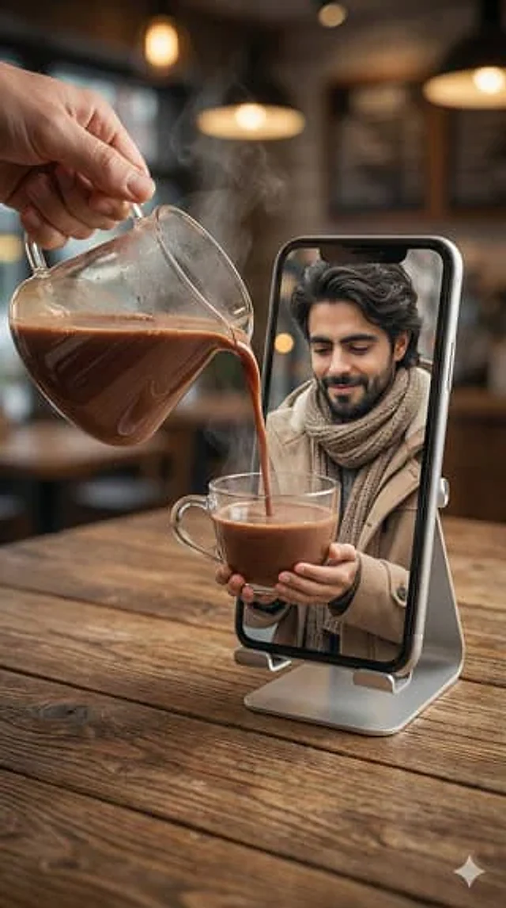

```text
{ "action": "image_generation", "action_input": "{'prompt': "A hyper-realistic mixed-reality scene. A real human hand in the foreground pours hot chocolate from a transparent glass server into a clear glass cup. The cup appears to be emerging from inside a smartphone screen standing upright on a silver stand on a wooden cafe table. Inside the phone screen, the man from the provided image with his exact facial features, curly dark hair, and beard is wearing a warm beige winter coat and scarf.He is looking at the cup with a gentle smile, holding it as if receiving the liquid. The hot chocolate flows seamlessly from the real world into the digital screen. Soft steam rises, warm cafe lighting, cinematic realism, 8K, 9:16 aspect ratio."}" }
```

Model: Nano Banana Pro
Author: Zar⭕on

[ProjectD](https://aitoolsradar.com/en/prompts/3e711d22b581ae) · [Recorded source](https://youmind.com/prompts/mixed-reality-hot-chocolate-pour-prompt-image-to-image-6527)
 · [Full original metadata and byte evidence](data/projectd-batch-0070.json)

## Natural Language Prompt for Miniature World Inside a Teacup

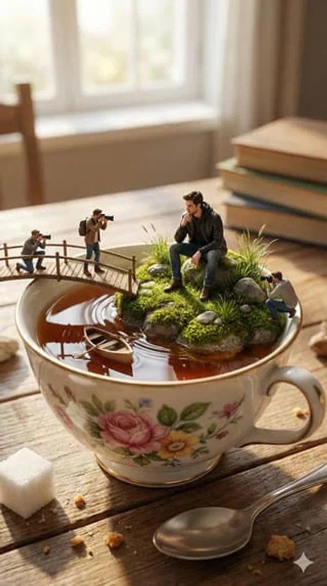

```text
"Shrink the main subject into a tiny, hyper-realistic miniature person sitting on a small moss-covered island floating inside a teacup filled with tea. The island should look natural with grass, small rocks, and uneven terrain. Add a tiny wooden bridge placed across the tea surface where 2–3 miniature photographers stand, actively taking photos of the subject. Include a tiny wooden rowboat gently floating near the island, creating subtle ripples in the tea.
The teacup should be large, elegant, and floral-designed, placed on a wooden table in a cozy room. Add real-world objects around it like a sugar cube, spoon, and soft window light to emphasize the scale difference. Use cinematic soft daylight coming from a window, creating realistic reflections on the tea surface and shadows from the tiny elements.
The subject’s pose should look natural and thoughtful, interacting with the tiny environment. Add ultra-realistic textures to the tea liquid, porcelain cup, wood table, and moss. Slight depth-of-field blur in the background to focus attention on the miniature world inside the cup.
Make the scene whimsical, surreal, and extremely realistic, designed to make viewers pause and stare to understand the scale illusion. Viral, eye-catching, and highly detailed composition."
```

Model: Nano Banana Pro
Author: Nexora

[ProjectD](https://aitoolsradar.com/en/prompts/a32b40c2e49ab4) · [Recorded source](https://youmind.com/prompts/natural-language-prompt-for-miniature-world-inside-a-teacup-9095)
 · [Full original metadata and byte evidence](data/projectd-batch-0070.json)

## New Year's Day Special: Four-Panel Puzzle for 2026 Blessing

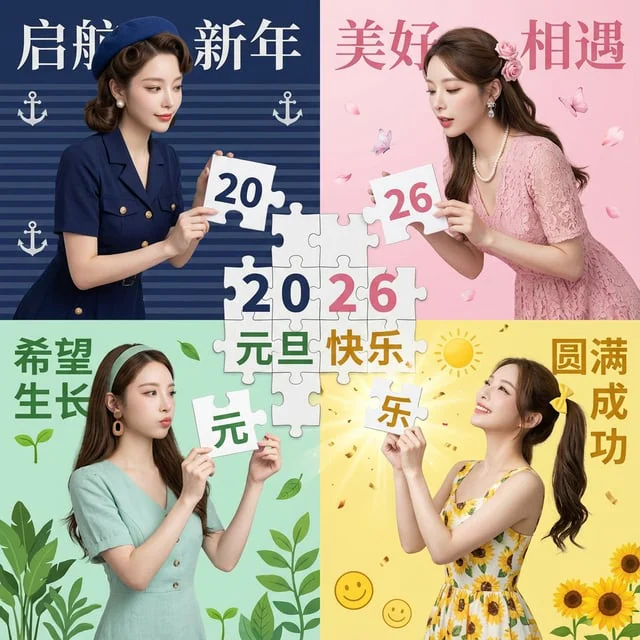

```text
[Key: Maintain precise facial features, retain original face structure, the character in the image must be completely consistent with the uploaded reference image] High-end photo studio 2x2 grid photo. Top-left panel (Navy Blue background): The character wears a navy blue uniform-style dress, decorated with gold buttons, vintage curls with a blue beret and pearl earrings. She holds up a huge puzzle piece (top-left piece, with the number "20" on it) with both hands, moving it towards the center of the frame. Her eyes are focused on the central puzzle area, her expression is serious, with a slight smile. The background features navy stripes, an anchor, and the text "Set Sail for the New Year". Top-right panel (Cherry Blossom Pink background): The same woman wears a pink lace dress, a pearl necklace, a princess hairstyle with a pink rose hairpin and crystal earrings. She holds up the top-right puzzle piece (with the number "26" on it) with both hands, moving it towards the center to connect with the top-left piece. Her eyes look at the puzzle seam, her expression is focused and expectant, and her body leans forward. The background features pink cherry blossoms, the text "Beautiful Encounter", butterflies, and petals. Bottom-left panel (Mint Green background): The same woman wears a mint green cotton and linen dress, in an artistic style, with natural long hair, a green hairband, and wooden earrings. She holds up the bottom-left puzzle piece (with the text "New Year's Day" on it) with both hands, moving it upwards to connect with the top-left piece. Her eyes look at the puzzle, her expression is serious, and her mouth is slightly pursed. The background features green plants, the text "Hope Grows", new sprouts, and leaves. Bottom-right panel (Lemon Yellow background): The same woman wears a yellow dress with a sunflower pattern, pigtails with yellow bows. She pushes in the last bottom-right puzzle piece (with the text "Happy" on it) to complete the puzzle. The four pieces perfectly form the complete pattern "2026 New Year's Day Happy" in the center of the frame. She tilts her head back, looking at the completed puzzle, her face beaming with a successful, joyful smile. The center of the frame bursts with golden light and confetti. The background features a yellow sun, the text "Complete Success", smiley faces, and sunflowers. The puzzle pieces converge from the four corners to the center to form a complete picture. Clear makeup, bright ring light, 85mm lens, f/1.8 aperture, four-panel composition with puzzle interaction, fashion magazine style.
```

Model: Nano Banana Pro
Author: 松果先森

[ProjectD](https://aitoolsradar.com/en/prompts/026fc4e2f0266a) · [Recorded source](https://x.com/songguoxiansen/status/2005822648027091031)
 · [Full original metadata and byte evidence](data/projectd-batch-0070.json)

## New Year's Day Special: Four-Panel Puzzle for 2026 Blessing


```text
[关键:保持精确的面部特征,保留原始脸部结构,图中角色与上传参考图完全一致] 高级摄影棚2x2宫格写真。左上格(海军蓝背景):人物穿海军蓝色制服风连衣裙,金色纽扣装饰,复古卷发配蓝色贝雷帽和珍珠耳环,她双手托举一块巨大的拼图块(左上角块,上面有"20"数字),向画面中心方向移动,眼神专注地看向中心拼图区域,表情认真,嘴角微笑,背景有海军条纹、船锚、"启航新年"字样。右上格(樱花粉背景):同一女性穿粉色蕾丝连衣裙,珍珠项链,公主头配粉色玫瑰花发夹和水晶耳环,她双手托举右上角拼图块(上面有"26"数字)向中心移动与左上格拼接,眼神看向拼图接缝处,表情专注期待,身体前倾,背景有粉色樱花、"美好相遇"字样、蝴蝶、花瓣。左下格(薄荷绿背景):同一女性穿薄荷绿色棉麻连衣裙,文艺风格,自然长发配绿色发带和木质耳环,她双手托举左下角拼图块(上面有"元旦"字样)向上移动与左上格对接,眼神看向拼图,表情认真,嘴巴微微抿起,背景有绿色植物、"希望生长"字样、新芽、叶子。右下格(柠檬黄背景):同一女性穿黄色连衣裙,向日葵图案,双马尾配黄色蝴蝶结,她双手托举最后一块右下角拼图(上面有"快乐"字样)完成拼图,四块拼图在画面中心完美拼成"2026元旦快乐"完整图案,她头后仰,眼睛看向完成的拼图,脸上洋溢着成功喜悦的笑容,画面中心爆出金色光芒和彩纸,背景有黄色太阳、"圆满成功"字样、笑脸、向日葵。四格之间拼图从四角汇聚到中心形成完整画面,清透妆容,明亮环形光,85mm镜头,f/1.8光圈,拼图互动四联构图,时尚杂志风格。
```

Model: Nano Banana Pro
Author: 松果先森

[ProjectD](https://aitoolsradar.com/en/prompts/4ad71b677bc04a) · [Recorded source](https://youmind.com/prompts/2026-new-year-puzzle-4031)
 · [Full original metadata and byte evidence](data/projectd-batch-0070.json)

## Newspaper Mid-Unfold Diorama Prompt

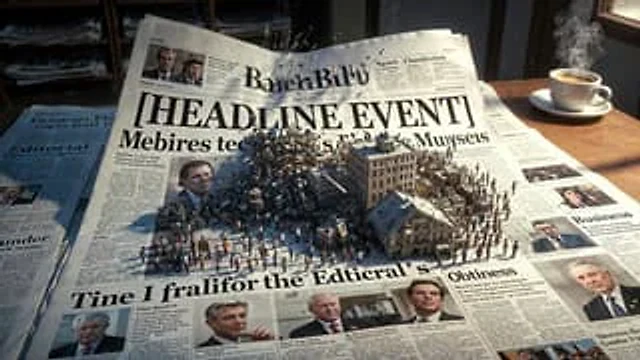

```text
Epic 3D scene: a massive broadsheet newspaper mid-unfold, its headlines erupting into the events they describe. Front page stories become dioramas pushing off the page. {argument name="headline event" default="[HEADLINE EVENT]"} manifests in miniature chaos. Photographs animate and expand into three dimensions. Column text rises as city blocks of information. Editorial section becomes a battlefield of arguing figures. Classifieds transform into tiny desperate lives. Different sections occupy different worlds: sports as stadium, business as trading floor, obituaries as memorial garden. Yesterday's news composites beneath as fading ghost layer. Ink smells almost visible as atmosphere. Newsstand visible at the edge, morning light, coffee steam, 8K, photorealistic.
```

Model: Nano Banana Pro
Author: Nano banana pro🍌

[ProjectD](https://aitoolsradar.com/en/prompts/46965970b37b4e) · [Recorded source](https://youmind.com/prompts/newspaper-mid-unfold-diorama-prompt-7709)
 · [Full original metadata and byte evidence](data/projectd-batch-0070.json)

## Ornate Box Diorama Prompt for Twenty Thousand Leagues Under the Sea

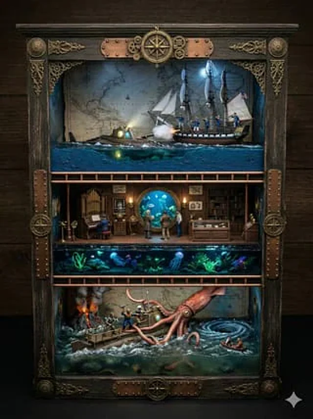

```text
Variable Guide
1. OVERALL_DIORAMA_THEME = Scenes from the book  Twenty Thousand leagues under the sea  by Jules Verne, in the order in which they are presented in the book
2. CUPBOARD_BASE_MATERIAL = 
3. CUPBOARD_LINING_MATERIAL = 
4. RACK_MATERIAL = 
5. ORNAMENTATION_STYLE = [e.g., Gothic carved wood, Art Deco brass, Elven interlaced vines]
6. ART_STYLE = Hyper-Realistic Render
7. TOP_SHELF_SCENE = [Describe specific actions of miniature figures defining the scene]
8. MIDDLE_SHELF_SCENE = [Describe specific actions of miniature figures defining the scene]
9. BOTTOM_SHELF_SCENE = [Describe specific actions of miniature figures defining the scene]
10. LIGHTING = 
11. CAMERA_ANGLE = A straight-on, front-facing view, captured from a moderately high angle looking distinctly downward.
12. ASPECT_RATIO = 3:4

Generation Directives
(Note: If any variable is left blank, intelligently infer the most appropriate detail based on the OVERALL_DIORAMA_THEME)

Directive 1: Framing & Composition (Highest Priority)
A direct, front-facing photograph captured from CAMERA_ANGLE. The composition must perfectly center the open display structure, looking down at a distinct angle into the shelves to clearly reveal the floor plates and top-down depth of the miniature objects within the dioramas, while ensuring the exterior side panels remain completely hidden. The entire free-standing structure must be completely visible with negative space around it against a simple background. The aspect ratio is 3:4.

Directive 2: The Main Structure (Strict Constraints)
Render the image in the style of ART_STYLE. The central object is a highly detailed, permanently open-front curio display structure. It must not possess doors, hinges, or door frames of any kind. The exterior is constructed from CUPBOARD_BASE_MATERIAL and detailed with ORNAMENTATION_STYLE. The interior back wall is lined with CUPBOARD_LINING_MATERIAL, and the individual shelves are made of RACK_MATERIAL.

Directive 3: The Miniature Dioramas & Figures
The structure houses a cohesive miniature world divided across three shelves, adhering to the OVERALL_DIORAMA_THEME. Crucially, each shelf must contain miniature figures engaged in a specific narrative action.
* Top Shelf: Miniature figures are depicted [TOP_SHELF_SCENE].
* Middle Shelf: Miniature figures are depicted [MIDDLE_SHELF_SCENE].
* Bottom Shelf: Miniature figures are depicted [BOTTOM_SHELF_SCENE].
Ensure the scale clearly reads as miniature dioramas housed within a furniture piece.

Directive 4: Atmosphere & Lighting
The scene is illuminated by LIGHTING. The lighting should cast appropriate micro-shadows within each shelf to emphasize the depth, the figures, and the miniature scale of the dioramas.
```

Model: Nano Banana Pro
Author: Artingent

[ProjectD](https://aitoolsradar.com/en/prompts/ac2467676294b5) · [Recorded source](https://youmind.com/prompts/ornate-box-diorama-prompt-for-twenty-thousand-leagues-under-the-sea-11218)
 · [Full original metadata and byte evidence](data/projectd-batch-0070.json)

## Ornate Diorama of Undead Dungeon

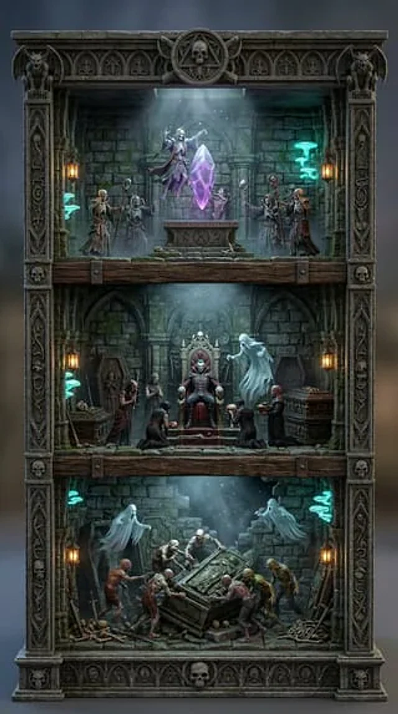

```text
Variable Guide 
1. OVERALL_DIORAMA_THEME = 
2. CUPBOARD_BASE_MATERIAL = 
3. CUPBOARD_LINING_MATERIAL =  
4. RACK_MATERIAL =  
5. ORNAMENTATION_STYLE = [e.g., Gothic carved wood, Art Deco brass, Elven interlaced vines] 
6. ART_STYLE = 
7. TOP_SHELF_SCENE = [Describe specific actions of miniature figures defining the scene] 
8. MIDDLE_SHELF_SCENE = [Describe specific actions of miniature figures defining the scene] 
9. BOTTOM_SHELF_SCENE = [Describe specific actions of miniature figures defining the scene] 
10. LIGHTING =  
11. CAMERA_ANGLE = A straight-on, front-facing view, captured from a moderately high angle looking distinctly downward. 
12. ASPECT_RATIO = 3:4  

Generation Directives (Note: If any variable is left blank, intelligently infer the most appropriate detail based on the OVERALL_DIORAMA_THEME)  

Directive 1: Framing & Composition (Highest Priority) 
A direct, front-facing photograph captured from CAMERA_ANGLE. The composition must perfectly center the open display structure, looking down at a distinct angle into the shelves to clearly reveal the floor plates and top-down depth of the miniature objects within the dioramas, while ensuring the exterior side panels remain completely hidden. The entire free-standing structure must be completely visible with negative space around it against a simple background. The aspect ratio is 3:4.  

Directive 2: The Main Structure (Strict Constraints) 
Render the image in the style of ART_STYLE. The central object is a highly detailed, permanently open-front curio display structure. It must not possess doors, hinges, or door frames of any kind. The exterior is constructed from CUPBOARD_BASE_MATERIAL and detailed with ORNAMENTATION_STYLE. The interior back wall is lined with CUPBOARD_LINING_MATERIAL, and the individual shelves are made of RACK_MATERIAL.  

Directive 3: The Miniature Dioramas & Figures 

The structure houses a cohesive detailed miniature world divided across three shelves, adhering to the OVERALL_DIORAMA_THEME. Crucially, each shelf must contain miniature figures engaged in a specific narrative action. Let there be a high density of structures, props, characters. Let the detail of environment, architecture and props be high. 
Generate  appropriate cinematic lighting and atmospheric conditions: TIME_OF_DAY (Choose from sunrise glow, golden hour, bright midday, sunset haze, blue hour twilight, night illumination) LIGHT_SOURCE_STYLE (Choose from sunlight beams, lantern glow, neon signage, reactor light, forge fire, bioluminescent flora, electrical arcs) WEATHER_STATE (Choose from clear skies, drifting mist, light rain, snowfall, desert dust, ocean spray, storm clouds) ATMOSPHERIC_EFFECTS (Choose
```

Model: Nano Banana Pro
Author: Artingent

[ProjectD](https://aitoolsradar.com/en/prompts/79970c5329676e) · [Recorded source](https://youmind.com/prompts/ornate-diorama-of-undead-dungeon-11786)
 · [Full original metadata and byte evidence](data/projectd-batch-0070.json)

## Pirate Sea Battle Inside a Coffee Cup


```text
Ultra-photorealistic, cinematic macro photography style, capturing an impossible “world inside a cup.”
A white ceramic coffee cup sits on a natural wooden tabletop, filled to the brim with dark coffee. The coffee surface transforms into a turbulent ocean: deep brown waves surge and collide, with realistic coffee crema forming foamy crests, swirling vortices, and complex fluid motion, indistinguishable from a real sea. The rim of the cup is damaged by cannon fire, chipped and broken in several places, implying the intensity of the battle.
Two 18th-century classic pirate sailing ships clash violently inside the cup. The ships are miniature in scale yet extremely detailed: visible wooden hull grain, layered decks, rigging, and weathered sails partially torn and billowing in an unseen sea wind. Portions of the ships rise above the cup’s rim, creating a striking sense of scale contrast and surreal tension.
The scene is frozen at the most dramatic moment of combat. Cannons fire simultaneously from both ships, erupting with bright orange muzzle flashes and thick white smoke that expands within the confined space. The explosions illuminate the ships, sails, and coffee waves, while splashes of liquid burst into the air like seawater caught mid-motion.
Shot from a macro perspective with shallow depth of field, the focus is razor-sharp on the ships and battle action. The background is naturally blurred, revealing only the upper portion of the cup and hints of the surrounding environment. Lighting follows realistic photographic principles, with rich textures and cinematic contrast, creating a highly believable, dramatic, and surreal movie-like moment—tense, epic, and astonishingly lifelike.
--ar 1:1
```

Model: Nano Banana Pro
Author: 宝玉

[ProjectD](https://aitoolsradar.com/en/prompts/824b10212de8e0) · [Recorded source](https://youmind.com/prompts/pirate-sea-battle-inside-a-coffee-cup-2178)
 · [Full original metadata and byte evidence](data/projectd-batch-0070.json)

## Portugal World Cup 2026 poster

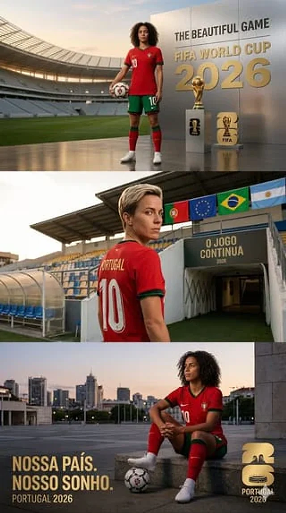

```text
A vertical three-panel composite poster celebrating the FIFA World Cup 2026, featuring different professional female soccer players in the official {argument name="team kit" default="red and green Portugal national team kit"}.
​The top panel shows a player with curly dark hair standing tall and holding a soccer ball in an open, empty modern stadium under a bright daylight sky, positioned next to a large metallic wall displaying the golden words "THE BEAUTIFUL GAME" and "{argument name="event title" default="FIFA WORLD CUP 2026"}" alongside the official trophy on a pedestal.
​The middle panel captures a close-up profile shot of a different player with short blonde hair looking determinedly over her shoulder, set against a stadium player tunnel and grandstands adorned with international flags, featuring the text "O JOGO CONTINUA 2026" above the entrance.
​The bottom panel depicts the first player sitting confidently on a concrete block in an urban plaza at dusk with a city skyline in the background, resting her foot on a soccer ball, accompanied by bold golden text that reads "NOSSA PAÍS. NOSSO SONHO. PORTUGAL 2026" and a stylized 26 logo. The entire image has a dramatic, cinematic, and professional sports photography aesthetic with rich tones and realistic lighting.
```

Model: Nano Banana Pro
Author: Minahil

[ProjectD](https://aitoolsradar.com/en/prompts/f14ede653542f4) · [Recorded source](https://youmind.com/prompts/portugal-world-cup-2026-poster-25308)
 · [Full original metadata and byte evidence](data/projectd-batch-0070.json)

## Premium liquid glass Bento grid product infographic with 8 modules

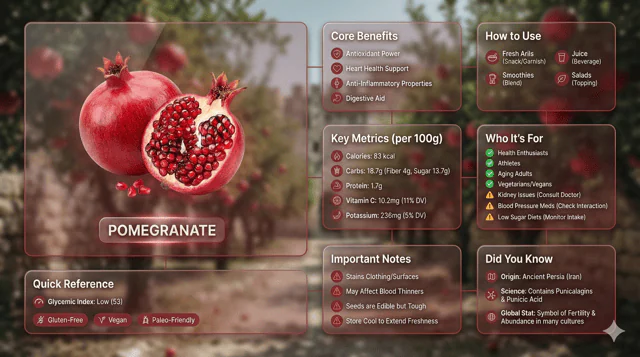

```text
Input Variable: [insert product name]
Language: [insert language]

System Instruction:
Create an image of premium liquid glass Bento grid product infographic with 8 modules (card 2 to 8 show text titles only).
1) Product Analysis:
→ Identify product's dominant natural color → "hero color"
→ Identify category: FOOD / MEDICINE / TECH
2) Color Palette (derived from hero):
→ Product + accents: full saturation hero color
→ Icons, borders: muted hero (30-40% saturation, never black)
3) Visual Style:
→ Hero product: real photography (authentic, premium), 3D Glass version [choose one]
→ Cards: Apple liquid glass (85-90% transparent) with Whisper-thin borders and Subtle drop shadow for floating depth and reflecting the background color
→ Background stays behind cards and high blur where cards are [choose one]:
  - Ethereal: product essence, light caustics, abstract glow
  - Macro: product texture close-up, heavily blurred
  - Pattern: product repeated softly at 10-15% opacity
  - Context: relevant environment, blurred + desaturated
→ Add subtle motion effect
→ Asymmetric Bento grid, 16:9 landscape
→ Hero card: 28-30% | Info modules: 70-72%
4) Module Content (8 Cards):
M1 — Hero: Product displayed as real photo / 3D glass / stylized interpretation (choose one)in beautiful form + product name label
M2 — Core Benefits: 4 unique benefits + hero-color icons
M3 — How to Use: 4 usage methods + icons
M4 — Key Metrics: 5 EXACT data points
Format: [icon] [Label] [Bold Value] [Unit]
FOOD: Calories: [X] kcal/100g, Carbs: [X]g (fiber [X]g, sugar [X]g), Protein: [X]g, [Key Vitamin]: [X]mg ([X]% DV), [Key Mineral]: [X]mg ([X]% DV)
MEDICINE:Active: [name], Strength: [X] mg, Onset: [X] min, Duration: [X] hrs, Half-life: [X] hrs 
TECH:Chip: [model], Battery: [X] hrs, Weight: [X]g,[Key spec]: [value], Connectivity: [protocols]
M5 — Who It's For: 4 recommended groups with green checkmark icons | 3 caution groups with amber warning icons
M6 — Important Notes: 4 precautions + warning icons
M7 — Quick Reference:
→ FOOD: Glycemic Index + dietary tags with icons
→ MEDICINE: Side effects + severity with icons
→ TECH: Compatibility + certifications with icons
M8 — Did You Know: 3 facts (origin, science, global stat) + icons
Output: 1 image, 16:9 landscape, ultra-premium liquid glass infographic.
```

Model: Nano Banana Pro
Author: Mansi Sanghani

[ProjectD](https://aitoolsradar.com/en/prompts/444818a51fd01c) · [Recorded source](https://x.com/MansiSanghani1/status/2013550795224961492)
 · [Full original metadata and byte evidence](data/projectd-batch-0070.json)

## Premium liquid glass Bento grid product infographic with 8 modules


```text
Input Variable: [insert product name]
Language: [insert language]

System Instruction:
Create an image of premium liquid glass Bento grid product infographic with 8 modules (card 2 to 8 show text titles only).
1) Product Analysis:
→ Identify product's dominant natural color → "hero color"
→ Identify category: FOOD / MEDICINE / TECH
2) Color Palette (derived from hero):
→ Product + accents: full saturation hero color
→ Icons, borders: muted hero (30-40% saturation, never black)
3) Visual Style:
→ Hero product: real photography (authentic, premium), 3D Glass version [choose one]
→ Cards: Apple liquid glass (85-90% transparent) with Whisper-thin borders and Subtle drop shadow for floating depth and reflecting the background color
→ Background stays behind cards and high blur where cards are [choose one]:
  - Ethereal: product essence, light caustics, abstract glow
  - Macro: product texture close-up, heavily blurred
  - Pattern: product repeated softly at 10-15% opacity
  - Context: relevant environment, blurred + desaturated
→ Add subtle motion effect
→ Asymmetric Bento grid, 16:9 landscape
→ Hero card: 28-30% | Info modules: 70-72%
4) Module Content (8 Cards):
M1 — Hero: Product displayed as real photo / 3D glass / stylized interpretation (choose one)in beautiful form + product name label
M2 — Core Benefits: 4 unique benefits + hero-color icons
M3 — How to Use: 4 usage methods + icons
M4 — Key Metrics: 5 EXACT data points
Format: [icon] [Label] [Bold Value] [Unit]
FOOD: Calories: [X] kcal/100g, Carbs: [X]g (fiber [X]g, sugar [X]g), Protein: [X]g, [Key Vitamin]: [X]mg ([X]% DV), [Key Mineral]: [X]mg ([X]% DV)
MEDICINE:Active: [name], Strength: [X] mg, Onset: [X] min, Duration: [X] hrs, Half-life: [X] hrs 
TECH:Chip: [model], Battery: [X] hrs, Weight: [X]g,[Key spec]: [value], Connectivity: [protocols]
M5 — Who It's For: 4 recommended groups with green checkmark icons | 3 caution groups with amber warning icons
M6 — Important Notes: 4 precautions + warning icons
M7 — Quick Reference:
→ FOOD: Glycemic Index + dietary tags with icons
→ MEDICINE: Side effects + severity with icons
→ TECH: Compatibility + certifications with icons
M8 — Did You Know: 3 facts (origin, science, global stat) + icons
Output: 1 image, 16:9 landscape, ultra-premium liquid glass infographic.
```

Model: Nano Banana Pro
Author: Mansi Sanghani

[ProjectD](https://aitoolsradar.com/en/prompts/3d24fe840f51d7) · [Recorded source](https://youmind.com/prompts/premium-liquid-glass-bento-grid-6847)
 · [Full original metadata and byte evidence](data/projectd-batch-0070.json)

## Product Marketing - Elegant Black Organza Ribbon

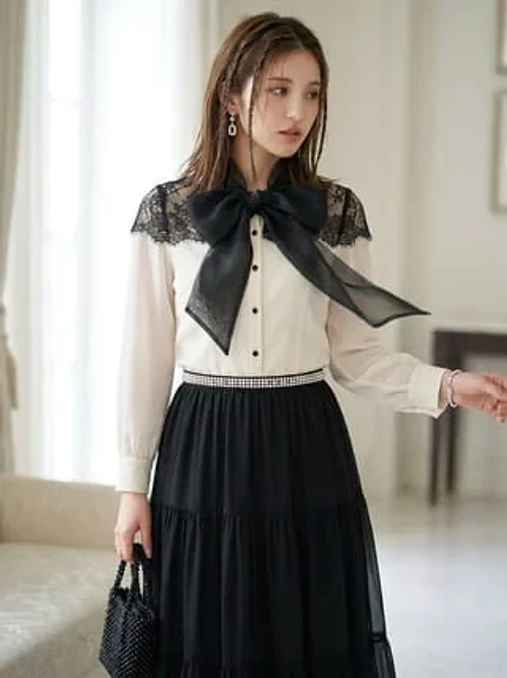

```text
Elegant {argument name="color" default="Black"} {argument name="material" default="Organza"} Ribbon
```

Model: Nano Banana Pro
Author: Saki H. 咲希

[ProjectD](https://aitoolsradar.com/en/prompts/d3c4db7c90c8e8) · [Recorded source](https://x.com/SakiH_AI/status/2090984698629718104)
 · [Full original metadata and byte evidence](data/projectd-batch-0070.json)

## Product Marketing - Identity-Preserving Tulle Dress Portrait


```text
Create an ultra-realistic portrait using the reference image as the identity source. Preserve the subject's exact identity with absolute fidelity, including facial features, bone structure, facial proportions, skin tone, facial asymmetry, and unique characteristics. Do not beautify, reshape, retouch, age, rejuvenate, or modify any facial feature. Maintain authentic facial geometry, natural likeness, and complete identity consistency throughout the entire image. Subject & Pose: Shoulders relaxed and bare, body angled slightly forward, head tilted downward and to the right.
Expression: Soft, melancholic, serene, gazing downward.
Wardrobe & Styling: Voluminous {argument name="dress color" default="pale grey/icy-blue"} tulle dress. Dangling transparent crystal floral earrings. Large {argument name="bouquet theme" default="winter-themed"} bouquet (white blooms, silver foliage).
Hair & Makeup: Messy dark brown updo with loose, wispy tendrils. Fair skin with soft pink blush, glossed pink lips, and subtle peach/pink eye contour.
Setting: {argument name="background" default="Abstract, mottled grey-white textured studio wall"}.
Lighting: Diffused, cool-toned window light originating from the right, casting a soft, ethereal glow and gentle shadows on the left.
Camera & Optical: 85mm portrait lens, f/1.4 aperture, shallow depth of field focusing on the face and earrings.
Realism Enhancers: Cinematic lighting, 32k resolution, subsurface scattering for skin, highly detailed fabric texture, volumetric glow.
```

Model: Nano Banana Pro
Author: Talia

[ProjectD](https://aitoolsradar.com/en/prompts/a478275affe774) · [Recorded source](https://x.com/TaliaAariz/status/2090574438043386336)
 · [Full original metadata and byte evidence](data/projectd-batch-0070.json)

## Product Marketing - Indie Sleaze Glamour Portrait

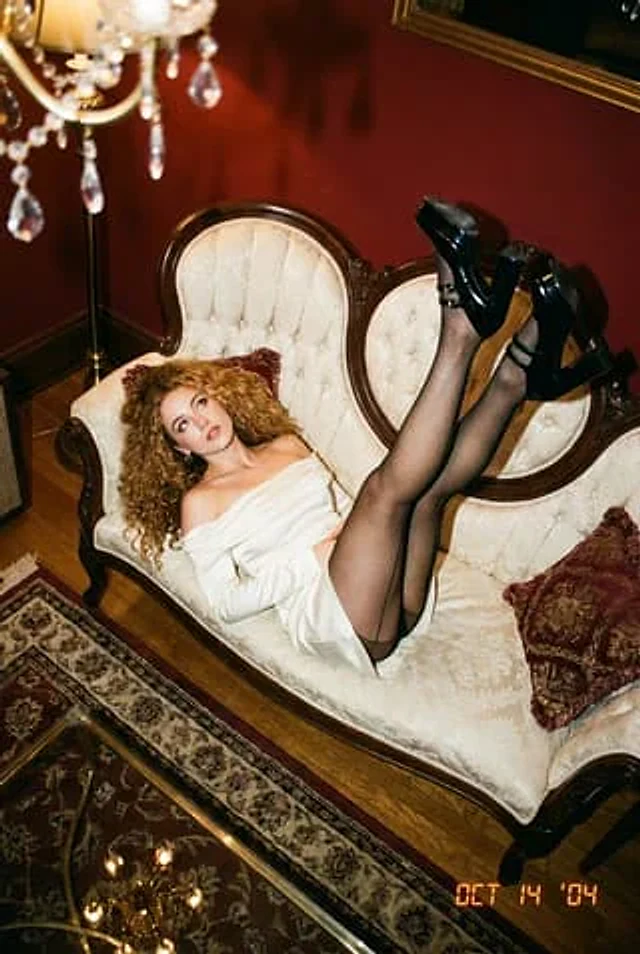

```text
A curly blonde sprawled across a tufted Victorian loveseat, heels kicked to the ceiling - crimson walls, direct flash, pure late-night indie-sleaze glamour. { "scene": { "subject": "A young woman with long, voluminous curly blonde hair — warm honey-gold with lighter sun-bleached ends, falling in dense spirals past her shoulders and across her back. Fair skin with a warm glow, softly flushed cheeks, glossy lip, subtle liner. Slim, long-legged build. Half-lidded, languid gaze toward the lens.", "wardrobe": { "dress": "Cream-white off-the-shoulder mini dress in a soft satin-cotton blend, elasticated bardot neckline, long fitted sleeves, ruffled asymmetric hem with a small bow detail at the hip", "hosiery": "Sheer black tights with a fine back seam running up the calf", "shoes": "Black patent Mary Jane platform heels with double ankle straps and silver buckles", "accessories": [ "Slim silver rings on the fingers", "Small delicate ear studs" ], "styling_note": "Cream and black against a saturated crimson room — coquette-baroque layering" }, "pose": "Sprawled sideways across a small antique loveseat, torso draped over one armrest with the chin propped near a raised hand, chest turned toward the camera. Both legs extended and lifted high off the seat, one knee bent, heels kicked toward the ceiling in a loose scissoring line. Back arched, hair cascading over one shoulder.", "setting": "A dim, ornately decorated sitting room. Carved dark-walnut Victorian loveseat with scrolled crest rail and cabriole legs, upholstered in cream tufted damask with pearl buttons. Deep crimson-red painted walls. Scattered burgundy and gold tapestry cushions with fringed trim. A brass floor lamp with dangling crystal droplets and amber glass at the edge of frame. Warm honey-toned hardwood floor, a patterned ivory-and-red area rug, and the glass edge of a low ornate coffee table in the near foreground." }, "composition": { "framing": "Square 1:1, wide-ish full-body shot", "camera_angle": "CHANGED ANGLE — high overhead three-quarter view from behind the far armrest, the lens tilted down at roughly 50°. The loveseat is seen foreshortened from above and slightly beyond the subject's feet, so her raised legs read as the nearest element, her torso recedes into the frame, and her upturned face is the deepest anchor point. The crimson wall now occupies the top-left corner rather than the full backdrop, and the patterned rug and hardwood floor fill more of the lower frame.", "perspective_effect": "Strong downward foreshortening — the legs loom large and taper, the tufted seat back flattens into a decorative field, and the carved wood frame draws an S-curve across the composition", "subject_placement": "Body running diagonally from upper-right (feet) to lower-left (head), face at the lower-left third", "foreground": "Blurred crystal droplets of the floor lamp intruding at the frame edge; soft glassy reflection from the coffee table below", "depth": "Compressed but layered — raised heels sharp and near, upholstery mid-plane, red wall and lamp receding into shadow" }, "color_and_tone": { "palette": [ "Deep crimson / oxblood red (walls, cushions, rug motifs)", "Cream and antique ivory (dress, tufted upholstery)", "Matte black (tights, patent shoes)", "Warm honey-gold (hair, hardwood, brass lamp)", "Dark walnut brown (carved frame)", "Muted sage and gold (tapestry embroidery)" ], "grading": "Warm, heavily saturated analog grade. Reds pushed rich and slightly orange, creams tinted amber, blacks dense with a faint magenta cast in the shadows.", "contrast": "High, punchy, with deep shadow pockets in the corners", "temperature": "Warm tungsten, roughly 3000–3400K feel" }, "lighting": { "quality": "Hard direct camera flash cutting into warm ambient lamplight", "direction": "Frontal flash from the raised camera position, casting a short hard shadow of the subject down onto the upholstery", "shadows": "Crisp and immediate beneath the body and behind the legs", "highlights": "Hot specular flare on the patent shoes, glints on the crystal droplets and brass, sheen across the satin dress", "mood_of_light": "Late-night party snapshot — raw flash against opulent domestic clutter" }, "technical": { "lens_look": "24–28mm wide angle, moderate depth of field around f/4", "focus_point": "Subject's face and upper torso", "bokeh": "Slight softening at the frame edges and foreground crystals", "texture": "Visible 35mm film grain, mild halation around flash highlights, dust specks, noticeable corner vignette" }, "style": { "genre": "Editorial / film-look portrait", "references": "Vintage disposable-camera party photography, 2000s indie-sleaze revival, baroque-maximalist interiors", "mood": [ "sultry", "nostalgic", "decadent", "candid", "coquettish", "moody" ], "keywords": [ "curly blonde", "cream mini dress", "sheer black tights", "patent Mary Janes", "Victorian loveseat", "red walls", "direct flash", "high angle", "film grain" ] } }
```

Model: Nano Banana Pro
Author: Jan | AI Image Alchemist

[ProjectD](https://aitoolsradar.com/en/prompts/af0191179531c5) · [Recorded source](https://x.com/cashinpills/status/2090219821988241705)
 · [Full original metadata and byte evidence](data/projectd-batch-0070.json)

## Product Marketing - Italian Neorealism Moped Portrait

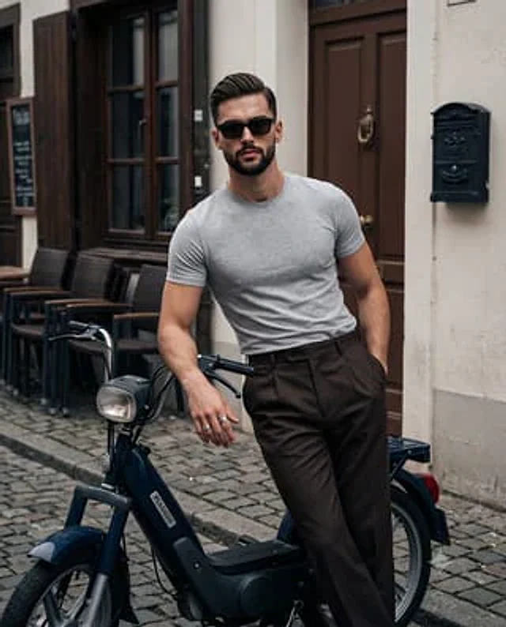

```text
A young adult male exudes confident masculinity, positioned centrally and leaning slightly to his right at a 45-degree angle against a vintage {argument name="moped color" default="navy blue"} moped. He features dark, slicked-back hair catching subtle specular highlights from styling product, and his expression is fixed in a calm, closed-mouth neutral state, his gaze directed off-camera to the left from behind dark rectangular sunglasses. He is dressed in a {argument name="outfit top" default="fitted light grey short-sleeve t-shirt"} and dark brown high-waisted pleated trousers. His left hand is casually tucked into his trouser pocket, exposing only his wrist and forearm resting against his hip, while his right hand rests lightly on the moped left handlebar, his relaxed fingers draped gently over the grip to reveal silver rings. In the immediate foreground, the navy blue Piaggio moped features a chrome headlight casing. Behind him unfolds a medium-depth vintage European cobblestone street, framed asymmetrically to balance his visual weight against the left side of the scene. To the left in the midground, there is a dominant vintage dark carved wood window frame, while two worn dark wood chairs with woven rush seats sit stacked beneath it. To the right, a worn dark brown paneled wooden door features a circular brass knocker and silver handle, adjacent to a weathered off-white matte plaster wall with patchy warm grey undertones, faded peach borders, and minor dirt accumulation, bearing an aged black cast iron wall-mounted post box with a crest emblem, all grounded by a dark charcoal grey concrete and cobblestone floor. The atmosphere is quiet, moody, and sophisticated, bathed in soft, diffused natural lighting spilling from a single large overcast sky source above. This neutral-temperature, low-contrast lighting casts short, soft-edged shadows beneath his chin, under the moped chassis, and lightly along the textured wall, while leaving subtle specular highlights on his left shoulder and the moped chrome details. The desaturated, cool-toned color profile heavily emphasizes dark warm browns, off-whites, and charcoal contrasted against the cool navy blue. Shot straight-on as a medium editorial portrait drawing from Italian Neorealism cinema, captured with a 50mm lens at f/4.0, ISO 400, and a 1/250s shutter speed to maintain a tack-sharp subject alongside medium depth of field. The final image undergoes post-processing with a desaturated color grade pulling down greens and blues, a lifted black point, and a subtle film grain overlay to achieve a faded cinematic tonality, framed in a 4:5 aspect ratio.
```

Model: Nano Banana Pro
Author: Picts by AI

[ProjectD](https://aitoolsradar.com/en/prompts/eea6a233d7d2b8) · [Recorded source](https://x.com/pictsbyai/status/2090352638168609233)
 · [Full original metadata and byte evidence](data/projectd-batch-0070.json)

## Product Marketing - Luxury LED Architectural Portrait

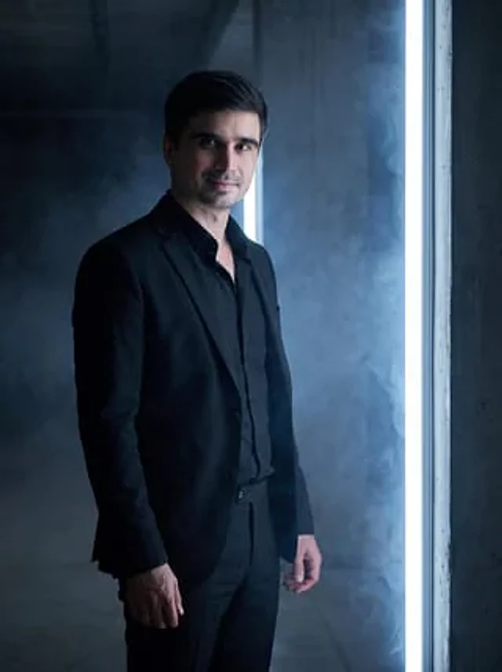

```text
Use the uploaded reference image. Preserve exact identity. Create a {argument name="aesthetic" default="luxury portrait"} beside a {argument name="setting" default="glowing vertical LED installation inside a dark architectural space"}. The subject wears a {argument name="clothing" default="fitted black suit with an open black shirt and tailored trousers"}. Thin smoke creates soft diffusion around the light while rim lighting outlines the body. High-end fragrance campaign aesthetic, cinematic realism, deep blacks, elegant composition, luxury fashion editorial.
```

Model: Nano Banana Pro
Author: Alex Prompts

[ProjectD](https://aitoolsradar.com/en/prompts/2cd3c6465548cf) · [Recorded source](https://x.com/AlexPromptsAI/status/2090509645739708592)
 · [Full original metadata and byte evidence](data/projectd-batch-0070.json)

## Product Marketing - Mediterranean Male Sun-Drenched Portrait


```text
A medium close-up, waist-up portrait of an {argument name="subject" default="adult Mediterranean male"} with warm bronze skin and short stubble, exuding a confident, guarded coolness as he stands with his chest facing the camera and his head turned forty-five degrees to the right. He wears an {argument name="clothing" default="off-white, wrinkly linen shirt"}, deeply unbuttoned to create a natural V-neckline revealing a thin gold chain, paired with clear transparent frame sunglasses featuring dark lenses that obscure his gaze. His dark brown hair is styled with two to three inches of volume on top and tapered sides, treated with a slightly wet, glossy product to define thick natural waves and uneven curls, complete with natural flyaways and loose strands falling gently across his forehead. His posture is relaxed and centered, arms resting naturally out of view, as his level shoulders lean slightly back against a weathered historic structure. The softly out-of-focus background reveals a {argument name="background" default="warm, light beige raw-cut limestone environment"}, featuring a massive, rough-pitted carved stone pillar base dominating the right midground and a historic weathered stone building facade receding on the left. A bright, single-source direct hard sunlight beams from the front-top-left at a forty-five-degree angle, bathing the scene in a sun-drenched, elegant European summer warmth. This highly directional light casts harsh, deep black shadows from his sunglasses onto his cheek, from his collar onto his chest, beneath his jawline, and inside the depths of his hair curls, while striking specular highlights are preserved on his forehead, the tip of his nose, cheekbones, collarbone, and the peaks of his curls. Captured as a high-end editorial digital photograph straight on at eye level using an 85mm lens at f/2.8, the image boasts a shallow depth of field that keeps the subject tack sharp, flawlessly resolving the organic linen weave and fine skin pores while isolating him from the architecture, enhanced by a warm golden color grade and high contrast curve, framed in a 2:3 aspect ratio.
```

Model: Nano Banana Pro
Author: Aatif J

[ProjectD](https://aitoolsradar.com/en/prompts/5c135f1731c4ea) · [Recorded source](https://x.com/aatif_j/status/2091108251429421430)
 · [Full original metadata and byte evidence](data/projectd-batch-0070.json)

## Product Marketing - Moody Hotel Bedroom Fashion Portrait

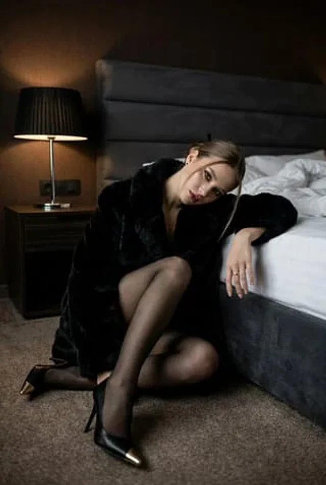

```text
{
  "overall_style": "Moody cinematic fashion portrait photography, high-end editorial aesthetic, dramatic low-key lighting with soft shadows and subtle highlights, luxurious intimate hotel-room atmosphere, shallow depth of field, rich contrast, elegant and slightly sensual tone",
  "composition": {
    "framing": "Vertical portrait orientation, subject positioned slightly left of center, leaning against the right side of the bed frame",
    "camera_angle": "Slightly elevated eye-level, looking down gently toward the subject",
    "pose": "Woman seated on the floor with legs bent and knees raised, body twisted slightly toward camera, torso leaning back against the side of the bed, right arm resting along the bed edge with hand dangling loosely, left arm partially hidden under the fur coat, head tilted to her right resting against her raised right shoulder",
    "depth": "Shallow depth of field – sharp focus on the subject’s face, upper body and legs; soft gradual blur on the background wall, lamp, and far side of the bed",
    "negative_space": "Dark textured wall and upper headboard occupy the top third; empty carpeted floor in the lower left creates breathing room"
  },
  "character": {
    "gender_age": "{argument name="subject" default="Young woman, early-to-mid 20s"}",
    "face": "Soft oval face, fair porcelain skin with natural flush, full lips in matte deep berry-red lipstick, subtle contoured cheekbones, defined but natural eyebrows, soft smoky eye makeup with neutral tones, direct yet slightly sultry gaze looking straight into the camera",
    "hair": "Light ash-brown hair pulled back into a sleek low updo/bun, with a few soft face-framing strands and a small elegant black hair accessory (clip or pin) visible on the left side",
    "body": "Slim, elongated legs, graceful posture",
    "clothing": {
      "outer": "{argument name="clothing" default="Oversized black faux-fur or feather-textured coat/dress"} with dense, fluffy, high-volume texture covering the torso and cascading down the sides",
      "legs": "Sheer black pantyhose / stockings that catch subtle light reflections",
      "footwear": "Black pointed-toe high-heeled slingback pumps with thin stiletto heels and metallic gold/bronze toe caps"
    },
    "accessories": "Small gold ring on the right ring finger, delicate gold hoop earring visible on the left ear"
  },
  "setting": {
    "location": "{argument name="setting" default="Modern upscale hotel bedroom"}",
    "furniture": {
      "bed": "Large bed with dark charcoal-grey upholstered headboard featuring horizontal channel tufting, crisp white sheets and duvet slightly rumpled",
      "nightstand": "Dark wood bedside table with a single drawer, placed to the left of the subject",
      "lamp": "Contemporary table lamp with a tall cylindrical black pleated fabric shade and a clear or metallic base"
    },
    "floor": "Neutral taupe-brown wall-to-wall carpet with short pile texture",
    "wall": "Dark chocolate-brown textured wallpaper or paint with subtle vertical grain"
  },
```

Model: Nano Banana Pro
Author: Jan | AI Image Alchemist

[ProjectD](https://aitoolsradar.com/en/prompts/c34b216bb86a4b) · [Recorded source](https://x.com/cashinpills/status/2090579993688457289)
 · [Full original metadata and byte evidence](data/projectd-batch-0070.json)

## Product Marketing - Multi-Expression Sliced Fashion Poster

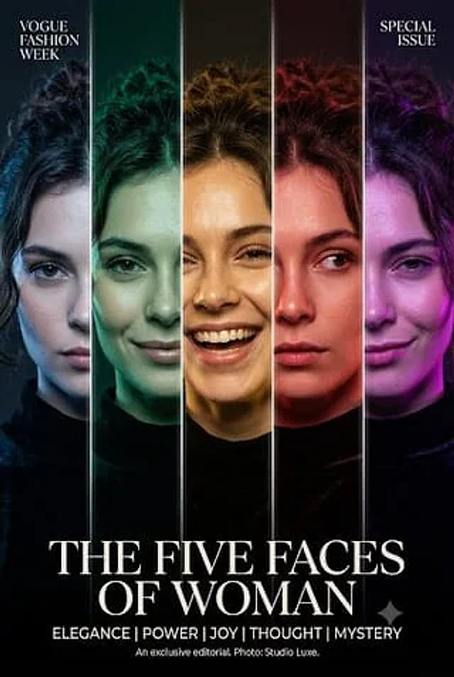

```text
Create a {argument name="style" default="luxury fashion editorial poster"} based on my reference image. Preserve the exact facial identity, hairstyle, facial structure, skin tone, and overall appearance of the reference person.

The portrait is divided into {argument name="layout" default="five perfectly aligned vertical slices"} separated by ultra-thin glowing white lines. The slices must align seamlessly to form one complete face.

Each slice represents the exact same person photographed at a different moment with a completely different facial expression.

Slice 1: serious, confident, intense eye contact.

Slice 2: subtle genuine smile.

Slice 3: joyful open-mouth laugh with expressive eyes.

Slice 4: thoughtful expression, eyes looking slightly sideways.

Slice 5: playful smirk with one eyebrow slightly raised.

Every expression must be dramatically different and instantly recognizable. The facial muscles, eyebrows, eyes, mouth shape, smile intensity, and emotional feeling must noticeably change in every slice. Avoid repetitive or identical expressions.

Each slice has a unique cinematic color grade:

• Slice 1 – Deep Royal Blue

• Slice 2 – Emerald Green

• Slice 3 – Golden Amber

• Slice 4 – Crimson Red

• Slice 5 – Purple & Magenta Neon

The lighting should also vary subtly between slices while maintaining a premium editorial appearance.

{argument name="background" default="Dark charcoal minimalist background"} with no distractions.

Luxury magazine cover aesthetic, Vogue fashion campaign, cinematic studio lighting, glossy skin texture, ultra-realistic eyes, razor-sharp focus, HDR, photorealistic, masterpiece, 8K, highly detailed, premium color grading, dramatic contrast, modern fashion photography.

Five unique emotional portraits of the same person merged into one sliced composition, each slice appearing as if captured at a different moment during a professional fashion photoshoot.

Negative Prompt:

black and white, monochrome, grayscale, identical expressions, duplicate face, copied slice, repeated smile, emotionless face, flat lighting, dull colors, low saturation, blurry, distorted face, extra eyes, extra mouth, misaligned slices, low quality, artifacts
```

Model: Nano Banana Pro
Author: Ayushi Srivastava

[ProjectD](https://aitoolsradar.com/en/prompts/d2752e8dbb0378) · [Recorded source](https://x.com/punkhuri1/status/2090304738881688011)
 · [Full original metadata and byte evidence](data/projectd-batch-0070.json)

## Product Marketing - Outdoor Lifestyle Balcony Portrait

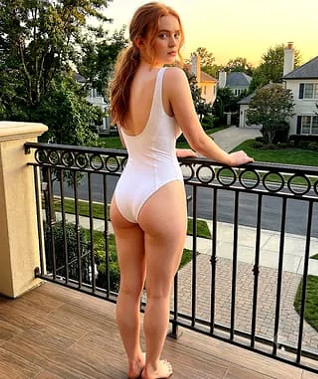

```text
Create a photorealistic outdoor lifestyle portrait of a young woman with fair, warm-toned skin, light-colored eyes, and {argument name="hair style" default="long blonde hair styled in a loose, slightly tousled ponytail"} with soft strands framing her face. She has natural facial features, subtle makeup, softly defined eyebrows, and a calm, confident expression while gazing slightly past the camera. She is standing upright on a {argument name="location" default="spacious residential balcony"}, facing the camera with a relaxed posture, both arms extended naturally to rest lightly on the decorative railing, and one foot positioned slightly ahead of the other for a casual, balanced stance. She is wearing an elegant {argument name="outfit" default="deep burgundy-red outfit"} with a sleek, structured silhouette, broad shoulder straps, and clean minimalist detailing. The fabric has a subtle smooth texture with realistic folds and highlights. Keep the styling sophisticated and contemporary, with minimal accessories and a small understated tattoo on the forearm. The setting is a beautiful upscale residential neighborhood viewed from a tiled balcony, featuring manicured lawns, mature green trees, paved walkways, elegant detached homes, rooftops, and distant suburban details. The balcony has warm wood-look floor tiles, a black decorative metal railing with circular motifs, and potted greenery near the edges. Capture a peaceful golden-hour atmosphere with warm sunlight coming from behind and slightly to the side of the subject, creating a soft golden rim light around her hair and shoulders while maintaining gentle facial illumination and realistic shadows. The sky should have a warm pale-gold gradient with subtle evening haze. Photographed with an 85mm lens, natural perspective, shallow depth of field, crisp focus on the face and eyes, realistic background separation, detailed individual hair strands, authentic skin texture, accurate fabric texture, realistic hands and feet, balanced exposure, soft highlight rolloff, cinematic warm color grading, subtle filmic contrast, high dynamic range, professional outdoor editorial photography, photorealistic detail, natural color reproduction, vertical composition, elegant candid lifestyle aesthetic.
```

Model: Nano Banana Pro
Author: J⭕DIE

[ProjectD](https://aitoolsradar.com/en/prompts/cacc6dce61b2f7) · [Recorded source](https://x.com/Jodie_Noraa/status/2090988104907968696)
 · [Full original metadata and byte evidence](data/projectd-batch-0070.json)

## Product Marketing - Quicksilver Kinetic Fashion Editorial

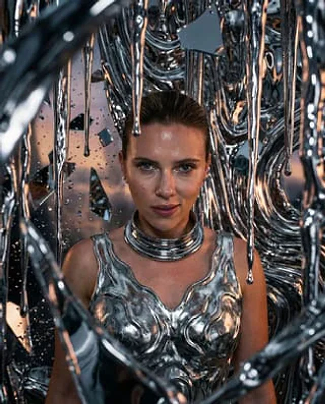

```text
{
  "vibe_title_en": "Voyeuristic Rebel in a Quicksilver Sea",
  "master_prompt": "A voyeuristic glimpse of {argument name="subject" default="The Protagonist"} in a {argument name="environment" default="surreal, high-density kinetic quicksilver archive"}. Shot through heavy foreground occlusion of jagged, floating chrome debris and dripping liquid metal stalactites. The Protagonist wears a structural, organic silver gown resembling hardened mercury. Raw editorial look: perfect, sweaty skin with specular highlights, a challenging direct stare, and a slight smirk. Lighting is a harsh, direct ring-flash popping the facial features against the deep, ambient twilight and reflective chrome chaos. The environment is overwhelmingly busy, filled with layers of rippling liquid metal cascades, suspended mirrored shards, and dense, swirling metallic dust motes reflecting a sunset sky. Shot on {argument name="camera" default="Hasselblad H6D-100c, 200mm f/2.8 telephoto lens"}, Kodak Portra 800. Hyper-realistic, practical effects feel, authentic skin pores, intense depth of field compression, NO NEON.",
  "meta": {
    "intent": "Create a surreal, high-fashion editorial portrait using a voyeuristic, densely layered metallic environment.",
    "priorities": "Subject engagement via High-Gloss Rebel aesthetic, heavy environmental density, voyeuristic telephoto framing, and practical surrealism.",
    "device_profile": "Medium Format Digital Hasselblad H6D-100c"
  },
  "frame": {
    "aspect": "4:5",
    "composition": "Voyeuristic telephoto compression with heavy foreground occlusion framing the subject's face.",
    "layout": "Center-weighted subject surrounded by a chaotic, layered border of out-of-focus foreground metal.",
    "camera_angle": "Eye-level, distant observer peeking through dense metallic debris.",
    "tilt_roll_degrees": "0"
  },
  "subject": {
    "gender": "Female",
    "identity": "The Protagonist, a high-gloss rebel",
    "demographics": "Androgynous high-fashion archetype, 20s-30s",
    "face": "Symmetrical, dewy sweaty skin, perfect pores, specular highlights from direct flash",
    "hair": "Slicked back, wet-look, catching sharp metallic highlights",
    "body": "Strong posture, shoulders squared, wearing an avant-garde structural metallic garment",
    "expression": "Challenging direct stare, slight rebellious smirk",
    "pose": "Static but loaded with kinetic tension, staring straight through the chaotic foreground"
  },
  "wardrobe_accessories": {
    "garments": [
      {
        "item": "Structural sculptural gown",
        "material": "Liquid Chrome and Hardened Mercury",
        "color": "Iridescent Silver",
        "fit": "Avant-garde, rigid yet organically flowing"
      }
    ],
    "accessories": [
      {
        "item": "Heavy biomechanical neck cuff",
        "color": "Polished Chrome",
        "material": "Metal",
        "brand_style": "High-end futuristic editorial"
      }
    ]
  },
  "environment": {
    "setting": "Kinetic quicksilver archive, an overwhelming chaotic space o
```

Model: Nano Banana Pro
Author: timedoctor.eth

[ProjectD](https://aitoolsradar.com/en/prompts/11e31a7afe3500) · [Recorded source](https://x.com/timedoctor_nft/status/2090491316123615257)
 · [Full original metadata and byte evidence](data/projectd-batch-0070.json)

## Product Marketing - Sunflowers and Cinematic Eye-Lip Portrait

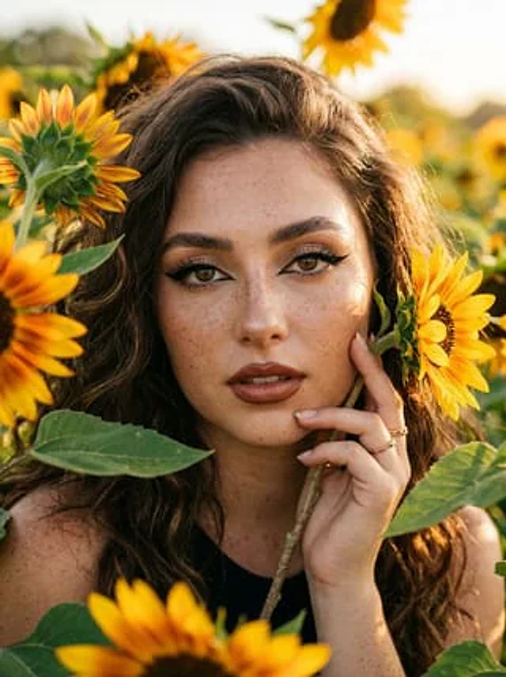

```text
A cinematic shot with a film-grain effect. This is an extreme close-up portrait of a {argument name="subject description" default="woman, focusing on her eyes and lips"}. She gazes directly into the camera with a confident look. Her eyes stand out thanks to bold eyeliner—a fine black line that smoothly flares out. She wears a soft matte brown shade on her lips, and freckles are visible on her face and shoulders. {argument name="lighting" default="Sunlight falls from one side, casting soft shadows that highlight the contours of her face"}. She is lying amidst {argument name="flower type" default="sunflowers"}; the flowers partially overlap her face, and there is an abundance of them surrounding her. She holds a sunflower against her cheek with her hand, her lips slightly parted. Her skin is highlighted. Her hair is voluminous, long, and glossy.
```

Model: Nano Banana Pro
Author: dreamy digital arts

[ProjectD](https://aitoolsradar.com/en/prompts/4e7884c906ae6e) · [Recorded source](https://x.com/dreamydigiarts/status/2091118193267835007)
 · [Full original metadata and byte evidence](data/projectd-batch-0070.json)

## Product Marketing - Traditional Southeast Asian Portrait

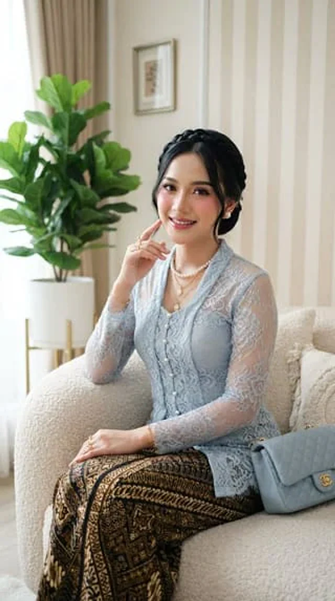

```text
ar 9:16 High

A beautiful {argument name="subject" default="young Southeast Asian woman (Indonesian features)"} sitting gracefully on a {argument name="furniture" default="soft cream-colored bouclé sofa"}, looking directly at the camera with a soft, elegant smile and gentle eye contact. She has fair skin with soft pink blush on her cheeks, defined winged eyeliner, long lashes, and glossy rose-pink lips. Her dark black hair is styled in a neat, polished updo with a braided crown and a few delicate loose strands framing her face.

She is wearing a {argument name="clothing" default="delicate light powder-blue kebaya"} made of intricate floral lace with sheer long sleeves, pearl buttons running down the front, and a fitted silhouette. The kebaya is paired with a traditional dark batik kain with intricate gold and cream geometric patterns. Layered jewelry includes a strand of white pearls, multiple delicate gold necklaces with small pendants, pearl stud earrings, gold rings, and a thin gold bracelet. A light blue quilted shoulder bag with a gold clasp rests on her left side.

Her right hand is raised near her face in a soft, elegant pose with one finger lightly touching near her cheek, while her left arm rests naturally. Soft natural lighting highlights her features and the lace texture. Background features vertical beige-and-cream striped wallpaper and a large green leafy plant in a white ceramic pot on a gold stand to the left.

Elegant, refined, traditional-modern fusion style, high detail, photorealistic, soft glam makeup, studio portrait quality.
```

Model: Nano Banana Pro
Author: Feyber | AI Creator

[ProjectD](https://aitoolsradar.com/en/prompts/4d20862fa46e9d) · [Recorded source](https://x.com/woleswoosh/status/2090891689644700056)
 · [Full original metadata and byte evidence](data/projectd-batch-0070.json)

## Profile / Avatar - Athletic Jersey Portrait

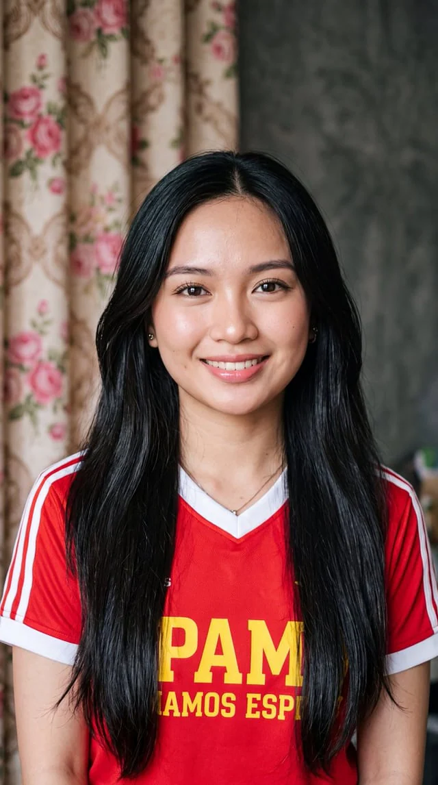

```text
ar 9:16 4K

A photorealistic close-up portrait of a {argument name="subject" default="young East Asian woman"} with fair, smooth skin and a soft natural glow. She has long, straight, silky black hair parted in the middle, cascading over both shoulders with a few loose strands falling across her chest and framing her face. The hair has natural volume at the crown and a slight sheen under the light.

She faces the camera directly with a gentle, closed-mouth smile, soft pink glossy lips, large expressive brown eyes with double eyelids, long natural-looking eyelashes, subtle eyeliner, and a light dusting of pink blush on her cheeks. Her expression is warm, friendly, and slightly playful. She has a rounded oval face, soft jawline, and a small, neat nose.

She is wearing a {argument name="clothing" default="red short-sleeved athletic jersey"} with a white V-neck collar and white Adidas-style triple stripes running down the sleeves. Across the chest is bold yellow text reading “PAM” in large capital letters, with smaller yellow text “AMOS ESP” underneath.

The background is an indoor room: on the left, a floral curtain with pink roses and green leaves on a light beige fabric; on the right, a plain, slightly textured dark gray wall. Soft, diffused indoor lighting illuminates her face evenly with gentle highlights on the forehead, nose, and cheeks. Shallow depth of field keeps the subject sharp while the background is softly blurred. Natural skin texture, realistic hair strands, and high detail throughout. Vertical portrait orientation, casual and intimate snapshot style.
```

Model: Nano Banana Pro
Author: Feyber | AI Creator

[ProjectD](https://aitoolsradar.com/en/prompts/210c8e987cdedd) · [Recorded source](https://x.com/woleswoosh/status/2090861495592657327)
 · [Full original metadata and byte evidence](data/projectd-batch-0070.json)

## Profile / Avatar - Balayage Hair Golden Hour Portrait


```text
Close-up portrait of {argument name="subject" default="a beautiful young Southeast Asian woman"}, {argument name="hair style" default="long wavy hair with dark roots and honey blonde ash caramel balayage highlights, soft curtain bangs"}, large dark almond eyes, natural dewy skin, soft coral pink lips, gentle gaze, {argument name="lighting" default="warm afternoon window sunlight streaming in, dappled light across face, soft golden glow"}, loose natural waves with luminous shine, soft blurred indoor background, intimate cozy atmosphere, photorealistic, high detail, soft warm color grading, natural skin texture, dreamy soft lighting, 8K, selfie angle
```

Model: Nano Banana Pro
Author: Feyber | AI Creator

[ProjectD](https://aitoolsradar.com/en/prompts/de5a104abab231) · [Recorded source](https://x.com/woleswoosh/status/2091435275108979088)
 · [Full original metadata and byte evidence](data/projectd-batch-0070.json)

## Profile / Avatar - Casual Hijab Selfie Portrait

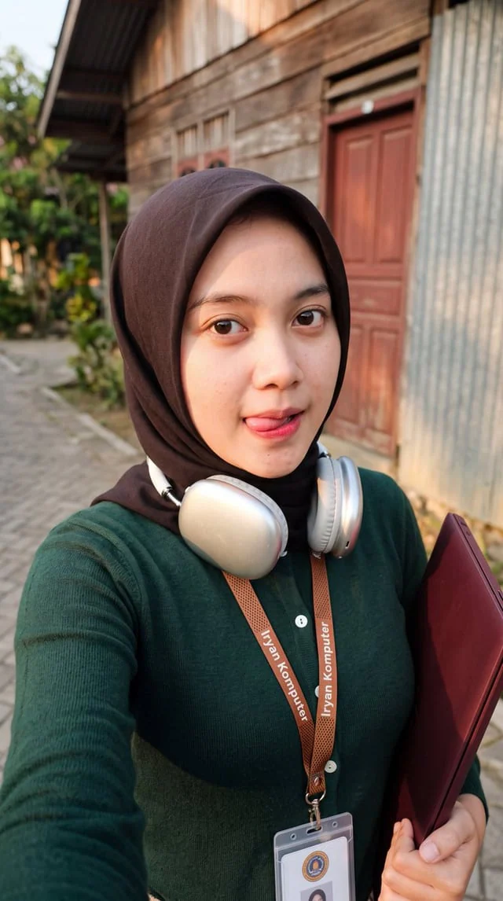

```text
A close-up selfie of a young {argument name="ethnicity" default="Southeast Asian"} woman with fair skin, large dark brown eyes, and soft facial features, wearing a neatly wrapped dark brown/black hijab that fully covers her hair and frames her face. She is playfully sticking her tongue out slightly while looking directly at the camera with a cute, teasing expression and subtle pinkish-red lip tint. Silver metallic over-ear headphones rest around her neck. She wears a fitted {argument name="top color" default="dark green"} long-sleeved knit top with small white buttons down the front. A lanyard with an orange-brown mesh strap hangs around her neck; the strap has the text “Iryan Komputer” printed on it, and a clear plastic ID badge with a circular logo hangs from it. She holds a slim maroon/burgundy laptop or folder under her right arm. The photo is taken outdoors in {argument name="lighting" default="warm golden-hour"} lighting, with soft natural sunlight highlighting her face. Background shows a weathered wooden building with a reddish-brown door and corrugated metal wall, a paved outdoor path, and some greenery. Shallow depth of field, realistic skin texture, natural colors, high detail, casual everyday aesthetic.
```

Model: Nano Banana Pro
Author: Feyber | AI Creator

[ProjectD](https://aitoolsradar.com/en/prompts/2d2d5b0f32f59e) · [Recorded source](https://x.com/woleswoosh/status/2090529304514015335)
 · [Full original metadata and byte evidence](data/projectd-batch-0070.json)

## Profile / Avatar - Cinematic Male Studio Portrait

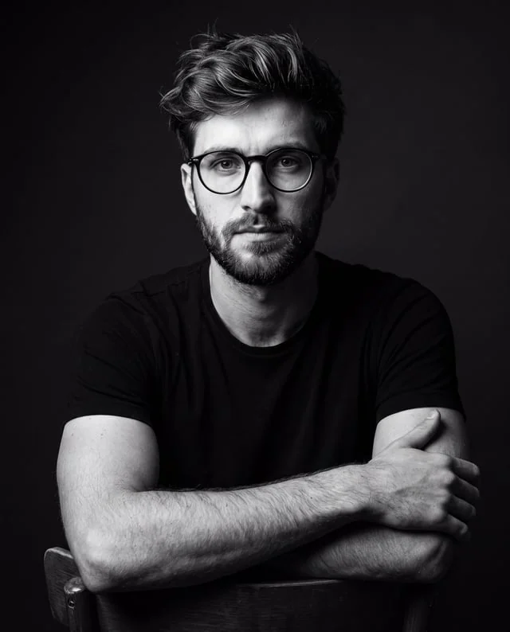

```text
A dramatic black-and-white studio portrait of a {argument name="subject description" default="young man wearing a plain black t-shirt and glasses"}, seated on a chair, posing confidently. {argument name="background" default="Dark minimalist background"}, {argument name="lighting" default="cinematic lighting with strong shadows"}, high contrast, sharp details, professional photography style, moody atmosphere.
```

Model: Nano Banana Pro
Author: Aatif J

[ProjectD](https://aitoolsradar.com/en/prompts/8f2a87656d6222) · [Recorded source](https://x.com/aatif_j/status/2091113656532516904)
 · [Full original metadata and byte evidence](data/projectd-batch-0070.json)

## Profile / Avatar - Cinematic Tropical Forest Survival Portrait

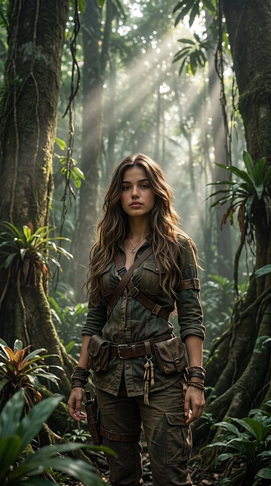

```text
Use the reference image for the character’s face and identity. Keep the face highly consistent and recognizable, preserving the same facial features, skin tone, hairstyle, and overall appearance.

Create a vertical 9:16 portrait, waist-up cinematic shot of the {argument name="character" default="character"} standing deep inside a {argument name="location" default="dense tropical forest"}. He is wearing {argument name="clothing" default="rugged forest survival clothing"} made from natural-looking brown and dark green fabrics, with practical leather straps, simple handmade accessories, weathered textures, and a rugged outdoor appearance. The outfit should look functional, adventurous, and suitable for exploring a remote forest.

He is facing the camera with a confident and serious expression. Surround him with enormous trees, thick vines, dense green vegetation, soft mist, and beautiful sunlight rays passing through the forest canopy.

Photorealistic cinematic photography, realistic skin and clothing textures, natural proportions, dramatic lighting, shallow depth of field, detailed environment, cinematic color grading, adventurous atmosphere, ultra-realistic, high detail, portrait composition, 9:16, no modern technology, no text, no watermark.
```

Model: Nano Banana Pro
Author: Ayla | AI & Tech

[ProjectD](https://aitoolsradar.com/en/prompts/c85b9fbdc18ae9) · [Recorded source](https://x.com/AylaTechAI/status/2090374480623542779)
 · [Full original metadata and byte evidence](data/projectd-batch-0070.json)

## Profile / Avatar - Copper-Red Hair Window Portrait

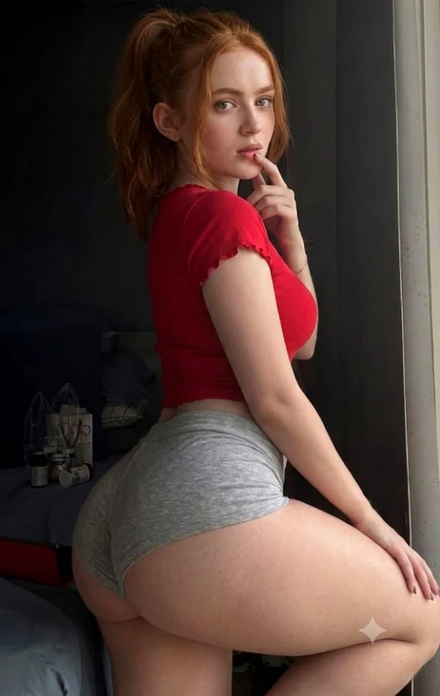

```text
Create a photorealistic portrait of a young woman with fair skin and a warm natural complexion, subtle freckles, light-colored eyes, and long {argument name="hair color" default="copper-red"} hair gathered into a high, slightly tousled ponytail. A few loose strands frame her face naturally. Her expression is soft and thoughtful, with a relaxed gaze directed toward the camera and a subtle, understated smile. She is positioned beside a large window, turned slightly sideways toward the camera, with one hand gently raised near her face and the other resting naturally along her side. Her posture is relaxed and candid, conveying the feeling of an authentic lifestyle photograph. She is wearing a fitted {argument name="top color" default="deep-red"} short-sleeve top with comfortable {argument name="bottoms" default="light-gray"} casual shorts. Keep the outfit simple, tasteful, contemporary, and natural. Add only minimal understated jewelry, such as a thin bracelet, with no distracting accessories. The setting is a cozy bedroom with a dark charcoal wall, a neatly arranged bed partially visible in the background, a few everyday personal items on a bedside surface, and a tall bright window on the right side of the frame. Soft daylight enters through the window, illuminating her face and hair while creating gentle shadows toward the darker interior. Use realistic ambient room light, subtle window reflections, natural tonal falloff, and a calm intimate atmosphere. Photographed with an 85mm portrait lens, natural perspective, shallow depth of field, soft window light, realistic skin texture, finely detailed individual hair strands, authentic fabric texture, accurate anatomy, crisp focus on the eyes and face, gentle background blur, balanced exposure, cinematic but natural color grading, warm neutral tones, soft contrast, high dynamic range, professional lifestyle photography, subtle film grain, photorealistic detail, vertical composition, candid editorial aesthetic.
```

Model: Nano Banana Pro
Author: J⭕DIE

[ProjectD](https://aitoolsradar.com/en/prompts/0c1f1788d805bf) · [Recorded source](https://x.com/Jodie_Noraa/status/2090673926628417705)
 · [Full original metadata and byte evidence](data/projectd-batch-0070.json)

## Profile / Avatar - Dramatic Monochrome Studio Portrait

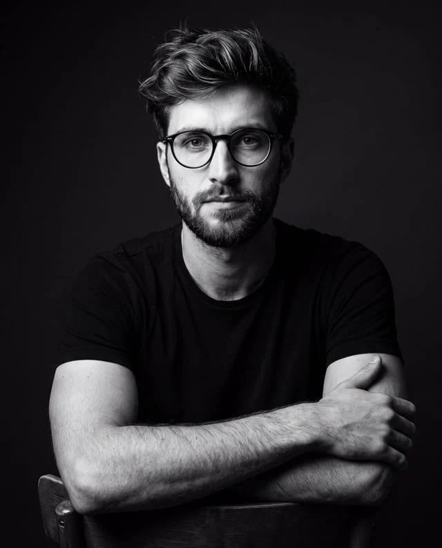

```text
A dramatic black-and-white studio portrait of a {argument name="subject" default="young man"} wearing a {argument name="clothing" default="plain black t-shirt and glasses"}, seated on a chair, posing confidently. Dark minimalist background, cinematic lighting with strong shadows, high contrast, sharp details, professional photography style, moody atmosphere.
```

Model: Nano Banana Pro
Author: Duet | AI

[ProjectD](https://aitoolsradar.com/en/prompts/899125282442b2) · [Recorded source](https://x.com/Sheldon056/status/2091016262646464620)
 · [Full original metadata and byte evidence](data/projectd-batch-0070.json)

## Profile / Avatar - East Asian Woman Realistic Selfie

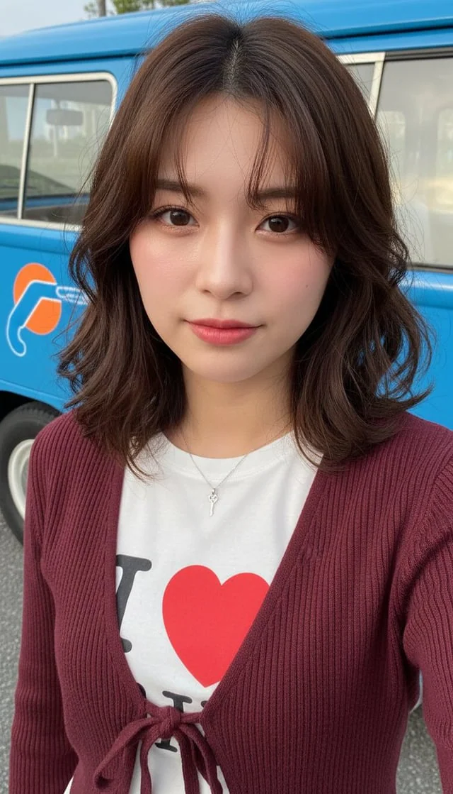

```text
A realistic close-up selfie of a {argument name="subject" default="young East Asian woman in her early 20s"}, taken from a slightly high angle. She has soft, fair skin with a natural dewy glow, subtle rosy blush on her cheeks, light makeup with defined eyes, soft pink lips in a gentle neutral expression, and a few strands of hair falling across her face. Her {argument name="hair color" default="dark brown"} hair is medium-length, slightly wavy and tousled, with soft bangs partially covering her forehead and one eye. She is looking directly at the camera with a calm, soft gaze. She is wearing a {argument name="clothing" default="maroon/burgundy ribbed knit cardigan"} that is open and loosely tied at the front with a small bow, layered over a white t-shirt featuring a large red heart graphic and partial black lettering (“I ♥” visible). A delicate silver necklace with a small key-shaped pendant rests against her collarbone. The background shows a bright blue vintage-style van or minibus with a partial orange-and-blue logo/sticker visible on the side, set in an outdoor daytime environment with soft natural lighting. The overall aesthetic is casual, trendy, and soft-focus with natural skin texture and realistic lighting. High detail, photorealistic style.
```

Model: Nano Banana Pro
Author: Feyber | AI Creator

[ProjectD](https://aitoolsradar.com/en/prompts/eeaf7f5373babb) · [Recorded source](https://x.com/woleswoosh/status/2091012488963752114)
 · [Full original metadata and byte evidence](data/projectd-batch-0070.json)

## Profile / Avatar - Ethereal Night Selfie Portrait

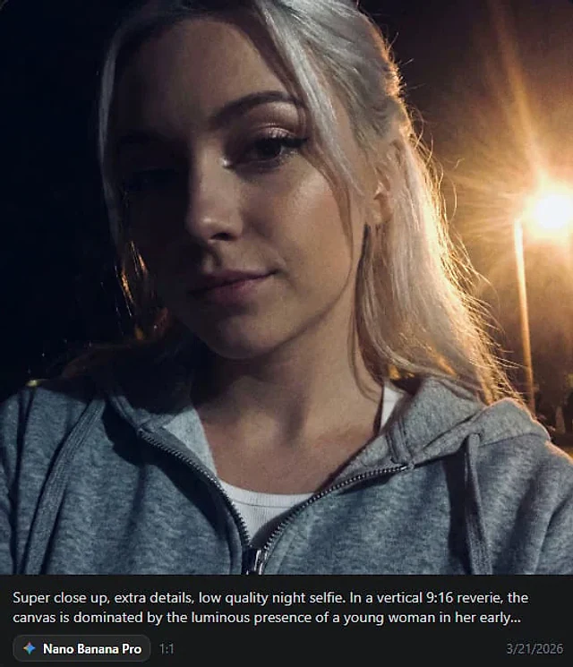

```text
Super close up, extra details, {argument name="style" default="low quality night selfie"}. In a vertical 9:16 reverie, the canvas is dominated by the luminous presence of a {argument name="subject" default="young woman"} in her early twenties, her features a study in ethereal symmetry and porcelain grace characteristic of Northern European frost. Her face is framed by a cascading veil of long, {argument name="hair color" default="platinum blonde hair"} that catches a warm, golden light from the side, creating a halo of delicate, stray wisps that dance against the deep, obsidian void of the night. Her eyes, deep and captivating with a subtle feline tilt, are accentuated by soft, winged eyeliner and a hint of shimmer at the inner corners, gazing forward with a tranquil, mesmerizing depth. The skin of her face is flawless and radiant, possessing a soft-focus perfection that highlights high, elegant cheekbones and a straight, refined nose. Her lips, full and naturally flushed with a dusty rose hue, are set in a soft, enigmatic expression that enhances her supermodel-like allure. She is dressed in a simple white top layered under a heather gray zip-up hoodie, the metallic teeth of the zipper catching the light and adding a tactile contrast to the softness of her hair and skin. Her build appears lithe and delicate, posed with a natural poise that commands the frame even in this intimate close-up. The light source, positioned to her right, casts a gentle gradient of warmth across her features while leaving the left side in a soft, cinematic shadow, rooting the composition in a moment of quiet, nocturnal beauty.
```

Model: Nano Banana Pro
Author: alex

[ProjectD](https://aitoolsradar.com/en/prompts/d44eec2af82700) · [Recorded source](https://x.com/pixclipper/status/2091470837991796819)
 · [Full original metadata and byte evidence](data/projectd-batch-0070.json)

## Profile / Avatar - Indonesian Scout Uniform Realistic Selfie

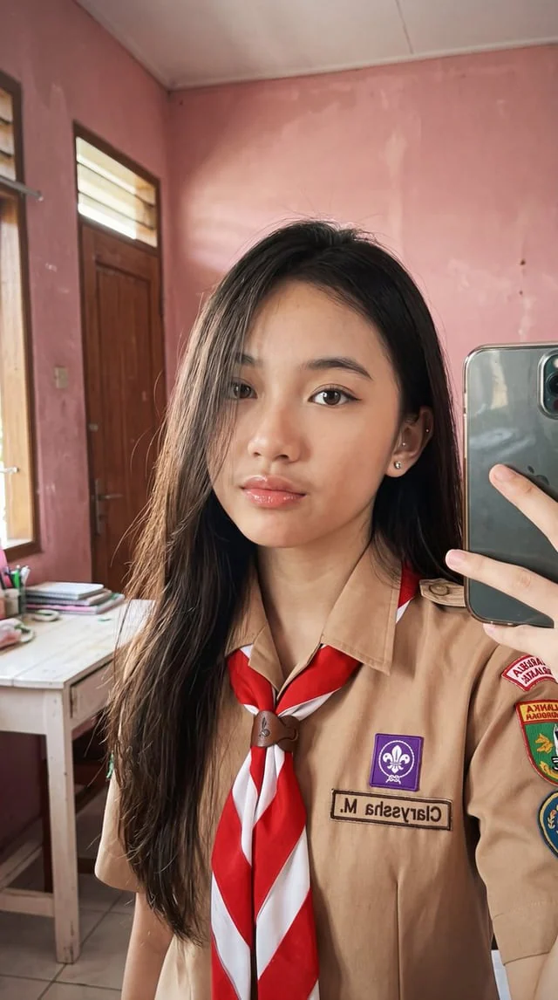

```text
A realistic selfie of a {argument name="subject ethnicity" default="young Southeast Asian girl (Indonesian appearance)"} with fair skin, soft facial features, and a calm, slightly pouty expression. She has long, straight black hair with slight waves, partially covering one side of her face. Her right hand is raised, fingers gently running through her hair near the top of her head. She is looking directly at the camera with soft brown eyes and light natural makeup. She is wearing a {argument name="clothing item" default="light brown Pramuka (Indonesian Scout) uniform shirt"} with a pointed collar. Around her neck is a red-and-white striped neckerchief secured with a brown leather woggle. The photo is taken indoors in a {argument name="room setting" default="bedroom with a textured soft pink wall"}. Soft natural lighting, slightly warm tone, casual and intimate selfie angle, high detail, photorealistic.
```

Model: Nano Banana Pro
Author: Feyber | AI Creator

[ProjectD](https://aitoolsradar.com/en/prompts/4afc5eb67158b8) · [Recorded source](https://x.com/woleswoosh/status/2091223879658184777)
 · [Full original metadata and byte evidence](data/projectd-batch-0070.json)

## Profile / Avatar - Indonesian Woman Hijab Portrait

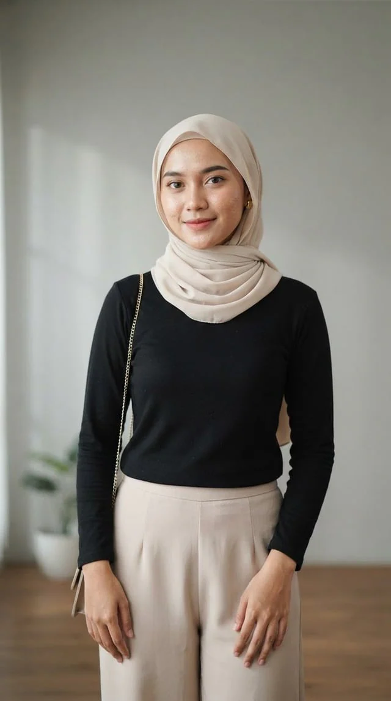

```text
A photorealistic vertical portrait of {argument name="subject" default="a young Southeast Asian woman (Indonesian features)"} standing indoors in front of {argument name="background" default="a plain muted gray wall"}. She wears a smooth light beige hijab wrapped neatly around her head and neck. Her expression is soft and slightly smiling, with gentle eyes looking straight at the camera. She has light natural makeup and clear skin. She is dressed in {argument name="outfit" default="a fitted black long-sleeve top and high-waisted light beige trousers"}. A thin gold metallic chain of a shoulder bag hangs across her body. Soft diffused indoor lighting casts a subtle shadow behind her on the wall. Shallow depth of field, natural skin texture, realistic fabric folds, calm and modest aesthetic, high detail, 4k quality.
```

Model: Nano Banana Pro
Author: Feyber | AI Creator

[ProjectD](https://aitoolsradar.com/en/prompts/c0c0cbe4bad8b3) · [Recorded source](https://x.com/woleswoosh/status/2091616465212330374)
 · [Full original metadata and byte evidence](data/projectd-batch-0070.json)

## Profile / Avatar - Madison Beer Boa Hancock Cosplay

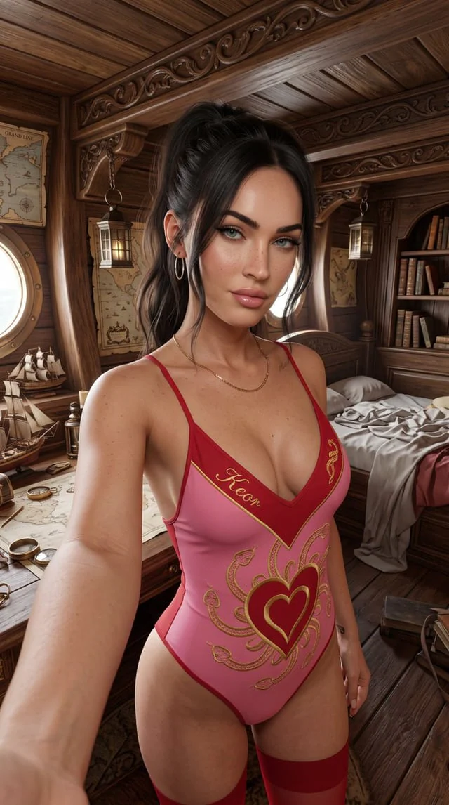

```text
{"subject": {"description": "Young woman brunette posing confidently as a photorealistic cosplayer. Long hair styled in a casual high ponytail with soft face-framing strands. Smooth luminous skin with realistic texture, faint freckles, natural makeup, winged eyeliner, defined lashes, softly contoured cheeks, hydrated glossy lips, and delicate silver hoop earrings. Thin necklace resting on the collarbone.", "pose": "Close-up wide-angle smartphone selfie perspective with one arm extended toward the camera. Leaning forward slightly with shoulders drawn back in an elegant S-curve posture. Head tilted slightly backward and to the side, chin raised. Soft and flirtatious expression with half-lidded eyes and a subtle confident smirk.", "clothing": {"main": "Fitted pink-and-red Boa Hancock-inspired one-piece swimsuit with thin spaghetti straps, deep V-neckline, smooth stretch fabric, and sleek minimalist design. Features bold heart and snake-inspired symbols with elegant gold accents. Small elegant 'Keor' embroidery on the border. Paired with matching red stockings.", "style": "Contours naturally to the body with realistic fabric tension and soft folds around the waist and torso."}}, "setting": {"environment": "Galleon room — ornate wooden pirate ship cabin with carved beams, nautical maps, hanging lanterns, a large wooden table with charts and compasses, a bed with tangled sheets, bookshelves of old books, and personal belongings creating an authentic lived-in ship atmosphere.", "lighting": "Soft natural daylight from a nearby porthole window, warm neutral color grading, gentle shadows, smooth skin highlights, realistic light falloff."}, "style": {"photography": "Ultra-realistic selfie-style fashion portrait of a photorealistic cosplayer, high-end lifestyle photography, smartphone camera realism, 35mm equivalent lens, HDR, photorealistic, fashion-editorial quality, ultra-detailed, 8K resolution.", "mood": "Confident, glamorous, and self-assured.", "composition": "Close-up wide-angle POV selfie, camera slightly below face level and angled upward."}, "full_prompt": "Ultra-realistic selfie-style fashion portrait of madison beer as a photorealistic cosplayer posing confidently in a galleon room. She wears a fitted pink-and-red Boa Hancock-inspired one-piece swimsuit with thin spaghetti straps, deep V-neckline, bold heart and snake-inspired symbols, plus a small 'Keor' embroidery, and red stockings. High ponytail, soft flirtatious expression, one arm extended for a POV selfie. Soft natural daylight, detailed wooden ship cabin with nautical maps and cluttered desk in the background. Photorealistic, 8K, sharp focus, natural skin texture."}
```

Model: Nano Banana Pro
Author: KeorUnreal

[ProjectD](https://aitoolsradar.com/en/prompts/b2f010f21294d7) · [Recorded source](https://x.com/KeorUnreal/status/2090409966284816559)
 · [Full original metadata and byte evidence](data/projectd-batch-0070.json)

## Profile / Avatar - Outdoor Night Dining Identity Preservation

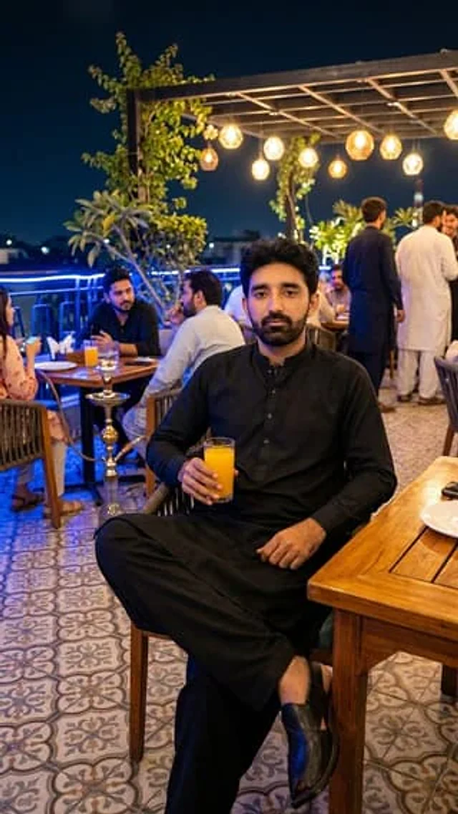

```text
Use the uploaded image as the only facial reference and preserve 100% facial identity, hairstyle, beard, skin tone, and natural skin texture. Use my pic face The image depicts a {argument name="subject" default="young man with dark, same hair"} sitting confidently at an {argument name="setting" default="outdoor dining area"} during nighttime and catch the drink glass in one hand. He is dressed in a black kurta pajama with stylish shoes pishwari and with a calm and composed expression on his face. Behind him, there are several other people seated at tables, engaging in conversations and enjoying their evening. The setting features decorative lighting, including two prominent, warm-toned pendant lights hanging from the ceiling, and a blue accent lighting illuminating the background. There are lush plants and foliage along a railing, with hanging flower decorations contributing to a cozy, stylish ambiance. In the background, some people are dressed in traditional or formal attire, and there is a hookah being used, indicating a social, leisure atmosphere. The flooring consists of patterned tiles, adding to the aesthetic appeal of the venue.
```

Model: Nano Banana Pro
Author: Dilshad Hussain

[ProjectD](https://aitoolsradar.com/en/prompts/90597382f64dc8) · [Recorded source](https://x.com/DilshadAI1/status/2090969752000971046)
 · [Full original metadata and byte evidence](data/projectd-batch-0070.json)

## Profile / Avatar - Polka Dot Outfit Mirror Selfie

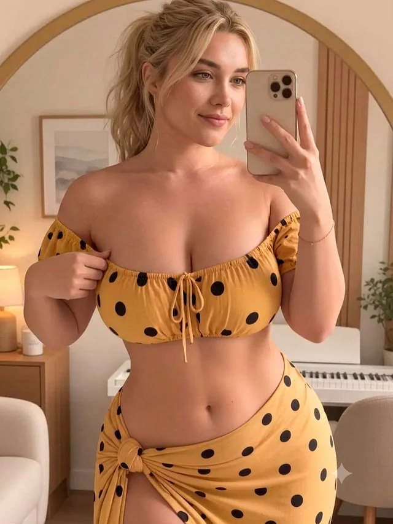

```text
Create a photorealistic lifestyle mirror portrait of {argument name="subject" default="a young woman with fair skin, natural complexion, dark brown hair pulled back into a relaxed ponytail with subtle loose strands around her face, and softly defined facial features. She has a warm, genuine smile and is looking toward the smartphone screen through the mirror"}. Her expression feels relaxed, cheerful, and natural. She is standing comfortably in front of a large rounded-edge mirror, holding a smartphone in one hand while extending the other arm slightly outward, creating an authentic casual mirror-selfie composition.\n\nShe is wearing {argument name="outfit" default="a coordinated light-blue outfit with a black polka-dot pattern: a short-sleeved gathered top with softly puffed sleeves, a central tie detail, and a matching high-waisted skirt with a tied waist detail and a tasteful side opening"}. The clothing should have realistic fabric texture, natural folds, stitching, and believable draping. Add a delicate minimal bracelet and keep other accessories understated.\n\n{argument name="setting" default="The scene is a warm, modern bedroom or home studio with a large wooden wardrobe or wall panel behind her, a white digital piano positioned against the wall, a simple wooden chair, a small potted green plant, a framed minimalist artwork, and a small table lamp producing a cozy glow"}. Include a softly curved mirror frame and subtle reflections throughout the room. Use a combination of gentle natural daylight and warm ambient lamp light, creating soft highlights on the subject and furniture with realistic shadows and a comfortable evening-at-home atmosphere.\n\nShot on a high-quality smartphone camera with a natural 35mm-equivalent perspective, realistic mirror reflection, balanced framing, moderate depth of field, authentic indoor exposure, soft cinematic color grading, high dynamic range, detailed skin texture, individual hair strands, accurate hands and fingers, realistic fabric texture, natural proportions, subtle photographic grain, polished lifestyle photography, high detail, photorealistic rendering.
```

Model: Nano Banana Pro
Author: J⭕DIE

[ProjectD](https://aitoolsradar.com/en/prompts/380069a70fcefc) · [Recorded source](https://x.com/Jodie_Noraa/status/2091359555796205925)
 · [Full original metadata and byte evidence](data/projectd-batch-0070.json)

## Profile / Avatar - Sophisticated Portrait with Diamonds and Gloves


```text
A striking photorealistic portrait features a {argument name="subject" default="woman"} with {argument name="hair style" default="long, wavy brown and blonde layered hair"}, dramatic eye makeup, and glossy lips, exuding a sophisticated aura. She is adorned with sparkling diamond earrings and a necklace, wearing a {argument name="clothing" default="black collared shirt and black leather gloves"}, holding a lit joint.
```

Model: Nano Banana Pro
Author: dreamy digital arts

[ProjectD](https://aitoolsradar.com/en/prompts/dda448ba770fc5) · [Recorded source](https://x.com/dreamydigiarts/status/2090755812822045113)
 · [Full original metadata and byte evidence](data/projectd-batch-0070.json)

## Profile / Avatar - Streetwear Oversized Sweatshirt Portrait

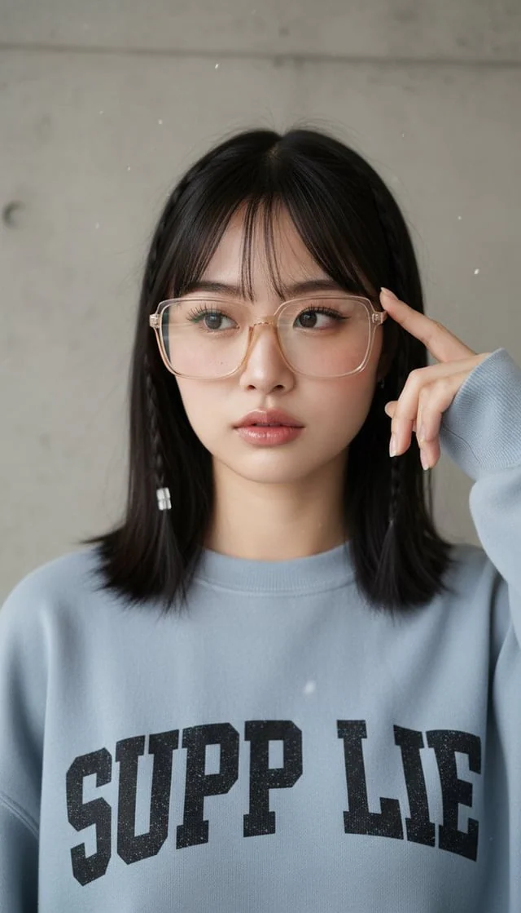

```text
A close-up portrait of {argument name="subject" default="a young East Asian woman with fair skin, soft natural makeup featuring subtle pink blush on the cheeks, defined eyelashes, and glossy light pink lips"}. She has straight shoulder-length black hair with soft bangs framing her forehead. Two thin braids run along the sides of her head, one of them adorned with a small clear or white bead/clip. She is wearing large rectangular transparent/clear-frame glasses with a slight warm beige or champagne tint.\n\nHer right hand is raised near the right side of her face, with the index finger gently resting against her temple/glasses frame in a casual, thoughtful pose. She is wearing {argument name="clothing" default="an oversized light blue-gray crewneck sweatshirt with bold, distressed black graphic lettering across the chest that partially reads “SUPP LIE”"}.\n\n{argument name="background" default="The background is a plain neutral gray concrete wall with subtle texture and a few soft white speckles/particles floating in the air"}. Soft, even studio lighting with gentle highlights on her face and hair, shallow depth of field, highly detailed skin texture, realistic photography style, vertical portrait composition.
```

Model: Nano Banana Pro
Author: Feyber | AI Creator

[ProjectD](https://aitoolsradar.com/en/prompts/ad3901cc77a63e) · [Recorded source](https://x.com/woleswoosh/status/2091767462714884317)
 · [Full original metadata and byte evidence](data/projectd-batch-0070.json)

## Profile / Avatar - Ultra-Detailed Cinematic Spring Portrait

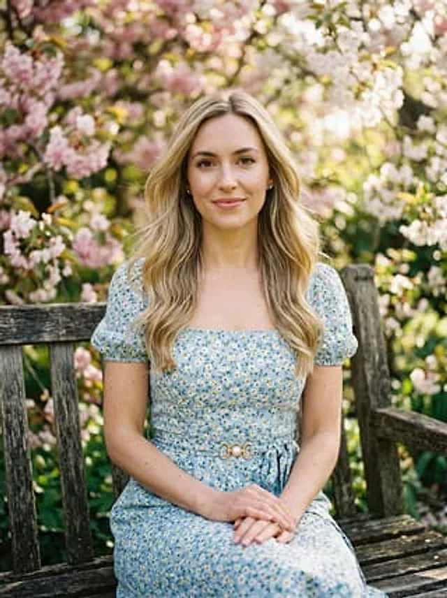

```text
Create an ultra-detailed realistic 4K cinematic portrait of one young adult woman seated outdoors in a {argument name="location" default="spring park"}, preserving the same visible identity, facial structure, {argument name="hair color" default="blonde"} hair color, calm direct gaze, pose, {argument name="outfit" default="blue summer dress"}, wooden bench, blooming pink tree background, warm sunlight, shallow depth of field, and natural editorial photo style.

SUBJECT LOCK:

One young adult woman with a refined feminine appearance, fair warm skin tone, calm neutral expression, looking directly into the camera. Preserve the same elegant, relaxed presence and natural beauty, with realistic skin detail and no change to her visible identity.

FACE / IDENTITY DETAILS:

Preserve the same oval face shape, balanced facial proportions, softly defined cheekbones, straight nose, full natural lips, light-colored eyes, defined natural eyebrows, subtle natural makeup, smooth but realistic fair skin, small natural marks and pores, and composed camera-facing expression. Do not alter facial features.

HAIR / HEAD DETAILS:

Preserve the same blonde hair color exactly. Long glossy blonde hair, softly voluminous, slightly wavy and loosely curled, parted naturally with lift at the crown. A gentle wind moves loose strands and flyaways around the face and shoulders while keeping the same hairstyle and color.

BODY / PROPORTION DETAILS:

Slender young adult proportions, seated posture, shoulders relaxed, upper body turned slightly toward the camera. Arms rest naturally downward with hands placed together on the lap. Preserve natural anatomy and realistic limb proportions.

POSE / GESTURE LOCK:

She sits on the edge of a weathered wooden park bench, facing forward with a slight body angle, looking directly into the lens. Hands are folded neatly on her lap, fingers visible, nails in a clean French manicure. Pose remains elegant, still, and relaxed.

OUTFIT / ACCESSORY LOCK:

blue summer dress with a soft square neckline, fitted bodice, airy skirt, and semi-transparent organza bows tied on both shoulders. Lightweight fabric with delicate translucency at the edges, soft folds, and realistic cloth texture. No jewelry or extra accessories unless naturally subtle.

SCENE / BACKGROUND LOCK:

Outdoor park setting in spring, near a blooming tree filled with pale pink flowers. Weathered wooden bench with visible grain and aged texture. Background includes tree branches, blossoms, greenery, warm sunlit garden depth, and soft natural bokeh.

COMPOSITION / CAMERA LOCK:

Vertical portrait composition, medium seated framing from head to knees, subject centered slightly forward on the bench. Camera at approximately eye level with a natural portrait lens feel, shallow depth of field, softly blurred floral background, realistic perspective, and intimate editorial framing.

LIGHTING LOCK:

Warm natural sunlight from behind and slightly above, creating soft rim light on blonde hair, gentle highlights on face, shoulders, arms, and dress, with natural shadows and glow
```

Model: Nano Banana Pro
Author: dreamy digital arts

[ProjectD](https://aitoolsradar.com/en/prompts/47219fa3d4a743) · [Recorded source](https://x.com/dreamydigiarts/status/2090393407646580915)
 · [Full original metadata and byte evidence](data/projectd-batch-0070.json)

## Profile / Avatar - Ultra-Realistic Yacht Sunset Portrait


```text
Ultra-realistic cinematic portrait of a me(use my image for refrence with accurate face)relaxing on a {argument name="setting" default="luxury yacht at sunset"}. Face with the face from the uploaded image, keeping the facial features exactly the same.wearing a {argument name="clothing" default="white unbuttoned shirt with white trousers"}, and stylishblack glasses. The person leansback casually on the yacht seat, barefoot, exuding a confident and relaxed vibe. The ocean waves trail behind the boat under the scaffolding sky, creating an ultrasound serene details
```

Model: Nano Banana Pro
Author: Alex Prompts

[ProjectD](https://aitoolsradar.com/en/prompts/a36cc141c206d2) · [Recorded source](https://x.com/AlexPromptsAI/status/2090821930978881741)
 · [Full original metadata and byte evidence](data/projectd-batch-0070.json)

## Profile / Avatar - Woman in Festive Red Sweater Portrait

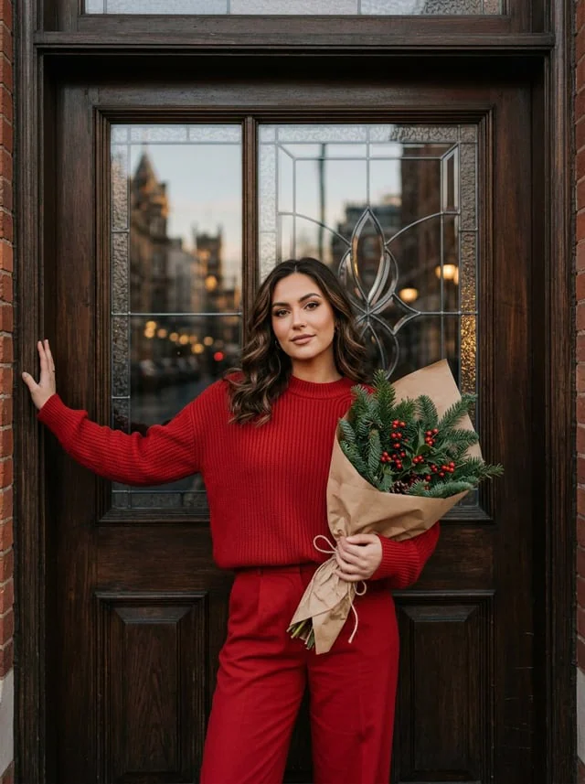

```text
Stylish young woman with elegant makeup standing confidently in front of a {argument name="door type" default="dark wood door with decorative glass panels"}. She is wearing a {argument name="sweater style" default="loose red ribbed sweater"} and matching red trousers. She holds a {argument name="item held" default="festive bouquet of pine branches decorated with bright red berries"}, wrapped in brown paper. Her left hand is casually extended, leaning against the door frame. Eye-level camera, medium shot, emphasizing a confident pose and festive style. The background features a slightly blurred reflection in the glass panel, hinting at an elegant cityscape. Soft, flattering lighting creates a festive yet sophisticated atmosphere with warm tones. Shot on phone, shallow depth of field, high resolution, amateur photography style, festive aesthetic, high quality.
```

Model: Nano Banana Pro
Author: dreamy digital arts

[ProjectD](https://aitoolsradar.com/en/prompts/c7e884c10b13a3) · [Recorded source](https://x.com/dreamydigiarts/status/2091020036123312343)
 · [Full original metadata and byte evidence](data/projectd-batch-0070.json)

## Sherlock Holmes Ornate Cupboard Diorama Prompt

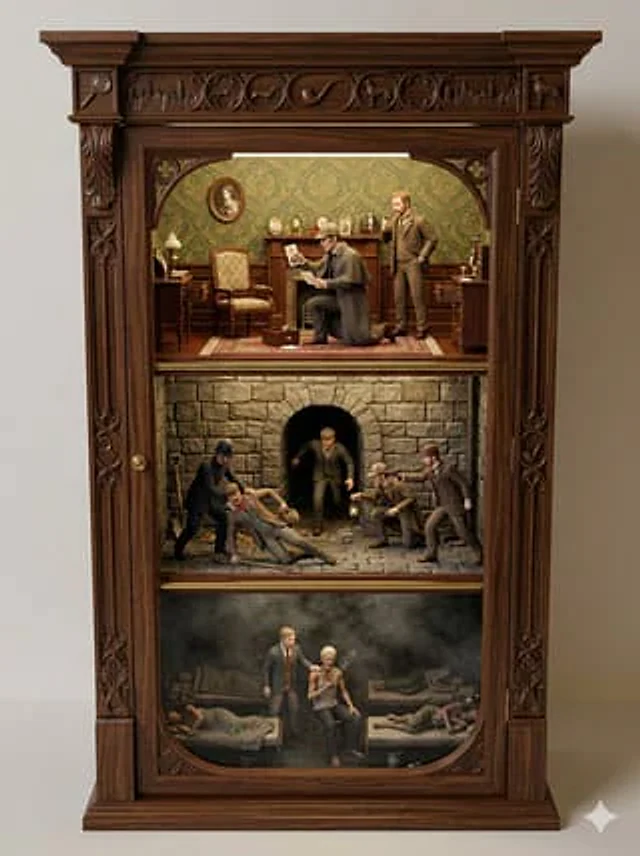

```text
Variable Guide
1. OVERALL_DIORAMA_THEME = Scenes from Adventures of Sherlock Holmes by Arthur Conan Doyle, in the order in which they are presented in the book
2. CUPBOARD_BASE_MATERIAL = 
3. CUPBOARD_LINING_MATERIAL = 
4. RACK_MATERIAL = 
5. ORNAMENTATION_STYLE = [e.g., Gothic carved wood, Art Deco brass, Elven interlaced vines]
6. ART_STYLE = Hyper-Realistic Render
7. TOP_SHELF_SCENE = [Describe specific actions of miniature figures defining the scene]
8. MIDDLE_SHELF_SCENE = [Describe specific actions of miniature figures defining the scene]
9. BOTTOM_SHELF_SCENE = [Describe specific actions of miniature figures defining the scene]
10. LIGHTING = 
11. CAMERA_ANGLE = A straight-on, front-facing view, captured from a moderately high angle looking distinctly downward.
12. ASPECT_RATIO = 3:4

Generation Directives
(Note: If any variable is left blank, intelligently infer the most appropriate detail based on the OVERALL_DIORAMA_THEME)

Directive 1: Framing & Composition (Highest Priority)
A direct, front-facing photograph captured from CAMERA_ANGLE. The composition must perfectly center the open display structure, looking down at a distinct angle into the shelves to clearly reveal the floor plates and top-down depth of the miniature objects within the dioramas, while ensuring the exterior side panels remain completely hidden. The entire free-standing structure must be completely visible with negative space around it against a simple background. The aspect ratio is 3:4.

Directive 2: The Main Structure (Strict Constraints)
Render the image in the style of ART_STYLE. The central object is a highly detailed, permanently open-front curio display structure. It must not possess doors, hinges, or door frames of any kind. The exterior is constructed from CUPBOARD_BASE_MATERIAL and detailed with ORNAMENTATION_STYLE. The interior back wall is lined with CUPBOARD_LINING_MATERIAL, and the individual shelves are made of RACK_MATERIAL.

Directive 3: The Miniature Dioramas & Figures
The structure houses a cohesive miniature world divided across three shelves, adhering to the OVERALL_DIORAMA_THEME. Crucially, each shelf must contain miniature figures engaged in a specific narrative action.
* Top Shelf: Miniature figures are depicted [TOP_SHELF_SCENE].
* Middle Shelf: Miniature figures are depicted [MIDDLE_SHELF_SCENE].
* Bottom Shelf: Miniature figures are depicted [BOTTOM_SHELF_SCENE].
Ensure the scale clearly reads as miniature dioramas housed within a furniture piece.

Directive 4: Atmosphere & Lighting
The scene is illuminated by LIGHTING. The lighting should cast appropriate micro-shadows within each shelf to emphasize the depth, the figures, and the miniature scale of the dioramas.
```

Model: Nano Banana Pro
Author: Artingent

[ProjectD](https://aitoolsradar.com/en/prompts/98491d4e4c97cd) · [Recorded source](https://youmind.com/prompts/sherlock-holmes-ornate-cupboard-diorama-prompt-11312)
 · [Full original metadata and byte evidence](data/projectd-batch-0070.json)

## Social Media Post - Candid Couple Gaming Lifestyle

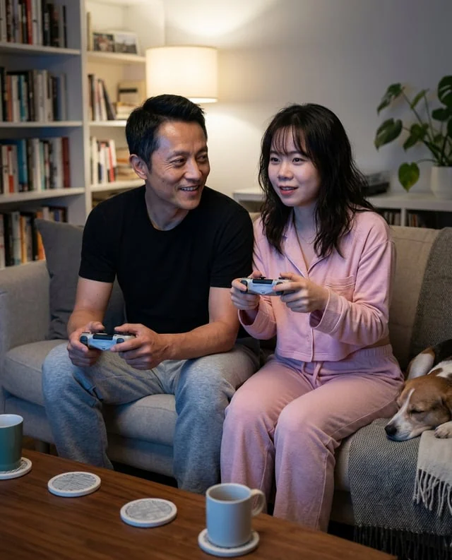

```text
{\n  "generation_request": {\n    "meta_data": {\n      "tool": "Nano Banana 2",\n      "task_type": "{argument name=\"task type\" default=\"gaming_couple_home_realistic\"}",\n      "version": "LOVE_Game"\n    },\n    "input": {\n      "mode": "text_to_image",\n      "notes": "Ultra photoreal candid moment of a couple playing video games together at home. Must feel natural, playful, relaxed, and real, like a spontaneous everyday moment, not staged. The screen must not be visible or readable."\n    },\n    "scene": {\n      "location": "home living room",\n      "time": "evening or night",\n      "environment": "{argument name=\"scene\" default=\"cozy living room, couch, soft ambient lighting, subtle TV glow from outside the frame, casual lived-in home setting\"}"\n    },\n    "subjects": {\n      "interaction": "{argument name=\"interaction\" default=\"they sit side by side on the couch holding game controllers, focused on the game, while the man briefly turns his head to look at her with a soft natural smile instead of the screen\"}",\n      "emotion": "playfulness, comfort, connection, relaxed happiness, soft romantic undertone",\n      "micro_expression": "natural focused expressions with subtle smiles, relaxed eyes, genuine small reactions, no exaggerated emotion",\n      "body_language": "relaxed sitting posture, slight forward lean, natural shoulder closeness, casual and unposed positioning"\n    },\n    "styling": {\n      "woman": "soft pink crop pajama top with matching shorts, comfortable homewear, same established hair color, slightly messy natural hair, no ring",\n      "man": "casual homewear such as a black or neutral t-shirt with sweatpants, relaxed fit, natural fabric folds"\n    },\n    "camera": {\n      "lens": "35mm lifestyle lens",\n      "aperture": "f2",\n      "depth_of_field": "moderate shallow with environment still visible",\n      "framing": "medium shot capturing both subjects seated on the couch, screen not visible",\n      "angle": "slightly side angle or over-the-shoulder perspective from inside the room",\n      "motion": "still with subtle candid realism"\n    },\n    "lighting": {\n      "type": "soft ambient room light with subtle off-frame TV glow",\n      "behavior": "gentle mixed lighting, soft cool tones from unseen screen and warm ambient light balancing the scene",\n      "skin_response": "natural skin texture, subtle light interaction, no smoothing, no plastic finish"\n    },\n    "color": {\n      "palette": "soft warm neutrals with subtle cool highlights, natural skin tones, muted home colors",\n      "grade": "cinematic but natural, balanced contrast, no HDR, no oversaturation"\n    },\n    "realism": {\n      "faces": "fully natural human faces, no AI smoothness, realistic expressions",\n      "skin": "visible pores, slight imperfections, believable mixed lighting",\n      "hair": "natural strands, slightly messy realistic home texture",\n      "hands": "correct controller grip, accurate finger placement, no distortion, no extra fingers, no fused fingers",\n      "controllers": "realistic generic controllers, no branding, natural scale",\n      "screen": "not vi
```

Model: Nano Banana Pro
Author: Arron2006

[ProjectD](https://aitoolsradar.com/en/prompts/25cef2efe191c3) · [Recorded source](https://x.com/ColorWolf2006/status/2091586811739230343)
 · [Full original metadata and byte evidence](data/projectd-batch-0070.json)

## Social Media Post - Candid European Street Style Portrait

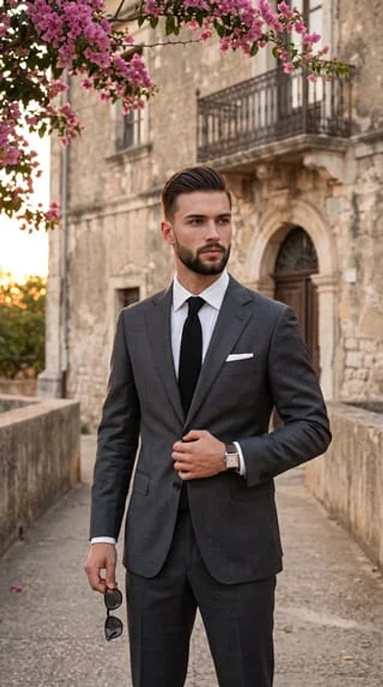

```text
A young adult male stands confidently in a candid, relaxed street style pose, turned slightly at a 45-degree angle with his weight centered and shoulders level. He has thick, messy wavy dark hair and an authentic expression featuring a neutral mouth and calm eyes gazing naturally off-camera. He is dressed elegantly in a tailored {argument name="suit color" default="charcoal grey"} suit paired with a crisp white dress shirt, a black textured knit tie, and a crisp white pocket square. His left arm is bent at the elbow, with his hand resting gently at waist level to lightly hold the edge of his suit jacket near the button, naturally revealing a {argument name="watch style" default="square watch with a leather strap"}. His right hand rests comfortably at his lower waist, casually holding black sunglasses by the temples pointed downward. Above him, a thriving canopy of {argument name="flower type" default="bright pink bougainvillea"} branches and green leaves hangs down like a natural frame in the foreground. He stands on a light gray concrete walkway next to a strip of green grass. To his left in the midground rises a weathered historic stone building facade constructed of cut stone blocks, featuring an arched doorway, a multi-paned wooden window frame, and a vintage black metal glass-paned wall lantern. The building's wall surface is a rough, matte plaster displaying patchy warm beige and sand colors with dark gray undertones and weathered cracks. To his right, a worn black wrought iron balcony railing projects outward. The background gently blurs into medium spatial depth, revealing a distant catering table draped in a new white tablecloth topped with dark bottles. The scene is bathed in bright, soft diffused natural daylight from above with an ambient bounce, casting a sophisticated warm golden glow over the European summer afternoon. Shadows feature soft, gradual gray edges, deliberately placed under his chin, beneath the jacket lapels, and cast softly onto the stone wall behind him, while pristine specular highlights catch his forehead, cheekbones, the bridge of his nose, and the glass face of his watch. The overall color palette is a complementary, highly contrasting mix of dominant charcoal grey and warm sand, punctuated by pure white and bougainvillea pink accents. Captured digitally straight-on using an 85mm lens at f/2.8, 1/500s, and ISO 100, the photorealistic image employs a medium depth of field to keep the subject tack sharp against the blurred background with absolutely no grain. The final aesthetic features subtle warm color grading to emphasize the stone and floral elements, balanced shadow recovery to preserve intricate details within the dark suit, and crisp sharpening on the subject's textural features, seamlessly framed in a 9:16 aspect ratio.
```

Model: Nano Banana Pro
Author: Picts by AI

[ProjectD](https://aitoolsradar.com/en/prompts/b1c6b5d180351f) · [Recorded source](https://x.com/pictsbyai/status/2091443576542826856)
 · [Full original metadata and byte evidence](data/projectd-batch-0070.json)

## Social Media Post - Cinematic Fantasy Portrait with Fluid Splashes


```text
Ultra-realistic IMAX-level Netflix-style cinematic fantasy portrait, 4:5 vertical frame, use the uploaded image as the primary facial reference with maximum face consistency, create a young woman leaning dynamically toward the camera while reaching one hand directly forward into the foreground, her extended hand appearing dramatically larger due to strong perspective and shallow depth of field, fingers naturally spread as if playfully reaching toward the viewer, her other arm positioned naturally closer to her body, upper body leaning forward with an energetic spontaneous posture, wearing a {argument name="outfit color" default="soft beige"} flowing draped outfit wrapped naturally around her upper body with loose fabric folds extending around her shoulders and torso, dark black hair gathered into a loose messy high bun with abundant textured strands escaping around the crown, temples and sides of her face, several fine flyaway strands lifted naturally around her head, surrounded by dramatic frozen splashes of clear liquid mixed with vivid {argument name="fluid colors" default="turquoise, red, pink, golden-yellow and orange"} paint-like fluid forms sweeping upward and outward around her body, individual droplets suspended sharply in the air, colorful fluid arcs creating a dynamic circular frame around her, bright neutral background visible between the splashes, highly detailed translucent liquid surfaces with realistic reflections and refractions, strong foreground-background depth separation, cinematic perspective, crisp facial detail with the reaching hand gradually becoming softer toward the closest foreground due to lens depth, realistic motion energy frozen at the exact moment of the splash, sophisticated studio lighting with soft frontal illumination on her face and subtle highlights along the wet fluid droplets and hair strands, vibrant but naturally balanced colors, realistic fabric texture, natural photographic detail, cinematic depth of field, high dynamic range. Skin: Her skin has a fair natural skin tone with a natural neutral-warm undertone, soft healthy glow, visible skin texture, fine pores, consistent face and body tone. Facial Expression: her eyes are wide open and looking directly into the camera with a bright playful gaze, eyebrows naturally raised with excitement, mouth opened into a broad {argument name="smile type" default="genuine smile"} showing her upper teeth, lips naturally stretched by the smile, cheeks noticeably lifted and rounded with natural smile lines forming around the eyes and mouth, creating a joyful spontaneous energetic expression. Negative Prompt: distorted face, extra fingers, malformed hands, duplicated limbs, warped perspective, artificial skin, excessive smoothing, CGI look, messy facial features.
```

Model: Nano Banana Pro
Author: Ayushi Srivastava

[ProjectD](https://aitoolsradar.com/en/prompts/f9c2f117d67214) · [Recorded source](https://x.com/punkhuri1/status/2091740825734803621)
 · [Full original metadata and byte evidence](data/projectd-batch-0070.json)

## Social Media Post - Elegant Dresses Lounge Companionship


```text
Create a photorealistic evening portrait of {argument name="subjects" default="two young women seated closely together on a dark upholstered lounge sofa in an elegant, intimate restaurant or private lounge"}. The woman on the left has long dark brown hair styled in soft loose waves with face-framing bangs, fair skin, softly defined features, natural makeup, and a composed expression while looking directly toward the camera. The woman on the right has long dark brown hair styled in loose waves with a softly gathered half-up appearance, warm fair skin, refined facial features, subtle makeup, and a gentle confident expression while also looking toward the camera. Both women have relaxed, natural postures and sit comfortably side by side, with their shoulders slightly angled toward one another and their body language conveying friendly companionship.\n\nThe woman on the left wears {argument name="clothing left" default="an elegant deep-blue evening dress with delicate silver embroidered detailing across the bodice, subtle shimmering accents throughout the fabric"}, thin straps, and a flowing floor-length skirt. The woman on the right wears {argument name="clothing right" default="a sophisticated bronze-gold evening gown with intricate decorative detailing on the bodice, fine metallic shimmer, a fitted waist"}, and a long flowing skirt with natural folds. Add delicate minimalist necklaces and understated jewelry that complement each outfit without distracting from the overall composition.\n\nThe setting features warm vertical wood-panel walls, a large round decorative mirror behind the subjects, dark upholstered seating, and subtle contemporary lounge décor. Warm table lighting and soft ambient illumination create a sophisticated evening atmosphere, with gentle highlights reflecting from the metallic details of the dresses and natural shadows adding depth to the room. Keep the background slightly softened while retaining enough environmental detail to establish the upscale lounge setting.\n\nShot on an 85mm portrait lens, eye-level perspective, medium-full composition, shallow depth of field, realistic perspective, soft warm ambient lighting, cinematic color grading, balanced exposure, high dynamic range, detailed skin texture, realistic hair strands, accurate hands and facial features, natural fabric folds, refined metallic reflections, subtle photographic grain, professional editorial lifestyle photography, photorealistic detail, natural proportions.
```

Model: Nano Banana Pro
Author: J⭕DIE

[ProjectD](https://aitoolsradar.com/en/prompts/40074f47a7958d) · [Recorded source](https://x.com/Jodie_Noraa/status/2091448230147969440)
 · [Full original metadata and byte evidence](data/projectd-batch-0070.json)

## Social Media Post - Elegant Indoor Fashion Portrait


```text
Create a photo realistic portrait of a young woman with fair, natural-looking skin, soft facial features, {argument name="hair style" default="light blonde hair styled in a loose low ponytail"} with a few gently framing strands around her face, subtle makeup, defined eyebrows, and a calm, pleasant expression with a slight closed-mouth smile. She is seated upright on a small cylindrical wooden stool beside a large floor-to-ceiling window, looking naturally toward the camera. Her posture is relaxed and elegant, with one leg crossed comfortably over the other and both hands resting gently near her knee. She is wearing a flowing {argument name="dress color" default="royal-blue"} dress with thin shoulder straps and a relaxed skirt that falls naturally around her legs. She wears minimalist black strappy high-heeled sandals with delicate ankle straps and a simple, understated bracelet. Keep the styling tasteful, refined, and fashion-editorial. The setting is a bright, modern apartment with warm neutral walls, polished light stone flooring, a large window overlooking {argument name="background scenery" default="green hills, rooftops, and a clear blue sky"} with soft white clouds. A large tropical houseplant sits in a woven natural-fiber planter nearby, with minimalist decorative shelves and small ceramic objects in the background. Warm wooden architectural details and natural textures create a sophisticated, comfortable interior. Bright natural daylight enters through the large window, creating soft illumination across the subject and gentle highlights on the blue fabric. Use subtle warm ambient light from the room to balance the daylight, realistic shadows, natural skin tones, and a clean airy atmosphere. The outdoor landscape should appear slightly softened in the background while remaining recognizable. Photorealistic fashion portrait, full-body composition, eye-level camera perspective, shot on an 85mm lens, shallow depth of field, realistic optical compression, precise focus on the face and clothing, natural proportions, authentic skin texture, fine fabric detail, soft cinematic color grading, balanced exposure, gentle highlights, realistic shadows, high dynamic range, premium editorial photography aesthetic, highly detailed, natural photographic finish.
```

Model: Nano Banana Pro
Author: J⭕DIE

[ProjectD](https://aitoolsradar.com/en/prompts/e20e9e74dbb326) · [Recorded source](https://x.com/Jodie_Noraa/status/2091500170123112744)
 · [Full original metadata and byte evidence](data/projectd-batch-0070.json)

## Social Media Post - Fashion Editorial Portrait in Cafe


```text
A candid, waist-up portrait of a young South Asian woman posing gracefully in a chic, warm-toned cafe interior. She has {argument name="hair style" default="long, wavy dark brown hair"} cascading over one shoulder, with one hand gently tucked behind her head. She is wearing a oversized black cotton t-shirt featuring a highly detailed, textured embroidered patch on the chest depicting a {argument name="t-shirt patch" default="cute blue penguin wearing a pink beanie and holding a heart that reads \"Be Mine\""}. She pairs the top with high-waisted white trousers accented by a thin white belt, and she holds a {argument name="bag style" default="beige pleated corduroy clutch bag"} under her arm. Elegant drop pearl earrings catch the light. Technical Details: Shot on a 85mm lens, f/1.8 aperture for a shallow depth of field with a soft, blurred background showing cozy ambient cafe lighting, warm globe pendant lights, dark wooden tables, and subtle greenery. Natural soft fill lighting on her face, hyper-realistic skin texture, realistic fabric folds, 8k resolution, photorealistic fashion editorial aesthetic.
```

Model: Nano Banana Pro
Author: DaniaSafvi

[ProjectD](https://aitoolsradar.com/en/prompts/890f594964bf9c) · [Recorded source](https://x.com/DaniaSafvi/status/2091436937517342764)
 · [Full original metadata and byte evidence](data/projectd-batch-0070.json)

## Social Media Post - Mirror Selfie Character Consistency


```text
Use the uploaded image as the only facial reference and preserve 100% facial identity, hairstyle, beard, skin tone, and natural skin texture. Use my pic face A {argument name="subject" default="young man with black hair, a beard, and a silver watch"} is taking a mirror selfie using his dark smartphone, side his face with the phone. He is wearing a {argument name="clothing" default="dark blue polo t-shirt with beige trim and beige trousers"}. He is standing outdoors with lush green plants around him. Behind him, there is a {argument name="setting" default="gazebo with a golden dome roof, decorated with blue, white, and red balloon clusters"}. A part of a black wicker chair and light gray pillows are visible in the lower-left corner. The sky is bright with light clouds. This is a high-quality, sharp-focus photo with natural lighting.
```

Model: Nano Banana Pro
Author: Dilshad Hussain

[ProjectD](https://aitoolsradar.com/en/prompts/31b6a2d1a12c17) · [Recorded source](https://x.com/DilshadAI1/status/2091696404741931204)
 · [Full original metadata and byte evidence](data/projectd-batch-0070.json)

## Social Media Post - PSG Jersey Teddy Jacket Selfie


```text
A close-up selfie-style portrait of {argument name="subject" default="a young East Asian woman looking downward with a soft, slightly shy expression, her gaze directed toward the lower left"}. She has straight black hair styled in a high, messy half-up bun with loose strands and wispy bangs framing her face. She wears clear transparent-framed round glasses and matte red lipstick. Her long, natural-looking light beige acrylic nails are visible as one hand gently touches the side of her head near the hair.\n\nShe is wearing {argument name="clothing" default="a navy blue Paris Saint-Germain (PSG) football jersey featuring the white Jordan Jumpman logo on the right chest, the circular Paris Saint-Germain crest on the left chest, and large white “QATAR AIRWAYS” lettering across the front"}. The jersey has thin white horizontal stripes on the sleeves. Over the jersey she wears {argument name="jacket" default="an open, fluffy light beige teddy-bear style jacket or cardigan with soft textured fabric"}.\n\nSoft natural sunlight illuminates the right side of her face and hair, creating gentle highlights and slight lens flare. Background shows a red-and-white checkered flag hanging in the upper right and blurred indoor elements including partial signage. Shallow depth of field, realistic skin texture, detailed fabric folds, high-resolution photorealistic style, warm golden-hour lighting, casual fan aesthetic.
```

Model: Nano Banana Pro
Author: Feyber | AI Creator

[ProjectD](https://aitoolsradar.com/en/prompts/3b3c8d7967978d) · [Recorded source](https://x.com/woleswoosh/status/2091586269318975638)
 · [Full original metadata and byte evidence](data/projectd-batch-0070.json)

## Social Media Post - Purple Floral Dress Garden Portrait


```text
Create a photorealistic outdoor portrait of {argument name="subject" default="a young woman standing in a lush green garden or woodland setting, captured from a three-quarter rear angle as she gently turns her head toward the camera"}. She has long, thick dark brown hair styled in a high ponytail, with a few soft face-framing strands falling naturally around her cheeks. Her skin has a warm, natural complexion with subtle realistic texture, soft highlights, and an even sun-kissed appearance. Her expression is calm, confident, and composed, with a relaxed gaze directed toward the camera and a subtle closed-mouth smile.\n\nShe is wearing {argument name="outfit" default="an elegant purple patterned sleeveless dress with thin shoulder straps, a fitted upper silhouette, and a flowing full-length skirt"}. The fabric should have a detailed organic floral or abstract print in multiple shades of purple, with realistic folds, stitching, and natural fabric texture. Keep the outfit tasteful, refined, and fashion-editorial. Add minimal accessories, such as small understated earrings, while keeping the overall styling clean and natural.\n\n{argument name="background" default="The subject is standing among dense green foliage, slender hanging branches, leafy plants, and soft woodland vegetation. The background should feel immersive and natural, with layered greenery extending into the distance"}. Include subtle patches of earth, scattered leaves, and softly blurred vegetation to create depth without distracting from the subject. Use warm late-afternoon natural sunlight filtering through the leaves, producing gentle highlights along the hair and shoulders, soft directional illumination on the face, and delicate dappled light throughout the scene. Maintain realistic shadows and a balanced exposure.\n\nCompose the image as a high-end lifestyle and fashion photograph shot on an 85mm portrait lens at approximately f/2.0, with a shallow depth of field and smooth natural background bokeh. Use a flattering perspective, precise focus on the eyes and face, realistic skin texture, fine hair detail, accurate fabric texture, and natural proportions. The camera should be positioned slightly above waist level, with enough environmental context to show the surrounding greenery while keeping the subject visually dominant. Apply a cinematic color grade with rich but natural greens, refined purple tones, warm skin tones, soft contrast, subtle highlight rolloff, realistic dynamic range, and balanced saturation. Aim for an authentic professional photograph with high detail, natural lighting, realistic depth, polished editorial quality.
```

Model: Nano Banana Pro
Author: J⭕DIE

[ProjectD](https://aitoolsradar.com/en/prompts/6567233ac5d78e) · [Recorded source](https://x.com/Jodie_Noraa/status/2091611759207764138)
 · [Full original metadata and byte evidence](data/projectd-batch-0070.json)

## Social Media Post - Train-ad style book advertisement image


```text
Please generate an advertisement image.

==== Ad specifications ===
- Aspect ratio: 16:9 (horizontal)
- Product to advertise: the book in the first attached image
- Main eye-catcher: place the book from the first attached image in a three-dimensional way
- Language: Japanese
- Taste: advertisement for a business book

# Text to include:
- Pre-head copy: 【New print run decided about one week after release】

Book “{argument name="book_title_en" default="Designing from Zero with AI"}” now on sale and doing well.

Amazon Best Seller Ranking
Ranked No.1 in commercial design sales (as of 10/15)
https://t.co/QxbYpfFVj6
```

Model: Nano Banana Pro
Author: KAWAI

[ProjectD](https://aitoolsradar.com/en/prompts/510f9117d7c68a) · [Recorded source](https://x.com/kawai_design/status/1992142466255114727)
 · [Full original metadata and byte evidence](data/projectd-batch-0070.json)

## Social Media Post - Tropical Beach Swimsuit Lifestyle


```text
{\n  "image_prompt": {\n    "subject": {\n      "appearance": "Young woman with a sharp bob haircut with bangs (dark brown hair), prominent freckles, and natural skin texture",\n      "reference_celebrity": "{argument name=\"celebrity\" default=\"Jenna Ortega\"}",\n      "expression": "Soft, pleasant smile, looking directly at the camera",\n      "physical_details": "Clear eye details, realistic skin texture"\n    },\n    "attire": {\n      "garment": "{argument name=\"attire\" default=\"Teal-green one-piece swimsuit with midriff cutout\"}",\n      "styling": "Single central cutout panel"\n    },\n    "pose": {\n      "stance": "Standing facing forward, eye-level angle",\n      "arms": {\n        "left_arm": "Bent, hand resting naturally on the hip",\n        "right_arm": "Bent, hand raised touching the top/side of the hair"\n      }\n    },\n    "props": {\n      "item": "Large, round, woven straw sun hat",\n      "placement": "Hanging lower down on the side of her right thigh, with straps visible"\n    },\n    "setting": {\n      "environment": "{argument name=\"setting\" default=\"Tropical resort beach\"}",\n      "background_details": [\n        "Calm, clear turquoise lagoon water",\n        "Dense grove of palm trees (blurred depth of field)",\n        "Soft white sand"\n      ]\n    },\n    "photography_style": {\n      "aesthetic": "Candid, lifestyle travel photography, high-fidelity photorealism, natural beauty focus",\n      "lighting": "Natural golden hour (late afternoon) sunlight, soft and diffused but bright, coming from the upper-left, creating gentle light on the face",\n      "composition": "Full-body shot from head to ankles, centered subject, sharp focus on Jenna Ortega, softly blurred background (creamy bokeh) with depth",\n      "film_grain": "Subtle, natural film grain for a candid, editorial look"\n    }\n  }\n}
```

Model: Nano Banana Pro
Author: Vireon

[ProjectD](https://aitoolsradar.com/en/prompts/646124dd1770ae) · [Recorded source](https://x.com/VireonLab/status/2091505981117153755)
 · [Full original metadata and byte evidence](data/projectd-batch-0070.json)

## Sydney Sweeney Morning Routine 2x2 Grid Prompt


```text
{
  "scene": {
    "description": "Ultra-photorealistic 4x4 grid image showing four different candid daily routine moments of the SAME woman. All four frames feel unposed, spontaneous, and captured naturally throughout the day.",
    "layout": {
      "grid": "2x2",
      "consistency": "same subject identity across all frames, different moments of the same day",
      "style": "raw iPhone photography aesthetic, social-media realistic"
    },
    "lighting": "natural real-world lighting varying by scene, no studio or cinematic lighting",
    "quality": "hyper-realistic, sharp focus, natural imperfections preserved"
  },

  "subject": {
    "identity": "Cuban/Spanish Actress sydney sweeney ,
      "requirements": [
        "Face, eyes, skin tone, proportions 100% identical to sydney sweeney ,
        "Same person in all 4 frames",
        "No beauty-face alteration or idealization"
      ]
    }
  },

  "frames": {
   "frame_1": {
  "title": "Morning wake-up bathroom mirror selfie",
  "environment": "home bathroom",
  "pose": "standing casually in front of bathroom mirror, holding phone for a mirror selfie",
  "camera": "mirror selfie, phone partially visible, natural arm angle",
  "expression": "slightly tired morning face with a subtle soft smile, relaxed eyes looking at the phone screen",
  "details": [
    "slightly puffy sleepy eyes",
    "natural unstyled morning hair",
    "no makeup or very minimal makeup",
    "casual random t-shirt worn loosely",
    "imperfect mirror framing, not centered",
    "natural bathroom lighting, no harsh shadows"
  ],
  "vibe": "just woke up, real and unposed morning moment"
}

    "frame_2": {
      "title": "Outdoor run – mid action selfie",
      "environment": "outdoor running path or sidewalk",
      "pose": "running while holding phone for a quick selfie, mid-motion",
      "camera": "front camera selfie, arm visible, slight motion energy",
      "expression": "focused but lively, open mouth breathing",
      "clothing": {
        "outfit": "pink athletic outfit",
        "hat": "white running cap"
      },
      "details": [
        "natural daylight",
        "no motion blur exaggeration",
        "athletic realism"
      ],
      "vibe": "caught during movement"
    },

    "frame_3": {
      "title": "Coffee break candid",
      "environment": "cafe or home table setting",
      "pose": "sitting casually while drinking coffee",
      "camera": "casual handheld selfie",
      "expression": "thoughtful, relaxed, eyes not directly looking at camera",
      "details": [
        "coffee cup mid-sip",
        "natural posture",
        "background secondary and unobtrusive"
      ],
      "vibe": "quiet reset moment"
    },

    "frame_4": {
      "title": "Outdoor breakfast – taken by someone else",
      "environment": "outdoor breakfast cafe",
      "pose": "eating breakfast naturally, unaware of camera",
      "camera":
```

Model: Nano Banana Pro
Author: 𝐌

[ProjectD](https://aitoolsradar.com/en/prompts/21c1e1fd482f30) · [Recorded source](https://youmind.com/prompts/sydney-sweeney-morning-routine-2x2-grid-prompt-5062)
 · [Full original metadata and byte evidence](data/projectd-batch-0070.json)

## Vintage Patent Document for an Invention


```text
A vintage patent document for {argument name="invention" default="INVENTION"}, styled after late 1800s United States Patent Office filings. The page features precise technical drawings with numbered callouts (Fig. 1, Fig. 2, Fig. 3) showing front, side, and exploded views. Handwritten annotations in fountain-pen ink describe mechanisms. The paper is aged ivory with foxing stains and soft fold creases. An official embossed seal and red wax stamp appear in the corner. A hand-signed inventor's name and date appear at the bottom. The entire image feels like a recovered archival document—authoritative, historic, and slightly mysterious.
```

Model: Nano Banana Pro
Author: Alexandra Aisling

[ProjectD](https://aitoolsradar.com/en/prompts/7f5e852c761b0f) · [Recorded source](https://x.com/AllaAisling/status/2004212035333365763)
 · [Full original metadata and byte evidence](data/projectd-batch-0070.json)

## Vintage Patent Document for an Invention


```text
A vintage patent document for {argument name="invention" default="INVENTION"}, styled after late 1800s United States Patent Office filings. The page features precise technical drawings with numbered callouts (Fig. 1, Fig. 2, Fig. 3) showing front, side, and exploded views. Handwritten annotations in fountain-pen ink describe mechanisms. The paper is aged ivory with foxing stains and soft fold creases. An official embossed seal and red wax stamp appear in the corner. A hand-signed inventor's name and date appear at the bottom. The entire image feels like a recovered archival document—authoritative, historic, and slightly mysterious.
```

Model: Nano Banana Pro
Author: Alexandra Aisling

[ProjectD](https://aitoolsradar.com/en/prompts/8fb9e0e5184c44) · [Recorded source](https://youmind.com/prompts/vintage-patent-technical-drawing-3438)
 · [Full original metadata and byte evidence](data/projectd-batch-0070.json)

## Watercolor map of Germany with labeled states


```text
Generate a map of Germany in watercolor style, on which all federal states are labeled in ballpoint pen.
```

Model: Nano Banana Pro
Author: Florian Gallwitz

[ProjectD](https://aitoolsradar.com/en/prompts/2295e6faa682e2) · [Recorded source](https://x.com/FlorianGallwitz/status/1991796624646091091)
 · [Full original metadata and byte evidence](data/projectd-batch-0070.json)

## Watercolor map of Germany with labeled states


```text
Erzeuge eine Karte von Deutschland im Wasserfarben-Stil, auf der alle Bundesländer mit Kugelschreiber benannt sind.
```

Model: Nano Banana Pro
Author: Florian Gallwitz

[ProjectD](https://aitoolsradar.com/en/prompts/f757ccd41f2bff) · [Recorded source](https://youmind.com/prompts/watercolor-germany-labeled-states-380)
 · [Full original metadata and byte evidence](data/projectd-batch-0070.json)

## Wide quote card with portrait and Chinese/English customization


```text
A wide quote card featuring a famous person, with a brown background and a light-gold serif font for the quote: “{argument name="famous_quote" default="Stay Hungry, Stay Foolish"}” and smaller text: “—{argument name="author" default="Steve Jobs"}.” There is a large, subtle quotation mark before the text. The portrait of the person is on the left, the text on the right. The text occupies two-thirds of the image and the portrait one-third, with a slight gradient transition effect on the portrait.
```

Model: Nano Banana Pro
Author: Nicolechan

[ProjectD](https://aitoolsradar.com/en/prompts/32700cab9ce4a9) · [Recorded source](https://x.com/stark_nico99/status/1991718646570426763)
 · [Full original metadata and byte evidence](data/projectd-batch-0070.json)

## Wide quote card with portrait and Chinese/English customization


```text
一张宽幅的名人金句卡，棕色背景，衬线体浅金色“{argument name="金句" default="保持饥饿，保持愚蠢"}”，小字“——{argument name="作者" default="Steve Jobs"}”，文字前面带一个大的淡淡的引号。人物头像在左边，文字在右边，文字占画面比例 2/3，人物占 1/3，人物有一点渐变过渡的感觉。
```

Model: Nano Banana Pro
Author: Nicolechan

[ProjectD](https://aitoolsradar.com/en/prompts/7bf11962cff735) · [Recorded source](https://youmind.com/prompts/wide-quote-card-portrait-151)
 · [Full original metadata and byte evidence](data/projectd-batch-0070.json)

## World Cup Children Football Portraits


```text
A 2x2 grid of four individual realistic portrait photos of {argument name="subjects" default="young children"} wearing official {argument name="jersey style" default="national football team jerseys"} for the {argument name="event" default="2026 World Cup"}. Each panel includes an official-style 2026 World Cup logo in the top corner.

- Top Left: A smiling Afro-Latino boy with curly hair, wearing the yellow Brazil jersey against a dark teal background.
- Top Right: A young Caucasian boy with short brown hair, looking slightly to the side, wearing the navy blue France jersey against an ochre background.
- Bottom Left: A laughing young boy with messy brown hair, wearing the red Spain jersey against a blurred stadium background.
- Bottom Right: A young Caucasian boy with a clean-shaven face and no facial hair, wearing a teal baseball cap backwards and the light blue and white striped Argentina jersey against a plain white background.
```

Model: Nano Banana Pro
Author: Aijaz

[ProjectD](https://aitoolsradar.com/en/prompts/38cfc601e644dd) · [Recorded source](https://youmind.com/prompts/world-cup-children-portraits-25586)
 · [Full original metadata and byte evidence](data/projectd-batch-0070.json)

## World Cup Goalkeeper Save


```text
World Cup Final penalty save, the subject as goalkeeper, strict face reference, full-stretch horizontal dive, professional FIFA-style soccer ball impacting compressed goalkeeper glove, frozen action, intense focus, visible sweat and muscle tension, {argument name="nationality" default="[NATIONALITY]"} supporters in {argument name="primary color" default="[COLOR1]"} and {argument name="secondary color" default="[COLOR2]"} filling the stadium, flying turf particles, pitch-level side angle, 400mm sports lens, 1/4000 shutter, dramatic floodlights, Getty Images sports photography, ultra-photorealistic
```

Model: Nano Banana Pro
Author: Shine by Nous ✨

[ProjectD](https://aitoolsradar.com/en/prompts/4a0477101c9db1) · [Recorded source](https://youmind.com/prompts/world-cup-goalkeeper-save-24364)
 · [Full original metadata and byte evidence](data/projectd-batch-0070.json)

## World Cup Victory Portrait


```text
A full-body photograph of a young woman standing inside a stadium and {argument name="activity" default="kissing the golden Football World Cup trophy"}. She is wearing {argument name="team jersey" default="Argentina football team's blue and white striped jersey (number 10)"} and matching trousers, with AFA logo and Adidas logo attached. Her brown hair has a high ponytail and she is holding the trophy with a smile. A huge, packed stadium is seen in the background, in which the spectators are wearing {argument name="fans clothing" default="Argentina's striped jerseys"}. The roof of the stadium is modern and brightly lit. Some empty plastic seats are placed in the front and a water bottle is lying on the floor. It is night time and the stadium is completely illuminated.
```

Model: Nano Banana Pro
Author: ayzalnoor

[ProjectD](https://aitoolsradar.com/en/prompts/103f6672a238b8) · [Recorded source](https://youmind.com/prompts/world-cup-victory-stadium-portrait-25872)
 · [Full original metadata and byte evidence](data/projectd-batch-0070.json)

## YouTube Thumbnail - Anime Railway Station Transformation


```text
Please create it in an anime style. {argument name="scene description" default="A wooden station building with a train stopped in the distance."}
```

Model: Nano Banana Pro
Author: 神根 斗九之進（Tokunoshin kamine）

[ProjectD](https://aitoolsradar.com/en/prompts/d9f76cffb27fef) · [Recorded source](https://x.com/ttoku1969/status/2054960699101905021)
 · [Full original metadata and byte evidence](data/projectd-batch-0070.json)

## YouTube Thumbnail - Basketball Arena Broadcast Portrait


```text
usw image1 as the main identity anchor

{"meta":{"image_quality":"High","image_type":"Screenshot","resolution_estimation":"1920x1080","file_characteristics":{"compression_artifacts":"Low","noise_level":"Low","lens_type_estimation":"Medium telephoto"}},"global_context":{"scene_description":"A medium shot of a {argument name="subject" default="young woman with long dark hair"} sitting in a crowded arena, likely a basketball game, with an {argument name="overlay type" default="ESPN broadcast overlay"} at the bottom and top right.","environment_type":"Indoor arena","time_of_day":"Unknown","weather_atmosphere":"Crowded, indoor lighting","lighting":{"source":"Artificial arena lighting","direction":"Frontal, slightly overhead","quality":"Soft, diffused","color_temperature":"Neutral"},"color_palette":{"dominant_hex_estimates":["#1a1a1a","#333333","#ffffff"],"accent_colors":["#fdb927","#007a33"],"contrast_level":"Medium"}},"composition":{"camera_angle":"Eye-level","framing":"Medium shot","depth_of_field":"Shallow","focal_point":"The woman's face","symmetry_type":"None","rule_of_thirds_alignment":"Woman's face is positioned in the upper right quadrant"},"objects":[{"id":"obj_001","label":"Woman","category":"Person","location":{"relative_position":"Center","bounding_box_percentage":{"x":0.25,"y":0.05,"width":0.5,"height":0.9}},"dimensions_relative":"Large","distance_from_camera":"Near","pose_orientation":"Facing slightly right, head turned towards the left","material":"Skin, hair, fabric","surface_properties":{"texture":"Smooth skin, wavy hair","reflectivity":"Low","micro_details":"Natural skin texture, subtle makeup","wear_state":"N/A"},"color_details":{"base_color_hex":"#d2b48c","secondary_colors":["#000000"],"gradient_or_pattern":"None"},"interaction_with_light":{"shadow_casting":"Soft shadows under chin and nose","highlight_zones":"Cheekbones, nose bridge, lips","translucency":"None"},"text_content":null,"relationships":[]},{"id":"obj_002","label":"ESPN Scoreboard Overlay","category":"UI elements","location":{"relative_position":"Bottom center","bounding_box_percentage":{"x":0.25,"y":0.85,"width":0.5,"height":0.15}},"dimensions_relative":"Medium","distance_from_camera":"Overlay","pose_orientation":"Flat","material":"Digital graphic","surface_properties":{"texture":"Smooth","reflectivity":"None","micro_details":"Sharp typography","wear_state":"N/A"},"color_details":{"base_color_hex":"#000000","secondary_colors":["#fdb927","#007a33","#ffffff"],"gradient_or_pattern":"Solid color blocks"},"interaction_with_light":{"shadow_casting":"None","highlight_zones":"None","translucency":"Slightly opaque"},"text_content":{"raw_text":"{argument name="scoreboard text" default="LAL 51 BOS 43 2ND 3:31 24 NBA WEDNESDAY"}","font_style":"Sans-serif","font_weight":"Bold","text_case":"Uppercase","alignment":"Center","color_hex":"#ffffff"},"relationships":[]}],"background_details":{"texture":"Blurred crowd","patterns":"None","lighting_behavior":"Out of focus","additional_elements":["Person holding a plastic cup on the left"]}}
```

Model: Nano Banana Pro
Author: Diamond

[ProjectD](https://aitoolsradar.com/en/prompts/5b4b564016a140) · [Recorded source](https://x.com/DiamondZPetSpa/status/2053724968941416793)
 · [Full original metadata and byte evidence](data/projectd-batch-0070.json)

## YouTube Thumbnail - Cinematic Festival Photo of Millie Bobby Brown


```text
"Create a highly detailed, cinematic, photorealistic lifestyle photograph of {argument name="subject" default="Millie Bobby Brown"} at an outdoor festival during early evening. She has long, slightly wavy hair and a playful expression, smiling with her teeth visible while looking back over her right shoulder directly at the camera. Her makeup is light and natural. She is wearing sunglasses resting on top of her head, large teal-colored drop-shaped earrings, and a bright yellow festival wristband on her right wrist.

She has a slim, fit body and is dressed in a light greenish-gray cropped short-sleeve t-shirt with a faded print on the front, paired with light blue ripped denim cut-off shorts. On her feet, she wears classic black high-top canvas sneakers with white laces, a white toe cap, and white soles.

Her pose is dynamic and confident: she is standing with her back facing the camera, her torso twisted as she looks over her right shoulder. Her right arm is slightly raised with a relaxed hand near her waist, while her left arm hangs naturally. Her weight is mostly on her extended left leg, with her right leg slightly bent, creating a casual and energetic posture.

The setting is a lively outdoor festival, resembling an amusement park. In the background, there is a large Ferris wheel illuminated with neon pink and white lights along its spokes and rim. Blurred figures of people walking can be seen in the background, and the ground appears dark, like a temporary paved surface.

The lighting combines soft dusk light with strong, cool artificial ambient light coming from the Ferris wheel. The neon lights create a glowing rim light around her hair, shoulders, and silhouette, while a soft front fill light clearly illuminates her face and body.

The overall mood is vibrant, youthful, energetic, and cinematic, capturing the lively atmosphere of a summer festival. The color palette emphasizes neon pink, bright white, light denim blue, greenish-gray, black, and soft pink tones.

The image should be captured in a portrait orientation (9:16), using a slightly low camera angle and a tight framing (medium close-up or American shot), with the subject occupying almost the entire frame. Use a telephoto lens between 85mm and 135mm to compress perspective and emphasize the subject, with a shallow depth of field to keep her extremely sharp while the background remains softly blurred with bokeh. The final result should be highly detailed, with sharp focus on the subject, vibrant and contrasting colors, professional lighting, and 8K resolution quality."
```

Model: Nano Banana Pro
Author: Giulia

[ProjectD](https://aitoolsradar.com/en/prompts/914a26c99c755c) · [Recorded source](https://x.com/Giulia_4i/status/2039474538212401240)
 · [Full original metadata and byte evidence](data/projectd-batch-0070.json)

## YouTube Thumbnail - Cinematic Moonlight Rooftop Portrait Collage


```text
Use the uploaded face reference image as the exact identity reference. Maintain perfect facial consistency across all frames — same facial structure, skin tone, hairstyle, eye shape, beard texture, nose, lips, and realistic proportions. Do not change identity. Create an ultra-cinematic multi-frame night photography collage of a {argument name="subject" default="young man"} standing on a {argument name="location" default="rooftop"} under a {argument name="celestial body" default="massive glowing full moon"}. Mood should feel emotional, dreamy, introspective, and film-like. Composition Layout (6-frame cinematic grid): 1.Wide rooftop shot with giant moon dominating the cloudy night sky. 2.Side profile portrait looking upward toward the moon. 3.Extreme close-up of eye reflecting moonlight and clouds. 4.Cinematic silhouette frame from behind with skyline lights. 5.Hand close-up resting on rooftop railing with shallow depth of field. 6.Atmospheric sky frame filled with stars, clouds, moon glow, and haze. Environment: Urban rooftop at night, Distant city skyline with realistic bokeh lights, Dramatic clouds surrounding bright moon, Slight wind movement in clothes and hair, Moist rooftop texture with reflective highlights, Atmospheric fog and cinematic haze. Lighting: Soft blue moonlight as key light, Subtle warm city lights from below, Realistic night shadows, Volumetric moon glow, Rim lighting around silhouette, High dynamic range cinematic contrast. Camera & Photography Style: Shot on Sony A7R IV / ARRI Alexa style, 85mm portrait lens + 35mm cinematic wide lens, Ultra photorealistic, Natural skin texture, Shallow depth of field, Sharp eye detail, Film grain, HDR night photography, Moody color grading, Premium cinematic composition, Hyper detailed, Unreal Engine realism, Netflix-style visual atmosphere. Color Palette: Deep midnight blue, silver moonlight, soft black shadows, cool cyan tones, warm golden city bokeh highlights. Quality Tags: masterpiece, best quality, ultra detailed, 8k, photorealistic, cinematic lighting, volumetric fog, realistic skin texture, atmospheric perspective, dramatic composition, high contrast, emotional storytelling, movie still aesthetic, premium cinematic collage, highly detailed clouds, realistic reflections. Negative Prompt: low quality, blurry face, bad anatomy, distorted eyes, extra fingers, oversaturated colors, cartoon, CGI look, duplicate frames, low detail skin, noisy image, warped hands, fake lighting, washed colors, deformed face, unrealistic moon proportions, text, watermark, logo, cropped face
```

Model: Nano Banana Pro
Author: Professor

[ProjectD](https://aitoolsradar.com/en/prompts/b896b6451b25e7) · [Recorded source](https://x.com/Professor_134/status/2054782899917136167)
 · [Full original metadata and byte evidence](data/projectd-batch-0070.json)

## YouTube Thumbnail - Cinematic Podcast Studio Portrait


```text
A professional {argument name="host description" default="podcast host sitting at a wooden desk in a modern studio setup"}, facing the camera with a confident and friendly expression. He is wearing a {argument name="clothing" default="fitted black shirt"} and sitting in a comfortable chair. A high-quality podcast microphone on a boom arm is positioned close to his mouth. On the desk are a notebook with handwritten notes, a coffee mug, and an audio interface with connected cables. The background features {argument name="background lighting" default="stylish indoor plants and warm red-orange accent lighting"}, creating a clean, cinematic studio atmosphere. Soft key lighting on the face, subtle rim lighting, shallow depth of field, ultra-realistic details, 50mm lens, f/1.8, professional color grading, high contrast, 8K, YouTube podcast aesthetic.
```

Model: Nano Banana Pro
Author: Taaruk

[ProjectD](https://aitoolsradar.com/en/prompts/59d97cb9c5fa77) · [Recorded source](https://x.com/Taaruk_/status/2045058894553354475)
 · [Full original metadata and byte evidence](data/projectd-batch-0070.json)

## YouTube Thumbnail - Cinematic Sports Documentary Key Art


```text
do this for {argument name="event" default="Argentina World Cup 2026"}, void main() { string player = "{argument name="player" default="[PLAYER]"}"; string team = "{argument name="team" default="[TEAM]"}"; // --- The series (infer the arc to dramatize) --- Arc a = infer_career_drama(player); // the prodigy years / the exile / the comeback - pick the prestige angle tone(restrained, moody, character_first); // NOT loud - quiet and heavy // --- Key art composition --- portrait(infer_player_persona(player), contemplative, half_shadow); environment(symbolic_setting(a), atmospheric, shallow_focus); // empty stadium / tunnel / rain on glass grade(infer_team_colors(team), desaturated_prestige, single_accent); // --- Streaming furniture (flat overlay) --- title(invent_series_title(player), elegant_serif_or_thin_sans, centered); tagline(invent_logline(player), small, below_title); platform_mark("LIMITED SERIES", "NOW STREAMING", micro_caps, corner); laurels(invent_critic_pullquotes(), thin); render(cinematic_still, film_grain: fine, premium_negative_space); }
```

Model: Nano Banana Pro
Author: Gadgetify

[ProjectD](https://aitoolsradar.com/en/prompts/fe7a3526d65d72) · [Recorded source](https://x.com/Gdgtify/status/2071629767795937759)
 · [Full original metadata and byte evidence](data/projectd-batch-0070.json)

## YouTube Thumbnail - Cinematic Street Photography of Man Slipping on Banana Peel


```text
Ultra-realistic cinematic street photography of a young man slipping on a banana peel in a modern city walkway, caught mid-air in a dramatic falling pose, shocked facial expression, arms flailing, everyday tech items (laptop, headphones, cables, smartphone, gaming controller, backpack, drone) floating and scattering around him in slow motion, urban background with tall buildings and pedestrians slightly blurred, natural daylight, motion freeze effect, high-speed photography, sharp focus on subject, depth of field, realistic shadows, 8K, photorealistic.
```

Model: Nano Banana Pro
Author: Taaruk

[ProjectD](https://aitoolsradar.com/en/prompts/13358dcdd9b5e5) · [Recorded source](https://x.com/Taaruk_/status/2039222333274275850)
 · [Full original metadata and byte evidence](data/projectd-batch-0070.json)

## YouTube Thumbnail - Cinematic Vigilante Graphic Poster


```text
A cinematic, vertical graphic poster of a masked vigilante in a tactical carbon-fiber suit. The character is positioned in the foreground with a gritty, matte black texture. The background features massive, bold stencil-style typography in a deep crimson red with heavy metallic scratching and weathered textures. The lighting is low-key and dramatic, with subtle rim lighting on the suit to define its armor plates. High-contrast noir aesthetic, moody atmosphere, sharp details, 8k resolution, Extreme macro close-up of a monstrous green-skinned face, focused on the nose, furrowed brow, and intense glowing green eyes. The skin is hyper-detailed with deep wrinkles, sweat, and a rough, leathery texture. Overlaid vertically across the center is the word "HULK" in large, bold, weathered white sans-serif typography with a metallic, scratched finish. The color palette is dominated by deep emerald greens and shadows, featuring explosive green energy particles and debris flying across the frame. Cinematic lighting, gritty atmosphere, 8k resolution, hyper-realistic, aggressive and powerful mood.
```

Model: Nano Banana Pro
Author: Aijaz

[ProjectD](https://aitoolsradar.com/en/prompts/baf776d1f68ec9) · [Recorded source](https://x.com/iamsofiaijaz/status/2054127368365908220)
 · [Full original metadata and byte evidence](data/projectd-batch-0070.json)

## YouTube Thumbnail - Japanese TV Program Style Image Generation


```text
Generate an image in the style of a Japanese TV program.
Let the AI consider the overall atmosphere of the image, including captions and interview content/answers associated with the following details:

{argument name="theme" default="NISA poverty. Morning news program. A 20-year-old female idol being interviewed at a woman's home."}
```

Model: Nano Banana Pro
Author: 俺の娘たち / AIエンジニア

[ProjectD](https://aitoolsradar.com/en/prompts/6f56df555e30a5) · [Recorded source](https://x.com/oreno_musume/status/2041122003642704015)
 · [Full original metadata and byte evidence](data/projectd-batch-0070.json)

## YouTube Thumbnail - Koshien Baseball Broadcast Screen


```text
A screenshot of the 2026 Koshien high school baseball finals broadcast. High school baseball broadcast, with the score "{argument name="score" default="Bottom of the 8th, Chiben Wakayama 2-2 Kenadai Takasaki"}" in the corner, 2 outs, bases loaded, and inning display. Features the transparent overlays characteristic of NHK terrestrial broadcasting.
```

Model: Nano Banana Pro
Author: あいめら

[ProjectD](https://aitoolsradar.com/en/prompts/c8b3ba1289dc12) · [Recorded source](https://x.com/image__lab/status/2090876589949255789)
 · [Full original metadata and byte evidence](data/projectd-batch-0070.json)

## YouTube Thumbnail - Magical Book Visualization Grid


```text
2x2 grid, do this for 4 famous books render_target = ( {argument name="main object" default="giant_sliced_open_hardcover_fantasy_book"} * 2.0 ) + ( {argument name="inner scene" default="inferred_magical_library_diorama_inside"} * 1.8 ) + ( miniature_main_characters_fighting_bad_guys * 1.5 ) + ( floating_old_english_map_overlay_top_right * 2.0 ) + ( tiny_ink_bottles_and_quills_exterior * 1.0 ) + ( {argument name="background" default="clean_parchment_paper_studio_background"} * 1.2 ) - ( e_reader / 2.0 ) - ( modern_clothing / 2.0 ) - ( messy_desk )
```

Model: Nano Banana Pro
Author: Gadgetify

[ProjectD](https://aitoolsradar.com/en/prompts/fbccef4ed07222) · [Recorded source](https://x.com/Gdgtify/status/2049903356987195814)
 · [Full original metadata and byte evidence](data/projectd-batch-0070.json)

## YouTube Thumbnail - Majestic Elephant Cloud Photography


```text
Hyper-realistic photography of massive volumetric clouds forming the shape of a majestic {argument name="animal" default="elephant"}, highly detailed and anatomically accurate cloud structure with enormous tusks and a raised trunk, soft yet dense cumulus clouds with realistic depth and texture, dramatic golden-hour lighting, sunlight rays piercing through the clouds, subtle shadows and highlights enhancing form.
Foreground: a vast {argument name="landscape" default="African savanna meadow"} with realistic dry grass, atmospheric perspective, and cinematic depth of field. Multiple {argument name="wildlife" default="zebras"} grazing naturally across the field. Mid-air: flock of birds circling around the giant elephant cloud, adding scale and motion.
Environment: cinematic sky with warm orange and blue gradient tones, slight haze, natural color grading, ultra-realistic lighting, global illumination, volumetric fog, physically accurate shadows.
Style: DSLR photography, 85mm lens, f/2.8 aperture, shallow depth of field, HDR, 8K resolution, razor-sharp focus, intricate details, photorealism, no CGI look.
Mood: majestic, calm, surreal yet believable, wildlife documentary realism.
```

Model: Nano Banana Pro
Author: ÀBDŪLLÂH

[ProjectD](https://aitoolsradar.com/en/prompts/5ec9e631b5a81a) · [Recorded source](https://x.com/itxabdullaa/status/2057817382773731346)
 · [Full original metadata and byte evidence](data/projectd-batch-0070.json)

## YouTube Thumbnail - Mr Bean Mini Cooper Chaos


```text
Hyper-realistic, chaotic wide-angle fish-eye dashboard shot of a speeding {argument name="car" default="vintage Mini Cooper"}.
Characters & Identity:

{argument name="driver" default="Mr. Bean (Rowan Atkinson)"} driving maniacally, steering with knees, holding a cup of tea.
Passenger: photorealistic human, face and hair 100% identical to the uploaded reference, wearing a {argument name="outfit" default="modern oversized printed baggy t-shirt"}, enjoying the thrill of speed.
Back seat: 3D animated Chucky (evil doll) and Alien Xenomorph, physically squished together, faces pressed against the side window in humorous distortion.
Outside windshield: 3D animated Green Mean Gremlin splattered against glass, furious expression.
Through rear window: police car in pursuit.
Scene & Environment:

atermark, text Harsh daylight, strong natural shadows
Motion blur on passing scenery for extreme sense of speed
Interior of Mini Cooper rendered with photorealistic detail (dashboard, steering wheel, seats, reflections)
Camera & Composition:

Wide-angle fish-eye perspective, exaggerating speed and chaos
Cinematic framing, dynamic, immersive POV
High-fidelity textures, realistic lighting, reflections, and depth
Mood & Realism: Hyper-realistic photorealism for all human and Mini Cooper elements
3D animated characters integrated seamlessly into scene
Vibrant, chaotic, fast-paced, cinematic, humorous
```

Model: Nano Banana Pro
Author: Zar⭕on

[ProjectD](https://aitoolsradar.com/en/prompts/c93b91981b4ea7) · [Recorded source](https://x.com/Xaroon_x/status/2054861737506283548)
 · [Full original metadata and byte evidence](data/projectd-batch-0070.json)

## YouTube Thumbnail - NBA Broadcast Stadium Screenshot


```text
{"meta":{"image_quality":"High","image_type":"Screenshot","resolution_estimation":"1920x1080","file_characteristics":{"compression_artifacts":"Low","noise_level":"Low","lens_type_estimation":"Medium telephoto"}},"global_context":{"scene_description":"A medium shot of a young woman with long dark hair sitting in a crowded arena, likely a basketball game, with an ESPN broadcast overlay at the bottom and top right.","environment_type":"Indoor arena","time_of_day":"Unknown","weather_atmosphere":"Crowded, indoor lighting","lighting":{"source":"Artificial arena lighting","direction":"Frontal, slightly overhead","quality":"Soft, diffused","color_temperature":"Neutral"},"color_palette":{"dominant_hex_estimates":["#1a1a1a","#333333","#ffffff"],"accent_colors":["#fdb927","#007a33"],"contrast_level":"Medium"}},"composition":{"camera_angle":"Eye-level","framing":"Medium shot","depth_of_field":"Shallow","focal_point":"The woman's face","symmetry_type":"None","rule_of_thirds_alignment":"Woman's face is positioned in the upper right quadrant"},"objects":[{"id":"obj_001","label":"Woman","category":"Person","location":{"relative_position":"Center","bounding_box_percentage":{"x":0.25,"y":0.05,"width":0.5,"height":0.9}},"dimensions_relative":"Large","distance_from_camera":"Near","pose_orientation":"Facing slightly right, head turned towards the left","material":"Skin, hair, fabric","surface_properties":{"texture":"Smooth skin, wavy hair","reflectivity":"Low","micro_details":"Natural skin texture, subtle makeup","wear_state":"N/A"},"color_details":{"base_color_hex":"#d2b48c","secondary_colors":["#000000"],"gradient_or_pattern":"None"},"interaction_with_light":{"shadow_casting":"Soft shadows under chin and nose","highlight_zones":"Cheekbones, nose bridge, lips","translucency":"None"},"text_content":null,"relationships":[]},{"id":"obj_002","label":"ESPN Scoreboard Overlay","category":"UI elements","location":{"relative_position":"Bottom center","bounding_box_percentage":{"x":0.25,"y":0.85,"width":0.5,"height":0.15}},"dimensions_relative":"Medium","distance_from_camera":"Overlay","pose_orientation":"Flat","material":"Digital graphic","surface_properties":{"texture":"Smooth","reflectivity":"None","micro_details":"Sharp typography","wear_state":"N/A"},"color_details":{"base_color_hex":"#000000","secondary_colors":["#fdb927","#007a33","#ffffff"],"gradient_or_pattern":"Solid color blocks"},"interaction_with_light":{"shadow_casting":"None","highlight_zones":"None","translucency":"Slightly opaque"},"text_content":{"raw_text":"{argument name="scoreboard text" default="LAL 51 BOS 43 2ND 3:31 24 NBA WEDNESDAY"}","font_style":"Sans-serif","font_weight":"Bold","text_case":"Uppercase","alignment":"Center","color_hex":"#ffffff"},"relationships":[]}],"background_details":{"texture":"Blurred crowd","patterns":"None","lighting_behavior":"Out of focus","additional_elements":["Person holding a plastic cup on the left","Person on the right"]}}
```

Model: Nano Banana Pro
Author: Lipe

[ProjectD](https://aitoolsradar.com/en/prompts/43a0c4584662ad) · [Recorded source](https://x.com/Liperoo/status/2053724136665751849)
 · [Full original metadata and byte evidence](data/projectd-batch-0070.json)

## YouTube Thumbnail - Sci-Fi Coffee Machine Boss Battle


```text
{argument name="subject" default="office coffee machine"} as a {argument name="theme" default="sci-fi boss battle"}, cinematic sparks, exaggerated scale, punchy caption space, 16:9
```

Model: Nano Banana Pro
Author: getimg.ai

[ProjectD](https://aitoolsradar.com/en/prompts/c5fea359d32913) · [Recorded source](https://x.com/getimg_ai/status/2074492631569301673)
 · [Full original metadata and byte evidence](data/projectd-batch-0070.json)

## YouTube Thumbnail - Song-to-Image Visualization


```text
{argument name="song title" default="Istanbul Mambo"} ({argument name="artist" default="Eiichi Ohtaki"})
```

Model: Nano Banana Pro
Author: 一抹のFun

[ProjectD](https://aitoolsradar.com/en/prompts/e8e86c0e015f3c) · [Recorded source](https://x.com/Spoonful_of_Fun/status/2048630720738832589)
 · [Full original metadata and byte evidence](data/projectd-batch-0070.json)

## YouTube Thumbnail - Street Glamour Cake Knife Portrait


```text
Do not change the facial features. A cinematic close-up portrait of a young woman. The photo is taken from a slightly high angle. She is sitting on the floor, which is covered with a gray carpet. She is facing the camera; one leg is bent, the other is straight and extended. Between her legs, there is a flat glass plate with a partially eaten cake on it. One hand is next to the cake and is smeared with it; with the other hand, she is holding a knife and licking the cake off the blade. Her gaze is slightly turned to the side. The photo is taken with flash. Film grain is added. The overall vibe of the frame is relaxed, with a street glamour feel. She is wearing {argument name="clothing style" default="Balenciaga-style clothing"}. A realistic, detailed photograph.
```

Model: Nano Banana Pro
Author: Dr. Samia

[ProjectD](https://aitoolsradar.com/en/prompts/099b2137a1e811) · [Recorded source](https://x.com/oye_samia/status/2054554374270226871)
 · [Full original metadata and byte evidence](data/projectd-batch-0070.json)

## YouTube Thumbnail - Surreal Giant Woman in Venice


```text
A surreal {argument name="subject" default="giant woman"} sitting gracefully in the middle of {argument name="location" default="Venice's Piazza San Marco"}, wearing an {argument name="outfit" default="elegant black outfit and sunglasses"}, smiling softly while tourists gather around taking photos with their phones. Cinematic lighting, realistic architecture, dramatic scale contrast, ultra-detailed, photorealistic, travel photography, vibrant sky, natural shadows, high realism, 8K.
```

Model: Nano Banana Pro
Author: HiBå🫰

[ProjectD](https://aitoolsradar.com/en/prompts/bff61d0d113ace) · [Recorded source](https://x.com/Its_shah2i0/status/2072340606400045317)
 · [Full original metadata and byte evidence](data/projectd-batch-0070.json)

## YouTube Thumbnail - Typographic Emergence Movie Poster Grid


```text
2x2 grid, 16:9, do this for 4 famous movies: TYPOGRAPHIC_EMERGENCE SELECT visual_output FROM latent_graphic_systems WHERE subject = {argument name="movie subject" default="[CENTRAL_IMAGE]"} AND mark_substrate = 'continuous running prose, legible at close range' AND type_density_map = infer(VALUE_STRUCTURE FROM SUBJECT_SILHOUETTE) AND line_flow = infer(TEXT_PATH FROM SUBJECT_CONTOUR) AND typeface_logic = {argument name="typography style" default="infer(PERIOD_APPROPRIATE_FACE FROM AUTHOR, PUBLICATION_ERA)"} AND color_scheme = {argument name="color scheme" default="'ink on aged paper, single value, no illustration marks whatsoever'"} AND drawing_rule = 'every mark in the image is a letterform; tonal value is produced ONLY by leading, tracking, and type size; no rules, no fills, no drawn lines' ORDER BY emergence_at_distance DESC, legibility_at_close_range DESC, value_range_via_typography DESC, no_non_letterform_marks DESC LIMIT 1;
```

Model: Nano Banana Pro
Author: Gadgetify

[ProjectD](https://aitoolsradar.com/en/prompts/aaa9e391195bba) · [Recorded source](https://x.com/Gdgtify/status/2083089277542351177)
 · [Full original metadata and byte evidence](data/projectd-batch-0070.json)

