# APIModels GPT Image 2 — batch 03

CC BY 4.0. Copyright APIModels. Prompts and images explicitly covered by https://github.com/apimodels/gpt-image-2-prompts/blob/980d100f3bd0f2cde4cf38835daeb742bf1cac65/LICENSE; credit source publisher APIModels and retain attribution. No individual original-author claim inferred from curation.

Native PNG outputs and complete original prompts. Generated claims/design labels are not independently verified facts. ProjectD holds are recorded per item.

## Espadrille Summer Flat-Lay · product-258
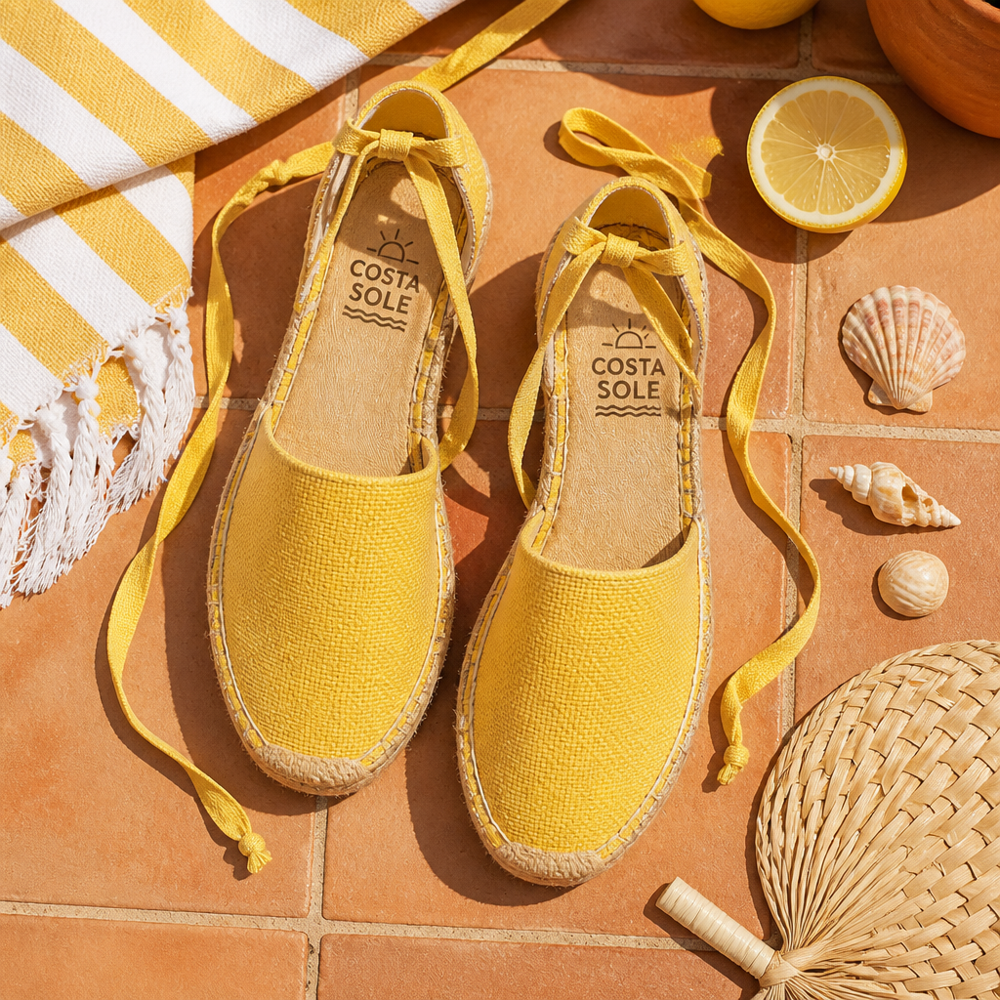

```text
Overhead flat-lay of a pair of woven canvas espadrilles in sunny lemon-yellow from the invented brand Costa Sole, laid on warm terracotta tiles to show the braided jute midsole and lace-up ankle ties. Styled with a folded striped beach towel, a halved lemon, small seashells and a woven fan. Bright hard Mediterranean sun from the upper left casts crisp shadows. Palette of lemon-yellow, terracotta and natural jute. Top-down 90-degree angle, breezy summer holiday footwear mood, warm and playful.
```

[Original source](https://github.com/apimodels/gpt-image-2-prompts/blob/980d100f3bd0f2cde4cf38835daeb742bf1cac65/prompts.json#product-258) · Model: GPT Image 2 · Credit: APIModels · CC BY 4.0
ProjectD: published-accepted (run42069117745). Complete source prompt and uncropped native preview correspond; generation defects and actual dimensions retained.

## Retro Runner Nostalgic Shot · product-259
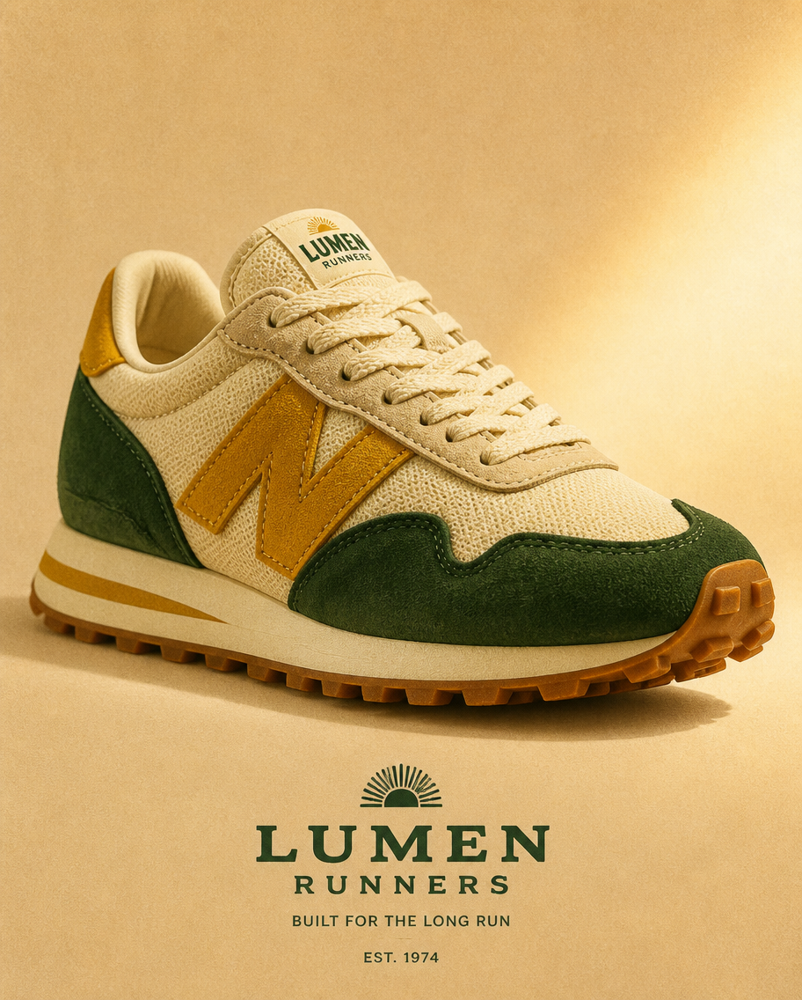

```text
A retro-inspired suede-and-mesh running shoe in cream, forest-green and mustard from the invented brand Lumen Runners, styled on a warm beige seamless backdrop with a soft vintage color grade. Gum outsole, suede overlays, a stitched N-style side panel and waffle tread sharply detailed. Warm nostalgic daylight from the right with soft grain and slight halation. Palette of cream, forest green and mustard. Eye-level three-quarter angle. Seventies-inspired heritage sneaker campaign mood, warm and analog with visible suede nap.
```

[Original source](https://github.com/apimodels/gpt-image-2-prompts/blob/980d100f3bd0f2cde4cf38835daeb742bf1cac65/prompts.json#product-259) · Model: GPT Image 2 · Credit: APIModels · CC BY 4.0
ProjectD: published-accepted (run42069117745). Source explicitly requests an N-style side panel; the original fictional-brand source rendition is retained.

## Rain Boot Playful Product · product-260
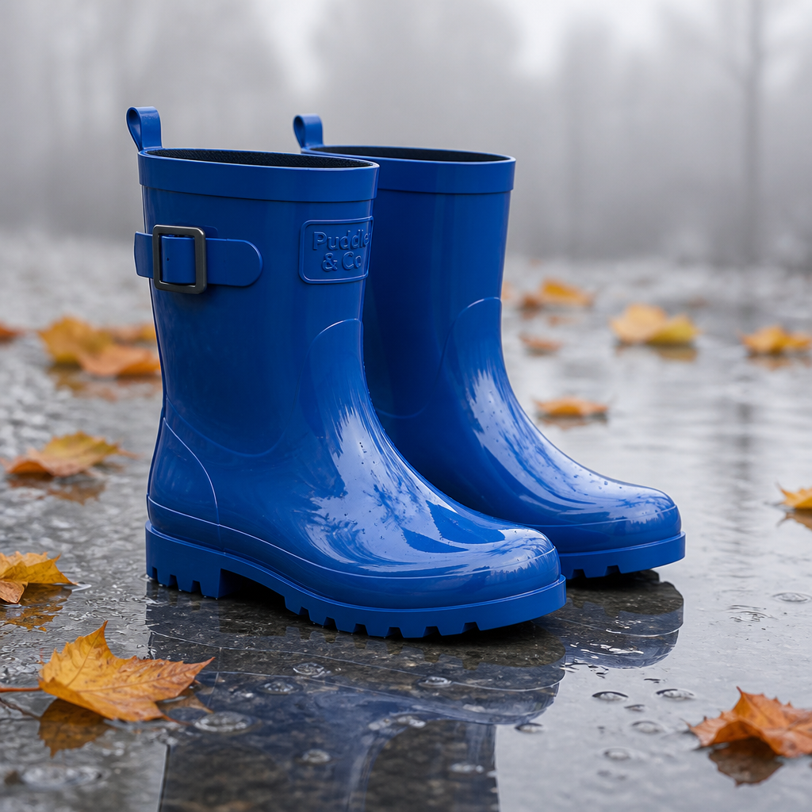

```text
A pair of glossy rubber rain boots in cheerful cobalt blue from the invented brand Puddle & Co, standing on a wet reflective grey surface with scattered water droplets and a few autumn leaves against a soft misty-grey backdrop. Matte buckle strap, chunky treaded sole and a subtle logo emboss sharply lit. Soft cool overcast light with reflections in the puddle below. Palette of cobalt, grey and amber leaf. Eye-level three-quarter angle. Fun functional rainy-day footwear product mood, fresh and lively.
```

[Original source](https://github.com/apimodels/gpt-image-2-prompts/blob/980d100f3bd0f2cde4cf38835daeb742bf1cac65/prompts.json#product-260) · Model: GPT Image 2 · Credit: APIModels · CC BY 4.0
ProjectD: published-accepted (run42069117745). Complete source prompt and uncropped native preview correspond; generation defects and actual dimensions retained.

## Structured Tote Bag Hero · product-261
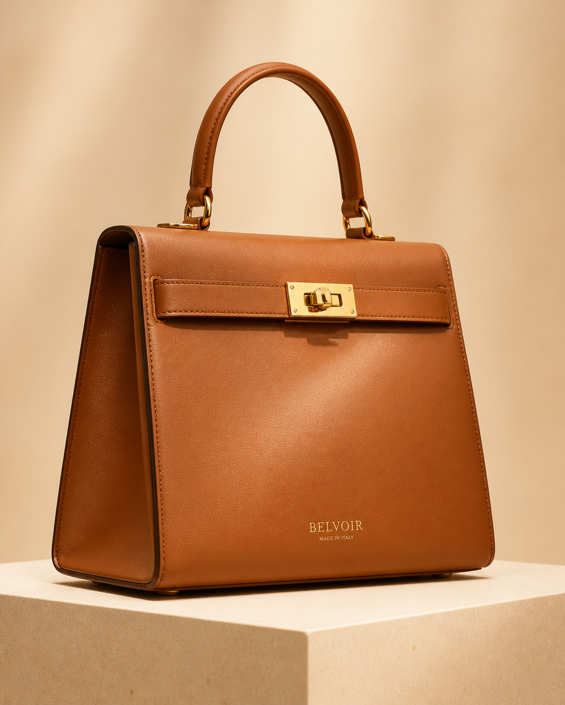

```text
A structured top-handle tote in smooth saddle-tan leather from the invented brand Belvoir, standing upright on a warm cream pedestal against a soft gradient beige backdrop. Crisp architectural lines, a polished gold twist-lock clasp and neat edge-painted seams sharply in focus. Soft even studio lighting with a gentle highlight tracing the front panel. Palette of saddle tan, cream and warm gold. Slight low three-quarter angle to emphasize the boxy silhouette. Refined luxury handbag e-commerce mood, clean and aspirational with visible leather grain.
```

[Original source](https://github.com/apimodels/gpt-image-2-prompts/blob/980d100f3bd0f2cde4cf38835daeb742bf1cac65/prompts.json#product-261) · Model: GPT Image 2 · Credit: APIModels · CC BY 4.0
ProjectD: published-accepted (run42069117745). Complete source prompt and uncropped native preview correspond; generation defects and actual dimensions retained.

## Mini Crossbody Flat-Lay · product-262
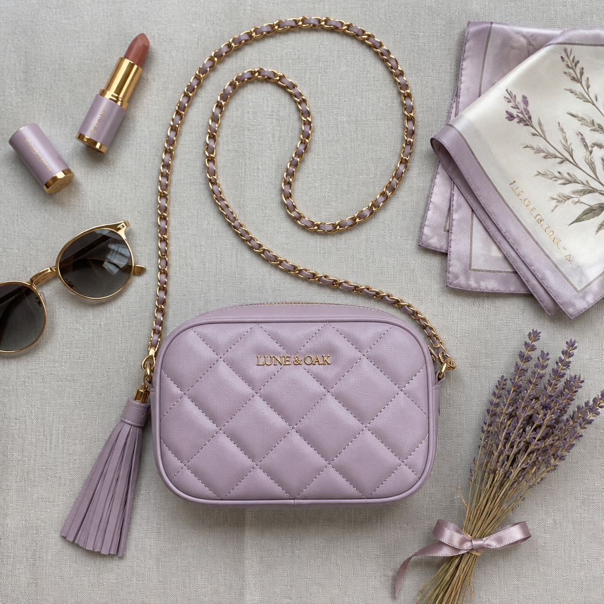

```text
Top-down flat-lay of a quilted mini crossbody bag in soft lilac lambskin from the invented brand Lune & Oak, with its slim chain strap arranged in a graceful loop. Styled on a pale grey linen surface with a tube of nude lipstick, gold-rimmed sunglasses, a folded silk pocket square and dried lavender. Soft diffused daylight from above for an even glow. Palette of lilac, grey and warm gold. Overhead 90-degree angle, feminine everyday-luxury accessory flat-lay mood, delicate and curated.
```

[Original source](https://github.com/apimodels/gpt-image-2-prompts/blob/980d100f3bd0f2cde4cf38835daeb742bf1cac65/prompts.json#product-262) · Model: GPT Image 2 · Credit: APIModels · CC BY 4.0
ProjectD: published-accepted (run42069117745). Complete source prompt and uncropped native preview correspond; generation defects and actual dimensions retained.

## Woven Straw Bag Summer · product-263
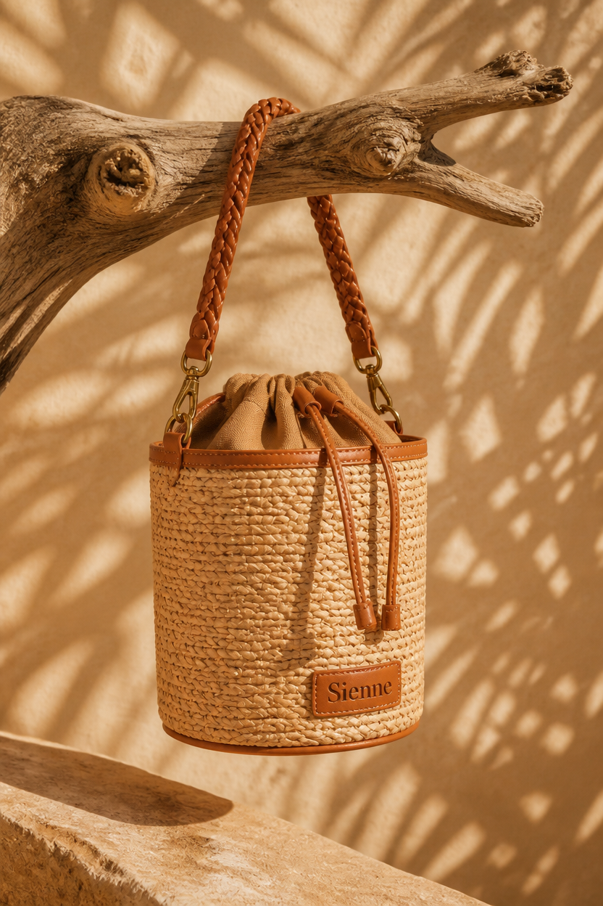

```text
A round woven straw bucket bag with tan leather trim from the invented brand Sienne, hanging from a piece of natural driftwood against a warm sandy-beige backdrop dappled with soft palm-leaf shadows. Tight basketweave texture, a drawstring top and a braided leather handle sharply detailed. Warm dappled sunlight creates gentle organic shadow patterns. Palette of natural straw, tan and warm sand. Eye-level three-quarter angle. Relaxed coastal resort accessory campaign mood, warm and textural with visible weave.
```

[Original source](https://github.com/apimodels/gpt-image-2-prompts/blob/980d100f3bd0f2cde4cf38835daeb742bf1cac65/prompts.json#product-263) · Model: GPT Image 2 · Credit: APIModels · CC BY 4.0
ProjectD: published-accepted (run42069117745). Complete source prompt and uncropped native preview correspond; generation defects and actual dimensions retained.

## Leather Belt Detail Product · product-264
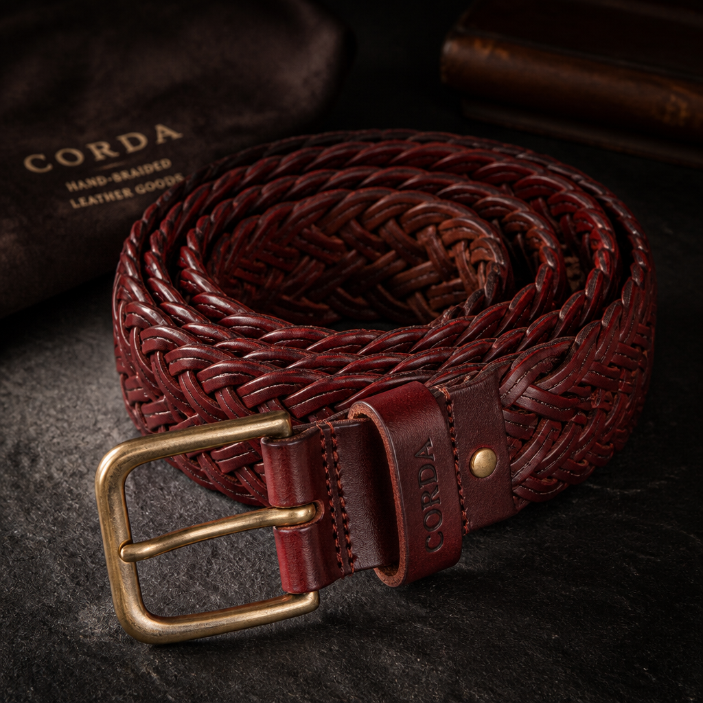

```text
A wide braided leather belt in deep oxblood from the invented brand Corda, coiled into an elegant spiral on a dark slate surface to showcase the intricate hand-braiding and an antique brass buckle. Set against a moody dark backdrop with a warm focused spotlight raking across the leather to reveal texture and sheen. Palette of oxblood, brass and charcoal. Slightly elevated angle looking down into the coil. Rich artisanal leather-goods product mood, warm and detailed with visible hand-craft texture.
```

[Original source](https://github.com/apimodels/gpt-image-2-prompts/blob/980d100f3bd0f2cde4cf38835daeb742bf1cac65/prompts.json#product-264) · Model: GPT Image 2 · Credit: APIModels · CC BY 4.0
ProjectD: published-accepted (run42069117745). Complete source prompt and uncropped native preview correspond; generation defects and actual dimensions retained.

## Silk Scarf Fluid Product · product-265
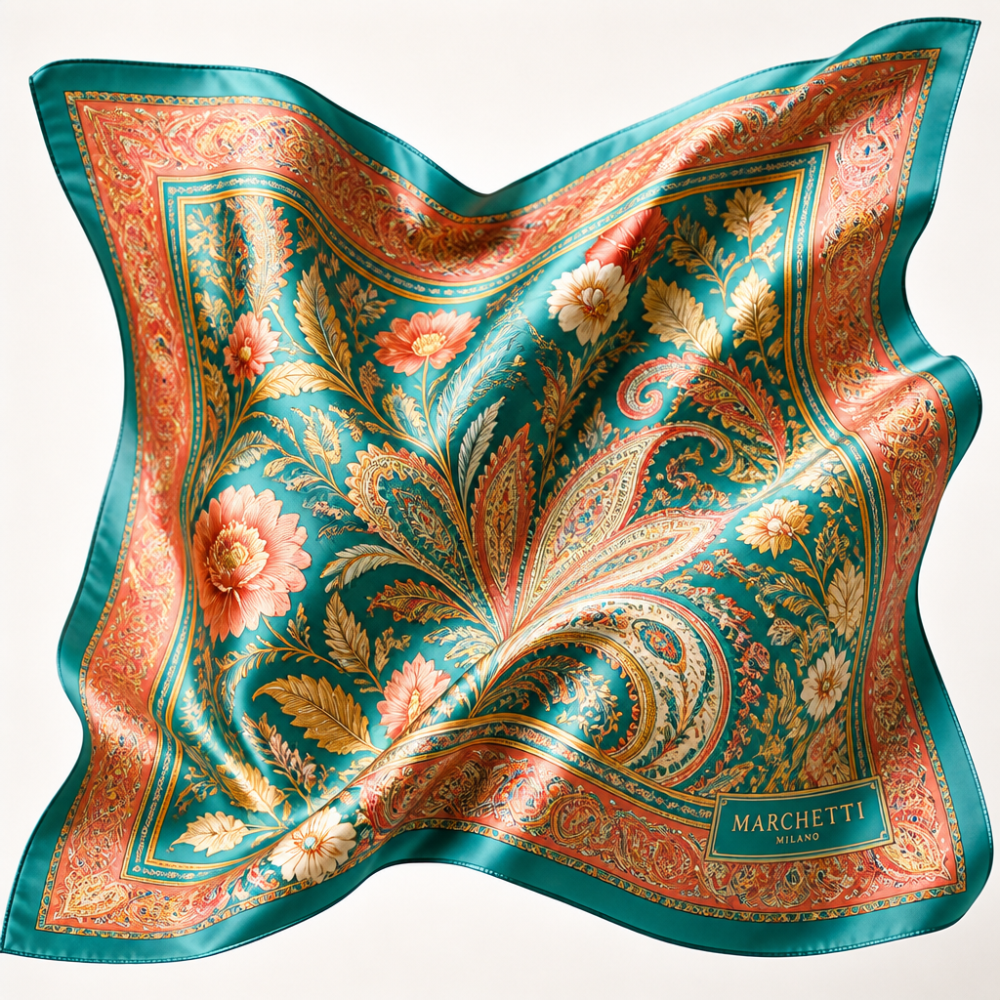

```text
A large square silk twill scarf with an ornate paisley-and-botanical print in teal, coral and gold from the invented brand Marchetti, captured mid-air billowing in a graceful fluid ripple against a clean warm-white backdrop. The lustrous twill catches soft studio light showing the vivid printed detail and rolled hem. Bright even lighting with a gentle sheen. Palette of teal, coral and gold. Straight-on camera angle capturing the fabric motion. Elegant luxury silk accessory campaign mood, vibrant and dynamic.
```

[Original source](https://github.com/apimodels/gpt-image-2-prompts/blob/980d100f3bd0f2cde4cf38835daeb742bf1cac65/prompts.json#product-265) · Model: GPT Image 2 · Credit: APIModels · CC BY 4.0
ProjectD: published-accepted (run42069117745). Complete source prompt and uncropped native preview correspond; generation defects and actual dimensions retained.

## Weekender Duffel Travel Shot · product-266
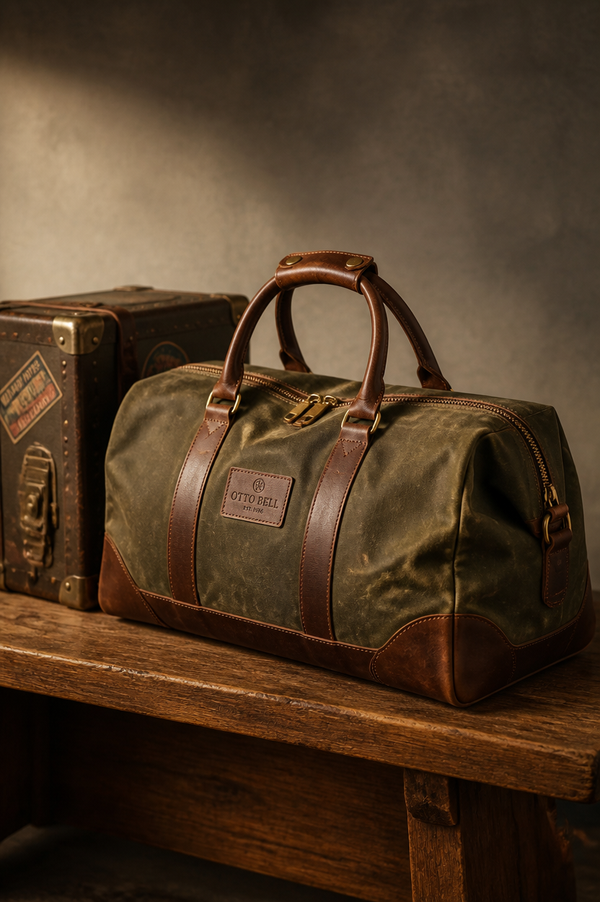

```text
A waxed-canvas and leather weekender duffel in olive-green and chestnut from the invented brand Otto Bell, positioned on a warm wooden bench beside a vintage brass-cornered suitcase against a soft warm-grey backdrop. Rolled leather handles, a brass zip pull and reinforced base corners sharply detailed. Warm directional light from the left evokes golden-hour travel. Palette of olive, chestnut and warm grey. Eye-level three-quarter angle. Aspirational heritage travel-goods campaign mood, rugged yet refined with visible waxed texture.
```

[Original source](https://github.com/apimodels/gpt-image-2-prompts/blob/980d100f3bd0f2cde4cf38835daeb742bf1cac65/prompts.json#product-266) · Model: GPT Image 2 · Credit: APIModels · CC BY 4.0
ProjectD: published-accepted (run42069117745). Complete source prompt and uncropped native preview correspond; generation defects and actual dimensions retained.

## Card Wallet Minimal Product · product-267
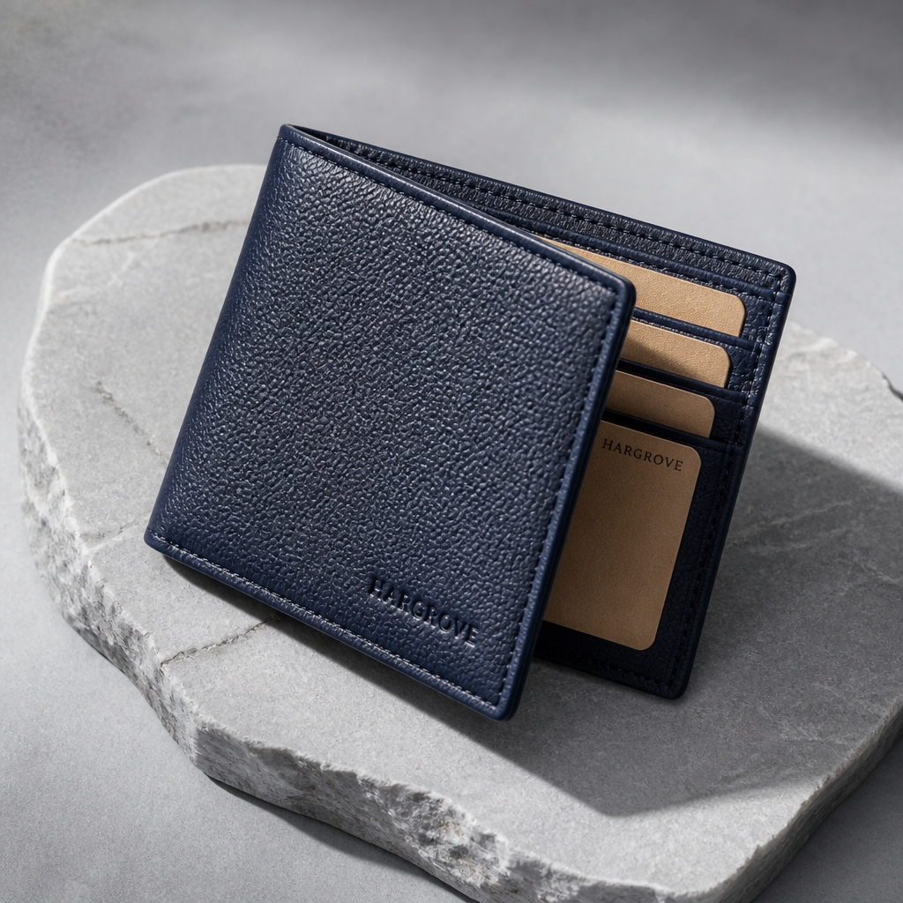

```text
A slim bifold card wallet in smooth pebbled navy leather from the invented brand Hargrove, shown slightly open to reveal three neat card slots and a couple of tan cards, resting on a pale grey stone slab. Set against a soft cool-grey backdrop with clean directional light from the upper right highlighting the fine pebble grain and edge stitching. Palette of navy, tan and cool grey. Slight three-quarter overhead angle. Sleek modern small-leather-goods product mood, minimal and precise with visible texture.
```

[Original source](https://github.com/apimodels/gpt-image-2-prompts/blob/980d100f3bd0f2cde4cf38835daeb742bf1cac65/prompts.json#product-267) · Model: GPT Image 2 · Credit: APIModels · CC BY 4.0
ProjectD: published-accepted (run42069117745). Complete source prompt and uncropped native preview correspond; generation defects and actual dimensions retained.

## Bucket Hat & Bag Set · product-268
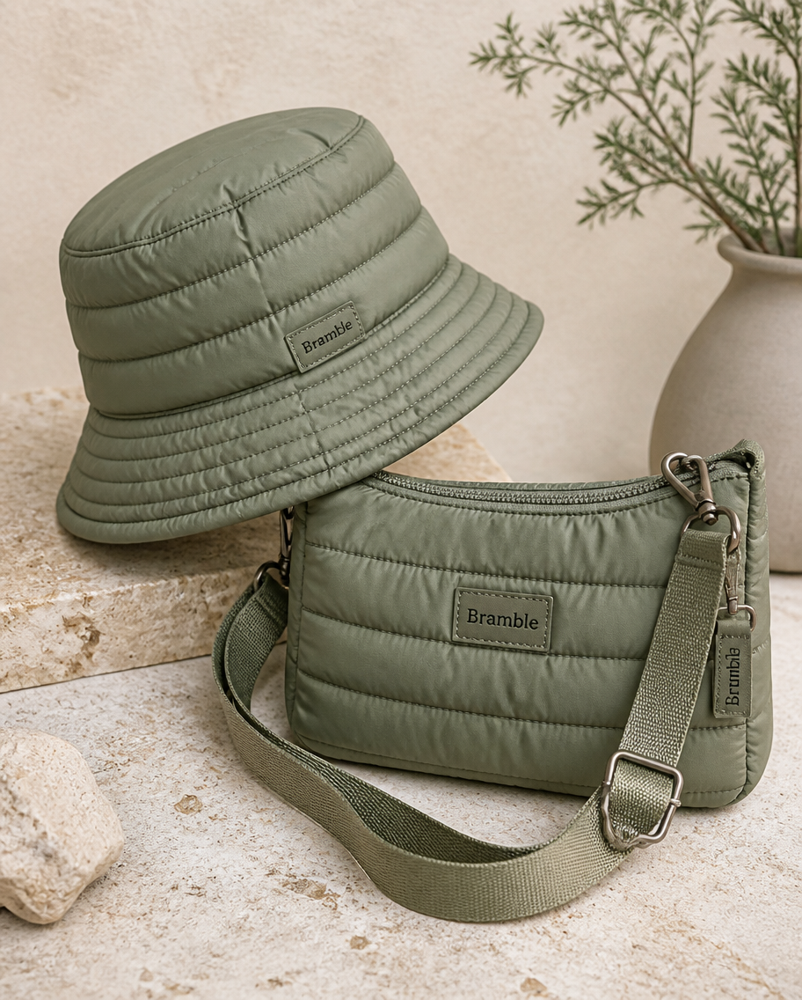

```text
A coordinated set of a quilted nylon bucket hat and matching mini shoulder bag in soft sage-green from the invented brand Bramble, arranged together on a natural travertine surface against a warm neutral backdrop. Puffy channel-quilting, tonal webbing straps and matte metal hardware sharply detailed. Soft even daylight from above for a clean modern look. Palette of sage-green, taupe and silver. Slightly elevated three-quarter angle. Contemporary lifestyle accessory campaign mood, coordinated and fresh with visible quilted texture.
```

[Original source](https://github.com/apimodels/gpt-image-2-prompts/blob/980d100f3bd0f2cde4cf38835daeb742bf1cac65/prompts.json#product-268) · Model: GPT Image 2 · Credit: APIModels · CC BY 4.0
ProjectD: published-accepted (run42069117745). Complete source prompt and uncropped native preview correspond; generation defects and actual dimensions retained.

## Evening Clutch Glamour Shot · product-269
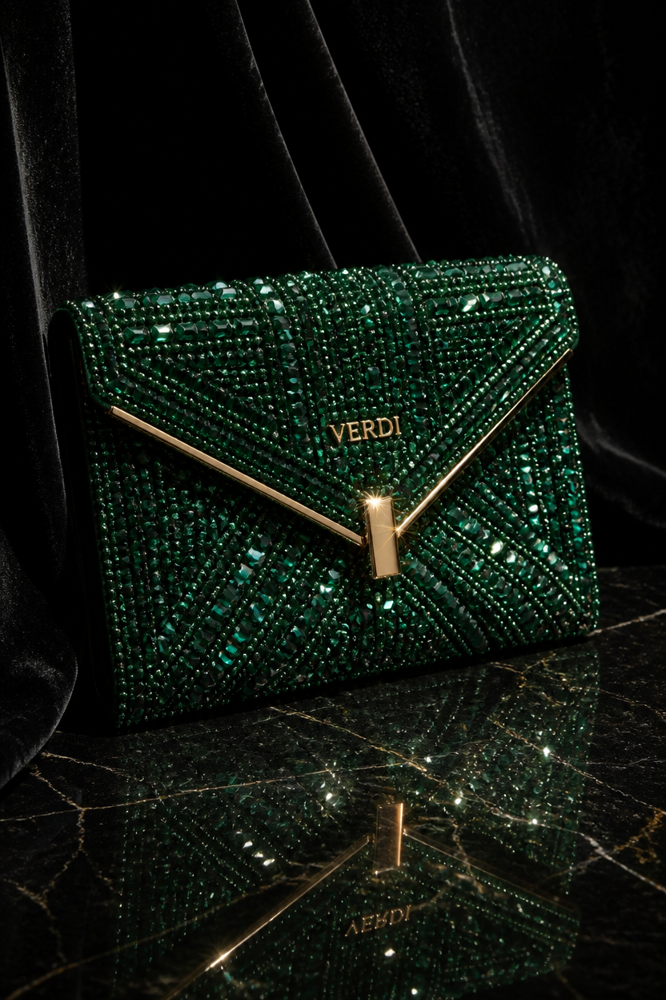

```text
A sleek envelope clutch covered in deep emerald crystal-cut beading from the invented brand Verdi, propped upright against a folded black velvet drape on a dark reflective surface. The faceted beads sparkle under a single dramatic spotlight, with a slim gold-tone snap closure catching a bright glint. Moody low-key lighting with rich reflections below. Palette of emerald, gold and black. Eye-level slightly angled camera. Opulent evening-wear accessory campaign mood, glamorous and sparkling with visible beadwork detail.
```

[Original source](https://github.com/apimodels/gpt-image-2-prompts/blob/980d100f3bd0f2cde4cf38835daeb742bf1cac65/prompts.json#product-269) · Model: GPT Image 2 · Credit: APIModels · CC BY 4.0
ProjectD: published-accepted (run42069117745). Complete source prompt and uncropped native preview correspond; generation defects and actual dimensions retained.

## Backpack Urban Commuter Shot · product-270
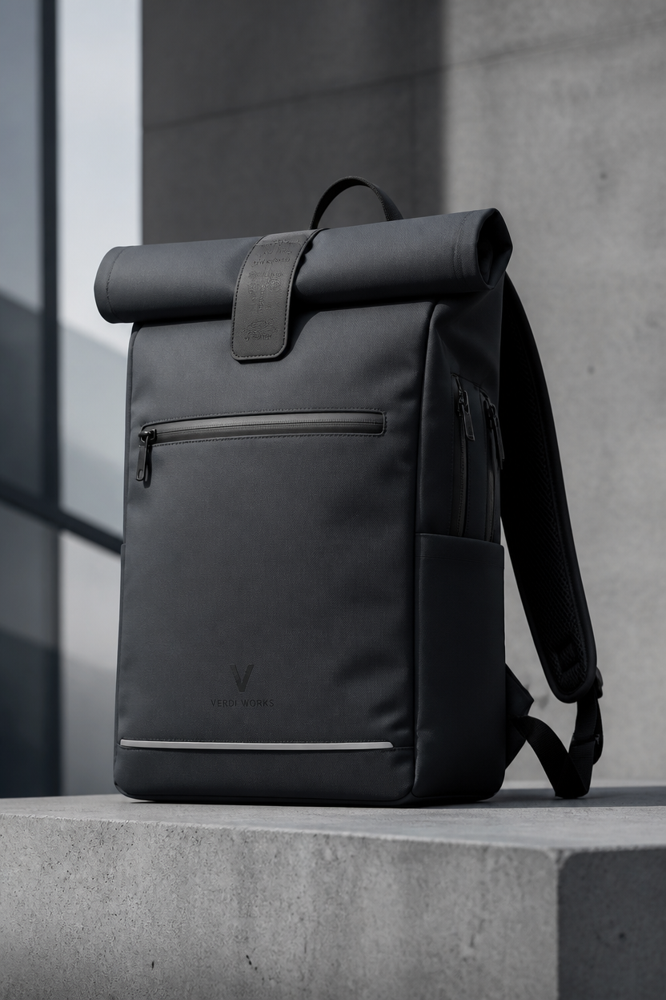

```text
A minimalist roll-top commuter backpack in matte graphite recycled nylon from the invented brand Verdi Works, standing on a raw concrete ledge against a soft cool-grey urban backdrop with subtle window-light gradients. Magnetic roll-top closure, tonal zippers, a padded laptop panel and a subtle reflective trim sharply detailed. Cool directional light from the left with clean shadows. Palette of graphite, cool grey and black. Slight low three-quarter angle. Sleek modern tech-forward accessory campaign mood, functional and premium with visible matte texture.
```

[Original source](https://github.com/apimodels/gpt-image-2-prompts/blob/980d100f3bd0f2cde4cf38835daeb742bf1cac65/prompts.json#product-270) · Model: GPT Image 2 · Credit: APIModels · CC BY 4.0
ProjectD: published-accepted (run42069117745). Complete source prompt and uncropped native preview correspond; generation defects and actual dimensions retained.

## Diamond Ring Macro Sparkle · product-271
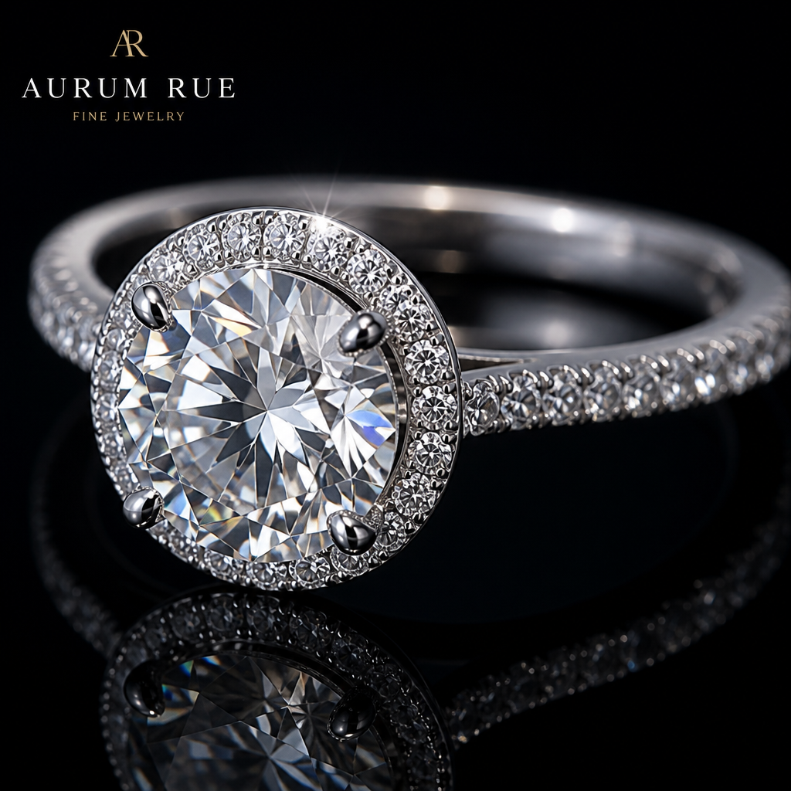

```text
An extreme macro product shot of a solitaire engagement ring from the invented brand Aurum Rue, a brilliant-cut lab diamond set in a slender platinum band with a delicate pave-set halo. The stone throws crisp rainbow fire under precise pinpoint studio lighting, resting on a black polished glass surface with a soft reflection. Deep dark backdrop for maximum sparkle contrast. Palette of icy white, platinum silver and black. Tight macro three-quarter angle. Ultra-luxurious fine-jewelry campaign mood, brilliant and precise.
```

[Original source](https://github.com/apimodels/gpt-image-2-prompts/blob/980d100f3bd0f2cde4cf38835daeb742bf1cac65/prompts.json#product-271) · Model: GPT Image 2 · Credit: APIModels · CC BY 4.0
ProjectD: published-accepted (run42069117745). Complete source prompt and uncropped native preview correspond; generation defects and actual dimensions retained.

## Gold Necklace Layered Flat-Lay · product-272
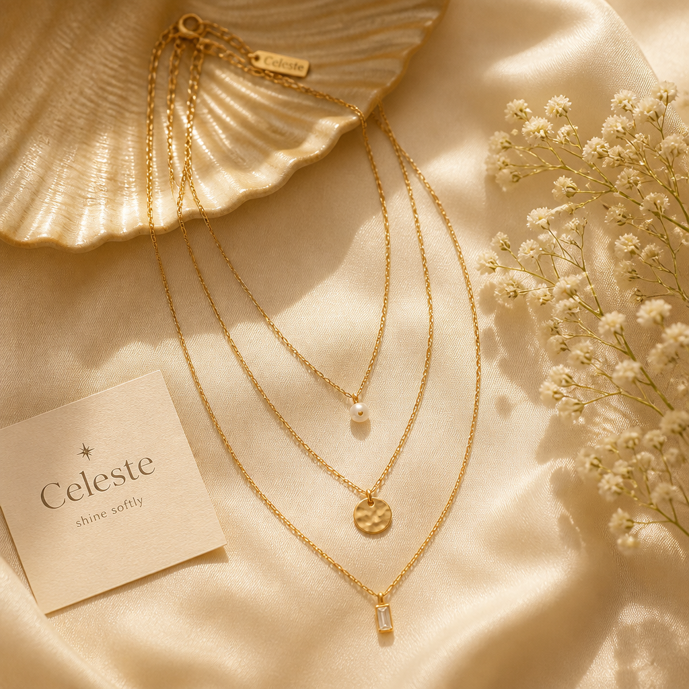

```text
Top-down flat-lay of three delicate layered gold chain necklaces from the invented brand Celeste, each a different length with a tiny pearl, a hammered disc and a baguette pendant, arranged in gentle overlapping arcs. Styled on a warm cream silk surface with a folded natural-shell dish and a sprig of baby's breath. Soft directional daylight from the upper right gives warm golden highlights. Palette of warm gold, cream and pearl. Overhead 90-degree angle, dainty everyday fine-jewelry flat-lay mood, delicate and warm.
```

[Original source](https://github.com/apimodels/gpt-image-2-prompts/blob/980d100f3bd0f2cde4cf38835daeb742bf1cac65/prompts.json#product-272) · Model: GPT Image 2 · Credit: APIModels · CC BY 4.0
ProjectD: published-accepted (run42069117745). Complete source prompt and uncropped native preview correspond; generation defects and actual dimensions retained.

## Emerald Earrings Luxe Product · product-273
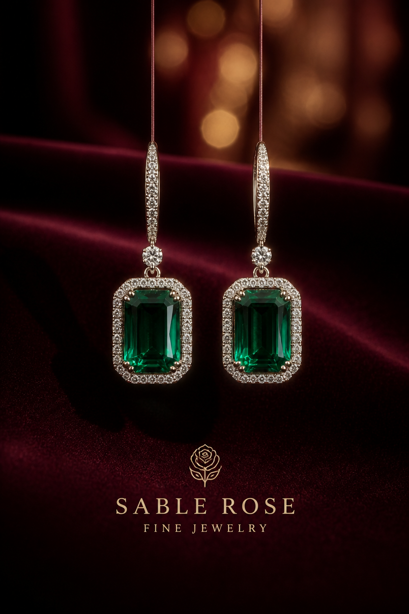

```text
A pair of drop earrings featuring emerald-cut green gemstones surrounded by pave diamonds from the invented brand Sable Rose, suspended from a fine thread against a rich burgundy velvet backdrop. The stones glow deep green under warm focused lighting with sparkling diamond accents. Soft shadow and a subtle bokeh halo behind. Palette of emerald green, diamond white and burgundy. Straight-on eye-level angle with the earrings gently swaying. Opulent high-jewelry campaign mood, jewel-toned and luminous with visible faceted detail.
```

[Original source](https://github.com/apimodels/gpt-image-2-prompts/blob/980d100f3bd0f2cde4cf38835daeb742bf1cac65/prompts.json#product-273) · Model: GPT Image 2 · Credit: APIModels · CC BY 4.0
ProjectD: published-accepted (run42069117745). Complete source prompt and uncropped native preview correspond; generation defects and actual dimensions retained.

## Silver Bracelet Stack Shot · product-274
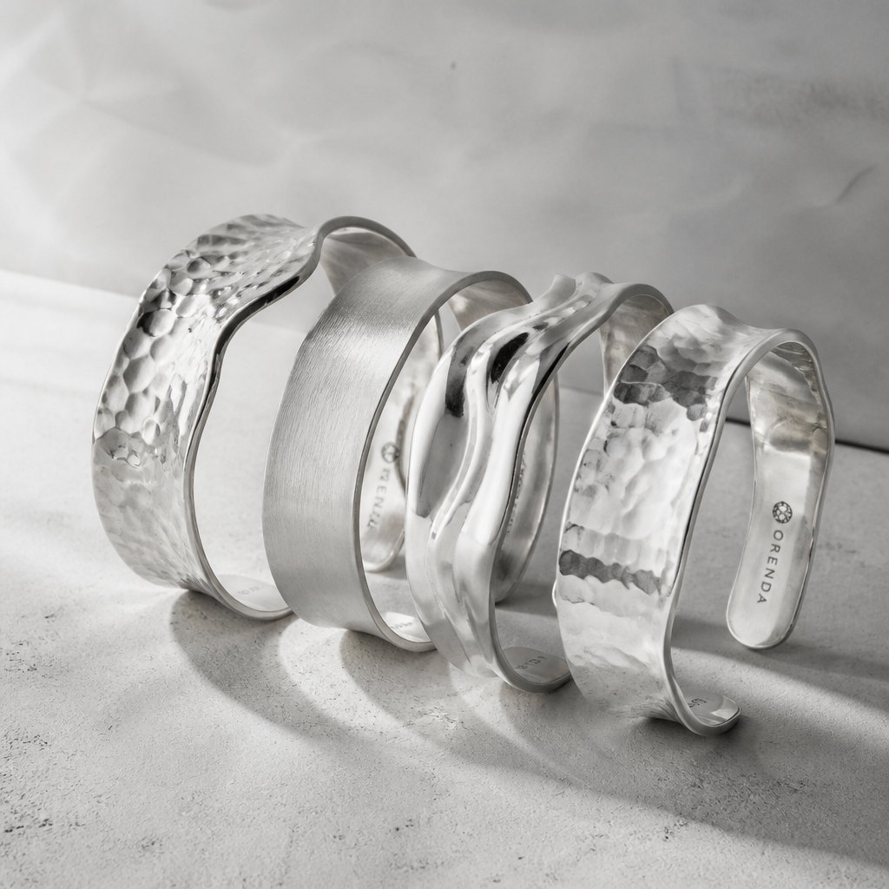

```text
A stack of sculptural sterling-silver cuff bracelets from the invented brand Orenda, arranged standing on their edges in a loose row on a pale grey concrete surface against a soft neutral backdrop. Brushed-matte and high-polish finishes contrast, with organic hammered textures catching cool light. Soft directional lighting from the left with clean reflections. Palette of silver, pale grey and white. Slightly elevated three-quarter angle. Modern minimalist artisanal jewelry campaign mood, sculptural and cool-toned with visible metal texture.
```

[Original source](https://github.com/apimodels/gpt-image-2-prompts/blob/980d100f3bd0f2cde4cf38835daeb742bf1cac65/prompts.json#product-274) · Model: GPT Image 2 · Credit: APIModels · CC BY 4.0
ProjectD: published-accepted (run42069117745). Complete source prompt and uncropped native preview correspond; generation defects and actual dimensions retained.

## Pearl Studs On Silk · product-275
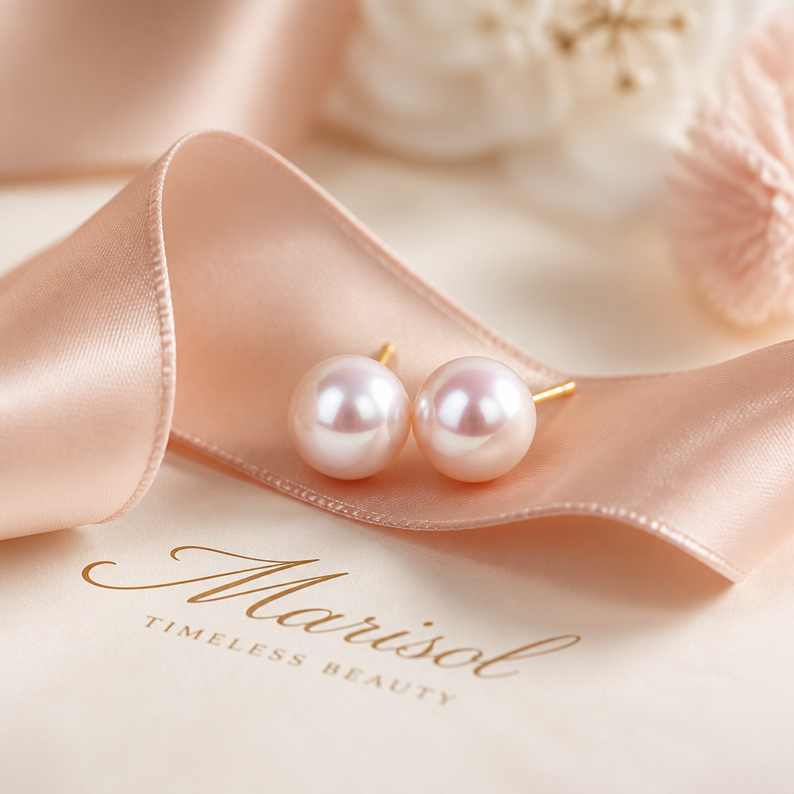

```text
A pair of classic freshwater pearl stud earrings from the invented brand Marisol, resting on a softly folded blush silk ribbon that swirls elegantly across a warm ivory backdrop. The lustrous pearls glow with a soft rosy iridescence under gentle diffused light, with tiny gold posts visible. Delicate soft shadows and a dreamy shallow focus. Palette of pearl white, blush and warm gold. Close-up slightly elevated angle. Timeless romantic bridal jewelry product mood, soft and luminous with visible pearl luster.
```

[Original source](https://github.com/apimodels/gpt-image-2-prompts/blob/980d100f3bd0f2cde4cf38835daeb742bf1cac65/prompts.json#product-275) · Model: GPT Image 2 · Credit: APIModels · CC BY 4.0
ProjectD: published-accepted (run42069117745). Complete source prompt and uncropped native preview correspond; generation defects and actual dimensions retained.

## Signet Ring Moody Product · product-276
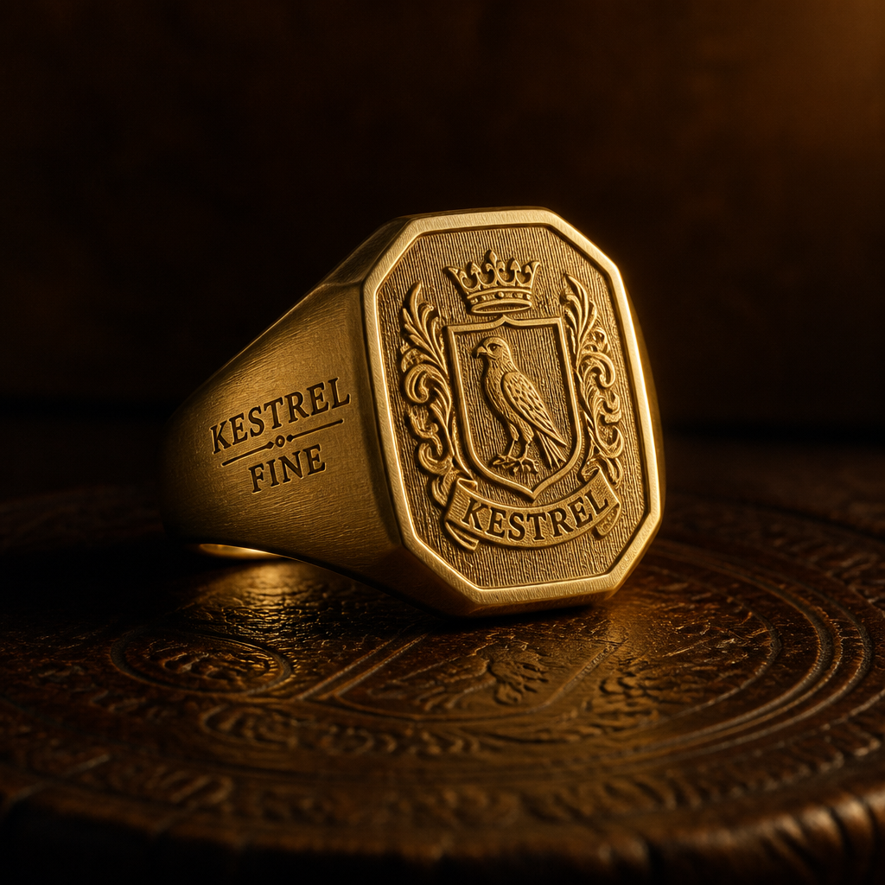

```text
A bold engraved signet ring in brushed yellow gold from the invented brand Kestrel Fine, standing upright on a dark textured leather surface with a carved crest face catching a warm rim of light. Set against a deep chocolate-brown backdrop with dramatic single-source lighting from the right revealing the engraving depth and matte-brushed finish. Palette of yellow gold, chocolate brown and amber. Tight low three-quarter angle. Masculine heritage fine-jewelry campaign mood, warm and weighty with visible engraved detail.
```

[Original source](https://github.com/apimodels/gpt-image-2-prompts/blob/980d100f3bd0f2cde4cf38835daeb742bf1cac65/prompts.json#product-276) · Model: GPT Image 2 · Credit: APIModels · CC BY 4.0
ProjectD: published-accepted (run42069117745). Complete source prompt and uncropped native preview correspond; generation defects and actual dimensions retained.

## Sapphire Pendant Hero Shot · product-277
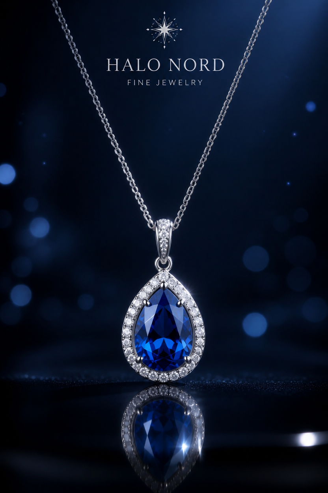

```text
A teardrop sapphire pendant on a fine white-gold chain from the invented brand Halo Nord, suspended and gently swaying against a smooth deep-navy gradient backdrop. The deep-blue faceted stone glows under a precise cool spotlight, ringed by tiny sparkling diamonds. Soft reflection on a black glass base below. Palette of sapphire blue, white gold and navy. Straight-on eye-level angle with subtle bokeh. Elegant celestial-themed fine-jewelry campaign mood, deep-toned and brilliant with visible facets.
```

[Original source](https://github.com/apimodels/gpt-image-2-prompts/blob/980d100f3bd0f2cde4cf38835daeb742bf1cac65/prompts.json#product-277) · Model: GPT Image 2 · Credit: APIModels · CC BY 4.0
ProjectD: published-accepted (run42069117745). Complete source prompt and uncropped native preview correspond; generation defects and actual dimensions retained.

## Anklet Beach Flat-Lay · product-278
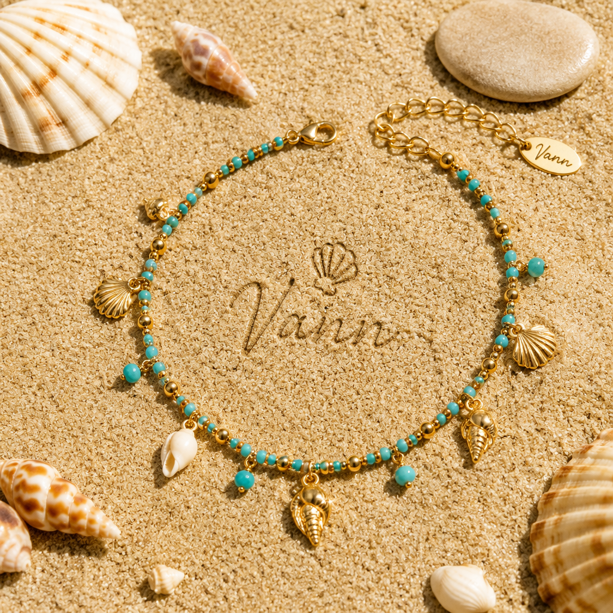

```text
Overhead flat-lay of a delicate beaded gold anklet with tiny turquoise and shell charms from the invented brand Vann, arranged in a loose curve on warm fine beach sand with a few real seashells and a smooth pebble. Bright natural sunlight from the upper left casts crisp small shadows and glints off the gold. Palette of warm gold, turquoise and sandy beige. Top-down 90-degree angle, breezy summer boho jewelry flat-lay mood, sun-kissed and playful with visible bead detail.
```

[Original source](https://github.com/apimodels/gpt-image-2-prompts/blob/980d100f3bd0f2cde4cf38835daeb742bf1cac65/prompts.json#product-278) · Model: GPT Image 2 · Credit: APIModels · CC BY 4.0
ProjectD: published-accepted (run42069117745). Complete source prompt and uncropped native preview correspond; generation defects and actual dimensions retained.

## Brooch Vintage Product Shot · product-279
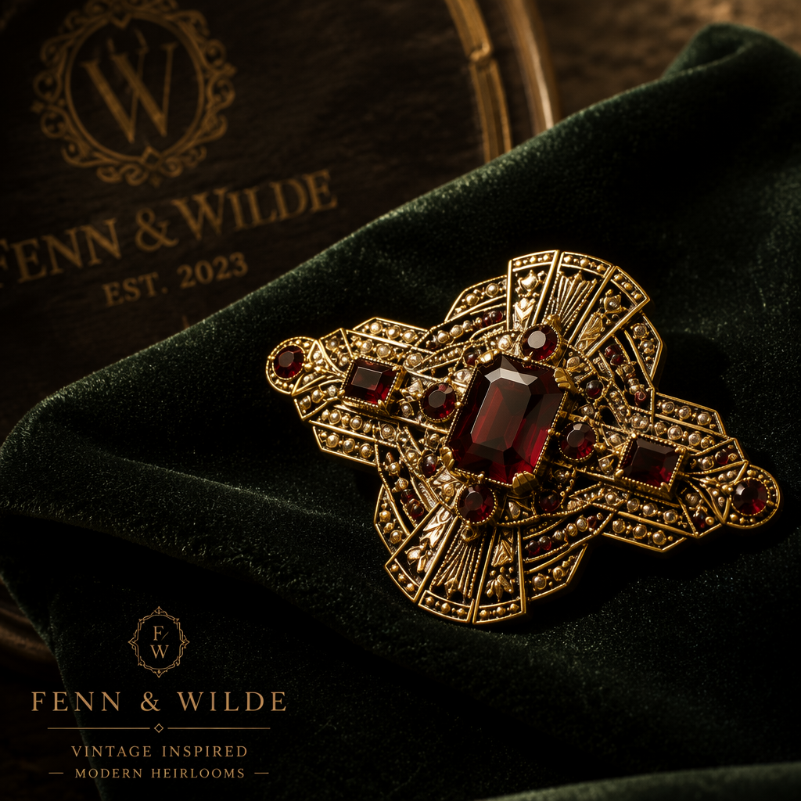

```text
An ornate art-deco-inspired brooch in antique gold with deep-red garnet stones and milgrain detailing from the invented brand Fenn & Wilde, pinned to a folded piece of dark forest-green velvet against a moody backdrop. Warm focused lighting rakes across to reveal the intricate metalwork and stone glow. Soft dramatic shadow. Palette of antique gold, garnet red and forest green. Close-up slightly angled camera. Nostalgic vintage-inspired fine-jewelry campaign mood, ornate and warm with visible engraved detail.
```

[Original source](https://github.com/apimodels/gpt-image-2-prompts/blob/980d100f3bd0f2cde4cf38835daeb742bf1cac65/prompts.json#product-279) · Model: GPT Image 2 · Credit: APIModels · CC BY 4.0
ProjectD: published-accepted (run42069117745). Complete source prompt and uncropped native preview correspond; generation defects and actual dimensions retained.

## Chunky Chain Necklace Bold · product-280
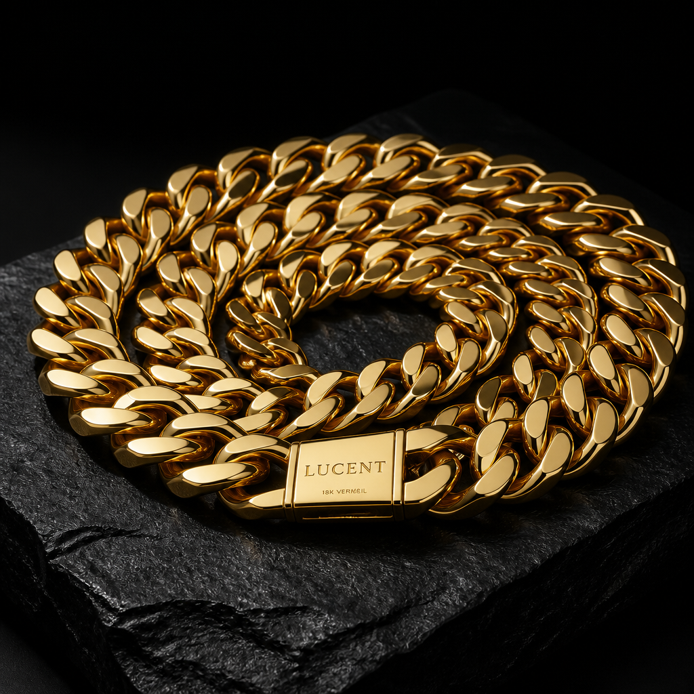

```text
A bold chunky curb-chain necklace in high-polish gold vermeil from the invented brand Lucent, coiled into a confident sculptural pile on a matte black stone slab against a stark dark backdrop. The heavy interlocking links throw crisp specular highlights under a single hard spotlight, showing weight and shine. Deep shadow for contrast. Palette of bright gold, black and warm reflection. Slightly elevated three-quarter angle looking into the coil. Edgy statement-jewelry campaign mood, bold and glossy with visible link detail.
```

[Original source](https://github.com/apimodels/gpt-image-2-prompts/blob/980d100f3bd0f2cde4cf38835daeb742bf1cac65/prompts.json#product-280) · Model: GPT Image 2 · Credit: APIModels · CC BY 4.0
ProjectD: published-accepted (run42069117745). Complete source prompt and uncropped native preview correspond; generation defects and actual dimensions retained.

## Dive Watch Underwater Feel · product-281
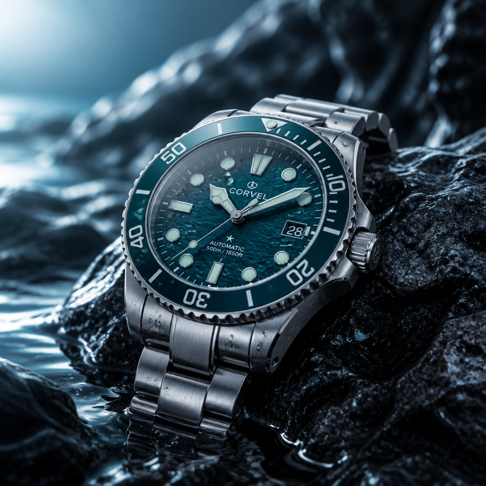

```text
A rugged automatic dive watch with a deep-teal dial and rotating ceramic bezel from the invented brand Corvel, resting at an angle on wet dark basalt rock with a few water droplets beading on the sapphire crystal. Brushed-steel case, luminous markers glowing faintly and a solid link bracelet sharply detailed. Cool directional light from the upper left with crisp reflections in the water. Palette of deep teal, steel and cool blue. Tight low three-quarter angle. Adventurous sport-watch campaign mood, precise and rugged with visible texture.
```

[Original source](https://github.com/apimodels/gpt-image-2-prompts/blob/980d100f3bd0f2cde4cf38835daeb742bf1cac65/prompts.json#product-281) · Model: GPT Image 2 · Credit: APIModels · CC BY 4.0
ProjectD: published-accepted (run42069117745). Generated dive-watch design; water-resistance and mechanical capability are not independently verified.

## Dress Watch Elegant Product · product-282
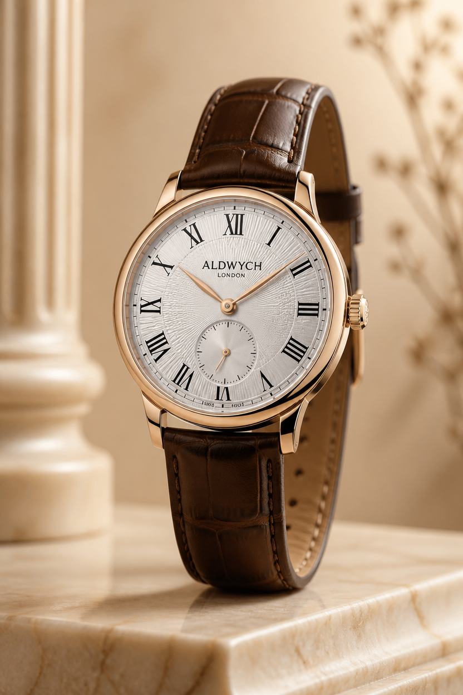

```text
An ultra-thin dress watch with a silver-white guilloche dial, slim Roman numerals and a rich brown alligator-grain leather strap from the invented brand Aldwych, standing upright on a warm cream marble ledge against a soft champagne backdrop. Polished rose-gold case and domed crystal catch a gentle highlight. Soft elegant lighting from the front right with delicate shadow. Palette of silver-white, rose gold and warm brown. Eye-level three-quarter angle. Refined classic haute-horlogerie campaign mood, elegant and precise with visible dial texture.
```

[Original source](https://github.com/apimodels/gpt-image-2-prompts/blob/980d100f3bd0f2cde4cf38835daeb742bf1cac65/prompts.json#product-282) · Model: GPT Image 2 · Credit: APIModels · CC BY 4.0
ProjectD: published-accepted (run42069117745). Generated watch concept; dial/branding and material wording are illustrative.

## Chronograph Watch Macro Shot · product-283
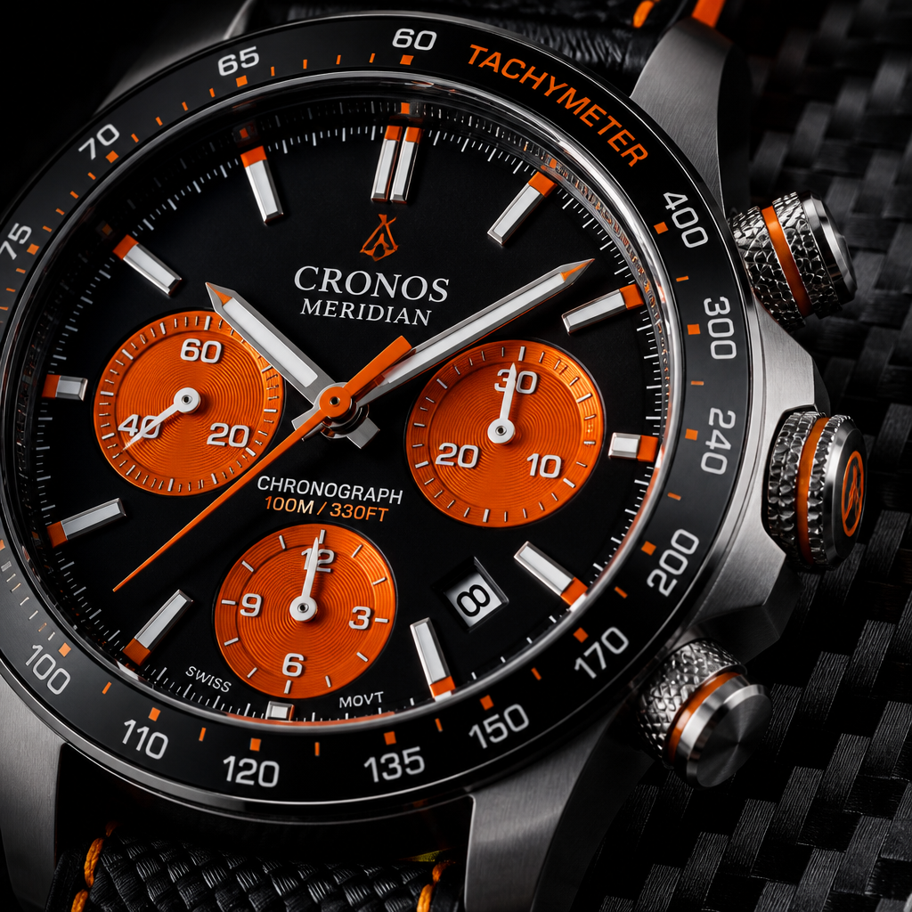

```text
An extreme macro shot of a motorsport chronograph with a matte-black dial, three orange sub-dials and a tachymeter bezel from the invented brand Cronos Meridian, resting on brushed carbon-fibre texture. Crisp printed markings, orange-tipped hands and knurled steel pushers glow under precise directional lighting. Deep dark backdrop with sharp specular highlights. Palette of matte black, orange and steel. Tight overhead-angled macro view. High-performance sport-watch campaign mood, technical and bold with ultra-sharp detail.
```

[Original source](https://github.com/apimodels/gpt-image-2-prompts/blob/980d100f3bd0f2cde4cf38835daeb742bf1cac65/prompts.json#product-283) · Model: GPT Image 2 · Credit: APIModels · CC BY 4.0
ProjectD: published-accepted (run42069117745). Generated chronograph dial; small printed markings and measurement precision are not validated.

## Minimalist Watch Flat-Lay · product-284
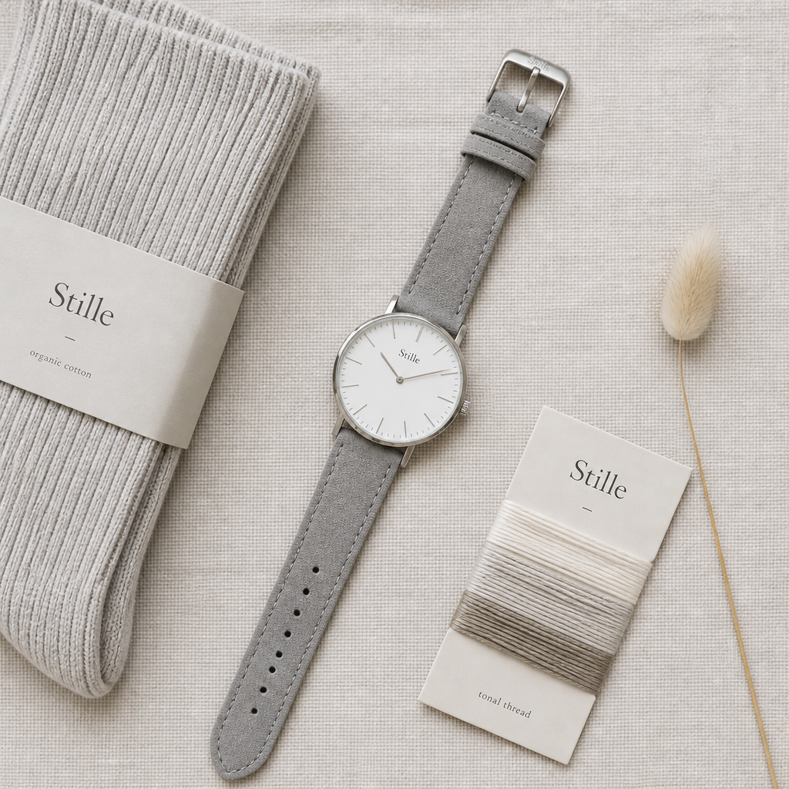

```text
Top-down flat-lay of a clean minimalist watch with a plain white dial, thin baton hands and a soft grey vegan-suede strap from the invented brand Stille, arranged diagonally on a pale oat linen surface. Styled with a folded ribbed sock, a card of tonal thread and a single dried grass stem. Soft even daylight from above gives a calm Scandinavian feel. Palette of white, soft grey and oat. Overhead 90-degree angle, understated everyday-minimalist accessory flat-lay mood, quiet and clean.
```

[Original source](https://github.com/apimodels/gpt-image-2-prompts/blob/980d100f3bd0f2cde4cf38835daeb742bf1cac65/prompts.json#product-284) · Model: GPT Image 2 · Credit: APIModels · CC BY 4.0
ProjectD: published-accepted (run42069117745). Complete source prompt and uncropped native preview correspond; generation defects and actual dimensions retained.

## Skeleton Watch Dramatic Shot · product-285
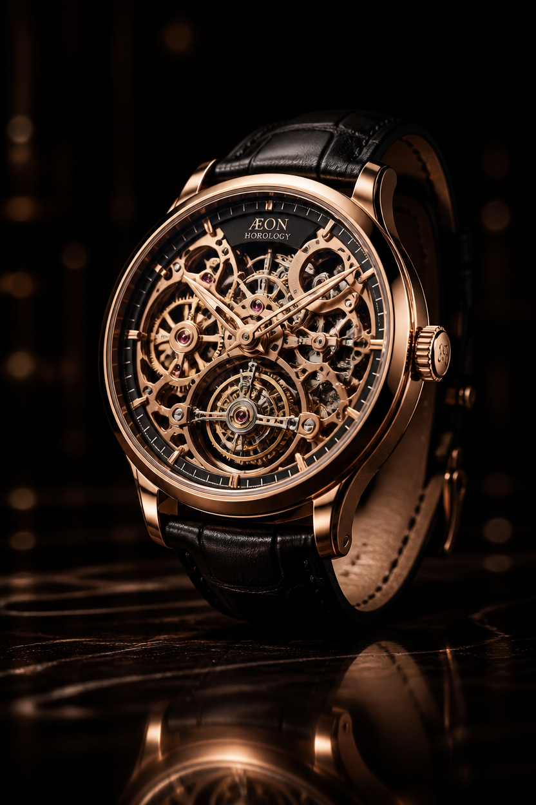

```text
A luxury open-worked skeleton mechanical watch revealing intricate gears and a visible balance wheel from the invented brand Aeon Horology, standing upright on a dark polished-ebony surface against a moody near-black backdrop. Warm rose-gold movement components glow under a precise focused spotlight, exposed through the sapphire crystal. Deep dramatic shadows with a soft reflection. Palette of rose gold, ebony black and warm amber. Tight low three-quarter angle. Opulent haute-horlogerie campaign mood, mechanical and mesmerizing with ultra-fine detail.
```

[Original source](https://github.com/apimodels/gpt-image-2-prompts/blob/980d100f3bd0f2cde4cf38835daeb742bf1cac65/prompts.json#product-285) · Model: GPT Image 2 · Credit: APIModels · CC BY 4.0
ProjectD: published-accepted (run42069117745). Skeleton-watch design image; visible gears do not establish a working movement.

## Smartwatch Lifestyle Product · product-286
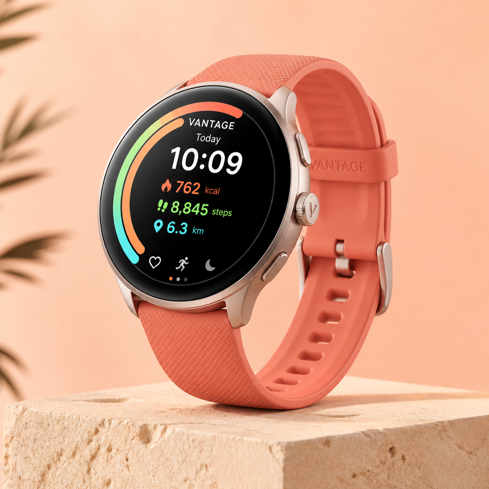

```text
A modern smartwatch with a vibrant AMOLED activity display and a soft coral silicone sport band from the invented brand Vantage, standing on a pale sandstone block against a warm minimal peach backdrop. The rounded aluminium case, glowing screen showing an abstract fitness ring interface and textured band are crisply detailed. Soft bright even lighting for a clean tech look. Palette of coral, sandstone and soft peach. Slight low three-quarter angle. Fresh wellness-tech campaign mood, bright and modern with visible screen glow.
```

[Original source](https://github.com/apimodels/gpt-image-2-prompts/blob/980d100f3bd0f2cde4cf38835daeb742bf1cac65/prompts.json#product-286) · Model: GPT Image 2 · Credit: APIModels · CC BY 4.0
ProjectD: published-accepted (run42069117745). Generated fitness-screen measurements are illustrative UI values, not actual personal health data.

## Field Watch Rugged Flat-Lay · product-287
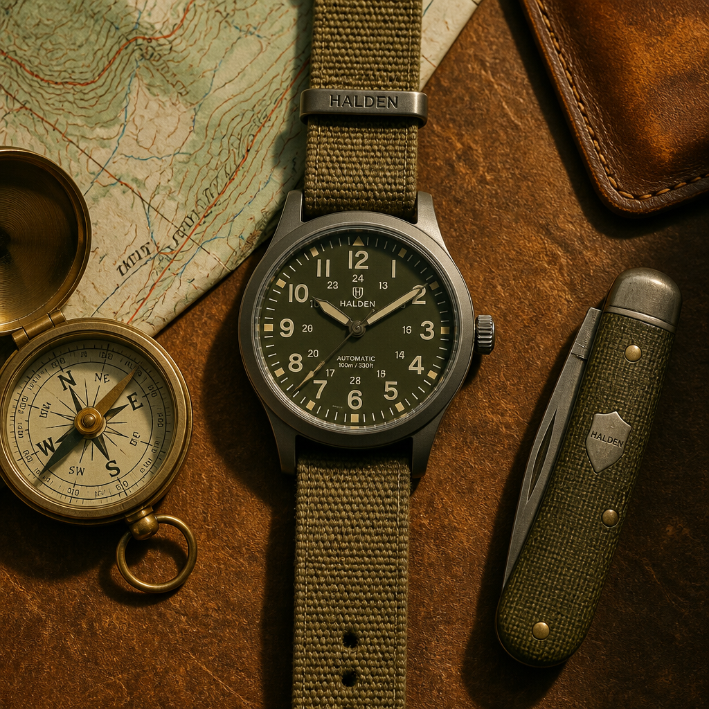

```text
Top-down flat-lay of a rugged field watch with an olive-green dial, high-contrast numerals and a khaki canvas strap from the invented brand Halden, arranged on a worn tan leather surface with a folded topographic map, a brass compass and a small pocketknife. Warm directional light from the right casts crisp shadows and reveals the matte case texture. Palette of olive green, khaki and warm tan. Overhead 90-degree angle, adventurous outdoor heritage-watch flat-lay mood, rugged and utilitarian with visible texture.
```

[Original source](https://github.com/apimodels/gpt-image-2-prompts/blob/980d100f3bd0f2cde4cf38835daeb742bf1cac65/prompts.json#product-287) · Model: GPT Image 2 · Credit: APIModels · CC BY 4.0
ProjectD: published-accepted (run42069117745). Topographic-map background is source decoration, not a verified navigation chart.

## Rose-Gold Watch Feminine Shot · product-288
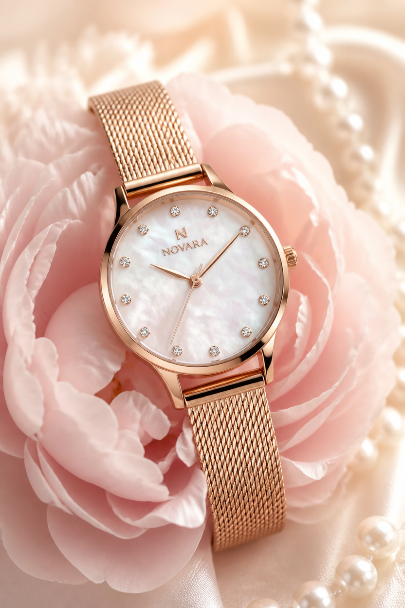

```text
A delicate slim women's watch with a mother-of-pearl dial, tiny crystal hour markers and a fine mesh rose-gold bracelet from the invented brand Novara, resting on a soft blush peony bloom against a warm ivory backdrop. The iridescent dial and polished case catch soft glamorous light with a gentle shimmer. Soft diffused lighting and dreamy shallow focus. Palette of rose gold, pearl white and blush. Close-up slightly elevated angle. Elegant feminine luxury-watch campaign mood, soft and radiant with visible dial luster.
```

[Original source](https://github.com/apimodels/gpt-image-2-prompts/blob/980d100f3bd0f2cde4cf38835daeb742bf1cac65/prompts.json#product-288) · Model: GPT Image 2 · Credit: APIModels · CC BY 4.0
ProjectD: published-accepted (run42069117745). Complete source prompt and uncropped native preview correspond; generation defects and actual dimensions retained.

## Aviator Sunglasses Hero Shot · product-289
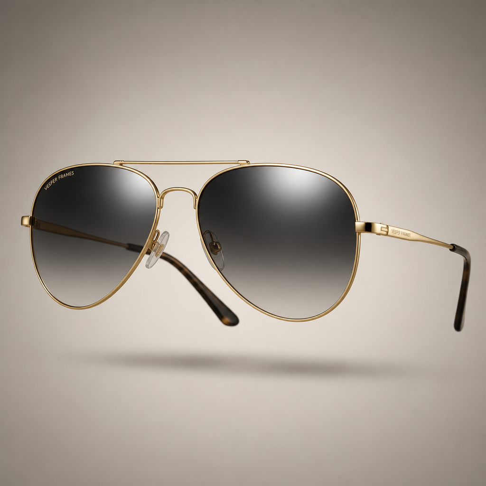

```text
A pair of classic aviator sunglasses with a thin gold metal frame and gradient smoke-grey lenses from the invented brand Vesper Frames, floating slightly above a soft warm-grey gradient backdrop with a subtle contact shadow. The teardrop lenses catch a clean specular highlight and the double-bridge and slim temples are sharply detailed. Bright even studio lighting with crisp reflections. Palette of gold, smoke grey and warm neutral. Slight three-quarter front angle. Timeless premium eyewear e-commerce mood, sleek and clean with visible lens gradient.
```

[Original source](https://github.com/apimodels/gpt-image-2-prompts/blob/980d100f3bd0f2cde4cf38835daeb742bf1cac65/prompts.json#product-289) · Model: GPT Image 2 · Credit: APIModels · CC BY 4.0
ProjectD: published-accepted (run42069117745). Complete source prompt and uncropped native preview correspond; generation defects and actual dimensions retained.

## Cat-Eye Sunglasses Flat-Lay · product-290
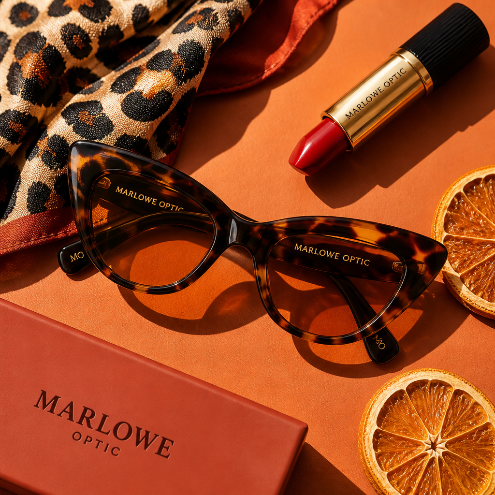

```text
Top-down flat-lay of bold cat-eye sunglasses with a glossy tortoiseshell acetate frame and warm amber lenses from the invented brand Marlowe Optic, arranged diagonally on a warm terracotta surface. Styled with a folded leopard-print silk scarf, a tube of red lipstick and dried orange slices. Bright warm daylight from the upper left casts crisp shadows and glossy reflections. Palette of tortoiseshell brown, amber and terracotta. Overhead 90-degree angle, retro glamorous eyewear flat-lay mood, warm and stylish with visible acetate detail.
```

[Original source](https://github.com/apimodels/gpt-image-2-prompts/blob/980d100f3bd0f2cde4cf38835daeb742bf1cac65/prompts.json#product-290) · Model: GPT Image 2 · Credit: APIModels · CC BY 4.0
ProjectD: published-accepted (run42069117745). Complete source prompt and uncropped native preview correspond; generation defects and actual dimensions retained.

## Sport Sunglasses Dynamic Shot · product-291
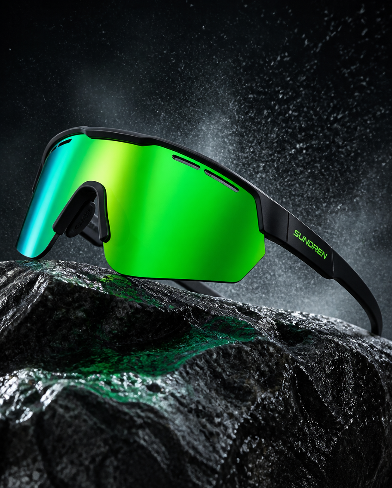

```text
A pair of wraparound sport sunglasses with a matte-black frame and mirrored volt-green shield lens from the invented brand Sundren, mounted at a dynamic angle on a rough grey stone with a light spray of water mist behind against a cool dark backdrop. The single mirrored lens throws a vivid iridescent sheen under hard directional light. Crisp reflections and energetic shadows. Palette of matte black, volt green and cool grey. Low three-quarter action angle. High-energy performance eyewear campaign mood, sleek and aggressive.
```

[Original source](https://github.com/apimodels/gpt-image-2-prompts/blob/980d100f3bd0f2cde4cf38835daeb742bf1cac65/prompts.json#product-291) · Model: GPT Image 2 · Credit: APIModels · CC BY 4.0
ProjectD: published-accepted (run42069117745). Complete source prompt and uncropped native preview correspond; generation defects and actual dimensions retained.

## Round Optical Glasses Product · product-292
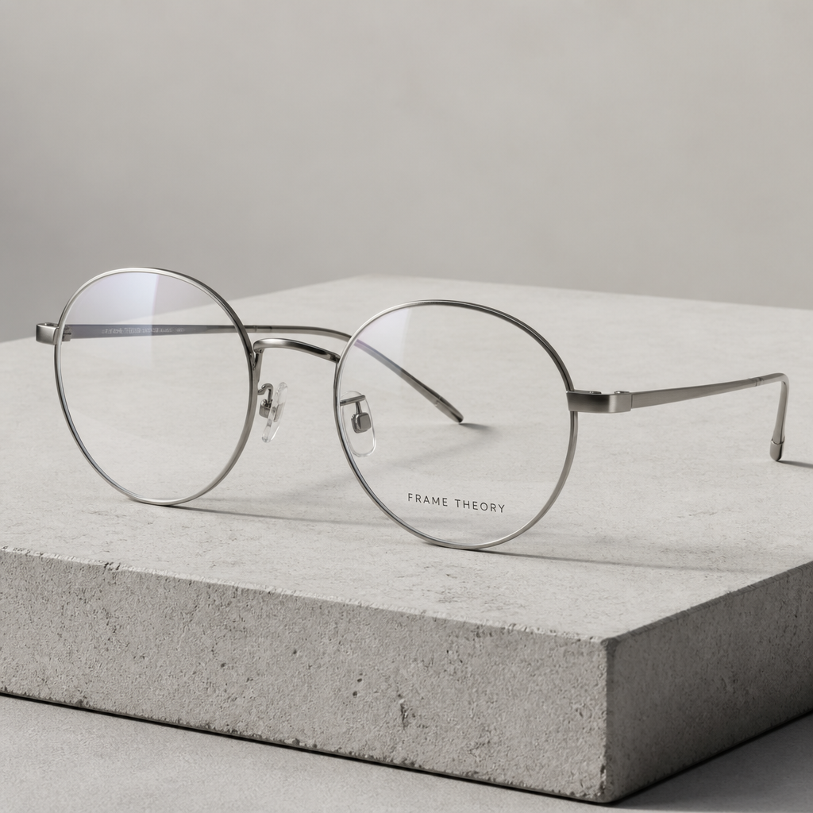

```text
A pair of slim round optical glasses with a thin brushed-titanium frame and clear anti-reflective lenses from the invented brand Frame Theory, standing open on a pale grey concrete block against a soft neutral backdrop. Delicate temple arms, adjustable nose pads and the subtle lens reflection are crisply detailed. Soft clean directional light from the left with gentle shadow. Palette of silver-grey, clear and soft neutral. Slight three-quarter angle. Modern minimalist eyewear campaign mood, refined and precise with visible thin-frame detail.
```

[Original source](https://github.com/apimodels/gpt-image-2-prompts/blob/980d100f3bd0f2cde4cf38835daeb742bf1cac65/prompts.json#product-292) · Model: GPT Image 2 · Credit: APIModels · CC BY 4.0
ProjectD: published-accepted (run42069117745). Complete source prompt and uncropped native preview correspond; generation defects and actual dimensions retained.

## Oversized Sunglasses Luxe Shot · product-293
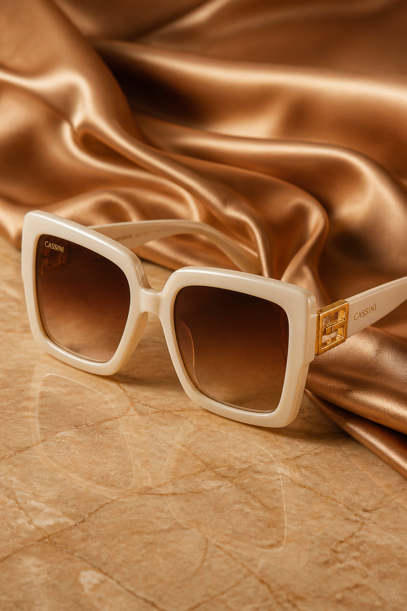

```text
A pair of oversized square sunglasses with a glossy cream acetate frame and gradient brown lenses from the invented brand Cassini, propped elegantly against a folded caramel silk drape on a warm marble surface. The polished frame and gold-tone hinge detail catch soft glamorous light with a gentle sheen. Warm diffused lighting with soft shadow. Palette of cream, caramel and gold. Eye-level slightly angled camera. Chic luxury eyewear campaign mood, warm and sophisticated with visible glossy acetate.
```

[Original source](https://github.com/apimodels/gpt-image-2-prompts/blob/980d100f3bd0f2cde4cf38835daeb742bf1cac65/prompts.json#product-293) · Model: GPT Image 2 · Credit: APIModels · CC BY 4.0
ProjectD: published-accepted (run42069117745). Complete source prompt and uncropped native preview correspond; generation defects and actual dimensions retained.

## Clip-On Shades Flat-Lay · product-294
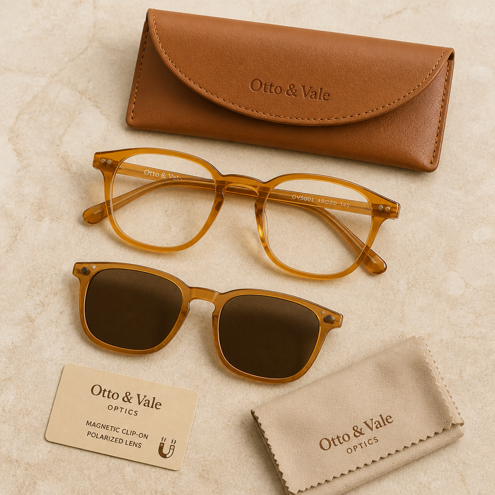

```text
Top-down flat-lay of a modern optical frame in translucent honey acetate with a magnetic clip-on polarized sunglass lens from the invented brand Otto & Vale, shown with the clip lifted slightly beside the frame on a pale sand backdrop. A folded microfibre cloth and a slim leather case complete the set. Soft even daylight from above with subtle translucency glow. Palette of honey, amber and pale sand. Overhead 90-degree angle, clever functional eyewear flat-lay mood, clean and modern with visible translucent detail.
```

[Original source](https://github.com/apimodels/gpt-image-2-prompts/blob/980d100f3bd0f2cde4cf38835daeb742bf1cac65/prompts.json#product-294) · Model: GPT Image 2 · Credit: APIModels · CC BY 4.0
ProjectD: published-accepted (run42069117745). Complete source prompt and uncropped native preview correspond; generation defects and actual dimensions retained.

## Blue-Light Glasses Desk Shot · product-295
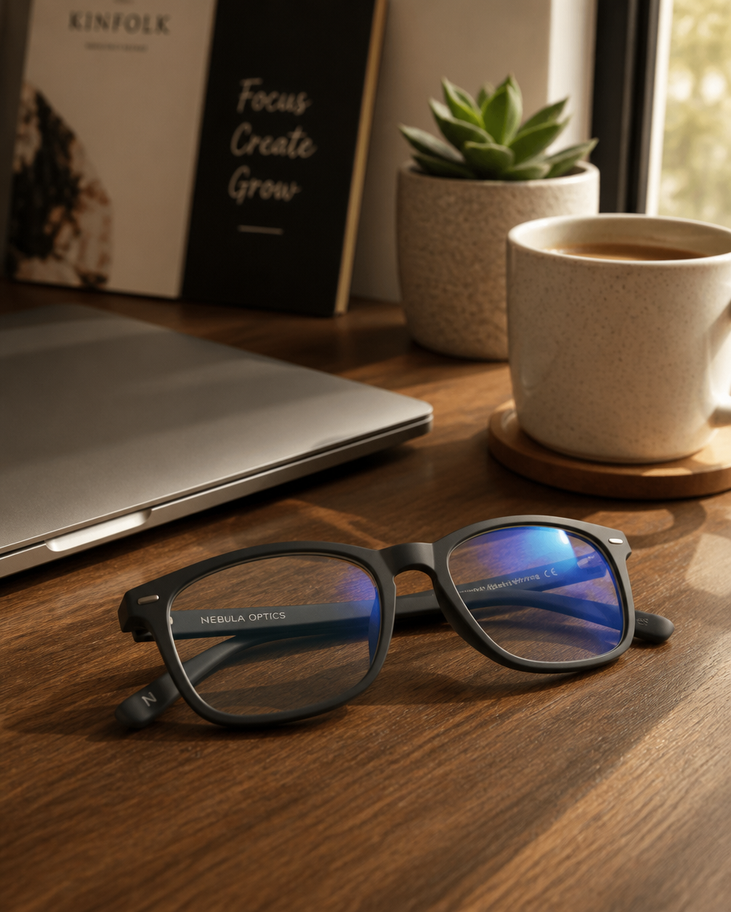

```text
A pair of lightweight blue-light filtering glasses with a matte charcoal frame and faintly blue-tinted lenses from the invented brand Nebula Optics, resting folded on a warm walnut desk beside a closed laptop, a ceramic coffee cup and a small potted succulent. Soft warm window light from the right casts gentle shadows and a subtle blue reflection on the lens. Palette of charcoal, walnut and warm cream. Eye-level three-quarter angle. Cozy work-from-home lifestyle eyewear product mood, warm and relatable.
```

[Original source](https://github.com/apimodels/gpt-image-2-prompts/blob/980d100f3bd0f2cde4cf38835daeb742bf1cac65/prompts.json#product-295) · Model: GPT Image 2 · Credit: APIModels · CC BY 4.0
ProjectD: published-accepted (run42069117745). Lens reflections do not establish actual blue-light filtering; source design concept retained.

## Vintage Sunglasses Warm Shot · product-296
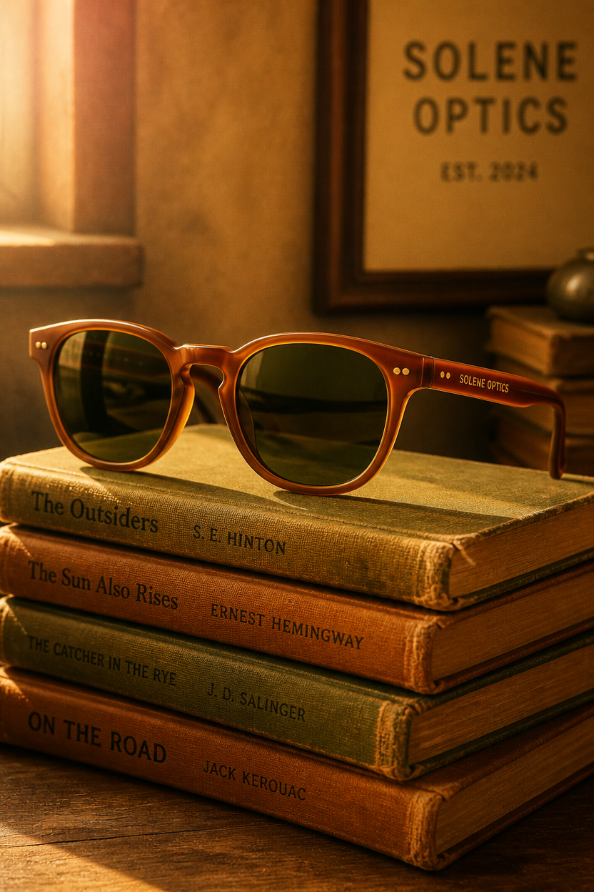

```text
A pair of retro keyhole-bridge sunglasses with a warm caramel-brown acetate frame and green G15 lenses from the invented brand Solene Optics, resting on a stack of weathered vintage books on a wooden table against a warm nostalgic backdrop. Soft golden-hour light from the left with faint film grain and slight halation. The frame's beveled edges and lens tint are crisply detailed. Palette of caramel brown, olive green and warm amber. Eye-level three-quarter angle. Nostalgic heritage eyewear campaign mood, warm and analog.
```

[Original source](https://github.com/apimodels/gpt-image-2-prompts/blob/980d100f3bd0f2cde4cf38835daeb742bf1cac65/prompts.json#product-296) · Model: GPT Image 2 · Credit: APIModels · CC BY 4.0
ProjectD: published-accepted (run42069117745). Full native frame additionally inspected. All four visible title/author pairs checked against official publisher pages. These identify books on generated generic spines, not image creators or eyewear endorsers; no book-body text is shown.

## Wool Fedora Moody Product · product-298
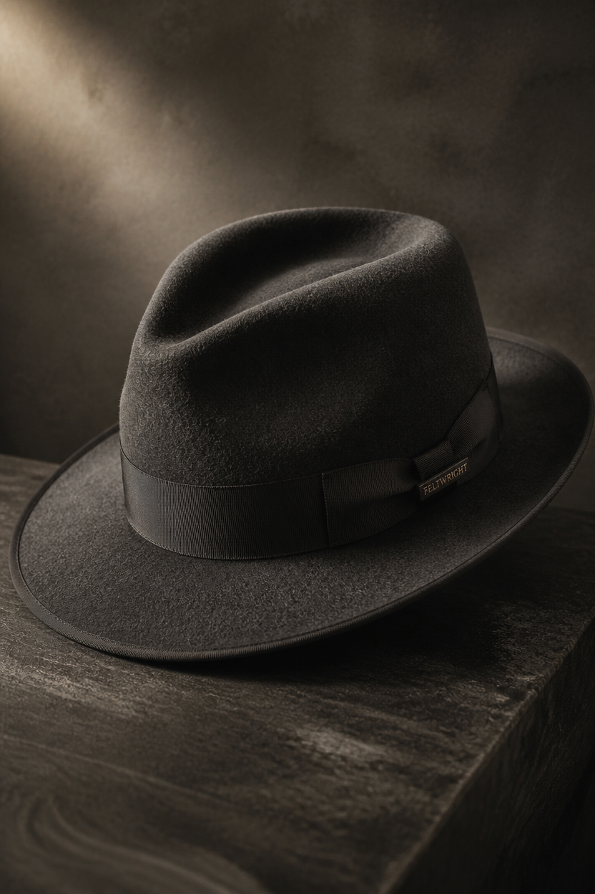

```text
A structured wide-brim wool felt fedora in deep charcoal with a grosgrain ribbon band from the invented brand Feltwright, resting at an angle on a dark textured surface against a moody warm-grey backdrop. The soft felt nap, pinched crown and neat brim edge are revealed by warm directional light from the upper left. Rich dramatic shadow adds depth. Palette of charcoal, black grosgrain and warm grey. Slightly low three-quarter angle. Refined heritage millinery campaign mood, moody and tactile with visible felt texture.
```

[Original source](https://github.com/apimodels/gpt-image-2-prompts/blob/980d100f3bd0f2cde4cf38835daeb742bf1cac65/prompts.json#product-298) · Model: GPT Image 2 · Credit: APIModels · CC BY 4.0
ProjectD: published-accepted (run42069117745). Complete source prompt and uncropped native preview correspond; generation defects and actual dimensions retained.

## Knit Beanie Cozy Flat-Lay · product-299
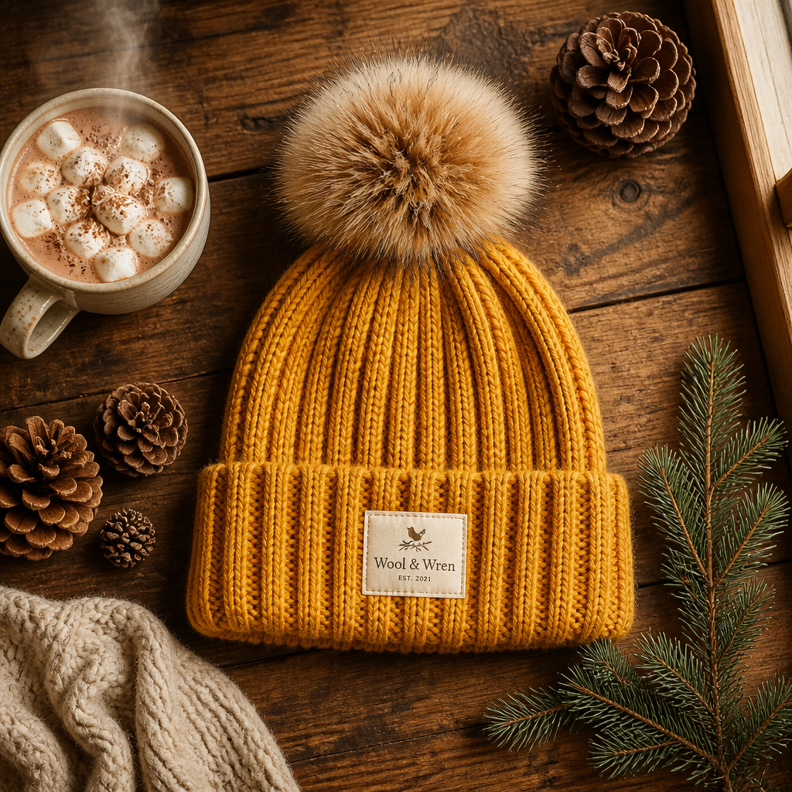

```text
Top-down flat-lay of a chunky ribbed knit beanie in warm mustard-yellow with a folded turn-up cuff and a faux-fur pom from the invented brand Wool & Wren, laid on a rustic pine surface with a steaming mug of cocoa, pinecones and a sprig of evergreen. Warm cozy window light from the right casts soft shadows and highlights the plush knit texture. Palette of mustard, pine brown and cream. Overhead 90-degree angle, warm winter cozy accessory flat-lay mood, snug and inviting with visible knit detail.
```

[Original source](https://github.com/apimodels/gpt-image-2-prompts/blob/980d100f3bd0f2cde4cf38835daeb742bf1cac65/prompts.json#product-299) · Model: GPT Image 2 · Credit: APIModels · CC BY 4.0
ProjectD: published-accepted (run42069117745). Complete source prompt and uncropped native preview correspond; generation defects and actual dimensions retained.

## Cashmere Scarf Soft Product · product-300
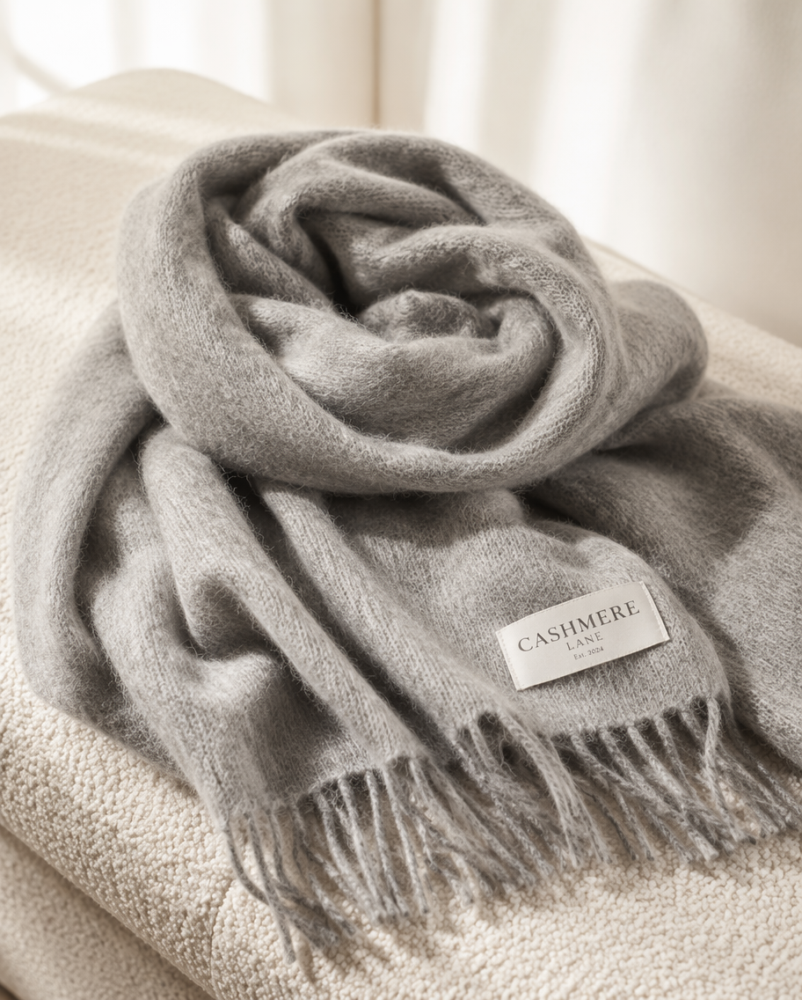

```text
A soft oversized cashmere scarf in heathered dove-grey from the invented brand Cashmere Lane, loosely draped and gently coiled to show the brushed fluffy texture and fringed ends, resting on a pale cream boucle surface against a soft warm-white backdrop. Delicate diffused daylight from above gives a plush inviting glow with subtle shadow in the folds. Palette of dove grey, cream and warm white. Slightly elevated three-quarter angle. Cozy quiet-luxury accessory campaign mood, soft and tactile with visible fibre texture.
```

[Original source](https://github.com/apimodels/gpt-image-2-prompts/blob/980d100f3bd0f2cde4cf38835daeb742bf1cac65/prompts.json#product-300) · Model: GPT Image 2 · Credit: APIModels · CC BY 4.0
ProjectD: published-accepted (run42069117745). Complete source prompt and uncropped native preview correspond; generation defects and actual dimensions retained.

## Straw Sun Hat Beach Shot · product-301
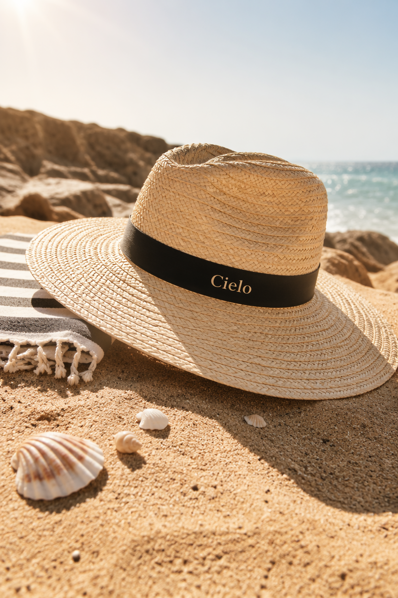

```text
A wide-brim natural straw sun hat with a black band from the invented brand Cielo, resting at an angle on warm golden beach sand casting a crisp brim shadow, with a few seashells and a folded striped towel nearby against a soft sun-bleached backdrop. Bright Mediterranean sunlight from the upper left reveals the fine woven straw texture and brim shape. Palette of natural straw, black and warm sand. Slightly low three-quarter angle. Breezy summer holiday accessory campaign mood, warm and relaxed with visible weave.
```

[Original source](https://github.com/apimodels/gpt-image-2-prompts/blob/980d100f3bd0f2cde4cf38835daeb742bf1cac65/prompts.json#product-301) · Model: GPT Image 2 · Credit: APIModels · CC BY 4.0
ProjectD: published-accepted (run42069117745). Complete source prompt and uncropped native preview correspond; generation defects and actual dimensions retained.

## Baseball Cap Streetwear Shot · product-302
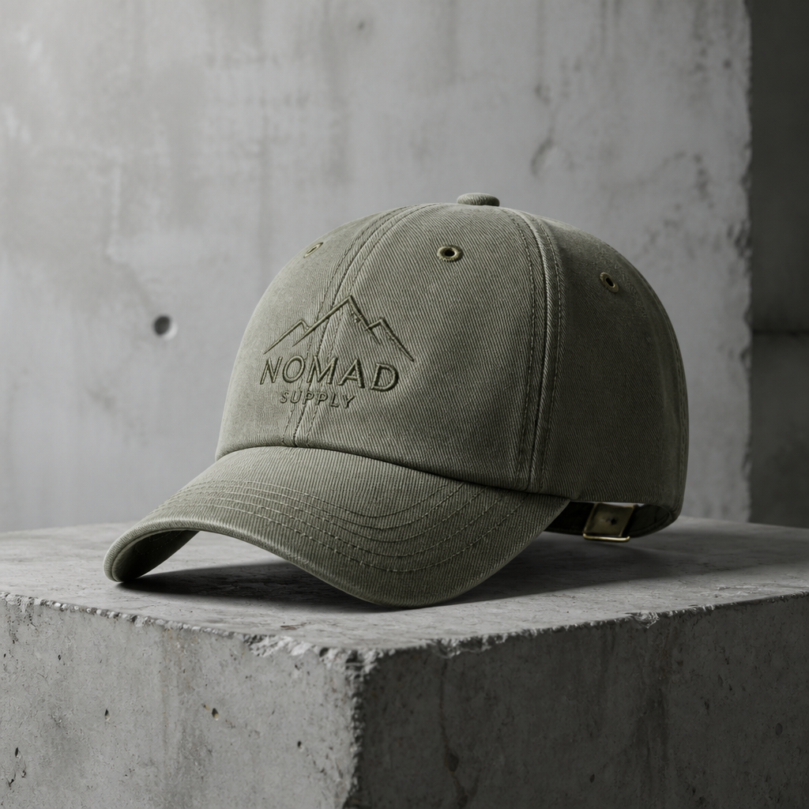

```text
A structured six-panel baseball cap in washed sage-green cotton twill with a subtle tonal embroidered emblem from the invented brand Nomad Supply, positioned on a raw concrete block against a soft cool-grey urban backdrop. The curved brim, metal eyelets and adjustable strap-back are crisply detailed. Cool directional light from the left with clean shadow reveals the twill texture. Palette of sage green, cool grey and antique brass. Slight low three-quarter angle. Modern streetwear headwear campaign mood, clean and casual with visible fabric texture.
```

[Original source](https://github.com/apimodels/gpt-image-2-prompts/blob/980d100f3bd0f2cde4cf38835daeb742bf1cac65/prompts.json#product-302) · Model: GPT Image 2 · Credit: APIModels · CC BY 4.0
ProjectD: published-accepted (run42069117745). Complete source prompt and uncropped native preview correspond; generation defects and actual dimensions retained.

## Silk Head Scarf Flat-Lay · product-303
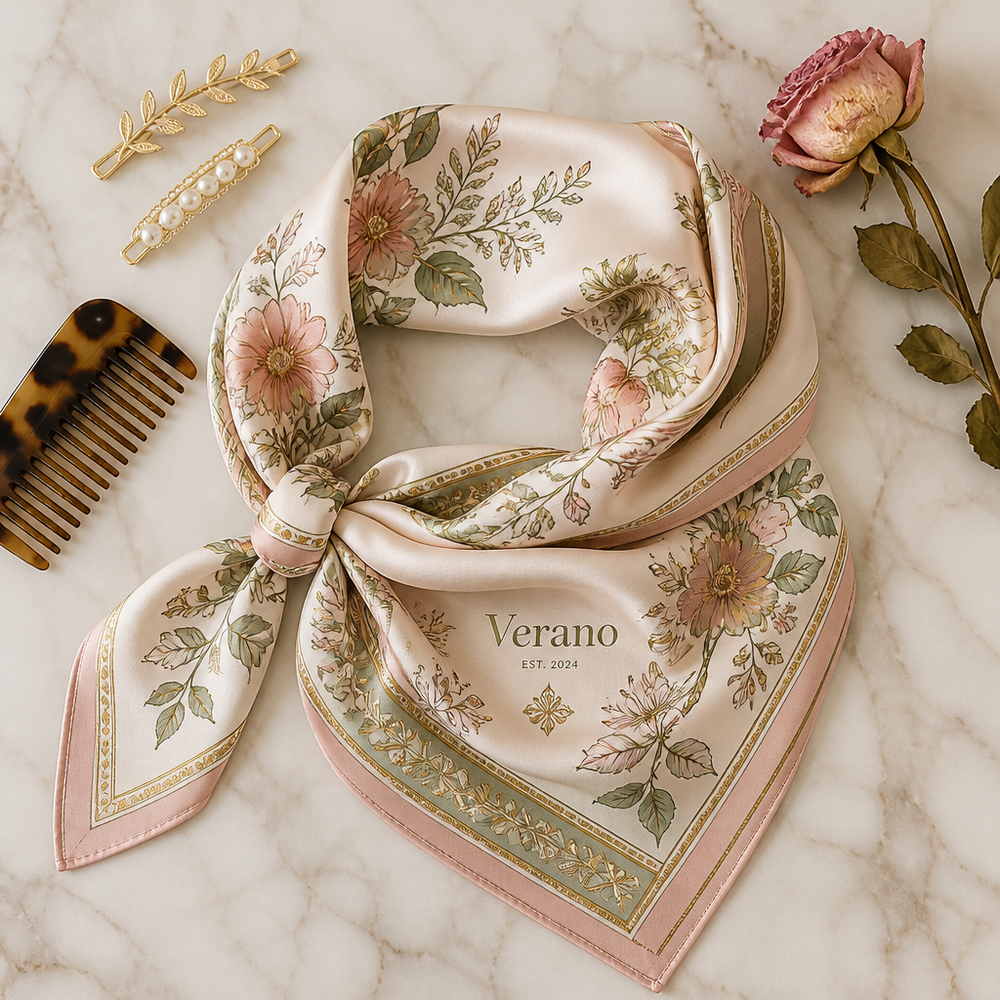

```text
Top-down flat-lay of a small square silk head scarf with a delicate hand-drawn floral print in blush, sage and gold from the invented brand Verano, arranged in a soft loose knot on a pale cream marble surface. Styled with gold hair clips, a tortoiseshell comb and a single dried rose. Soft diffused daylight from above gives an even elegant glow highlighting the printed detail. Palette of blush, sage and gold. Overhead 90-degree angle, feminine vintage-inspired accessory flat-lay mood, delicate and refined with visible silk sheen.
```

[Original source](https://github.com/apimodels/gpt-image-2-prompts/blob/980d100f3bd0f2cde4cf38835daeb742bf1cac65/prompts.json#product-303) · Model: GPT Image 2 · Credit: APIModels · CC BY 4.0
ProjectD: published-accepted (run42069117745). Complete source prompt and uncropped native preview correspond; generation defects and actual dimensions retained.

## Beret Chic Product Shot · product-304
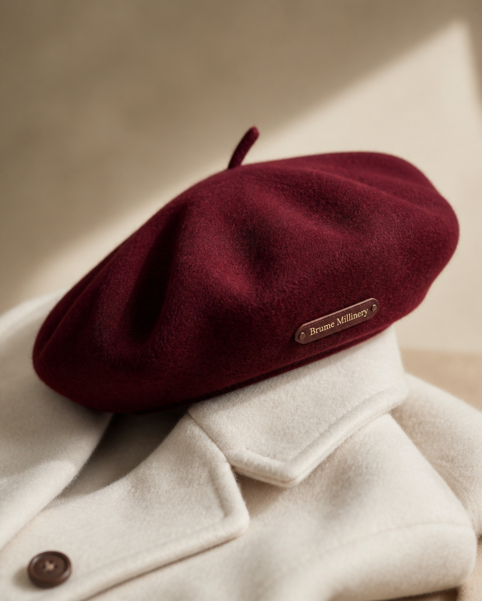

```text
A soft wool beret in rich burgundy with a small leather tab from the invented brand Brume Millinery, resting at a jaunty angle on a folded cream wool coat against a warm neutral backdrop. Delicate soft daylight from the upper right reveals the plush felted texture and gentle slouch of the crown. Soft elegant shadow. Palette of burgundy, cream and warm neutral. Slightly elevated three-quarter angle. Chic Parisian accessory campaign mood, soft and refined with visible wool texture and a timeless feel.
```

[Original source](https://github.com/apimodels/gpt-image-2-prompts/blob/980d100f3bd0f2cde4cf38835daeb742bf1cac65/prompts.json#product-304) · Model: GPT Image 2 · Credit: APIModels · CC BY 4.0
ProjectD: published-accepted (run42069117745). Complete source prompt and uncropped native preview correspond; generation defects and actual dimensions retained.

## Wool Scarf & Gloves Set · product-305
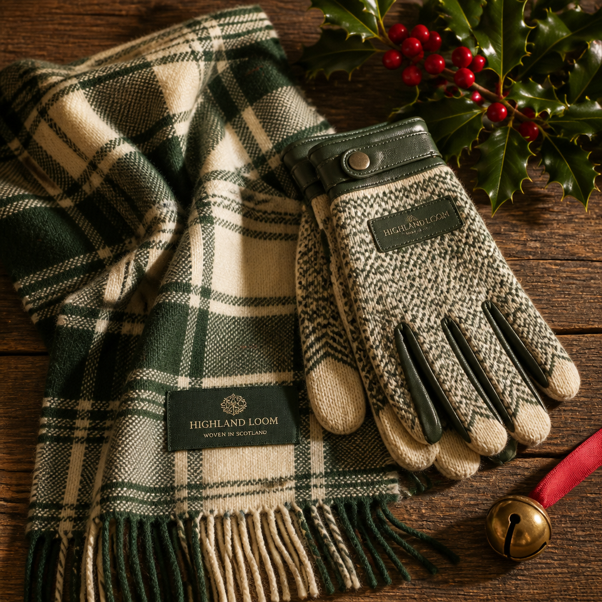

```text
A coordinated winter set of a plaid lambswool scarf and matching leather-trimmed knit gloves in forest-green and cream from the invented brand Highland Loom, arranged neatly overlapping on a rustic dark-wood surface with a sprig of holly and a brass bell. Warm cozy directional light from the right casts soft shadows and highlights the plaid pattern and knit texture. Palette of forest green, cream and warm red berry. Overhead slightly angled view. Festive heritage winter-accessory campaign mood, warm and inviting with visible texture.
```

[Original source](https://github.com/apimodels/gpt-image-2-prompts/blob/980d100f3bd0f2cde4cf38835daeb742bf1cac65/prompts.json#product-305) · Model: GPT Image 2 · Credit: APIModels · CC BY 4.0
ProjectD: published-accepted (run42069117745). Complete source prompt and uncropped native preview correspond; generation defects and actual dimensions retained.

## Infinity Scarf Soft Flat-Lay · product-307
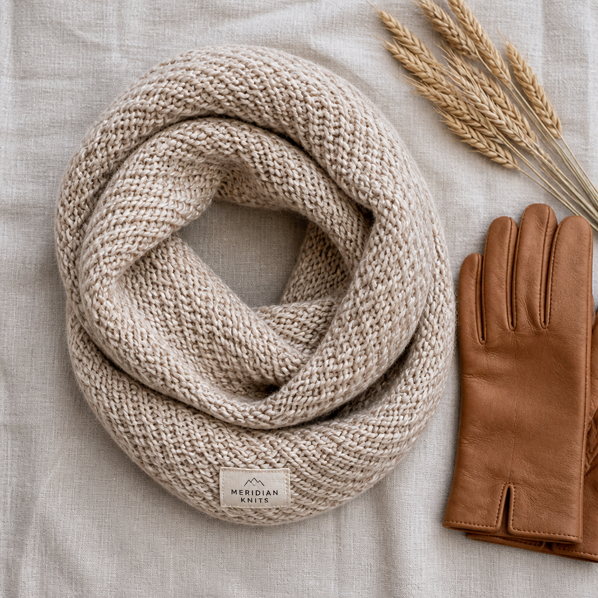

```text
Top-down flat-lay of a soft chunky-knit infinity scarf in oatmeal marl from the invented brand Meridian Knits, coiled into two overlapping loops to show the loose garter-stitch texture, on a pale grey linen surface with a folded caramel leather glove and a sprig of dried wheat. Soft even daylight from above gives a calm neutral glow with gentle shadow in the loops. Palette of oatmeal, caramel and pale grey. Overhead 90-degree angle, minimalist autumn accessory flat-lay mood, cozy and understated with visible knit texture.
```

[Original source](https://github.com/apimodels/gpt-image-2-prompts/blob/980d100f3bd0f2cde4cf38835daeb742bf1cac65/prompts.json#product-307) · Model: GPT Image 2 · Credit: APIModels · CC BY 4.0
ProjectD: published-accepted (run42069117745). Complete source prompt and uncropped native preview correspond; generation defects and actual dimensions retained.

## Leggings Activewear Flat-Lay · product-308
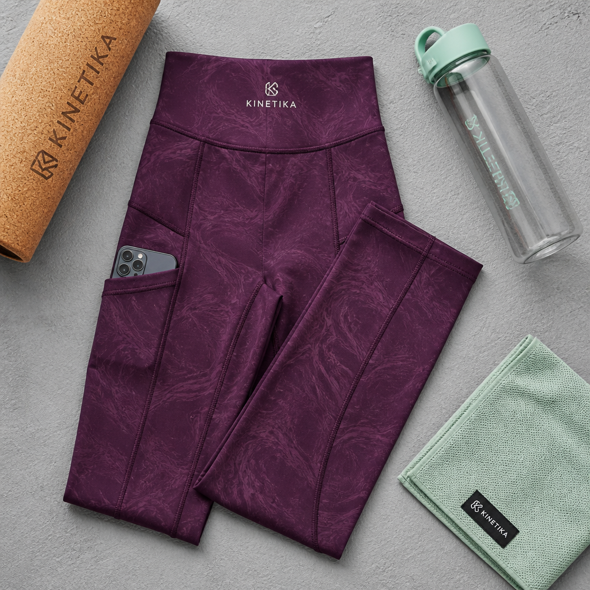

```text
Top-down flat-lay of high-waisted compression leggings in deep plum with a subtle marble-textured print from the invented brand Kinetika, folded neatly to show the sculpting seams, wide waistband and hidden pocket. Styled on a light grey textured mat with a rolled cork yoga block, a water bottle and a folded quick-dry towel. Soft bright even lighting for a clean fresh look. Palette of deep plum, cool grey and mint. Overhead 90-degree angle, energetic modern activewear flat-lay mood, clean and performance-focused with visible fabric texture.
```

[Original source](https://github.com/apimodels/gpt-image-2-prompts/blob/980d100f3bd0f2cde4cf38835daeb742bf1cac65/prompts.json#product-308) · Model: GPT Image 2 · Credit: APIModels · CC BY 4.0
ProjectD: published-accepted (run42069117745). Complete source prompt and uncropped native preview correspond; generation defects and actual dimensions retained.

## Sports Bra Mannequin Shot · product-309
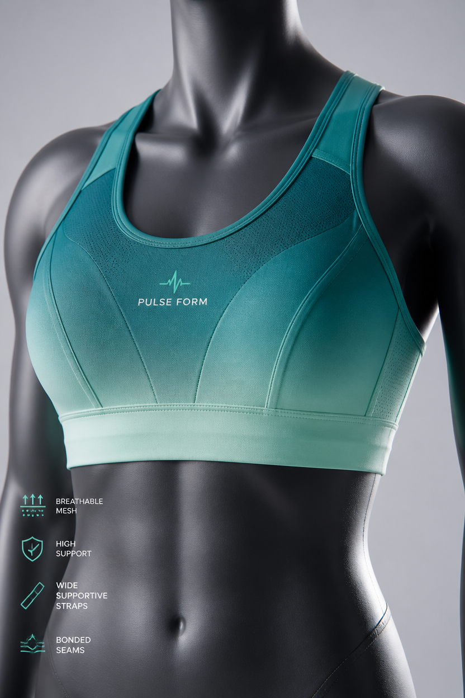

```text
A high-support seamless sports bra in gradient teal-to-mint ombre from the invented brand Pulse Form, displayed on a matte charcoal athletic mannequin torso against a cool light-grey backdrop. The bonded seams, breathable mesh back panel and wide supportive straps are crisply detailed. Clean bright directional light from the front left with a subtle rim highlight. Palette of teal, mint and cool grey. Eye-level frontal-to-three-quarter angle. Fresh performance activewear campaign mood, dynamic and clean with visible technical fabric texture.
```

[Original source](https://github.com/apimodels/gpt-image-2-prompts/blob/980d100f3bd0f2cde4cf38835daeb742bf1cac65/prompts.json#product-309) · Model: GPT Image 2 · Credit: APIModels · CC BY 4.0
ProjectD: published-accepted (run42069117745). Generated sports-bra campaign; support/breathability labels are design copy, not tested performance.
