# APIModels GPT Image 2 — batch 06

CC BY 4.0. Copyright APIModels. Prompts and images explicitly covered by https://github.com/apimodels/gpt-image-2-prompts/blob/980d100f3bd0f2cde4cf38835daeb742bf1cac65/LICENSE; credit source publisher APIModels and retain attribution. No individual original-author claim inferred from curation.

Native PNG outputs and complete original prompts. Generated claims/design labels are not independently verified facts. ProjectD holds are recorded per item.

## Inkwell Stationery Pastel · social-496
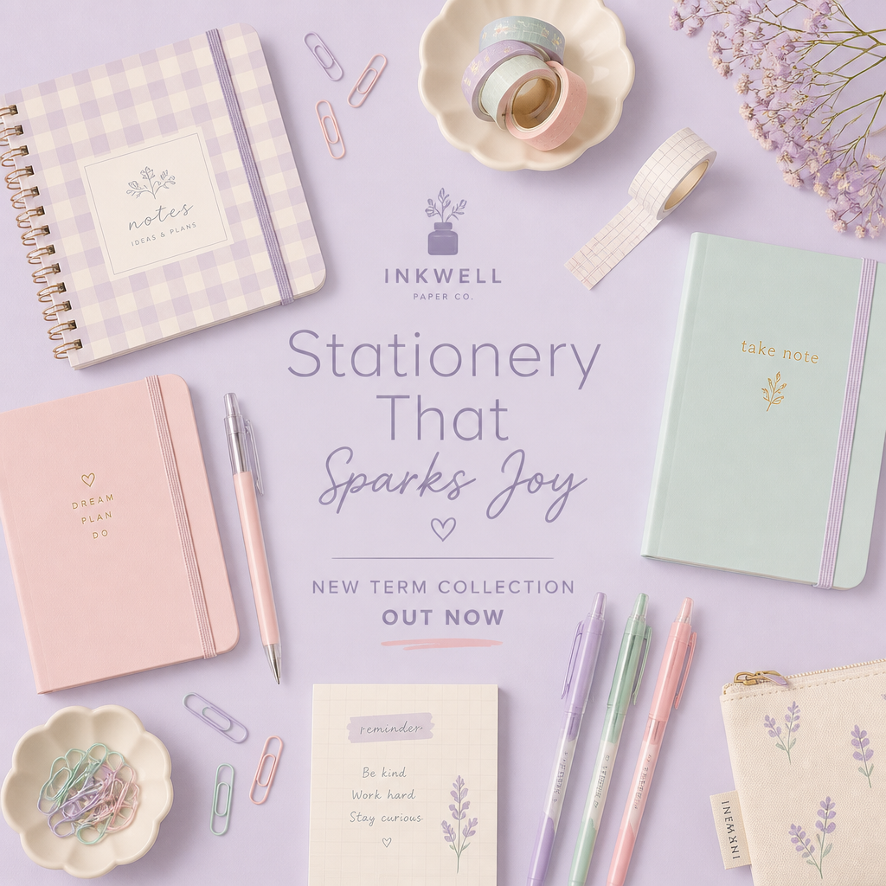

```text
An aesthetic stationery promo for invented brand 'Inkwell'. A soft lavender background arranges pastel notebooks, washi-tape rolls, gel pens and paper clips in a gentle flat-lay. A thin modern headline 'Stationery That Sparks Joy' pairs with 'New term collection out now'. Calm, pretty, trendy mood; lavender, mint, blush and cream pastel palette; airy flat-lay illustration, soft shadows, square composition.
```

[Original source](https://github.com/apimodels/gpt-image-2-prompts/blob/980d100f3bd0f2cde4cf38835daeb742bf1cac65/prompts.json#social-496) · Model: GPT Image 2 · Credit: APIModels · CC BY 4.0
ProjectD: published-accepted (run42069117745). Complete source prompt and uncropped native preview correspond; generation defects and actual dimensions retained.

## Ace Your Term Study Tips · social-497
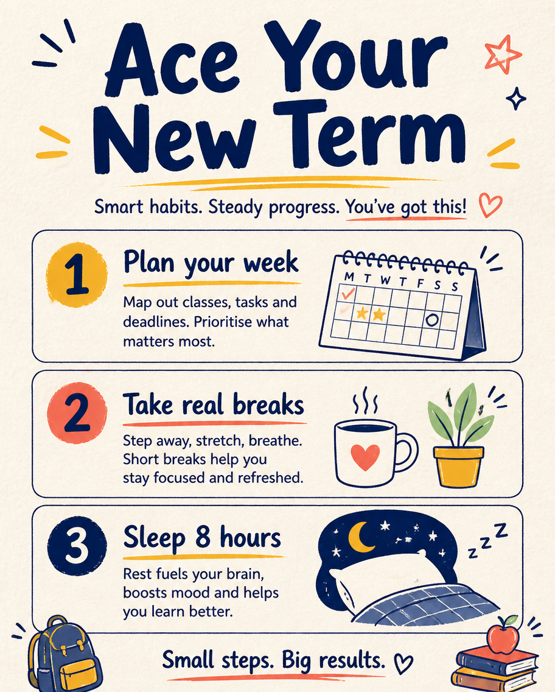

```text
A helpful back-to-school study-tips infographic card. A cream paper-textured background carries a bold navy headline 'Ace Your New Term' at the top, then three numbered tips in rounded boxes: '1 Plan your week', '2 Take real breaks' and '3 Sleep 8 hours', each with a small doodle icon. Friendly, useful, tidy mood; navy, mustard, coral and cream palette; clean infographic layout, hand-drawn accents, portrait framing.
```

[Original source](https://github.com/apimodels/gpt-image-2-prompts/blob/980d100f3bd0f2cde4cf38835daeb742bf1cac65/prompts.json#social-497) · Model: GPT Image 2 · Credit: APIModels · CC BY 4.0
ProjectD: published-accepted (run42069117745). General study-tip illustration, not a personalized sleep recommendation.

## Welcome Back To Campus · social-498
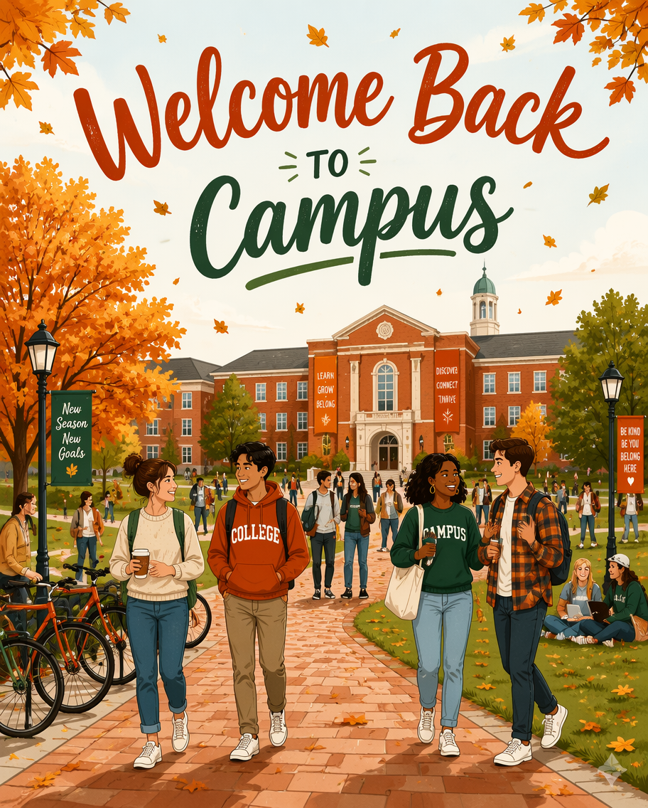

```text
A lively campus-life illustration for a back-to-school post. Students walk and chat across a sunny college quad with a brick building, a green lawn, a tree and bikes leaning against a rack, with warm autumn light and drifting leaves. A hand-lettered headline 'Welcome Back to Campus' arcs across the top. Vibrant, social, optimistic mood; warm autumn orange, brick red and green palette; flat illustration, soft shading, wide composition.
```

[Original source](https://github.com/apimodels/gpt-image-2-prompts/blob/980d100f3bd0f2cde4cf38835daeb742bf1cac65/prompts.json#social-498) · Model: GPT Image 2 · Credit: APIModels · CC BY 4.0
ProjectD: published-accepted (run42069117745). Complete source prompt and uncropped native preview correspond; generation defects and actual dimensions retained.

## Mama Bear Mothers Day Card · social-500
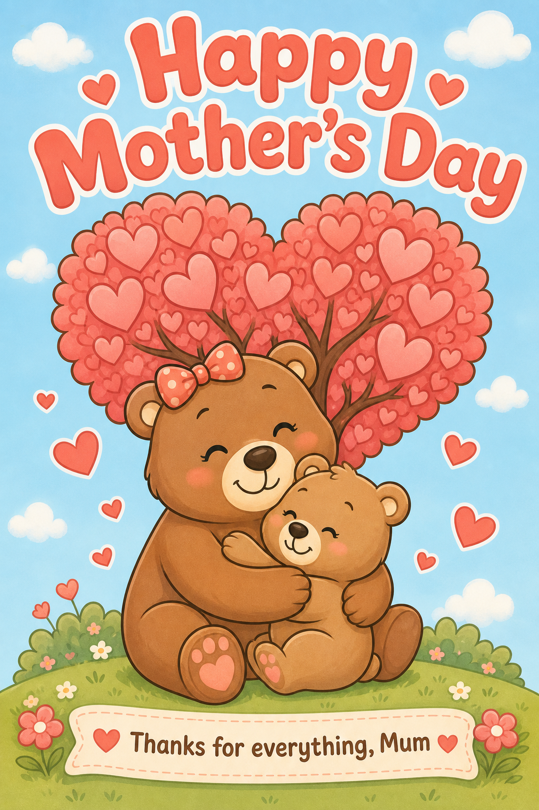

```text
A sweet cartoon Mother's Day card. A smiling mama bear hugs her little cub under a heart-shaped tree, with tiny hearts floating around them against a soft sky-blue background dotted with fluffy clouds. A rounded coral headline 'Happy Mother's Day' pairs with a small line 'Thanks for everything, Mum'. Heartwarming, cute, gentle mood; sky blue, coral and cream palette; soft cartoon illustration, thick outlines, portrait composition.
```

[Original source](https://github.com/apimodels/gpt-image-2-prompts/blob/980d100f3bd0f2cde4cf38835daeb742bf1cac65/prompts.json#social-500) · Model: GPT Image 2 · Credit: APIModels · CC BY 4.0
ProjectD: published-accepted (run42069117745). Complete source prompt and uncropped native preview correspond; generation defects and actual dimensions retained.

## Bloomhaus Mothers Day Sale · social-499
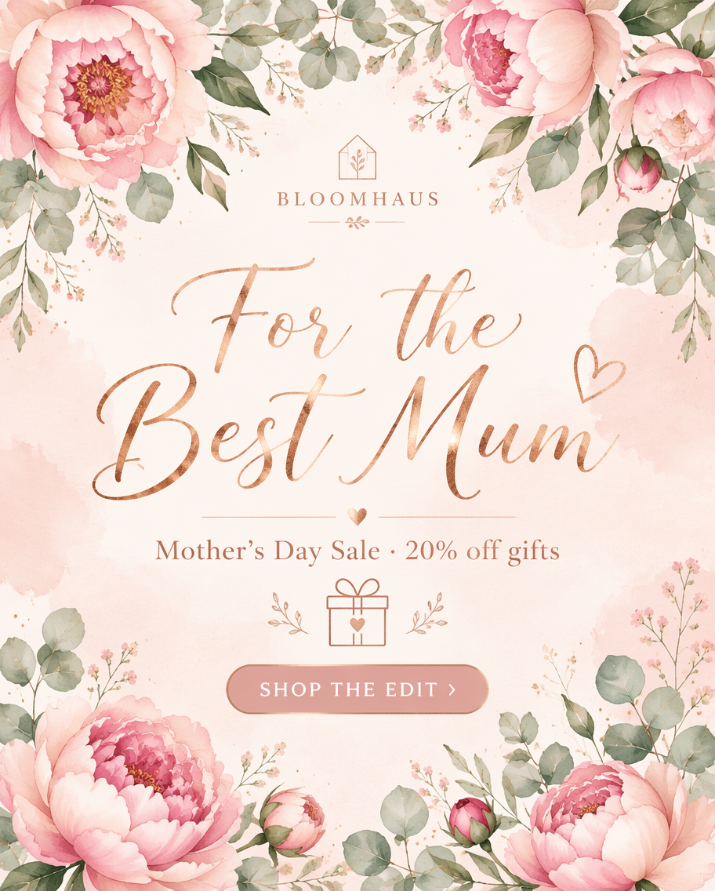

```text
An elegant Mother's Day sale banner for invented brand 'Bloomhaus'. A soft blush background is framed by hand-painted pink peonies and eucalyptus along the top and bottom. A graceful script headline 'For the Best Mum' in rose-gold pairs with a subline 'Mother's Day Sale · 20% off gifts', a small gift-box icon and a 'Shop the edit' pill. Tender, elegant, warm mood; blush, rose-gold and sage palette; watercolor floral frame, airy centered layout.
```

[Original source](https://github.com/apimodels/gpt-image-2-prompts/blob/980d100f3bd0f2cde4cf38835daeb742bf1cac65/prompts.json#social-499) · Model: GPT Image 2 · Credit: APIModels · CC BY 4.0
ProjectD: published-accepted (run42069117745). Complete source prompt and uncropped native preview correspond; generation defects and actual dimensions retained.

## Mothers Love Quote Minimal · social-502
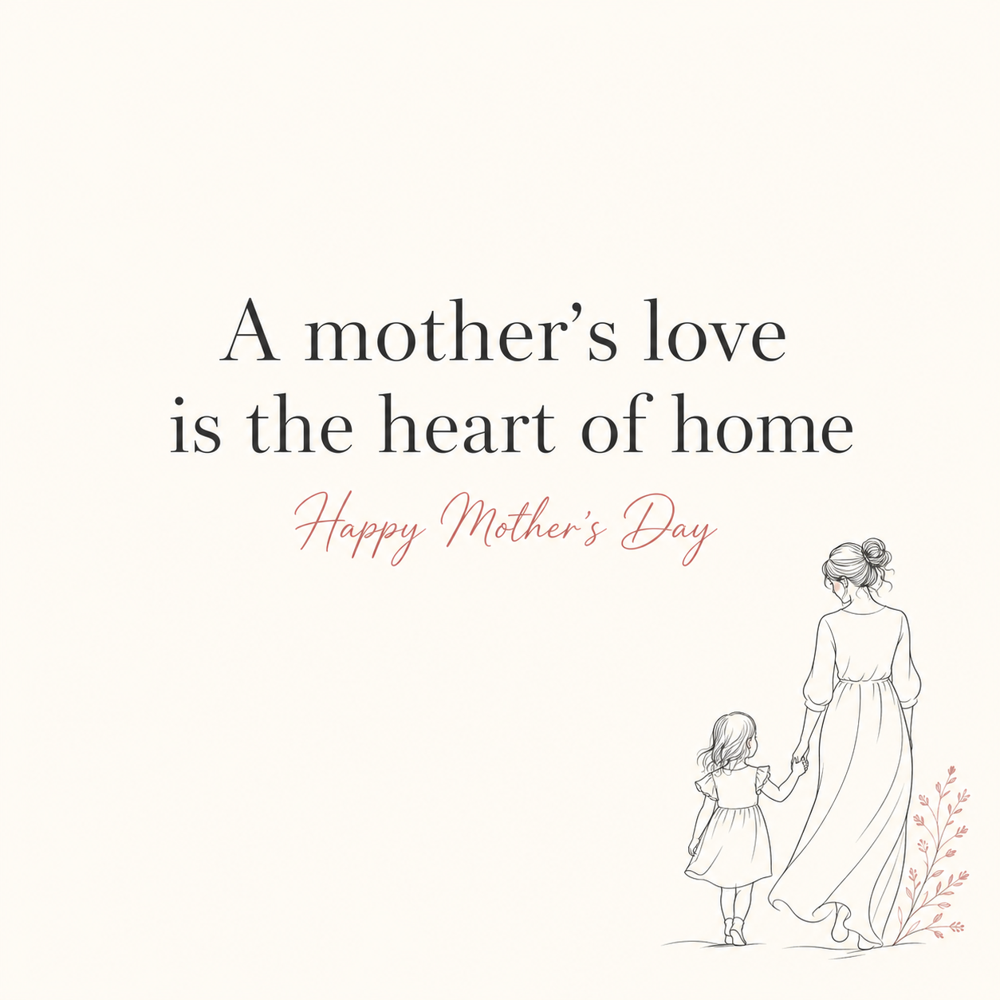

```text
A minimal Mother's Day quote graphic. A warm ivory background carries a single fine-line illustration of a woman and child holding hands in the lower corner. A centered elegant serif quote 'A mother's love is the heart of home' sits above a small 'Happy Mother's Day' in script. Calm, heartfelt, refined mood; ivory, dusty-rose and charcoal palette; abundant whitespace, delicate line art, square composition.
```

[Original source](https://github.com/apimodels/gpt-image-2-prompts/blob/980d100f3bd0f2cde4cf38835daeb742bf1cac65/prompts.json#social-502) · Model: GPT Image 2 · Credit: APIModels · CC BY 4.0
ProjectD: published-accepted (run42069117745). Complete source prompt and uncropped native preview correspond; generation defects and actual dimensions retained.

## Rosewood Mothers Day Brunch · social-501
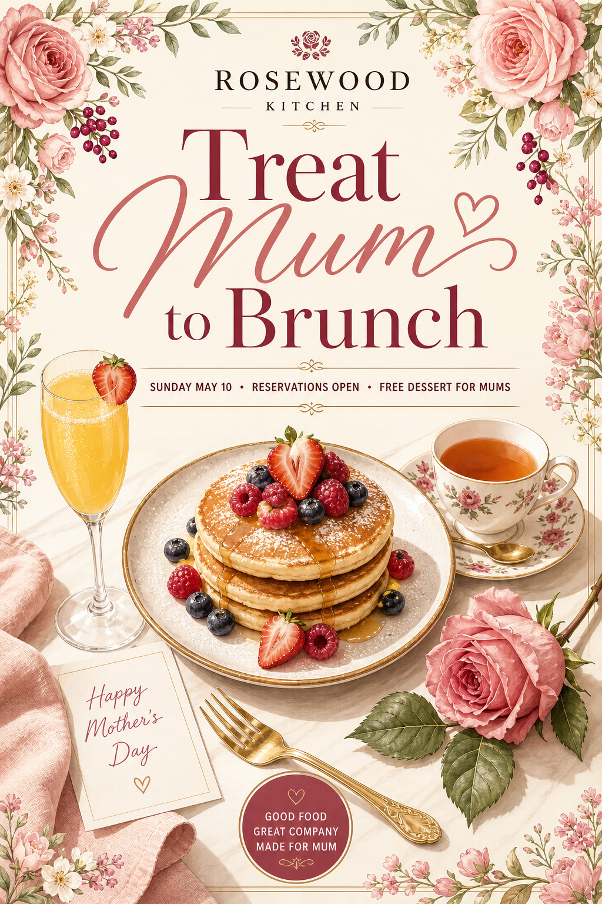

```text
A bright Mother's Day brunch promo for invented cafe 'Rosewood Kitchen'. A cream background carries a delicate floral border. A flat-lay illustration of pancakes with berries, a mimosa, a teacup and a single rose sits on a table. An elegant headline 'Treat Mum to Brunch' pairs with details 'Sunday May 10 · Reservations open · Free dessert for mums'. Warm, inviting, celebratory mood; cream, blush and berry palette; illustrated flat-lay, soft light, portrait layout.
```

[Original source](https://github.com/apimodels/gpt-image-2-prompts/blob/980d100f3bd0f2cde4cf38835daeb742bf1cac65/prompts.json#social-501) · Model: GPT Image 2 · Credit: APIModels · CC BY 4.0
ProjectD: published-accepted (run42069117745). Complete source prompt and uncropped native preview correspond; generation defects and actual dimensions retained.

## Grillhouse Dads Day Feast · social-505
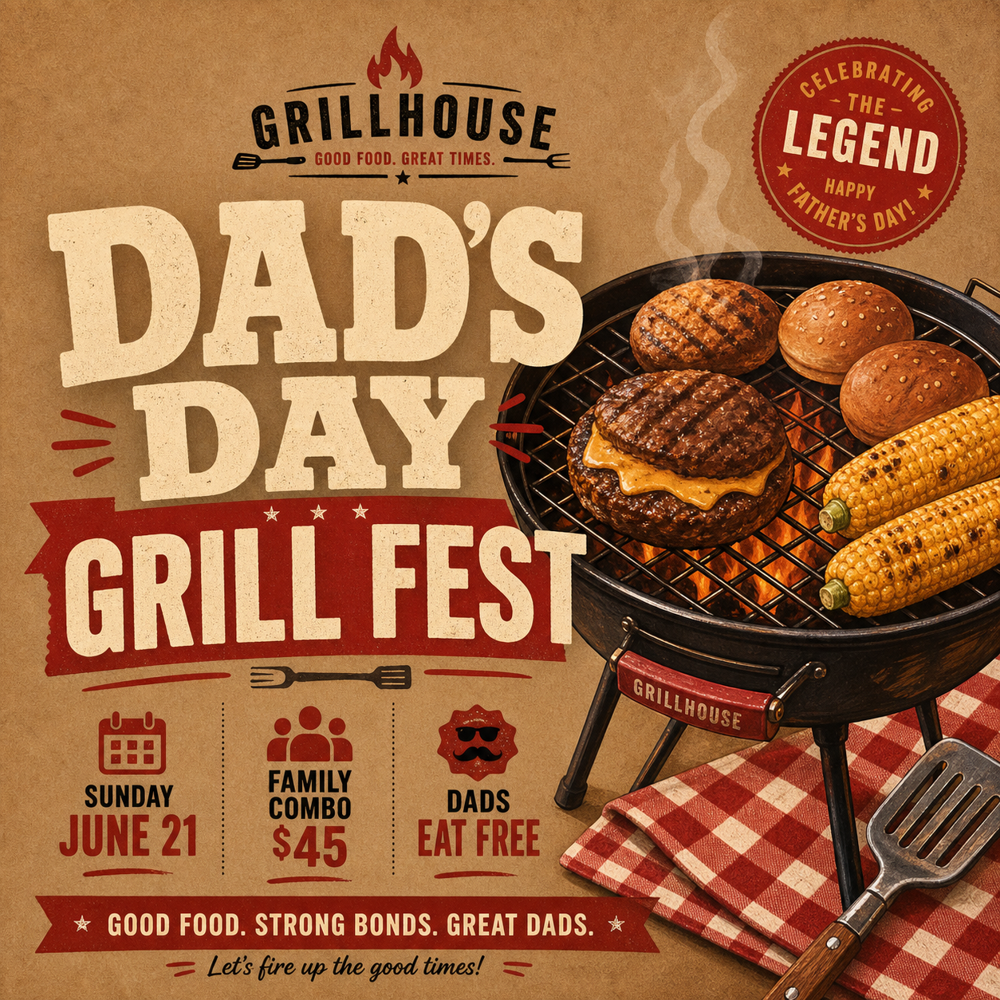

```text
A hearty Father's Day BBQ promo for invented brand 'Grillhouse'. A warm kraft-brown background carries a flat illustration of a sizzling grill, burgers, corn and a checkered napkin. A bold cream headline 'DAD'S DAY GRILL FEST' pairs with details 'Sunday June 21 · Family combo $45 · Dads eat free'. Fun, appetizing, casual mood; kraft brown, tomato red and mustard palette; friendly illustration, warm shadows, square layout.
```

[Original source](https://github.com/apimodels/gpt-image-2-prompts/blob/980d100f3bd0f2cde4cf38835daeb742bf1cac65/prompts.json#social-505) · Model: GPT Image 2 · Credit: APIModels · CC BY 4.0
ProjectD: published-accepted (run42069117745). Complete source prompt and uncropped native preview correspond; generation defects and actual dimensions retained.

## Ironwood Fathers Day Sale · social-503
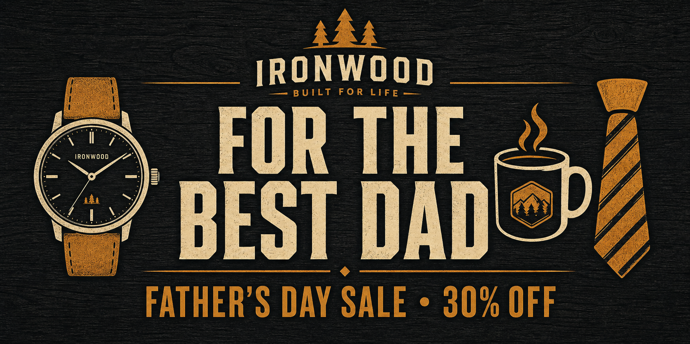

```text
A bold Father's Day sale banner for invented brand 'Ironwood'. A dark charcoal background carries a subtle wood-grain texture. A strong condensed headline 'FOR THE BEST DAD' in cream sits above 'Father's Day Sale · 30% off' in amber. Flat icons of a wristwatch, a coffee mug and a tie frame the text. Masculine, sturdy, warm mood; charcoal, amber and cream palette; bold centered layout, wood texture, strong type hierarchy.
```

[Original source](https://github.com/apimodels/gpt-image-2-prompts/blob/980d100f3bd0f2cde4cf38835daeb742bf1cac65/prompts.json#social-503) · Model: GPT Image 2 · Credit: APIModels · CC BY 4.0
ProjectD: published-accepted (run42069117745). Complete source prompt and uncropped native preview correspond; generation defects and actual dimensions retained.

## Grateful For Family Illustration · social-508
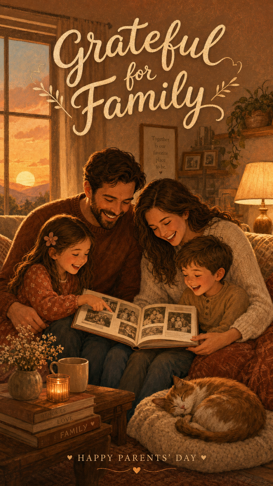

```text
A warm family-celebration illustration for a parents' day post. A cozy scene shows two parents and two kids gathered on a couch sharing a photo album and laughing, a cat curled at their feet, soft evening lamp light and a window with a sunset behind. A hand-lettered headline 'Grateful for Family' arcs across the top. Loving, cozy, nostalgic mood; warm amber, terracotta and cream palette; soft illustration, gentle grain, portrait composition.
```

[Original source](https://github.com/apimodels/gpt-image-2-prompts/blob/980d100f3bd0f2cde4cf38835daeb742bf1cac65/prompts.json#social-508) · Model: GPT Image 2 · Credit: APIModels · CC BY 4.0
ProjectD: published-accepted (run42069117745). Complete source prompt and uncropped native preview correspond; generation defects and actual dimensions retained.

## Fathers Day Gifts Flatlay · social-506
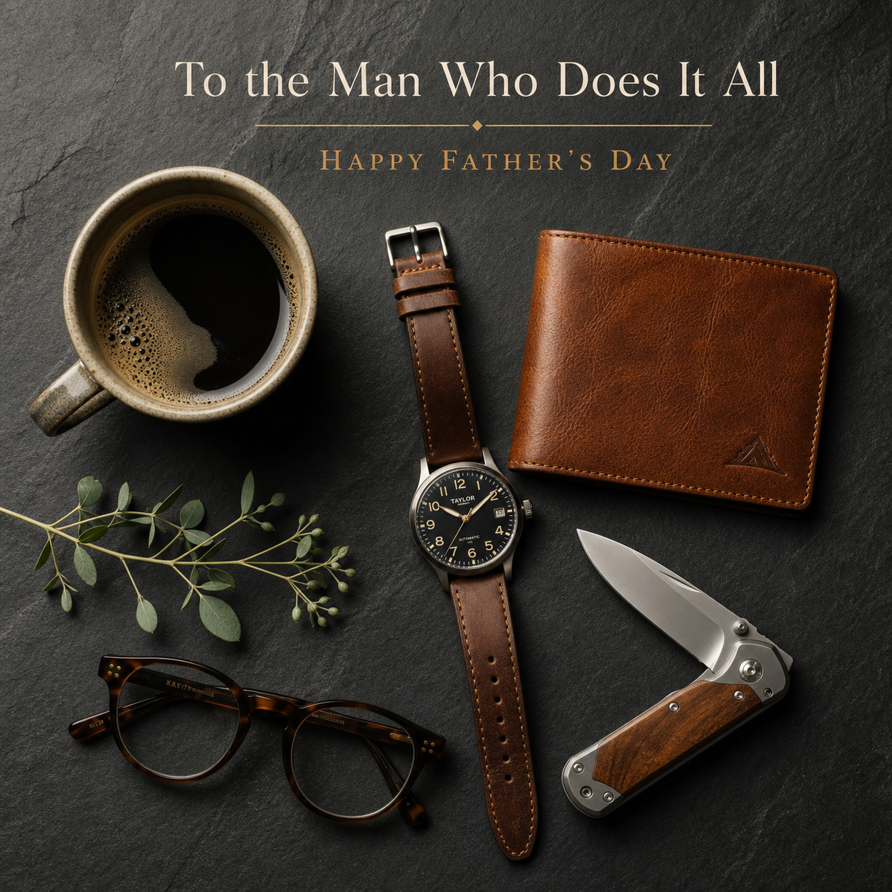

```text
A stylish Father's Day flat-lay graphic. An overhead view on a slate surface arranges a leather watch, a wallet, a folding knife, a coffee mug and a pair of glasses neatly, with a sprig of greenery for accent. A minimal headline 'To the Man Who Does It All' sits at the top above 'Happy Father's Day'. Refined, masculine, warm mood; slate grey, tan-leather and amber palette; top-down photographic style, soft directional light.
```

[Original source](https://github.com/apimodels/gpt-image-2-prompts/blob/980d100f3bd0f2cde4cf38835daeb742bf1cac65/prompts.json#social-506) · Model: GPT Image 2 · Credit: APIModels · CC BY 4.0
ProjectD: published-accepted (run42069117745). Complete source prompt and uncropped native preview correspond; generation defects and actual dimensions retained.

## He Lied To Everyone · thumbnail-579
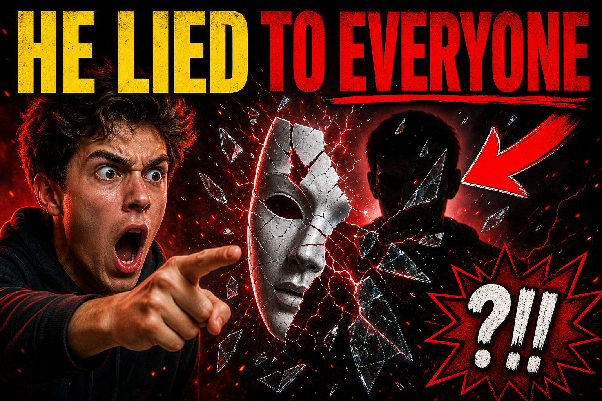

```text
A shocked young man points accusingly at a glowing shattered mask floating mid-air, revealing a shadowy figure behind it, dramatic red-and-black lighting with cracks radiating. Huge text 'HE LIED TO EVERYONE' in yellow and red across the top, a red arrow at the broken mask and a jagged exclamation burst. Sparks and shattered glass fragments. Tense, scandalous, high-contrast drama-reaction energy.
```

[Original source](https://github.com/apimodels/gpt-image-2-prompts/blob/980d100f3bd0f2cde4cf38835daeb742bf1cac65/prompts.json#thumbnail-579) · Model: GPT Image 2 · Credit: APIModels · CC BY 4.0
ProjectD: published-accepted (run42069117745). Complete source prompt and uncropped native preview correspond; generation defects and actual dimensions retained.

## This Went Too Far · thumbnail-580
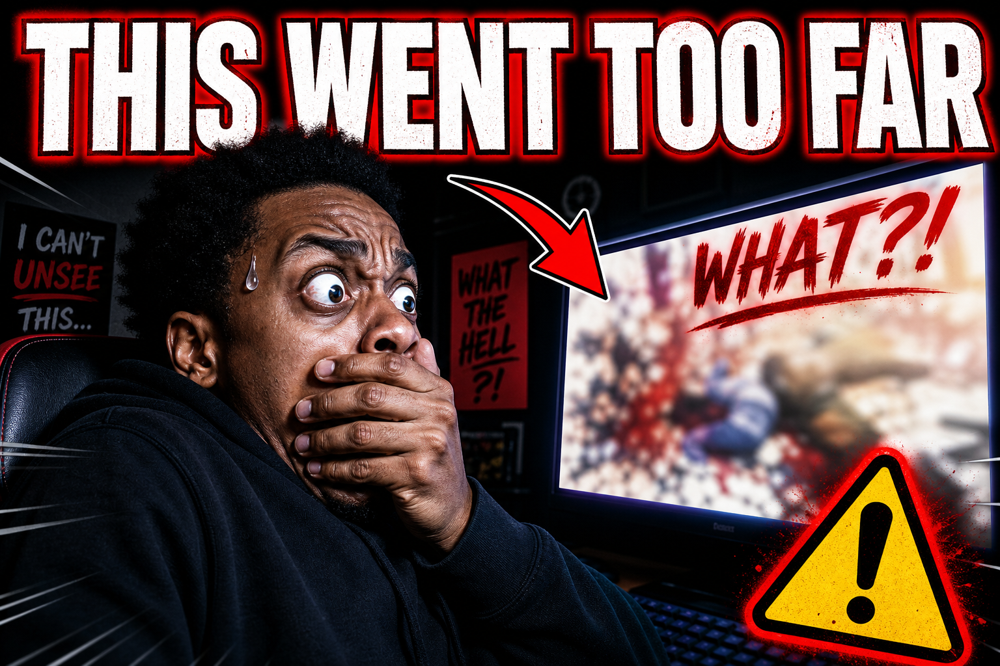

```text
A wide-eyed reactor covers their mouth in disbelief, leaning back from a glowing screen showing a blurred chaotic scene marked with a red 'WHAT?!'. Dark background with a harsh spotlight on the face. Huge text 'THIS WENT TOO FAR' in white with a red outline across the top, a red arrow at the shocking screen and a warning triangle. Sweat drop and bulging eyes. Over-the-top, gripping, high-contrast reaction energy.
```

[Original source](https://github.com/apimodels/gpt-image-2-prompts/blob/980d100f3bd0f2cde4cf38835daeb742bf1cac65/prompts.json#thumbnail-580) · Model: GPT Image 2 · Credit: APIModels · CC BY 4.0
ProjectD: published-accepted (run42069117745). Complete source prompt and uncropped native preview correspond; generation defects and actual dimensions retained.

## Caught On Camera · thumbnail-581
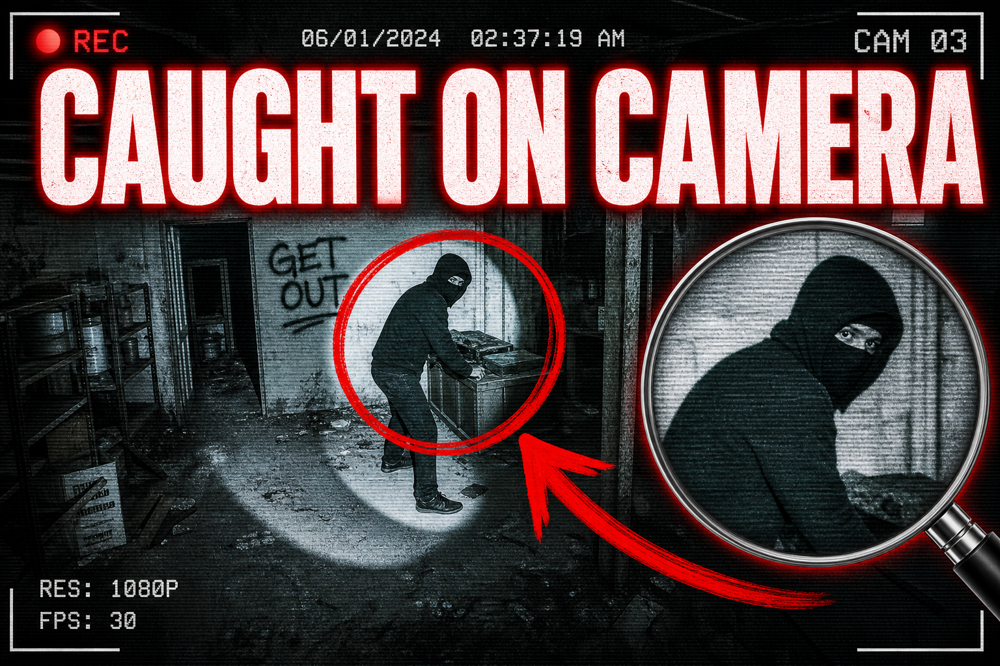

```text
A dramatic thumbnail styled like grainy security footage: a suspicious figure freezes as a glowing red 'REC' dot and timestamp overlay flash, a spotlight circle catching them in the act. Dark grungy background with scan lines. Huge text 'CAUGHT ON CAMERA' in white with a red outline across the top, a red circle-and-arrow zooming on the figure and a magnifier. Suspenseful, viral, high-contrast expose-reaction energy.
```

[Original source](https://github.com/apimodels/gpt-image-2-prompts/blob/980d100f3bd0f2cde4cf38835daeb742bf1cac65/prompts.json#thumbnail-581) · Model: GPT Image 2 · Credit: APIModels · CC BY 4.0
ProjectD: published-accepted (run42069117745). Synthetic security-footage-style thumbnail, not evidence of a real event.

## You Wont Believe This · thumbnail-582
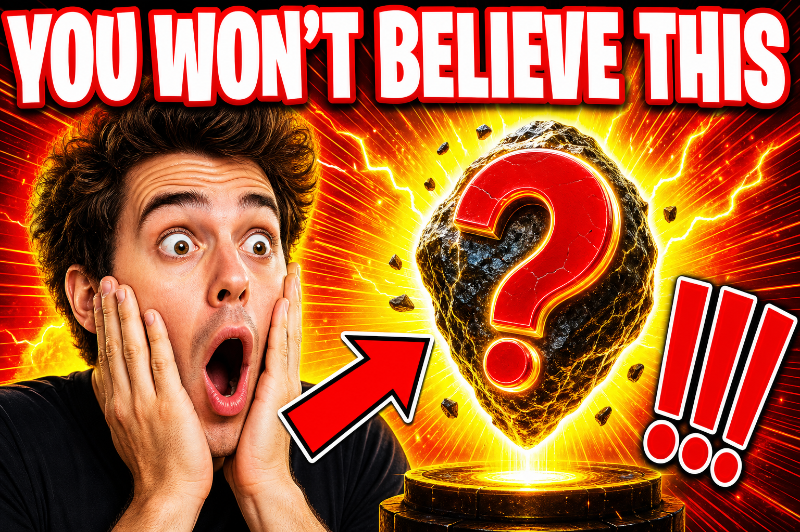

```text
A stunned host with jaw dropped and hands on cheeks stares at a glowing floating object wrapped in a giant red question mark and radiating shock lines. Bright explosive yellow-and-red background with a starburst. Huge text 'YOU WON'T BELIEVE THIS' in white with a red outline across the top, a red arrow at the mystery object and multiple exclamation marks. Pure clickbait shock. Loud, gripping, high-contrast reaction energy.
```

[Original source](https://github.com/apimodels/gpt-image-2-prompts/blob/980d100f3bd0f2cde4cf38835daeb742bf1cac65/prompts.json#thumbnail-582) · Model: GPT Image 2 · Credit: APIModels · CC BY 4.0
ProjectD: published-accepted (run42069117745). Complete source prompt and uncropped native preview correspond; generation defects and actual dimensions retained.

## It All Fell Apart · thumbnail-583
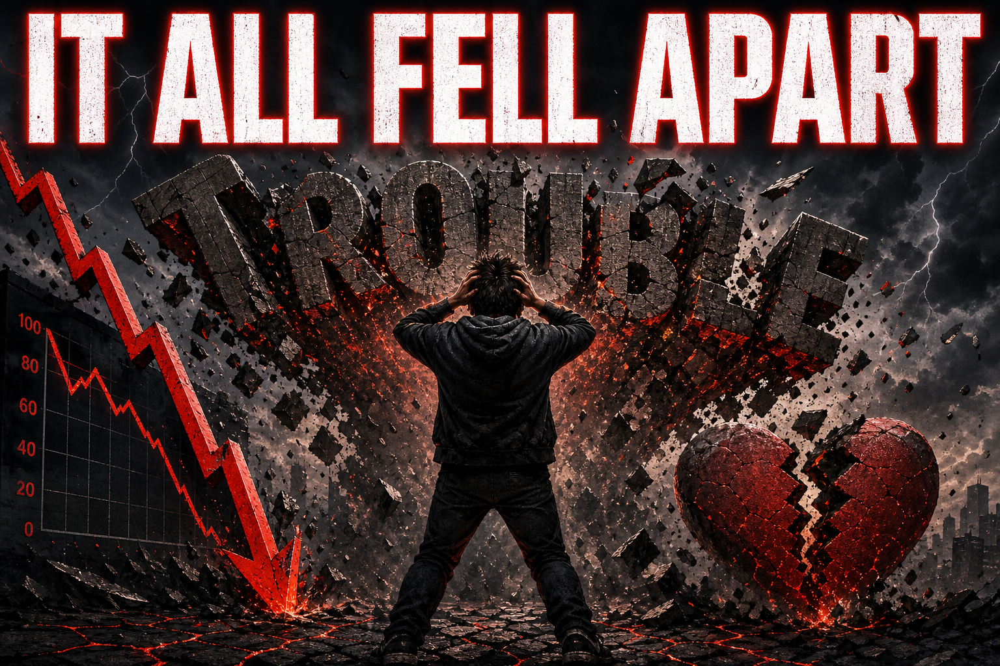

```text
A distraught figure stands amid crumbling, glowing fragments of a collapsing structure that spells trouble, hands in hair, everything breaking apart in slow motion. Dark stormy background with red cracks spreading. Huge text 'IT ALL FELL APART' in white with a red outline across the top, a red down-arrow on a plummeting graph and a broken-heart-style crack. Dust and debris. Emotional, dramatic, high-contrast downfall-reaction energy.
```

[Original source](https://github.com/apimodels/gpt-image-2-prompts/blob/980d100f3bd0f2cde4cf38835daeb742bf1cac65/prompts.json#thumbnail-583) · Model: GPT Image 2 · Credit: APIModels · CC BY 4.0
ProjectD: published-accepted (run42069117745). Complete source prompt and uncropped native preview correspond; generation defects and actual dimensions retained.

## The Truth Comes Out · thumbnail-584
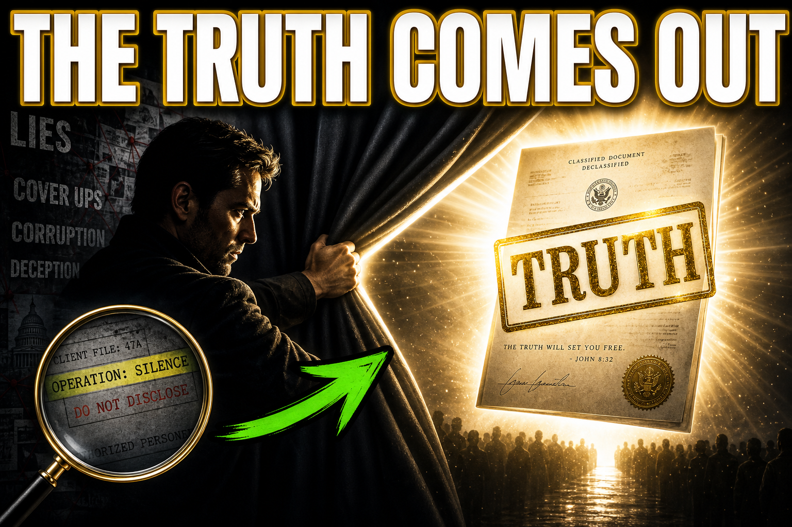

```text
A serious figure pulls back a glowing curtain of shadow to reveal a bright beam of light and a floating document stamped 'TRUTH' in gold, dramatic contrast between dark and light halves. Moody spotlight. Huge text 'THE TRUTH COMES OUT' in white with a gold outline across the top, a green arrow toward the revealed light and a magnifier over a hidden detail. Suspenseful, revealing, high-contrast expose-reaction energy.
```

[Original source](https://github.com/apimodels/gpt-image-2-prompts/blob/980d100f3bd0f2cde4cf38835daeb742bf1cac65/prompts.json#thumbnail-584) · Model: GPT Image 2 · Credit: APIModels · CC BY 4.0
ProjectD: published-accepted (run42069117745). Invented document/operation lettering; not a historical document or allegation.

## I Was So Wrong · thumbnail-585
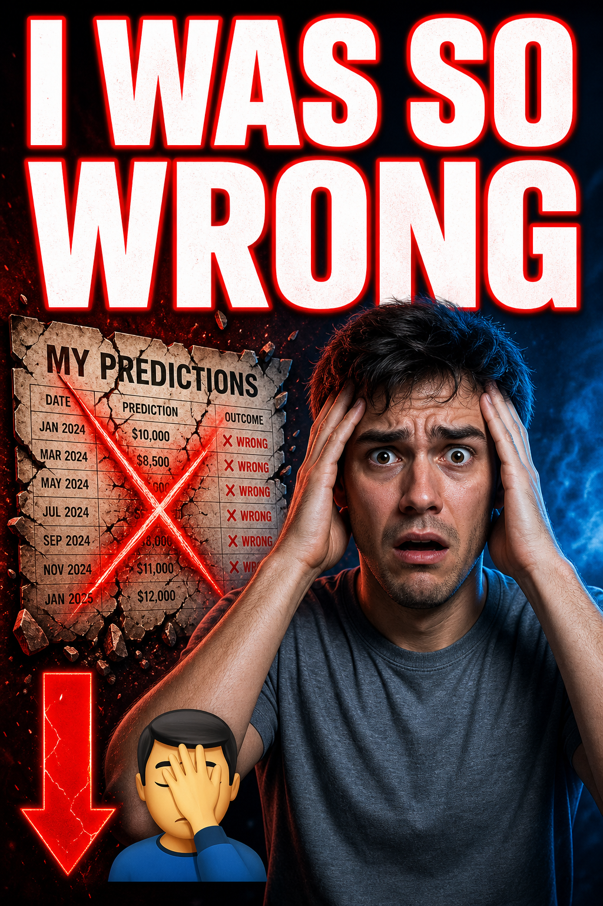

```text
A humbled young man in a plain gray tee presses both palms to his temples with a pained, wide-eyed 'oops' expression, a glowing red X crashing over an old prediction chart behind him. Split lighting: harsh red on the mistake, soft blue on his face. Huge text 'I WAS SO WRONG' in white with a red outline across the top, a red down-arrow and a facepalm icon. Honest, dramatic, high-contrast confession-reaction energy.
```

[Original source](https://github.com/apimodels/gpt-image-2-prompts/blob/980d100f3bd0f2cde4cf38835daeb742bf1cac65/prompts.json#thumbnail-585) · Model: GPT Image 2 · Credit: APIModels · CC BY 4.0
ProjectD: published-accepted (run42069117745). Complete source prompt and uncropped native preview correspond; generation defects and actual dimensions retained.

## Finally Exposed · thumbnail-586
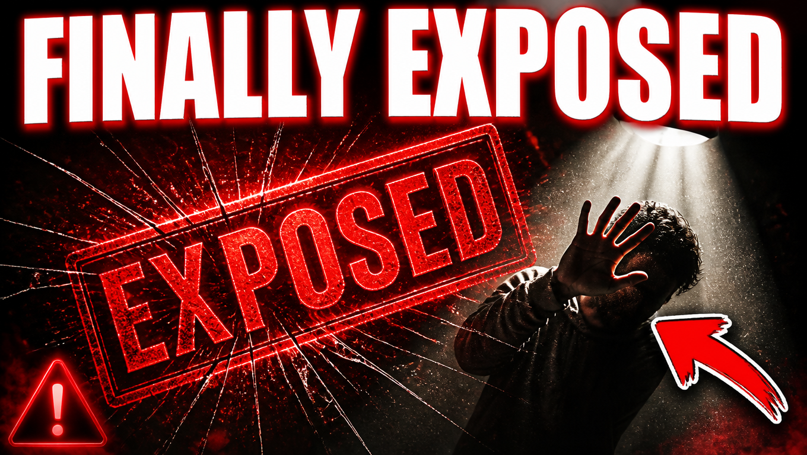

```text
A dramatic thumbnail of a shadowy figure caught in a sudden harsh spotlight, shielding their face, as a glowing red 'EXPOSED' stamp slams diagonally across the frame with cracks radiating. Dark red-and-black background. Huge text 'FINALLY EXPOSED' in white with a red outline across the top, a red arrow at the cornered figure and an alert icon. Dust and light beams. Confrontational, viral, high-contrast drama-reaction energy.
```

[Original source](https://github.com/apimodels/gpt-image-2-prompts/blob/980d100f3bd0f2cde4cf38835daeb742bf1cac65/prompts.json#thumbnail-586) · Model: GPT Image 2 · Credit: APIModels · CC BY 4.0
ProjectD: published-accepted (run42069117745). Complete source prompt and uncropped native preview correspond; generation defects and actual dimensions retained.

## This Ended Careers · thumbnail-587
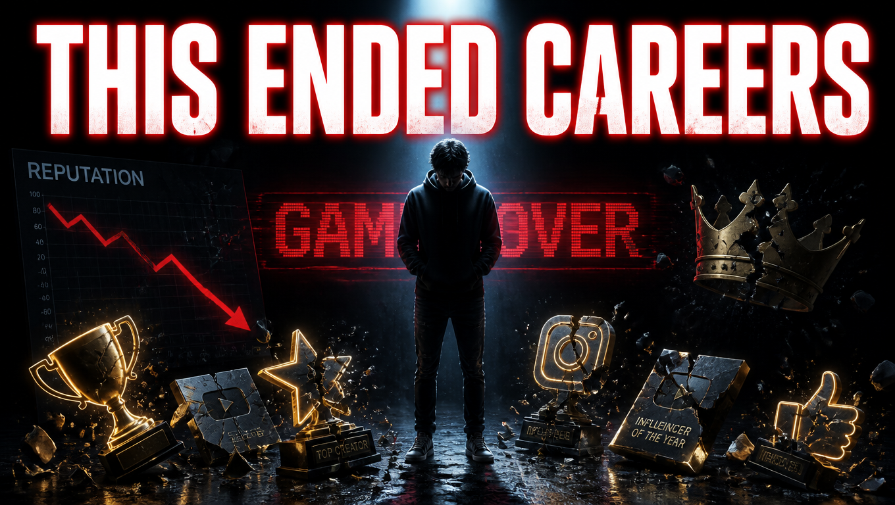

```text
A somber figure stands as glowing trophy and award icons crack and fall to the ground around them, a red 'GAME OVER' style banner flickering behind. Dark moody background with a single cold spotlight. Huge text 'THIS ENDED CAREERS' in white with a red outline across the top, a red down-arrow on a plummeting reputation graph and a broken-crown icon. Falling debris. Serious, dramatic, high-contrast downfall-reaction energy.
```

[Original source](https://github.com/apimodels/gpt-image-2-prompts/blob/980d100f3bd0f2cde4cf38835daeb742bf1cac65/prompts.json#thumbnail-587) · Model: GPT Image 2 · Credit: APIModels · CC BY 4.0
ProjectD: published-accepted (run42069117745). Complete source prompt and uncropped native preview correspond; generation defects and actual dimensions retained.

## Insane Plot Twist · thumbnail-588
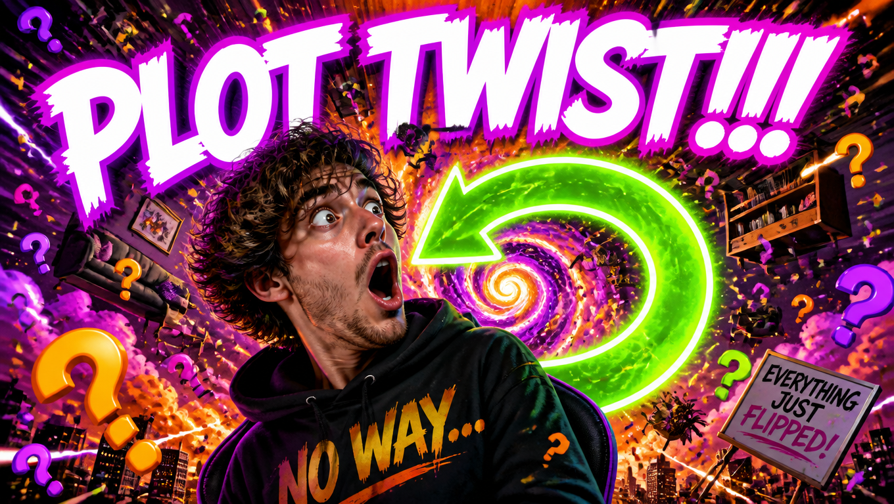

```text
A gasping reactor whips their head around with a shocked 'no way' face as a glowing storyline arrow suddenly u-turns behind them, everything flipping upside down. Explosive purple-and-orange background with a swirl. Huge text 'PLOT TWIST!!!' in white with a magenta outline across the top, a green arrow doubling back on itself and a spiral burst. Confetti of question marks. Chaotic, thrilling, high-contrast reaction energy.
```

[Original source](https://github.com/apimodels/gpt-image-2-prompts/blob/980d100f3bd0f2cde4cf38835daeb742bf1cac65/prompts.json#thumbnail-588) · Model: GPT Image 2 · Credit: APIModels · CC BY 4.0
ProjectD: published-accepted (run42069117745). Complete source prompt and uncropped native preview correspond; generation defects and actual dimensions retained.

## Swan Lake Ballet Gala · poster-659
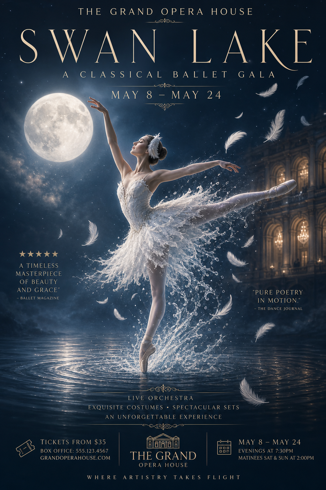

```text
Graceful ballet poster for 'SWAN LAKE', a classical ballet gala at The Grand Opera House, running May 8 to May 24. Hero: an elegant ballerina in a flowing white tutu mid-arabesque, her form dissolving into rippling water and drifting white feathers under a soft moonlit spotlight. Composition: dancer centered in a graceful pose, feathers rising, refined elegant thin serif title with generous spacing at the top, run dates in delicate type below. Palette: moonlit silver-blue, soft white, warm champagne glow, deep midnight, faint gold. Ethereal graceful lighting, soft feather detail, timeless classical elegance. Ticket and performance info at the base. Mood: graceful, ethereal, elegant, timeless.
```

[Original source](https://github.com/apimodels/gpt-image-2-prompts/blob/980d100f3bd0f2cde4cf38835daeb742bf1cac65/prompts.json#poster-659) · Model: GPT Image 2 · Credit: APIModels · CC BY 4.0
ProjectD: published-accepted (run42069117745). Fictional promotional layout; dates/venue/ticket details are generated design copy.

## The Glass Menagerie Revival · poster-660
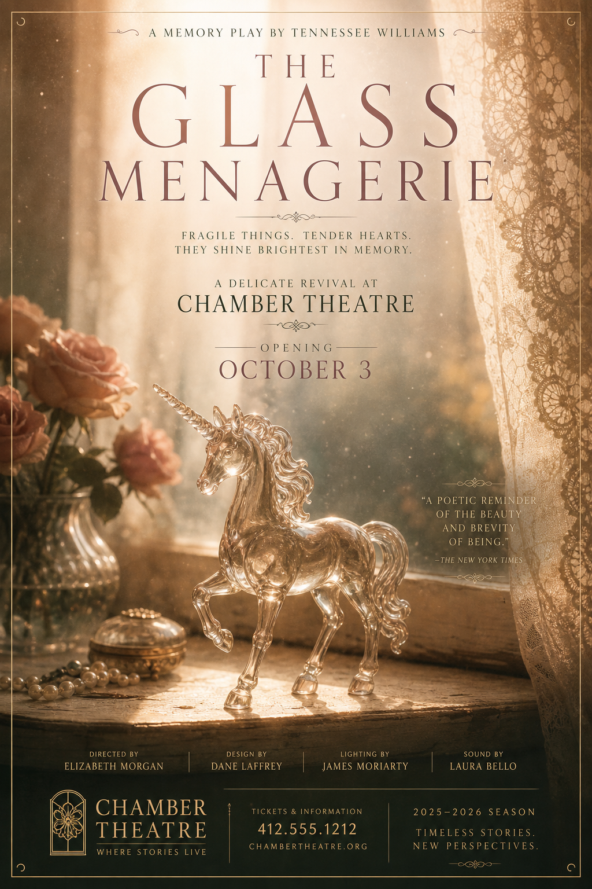

```text
Intimate memory-play theater poster for 'THE GLASS MENAGERIE', a delicate revival at Chamber Theatre, opening October 3. Hero: a fragile glass unicorn figurine glowing softly on a windowsill, warm nostalgic light filtering through a lace curtain, dust motes drifting in the beam. Composition: glass figurine in the lower foreground, soft-focus window light above, delicate refined serif title with gentle spacing at the top, run dates in fine type below. Palette: warm sepia amber, soft dusty rose, faded cream, gentle grey-green, nostalgic gold. Soft memory-play haze, gentle bokeh, tender vintage warmth. Ticket and season info at the base. Mood: nostalgic, fragile, tender, wistful.
```

[Original source](https://github.com/apimodels/gpt-image-2-prompts/blob/980d100f3bd0f2cde4cf38835daeb742bf1cac65/prompts.json#poster-660) · Model: GPT Image 2 · Credit: APIModels · CC BY 4.0
ProjectD: published-accepted (run42069117745). AI promotional concept for a real play, not a verified revival announcement; no play body text reproduced.

## Comedy of Errors Night · poster-661
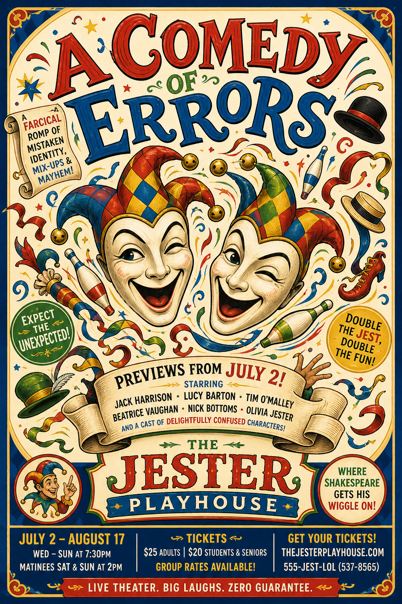

```text
Playful comedy theater poster for 'A COMEDY OF ERRORS', a farcical romp at The Jester Playhouse, previews from July 2. Hero: two identical jester masks mixed up mid-air amid a chaotic swirl of flying hats, tangled ribbons, and juggling pins, a wink of mischief. Composition: energetic circular chaos radiating from center, bouncy playful hand-drawn title with a mismatched bounce at the top, cast and dates on a curling ribbon below. Palette: bright harlequin red, sunny yellow, cobalt blue, mischievous green, cream. Lively theatrical illustration, playful energy, comedic bounce. Ticket and run info at the base. Mood: hilarious, chaotic, playful, mischievous.
```

[Original source](https://github.com/apimodels/gpt-image-2-prompts/blob/980d100f3bd0f2cde4cf38835daeb742bf1cac65/prompts.json#poster-661) · Model: GPT Image 2 · Credit: APIModels · CC BY 4.0
ProjectD: published-accepted (run42069117745). Synthetic theatre/performer and ticket details, not a verified performance.

## Phantom Opera Spectacle · poster-662
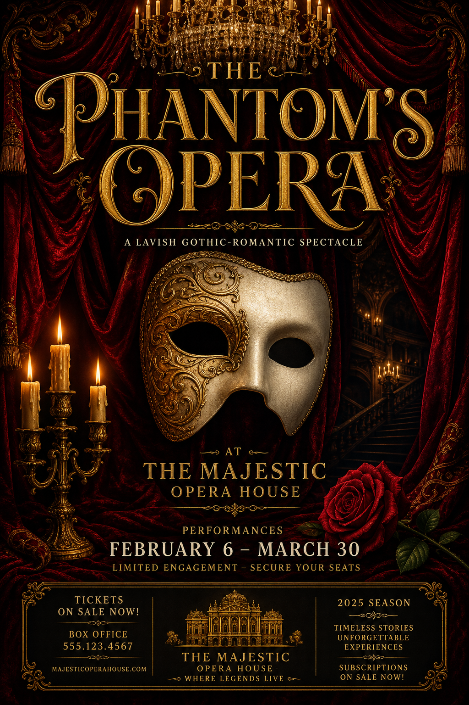

```text
Grand opera poster for 'THE PHANTOM'S OPERA', a lavish gothic-romantic spectacle at The Majestic Opera House, running February 6 to March 30. Hero: an ornate half-mask floating before a cascading crimson velvet curtain, a single red rose and a flickering candelabra below, grand chandelier glinting above. Composition: mask centered and commanding, luxurious curtain draping the frame, ornate elegant engraved serif title in gold at the top, run dates in refined type below. Palette: deep crimson velvet, antique gold, ivory mask white, black shadow, candle amber. Opulent gothic-romantic drama, rich velvet texture, gilded detail. Ticket and season info at the base. Mood: dramatic, romantic, opulent, mysterious.
```

[Original source](https://github.com/apimodels/gpt-image-2-prompts/blob/980d100f3bd0f2cde4cf38835daeb742bf1cac65/prompts.json#poster-662) · Model: GPT Image 2 · Credit: APIModels · CC BY 4.0
ProjectD: published-accepted (run42069117745). Complete source prompt and uncropped native preview correspond; generation defects and actual dimensions retained.

## Shadow Puppets Folk Tale · poster-663
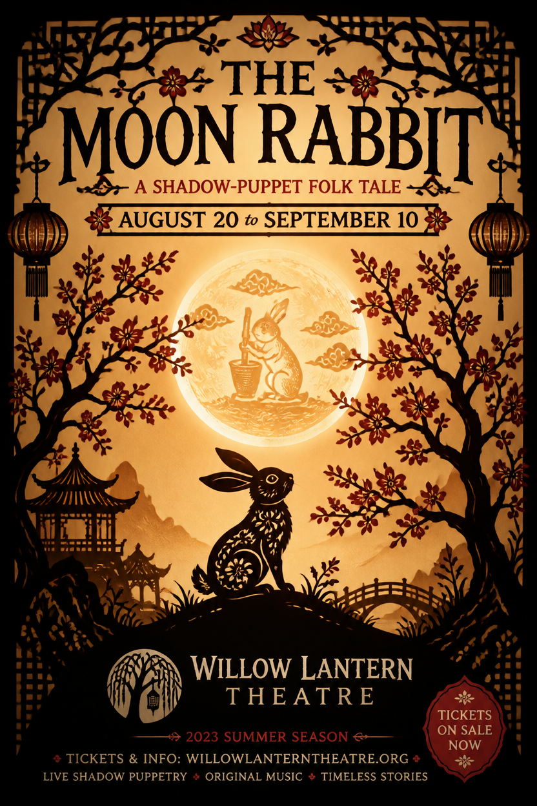

```text
Enchanting shadow-play theater poster for 'THE MOON RABBIT', a shadow-puppet folk tale at Willow Lantern Theatre, running August 20 to September 10. Hero: intricate paper-cut shadow-puppet silhouettes of a rabbit, moon, and blossoming trees backlit in warm amber against a translucent screen, delicate lace-like cut detail. Composition: layered shadow-puppet scene, glowing moon centered, delicate hand-cut style title with folk-ornament flourishes at the top, run dates below. Palette: warm amber backlight, deep silhouette black, soft red accent, cream screen glow. Authentic paper-cut shadow-play aesthetic, translucent glow, intricate folk detail. Ticket and season info at the base. Mood: enchanting, delicate, folkloric, warm.
```

[Original source](https://github.com/apimodels/gpt-image-2-prompts/blob/980d100f3bd0f2cde4cf38835daeb742bf1cac65/prompts.json#poster-663) · Model: GPT Image 2 · Credit: APIModels · CC BY 4.0
ProjectD: published-accepted (run42069117745). Complete source prompt and uncropped native preview correspond; generation defects and actual dimensions retained.

## Neon City Musical · poster-664
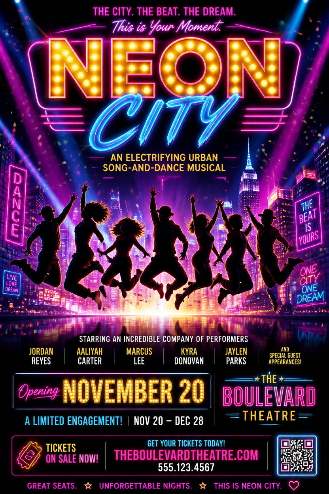

```text
Vibrant contemporary musical poster for 'NEON CITY', an electrifying urban song-and-dance musical at The Boulevard Theatre, opening November 20. Hero: a dazzling ensemble of dancer silhouettes leaping in unison against a glowing neon city skyline, streaks of stage light and confetti bursting overhead. Composition: dynamic dancer line across the center, neon skyline behind, bold vibrant retro-marquee title with glowing bulb lettering at the top, cast and dates below. Palette: hot pink, electric blue, neon purple, gold marquee glow, deep night black. Dazzling marquee glow, dynamic stage energy, glossy showbiz sparkle. Ticket and run info at the base. Mood: dazzling, energetic, glamorous, uplifting.
```

[Original source](https://github.com/apimodels/gpt-image-2-prompts/blob/980d100f3bd0f2cde4cf38835daeb742bf1cac65/prompts.json#poster-664) · Model: GPT Image 2 · Credit: APIModels · CC BY 4.0
ProjectD: published-accepted (run42069117745). Generated cast names and theatre schedule are fictional promotional lettering.

## Aurora Ice Lounge Night · poster-665
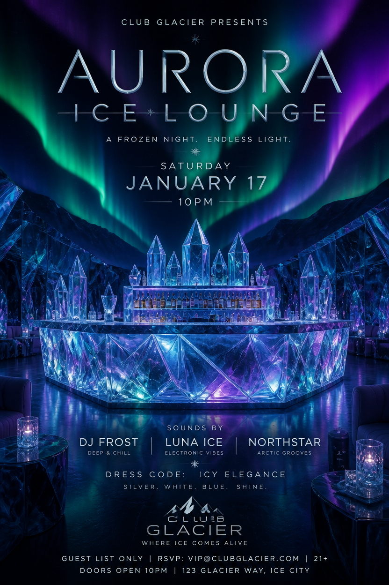

```text
Cool upscale winter club poster for 'AURORA ICE LOUNGE', a frozen-themed party at Club Glacier, Saturday January 17, 10PM. Hero: a glowing ice crystal cocktail bar shimmering with shifting aurora-borealis light ribbons overhead, frosted geometric facets refracting cold neon. Composition: crystalline bar centered, aurora waves sweeping the top, sleek thin modern sans title with an icy metallic sheen, DJ lineup and dress-code line below. Palette: glacial blue, aurora green-violet, silver frost, deep icy navy. Cold crystalline shimmer, refractive glints, upscale frozen glamour. Guest list and door info at the base. Mood: cool, glamorous, frosty, hypnotic.
```

[Original source](https://github.com/apimodels/gpt-image-2-prompts/blob/980d100f3bd0f2cde4cf38835daeb742bf1cac65/prompts.json#poster-665) · Model: GPT Image 2 · Credit: APIModels · CC BY 4.0
ProjectD: published-accepted (run42069117745). Generated DJ lineup and date are design copy, not a real event.

## Cocoa Carnival Chocolate Fair · poster-666
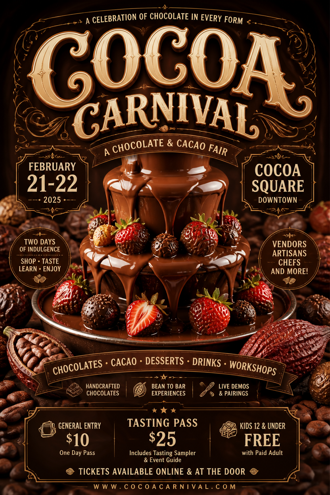

```text
Indulgent chocolate festival poster for 'COCOA CARNIVAL', a chocolate and cacao fair at Cocoa Square, February 21-22. Hero: a decadent chocolate fountain cascading glossy molten chocolate over fresh strawberries and truffles, cocoa beans and dark cacao pods scattered around. Composition: rich flowing chocolate fountain centered, glossy indulgent close-up, warm ornate vintage-confectionery serif title at the top, vendor and ticket details on a chocolate-brown ribbon below. Palette: deep chocolate brown, caramel gold, strawberry red, cream, cocoa cream. Glossy molten texture, warm indulgent light, rich decadent detail. Entry and tasting info at the base. Mood: indulgent, rich, warm, mouthwatering.
```

[Original source](https://github.com/apimodels/gpt-image-2-prompts/blob/980d100f3bd0f2cde4cf38835daeb742bf1cac65/prompts.json#poster-666) · Model: GPT Image 2 · Credit: APIModels · CC BY 4.0
ProjectD: published-accepted (run42069117745). Complete source prompt and uncropped native preview correspond; generation defects and actual dimensions retained.

## Sandline Beach Volleyball · poster-667
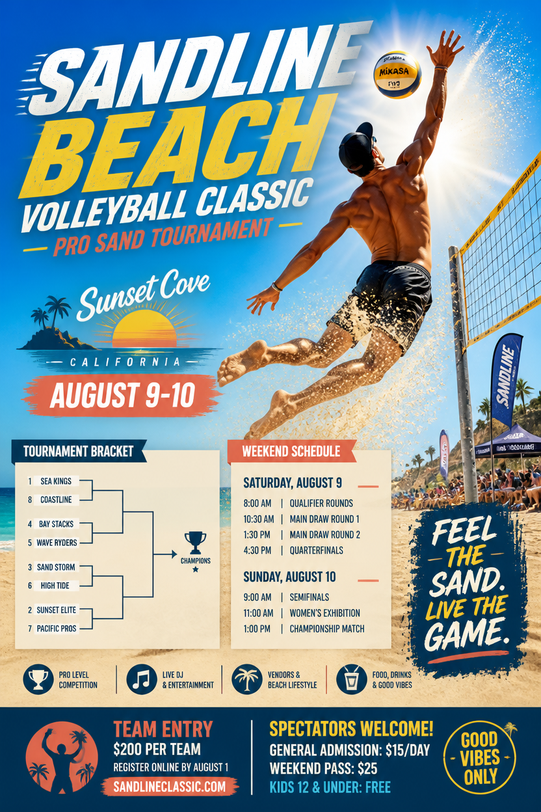

```text
Energetic beach-sports poster for the 'SANDLINE BEACH VOLLEYBALL CLASSIC', a pro sand tournament at Sunset Cove, August 9-10. Hero: a dynamic mid-air spike silhouette against a bright volleyball soaring, sand spraying dramatically, sparkling blue ocean and clear sky behind. Composition: leaping player upper-right, ball as focal point, dynamic energy, bold italic athletic sans title at the top, bracket and schedule info below. Palette: bright sky blue, warm sand gold, ocean turquoise, sunny yellow, coral accent. Bright sunny beach light, dynamic sand-spray motion, crisp summer energy. Entry and spectator info at the base. Mood: energetic, sunny, competitive, coastal.
```

[Original source](https://github.com/apimodels/gpt-image-2-prompts/blob/980d100f3bd0f2cde4cf38835daeb742bf1cac65/prompts.json#poster-667) · Model: GPT Image 2 · Credit: APIModels · CC BY 4.0
ProjectD: published-accepted (run42069117745). Complete source prompt and uncropped native preview correspond; generation defects and actual dimensions retained.

## Blank Space Poster · poster-670
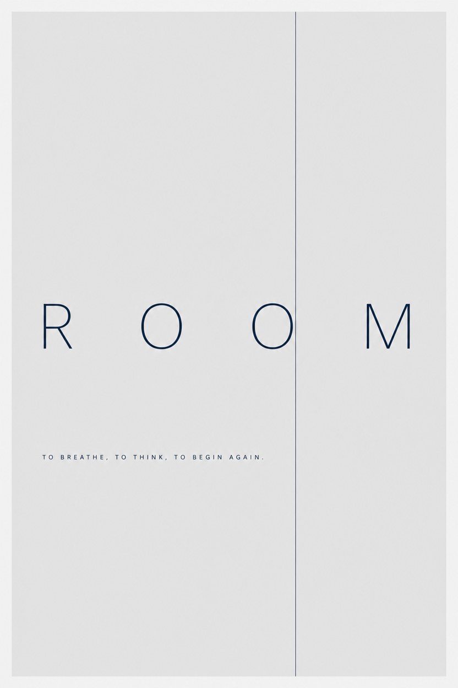

```text
A minimalist typographic poster exploring emptiness. On a pale grey field, the word 'ROOM' is set enormous in a thin geometric sans, letters spaced far apart so wide gaps open between each character. Below, in tiny caps, runs 'to breathe, to think, to begin again.' A single hairline vertical rule divides the sheet at the golden ratio. Palette limited to soft grey and deep navy ink. Museum-poster restraint, generous margins, calm and contemplative.
```

[Original source](https://github.com/apimodels/gpt-image-2-prompts/blob/980d100f3bd0f2cde4cf38835daeb742bf1cac65/prompts.json#poster-670) · Model: GPT Image 2 · Credit: APIModels · CC BY 4.0
ProjectD: published-accepted (run42069117745). Complete source prompt and uncropped native preview correspond; generation defects and actual dimensions retained.

## OrbitLaunch Space Expo · poster-668
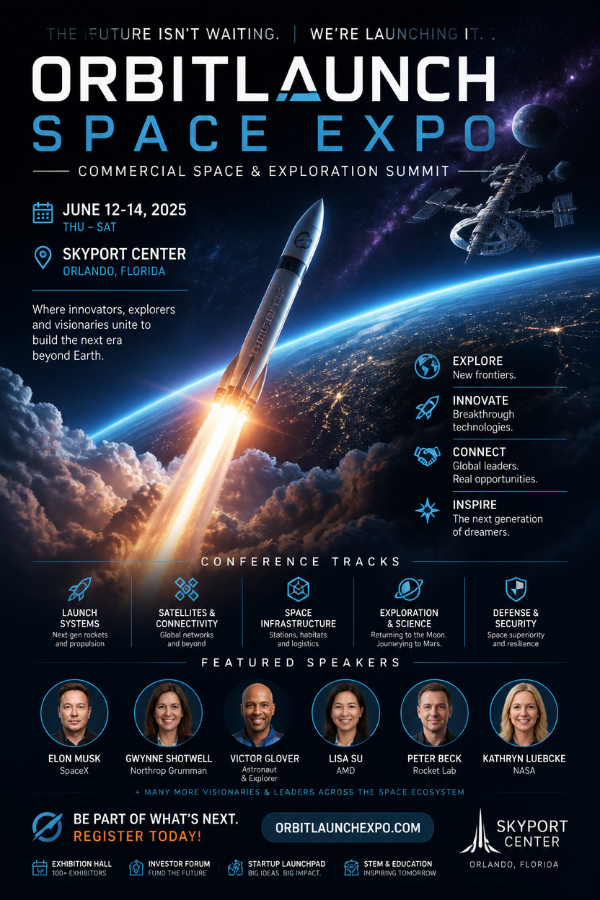

```text
Inspiring aerospace conference poster for 'ORBITLAUNCH SPACE EXPO', a commercial-space and exploration summit at Skyport Center, June 12-14. Hero: a sleek fictional rocket ascending on a plume of light through wispy clouds toward a star-filled sky, an orbital station and glowing blue Earth curve on the horizon. Composition: rocket rising diagonally from bottom, cosmic horizon above, confident modern geometric sans title at the top, tracks and speakers in a clean grid below. Palette: deep space navy, rocket-plume orange, cosmic violet, Earth-glow cyan, white. Sleek aspirational glow, cinematic space clarity, premium futuristic polish. Registration and venue at the base. Mood: inspiring, ambitious, visionary, expansive.
```

[Original source](https://github.com/apimodels/gpt-image-2-prompts/blob/980d100f3bd0f2cde4cf38835daeb742bf1cac65/prompts.json#poster-668) · Model: GPT Image 2 · Credit: APIModels · CC BY 4.0
ProjectD: held. Generated conference poster adds named featured speakers/portraits whose event involvement is not established; retain archive, hold ProjectD.

## Silence Speaks Loud · poster-669
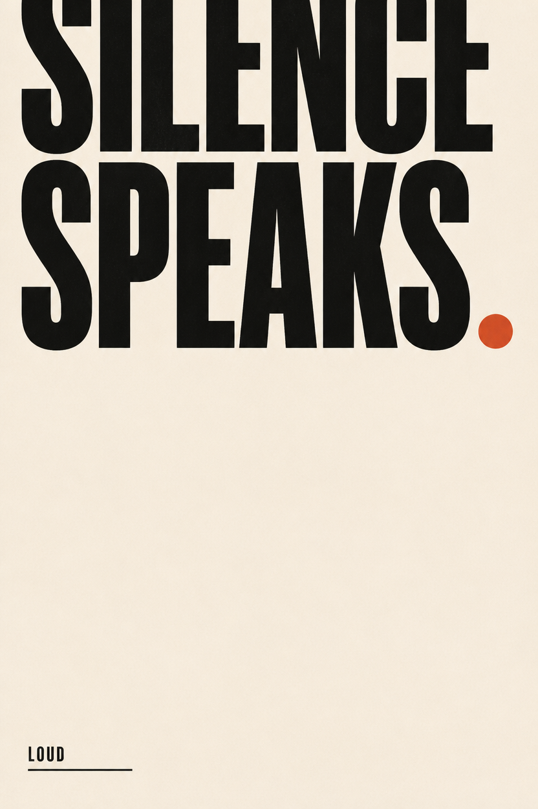

```text
A minimalist typographic poster on a warm bone-white background. The single phrase 'SILENCE SPEAKS' set in a heavy condensed grotesque, stacked as two lines and cropped so the ascenders bleed off the top edge. Negative space dominates the lower two-thirds. One thin charcoal underline sits beneath the word 'LOUD' printed small at bottom-left. Palette of ink black on cream, a single burnt-orange dot as punctuation. Flat matte print texture, precise kerning, gallery-quiet mood.
```

[Original source](https://github.com/apimodels/gpt-image-2-prompts/blob/980d100f3bd0f2cde4cf38835daeb742bf1cac65/prompts.json#poster-669) · Model: GPT Image 2 · Credit: APIModels · CC BY 4.0
ProjectD: published-accepted (run42069117745). Complete source prompt and uncropped native preview correspond; generation defects and actual dimensions retained.

## Margin Notes · poster-674
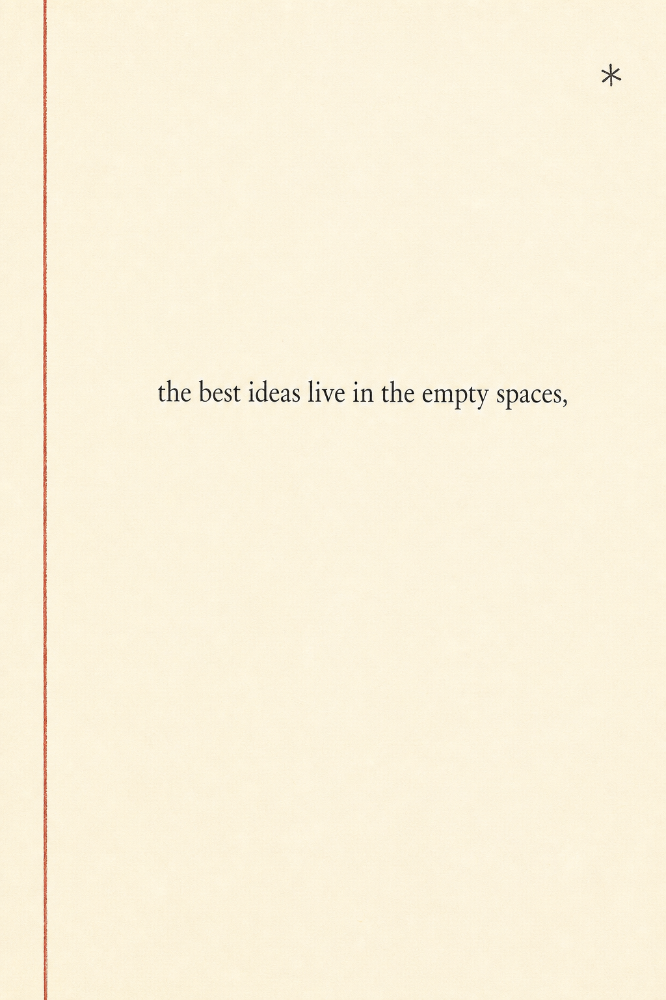

```text
A minimalist typographic poster imitating a manuscript page. A wide left margin holds a single vertical red rule; the body area carries one centered sentence, 'the best ideas live in the empty spaces,' set in an elegant serif. A handwritten-style asterisk floats near the top corner. Vast cream paper untouched below. Palette of warm cream, black serif, one vermilion rule. Quiet literary sophistication, refined margins, understated.
```

[Original source](https://github.com/apimodels/gpt-image-2-prompts/blob/980d100f3bd0f2cde4cf38835daeb742bf1cac65/prompts.json#poster-674) · Model: GPT Image 2 · Credit: APIModels · CC BY 4.0
ProjectD: published-accepted (run42069117745). Complete source prompt and uncropped native preview correspond; generation defects and actual dimensions retained.

## Vertical Rhythm Study · poster-672
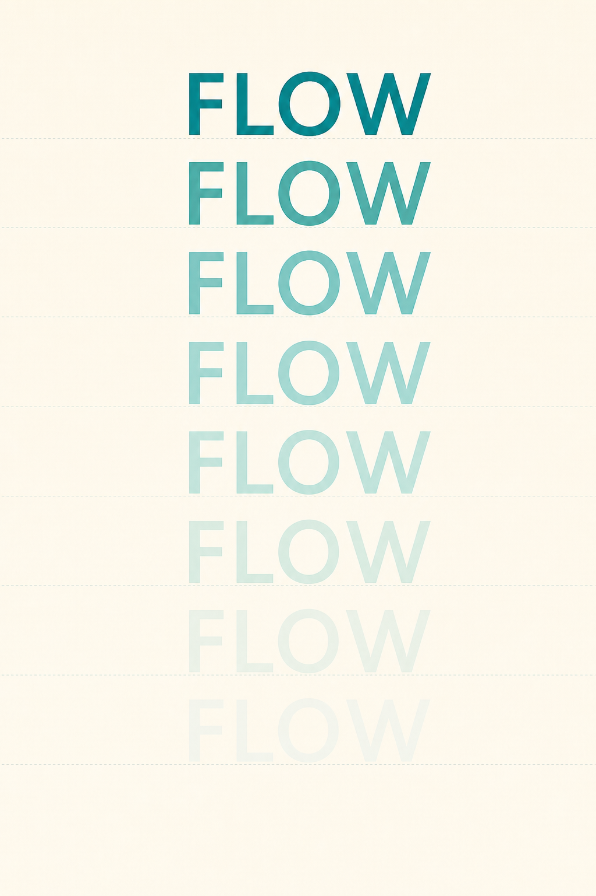

```text
A minimalist typographic poster built from a single word 'FLOW' repeated vertically nine times down the center, each repetition in a lighter tint of teal until it fades to nearly white at the bottom. The topmost word is bold and saturated; the type is a clean humanist sans. Thin baseline grid faintly visible. Background is warm ivory. Palette of graduated teals on ivory. Rhythmic, meditative, precise, poster-as-object.
```

[Original source](https://github.com/apimodels/gpt-image-2-prompts/blob/980d100f3bd0f2cde4cf38835daeb742bf1cac65/prompts.json#poster-672) · Model: GPT Image 2 · Credit: APIModels · CC BY 4.0
ProjectD: published-accepted (run42069117745). Complete source prompt and uncropped native preview correspond; generation defects and actual dimensions retained.

## Less But Better · poster-671
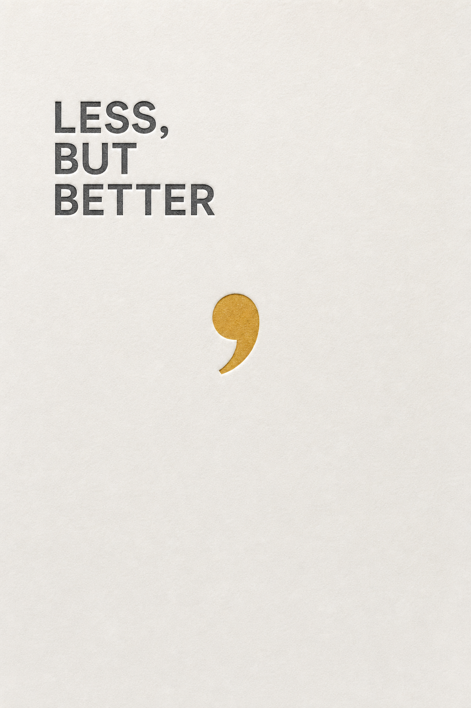

```text
A minimalist design poster reading 'LESS, BUT BETTER' in a precise neutral sans-serif, left-aligned and set in three tight lines high on the sheet. The rest is untouched off-white paper. A comma is rendered oversized in a muted mustard, becoming the only graphic element, floating mid-page. Subtle letterpress deboss texture around the type. Palette of paper white, graphite type, one mustard accent. Cool, deliberate, design-studio elegance.
```

[Original source](https://github.com/apimodels/gpt-image-2-prompts/blob/980d100f3bd0f2cde4cf38835daeb742bf1cac65/prompts.json#poster-671) · Model: GPT Image 2 · Credit: APIModels · CC BY 4.0
ProjectD: published-accepted (run42069117745). Complete source prompt and uncropped native preview correspond; generation defects and actual dimensions retained.

## Question Mark Poster · poster-673
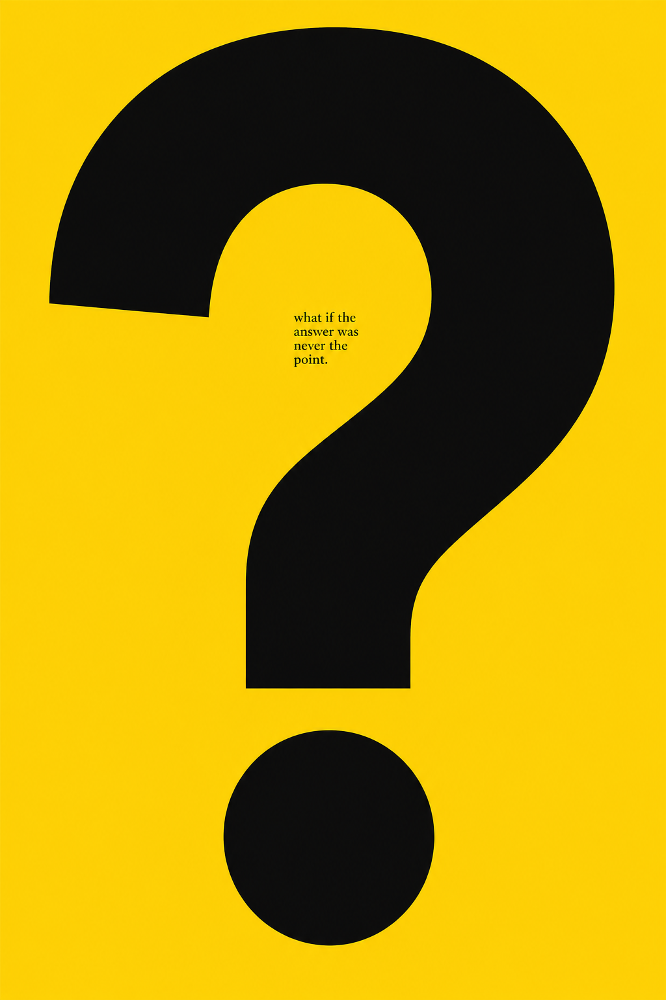

```text
A bold minimalist poster dominated by a single giant question mark rendered as pure geometry, its dot a perfect circle at the base. Inside the curve of the mark, in tiny justified type, sits the line 'what if the answer was never the point.' Stark black form on a saturated cadmium-yellow field. No other elements. Flat vector cleanliness, extreme scale contrast, confident and conceptual, gallery print aesthetic.
```

[Original source](https://github.com/apimodels/gpt-image-2-prompts/blob/980d100f3bd0f2cde4cf38835daeb742bf1cac65/prompts.json#poster-673) · Model: GPT Image 2 · Credit: APIModels · CC BY 4.0
ProjectD: published-accepted (run42069117745). Complete source prompt and uncropped native preview correspond; generation defects and actual dimensions retained.

## One Sentence Poster · poster-676
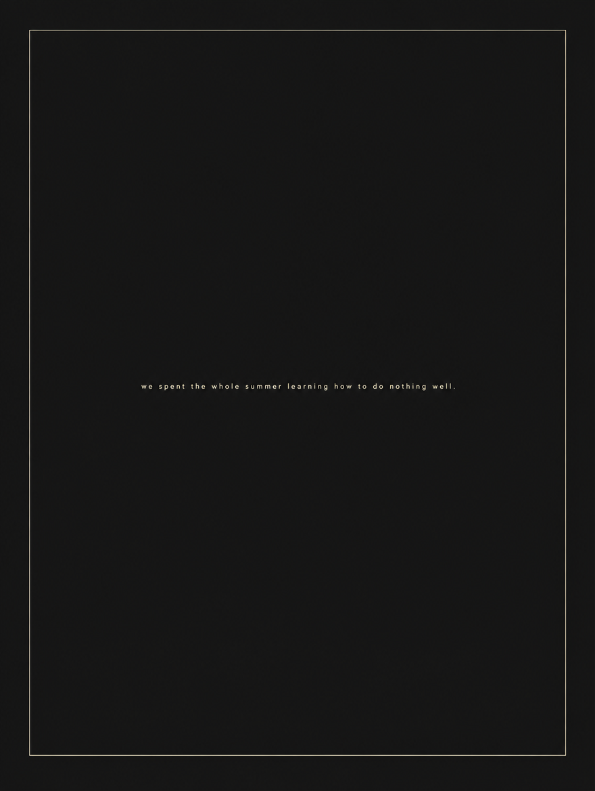

```text
An ultra-minimal poster carrying a single long sentence set very small and centered on a huge empty charcoal-black sheet: 'we spent the whole summer learning how to do nothing well.' The type is a refined light sans in warm off-white, letter-spaced generously. A faint thin frame of the same off-white borders the page far inside the edges. Palette of near-black and soft ivory. Cinematic emptiness, intimate, poetic minimalism.
```

[Original source](https://github.com/apimodels/gpt-image-2-prompts/blob/980d100f3bd0f2cde4cf38835daeb742bf1cac65/prompts.json#poster-676) · Model: GPT Image 2 · Credit: APIModels · CC BY 4.0
ProjectD: published-accepted (run42069117745). Complete source prompt and uncropped native preview correspond; generation defects and actual dimensions retained.

## Overlap Type Poster · poster-675
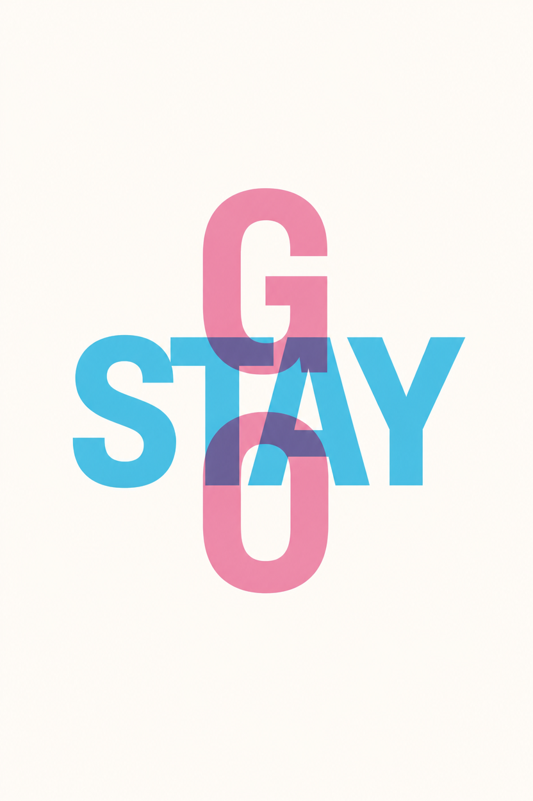

```text
A minimalist poster where two words 'STAY' and 'GO' overlap at the center, printed in translucent inks so the intersection blends into a third muddy tone. Set in a heavy modern sans, one word horizontal, the other rotated ninety degrees. Everything else is bare warm-white. Palette of transparent cyan and magenta overlapping into violet. Screen-print registration feel, clever conceptual tension, minimal and smart.
```

[Original source](https://github.com/apimodels/gpt-image-2-prompts/blob/980d100f3bd0f2cde4cf38835daeb742bf1cac65/prompts.json#poster-675) · Model: GPT Image 2 · Credit: APIModels · CC BY 4.0
ProjectD: published-accepted (run42069117745). Complete source prompt and uncropped native preview correspond; generation defects and actual dimensions retained.

## Dot Grid Minimal · poster-677
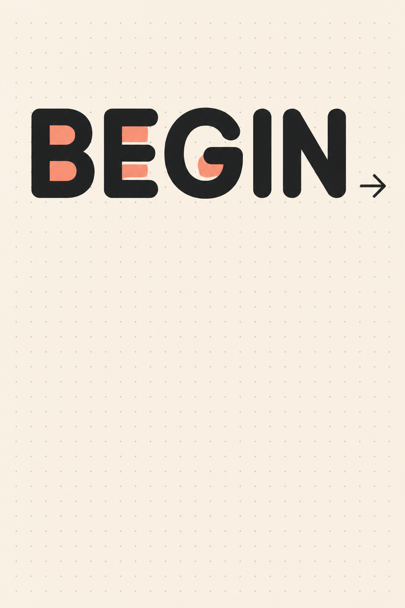

```text
A minimalist typographic poster over a faint regular dot grid. In the upper third, 'BEGIN' is set in bold rounded sans, its counter-spaces filled with a single coral hue. The rest of the grid stays untouched pale beige. A tiny arrow icon points from the last letter toward the empty lower field. Palette of beige ground, near-black type, coral fill. Clean Scandinavian minimalism, airy, optimistic, precise alignment.
```

[Original source](https://github.com/apimodels/gpt-image-2-prompts/blob/980d100f3bd0f2cde4cf38835daeb742bf1cac65/prompts.json#poster-677) · Model: GPT Image 2 · Credit: APIModels · CC BY 4.0
ProjectD: published-accepted (run42069117745). Complete source prompt and uncropped native preview correspond; generation defects and actual dimensions retained.

## Cut In Half · poster-678
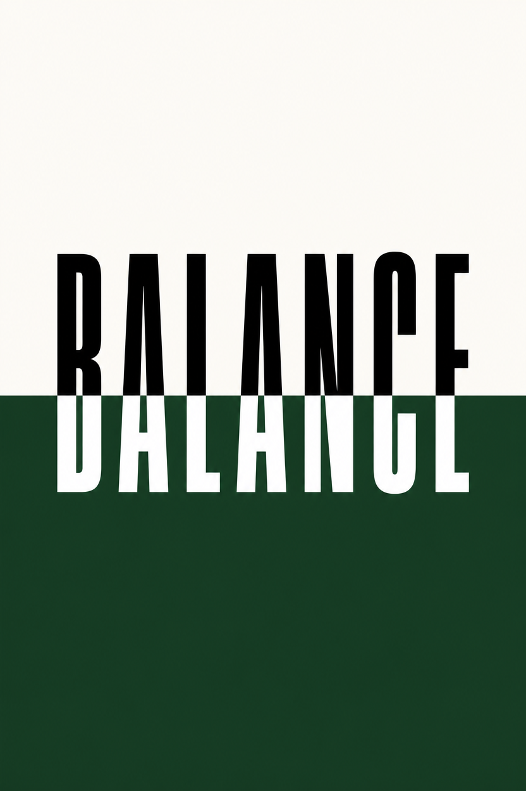

```text
A minimalist poster split precisely into two horizontal halves, top pure warm white, bottom deep forest green. The word 'BALANCE' straddles the dividing line, its top half black on white, bottom half white on green, set in a tall condensed sans. No other elements but the clean seam. Palette of forest green and warm white with black type. Bold color-block minimalism, perfect symmetry, confident restraint.
```

[Original source](https://github.com/apimodels/gpt-image-2-prompts/blob/980d100f3bd0f2cde4cf38835daeb742bf1cac65/prompts.json#poster-678) · Model: GPT Image 2 · Credit: APIModels · CC BY 4.0
ProjectD: published-accepted (run42069117745). Complete source prompt and uncropped native preview correspond; generation defects and actual dimensions retained.

## Rise Anyway Quote · poster-679
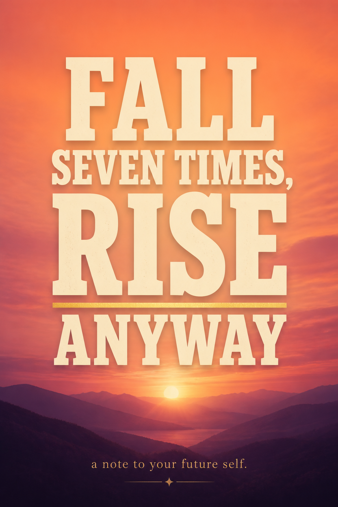

```text
A motivational quote poster with the line 'FALL SEVEN TIMES, RISE ANYWAY' set in a confident bold slab serif, stacked in three lines and centered. Behind the text, a soft sunrise gradient climbs from deep plum at the bottom to warm apricot at the top. A thin gold horizontal line underscores the word 'RISE'. Small caption at base: 'a note to your future self.' Uplifting, warm, cinematic glow, poster-print polish.
```

[Original source](https://github.com/apimodels/gpt-image-2-prompts/blob/980d100f3bd0f2cde4cf38835daeb742bf1cac65/prompts.json#poster-679) · Model: GPT Image 2 · Credit: APIModels · CC BY 4.0
ProjectD: published-accepted (run42069117745). Complete source prompt and uncropped native preview correspond; generation defects and actual dimensions retained.

## Do It Scared · poster-680
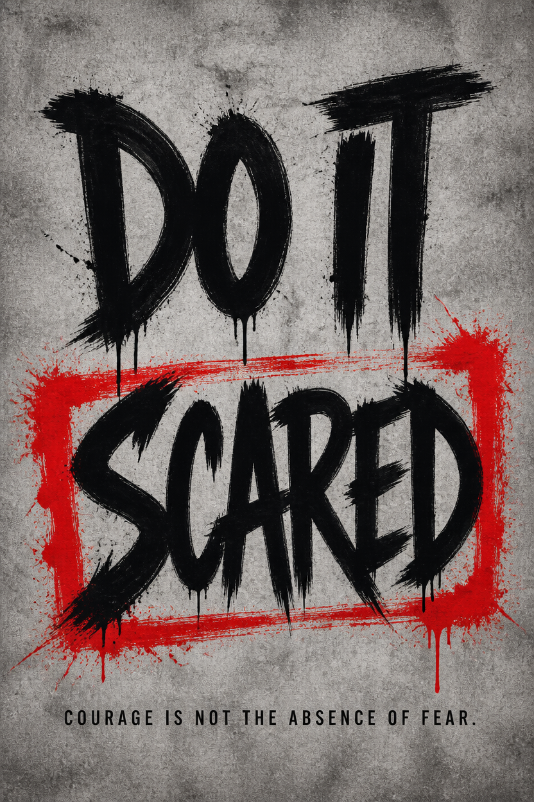

```text
A motivational poster reading 'DO IT SCARED' in enormous hand-painted brush lettering, ink strokes rough and energetic, dripping slightly at the ends. The background is a textured concrete grey. Below, a neat line of small sans caps: 'courage is not the absence of fear.' A single splash of electric red frames the word 'SCARED'. Palette of concrete grey, black brush ink, electric red. Raw, gritty, urban-motivational energy.
```

[Original source](https://github.com/apimodels/gpt-image-2-prompts/blob/980d100f3bd0f2cde4cf38835daeb742bf1cac65/prompts.json#poster-680) · Model: GPT Image 2 · Credit: APIModels · CC BY 4.0
ProjectD: published-accepted (run42069117745). Complete source prompt and uncropped native preview correspond; generation defects and actual dimensions retained.

## Progress Not Perfect · poster-682
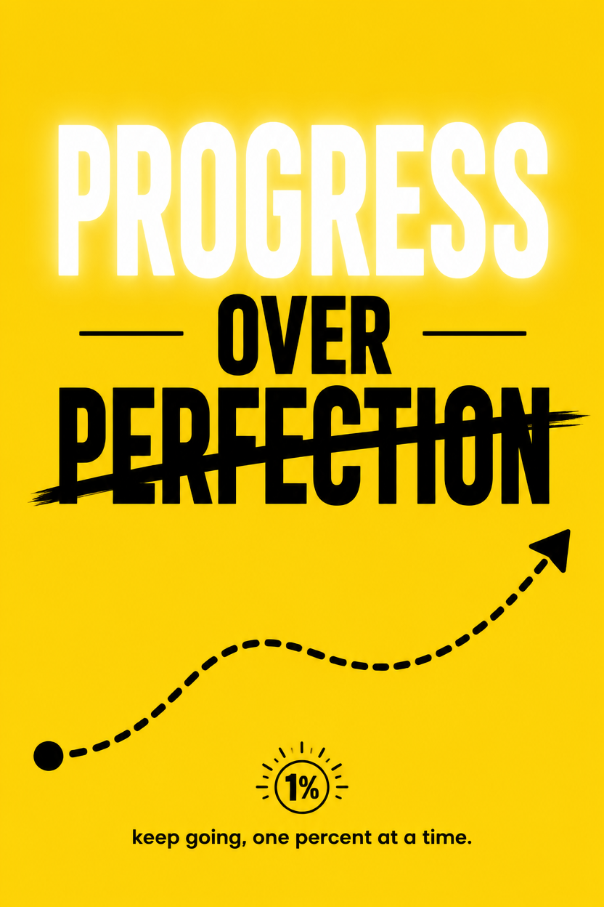

```text
A clean motivational poster stating 'PROGRESS OVER PERFECTION' in bold geometric sans, centered on a bright canary-yellow field. The word 'PERFECTION' is crossed out with a single confident diagonal black stroke, and 'PROGRESS' glows above it in white. A dotted upward path line curves through the lower half. Small tagline: 'keep going, one percent at a time.' Bright, energetic, modern coaching-poster mood, high contrast.
```

[Original source](https://github.com/apimodels/gpt-image-2-prompts/blob/980d100f3bd0f2cde4cf38835daeb742bf1cac65/prompts.json#poster-682) · Model: GPT Image 2 · Credit: APIModels · CC BY 4.0
ProjectD: published-accepted (run42069117745). Complete source prompt and uncropped native preview correspond; generation defects and actual dimensions retained.

## Grow Through It · poster-681
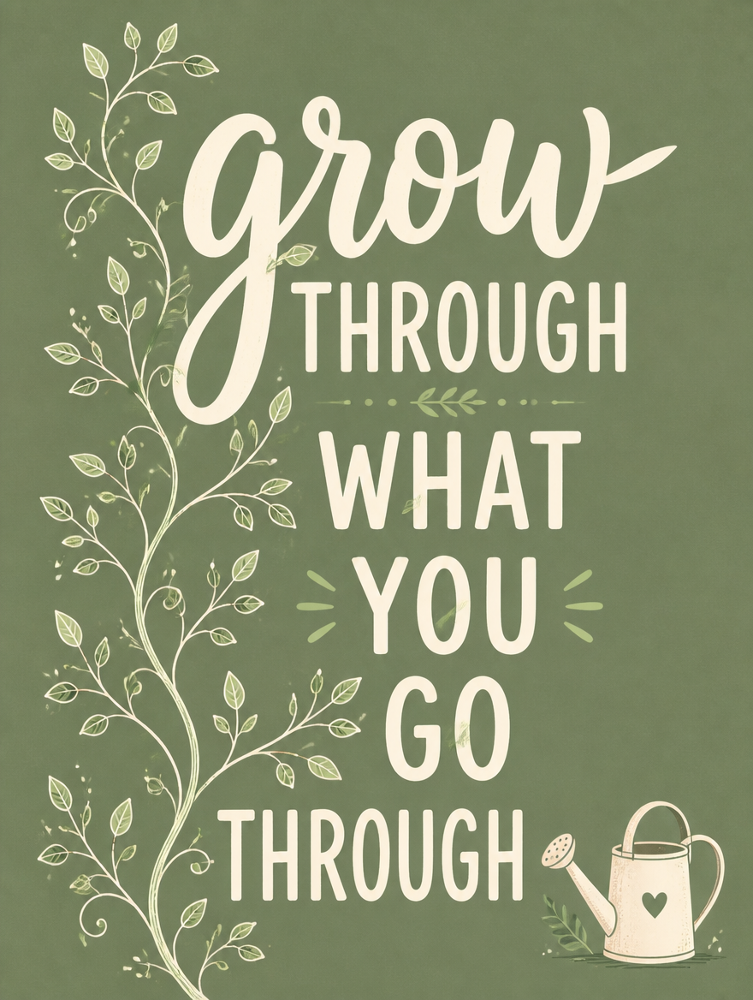

```text
A motivational quote poster with 'GROW THROUGH WHAT YOU GO THROUGH' arranged as playful stacked lines, mixing a rounded script for 'grow' with clean caps for the rest. Botanical line-art vines curl up the left edge, sprouting tiny leaves that weave between the letters. Soft sage-green background with cream type. A small watering-can icon sits bottom-right. Fresh, hopeful, hand-crafted, botanical-motivational aesthetic.
```

[Original source](https://github.com/apimodels/gpt-image-2-prompts/blob/980d100f3bd0f2cde4cf38835daeb742bf1cac65/prompts.json#poster-681) · Model: GPT Image 2 · Credit: APIModels · CC BY 4.0
ProjectD: published-accepted (run42069117745). Complete source prompt and uncropped native preview correspond; generation defects and actual dimensions retained.

## Stay Hungry Poster · poster-683
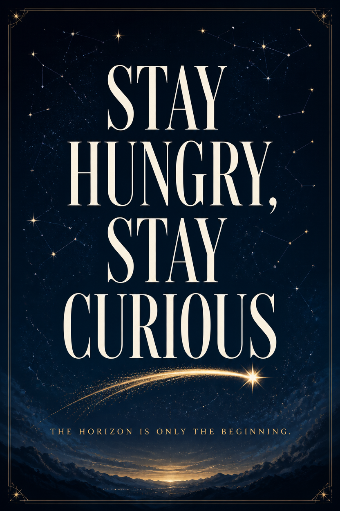

```text
A motivational poster with 'STAY HUNGRY, STAY CURIOUS' set in a tall elegant serif reversed out of a deep midnight-blue background scattered with faint constellation dots and thin star lines. A single golden shooting-star streak underlines the phrase. Small caps footer: 'the horizon is only the beginning.' Palette of midnight blue, warm gold, soft white. Aspirational, celestial, sophisticated, dreamy nighttime elegance.
```

[Original source](https://github.com/apimodels/gpt-image-2-prompts/blob/980d100f3bd0f2cde4cf38835daeb742bf1cac65/prompts.json#poster-683) · Model: GPT Image 2 · Credit: APIModels · CC BY 4.0
ProjectD: published-accepted (run42069117745). Complete source prompt and uncropped native preview correspond; generation defects and actual dimensions retained.

## One Day Or Day One · poster-684
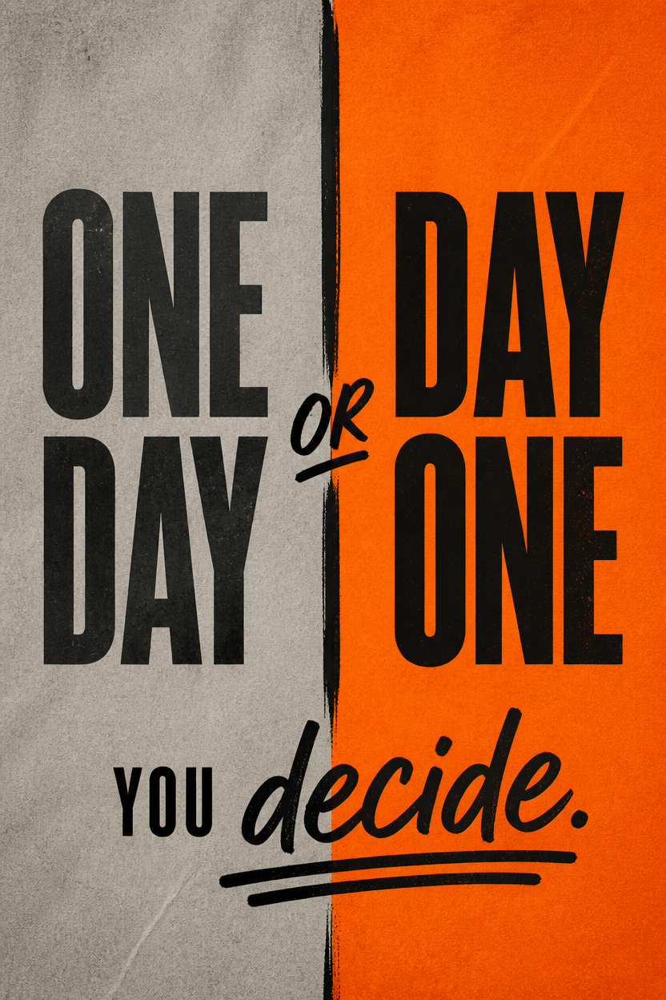

```text
A motivational typographic poster posing the choice 'ONE DAY or DAY ONE — you decide.' The two phrases sit on opposing sides of a bold vertical divider, left half in muted grey, right half in vivid tangerine. The word 'decide' is handwritten in a casual marker script at the bottom, underlined twice. Textured paper background. Palette of grey, tangerine, ink black. Decisive, punchy, split-screen motivational design.
```

[Original source](https://github.com/apimodels/gpt-image-2-prompts/blob/980d100f3bd0f2cde4cf38835daeb742bf1cac65/prompts.json#poster-684) · Model: GPT Image 2 · Credit: APIModels · CC BY 4.0
ProjectD: published-accepted (run42069117745). Complete source prompt and uncropped native preview correspond; generation defects and actual dimensions retained.

## Small Steps Poster · poster-685
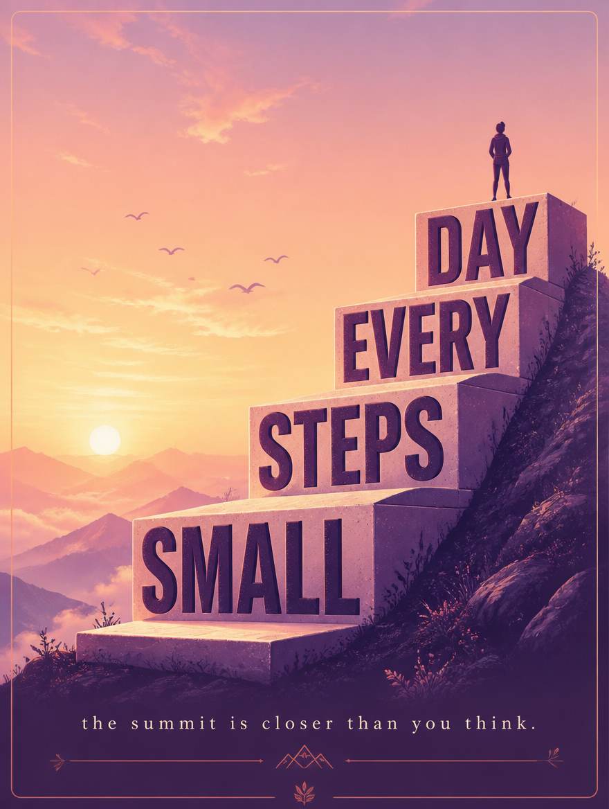

```text
A motivational poster illustrating 'SMALL STEPS EVERY DAY' with a staircase of block letters that literally climb from bottom-left to top-right, each word on a rising step. Warm gradient sky from peach to lavender behind. A tiny minimalist figure silhouette stands at the top step. Footer reads 'the summit is closer than you think.' Palette of peach, lavender, deep plum type. Encouraging, illustrative, gentle motivational storytelling.
```

[Original source](https://github.com/apimodels/gpt-image-2-prompts/blob/980d100f3bd0f2cde4cf38835daeb742bf1cac65/prompts.json#poster-685) · Model: GPT Image 2 · Credit: APIModels · CC BY 4.0
ProjectD: published-accepted (run42069117745). Source output reorders requested stair text; preserve original imperfection rather than promise exact typography.

## Bloom In Chaos · poster-686
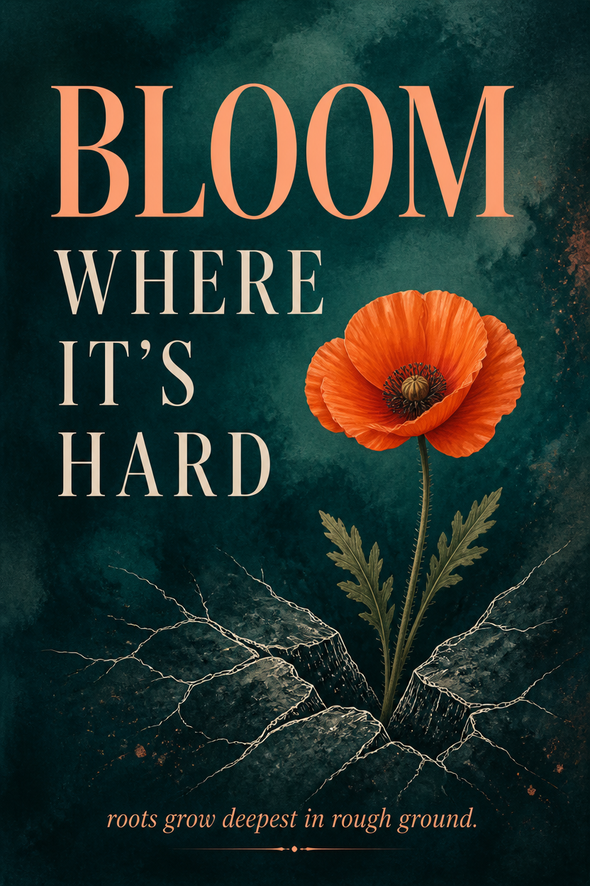

```text
A motivational quote poster with 'BLOOM WHERE IT'S HARD' set in a graceful contrasting serif over a moody dark-teal watercolor wash. A single vivid orange poppy pushes up through a crack rendered in white line-art at the base. The word 'BLOOM' is the largest, in warm peach. Small italic footer: 'roots grow deepest in rough ground.' Palette of dark teal, peach, burnt orange. Resilient, painterly, emotionally warm.
```

[Original source](https://github.com/apimodels/gpt-image-2-prompts/blob/980d100f3bd0f2cde4cf38835daeb742bf1cac65/prompts.json#poster-686) · Model: GPT Image 2 · Credit: APIModels · CC BY 4.0
ProjectD: published-accepted (run42069117745). Complete source prompt and uncropped native preview correspond; generation defects and actual dimensions retained.

## Trust The Timing · poster-687
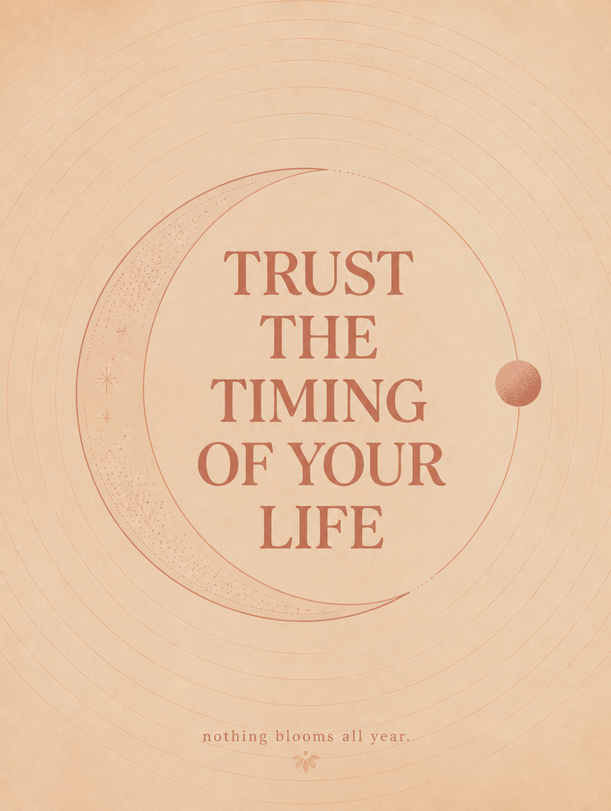

```text
A calm motivational poster reading 'TRUST THE TIMING OF YOUR LIFE' set in a soft rounded serif, centered over a large minimal line drawing of a crescent moon and a single orbiting dot. Warm sand-beige background with muted terracotta type. Thin concentric circles ripple outward from the center. Tiny footer: 'nothing blooms all year.' Palette of sand, terracotta, dusty rose. Serene, reassuring, boho-minimal, meditative.
```

[Original source](https://github.com/apimodels/gpt-image-2-prompts/blob/980d100f3bd0f2cde4cf38835daeb742bf1cac65/prompts.json#poster-687) · Model: GPT Image 2 · Credit: APIModels · CC BY 4.0
ProjectD: published-accepted (run42069117745). Complete source prompt and uncropped native preview correspond; generation defects and actual dimensions retained.
