# APIModels GPT Image 2 — batch 07

CC BY 4.0. Copyright APIModels. Prompts and images explicitly covered by https://github.com/apimodels/gpt-image-2-prompts/blob/980d100f3bd0f2cde4cf38835daeb742bf1cac65/LICENSE; credit source publisher APIModels and retain attribution. No individual original-author claim inferred from curation.

Native PNG outputs and complete original prompts. Generated claims/design labels are not independently verified facts. ProjectD holds are recorded per item.

## Swiss Grid Concert · poster-689
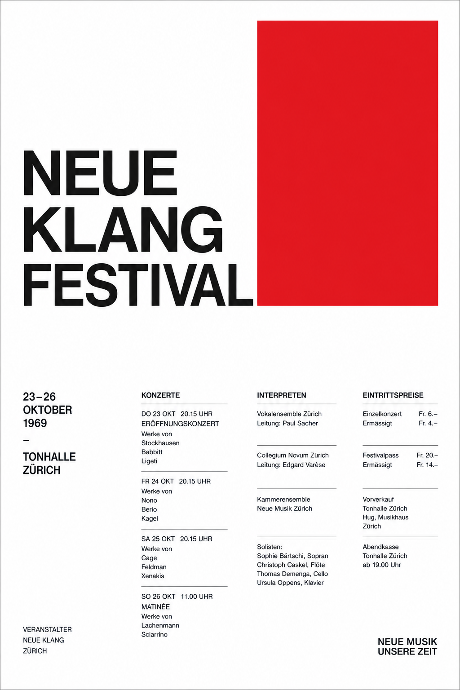

```text
A Swiss International Style concert poster on stark white. A rigid modular grid organizes everything: 'NEUE KLANG FESTIVAL' set in Helvetica-like bold sans, flush-left, ranged along a strict baseline system. A single large red rectangle anchors the upper right; event details in tiny justified columns below. Ample white space, mathematical alignment, no decoration. Palette of white, black, one signal red. Objective, rational, classic 1960s Swiss design.
```

[Original source](https://github.com/apimodels/gpt-image-2-prompts/blob/980d100f3bd0f2cde4cf38835daeb742bf1cac65/prompts.json#poster-689) · Model: GPT Image 2 · Credit: APIModels · CC BY 4.0
ProjectD: reviewed-not-imported. Generated festival details are design copy, not a verified concert.

## Make It Happen · poster-688
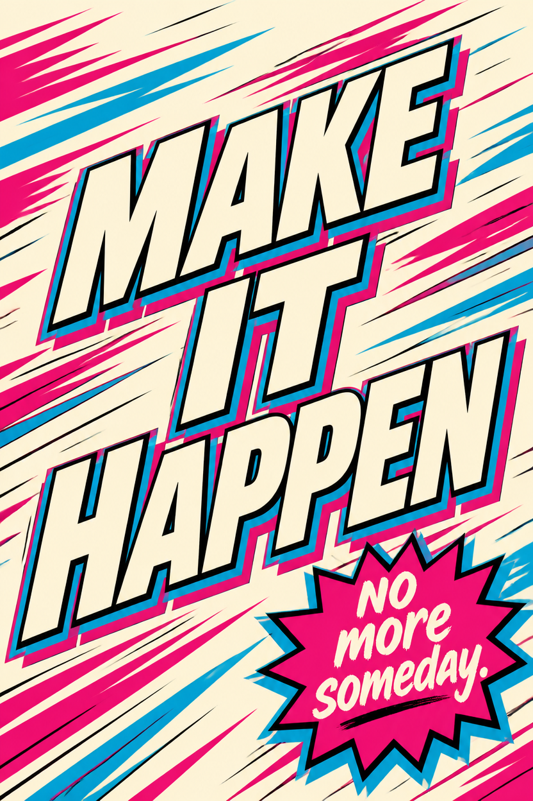

```text
An energetic motivational poster shouting 'MAKE IT HAPPEN' in a chunky retro-italic display face, letters outlined with a double drop-shadow in cyan and magenta for a vibrating pop effect. Bold diagonal speed lines rush across a warm cream background. A starburst badge in the corner reads 'no more someday.' Palette of cream, hot magenta, electric cyan, black outline. Loud, kinetic, retro-motivational, high-octane.
```

[Original source](https://github.com/apimodels/gpt-image-2-prompts/blob/980d100f3bd0f2cde4cf38835daeb742bf1cac65/prompts.json#poster-688) · Model: GPT Image 2 · Credit: APIModels · CC BY 4.0
ProjectD: reviewed-not-imported. Complete source prompt and uncropped native preview correspond; generation defects and actual dimensions retained.

## Bauhaus Geometry · poster-690
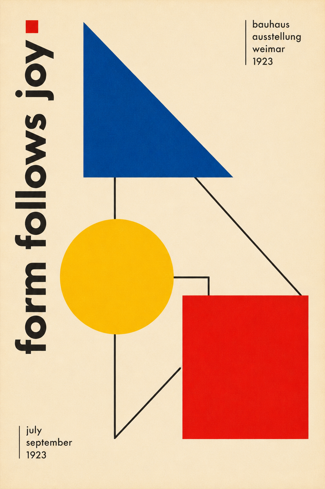

```text
A Bauhaus-inspired poster built from primary geometric shapes: a bold blue triangle, a yellow circle, and a red square arranged in dynamic diagonal tension. The title 'FORM FOLLOWS JOY' is set in a lowercase geometric sans, rotated ninety degrees up the left side. Thin black rules connect the shapes. Warm off-white paper background. Palette of primary red, blue, yellow, black. Playful yet rigorous, 1920s Weimar modernism, iconic and balanced.
```

[Original source](https://github.com/apimodels/gpt-image-2-prompts/blob/980d100f3bd0f2cde4cf38835daeb742bf1cac65/prompts.json#poster-690) · Model: GPT Image 2 · Credit: APIModels · CC BY 4.0
ProjectD: reviewed-not-imported. Bauhaus-inspired generated poster; added historical-looking exhibition labels do not establish an archival provenance.

## Diagonal Type Grid · poster-691
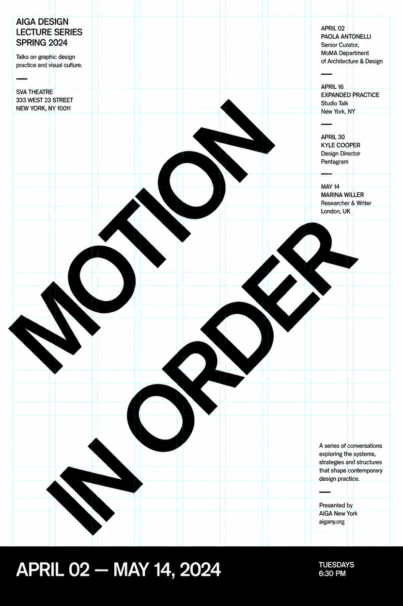

```text
A Swiss-style typographic poster where the headline 'MOTION IN ORDER' is set on a bold forty-five degree diagonal, cutting across a strict underlying column grid rendered in faint cyan guidelines. Text blocks in small Akzidenz-style sans cling to the grid modules. A solid black bar runs along the bottom edge with white event dates. Palette of white, black, faint cyan grid. Precise, dynamic, grid-visible experimental Swiss modernism.
```

[Original source](https://github.com/apimodels/gpt-image-2-prompts/blob/980d100f3bd0f2cde4cf38835daeb742bf1cac65/prompts.json#poster-691) · Model: GPT Image 2 · Credit: APIModels · CC BY 4.0
ProjectD: reviewed-not-imported. Generated design-talk agenda, names and dates are synthetic layout content.

## White Space Lecture · poster-693
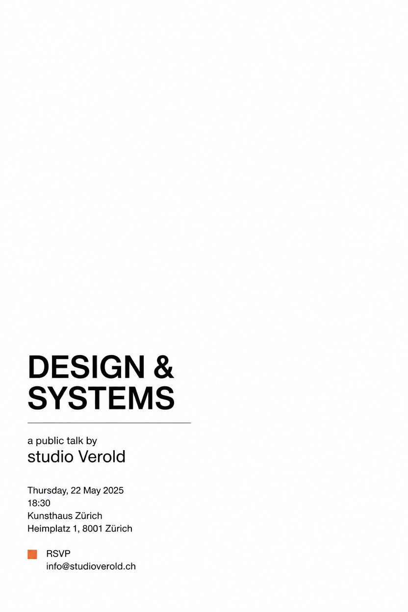

```text
A restrained Swiss-style lecture poster. Ninety percent white space; a single tight cluster of information sits low in the left column: 'DESIGN & SYSTEMS — a public talk by studio Verold' in graded sizes of a neutral grotesque, flush-left, ranged-right ragged. One thin horizontal hairline separates title from body. A small solid orange square marks the RSVP line. Palette of white, black type, one orange square. Ultra-minimal, ordered, intellectual Swiss clarity.
```

[Original source](https://github.com/apimodels/gpt-image-2-prompts/blob/980d100f3bd0f2cde4cf38835daeb742bf1cac65/prompts.json#poster-693) · Model: GPT Image 2 · Credit: APIModels · CC BY 4.0
ProjectD: reviewed-not-imported. Complete source prompt and uncropped native preview correspond; generation defects and actual dimensions retained.

## Bauhaus Type Ballet · poster-692
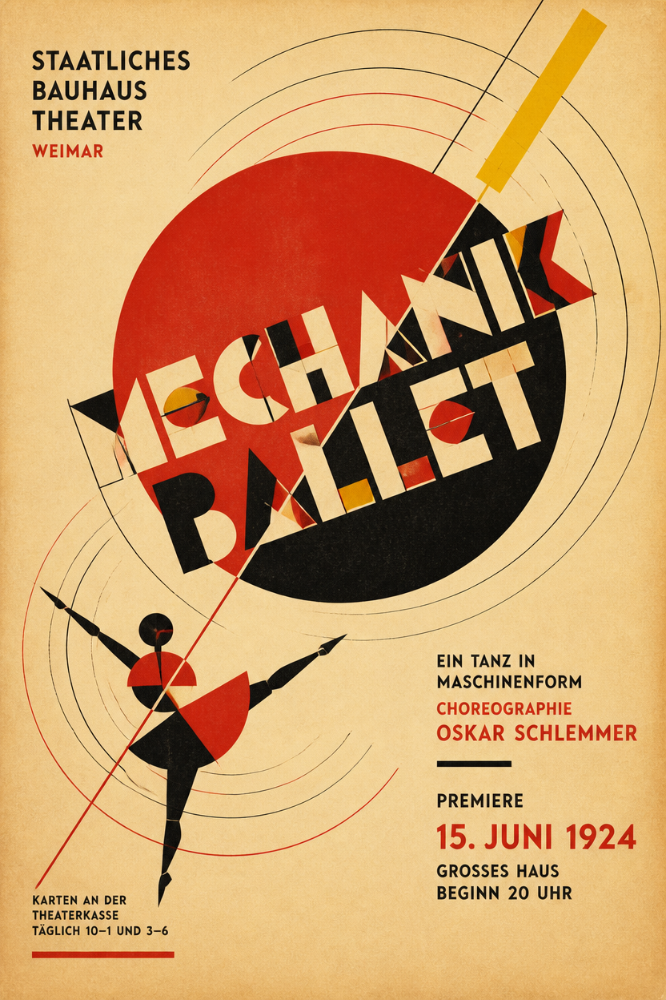

```text
A Bauhaus theatre poster announcing 'MECHANIK BALLET' in stacked geometric caps, letters constructed from perfect circles and straight strokes. A large half-red half-black circle sits behind the title. Thin concentric arcs and a lone yellow bar radiate outward. Everything aligns to an implied diagonal axis. Warm paper texture. Palette of red, black, yellow, cream. Constructivist energy, machine-age geometry, bold and theatrical.
```

[Original source](https://github.com/apimodels/gpt-image-2-prompts/blob/980d100f3bd0f2cde4cf38835daeb742bf1cac65/prompts.json#poster-692) · Model: GPT Image 2 · Credit: APIModels · CC BY 4.0
ProjectD: reviewed-not-imported. Synthetic Bauhaus-style concept with generated historical-looking labels, not an archival theatre poster.

## Bauhaus Exhibition · poster-694
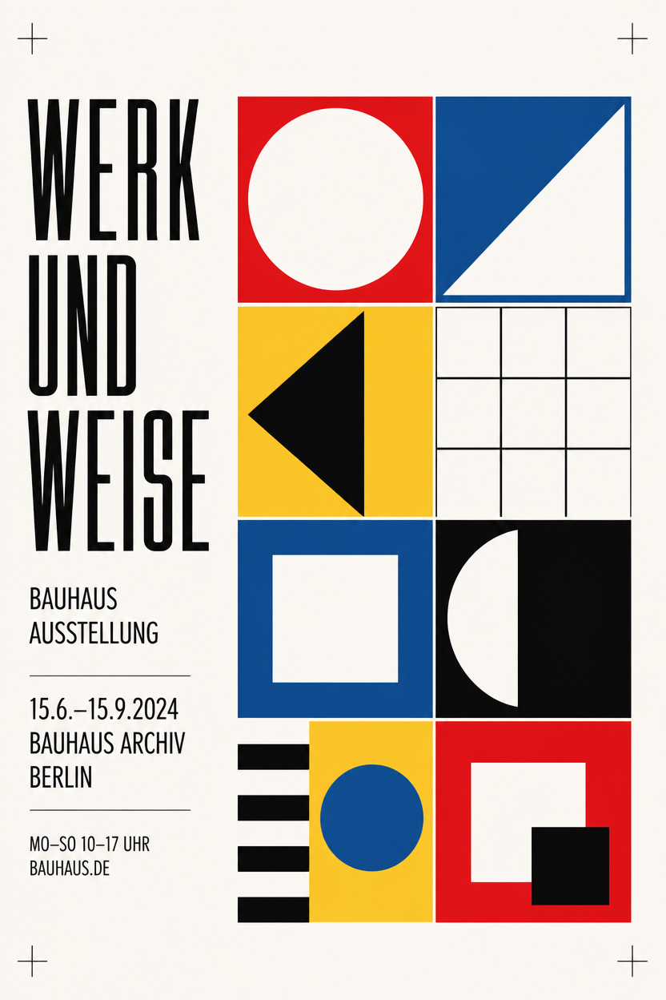

```text
A Bauhaus exhibition poster with 'WERK UND WEISE' set in a strict geometric grotesque, letters slightly extended and left-aligned. A grid of nine equal squares fills the right two-thirds, each square a flat block of primary color or black-and-white, forming a modular quilt. Thin registration crosses mark the corners. Palette of red, blue, yellow, black, white. Systematic, colorful, museum-modernist, precise modular composition.
```

[Original source](https://github.com/apimodels/gpt-image-2-prompts/blob/980d100f3bd0f2cde4cf38835daeb742bf1cac65/prompts.json#poster-694) · Model: GPT Image 2 · Credit: APIModels · CC BY 4.0
ProjectD: reviewed-not-imported. Generated exhibition/date/institution lettering does not establish an actual exhibition.

## Red Bar Manifesto · poster-695
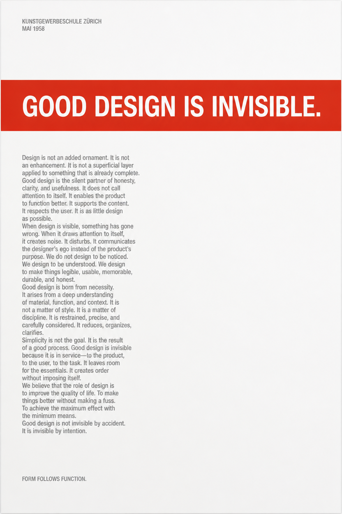

```text
A Swiss modernist manifesto poster. A single thick red horizontal bar slices the sheet a third of the way down, carrying reversed-out white sans caps: 'GOOD DESIGN IS INVISIBLE.' Below, a dense justified paragraph of tiny grey body text fills a narrow left column, leaving the right side empty. Strict baseline grid. Palette of white, signal red bar, cool grey type. Editorial rigor, hierarchy through scale, classic International Typographic Style.
```

[Original source](https://github.com/apimodels/gpt-image-2-prompts/blob/980d100f3bd0f2cde4cf38835daeb742bf1cac65/prompts.json#poster-695) · Model: GPT Image 2 · Credit: APIModels · CC BY 4.0
ProjectD: reviewed-not-imported. Complete source prompt and uncropped native preview correspond; generation defects and actual dimensions retained.

## Bauhaus Sound Waves · poster-696
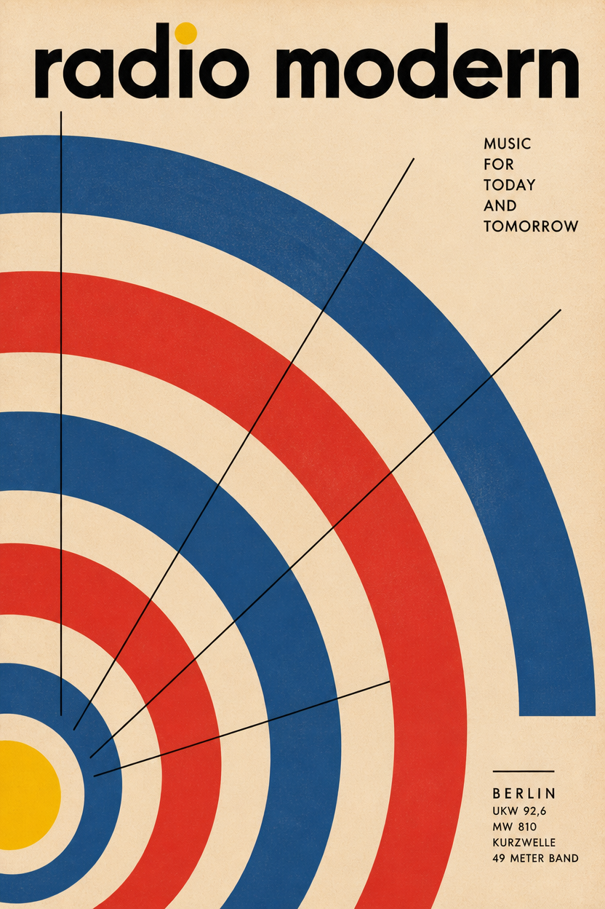

```text
A Bauhaus-flavored music poster where concentric semicircles in alternating blue and red pulse outward from the bottom-left corner like sound waves. The title 'RADIO MODERN' sits in a bold lowercase geometric sans across the top, a yellow circle dotting the 'i'. Thin black lines tangent the arcs. Cream background with visible paper grain. Palette of blue, red, yellow, cream, black. Rhythmic, constructive, warm vintage modernism.
```

[Original source](https://github.com/apimodels/gpt-image-2-prompts/blob/980d100f3bd0f2cde4cf38835daeb742bf1cac65/prompts.json#poster-696) · Model: GPT Image 2 · Credit: APIModels · CC BY 4.0
ProjectD: reviewed-not-imported. Complete source prompt and uncropped native preview correspond; generation defects and actual dimensions retained.

## Modular Type Poster · poster-697
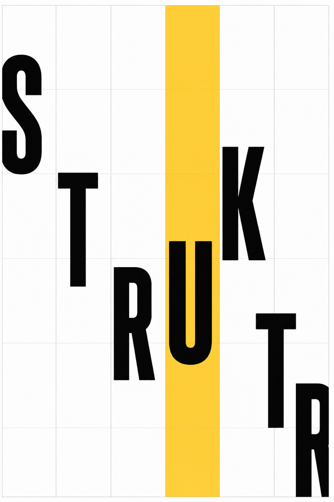

```text
A Swiss-style poster where a single word 'STRUKTUR' is deconstructed across a visible six-column grid, each letter placed in its own module at varying baselines, some cropped by the module edge. A pale grey grid stays visible behind the black type. One module is filled solid warm-yellow, framing the letter 'U'. Palette of white, black, one yellow module. Systematic, experimental, grid-driven typographic architecture.
```

[Original source](https://github.com/apimodels/gpt-image-2-prompts/blob/980d100f3bd0f2cde4cf38835daeb742bf1cac65/prompts.json#poster-697) · Model: GPT Image 2 · Credit: APIModels · CC BY 4.0
ProjectD: reviewed-not-imported. Complete source prompt and uncropped native preview correspond; generation defects and actual dimensions retained.

## Primary Play Poster · poster-698
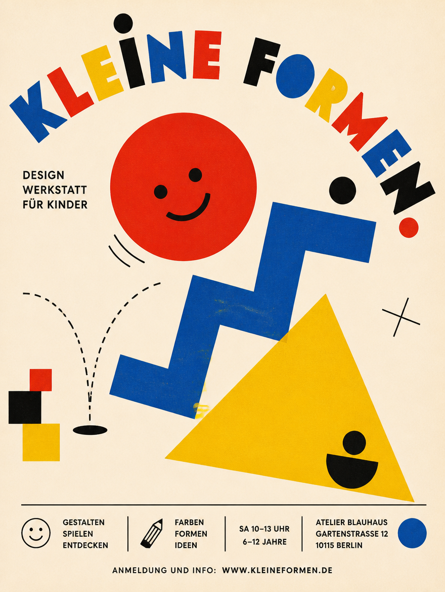

```text
A joyful Bauhaus-style poster for a children's design workshop, 'KLEINE FORMEN.' Big flat shapes — a bouncing red ball, a blue zigzag, a yellow triangle — scatter playfully across an off-white sheet with slight overlap. Rounded geometric caps for the title curve along the top. A thin black baseline anchors small workshop details at the bottom. Palette of primary red, blue, yellow, black on cream. Cheerful, tactile, educational modernism.
```

[Original source](https://github.com/apimodels/gpt-image-2-prompts/blob/980d100f3bd0f2cde4cf38835daeb742bf1cac65/prompts.json#poster-698) · Model: GPT Image 2 · Credit: APIModels · CC BY 4.0
ProjectD: reviewed-not-imported. Complete source prompt and uncropped native preview correspond; generation defects and actual dimensions retained.

## Alpine Rail Travel · poster-699
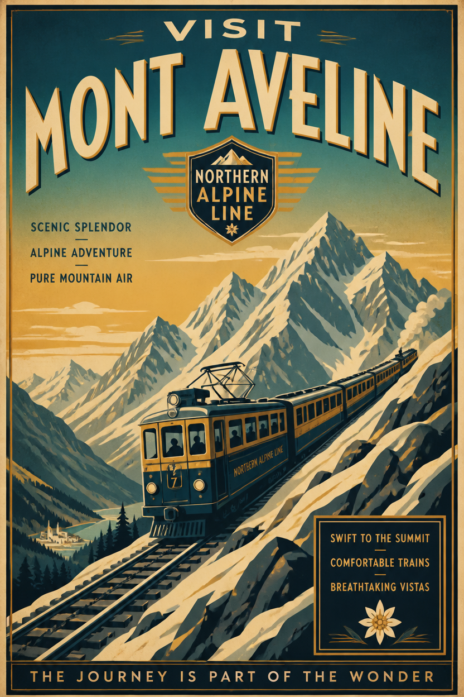

```text
A vintage travel poster in 1930s railway style advertising 'VISIT MONT AVELINE.' A stylized cog railway climbs snow-capped peaks under a graduated sky of teal to gold. Bold streamlined art-deco lettering arcs across the top; a small crest reads 'Northern Alpine Line.' Flat screen-print color separations, subtle paper aging, sharp geometric mountains. Palette of teal, cream, warm gold, deep navy. Nostalgic, elegant, golden-age-of-travel romance.
```

[Original source](https://github.com/apimodels/gpt-image-2-prompts/blob/980d100f3bd0f2cde4cf38835daeb742bf1cac65/prompts.json#poster-699) · Model: GPT Image 2 · Credit: APIModels · CC BY 4.0
ProjectD: reviewed-not-imported. Complete source prompt and uncropped native preview correspond; generation defects and actual dimensions retained.

## Riviera Beach Poster · poster-700
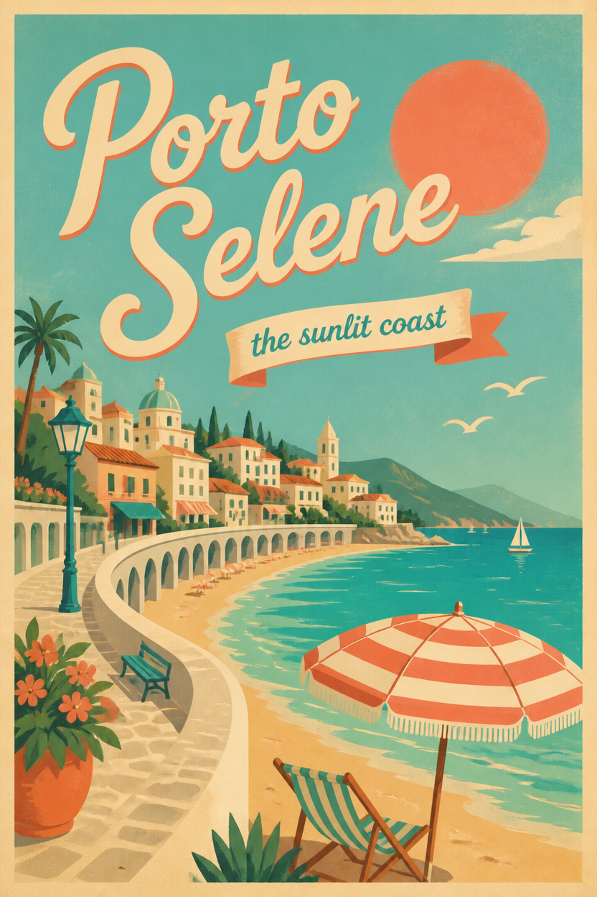

```text
A retro seaside travel poster for the invented resort town 'PORTO SELENE.' A striped beach umbrella, a curved white promenade, and turquoise water rendered in flat gouache-style blocks under a hot coral sun. The town name is set in a rounded 1950s script across the sky. A small ribbon banner reads 'the sunlit coast.' Palette of turquoise, coral, sand, cream. Cheerful mid-century travel-brochure warmth, sun-faded charm.
```

[Original source](https://github.com/apimodels/gpt-image-2-prompts/blob/980d100f3bd0f2cde4cf38835daeb742bf1cac65/prompts.json#poster-700) · Model: GPT Image 2 · Credit: APIModels · CC BY 4.0
ProjectD: reviewed-not-imported. Complete source prompt and uncropped native preview correspond; generation defects and actual dimensions retained.

## Desert Route 66 Style · poster-701
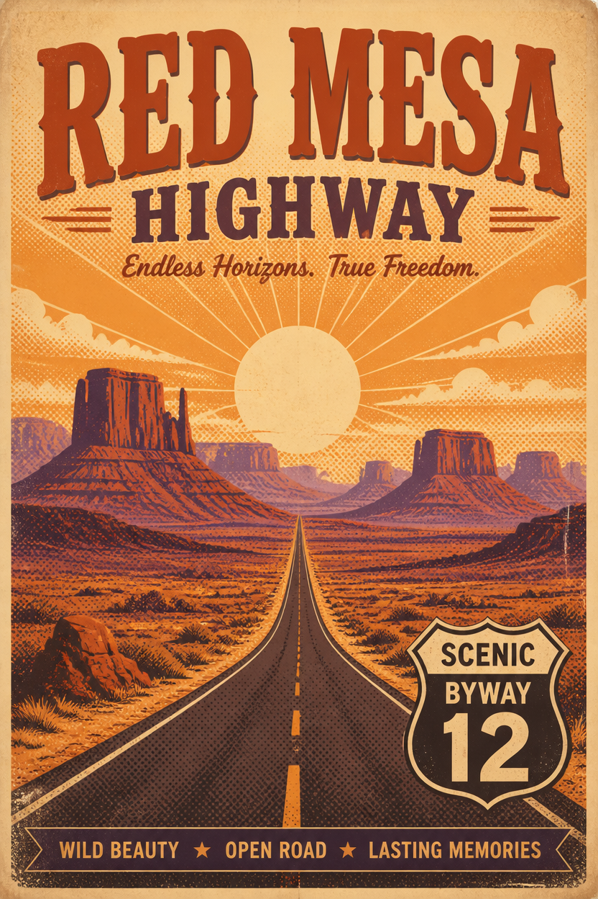

```text
A vintage American road-trip travel poster for the fictional 'RED MESA HIGHWAY.' A long empty desert road recedes to a horizon of layered orange-and-purple buttes under a big graphic sun with radiating rays. Chunky retro serif lettering across the top; a small route shield reads 'Scenic Byway 12.' Halftone dot shading, aged cream borders. Palette of burnt orange, dusty purple, ochre, cream. Warm, adventurous, mid-century Americana nostalgia.
```

[Original source](https://github.com/apimodels/gpt-image-2-prompts/blob/980d100f3bd0f2cde4cf38835daeb742bf1cac65/prompts.json#poster-701) · Model: GPT Image 2 · Credit: APIModels · CC BY 4.0
ProjectD: reviewed-not-imported. Complete source prompt and uncropped native preview correspond; generation defects and actual dimensions retained.

## Tropical Isle Poster · poster-702
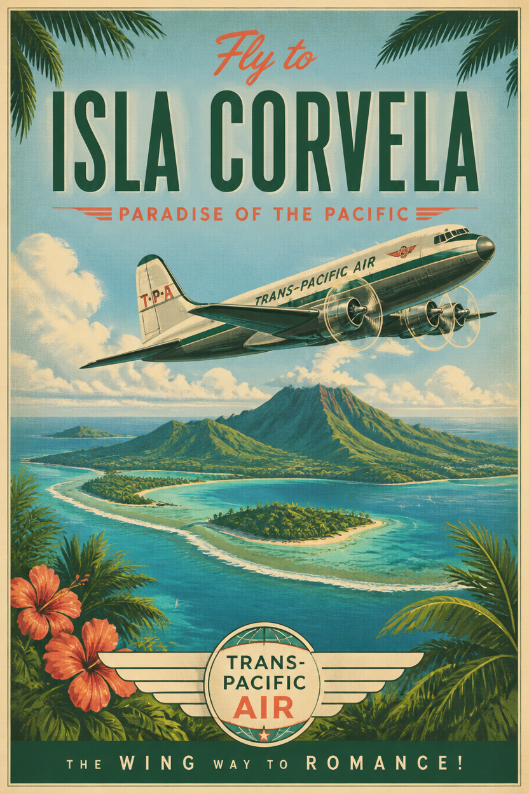

```text
A retro airline travel poster promoting the invented destination 'ISLA CORVELA.' A propeller plane banks over a lush volcanic island ringed by reef-blue lagoons, palm fronds framing the corners. Elegant vintage sans caps spell the name; a small winged badge reads 'Trans-Pacific Air.' Flat lithograph color, subtle grain, soft sun haze. Palette of jade green, sky blue, coral, ivory. Exotic, glamorous, 1950s jet-age travel optimism.
```

[Original source](https://github.com/apimodels/gpt-image-2-prompts/blob/980d100f3bd0f2cde4cf38835daeb742bf1cac65/prompts.json#poster-702) · Model: GPT Image 2 · Credit: APIModels · CC BY 4.0
ProjectD: reviewed-not-imported. Complete source prompt and uncropped native preview correspond; generation defects and actual dimensions retained.

## Old Town Europe · poster-703
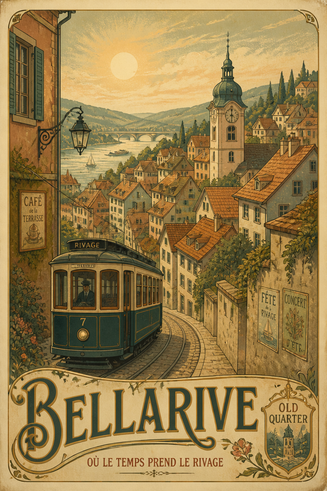

```text
A vintage European city travel poster for the fictional town 'BELLARIVE.' Steep pastel rooftops, a clock tower, and a winding cobbled lane rendered in warm flat blocks descend toward a river. A tram curves through the foreground. Graceful art-nouveau lettering along the base; a small crest reads 'Old Quarter.' Aged litho texture, muted sun. Palette of terracotta, sage, cream, dusty blue. Charming, romantic, hand-illustrated European nostalgia.
```

[Original source](https://github.com/apimodels/gpt-image-2-prompts/blob/980d100f3bd0f2cde4cf38835daeb742bf1cac65/prompts.json#poster-703) · Model: GPT Image 2 · Credit: APIModels · CC BY 4.0
ProjectD: reviewed-not-imported. Complete source prompt and uncropped native preview correspond; generation defects and actual dimensions retained.

## National Park Poster · poster-704
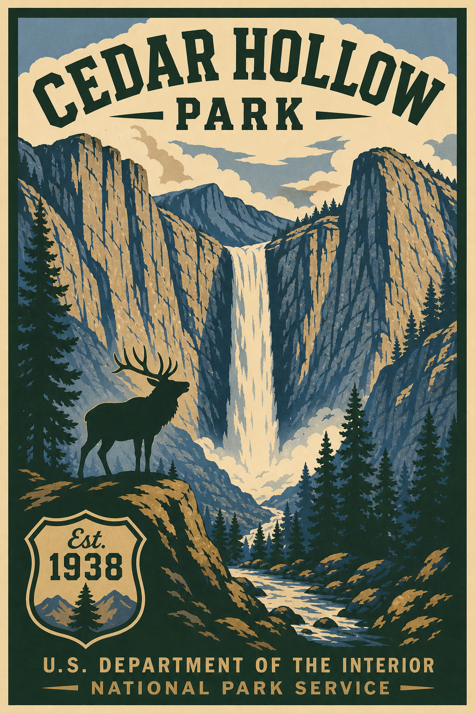

```text
A classic WPA-style national park travel poster for the invented 'CEDAR HOLLOW PARK.' A towering waterfall plunges between granite cliffs into a pine valley, an elk silhouette on a foreground ridge. Screen-print flat colors with bold shadow shapes. Sturdy block-serif title arcs at top; a ranger badge reads 'Est. 1938.' Palette of forest green, slate blue, warm tan, cream. Grand, adventurous, heritage-poster craftsmanship.
```

[Original source](https://github.com/apimodels/gpt-image-2-prompts/blob/980d100f3bd0f2cde4cf38835daeb742bf1cac65/prompts.json#poster-704) · Model: GPT Image 2 · Credit: APIModels · CC BY 4.0
ProjectD: reviewed-not-imported. Fictional national-park concept; generated US agency lettering is not government endorsement.

## Ocean Liner Voyage · poster-705
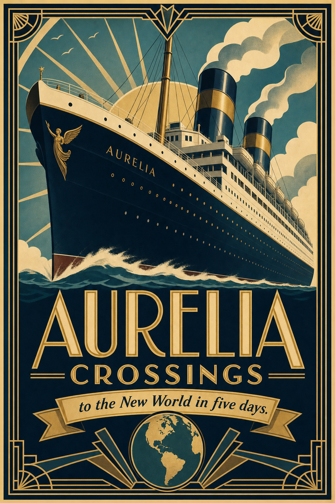

```text
An art-deco ocean-liner travel poster for the fictional line 'AURELIA CROSSINGS.' A colossal steamship cuts diagonally across the sheet, twin funnels trailing stylized smoke, seen from a low heroic angle. Bold geometric deco lettering spells the line name; a small banner reads 'to the New World in five days.' Metallic gold accents, flat two-tone sea. Palette of navy, gold, cream, teal. Opulent, streamlined, 1930s luxury-travel grandeur.
```

[Original source](https://github.com/apimodels/gpt-image-2-prompts/blob/980d100f3bd0f2cde4cf38835daeb742bf1cac65/prompts.json#poster-705) · Model: GPT Image 2 · Credit: APIModels · CC BY 4.0
ProjectD: reviewed-not-imported. Complete source prompt and uncropped native preview correspond; generation defects and actual dimensions retained.

## Ski Resort Retro · poster-706
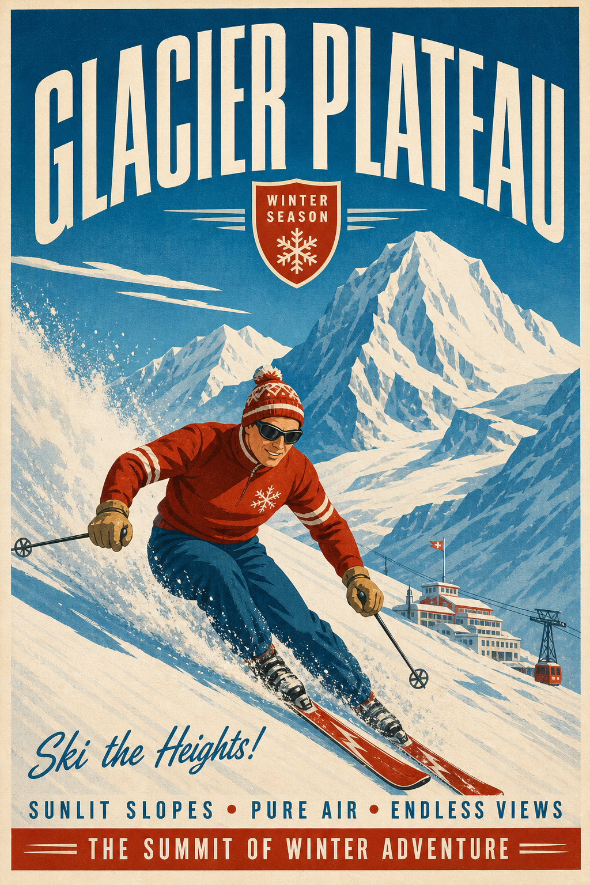

```text
A vintage winter-sports travel poster for the invented resort 'GLACIER PLATEAU.' A stylized skier carves down a bright white slope under crisp blue skies and geometric snowy peaks, a plume of powder trailing behind. Bold condensed deco caps arc across the top; a small crest reads 'winter season.' Flat lithograph blocks, subtle grain. Palette of ice blue, crimson, white, warm cream. Crisp, energetic, alpine mid-century glamour.
```

[Original source](https://github.com/apimodels/gpt-image-2-prompts/blob/980d100f3bd0f2cde4cf38835daeb742bf1cac65/prompts.json#poster-706) · Model: GPT Image 2 · Credit: APIModels · CC BY 4.0
ProjectD: reviewed-not-imported. Complete source prompt and uncropped native preview correspond; generation defects and actual dimensions retained.

## Vineyard Country Poster · poster-707
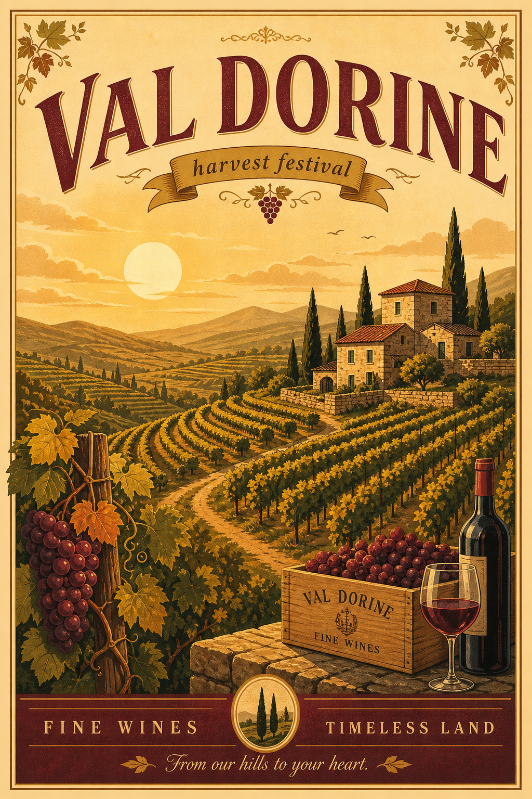

```text
A retro travel poster for the fictional wine region 'VAL DORINE.' Rolling terraced vineyards recede in warm golden bands under a low amber sun, a stone farmhouse and cypress trees dotting the hills. Elegant vintage serif title curves at top; a small ribbon reads 'harvest festival.' Soft grain, flat sun-warmed blocks. Palette of golden ochre, olive green, wine red, cream. Warm, pastoral, romantic countryside nostalgia.
```

[Original source](https://github.com/apimodels/gpt-image-2-prompts/blob/980d100f3bd0f2cde4cf38835daeb742bf1cac65/prompts.json#poster-707) · Model: GPT Image 2 · Credit: APIModels · CC BY 4.0
ProjectD: reviewed-not-imported. Complete source prompt and uncropped native preview correspond; generation defects and actual dimensions retained.

## Neon City Nights · poster-708
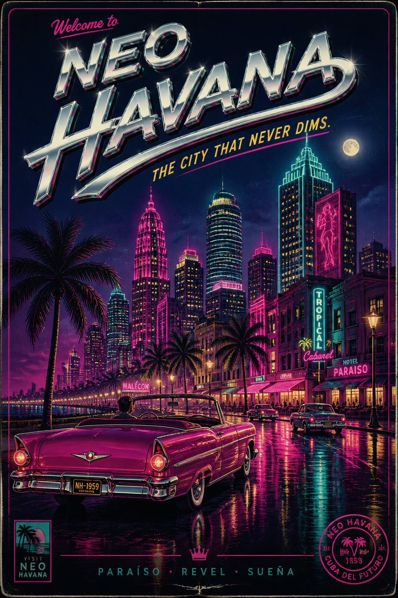

```text
A retro travel poster for the fictional metropolis 'NEO HAVANA' by night. A grid of glowing skyscraper windows, a vintage convertible on a palm-lined boulevard, and a magenta-and-teal neon skyline reflected on wet asphalt. Chrome-style script spells the city name; a small tagline reads 'the city that never dims.' Halftone glow, faint film grain. Palette of magenta, teal, midnight blue, electric yellow. Vibrant, dreamy, retro-futuristic nightlife.
```

[Original source](https://github.com/apimodels/gpt-image-2-prompts/blob/980d100f3bd0f2cde4cf38835daeb742bf1cac65/prompts.json#poster-708) · Model: GPT Image 2 · Credit: APIModels · CC BY 4.0
ProjectD: reviewed-not-imported. Complete source prompt and uncropped native preview correspond; generation defects and actual dimensions retained.

## Iron Will Gym · poster-709


```text
A high-impact gym promo poster for 'IRON WILL FITNESS.' A dramatic low-key photograph feel of a barbell loaded with plates against dark concrete, rim-lit in cold blue, sweat particles catching light. Aggressive slanted condensed caps shout 'FORGE YOUR LIMITS'; a bright orange flash-badge reads '6-WEEK STRENGTH CHALLENGE — JOIN NOW.' Small details list class times. Palette of charcoal, steel blue, molten orange. Intense, muscular, motivational gym energy.
```

[Original source](https://github.com/apimodels/gpt-image-2-prompts/blob/980d100f3bd0f2cde4cf38835daeb742bf1cac65/prompts.json#poster-709) · Model: GPT Image 2 · Credit: APIModels · CC BY 4.0
ProjectD: reviewed-not-imported. Generated fitness promotion, class schedule and claims are illustrative.

## Sunrise Yoga Flow · poster-710
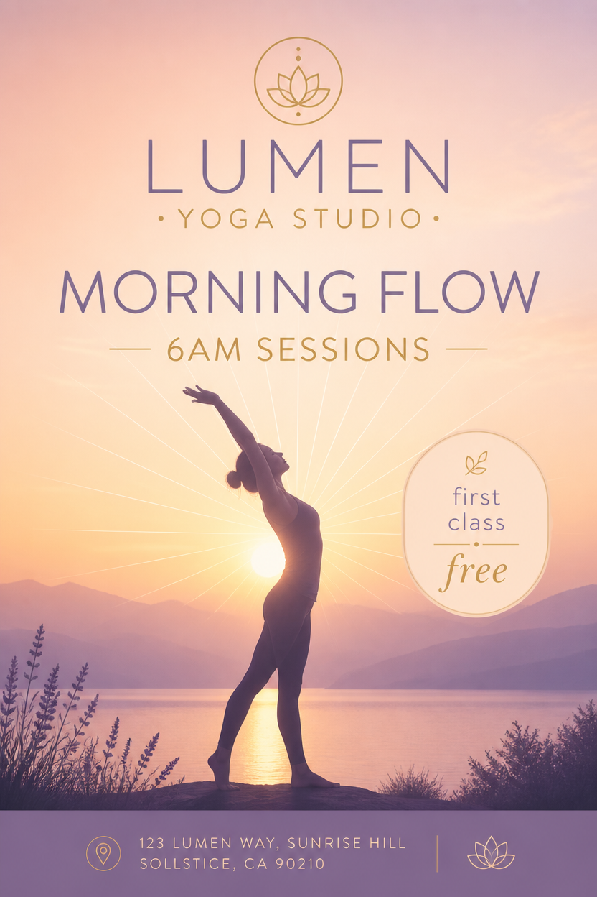

```text
A calming fitness promo poster for 'LUMEN YOGA STUDIO.' A serene silhouette of a person in a standing stretch against a soft peach-to-lavender sunrise gradient, thin sun rays behind. Light airy sans-serif reads 'MORNING FLOW — 6AM SESSIONS'; a gentle rounded badge notes 'first class free.' Small footer lists a fictional address. Palette of peach, lavender, soft gold, cream. Peaceful, wellness-focused, elegant and inviting.
```

[Original source](https://github.com/apimodels/gpt-image-2-prompts/blob/980d100f3bd0f2cde4cf38835daeb742bf1cac65/prompts.json#poster-710) · Model: GPT Image 2 · Credit: APIModels · CC BY 4.0
ProjectD: reviewed-not-imported. Complete source prompt and uncropped native preview correspond; generation defects and actual dimensions retained.

## Boxing Club Flyer · poster-711
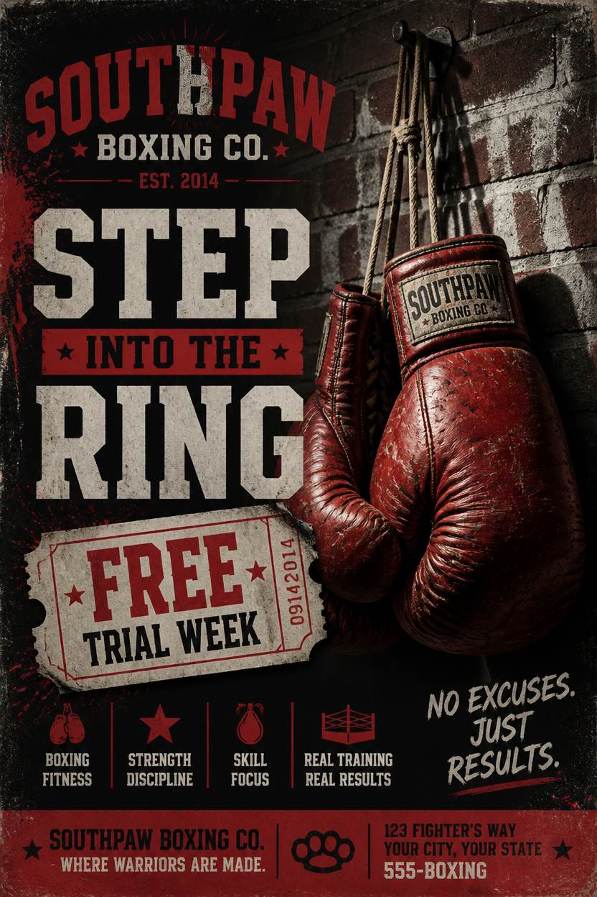

```text
A gritty boxing club promo flyer for 'SOUTHPAW BOXING CO.' A weathered pair of red boxing gloves hangs against a distressed brick wall, harsh top light casting deep shadow. Heavy vintage-athletic block letters read 'STEP INTO THE RING'; a torn-ticket badge shouts 'FREE TRIAL WEEK.' Bold grunge textures and paint-splatter accents. Palette of blood red, charcoal, dusty white. Raw, tough, old-school combat-gym attitude.
```

[Original source](https://github.com/apimodels/gpt-image-2-prompts/blob/980d100f3bd0f2cde4cf38835daeb742bf1cac65/prompts.json#poster-711) · Model: GPT Image 2 · Credit: APIModels · CC BY 4.0
ProjectD: reviewed-not-imported. Complete source prompt and uncropped native preview correspond; generation defects and actual dimensions retained.

## HIIT Bootcamp Promo · poster-712
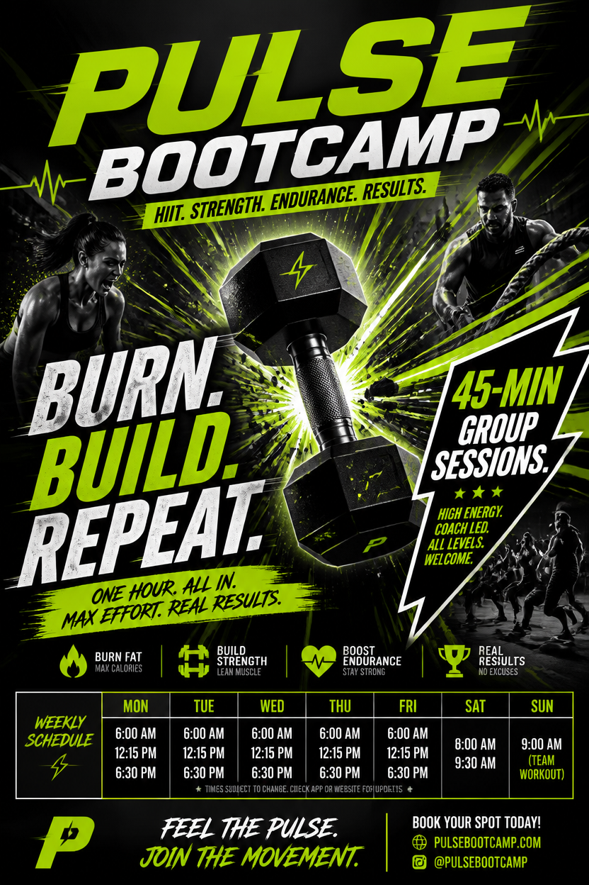

```text
An energetic HIIT bootcamp promo poster for 'PULSE BOOTCAMP.' Diagonal neon-green speed streaks cut across a dark athletic background; a dynamic dumbbell icon bursts from the center. Bold italic sans reads 'BURN. BUILD. REPEAT.'; a lightning-bolt badge announces '45-MIN GROUP SESSIONS.' Small schedule grid at the bottom. Palette of black, neon green, hot white, slate grey. Explosive, high-energy, modern group-fitness hype.
```

[Original source](https://github.com/apimodels/gpt-image-2-prompts/blob/980d100f3bd0f2cde4cf38835daeb742bf1cac65/prompts.json#poster-712) · Model: GPT Image 2 · Credit: APIModels · CC BY 4.0
ProjectD: reviewed-not-imported. Complete source prompt and uncropped native preview correspond; generation defects and actual dimensions retained.

## Spin Studio Ride · poster-714
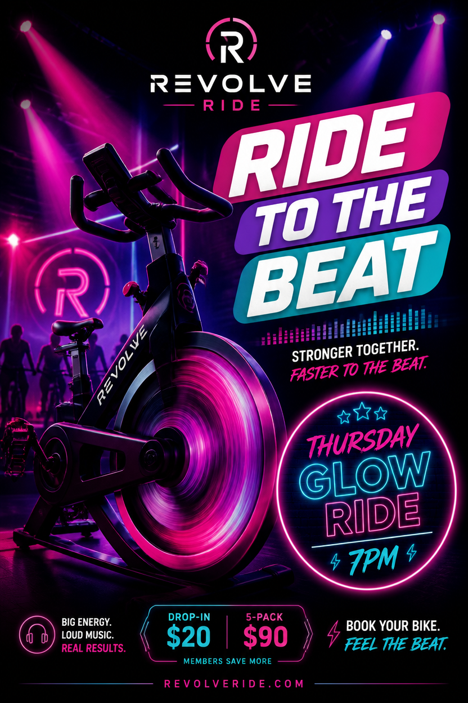

```text
A vibrant indoor-cycling studio promo poster for 'REVOLVE RIDE.' A stylized spin bike glows in a dark studio pierced by pink and violet stage lights, motion blur on the wheel. Sleek rounded caps read 'RIDE TO THE BEAT'; a neon disc badge announces 'THURSDAY GLOW RIDE — 7PM.' Small pricing note below. Palette of hot pink, deep violet, cyan, black. Electric, rhythmic, nightclub-style fitness excitement.
```

[Original source](https://github.com/apimodels/gpt-image-2-prompts/blob/980d100f3bd0f2cde4cf38835daeb742bf1cac65/prompts.json#poster-714) · Model: GPT Image 2 · Credit: APIModels · CC BY 4.0
ProjectD: reviewed-not-imported. Complete source prompt and uncropped native preview correspond; generation defects and actual dimensions retained.

## CrossTraining Warrior · poster-715


```text
A tough functional-fitness promo poster for 'FORGE FUNCTIONAL.' A chalk-dusted kettlebell and battle ropes mid-swing frozen against raw industrial concrete, dramatic side light. Aggressive stencil caps read 'EARN YOUR STRENGTH'; a hazard-stripe badge reads 'ONBOARDING CLASS — SATURDAYS 9AM.' Grunge splatter and rivet details. Palette of concrete grey, safety orange, matte black. Rugged, no-excuses, functional-training grit.
```

[Original source](https://github.com/apimodels/gpt-image-2-prompts/blob/980d100f3bd0f2cde4cf38835daeb742bf1cac65/prompts.json#poster-715) · Model: GPT Image 2 · Credit: APIModels · CC BY 4.0
ProjectD: reviewed-not-imported. Complete source prompt and uncropped native preview correspond; generation defects and actual dimensions retained.

## Powerlifting Meet · poster-713
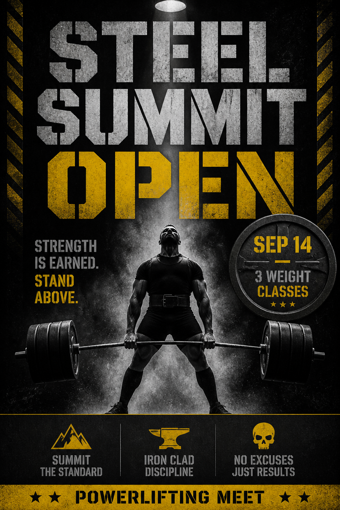

```text
A bold powerlifting meet poster for the 'STEEL SUMMIT OPEN.' A dramatic silhouette of a lifter locking out a heavy deadlift under stark spotlight, chalk dust rising in the beam. Massive stencil-military caps read 'STEEL SUMMIT OPEN'; a plate-shaped badge lists 'SEP 14 — 3 WEIGHT CLASSES.' Distressed metal texture. Palette of gunmetal grey, safety yellow, black. Heavy, competitive, industrial strength-sport intensity.
```

[Original source](https://github.com/apimodels/gpt-image-2-prompts/blob/980d100f3bd0f2cde4cf38835daeb742bf1cac65/prompts.json#poster-713) · Model: GPT Image 2 · Credit: APIModels · CC BY 4.0
ProjectD: reviewed-not-imported. Complete source prompt and uncropped native preview correspond; generation defects and actual dimensions retained.

## Pilates Reformer Studio · poster-716
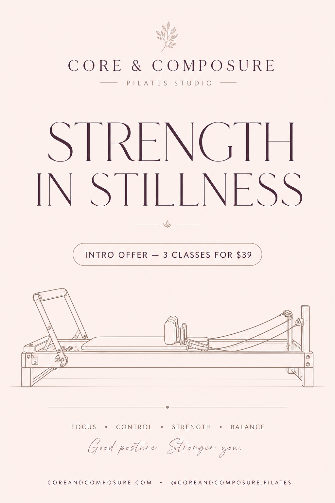

```text
A refined pilates studio promo poster for 'CORE & COMPOSURE.' A minimal line illustration of a reformer machine sits on a warm blush background, thin elegant strokes. Light modern serif reads 'STRENGTH IN STILLNESS'; a slim capsule badge notes 'INTRO OFFER — 3 CLASSES FOR $39.' Generous white space and delicate detailing. Palette of blush pink, soft taupe, deep plum type. Elegant, calm, boutique-wellness sophistication.
```

[Original source](https://github.com/apimodels/gpt-image-2-prompts/blob/980d100f3bd0f2cde4cf38835daeb742bf1cac65/prompts.json#poster-716) · Model: GPT Image 2 · Credit: APIModels · CC BY 4.0
ProjectD: reviewed-not-imported. Complete source prompt and uncropped native preview correspond; generation defects and actual dimensions retained.

## Join Our Team Flyer · poster-719
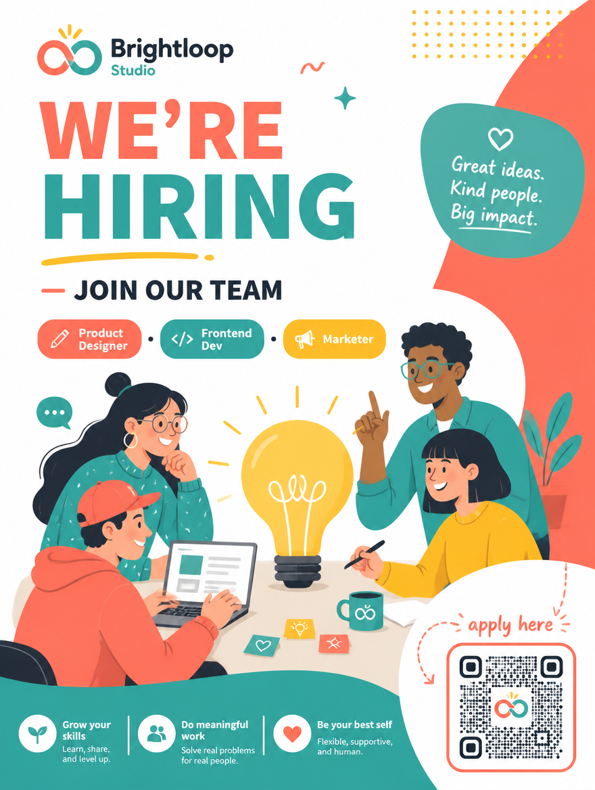

```text
A modern 'WE'RE HIRING' recruitment flyer for the invented startup 'Brightloop Studio.' A friendly flat-illustration scene of diverse abstract figures collaborating around a glowing lightbulb. Bold cheerful sans reads 'WE'RE HIRING — JOIN OUR TEAM'; role tags in rounded pills list 'Product Designer · Frontend Dev · Marketer.' A dotted arrow points to a fake QR-style square labeled 'apply here.' Palette of coral, teal, sunny yellow, white. Warm, inviting, upbeat startup culture.
```

[Original source](https://github.com/apimodels/gpt-image-2-prompts/blob/980d100f3bd0f2cde4cf38835daeb742bf1cac65/prompts.json#poster-719) · Model: GPT Image 2 · Credit: APIModels · CC BY 4.0
ProjectD: reviewed-not-imported. Invented recruitment concept; QR-style mark is decorative, not a verified application link.

## Marathon Training Group · poster-717
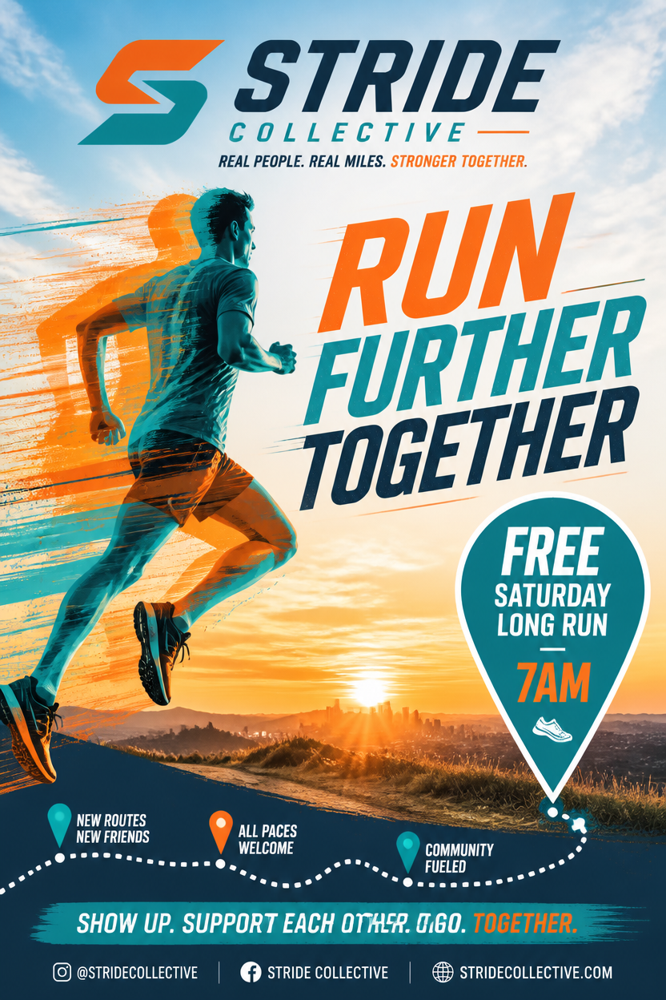

```text
A dynamic running-club promo poster for 'STRIDE COLLECTIVE.' A stylized runner mid-stride is composed of overlapping orange and teal motion trails against a bright dawn sky. Bold sporty italic reads 'RUN FURTHER TOGETHER'; a route-marker badge announces 'FREE SATURDAY LONG RUN — 7AM.' A small dotted map line curves below. Palette of sunrise orange, teal, sky blue, white. Motivating, communal, fresh outdoor-running vibe.
```

[Original source](https://github.com/apimodels/gpt-image-2-prompts/blob/980d100f3bd0f2cde4cf38835daeb742bf1cac65/prompts.json#poster-717) · Model: GPT Image 2 · Credit: APIModels · CC BY 4.0
ProjectD: reviewed-not-imported. Complete source prompt and uncropped native preview correspond; generation defects and actual dimensions retained.

## 24 Hour Gym Grand Opening · poster-718
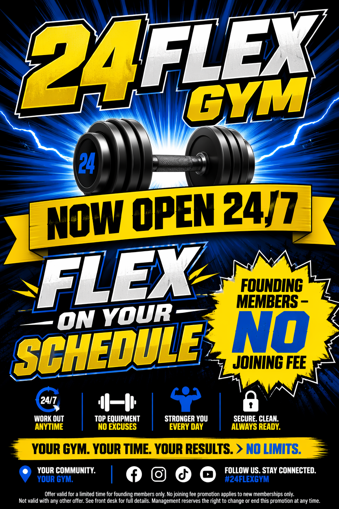

```text
A punchy grand-opening promo poster for '24 FLEX GYM.' A bold burst-ray background in electric blue radiates from a central dumbbell icon; a giant ribbon banner shouts 'NOW OPEN 24/7.' Heavy athletic caps read 'FLEX ON YOUR SCHEDULE'; a starburst badge screams 'FOUNDING MEMBERS — NO JOINING FEE.' Small terms line at the bottom. Palette of electric blue, bright yellow, white, black. Loud, promotional, high-energy launch buzz.
```

[Original source](https://github.com/apimodels/gpt-image-2-prompts/blob/980d100f3bd0f2cde4cf38835daeb742bf1cac65/prompts.json#poster-718) · Model: GPT Image 2 · Credit: APIModels · CC BY 4.0
ProjectD: reviewed-not-imported. Complete source prompt and uncropped native preview correspond; generation defects and actual dimensions retained.

## Cafe Barista Wanted · poster-720
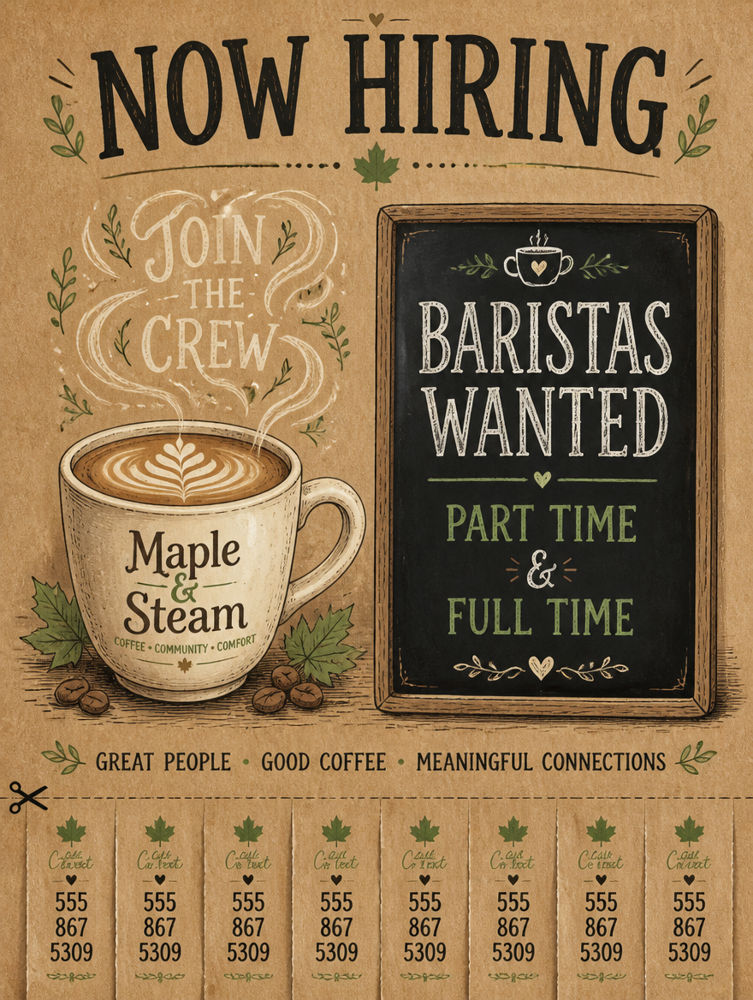

```text
A charming 'NOW HIRING' flyer for the fictional coffee shop 'Maple & Steam.' A hand-drawn latte cup with steam curling into the words 'JOIN THE CREW' on a warm kraft-paper background. Chalkboard-style lettering reads 'BARISTAS WANTED — PART TIME & FULL TIME.' A small tear-off strip row at the bottom shows repeated phone tabs. Palette of kraft brown, cream, sage green, espresso black. Cozy, handcrafted, neighborhood-cafe warmth.
```

[Original source](https://github.com/apimodels/gpt-image-2-prompts/blob/980d100f3bd0f2cde4cf38835daeb742bf1cac65/prompts.json#poster-720) · Model: GPT Image 2 · Credit: APIModels · CC BY 4.0
ProjectD: reviewed-not-imported. Fictional cafe recruitment; phone tabs are generated placeholders.

## Tech Careers Poster · poster-721


```text
A sleek tech recruitment poster for the invented company 'NovaGrid Labs.' A dark navy background with a subtle glowing circuit-line pattern; a bright gradient headline reads 'BUILD THE FUTURE WITH US.' Below, clean white type lists 'Now hiring engineers, data scientists, and designers.' A neon capsule badge notes 'remote-friendly · flexible hours.' A minimalist rocket icon ascends the right edge. Palette of navy, cyan, magenta gradient, white. Futuristic, professional, aspirational tech-brand tone.
```

[Original source](https://github.com/apimodels/gpt-image-2-prompts/blob/980d100f3bd0f2cde4cf38835daeb742bf1cac65/prompts.json#poster-721) · Model: GPT Image 2 · Credit: APIModels · CC BY 4.0
ProjectD: reviewed-not-imported. Complete source prompt and uncropped native preview correspond; generation defects and actual dimensions retained.

## Retail Weekend Staff · poster-722
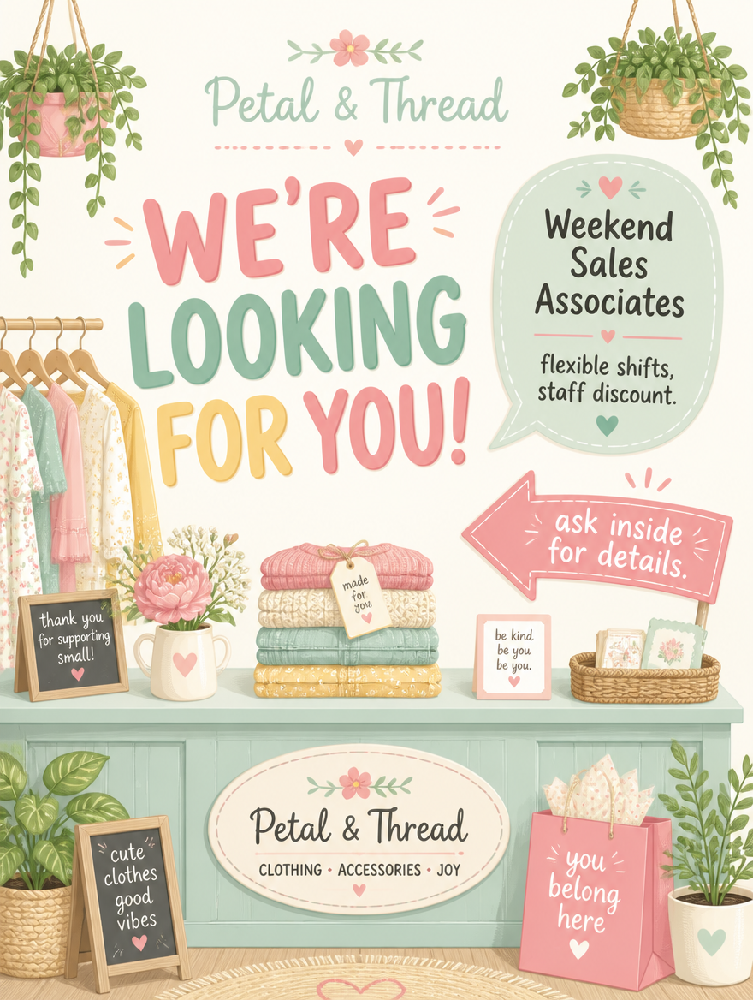

```text
A bright, friendly hiring flyer for the fictional boutique 'Petal & Thread.' A flat pastel illustration of a shop counter with hanging plants and folded clothes. Playful rounded lettering reads 'WE'RE LOOKING FOR YOU!'; a speech-bubble badge lists 'Weekend Sales Associates — flexible shifts, staff discount.' A cheerful arrow points to 'ask inside for details.' Palette of blush pink, mint, butter yellow, warm white. Sunny, approachable, small-boutique friendliness.
```

[Original source](https://github.com/apimodels/gpt-image-2-prompts/blob/980d100f3bd0f2cde4cf38835daeb742bf1cac65/prompts.json#poster-722) · Model: GPT Image 2 · Credit: APIModels · CC BY 4.0
ProjectD: reviewed-not-imported. Complete source prompt and uncropped native preview correspond; generation defects and actual dimensions retained.

## Restaurant Kitchen Hiring · poster-723


```text
A bold 'NOW HIRING' flyer for the invented restaurant 'Ember & Oak Kitchen.' A dramatic dark background with warm flame-orange glow; a chef's knife and whisk crossed like a crest at the top. Rustic slab-serif reads 'JOIN OUR KITCHEN BRIGADE'; a chalk-panel lists 'Line Cooks · Dishwashers · Servers wanted.' A footer notes 'walk-in interviews Mon–Thu, 2–4pm.' Palette of charcoal, ember orange, cream, deep red. Warm, appetizing, hospitality-industry energy.
```

[Original source](https://github.com/apimodels/gpt-image-2-prompts/blob/980d100f3bd0f2cde4cf38835daeb742bf1cac65/prompts.json#poster-723) · Model: GPT Image 2 · Credit: APIModels · CC BY 4.0
ProjectD: reviewed-not-imported. Complete source prompt and uncropped native preview correspond; generation defects and actual dimensions retained.

## Nonprofit Volunteers Needed · poster-724
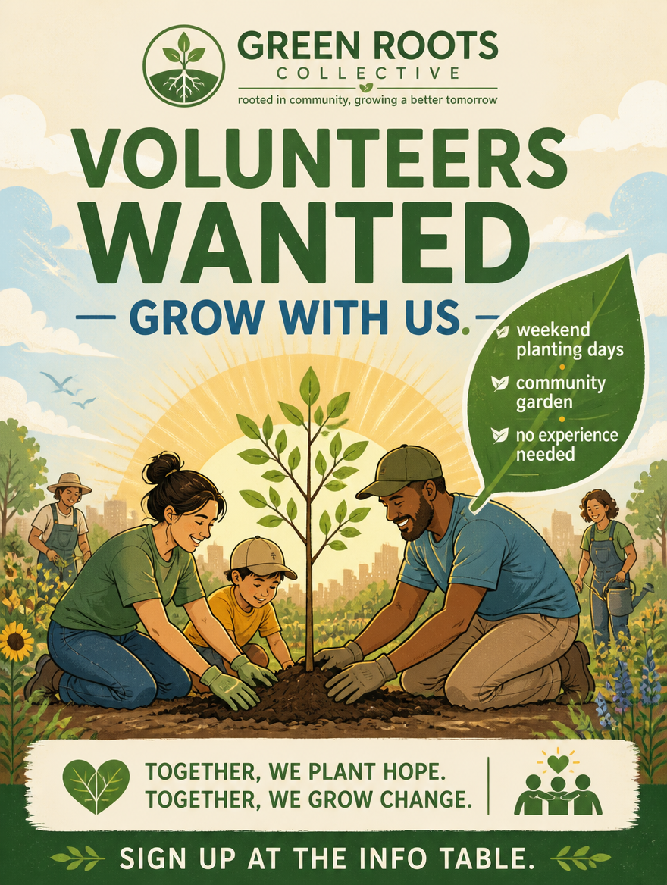

```text
A warm community recruitment flyer for the fictional nonprofit 'Green Roots Collective.' A hopeful flat illustration of hands planting a young tree under a soft sunrise. Friendly humanist sans reads 'VOLUNTEERS WANTED — GROW WITH US.' A leaf-shaped badge lists 'weekend planting days · community garden · no experience needed.' A footer invites 'sign up at the info table.' Palette of leaf green, sky blue, warm sand, cream. Heartfelt, communal, purpose-driven positivity.
```

[Original source](https://github.com/apimodels/gpt-image-2-prompts/blob/980d100f3bd0f2cde4cf38835daeb742bf1cac65/prompts.json#poster-724) · Model: GPT Image 2 · Credit: APIModels · CC BY 4.0
ProjectD: reviewed-not-imported. Complete source prompt and uncropped native preview correspond; generation defects and actual dimensions retained.

## Creative Agency Hiring · poster-725
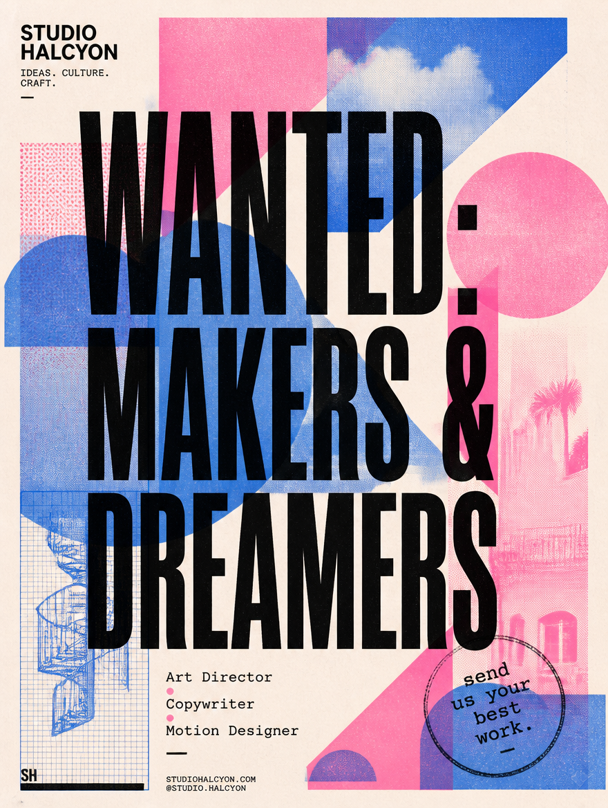

```text
A bold, design-forward hiring poster for the invented agency 'Studio Halcyon.' A big overprinted collage of overlapping geometric shapes in risograph pink and blue on off-white. Oversized condensed type reads 'WANTED: MAKERS & DREAMERS.' Below, small mono-spaced type lists 'Art Director · Copywriter · Motion Designer.' A stamped circle badge reads 'send us your best work.' Palette of riso pink, riso blue, off-white, black. Artsy, confident, creative-studio edge.
```

[Original source](https://github.com/apimodels/gpt-image-2-prompts/blob/980d100f3bd0f2cde4cf38835daeb742bf1cac65/prompts.json#poster-725) · Model: GPT Image 2 · Credit: APIModels · CC BY 4.0
ProjectD: reviewed-not-imported. Complete source prompt and uncropped native preview correspond; generation defects and actual dimensions retained.

## Warehouse Jobs Flyer · poster-726


```text
A clear, high-visibility hiring flyer for the fictional logistics firm 'PrimeMove Logistics.' A bold safety-yellow and black diagonal-stripe header shouts 'NOW HIRING.' Clean industrial sans lists 'Warehouse Associates & Forklift Operators — $22/hr starting.' Bullet points note 'weekly pay · health benefits · overtime available.' A large arrow and 'apply today' fill the bottom. Palette of safety yellow, black, white, steel grey. Direct, practical, no-nonsense industrial recruitment.
```

[Original source](https://github.com/apimodels/gpt-image-2-prompts/blob/980d100f3bd0f2cde4cf38835daeb742bf1cac65/prompts.json#poster-726) · Model: GPT Image 2 · Credit: APIModels · CC BY 4.0
ProjectD: reviewed-not-imported. Invented employer, pay and benefits; not a job offer.

## Summer Camp Counselors · poster-727
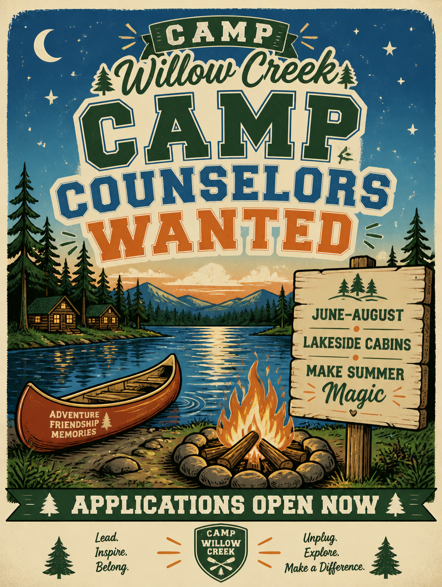

```text
A playful summer-camp recruitment flyer for the fictional 'Camp Willow Creek.' A hand-drawn scene of pine trees, a canoe on a lake, and a campfire under a starry evening sky. Bouncy varsity-style lettering reads 'CAMP COUNSELORS WANTED'; a wooden-sign badge lists 'June–August · lakeside cabins · make summer magic.' A footer notes 'applications open now.' Palette of forest green, lake blue, campfire orange, cream. Nostalgic, cheerful, outdoorsy adventure spirit.
```

[Original source](https://github.com/apimodels/gpt-image-2-prompts/blob/980d100f3bd0f2cde4cf38835daeb742bf1cac65/prompts.json#poster-727) · Model: GPT Image 2 · Credit: APIModels · CC BY 4.0
ProjectD: reviewed-not-imported. Complete source prompt and uncropped native preview correspond; generation defects and actual dimensions retained.

## Salon Stylist Opening · poster-728


```text
An elegant hiring flyer for the fictional salon 'Vellour Hair Studio.' A luxe blush-and-gold background with a fine line-art illustration of scissors and a comb crossed like a monogram. Sophisticated modern serif reads 'JOIN OUR CHAIR — HAIRSTYLIST WANTED.' A gold-foil-look badge notes 'commission + booth rental options.' A footer invites 'portfolio drop-off welcome.' Palette of blush, champagne gold, deep charcoal, ivory. Chic, upscale, beauty-industry refinement.
```

[Original source](https://github.com/apimodels/gpt-image-2-prompts/blob/980d100f3bd0f2cde4cf38835daeb742bf1cac65/prompts.json#poster-728) · Model: GPT Image 2 · Credit: APIModels · CC BY 4.0
ProjectD: reviewed-not-imported. Complete source prompt and uncropped native preview correspond; generation defects and actual dimensions retained.

## Modern Open House · poster-729
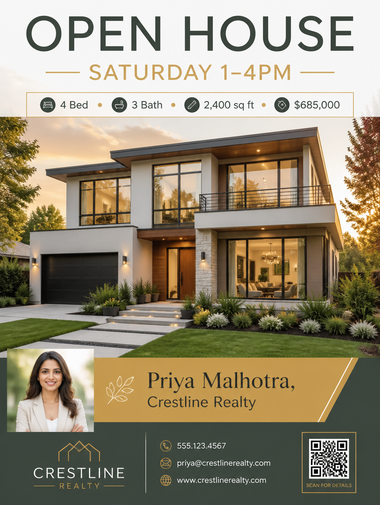

```text
A clean real-estate open-house flyer for a modern property. A bright photo-style render of a sleek two-story house with large glass windows and a manicured lawn at golden hour. Elegant sans headline reads 'OPEN HOUSE — SATURDAY 1–4PM'; a slim info bar lists '4 Bed · 3 Bath · 2,400 sq ft · $685,000.' A gold banner names the agent 'Priya Malhotra, Crestline Realty.' Palette of warm white, sage green, gold, charcoal. Polished, aspirational, upscale property marketing.
```

[Original source](https://github.com/apimodels/gpt-image-2-prompts/blob/980d100f3bd0f2cde4cf38835daeb742bf1cac65/prompts.json#poster-729) · Model: GPT Image 2 · Credit: APIModels · CC BY 4.0
ProjectD: reviewed-not-imported. Synthetic property/agent concept, not a real listing; portrait, names, price and contact lettering are generated.

## Cozy Cottage Listing · poster-730
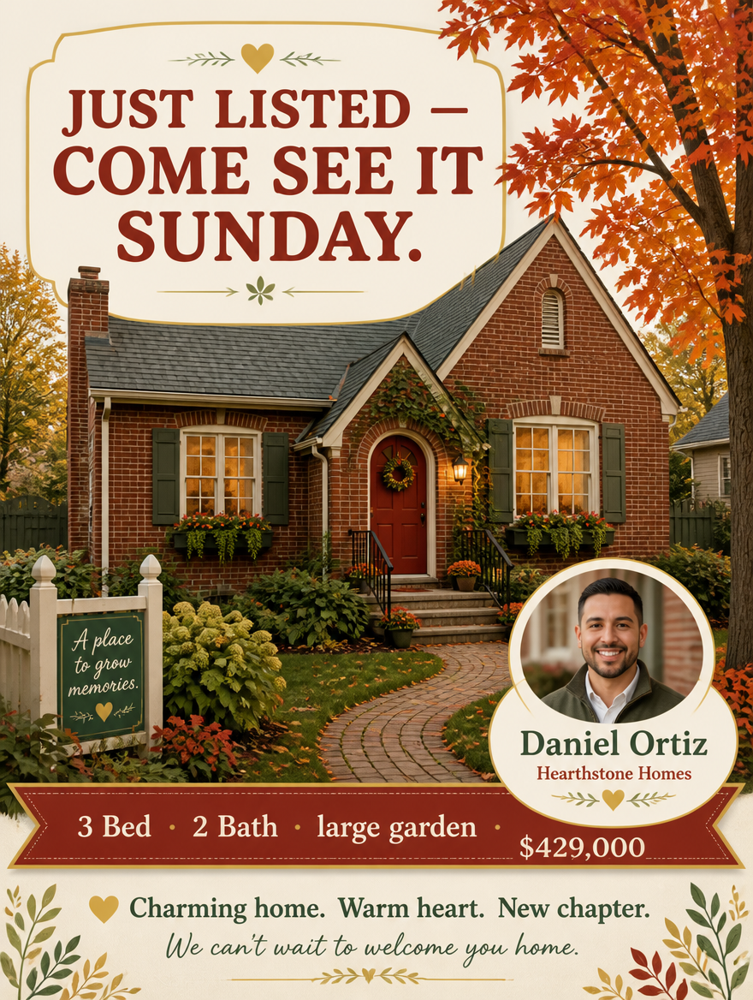

```text
A warm real-estate open-house flyer for a charming cottage. A cozy render of a brick cottage with a red front door, flower boxes, and an autumn maple. Friendly rounded serif reads 'JUST LISTED — COME SEE IT SUNDAY.' A ribbon strip lists '3 Bed · 2 Bath · large garden · $429,000.' A round photo-badge names 'Daniel Ortiz, Hearthstone Homes.' Palette of warm brick red, cream, forest green, gold. Inviting, homey, heartfelt residential appeal.
```

[Original source](https://github.com/apimodels/gpt-image-2-prompts/blob/980d100f3bd0f2cde4cf38835daeb742bf1cac65/prompts.json#poster-730) · Model: GPT Image 2 · Credit: APIModels · CC BY 4.0
ProjectD: reviewed-not-imported. Fictional property and agent illustration, not a verified listing.

## Luxury Condo Flyer · poster-731
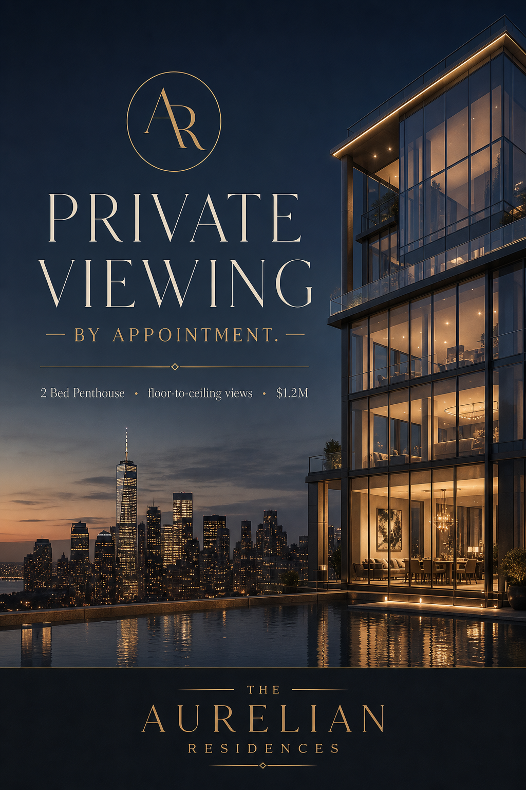

```text
A sophisticated luxury-condo open-house flyer. A dramatic dusk render of a glass high-rise skyline with warm interior lights glowing, viewed across a reflecting pool. Refined thin serif reads 'PRIVATE VIEWING — BY APPOINTMENT.' A minimal gold-line divider precedes '2 Bed Penthouse · floor-to-ceiling views · $1.2M.' A subtle monogram names 'The Aurelian Residences.' Palette of midnight blue, warm gold, charcoal, ivory. Elegant, exclusive, premium real-estate luxury.
```

[Original source](https://github.com/apimodels/gpt-image-2-prompts/blob/980d100f3bd0f2cde4cf38835daeb742bf1cac65/prompts.json#poster-731) · Model: GPT Image 2 · Credit: APIModels · CC BY 4.0
ProjectD: reviewed-not-imported. Complete source prompt and uncropped native preview correspond; generation defects and actual dimensions retained.

## Suburban Family Home · poster-732
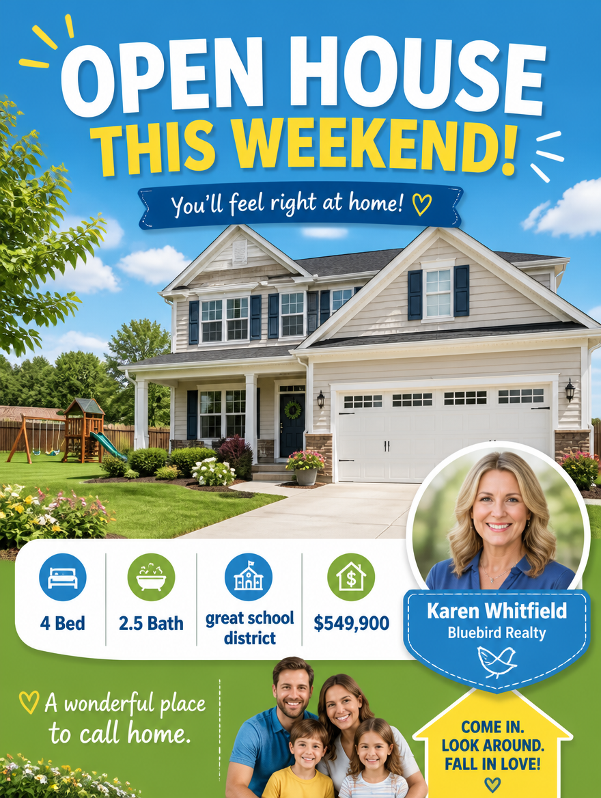

```text
A bright, family-friendly open-house flyer for a suburban home. A cheerful daytime render of a two-car garage house with a swing set in the backyard and a blue sky. Approachable bold sans reads 'OPEN HOUSE THIS WEEKEND!' A clean spec strip lists '4 Bed · 2.5 Bath · great school district · $549,900.' A photo-circle names 'Karen Whitfield, Bluebird Realty.' Palette of sky blue, fresh green, warm white, sunny yellow. Wholesome, welcoming, family-oriented marketing.
```

[Original source](https://github.com/apimodels/gpt-image-2-prompts/blob/980d100f3bd0f2cde4cf38835daeb742bf1cac65/prompts.json#poster-732) · Model: GPT Image 2 · Credit: APIModels · CC BY 4.0
ProjectD: reviewed-not-imported. Generated school-district/property claims are mockup copy.

## Downtown Loft Space · poster-733
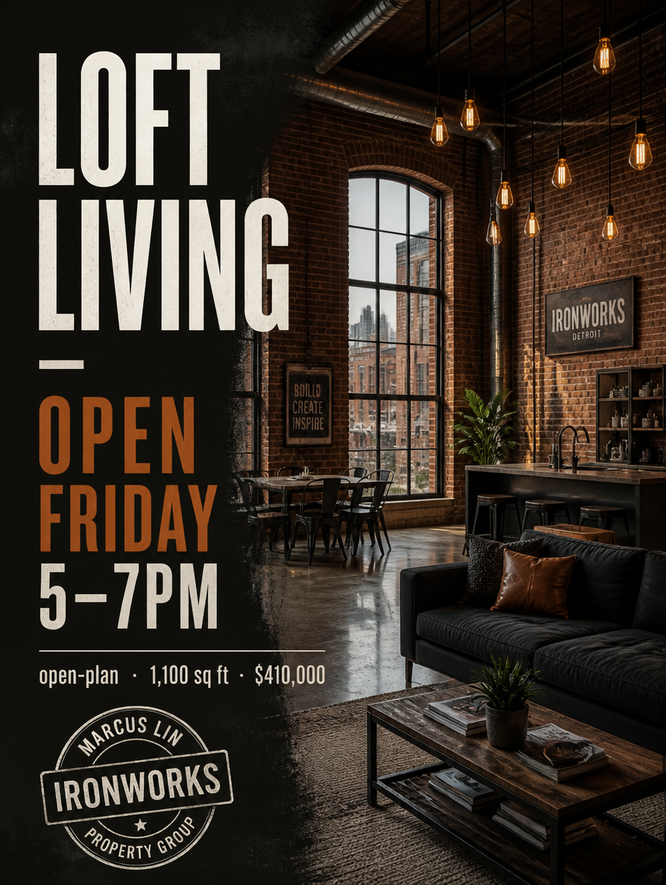

```text
A stylish open-house flyer for an urban loft. A moody render of an exposed-brick loft with tall industrial windows, polished concrete floors, and hanging Edison bulbs. Bold uppercase condensed type reads 'LOFT LIVING — OPEN FRIDAY 5–7PM.' A thin rule precedes 'open-plan · 1,100 sq ft · $410,000.' A stamp-style badge names 'Marcus Lin, Ironworks Property Group.' Palette of warm brick, charcoal, amber light, off-white. Trendy, industrial-chic, young-urban appeal.
```

[Original source](https://github.com/apimodels/gpt-image-2-prompts/blob/980d100f3bd0f2cde4cf38835daeb742bf1cac65/prompts.json#poster-733) · Model: GPT Image 2 · Credit: APIModels · CC BY 4.0
ProjectD: reviewed-not-imported. Complete source prompt and uncropped native preview correspond; generation defects and actual dimensions retained.

## Just Sold Announcement · poster-735
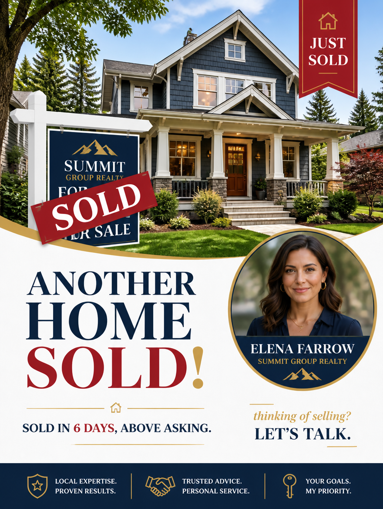

```text
A celebratory 'JUST SOLD' real-estate flyer. A crisp render of a handsome craftsman house with a bold red 'SOLD' rider clipped over a for-sale sign in the yard. Confident bold serif reads 'ANOTHER HOME SOLD!' A clean line notes 'sold in 6 days, above asking.' A round headshot-style badge names 'Elena Farrow, Summit Group Realty' with the tagline 'thinking of selling? let's talk.' Palette of crisp white, deep red, navy, gold. Proud, trustworthy, results-driven agent branding.
```

[Original source](https://github.com/apimodels/gpt-image-2-prompts/blob/980d100f3bd0f2cde4cf38835daeb742bf1cac65/prompts.json#poster-735) · Model: GPT Image 2 · Credit: APIModels · CC BY 4.0
ProjectD: reviewed-not-imported. Synthetic agent advertising; sold-in-six-days claim is fictional.

## Beachfront Property · poster-734
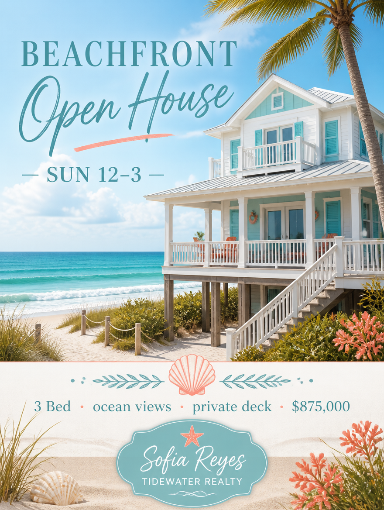

```text
A breezy coastal open-house flyer for a beachfront property. A sunlit render of a white-and-teal beach house on stilts, palm trees, and turquoise ocean behind. Airy light script reads 'BEACHFRONT OPEN HOUSE — SUN 12–3.' A shell-motif divider precedes '3 Bed · ocean views · private deck · $875,000.' A soft badge names 'Sofia Reyes, Tidewater Realty.' Palette of turquoise, sandy beige, white, coral. Relaxed, sunny, dreamy coastal-lifestyle marketing.
```

[Original source](https://github.com/apimodels/gpt-image-2-prompts/blob/980d100f3bd0f2cde4cf38835daeb742bf1cac65/prompts.json#poster-734) · Model: GPT Image 2 · Credit: APIModels · CC BY 4.0
ProjectD: reviewed-not-imported. Complete source prompt and uncropped native preview correspond; generation defects and actual dimensions retained.

## Mountain Cabin Retreat · poster-736
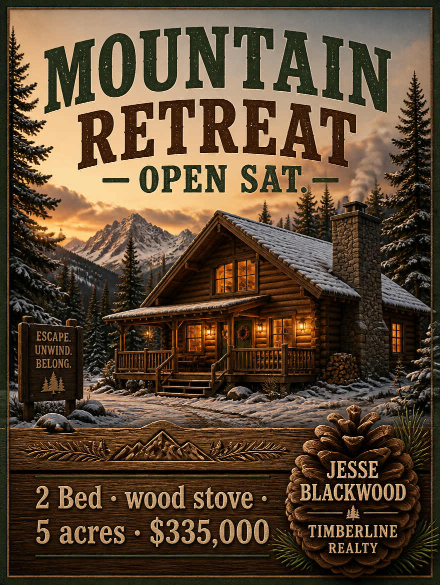

```text
A rustic open-house flyer for a mountain cabin. A warm render of a log cabin nestled among snow-dusted pines with smoke rising from the chimney at dusk. Woodsy slab-serif reads 'MOUNTAIN RETREAT — OPEN SAT.' A carved-wood divider precedes '2 Bed · wood stove · 5 acres · $335,000.' A pinecone badge names 'Jesse Blackwood, Timberline Realty.' Palette of pine green, warm log brown, snow white, amber. Cozy, escapist, rustic-getaway charm.
```

[Original source](https://github.com/apimodels/gpt-image-2-prompts/blob/980d100f3bd0f2cde4cf38835daeb742bf1cac65/prompts.json#poster-736) · Model: GPT Image 2 · Credit: APIModels · CC BY 4.0
ProjectD: reviewed-not-imported. Complete source prompt and uncropped native preview correspond; generation defects and actual dimensions retained.

## New Development Preview · poster-737
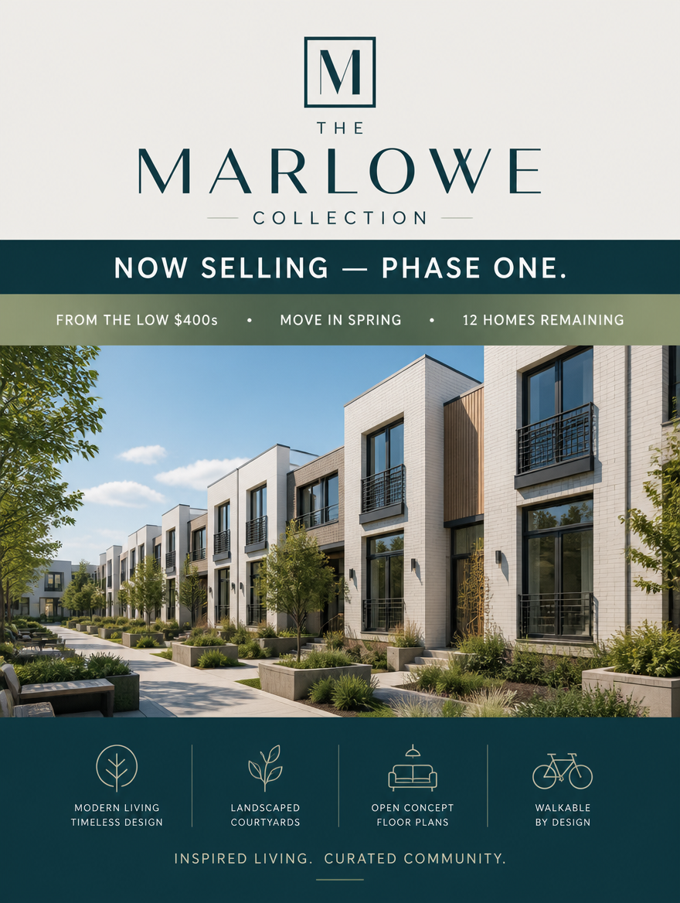

```text
A polished pre-construction real-estate flyer for a new development. A crisp architectural render of a row of modern townhomes with landscaped courtyards and clean geometric facades under a clear sky. Sleek uppercase sans reads 'NOW SELLING — PHASE ONE.' A gradient bar lists 'from the low $400s · move in spring · 12 homes remaining.' A monogram names 'The Marlowe Collection.' Palette of soft grey, sage, warm white, deep teal. Modern, aspirational, developer-grade presentation.
```

[Original source](https://github.com/apimodels/gpt-image-2-prompts/blob/980d100f3bd0f2cde4cf38835daeb742bf1cac65/prompts.json#poster-737) · Model: GPT Image 2 · Credit: APIModels · CC BY 4.0
ProjectD: reviewed-not-imported. Complete source prompt and uncropped native preview correspond; generation defects and actual dimensions retained.
