# APIModels GPT Image 2 — batch 08

CC BY 4.0. Copyright APIModels. Prompts and images explicitly covered by https://github.com/apimodels/gpt-image-2-prompts/blob/980d100f3bd0f2cde4cf38835daeb742bf1cac65/LICENSE; credit source publisher APIModels and retain attribution. No individual original-author claim inferred from curation.

Native PNG outputs and complete original prompts. Generated claims/design labels are not independently verified facts. ProjectD holds are recorded per item.

## Taco Tuesday Special · poster-739
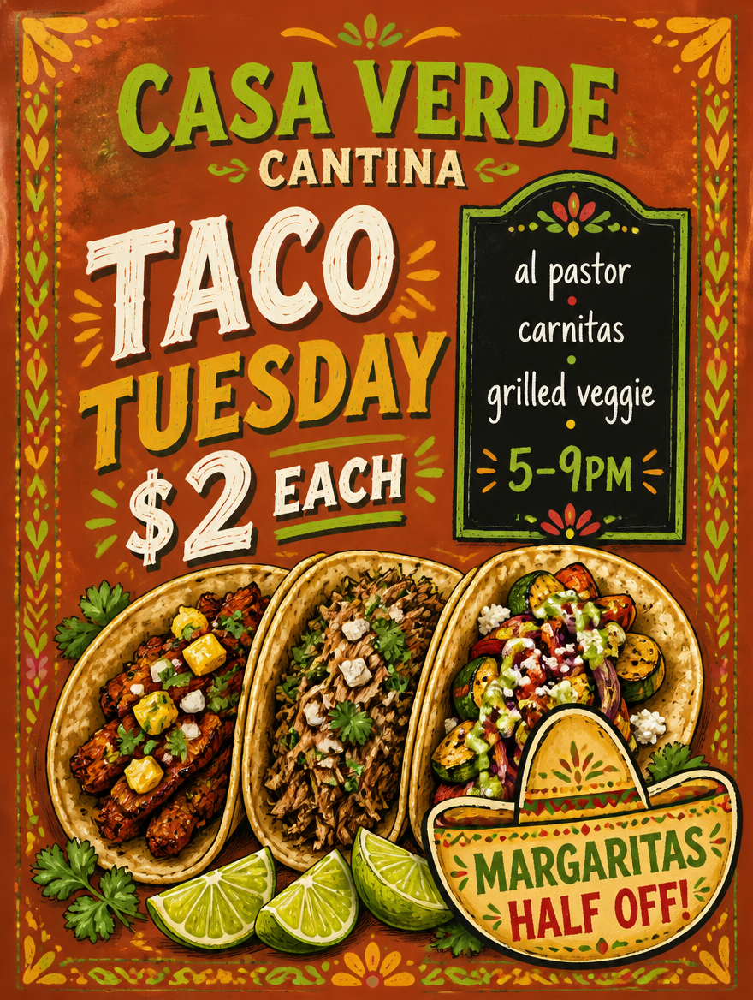

```text
A vibrant restaurant menu-special flyer for 'Casa Verde Cantina.' A hand-drawn illustration of three loaded street tacos with lime wedges and cilantro on a warm terracotta background with painted folk-art borders. Bold festive display type reads 'TACO TUESDAY — $2 EACH.' A chalk panel lists 'al pastor · carnitas · grilled veggie · 5–9pm.' A sombrero-shaped badge notes 'margaritas half off.' Palette of terracotta, lime green, marigold, chili red. Lively, appetizing, festive Latin-eatery energy.
```

[Original source](https://github.com/apimodels/gpt-image-2-prompts/blob/980d100f3bd0f2cde4cf38835daeb742bf1cac65/prompts.json#poster-739) · Model: GPT Image 2 · Credit: APIModels · CC BY 4.0
ProjectD: reviewed-not-imported. Complete source prompt and uncropped native preview correspond; generation defects and actual dimensions retained.

## Country Farmhouse Estate · poster-738
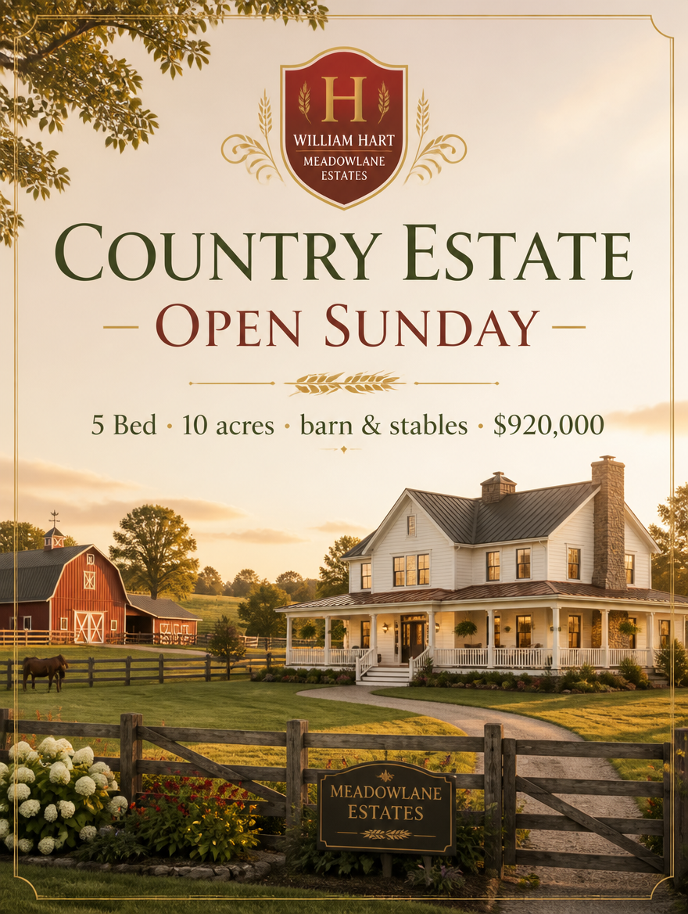

```text
An elegant open-house flyer for a country farmhouse estate. A golden-hour render of a white farmhouse with a wraparound porch, a red barn, and rolling green pasture behind a wooden fence. Graceful serif reads 'COUNTRY ESTATE — OPEN SUNDAY.' A wheat-motif divider precedes '5 Bed · 10 acres · barn & stables · $920,000.' A crest badge names 'William Hart, Meadowlane Estates.' Palette of warm cream, barn red, meadow green, gold. Refined, pastoral, luxury-country lifestyle appeal.
```

[Original source](https://github.com/apimodels/gpt-image-2-prompts/blob/980d100f3bd0f2cde4cf38835daeb742bf1cac65/prompts.json#poster-738) · Model: GPT Image 2 · Credit: APIModels · CC BY 4.0
ProjectD: reviewed-not-imported. Complete source prompt and uncropped native preview correspond; generation defects and actual dimensions retained.

## Sushi Happy Hour · poster-740
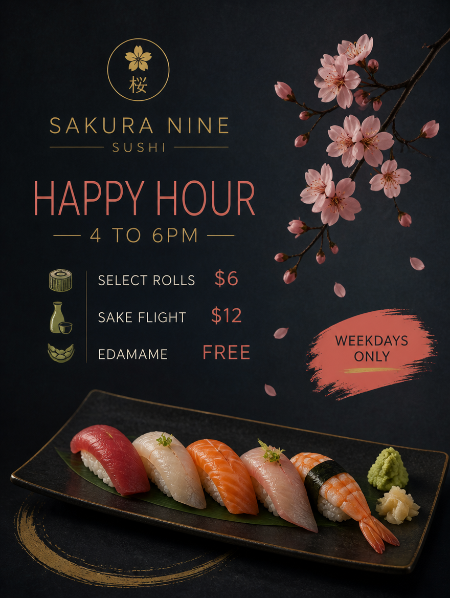

```text
A sleek restaurant menu-special flyer for 'Sakura Nine Sushi.' A minimalist dark slate background with an elegant illustration of a nigiri set and a single pink cherry blossom branch. Refined thin sans reads 'HAPPY HOUR — 4 TO 6PM.' A clean list shows 'select rolls $6 · sake flight $12 · edamame free.' A brush-stroke badge notes 'weekdays only.' Palette of slate black, salmon pink, seaweed green, gold. Elegant, minimal, upscale-Japanese refinement.
```

[Original source](https://github.com/apimodels/gpt-image-2-prompts/blob/980d100f3bd0f2cde4cf38835daeb742bf1cac65/prompts.json#poster-740) · Model: GPT Image 2 · Credit: APIModels · CC BY 4.0
ProjectD: reviewed-not-imported. Complete source prompt and uncropped native preview correspond; generation defects and actual dimensions retained.

## Pizza Family Deal · poster-741
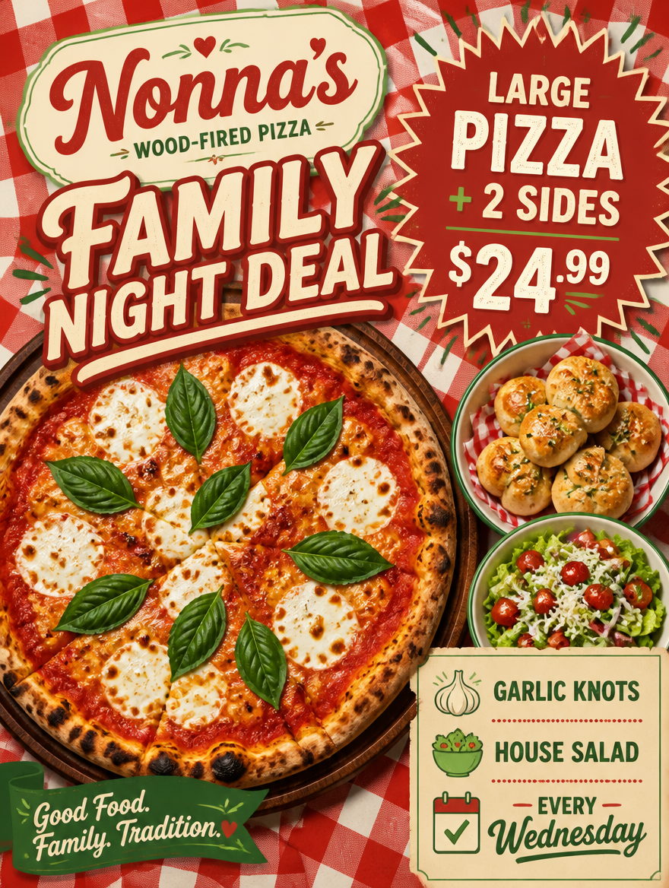

```text
A fun restaurant menu-special flyer for 'Nonna's Wood-Fired Pizza.' A mouthwatering top-down illustration of a bubbling margherita pizza with fresh basil on a checkered red-and-white tablecloth. Chunky retro script reads 'FAMILY NIGHT DEAL.' A bright starburst shouts 'LARGE PIZZA + 2 SIDES — $24.99.' A small list notes 'garlic knots · house salad · every Wednesday.' Palette of tomato red, cream, basil green, mozzarella white. Warm, hearty, family-pizzeria comfort.
```

[Original source](https://github.com/apimodels/gpt-image-2-prompts/blob/980d100f3bd0f2cde4cf38835daeb742bf1cac65/prompts.json#poster-741) · Model: GPT Image 2 · Credit: APIModels · CC BY 4.0
ProjectD: reviewed-not-imported. Complete source prompt and uncropped native preview correspond; generation defects and actual dimensions retained.

## Brunch Menu Poster · poster-742
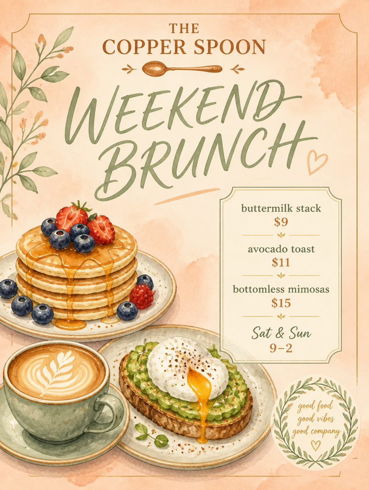

```text
A charming restaurant brunch-special flyer for 'The Copper Spoon.' A soft watercolor illustration of pancakes with berries, a poached egg on toast, and a latte on a pastel peach background. Elegant handwritten script reads 'WEEKEND BRUNCH.' A tidy menu lists 'buttermilk stack $9 · avocado toast $11 · bottomless mimosas $15 · Sat & Sun 9–2.' A small sprig badge decorates the corner. Palette of peach, sage, cream, soft gold. Cozy, delightful, artisan-cafe brunch charm.
```

[Original source](https://github.com/apimodels/gpt-image-2-prompts/blob/980d100f3bd0f2cde4cf38835daeb742bf1cac65/prompts.json#poster-742) · Model: GPT Image 2 · Credit: APIModels · CC BY 4.0
ProjectD: reviewed-not-imported. Complete source prompt and uncropped native preview correspond; generation defects and actual dimensions retained.

## Burger Combo Blowout · poster-743
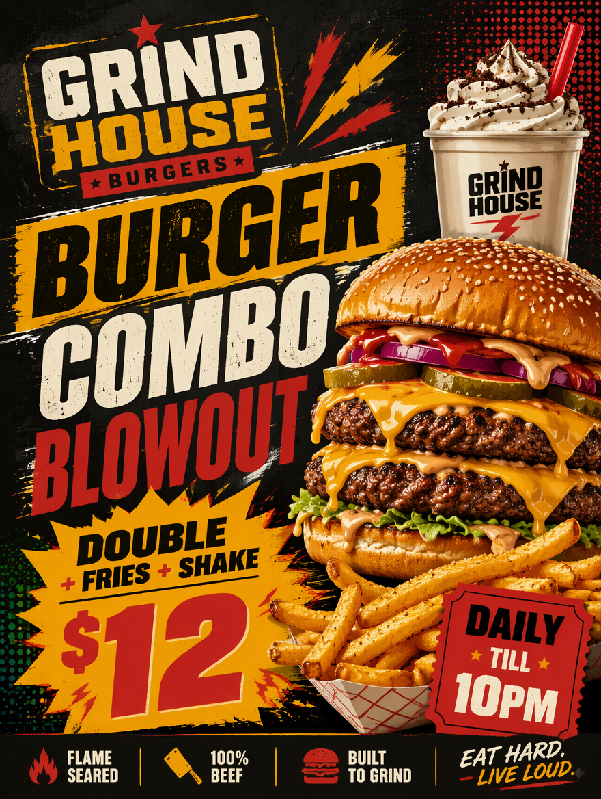

```text
A bold restaurant menu-special flyer for 'Grind House Burgers.' A juicy illustrated double cheeseburger with dripping cheese and crispy fries on a gritty dark background with halftone accents. Heavy impact type shouts 'BURGER COMBO BLOWOUT.' A price flash reads 'DOUBLE + FRIES + SHAKE — $12.' A ticket badge notes 'daily till 10pm.' Palette of charcoal, mustard yellow, ketchup red, cream. Loud, craveable, gritty street-food energy.
```

[Original source](https://github.com/apimodels/gpt-image-2-prompts/blob/980d100f3bd0f2cde4cf38835daeb742bf1cac65/prompts.json#poster-743) · Model: GPT Image 2 · Credit: APIModels · CC BY 4.0
ProjectD: reviewed-not-imported. Complete source prompt and uncropped native preview correspond; generation defects and actual dimensions retained.

## Ramen Night Special · poster-744
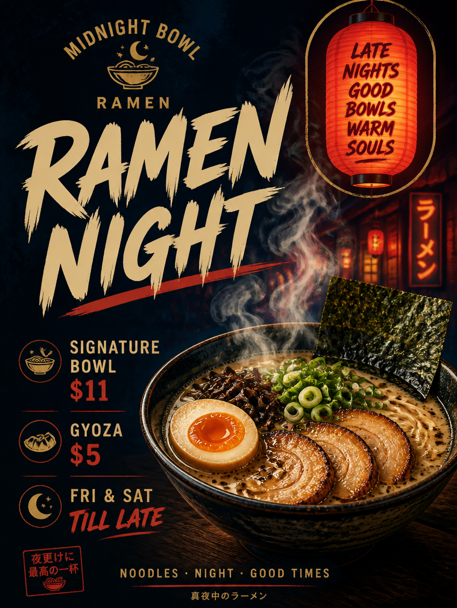

```text
An atmospheric restaurant menu-special flyer for 'Midnight Bowl Ramen.' A steamy illustration of a rich tonkotsu ramen bowl with soft egg, nori, and scallions, rising steam curling upward against a deep indigo background with red lantern glow. Bold brush-style caps read 'RAMEN NIGHT.' A list shows 'signature bowl $11 · gyoza $5 · Fri & Sat till late.' A lantern badge glows in the corner. Palette of indigo, lantern red, warm cream, gold. Moody, comforting, late-night noodle-bar vibe.
```

[Original source](https://github.com/apimodels/gpt-image-2-prompts/blob/980d100f3bd0f2cde4cf38835daeb742bf1cac65/prompts.json#poster-744) · Model: GPT Image 2 · Credit: APIModels · CC BY 4.0
ProjectD: reviewed-not-imported. Complete source prompt and uncropped native preview correspond; generation defects and actual dimensions retained.

## Seafood Boil Feast · poster-745
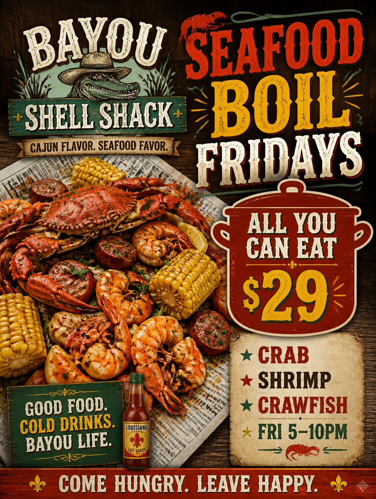

```text
A festive restaurant menu-special flyer for 'Bayou Shell Shack.' A vibrant illustration of a Cajun seafood boil — crab, shrimp, corn, and sausage spilled on newspaper — on a rustic wood background. Bold cajun-style display type reads 'SEAFOOD BOIL FRIDAYS.' A pot-shaped badge shouts 'ALL YOU CAN EAT — $29.' A list notes 'crab · shrimp · crawfish · Fri 5–10pm.' Palette of boil red, corn yellow, rustic brown, sea green. Hearty, festive, southern-comfort feast energy.
```

[Original source](https://github.com/apimodels/gpt-image-2-prompts/blob/980d100f3bd0f2cde4cf38835daeb742bf1cac65/prompts.json#poster-745) · Model: GPT Image 2 · Credit: APIModels · CC BY 4.0
ProjectD: reviewed-not-imported. Complete source prompt and uncropped native preview correspond; generation defects and actual dimensions retained.

## Dessert Bar Specials · poster-746
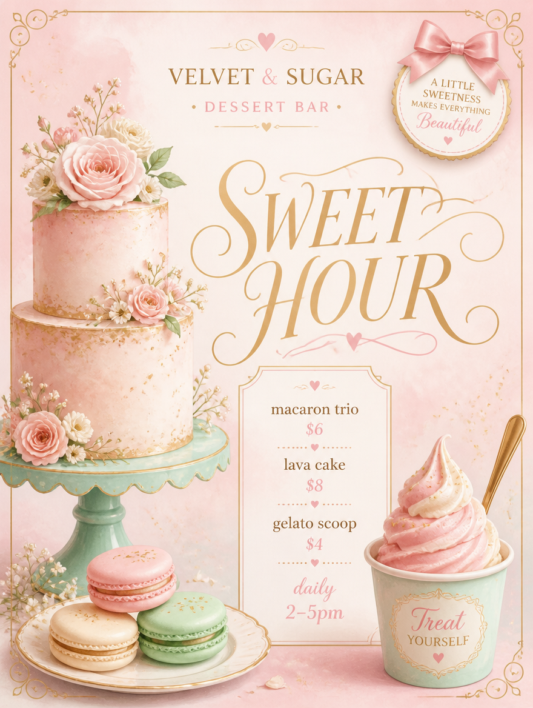

```text
A sweet restaurant menu-special flyer for 'Velvet & Sugar Dessert Bar.' A delicate illustration of a tiered cake, macarons, and a swirl of gelato on a soft pastel-pink background with gold flecks. Elegant flowing script reads 'SWEET HOUR.' A dainty list shows 'macaron trio $6 · lava cake $8 · gelato scoop $4 · daily 2–5pm.' A tiny bow badge decorates the corner. Palette of pastel pink, mint, cream, champagne gold. Dainty, indulgent, boutique-patisserie sweetness.
```

[Original source](https://github.com/apimodels/gpt-image-2-prompts/blob/980d100f3bd0f2cde4cf38835daeb742bf1cac65/prompts.json#poster-746) · Model: GPT Image 2 · Credit: APIModels · CC BY 4.0
ProjectD: reviewed-not-imported. Complete source prompt and uncropped native preview correspond; generation defects and actual dimensions retained.

## Curry House Lunch · poster-747
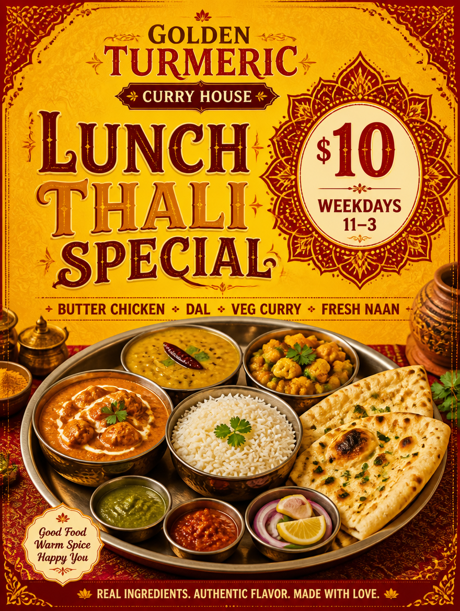

```text
A warm restaurant lunch-special flyer for 'Golden Turmeric Curry House.' A rich illustration of a thali platter — curry, rice, naan, and chutneys — with warm spice-toned patterns bordering a deep saffron background. Ornate display type reads 'LUNCH THALI SPECIAL.' A mandala badge shows '$10 — WEEKDAYS 11–3.' A list notes 'butter chicken · dal · veg curry · fresh naan.' Palette of saffron, deep red, turmeric gold, cream. Warm, aromatic, richly-spiced South-Asian appeal.
```

[Original source](https://github.com/apimodels/gpt-image-2-prompts/blob/980d100f3bd0f2cde4cf38835daeb742bf1cac65/prompts.json#poster-747) · Model: GPT Image 2 · Credit: APIModels · CC BY 4.0
ProjectD: reviewed-not-imported. Complete source prompt and uncropped native preview correspond; generation defects and actual dimensions retained.

## Coffee & Pastry Combo · poster-748
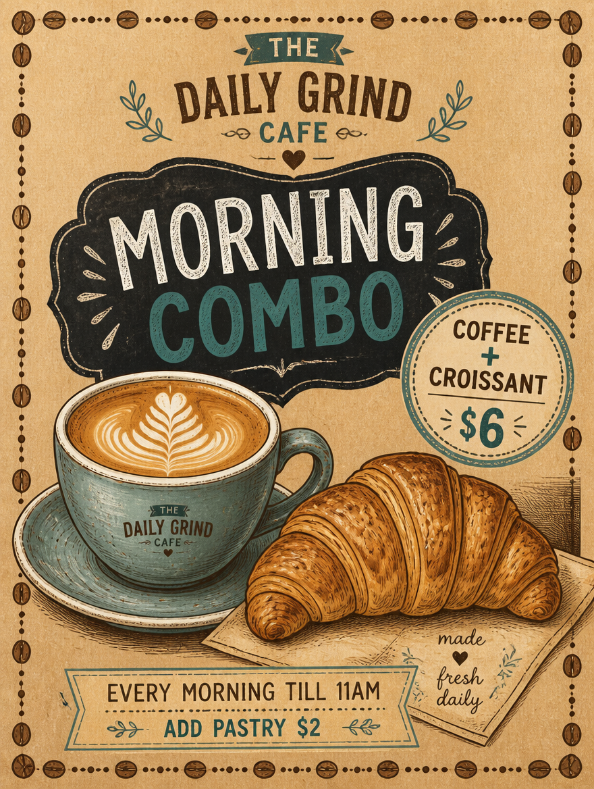

```text
A cozy cafe menu-special flyer for 'The Daily Grind Cafe.' A warm hand-drawn illustration of a flat white with latte art and a flaky croissant on a rustic kraft-paper background. Friendly chalkboard lettering reads 'MORNING COMBO.' A stamp badge shows 'COFFEE + CROISSANT — $6.' A tidy note lists 'every morning till 11am · add pastry $2.' A small coffee-bean border frames the edge. Palette of kraft brown, cream, muted teal, espresso. Cozy, wholesome, neighborhood-cafe warmth.
```

[Original source](https://github.com/apimodels/gpt-image-2-prompts/blob/980d100f3bd0f2cde4cf38835daeb742bf1cac65/prompts.json#poster-748) · Model: GPT Image 2 · Credit: APIModels · CC BY 4.0
ProjectD: reviewed-not-imported. Complete source prompt and uncropped native preview correspond; generation defects and actual dimensions retained.

## Mobile OS Market Share · infographic-819
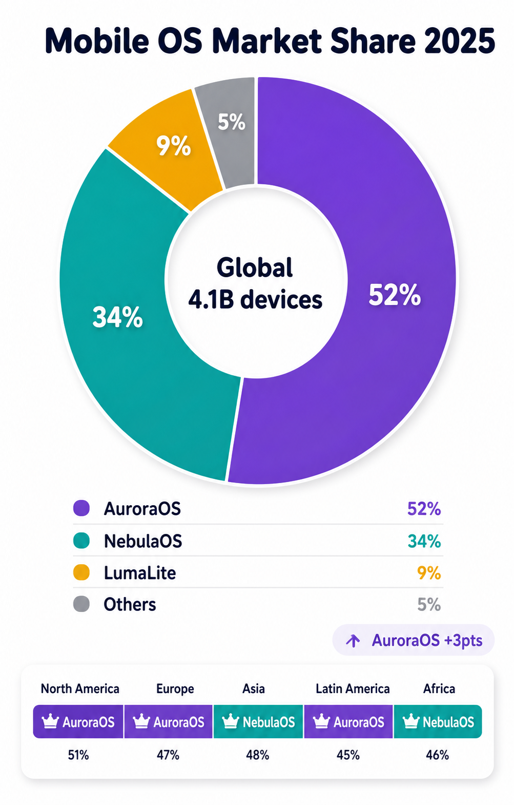

```text
A market-share infographic, 4:5, titled 'Mobile OS Market Share 2025'. A large donut chart splits the market between invented systems: AuroraOS 52% (purple), NebulaOS 34% (teal), LumaLite 9% (amber), Others 5% (grey). The donut center reads 'Global 4.1B devices'. A legend with color dots and exact percentages sits below, plus a small year-over-year change note ('AuroraOS +3pts'). A tiny regional split bar shows differing leaders by continent. Clean white background, flat design, bold rounded headline, subtle shadows, modern data-report aesthetic.
```

[Original source](https://github.com/apimodels/gpt-image-2-prompts/blob/980d100f3bd0f2cde4cf38835daeb742bf1cac65/prompts.json#infographic-819) · Model: GPT Image 2 · Credit: APIModels · CC BY 4.0
ProjectD: reviewed-not-imported. Explicitly invented OS brands and illustrative market data; not actual 2025 research.

## EV Brand Market Share · infographic-820
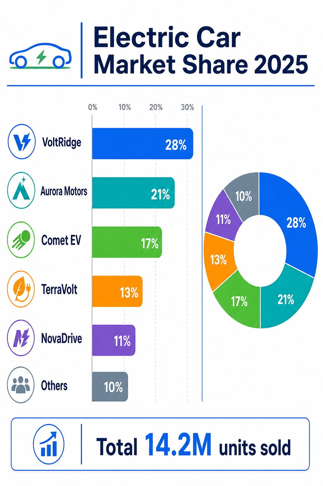

```text
A market-share infographic, 2:3, titled 'Electric Car Market Share 2025'. A horizontal bar chart ranks invented EV makers: VoltRidge 28%, Aurora Motors 21%, Comet EV 17%, TerraVolt 13%, NovaDrive 11%, Others 10%, each bar in a distinct color with the percentage in bold. Small car-badge icons head each row. A side donut echoes the split, and a footer stat reads 'Total 14.2M units sold'. Clean flat design, electric-blue and green palette, white background, rounded bars, thin grid, modern automotive data-report aesthetic, crisp sans-serif.
```

[Original source](https://github.com/apimodels/gpt-image-2-prompts/blob/980d100f3bd0f2cde4cf38835daeb742bf1cac65/prompts.json#infographic-820) · Model: GPT Image 2 · Credit: APIModels · CC BY 4.0
ProjectD: reviewed-not-imported. Invented EV makers and sales statistics; not market evidence.

## Cloud Provider Market Share · infographic-821
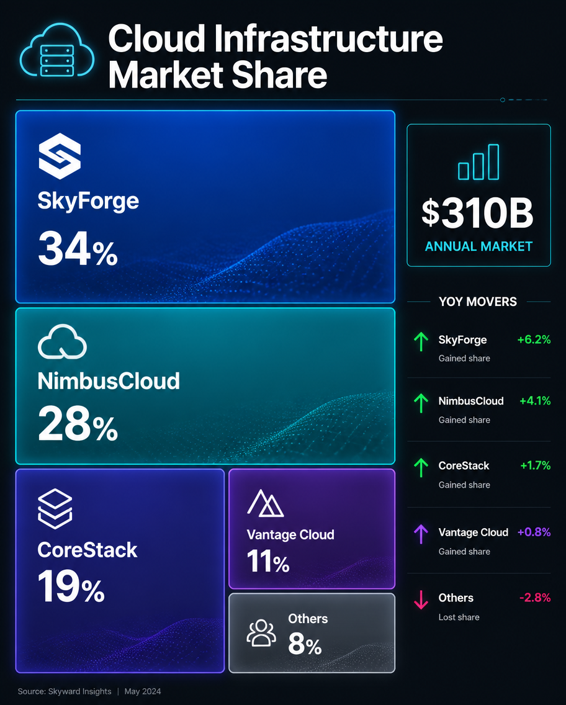

```text
A tech market-share infographic, 4:5, titled 'Cloud Infrastructure Market Share'. A treemap-style block layout sizes invented providers by share: SkyForge 34% (large blue block), NimbusCloud 28% (teal), CoreStack 19% (indigo), Vantage Cloud 11% (purple), Others 8% (grey). Each block shows the name and percentage in white. A small side note '$310B annual market' and a mini arrow list of YoY movers. Dark charcoal background, neon-accent blocks with glowing edges, clean white type, sleek modern tech data-report aesthetic.
```

[Original source](https://github.com/apimodels/gpt-image-2-prompts/blob/980d100f3bd0f2cde4cf38835daeb742bf1cac65/prompts.json#infographic-821) · Model: GPT Image 2 · Credit: APIModels · CC BY 4.0
ProjectD: reviewed-not-imported. Invented providers; generated source/footer and figures are illustrative.

## Streaming Platform Share · infographic-822
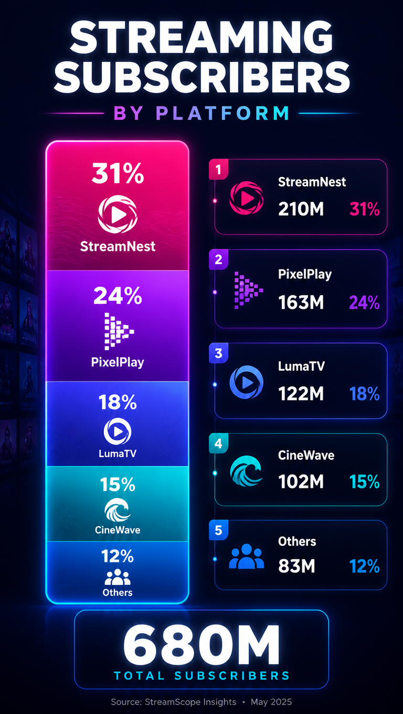

```text
A media market-share infographic, 9:16, titled 'Streaming Subscribers by Platform'. A vertical stacked-column layout where one tall bar splits into invented services: StreamNest 31%, PixelPlay 24%, LumaTV 18%, CineWave 15%, Others 12%, each segment labeled with a percentage and a tiny logo shape. Beside it, a ranked mini-card list repeats the numbers with subscriber counts (e.g., StreamNest 210M). A footer '680M total subscribers'. Deep midnight-blue background, magenta-cyan gradient segments, glowing edges, sleek streaming-brand data aesthetic, bold white type.
```

[Original source](https://github.com/apimodels/gpt-image-2-prompts/blob/980d100f3bd0f2cde4cf38835daeb742bf1cac65/prompts.json#infographic-822) · Model: GPT Image 2 · Credit: APIModels · CC BY 4.0
ProjectD: reviewed-not-imported. Invented streaming platforms and subscriber counts.

## Coffee Chain Market Share · infographic-824
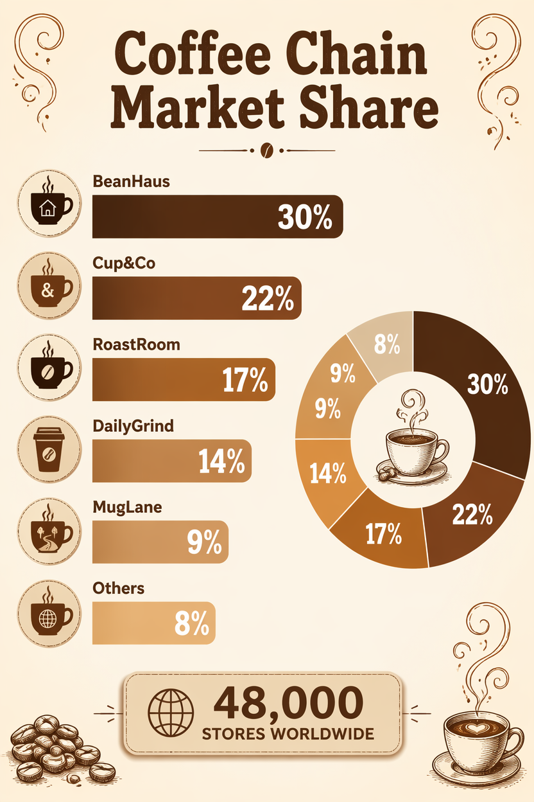

```text
A retail market-share infographic, 2:3, titled 'Coffee Chain Market Share'. A horizontal bar ranking of invented chains: BeanHaus 30%, Cup&Co 22%, RoastRoom 17%, DailyGrind 14%, MugLane 9%, Others 8%, each bar in a warm brown-to-caramel gradient with bold percentages. Small coffee-cup badge icons head each row. A side donut mirrors the shares and a footer reads '48,000 stores worldwide'. Warm cream background, coffee-brown headline, hand-drawn steam swirls in corners, rounded bars, cozy modern retail-data aesthetic, clean type.
```

[Original source](https://github.com/apimodels/gpt-image-2-prompts/blob/980d100f3bd0f2cde4cf38835daeb742bf1cac65/prompts.json#infographic-824) · Model: GPT Image 2 · Credit: APIModels · CC BY 4.0
ProjectD: reviewed-not-imported. Invented chain shares/store counts.

## Gaming Console Share · infographic-825
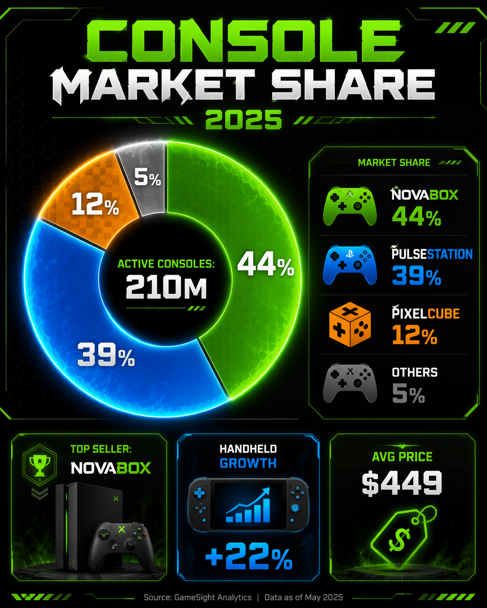

```text
A gaming market-share infographic, 4:5, titled 'Console Market Share 2025'. A donut chart splits invented consoles: NovaBox 44% (green), PulseStation 39% (blue), PixelCube 12% (orange), Others 5% (grey). Center label 'Active consoles: 210M'. A legend with controller-shaped color chips and percentages, plus three mini stat tiles: 'Top seller: NovaBox', 'Handheld growth +22%', 'Avg price $449'. Dark gamer palette of black, neon-green, and electric-blue, glowing donut edges, angular futuristic accents, bold arcade-style headline, sleek gaming data aesthetic.
```

[Original source](https://github.com/apimodels/gpt-image-2-prompts/blob/980d100f3bd0f2cde4cf38835daeb742bf1cac65/prompts.json#infographic-825) · Model: GPT Image 2 · Credit: APIModels · CC BY 4.0
ProjectD: reviewed-not-imported. Invented consoles/shares/prices.

## Ride-Hailing Market Share · infographic-827
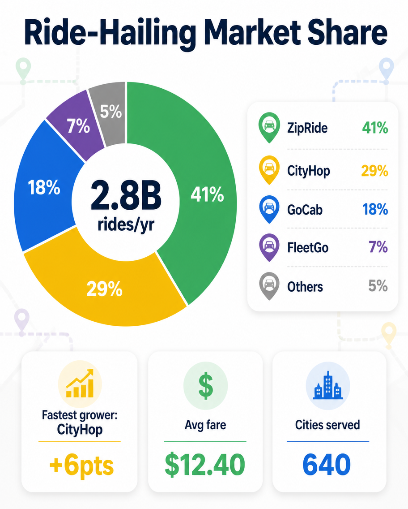

```text
A mobility market-share infographic, 4:5, titled 'Ride-Hailing Market Share'. A donut chart divides invented apps: ZipRide 41% (green), CityHop 29% (yellow), GoCab 18% (blue), FleetGo 7% (purple), Others 5% (grey). Center reads '2.8B rides/yr'. A legend with car-pin color chips and percentages, plus three mini tiles: 'Fastest grower: CityHop +6pts', 'Avg fare $12.40', 'Cities served 640'. Clean white background, flat design, map-route line motifs faintly in the background, rounded widgets, modern mobility data-report aesthetic, bold headline.
```

[Original source](https://github.com/apimodels/gpt-image-2-prompts/blob/980d100f3bd0f2cde4cf38835daeb742bf1cac65/prompts.json#infographic-827) · Model: GPT Image 2 · Credit: APIModels · CC BY 4.0
ProjectD: reviewed-not-imported. Invented ride-hailing services/statistics.

## Social Platform Market Share · infographic-828
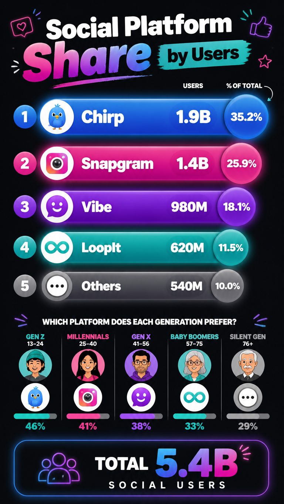

```text
A social-media market-share infographic, 9:16, titled 'Social Platform Share by Users'. A vertical ranked layout: horizontal bubble bars for invented platforms sized by users: Chirp 1.9B (blue), Snapgram 1.4B (magenta), Vibe 980M (purple), LoopIt 620M (teal), Others 540M (grey), each with a percentage of total. A small age-split mini bar shows which platform each generation prefers. A footer 'Total 5.4B social users'. Bright gradient palette on a dark background, glowing rounded bubbles, playful bold headline, trendy modern social-data aesthetic, clean white type.
```

[Original source](https://github.com/apimodels/gpt-image-2-prompts/blob/980d100f3bd0f2cde4cf38835daeb742bf1cac65/prompts.json#infographic-828) · Model: GPT Image 2 · Credit: APIModels · CC BY 4.0
ProjectD: reviewed-not-imported. Invented platforms/users, not actual market data.

## How a Leaf Makes Food · infographic-829
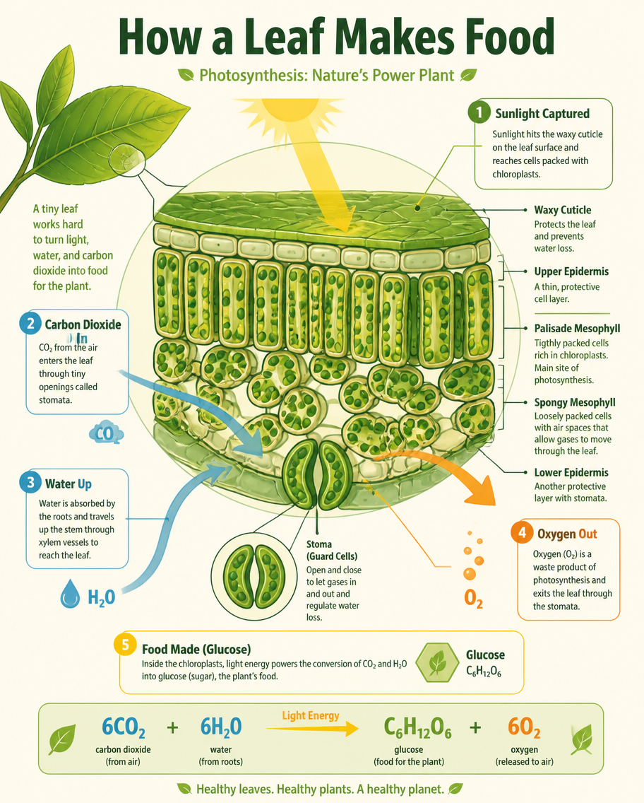

```text
A botanical infographic explaining photosynthesis through a magnified leaf cross-section. Center: a detailed cutaway showing the waxy cuticle, palisade and spongy mesophyll layers, a stoma with guard cells, and green chloroplasts. Blue curved arrows trace incoming water and CO2; orange arrows show released oxygen; a yellow sunbeam strikes the top. Flat vector illustration with soft gradients on a cream background. Bold sans-serif title 'How a Leaf Makes Food', numbered callout boxes, and the equation 6CO2 + 6H2O to C6H12O6 + 6O2 along the base. Botanical green and amber palette.
```

[Original source](https://github.com/apimodels/gpt-image-2-prompts/blob/980d100f3bd0f2cde4cf38835daeb742bf1cac65/prompts.json#infographic-829) · Model: GPT Image 2 · Credit: APIModels · CC BY 4.0
ProjectD: held. Detailed generated biological labels/equation need native-scale scientific accuracy review before educational publication.

## The Water Cycle · infographic-830
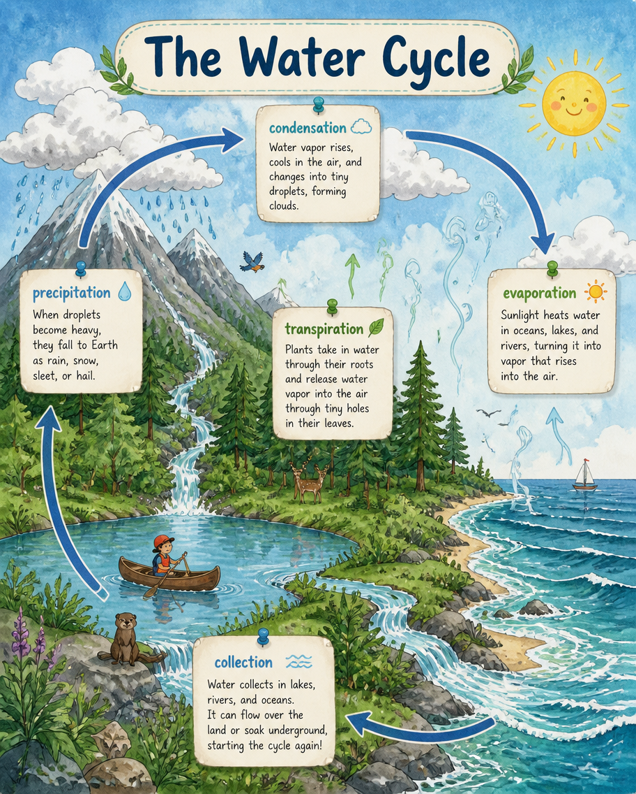

```text
An earth-science infographic of the water cycle drawn as one continuous landscape scene. A mountain, forest, lake and ocean sit under a cloud-filled sky, connected by looping arrows labeled 'evaporation', 'condensation', 'precipitation', 'collection' and 'transpiration'. Tiny sun, raindrops and vapor swirls act as icons. Hand-illustrated storybook style with textured watercolor washes in teal, sky blue and moss green. Rounded title banner 'The Water Cycle' across the top, short caption paragraphs pinned beside each stage. Playful, kid-friendly composition.
```

[Original source](https://github.com/apimodels/gpt-image-2-prompts/blob/980d100f3bd0f2cde4cf38835daeb742bf1cac65/prompts.json#infographic-830) · Model: GPT Image 2 · Credit: APIModels · CC BY 4.0
ProjectD: reviewed-not-imported. General illustrative water-cycle scene, not a measured hydrological model.

## Inside an Animal Cell · infographic-831
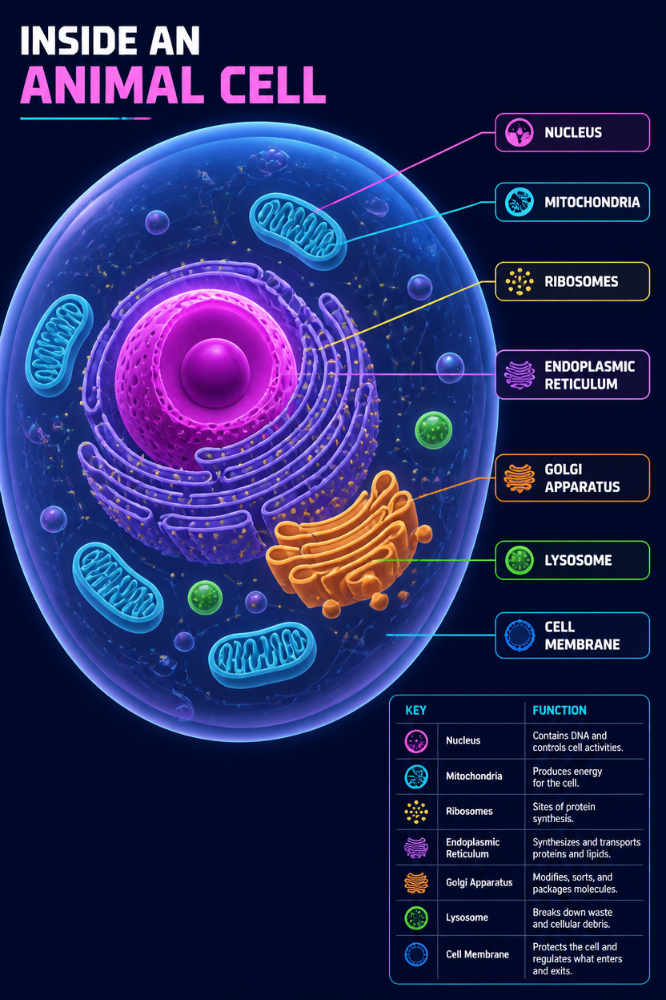

```text
A biology diagram of a labeled animal cell shown as a large translucent sphere filling the frame. Inside, clearly rendered organelles - nucleus, mitochondria, ribosomes, Golgi apparatus, endoplasmic reticulum, lysosome and cell membrane - are color-coded with thin leader lines pointing to right-aligned label chips. Clean flat vector style with a subtle inner glow, on a dark navy background for contrast. Neon-pastel palette with a magenta nucleus and cyan mitochondria. Title 'Inside an Animal Cell' top-left in a heavy geometric font, a small legend grid bottom-right.
```

[Original source](https://github.com/apimodels/gpt-image-2-prompts/blob/980d100f3bd0f2cde4cf38835daeb742bf1cac65/prompts.json#infographic-831) · Model: GPT Image 2 · Credit: APIModels · CC BY 4.0
ProjectD: held. Generated organelle/leader-label accuracy not independently established.

## Butterfly Metamorphosis · infographic-832
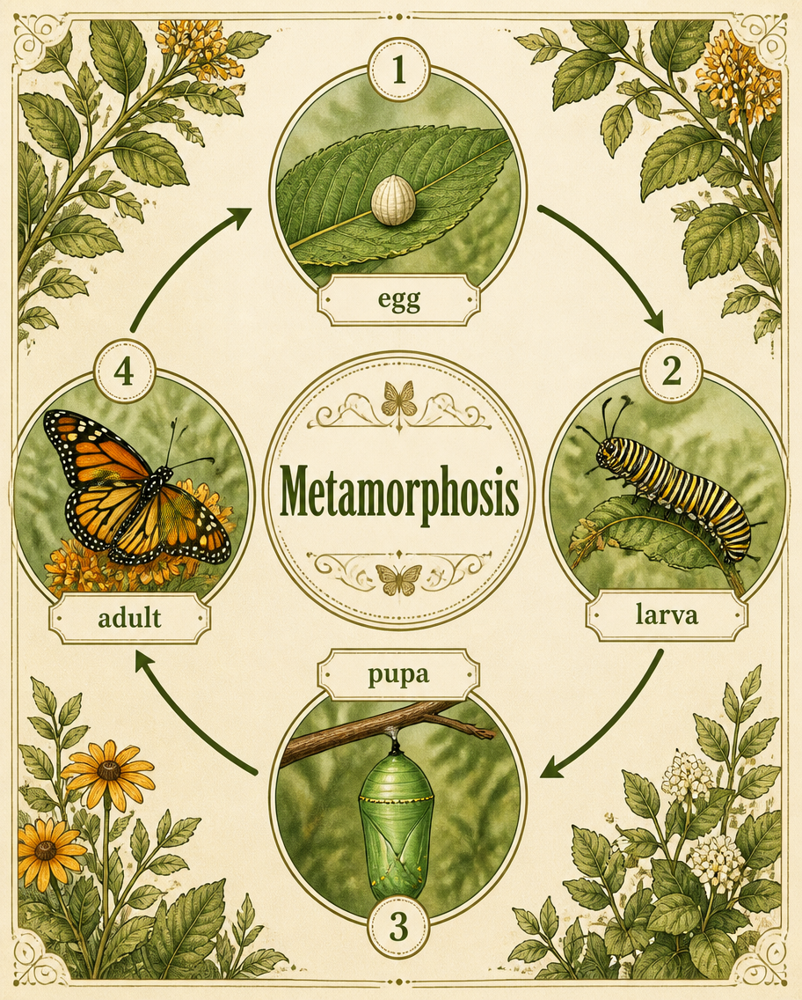

```text
A life-cycle infographic showing the four stages of a monarch-style butterfly's metamorphosis arranged in a clockwise circle. An egg on a leaf, a striped caterpillar, a green chrysalis, and an emerged orange-and-black butterfly each sit in a circular vignette linked by curved directional arrows. Numbered 1-4 with stage names 'egg', 'larva', 'pupa', 'adult'. Detailed naturalistic illustration with fine linework, warm meadow-green and marigold palette on ivory. Central title medallion 'Metamorphosis'. Decorative leaves fill the corners.
```

[Original source](https://github.com/apimodels/gpt-image-2-prompts/blob/980d100f3bd0f2cde4cf38835daeb742bf1cac65/prompts.json#infographic-832) · Model: GPT Image 2 · Credit: APIModels · CC BY 4.0
ProjectD: reviewed-not-imported. Basic four-stage butterfly illustration, not species identification evidence.

## Anatomy of a Volcano · infographic-833
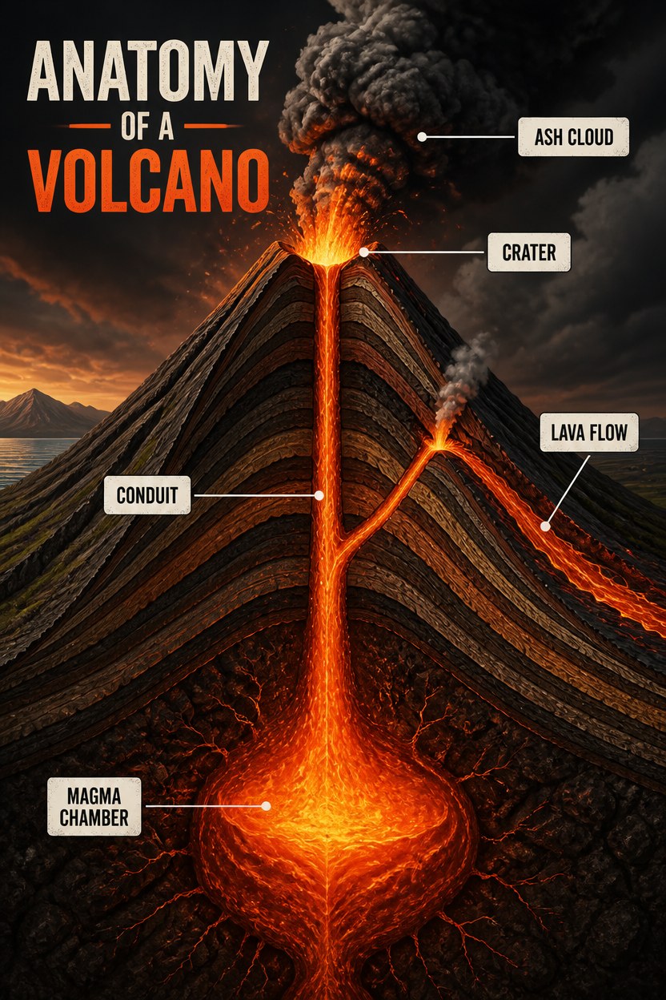

```text
A geology cutaway infographic of a stratovolcano sliced in half. The cross-section reveals the magma chamber, central conduit, side vent, layered lava and ash strata, and an erupting summit with a smoke plume and lava bombs. A red-orange gradient marks molten rock; layered browns show cooled deposits. Thin white leader lines connect to label boxes: 'magma chamber', 'conduit', 'crater', 'ash cloud', 'lava flow'. Semi-realistic textured illustration under a dramatic dark sky. Bold title 'Anatomy of a Volcano' upper-left. Warm ember palette.
```

[Original source](https://github.com/apimodels/gpt-image-2-prompts/blob/980d100f3bd0f2cde4cf38835daeb742bf1cac65/prompts.json#infographic-833) · Model: GPT Image 2 · Credit: APIModels · CC BY 4.0
ProjectD: reviewed-not-imported. Stylized volcano cross-section, not a measured geological section.

## The Planets to Scale · infographic-834
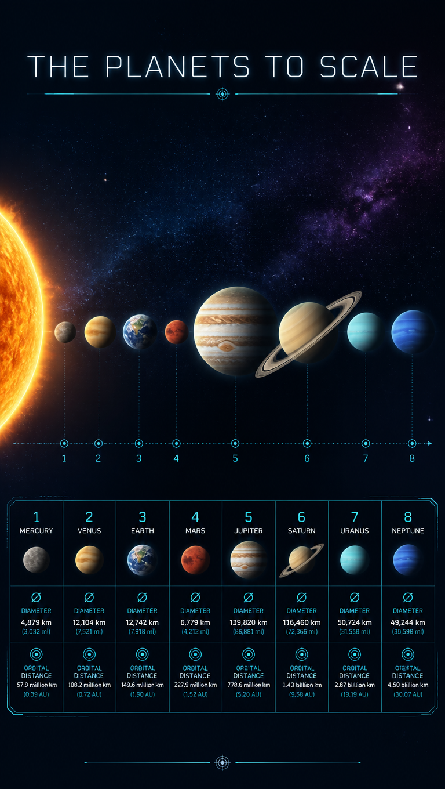

```text
An astronomy infographic lining up the eight planets of a solar system by size against a starry deep-space background. From a glowing sun on the left edge, planets increase then decrease in diameter, each labeled with name, diameter and orbital distance in a compact data strip below. Realistic rendered planet textures with soft rim light. Numbered order 1-8, a faint dotted orbit ruler running beneath. Title 'The Planets to Scale' in a futuristic thin uppercase font. Cosmic navy-to-violet gradient with cyan accent lines.
```

[Original source](https://github.com/apimodels/gpt-image-2-prompts/blob/980d100f3bd0f2cde4cf38835daeb742bf1cac65/prompts.json#infographic-834) · Model: GPT Image 2 · Credit: APIModels · CC BY 4.0
ProjectD: held. Title claims planets to scale; actual rendering not established to scale and dense planetary figures need checking.

## The Code of Life · infographic-835
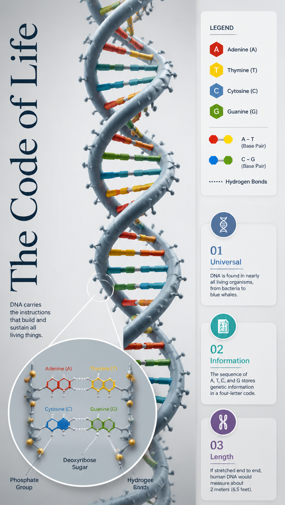

```text
A molecular-biology infographic of a DNA double helix rising vertically through the center of the frame. The twisted ladder shows color-coded base pairs (A-T in red-yellow, C-G in blue-green) with a zoomed inset revealing the sugar-phosphate backbone and hydrogen bonds. Clean 3D-render style with soft studio lighting on a pale grey gradient. A right column holds a tidy legend and three short fact cards. Title 'The Code of Life' set vertically along the left in a modern serif. Cool scientific palette with vivid base-pair accents.
```

[Original source](https://github.com/apimodels/gpt-image-2-prompts/blob/980d100f3bd0f2cde4cf38835daeb742bf1cac65/prompts.json#infographic-835) · Model: GPT Image 2 · Credit: APIModels · CC BY 4.0
ProjectD: held. Generated DNA bond/base-pair diagram and fact cards require scientific accuracy review.

## Who Eats Whom · infographic-836
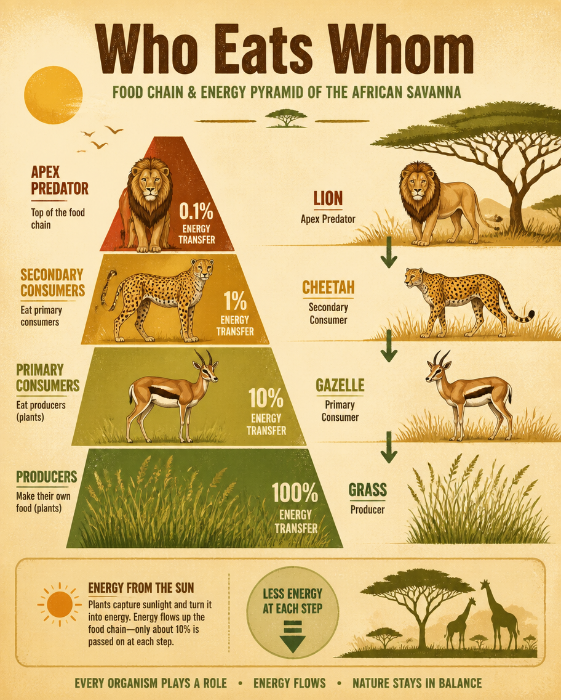

```text
An ecology infographic combining a food chain and an energy pyramid for an African savanna. A four-tier pyramid on the left labels 'producers', 'primary consumers', 'secondary consumers', 'apex predator' with grass, gazelle, cheetah and lion illustrations; energy-transfer percentages (100%, 10%, 1%, 0.1%) sit on each tier. To the right, a horizontal chain with arrows repeats the flow. Warm ochre, savanna-gold and acacia-green palette, flat illustration with grain texture. Bold title 'Who Eats Whom' top-center.
```

[Original source](https://github.com/apimodels/gpt-image-2-prompts/blob/980d100f3bd0f2cde4cf38835daeb742bf1cac65/prompts.json#infographic-836) · Model: GPT Image 2 · Credit: APIModels · CC BY 4.0
ProjectD: held. Requested food chain treats cheetah then lion as fixed trophic sequence; misleading simplified ecology.

## The Rock Cycle · infographic-837
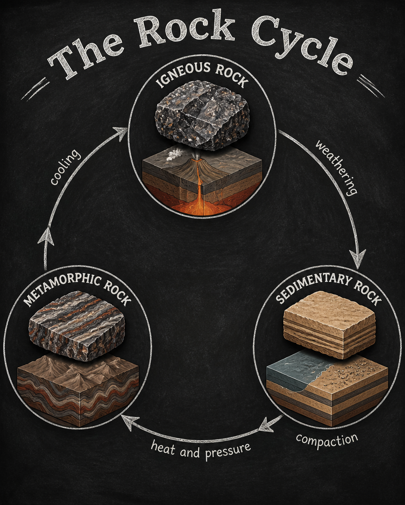

```text
A geology infographic of the rock cycle drawn as a circular flow diagram. Three labeled nodes - igneous, sedimentary and metamorphic rock - sit around a ring connected by arrows tagged 'weathering', 'compaction', 'heat and pressure', 'melting' and 'cooling'. Each node shows a stylized rock sample and a mini cross-section. Isometric mineral illustrations in slate grey, rust and sandstone tones on a chalkboard-dark background with faint chalk texture. Clean white leader labels, title 'The Rock Cycle' arced along the top of the ring.
```

[Original source](https://github.com/apimodels/gpt-image-2-prompts/blob/980d100f3bd0f2cde4cf38835daeb742bf1cac65/prompts.json#infographic-837) · Model: GPT Image 2 · Credit: APIModels · CC BY 4.0
ProjectD: held. Rock-cycle arrow/process mapping requires scientific review; preserve source without treating it as a textbook.

## Life Inside the Hive · infographic-838
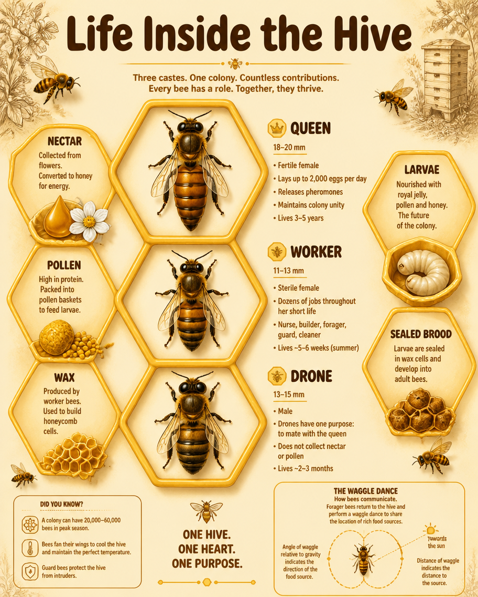

```text
A nature infographic explaining honeybee castes and hive roles. Center: a hexagonal honeycomb grid; three enlarged bees - queen, worker, drone - sit in their own hex cells with size comparison and a bullet list of duties beside each. Border hexes hold icons for nectar, pollen, wax and larvae. Detailed entomological illustration with soft amber lighting, honey-gold, black and warm brown palette on cream. Bold rounded title 'Life Inside the Hive' at the top, a small waggle-dance diagram in the lower corner.
```

[Original source](https://github.com/apimodels/gpt-image-2-prompts/blob/980d100f3bd0f2cde4cf38835daeb742bf1cac65/prompts.json#infographic-838) · Model: GPT Image 2 · Credit: APIModels · CC BY 4.0
ProjectD: held. Detailed caste duties, lifespans and waggle-dance facts not independently verified.

## Kingdoms of the Nile · infographic-839
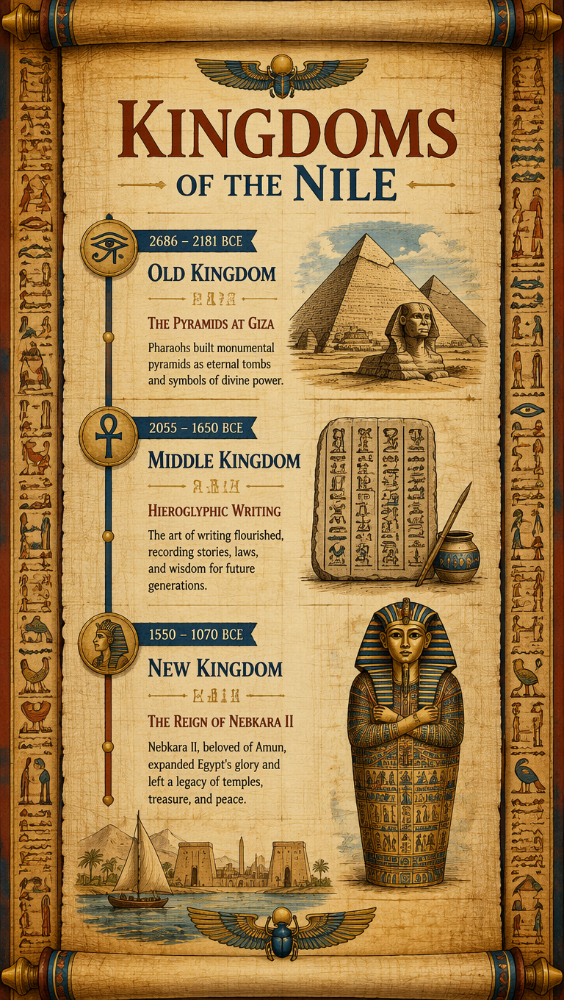

```text
A history timeline infographic tracing ancient Egyptian kingdoms along a vertical papyrus scroll. Milestone markers for the Old, Middle and New Kingdoms note the pyramids at Giza, hieroglyphic writing, and the reign of a fictional pharaoh 'Nebkara II', each with a date band in BCE and a small illustrated icon (pyramid, sphinx, ankh, sarcophagus). Aged-parchment texture with a hieroglyph-inspired border, terracotta, lapis-blue and gold-leaf palette. Serif display title 'Kingdoms of the Nile' at the top. Hand-drawn artifact illustrations.
```

[Original source](https://github.com/apimodels/gpt-image-2-prompts/blob/980d100f3bd0f2cde4cf38835daeb742bf1cac65/prompts.json#infographic-839) · Model: GPT Image 2 · Credit: APIModels · CC BY 4.0
ProjectD: held. Invented pharaoh is mixed with real Egyptian kingdom dates in an apparently factual timeline.

## From Marks to Words · infographic-840
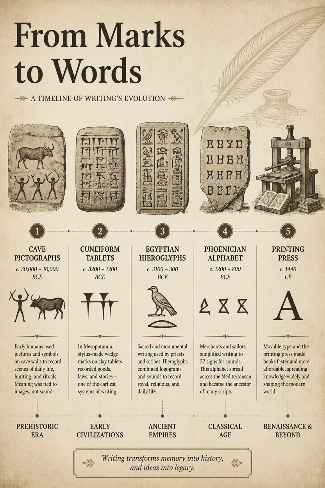

```text
An infographic timeline of how writing evolved, laid out as a left-to-right horizontal band. Stops show cave pictographs, cuneiform tablets, Egyptian hieroglyphs, a Phoenician alphabet, and a printing press, each with an approximate date and a sample glyph. A connecting dotted line carries era labels. Muted archival palette of ink-black, aged-paper beige and sepia, engraving-style illustrations. A strong serif title 'From Marks to Words' upper-left, compact caption blocks under each milestone, a faint quill motif in the background.
```

[Original source](https://github.com/apimodels/gpt-image-2-prompts/blob/980d100f3bd0f2cde4cf38835daeb742bf1cac65/prompts.json#infographic-840) · Model: GPT Image 2 · Credit: APIModels · CC BY 4.0
ProjectD: held. Generated history dates/glyph captions need factual verification.

## A Century of Flight · infographic-841
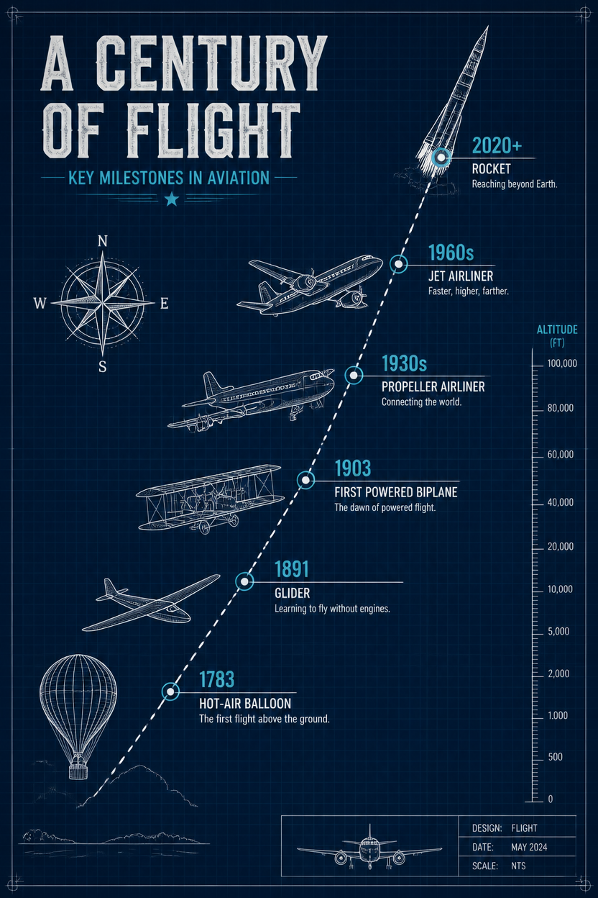

```text
An aviation timeline infographic climbing diagonally upward like a flight path from bottom-left to top-right. Milestones - hot-air balloon, glider, first powered biplane, propeller airliner, jet airliner, and rocket - sit along a dashed ascending arc, each tagged with a year and a one-line note. Blueprint aesthetic: white line-art on a deep navy grid background with cyan highlights. Bold uppercase title 'A Century of Flight' top-left, with a compass rose and a small altitude ruler as accents.
```

[Original source](https://github.com/apimodels/gpt-image-2-prompts/blob/980d100f3bd0f2cde4cf38835daeb742bf1cac65/prompts.json#infographic-841) · Model: GPT Image 2 · Credit: APIModels · CC BY 4.0
ProjectD: held. Generated aviation chronology needs factual review.

## The Age of Machines · infographic-842
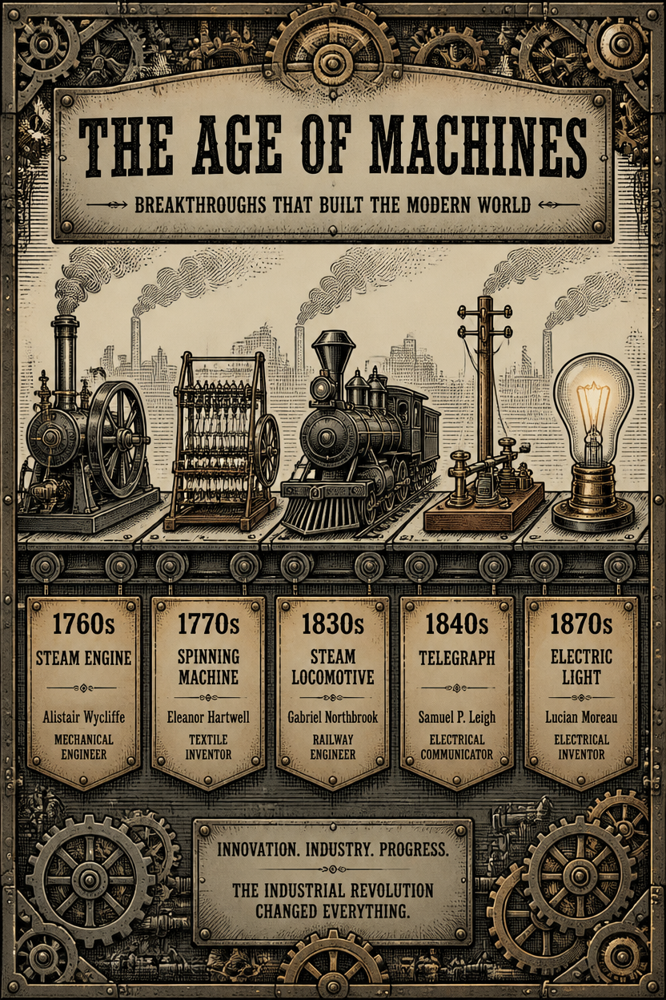

```text
A history infographic timeline of Industrial Revolution breakthroughs arranged as a horizontal factory conveyor belt. Illustrated icons - steam engine, spinning machine, locomotive, telegraph, electric lightbulb - ride the belt, each labeled with an approximate decade and an inventor role (fictional names). Vintage engraving illustration style with cross-hatching, muted brass, coal-grey and cream palette, a gear-and-cog decorative border. Title 'The Age of Machines' in a bold slab-serif banner across the top, riveted-metal caption plates.
```

[Original source](https://github.com/apimodels/gpt-image-2-prompts/blob/980d100f3bd0f2cde4cf38835daeb742bf1cac65/prompts.json#infographic-842) · Model: GPT Image 2 · Credit: APIModels · CC BY 4.0
ProjectD: held. Fictional inventor names are mixed with historical breakthroughs.

## Rise and Fall of an Empire · infographic-843
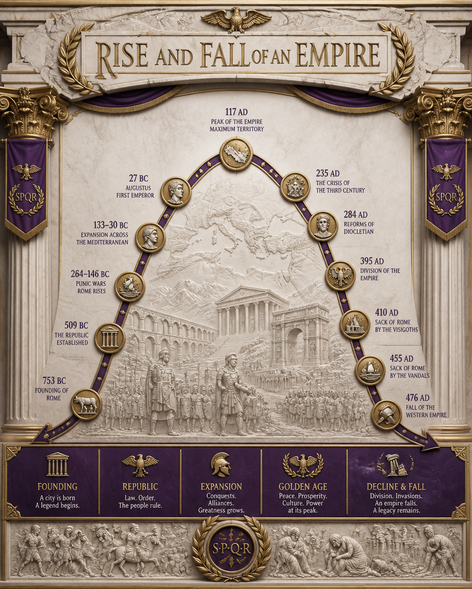

```text
A history timeline infographic charting the rise and fall of a Roman-style empire as a mountain-shaped line graph. The ascending slope marks founding, republic and expansion; the peak marks golden-age territory; the descent marks division, invasions and collapse - each event pinned with a laurel medallion and a year. Marble-white and imperial-purple palette with gold accents, classical column motifs framing the sides. Engraved-relief illustration style. Title 'Rise and Fall of an Empire' carved into a stone banner at the top.
```

[Original source](https://github.com/apimodels/gpt-image-2-prompts/blob/980d100f3bd0f2cde4cf38835daeb742bf1cac65/prompts.json#infographic-843) · Model: GPT Image 2 · Credit: APIModels · CC BY 4.0
ProjectD: held. Generated Roman chronology/territory labels need factual verification.

## How the Internet Grew · infographic-844
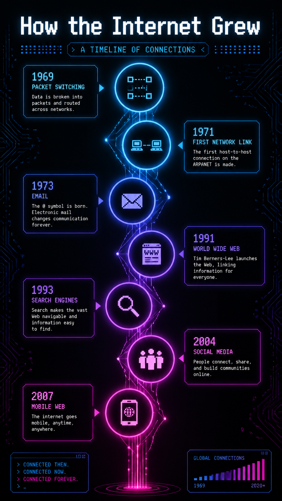

```text
A technology history timeline of how the internet grew, drawn as glowing nodes on a network graph flowing top to bottom. Milestones - packet switching, first network link, email, the world wide web, search engines, social media, and mobile web - each sit in a circular node with a year and a short caption, connected by luminous data lines. Dark-mode design, electric blue and magenta gradients, a subtle circuit-board texture. Monospace accents, bold title 'How the Internet Grew' at the top, small pixel icons per node.
```

[Original source](https://github.com/apimodels/gpt-image-2-prompts/blob/980d100f3bd0f2cde4cf38835daeb742bf1cac65/prompts.json#infographic-844) · Model: GPT Image 2 · Credit: APIModels · CC BY 4.0
ProjectD: held. Generated internet chronology contains dense dated claims requiring independent verification.

## Reaching for the Stars · infographic-845
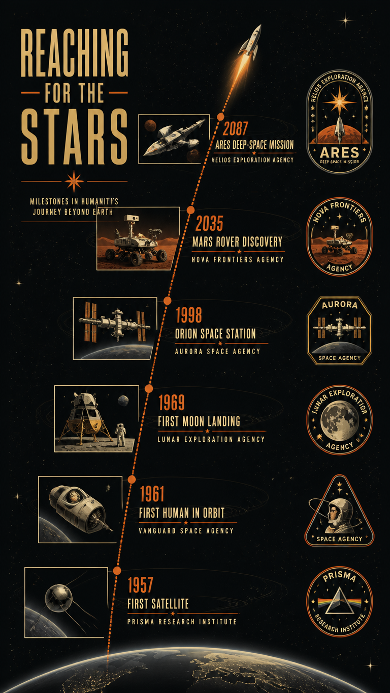

```text
A space-exploration timeline infographic rising vertically like a rocket trajectory. Markers for the first satellite, first human in orbit, first moon landing, a space station, a Mars rover and a fictional 'Ares Deep-Space Mission' each carry a year, an invented agency and a small spacecraft illustration. A star-field background with a dotted ascending flight path and faint orbital rings. Retro-futurist palette of charcoal, atomic orange and pale gold. Condensed uppercase title 'Reaching for the Stars', mission patches as decorative badges.
```

[Original source](https://github.com/apimodels/gpt-image-2-prompts/blob/980d100f3bd0f2cde4cf38835daeb742bf1cac65/prompts.json#infographic-845) · Model: GPT Image 2 · Credit: APIModels · CC BY 4.0
ProjectD: held. Invented agencies/missions mixed with historical milestones; potentially misleading factual timeline.

## Wonders of the Ancient World · infographic-846
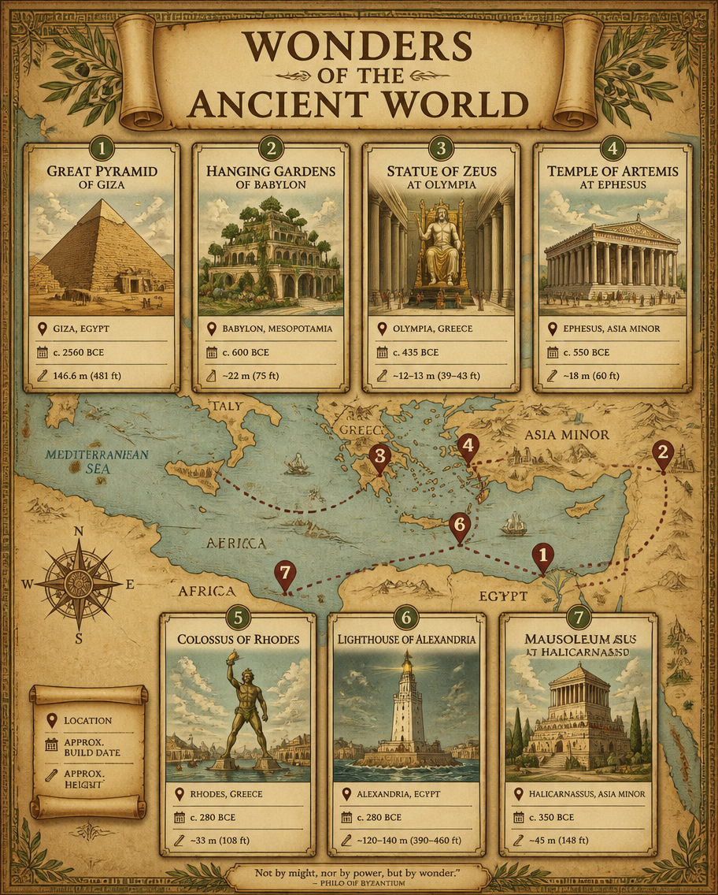

```text
A history infographic mapping the classical Seven Wonders of the ancient world as illustrated cards arranged in two rows over a stylized Mediterranean map. Each card shows a monument - a great pyramid, hanging gardens, a colossal statue, a lighthouse and more - with a location pin, an approximate build date and a height figure. Warm antique palette of sandstone, olive and aegean blue, engraving-meets-flat illustration. An ornamental compass and a scroll title 'Wonders of the Ancient World' banner across the top, dotted travel routes linking the sites.
```

[Original source](https://github.com/apimodels/gpt-image-2-prompts/blob/980d100f3bd0f2cde4cf38835daeb742bf1cac65/prompts.json#infographic-846) · Model: GPT Image 2 · Credit: APIModels · CC BY 4.0
ProjectD: held. Ancient-wonders dates/heights/geography need independent factual review.

## The Silk Road · infographic-847
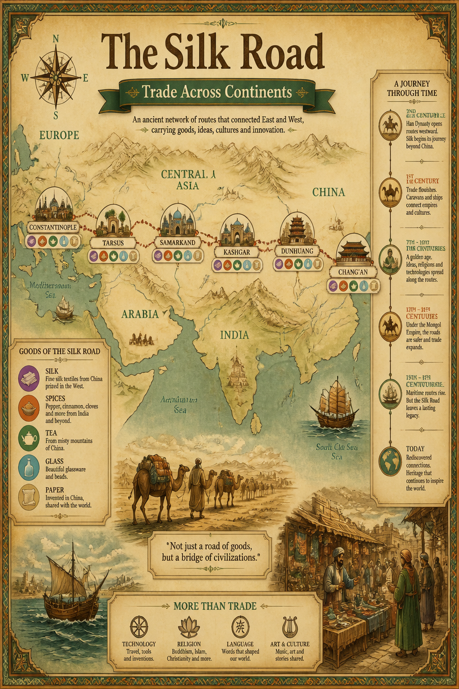

```text
A history infographic of the Silk Road shown as a stylized trade-route map stretching east to west across a parchment background. A dotted caravan line links illustrated waypoint cities with icons for silk, spices, tea, glass and paper traded at each; a side timeline strip lists key eras. Camel, ship and market-stall spot illustrations. Warm cartographic palette of tea-brown, jade and saffron, faux-aged paper with a compass rose and a decorative border. Serif title 'The Silk Road' with a subtitle ribbon 'Trade Across Continents'.
```

[Original source](https://github.com/apimodels/gpt-image-2-prompts/blob/980d100f3bd0f2cde4cf38835daeb742bf1cac65/prompts.json#infographic-847) · Model: GPT Image 2 · Credit: APIModels · CC BY 4.0
ProjectD: held. Generated historical map/era/trade claims need factual review.

## The Story of Money · infographic-848
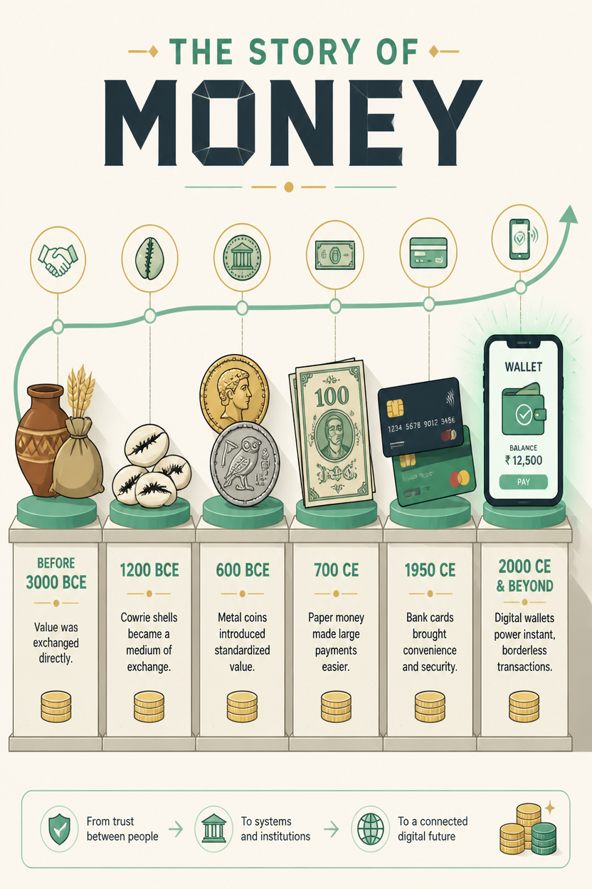

```text
A finance-history timeline infographic showing how money evolved, laid out as a left-to-right coin-trail. Stages - barter goods, cowrie shells, metal coins, paper banknotes, bank cards, and a glowing digital-wallet phone - each sit above a dated plinth with a one-line description. Flat vector illustration with long soft shadows, a mint-green, gold and slate palette on off-white. Bold geometric title 'The Story of Money' top-center, a small trend arrow threading through all stages, coin-stack icons as bullet markers.
```

[Original source](https://github.com/apimodels/gpt-image-2-prompts/blob/980d100f3bd0f2cde4cf38835daeb742bf1cac65/prompts.json#infographic-848) · Model: GPT Image 2 · Credit: APIModels · CC BY 4.0
ProjectD: held. Generated dated money-history sequence requires verification; not historical evidence.

## How a Bill Becomes Law · infographic-849
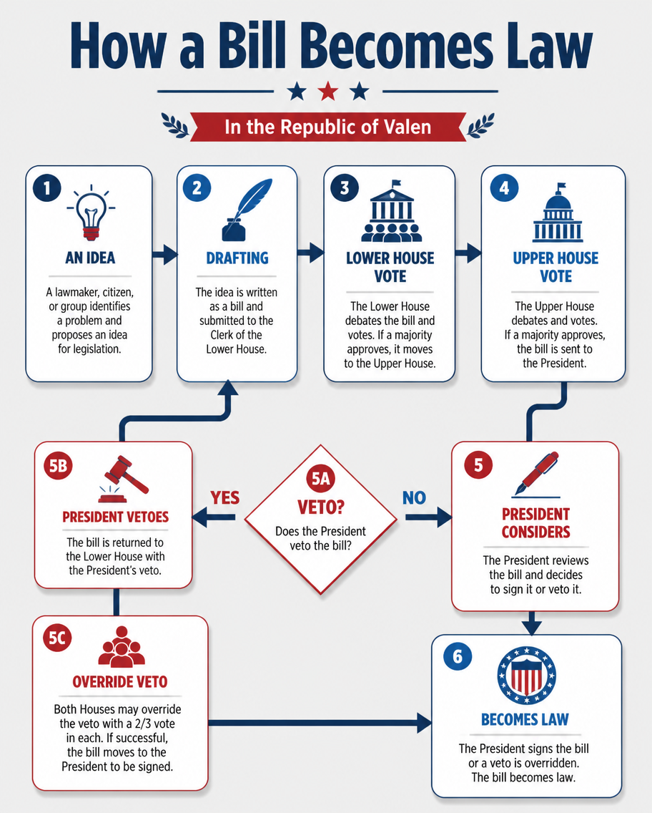

```text
A civics flow-diagram infographic explaining how a bill becomes law in the fictional Republic of Valen. Boxes connected by arrows trace 'idea', 'drafting', 'lower house vote', 'upper house vote', 'president signs', 'becomes law', with a branching 'veto' loop back. Numbered steps and small icons (quill, ballot, gavel, seal). Clean flat vector style, a civic red-white-and-blue palette on light grey, rounded rectangular nodes with subtle shadows. Strong sans-serif title 'How a Bill Becomes Law' at the top, a decision diamond for the veto branch.
```

[Original source](https://github.com/apimodels/gpt-image-2-prompts/blob/980d100f3bd0f2cde4cf38835daeb742bf1cac65/prompts.json#infographic-849) · Model: GPT Image 2 · Credit: APIModels · CC BY 4.0
ProjectD: reviewed-not-imported. Explicitly fictional Republic of Valen; illustrative civics workflow, not legal guidance.

## From Bean to Cup · infographic-850
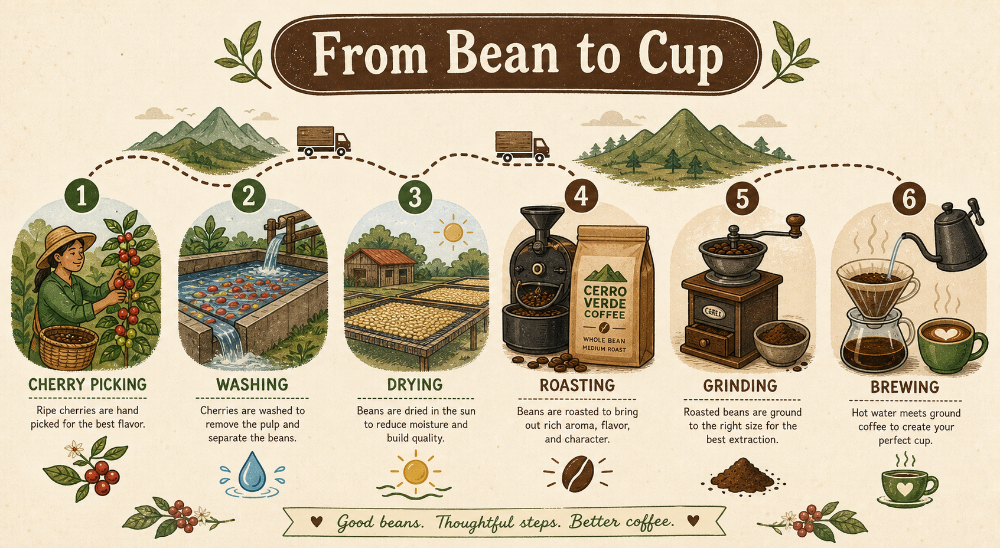

```text
A supply-chain flow infographic tracing coffee from farm to cup. A left-to-right path with illustrated stops - cherry picking, washing, drying, roasting, grinding, brewing - each numbered with a short caption and an icon. An invented brand 'Cerro Verde Coffee' appears on a roasting bag. Warm earthy palette of coffee-brown, leaf-green and cream, hand-drawn flat illustration with grain texture. A curved dotted route connects the stages, with small mountain and truck icons for transport. Rounded title banner 'From Bean to Cup' at the top.
```

[Original source](https://github.com/apimodels/gpt-image-2-prompts/blob/980d100f3bd0f2cde4cf38835daeb742bf1cac65/prompts.json#infographic-850) · Model: GPT Image 2 · Credit: APIModels · CC BY 4.0
ProjectD: reviewed-not-imported. Simplified illustrated coffee-processing sequence.

## The Life of a Plastic Bottle · infographic-851
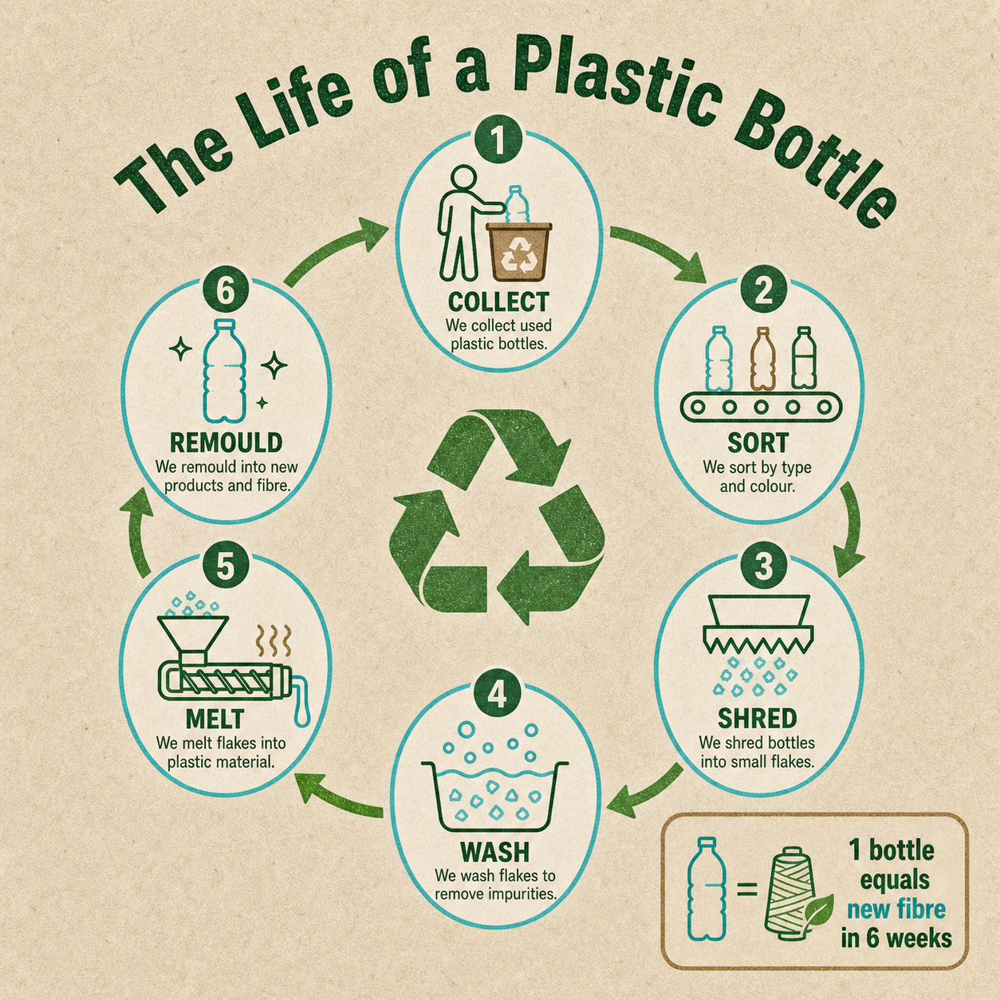

```text
A process-flow infographic of how a plastic bottle gets recycled, drawn as a circular loop diagram. Six numbered stages - collect, sort, shred, wash, melt, remould - sit around a ring linked by green arrows, each with a simple line icon and a one-line caption. Clean eco-modern style on a recycled-paper texture background, forest-green, aqua and kraft-brown palette. A central recycling emblem, a bold title 'The Life of a Plastic Bottle' arced above it, a small stat callout '1 bottle equals new fibre in 6 weeks'.
```

[Original source](https://github.com/apimodels/gpt-image-2-prompts/blob/980d100f3bd0f2cde4cf38835daeb742bf1cac65/prompts.json#infographic-851) · Model: GPT Image 2 · Credit: APIModels · CC BY 4.0
ProjectD: held. Unsubstantiated specific six-week recycling claim.

## The Software Development Lifecycle · infographic-852
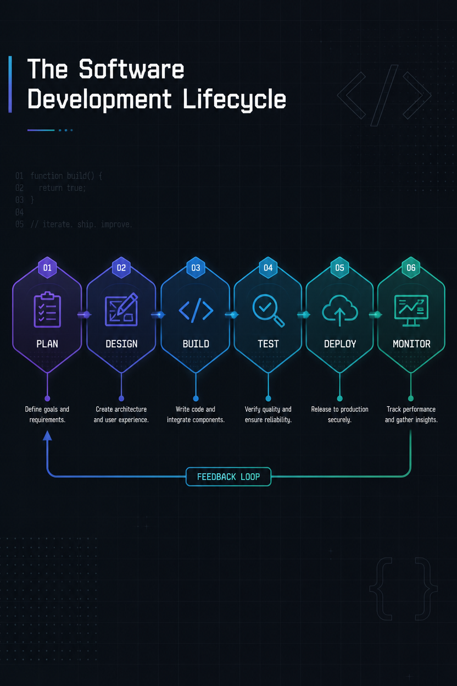

```text
A tech process infographic of the software development lifecycle shown as a horizontal pipeline. Stages - plan, design, build, test, deploy, monitor - appear as connected hexagonal nodes with matching icons and a one-line goal each, plus a feedback arrow looping from monitor back to plan. Modern dark-UI aesthetic, indigo-and-teal gradient nodes on charcoal, monospace labels. Title 'The Software Development Lifecycle' top-left in a clean geometric font, a subtle grid and code-bracket motif in the background.
```

[Original source](https://github.com/apimodels/gpt-image-2-prompts/blob/980d100f3bd0f2cde4cf38835daeb742bf1cac65/prompts.json#infographic-852) · Model: GPT Image 2 · Credit: APIModels · CC BY 4.0
ProjectD: reviewed-not-imported. Complete source prompt and uncropped native preview correspond; generation defects and actual dimensions retained.

## Turn Scraps into Soil · infographic-854
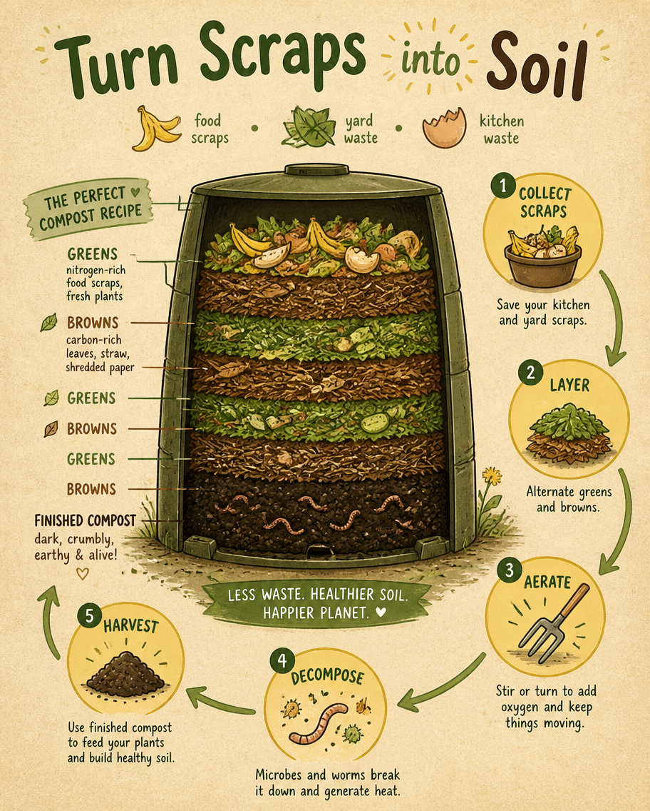

```text
A gardening process infographic explaining home composting as a layered cutaway of a compost bin plus a circular flow. The bin cross-section shows alternating 'greens' and 'browns' layers, worms, and finished dark compost at the base; a surrounding loop diagram labels 'collect scraps', 'layer', 'aerate', 'decompose', 'harvest'. Hand-drawn earthy illustration, soil-brown, leaf-green and sunny-yellow palette on recycled-paper beige. Friendly rounded title 'Turn Scraps into Soil' at the top, small icons for a banana peel, leaves and an eggshell.
```

[Original source](https://github.com/apimodels/gpt-image-2-prompts/blob/980d100f3bd0f2cde4cf38835daeb742bf1cac65/prompts.json#infographic-854) · Model: GPT Image 2 · Credit: APIModels · CC BY 4.0
ProjectD: reviewed-not-imported. Complete source prompt and uncropped native preview correspond; generation defects and actual dimensions retained.

## Where's My Order? · infographic-853
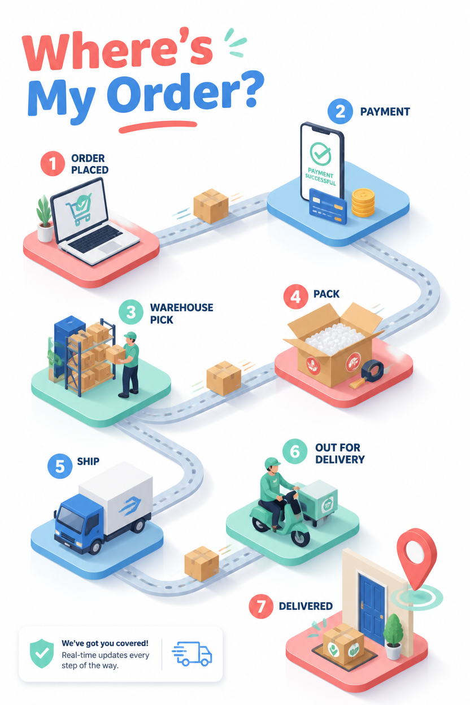

```text
A logistics flow infographic showing an online order's journey from click to doorstep. An isometric path links 'order placed', 'payment', 'warehouse pick', 'pack', 'ship', 'out for delivery', 'delivered', each on a small 3D platform with an icon and a step number. A bright friendly palette of coral, sky-blue and mint on white, soft isometric illustration with long shadows. A dotted conveyor route with a moving parcel motif. Bold rounded title 'Where's My Order?' upper-left, a small map pin at the final step.
```

[Original source](https://github.com/apimodels/gpt-image-2-prompts/blob/980d100f3bd0f2cde4cf38835daeb742bf1cac65/prompts.json#infographic-853) · Model: GPT Image 2 · Credit: APIModels · CC BY 4.0
ProjectD: reviewed-not-imported. Complete source prompt and uncropped native preview correspond; generation defects and actual dimensions retained.

## How Paper Is Made · infographic-855
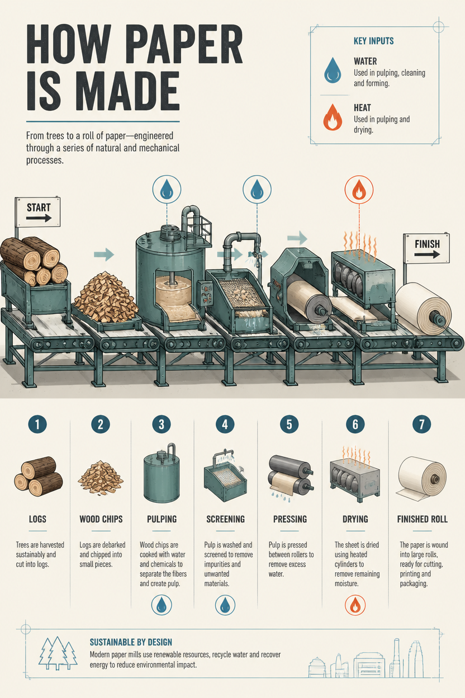

```text
A manufacturing process infographic of how paper is made, shown as a factory line flowing left to right. Illustrated stages - logs, wood chips, a pulping vat, screening, pressing rollers, drying, and a finished paper roll - connect via a conveyor with numbered steps and short captions. Clean industrial flat style, muted teal machinery, kraft-brown and grey palette on off-white, thin blueprint accent lines. Title 'How Paper Is Made' bold at top-left, small water-drop and heat icons marking key inputs.
```

[Original source](https://github.com/apimodels/gpt-image-2-prompts/blob/980d100f3bd0f2cde4cf38835daeb742bf1cac65/prompts.json#infographic-855) · Model: GPT Image 2 · Credit: APIModels · CC BY 4.0
ProjectD: reviewed-not-imported. Complete source prompt and uncropped native preview correspond; generation defects and actual dimensions retained.

## The Scientific Method · infographic-856
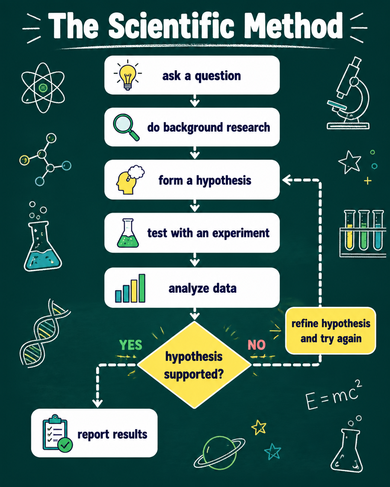

```text
An education flowchart infographic of the scientific method drawn as a top-to-bottom decision diagram. Rounded boxes read 'ask a question', 'do background research', 'form a hypothesis', 'test with an experiment', 'analyze data', then a decision diamond 'hypothesis supported?' branching to 'report results' or looping back to refine. Crisp flat vector, a chalkboard-teal background with white and lemon-yellow nodes, playful science icons (flask, magnifier, lightbulb). Bold title 'The Scientific Method' at the top, dashed arrows between steps.
```

[Original source](https://github.com/apimodels/gpt-image-2-prompts/blob/980d100f3bd0f2cde4cf38835daeb742bf1cac65/prompts.json#infographic-856) · Model: GPT Image 2 · Credit: APIModels · CC BY 4.0
ProjectD: reviewed-not-imported. Complete source prompt and uncropped native preview correspond; generation defects and actual dimensions retained.

## Support Decision Tree · infographic-858
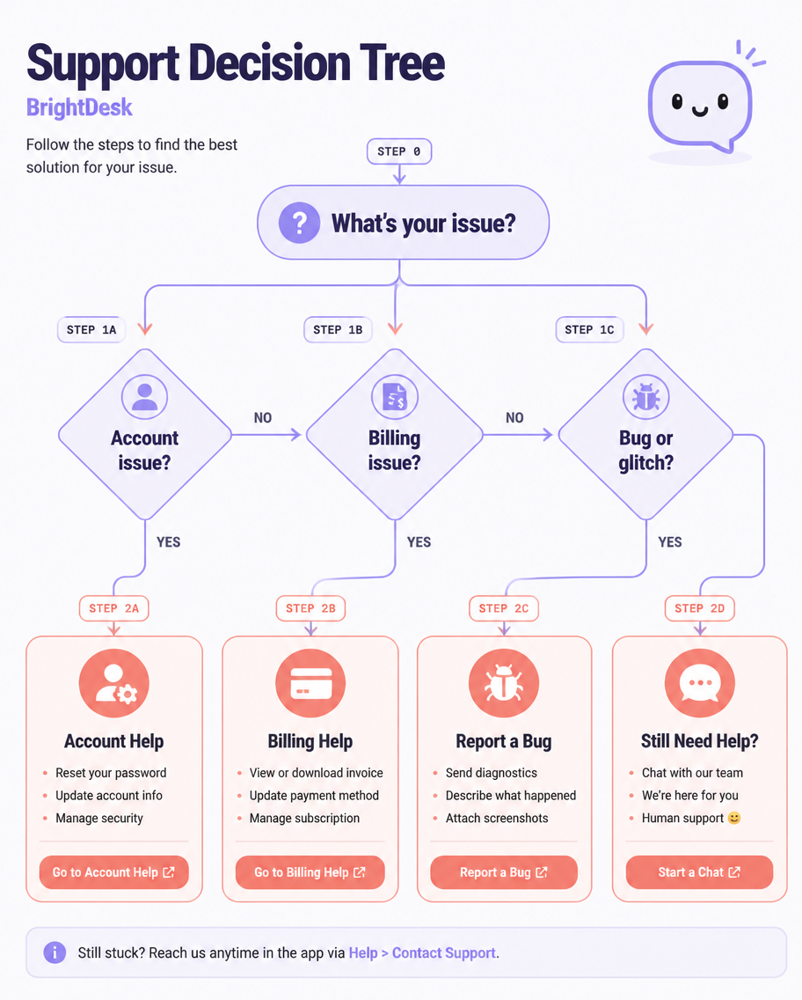

```text
A UX process infographic laid out as a customer-support decision tree for a fictional app 'BrightDesk'. A top question 'What's your issue?' branches through diamonds - 'account?', 'billing?', 'bug?' - into rounded outcome cards with recommended actions and an icon each. Clean modern flat style, a soft lavender-and-white palette with a coral accent for endpoints, connector lines with directional arrows. Monospace step labels, bold title 'Support Decision Tree' upper-left, a small chat-bubble mascot in the corner.
```

[Original source](https://github.com/apimodels/gpt-image-2-prompts/blob/980d100f3bd0f2cde4cf38835daeb742bf1cac65/prompts.json#infographic-858) · Model: GPT Image 2 · Credit: APIModels · CC BY 4.0
ProjectD: reviewed-not-imported. Fictional support workflow, not instructions for an existing service.

## From River to Tap · infographic-857
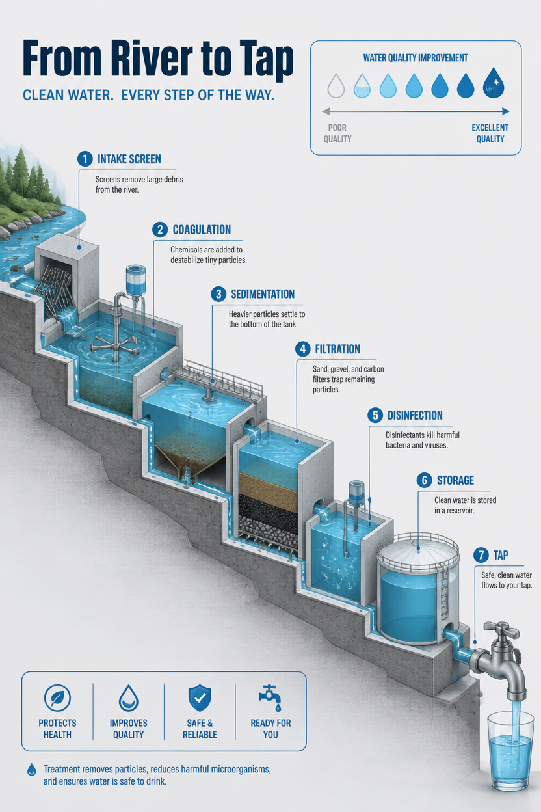

```text
A civil-engineering process infographic of how a water treatment plant cleans water, drawn as a stepped cutaway flowing left to right and slightly downhill. Stages - intake screen, coagulation, sedimentation, filtration, disinfection, storage, tap - each show a labeled tank illustration and a one-line note. Cool clean palette of aqua, deep-blue and white on pale grey, semi-technical flat illustration with cross-section tanks. Bold title 'From River to Tap' top-left, a small droplet quality-meter improving along the path.
```

[Original source](https://github.com/apimodels/gpt-image-2-prompts/blob/980d100f3bd0f2cde4cf38835daeb742bf1cac65/prompts.json#infographic-857) · Model: GPT Image 2 · Credit: APIModels · CC BY 4.0
ProjectD: held. Water-treatment safety/process/quality diagram requires domain review before educational publication.

## How the Heart Pumps · infographic-859
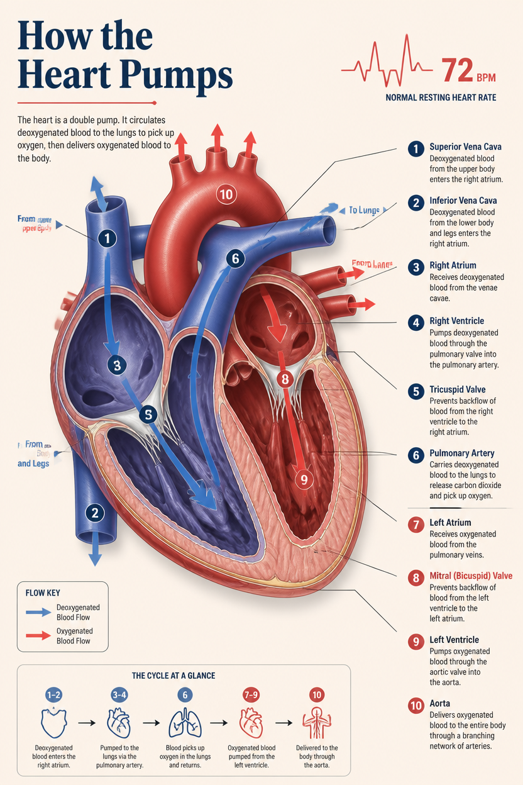

```text
A medical infographic of a human heart shown in labeled cross-section, filling the center of the frame. Chambers, valves, the aorta and the vena cava are clearly rendered; blue arrows trace deoxygenated blood and red arrows trace oxygenated flow through the four chambers. Thin leader lines connect to a right-hand label column. Clean anatomical-illustration style with soft shading, a crimson and cobalt palette on a warm off-white background. Bold title 'How the Heart Pumps' top-left, a small pulse-line and BPM stat as accents.
```

[Original source](https://github.com/apimodels/gpt-image-2-prompts/blob/980d100f3bd0f2cde4cf38835daeb742bf1cac65/prompts.json#infographic-859) · Model: GPT Image 2 · Credit: APIModels · CC BY 4.0
ProjectD: held. Medical heart anatomy/labels/flow require clinical accuracy review.
