# APIModels GPT Image 2 — batch 09

CC BY 4.0. Copyright APIModels. Prompts and images explicitly covered by https://github.com/apimodels/gpt-image-2-prompts/blob/980d100f3bd0f2cde4cf38835daeb742bf1cac65/LICENSE; credit source publisher APIModels and retain attribution. No individual original-author claim inferred from curation.

Native PNG outputs and complete original prompts. Generated claims/design labels are not independently verified facts. ProjectD holds are recorded per item.

## How You Breathe · infographic-860
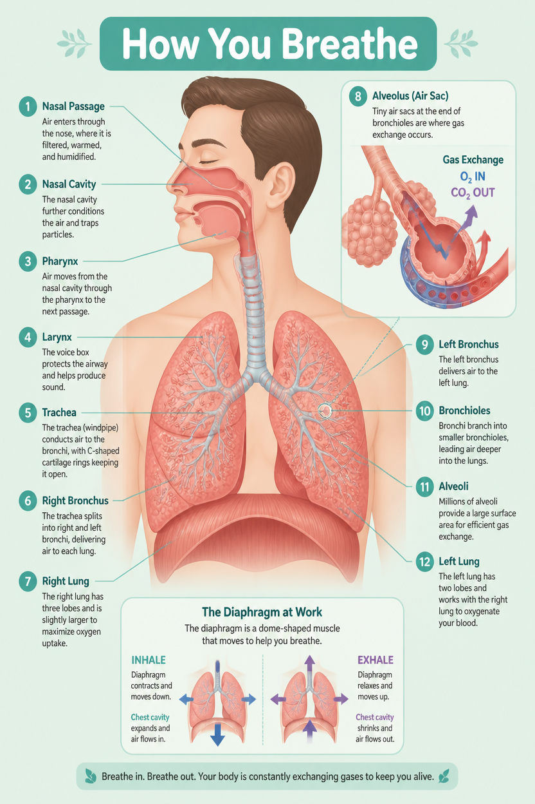

```text
A health infographic of the human respiratory system centered on a front-facing torso showing the nasal passage, trachea, bronchi and detailed lungs, with a zoomed inset of an alveolus and gas exchange (O2 in, CO2 out) using colored arrows. Numbered labels run along both sides. Soft flat medical illustration, coral-pink lungs on a calm mint background, thin teal leader lines. A rounded title 'How You Breathe' at the top, a small diaphragm-motion diagram bottom-center.
```

[Original source](https://github.com/apimodels/gpt-image-2-prompts/blob/980d100f3bd0f2cde4cf38835daeb742bf1cac65/prompts.json#infographic-860) · Model: GPT Image 2 · Credit: APIModels · CC BY 4.0
ProjectD: held. Generated anatomy/health diagram and added claims require qualified accuracy review before ProjectD educational publication.

## The Journey of a Meal · infographic-861
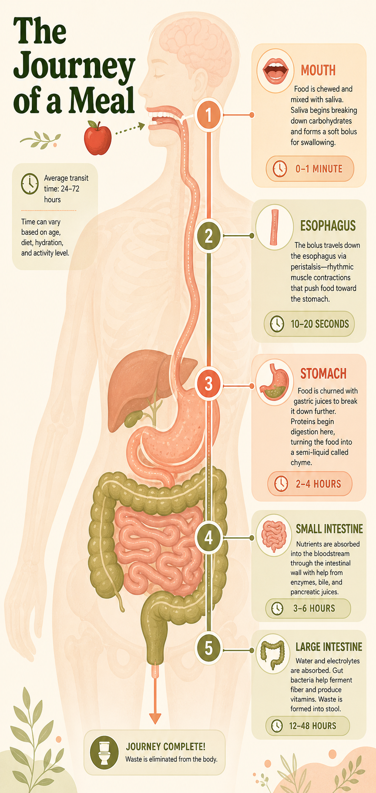

```text
A health infographic tracing the journey of food through the digestive system as a numbered vertical path over a semi-transparent body silhouette. Stops - mouth, esophagus, stomach, small intestine, large intestine - each carry a short caption on what happens and an icon, plus an average transit-time badge. Friendly flat illustration, warm peach, olive and cream palette, rounded organs with subtle texture. Bold title 'The Journey of a Meal' upper-left, a small apple icon marking the start.
```

[Original source](https://github.com/apimodels/gpt-image-2-prompts/blob/980d100f3bd0f2cde4cf38835daeb742bf1cac65/prompts.json#infographic-861) · Model: GPT Image 2 · Credit: APIModels · CC BY 4.0
ProjectD: held. Generated anatomy/health diagram and added claims require qualified accuracy review before ProjectD educational publication.

## The Human Skeleton · infographic-862
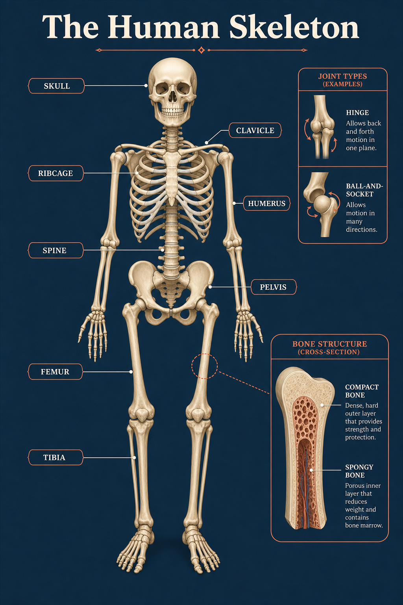

```text
An anatomy infographic of the human skeleton shown full-length and front-facing, with major bones labeled - skull, clavicle, ribcage, humerus, spine, pelvis, femur, tibia - via thin leader lines to left and right label chips. A small inset zooms into bone layers (compact and spongy). Clean textbook illustration style, bone-ivory on a slate-blue background, coral accent for highlighted bones. Bold serif title 'The Human Skeleton' at the top, a mini joint-type legend (hinge, ball-and-socket) in the corner.
```

[Original source](https://github.com/apimodels/gpt-image-2-prompts/blob/980d100f3bd0f2cde4cf38835daeb742bf1cac65/prompts.json#infographic-862) · Model: GPT Image 2 · Credit: APIModels · CC BY 4.0
ProjectD: held. Generated anatomy/health diagram and added claims require qualified accuracy review before ProjectD educational publication.

## How We See · infographic-863
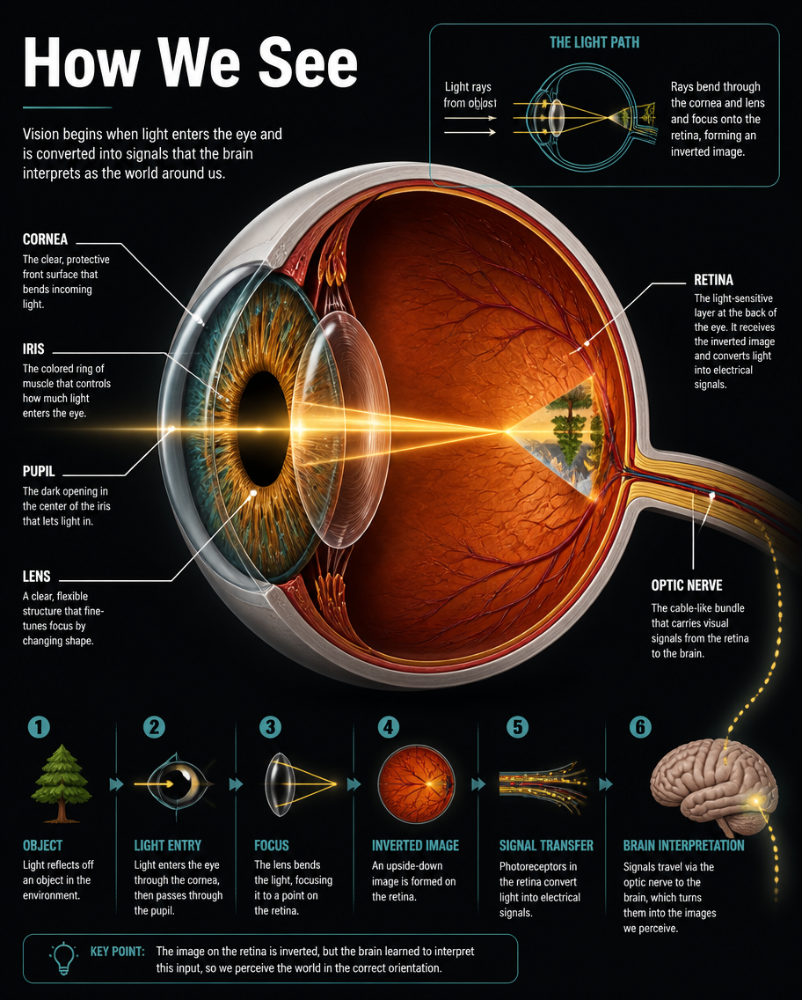

```text
A medical infographic of the human eye in labeled cross-section explaining how vision works. Light rays enter through the cornea and lens, focus onto the retina (shown inverted), and travel via the optic nerve to a small brain icon. Parts - cornea, iris, pupil, lens, retina, optic nerve - are labeled with leader lines. Detailed anatomical illustration, amber-and-teal iris detail on a deep charcoal background, a glowing light-ray path. Bold title 'How We See' top-left, a compact ray-diagram inset.
```

[Original source](https://github.com/apimodels/gpt-image-2-prompts/blob/980d100f3bd0f2cde4cf38835daeb742bf1cac65/prompts.json#infographic-863) · Model: GPT Image 2 · Credit: APIModels · CC BY 4.0
ProjectD: held. Generated anatomy/health diagram and added claims require qualified accuracy review before ProjectD educational publication.

## Know Your Muscles · infographic-864
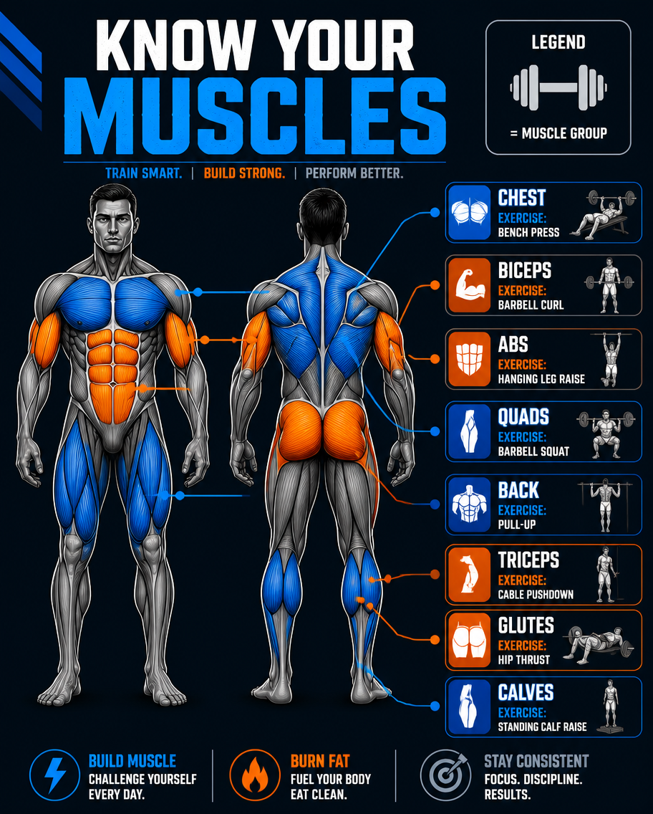

```text
A fitness infographic of major muscle groups mapped over front-and-back athletic body outlines shown side by side. Color-coded regions - chest, biceps, abs, quads on the front; back, triceps, glutes, calves on the rear - link to label chips with a sample exercise each. A bold energetic palette of electric blue, orange and slate, clean flat illustration with subtle muscle striations. A strong uppercase title 'Know Your Muscles' at the top, a small dumbbell icon legend.
```

[Original source](https://github.com/apimodels/gpt-image-2-prompts/blob/980d100f3bd0f2cde4cf38835daeb742bf1cac65/prompts.json#infographic-864) · Model: GPT Image 2 · Credit: APIModels · CC BY 4.0
ProjectD: held. Generated anatomy/health diagram and added claims require qualified accuracy review before ProjectD educational publication.

## Map of the Brain · infographic-865
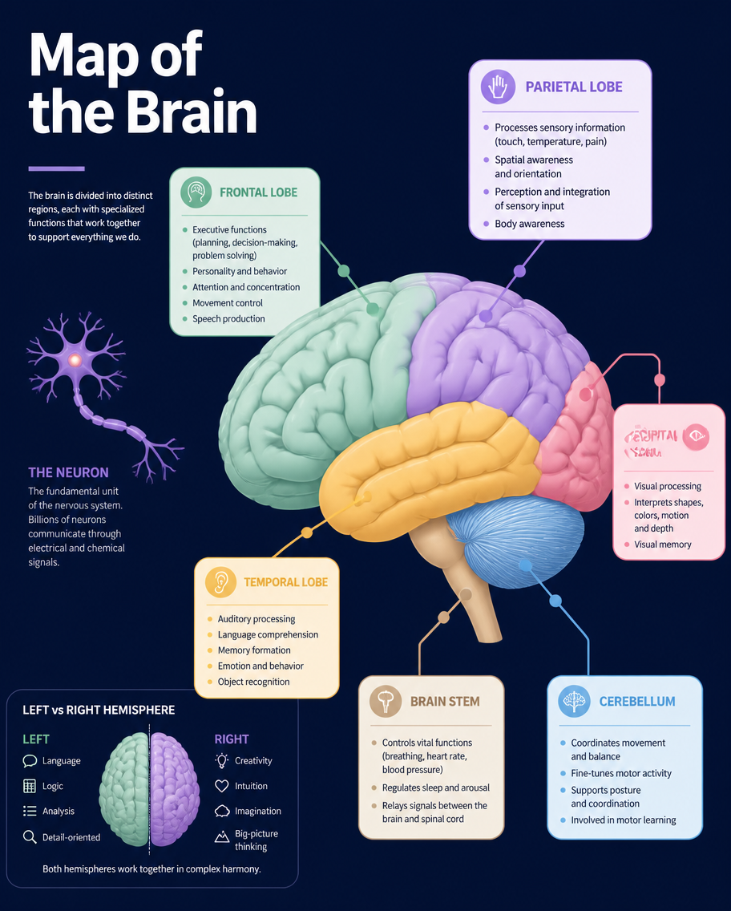

```text
A neuroscience infographic of the human brain shown in side profile, divided into color-coded regions - the frontal, parietal, temporal and occipital lobes plus the cerebellum and brain stem - each with a leader line to a card listing its main function. Clean flat medical illustration with soft gradients, pastel multicolor lobes on a deep indigo background. Bold title 'Map of the Brain' top-left, a small neuron icon and a 'left vs right hemisphere' mini-legend in the lower corner.
```

[Original source](https://github.com/apimodels/gpt-image-2-prompts/blob/980d100f3bd0f2cde4cf38835daeb742bf1cac65/prompts.json#infographic-865) · Model: GPT Image 2 · Credit: APIModels · CC BY 4.0
ProjectD: held. Generated anatomy/health diagram and added claims require qualified accuracy review before ProjectD educational publication.

## Inside a Night's Sleep · infographic-866
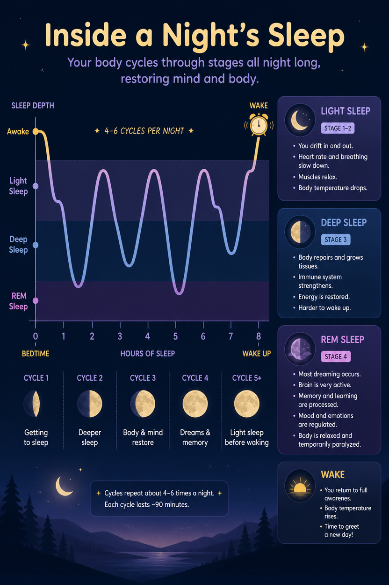

```text
A health infographic of the nightly sleep cycle drawn as a wavy line graph across an 8-hour axis. The curve dips through stages - light sleep, deep sleep, REM - repeating in cycles, with shaded bands and moon-phase icons marking each stage; side cards explain what the body does in each. A calm nocturnal palette of midnight-blue, lavender and soft gold, minimal flat style with a starry background. Bold rounded title 'Inside a Night's Sleep' at the top, a small alarm-clock icon at the wake point.
```

[Original source](https://github.com/apimodels/gpt-image-2-prompts/blob/980d100f3bd0f2cde4cf38835daeb742bf1cac65/prompts.json#infographic-866) · Model: GPT Image 2 · Credit: APIModels · CC BY 4.0
ProjectD: held. Generated anatomy/health diagram and added claims require qualified accuracy review before ProjectD educational publication.

## Build a Balanced Plate · infographic-867
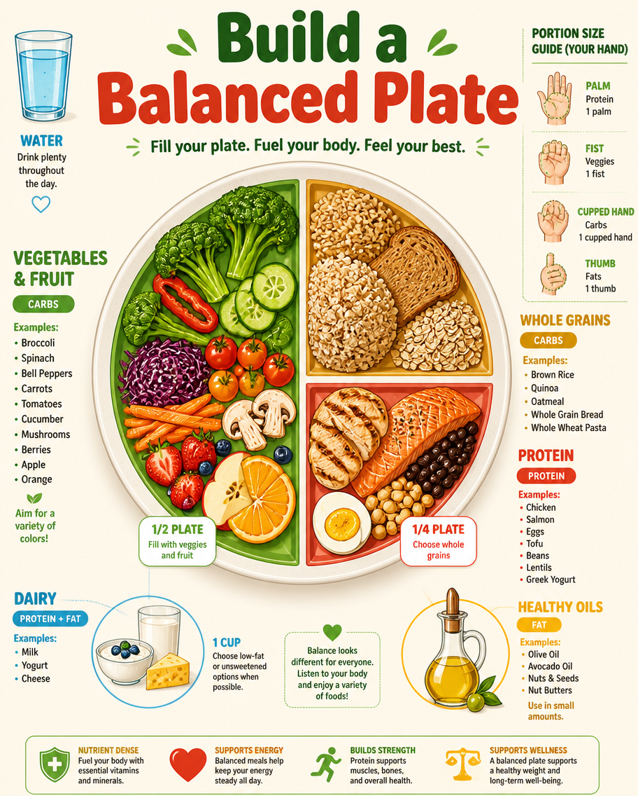

```text
A nutrition infographic built around a top-down 'balanced plate' divided into wedges - half vegetables and fruit, a quarter whole grains, a quarter protein - plus a side circle for dairy and a small oil dispenser. Each section is labeled with example foods and a macro tag (carbs, protein, fat). Fresh flat illustration, an appetizing tomato-red, broccoli-green and grain-gold palette on cream. Bold rounded title 'Build a Balanced Plate' at the top, a small water-glass icon and a portion-size hand guide beside it.
```

[Original source](https://github.com/apimodels/gpt-image-2-prompts/blob/980d100f3bd0f2cde4cf38835daeb742bf1cac65/prompts.json#infographic-867) · Model: GPT Image 2 · Credit: APIModels · CC BY 4.0
ProjectD: held. Generated anatomy/health diagram and added claims require qualified accuracy review before ProjectD educational publication.

## How Vaccines Work · infographic-868
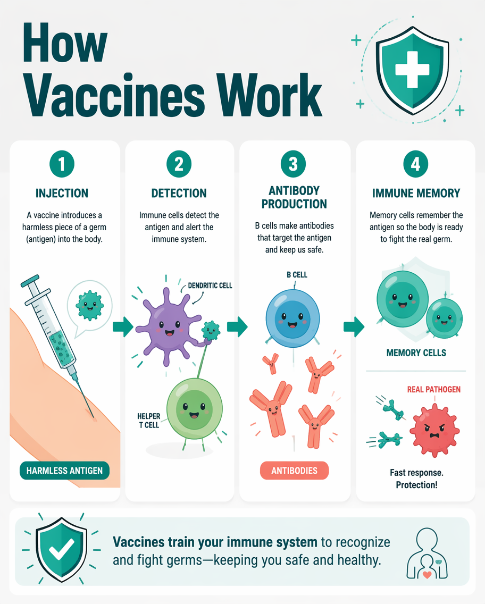

```text
A health infographic explaining how a vaccine trains the immune system, drawn as a four-panel numbered sequence. Panels show the injection of a harmless antigen, immune cells detecting it, antibody production, and memory cells ready for the real pathogen. Simple friendly cell characters with icons, arrows linking the panels. Clean flat medical style, a calming teal, coral and white palette on light grey. Bold title 'How Vaccines Work' upper-left, a small shield motif and a one-line takeaway caption at the base.
```

[Original source](https://github.com/apimodels/gpt-image-2-prompts/blob/980d100f3bd0f2cde4cf38835daeb742bf1cac65/prompts.json#infographic-868) · Model: GPT Image 2 · Credit: APIModels · CC BY 4.0
ProjectD: held. Generated anatomy/health diagram and added claims require qualified accuracy review before ProjectD educational publication.

## Climate Zones of the World · infographic-869
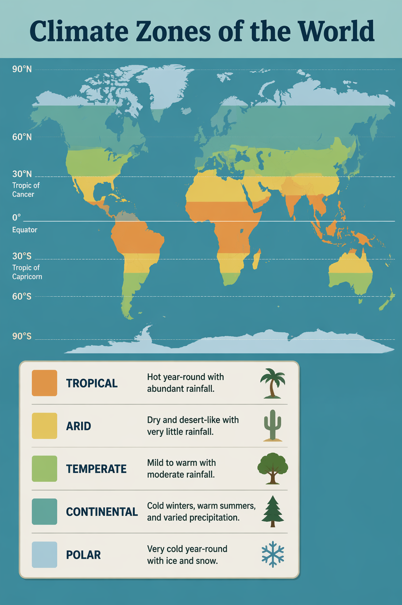

```text
A geography infographic showing world climate zones on a simplified flat world map. Horizontal color bands mark tropical, arid, temperate, continental and polar zones, each with a legend swatch, a short description and a representative icon (palm, cactus, oak, pine, snowflake). A muted cartographic palette of teal ocean and warm-to-cool land bands, clean flat vector with thin latitude lines and a labeled equator and tropics. Bold title 'Climate Zones of the World' at the top, a compact legend panel in the lower corner.
```

[Original source](https://github.com/apimodels/gpt-image-2-prompts/blob/980d100f3bd0f2cde4cf38835daeb742bf1cac65/prompts.json#infographic-869) · Model: GPT Image 2 · Credit: APIModels · CC BY 4.0
ProjectD: held. Climate zones are rendered as horizontal bands rather than verified geographic distribution.

## Earth's Tectonic Plates · infographic-870
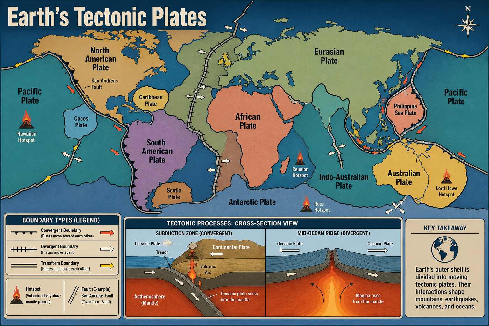

```text
A geology infographic mapping Earth's major tectonic plates on a flat world map. Plate boundaries are drawn as bold outlines with arrows showing convergent, divergent and transform motion; hotspots and a labeled fault appear as icons. Each major plate is a distinct muted color with its name. A cross-section inset shows subduction and a mid-ocean ridge. Earthy palette of ochre, slate and deep-blue ocean, clean flat style. Bold title 'Earth's Tectonic Plates' top-left, a small boundary-type legend.
```

[Original source](https://github.com/apimodels/gpt-image-2-prompts/blob/980d100f3bd0f2cde4cf38835daeb742bf1cac65/prompts.json#infographic-870) · Model: GPT Image 2 · Credit: APIModels · CC BY 4.0
ProjectD: held. Generated tectonic boundaries and motion arrows require geographic verification.

## Rivers in the Ocean · infographic-871
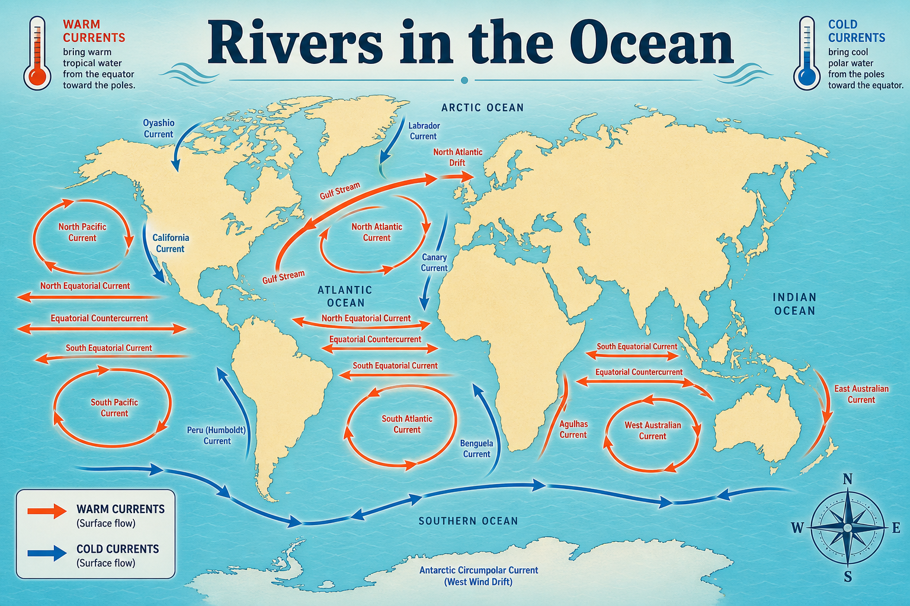

```text
A geography infographic of global ocean currents drawn over a flat world map. Warm currents are red-orange arrows, cold currents are blue arrows, looping in great circular gyres across the oceans; key currents carry small labels. Continents are rendered in flat pale sand, ocean in a gradient teal. Clean cartographic vector style with a subtle wave texture. Bold title 'Rivers in the Ocean' at the top, a legend distinguishing warm and cold flow, small thermometer and compass icons as accents.
```

[Original source](https://github.com/apimodels/gpt-image-2-prompts/blob/980d100f3bd0f2cde4cf38835daeb742bf1cac65/prompts.json#infographic-871) · Model: GPT Image 2 · Credit: APIModels · CC BY 4.0
ProjectD: held. Generated ocean current paths/directions/labels require verification.

## Inside Our Planet · infographic-872
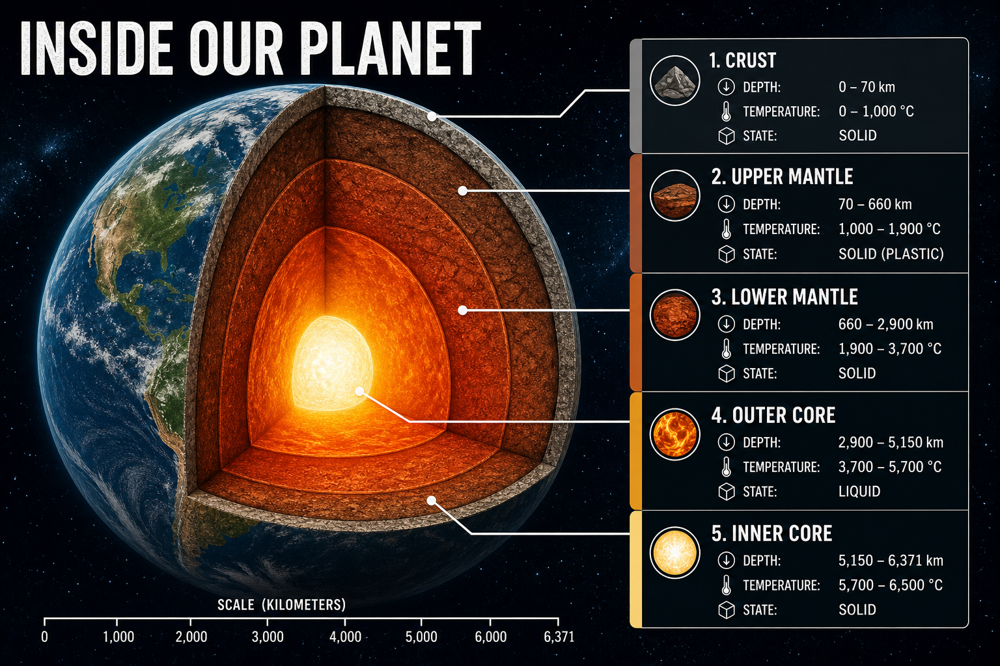

```text
An earth-science infographic showing the layers of the Earth as a cutaway quarter-sphere wedge. Concentric bands - crust, upper mantle, lower mantle, outer core, inner core - are color-coded from cool crust-grey to a glowing white-hot core, each labeled with depth, temperature and state (solid or liquid). Thin white leader lines connect to a right-hand data column. Semi-realistic gradient illustration on a dark starry background. Bold title 'Inside Our Planet' top-left, a small scale bar in kilometers.
```

[Original source](https://github.com/apimodels/gpt-image-2-prompts/blob/980d100f3bd0f2cde4cf38835daeb742bf1cac65/prompts.json#infographic-872) · Model: GPT Image 2 · Credit: APIModels · CC BY 4.0
ProjectD: held. Generated planetary depths, temperatures and state labels require scientific verification.

## Biomes of the World · infographic-873
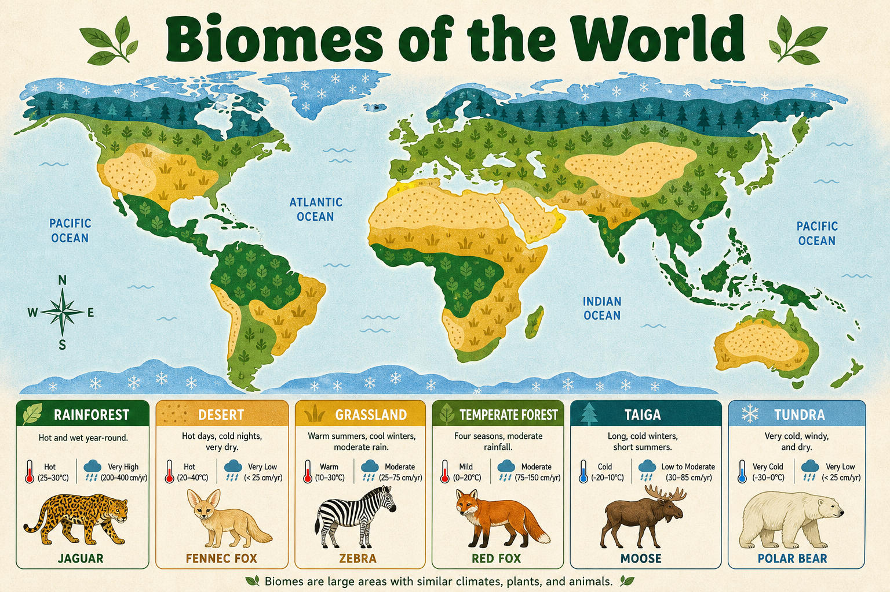

```text
A geography infographic mapping the world's biomes on a simplified flat map. Regions are filled with distinct colors and mini pattern icons for rainforest, desert, grassland, tundra, temperate forest and taiga, each keyed to a legend with a short climate note and a representative animal. A rich natural palette of jungle-green, sand, savanna-gold and icy-blue, flat vector with a soft paper texture. Bold rounded title 'Biomes of the World' at the top, small thermometer-and-rain icons per biome in the legend.
```

[Original source](https://github.com/apimodels/gpt-image-2-prompts/blob/980d100f3bd0f2cde4cf38835daeb742bf1cac65/prompts.json#infographic-873) · Model: GPT Image 2 · Credit: APIModels · CC BY 4.0
ProjectD: held. Generated biome geographic distribution and climate labels require verification.

## A World of Time Zones · infographic-874
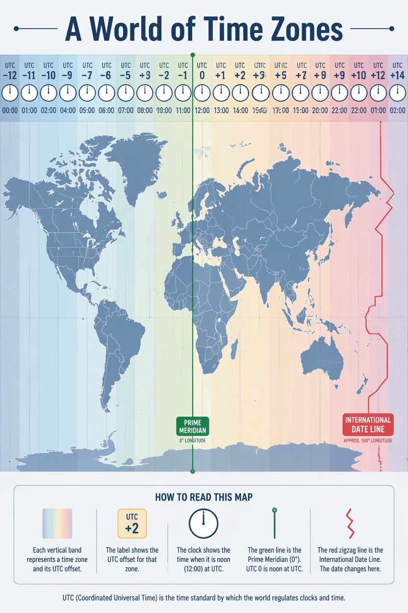

```text
A geography infographic of world time zones shown as a flat world map sliced into vertical colored bands, each labeled with its UTC offset (minus 3, minus 2, minus 1, 0, plus 1, plus 2 and so on). The prime meridian and the international date line are highlighted; small clock faces sit atop several bands showing the hour when it is noon at UTC. A cool blue-grey map with alternating soft band tints. Clean flat vector, bold title 'A World of Time Zones' at the top, a compact 'how to read this' legend below.
```

[Original source](https://github.com/apimodels/gpt-image-2-prompts/blob/980d100f3bd0f2cde4cf38835daeb742bf1cac65/prompts.json#infographic-874) · Model: GPT Image 2 · Credit: APIModels · CC BY 4.0
ProjectD: held. Uniform time-zone bands do not establish actual legal offsets/date-line boundaries.

## Welcome to Marisol Island · infographic-875
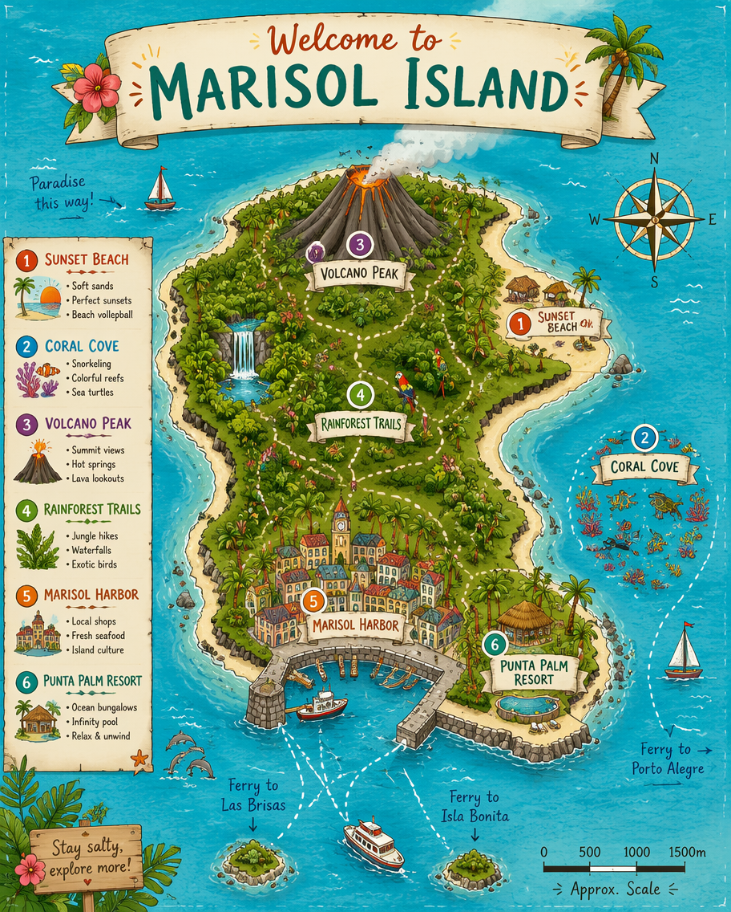

```text
A playful illustrated tourist map of the fictional tropical island 'Marisol'. A top-down stylized map shows beaches, a volcano, rainforest trails, a harbor town and coral snorkel spots, each with a cute icon, a name label and a numbered legend of attractions. Hand-drawn cartographic style, vibrant turquoise sea, sandy coast and jungle-green, with a compass rose, scale bar and dotted ferry routes. A decorative title banner 'Welcome to Marisol Island' at the top, tiny palm and sailboat doodles scattered around.
```

[Original source](https://github.com/apimodels/gpt-image-2-prompts/blob/980d100f3bd0f2cde4cf38835daeb742bf1cac65/prompts.json#infographic-875) · Model: GPT Image 2 · Credit: APIModels · CC BY 4.0
ProjectD: reviewed-not-imported. Explicitly fictional island map; not navigational or tourist-location evidence.

## Life by Altitude · infographic-876
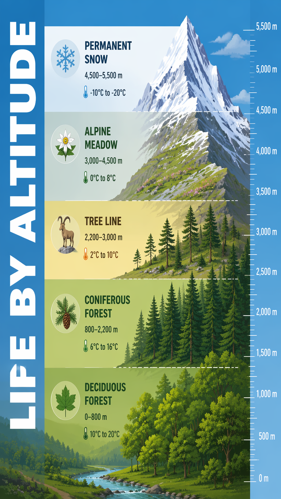

```text
A geography infographic of mountain altitude zones drawn as a single tall cross-section of a peak from base to summit. Horizontal bands mark deciduous forest, coniferous forest, the tree line, alpine meadow, and permanent snow, each labeled with elevation in meters, a typical temperature and a plant or animal icon. Layered flat illustration in a gradient from valley-green up to snow-white against a blue sky. Bold vertical title 'Life by Altitude' along the left, a small elevation ruler up the right edge.
```

[Original source](https://github.com/apimodels/gpt-image-2-prompts/blob/980d100f3bd0f2cde4cf38835daeb742bf1cac65/prompts.json#infographic-876) · Model: GPT Image 2 · Credit: APIModels · CC BY 4.0
ProjectD: held. Universal altitude/temperature boundaries are not established for a specific region.

## Journey of a River · infographic-877
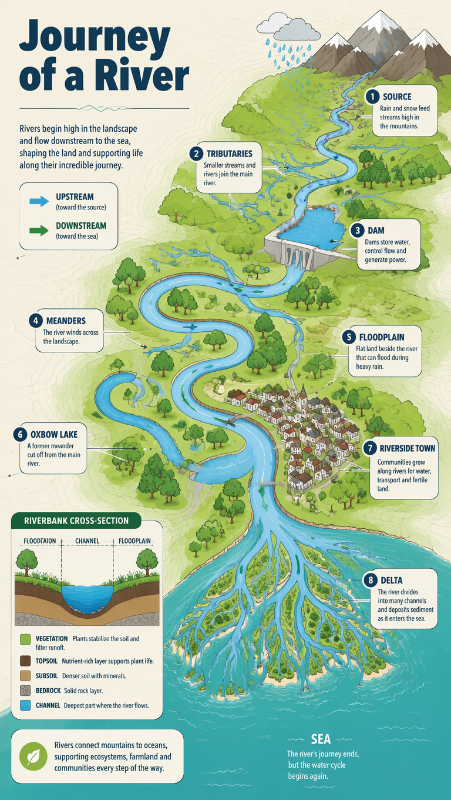

```text
A geography infographic explaining a river system from source to sea, drawn as a top-down flowing map. Labeled features - source, tributaries, meanders, floodplain, oxbow lake and a branching delta - trace the blue river across green land into a teal ocean. Icons for rainfall, a dam and a riverside town appear along the way. Clean flat cartographic style, a fresh green-and-blue palette on cream, thin contour lines. Bold title 'Journey of a River' top-left, a small arrow legend for upstream and downstream, a cross-section inset of the riverbank.
```

[Original source](https://github.com/apimodels/gpt-image-2-prompts/blob/980d100f3bd0f2cde4cf38835daeb742bf1cac65/prompts.json#infographic-877) · Model: GPT Image 2 · Credit: APIModels · CC BY 4.0
ProjectD: reviewed-not-imported. Complete source prompt and uncropped native preview correspond; generation defects and actual dimensions retained.

## The Drifting Continents · infographic-878
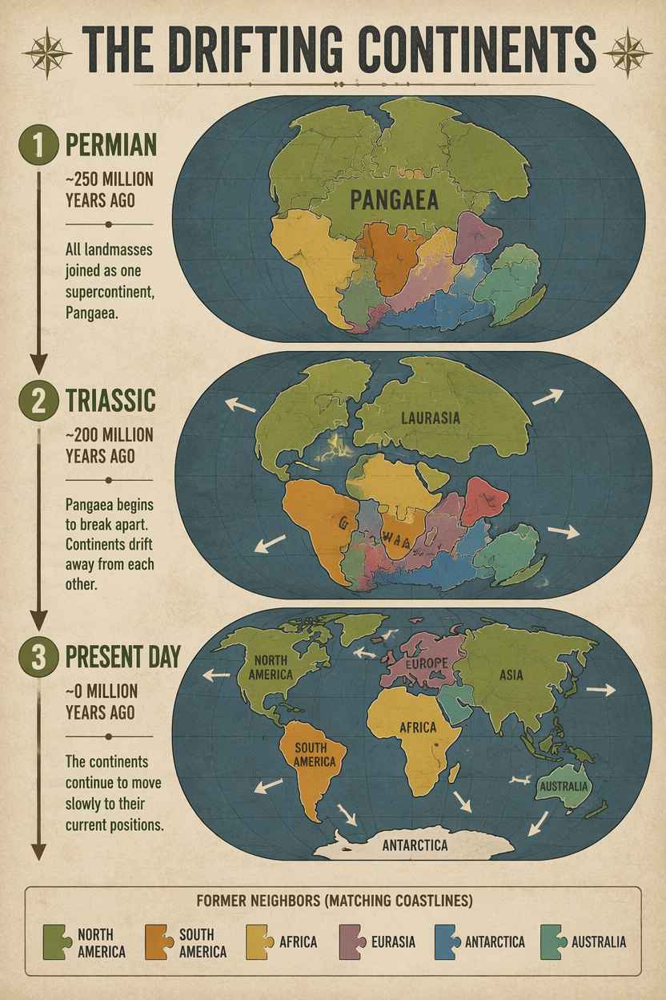

```text
A geology infographic showing continental drift across three stacked world maps. The top map shows the supercontinent Pangaea, the middle shows it splitting, and the bottom shows today's continents, each with an era label in millions of years and directional drift arrows. Matching puzzle-piece coastlines are color-coded to show former neighbors. An earthy muted palette of moss-green land and slate ocean, flat vector with a faint parchment texture. Bold title 'The Drifting Continents' at the top, a small timeline arrow linking the three stages.
```

[Original source](https://github.com/apimodels/gpt-image-2-prompts/blob/980d100f3bd0f2cde4cf38835daeb742bf1cac65/prompts.json#infographic-878) · Model: GPT Image 2 · Credit: APIModels · CC BY 4.0
ProjectD: held. Continental configurations and dated eras require geographic verification.

## How Solar Panels Work · infographic-879
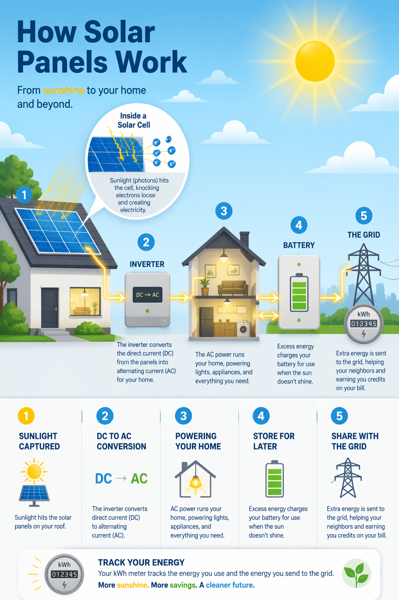

```text
A clean-tech infographic explaining how a solar panel powers a home, drawn as a left-to-right energy flow. Sunlight hits a rooftop panel (a zoomed inset shows photovoltaic cells knocking electrons loose), current runs to an inverter converting DC to AC, then to a house and a battery, with excess feeding the grid. A bright optimistic palette of sky-blue, sunny-yellow and slate, flat vector with soft gradients. Numbered steps 1-5, bold title 'How Solar Panels Work' top-left, a glowing arrow flow, a small kWh meter icon.
```

[Original source](https://github.com/apimodels/gpt-image-2-prompts/blob/980d100f3bd0f2cde4cf38835daeb742bf1cac65/prompts.json#infographic-879) · Model: GPT Image 2 · Credit: APIModels · CC BY 4.0
ProjectD: reviewed-not-imported. Conceptual energy-flow illustration; not installation or electrical-safety instructions.

## How Wi-Fi Works · infographic-880


```text
A technology infographic explaining how Wi-Fi delivers internet, shown as a layered flow from the internet cloud to a phone. Stages - a fiber line, a modem, a router broadcasting radio waves, and connecting devices - each carry an icon, with concentric signal-wave rings radiating from the router. Clean modern flat style, a cool blue-and-teal palette with a magenta signal accent on light grey. Numbered captions, bold title 'How Wi-Fi Works' upper-left, a small frequency badge (2.4 vs 5 GHz) and a range diagram in the corner.
```

[Original source](https://github.com/apimodels/gpt-image-2-prompts/blob/980d100f3bd0f2cde4cf38835daeb742bf1cac65/prompts.json#infographic-880) · Model: GPT Image 2 · Credit: APIModels · CC BY 4.0
ProjectD: reviewed-not-imported. Complete source prompt and uncropped native preview correspond; generation defects and actual dimensions retained.

## How an Electric Car Works · infographic-881
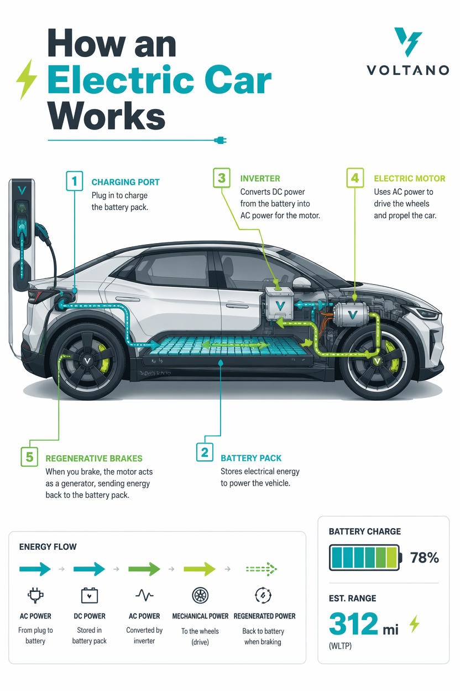

```text
A technology infographic of how an electric car works, drawn as a cutaway side view of a stylized EV (invented brand 'Voltano'). Labeled components - a battery pack under the floor, an electric motor, an inverter, a charging port, and regenerative brakes - connect with colored energy-flow arrows from plug to wheels. Sleek modern flat illustration, an electric-teal, graphite and lime-accent palette on white. Numbered leader labels, bold title 'How an Electric Car Works' top-left, a small battery-charge gauge and range figure as accents.
```

[Original source](https://github.com/apimodels/gpt-image-2-prompts/blob/980d100f3bd0f2cde4cf38835daeb742bf1cac65/prompts.json#infographic-881) · Model: GPT Image 2 · Credit: APIModels · CC BY 4.0
ProjectD: reviewed-not-imported. Invented Voltano vehicle; range and charge figures are illustrative.

## How GPS Locates You · infographic-882
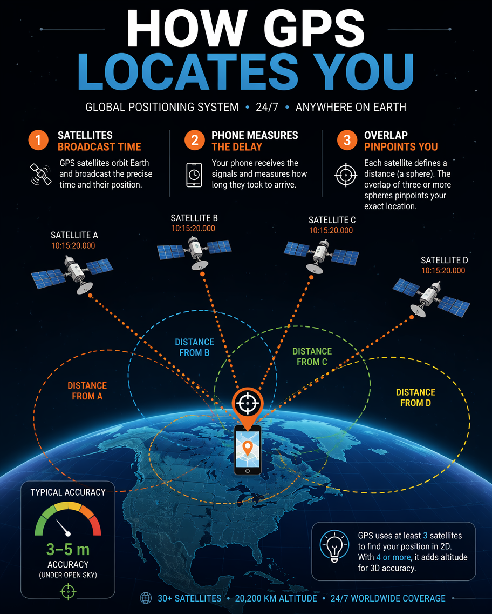

```text
A technology infographic explaining how GPS finds your location, drawn as a scene with three or four satellites beaming signals down to a phone on a stylized globe. Dotted signal lines and expanding range circles illustrate trilateration; numbered captions explain 'satellites broadcast time', 'phone measures delay', 'overlap pinpoints you'. A space-dark background with earth-blue and orange signal accents, clean flat vector. Bold title 'How GPS Locates You' at the top, a small crosshair pin and accuracy-meter icon.
```

[Original source](https://github.com/apimodels/gpt-image-2-prompts/blob/980d100f3bd0f2cde4cf38835daeb742bf1cac65/prompts.json#infographic-882) · Model: GPT Image 2 · Credit: APIModels · CC BY 4.0
ProjectD: reviewed-not-imported. Conceptual GPS diagram; added precision figures are not a device guarantee.

## Inside a Jet Engine · infographic-884
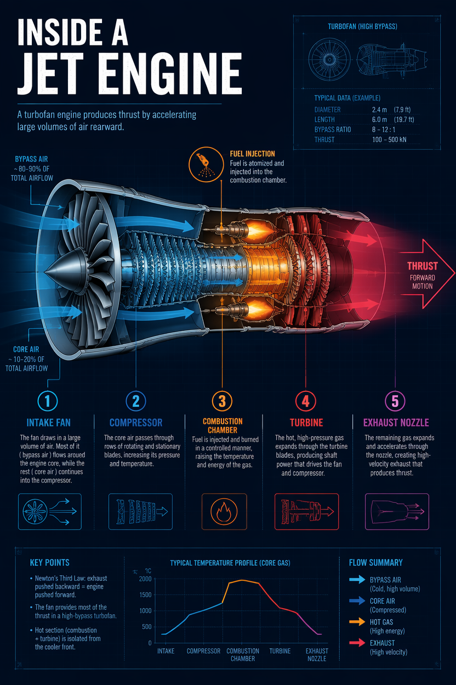

```text
An engineering infographic of how a jet engine works, drawn as a detailed cutaway of a turbofan flowing left to right. Labeled stages - intake fan, compressor, combustion chamber, turbine, exhaust nozzle - are color-zoned from cool intake-blue to hot combustion-orange, with airflow arrows and a fuel-injection icon. Semi-technical flat illustration with thin blueprint accents on a dark navy background. Bold uppercase title 'Inside a Jet Engine' top-left, numbered callouts, a small thrust arrow at the nozzle.
```

[Original source](https://github.com/apimodels/gpt-image-2-prompts/blob/980d100f3bd0f2cde4cf38835daeb742bf1cac65/prompts.json#infographic-884) · Model: GPT Image 2 · Credit: APIModels · CC BY 4.0
ProjectD: reviewed-not-imported. Conceptual engine cross-section; not engineering or maintenance instructions.

## How a Touchscreen Senses You · infographic-883
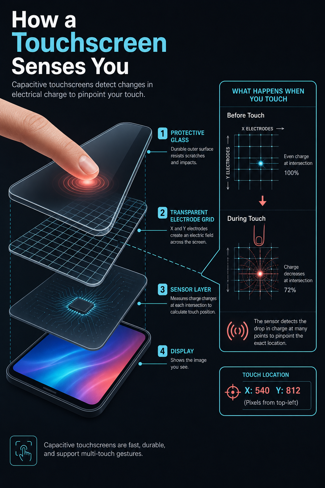

```text
A technology infographic explaining how a capacitive touchscreen works, shown as an exploded layer stack of a phone screen. Labeled layers - protective glass, a transparent electrode grid, a sensor layer, and the display - separate vertically; a fingertip touches the top, and a zoomed inset shows the electrical charge change detected at the grid. A clean tech aesthetic, a cool grey-and-cyan palette with a coral touch-point accent on dark charcoal. Bold title 'How a Touchscreen Senses You' top-left, numbered layer labels, a small grid-coordinate readout.
```

[Original source](https://github.com/apimodels/gpt-image-2-prompts/blob/980d100f3bd0f2cde4cf38835daeb742bf1cac65/prompts.json#infographic-883) · Model: GPT Image 2 · Credit: APIModels · CC BY 4.0
ProjectD: reviewed-not-imported. Complete source prompt and uncropped native preview correspond; generation defects and actual dimensions retained.

## How an SSD Remembers · infographic-885
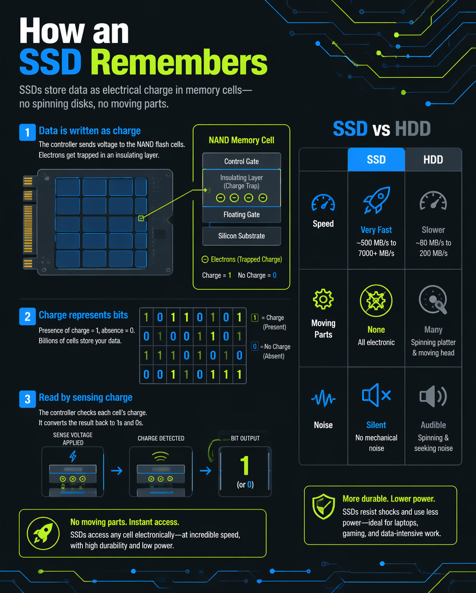

```text
A technology infographic explaining how a solid-state drive stores data, contrasting it with a spinning hard drive. Left: a stylized SSD chip grid with a zoomed inset of memory cells holding 1s and 0s as trapped charge; right: a mini comparison table of SSD vs HDD (speed, moving parts, noise). A clean tech palette of electric blue, slate and lime on dark grey, flat vector with circuit accents. Bold title 'How an SSD Remembers' top-left, numbered captions, small bit-grid animation-style icons.
```

[Original source](https://github.com/apimodels/gpt-image-2-prompts/blob/980d100f3bd0f2cde4cf38835daeb742bf1cac65/prompts.json#infographic-885) · Model: GPT Image 2 · Credit: APIModels · CC BY 4.0
ProjectD: reviewed-not-imported. Illustrative storage diagram; speed specifications are not verified device benchmarks.

## How a Heat Pump Works · infographic-886
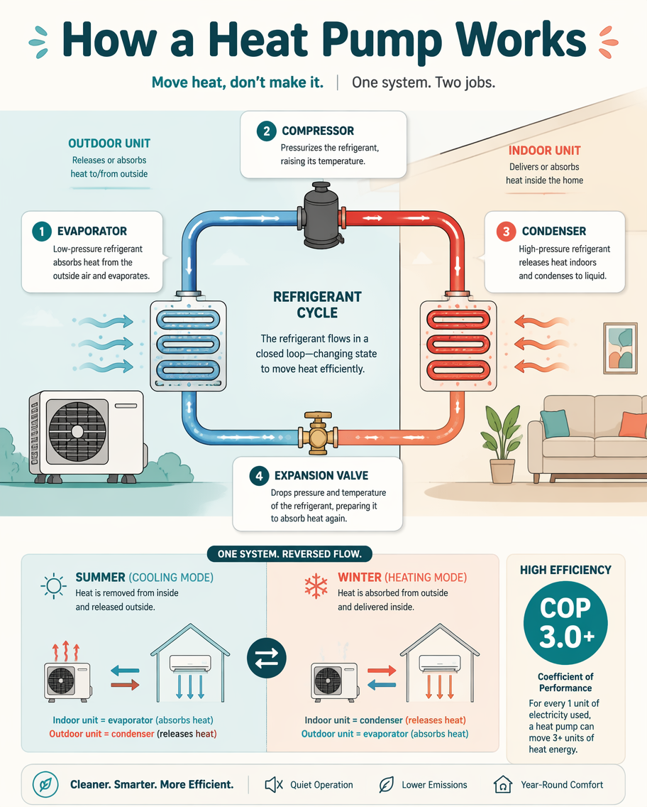

```text
A home-tech infographic explaining how a heat pump heats and cools a house, drawn as a looping refrigerant cycle between an outdoor and indoor unit. Labeled stages - evaporator, compressor, condenser, expansion valve - carry colored arrows (blue for cold, red for warm) around the loop, with a summer/winter toggle showing reversed flow. Clean flat illustration, a cool-and-warm split palette of teal and coral on off-white. Bold rounded title 'How a Heat Pump Works' at the top, numbered steps, a small efficiency (COP) badge.
```

[Original source](https://github.com/apimodels/gpt-image-2-prompts/blob/980d100f3bd0f2cde4cf38835daeb742bf1cac65/prompts.json#infographic-886) · Model: GPT Image 2 · Credit: APIModels · CC BY 4.0
ProjectD: reviewed-not-imported. Conceptual cycle diagram; generated COP badge is not a tested efficiency rating.

## How 3D Printing Works · infographic-887
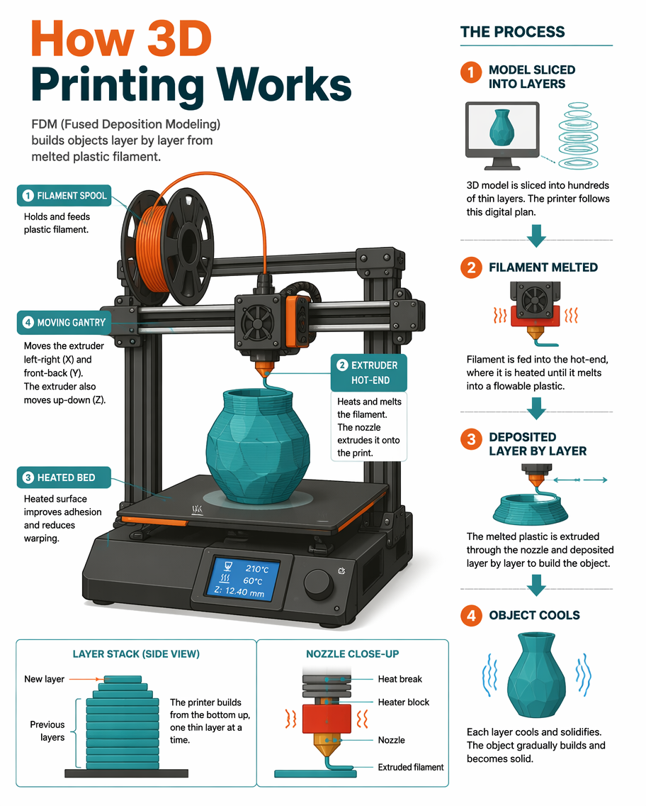

```text
A maker-tech infographic explaining how an FDM 3D printer builds an object, drawn as a labeled machine diagram with a step flow. Components - a filament spool, an extruder hot-end, a heated bed, a moving gantry - are labeled; a numbered sequence shows 'model sliced into layers', 'filament melted', 'deposited layer by layer', 'object cools'. Clean flat illustration, a friendly orange-teal-and-grey palette on white, a half-printed object on the bed. Bold title 'How 3D Printing Works' top-left, a small layer-stack inset and a nozzle close-up.
```

[Original source](https://github.com/apimodels/gpt-image-2-prompts/blob/980d100f3bd0f2cde4cf38835daeb742bf1cac65/prompts.json#infographic-887) · Model: GPT Image 2 · Credit: APIModels · CC BY 4.0
ProjectD: reviewed-not-imported. Complete source prompt and uncropped native preview correspond; generation defects and actual dimensions retained.

## How Noise Cancelling Works · infographic-888
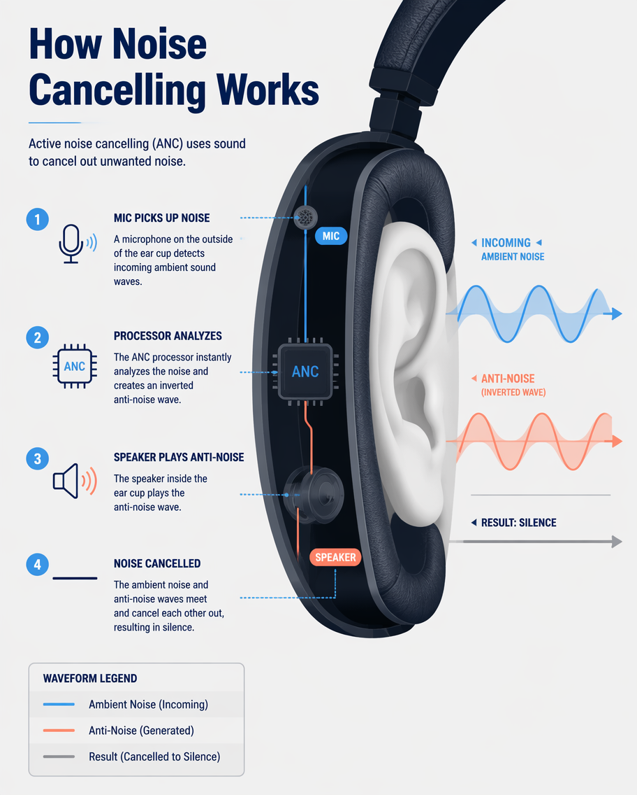

```text
A technology infographic explaining active noise cancelling in headphones, drawn as a cross-section of an ear cup around an ear. Incoming ambient sound waves meet an inverted 'anti-noise' wave generated by the headphone, and the two flatten to silence - shown with layered blue and orange waveforms plus a small mic and speaker icon inside. Sleek modern flat style, a deep-navy, cyan and coral palette on light grey. Bold title 'How Noise Cancelling Works' top-left, numbered captions, a waveform legend.
```

[Original source](https://github.com/apimodels/gpt-image-2-prompts/blob/980d100f3bd0f2cde4cf38835daeb742bf1cac65/prompts.json#infographic-888) · Model: GPT Image 2 · Credit: APIModels · CC BY 4.0
ProjectD: reviewed-not-imported. Conceptual noise-cancellation illustration; perfect silence is a simplification, not a performance guarantee.

## The Magic of Compounding · infographic-889
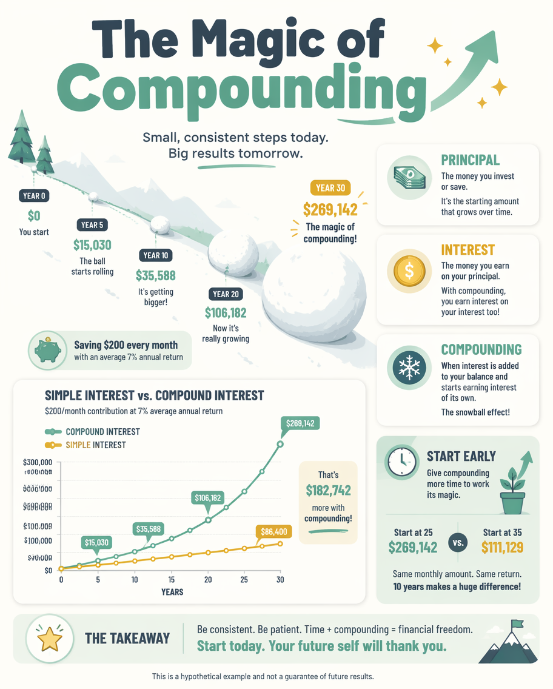

```text
A finance-literacy infographic explaining compound interest, built around a snowball rolling downhill that grows bigger at each step. A companion line graph contrasts simple vs compound growth over 30 years, with milestone dollar figures for a savings of $200/month at 7%. Callout cards define 'principal', 'interest', and 'compounding'. Friendly flat illustration, a mint-green, gold and slate palette on off-white. Bold rounded title 'The Magic of Compounding' at the top, an upward arrow motif, a small 'start early' tip card.
```

[Original source](https://github.com/apimodels/gpt-image-2-prompts/blob/980d100f3bd0f2cde4cf38835daeb742bf1cac65/prompts.json#infographic-889) · Model: GPT Image 2 · Credit: APIModels · CC BY 4.0
ProjectD: held. Generated interest milestones/calculations not independently recomputed; hold financial illustration.

## Budget with 50/30/20 · infographic-890
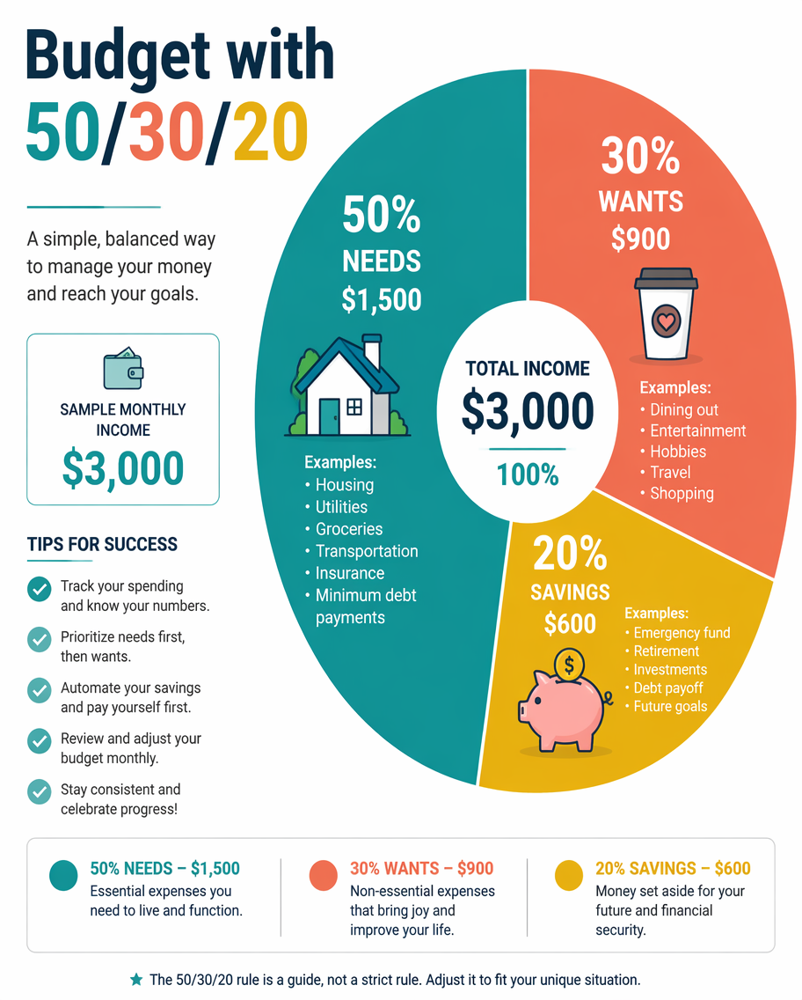

```text
A personal-finance infographic explaining the 50/30/20 budgeting rule as a large donut chart split into three wedges - 50% needs, 30% wants, 20% savings - each labeled with example categories and icons (a house, a coffee cup, a piggy bank). A sample monthly income of $3,000 shows the dollar split beside each slice. Clean modern flat style, a teal, coral and gold palette on white. Bold title 'Budget with 50/30/20' upper-left, a small checklist of tips and a legend along the base.
```

[Original source](https://github.com/apimodels/gpt-image-2-prompts/blob/980d100f3bd0f2cde4cf38835daeb742bf1cac65/prompts.json#infographic-890) · Model: GPT Image 2 · Credit: APIModels · CC BY 4.0
ProjectD: reviewed-not-imported. Illustrative budgeting template with arithmetically matching $1500/$900/$600 split; not personalized financial advice.

## What Builds Your Credit Score · infographic-892
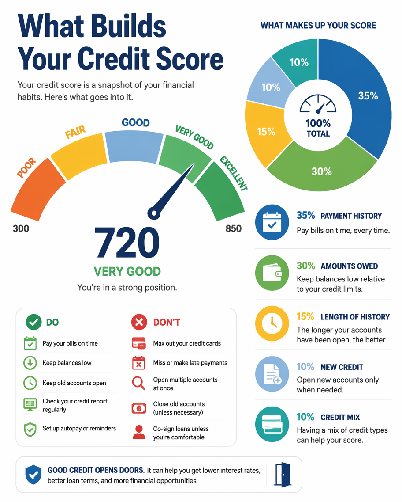

```text
A finance-literacy infographic breaking down what makes up a credit score, built around a semicircular gauge from 'poor' to 'excellent' with a needle pointing at a sample 720. A donut beside it splits the factors - payment history 35%, amounts owed 30%, length of history 15%, new credit 10%, credit mix 10% - each with an icon and a one-line tip. Clean flat style, a trust-blue, green and amber palette on white. Bold title 'What Builds Your Credit Score' top-left, a small do-and-don't list.
```

[Original source](https://github.com/apimodels/gpt-image-2-prompts/blob/980d100f3bd0f2cde4cf38835daeb742bf1cac65/prompts.json#infographic-892) · Model: GPT Image 2 · Credit: APIModels · CC BY 4.0
ProjectD: held. Credit-scoring scope/model and generated advice need financial accuracy review.

## Bull vs Bear · infographic-891
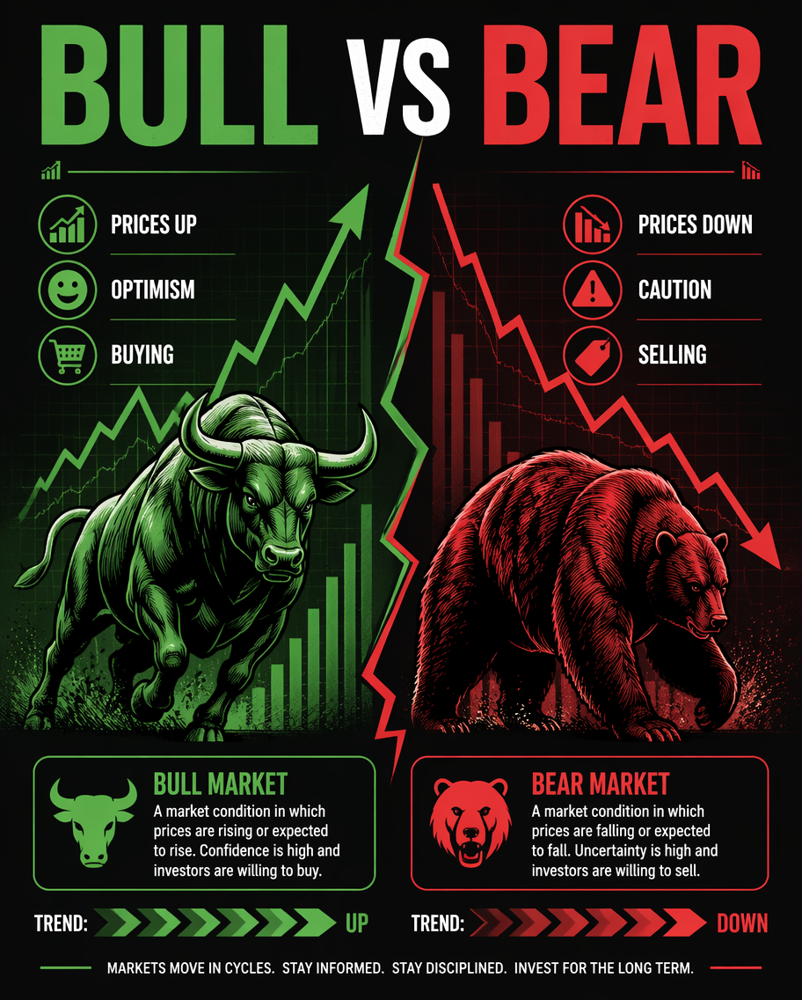

```text
A finance-literacy infographic contrasting bull and bear markets side by side. The left half, in green, shows a charging bull with a rising line graph and the words 'prices up', 'optimism', 'buying'; the right half, in red, shows a bear with a falling graph and 'prices down', 'caution', 'selling'. A dividing zig-zag line separates the two moods. Bold flat illustration, a confident green-and-red palette on charcoal, clean data-line accents. Strong uppercase title 'Bull vs Bear' at the top, small definition cards and an arrow legend beneath each animal.
```

[Original source](https://github.com/apimodels/gpt-image-2-prompts/blob/980d100f3bd0f2cde4cf38835daeb742bf1cac65/prompts.json#infographic-891) · Model: GPT Image 2 · Credit: APIModels · CC BY 4.0
ProjectD: reviewed-not-imported. Generic bull/bear visual metaphor, not a real market report or trading signal.

## Risk vs Return · infographic-893
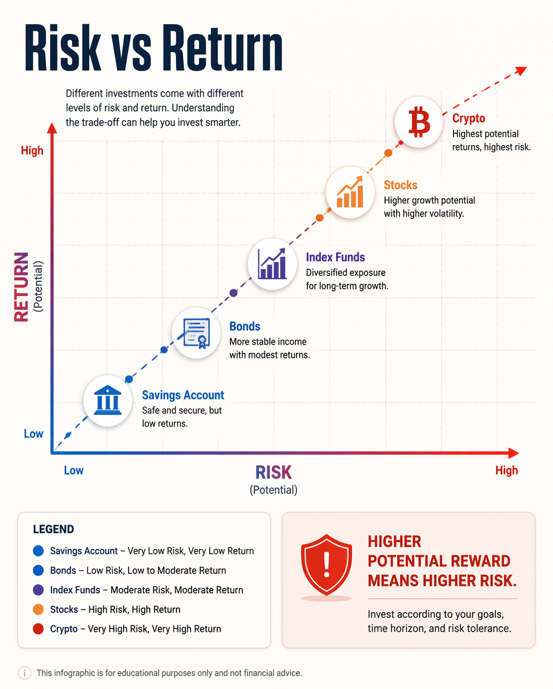

```text
An investing infographic mapping risk versus return as a rising diagonal scatter chart. Asset types - a savings account, bonds, index funds, stocks, crypto - are plotted as labeled dots from low-risk/low-return to high-risk/high-return, each with a small icon and a one-line note. Clean flat financial style, a cool-blue-to-warm-red gradient axis on off-white, gridlines and a trend arrow. Bold title 'Risk vs Return' upper-left, a compact legend and a reminder card 'higher potential reward means higher risk'.
```

[Original source](https://github.com/apimodels/gpt-image-2-prompts/blob/980d100f3bd0f2cde4cf38835daeb742bf1cac65/prompts.json#infographic-893) · Model: GPT Image 2 · Credit: APIModels · CC BY 4.0
ProjectD: held. Asset-risk/return positioning and added advice need financial accuracy review.

## How a Mortgage Gets Paid · infographic-894
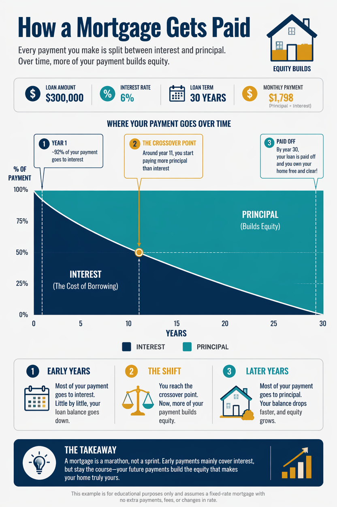

```text
A finance-literacy infographic explaining how a mortgage is paid off over time, built around a stacked area chart across 30 years. Two bands - interest (shrinking) and principal (growing) - show how early payments are mostly interest while later ones build equity, using a sample $300,000 loan at 6%. Callouts mark 'year 1', 'the crossover point', 'paid off'. Clean flat style, a navy, teal and gold palette on light grey. Bold title 'How a Mortgage Gets Paid' at the top, a small house-equity fill icon.
```

[Original source](https://github.com/apimodels/gpt-image-2-prompts/blob/980d100f3bd0f2cde4cf38835daeb742bf1cac65/prompts.json#infographic-894) · Model: GPT Image 2 · Credit: APIModels · CC BY 4.0
ProjectD: held. Generated mortgage payment, amortization amounts and crossover claim require recomputation.

## Build Your Safety Net · infographic-895
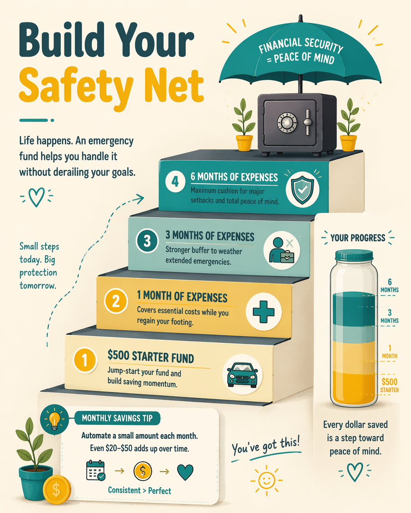

```text
A personal-finance infographic explaining the emergency fund, drawn as a staircase leading up to a safe umbrella. Steps mark savings milestones - a $500 starter, 1 month, 3 months, 6 months of expenses - each with a short reason and an icon (a car, a medical cross, a job-loss symbol). A side jar fills up as a progress meter. A warm reassuring palette of teal, sunny-yellow and slate, friendly flat illustration on cream. Bold rounded title 'Build Your Safety Net' top-left, a small monthly-savings tip card at the base.
```

[Original source](https://github.com/apimodels/gpt-image-2-prompts/blob/980d100f3bd0f2cde4cf38835daeb742bf1cac65/prompts.json#infographic-895) · Model: GPT Image 2 · Credit: APIModels · CC BY 4.0
ProjectD: reviewed-not-imported. Illustrative emergency-savings template, not personalized financial advice.

## What Is Inflation? · infographic-896
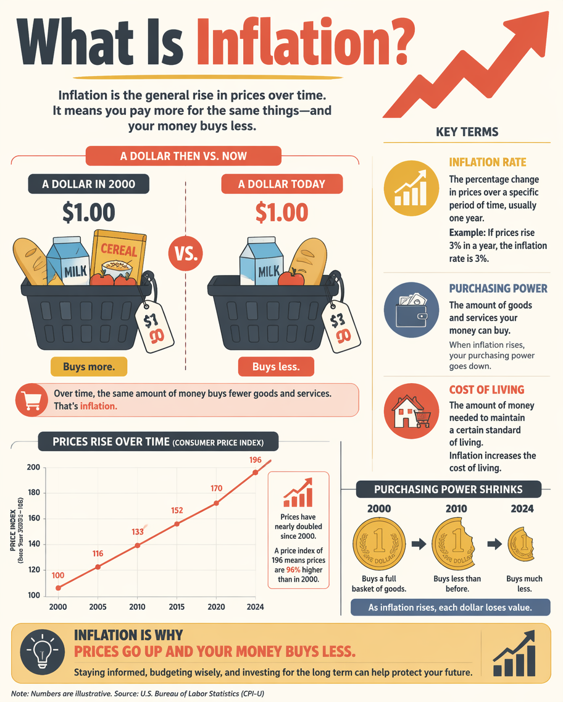

```text
A finance-literacy infographic explaining inflation, shown as a shopping basket whose contents shrink while the price tag climbs over years. A line graph tracks a rising price index; a shrinking coin visualizes falling purchasing power. Callouts define 'inflation rate', 'purchasing power', and 'cost of living'. Clean flat illustration, a warm coral, mustard and slate palette on off-white, an upward price-arrow motif. Bold title 'What Is Inflation?' at the top, a before/after 'a dollar then vs now' mini-panel.
```

[Original source](https://github.com/apimodels/gpt-image-2-prompts/blob/980d100f3bd0f2cde4cf38835daeb742bf1cac65/prompts.json#infographic-896) · Model: GPT Image 2 · Credit: APIModels · CC BY 4.0
ProjectD: held. Generated historical price/purchasing-power figures and source note not verified.

## Why Diversify? · infographic-897
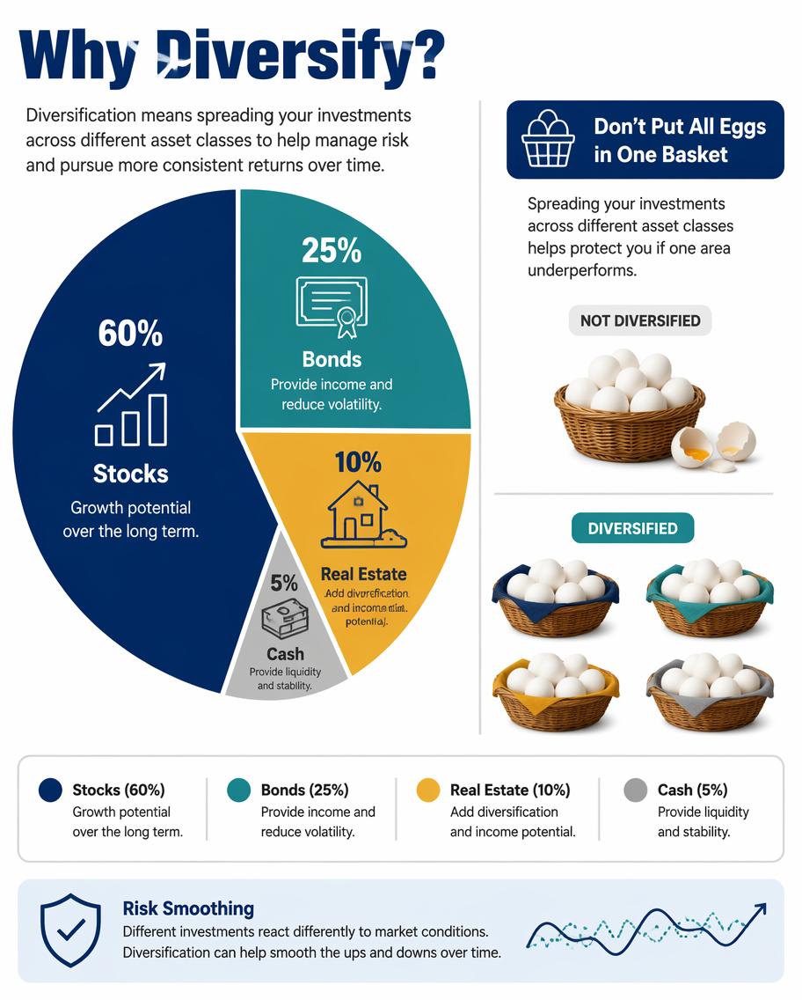

```text
An investing infographic explaining diversification through a sample asset-allocation pie chart. Wedges - 60% stocks, 25% bonds, 10% real estate, 5% cash - are each labeled with a percentage, an icon and a one-line role. A companion 'don't put all eggs in one basket' visual shows eggs spread across several baskets. Clean flat financial style, a balanced palette of navy, teal, gold and grey on white. Bold title 'Why Diversify?' upper-left, a small risk-smoothing note and a legend along the base.
```

[Original source](https://github.com/apimodels/gpt-image-2-prompts/blob/980d100f3bd0f2cde4cf38835daeb742bf1cac65/prompts.json#infographic-897) · Model: GPT Image 2 · Credit: APIModels · CC BY 4.0
ProjectD: held. Sample portfolio allocation and risk claims require financial accuracy review.

## Snowball vs Avalanche · infographic-898
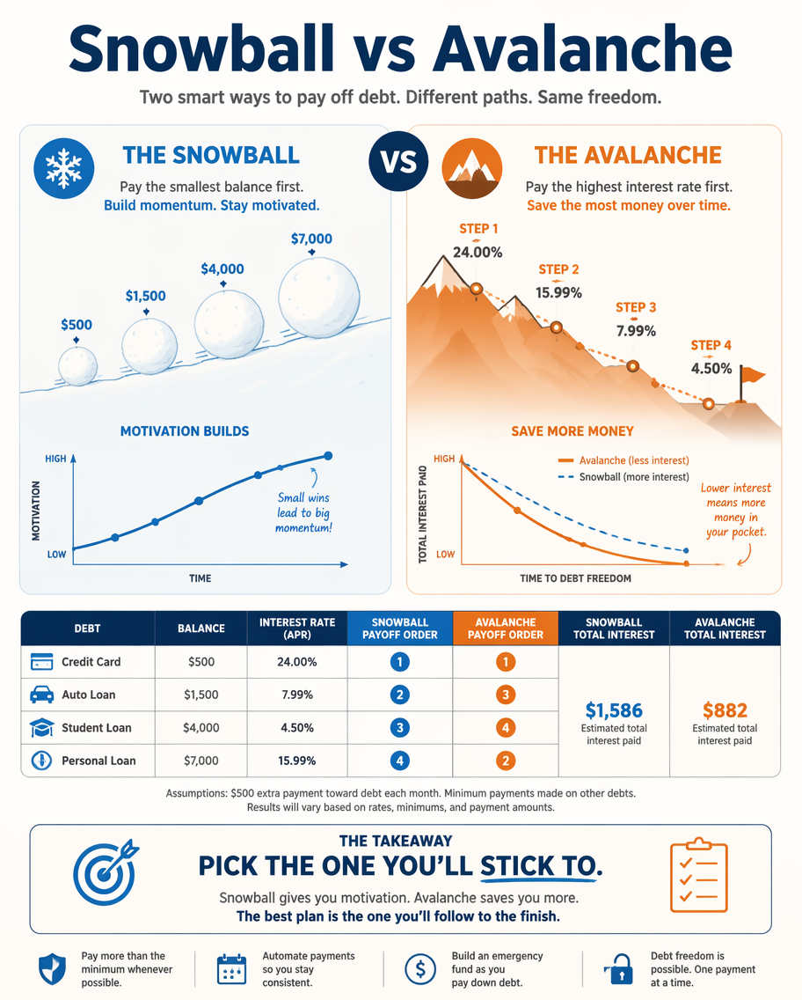

```text
A finance-literacy infographic comparing two debt-payoff methods side by side. Left: the 'snowball' - pay the smallest balance first, shown as growing snowballs and a motivation curve; right: the 'avalanche' - pay the highest interest first, shown as descending mountain steps that save the most money. A small table lists sample debts, the payoff order and total interest for each. Clean flat style, a cool-blue vs warm-orange split palette on off-white. Bold title 'Snowball vs Avalanche' at the top, a takeaway card 'pick the one you'll stick to'.
```

[Original source](https://github.com/apimodels/gpt-image-2-prompts/blob/980d100f3bd0f2cde4cf38835daeb742bf1cac65/prompts.json#infographic-898) · Model: GPT Image 2 · Credit: APIModels · CC BY 4.0
ProjectD: held. Debt payoff sample totals/interest savings not independently recomputed.

## Sourdough, Step by Step · infographic-899
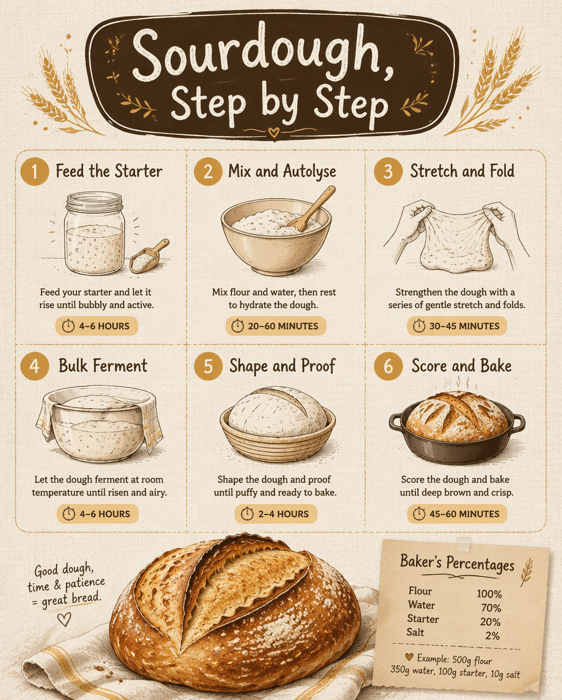

```text
A cooking infographic laying out how to bake sourdough bread as a numbered 6-step grid. Illustrated steps - feed the starter, mix and autolyse, stretch and fold, bulk ferment, shape and proof, score and bake - each carry a small hand-drawn icon, a one-line instruction and a timing badge. A warm artisan palette of wheat-gold, crust-brown and cream on a linen-textured background. A rounded chalk-style title 'Sourdough, Step by Step' at the top, a finished crackly loaf illustration and a baker's-percentage note in the corner.
```

[Original source](https://github.com/apimodels/gpt-image-2-prompts/blob/980d100f3bd0f2cde4cf38835daeb742bf1cac65/prompts.json#infographic-899) · Model: GPT Image 2 · Credit: APIModels · CC BY 4.0
ProjectD: reviewed-not-imported. Illustrative bread process; timing varies by starter, temperature and recipe.

## Anatomy of a Ramen Bowl · infographic-900
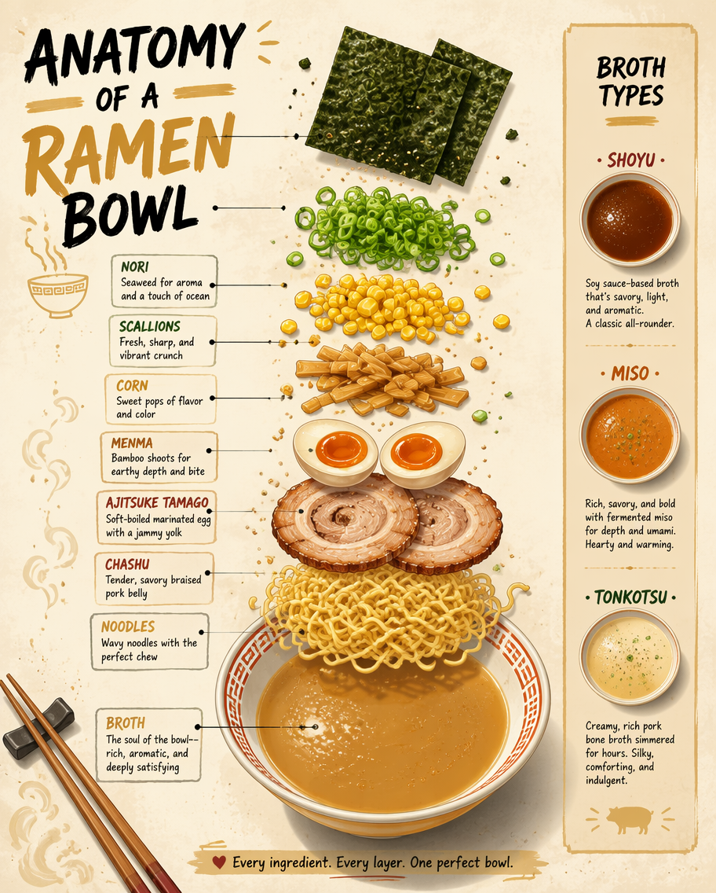

```text
A food infographic exploding a ramen bowl into its labeled components, drawn as a top-down bowl with leader lines pointing to each ingredient - broth, wavy noodles, chashu pork, a soft-boiled egg, nori, scallions, corn and bamboo shoots. A side column notes broth types (shoyu, miso, tonkotsu). Appetizing flat illustration with soft shadows, a warm cream, ramen-gold and nori-green palette. Bold hand-lettered title 'Anatomy of a Ramen Bowl' upper-left, small chopsticks and steam-swirl accents.
```

[Original source](https://github.com/apimodels/gpt-image-2-prompts/blob/980d100f3bd0f2cde4cf38835daeb742bf1cac65/prompts.json#infographic-900) · Model: GPT Image 2 · Credit: APIModels · CC BY 4.0
ProjectD: reviewed-not-imported. Complete source prompt and uncropped native preview correspond; generation defects and actual dimensions retained.

## Pour-Over, Step by Step · infographic-901
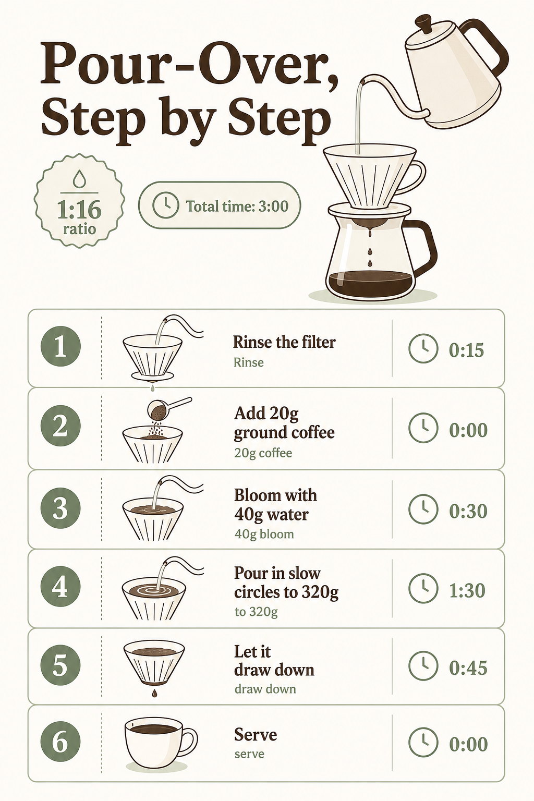

```text
A cooking infographic showing how to brew pour-over coffee as a clean numbered sequence. Steps - rinse the filter, add 20g ground coffee, bloom with 40g water, pour in slow circles to 320g, let it draw down, serve - each carry a minimalist line icon, a ratio note and a small timer. A modern minimalist palette of coffee-brown, cream and sage on off-white, crisp flat illustration of a dripper and a gooseneck kettle. Bold title 'Pour-Over, Step by Step' at the top, a 1:16 ratio badge and a total-time chip.
```

[Original source](https://github.com/apimodels/gpt-image-2-prompts/blob/980d100f3bd0f2cde4cf38835daeb742bf1cac65/prompts.json#infographic-901) · Model: GPT Image 2 · Credit: APIModels · CC BY 4.0
ProjectD: reviewed-not-imported. Illustrative pour-over recipe; 20g to 320g equals requested 1:16.

## Roll Your Own Sushi · infographic-902
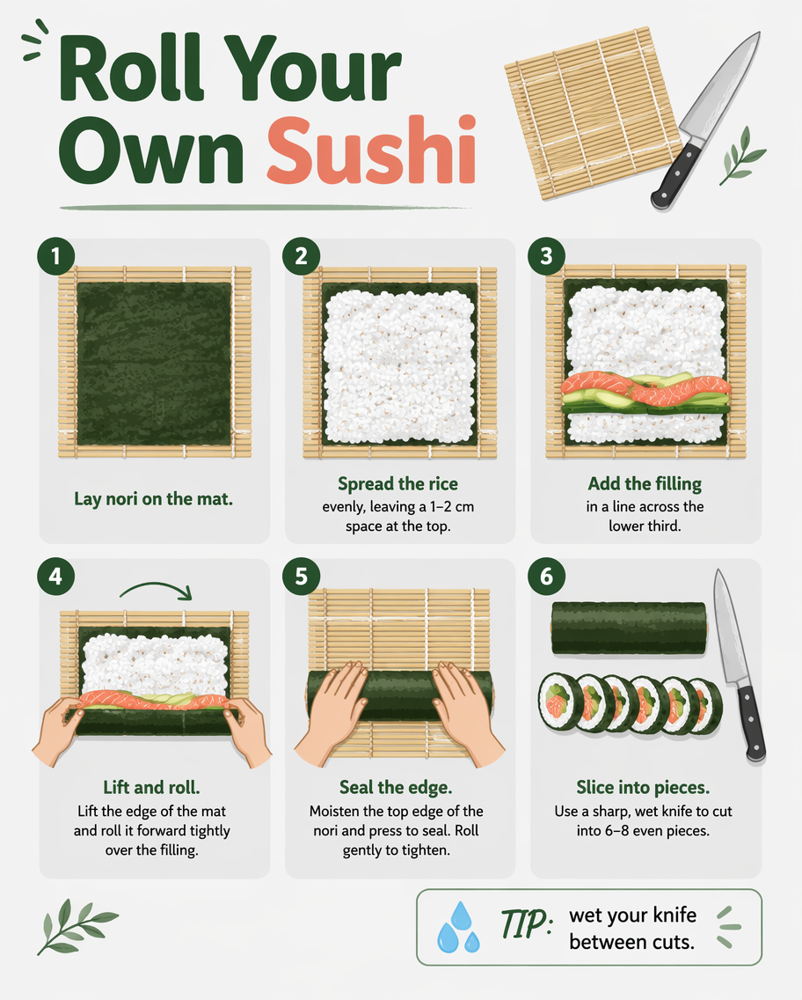

```text
A cooking infographic teaching how to roll a maki sushi roll in a 6-panel numbered sequence. Panels - lay nori on the mat, spread the rice, add the filling, lift and roll, seal the edge, slice into pieces - each carry a clean overhead illustration and a short caption. A fresh palette of nori-green, rice-white, salmon-pink and bamboo-tan on light grey, tidy flat vector style. Bold rounded title 'Roll Your Own Sushi' upper-left, a small bamboo-mat and knife icon, a tip note 'wet your knife between cuts'.
```

[Original source](https://github.com/apimodels/gpt-image-2-prompts/blob/980d100f3bd0f2cde4cf38835daeb742bf1cac65/prompts.json#infographic-902) · Model: GPT Image 2 · Credit: APIModels · CC BY 4.0
ProjectD: reviewed-not-imported. Illustrated assembly concept; not complete raw-fish food-safety guidance.

## Homemade Pizza, Step by Step · infographic-903
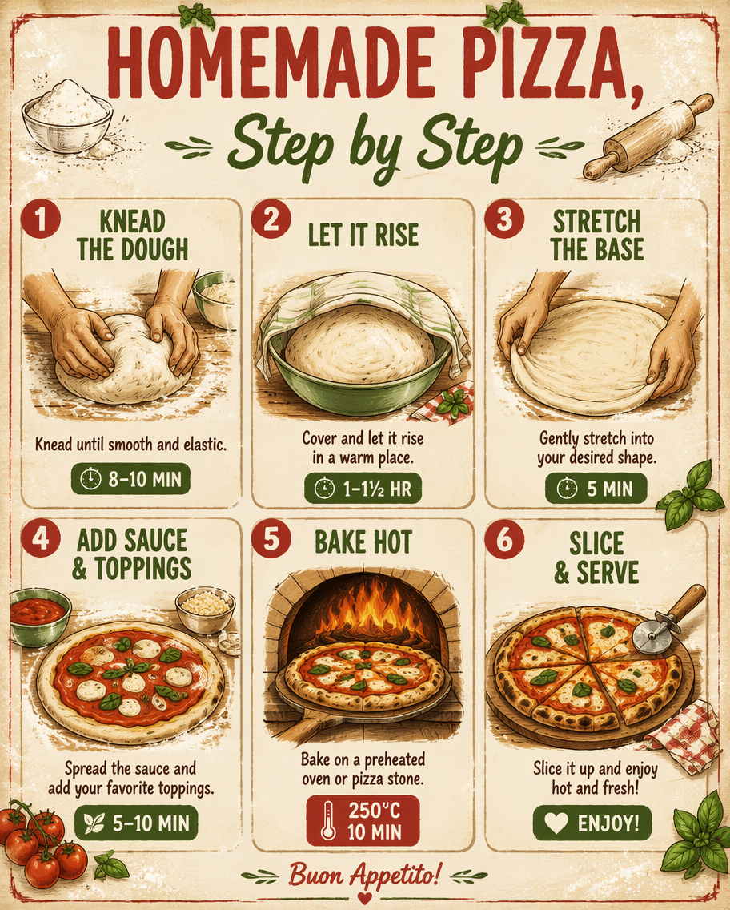

```text
A cooking infographic showing how to make pizza from scratch as a numbered 6-step flow. Steps - knead the dough, let it rise, stretch the base, add sauce and toppings, bake hot, slice and serve - each carry a warm hand-drawn illustration, a one-line instruction and a time or temperature badge (for example, bake at 250C for 10 min). A rustic trattoria palette of tomato-red, basil-green and dough-cream on a floured-board texture. Bold title 'Homemade Pizza, Step by Step' at the top, small flour and rolling-pin doodles.
```

[Original source](https://github.com/apimodels/gpt-image-2-prompts/blob/980d100f3bd0f2cde4cf38835daeb742bf1cac65/prompts.json#infographic-903) · Model: GPT Image 2 · Credit: APIModels · CC BY 4.0
ProjectD: reviewed-not-imported. Illustrative pizza sequence; generated timing is not a universal cooking guarantee.

## The Perfect French Omelette · infographic-905
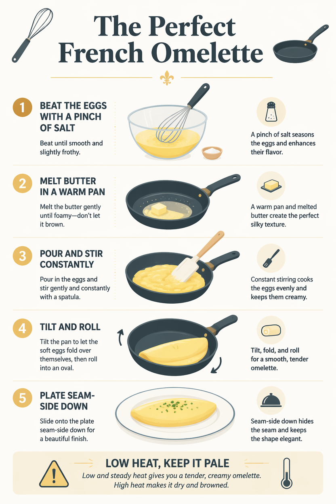

```text
A cooking infographic teaching the classic French omelette as a numbered 5-step sequence. Steps - beat the eggs with a pinch of salt, melt butter in a warm pan, pour and stir constantly, tilt and roll, plate seam-side down - each carry a clean side-view illustration and a short technique tip. A soft culinary palette of butter-yellow, cream and slate on off-white, elegant flat vector style. Bold title 'The Perfect French Omelette' at the top, small pan and whisk icons, a 'low heat, keep it pale' caution note.
```

[Original source](https://github.com/apimodels/gpt-image-2-prompts/blob/980d100f3bd0f2cde4cf38835daeb742bf1cac65/prompts.json#infographic-905) · Model: GPT Image 2 · Credit: APIModels · CC BY 4.0
ProjectD: reviewed-not-imported. Complete source prompt and uncropped native preview correspond; generation defects and actual dimensions retained.

## Build a Smoothie Bowl · infographic-904
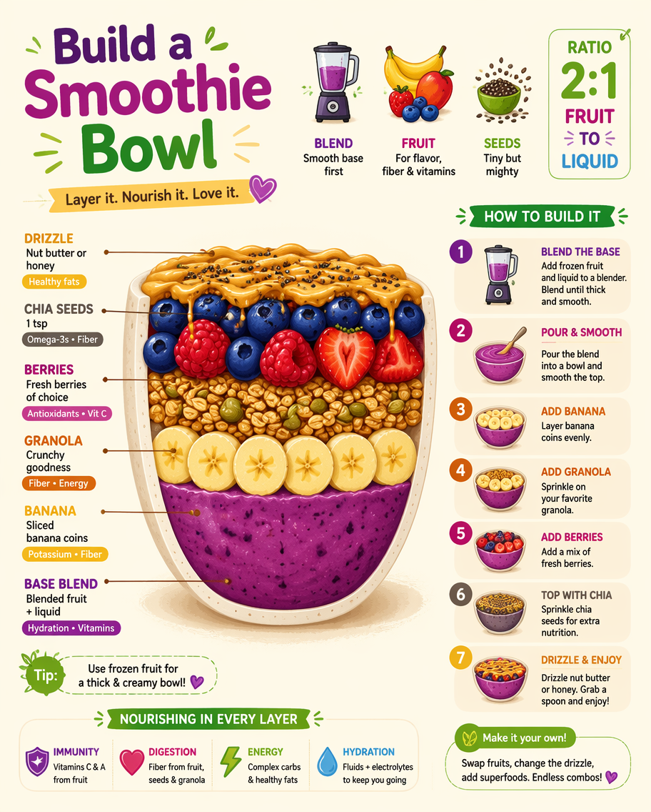

```text
A food infographic showing how to build a smoothie bowl, drawn as a labeled cross-section of a bowl in layers plus a numbered assembly guide. From the base blend up through banana coins, granola, berries, chia and a drizzle, each layer is labeled with a leader line and a nutrition tag. A bright fresh palette of berry-purple, mango-orange and leafy-green on cream, playful flat illustration with soft shadows. Bold rounded title 'Build a Smoothie Bowl' upper-left, small icons for a blender, fruit and seeds, a 'ratio 2:1 fruit to liquid' note.
```

[Original source](https://github.com/apimodels/gpt-image-2-prompts/blob/980d100f3bd0f2cde4cf38835daeb742bf1cac65/prompts.json#infographic-904) · Model: GPT Image 2 · Credit: APIModels · CC BY 4.0
ProjectD: reviewed-not-imported. Generated nutrition labels are illustrative, not measured nutrient quantities.

## A Guide to Steeping Tea · infographic-906
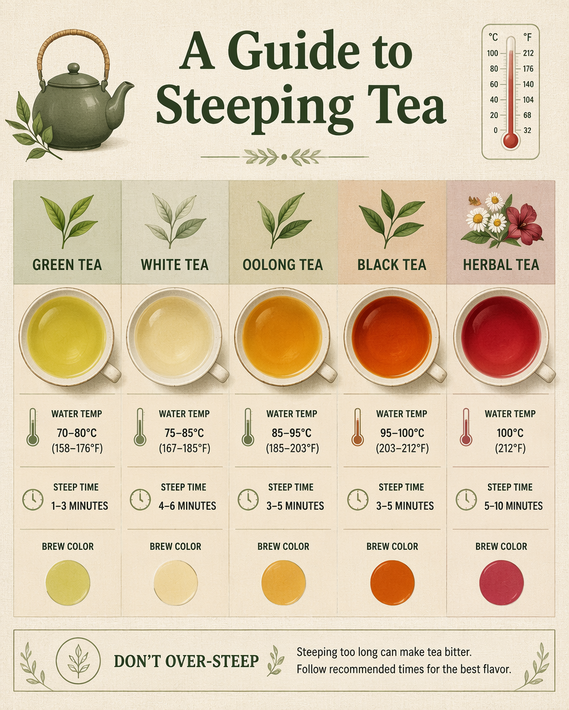

```text
A cooking infographic guide to steeping tea by type, laid out as a comparison chart of five cups in a row. Columns for green, white, oolong, black and herbal tea each list water temperature, steep time and a color swatch of the brew, topped by a small leaf icon. A calm natural palette of sage, amber and cream on a soft linen texture, tidy flat illustration. Bold title 'A Guide to Steeping Tea' at the top, a small teapot and thermometer motif, a 'don't over-steep' tip along the base.
```

[Original source](https://github.com/apimodels/gpt-image-2-prompts/blob/980d100f3bd0f2cde4cf38835daeb742bf1cac65/prompts.json#infographic-906) · Model: GPT Image 2 · Credit: APIModels · CC BY 4.0
ProjectD: reviewed-not-imported. Illustrative steeping chart; suitable conditions depend on tea.

## Build the Perfect Taco · infographic-908
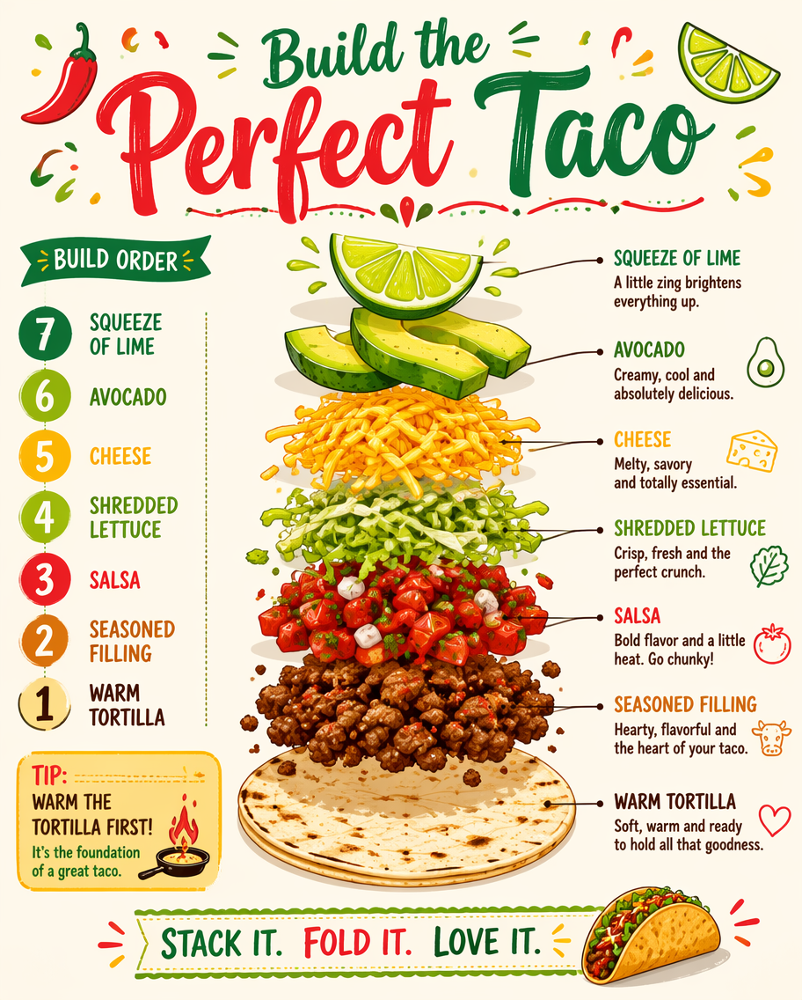

```text
A cooking infographic showing how to build the perfect taco, drawn as an exploded stack of labeled layers plus a numbered assembly order. From a warm tortilla up through seasoned filling, salsa, shredded lettuce, cheese, avocado and a squeeze of lime, each layer has a leader line and a short note. A vibrant fiesta palette of tomato-red, lime-green, corn-yellow and cream, lively flat illustration with soft shadows. Bold hand-lettered title 'Build the Perfect Taco' at the top, small chili and lime doodles, a 'warm the tortilla first' tip.
```

[Original source](https://github.com/apimodels/gpt-image-2-prompts/blob/980d100f3bd0f2cde4cf38835daeb742bf1cac65/prompts.json#infographic-908) · Model: GPT Image 2 · Credit: APIModels · CC BY 4.0
ProjectD: reviewed-not-imported. Complete source prompt and uncropped native preview correspond; generation defects and actual dimensions retained.

## A Guide to Knife Cuts · infographic-907
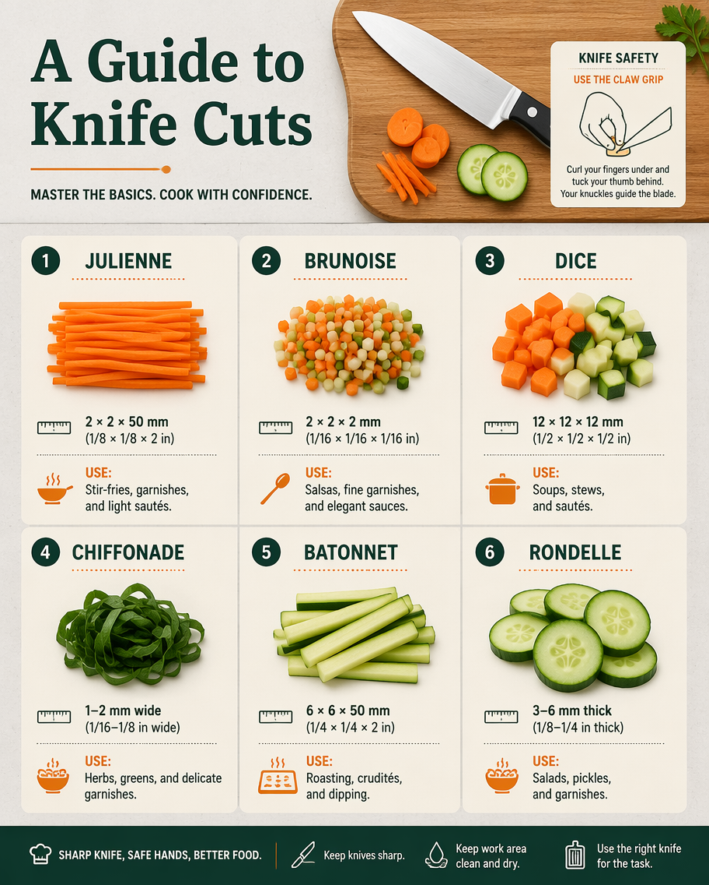

```text
A cooking-skills infographic illustrating basic knife cuts as a labeled grid of six vegetable examples. Cells show julienne, brunoise, dice, chiffonade, batonnet and rondelle, each with a neat overhead illustration of the cut, its name, dimensions and a one-line use. A clean culinary palette of carrot-orange, cucumber-green and cream on light grey, precise flat vector style. Bold title 'A Guide to Knife Cuts' upper-left, a small chef's-knife icon and a cutting-board texture accent, a safety 'claw grip' mini-note.
```

[Original source](https://github.com/apimodels/gpt-image-2-prompts/blob/980d100f3bd0f2cde4cf38835daeb742bf1cac65/prompts.json#infographic-907) · Model: GPT Image 2 · Credit: APIModels · CC BY 4.0
ProjectD: reviewed-not-imported. Illustrative cuts/size chart and claw-grip sketch, not a complete knife-safety course.
