# ChaosRealmsAI GPT Image2 — source archive 1

**Source-paired archive; all items here await individual ProjectD editorial review.** Full source prompts, model evidence, native dimensions, reference requirements and unchanged author-published2400px renditions are retained. These are GPT Image2, not2.6. Raw generation PNGs are absent from this source tree.

MIT · copyright2026 GPT Image2 Hub / ChaosRealmsAI. [Full source license](sources/chaos-gpt-image-2/LICENSE). Original external rights retained.

## Paper Figure Reference · 2d-3d-medium-collision/series-crayon-apple-carrier/01-paper-figure-reference

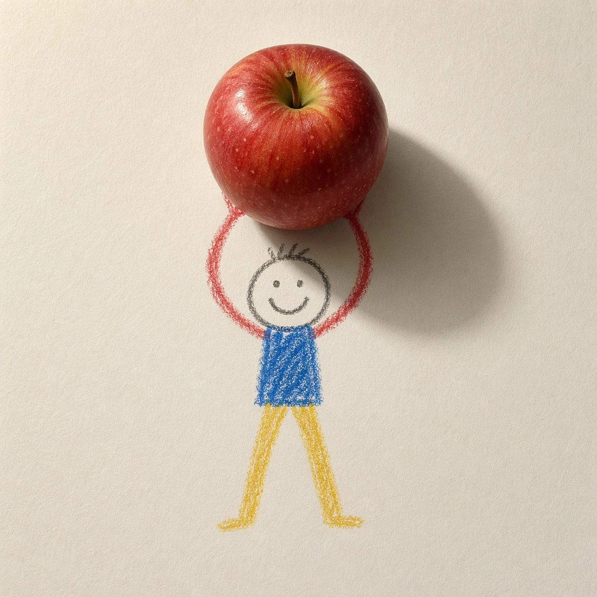

```text
Scene:
A square overhead photograph of a slightly warm white sheet of drawing paper on a quiet tabletop. The camera is perfectly perpendicular to the page, with soft daylight entering from the upper left and a faint paper fiber texture visible across the surface. The palette is simple: waxy red, blue, yellow, graphite gray, and the natural off-white of the paper. The lighting must make the page feel real, but the drawn marks must remain unmistakably flat crayon.

Subject:
A childlike crayon stick figure stands near the center of the paper, drawn with uneven wax pressure, round head, simple smile, blue torso, red arms, and yellow legs. The figure holds an 8K photoreal red apple above its head. The apple is not drawn; it is a glossy real object resting on the paper plane, with small pores, a short brown stem, a green highlight, and believable volume.

Important details:
Keep the 2D and 3D layers sharply separated. Crayon lines must sit on the paper with no thickness except wax texture, while the apple must cast a true elliptical shadow across the paper and over parts of the drawn arms. The drawn hands may touch the apple visually, but they should not become 3D fingers. Preserve the same simple crayon character for later references.

Use case:
2D and 3D Medium Collision series study 1/8, establishing the reference character, paper surface, lighting direction, and mixed-medium physics.

Constraints:
No readable text, no watermark, no logos, preserve exact 1:1 aspect ratio, no extra props, no realistic human hands, no cartoon apple, no floating object without shadow, no frame, no perspective tilt.
```

[Pinned source](https://github.com/ChaosRealmsAI/gpt-image-2-gallery/blob/5296db8c996e38776c83a0bc8c64f848dcd512b3/works/topics/2d-3d-medium-collision/packages/series-crayon-apple-carrier/images/01-paper-figure-reference/meta.json) · GPT Image2 · 1254×1254 · No source-declared image dependencies. · ProjectD:pending individual review.

## Glass Marble Lift · 2d-3d-medium-collision/series-crayon-apple-carrier/02-glass-marble-lift

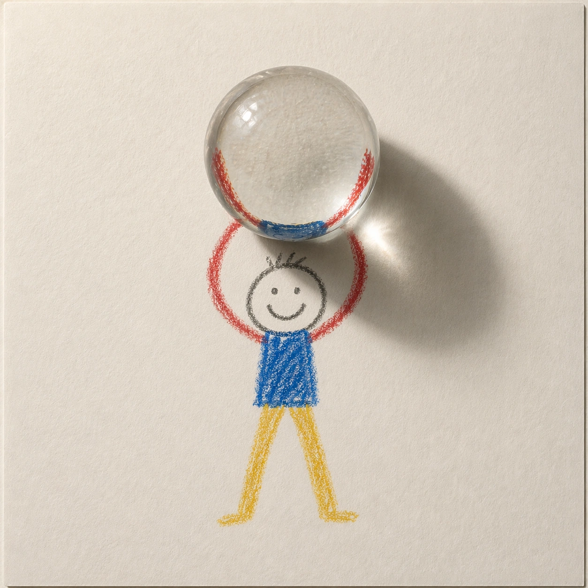

```text
Scene:
A square overhead photograph on the same warm white drawing paper as the reference image. Keep the camera perpendicular to the page, the tabletop invisible except for a narrow paper edge hint, and the light coming from the upper left. The image should feel like a small studio test of physical contact between handmade marks and a real object, with quiet shadows and high detail rather than dramatic scenery.

Subject:
Use the same childlike crayon stick figure from the reference: round head, simple smile, blue torso, red arms, yellow legs, uneven waxy crayon strokes, and the same pose of lifting an object above the head. Replace the apple with one large photoreal transparent glass marble. The marble is spherical, heavy, clear, and polished, with distorted paper fibers, inverted crayon colors, bright highlights, and a dense contact shadow below it.

Important details:
The figure must remain purely flat 2D crayon, never gaining real fingers, skin, or dimensional limbs. The marble must behave as real glass on paper: it refracts and magnifies the crayon arms beneath it, bends the blue torso color at its lower edge, and creates a small caustic glow beside the shadow. Preserve the reference character identity and lighting direction while changing only the held object and its material behavior.

Use case:
2D and 3D Medium Collision series study 2/8, testing whether a referenced 2D character can support a transparent 3D material with plausible optics.

Constraints:
No readable text, no watermark, no logos, preserve exact 1:1 aspect ratio, no extra characters, no gemstone facets, no cartoon bubble, no floating marble, no painted glass outline, no change to the crayon figure identity.
```

[Pinned source](https://github.com/ChaosRealmsAI/gpt-image-2-gallery/blob/5296db8c996e38776c83a0bc8c64f848dcd512b3/works/topics/2d-3d-medium-collision/packages/series-crayon-apple-carrier/images/02-glass-marble-lift/meta.json) · GPT Image2 · 1254×1254 · Reference images required. · ProjectD:pending individual review.

## Metal Cube Balance · 2d-3d-medium-collision/series-crayon-apple-carrier/03-metal-cube-balance

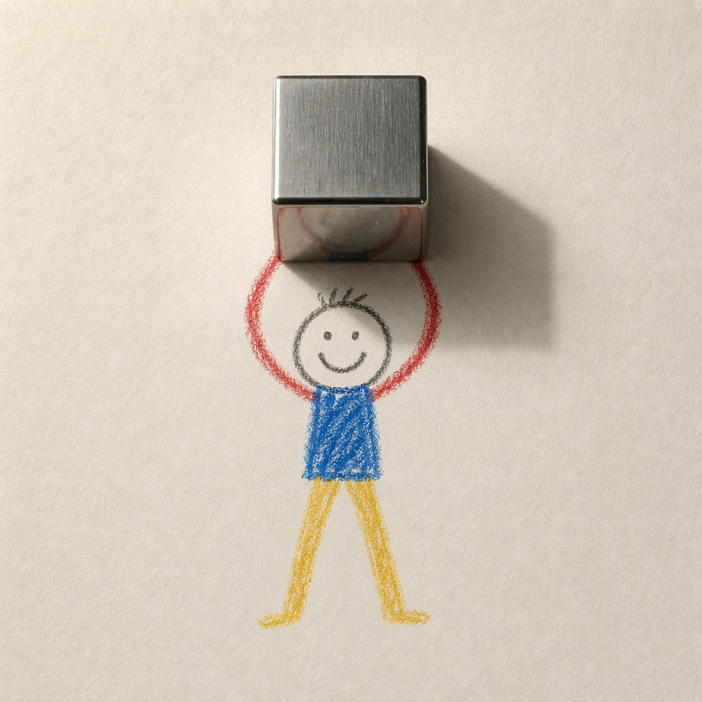

```text
Scene:
A square top-down studio photograph of the same sheet of off-white drawing paper, using the same upper-left soft daylight and calm tabletop setting established by the reference. The page should show subtle dents, fibers, and wax drag marks, but it must remain uncluttered. The composition is centered and still, like a controlled research sample for mixed rendering layers.

Subject:
Use the same childlike crayon stick figure from the reference image, preserving the round head, simple smile, blue torso, red arms, yellow legs, scale, and lifted-arm pose. Replace the apple with a small brushed stainless-steel cube balanced above the drawn hands. The cube is photoreal, heavy, sharply edged, and reflective, with slightly rounded machined bevels, cool gray highlights, and distorted reflections of the warm paper and colored crayon strokes.

Important details:
The 3D cube must visibly weigh on the paper-world illusion without turning the crayon figure into a sculpture. Its shadow should be darker and more geometric than the apple shadow, crossing the red crayon arms and part of the face. The cube should occlude portions of the drawn hands cleanly, showing exact layer ordering: paper first, crayon marks second, real cube third, shadow over both. Keep the character identity and camera position stable from the reference.

Use case:
2D and 3D Medium Collision series study 3/8, testing consistent 2D character identity against a reflective hard-surface 3D material.

Constraints:
No readable text, no watermark, no logos, preserve exact 1:1 aspect ratio, no extra objects, no toy block colors, no engraved markings, no soft pillow cube, no realistic arm anatomy, no change to the reference crayon figure.
```

[Pinned source](https://github.com/ChaosRealmsAI/gpt-image-2-gallery/blob/5296db8c996e38776c83a0bc8c64f848dcd512b3/works/topics/2d-3d-medium-collision/packages/series-crayon-apple-carrier/images/03-metal-cube-balance/meta.json) · GPT Image2 · 1254×1254 · Reference images required. · ProjectD:pending individual review.

## Water Balloon Strain · 2d-3d-medium-collision/series-crayon-apple-carrier/04-water-balloon-strain

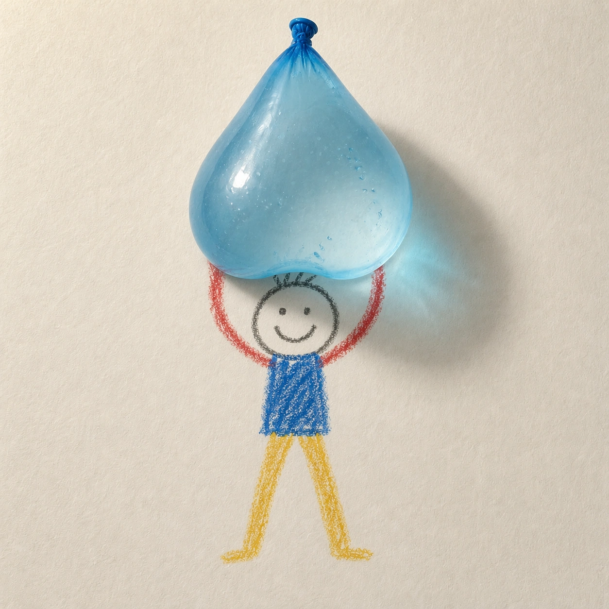

```text
Scene:
A square overhead photograph of the same warm off-white drawing paper and controlled upper-left daylight used in the reference image. The camera remains perpendicular, the background remains minimal, and the paper fibers remain visible enough to prove the object is sitting in the same real environment. The mood is playful but physically precise, with restrained color and no surrounding clutter.

Subject:
Use the same childlike crayon stick figure from the reference, preserving its round head, simple smile, blue torso, red arms, yellow legs, waxy uneven line quality, size, and central lifted pose. Replace the apple with a translucent blue water balloon drooping between the drawn hands. The balloon is a photoreal 3D object with stretched latex, a tied knot, small trapped air bubbles, glossy highlights, and visible water mass pulling it downward.

Important details:
The balloon must demonstrate gravity and material softness while the figure stays flat. Its lower curve should sag over the crayon arms, slightly occluding them, and its shadow should be soft-edged with a faint blue tint on the paper. The crayon hands may appear to touch the balloon, but they must remain simple lines drawn underneath the real object. Keep the original lighting, paper texture, and character identity; do not redraw the figure in a different style.

Use case:
2D and 3D Medium Collision series study 4/8, testing a consistent 2D reference character against a soft transparent 3D object with believable weight.

Constraints:
No readable text, no watermark, no logos, preserve exact 1:1 aspect ratio, no splash, no burst balloon, no extra toys, no realistic child body, no floating object, no change to the reference crayon figure.
```

[Pinned source](https://github.com/ChaosRealmsAI/gpt-image-2-gallery/blob/5296db8c996e38776c83a0bc8c64f848dcd512b3/works/topics/2d-3d-medium-collision/packages/series-crayon-apple-carrier/images/04-water-balloon-strain/meta.json) · GPT Image2 · 1254×1254 · Reference images required. · ProjectD:pending individual review.

## Ink Cat Fishbowl · 2d-3d-medium-collision/single-medium-collision-studies/ink-cat-fishbowl

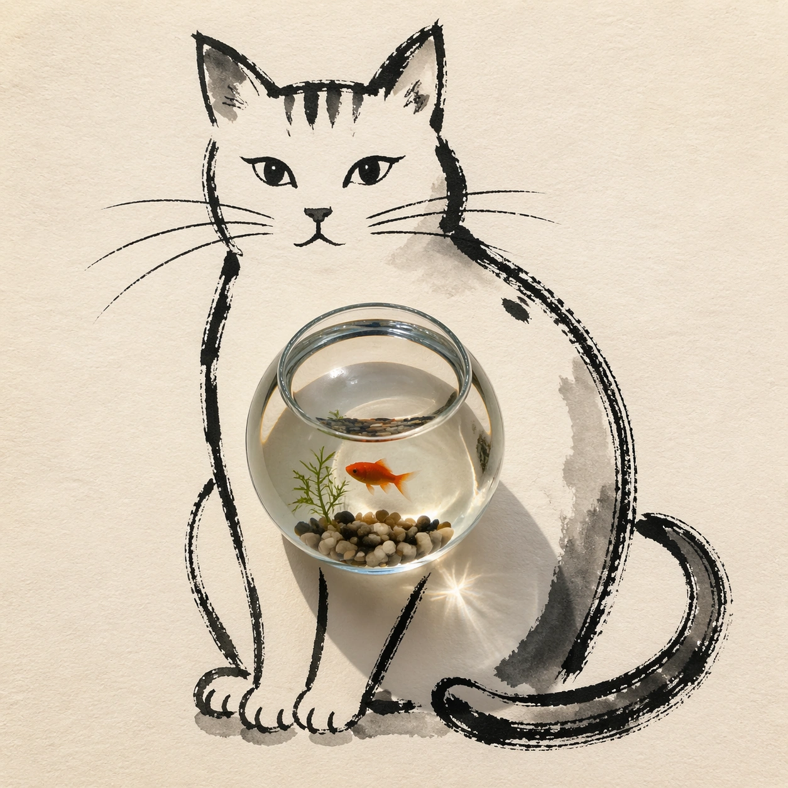

```text
Scene:
A square top-down studio photograph of thick cream drawing paper under soft window light. The paper is clean, slightly textured, and warm in tone, with the camera held perfectly overhead. The scene should look minimal and tactile, like an artist placed one real object onto an ink sketch and photographed the collision before the ink fully dried.

Subject:
A loose black ink drawing of a sitting cat fills the page, made from expressive brush lines, dry-brush gaps, and a few gray wash shadows. The cat is strictly flat and graphic: almond eyes, whiskers, arched back, curled tail, and simple paws. Resting on the drawn belly is a photoreal round glass fishbowl filled with clear water, a small orange fish, pebbles, and a tiny aquatic plant. The bowl is a real transparent 3D object, not a drawn circle.

Important details:
The fishbowl must magnify and distort the ink strokes underneath it, bending the cat's belly line through the water and glass. It should cast a soft circular shadow and a faint caustic highlight onto the cream paper. The cat's ink whiskers and paws must remain flat, with no fur rendering or sculpted body. Layer order is essential: paper texture below, ink marks on paper, glass bowl sitting above, refraction modifying what is seen through it.

Use case:
2D and 3D Medium Collision single study 6/8, testing ink drawing and transparent water-glass optics in one controlled composition.

Constraints:
No readable text, no watermark, no logos, preserve exact 1:1 aspect ratio, no extra labels, no cartoon fishbowl, no realistic 3D cat, no room background, no spilled water, no hands, no frame.
```

[Pinned source](https://github.com/ChaosRealmsAI/gpt-image-2-gallery/blob/5296db8c996e38776c83a0bc8c64f848dcd512b3/works/topics/2d-3d-medium-collision/packages/single-medium-collision-studies/images/ink-cat-fishbowl/meta.json) · GPT Image2 · 1254×1254 · No source-declared image dependencies. · ProjectD:pending individual review.

## Collage Astronaut Orange · 2d-3d-medium-collision/single-medium-collision-studies/collage-astronaut-orange

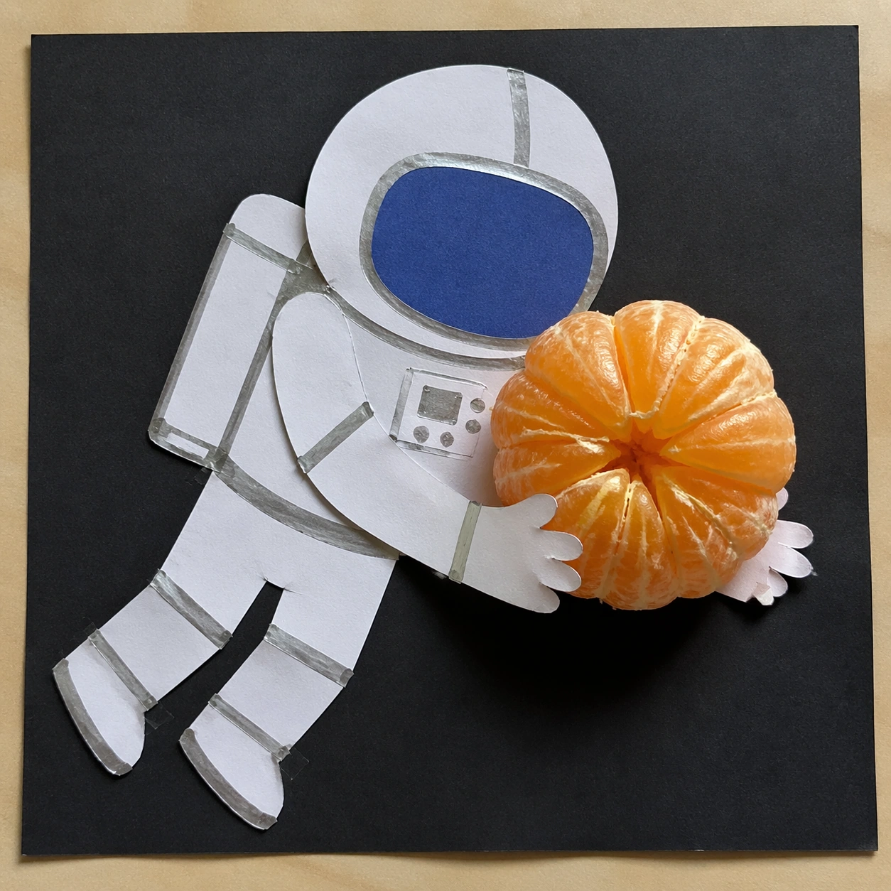

```text
Scene:
A square overhead photograph of a handmade paper collage on a neutral studio table. The lighting is bright but soft, coming from the upper left, so paper edges, torn fibers, and one real object shadow are easy to read. The composition should feel like a school craft project suddenly sharing space with a high-resolution photographed object.

Subject:
A flat paper-cut astronaut floats diagonally across the page. The astronaut is built from simple white construction paper shapes, silver marker outlines, blue paper visor, taped seams, and visible scissor imperfections. It remains completely two-dimensional, like a collage glued to the page. In front of the astronaut's flat hands is a photoreal peeled orange segment cluster, glossy with juice sacs, tiny pith threads, translucent pulp, and a rounded mound shape.

Important details:
The orange must be the only real 3D object. It should cast a warm shadow onto the paper astronaut's suit and cover part of the flat hands, while its wet surface catches small highlights that do not appear on the paper collage. The astronaut should not become a realistic 3D figure or spacesuit. The challenge is precise layer separation: table surface, glued paper collage, real citrus above it, believable shadow and contact. Keep the scene playful but physically credible.

Use case:
2D and 3D Medium Collision single study 7/8, testing collage flatness against photoreal organic translucency and sticky material detail.

Constraints:
No readable text, no watermark, no logos, preserve exact 1:1 aspect ratio, no space background, no real astronaut body, no package branding, no extra fruit, no cartoon orange, no floating shadowless object.
```

[Pinned source](https://github.com/ChaosRealmsAI/gpt-image-2-gallery/blob/5296db8c996e38776c83a0bc8c64f848dcd512b3/works/topics/2d-3d-medium-collision/packages/single-medium-collision-studies/images/collage-astronaut-orange/meta.json) · GPT Image2 · 1254×1254 · No source-declared image dependencies. · ProjectD:pending individual review.

## Blueprint Hand Crystal · 2d-3d-medium-collision/single-medium-collision-studies/blueprint-hand-crystal

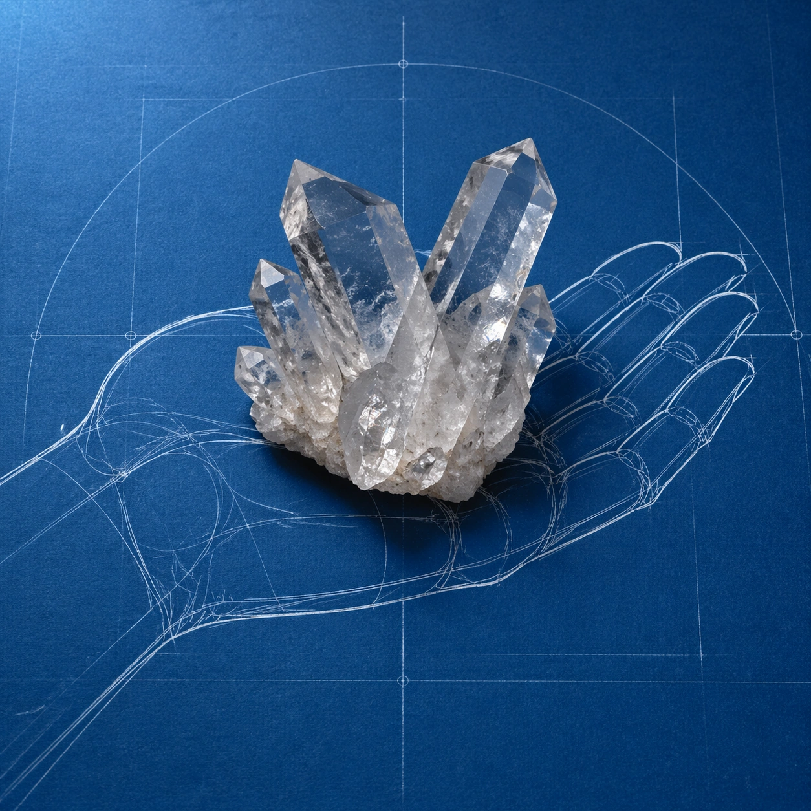

```text
Scene:
A square overhead photograph of deep cyan blueprint paper on a flat desk, evenly lit with a cooler upper-left light. The page surface is matte, with faint fiber grain and pale construction-line marks, but there must be no readable labels or numbers. The composition should resemble a technical drawing that has been interrupted by a real mineral specimen placed exactly where the drawn hand would hold it.

Subject:
A flat white blueprint-style line drawing of a human hand spans the page, palm up, with clean contour lines, ghosted joint arcs, and simple construction circles. The hand is purely 2D linework, not shaded anatomy. Resting in the drawn palm is a photoreal clear quartz crystal cluster, angular and heavy, with sharp facets, cloudy inclusions, small chips, prismatic highlights, and a hard contact shadow.

Important details:
The crystal must sit above the blueprint hand and hide parts of the white linework under its base. Facets should refract fragments of the palm lines, producing broken white streaks inside the transparent mineral while nearby shadow falls across the cyan paper. Keep the technical drawing flat and diagrammatic, with no readable text, arrows, or measurement labels. The image should make the viewer instantly understand that a drawn schematic hand is physically supporting a real crystalline object.

Use case:
2D and 3D Medium Collision single study 8/8, testing diagrammatic 2D linework against transparent faceted 3D mineral physics.

Constraints:
No readable text, no watermark, no logos, preserve exact 1:1 aspect ratio, no labels, no numbers, no realistic flesh hand, no glowing magic crystal, no jewelry setting, no extra tools, no tilted perspective.
```

[Pinned source](https://github.com/ChaosRealmsAI/gpt-image-2-gallery/blob/5296db8c996e38776c83a0bc8c64f848dcd512b3/works/topics/2d-3d-medium-collision/packages/single-medium-collision-studies/images/blueprint-hand-crystal/meta.json) · GPT Image2 · 1254×1254 · No source-declared image dependencies. · ProjectD:pending individual review.

## Museum Core Projection · 4d-hypercube-projection-poster/single-hypercube-projection-studies/01-museum-core-projection

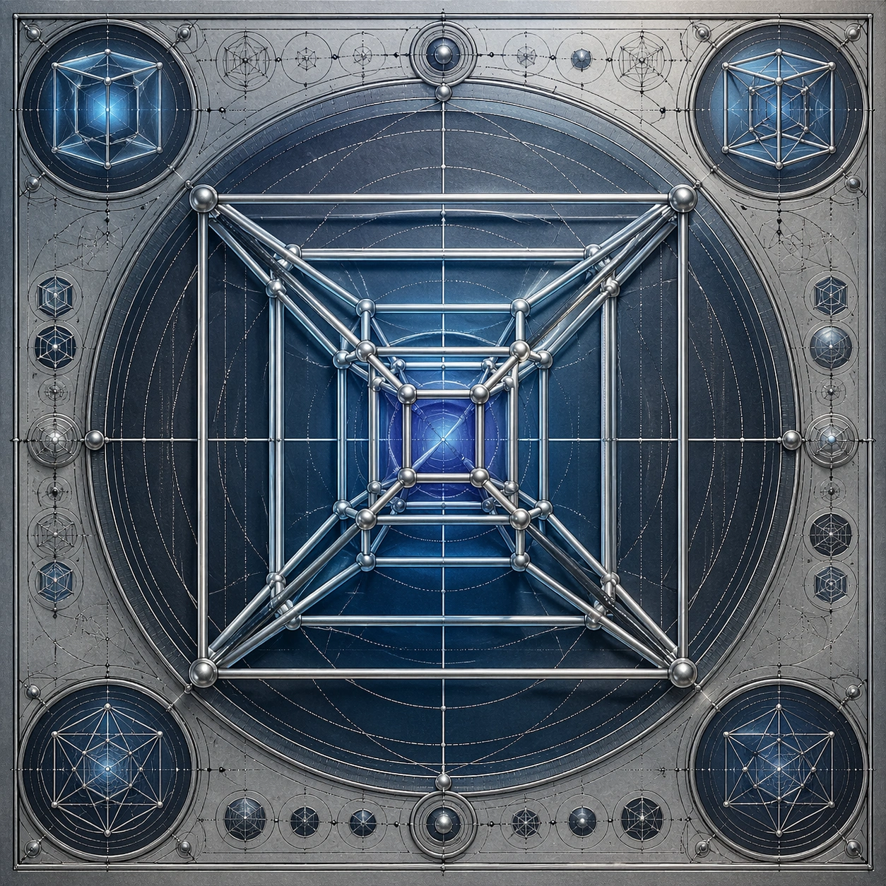

```text
Scene:
Create a square art-science image that presents a tesseract projection with the clarity of a premium museum plate. The camera should remain frontal and calm, while lighting, materials, or color systems help distinguish nested cubes, edge depth, and rotational phase relationships without turning the composition into a generic user interface. Treat it like a polished institutional poster viewed perfectly straight on with crisp neutral lighting. Keep the square crop exact, the camera flat, and the tonal design disciplined enough that structure stays clear at poster scale and under close inspection.

Subject:
Use a tesseract or closely related hypercube projection as the structural centerpiece, with nested cube frames, bridging edges, phase echoes, and disciplined auxiliary diagrams. The geometry should feel reasoned and coherent, so the viewer can understand the higher-dimensional idea through a stable, elegant projection rather than through visual chaos. Focus this variation on a disciplined silver-blue master plate with a central tesseract projection and clean outer guide rings. The composition should feel complete and singular, as though one finished artifact has been resolved with full conviction rather than one fragment pulled from a larger sheet.

Important details:
Edge count, hierarchy, and spacing matter more than flashy effects. Keep the central projection readable, preserve clean line convergence, and let any supporting phase views, orbit traces, or cutaway layers clarify the concept. Use contrast and color coding only where they make the dimensional relationships more legible. Use thin luminous edges, restrained shadow, and enough outer guidance to reinforce the projection without becoming text-heavy. Preserve crisp edge behavior, stable hierarchy, and enough fine information that the image rewards slow viewing without losing the main read from a distance.

Use case:
4D Hypercube single study 1/9, designed as a self-contained sacred-geometry image with a distinct material and compositional emphasis.

Constraints:
No readable text, no watermark, no logos, preserve exact 1:1 aspect ratio, no impossible cube tangles, no random gaming HUD elements, no readable labels, no warped perspective, no soft glow hiding edge logic, no generic sci-fi cockpit styling, no neon overload, no arbitrary arrows, no floating debris.
```

[Pinned source](https://github.com/ChaosRealmsAI/gpt-image-2-gallery/blob/5296db8c996e38776c83a0bc8c64f848dcd512b3/works/topics/4d-hypercube-projection-poster/packages/single-hypercube-projection-studies/images/01-museum-core-projection/meta.json) · GPT Image2 · 1254×1254 · No source-declared image dependencies. · ProjectD:pending individual review.

## Glass Phase Array · 4d-hypercube-projection-poster/single-hypercube-projection-studies/02-glass-phase-array

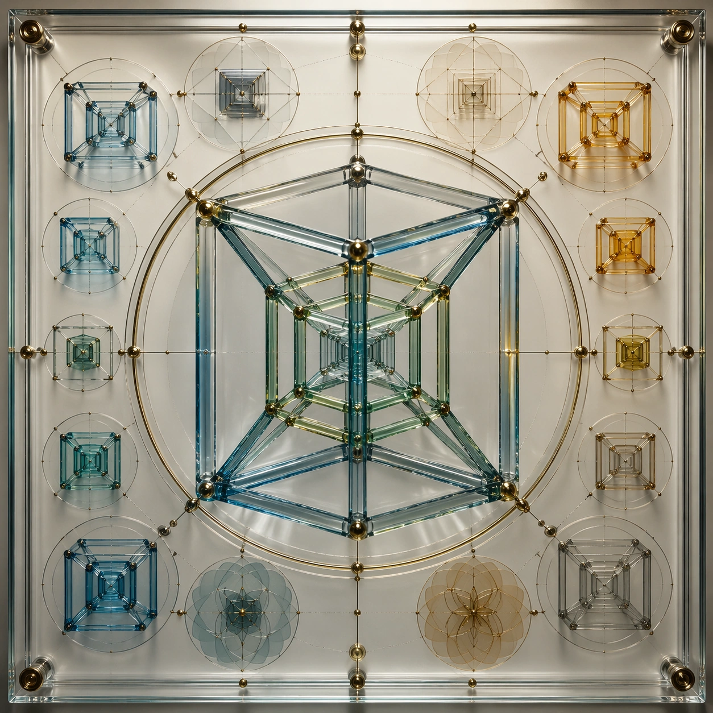

```text
Scene:
Create a square art-science image that presents a tesseract projection with the clarity of a premium museum plate. The camera should remain frontal and calm, while lighting, materials, or color systems help distinguish nested cubes, edge depth, and rotational phase relationships without turning the composition into a generic user interface. Use layered glass or acrylic surfaces with quiet reflections and a laboratory-display mood. Keep the square crop exact, the camera flat, and the tonal design disciplined enough that structure stays clear at poster scale and under close inspection.

Subject:
Use a tesseract or closely related hypercube projection as the structural centerpiece, with nested cube frames, bridging edges, phase echoes, and disciplined auxiliary diagrams. The geometry should feel reasoned and coherent, so the viewer can understand the higher-dimensional idea through a stable, elegant projection rather than through visual chaos. Focus this variation on a translucent interpretation where the main hypercube is accompanied by smaller phase echoes arranged in disciplined symmetry. The composition should feel complete and singular, as though one finished artifact has been resolved with full conviction rather than one fragment pulled from a larger sheet.

Important details:
Edge count, hierarchy, and spacing matter more than flashy effects. Keep the central projection readable, preserve clean line convergence, and let any supporting phase views, orbit traces, or cutaway layers clarify the concept. Use contrast and color coding only where they make the dimensional relationships more legible. Keep every auxiliary phase view geometrically related to the main form, with consistent scale logic and minimal glare. Preserve crisp edge behavior, stable hierarchy, and enough fine information that the image rewards slow viewing without losing the main read from a distance.

Use case:
4D Hypercube single study 2/9, designed as a self-contained sacred-geometry image with a distinct material and compositional emphasis.

Constraints:
No readable text, no watermark, no logos, preserve exact 1:1 aspect ratio, no impossible cube tangles, no random gaming HUD elements, no readable labels, no warped perspective, no soft glow hiding edge logic, no generic sci-fi cockpit styling, no perspective skew, no hologram clutter, no rainbow artifacting.
```

[Pinned source](https://github.com/ChaosRealmsAI/gpt-image-2-gallery/blob/5296db8c996e38776c83a0bc8c64f848dcd512b3/works/topics/4d-hypercube-projection-poster/packages/single-hypercube-projection-studies/images/02-glass-phase-array/meta.json) · GPT Image2 · 1254×1254 · No source-declared image dependencies. · ProjectD:pending individual review.

## Wireframe Orbit Sheet · 4d-hypercube-projection-poster/single-hypercube-projection-studies/03-wireframe-orbit-sheet

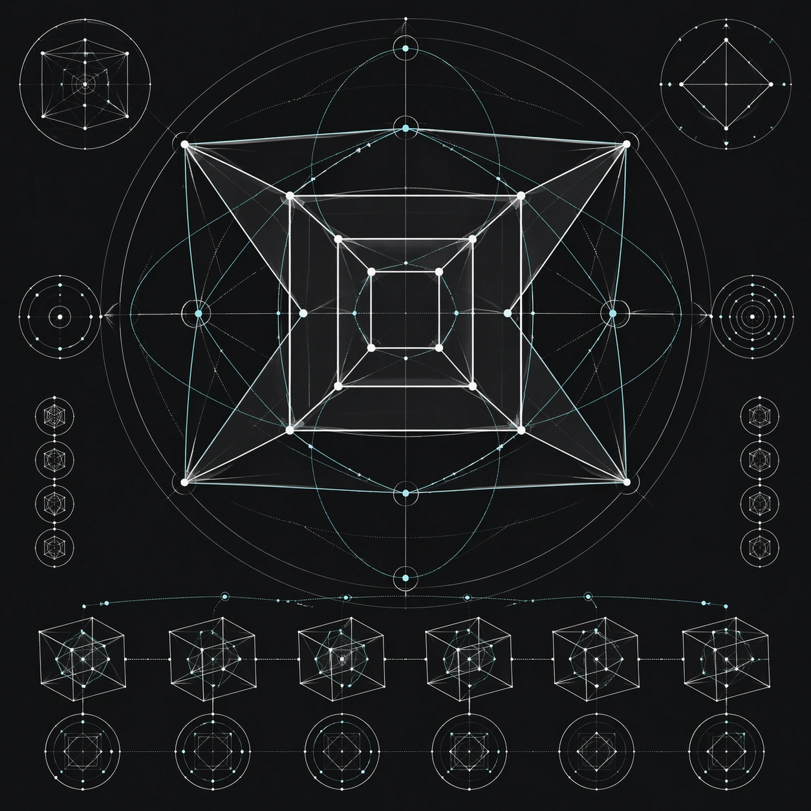

```text
Scene:
Create a square art-science image that presents a tesseract projection with the clarity of a premium museum plate. The camera should remain frontal and calm, while lighting, materials, or color systems help distinguish nested cubes, edge depth, and rotational phase relationships without turning the composition into a generic user interface. Render it as a dark technical sheet with thin white lines, pale cyan accents, and absolute frontal stability. Keep the square crop exact, the camera flat, and the tonal design disciplined enough that structure stays clear at poster scale and under close inspection.

Subject:
Use a tesseract or closely related hypercube projection as the structural centerpiece, with nested cube frames, bridging edges, phase echoes, and disciplined auxiliary diagrams. The geometry should feel reasoned and coherent, so the viewer can understand the higher-dimensional idea through a stable, elegant projection rather than through visual chaos. Focus this variation on a sparse wireframe plate that uses orbit-like arcs and edge weights to explain rotation through the fourth dimension. The composition should feel complete and singular, as though one finished artifact has been resolved with full conviction rather than one fragment pulled from a larger sheet.

Important details:
Edge count, hierarchy, and spacing matter more than flashy effects. Keep the central projection readable, preserve clean line convergence, and let any supporting phase views, orbit traces, or cutaway layers clarify the concept. Use contrast and color coding only where they make the dimensional relationships more legible. The orbits must complement the cube logic, and the line weight hierarchy should clearly separate primary edges from supporting traces. Preserve crisp edge behavior, stable hierarchy, and enough fine information that the image rewards slow viewing without losing the main read from a distance.

Use case:
4D Hypercube single study 3/9, designed as a self-contained sacred-geometry image with a distinct material and compositional emphasis.

Constraints:
No readable text, no watermark, no logos, preserve exact 1:1 aspect ratio, no impossible cube tangles, no random gaming HUD elements, no readable labels, no warped perspective, no soft glow hiding edge logic, no generic sci-fi cockpit styling, no starfield wallpaper, no hand-drawn wobble, no unreadable overlaps.
```

[Pinned source](https://github.com/ChaosRealmsAI/gpt-image-2-gallery/blob/5296db8c996e38776c83a0bc8c64f848dcd512b3/works/topics/4d-hypercube-projection-poster/packages/single-hypercube-projection-studies/images/03-wireframe-orbit-sheet/meta.json) · GPT Image2 · 1254×1254 · No source-declared image dependencies. · ProjectD:pending individual review.

## Chalkboard Rotation Proof · 4d-hypercube-projection-poster/single-hypercube-projection-studies/04-chalkboard-rotation-proof

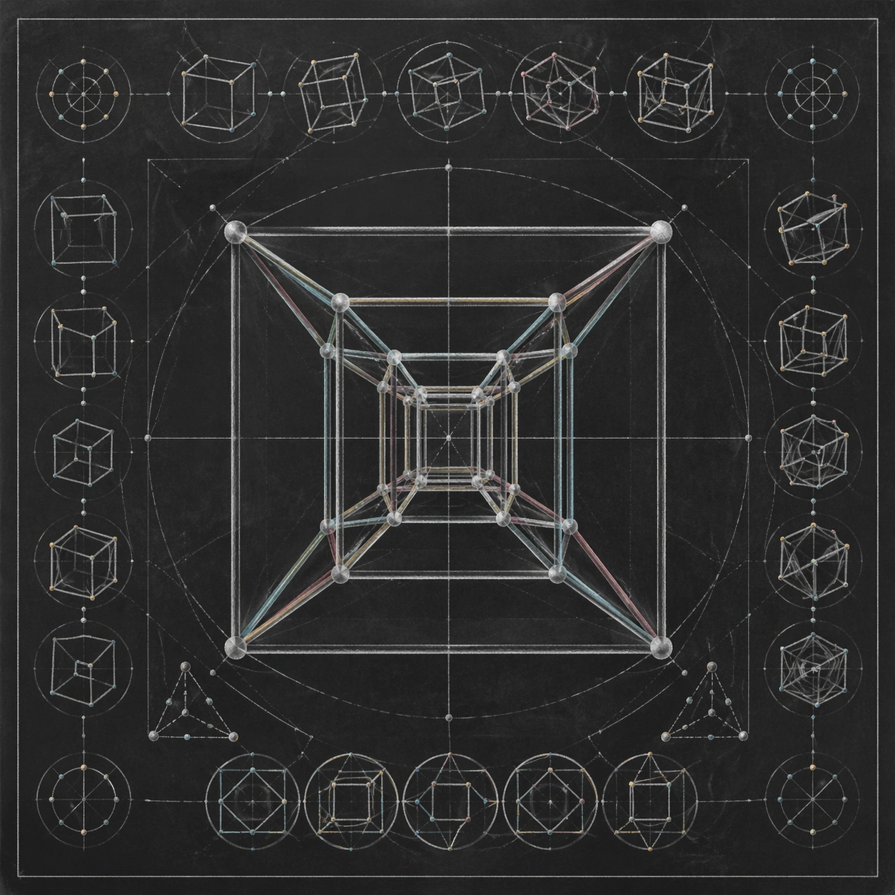

```text
Scene:
Create a square art-science image that presents a tesseract projection with the clarity of a premium museum plate. The camera should remain frontal and calm, while lighting, materials, or color systems help distinguish nested cubes, edge depth, and rotational phase relationships without turning the composition into a generic user interface. Present it like a pristine teaching board made for experts, not a messy classroom surface. Keep the square crop exact, the camera flat, and the tonal design disciplined enough that structure stays clear at poster scale and under close inspection.

Subject:
Use a tesseract or closely related hypercube projection as the structural centerpiece, with nested cube frames, bridging edges, phase echoes, and disciplined auxiliary diagrams. The geometry should feel reasoned and coherent, so the viewer can understand the higher-dimensional idea through a stable, elegant projection rather than through visual chaos. Focus this variation on a graphite-and-chalk study where the hypercube appears alongside exact phase snapshots and construction arcs. The composition should feel complete and singular, as though one finished artifact has been resolved with full conviction rather than one fragment pulled from a larger sheet.

Important details:
Edge count, hierarchy, and spacing matter more than flashy effects. Keep the central projection readable, preserve clean line convergence, and let any supporting phase views, orbit traces, or cutaway layers clarify the concept. Use contrast and color coding only where they make the dimensional relationships more legible. Use chalk dust sparingly and keep the nested cubes, edge bridges, and phase miniatures sharp enough to inspect analytically. Preserve crisp edge behavior, stable hierarchy, and enough fine information that the image rewards slow viewing without losing the main read from a distance.

Use case:
4D Hypercube single study 4/9, designed as a self-contained sacred-geometry image with a distinct material and compositional emphasis.

Constraints:
No readable text, no watermark, no logos, preserve exact 1:1 aspect ratio, no impossible cube tangles, no random gaming HUD elements, no readable labels, no warped perspective, no soft glow hiding edge logic, no generic sci-fi cockpit styling, no readable equations, no smudged erasures, no casual doodles.
```

[Pinned source](https://github.com/ChaosRealmsAI/gpt-image-2-gallery/blob/5296db8c996e38776c83a0bc8c64f848dcd512b3/works/topics/4d-hypercube-projection-poster/packages/single-hypercube-projection-studies/images/04-chalkboard-rotation-proof/meta.json) · GPT Image2 · 1254×1254 · No source-declared image dependencies. · ProjectD:pending individual review.

## Neon Depth Study · 4d-hypercube-projection-poster/single-hypercube-projection-studies/05-neon-depth-study

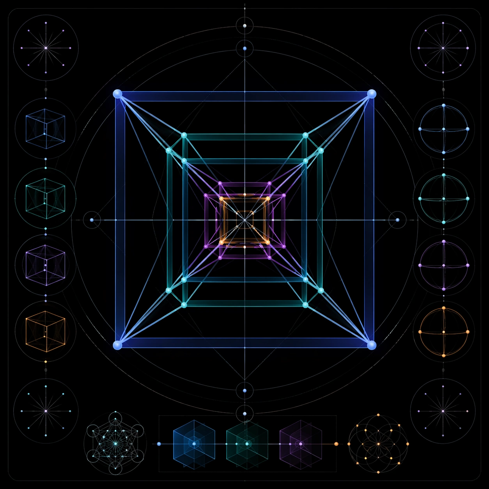

```text
Scene:
Create a square art-science image that presents a tesseract projection with the clarity of a premium museum plate. The camera should remain frontal and calm, while lighting, materials, or color systems help distinguish nested cubes, edge depth, and rotational phase relationships without turning the composition into a generic user interface. Keep the image elegant and severe, with a black field and only a few calibrated luminous colors. Keep the square crop exact, the camera flat, and the tonal design disciplined enough that structure stays clear at poster scale and under close inspection.

Subject:
Use a tesseract or closely related hypercube projection as the structural centerpiece, with nested cube frames, bridging edges, phase echoes, and disciplined auxiliary diagrams. The geometry should feel reasoned and coherent, so the viewer can understand the higher-dimensional idea through a stable, elegant projection rather than through visual chaos. Focus this variation on a darker luminous variation where color coding suggests depth layers across the projected hypercube. The composition should feel complete and singular, as though one finished artifact has been resolved with full conviction rather than one fragment pulled from a larger sheet.

Important details:
Edge count, hierarchy, and spacing matter more than flashy effects. Keep the central projection readable, preserve clean line convergence, and let any supporting phase views, orbit traces, or cutaway layers clarify the concept. Use contrast and color coding only where they make the dimensional relationships more legible. Depth cues should follow the true nested-cube structure rather than arbitrary decorative gradients. Preserve crisp edge behavior, stable hierarchy, and enough fine information that the image rewards slow viewing without losing the main read from a distance.

Use case:
4D Hypercube single study 5/9, designed as a self-contained sacred-geometry image with a distinct material and compositional emphasis.

Constraints:
No readable text, no watermark, no logos, preserve exact 1:1 aspect ratio, no impossible cube tangles, no random gaming HUD elements, no readable labels, no warped perspective, no soft glow hiding edge logic, no generic sci-fi cockpit styling, no nightclub palette chaos, no blooming glow clouds, no broken edge continuity.
```

[Pinned source](https://github.com/ChaosRealmsAI/gpt-image-2-gallery/blob/5296db8c996e38776c83a0bc8c64f848dcd512b3/works/topics/4d-hypercube-projection-poster/packages/single-hypercube-projection-studies/images/05-neon-depth-study/meta.json) · GPT Image2 · 1254×1254 · No source-declared image dependencies. · ProjectD:pending individual review.

## Bronze Engraving Poster · 4d-hypercube-projection-poster/single-hypercube-projection-studies/06-bronze-engraving-poster

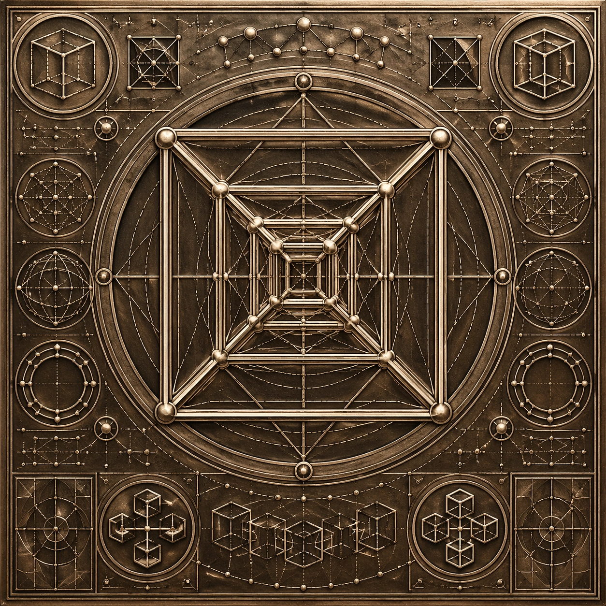

```text
Scene:
Create a square art-science image that presents a tesseract projection with the clarity of a premium museum plate. The camera should remain frontal and calm, while lighting, materials, or color systems help distinguish nested cubes, edge depth, and rotational phase relationships without turning the composition into a generic user interface. Render it as a conserved metal engraving viewed directly from above, with rich browns and pale highlights. Keep the square crop exact, the camera flat, and the tonal design disciplined enough that structure stays clear at poster scale and under close inspection.

Subject:
Use a tesseract or closely related hypercube projection as the structural centerpiece, with nested cube frames, bridging edges, phase echoes, and disciplined auxiliary diagrams. The geometry should feel reasoned and coherent, so the viewer can understand the higher-dimensional idea through a stable, elegant projection rather than through visual chaos. Focus this variation on a warm engraved version where the tesseract and its phase rings feel like a historic scientific plate. The composition should feel complete and singular, as though one finished artifact has been resolved with full conviction rather than one fragment pulled from a larger sheet.

Important details:
Edge count, hierarchy, and spacing matter more than flashy effects. Keep the central projection readable, preserve clean line convergence, and let any supporting phase views, orbit traces, or cutaway layers clarify the concept. Use contrast and color coding only where they make the dimensional relationships more legible. Use etched depth, measured stippling, and exact edge repetition to make the high-dimensional structure feel archival and precise. Preserve crisp edge behavior, stable hierarchy, and enough fine information that the image rewards slow viewing without losing the main read from a distance.

Use case:
4D Hypercube single study 6/9, designed as a self-contained sacred-geometry image with a distinct material and compositional emphasis.

Constraints:
No readable text, no watermark, no logos, preserve exact 1:1 aspect ratio, no impossible cube tangles, no random gaming HUD elements, no readable labels, no warped perspective, no soft glow hiding edge logic, no generic sci-fi cockpit styling, no rust damage, no decorative Victorian clutter, no readable captions.
```

[Pinned source](https://github.com/ChaosRealmsAI/gpt-image-2-gallery/blob/5296db8c996e38776c83a0bc8c64f848dcd512b3/works/topics/4d-hypercube-projection-poster/packages/single-hypercube-projection-studies/images/06-bronze-engraving-poster/meta.json) · GPT Image2 · 1254×1254 · No source-declared image dependencies. · ProjectD:pending individual review.

## Celestial Shadow Cube · 4d-hypercube-projection-poster/single-hypercube-projection-studies/07-celestial-shadow-cube

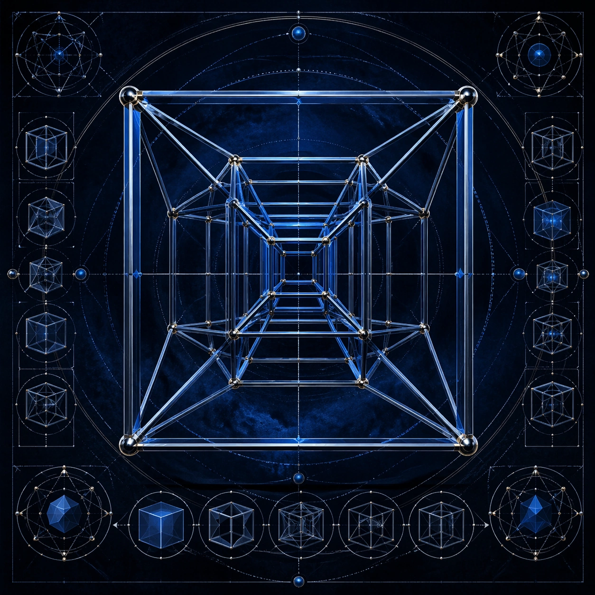

```text
Scene:
Create a square art-science image that presents a tesseract projection with the clarity of a premium museum plate. The camera should remain frontal and calm, while lighting, materials, or color systems help distinguish nested cubes, edge depth, and rotational phase relationships without turning the composition into a generic user interface. Keep the mood atmospheric but the geometry strict, as if a scientific object were lit inside a silent observatory. Keep the square crop exact, the camera flat, and the tonal design disciplined enough that structure stays clear at poster scale and under close inspection.

Subject:
Use a tesseract or closely related hypercube projection as the structural centerpiece, with nested cube frames, bridging edges, phase echoes, and disciplined auxiliary diagrams. The geometry should feel reasoned and coherent, so the viewer can understand the higher-dimensional idea through a stable, elegant projection rather than through visual chaos. Focus this variation on a moody blue-black study where the tesseract casts carefully layered shadows through a cosmic yet disciplined field. The composition should feel complete and singular, as though one finished artifact has been resolved with full conviction rather than one fragment pulled from a larger sheet.

Important details:
Edge count, hierarchy, and spacing matter more than flashy effects. Keep the central projection readable, preserve clean line convergence, and let any supporting phase views, orbit traces, or cutaway layers clarify the concept. Use contrast and color coding only where they make the dimensional relationships more legible. Shadows must reinforce nested volume relationships and never blur the actual edge count or cube hierarchy. Preserve crisp edge behavior, stable hierarchy, and enough fine information that the image rewards slow viewing without losing the main read from a distance.

Use case:
4D Hypercube single study 7/9, designed as a self-contained sacred-geometry image with a distinct material and compositional emphasis.

Constraints:
No readable text, no watermark, no logos, preserve exact 1:1 aspect ratio, no impossible cube tangles, no random gaming HUD elements, no readable labels, no warped perspective, no soft glow hiding edge logic, no generic sci-fi cockpit styling, no drifting haze, no cinematic action effects, no star clutter obscuring structure.
```

[Pinned source](https://github.com/ChaosRealmsAI/gpt-image-2-gallery/blob/5296db8c996e38776c83a0bc8c64f848dcd512b3/works/topics/4d-hypercube-projection-poster/packages/single-hypercube-projection-studies/images/07-celestial-shadow-cube/meta.json) · GPT Image2 · 1254×1254 · No source-declared image dependencies. · ProjectD:pending individual review.

## Transparent Acrylic Model · 4d-hypercube-projection-poster/single-hypercube-projection-studies/08-transparent-acrylic-model

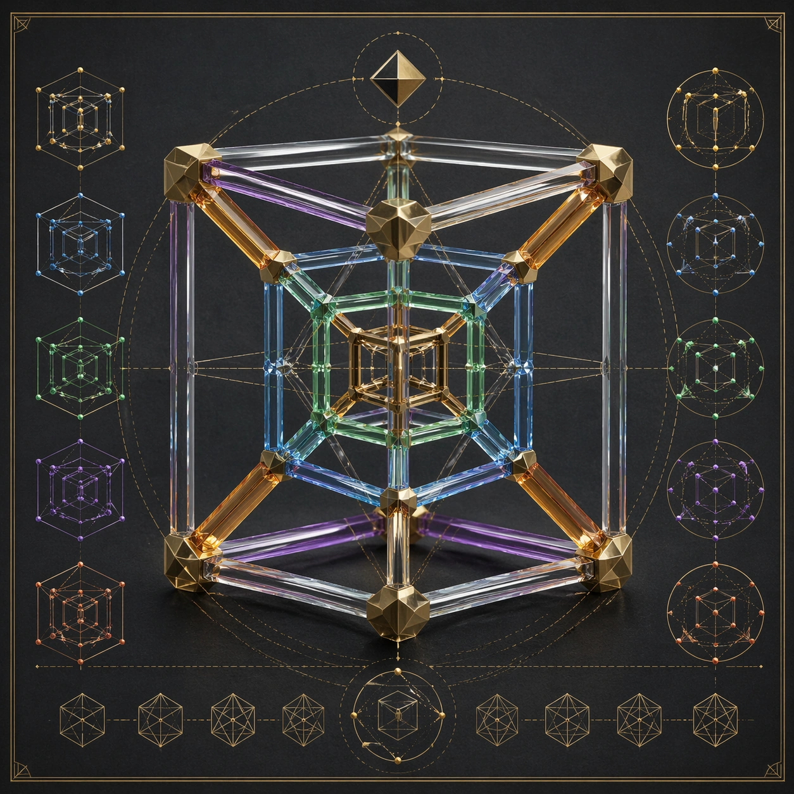

```text
Scene:
Create a square art-science image that presents a tesseract projection with the clarity of a premium museum plate. The camera should remain frontal and calm, while lighting, materials, or color systems help distinguish nested cubes, edge depth, and rotational phase relationships without turning the composition into a generic user interface. Present it as a clean studio object shot with frontal alignment and restrained reflections. Keep the square crop exact, the camera flat, and the tonal design disciplined enough that structure stays clear at poster scale and under close inspection.

Subject:
Use a tesseract or closely related hypercube projection as the structural centerpiece, with nested cube frames, bridging edges, phase echoes, and disciplined auxiliary diagrams. The geometry should feel reasoned and coherent, so the viewer can understand the higher-dimensional idea through a stable, elegant projection rather than through visual chaos. Focus this variation on a product-like study of a transparent physical hypercube model aligned with subtle projection guides. The composition should feel complete and singular, as though one finished artifact has been resolved with full conviction rather than one fragment pulled from a larger sheet.

Important details:
Edge count, hierarchy, and spacing matter more than flashy effects. Keep the central projection readable, preserve clean line convergence, and let any supporting phase views, orbit traces, or cutaway layers clarify the concept. Use contrast and color coding only where they make the dimensional relationships more legible. The physical material can reveal depth, but the underlying tesseract logic must remain the dominant reading of the image. Preserve crisp edge behavior, stable hierarchy, and enough fine information that the image rewards slow viewing without losing the main read from a distance.

Use case:
4D Hypercube single study 8/9, designed as a self-contained sacred-geometry image with a distinct material and compositional emphasis.

Constraints:
No readable text, no watermark, no logos, preserve exact 1:1 aspect ratio, no impossible cube tangles, no random gaming HUD elements, no readable labels, no warped perspective, no soft glow hiding edge logic, no generic sci-fi cockpit styling, no tabletop clutter, no perspective camera angle, no plastic toy styling.
```

[Pinned source](https://github.com/ChaosRealmsAI/gpt-image-2-gallery/blob/5296db8c996e38776c83a0bc8c64f848dcd512b3/works/topics/4d-hypercube-projection-poster/packages/single-hypercube-projection-studies/images/08-transparent-acrylic-model/meta.json) · GPT Image2 · 1254×1254 · No source-declared image dependencies. · ProjectD:pending individual review.

## Monochrome Index Plate · 4d-hypercube-projection-poster/single-hypercube-projection-studies/09-monochrome-index-plate

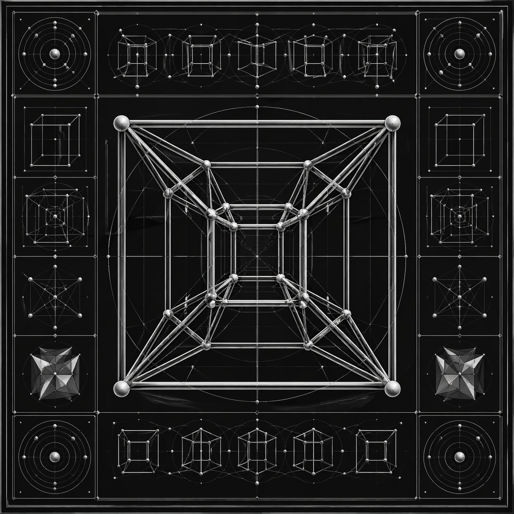

```text
Scene:
Create a square art-science image that presents a tesseract projection with the clarity of a premium museum plate. The camera should remain frontal and calm, while lighting, materials, or color systems help distinguish nested cubes, edge depth, and rotational phase relationships without turning the composition into a generic user interface. Use black, white, and muted grey only, creating a severe museum-archive tone. Keep the square crop exact, the camera flat, and the tonal design disciplined enough that structure stays clear at poster scale and under close inspection.

Subject:
Use a tesseract or closely related hypercube projection as the structural centerpiece, with nested cube frames, bridging edges, phase echoes, and disciplined auxiliary diagrams. The geometry should feel reasoned and coherent, so the viewer can understand the higher-dimensional idea through a stable, elegant projection rather than through visual chaos. Focus this variation on a monochrome master sheet that emphasizes edge count, nested frame spacing, and quiet intellectual drama. The composition should feel complete and singular, as though one finished artifact has been resolved with full conviction rather than one fragment pulled from a larger sheet.

Important details:
Edge count, hierarchy, and spacing matter more than flashy effects. Keep the central projection readable, preserve clean line convergence, and let any supporting phase views, orbit traces, or cutaway layers clarify the concept. Use contrast and color coding only where they make the dimensional relationships more legible. Let the severe palette highlight precision; every bridge edge, inner cube, and auxiliary guide should feel intentionally placed. Preserve crisp edge behavior, stable hierarchy, and enough fine information that the image rewards slow viewing without losing the main read from a distance.

Use case:
4D Hypercube single study 9/9, designed as a self-contained sacred-geometry image with a distinct material and compositional emphasis.

Constraints:
No readable text, no watermark, no logos, preserve exact 1:1 aspect ratio, no impossible cube tangles, no random gaming HUD elements, no readable labels, no warped perspective, no soft glow hiding edge logic, no generic sci-fi cockpit styling, no decorative texture noise, no poster fold damage, no casual sketch looseness.
```

[Pinned source](https://github.com/ChaosRealmsAI/gpt-image-2-gallery/blob/5296db8c996e38776c83a0bc8c64f848dcd512b3/works/topics/4d-hypercube-projection-poster/packages/single-hypercube-projection-studies/images/09-monochrome-index-plate/meta.json) · GPT Image2 · 1254×1254 · No source-declared image dependencies. · ProjectD:pending individual review.

## Color Field Threshold · abstract-expressionism-study/single-abstract-expressionism-studies/color-field-threshold

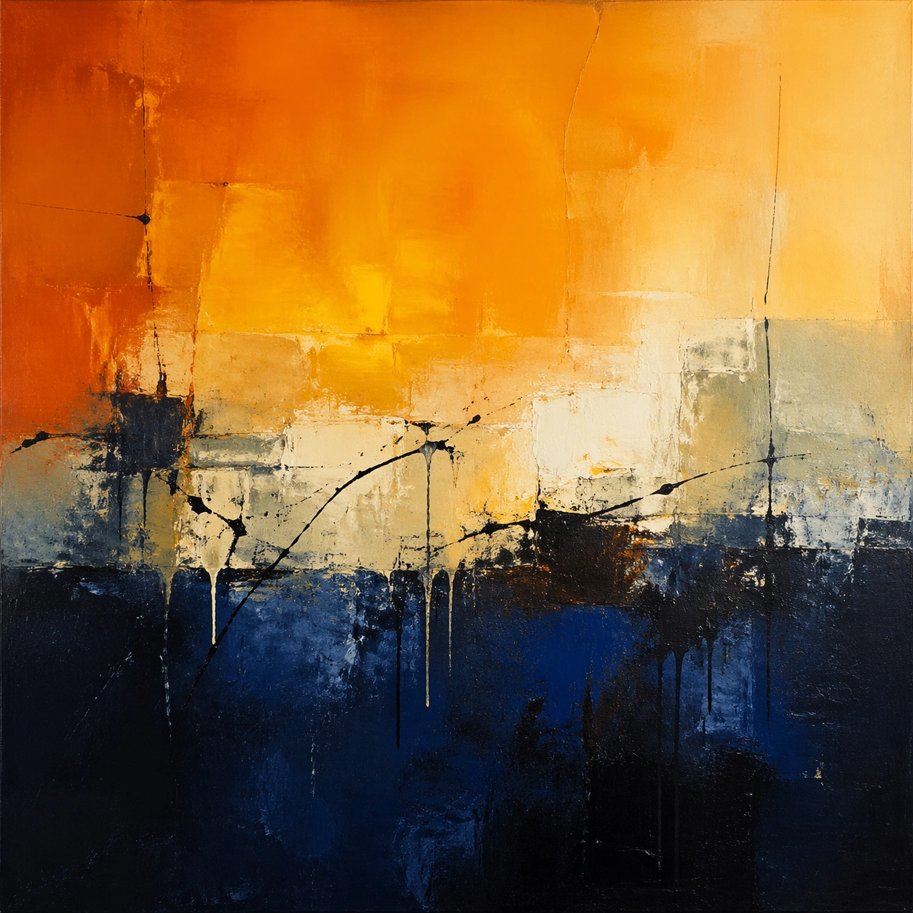

```text
Scene:
A square, gallery-ready composition with painterly surfaces, controlled negative space, and a deliberate fine-art presentation. Build the frame around a few dominant blocks or atmospheres of color with slow transitions and emotional weight. Keep the lighting, camera distance, and spatial organization tuned for a high-signal research image rather than a casual snapshot. The image belongs to the Abstract Expressionism Study theme and should feel immediately legible as a prompt atlas theme for abstract expressionism study, testing style-transfer with gpt image 2..

Subject:
Center the study on a few dominant blocks or atmospheres of color with slow transitions and emotional weight. Translate the theme into a concrete visual statement instead of an abstract mood board: the viewer should understand what kind of image this is, what is being tested, and why the composition is difficult. Use the slug idea of abstract expressionism study as a literal guide for subject matter, materials, and staging. If helpful, borrow the broad visual cues suggested by Pollock, Rothko, de Kooning, Kline, but keep the result original and specific to this study.

Important details:
Focus on authored mark-making, hierarchy, rhythm, and a visual idea that reads immediately before the viewer inspects the brushwork. Preserve a disciplined square composition, clear focal hierarchy, and enough secondary information to make the image feel complete rather than underspecified. The image should look polished, novel, and exhibition-ready, with topic-specific credibility coming from the way surfaces, structure, and visual language reinforce Abstract Expressionism Study. Avoid generic filler elements that do not serve the main concept.

Use case:
Abstract Expressionism Study single study 2/8, testing style-transfer through the color field threshold variation.

Constraints:
No readable text, no watermark, no logos, preserve exact 1:1 aspect ratio, no direct copy of a known artwork, no comic speech bubbles, no accidental typography, no low-effort doodle energy, no muddy center, no fake museum label.
```

[Pinned source](https://github.com/ChaosRealmsAI/gpt-image-2-gallery/blob/5296db8c996e38776c83a0bc8c64f848dcd512b3/works/topics/abstract-expressionism-study/packages/single-abstract-expressionism-studies/images/color-field-threshold/meta.json) · GPT Image2 · 1254×1254 · No source-declared image dependencies. · ProjectD:pending individual review.

## Fractured Figure Surge · abstract-expressionism-study/single-abstract-expressionism-studies/fractured-figure-surge

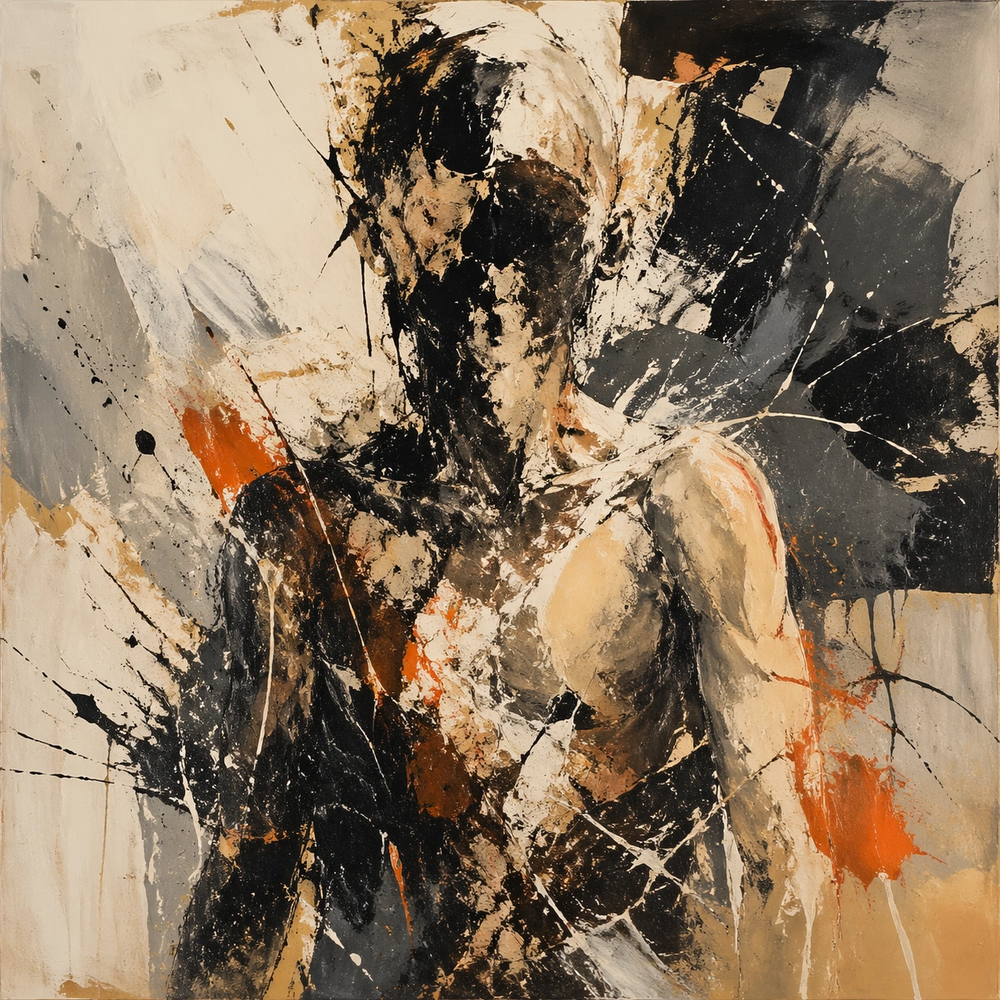

```text
Scene:
A square, gallery-ready composition with painterly surfaces, controlled negative space, and a deliberate fine-art presentation. Build the frame around a figure-like presence that emerges and dissolves through broken strokes and unstable edges. Keep the lighting, camera distance, and spatial organization tuned for a high-signal research image rather than a casual snapshot. The image belongs to the Abstract Expressionism Study theme and should feel immediately legible as a prompt atlas theme for abstract expressionism study, testing style-transfer with gpt image 2..

Subject:
Center the study on a figure-like presence that emerges and dissolves through broken strokes and unstable edges. Translate the theme into a concrete visual statement instead of an abstract mood board: the viewer should understand what kind of image this is, what is being tested, and why the composition is difficult. Use the slug idea of abstract expressionism study as a literal guide for subject matter, materials, and staging. If helpful, borrow the broad visual cues suggested by Pollock, Rothko, de Kooning, Kline, but keep the result original and specific to this study.

Important details:
Focus on authored mark-making, hierarchy, rhythm, and a visual idea that reads immediately before the viewer inspects the brushwork. Preserve a disciplined square composition, clear focal hierarchy, and enough secondary information to make the image feel complete rather than underspecified. The image should look polished, novel, and exhibition-ready, with topic-specific credibility coming from the way surfaces, structure, and visual language reinforce Abstract Expressionism Study. Avoid generic filler elements that do not serve the main concept.

Use case:
Abstract Expressionism Study single study 3/8, testing style-transfer through the fractured figure surge variation.

Constraints:
No readable text, no watermark, no logos, preserve exact 1:1 aspect ratio, no direct copy of a known artwork, no comic speech bubbles, no accidental typography, no low-effort doodle energy, no muddy center, no fake museum label.
```

[Pinned source](https://github.com/ChaosRealmsAI/gpt-image-2-gallery/blob/5296db8c996e38776c83a0bc8c64f848dcd512b3/works/topics/abstract-expressionism-study/packages/single-abstract-expressionism-studies/images/fractured-figure-surge/meta.json) · GPT Image2 · 1254×1254 · No source-declared image dependencies. · ProjectD:pending individual review.

## Black Brush Choir · abstract-expressionism-study/single-abstract-expressionism-studies/black-brush-choir

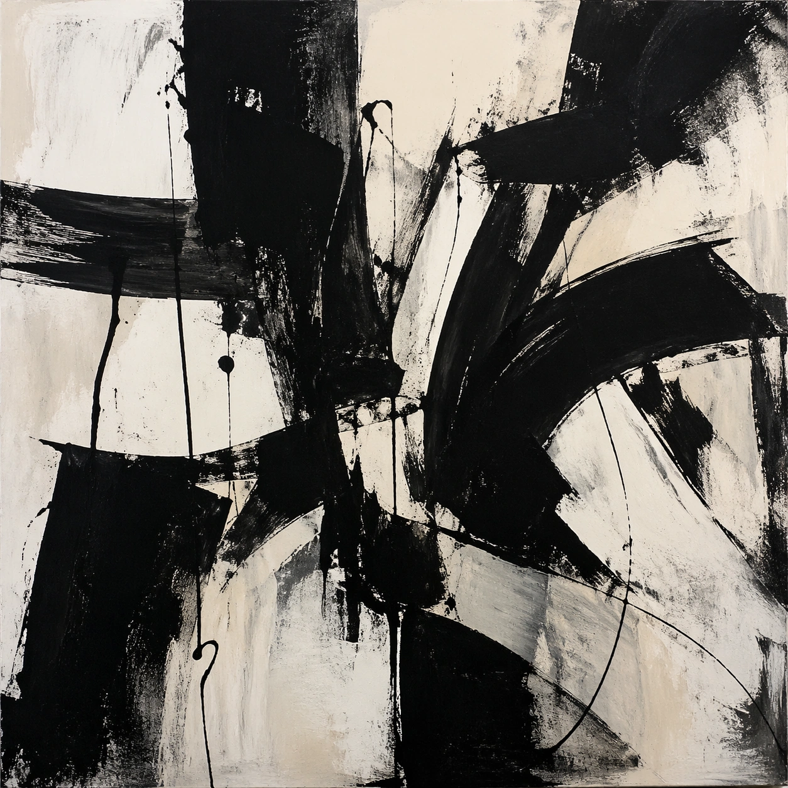

```text
Scene:
A square, gallery-ready composition with painterly surfaces, controlled negative space, and a deliberate fine-art presentation. Build the frame around large decisive black gestures that create rhythm, tension, and architectural pressure. Keep the lighting, camera distance, and spatial organization tuned for a high-signal research image rather than a casual snapshot. The image belongs to the Abstract Expressionism Study theme and should feel immediately legible as a prompt atlas theme for abstract expressionism study, testing style-transfer with gpt image 2..

Subject:
Center the study on large decisive black gestures that create rhythm, tension, and architectural pressure. Translate the theme into a concrete visual statement instead of an abstract mood board: the viewer should understand what kind of image this is, what is being tested, and why the composition is difficult. Use the slug idea of abstract expressionism study as a literal guide for subject matter, materials, and staging. If helpful, borrow the broad visual cues suggested by Pollock, Rothko, de Kooning, Kline, but keep the result original and specific to this study.

Important details:
Focus on authored mark-making, hierarchy, rhythm, and a visual idea that reads immediately before the viewer inspects the brushwork. Preserve a disciplined square composition, clear focal hierarchy, and enough secondary information to make the image feel complete rather than underspecified. The image should look polished, novel, and exhibition-ready, with topic-specific credibility coming from the way surfaces, structure, and visual language reinforce Abstract Expressionism Study. Avoid generic filler elements that do not serve the main concept.

Use case:
Abstract Expressionism Study single study 4/8, testing style-transfer through the black brush choir variation.

Constraints:
No readable text, no watermark, no logos, preserve exact 1:1 aspect ratio, no direct copy of a known artwork, no comic speech bubbles, no accidental typography, no low-effort doodle energy, no muddy center, no fake museum label.
```

[Pinned source](https://github.com/ChaosRealmsAI/gpt-image-2-gallery/blob/5296db8c996e38776c83a0bc8c64f848dcd512b3/works/topics/abstract-expressionism-study/packages/single-abstract-expressionism-studies/images/black-brush-choir/meta.json) · GPT Image2 · 1254×1254 · No source-declared image dependencies. · ProjectD:pending individual review.

## Studio Floor Afterimage · abstract-expressionism-study/single-abstract-expressionism-studies/studio-floor-afterimage

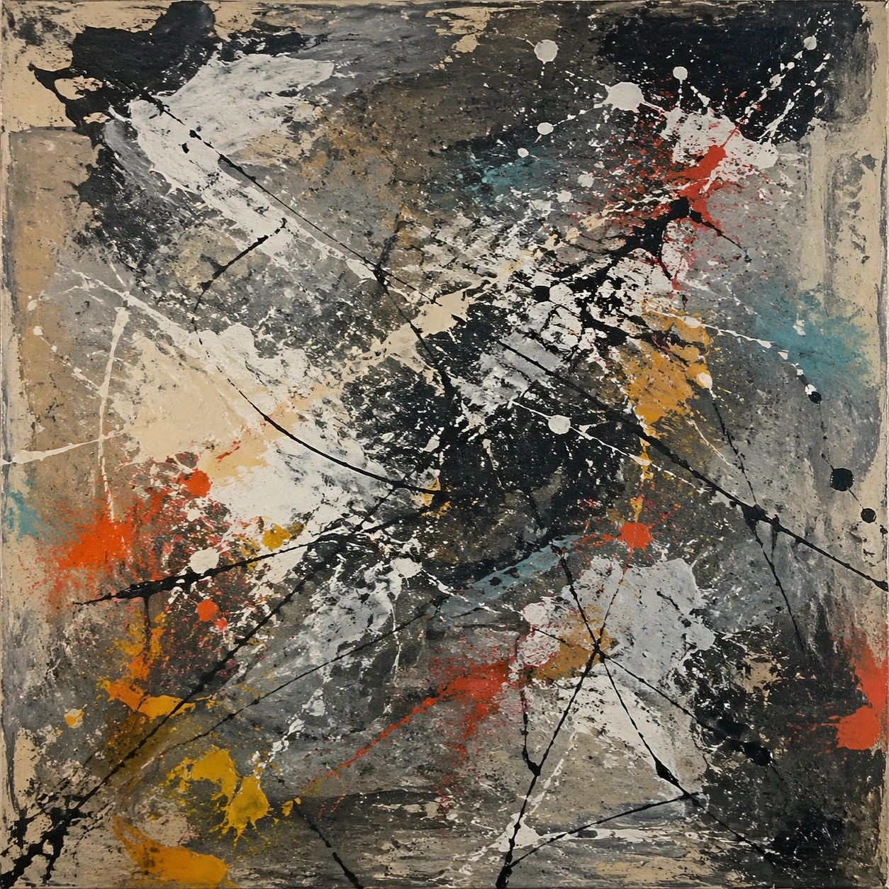

```text
Scene:
A square, gallery-ready composition with painterly surfaces, controlled negative space, and a deliberate fine-art presentation. Build the frame around evidence of process, splatter, drag, and layered correction without becoming documentary clutter. Keep the lighting, camera distance, and spatial organization tuned for a high-signal research image rather than a casual snapshot. The image belongs to the Abstract Expressionism Study theme and should feel immediately legible as a prompt atlas theme for abstract expressionism study, testing style-transfer with gpt image 2..

Subject:
Center the study on evidence of process, splatter, drag, and layered correction without becoming documentary clutter. Translate the theme into a concrete visual statement instead of an abstract mood board: the viewer should understand what kind of image this is, what is being tested, and why the composition is difficult. Use the slug idea of abstract expressionism study as a literal guide for subject matter, materials, and staging. If helpful, borrow the broad visual cues suggested by Pollock, Rothko, de Kooning, Kline, but keep the result original and specific to this study.

Important details:
Focus on authored mark-making, hierarchy, rhythm, and a visual idea that reads immediately before the viewer inspects the brushwork. Preserve a disciplined square composition, clear focal hierarchy, and enough secondary information to make the image feel complete rather than underspecified. The image should look polished, novel, and exhibition-ready, with topic-specific credibility coming from the way surfaces, structure, and visual language reinforce Abstract Expressionism Study. Avoid generic filler elements that do not serve the main concept.

Use case:
Abstract Expressionism Study single study 5/8, testing style-transfer through the studio floor afterimage variation.

Constraints:
No readable text, no watermark, no logos, preserve exact 1:1 aspect ratio, no direct copy of a known artwork, no comic speech bubbles, no accidental typography, no low-effort doodle energy, no muddy center, no fake museum label.
```

[Pinned source](https://github.com/ChaosRealmsAI/gpt-image-2-gallery/blob/5296db8c996e38776c83a0bc8c64f848dcd512b3/works/topics/abstract-expressionism-study/packages/single-abstract-expressionism-studies/images/studio-floor-afterimage/meta.json) · GPT Image2 · 1254×1254 · No source-declared image dependencies. · ProjectD:pending individual review.

## 厚涂天气 · abstract-expressionism-study/single-abstract-expressionism-studies/impasto-weather

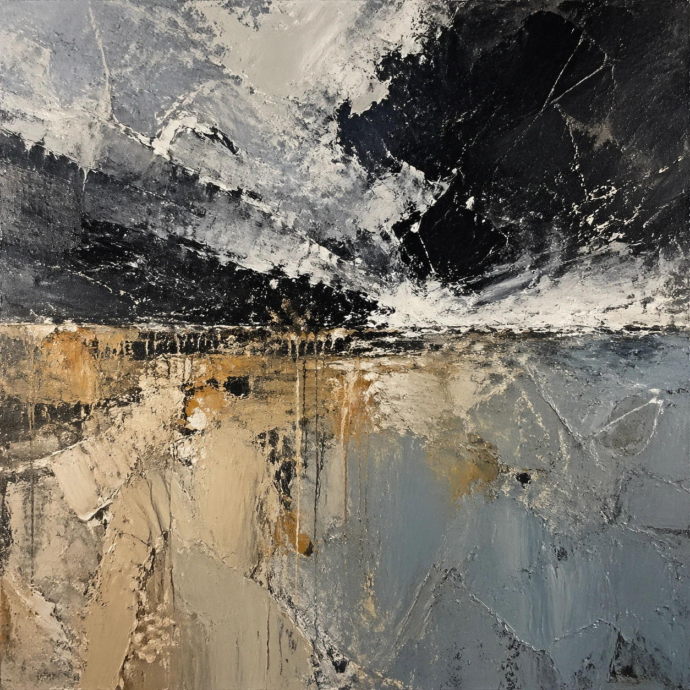

```text
Scene:
A square, gallery-ready composition with painterly surfaces, controlled negative space, and a deliberate fine-art presentation. Build the frame around surface build-up, scrape marks, and thick tactile passages that feel meteorological. Keep the lighting, camera distance, and spatial organization tuned for a high-signal research image rather than a casual snapshot. The image belongs to the Abstract Expressionism Study theme and should feel immediately legible as a prompt atlas theme for abstract expressionism study, testing style-transfer with gpt image 2..

Subject:
Center the study on surface build-up, scrape marks, and thick tactile passages that feel meteorological. Translate the theme into a concrete visual statement instead of an abstract mood board: the viewer should understand what kind of image this is, what is being tested, and why the composition is difficult. Use the slug idea of abstract expressionism study as a literal guide for subject matter, materials, and staging. If helpful, borrow the broad visual cues suggested by Pollock, Rothko, de Kooning, Kline, but keep the result original and specific to this study.

Important details:
Focus on authored mark-making, hierarchy, rhythm, and a visual idea that reads immediately before the viewer inspects the brushwork. Preserve a disciplined square composition, clear focal hierarchy, and enough secondary information to make the image feel complete rather than underspecified. The image should look polished, novel, and exhibition-ready, with topic-specific credibility coming from the way surfaces, structure, and visual language reinforce Abstract Expressionism Study. Avoid generic filler elements that do not serve the main concept.

Use case:
Abstract Expressionism Study single study 6/8, testing style-transfer through the 厚涂天气 variation.

Constraints:
No readable text, no watermark, no logos, preserve exact 1:1 aspect ratio, no direct copy of a known artwork, no comic speech bubbles, no accidental typography, no low-effort doodle energy, no muddy center, no fake museum label.
```

[Pinned source](https://github.com/ChaosRealmsAI/gpt-image-2-gallery/blob/5296db8c996e38776c83a0bc8c64f848dcd512b3/works/topics/abstract-expressionism-study/packages/single-abstract-expressionism-studies/images/impasto-weather/meta.json) · GPT Image2 · 1254×1254 · No source-declared image dependencies. · ProjectD:pending individual review.

## Gesture Architecture · abstract-expressionism-study/single-abstract-expressionism-studies/gesture-architecture

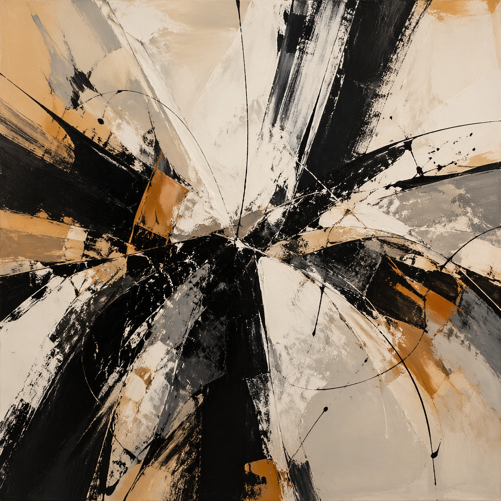

```text
Scene:
A square, gallery-ready composition with painterly surfaces, controlled negative space, and a deliberate fine-art presentation. Build the frame around brush movement that locks into a hidden compositional scaffold rather than random motion. Keep the lighting, camera distance, and spatial organization tuned for a high-signal research image rather than a casual snapshot. The image belongs to the Abstract Expressionism Study theme and should feel immediately legible as a prompt atlas theme for abstract expressionism study, testing style-transfer with gpt image 2..

Subject:
Center the study on brush movement that locks into a hidden compositional scaffold rather than random motion. Translate the theme into a concrete visual statement instead of an abstract mood board: the viewer should understand what kind of image this is, what is being tested, and why the composition is difficult. Use the slug idea of abstract expressionism study as a literal guide for subject matter, materials, and staging. If helpful, borrow the broad visual cues suggested by Pollock, Rothko, de Kooning, Kline, but keep the result original and specific to this study.

Important details:
Focus on authored mark-making, hierarchy, rhythm, and a visual idea that reads immediately before the viewer inspects the brushwork. Preserve a disciplined square composition, clear focal hierarchy, and enough secondary information to make the image feel complete rather than underspecified. The image should look polished, novel, and exhibition-ready, with topic-specific credibility coming from the way surfaces, structure, and visual language reinforce Abstract Expressionism Study. Avoid generic filler elements that do not serve the main concept.

Use case:
Abstract Expressionism Study single study 7/8, testing style-transfer through the gesture architecture variation.

Constraints:
No readable text, no watermark, no logos, preserve exact 1:1 aspect ratio, no direct copy of a known artwork, no comic speech bubbles, no accidental typography, no low-effort doodle energy, no muddy center, no fake museum label.
```

[Pinned source](https://github.com/ChaosRealmsAI/gpt-image-2-gallery/blob/5296db8c996e38776c83a0bc8c64f848dcd512b3/works/topics/abstract-expressionism-study/packages/single-abstract-expressionism-studies/images/gesture-architecture/meta.json) · GPT Image2 · 1254×1254 · No source-declared image dependencies. · ProjectD:pending individual review.

## Museum Wall Hang · abstract-expressionism-study/single-abstract-expressionism-studies/museum-wall-hang

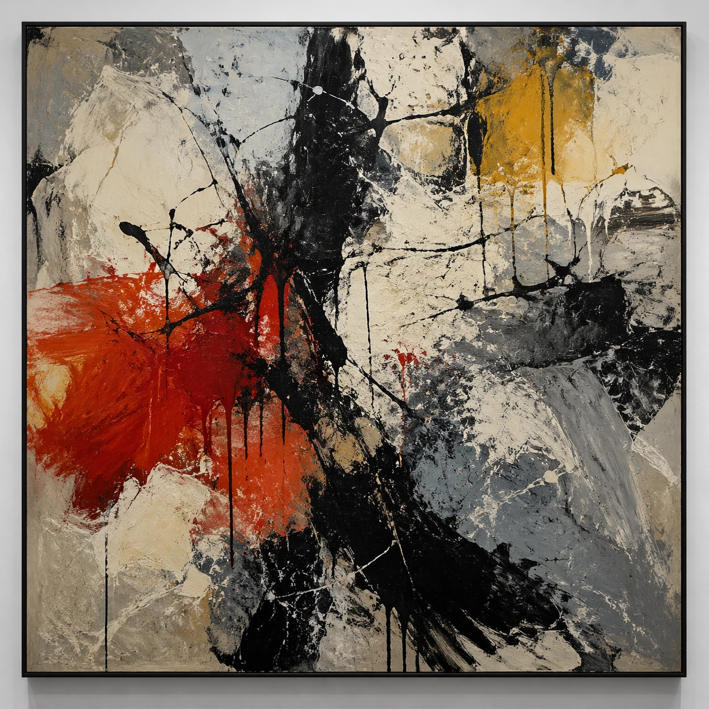

```text
Scene:
A square, gallery-ready composition with painterly surfaces, controlled negative space, and a deliberate fine-art presentation. Build the frame around a resolved exhibition-grade work whose internal balance feels complete and intentional. Keep the lighting, camera distance, and spatial organization tuned for a high-signal research image rather than a casual snapshot. The image belongs to the Abstract Expressionism Study theme and should feel immediately legible as a prompt atlas theme for abstract expressionism study, testing style-transfer with gpt image 2..

Subject:
Center the study on a resolved exhibition-grade work whose internal balance feels complete and intentional. Translate the theme into a concrete visual statement instead of an abstract mood board: the viewer should understand what kind of image this is, what is being tested, and why the composition is difficult. Use the slug idea of abstract expressionism study as a literal guide for subject matter, materials, and staging. If helpful, borrow the broad visual cues suggested by Pollock, Rothko, de Kooning, Kline, but keep the result original and specific to this study.

Important details:
Focus on authored mark-making, hierarchy, rhythm, and a visual idea that reads immediately before the viewer inspects the brushwork. Preserve a disciplined square composition, clear focal hierarchy, and enough secondary information to make the image feel complete rather than underspecified. The image should look polished, novel, and exhibition-ready, with topic-specific credibility coming from the way surfaces, structure, and visual language reinforce Abstract Expressionism Study. Avoid generic filler elements that do not serve the main concept.

Use case:
Abstract Expressionism Study single study 8/8, testing style-transfer through the museum wall hang variation.

Constraints:
No readable text, no watermark, no logos, preserve exact 1:1 aspect ratio, no direct copy of a known artwork, no comic speech bubbles, no accidental typography, no low-effort doodle energy, no muddy center, no fake museum label.
```

[Pinned source](https://github.com/ChaosRealmsAI/gpt-image-2-gallery/blob/5296db8c996e38776c83a0bc8c64f848dcd512b3/works/topics/abstract-expressionism-study/packages/single-abstract-expressionism-studies/images/museum-wall-hang/meta.json) · GPT Image2 · 1254×1254 · No source-declared image dependencies. · ProjectD:pending individual review.

## Reference Anchor · absurd-object-serious-photo-series/series-core-system/01-reference-anchor

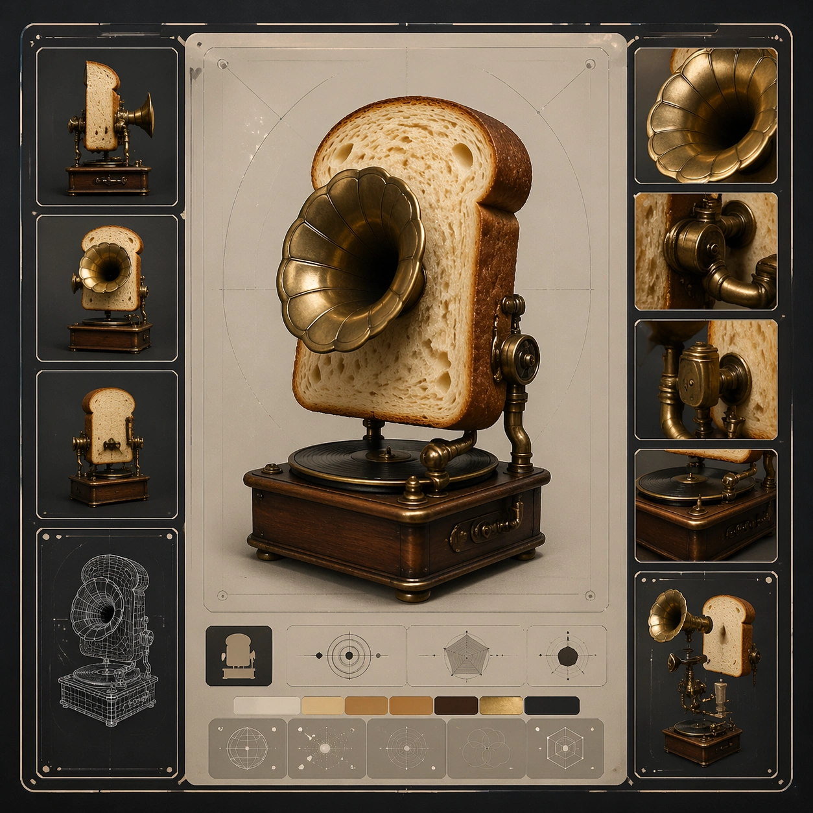

```text
Scene:
Create a square reference image for Absurd Object Serious Photo Series. Build a reference anchor establishing the core system with a premium, production-ready finish. Use a polished modular board or campaign surface with clean spacing, premium game-UI finish, and clear focal hierarchy. The composition should feel intentional, clean, and reusable for gallery, research, campaign, or internal handoff contexts. Lighting must support readability first, with the main forms clearly separated from the background and enough breathing room for the system to stay legible at both hero scale and thumbnail scale.

Subject:
Center a coherent original game-art system built for premium production and marketing surfaces. For this image, focus on reference anchor. Keep the same system logic stable across screenshots, cards, banners, and overview boards. This image is the canonical anchor that later series images must follow. The viewer should immediately understand what role this surface plays inside a cohesive game-production asset pack.

Important details:
Lock framing, icon grammar, palette blocking, and surface hierarchy so the kit feels production-ready and consistent. Preserve the core silhouette, framing language, and material logic from the reference image while each variation changes function. Keep materials believable, edge hierarchy disciplined, and the visual language consistent with Absurd Objects. Use abstract interface blocks or diagram accents when helpful, but avoid any readable language. The final result should feel like a deliberate production asset rather than a random illustration.

Use case:
Absurd Object Serious Photo Series series study 1/9, designed as reference anchor within a cohesive asset pack.

Constraints:
No readable text, no watermark, no logos, preserve exact 1:1 aspect ratio, no unrelated objects, no broken visual hierarchy, no malformed anatomy or broken perspective, no random decorative clutter.
```

[Pinned source](https://github.com/ChaosRealmsAI/gpt-image-2-gallery/blob/5296db8c996e38776c83a0bc8c64f848dcd512b3/works/topics/absurd-object-serious-photo-series/packages/series-core-system/images/01-reference-anchor/meta.json) · GPT Image2 · 1254×1254 · No source-declared image dependencies. · ProjectD:pending individual review.

## Variant One · absurd-object-serious-photo-series/series-core-system/02-variant-one

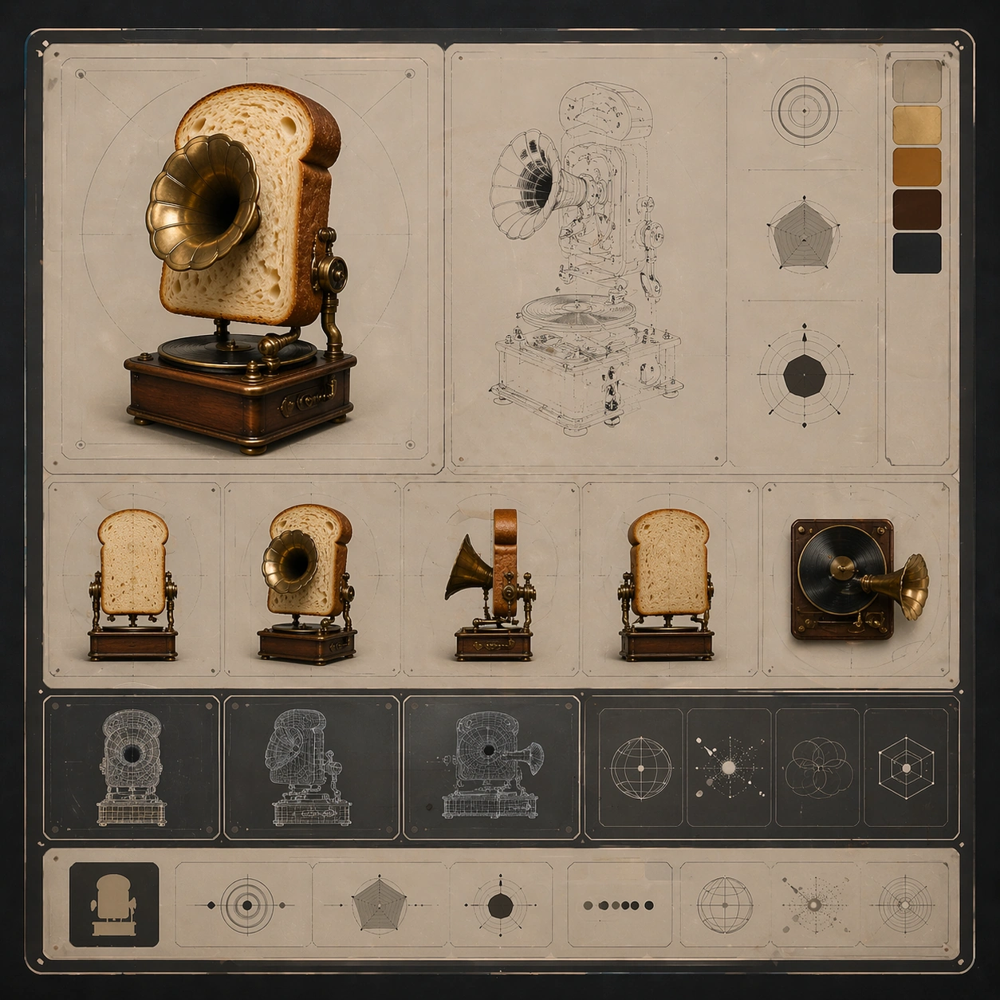

```text
Scene:
Create a square dependent image for Absurd Object Serious Photo Series. Build a first controlled variation in the same system with a premium, production-ready finish. Use a polished modular board or campaign surface with clean spacing, premium game-UI finish, and clear focal hierarchy. The composition should feel intentional, clean, and reusable for gallery, research, campaign, or internal handoff contexts. Lighting must support readability first, with the main forms clearly separated from the background and enough breathing room for the system to stay legible at both hero scale and thumbnail scale.

Subject:
Center a coherent original game-art system built for premium production and marketing surfaces. For this image, focus on the intended support surface. Keep the same system logic stable across screenshots, cards, banners, and overview boards. Preserve exact identity or system logic from the reference image while changing only the intended variation axis. The viewer should immediately understand what role this surface plays inside a cohesive game-production asset pack.

Important details:
Lock framing, icon grammar, palette blocking, and surface hierarchy so the kit feels production-ready and consistent. Preserve the core silhouette, framing language, and material logic from the reference image while each variation changes function. Keep materials believable, edge hierarchy disciplined, and the visual language consistent with Absurd Objects. Use abstract interface blocks or diagram accents when helpful, but avoid any readable language. The final result should feel like a deliberate production asset rather than a random illustration.

Use case:
Absurd Object Serious Photo Series series study 2/9, designed as variant one within a cohesive asset pack.

Constraints:
No readable text, no watermark, no logos, preserve exact 1:1 aspect ratio, no unrelated objects, no broken visual hierarchy, no malformed anatomy or broken perspective, no random decorative clutter.
```

[Pinned source](https://github.com/ChaosRealmsAI/gpt-image-2-gallery/blob/5296db8c996e38776c83a0bc8c64f848dcd512b3/works/topics/absurd-object-serious-photo-series/packages/series-core-system/images/02-variant-one/meta.json) · GPT Image2 · 1254×1254 · Reference images required. · ProjectD:pending individual review.

## Variant Two · absurd-object-serious-photo-series/series-core-system/03-variant-two

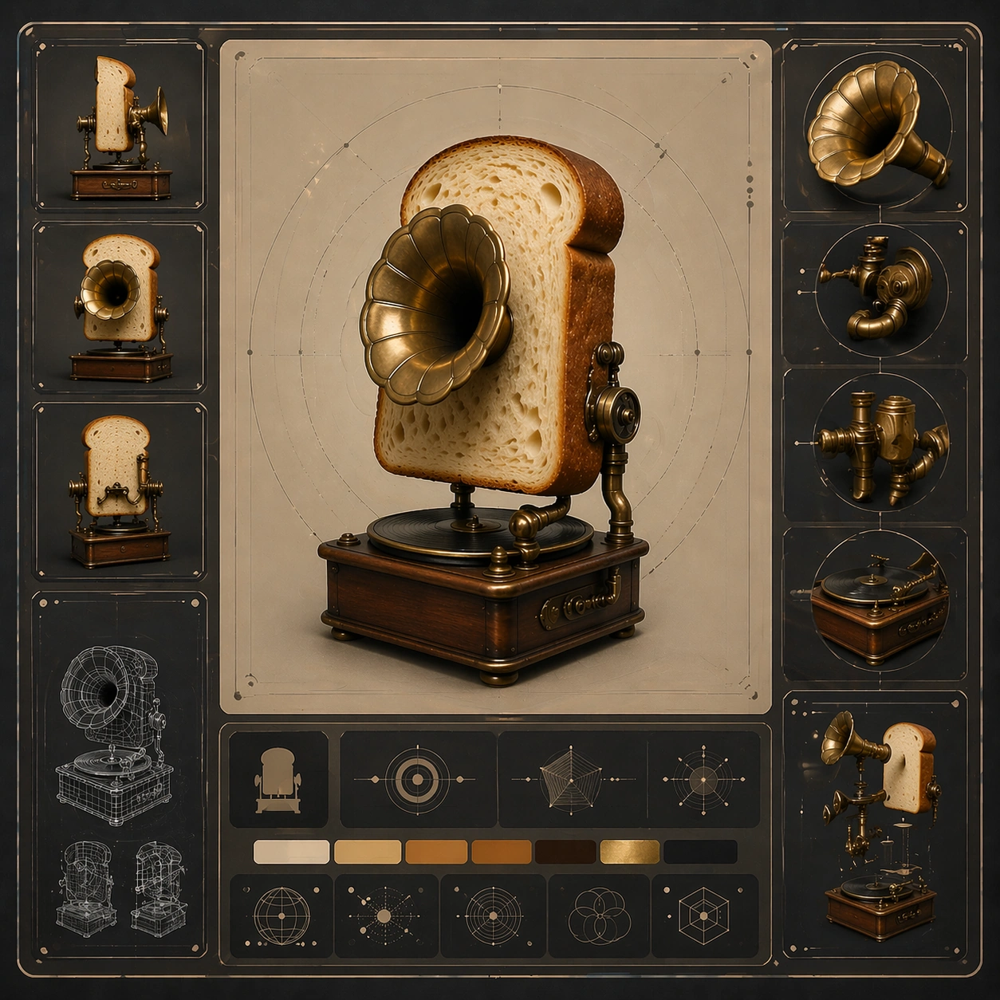

```text
Scene:
Create a square dependent image for Absurd Object Serious Photo Series. Build a second controlled variation in the same system with a premium, production-ready finish. Use a polished modular board or campaign surface with clean spacing, premium game-UI finish, and clear focal hierarchy. The composition should feel intentional, clean, and reusable for gallery, research, campaign, or internal handoff contexts. Lighting must support readability first, with the main forms clearly separated from the background and enough breathing room for the system to stay legible at both hero scale and thumbnail scale.

Subject:
Center a coherent original game-art system built for premium production and marketing surfaces. For this image, focus on the intended support surface. Keep the same system logic stable across screenshots, cards, banners, and overview boards. Preserve exact identity or system logic from the reference image while changing only the intended variation axis. The viewer should immediately understand what role this surface plays inside a cohesive game-production asset pack.

Important details:
Lock framing, icon grammar, palette blocking, and surface hierarchy so the kit feels production-ready and consistent. Preserve the core silhouette, framing language, and material logic from the reference image while each variation changes function. Keep materials believable, edge hierarchy disciplined, and the visual language consistent with Absurd Objects. Use abstract interface blocks or diagram accents when helpful, but avoid any readable language. The final result should feel like a deliberate production asset rather than a random illustration.

Use case:
Absurd Object Serious Photo Series series study 3/9, designed as variant two within a cohesive asset pack.

Constraints:
No readable text, no watermark, no logos, preserve exact 1:1 aspect ratio, no unrelated objects, no broken visual hierarchy, no malformed anatomy or broken perspective, no random decorative clutter.
```

[Pinned source](https://github.com/ChaosRealmsAI/gpt-image-2-gallery/blob/5296db8c996e38776c83a0bc8c64f848dcd512b3/works/topics/absurd-object-serious-photo-series/packages/series-core-system/images/03-variant-two/meta.json) · GPT Image2 · 1254×1254 · Reference images required. · ProjectD:pending individual review.

## Variant Three · absurd-object-serious-photo-series/series-core-system/04-variant-three

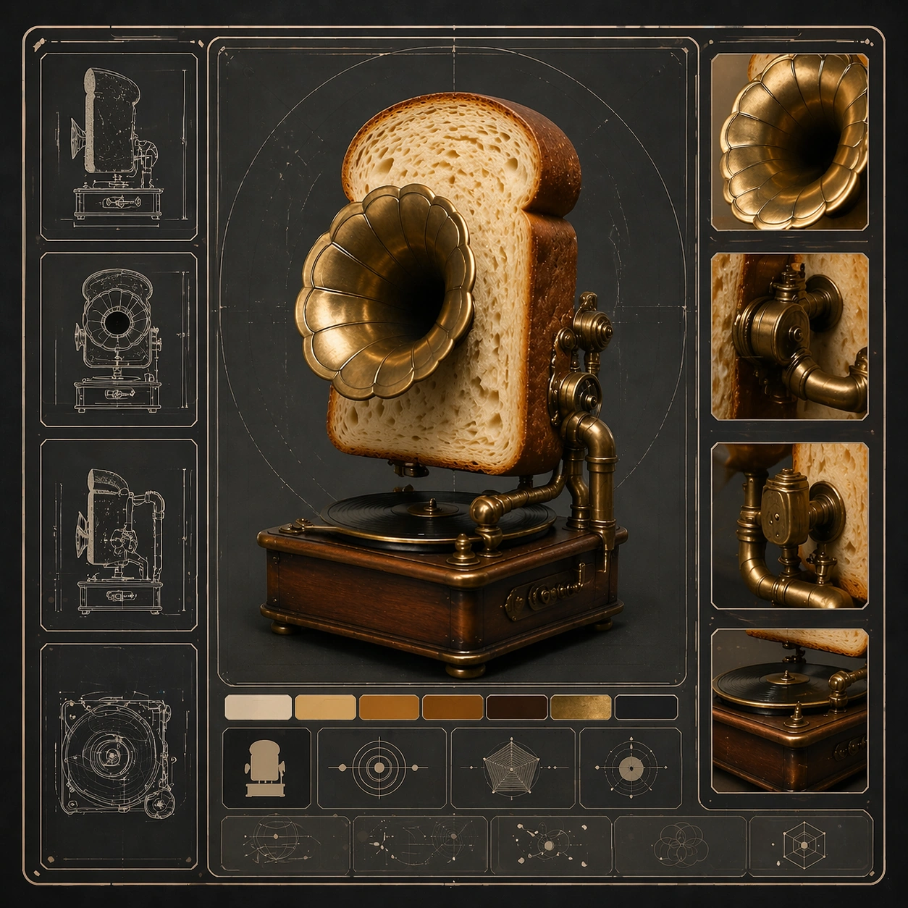

```text
Scene:
Create a square dependent image for Absurd Object Serious Photo Series. Build a third controlled variation in the same system with a premium, production-ready finish. Use a polished modular board or campaign surface with clean spacing, premium game-UI finish, and clear focal hierarchy. The composition should feel intentional, clean, and reusable for gallery, research, campaign, or internal handoff contexts. Lighting must support readability first, with the main forms clearly separated from the background and enough breathing room for the system to stay legible at both hero scale and thumbnail scale.

Subject:
Center a coherent original game-art system built for premium production and marketing surfaces. For this image, focus on the intended support surface. Keep the same system logic stable across screenshots, cards, banners, and overview boards. Preserve exact identity or system logic from the reference image while changing only the intended variation axis. The viewer should immediately understand what role this surface plays inside a cohesive game-production asset pack.

Important details:
Lock framing, icon grammar, palette blocking, and surface hierarchy so the kit feels production-ready and consistent. Preserve the core silhouette, framing language, and material logic from the reference image while each variation changes function. Keep materials believable, edge hierarchy disciplined, and the visual language consistent with Absurd Objects. Use abstract interface blocks or diagram accents when helpful, but avoid any readable language. The final result should feel like a deliberate production asset rather than a random illustration.

Use case:
Absurd Object Serious Photo Series series study 4/9, designed as variant three within a cohesive asset pack.

Constraints:
No readable text, no watermark, no logos, preserve exact 1:1 aspect ratio, no unrelated objects, no broken visual hierarchy, no malformed anatomy or broken perspective, no random decorative clutter.
```

[Pinned source](https://github.com/ChaosRealmsAI/gpt-image-2-gallery/blob/5296db8c996e38776c83a0bc8c64f848dcd512b3/works/topics/absurd-object-serious-photo-series/packages/series-core-system/images/04-variant-three/meta.json) · GPT Image2 · 1254×1254 · Reference images required. · ProjectD:pending individual review.

## Support One · absurd-object-serious-photo-series/single-support-studies/support-one

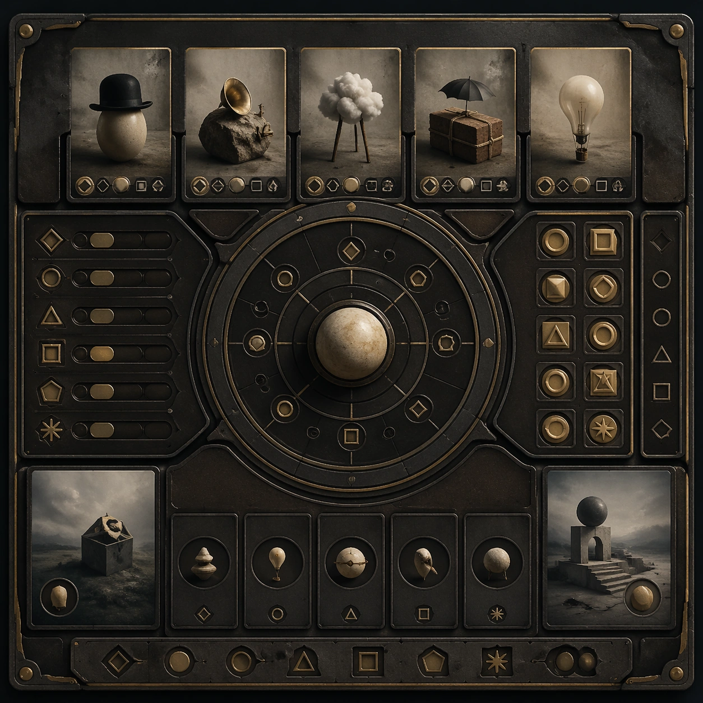

```text
Scene:
Create a square standalone support image for Absurd Object Serious Photo Series. Build a support-surface study with a clear focal hierarchy and a finished professional surface. Use a polished modular board or campaign surface with clean spacing, premium game-UI finish, and clear focal hierarchy. The frame should feel self-contained and polished, with enough structure to explain the system even without the reference series, yet still obviously belonging to the same theme and production world.

Subject:
Show a coherent original game-art system built for premium production and marketing surfaces in a way that emphasizes the intended support surface. Keep the same system logic stable across screenshots, cards, banners, and overview boards. Even though this image is independent, the viewer should still recognize the same universe, same commercial logic, and same production intent as the core package.

Important details:
Lock framing, icon grammar, palette blocking, and surface hierarchy so the kit feels production-ready and consistent. Preserve the broader theme language through color, framing, material choices, and modular composition. Use clean panel rhythm, premium asset presentation, and believable detail density. The image should work equally well as a gallery study, research reference, and mock production deliverable.

Use case:
Absurd Object Serious Photo Series single study 5/9, exploring support one as a support surface.

Constraints:
No readable text, no watermark, no logos, preserve exact 1:1 aspect ratio, no unrelated objects, no broken visual hierarchy, no visual noise that obscures the main surface, no accidental brand resemblance.
```

[Pinned source](https://github.com/ChaosRealmsAI/gpt-image-2-gallery/blob/5296db8c996e38776c83a0bc8c64f848dcd512b3/works/topics/absurd-object-serious-photo-series/packages/single-support-studies/images/support-one/meta.json) · GPT Image2 · 1254×1254 · No source-declared image dependencies. · ProjectD:pending individual review.

## Support Two · absurd-object-serious-photo-series/single-support-studies/support-two

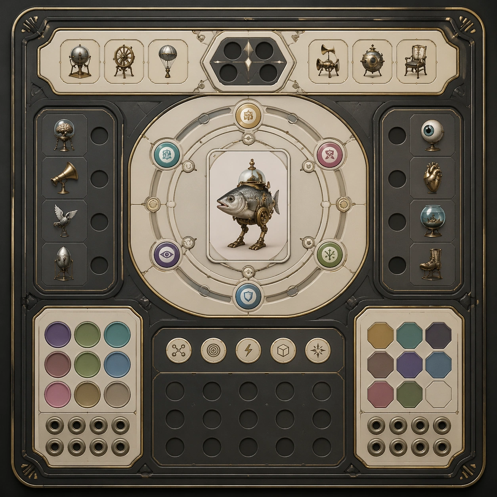

```text
Scene:
Create a square standalone support image for Absurd Object Serious Photo Series. Build a second support-surface study with a clear focal hierarchy and a finished professional surface. Use a polished modular board or campaign surface with clean spacing, premium game-UI finish, and clear focal hierarchy. The frame should feel self-contained and polished, with enough structure to explain the system even without the reference series, yet still obviously belonging to the same theme and production world.

Subject:
Show a coherent original game-art system built for premium production and marketing surfaces in a way that emphasizes the intended support surface. Keep the same system logic stable across screenshots, cards, banners, and overview boards. Even though this image is independent, the viewer should still recognize the same universe, same commercial logic, and same production intent as the core package.

Important details:
Lock framing, icon grammar, palette blocking, and surface hierarchy so the kit feels production-ready and consistent. Preserve the broader theme language through color, framing, material choices, and modular composition. Use clean panel rhythm, premium asset presentation, and believable detail density. The image should work equally well as a gallery study, research reference, and mock production deliverable.

Use case:
Absurd Object Serious Photo Series single study 6/9, exploring support two as a support surface.

Constraints:
No readable text, no watermark, no logos, preserve exact 1:1 aspect ratio, no unrelated objects, no broken visual hierarchy, no visual noise that obscures the main surface, no accidental brand resemblance.
```

[Pinned source](https://github.com/ChaosRealmsAI/gpt-image-2-gallery/blob/5296db8c996e38776c83a0bc8c64f848dcd512b3/works/topics/absurd-object-serious-photo-series/packages/single-support-studies/images/support-two/meta.json) · GPT Image2 · 1254×1254 · No source-declared image dependencies. · ProjectD:pending individual review.

## Support Three · absurd-object-serious-photo-series/single-support-studies/support-three

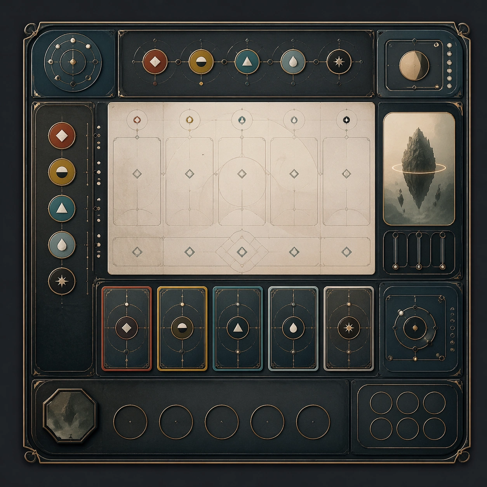

```text
Scene:
Create a square standalone support image for Absurd Object Serious Photo Series. Build a third support-surface study with a clear focal hierarchy and a finished professional surface. Use a polished modular board or campaign surface with clean spacing, premium game-UI finish, and clear focal hierarchy. The frame should feel self-contained and polished, with enough structure to explain the system even without the reference series, yet still obviously belonging to the same theme and production world.

Subject:
Show a coherent original game-art system built for premium production and marketing surfaces in a way that emphasizes the intended support surface. Keep the same system logic stable across screenshots, cards, banners, and overview boards. Even though this image is independent, the viewer should still recognize the same universe, same commercial logic, and same production intent as the core package.

Important details:
Lock framing, icon grammar, palette blocking, and surface hierarchy so the kit feels production-ready and consistent. Preserve the broader theme language through color, framing, material choices, and modular composition. Use clean panel rhythm, premium asset presentation, and believable detail density. The image should work equally well as a gallery study, research reference, and mock production deliverable.

Use case:
Absurd Object Serious Photo Series single study 7/9, exploring support three as a support surface.

Constraints:
No readable text, no watermark, no logos, preserve exact 1:1 aspect ratio, no unrelated objects, no broken visual hierarchy, no visual noise that obscures the main surface, no accidental brand resemblance.
```

[Pinned source](https://github.com/ChaosRealmsAI/gpt-image-2-gallery/blob/5296db8c996e38776c83a0bc8c64f848dcd512b3/works/topics/absurd-object-serious-photo-series/packages/single-support-studies/images/support-three/meta.json) · GPT Image2 · 1254×1254 · No source-declared image dependencies. · ProjectD:pending individual review.

## Support Four · absurd-object-serious-photo-series/single-support-studies/support-four

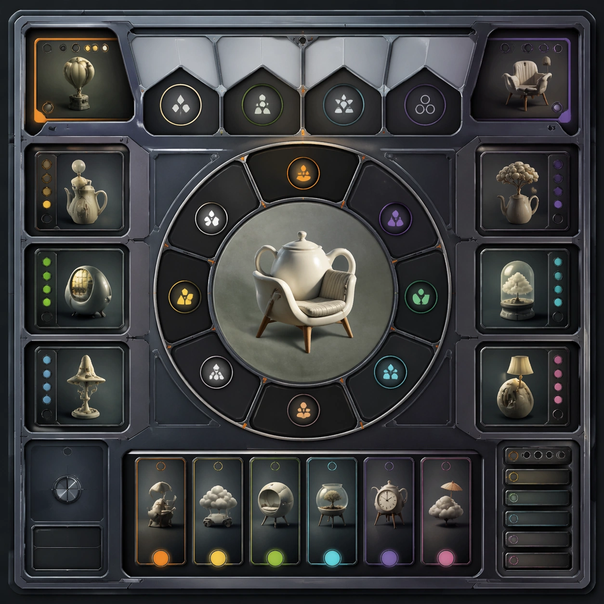

```text
Scene:
Create a square standalone support image for Absurd Object Serious Photo Series. Build a fourth support-surface study with a clear focal hierarchy and a finished professional surface. Use a polished modular board or campaign surface with clean spacing, premium game-UI finish, and clear focal hierarchy. The frame should feel self-contained and polished, with enough structure to explain the system even without the reference series, yet still obviously belonging to the same theme and production world.

Subject:
Show a coherent original game-art system built for premium production and marketing surfaces in a way that emphasizes the intended support surface. Keep the same system logic stable across screenshots, cards, banners, and overview boards. Even though this image is independent, the viewer should still recognize the same universe, same commercial logic, and same production intent as the core package.

Important details:
Lock framing, icon grammar, palette blocking, and surface hierarchy so the kit feels production-ready and consistent. Preserve the broader theme language through color, framing, material choices, and modular composition. Use clean panel rhythm, premium asset presentation, and believable detail density. The image should work equally well as a gallery study, research reference, and mock production deliverable.

Use case:
Absurd Object Serious Photo Series single study 8/9, exploring support four as a support surface.

Constraints:
No readable text, no watermark, no logos, preserve exact 1:1 aspect ratio, no unrelated objects, no broken visual hierarchy, no visual noise that obscures the main surface, no accidental brand resemblance.
```

[Pinned source](https://github.com/ChaosRealmsAI/gpt-image-2-gallery/blob/5296db8c996e38776c83a0bc8c64f848dcd512b3/works/topics/absurd-object-serious-photo-series/packages/single-support-studies/images/support-four/meta.json) · GPT Image2 · 1254×1254 · No source-declared image dependencies. · ProjectD:pending individual review.

## Support Five · absurd-object-serious-photo-series/single-support-studies/support-five

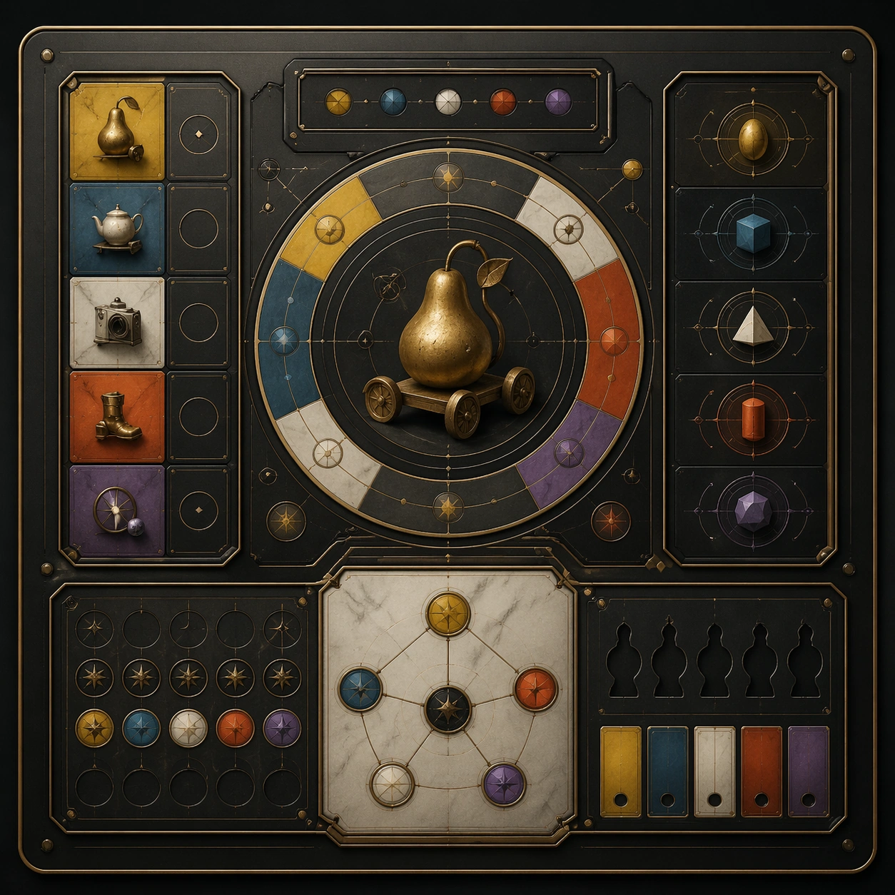

```text
Scene:
Create a square standalone support image for Absurd Object Serious Photo Series. Build a fifth support-surface study with a clear focal hierarchy and a finished professional surface. Use a polished modular board or campaign surface with clean spacing, premium game-UI finish, and clear focal hierarchy. The frame should feel self-contained and polished, with enough structure to explain the system even without the reference series, yet still obviously belonging to the same theme and production world.

Subject:
Show a coherent original game-art system built for premium production and marketing surfaces in a way that emphasizes the intended support surface. Keep the same system logic stable across screenshots, cards, banners, and overview boards. Even though this image is independent, the viewer should still recognize the same universe, same commercial logic, and same production intent as the core package.

Important details:
Lock framing, icon grammar, palette blocking, and surface hierarchy so the kit feels production-ready and consistent. Preserve the broader theme language through color, framing, material choices, and modular composition. Use clean panel rhythm, premium asset presentation, and believable detail density. The image should work equally well as a gallery study, research reference, and mock production deliverable.

Use case:
Absurd Object Serious Photo Series single study 9/9, exploring support five as a support surface.

Constraints:
No readable text, no watermark, no logos, preserve exact 1:1 aspect ratio, no unrelated objects, no broken visual hierarchy, no visual noise that obscures the main surface, no accidental brand resemblance.
```

[Pinned source](https://github.com/ChaosRealmsAI/gpt-image-2-gallery/blob/5296db8c996e38776c83a0bc8c64f848dcd512b3/works/topics/absurd-object-serious-photo-series/packages/single-support-studies/images/support-five/meta.json) · GPT Image2 · 1254×1254 · No source-declared image dependencies. · ProjectD:pending individual review.

## Vent Garden Pulse · abyssal-bioluminescent-ecosystem/single-abyssal-bioluminescent-studies/vent-garden-pulse

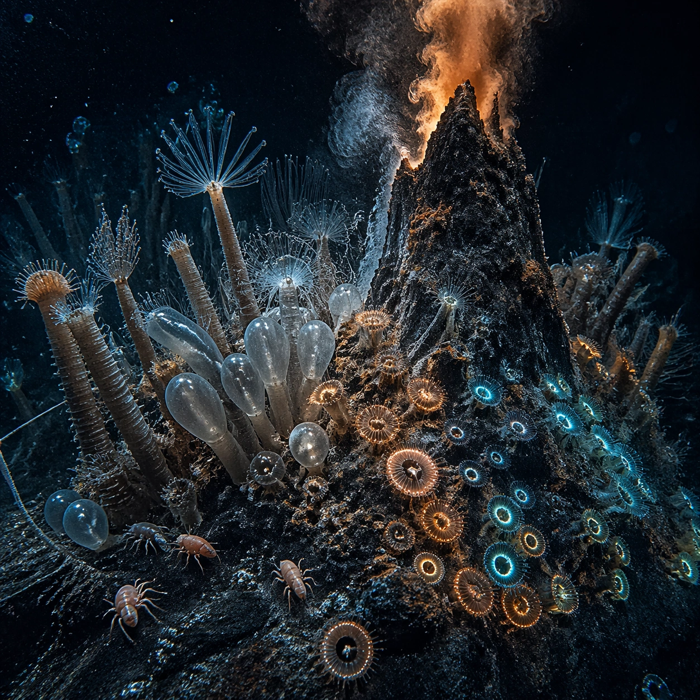

```text
Scene:
Frame a hydrothermal vent garden from close range, with a mineral chimney rising off-center and cold dark water swallowing the edges of the square. The vent plume should read as warm turbulence inside an otherwise frigid environment, while ringed colonies on nearby rock pulse in synchronized cyan and amber cycles. Build the frame as a square natural history study with disciplined composition, believable lighting, and enough environmental evidence to explain how this organism or system functions without any caption. Keep the image polished, observational, and suitable for a research gallery rather than pulp fantasy spectacle.

Subject:
Show anchored tube organisms, branching filter fans, and translucent feeder bladders arranged around the vent like a living power grid. Smaller crustacean analogs should cluster where pulse rhythms create temporary safe corridors between stinging tentacles and lure filaments. Show the anatomy, habitat interaction, and scale cues clearly so the viewer can infer locomotion, feeding, reproduction, or ecological role from the visual alone. Every visible structure should feel evolved for a purpose, with layered foreground, midground, and background information that rewards close inspection.

Important details:
Treat the abyss as a high-pressure ecosystem where light is scarce, energy is expensive, and every glow pattern carries a function such as luring prey, signaling kin, masking silhouette edges, or attracting symbiotic cleaners. Make every colony look adapted to chemical gradients: thicker insulation near hotter surfaces, pale mineral crust on older growth, and organ timing that suggests communication or reproductive signaling. Keep forms novel but internally consistent, avoiding coral clichés or tropical reef color palettes. Favor coherent biology over decorative excess: tissues, shells, membranes, spores, tendrils, fins, silica lattices, or atmospheric sacs should all follow one material logic. Preserve a convincing relationship between the environment and the body plan, use restrained color hierarchy, and make the image feel like a serious speculative field record rather than a random monster concept.

Use case:
Abyssal Bioluminescent Ecosystem single study 2/9.

Constraints:
No readable text, no watermark, no logos, preserve exact 1:1 aspect ratio, no reef fish, no tropical coral palette, no magma eruption, no shallow-water plants, no accidental brand resemblance, no direct copy of known terrestrial species, no cartoon simplification.
```

[Pinned source](https://github.com/ChaosRealmsAI/gpt-image-2-gallery/blob/5296db8c996e38776c83a0bc8c64f848dcd512b3/works/topics/abyssal-bioluminescent-ecosystem/packages/single-abyssal-bioluminescent-studies/images/vent-garden-pulse/meta.json) · GPT Image2 · 1254×1254 · No source-declared image dependencies. · ProjectD:pending individual review.

## Medusa Drift Column · abyssal-bioluminescent-ecosystem/single-abyssal-bioluminescent-studies/medusa-drift-column

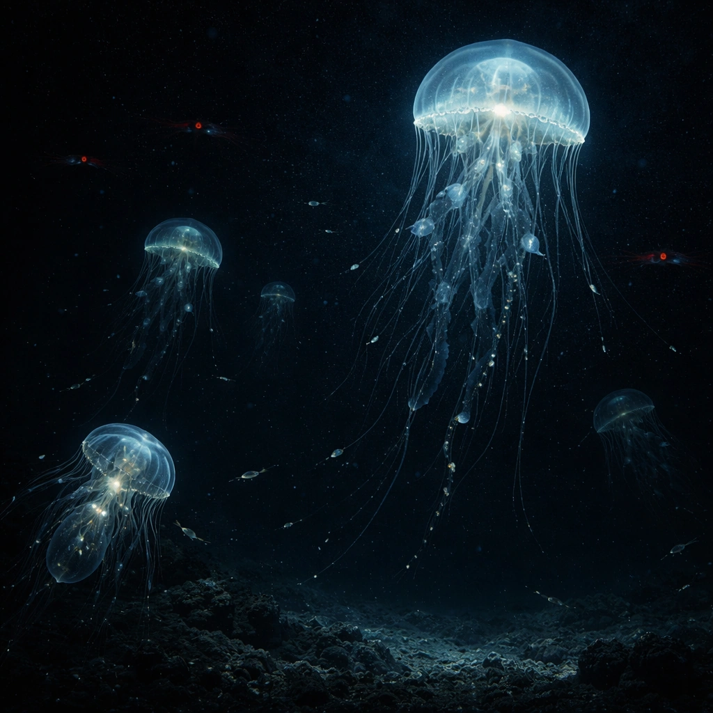

```text
Scene:
Compose the image as a vertical slice of open water above the abyssal floor, with the seabed barely visible at the bottom edge and the upper frame fading into black depth. The lighting should come from drifting medusae whose bell rims emit soft cool light, countered by dim red predator glints in the far field. Build the frame as a square natural history study with disciplined composition, believable lighting, and enough environmental evidence to explain how this organism or system functions without any caption. Keep the image polished, observational, and suitable for a research gallery rather than pulp fantasy spectacle.

Subject:
Feature several species of floating gelatinous organisms with trailing feeding veils, buoyancy sacs, and bioluminescent lure nodes. Around them, include stealth predators using narrow bands of low-visibility crimson light and tiny scavengers riding the wake of the larger drifters. Show the anatomy, habitat interaction, and scale cues clearly so the viewer can infer locomotion, feeding, reproduction, or ecological role from the visual alone. Every visible structure should feel evolved for a purpose, with layered foreground, midground, and background information that rewards close inspection.

Important details:
Treat the abyss as a high-pressure ecosystem where light is scarce, energy is expensive, and every glow pattern carries a function such as luring prey, signaling kin, masking silhouette edges, or attracting symbiotic cleaners. Preserve the sensation of suspension and depth through particulate layers, scale falloff, and overlapping transparency. Internal organs should be visible through the bells and membranes, with believable fluid anatomy instead of decorative fantasy swirls. Favor coherent biology over decorative excess: tissues, shells, membranes, spores, tendrils, fins, silica lattices, or atmospheric sacs should all follow one material logic. Preserve a convincing relationship between the environment and the body plan, use restrained color hierarchy, and make the image feel like a serious speculative field record rather than a random monster concept.

Use case:
Abyssal Bioluminescent Ecosystem single study 3/9.

Constraints:
No readable text, no watermark, no logos, preserve exact 1:1 aspect ratio, no surface horizon, no tropical jellyfish colors, no bright daylight, no hard scientific labels, no accidental brand resemblance, no direct copy of known terrestrial species, no cartoon simplification.
```

[Pinned source](https://github.com/ChaosRealmsAI/gpt-image-2-gallery/blob/5296db8c996e38776c83a0bc8c64f848dcd512b3/works/topics/abyssal-bioluminescent-ecosystem/packages/single-abyssal-bioluminescent-studies/images/medusa-drift-column/meta.json) · GPT Image2 · 1024×1024 · No source-declared image dependencies. · ProjectD:pending individual review.

## Scavenger Pack Trail · abyssal-bioluminescent-ecosystem/single-abyssal-bioluminescent-studies/scavenger-pack-trail

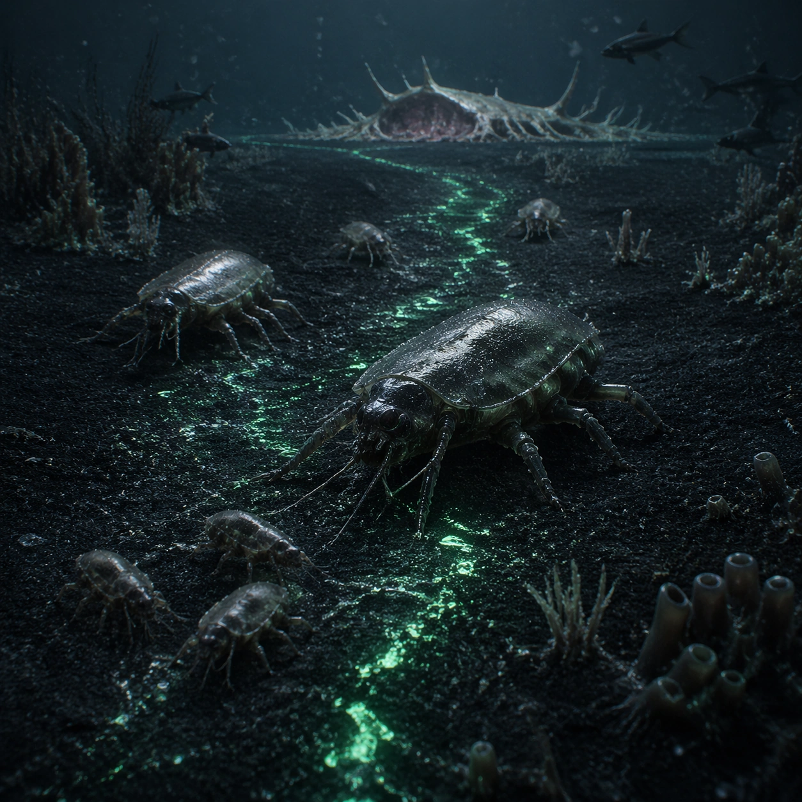

```text
Scene:
Set the viewpoint low to the sediment so the audience feels embedded in the abyssal plain. A narrow trail of intermittent green chemical light should snake across fine black mud, leading the eye toward a distant carcass bloom and dim predator silhouettes. Build the frame as a square natural history study with disciplined composition, believable lighting, and enough environmental evidence to explain how this organism or system functions without any caption. Keep the image polished, observational, and suitable for a research gallery rather than pulp fantasy spectacle.

Subject:
Center the image on a coordinated pack of six-legged scavenger analogs with pressure-flattened bodies, whisker-like chemoceptors, and reflective eye shields. Their feet disturb the sediment while trailing juveniles interpret the glow trail left by microbial partners living in their excreted mucus. Show the anatomy, habitat interaction, and scale cues clearly so the viewer can infer locomotion, feeding, reproduction, or ecological role from the visual alone. Every visible structure should feel evolved for a purpose, with layered foreground, midground, and background information that rewards close inspection.

Important details:
Treat the abyss as a high-pressure ecosystem where light is scarce, energy is expensive, and every glow pattern carries a function such as luring prey, signaling kin, masking silhouette edges, or attracting symbiotic cleaners. Show behavioral ecology rather than spectacle: cautious spacing, leader and follower roles, and a believable reason for collective movement in the dark. Keep materials wet, cold, and heavy, with light only clinging to slime traces, sensory organs, and microbial mats. Favor coherent biology over decorative excess: tissues, shells, membranes, spores, tendrils, fins, silica lattices, or atmospheric sacs should all follow one material logic. Preserve a convincing relationship between the environment and the body plan, use restrained color hierarchy, and make the image feel like a serious speculative field record rather than a random monster concept.

Use case:
Abyssal Bioluminescent Ecosystem single study 4/9.

Constraints:
No readable text, no watermark, no logos, preserve exact 1:1 aspect ratio, no crab copy, no lobster copy, no heroic monster pose, no bright reef background, no accidental brand resemblance, no direct copy of known terrestrial species, no cartoon simplification.
```

[Pinned source](https://github.com/ChaosRealmsAI/gpt-image-2-gallery/blob/5296db8c996e38776c83a0bc8c64f848dcd512b3/works/topics/abyssal-bioluminescent-ecosystem/packages/single-abyssal-bioluminescent-studies/images/scavenger-pack-trail/meta.json) · GPT Image2 · 1254×1254 · No source-declared image dependencies. · ProjectD:pending individual review.

## Nursery Shell Colony · abyssal-bioluminescent-ecosystem/single-abyssal-bioluminescent-studies/nursery-shell-colony

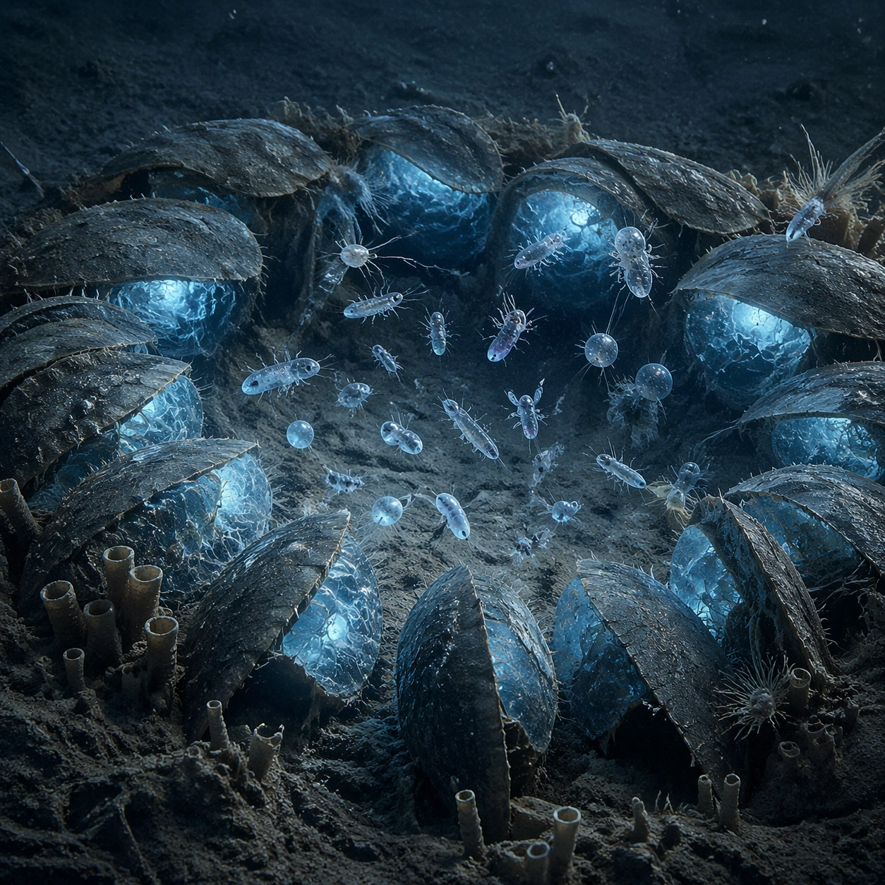

```text
Scene:
Create a sheltered depression in the seafloor where overlapping shell-like organisms form a nursery ring. The square frame should feel intimate and quiet, with milky blue light leaking from seams between plates and reflecting on suspended eggs, detritus flakes, and nearby mud ridges. Build the frame as a square natural history study with disciplined composition, believable lighting, and enough environmental evidence to explain how this organism or system functions without any caption. Keep the image polished, observational, and suitable for a research gallery rather than pulp fantasy spectacle.

Subject:
Show parental brooders whose calcified outer valves protect soft luminous brood chambers. Inside the ring, larvae at different growth stages should drift or cling to mucus threads while attendant cleaner symbionts groom fungal films and remove parasites. Show the anatomy, habitat interaction, and scale cues clearly so the viewer can infer locomotion, feeding, reproduction, or ecological role from the visual alone. Every visible structure should feel evolved for a purpose, with layered foreground, midground, and background information that rewards close inspection.

Important details:
Treat the abyss as a high-pressure ecosystem where light is scarce, energy is expensive, and every glow pattern carries a function such as luring prey, signaling kin, masking silhouette edges, or attracting symbiotic cleaners. Communicate lifecycle logic with clear age differences, nesting behavior, and material contrast between hard shell, gelatinous interior, and delicate larvae. The palette should stay subdued and cold, using light to reveal anatomy rather than decorate it. Favor coherent biology over decorative excess: tissues, shells, membranes, spores, tendrils, fins, silica lattices, or atmospheric sacs should all follow one material logic. Preserve a convincing relationship between the environment and the body plan, use restrained color hierarchy, and make the image feel like a serious speculative field record rather than a random monster concept.

Use case:
Abyssal Bioluminescent Ecosystem single study 5/9.

Constraints:
No readable text, no watermark, no logos, preserve exact 1:1 aspect ratio, no pearl-jewelry styling, no clam copy, no cute baby-animal sentimentality, no warm tropical sand, no accidental brand resemblance, no direct copy of known terrestrial species, no cartoon simplification.
```

[Pinned source](https://github.com/ChaosRealmsAI/gpt-image-2-gallery/blob/5296db8c996e38776c83a0bc8c64f848dcd512b3/works/topics/abyssal-bioluminescent-ecosystem/packages/single-abyssal-bioluminescent-studies/images/nursery-shell-colony/meta.json) · GPT Image2 · 1254×1254 · No source-declared image dependencies. · ProjectD:pending individual review.

## Siphon Forest Closeup · abyssal-bioluminescent-ecosystem/single-abyssal-bioluminescent-studies/siphon-forest-closeup

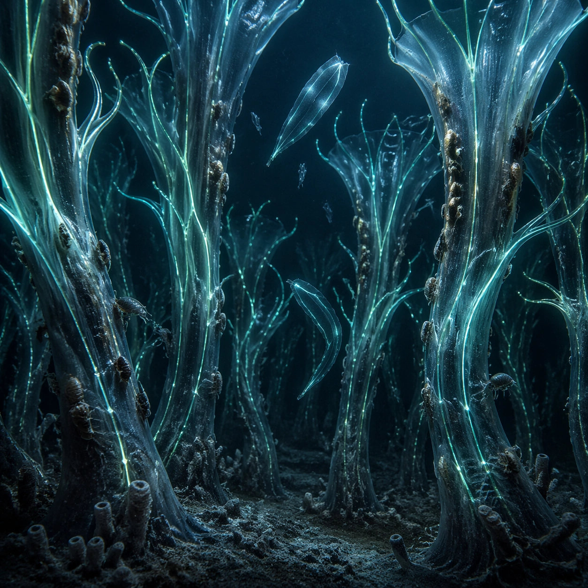

```text
Scene:
Place the viewer inside a dense thicket of tall siphon organisms rooted in soft sediment, with the camera looking through layered stalks into darkness. Thin ribbons of cyan and pale lime light should run along the fronds, revealing current direction and making the whole grove feel like a breathing electrical forest. Build the frame as a square natural history study with disciplined composition, believable lighting, and enough environmental evidence to explain how this organism or system functions without any caption. Keep the image polished, observational, and suitable for a research gallery rather than pulp fantasy spectacle.

Subject:
Focus on trunk-like siphon bodies, semi-transparent feeding membranes, and small hitchhiker organisms that shelter in the grooves between structural ribs. A few detached fronds should drift through the current to imply seasonal shedding or reproduction. Show the anatomy, habitat interaction, and scale cues clearly so the viewer can infer locomotion, feeding, reproduction, or ecological role from the visual alone. Every visible structure should feel evolved for a purpose, with layered foreground, midground, and background information that rewards close inspection.

Important details:
Treat the abyss as a high-pressure ecosystem where light is scarce, energy is expensive, and every glow pattern carries a function such as luring prey, signaling kin, masking silhouette edges, or attracting symbiotic cleaners. Keep the biology plant-like in silhouette but unmistakably animal in tissue, attachment strategy, and feeding behavior. Membranes should look collagenous and wet, not leafy or botanical, and the grove should feel adapted to darkness, pressure, and sparse nutrients. Favor coherent biology over decorative excess: tissues, shells, membranes, spores, tendrils, fins, silica lattices, or atmospheric sacs should all follow one material logic. Preserve a convincing relationship between the environment and the body plan, use restrained color hierarchy, and make the image feel like a serious speculative field record rather than a random monster concept.

Use case:
Abyssal Bioluminescent Ecosystem single study 6/9.

Constraints:
No readable text, no watermark, no logos, preserve exact 1:1 aspect ratio, no trees, no terrestrial bark, no flowers, no sunlit kelp-forest look, no accidental brand resemblance, no direct copy of known terrestrial species, no cartoon simplification.
```

[Pinned source](https://github.com/ChaosRealmsAI/gpt-image-2-gallery/blob/5296db8c996e38776c83a0bc8c64f848dcd512b3/works/topics/abyssal-bioluminescent-ecosystem/packages/single-abyssal-bioluminescent-studies/images/siphon-forest-closeup/meta.json) · GPT Image2 · 1254×1254 · No source-declared image dependencies. · ProjectD:pending individual review.

## Predator Lure Ambush · abyssal-bioluminescent-ecosystem/single-abyssal-bioluminescent-studies/predator-lure-ambush

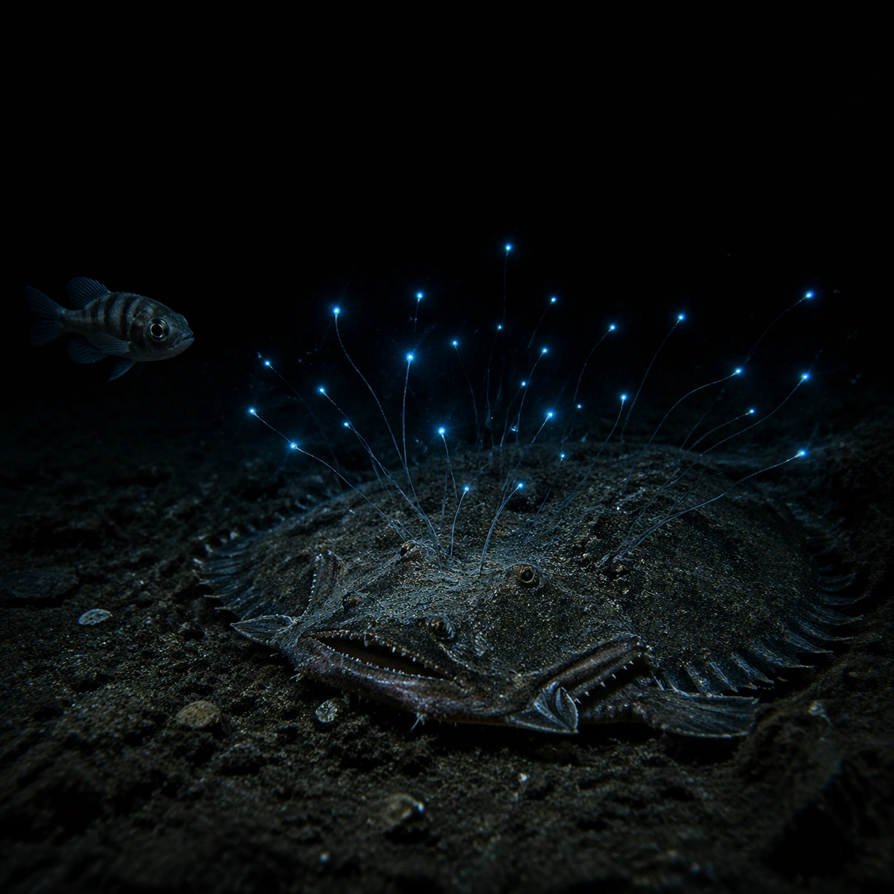

```text
Scene:
Stage the moment just before an ambush on a dim mud plain, with most of the predator hidden against the substrate. A constellation of tiny blue lure lights should float above the body like harmless drifting plankton while the rest of the frame remains almost featureless black. Build the frame as a square natural history study with disciplined composition, believable lighting, and enough environmental evidence to explain how this organism or system functions without any caption. Keep the image polished, observational, and suitable for a research gallery rather than pulp fantasy spectacle.

Subject:
Reveal a flattened hunter with a hinge jaw, shielding fins, and a network of decoy photophores extending from flexible filaments. One curious grazer should approach the false light cloud, giving scale and narrative tension without turning the scene into action spectacle. Show the anatomy, habitat interaction, and scale cues clearly so the viewer can infer locomotion, feeding, reproduction, or ecological role from the visual alone. Every visible structure should feel evolved for a purpose, with layered foreground, midground, and background information that rewards close inspection.

Important details:
Treat the abyss as a high-pressure ecosystem where light is scarce, energy is expensive, and every glow pattern carries a function such as luring prey, signaling kin, masking silhouette edges, or attracting symbiotic cleaners. The deception must feel biologically grounded: lure spacing, body camouflage, and attack posture should all support a plausible feeding strategy. Keep the predator alien but elegant, emphasizing stealth, musculature, and sensory adaptation rather than horror tropes. Favor coherent biology over decorative excess: tissues, shells, membranes, spores, tendrils, fins, silica lattices, or atmospheric sacs should all follow one material logic. Preserve a convincing relationship between the environment and the body plan, use restrained color hierarchy, and make the image feel like a serious speculative field record rather than a random monster concept.

Use case:
Abyssal Bioluminescent Ecosystem single study 7/9.

Constraints:
No readable text, no watermark, no logos, preserve exact 1:1 aspect ratio, no gore, no jump-scare monster face, no giant teeth closeup, no cartoon menace, no accidental brand resemblance, no direct copy of known terrestrial species, no cartoon simplification.
```

[Pinned source](https://github.com/ChaosRealmsAI/gpt-image-2-gallery/blob/5296db8c996e38776c83a0bc8c64f848dcd512b3/works/topics/abyssal-bioluminescent-ecosystem/packages/single-abyssal-bioluminescent-studies/images/predator-lure-ambush/meta.json) · GPT Image2 · 1254×1254 · No source-declared image dependencies. · ProjectD:pending individual review.

## Carrion Snow Feeders · abyssal-bioluminescent-ecosystem/single-abyssal-bioluminescent-studies/carrion-snow-feeders

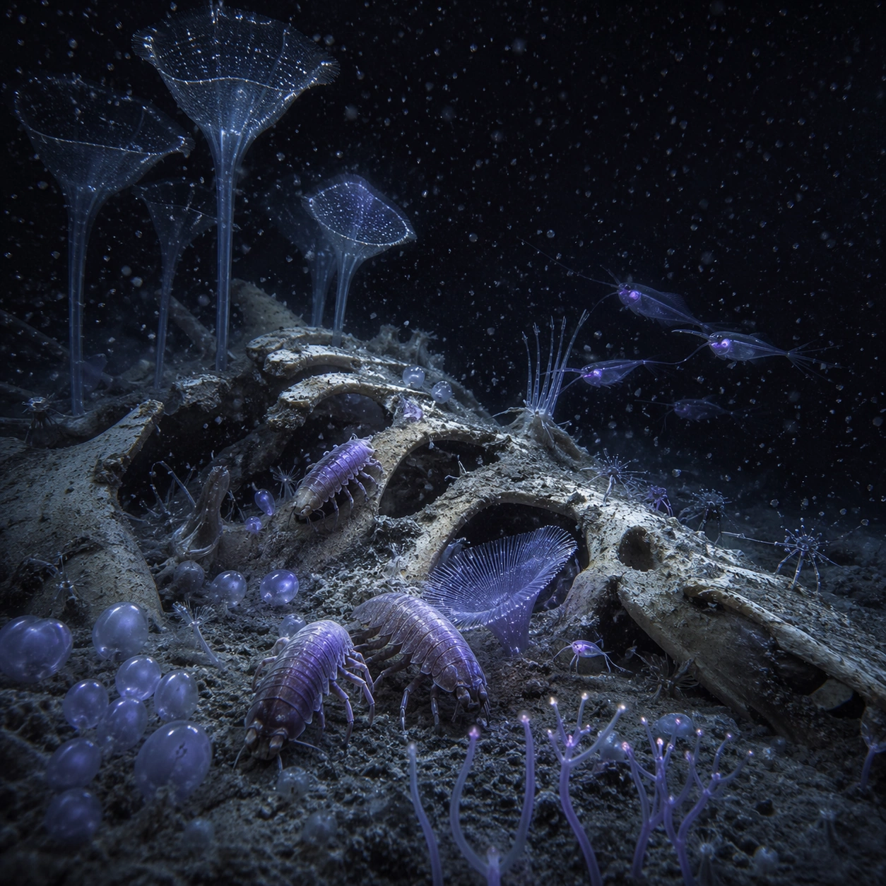

```text
Scene:
Build a square composition around a dim carcass remnant on the abyssal floor, with thick marine snow raining through the water column. The image should feel hushed and solemn rather than violent, illuminated by the feeding organisms themselves in faint blues, violets, and smoky white. Build the frame as a square natural history study with disciplined composition, believable lighting, and enough environmental evidence to explain how this organism or system functions without any caption. Keep the image polished, observational, and suitable for a research gallery rather than pulp fantasy spectacle.

Subject:
Show several specialized feeder guilds at work: scraping grazers on the bones, hovering filter veils collecting drifting particles, and timid opportunists waiting at the edges for safer access. The carcass should be weathered and partially buried, implying a long-duration nutrient event. Show the anatomy, habitat interaction, and scale cues clearly so the viewer can infer locomotion, feeding, reproduction, or ecological role from the visual alone. Every visible structure should feel evolved for a purpose, with layered foreground, midground, and background information that rewards close inspection.

Important details:
Treat the abyss as a high-pressure ecosystem where light is scarce, energy is expensive, and every glow pattern carries a function such as luring prey, signaling kin, masking silhouette edges, or attracting symbiotic cleaners. Emphasize ecological succession, energy thrift, and the slow choreography of deep-sea feeding. Surfaces should show silt, biofilm, and pressure-softened tissues, while lighting remains local and biological rather than cinematic floodlight. Favor coherent biology over decorative excess: tissues, shells, membranes, spores, tendrils, fins, silica lattices, or atmospheric sacs should all follow one material logic. Preserve a convincing relationship between the environment and the body plan, use restrained color hierarchy, and make the image feel like a serious speculative field record rather than a random monster concept.

Use case:
Abyssal Bioluminescent Ecosystem single study 8/9.

Constraints:
No readable text, no watermark, no logos, preserve exact 1:1 aspect ratio, no gore, no shark frenzy, no human corpse, no action-movie violence, no accidental brand resemblance, no direct copy of known terrestrial species, no cartoon simplification.
```

[Pinned source](https://github.com/ChaosRealmsAI/gpt-image-2-gallery/blob/5296db8c996e38776c83a0bc8c64f848dcd512b3/works/topics/abyssal-bioluminescent-ecosystem/packages/single-abyssal-bioluminescent-studies/images/carrion-snow-feeders/meta.json) · GPT Image2 · 1254×1254 · No source-declared image dependencies. · ProjectD:pending individual review.

## Survey Plate Assemblage · abyssal-bioluminescent-ecosystem/single-abyssal-bioluminescent-studies/survey-plate-assemblage

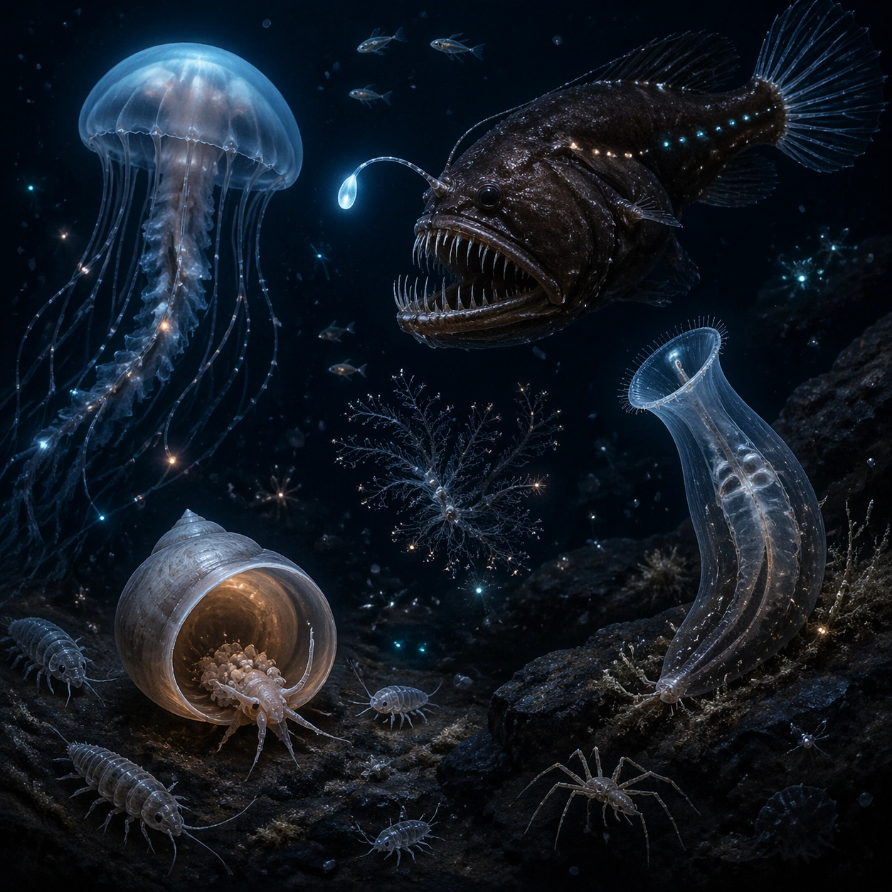

```text
Scene:
Compose a curated natural history survey plate against a dark neutral background that still feels underwater rather than graphic design. Arrange several representative abyssal species in one coherent square, each at slightly different scale and depth, as if observed through a study window into the deep. Build the frame as a square natural history study with disciplined composition, believable lighting, and enough environmental evidence to explain how this organism or system functions without any caption. Keep the image polished, observational, and suitable for a research gallery rather than pulp fantasy spectacle.

Subject:
Include a lure predator, a drifting medusa, a siphon grazer, a nursery shell form, and small scavengers, all positioned so their body plans can be compared without labels. The organisms should overlap subtly and share one believable water environment rather than floating as cutouts. Show the anatomy, habitat interaction, and scale cues clearly so the viewer can infer locomotion, feeding, reproduction, or ecological role from the visual alone. Every visible structure should feel evolved for a purpose, with layered foreground, midground, and background information that rewards close inspection.

Important details:
Treat the abyss as a high-pressure ecosystem where light is scarce, energy is expensive, and every glow pattern carries a function such as luring prey, signaling kin, masking silhouette edges, or attracting symbiotic cleaners. This is a synthesis image, so clarity matters: preserve morphology, material differences, and glow logic while avoiding clutter. The composition should read like a polished field atlas cover that still feels alive and ecological, not like a poster of disconnected assets. Favor coherent biology over decorative excess: tissues, shells, membranes, spores, tendrils, fins, silica lattices, or atmospheric sacs should all follow one material logic. Preserve a convincing relationship between the environment and the body plan, use restrained color hierarchy, and make the image feel like a serious speculative field record rather than a random monster concept.

Use case:
Abyssal Bioluminescent Ecosystem single study 9/9.

Constraints:
No readable text, no watermark, no logos, preserve exact 1:1 aspect ratio, no specimen pins, no text labels, no flat collage cutout look, no empty black void, no accidental brand resemblance, no direct copy of known terrestrial species, no cartoon simplification.
```

[Pinned source](https://github.com/ChaosRealmsAI/gpt-image-2-gallery/blob/5296db8c996e38776c83a0bc8c64f848dcd512b3/works/topics/abyssal-bioluminescent-ecosystem/packages/single-abyssal-bioluminescent-studies/images/survey-plate-assemblage/meta.json) · GPT Image2 · 1254×1254 · No source-declared image dependencies. · ProjectD:pending individual review.

## Reference Anchor · action-beat-comic-page/series-theme-core/01-reference-anchor

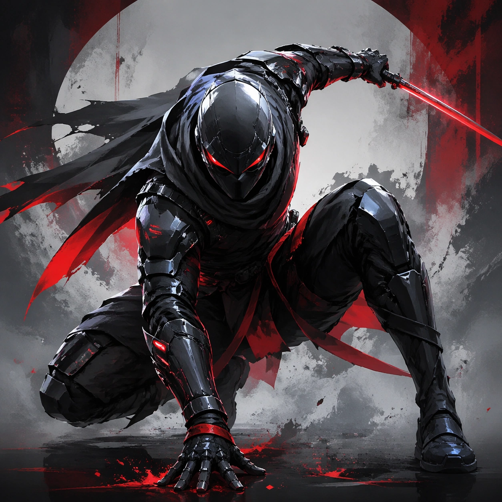

```text
Scene:
A square premium key-art frame built for a reference-dependent production series. Stage a reference anchor for action beat comic page action beat comic page with one unmistakable core subject and disciplined composition with controlled lighting, clear silhouette separation, and a camera setup that feels deliberate enough for campaign reuse. The composition should carry strong focal hierarchy, believable depth, and polished surface behavior while still staying stable enough to support downstream dependent variations.

Subject:
Center the image on a reference anchor for action beat comic page action beat comic page with one unmistakable core subject and disciplined composition. The result should feel like a concrete, shippable asset for a action beat comic page action beat comic page visual system, not a generic fantasy render. Build the subject with layered materials, stable anatomy or engineering logic, and enough specificity that later images can inherit the same underlying identity. This image is the root reference that defines continuity for the rest of the series. The viewer should immediately understand what is being preserved across the sequence and what is changing in this particular beat.

Important details:
establish the base identity, silhouette logic, palette rhythm, and layout system that downstream variations must preserve. Make continuity explicit through repeatable shape language, proportion control, and a coherent palette system. Changes in pose, angle, mood, rarity, weather, or layout should still feel downstream of one stable source. Avoid clutter that would confuse reference use. Any interface-like blocks or graphic surfaces must remain abstract and unreadable. Keep the image polished, original, and suitable for both gallery display and production review.

Use case:
action beat comic page action beat comic page series study 1/4, focused on reference anchor.

Constraints:
No readable text, no watermark, no logos, preserve exact 1:1 aspect ratio, no extra subject duplication, no noisy background, no broken continuity, no off-model redesign, no accidental franchise resemblance.
```

[Pinned source](https://github.com/ChaosRealmsAI/gpt-image-2-gallery/blob/5296db8c996e38776c83a0bc8c64f848dcd512b3/works/topics/action-beat-comic-page/packages/series-theme-core/images/01-reference-anchor/meta.json) · GPT Image2 · 1254×1254 · No source-declared image dependencies. · ProjectD:pending individual review.

## Variation One · action-beat-comic-page/series-theme-core/02-variation-one

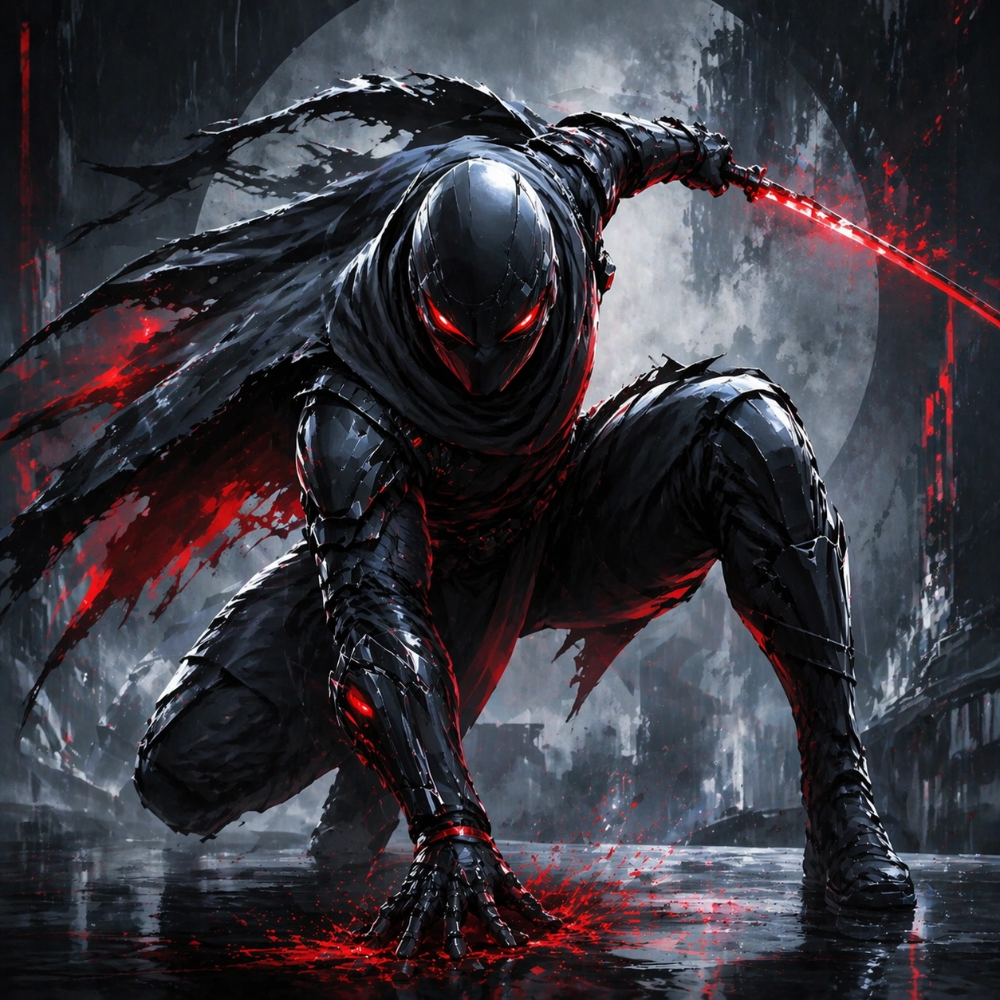

```text
Scene:
A square premium key-art frame built for a reference-dependent production series. Stage the same core concept reinterpreted through a first controlled variation for action beat comic page action beat comic page with controlled lighting, clear silhouette separation, and a camera setup that feels deliberate enough for campaign reuse. The composition should carry strong focal hierarchy, believable depth, and polished surface behavior while still staying stable enough to support downstream dependent variations.

Subject:
Center the image on the same core concept reinterpreted through a first controlled variation for action beat comic page action beat comic page. The result should feel like a concrete, shippable asset for a action beat comic page action beat comic page visual system, not a generic fantasy render. Build the subject with layered materials, stable anatomy or engineering logic, and enough specificity that later images can inherit the same underlying identity. Preserve the same core subject identity, silhouette logic, material language, and composition system from the reference image from the reference image while changing only what this variation needs. The viewer should immediately understand what is being preserved across the sequence and what is changing in this particular beat.

Important details:
change mood, framing, or emphasis while preserving the same underlying visual system and subject continuity. Make continuity explicit through repeatable shape language, proportion control, and a coherent palette system. Changes in pose, angle, mood, rarity, weather, or layout should still feel downstream of one stable source. Avoid clutter that would confuse reference use. Any interface-like blocks or graphic surfaces must remain abstract and unreadable. Keep the image polished, original, and suitable for both gallery display and production review.

Use case:
action beat comic page action beat comic page series study 2/4, focused on variation one.

Constraints:
No readable text, no watermark, no logos, preserve exact 1:1 aspect ratio, no unrelated redesign, no continuity drift, no broken continuity, no off-model redesign, no accidental franchise resemblance.
```

[Pinned source](https://github.com/ChaosRealmsAI/gpt-image-2-gallery/blob/5296db8c996e38776c83a0bc8c64f848dcd512b3/works/topics/action-beat-comic-page/packages/series-theme-core/images/02-variation-one/meta.json) · GPT Image2 · 1254×1254 · Reference images required. · ProjectD:pending individual review.

## Variation Two · action-beat-comic-page/series-theme-core/03-variation-two

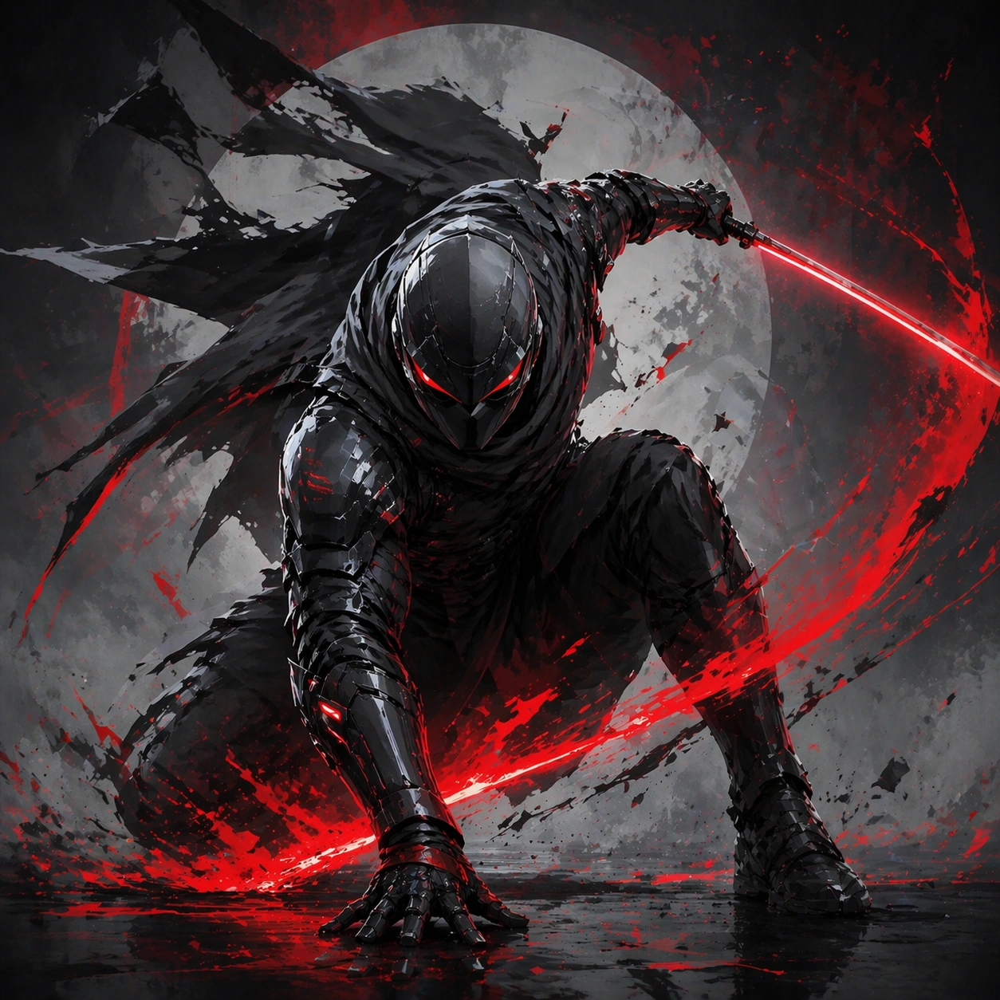

```text
Scene:
A square premium key-art frame built for a reference-dependent production series. Stage the same core concept pushed into a second variation with different pacing or surface behavior for action beat comic page action beat comic page with controlled lighting, clear silhouette separation, and a camera setup that feels deliberate enough for campaign reuse. The composition should carry strong focal hierarchy, believable depth, and polished surface behavior while still staying stable enough to support downstream dependent variations.

Subject:
Center the image on the same core concept pushed into a second variation with different pacing or surface behavior for action beat comic page action beat comic page. The result should feel like a concrete, shippable asset for a action beat comic page action beat comic page visual system, not a generic fantasy render. Build the subject with layered materials, stable anatomy or engineering logic, and enough specificity that later images can inherit the same underlying identity. Preserve the same core subject identity, silhouette logic, material language, and composition system from the reference image from the reference image while changing only what this variation needs. The viewer should immediately understand what is being preserved across the sequence and what is changing in this particular beat.

Important details:
the viewer should still read one connected family rather than three disconnected ideas. Make continuity explicit through repeatable shape language, proportion control, and a coherent palette system. Changes in pose, angle, mood, rarity, weather, or layout should still feel downstream of one stable source. Avoid clutter that would confuse reference use. Any interface-like blocks or graphic surfaces must remain abstract and unreadable. Keep the image polished, original, and suitable for both gallery display and production review.

Use case:
action beat comic page action beat comic page series study 3/4, focused on variation two.

Constraints:
No readable text, no watermark, no logos, preserve exact 1:1 aspect ratio, no random props, no off-model shift, no broken continuity, no off-model redesign, no accidental franchise resemblance.
```

[Pinned source](https://github.com/ChaosRealmsAI/gpt-image-2-gallery/blob/5296db8c996e38776c83a0bc8c64f848dcd512b3/works/topics/action-beat-comic-page/packages/series-theme-core/images/03-variation-two/meta.json) · GPT Image2 · 1254×1254 · Reference images required. · ProjectD:pending individual review.

## Variation Three · action-beat-comic-page/series-theme-core/04-variation-three

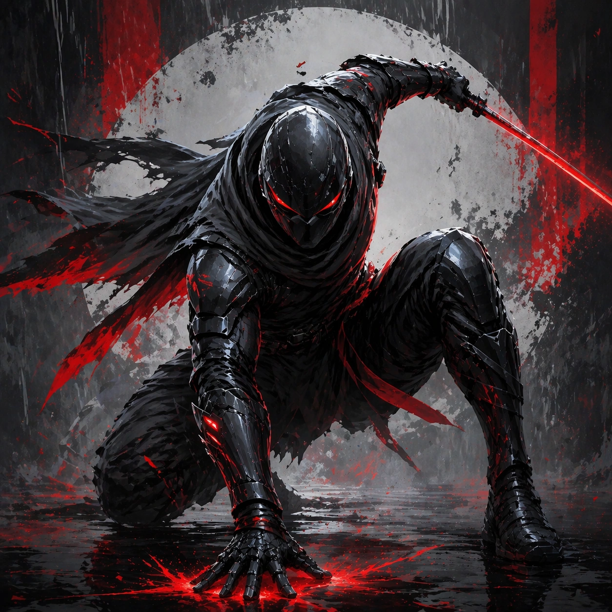

```text
Scene:
A square premium key-art frame built for a reference-dependent production series. Stage the same core concept in a third polished variation that completes the reference-led set for action beat comic page action beat comic page with controlled lighting, clear silhouette separation, and a camera setup that feels deliberate enough for campaign reuse. The composition should carry strong focal hierarchy, believable depth, and polished surface behavior while still staying stable enough to support downstream dependent variations.

Subject:
Center the image on the same core concept in a third polished variation that completes the reference-led set for action beat comic page action beat comic page. The result should feel like a concrete, shippable asset for a action beat comic page action beat comic page visual system, not a generic fantasy render. Build the subject with layered materials, stable anatomy or engineering logic, and enough specificity that later images can inherit the same underlying identity. Preserve the same core subject identity, silhouette logic, material language, and composition system from the reference image from the reference image while changing only what this variation needs. The viewer should immediately understand what is being preserved across the sequence and what is changing in this particular beat.

Important details:
keep continuity obvious while introducing a fresh but coherent downstream use case. Make continuity explicit through repeatable shape language, proportion control, and a coherent palette system. Changes in pose, angle, mood, rarity, weather, or layout should still feel downstream of one stable source. Avoid clutter that would confuse reference use. Any interface-like blocks or graphic surfaces must remain abstract and unreadable. Keep the image polished, original, and suitable for both gallery display and production review.

Use case:
action beat comic page action beat comic page series study 4/4, focused on variation three.

Constraints:
No readable text, no watermark, no logos, preserve exact 1:1 aspect ratio, no franchise mimicry, no broken hierarchy, no broken continuity, no off-model redesign, no accidental franchise resemblance.
```

[Pinned source](https://github.com/ChaosRealmsAI/gpt-image-2-gallery/blob/5296db8c996e38776c83a0bc8c64f848dcd512b3/works/topics/action-beat-comic-page/packages/series-theme-core/images/04-variation-three/meta.json) · GPT Image2 · 1254×1254 · Reference images required. · ProjectD:pending individual review.

## Detail Proof · action-beat-comic-page/single-theme-extensions/detail-proof

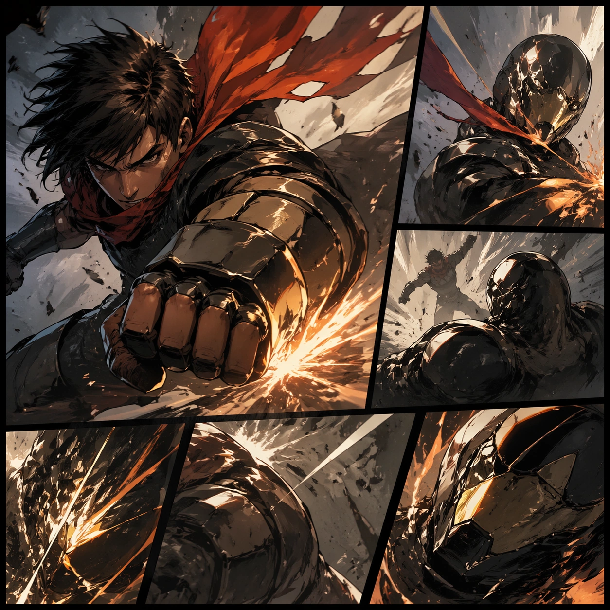

```text
Scene:
A square production-ready image designed for a game-art review wall and a commercial gallery at the same time. Frame a detail-focused proof image for action beat comic page action beat comic page that zooms into the most important material or structural cue with disciplined lighting, clean edge separation, and enough surrounding context to prove how the asset would behave in a real product surface. The camera, crop, and tonal balance should feel intentional rather than generic, with high readability at first glance and convincing material response under closer inspection.

Subject:
Center the study on a detail-focused proof image for action beat comic page action beat comic page that zooms into the most important material or structural cue. Translate the topic into a concrete, shippable visual statement instead of a loose mood board. Build layered object relationships, believable surface finish, and strong silhouette grouping so the image reads immediately as part of a action beat comic page action beat comic page visual system. The subject should feel made for a live game pipeline: useful in store, UI, campaign, or art-review contexts, with visual hierarchy strong enough to survive aggressive cropping.

Important details:
micro detail should reinforce credibility without losing the main idea. Keep every supporting element subordinate to the main read, and make category separation obvious through form, color zoning, depth, and material logic rather than words. Where panels, cards, badges, or interface blocks appear, they must look professionally structured but remain unreadable. The visual language should feel premium, original, and coherent across this package, with no filler clutter and no accidental resemblance to a specific shipped game IP.

Use case:
action beat comic page action beat comic page single study 2/5, focused on detail proof.

Constraints:
No readable text, no watermark, no logos, preserve exact 1:1 aspect ratio, no unreadable clutter, no measurement text, no broken hierarchy, no generic stock-photo staging, no accidental UI gibberish.
```

[Pinned source](https://github.com/ChaosRealmsAI/gpt-image-2-gallery/blob/5296db8c996e38776c83a0bc8c64f848dcd512b3/works/topics/action-beat-comic-page/packages/single-theme-extensions/images/detail-proof/meta.json) · GPT Image2 · 1254×1254 · No source-declared image dependencies. · ProjectD:pending individual review.

## System Board · action-beat-comic-page/single-theme-extensions/system-board

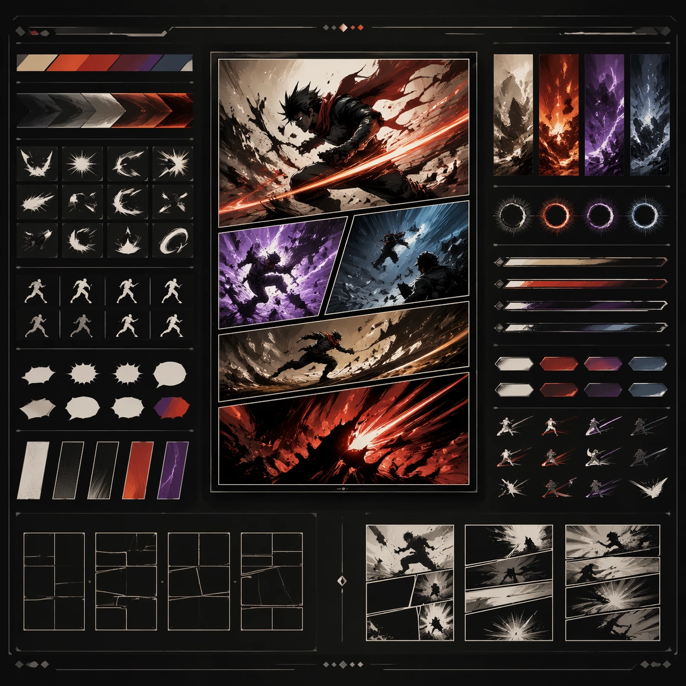

```text
Scene:
A square production-ready image designed for a game-art review wall and a commercial gallery at the same time. Frame a system-board layout for action beat comic page action beat comic page that organizes multiple related elements into one coherent review surface with disciplined lighting, clean edge separation, and enough surrounding context to prove how the asset would behave in a real product surface. The camera, crop, and tonal balance should feel intentional rather than generic, with high readability at first glance and convincing material response under closer inspection.

Subject:
Center the study on a system-board layout for action beat comic page action beat comic page that organizes multiple related elements into one coherent review surface. Translate the topic into a concrete, shippable visual statement instead of a loose mood board. Build layered object relationships, believable surface finish, and strong silhouette grouping so the image reads immediately as part of a action beat comic page action beat comic page visual system. The subject should feel made for a live game pipeline: useful in store, UI, campaign, or art-review contexts, with visual hierarchy strong enough to survive aggressive cropping.

Important details:
the board should feel design-ready and structured even though every label remains abstract. Keep every supporting element subordinate to the main read, and make category separation obvious through form, color zoning, depth, and material logic rather than words. Where panels, cards, badges, or interface blocks appear, they must look professionally structured but remain unreadable. The visual language should feel premium, original, and coherent across this package, with no filler clutter and no accidental resemblance to a specific shipped game IP.

Use case:
action beat comic page action beat comic page single study 3/5, focused on system board.

Constraints:
No readable text, no watermark, no logos, preserve exact 1:1 aspect ratio, no readable labels, no placeholder lorem ipsum, no broken hierarchy, no generic stock-photo staging, no accidental UI gibberish.
```

[Pinned source](https://github.com/ChaosRealmsAI/gpt-image-2-gallery/blob/5296db8c996e38776c83a0bc8c64f848dcd512b3/works/topics/action-beat-comic-page/packages/single-theme-extensions/images/system-board/meta.json) · GPT Image2 · 1254×1254 · No source-declared image dependencies. · ProjectD:pending individual review.

## Promo Crop · action-beat-comic-page/single-theme-extensions/promo-crop

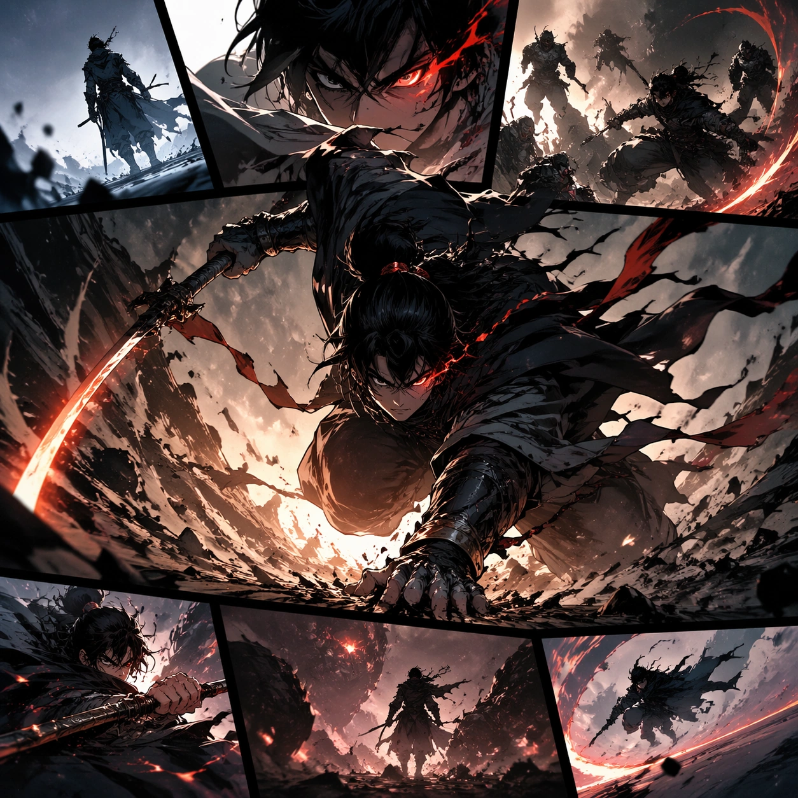

```text
Scene:
A square production-ready image designed for a game-art review wall and a commercial gallery at the same time. Frame a promo-oriented crop for action beat comic page action beat comic page optimized for social, storefront, or poster reuse with disciplined lighting, clean edge separation, and enough surrounding context to prove how the asset would behave in a real product surface. The camera, crop, and tonal balance should feel intentional rather than generic, with high readability at first glance and convincing material response under closer inspection.

Subject:
Center the study on a promo-oriented crop for action beat comic page action beat comic page optimized for social, storefront, or poster reuse. Translate the topic into a concrete, shippable visual statement instead of a loose mood board. Build layered object relationships, believable surface finish, and strong silhouette grouping so the image reads immediately as part of a action beat comic page action beat comic page visual system. The subject should feel made for a live game pipeline: useful in store, UI, campaign, or art-review contexts, with visual hierarchy strong enough to survive aggressive cropping.

Important details:
keep strong hierarchy and conversion energy without relying on explicit copy. Keep every supporting element subordinate to the main read, and make category separation obvious through form, color zoning, depth, and material logic rather than words. Where panels, cards, badges, or interface blocks appear, they must look professionally structured but remain unreadable. The visual language should feel premium, original, and coherent across this package, with no filler clutter and no accidental resemblance to a specific shipped game IP.

Use case:
action beat comic page action beat comic page single study 4/5, focused on promo crop.

Constraints:
No readable text, no watermark, no logos, preserve exact 1:1 aspect ratio, no slogans, no logos, no broken hierarchy, no generic stock-photo staging, no accidental UI gibberish.
```

[Pinned source](https://github.com/ChaosRealmsAI/gpt-image-2-gallery/blob/5296db8c996e38776c83a0bc8c64f848dcd512b3/works/topics/action-beat-comic-page/packages/single-theme-extensions/images/promo-crop/meta.json) · GPT Image2 · 1254×1254 · No source-declared image dependencies. · ProjectD:pending individual review.

## Finale Study · action-beat-comic-page/single-theme-extensions/finale-study

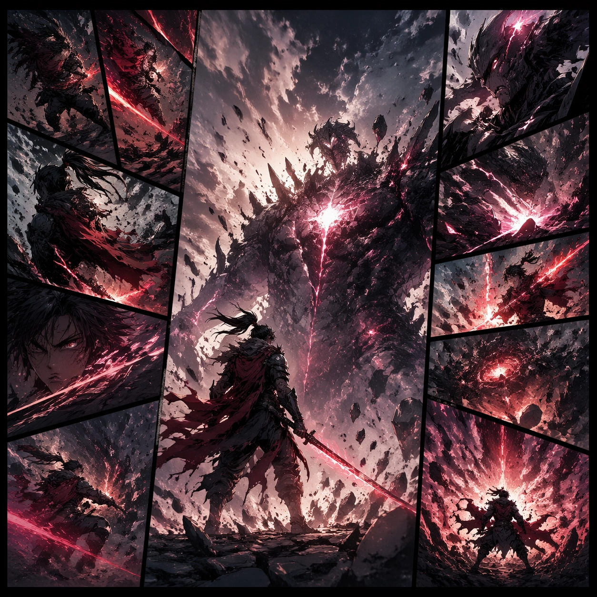

```text
Scene:
A square production-ready image designed for a game-art review wall and a commercial gallery at the same time. Frame a finale study for action beat comic page action beat comic page that pushes the topic to its most polished and complete expression with disciplined lighting, clean edge separation, and enough surrounding context to prove how the asset would behave in a real product surface. The camera, crop, and tonal balance should feel intentional rather than generic, with high readability at first glance and convincing material response under closer inspection.

Subject:
Center the study on a finale study for action beat comic page action beat comic page that pushes the topic to its most polished and complete expression. Translate the topic into a concrete, shippable visual statement instead of a loose mood board. Build layered object relationships, believable surface finish, and strong silhouette grouping so the image reads immediately as part of a action beat comic page action beat comic page visual system. The subject should feel made for a live game pipeline: useful in store, UI, campaign, or art-review contexts, with visual hierarchy strong enough to survive aggressive cropping.

Important details:
the closing image should feel definitive, high-signal, and suitable for feature placement. Keep every supporting element subordinate to the main read, and make category separation obvious through form, color zoning, depth, and material logic rather than words. Where panels, cards, badges, or interface blocks appear, they must look professionally structured but remain unreadable. The visual language should feel premium, original, and coherent across this package, with no filler clutter and no accidental resemblance to a specific shipped game IP.

Use case:
action beat comic page action beat comic page single study 5/5, focused on finale study.

Constraints:
No readable text, no watermark, no logos, preserve exact 1:1 aspect ratio, no text blocks, no derivative character likeness, no broken hierarchy, no generic stock-photo staging, no accidental UI gibberish.
```

[Pinned source](https://github.com/ChaosRealmsAI/gpt-image-2-gallery/blob/5296db8c996e38776c83a0bc8c64f848dcd512b3/works/topics/action-beat-comic-page/packages/single-theme-extensions/images/finale-study/meta.json) · GPT Image2 · 1254×1254 · No source-declared image dependencies. · ProjectD:pending individual review.

## Reference Portrait Anchor · actor-casting-portrait-sheet/series-portrait-brand-system/01-reference-portrait-anchor

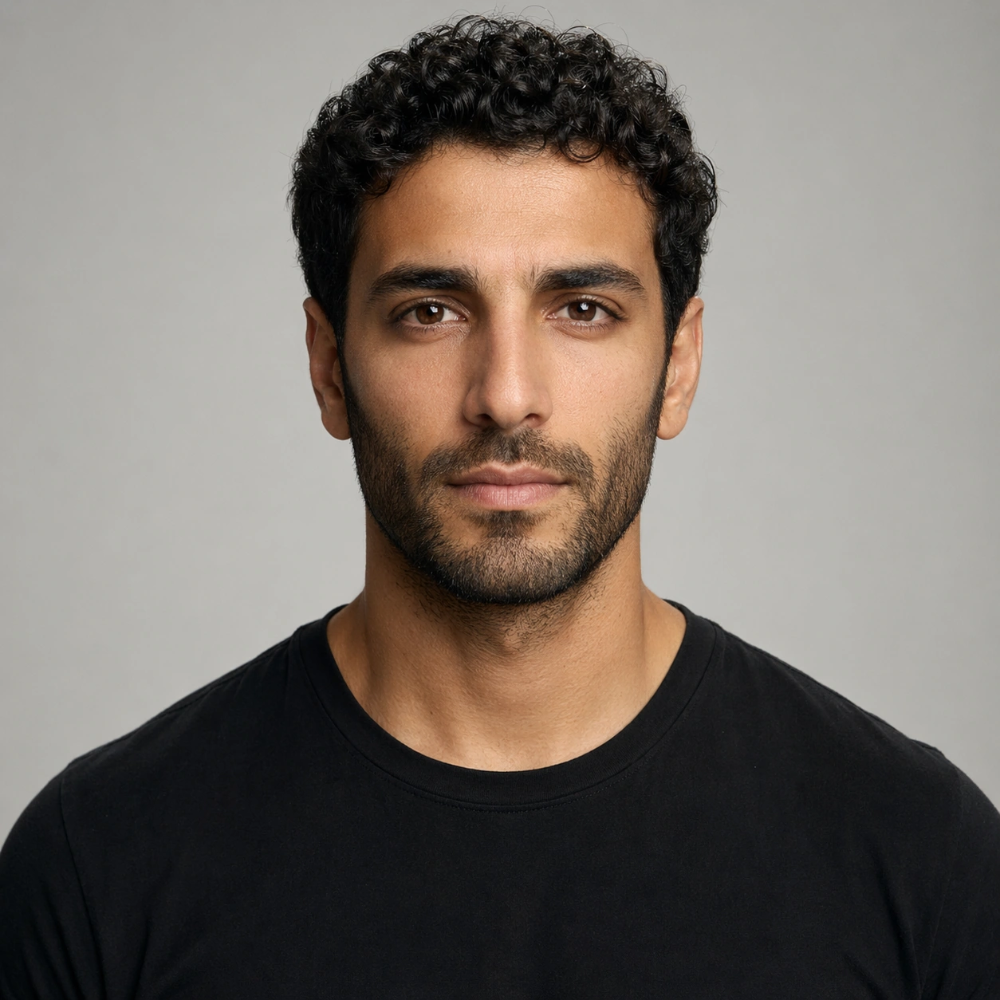

```text
Scene:
Create a square 1:1 portrait image for Actor Casting Portrait Sheet. Use a clean studio anchor with balanced soft light, neutral gray or off-white backdrop, and premium agency-grade framing. The frame should feel like a finished professional deliverable rather than a casual snapshot, with clear lens discipline, believable light falloff, and a palette that directly supports Create casting-ready portrait sheets for actors with clean framing, controlled expressions, minimal styling drift, and believable agency presentation.. Keep enough surrounding space and compositional control for gallery, research, campaign, or approval-board reuse while staying photoreal and human-scaled.

Subject:
Center one working actor with medium olive skin, short dark curls, straight nose, defined cheekbones, close-trimmed beard, and alert brown eyes. Establish the exact identity, skin tone family, hair base, and body read that every later image must reuse. Let the styling stay minimal and believable so the series begins from an authoritative baseline. Use the example direction from the brief as grounding context: Create casting-ready portrait sheets for actors with clean framing, controlled expressions, minimal styling drift, and believable agency presentation.. Wardrobe, lighting, environment, and pose may shift to serve this variation, but the viewer must immediately understand that the same reference identity is still in front of the camera.

Important details:
This backlog line is difficult because Create casting-ready portrait sheets for actors with clean framing, controlled expressions, minimal styling drift, and believable agency presentation.. Preserve skin tone family, bone structure, eye spacing, nose shape, mouth shape, hairline logic, shoulder width, and overall body read across the entire series. preserve exact face / hair base / body proportions from the reference model. Keep the crop polished, the eye line steady, and the wardrobe simple enough to survive later changes without confusion. Avoid the common failure described in the brief: ordinary image models often lose likeness once styling, lighting, or layout changes enter the frame. Success should feel like the result should feel professionally usable, coherent, and clearly built around one stable human identity.

Use case:
Actor Casting Portrait Sheet series study 1/9, the neutral baseline portrait proof.

Constraints:
No readable text, no watermark, no logos, preserve exact 1:1 aspect ratio, preserve exact face / hair base / body proportions from the reference model, no extra people, no hard fashion gimmicks, no exaggerated retouching, no broken eye alignment.
```

[Pinned source](https://github.com/ChaosRealmsAI/gpt-image-2-gallery/blob/5296db8c996e38776c83a0bc8c64f848dcd512b3/works/topics/actor-casting-portrait-sheet/packages/series-portrait-brand-system/images/01-reference-portrait-anchor/meta.json) · GPT Image2 · 1254×1254 · No source-declared image dependencies. · ProjectD:pending individual review.

## Clean Headshot · actor-casting-portrait-sheet/series-portrait-brand-system/02-clean-headshot


```text
Scene:
Create a square 1:1 portrait image for Actor Casting Portrait Sheet. Use a bright but controlled studio setup with crisp catchlights, smooth tonal falloff, and enough margin for usage as profile art. The frame should feel like a finished professional deliverable rather than a casual snapshot, with clear lens discipline, believable light falloff, and a palette that directly supports Create casting-ready portrait sheets for actors with clean framing, controlled expressions, minimal styling drift, and believable agency presentation.. Keep enough surrounding space and compositional control for gallery, research, campaign, or approval-board reuse while staying photoreal and human-scaled.

Subject:
Center one working actor with medium olive skin, short dark curls, straight nose, defined cheekbones, close-trimmed beard, and alert brown eyes. Preserve the same face while shifting the posture toward a more direct headshot deliverable. Styling may become slightly sharper, but the result still needs to read as the same person from image 01. Use the example direction from the brief as grounding context: Create casting-ready portrait sheets for actors with clean framing, controlled expressions, minimal styling drift, and believable agency presentation.. Wardrobe, lighting, environment, and pose may shift to serve this variation, but the viewer must immediately understand that the same reference identity is still in front of the camera.

Important details:
This backlog line is difficult because Create casting-ready portrait sheets for actors with clean framing, controlled expressions, minimal styling drift, and believable agency presentation.. Preserve skin tone family, bone structure, eye spacing, nose shape, mouth shape, hairline logic, shoulder width, and overall body read across the entire series. preserve exact face / hair base / body proportions from the reference model. This frame should feel reliable, publishable, and easy to crop for agency, website, or PR use. Avoid the common failure described in the brief: ordinary image models often lose likeness once styling, lighting, or layout changes enter the frame. Success should feel like the result should feel professionally usable, coherent, and clearly built around one stable human identity.

Use case:
Actor Casting Portrait Sheet series study 2/9, a clean corporate or editorial headshot.

Constraints:
No readable text, no watermark, no logos, preserve exact 1:1 aspect ratio, preserve exact face / hair base / body proportions from the reference model, no drifting age, no different haircut, no over-smoothed skin, no random jewelry clutter.
```

[Pinned source](https://github.com/ChaosRealmsAI/gpt-image-2-gallery/blob/5296db8c996e38776c83a0bc8c64f848dcd512b3/works/topics/actor-casting-portrait-sheet/packages/series-portrait-brand-system/images/02-clean-headshot/meta.json) · GPT Image2 · 1254×1254 · Reference images required. · ProjectD:pending individual review.

## Three-Quarter Hero · actor-casting-portrait-sheet/series-portrait-brand-system/03-three-quarter-hero

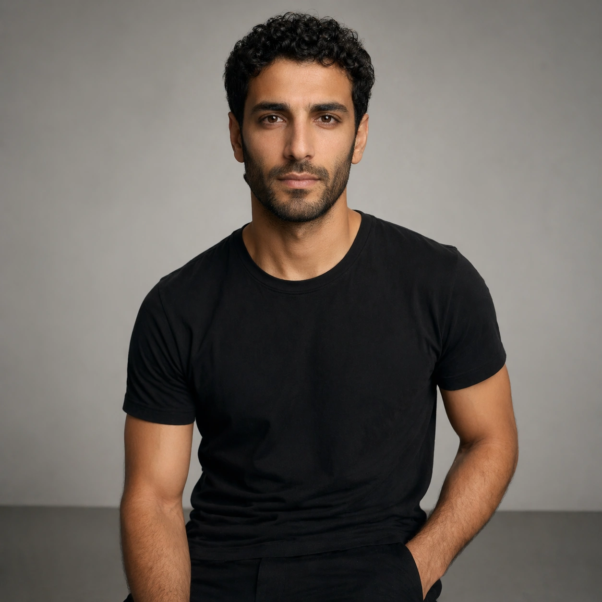

```text
Scene:
Create a square 1:1 portrait image for Actor Casting Portrait Sheet. Use a sculpted key light with subtle shadow modeling, clean negative space, and a slightly wider crop that still favors the face. The frame should feel like a finished professional deliverable rather than a casual snapshot, with clear lens discipline, believable light falloff, and a palette that directly supports Create casting-ready portrait sheets for actors with clean framing, controlled expressions, minimal styling drift, and believable agency presentation.. Keep enough surrounding space and compositional control for gallery, research, campaign, or approval-board reuse while staying photoreal and human-scaled.

Subject:
Center one working actor with medium olive skin, short dark curls, straight nose, defined cheekbones, close-trimmed beard, and alert brown eyes. Use the same identity and wardrobe family while introducing stronger body language through shoulders, hands, or a turn of the torso. The viewer should immediately recognize the same subject even though the composition becomes more campaign-like. Use the example direction from the brief as grounding context: Create casting-ready portrait sheets for actors with clean framing, controlled expressions, minimal styling drift, and believable agency presentation.. Wardrobe, lighting, environment, and pose may shift to serve this variation, but the viewer must immediately understand that the same reference identity is still in front of the camera.

Important details:
This backlog line is difficult because Create casting-ready portrait sheets for actors with clean framing, controlled expressions, minimal styling drift, and believable agency presentation.. Preserve skin tone family, bone structure, eye spacing, nose shape, mouth shape, hairline logic, shoulder width, and overall body read across the entire series. preserve exact face / hair base / body proportions from the reference model. Keep proportions stable and let the pose feel intentional rather than theatrical. Avoid the common failure described in the brief: ordinary image models often lose likeness once styling, lighting, or layout changes enter the frame. Success should feel like the result should feel professionally usable, coherent, and clearly built around one stable human identity.

Use case:
Actor Casting Portrait Sheet series study 3/9, a three-quarter portrait hero.

Constraints:
No readable text, no watermark, no logos, preserve exact 1:1 aspect ratio, preserve exact face / hair base / body proportions from the reference model, no warped arms, no off-model body shape, no new facial hair pattern, no unrelated props.
```

[Pinned source](https://github.com/ChaosRealmsAI/gpt-image-2-gallery/blob/5296db8c996e38776c83a0bc8c64f848dcd512b3/works/topics/actor-casting-portrait-sheet/packages/series-portrait-brand-system/images/03-three-quarter-hero/meta.json) · GPT Image2 · 1254×1254 · Reference images required. · ProjectD:pending individual review.

## Profile Study · actor-casting-portrait-sheet/series-portrait-brand-system/04-profile-study


```text
Scene:
Create a square 1:1 portrait image for Actor Casting Portrait Sheet. Use a disciplined side-light portrait with a smooth background, quiet contrast, and a calm editorial mood. The frame should feel like a finished professional deliverable rather than a casual snapshot, with clear lens discipline, believable light falloff, and a palette that directly supports Create casting-ready portrait sheets for actors with clean framing, controlled expressions, minimal styling drift, and believable agency presentation.. Keep enough surrounding space and compositional control for gallery, research, campaign, or approval-board reuse while staying photoreal and human-scaled.

Subject:
Center one working actor with medium olive skin, short dark curls, straight nose, defined cheekbones, close-trimmed beard, and alert brown eyes. Rotate the same person into a controlled profile study that proves nose bridge, jawline, ear shape, and hairline remain consistent with the reference model. Use the example direction from the brief as grounding context: Create casting-ready portrait sheets for actors with clean framing, controlled expressions, minimal styling drift, and believable agency presentation.. Wardrobe, lighting, environment, and pose may shift to serve this variation, but the viewer must immediately understand that the same reference identity is still in front of the camera.

Important details:
This backlog line is difficult because Create casting-ready portrait sheets for actors with clean framing, controlled expressions, minimal styling drift, and believable agency presentation.. Preserve skin tone family, bone structure, eye spacing, nose shape, mouth shape, hairline logic, shoulder width, and overall body read across the entire series. preserve exact face / hair base / body proportions from the reference model. Make the image useful for approval and continuity review, not merely stylistic for style alone. Avoid the common failure described in the brief: ordinary image models often lose likeness once styling, lighting, or layout changes enter the frame. Success should feel like the result should feel professionally usable, coherent, and clearly built around one stable human identity.

Use case:
Actor Casting Portrait Sheet series study 4/9, a profile or near-profile study.

Constraints:
No readable text, no watermark, no logos, preserve exact 1:1 aspect ratio, preserve exact face / hair base / body proportions from the reference model, no profile drift, no altered nose length, no ears changing shape, no chaotic flyaway hair.
```

[Pinned source](https://github.com/ChaosRealmsAI/gpt-image-2-gallery/blob/5296db8c996e38776c83a0bc8c64f848dcd512b3/works/topics/actor-casting-portrait-sheet/packages/series-portrait-brand-system/images/04-profile-study/meta.json) · GPT Image2 · 1254×1254 · Reference images required. · ProjectD:pending individual review.

## Approachable Smile · actor-casting-portrait-sheet/series-portrait-brand-system/05-approachable-smile


```text
Scene:
Create a square 1:1 portrait image for Actor Casting Portrait Sheet. Use a welcoming light setup with soft highlights, gentle warmth, and subtle environmental mood that still feels premium. The frame should feel like a finished professional deliverable rather than a casual snapshot, with clear lens discipline, believable light falloff, and a palette that directly supports Create casting-ready portrait sheets for actors with clean framing, controlled expressions, minimal styling drift, and believable agency presentation.. Keep enough surrounding space and compositional control for gallery, research, campaign, or approval-board reuse while staying photoreal and human-scaled.

Subject:
Center one working actor with medium olive skin, short dark curls, straight nose, defined cheekbones, close-trimmed beard, and alert brown eyes. Keep the same face and body proportions, but let the emotional register open up into a believable smile or softer public-facing energy. This should look like the same person relaxing, not a second talent hire. Use the example direction from the brief as grounding context: Create casting-ready portrait sheets for actors with clean framing, controlled expressions, minimal styling drift, and believable agency presentation.. Wardrobe, lighting, environment, and pose may shift to serve this variation, but the viewer must immediately understand that the same reference identity is still in front of the camera.

Important details:
This backlog line is difficult because Create casting-ready portrait sheets for actors with clean framing, controlled expressions, minimal styling drift, and believable agency presentation.. Preserve skin tone family, bone structure, eye spacing, nose shape, mouth shape, hairline logic, shoulder width, and overall body read across the entire series. preserve exact face / hair base / body proportions from the reference model. Expression change is allowed; identity change is not. Teeth, lips, eye crinkle, and cheeks should still fit the same bone structure. Avoid the common failure described in the brief: ordinary image models often lose likeness once styling, lighting, or layout changes enter the frame. Success should feel like the result should feel professionally usable, coherent, and clearly built around one stable human identity.

Use case:
Actor Casting Portrait Sheet series study 5/9, a warmer, approachable expression variation.

Constraints:
No readable text, no watermark, no logos, preserve exact 1:1 aspect ratio, preserve exact face / hair base / body proportions from the reference model, no changed teeth shape, no exaggerated laugh lines, no glamour filter skin, no mismatched eye color.
```

[Pinned source](https://github.com/ChaosRealmsAI/gpt-image-2-gallery/blob/5296db8c996e38776c83a0bc8c64f848dcd512b3/works/topics/actor-casting-portrait-sheet/packages/series-portrait-brand-system/images/05-approachable-smile/meta.json) · GPT Image2 · 1254×1254 · Reference images required. · ProjectD:pending individual review.

## Dark Backdrop Editorial · actor-casting-portrait-sheet/series-portrait-brand-system/06-dark-backdrop-editorial


```text
Scene:
Create a square 1:1 portrait image for Actor Casting Portrait Sheet. Use a black or charcoal backdrop with controlled rim light, richer shadow depth, and a still-readable face. The frame should feel like a finished professional deliverable rather than a casual snapshot, with clear lens discipline, believable light falloff, and a palette that directly supports Create casting-ready portrait sheets for actors with clean framing, controlled expressions, minimal styling drift, and believable agency presentation.. Keep enough surrounding space and compositional control for gallery, research, campaign, or approval-board reuse while staying photoreal and human-scaled.

Subject:
Center one working actor with medium olive skin, short dark curls, straight nose, defined cheekbones, close-trimmed beard, and alert brown eyes. Use moodier lighting and slightly bolder styling while maintaining the same face geometry, hairstyle base, and shoulder width from the anchor portrait. Use the example direction from the brief as grounding context: Create casting-ready portrait sheets for actors with clean framing, controlled expressions, minimal styling drift, and believable agency presentation.. Wardrobe, lighting, environment, and pose may shift to serve this variation, but the viewer must immediately understand that the same reference identity is still in front of the camera.

Important details:
This backlog line is difficult because Create casting-ready portrait sheets for actors with clean framing, controlled expressions, minimal styling drift, and believable agency presentation.. Preserve skin tone family, bone structure, eye spacing, nose shape, mouth shape, hairline logic, shoulder width, and overall body read across the entire series. preserve exact face / hair base / body proportions from the reference model. The image should prove the subject survives a more dramatic public-facing treatment without becoming a different person. Avoid the common failure described in the brief: ordinary image models often lose likeness once styling, lighting, or layout changes enter the frame. Success should feel like the result should feel professionally usable, coherent, and clearly built around one stable human identity.

Use case:
Actor Casting Portrait Sheet series study 6/9, a darker editorial portrait proof.

Constraints:
No readable text, no watermark, no logos, preserve exact 1:1 aspect ratio, preserve exact face / hair base / body proportions from the reference model, no crushed blacks, no hidden facial structure, no costume jump that breaks continuity, no dramatic age shift.
```

[Pinned source](https://github.com/ChaosRealmsAI/gpt-image-2-gallery/blob/5296db8c996e38776c83a0bc8c64f848dcd512b3/works/topics/actor-casting-portrait-sheet/packages/series-portrait-brand-system/images/06-dark-backdrop-editorial/meta.json) · GPT Image2 · 1254×1254 · Reference images required. · ProjectD:pending individual review.

## Banner Crop Portrait · actor-casting-portrait-sheet/series-portrait-brand-system/07-banner-crop-portrait


```text
Scene:
Create a square 1:1 portrait image for Actor Casting Portrait Sheet. Use a square frame that internally feels like a landscape-safe banner crop, with strong side negative space and a stable mid-shot. The frame should feel like a finished professional deliverable rather than a casual snapshot, with clear lens discipline, believable light falloff, and a palette that directly supports Create casting-ready portrait sheets for actors with clean framing, controlled expressions, minimal styling drift, and believable agency presentation.. Keep enough surrounding space and compositional control for gallery, research, campaign, or approval-board reuse while staying photoreal and human-scaled.

Subject:
Center one working actor with medium olive skin, short dark curls, straight nose, defined cheekbones, close-trimmed beard, and alert brown eyes. Keep the face exact, but compose the body and gaze so the portrait could be repurposed into website hero, interview banner, or campaign cover layouts. Use the example direction from the brief as grounding context: Create casting-ready portrait sheets for actors with clean framing, controlled expressions, minimal styling drift, and believable agency presentation.. Wardrobe, lighting, environment, and pose may shift to serve this variation, but the viewer must immediately understand that the same reference identity is still in front of the camera.

Important details:
This backlog line is difficult because Create casting-ready portrait sheets for actors with clean framing, controlled expressions, minimal styling drift, and believable agency presentation.. Preserve skin tone family, bone structure, eye spacing, nose shape, mouth shape, hairline logic, shoulder width, and overall body read across the entire series. preserve exact face / hair base / body proportions from the reference model. This image should feel adaptable, confident, and production-safe across multiple crop targets. Avoid the common failure described in the brief: ordinary image models often lose likeness once styling, lighting, or layout changes enter the frame. Success should feel like the result should feel professionally usable, coherent, and clearly built around one stable human identity.

Use case:
Actor Casting Portrait Sheet series study 7/9, a wider crop meant to survive cover or banner usage.

Constraints:
No readable text, no watermark, no logos, preserve exact 1:1 aspect ratio, preserve exact face / hair base / body proportions from the reference model, no empty dead space, no floating hands, no distorted shoulders, no fake browser chrome.
```

[Pinned source](https://github.com/ChaosRealmsAI/gpt-image-2-gallery/blob/5296db8c996e38776c83a0bc8c64f848dcd512b3/works/topics/actor-casting-portrait-sheet/packages/series-portrait-brand-system/images/07-banner-crop-portrait/meta.json) · GPT Image2 · 1254×1254 · Reference images required. · ProjectD:pending individual review.

## Monochrome Alt · actor-casting-portrait-sheet/series-portrait-brand-system/08-monochrome-alt


```text
Scene:
Create a square 1:1 portrait image for Actor Casting Portrait Sheet. Use a grayscale studio portrait with crisp tonal separation, refined skin rendering, and magazine-ready depth. The frame should feel like a finished professional deliverable rather than a casual snapshot, with clear lens discipline, believable light falloff, and a palette that directly supports Create casting-ready portrait sheets for actors with clean framing, controlled expressions, minimal styling drift, and believable agency presentation.. Keep enough surrounding space and compositional control for gallery, research, campaign, or approval-board reuse while staying photoreal and human-scaled.

Subject:
Center one working actor with medium olive skin, short dark curls, straight nose, defined cheekbones, close-trimmed beard, and alert brown eyes. Translate the same identity into a black-and-white treatment. The face, hair base, and body proportions must remain exact while color disappears and texture becomes more important. Use the example direction from the brief as grounding context: Create casting-ready portrait sheets for actors with clean framing, controlled expressions, minimal styling drift, and believable agency presentation.. Wardrobe, lighting, environment, and pose may shift to serve this variation, but the viewer must immediately understand that the same reference identity is still in front of the camera.

Important details:
This backlog line is difficult because Create casting-ready portrait sheets for actors with clean framing, controlled expressions, minimal styling drift, and believable agency presentation.. Preserve skin tone family, bone structure, eye spacing, nose shape, mouth shape, hairline logic, shoulder width, and overall body read across the entire series. preserve exact face / hair base / body proportions from the reference model. Do not let grayscale flatten the likeness; bone structure and micro-contrast must carry recognition. Avoid the common failure described in the brief: ordinary image models often lose likeness once styling, lighting, or layout changes enter the frame. Success should feel like the result should feel professionally usable, coherent, and clearly built around one stable human identity.

Use case:
Actor Casting Portrait Sheet series study 8/9, a monochrome alternate portrait.

Constraints:
No readable text, no watermark, no logos, preserve exact 1:1 aspect ratio, preserve exact face / hair base / body proportions from the reference model, no muddy grayscale, no retro film scratches, no blown highlights, no new hairstyle volume.
```

[Pinned source](https://github.com/ChaosRealmsAI/gpt-image-2-gallery/blob/5296db8c996e38776c83a0bc8c64f848dcd512b3/works/topics/actor-casting-portrait-sheet/packages/series-portrait-brand-system/images/08-monochrome-alt/meta.json) · GPT Image2 · 1254×1254 · Reference images required. · ProjectD:pending individual review.

## Approval Sheet Layout · actor-casting-portrait-sheet/series-portrait-brand-system/09-approval-sheet-layout


```text
Scene:
Create a square 1:1 portrait image for Actor Casting Portrait Sheet. Use a square layout that still reads as photography first, with restrained panel logic, tidy spacing, and agency-grade presentation cues but no readable text. The frame should feel like a finished professional deliverable rather than a casual snapshot, with clear lens discipline, believable light falloff, and a palette that directly supports Create casting-ready portrait sheets for actors with clean framing, controlled expressions, minimal styling drift, and believable agency presentation.. Keep enough surrounding space and compositional control for gallery, research, campaign, or approval-board reuse while staying photoreal and human-scaled.

Subject:
Center one working actor with medium olive skin, short dark curls, straight nose, defined cheekbones, close-trimmed beard, and alert brown eyes. Combine the same identity into a structured final board or polished hero frame that implies contact-sheet usability, campaign approval, or press-kit readiness. Keep the subject dominant and recognizable within the layout. Use the example direction from the brief as grounding context: Create casting-ready portrait sheets for actors with clean framing, controlled expressions, minimal styling drift, and believable agency presentation.. Wardrobe, lighting, environment, and pose may shift to serve this variation, but the viewer must immediately understand that the same reference identity is still in front of the camera.

Important details:
This backlog line is difficult because Create casting-ready portrait sheets for actors with clean framing, controlled expressions, minimal styling drift, and believable agency presentation.. Preserve skin tone family, bone structure, eye spacing, nose shape, mouth shape, hairline logic, shoulder width, and overall body read across the entire series. preserve exact face / hair base / body proportions from the reference model. Structured presentation is allowed, but the face must still be the star. Preserve exact face / hair base / body proportions from the reference model while making the overall page logic convincing. Avoid the common failure described in the brief: ordinary image models often lose likeness once styling, lighting, or layout changes enter the frame. Success should feel like the result should feel professionally usable, coherent, and clearly built around one stable human identity.

Use case:
Actor Casting Portrait Sheet series study 9/9, a polished approval-sheet or press-sheet finish.

Constraints:
No readable text, no watermark, no logos, preserve exact 1:1 aspect ratio, preserve exact face / hair base / body proportions from the reference model, no readable names, no slate numbers, no fake logos, no broken grid logic.
```

[Pinned source](https://github.com/ChaosRealmsAI/gpt-image-2-gallery/blob/5296db8c996e38776c83a0bc8c64f848dcd512b3/works/topics/actor-casting-portrait-sheet/packages/series-portrait-brand-system/images/09-approval-sheet-layout/meta.json) · GPT Image2 · 1254×1254 · Reference images required. · ProjectD:pending individual review.

## Foster Day Diary Card · adoption-and-rescue-awareness-kit/single-rescue-awareness-studies/02-foster-day-diary-card


```text
Scene:
A square adoption or rescue awareness visual designed for nonprofits, shelters, and community campaigns. Combine documentary style pet portraiture with organized communication layout, placeholder information zones, and enough polish to work across posters, social posts, event promotion, or donor materials. The frame should invite empathy and action without relying on guilt, shock, or clutter. Keep the visual system warm, dignified, and highly reusable. Build a clean apartment corner with daylight, soft textiles, and structured card framing that feels social-native and informative.

Subject:
Focus on one rescue or adoption story cue: hopeful portrait, foster care, bonded pair, senior pet dignity, volunteer support, event outreach, or successful home placement. Animals must remain central and treated with respect. Human presence can appear when it reinforces care or belonging, but the image should never become generic family advertising. The emotional tone should be humane, honest, and forward looking. Show a foster pet curled on a bed or couch with tentative but relaxed body language that communicates first stages of trust.

Important details:
Use clean nonprofit design signals such as modular card framing, gentle color blocks, bulletin space, and social-native hierarchy without readable text. Shelter environments should appear tidy and humane, not bleak. Show resilience, companionship, and possibility. The result should feel immediately useful for a real rescue team building an awareness kit, volunteer pack, event series, or donation appeal with credible imagery. The message is progress and care. Make the environment simple, real, and emotionally safe for nonprofit storytelling.

Use case:
Adoption and Rescue Awareness Kit single study 2/9, foster day diary card for a commercially reusable prompt atlas example.

Constraints:
No readable text, no watermark, no logos, preserve exact 1:1 aspect ratio, no trauma sensationalism, no chain fence misery clichés, no readable slogans, no disaster exploitation, no cluttered shelter chaos, no pity pose manipulation, no messy apartment, no dominant owner portrait, no scrapbook clutter overload.
```

[Pinned source](https://github.com/ChaosRealmsAI/gpt-image-2-gallery/blob/5296db8c996e38776c83a0bc8c64f848dcd512b3/works/topics/adoption-and-rescue-awareness-kit/packages/single-rescue-awareness-studies/images/02-foster-day-diary-card/meta.json) · GPT Image2 · 1254×1254 · No source-declared image dependencies. · ProjectD:pending individual review.

## Bonded Pair Awareness Board · adoption-and-rescue-awareness-kit/single-rescue-awareness-studies/03-bonded-pair-awareness-board


```text
Scene:
A square adoption or rescue awareness visual designed for nonprofits, shelters, and community campaigns. Combine documentary style pet portraiture with organized communication layout, placeholder information zones, and enough polish to work across posters, social posts, event promotion, or donor materials. The frame should invite empathy and action without relying on guilt, shock, or clutter. Keep the visual system warm, dignified, and highly reusable. Compose a square board with one shared portrait, a secondary close crop, and warm graphic modules suggesting an informative shelter card.

Subject:
Focus on one rescue or adoption story cue: hopeful portrait, foster care, bonded pair, senior pet dignity, volunteer support, event outreach, or successful home placement. Animals must remain central and treated with respect. Human presence can appear when it reinforces care or belonging, but the image should never become generic family advertising. The emotional tone should be humane, honest, and forward looking. Feature two animals with visible connection, such as touching shoulders, mirrored posture, or aligned gaze, while keeping each one distinct.

Important details:
Use clean nonprofit design signals such as modular card framing, gentle color blocks, bulletin space, and social-native hierarchy without readable text. Shelter environments should appear tidy and humane, not bleak. Show resilience, companionship, and possibility. The result should feel immediately useful for a real rescue team building an awareness kit, volunteer pack, event series, or donation appeal with credible imagery. The board should sell the emotional case for keeping the pair together without relying on sentimental overstatement.

Use case:
Adoption and Rescue Awareness Kit single study 3/9, bonded pair awareness board for a commercially reusable prompt atlas example.

Constraints:
No readable text, no watermark, no logos, preserve exact 1:1 aspect ratio, no trauma sensationalism, no chain fence misery clichés, no readable slogans, no disaster exploitation, no cluttered shelter chaos, no pity pose manipulation, no costume matching, no overcrowded kennel background, no cute gimmick props.
```

[Pinned source](https://github.com/ChaosRealmsAI/gpt-image-2-gallery/blob/5296db8c996e38776c83a0bc8c64f848dcd512b3/works/topics/adoption-and-rescue-awareness-kit/packages/single-rescue-awareness-studies/images/03-bonded-pair-awareness-board/meta.json) · GPT Image2 · 1254×1254 · No source-declared image dependencies. · ProjectD:pending individual review.

## Weekend Adoption Event Promo · adoption-and-rescue-awareness-kit/single-rescue-awareness-studies/04-weekend-adoption-event-promo


```text
Scene:
A square adoption or rescue awareness visual designed for nonprofits, shelters, and community campaigns. Combine documentary style pet portraiture with organized communication layout, placeholder information zones, and enough polish to work across posters, social posts, event promotion, or donor materials. The frame should invite empathy and action without relying on guilt, shock, or clutter. Keep the visual system warm, dignified, and highly reusable. Use an outdoor market or tidy community lawn setting with clean tents or tables softly blurred and structured promo blocks framing the pet.

Subject:
Focus on one rescue or adoption story cue: hopeful portrait, foster care, bonded pair, senior pet dignity, volunteer support, event outreach, or successful home placement. Animals must remain central and treated with respect. Human presence can appear when it reinforces care or belonging, but the image should never become generic family advertising. The emotional tone should be humane, honest, and forward looking. Show one featured adoptable pet sitting proudly in the foreground, with event atmosphere suggested but not dominant.

Important details:
Use clean nonprofit design signals such as modular card framing, gentle color blocks, bulletin space, and social-native hierarchy without readable text. Shelter environments should appear tidy and humane, not bleak. Show resilience, companionship, and possibility. The result should feel immediately useful for a real rescue team building an awareness kit, volunteer pack, event series, or donation appeal with credible imagery. The image should feel public facing, friendly, and actionable, suitable for social promotion, flyers, or local outreach kits.

Use case:
Adoption and Rescue Awareness Kit single study 4/9, weekend adoption event promo for a commercially reusable prompt atlas example.

Constraints:
No readable text, no watermark, no logos, preserve exact 1:1 aspect ratio, no trauma sensationalism, no chain fence misery clichés, no readable slogans, no disaster exploitation, no cluttered shelter chaos, no pity pose manipulation, no crowd chaos, no readable banners, no carnival aesthetic.
```

[Pinned source](https://github.com/ChaosRealmsAI/gpt-image-2-gallery/blob/5296db8c996e38776c83a0bc8c64f848dcd512b3/works/topics/adoption-and-rescue-awareness-kit/packages/single-rescue-awareness-studies/images/04-weekend-adoption-event-promo/meta.json) · GPT Image2 · 1254×1254 · No source-declared image dependencies. · ProjectD:pending individual review.

## Senior Pet Dignity Portrait · adoption-and-rescue-awareness-kit/single-rescue-awareness-studies/05-senior-pet-dignity-portrait


```text
Scene:
A square adoption or rescue awareness visual designed for nonprofits, shelters, and community campaigns. Combine documentary style pet portraiture with organized communication layout, placeholder information zones, and enough polish to work across posters, social posts, event promotion, or donor materials. The frame should invite empathy and action without relying on guilt, shock, or clutter. Keep the visual system warm, dignified, and highly reusable. Use quiet natural light and a minimal environment with mature earthy tones that respect the pet's age without turning somber.

Subject:
Focus on one rescue or adoption story cue: hopeful portrait, foster care, bonded pair, senior pet dignity, volunteer support, event outreach, or successful home placement. Animals must remain central and treated with respect. Human presence can appear when it reinforces care or belonging, but the image should never become generic family advertising. The emotional tone should be humane, honest, and forward looking. Show an older dog or cat with gentle eyes, visible age detail, and composed posture that reads as wisdom and companionship.

Important details:
Use clean nonprofit design signals such as modular card framing, gentle color blocks, bulletin space, and social-native hierarchy without readable text. Shelter environments should appear tidy and humane, not bleak. Show resilience, companionship, and possibility. The result should feel immediately useful for a real rescue team building an awareness kit, volunteer pack, event series, or donation appeal with credible imagery. Keep the portrait premium and honest. The goal is to reframe age as meaningful, not to beg for sympathy.

Use case:
Adoption and Rescue Awareness Kit single study 5/9, senior pet dignity portrait for a commercially reusable prompt atlas example.

Constraints:
No readable text, no watermark, no logos, preserve exact 1:1 aspect ratio, no trauma sensationalism, no chain fence misery clichés, no readable slogans, no disaster exploitation, no cluttered shelter chaos, no pity pose manipulation, no frailty exaggeration, no memorial styling, no neglect cues.
```

[Pinned source](https://github.com/ChaosRealmsAI/gpt-image-2-gallery/blob/5296db8c996e38776c83a0bc8c64f848dcd512b3/works/topics/adoption-and-rescue-awareness-kit/packages/single-rescue-awareness-studies/images/05-senior-pet-dignity-portrait/meta.json) · GPT Image2 · 1254×1254 · No source-declared image dependencies. · ProjectD:pending individual review.

## Shy Dog Trust Building Card · adoption-and-rescue-awareness-kit/single-rescue-awareness-studies/06-shy-dog-trust-building-card


```text
Scene:
A square adoption or rescue awareness visual designed for nonprofits, shelters, and community campaigns. Combine documentary style pet portraiture with organized communication layout, placeholder information zones, and enough polish to work across posters, social posts, event promotion, or donor materials. The frame should invite empathy and action without relying on guilt, shock, or clutter. Keep the visual system warm, dignified, and highly reusable. Create a sheltered indoor corner with soft light, calm neutral color, and discreet graphic blocks indicating an educational or update post.

Subject:
Focus on one rescue or adoption story cue: hopeful portrait, foster care, bonded pair, senior pet dignity, volunteer support, event outreach, or successful home placement. Animals must remain central and treated with respect. Human presence can appear when it reinforces care or belonging, but the image should never become generic family advertising. The emotional tone should be humane, honest, and forward looking. Show a timid dog beginning to relax, perhaps looking from behind a blanket edge or leaning slightly forward with cautious curiosity.

Important details:
Use clean nonprofit design signals such as modular card framing, gentle color blocks, bulletin space, and social-native hierarchy without readable text. Shelter environments should appear tidy and humane, not bleak. Show resilience, companionship, and possibility. The result should feel immediately useful for a real rescue team building an awareness kit, volunteer pack, event series, or donation appeal with credible imagery. This should feel like a progress update grounded in patience and safety, not a dramatic rescue reveal.

Use case:
Adoption and Rescue Awareness Kit single study 6/9, shy dog trust building card for a commercially reusable prompt atlas example.

Constraints:
No readable text, no watermark, no logos, preserve exact 1:1 aspect ratio, no trauma sensationalism, no chain fence misery clichés, no readable slogans, no disaster exploitation, no cluttered shelter chaos, no pity pose manipulation, no fear cowering extremes, no dark grim shelter mood, no intrusive human reaching hands.
```

[Pinned source](https://github.com/ChaosRealmsAI/gpt-image-2-gallery/blob/5296db8c996e38776c83a0bc8c64f848dcd512b3/works/topics/adoption-and-rescue-awareness-kit/packages/single-rescue-awareness-studies/images/06-shy-dog-trust-building-card/meta.json) · GPT Image2 · 1254×1254 · No source-declared image dependencies. · ProjectD:pending individual review.

## Volunteer Supply Drive Board · adoption-and-rescue-awareness-kit/single-rescue-awareness-studies/07-volunteer-supply-drive-board


```text
Scene:
A square adoption or rescue awareness visual designed for nonprofits, shelters, and community campaigns. Combine documentary style pet portraiture with organized communication layout, placeholder information zones, and enough polish to work across posters, social posts, event promotion, or donor materials. The frame should invite empathy and action without relying on guilt, shock, or clutter. Keep the visual system warm, dignified, and highly reusable. Arrange clean boxes of blankets, bowls, or food near a calm rescue pet, with square board framing that suggests a call-for-support asset.

Subject:
Focus on one rescue or adoption story cue: hopeful portrait, foster care, bonded pair, senior pet dignity, volunteer support, event outreach, or successful home placement. Animals must remain central and treated with respect. Human presence can appear when it reinforces care or belonging, but the image should never become generic family advertising. The emotional tone should be humane, honest, and forward looking. The pet should remain central, with supplies acting as evidence of community care and operational reality rather than pure product display.

Important details:
Use clean nonprofit design signals such as modular card framing, gentle color blocks, bulletin space, and social-native hierarchy without readable text. Shelter environments should appear tidy and humane, not bleak. Show resilience, companionship, and possibility. The result should feel immediately useful for a real rescue team building an awareness kit, volunteer pack, event series, or donation appeal with credible imagery. The board should feel logistical and warm at the same time, useful for volunteer drives, donation asks, and shelter updates.

Use case:
Adoption and Rescue Awareness Kit single study 7/9, volunteer supply drive board for a commercially reusable prompt atlas example.

Constraints:
No readable text, no watermark, no logos, preserve exact 1:1 aspect ratio, no trauma sensationalism, no chain fence misery clichés, no readable slogans, no disaster exploitation, no cluttered shelter chaos, no pity pose manipulation, no brand labels, no warehouse clutter, no guilt-heavy donation theatrics.
```

[Pinned source](https://github.com/ChaosRealmsAI/gpt-image-2-gallery/blob/5296db8c996e38776c83a0bc8c64f848dcd512b3/works/topics/adoption-and-rescue-awareness-kit/packages/single-rescue-awareness-studies/images/07-volunteer-supply-drive-board/meta.json) · GPT Image2 · 1254×1254 · No source-declared image dependencies. · ProjectD:pending individual review.

## Adoption Success Home Scene · adoption-and-rescue-awareness-kit/single-rescue-awareness-studies/08-adoption-success-home-scene


```text
Scene:
A square adoption or rescue awareness visual designed for nonprofits, shelters, and community campaigns. Combine documentary style pet portraiture with organized communication layout, placeholder information zones, and enough polish to work across posters, social posts, event promotion, or donor materials. The frame should invite empathy and action without relying on guilt, shock, or clutter. Keep the visual system warm, dignified, and highly reusable. Use a bright but restrained living room or porch scene with clean styling and one or two humans only partially visible as context.

Subject:
Focus on one rescue or adoption story cue: hopeful portrait, foster care, bonded pair, senior pet dignity, volunteer support, event outreach, or successful home placement. Animals must remain central and treated with respect. Human presence can appear when it reinforces care or belonging, but the image should never become generic family advertising. The emotional tone should be humane, honest, and forward looking. Show the adopted pet relaxed and attached to the new home environment, with belonging expressed through posture rather than overt staged hugs.

Important details:
Use clean nonprofit design signals such as modular card framing, gentle color blocks, bulletin space, and social-native hierarchy without readable text. Shelter environments should appear tidy and humane, not bleak. Show resilience, companionship, and possibility. The result should feel immediately useful for a real rescue team building an awareness kit, volunteer pack, event series, or donation appeal with credible imagery. The message is stable placement and happy transition. Keep the tone credible, calm, and nonprofit appropriate.

Use case:
Adoption and Rescue Awareness Kit single study 8/9, adoption success home scene for a commercially reusable prompt atlas example.

Constraints:
No readable text, no watermark, no logos, preserve exact 1:1 aspect ratio, no trauma sensationalism, no chain fence misery clichés, no readable slogans, no disaster exploitation, no cluttered shelter chaos, no pity pose manipulation, no stock family grin lineup, no oversized moving boxes, no sentimental blur overload.
```

[Pinned source](https://github.com/ChaosRealmsAI/gpt-image-2-gallery/blob/5296db8c996e38776c83a0bc8c64f848dcd512b3/works/topics/adoption-and-rescue-awareness-kit/packages/single-rescue-awareness-studies/images/08-adoption-success-home-scene/meta.json) · GPT Image2 · 1254×1254 · No source-declared image dependencies. · ProjectD:pending individual review.

## Mobile Rescue Van Awareness · adoption-and-rescue-awareness-kit/single-rescue-awareness-studies/09-mobile-rescue-van-awareness


```text
Scene:
A square adoption or rescue awareness visual designed for nonprofits, shelters, and community campaigns. Combine documentary style pet portraiture with organized communication layout, placeholder information zones, and enough polish to work across posters, social posts, event promotion, or donor materials. The frame should invite empathy and action without relying on guilt, shock, or clutter. Keep the visual system warm, dignified, and highly reusable. Stage a tidy street or community curbside scene with a rescue vehicle silhouette, portable setup cues, and structured public information blocks.

Subject:
Focus on one rescue or adoption story cue: hopeful portrait, foster care, bonded pair, senior pet dignity, volunteer support, event outreach, or successful home placement. Animals must remain central and treated with respect. Human presence can appear when it reinforces care or belonging, but the image should never become generic family advertising. The emotional tone should be humane, honest, and forward looking. Feature one rescue pet in the foreground with the mobile support context clearly visible but visually secondary.

Important details:
Use clean nonprofit design signals such as modular card framing, gentle color blocks, bulletin space, and social-native hierarchy without readable text. Shelter environments should appear tidy and humane, not bleak. Show resilience, companionship, and possibility. The result should feel immediately useful for a real rescue team building an awareness kit, volunteer pack, event series, or donation appeal with credible imagery. The board should feel operational, civic, and hopeful, suitable for awareness campaigns, volunteer recruitment, or public education.

Use case:
Adoption and Rescue Awareness Kit single study 9/9, mobile rescue van awareness for a commercially reusable prompt atlas example.

Constraints:
No readable text, no watermark, no logos, preserve exact 1:1 aspect ratio, no trauma sensationalism, no chain fence misery clichés, no readable slogans, no disaster exploitation, no cluttered shelter chaos, no pity pose manipulation, no emergency siren drama, no disaster scene backdrop, no readable vehicle branding.
```

[Pinned source](https://github.com/ChaosRealmsAI/gpt-image-2-gallery/blob/5296db8c996e38776c83a0bc8c64f848dcd512b3/works/topics/adoption-and-rescue-awareness-kit/packages/single-rescue-awareness-studies/images/09-mobile-rescue-van-awareness/meta.json) · GPT Image2 · 1254×1254 · No source-declared image dependencies. · ProjectD:pending individual review.

## Reference Midnight Transmitter · album-cover-and-single-rollout-system/series-release-identity/01-reference-midnight-transmitter


```text
Scene:
A square album-cover hero image staged on a rain-dark street set with reflective pavement, controlled haze, and a luminous circular rig suspended behind the performer. The camera is chest-high and centered, with cobalt shadows, ember highlights, and enough negative space around the figure to feel publishable as a premium release cover rather than a random portrait.

Subject:
An invented solo musician stands still and frontal in the middle of the frame, wearing a cropped silver jacket over a black knit layer, with dark braided hair, a clean jawline, and a geometric ear cuff. This image must lock the exact face shape, hair base, body proportions, jacket silhouette, and calm stare that later rollout images will inherit.

Important details:
Treat this as the root identity reference for a full release cycle. Keep the visual language tactile and modern: concentric light rings, diagonal reflections in puddles, soft film grain, restrained fog, and a disciplined cover hierarchy with empty zones where future release metadata could sit. The result should feel like a credible album campaign that could extend into multiple cover variants without losing ownership.

Use case:
Album Rollout series study 1/9 for the Album Cover and Single Rollout System Prompt Atlas theme.

Constraints:
No readable text, no watermark, no logos, preserve exact 1:1 aspect ratio, no crowd, no microphone in hand, no collage fragments, no duplicated performer, no extra props blocking the halo motif
```

[Pinned source](https://github.com/ChaosRealmsAI/gpt-image-2-gallery/blob/5296db8c996e38776c83a0bc8c64f848dcd512b3/works/topics/album-cover-and-single-rollout-system/packages/series-release-identity/images/01-reference-midnight-transmitter/meta.json) · GPT Image2 · 1254×1254 · No source-declared image dependencies. · ProjectD:pending individual review.

## Single After Rain · album-cover-and-single-rollout-system/series-release-identity/02-single-after-rain


```text
Scene:
A square single-cover frame set in the same release universe, now closer to the performer and surrounded by rain streaks, reflected brake-light color, and a slightly lower camera angle that adds urgency without breaking the premium cover language. The environment should still feel like the same wet-night world established by the reference image, just pushed toward momentum.

Subject:
Preserve the same performer from the reference image with the exact same face structure, hair base, body proportions, and jacket silhouette. The musician is now turning slightly off-center, catching neon reflections across one cheekbone and shoulder, while the circular rig becomes a broken halo echoed in the puddles below.

Important details:
This image represents a single release inside the same campaign. Maintain the analog-neon palette, disciplined empty text zones, and cinematic realism from the reference, but introduce faster rain lines, tighter crop energy, and a stronger sense of release-week urgency. The performer must remain unmistakably identical to the reference model, and the campaign symbol system of rings and diagonal cuts must still anchor the composition.

Use case:
Album Rollout series study 2/9 for the Album Cover and Single Rollout System Prompt Atlas theme.

Constraints:
No readable text, no watermark, no logos, preserve exact 1:1 aspect ratio, preserve the exact reference face, hair base, and body proportions; no new wardrobe category, no hard daylight, no audience, no busy city signage, no abstract color explosions
```

[Pinned source](https://github.com/ChaosRealmsAI/gpt-image-2-gallery/blob/5296db8c996e38776c83a0bc8c64f848dcd512b3/works/topics/album-cover-and-single-rollout-system/packages/series-release-identity/images/02-single-after-rain/meta.json) · GPT Image2 · 1254×1254 · Reference images required. · ProjectD:pending individual review.

## EP Strobe Platform · album-cover-and-single-rollout-system/series-release-identity/03-ep-strobe-platform


```text
Scene:
A square EP-cover composition unfolding on a glossy transit-platform set with long vanishing floor reflections, suspended light bars, and cool vapor hanging near the ground. The shot stays centered and controlled, but the background geometry feels more architectural and rhythmic than the original street setup.

Subject:
Preserve the exact same performer from the reference model, including face shape, braided hair base, body proportions, and jacket silhouette. The musician stands on a slightly raised platform between strobing vertical light bars, with one hand relaxed at the side and the same composed stage presence carried forward into a more architectural release mood.

Important details:
The campaign must still read as one owned visual system rather than a disconnected poster. Keep the same ring-derived motif language, wet reflections, and moody cobalt-to-ember palette, but let the environment shift into platform geometry and pulse-light repetition. This should feel like an EP branch of the same rollout, maintaining exact identity continuity while widening the world-building.

Use case:
Album Rollout series study 3/9 for the Album Cover and Single Rollout System Prompt Atlas theme.

Constraints:
No readable text, no watermark, no logos, preserve exact 1:1 aspect ratio, preserve the exact reference face, hair base, and body proportions; no train vehicles, no readable station graphics, no hard costume change, no fisheye distortion, no cluttered background extras
```

[Pinned source](https://github.com/ChaosRealmsAI/gpt-image-2-gallery/blob/5296db8c996e38776c83a0bc8c64f848dcd512b3/works/topics/album-cover-and-single-rollout-system/packages/series-release-identity/images/03-ep-strobe-platform/meta.json) · GPT Image2 · 1254×1254 · Reference images required. · ProjectD:pending individual review.

## Deluxe Dawn Vinyl · album-cover-and-single-rollout-system/series-release-identity/04-deluxe-dawn-vinyl


```text
Scene:
A square deluxe-edition cover staged at blue-hour tipping into dawn, with the same reflective ground plane now catching warmer copper light, softened fog, and a calmer horizon glow. The frame should feel more expansive and collectible, as if closing the release cycle with a premium edition rather than a debut drop.

Subject:
Preserve the same performer from the reference image with exact face structure, hair base, body proportions, and jacket silhouette. The musician remains centered and composed, but the lighting wraps more softly around the face and shoulders, while the ring motif opens wider and feels more ceremonial behind the figure.

Important details:
Maintain the same campaign grammar established by the master cover: restrained symbolism, tactile reflections, and realistic atmospheric polish. The deluxe variation should not invent a new identity; it should feel like the final, elevated chapter of the same release system, with warmer dawn color, richer metallic surfaces, and extra breathing room that suggests a collector release without relying on readable typography.

Use case:
Album Rollout series study 4/9 for the Album Cover and Single Rollout System Prompt Atlas theme.

Constraints:
No readable text, no watermark, no logos, preserve exact 1:1 aspect ratio, preserve the exact reference face, hair base, and body proportions; no bright sunrise sky, no extra characters, no vinyl record prop covering the body, no random graphic stickers, no flat studio backdrop
```

[Pinned source](https://github.com/ChaosRealmsAI/gpt-image-2-gallery/blob/5296db8c996e38776c83a0bc8c64f848dcd512b3/works/topics/album-cover-and-single-rollout-system/packages/series-release-identity/images/04-deluxe-dawn-vinyl/meta.json) · GPT Image2 · 1254×1254 · Reference images required. · ProjectD:pending individual review.

## Streaming Tile Crop · album-cover-and-single-rollout-system/single-rollout-assets/streaming-tile-crop


```text
Scene:
A square promotional tile designed for tiny-size visibility, using a dark field, one strong figure silhouette, sharp edge lighting, and a bold circular glow tucked behind the subject. The frame should read instantly even at small scale, with large shape contrast and a disciplined balance between dead space and focal energy.

Subject:
A lone invented musician appears as a reduced crop from shoulder to crown, framed by a halo-like light disc and slices of reflective rain. The image should feel like the kind of release-week asset a streaming service would use for a profile row, but without any platform branding or readable metadata.

Important details:
Prioritize thumbnail legibility, emotional clarity, and campaign coherence. The subject must feel music-industry credible, not generic fashion portraiture. Keep the palette tightly controlled, let the circular light carry the recognition cue, and use one or two high-contrast reflections to imply motion and sound. The composition should clearly reserve space for future overlays without rendering actual words.

Use case:
Album Rollout single study 6/9 for the Album Cover and Single Rollout System Prompt Atlas theme.

Constraints:
No readable text, no watermark, no logos, preserve exact 1:1 aspect ratio, no extra people, no detailed city skyline, no collage border, no readable interface text, no busy background texture that breaks small-size clarity
```

[Pinned source](https://github.com/ChaosRealmsAI/gpt-image-2-gallery/blob/5296db8c996e38776c83a0bc8c64f848dcd512b3/works/topics/album-cover-and-single-rollout-system/packages/single-rollout-assets/images/streaming-tile-crop/meta.json) · GPT Image2 · 1254×1254 · No source-declared image dependencies. · ProjectD:pending individual review.

## Announcement Poster Wall · album-cover-and-single-rollout-system/single-rollout-assets/announcement-poster-wall


```text
Scene:
A square documentary-style photograph of an urban wall layered with multiple matching release posters, shot straight-on so the poster grid fills most of the frame. Torn paper edges, damp concrete, and faint night reflections should make the scene tactile, while the posters themselves share one coherent visual identity.

Subject:
Each poster shows the same invented music-campaign language: one central performer silhouette, circular backlight, and a moody rain-dark palette. The posters should look freshly pasted and slightly wrinkled, creating the sense of a real street rollout for a new record while still avoiding any readable band names or dates.

Important details:
The point is not gritty chaos but credible campaign deployment. Keep the poster family consistent in crop logic and symbol system, let the environment feel damp and urban, and use repetition to sell ownership. The poster faces can be partially obscured by tears or overlaps, but the release identity must still read clearly from shape, tone, and motif.

Use case:
Album Rollout single study 7/9 for the Album Cover and Single Rollout System Prompt Atlas theme.

Constraints:
No readable text, no watermark, no logos, preserve exact 1:1 aspect ratio, no brands on nearby walls, no pedestrians stealing focus, no graffiti text, no daylight, no random unrelated posters in the composition
```

[Pinned source](https://github.com/ChaosRealmsAI/gpt-image-2-gallery/blob/5296db8c996e38776c83a0bc8c64f848dcd512b3/works/topics/album-cover-and-single-rollout-system/packages/single-rollout-assets/images/announcement-poster-wall/meta.json) · GPT Image2 · 1254×1254 · No source-declared image dependencies. · ProjectD:pending individual review.

## Cassette Flatlay Study · album-cover-and-single-rollout-system/single-rollout-assets/cassette-flatlay-study


```text
Scene:
A square top-down flat lay on smoked acrylic with a transparent cassette, folded insert cards, metallic foil strip, and soft pooled light that creates moody reflections around the edges. The materials should feel physically believable, with subtle dust, fingerprints, and packaging creases that add realism.

Subject:
The subject is a complete collector-style analog package for an invented record, organized with careful spacing and a few symbolic visual cues borrowed from the release world: concentric circles, diagonal light cuts, and a cobalt-ember palette. The packaging should feel premium and contemporary rather than nostalgic costume play.

Important details:
Use material realism and layout discipline to imply a music release with tangible desirability. Every object should look intentionally designed for the same campaign family, but there should be no readable track list or label copy. Favor translucent plastics, reflective foil, matte card stock, and small metallic hardware that catches light in a restrained way.

Use case:
Album Rollout single study 8/9 for the Album Cover and Single Rollout System Prompt Atlas theme.

Constraints:
No readable text, no watermark, no logos, preserve exact 1:1 aspect ratio, no vinyl record dominating the frame, no shipping box, no consumer electronics brand cues, no fake price sticker, no clutter outside the packaging system
```

[Pinned source](https://github.com/ChaosRealmsAI/gpt-image-2-gallery/blob/5296db8c996e38776c83a0bc8c64f848dcd512b3/works/topics/album-cover-and-single-rollout-system/packages/single-rollout-assets/images/cassette-flatlay-study/meta.json) · GPT Image2 · 1254×1254 · No source-declared image dependencies. · ProjectD:pending individual review.

## Sticker Sheet Promo · album-cover-and-single-rollout-system/single-rollout-assets/sticker-sheet-promo


```text
Scene:
A square tabletop promo image showing a die-cut sticker sheet laid on a matte dark surface, lit with soft raking light so the cut contours and satin finish are visible. The sheet should feel contemporary and collectible, like a merch add-on included in a release bundle.

Subject:
The sticker sheet contains an invented performer portrait, concentric ring fragments, abstract rain slashes, metallic icons, and a few shape-only banners reserved for future metadata. Nothing should be readable, but the arrangement must still feel like a coherent release accessory tied to a specific music campaign.

Important details:
Keep the composition graphic, clean, and merch-ready. Use die-cut outlines, restrained foil accents, and strong spacing so each sticker reads individually while the whole sheet still feels curated. The imagery should translate the campaign language into smaller collectible units without turning into a childish cartoon product.

Use case:
Album Rollout single study 9/9 for the Album Cover and Single Rollout System Prompt Atlas theme.

Constraints:
No readable text, no watermark, no logos, preserve exact 1:1 aspect ratio, no playful mascot style, no handwriting, no notebook props, no rainbow clutter, no extra packaging outside the single sticker sheet
```

[Pinned source](https://github.com/ChaosRealmsAI/gpt-image-2-gallery/blob/5296db8c996e38776c83a0bc8c64f848dcd512b3/works/topics/album-cover-and-single-rollout-system/packages/single-rollout-assets/images/sticker-sheet-promo/meta.json) · GPT Image2 · 1254×1254 · No source-declared image dependencies. · ProjectD:pending individual review.

## Ecology Atlas Anchor · alien-ecology-field-guide-system/series-core-system/01-ecology-atlas-anchor


```text
Scene:
Create a square field-guide plate for an alien ecosystem, mixing specimen staging, habitat fragments, and diagrammatic order into one clean composition. The image should feel like a premium scientific editorial board with careful spacing, controlled backgrounds, and enough environmental cues to imply a larger biosphere. Keep the camera or layout disciplined so the viewer can study relationships between species, organs, and habitat layers. Arrange a central habitat panel with specimen insets, root structures, glider organisms, and membrane pools all tied to one teal-violet wetland palette.

Subject:
Center the image on a strange but internally patterned ecology: organisms, growth forms, spores, membranes, roots, shells, or flying bodies that clearly belong to the same world. Their silhouettes and textures should feel novel, yet their anatomical logic, habitat relationship, and life-cycle clues should read as coherent rather than random fantasy. Establish the reference guide language through one primary flora form, one mid-scale fauna type, one micro-detail window, and one habitat cross-section.

Important details:
Use scientific realism without readable text. Unlabeled callout lines, scale markers, specimen windows, and sectional insets may appear, but the hierarchy must remain visual. Preserve a disciplined palette tied to one habitat so the package reads as a reusable guide system rather than a collection of unrelated creature paintings. The first image must define spacing, callout style, specimen framing, and the ecosystem color logic for the series. Resolve the anchor rules that later reference-dependent variants must inherit, especially the plate layout, habitat palette, anatomical callout grammar, and specimen scale cues.

Use case:
Alien Ecology series study 1/4, designed as a reusable core-system image for this topic.

Constraints:
No readable text, no watermark, no logos, preserve exact 1:1 aspect ratio, no humanoid monsters, no fantasy dragons, no horror gore, no readable labels, no text labels, no museum taxidermy staging.
```

[Pinned source](https://github.com/ChaosRealmsAI/gpt-image-2-gallery/blob/5296db8c996e38776c83a0bc8c64f848dcd512b3/works/topics/alien-ecology-field-guide-system/packages/series-core-system/images/01-ecology-atlas-anchor/meta.json) · GPT Image2 · 1254×1254 · No source-declared image dependencies. · ProjectD:pending individual review.

## Nocturnal Pollinator Cycle · alien-ecology-field-guide-system/series-core-system/02-nocturnal-pollinator-cycle


```text
Scene:
Create a square field-guide plate for an alien ecosystem, mixing specimen staging, habitat fragments, and diagrammatic order into one clean composition. The image should feel like a premium scientific editorial board with careful spacing, controlled backgrounds, and enough environmental cues to imply a larger biosphere. Keep the camera or layout disciplined so the viewer can study relationships between species, organs, and habitat layers. Keep the same board structure but shift the palette into low-light blues and bioluminescent accents as blooms open across a night version of the habitat.

Subject:
Center the image on a strange but internally patterned ecology: organisms, growth forms, spores, membranes, roots, shells, or flying bodies that clearly belong to the same world. Their silhouettes and textures should feel novel, yet their anatomical logic, habitat relationship, and life-cycle clues should read as coherent rather than random fantasy. Preserve the reference specimen layout while replacing the central protagonist with winged pollinators, bloom organs, and reproductive transfer paths.

Important details:
Use scientific realism without readable text. Unlabeled callout lines, scale markers, specimen windows, and sectional insets may appear, but the hierarchy must remain visual. Preserve a disciplined palette tied to one habitat so the package reads as a reusable guide system rather than a collection of unrelated creature paintings. Night lighting should remain analytical and readable, using glow only to explain ecological function rather than create fantasy fireworks. Preserve the exact structural language established by the reference image, especially the plate layout, habitat palette, anatomical callout grammar, and specimen scale cues.

Use case:
Alien Ecology series study 2/4, designed as a reusable core-system image for this topic.

Constraints:
No readable text, no watermark, no logos, preserve exact 1:1 aspect ratio, no humanoid monsters, no fantasy dragons, no horror gore, no readable labels, no magical fairy swarm.
```

[Pinned source](https://github.com/ChaosRealmsAI/gpt-image-2-gallery/blob/5296db8c996e38776c83a0bc8c64f848dcd512b3/works/topics/alien-ecology-field-guide-system/packages/series-core-system/images/02-nocturnal-pollinator-cycle/meta.json) · GPT Image2 · 1254×1254 · Reference images required. · ProjectD:pending individual review.

## Predator Prey Chain · alien-ecology-field-guide-system/series-core-system/03-predator-prey-chain


```text
Scene:
Create a square field-guide plate for an alien ecosystem, mixing specimen staging, habitat fragments, and diagrammatic order into one clean composition. The image should feel like a premium scientific editorial board with careful spacing, controlled backgrounds, and enough environmental cues to imply a larger biosphere. Keep the camera or layout disciplined so the viewer can study relationships between species, organs, and habitat layers. Build the same clean plate around one controlled chase sequence, habitat fragments, digestive anatomy cutaways, and terrain markers within the same biome.

Subject:
Center the image on a strange but internally patterned ecology: organisms, growth forms, spores, membranes, roots, shells, or flying bodies that clearly belong to the same world. Their silhouettes and textures should feel novel, yet their anatomical logic, habitat relationship, and life-cycle clues should read as coherent rather than random fantasy. Keep specimen windows and habitat grammar consistent while revealing how larger hunters, smaller grazers, and plant defenses lock together.

Important details:
Use scientific realism without readable text. Unlabeled callout lines, scale markers, specimen windows, and sectional insets may appear, but the hierarchy must remain visual. Preserve a disciplined palette tied to one habitat so the package reads as a reusable guide system rather than a collection of unrelated creature paintings. The board should feel ecological rather than violent, using composition to explain relationships instead of action spectacle. Preserve the exact structural language established by the reference image, especially the plate layout, habitat palette, anatomical callout grammar, and specimen scale cues.

Use case:
Alien Ecology series study 3/4, designed as a reusable core-system image for this topic.

Constraints:
No readable text, no watermark, no logos, preserve exact 1:1 aspect ratio, no humanoid monsters, no fantasy dragons, no horror gore, no readable labels, no gore, no monster battle framing.
```

[Pinned source](https://github.com/ChaosRealmsAI/gpt-image-2-gallery/blob/5296db8c996e38776c83a0bc8c64f848dcd512b3/works/topics/alien-ecology-field-guide-system/packages/series-core-system/images/03-predator-prey-chain/meta.json) · GPT Image2 · 1254×1254 · Reference images required. · ProjectD:pending individual review.

## Seasonal Mutation Atlas · alien-ecology-field-guide-system/series-core-system/04-seasonal-mutation-atlas


```text
Scene:
Create a square field-guide plate for an alien ecosystem, mixing specimen staging, habitat fragments, and diagrammatic order into one clean composition. The image should feel like a premium scientific editorial board with careful spacing, controlled backgrounds, and enough environmental cues to imply a larger biosphere. Keep the camera or layout disciplined so the viewer can study relationships between species, organs, and habitat layers. Retain the same overall layout but divide the square into seasonal habitat states, with specimen windows and growth stages orbiting a stable central terrain profile.

Subject:
Center the image on a strange but internally patterned ecology: organisms, growth forms, spores, membranes, roots, shells, or flying bodies that clearly belong to the same world. Their silhouettes and textures should feel novel, yet their anatomical logic, habitat relationship, and life-cycle clues should read as coherent rather than random fantasy. Preserve the anchor board grammar while showing how organisms alter color, membrane density, or body shape across environmental cycles.

Important details:
Use scientific realism without readable text. Unlabeled callout lines, scale markers, specimen windows, and sectional insets may appear, but the hierarchy must remain visual. Preserve a disciplined palette tied to one habitat so the package reads as a reusable guide system rather than a collection of unrelated creature paintings. Variation should feel patterned and evolutionary, not random, with each seasonal change clearly tied back to climate or resource cues. Preserve the exact structural language established by the reference image, especially the plate layout, habitat palette, anatomical callout grammar, and specimen scale cues.

Use case:
Alien Ecology series study 4/4, designed as a reusable core-system image for this topic.

Constraints:
No readable text, no watermark, no logos, preserve exact 1:1 aspect ratio, no humanoid monsters, no fantasy dragons, no horror gore, no readable labels, no rainbow chaos, no magical transformation tropes.
```

[Pinned source](https://github.com/ChaosRealmsAI/gpt-image-2-gallery/blob/5296db8c996e38776c83a0bc8c64f848dcd512b3/works/topics/alien-ecology-field-guide-system/packages/series-core-system/images/04-seasonal-mutation-atlas/meta.json) · GPT Image2 · 1254×1254 · Reference images required. · ProjectD:pending individual review.

## Basin Microbiome Plate · alien-ecology-field-guide-system/single-support-studies/01-basin-microbiome-plate


```text
Scene:
Design a square alien-naturalist board that could live inside a field guide, exhibition panel, or worldbuilding deck. Treat the background and layout as part of the scientific storytelling, not as empty filler. Compose a board where one mineral basin is shown at macro scale and linked visually to translucent microbial colonies, membrane foams, and sediment lattices.

Subject:
Show one ecosystem component clearly enough to study: species, colony, migration route, terrain patch, or microbiome structure. The organisms should feel biologically integrated with their environment and each other. The main read should be about pattern, growth, and chemical exchange across scales rather than one heroic creature.

Important details:
Favor specimen clarity, habitat context, and pattern logic over spectacle. Even the strangest form should imply believable growth, feeding, protection, or movement strategies. Use precise textures and disciplined callout hierarchy so the image feels scientific and surprising at once. Preserve biological cause and effect so each ecology study reads as a system rather than an arbitrary monster illustration.

Use case:
Alien Ecology single study 1/5, designed as a self-contained support image for this topic.

Constraints:
No readable text, no watermark, no logos, preserve exact 1:1 aspect ratio, no encyclopedic text blocks, no cute cartoon mascots, no violent attack poses, no generic Earth animals with minor edits, no horror petri-dish look.
```

[Pinned source](https://github.com/ChaosRealmsAI/gpt-image-2-gallery/blob/5296db8c996e38776c83a0bc8c64f848dcd512b3/works/topics/alien-ecology-field-guide-system/packages/single-support-studies/images/01-basin-microbiome-plate/meta.json) · GPT Image2 · 1254×1254 · No source-declared image dependencies. · ProjectD:pending individual review.

## Ridge Herbivore Profile · alien-ecology-field-guide-system/single-support-studies/02-ridge-herbivore-profile


```text
Scene:
Design a square alien-naturalist board that could live inside a field guide, exhibition panel, or worldbuilding deck. Treat the background and layout as part of the scientific storytelling, not as empty filler. Show a graceful herbivore in profile with hoof analogs, thermal sails, digestive inset views, and ridge vegetation windows surrounding the main specimen.

Subject:
Show one ecosystem component clearly enough to study: species, colony, migration route, terrain patch, or microbiome structure. The organisms should feel biologically integrated with their environment and each other. The animal should feel plausible for the terrain, diet, and climate, with anatomy and posture tied directly to the habitat.

Important details:
Favor specimen clarity, habitat context, and pattern logic over spectacle. Even the strangest form should imply believable growth, feeding, protection, or movement strategies. Let adaptation logic lead the design instead of decorative strangeness. Preserve biological cause and effect so each ecology study reads as a system rather than an arbitrary monster illustration.

Use case:
Alien Ecology single study 2/5, designed as a self-contained support image for this topic.

Constraints:
No readable text, no watermark, no logos, preserve exact 1:1 aspect ratio, no encyclopedic text blocks, no cute cartoon mascots, no violent attack poses, no generic Earth animals with minor edits, no dinosaur remix clichés.
```

[Pinned source](https://github.com/ChaosRealmsAI/gpt-image-2-gallery/blob/5296db8c996e38776c83a0bc8c64f848dcd512b3/works/topics/alien-ecology-field-guide-system/packages/single-support-studies/images/02-ridge-herbivore-profile/meta.json) · GPT Image2 · 1254×1254 · No source-declared image dependencies. · ProjectD:pending individual review.

## Bloom Season Spire Forest · alien-ecology-field-guide-system/single-support-studies/03-bloom-season-spire-forest


```text
Scene:
Design a square alien-naturalist board that could live inside a field guide, exhibition panel, or worldbuilding deck. Treat the background and layout as part of the scientific storytelling, not as empty filler. Design a square habitat atlas where giant spire plants bloom across a landscape panel while seed dispersal and root symbiosis appear in supporting specimen windows.

Subject:
Show one ecosystem component clearly enough to study: species, colony, migration route, terrain patch, or microbiome structure. The organisms should feel biologically integrated with their environment and each other. Treat the forest as an ecological machine with linked species, airflow, and nutrient exchange.

Important details:
Favor specimen clarity, habitat context, and pattern logic over spectacle. Even the strangest form should imply believable growth, feeding, protection, or movement strategies. The board should reward inspection through layered biological relationships rather than pure scenic spectacle. Preserve biological cause and effect so each ecology study reads as a system rather than an arbitrary monster illustration.

Use case:
Alien Ecology single study 3/5, designed as a self-contained support image for this topic.

Constraints:
No readable text, no watermark, no logos, preserve exact 1:1 aspect ratio, no encyclopedic text blocks, no cute cartoon mascots, no violent attack poses, no generic Earth animals with minor edits, no fantasy mushroom kingdom tropes.
```

[Pinned source](https://github.com/ChaosRealmsAI/gpt-image-2-gallery/blob/5296db8c996e38776c83a0bc8c64f848dcd512b3/works/topics/alien-ecology-field-guide-system/packages/single-support-studies/images/03-bloom-season-spire-forest/meta.json) · GPT Image2 · 1254×1254 · No source-declared image dependencies. · ProjectD:pending individual review.

## Cave Bioluminescent Brood · alien-ecology-field-guide-system/single-support-studies/04-cave-bioluminescent-brood


```text
Scene:
Design a square alien-naturalist board that could live inside a field guide, exhibition panel, or worldbuilding deck. Treat the background and layout as part of the scientific storytelling, not as empty filler. Compose a dim cave system with brood chambers, reflective mineral walls, and structured light organs punctuating the darkness.

Subject:
Show one ecosystem component clearly enough to study: species, colony, migration route, terrain patch, or microbiome structure. The organisms should feel biologically integrated with their environment and each other. Focus on colony behavior, protective anatomy, and habitat adaptation rather than monster menace.

Important details:
Favor specimen clarity, habitat context, and pattern logic over spectacle. Even the strangest form should imply believable growth, feeding, protection, or movement strategies. Keep all glow functional and measured so the image remains field-guide clear. Preserve biological cause and effect so each ecology study reads as a system rather than an arbitrary monster illustration.

Use case:
Alien Ecology single study 4/5, designed as a self-contained support image for this topic.

Constraints:
No readable text, no watermark, no logos, preserve exact 1:1 aspect ratio, no encyclopedic text blocks, no cute cartoon mascots, no violent attack poses, no generic Earth animals with minor edits, no horror cave crawler mood.
```

[Pinned source](https://github.com/ChaosRealmsAI/gpt-image-2-gallery/blob/5296db8c996e38776c83a0bc8c64f848dcd512b3/works/topics/alien-ecology-field-guide-system/packages/single-support-studies/images/04-cave-bioluminescent-brood/meta.json) · GPT Image2 · 1254×1254 · No source-declared image dependencies. · ProjectD:pending individual review.

## Aerial Migration Chart · alien-ecology-field-guide-system/single-support-studies/05-aerial-migration-chart


```text
Scene:
Design a square alien-naturalist board that could live inside a field guide, exhibition panel, or worldbuilding deck. Treat the background and layout as part of the scientific storytelling, not as empty filler. Build a square hybrid between map and specimen plate, using atmospheric layers, migration arcs, stopover habitats, and wing morphology windows.

Subject:
Show one ecosystem component clearly enough to study: species, colony, migration route, terrain patch, or microbiome structure. The organisms should feel biologically integrated with their environment and each other. The main read should explain movement ecology and route logic rather than one isolated animal portrait.

Important details:
Favor specimen clarity, habitat context, and pattern logic over spectacle. Even the strangest form should imply believable growth, feeding, protection, or movement strategies. Make route hierarchy and body adaptation equally legible so the board feels like a real naturalist tool. Preserve biological cause and effect so each ecology study reads as a system rather than an arbitrary monster illustration.

Use case:
Alien Ecology single study 5/5, designed as a self-contained support image for this topic.

Constraints:
No readable text, no watermark, no logos, preserve exact 1:1 aspect ratio, no encyclopedic text blocks, no cute cartoon mascots, no violent attack poses, no generic Earth animals with minor edits, no readable legend text.
```

[Pinned source](https://github.com/ChaosRealmsAI/gpt-image-2-gallery/blob/5296db8c996e38776c83a0bc8c64f848dcd512b3/works/topics/alien-ecology-field-guide-system/packages/single-support-studies/images/05-aerial-migration-chart/meta.json) · GPT Image2 · 1254×1254 · No source-declared image dependencies. · ProjectD:pending individual review.

## GPT Image Gothic Plaque · ambigram-readability/single-ambigram-studies/gpt-image-gothic-plaque


```text
Scene:
A square museum-grade product photograph of a black enamel plaque lying flat on dark velvet, lit by a narrow warm spotlight that catches raised gold foil. The camera is perfectly straight-on with no perspective skew, so the lettering can be inspected. Add a subtle reflected duplicate of the plaque below it in a polished black surface, rotated 180 degrees, to demonstrate the ambigram test without adding extra captions.

Subject:
The central subject is one ornate Gothic ambigram spelling exactly "GPT-IMAGE-2". Upright, the word must read GPT-IMAGE-2; when the plaque is mentally rotated 180 degrees, the same continuous letterform should still read GPT-IMAGE-2. Use interlocking blackletter strokes, sharp terminals, symmetric counters, and carefully engineered hyphen and numeral shapes. The gold letters are raised, beveled, and physically attached to the enamel surface, not floating graphic text.

Important details:
The letter engineering is the whole challenge. Every character must be intentional, with no extra marks pretending to be letters. Preserve the exact sequence G P T hyphen I M A G E hyphen 2. The rotated reflection should help the viewer verify the rule, but it must not become a second independent word design. Keep generous margins, a centered baseline, and high contrast between gold lettering and black enamel.

Use case:
Ambigram Readability single study 1/8, testing exact same-word 180-degree readability for a high-stakes GPT-IMAGE-2 lettering mark.

Constraints:
No readable text except the specified ambigram "GPT-IMAGE-2", no watermark, no logos, preserve exact 1:1 aspect ratio, no misspelled characters, no extra numerals, no random flourishes that look like letters, no perspective distortion, no flat digital overlay.
```

[Pinned source](https://github.com/ChaosRealmsAI/gpt-image-2-gallery/blob/5296db8c996e38776c83a0bc8c64f848dcd512b3/works/topics/ambigram-readability/packages/single-ambigram-studies/images/gpt-image-gothic-plaque/meta.json) · GPT Image2 · 1254×1254 · No source-declared image dependencies. · ProjectD:pending individual review.

## Atlas Tattoo Stencil · ambigram-readability/single-ambigram-studies/atlas-tattoo-stencil


```text
Scene:
A square close-up of a professional tattoo stencil sheet on warm off-white transfer paper, photographed straight-on on a clean studio table. The image is monochrome black ink with faint blue construction guidelines, tiny registration ticks, and a second ghosted rotated guide behind the main word. Lighting is soft and even so every stroke edge is visible.

Subject:
The subject is a tattoo-ready ambigram spelling exactly "ATLAS". Upright, the letters must read ATLAS in a bold custom script; when rotated 180 degrees, the same ink drawing must still read ATLAS. Build the word from paired strokes: A maps into A, T into L-like crossbars, L into T-like stems, and S remains rotationally balanced. The word should feel like a single continuous tattoo mark, not five separate typefaces.

Important details:
This is a readability and geometry study. The design must show tattoo practicality: clean line weight, stencil gaps that a needle can follow, no hairline clutter, strong negative spaces, and symmetrical flourishes that support reading rather than hide mistakes. The guide marks may show rotation logic but must not become readable text. Keep the central ambigram large, centered, and auditable at thumbnail scale.

Use case:
Ambigram Readability single study 2/8, testing same-word tattoo ambigram readability and practical stencil construction.

Constraints:
No readable text except the specified ambigram "ATLAS", no watermark, no logos, preserve exact 1:1 aspect ratio, no extra letters, no ornamental noise that changes the word, no skin mockup, no color gradients, no misspelled ATLAS, no perspective angle.
```

[Pinned source](https://github.com/ChaosRealmsAI/gpt-image-2-gallery/blob/5296db8c996e38776c83a0bc8c64f848dcd512b3/works/topics/ambigram-readability/packages/single-ambigram-studies/images/atlas-tattoo-stencil/meta.json) · GPT Image2 · 1254×1254 · No source-declared image dependencies. · ProjectD:pending individual review.

## Rise Fall Poster · ambigram-readability/single-ambigram-studies/rise-fall-poster


```text
Scene:
A square editorial poster proof pinned to a neutral wall, photographed straight-on with clean studio light. The background is matte ivory paper with one large central black ambigram and a faint upside-down shadow version visible through translucent paper, proving the rotation relationship. Keep the composition minimal, with no decorative typography beyond the central engineered word.

Subject:
The central word must read exactly "RISE" when viewed upright and exactly "FALL" when the image is rotated 180 degrees. The four-letter design should use bold serif-script hybrids where each upright letter transforms into its rotated partner: R resolves into L, I resolves into L or vertical structure, S resolves into A-like negative space, and E resolves into F-like bars. The design should feel like one finished poster mark, not two words pasted together.

Important details:
The ambigram must be readable both ways. Use deliberate shared stems, mirrored terminals, balanced counters, and controlled negative space. The viewer should be able to rotate the square and understand the second word without relying on arrows or labels. The ink should have slight screen-print texture and crisp edges. Avoid accidental extra strokes, smeared calligraphy, or over-ornamented flourishes that make either word ambiguous.

Use case:
Ambigram Readability single study 3/8, testing dual-word 180-degree readability with the upright word RISE and rotated word FALL.

Constraints:
No readable text except the specified ambigram words "RISE" and "FALL", no watermark, no logos, preserve exact 1:1 aspect ratio, no arrows, no captions, no extra words, no misspelled letters, no duplicated separate word, no perspective skew, no illegible decorative clutter.
```

[Pinned source](https://github.com/ChaosRealmsAI/gpt-image-2-gallery/blob/5296db8c996e38776c83a0bc8c64f848dcd512b3/works/topics/ambigram-readability/packages/single-ambigram-studies/images/rise-fall-poster/meta.json) · GPT Image2 · 1254×1254 · No source-declared image dependencies. · ProjectD:pending individual review.

## Flow Wave Ring · ambigram-readability/single-ambigram-studies/flow-wave-ring


```text
Scene:
A square luxury macro photograph of a brushed silver signet ring lying on a dark blue velvet tray, viewed from directly above. The ring face is a flat oval disk engraved with one continuous ambigram, and a small mirror below the ring shows the same engraving rotated 180 degrees. Use cool highlights, shallow but controlled depth of field, and enough magnification to inspect the lettering grooves.

Subject:
The engraving must read exactly "FLOW" in the upright view and exactly "WAVE" when rotated 180 degrees. The letterforms should be fluid but engineered: F shares a spine with E, L curls into V-like negative space, O becomes A-like counter structure, and W resolves through rotated stroke grouping. The word is cut into metal as dark recessed grooves with polished raised edges.

Important details:
This image tests whether an ambigram can survive real material constraints. The engraving must follow the ring face surface, catch light in the cuts, and remain physically plausible for jewelry production. Keep the oval face centered, the ambigram large enough to read, and the reflected rotated version aligned below as a verification cue. Do not add separate labels, fake captions, or decorative side text. The design should look like a custom ring order for a typography collector.

Use case:
Ambigram Readability single study 4/8, testing dual-word ambigram engraving where FLOW rotates into WAVE on jewelry metal.

Constraints:
No readable text except the specified ambigram words "FLOW" and "WAVE", no watermark, no logos, preserve exact 1:1 aspect ratio, no brand stamp, no extra initials, no floating text overlay, no illegible scratches replacing letters, no warped ring geometry, no oversized caption.
```

[Pinned source](https://github.com/ChaosRealmsAI/gpt-image-2-gallery/blob/5296db8c996e38776c83a0bc8c64f848dcd512b3/works/topics/ambigram-readability/packages/single-ambigram-studies/images/flow-wave-ring/meta.json) · GPT Image2 · 1254×1254 · No source-declared image dependencies. · ProjectD:pending individual review.

## Code Arts Logo · ambigram-readability/single-ambigram-studies/code-arts-logo


```text
Scene:
A square brand-design presentation board on matte white paper, photographed straight-on with soft studio shadows. Center the work as a single black vector-like ambigram mark, surrounded only by faint non-semantic construction circles, baseline guides, and mirrored axis lines. The board should feel like a logo proof for typography review, but with no brand system or extra copy.

Subject:
The mark must read exactly "CODE" when upright and exactly "ARTS" when rotated 180 degrees. Use a geometric sans-serif construction with carefully shared strokes: C opens into S-like curvature, O becomes a T-like counter, D turns into R-like massing, and E resolves through rotated horizontal bars. The four-letter to four-letter mapping must be visible as one continuous engineered logo, not two stacked words.

Important details:
The challenge is clean corporate readability under strict geometry. Keep stroke width consistent, corners slightly rounded, counters open, and all letters aligned to a stable baseline. Construction guides can show symmetry and rotation logic, but they must remain pale and unreadable. The ambigram should be black on white, large, centered, and suitable for use as a minimal mark. Avoid calligraphic flourishes, grunge texture, or decorative optical-illusion clutter.

Use case:
Ambigram Readability single study 5/8, testing dual-word logo construction where CODE rotates into ARTS.

Constraints:
No readable text except the specified ambigram words "CODE" and "ARTS", no watermark, no logos, preserve exact 1:1 aspect ratio, no extra brand name, no captions, no color palette labels, no misspelled letters, no separate upright and upside-down words, no perspective distortion.
```

[Pinned source](https://github.com/ChaosRealmsAI/gpt-image-2-gallery/blob/5296db8c996e38776c83a0bc8c64f848dcd512b3/works/topics/ambigram-readability/packages/single-ambigram-studies/images/code-arts-logo/meta.json) · GPT Image2 · 1254×1254 · No source-declared image dependencies. · ProjectD:pending individual review.

## Dream Awake Neon · ambigram-readability/single-ambigram-studies/dream-awake-neon


```text
Scene:
A square nighttime storefront-window photograph with a single custom neon ambigram mounted on dark smoked glass. The camera is straight-on from the sidewalk, with subtle rain reflections and no surrounding shop signage. The neon glows warm violet and electric blue, and the glass reflection shows the same wordform inverted and rotated enough to verify the ambigram rule.

Subject:
The neon must read exactly "DREAM" when viewed upright and exactly "AWAKE" when the image is rotated 180 degrees. The five-letter design should use continuous bent glass tubes, with shared loops and stems engineered so each upright letter transforms into its rotated partner. The tubes must look physically buildable: rounded bends, visible electrode caps, small mounting clips, and consistent tube diameter.

Important details:
This is not generic neon lettering. The challenge is making an illuminated dual-word ambigram where both readings are crisp despite glow bloom. Keep the core tube lines sharp inside the glow, maintain enough dark negative space between letters, and avoid accidental extra strokes that create false characters. The reflection can be dimmer, but the main upright word must remain auditable. The mood can be cinematic, yet the typography must stay disciplined.

Use case:
Ambigram Readability single study 6/8, testing luminous dual-word ambigram readability where DREAM rotates into AWAKE.

Constraints:
No readable text except the specified ambigram words "DREAM" and "AWAKE", no watermark, no logos, preserve exact 1:1 aspect ratio, no shop name, no extra neon signs, no unreadable overglow, no broken tube segments, no misspelled words, no separate caption explaining the trick.
```

[Pinned source](https://github.com/ChaosRealmsAI/gpt-image-2-gallery/blob/5296db8c996e38776c83a0bc8c64f848dcd512b3/works/topics/ambigram-readability/packages/single-ambigram-studies/images/dream-awake-neon/meta.json) · GPT Image2 · 1254×1254 · No source-declared image dependencies. · ProjectD:pending individual review.

## Ocean River Calligraphy · ambigram-readability/single-ambigram-studies/ocean-river-calligraphy


```text
Scene:
A square fine-art calligraphy sheet on textured watercolor paper, viewed perfectly top-down. The paper is damp at the edges with pale blue-gray washes, and the central ambigram is painted in deep indigo ink with slight feathering. Include a shallow pool of water near the bottom edge reflecting the ambigram upside down, but do not include any labels or seals.

Subject:
The painted word must read exactly "OCEAN" upright and exactly "RIVER" when rotated 180 degrees. Use custom Roman calligraphy with broad-nib stroke contrast, shared curves, and carefully shaped negative spaces. The five-letter mapping should feel fluid: rounded bowls, tapered terminals, and wave-like connectors help the letters transform while preserving readability. The ambigram sits as one centered wordmark, not a stacked poem.

Important details:
The main test is balancing expressive ink with strict text rendering. Keep each character crisp enough to audit, with no random splashes crossing the letter interiors. The watercolor texture may suggest water, but it must not obscure the word. The reflection should be secondary and physically plausible, helping demonstrate rotation without adding extra independent text. Preserve an elegant gallery presentation and avoid East Asian seal marks, signatures, or decorative readable captions.

Use case:
Ambigram Readability single study 7/8, testing fluid calligraphic dual-word readability where OCEAN rotates into RIVER.

Constraints:
No readable text except the specified ambigram words "OCEAN" and "RIVER", no watermark, no logos, preserve exact 1:1 aspect ratio, no signature, no red seal, no extra poem lines, no illegible splatter, no separate upright and inverted captions, no misspelled letters.
```

[Pinned source](https://github.com/ChaosRealmsAI/gpt-image-2-gallery/blob/5296db8c996e38776c83a0bc8c64f848dcd512b3/works/topics/ambigram-readability/packages/single-ambigram-studies/images/ocean-river-calligraphy/meta.json) · GPT Image2 · 1254×1254 · No source-declared image dependencies. · ProjectD:pending individual review.

## Time Mind Coin · ambigram-readability/single-ambigram-studies/time-mind-coin


```text
Scene:
A square macro photograph of an antique brass challenge coin on a dark neutral tabletop, lit by low raking light so embossed relief and tiny scratches are visible. The camera is straight-on above the coin. The coin has no outer inscriptions; only the central raised ambigram is readable. A faint rotated shadow below the coin hints at the 180-degree verification.

Subject:
The central relief must read exactly "TIME" when upright and exactly "MIND" when rotated 180 degrees. Use heavy Roman capitals fused into one rotational ambigram, with carved counters, raised bevels, and shared stems. The word should sit inside a simple circular border and compass-like geometric grid, but the border itself must be abstract and contain no letters or numbers.

Important details:
This image tests text rendering under relief, wear, and metal lighting. The letters must be readable through physical form, not printed black ink. Show realistic brass patina, small edge nicks, polished high points, shadowed recesses, and consistent embossing depth. Keep the ambigram large and centered. The coin should look like a serious typographic artifact, not a fantasy medallion full of random symbols. Avoid decorative marks that could be mistaken for extra characters.

Use case:
Ambigram Readability single study 8/8, testing embossed dual-word readability where TIME rotates into MIND on a metal coin.

Constraints:
No readable text except the specified ambigram words "TIME" and "MIND", no watermark, no logos, preserve exact 1:1 aspect ratio, no date, no serial number, no outer motto, no extra glyphs resembling letters, no flat overlay text, no illegible corrosion covering the word.
```

[Pinned source](https://github.com/ChaosRealmsAI/gpt-image-2-gallery/blob/5296db8c996e38776c83a0bc8c64f848dcd512b3/works/topics/ambigram-readability/packages/single-ambigram-studies/images/time-mind-coin/meta.json) · GPT Image2 · 1254×1254 · No source-declared image dependencies. · ProjectD:pending individual review.

## Reference Anchor · analytics-storytelling-dashboard-views/series-core-system/01-reference-anchor


```text
Scene:
Create a square reference image for Analytics Storytelling Dashboard Views. Build a reference anchor establishing the core system with a premium, production-ready finish. Use a polished modular board or campaign surface with clean spacing, premium game-UI finish, and clear focal hierarchy. The composition should feel intentional, clean, and reusable for gallery, research, campaign, or internal handoff contexts. Lighting must support readability first, with the main forms clearly separated from the background and enough breathing room for the system to stay legible at both hero scale and thumbnail scale.

Subject:
Center a coherent original game-art system built for premium production and marketing surfaces. For this image, focus on reference anchor. Keep the same system logic stable across screenshots, cards, banners, and overview boards. This image is the canonical anchor that later series images must follow. The viewer should immediately understand what role this surface plays inside a cohesive game-production asset pack.

Important details:
Lock framing, icon grammar, palette blocking, and surface hierarchy so the kit feels production-ready and consistent. Preserve the core silhouette, framing language, and material logic from the reference image while each variation changes function. Keep materials believable, edge hierarchy disciplined, and the visual language consistent with Analytics Views. Use abstract interface blocks or diagram accents when helpful, but avoid any readable language. The final result should feel like a deliberate production asset rather than a random illustration.

Use case:
Analytics Storytelling Dashboard Views series study 1/9, designed as reference anchor within a cohesive asset pack.

Constraints:
No readable text, no watermark, no logos, preserve exact 1:1 aspect ratio, no unrelated objects, no broken visual hierarchy, no malformed anatomy or broken perspective, no random decorative clutter.
```

[Pinned source](https://github.com/ChaosRealmsAI/gpt-image-2-gallery/blob/5296db8c996e38776c83a0bc8c64f848dcd512b3/works/topics/analytics-storytelling-dashboard-views/packages/series-core-system/images/01-reference-anchor/meta.json) · GPT Image2 · 1254×1254 · No source-declared image dependencies. · ProjectD:pending individual review.

## Variant One · analytics-storytelling-dashboard-views/series-core-system/02-variant-one


```text
Scene:
Create a square dependent image for Analytics Storytelling Dashboard Views. Build a first controlled variation in the same system with a premium, production-ready finish. Use a polished modular board or campaign surface with clean spacing, premium game-UI finish, and clear focal hierarchy. The composition should feel intentional, clean, and reusable for gallery, research, campaign, or internal handoff contexts. Lighting must support readability first, with the main forms clearly separated from the background and enough breathing room for the system to stay legible at both hero scale and thumbnail scale.

Subject:
Center a coherent original game-art system built for premium production and marketing surfaces. For this image, focus on the intended support surface. Keep the same system logic stable across screenshots, cards, banners, and overview boards. Preserve exact identity or system logic from the reference image while changing only the intended variation axis. The viewer should immediately understand what role this surface plays inside a cohesive game-production asset pack.

Important details:
Lock framing, icon grammar, palette blocking, and surface hierarchy so the kit feels production-ready and consistent. Preserve the core silhouette, framing language, and material logic from the reference image while each variation changes function. Keep materials believable, edge hierarchy disciplined, and the visual language consistent with Analytics Views. Use abstract interface blocks or diagram accents when helpful, but avoid any readable language. The final result should feel like a deliberate production asset rather than a random illustration.

Use case:
Analytics Storytelling Dashboard Views series study 2/9, designed as variant one within a cohesive asset pack.

Constraints:
No readable text, no watermark, no logos, preserve exact 1:1 aspect ratio, no unrelated objects, no broken visual hierarchy, no malformed anatomy or broken perspective, no random decorative clutter.
```

[Pinned source](https://github.com/ChaosRealmsAI/gpt-image-2-gallery/blob/5296db8c996e38776c83a0bc8c64f848dcd512b3/works/topics/analytics-storytelling-dashboard-views/packages/series-core-system/images/02-variant-one/meta.json) · GPT Image2 · 1254×1254 · Reference images required. · ProjectD:pending individual review.

## Variant Two · analytics-storytelling-dashboard-views/series-core-system/03-variant-two


```text
Scene:
Create a square dependent image for Analytics Storytelling Dashboard Views. Build a second controlled variation in the same system with a premium, production-ready finish. Use a polished modular board or campaign surface with clean spacing, premium game-UI finish, and clear focal hierarchy. The composition should feel intentional, clean, and reusable for gallery, research, campaign, or internal handoff contexts. Lighting must support readability first, with the main forms clearly separated from the background and enough breathing room for the system to stay legible at both hero scale and thumbnail scale.

Subject:
Center a coherent original game-art system built for premium production and marketing surfaces. For this image, focus on the intended support surface. Keep the same system logic stable across screenshots, cards, banners, and overview boards. Preserve exact identity or system logic from the reference image while changing only the intended variation axis. The viewer should immediately understand what role this surface plays inside a cohesive game-production asset pack.

Important details:
Lock framing, icon grammar, palette blocking, and surface hierarchy so the kit feels production-ready and consistent. Preserve the core silhouette, framing language, and material logic from the reference image while each variation changes function. Keep materials believable, edge hierarchy disciplined, and the visual language consistent with Analytics Views. Use abstract interface blocks or diagram accents when helpful, but avoid any readable language. The final result should feel like a deliberate production asset rather than a random illustration.

Use case:
Analytics Storytelling Dashboard Views series study 3/9, designed as variant two within a cohesive asset pack.

Constraints:
No readable text, no watermark, no logos, preserve exact 1:1 aspect ratio, no unrelated objects, no broken visual hierarchy, no malformed anatomy or broken perspective, no random decorative clutter.
```

[Pinned source](https://github.com/ChaosRealmsAI/gpt-image-2-gallery/blob/5296db8c996e38776c83a0bc8c64f848dcd512b3/works/topics/analytics-storytelling-dashboard-views/packages/series-core-system/images/03-variant-two/meta.json) · GPT Image2 · 1254×1254 · Reference images required. · ProjectD:pending individual review.

## Variant Three · analytics-storytelling-dashboard-views/series-core-system/04-variant-three


```text
Scene:
Create a square dependent image for Analytics Storytelling Dashboard Views. Build a third controlled variation in the same system with a premium, production-ready finish. Use a polished modular board or campaign surface with clean spacing, premium game-UI finish, and clear focal hierarchy. The composition should feel intentional, clean, and reusable for gallery, research, campaign, or internal handoff contexts. Lighting must support readability first, with the main forms clearly separated from the background and enough breathing room for the system to stay legible at both hero scale and thumbnail scale.

Subject:
Center a coherent original game-art system built for premium production and marketing surfaces. For this image, focus on the intended support surface. Keep the same system logic stable across screenshots, cards, banners, and overview boards. Preserve exact identity or system logic from the reference image while changing only the intended variation axis. The viewer should immediately understand what role this surface plays inside a cohesive game-production asset pack.

Important details:
Lock framing, icon grammar, palette blocking, and surface hierarchy so the kit feels production-ready and consistent. Preserve the core silhouette, framing language, and material logic from the reference image while each variation changes function. Keep materials believable, edge hierarchy disciplined, and the visual language consistent with Analytics Views. Use abstract interface blocks or diagram accents when helpful, but avoid any readable language. The final result should feel like a deliberate production asset rather than a random illustration.

Use case:
Analytics Storytelling Dashboard Views series study 4/9, designed as variant three within a cohesive asset pack.

Constraints:
No readable text, no watermark, no logos, preserve exact 1:1 aspect ratio, no unrelated objects, no broken visual hierarchy, no malformed anatomy or broken perspective, no random decorative clutter.
```

[Pinned source](https://github.com/ChaosRealmsAI/gpt-image-2-gallery/blob/5296db8c996e38776c83a0bc8c64f848dcd512b3/works/topics/analytics-storytelling-dashboard-views/packages/series-core-system/images/04-variant-three/meta.json) · GPT Image2 · 1254×1254 · Reference images required. · ProjectD:pending individual review.

## Support One · analytics-storytelling-dashboard-views/single-support-studies/support-one


```text
Scene:
Create a square standalone support image for Analytics Storytelling Dashboard Views. Build a support-surface study with a clear focal hierarchy and a finished professional surface. Use a polished modular board or campaign surface with clean spacing, premium game-UI finish, and clear focal hierarchy. The frame should feel self-contained and polished, with enough structure to explain the system even without the reference series, yet still obviously belonging to the same theme and production world.

Subject:
Show a coherent original game-art system built for premium production and marketing surfaces in a way that emphasizes the intended support surface. Keep the same system logic stable across screenshots, cards, banners, and overview boards. Even though this image is independent, the viewer should still recognize the same universe, same commercial logic, and same production intent as the core package.

Important details:
Lock framing, icon grammar, palette blocking, and surface hierarchy so the kit feels production-ready and consistent. Preserve the broader theme language through color, framing, material choices, and modular composition. Use clean panel rhythm, premium asset presentation, and believable detail density. The image should work equally well as a gallery study, research reference, and mock production deliverable.

Use case:
Analytics Storytelling Dashboard Views single study 5/9, exploring support one as a support surface.

Constraints:
No readable text, no watermark, no logos, preserve exact 1:1 aspect ratio, no unrelated objects, no broken visual hierarchy, no visual noise that obscures the main surface, no accidental brand resemblance.
```

[Pinned source](https://github.com/ChaosRealmsAI/gpt-image-2-gallery/blob/5296db8c996e38776c83a0bc8c64f848dcd512b3/works/topics/analytics-storytelling-dashboard-views/packages/single-support-studies/images/support-one/meta.json) · GPT Image2 · 1254×1254 · No source-declared image dependencies. · ProjectD:pending individual review.

## Support Two · analytics-storytelling-dashboard-views/single-support-studies/support-two


```text
Scene:
Create a square standalone support image for Analytics Storytelling Dashboard Views. Build a second support-surface study with a clear focal hierarchy and a finished professional surface. Use a polished modular board or campaign surface with clean spacing, premium game-UI finish, and clear focal hierarchy. The frame should feel self-contained and polished, with enough structure to explain the system even without the reference series, yet still obviously belonging to the same theme and production world.

Subject:
Show a coherent original game-art system built for premium production and marketing surfaces in a way that emphasizes the intended support surface. Keep the same system logic stable across screenshots, cards, banners, and overview boards. Even though this image is independent, the viewer should still recognize the same universe, same commercial logic, and same production intent as the core package.

Important details:
Lock framing, icon grammar, palette blocking, and surface hierarchy so the kit feels production-ready and consistent. Preserve the broader theme language through color, framing, material choices, and modular composition. Use clean panel rhythm, premium asset presentation, and believable detail density. The image should work equally well as a gallery study, research reference, and mock production deliverable.

Use case:
Analytics Storytelling Dashboard Views single study 6/9, exploring support two as a support surface.

Constraints:
No readable text, no watermark, no logos, preserve exact 1:1 aspect ratio, no unrelated objects, no broken visual hierarchy, no visual noise that obscures the main surface, no accidental brand resemblance.
```

[Pinned source](https://github.com/ChaosRealmsAI/gpt-image-2-gallery/blob/5296db8c996e38776c83a0bc8c64f848dcd512b3/works/topics/analytics-storytelling-dashboard-views/packages/single-support-studies/images/support-two/meta.json) · GPT Image2 · 1254×1254 · No source-declared image dependencies. · ProjectD:pending individual review.

## Support Three · analytics-storytelling-dashboard-views/single-support-studies/support-three


```text
Scene:
Create a square standalone support image for Analytics Storytelling Dashboard Views. Build a third support-surface study with a clear focal hierarchy and a finished professional surface. Use a polished modular board or campaign surface with clean spacing, premium game-UI finish, and clear focal hierarchy. The frame should feel self-contained and polished, with enough structure to explain the system even without the reference series, yet still obviously belonging to the same theme and production world.

Subject:
Show a coherent original game-art system built for premium production and marketing surfaces in a way that emphasizes the intended support surface. Keep the same system logic stable across screenshots, cards, banners, and overview boards. Even though this image is independent, the viewer should still recognize the same universe, same commercial logic, and same production intent as the core package.

Important details:
Lock framing, icon grammar, palette blocking, and surface hierarchy so the kit feels production-ready and consistent. Preserve the broader theme language through color, framing, material choices, and modular composition. Use clean panel rhythm, premium asset presentation, and believable detail density. The image should work equally well as a gallery study, research reference, and mock production deliverable.

Use case:
Analytics Storytelling Dashboard Views single study 7/9, exploring support three as a support surface.

Constraints:
No readable text, no watermark, no logos, preserve exact 1:1 aspect ratio, no unrelated objects, no broken visual hierarchy, no visual noise that obscures the main surface, no accidental brand resemblance.
```

[Pinned source](https://github.com/ChaosRealmsAI/gpt-image-2-gallery/blob/5296db8c996e38776c83a0bc8c64f848dcd512b3/works/topics/analytics-storytelling-dashboard-views/packages/single-support-studies/images/support-three/meta.json) · GPT Image2 · 1254×1254 · No source-declared image dependencies. · ProjectD:pending individual review.

## Support Four · analytics-storytelling-dashboard-views/single-support-studies/support-four


```text
Scene:
Create a square standalone support image for Analytics Storytelling Dashboard Views. Build a fourth support-surface study with a clear focal hierarchy and a finished professional surface. Use a polished modular board or campaign surface with clean spacing, premium game-UI finish, and clear focal hierarchy. The frame should feel self-contained and polished, with enough structure to explain the system even without the reference series, yet still obviously belonging to the same theme and production world.

Subject:
Show a coherent original game-art system built for premium production and marketing surfaces in a way that emphasizes the intended support surface. Keep the same system logic stable across screenshots, cards, banners, and overview boards. Even though this image is independent, the viewer should still recognize the same universe, same commercial logic, and same production intent as the core package.

Important details:
Lock framing, icon grammar, palette blocking, and surface hierarchy so the kit feels production-ready and consistent. Preserve the broader theme language through color, framing, material choices, and modular composition. Use clean panel rhythm, premium asset presentation, and believable detail density. The image should work equally well as a gallery study, research reference, and mock production deliverable.

Use case:
Analytics Storytelling Dashboard Views single study 8/9, exploring support four as a support surface.

Constraints:
No readable text, no watermark, no logos, preserve exact 1:1 aspect ratio, no unrelated objects, no broken visual hierarchy, no visual noise that obscures the main surface, no accidental brand resemblance.
```

[Pinned source](https://github.com/ChaosRealmsAI/gpt-image-2-gallery/blob/5296db8c996e38776c83a0bc8c64f848dcd512b3/works/topics/analytics-storytelling-dashboard-views/packages/single-support-studies/images/support-four/meta.json) · GPT Image2 · 1254×1254 · No source-declared image dependencies. · ProjectD:pending individual review.

## Support Five · analytics-storytelling-dashboard-views/single-support-studies/support-five


```text
Scene:
Create a square standalone support image for Analytics Storytelling Dashboard Views. Build a fifth support-surface study with a clear focal hierarchy and a finished professional surface. Use a polished modular board or campaign surface with clean spacing, premium game-UI finish, and clear focal hierarchy. The frame should feel self-contained and polished, with enough structure to explain the system even without the reference series, yet still obviously belonging to the same theme and production world.

Subject:
Show a coherent original game-art system built for premium production and marketing surfaces in a way that emphasizes the intended support surface. Keep the same system logic stable across screenshots, cards, banners, and overview boards. Even though this image is independent, the viewer should still recognize the same universe, same commercial logic, and same production intent as the core package.

Important details:
Lock framing, icon grammar, palette blocking, and surface hierarchy so the kit feels production-ready and consistent. Preserve the broader theme language through color, framing, material choices, and modular composition. Use clean panel rhythm, premium asset presentation, and believable detail density. The image should work equally well as a gallery study, research reference, and mock production deliverable.

Use case:
Analytics Storytelling Dashboard Views single study 9/9, exploring support five as a support surface.

Constraints:
No readable text, no watermark, no logos, preserve exact 1:1 aspect ratio, no unrelated objects, no broken visual hierarchy, no visual noise that obscures the main surface, no accidental brand resemblance.
```

[Pinned source](https://github.com/ChaosRealmsAI/gpt-image-2-gallery/blob/5296db8c996e38776c83a0bc8c64f848dcd512b3/works/topics/analytics-storytelling-dashboard-views/packages/single-support-studies/images/support-five/meta.json) · GPT Image2 · 1254×1254 · No source-declared image dependencies. · ProjectD:pending individual review.

## Gallery Cylinder Shadow · anamorphic-perspective-art/single-anamorphic-studies/gallery-cylinder-shadow


```text
Scene:
A quiet white-cube gallery installation photographed at eye level. A polished chrome cylinder stands on a low white plinth, surrounded by scattered black-and-gold fragments printed on the table surface.

Subject:
The scattered flat fragments look meaningless on the table, but their reflection in the curved cylinder resolves into a complete symmetrical butterfly silhouette. The real table marks should look warped and broken, while the cylinder reflection is clean and recognizable.

Important details:
Photorealistic gallery lighting, softbox reflections on chrome, accurate cylindrical mirror distortion, crisp black ink and gold foil fragments, clean plinth edges, subtle museum floor shadows, geometry that makes the reflection feel physically plausible.

Use case:
Independent Prompt Atlas image testing anamorphic mirror geometry, material reflection, and optical-illusion composition.

Constraints:
No readable text, no watermark, no logos, no human hands, no extra mirrors, no fantasy glow, no broken cylinder, preserve exact 1:1 aspect ratio.
```

[Pinned source](https://github.com/ChaosRealmsAI/gpt-image-2-gallery/blob/5296db8c996e38776c83a0bc8c64f848dcd512b3/works/topics/anamorphic-perspective-art/packages/single-anamorphic-studies/images/gallery-cylinder-shadow/meta.json) · GPT Image2 · 1254×1254 · No source-declared image dependencies. · ProjectD:pending individual review.

## Station Floor Arrow · anamorphic-perspective-art/single-anamorphic-studies/station-floor-arrow


```text
Scene:
A modern underground transit concourse photographed from a low marked viewpoint near the floor. The space has tiled floors, square columns, ceiling strips, and clean architectural lighting.

Subject:
Distorted colored bands run across the floor, columns, and one side wall. From the camera viewpoint, the bands align into one huge floating directional arrow pointing toward the platform entrance. The arrow is made entirely from surface markings, not an actual suspended object.

Important details:
Photorealistic interior architecture, accurate perspective alignment, matte safety-paint texture, cool white station lighting, visible viewing-point dot on the floor, realistic occlusion around columns, strong spatial depth, clean wayfinding color palette of blue, white, and yellow.

Use case:
Independent Prompt Atlas image testing practical anamorphic wayfinding, optical geometry, and structured architectural composition.

Constraints:
No readable text, no real transit logos, no watermark, no crowds, no floating physical arrow, no broken tile alignment, no overlaid UI graphics, preserve exact 16:9 aspect ratio.
```

[Pinned source](https://github.com/ChaosRealmsAI/gpt-image-2-gallery/blob/5296db8c996e38776c83a0bc8c64f848dcd512b3/works/topics/anamorphic-perspective-art/packages/single-anamorphic-studies/images/station-floor-arrow/meta.json) · GPT Image2 · 1672×941 · No source-declared image dependencies. · ProjectD:pending individual review.

## Macro Study · ancient-book-restoration/single-ancient-book-restoration-studies/macro-study


```text
Scene:
A square material-focused image where lighting, scale, and surface behavior are the main event. Build the frame around extreme close observation of texture, grain, and edge behavior. Keep the lighting, camera distance, and spatial organization tuned for a high-signal research image rather than a casual snapshot. The image belongs to the Ancient Book Restoration theme and should feel immediately legible as a prompt atlas theme for ancient book restoration, testing world-knowledge, editing-workflow with gpt image 2..

Subject:
Center the study on extreme close observation of texture, grain, and edge behavior. Translate the theme into a concrete visual statement instead of an abstract mood board: the viewer should understand what kind of image this is, what is being tested, and why the composition is difficult. Use the slug idea of ancient book restoration as a literal guide for subject matter, materials, and staging.

Important details:
Microstructure matters: refraction, fibers, scratches, pores, edge wear, translucency, and dust should all feel physically specific. Preserve a disciplined square composition, clear focal hierarchy, and enough secondary information to make the image feel complete rather than underspecified. The image should look polished, novel, and exhibition-ready, with topic-specific credibility coming from the way surfaces, structure, and visual language reinforce Ancient Book Restoration. Avoid generic filler elements that do not serve the main concept.

Use case:
Ancient Book Restoration single study 2/8, testing world-knowledge, editing-workflow through the macro study variation.

Constraints:
No readable text, no watermark, no logos, preserve exact 1:1 aspect ratio, no generic stock macro, no broken scale cues, no plastic-looking texture when it should feel natural, no meaningless blur, no watermark, no fake labels.
```

[Pinned source](https://github.com/ChaosRealmsAI/gpt-image-2-gallery/blob/5296db8c996e38776c83a0bc8c64f848dcd512b3/works/topics/ancient-book-restoration/packages/single-ancient-book-restoration-studies/images/macro-study/meta.json) · GPT Image2 · 1254×1254 · No source-declared image dependencies. · ProjectD:pending individual review.

## Side Light Study · ancient-book-restoration/single-ancient-book-restoration-studies/side-light-study


```text
Scene:
A square material-focused image where lighting, scale, and surface behavior are the main event. Build the frame around raking light used to reveal depth and relief. Keep the lighting, camera distance, and spatial organization tuned for a high-signal research image rather than a casual snapshot. The image belongs to the Ancient Book Restoration theme and should feel immediately legible as a prompt atlas theme for ancient book restoration, testing world-knowledge, editing-workflow with gpt image 2..

Subject:
Center the study on raking light used to reveal depth and relief. Translate the theme into a concrete visual statement instead of an abstract mood board: the viewer should understand what kind of image this is, what is being tested, and why the composition is difficult. Use the slug idea of ancient book restoration as a literal guide for subject matter, materials, and staging.

Important details:
Microstructure matters: refraction, fibers, scratches, pores, edge wear, translucency, and dust should all feel physically specific. Preserve a disciplined square composition, clear focal hierarchy, and enough secondary information to make the image feel complete rather than underspecified. The image should look polished, novel, and exhibition-ready, with topic-specific credibility coming from the way surfaces, structure, and visual language reinforce Ancient Book Restoration. Avoid generic filler elements that do not serve the main concept.

Use case:
Ancient Book Restoration single study 3/8, testing world-knowledge, editing-workflow through the side light study variation.

Constraints:
No readable text, no watermark, no logos, preserve exact 1:1 aspect ratio, no generic stock macro, no broken scale cues, no plastic-looking texture when it should feel natural, no meaningless blur, no watermark, no fake labels.
```

[Pinned source](https://github.com/ChaosRealmsAI/gpt-image-2-gallery/blob/5296db8c996e38776c83a0bc8c64f848dcd512b3/works/topics/ancient-book-restoration/packages/single-ancient-book-restoration-studies/images/side-light-study/meta.json) · GPT Image2 · 1254×1254 · No source-declared image dependencies. · ProjectD:pending individual review.

## Process Trace · ancient-book-restoration/single-ancient-book-restoration-studies/process-trace


```text
Scene:
A square material-focused image where lighting, scale, and surface behavior are the main event. Build the frame around evidence of making, wear, or transformation frozen in the surface. Keep the lighting, camera distance, and spatial organization tuned for a high-signal research image rather than a casual snapshot. The image belongs to the Ancient Book Restoration theme and should feel immediately legible as a prompt atlas theme for ancient book restoration, testing world-knowledge, editing-workflow with gpt image 2..

Subject:
Center the study on evidence of making, wear, or transformation frozen in the surface. Translate the theme into a concrete visual statement instead of an abstract mood board: the viewer should understand what kind of image this is, what is being tested, and why the composition is difficult. Use the slug idea of ancient book restoration as a literal guide for subject matter, materials, and staging.

Important details:
Microstructure matters: refraction, fibers, scratches, pores, edge wear, translucency, and dust should all feel physically specific. Preserve a disciplined square composition, clear focal hierarchy, and enough secondary information to make the image feel complete rather than underspecified. The image should look polished, novel, and exhibition-ready, with topic-specific credibility coming from the way surfaces, structure, and visual language reinforce Ancient Book Restoration. Avoid generic filler elements that do not serve the main concept.

Use case:
Ancient Book Restoration single study 4/8, testing world-knowledge, editing-workflow through the process trace variation.

Constraints:
No readable text, no watermark, no logos, preserve exact 1:1 aspect ratio, no generic stock macro, no broken scale cues, no plastic-looking texture when it should feel natural, no meaningless blur, no watermark, no fake labels.
```

[Pinned source](https://github.com/ChaosRealmsAI/gpt-image-2-gallery/blob/5296db8c996e38776c83a0bc8c64f848dcd512b3/works/topics/ancient-book-restoration/packages/single-ancient-book-restoration-studies/images/process-trace/meta.json) · GPT Image2 · 1254×1254 · No source-declared image dependencies. · ProjectD:pending individual review.

## Specimen Table · ancient-book-restoration/single-ancient-book-restoration-studies/specimen-table


```text
Scene:
A square material-focused image where lighting, scale, and surface behavior are the main event. Build the frame around multiple related samples arranged for comparison. Keep the lighting, camera distance, and spatial organization tuned for a high-signal research image rather than a casual snapshot. The image belongs to the Ancient Book Restoration theme and should feel immediately legible as a prompt atlas theme for ancient book restoration, testing world-knowledge, editing-workflow with gpt image 2..

Subject:
Center the study on multiple related samples arranged for comparison. Translate the theme into a concrete visual statement instead of an abstract mood board: the viewer should understand what kind of image this is, what is being tested, and why the composition is difficult. Use the slug idea of ancient book restoration as a literal guide for subject matter, materials, and staging.

Important details:
Microstructure matters: refraction, fibers, scratches, pores, edge wear, translucency, and dust should all feel physically specific. Preserve a disciplined square composition, clear focal hierarchy, and enough secondary information to make the image feel complete rather than underspecified. The image should look polished, novel, and exhibition-ready, with topic-specific credibility coming from the way surfaces, structure, and visual language reinforce Ancient Book Restoration. Avoid generic filler elements that do not serve the main concept.

Use case:
Ancient Book Restoration single study 5/8, testing world-knowledge, editing-workflow through the specimen table variation.

Constraints:
No readable text, no watermark, no logos, preserve exact 1:1 aspect ratio, no generic stock macro, no broken scale cues, no plastic-looking texture when it should feel natural, no meaningless blur, no watermark, no fake labels.
```

[Pinned source](https://github.com/ChaosRealmsAI/gpt-image-2-gallery/blob/5296db8c996e38776c83a0bc8c64f848dcd512b3/works/topics/ancient-book-restoration/packages/single-ancient-book-restoration-studies/images/specimen-table/meta.json) · GPT Image2 · 1254×1254 · No source-declared image dependencies. · ProjectD:pending individual review.

## 氛围场景 · ancient-book-restoration/single-ancient-book-restoration-studies/atmospheric-view


```text
Scene:
A square material-focused image where lighting, scale, and surface behavior are the main event. Build the frame around the material placed into a broader environment without losing tactile priority. Keep the lighting, camera distance, and spatial organization tuned for a high-signal research image rather than a casual snapshot. The image belongs to the Ancient Book Restoration theme and should feel immediately legible as a prompt atlas theme for ancient book restoration, testing world-knowledge, editing-workflow with gpt image 2..

Subject:
Center the study on the material placed into a broader environment without losing tactile priority. Translate the theme into a concrete visual statement instead of an abstract mood board: the viewer should understand what kind of image this is, what is being tested, and why the composition is difficult. Use the slug idea of ancient book restoration as a literal guide for subject matter, materials, and staging.

Important details:
Microstructure matters: refraction, fibers, scratches, pores, edge wear, translucency, and dust should all feel physically specific. Preserve a disciplined square composition, clear focal hierarchy, and enough secondary information to make the image feel complete rather than underspecified. The image should look polished, novel, and exhibition-ready, with topic-specific credibility coming from the way surfaces, structure, and visual language reinforce Ancient Book Restoration. Avoid generic filler elements that do not serve the main concept.

Use case:
Ancient Book Restoration single study 6/8, testing world-knowledge, editing-workflow through the 氛围场景 variation.

Constraints:
No readable text, no watermark, no logos, preserve exact 1:1 aspect ratio, no generic stock macro, no broken scale cues, no plastic-looking texture when it should feel natural, no meaningless blur, no watermark, no fake labels.
```

[Pinned source](https://github.com/ChaosRealmsAI/gpt-image-2-gallery/blob/5296db8c996e38776c83a0bc8c64f848dcd512b3/works/topics/ancient-book-restoration/packages/single-ancient-book-restoration-studies/images/atmospheric-view/meta.json) · GPT Image2 · 1254×1254 · No source-declared image dependencies. · ProjectD:pending individual review.

## Structure Closeup · ancient-book-restoration/single-ancient-book-restoration-studies/structure-closeup


```text
Scene:
A square material-focused image where lighting, scale, and surface behavior are the main event. Build the frame around the internal or layered structure made legible through detail. Keep the lighting, camera distance, and spatial organization tuned for a high-signal research image rather than a casual snapshot. The image belongs to the Ancient Book Restoration theme and should feel immediately legible as a prompt atlas theme for ancient book restoration, testing world-knowledge, editing-workflow with gpt image 2..

Subject:
Center the study on the internal or layered structure made legible through detail. Translate the theme into a concrete visual statement instead of an abstract mood board: the viewer should understand what kind of image this is, what is being tested, and why the composition is difficult. Use the slug idea of ancient book restoration as a literal guide for subject matter, materials, and staging.

Important details:
Microstructure matters: refraction, fibers, scratches, pores, edge wear, translucency, and dust should all feel physically specific. Preserve a disciplined square composition, clear focal hierarchy, and enough secondary information to make the image feel complete rather than underspecified. The image should look polished, novel, and exhibition-ready, with topic-specific credibility coming from the way surfaces, structure, and visual language reinforce Ancient Book Restoration. Avoid generic filler elements that do not serve the main concept.

Use case:
Ancient Book Restoration single study 7/8, testing world-knowledge, editing-workflow through the structure closeup variation.

Constraints:
No readable text, no watermark, no logos, preserve exact 1:1 aspect ratio, no generic stock macro, no broken scale cues, no plastic-looking texture when it should feel natural, no meaningless blur, no watermark, no fake labels.
```

[Pinned source](https://github.com/ChaosRealmsAI/gpt-image-2-gallery/blob/5296db8c996e38776c83a0bc8c64f848dcd512b3/works/topics/ancient-book-restoration/packages/single-ancient-book-restoration-studies/images/structure-closeup/meta.json) · GPT Image2 · 1254×1254 · No source-declared image dependencies. · ProjectD:pending individual review.

## Signature Material · ancient-book-restoration/single-ancient-book-restoration-studies/signature-material


```text
Scene:
A square material-focused image where lighting, scale, and surface behavior are the main event. Build the frame around the most complete and persuasive final material image. Keep the lighting, camera distance, and spatial organization tuned for a high-signal research image rather than a casual snapshot. The image belongs to the Ancient Book Restoration theme and should feel immediately legible as a prompt atlas theme for ancient book restoration, testing world-knowledge, editing-workflow with gpt image 2..

Subject:
Center the study on the most complete and persuasive final material image. Translate the theme into a concrete visual statement instead of an abstract mood board: the viewer should understand what kind of image this is, what is being tested, and why the composition is difficult. Use the slug idea of ancient book restoration as a literal guide for subject matter, materials, and staging.

Important details:
Microstructure matters: refraction, fibers, scratches, pores, edge wear, translucency, and dust should all feel physically specific. Preserve a disciplined square composition, clear focal hierarchy, and enough secondary information to make the image feel complete rather than underspecified. The image should look polished, novel, and exhibition-ready, with topic-specific credibility coming from the way surfaces, structure, and visual language reinforce Ancient Book Restoration. Avoid generic filler elements that do not serve the main concept.

Use case:
Ancient Book Restoration single study 8/8, testing world-knowledge, editing-workflow through the signature material variation.

Constraints:
No readable text, no watermark, no logos, preserve exact 1:1 aspect ratio, no generic stock macro, no broken scale cues, no plastic-looking texture when it should feel natural, no meaningless blur, no watermark, no fake labels.
```

[Pinned source](https://github.com/ChaosRealmsAI/gpt-image-2-gallery/blob/5296db8c996e38776c83a0bc8c64f848dcd512b3/works/topics/ancient-book-restoration/packages/single-ancient-book-restoration-studies/images/signature-material/meta.json) · GPT Image2 · 1254×1254 · No source-declared image dependencies. · ProjectD:pending individual review.

## Reference Anchor · angkor-wat-overgrown/series-core-discovery/01-reference-anchor


```text
Scene:
A square documentary image composed like a premium archaeology magazine feature. Use deep canopy green, cool stone gray, damp earth brown, and shafts of warm filtered sunlight. Frame an Angkor temple gateway fused with giant root systems, sandstone faces, and moss-dark galleries beneath a tropical canopy with crisp depth layering, restrained contrast, and subtle atmospheric depth so the scene feels excavated, observed, and historically grounded rather than theatrical or game-like. Keep the light directional but believable, as if captured during a careful field visit.

Subject:
Center the image on an Angkor temple gateway fused with giant root systems, sandstone faces, and moss-dark galleries beneath a tropical canopy. Include culturally accurate surface logic, region-specific setting, and believable human-scale cues in stairs, doorways, cut blocks, relief edges, or water depth. Shapes, carvings, masonry joints, and site wear should feel studied from real archaeology, with no generic ancient-world mashup and no ornamental filler borrowed from another civilization.

Important details:
Keep the site recognizably Khmer, with disciplined tower silhouettes, naga-era stone logic, gallery rhythm, and roots that wrap around built forms instead of replacing them with fantasy tree sculpture. Emphasize sandstone blocks, strangler-fig roots, moss, damp soil, carved lintels, and weather-softened bas-relief surfaces. Keep inscriptions, painted registers, symbolic motifs, or carved bands visually plausible but not readable. Preserve a museum-grade balance between beauty and evidence: light should reveal relief depth, edge wear, repairs, sediment traces, and excavation context without turning the site into fantasy spectacle. The composition should feel like a definitive reference frame that later variations can inherit exactly.

Use case:
Angkor Wat Overgrown Symbiosis series study 1/9.

Constraints:
No readable text, no watermark, no logos, preserve exact 1:1 aspect ratio, no fantasy elves, no glowing magic runes, no steel catwalks, no modern park signage, no tourists, no anachronistic props, no collage layout, no exaggerated fantasy lighting.
```

[Pinned source](https://github.com/ChaosRealmsAI/gpt-image-2-gallery/blob/5296db8c996e38776c83a0bc8c64f848dcd512b3/works/topics/angkor-wat-overgrown/packages/series-core-discovery/images/01-reference-anchor/meta.json) · GPT Image2 · 1254×1254 · No source-declared image dependencies. · ProjectD:pending individual review.

## Human Scale Reveal · angkor-wat-overgrown/series-core-discovery/02-human-scale-reveal


```text
Scene:
A square follow-up field image from the same site, slightly closer and lower than the reference anchor, with careful documentary framing and the same material palette. The camera should feel physically present inside the archaeological space, using natural light, soft depth separation, and one clear human figure to explain scale without turning the image into lifestyle photography.

Subject:
Show the same site identity established in the reference anchor, now with an archaeologist, conservator, or field researcher moving through the scene in practical neutral clothing. The person should be small relative to the monument and clearly secondary to the architecture, water, or painted wall system. Keep the main forms, structural rhythm, and civilizational markers unchanged.

Important details:
Preserve the exact site identity, base geometry, material behavior, and cultural signatures from the reference model. Only vary vantage, gesture, and scale cues. Keep the site recognizably Khmer, with disciplined tower silhouettes, naga-era stone logic, gallery rhythm, and roots that wrap around built forms instead of replacing them with fantasy tree sculpture. Human presence should clarify stair height, wall size, carving depth, or spatial compression while respecting conservation protocol and historical seriousness. Keep any tools understated and generic, with no readable labels. The image must still look like a rigorous archaeological record first and a dramatic scene second.

Use case:
Angkor Wat Overgrown Symbiosis series study 2/9.

Constraints:
No readable text, no watermark, no logos, preserve exact 1:1 aspect ratio, preserve exact site identity from the reference image, no fantasy elves, no glowing magic runes, no steel catwalks, no modern park signage, no fashion editorial styling, no crowd, no cinematic props.
```

[Pinned source](https://github.com/ChaosRealmsAI/gpt-image-2-gallery/blob/5296db8c996e38776c83a0bc8c64f848dcd512b3/works/topics/angkor-wat-overgrown/packages/series-core-discovery/images/02-human-scale-reveal/meta.json) · GPT Image2 · 1254×1254 · Reference images required. · ProjectD:pending individual review.

## Surface Close Study · angkor-wat-overgrown/series-core-discovery/03-surface-close-study


```text
Scene:
A square close study framed within the same site established by the reference anchor. Use a tight crop, shallow but believable depth of field, and raking light that reveals tactile evidence in surface relief, pigment, tool marks, moisture, or marine wear. The image should feel like a museum conservation photograph elevated to gallery quality.

Subject:
Focus on a materially rich portion of the same site: carved edges, painted plaster, fitted stone, root-wrapped masonry, submerged paving, or quarry-cut facial planes depending on the civilization. The composition should remain anchored to the original location and show enough surrounding context that viewers still recognize the parent site rather than mistaking it for an unrelated artifact.

Important details:
Preserve the exact site identity from the reference model while shifting emphasis to forensic surface evidence. Keep the site recognizably Khmer, with disciplined tower silhouettes, naga-era stone logic, gallery rhythm, and roots that wrap around built forms instead of replacing them with fantasy tree sculpture. Make micro-texture, fracture lines, pigment retention, water wear, plant interaction, dust, or chisel traces visually persuasive. Avoid decorative clutter. Every mark should feel like evidence of making, weathering, excavation, or conservation. Keep any symbolic marks non-legible and historically appropriate, and make the light reveal depth without flattening the material richness.

Use case:
Angkor Wat Overgrown Symbiosis series study 3/9.

Constraints:
No readable text, no watermark, no logos, preserve exact 1:1 aspect ratio, preserve exact site identity from the reference image, no fantasy elves, no glowing magic runes, no steel catwalks, no modern park signage, no isolated floating artifact, no studio backdrop, no fake macro abstraction.
```

[Pinned source](https://github.com/ChaosRealmsAI/gpt-image-2-gallery/blob/5296db8c996e38776c83a0bc8c64f848dcd512b3/works/topics/angkor-wat-overgrown/packages/series-core-discovery/images/03-surface-close-study/meta.json) · GPT Image2 · 1254×1254 · Reference images required. · ProjectD:pending individual review.

## Atmospheric Wide Reveal · angkor-wat-overgrown/series-core-discovery/04-atmospheric-wide-reveal


```text
Scene:
A square wide reveal of the same site under a slightly different environmental condition, with more surrounding geography or architecture visible while keeping the anchor landmark dominant. Use disciplined composition, atmospheric perspective, and natural light behavior so the image feels like a patient field photograph captured after the reference shot rather than a different fantasy set.

Subject:
Show the same site identity with broader context: approaches, terraces, ring walls, canyon slot, canopy volume, quarry slope, or chamber boundaries depending on the location. The anchor structure must remain instantly recognizable. Environmental scale should deepen understanding of why the site is placed here and how people, water, topography, or vegetation shape the experience of the monument.

Important details:
Preserve the exact landmark, materials, and civilizational cues from the reference model while allowing wider framing and a different atmospheric emphasis. Keep the site recognizably Khmer, with disciplined tower silhouettes, naga-era stone logic, gallery rhythm, and roots that wrap around built forms instead of replacing them with fantasy tree sculpture. Use geography and environmental systems to add meaning: drainage, mist, current, valley depth, roots, irrigation, or enclosure logic. The image should feel both beautiful and evidentiary, with no compositional tricks that break continuity with the established site.

Use case:
Angkor Wat Overgrown Symbiosis series study 4/9.

Constraints:
No readable text, no watermark, no logos, preserve exact 1:1 aspect ratio, preserve exact site identity from the reference image, no fantasy elves, no glowing magic runes, no steel catwalks, no modern park signage, no unrelated landmarks, no speculative mashup architecture, no posterized grading.
```

[Pinned source](https://github.com/ChaosRealmsAI/gpt-image-2-gallery/blob/5296db8c996e38776c83a0bc8c64f848dcd512b3/works/topics/angkor-wat-overgrown/packages/series-core-discovery/images/04-atmospheric-wide-reveal/meta.json) · GPT Image2 · 1254×1254 · Reference images required. · ProjectD:pending individual review.

## Artifact Tableau · angkor-wat-overgrown/single-context-studies/artifact-tableau


```text
Scene:
A square artifact and material study arranged like a high-end conservation photograph. Use soft directional light, controlled shadow falloff, and a neutral work surface so every fragment reads clearly. The image should feel intimate and scientific, but still rich enough to communicate the broader civilization through craft, wear, and material vocabulary alone.

Subject:
Present sandstone fragments, lotus motif carvings, small ritual ceramics, weathered pedestal pieces, and root-imprinted stone samples on a study table. Arrange the pieces with disciplined spacing and believable conservation handling. Include enough variation in scale, finish, and damage state to suggest excavation reality rather than a perfectly staged luxury still life. Nothing should look modern or decorative for its own sake; every object must feel like evidence tied to the same cultural world as the main topic.

Important details:
Emphasize tactile surfaces, honest aging, and historically grounded material behavior. Keep the site recognizably Khmer, with disciplined tower silhouettes, naga-era stone logic, gallery rhythm, and roots that wrap around built forms instead of replacing them with fantasy tree sculpture. Show abrasion, dust, corrosion, cracks, mineral bloom, pigment retention, or edge polish where appropriate. Keep the arrangement orderly but not sterile, as if prepared for a serious cataloging session. No readable labels, no museum placards, and no visual shortcuts that turn the study into product photography detached from archaeology.

Use case:
Angkor Wat Overgrown Symbiosis single study 6/9.

Constraints:
No readable text, no watermark, no logos, preserve exact 1:1 aspect ratio, no fantasy elves, no glowing magic runes, no steel catwalks, no modern park signage, no luxury advertising gloss, no floating objects, no velvet jewelry styling, no unrelated tools.
```

[Pinned source](https://github.com/ChaosRealmsAI/gpt-image-2-gallery/blob/5296db8c996e38776c83a0bc8c64f848dcd512b3/works/topics/angkor-wat-overgrown/packages/single-context-studies/images/artifact-tableau/meta.json) · GPT Image2 · 1254×1254 · No source-declared image dependencies. · ProjectD:pending individual review.

## Light Shift Study · angkor-wat-overgrown/single-context-studies/light-shift-study


```text
Scene:
A square mood variation from the same civilization theme, built around late monsoon light with richer moisture, cooler shadows, and luminous leaf reflections across the same temple surfaces. The image should stay grounded in field realism while testing how different illumination changes material reading, atmosphere, and emotional register. Keep the frame self-contained and coherent, as if photographed during a second visit under altered conditions.

Subject:
Show a culturally accurate site or interior connected to the same world as the main topic, but not as a direct dependency on the series reference. The focus should be on how light transforms relief, color, moisture, water, dust, or vegetation while preserving archaeological credibility. Architectural forms, objects, and setting must still belong to the same civilization with no cross-cultural contamination.

Important details:
Keep the site recognizably Khmer, with disciplined tower silhouettes, naga-era stone logic, gallery rhythm, and roots that wrap around built forms instead of replacing them with fantasy tree sculpture. Use the shift in light to reveal different evidence than the other studies: pigment glow, root sheen, caustics, wet stone, canyon shadow, marine haze, terrace depth, or quarry moisture. Keep the result serious and observational rather than romanticized. Non-readable motifs are acceptable, but there should be no signs, captions, or modern display devices. The image should feel like a rigorous visual experiment in historical atmosphere.

Use case:
Angkor Wat Overgrown Symbiosis single study 7/9.

Constraints:
No readable text, no watermark, no logos, preserve exact 1:1 aspect ratio, no fantasy elves, no glowing magic runes, no steel catwalks, no modern park signage, no theatrical color filters, no supernatural effects, no montage composition, no glossy concept-art exaggeration.
```

[Pinned source](https://github.com/ChaosRealmsAI/gpt-image-2-gallery/blob/5296db8c996e38776c83a0bc8c64f848dcd512b3/works/topics/angkor-wat-overgrown/packages/single-context-studies/images/light-shift-study/meta.json) · GPT Image2 · 1254×1254 · No source-declared image dependencies. · ProjectD:pending individual review.

## Survey Perspective · angkor-wat-overgrown/single-context-studies/survey-perspective


```text
Scene:
A square survey-oriented image that explains spatial logic with the clarity of an expert field overview while still reading as a finished artwork. Use a stable elevated vantage, clean depth layering, and enough visible terrain or architecture to make relationships legible without turning the frame into a literal map. The scene should feel analytical and cinematic at the same time.

Subject:
Show a slightly elevated survey image that reveals galleries, collapsed thresholds, root spread, and canopy openings as one integrated site system. Organize the composition so paths, terraces, walls, courtyards, chambers, canals, root systems, or quarry clusters can be read as a coherent system. The image should reveal how the civilization used land, water, elevation, enclosure, or monumentality. Keep all architecture, materials, and environmental details consistent with the correct place and period.

Important details:
Keep the site recognizably Khmer, with disciplined tower silhouettes, naga-era stone logic, gallery rhythm, and roots that wrap around built forms instead of replacing them with fantasy tree sculpture. This image should reward close looking by showing infrastructural logic: how stone courses align, how water moves, how rooms connect, how carved masses sit inside geology, or how vegetation interacts with built form. Avoid explicit annotation. Let composition, light, and scale cues do the explanatory work. Keep any measuring elements generic and unreadable, and make the image feel like serious research made visually elegant.

Use case:
Angkor Wat Overgrown Symbiosis single study 8/9.

Constraints:
No readable text, no watermark, no logos, preserve exact 1:1 aspect ratio, no fantasy elves, no glowing magic runes, no steel catwalks, no modern park signage, no infographic arrows, no split-screen layout, no impossible aerial geometry, no unrelated settlements.
```

[Pinned source](https://github.com/ChaosRealmsAI/gpt-image-2-gallery/blob/5296db8c996e38776c83a0bc8c64f848dcd512b3/works/topics/angkor-wat-overgrown/packages/single-context-studies/images/survey-perspective/meta.json) · GPT Image2 · 1254×1254 · No source-declared image dependencies. · ProjectD:pending individual review.

## Editorial Reconstruction · angkor-wat-overgrown/single-context-studies/editorial-reconstruction


```text
Scene:
A square hero image designed for a museum wall graphic or flagship magazine cover, but without any actual typography. Use strong focal hierarchy, refined contrast, and a polished finish that still feels rooted in archaeological evidence. The frame should look complete on its own and communicate why this civilization remains visually unforgettable.

Subject:
Build the image around an editorial hero image presenting the temple and tree symbiosis as a precise, living archaeological relationship. Present architecture, artifacts, environment, and atmosphere as one coherent statement. The composition can be more distilled than a field snapshot, but it must remain culturally specific, materially persuasive, and free of fantasy shorthand. Nothing should feel like a movie poster or commercial franchise imitation.

Important details:
Keep the site recognizably Khmer, with disciplined tower silhouettes, naga-era stone logic, gallery rhythm, and roots that wrap around built forms instead of replacing them with fantasy tree sculpture. Distill the site or cultural world into one decisive visual argument: place, craft, weathering, engineering, and memory. Use the strongest material signatures from this civilization and let them sit in a believable environment with controlled dramatic weight. Keep any carved or painted symbols non-readable. The result should look like responsible high-end visual storytelling for research and public interpretation, not a spectacle-first matte painting.

Use case:
Angkor Wat Overgrown Symbiosis single study 9/9.

Constraints:
No readable text, no watermark, no logos, preserve exact 1:1 aspect ratio, no fantasy elves, no glowing magic runes, no steel catwalks, no modern park signage, no movie-poster tropes, no overdesigned framing devices, no collage layout, no brand-like iconography.
```

[Pinned source](https://github.com/ChaosRealmsAI/gpt-image-2-gallery/blob/5296db8c996e38776c83a0bc8c64f848dcd512b3/works/topics/angkor-wat-overgrown/packages/single-context-studies/images/editorial-reconstruction/meta.json) · GPT Image2 · 1254×1254 · No source-declared image dependencies. · ProjectD:pending individual review.

## House Cat Nocturne Essay · animal-character-editorial-spread-set/single-animal-editorial-studies/02-house-cat-nocturne-essay


```text
Scene:
A square editorial spread opener or magazine board that combines photoreal animal portraiture with layout fragments, negative space, and sophisticated art direction. The animal should read as a character with presence and point of view, but never become a cartoon mascot or a human impersonation. Keep the image useful for brand editorials, cultural magazines, nonprofit storytelling, or visual essays where personality and atmosphere matter as much as realism. Set the cat near a city apartment window at blue hour with cool reflections, dark paper margins, and structured editorial sidebars.

Subject:
Focus on one animal in a setting that supports a distinct personality cue such as quiet confidence, urban wit, eccentric elegance, patient age, or tactile curiosity. Use real anatomy, plausible behavior, and emotionally controlled lighting. The animal may be framed with objects, set pieces, or composition motifs, but the scene must still feel truthful to the species and grounded in editorial photography logic. Show a cat perched with composed stillness, silhouette clarity, and watchful eyes that carry the entire mood of the piece.

Important details:
Use magazine-like hierarchy: one hero image, supporting crop windows, abstract text columns, margin bars, or pull quote blocks without readable words. The result should feel authored and surprising, not like a stock portrait dropped into a template. Aim for mood, specificity, and a polished sense of visual journalism. Let environment, gesture, and styling carry the personality instead of costumes or overt anthropomorphism. Make the animal feel self-possessed and urban without anthropomorphic costume cues; let light and composition do the writing.

Use case:
Animal Character Editorial Spread Set single study 2/9, house cat nocturne essay for a commercially reusable prompt atlas example.

Constraints:
No readable text, no watermark, no logos, preserve exact 1:1 aspect ratio, no human clothes on animals, no cartoon facial exaggeration, no readable magazine text, no mascot smile effects, no fake celebrity parody, no novelty prop overload, no neon overload, no cyberpunk gimmicks, no city skyline cliché dominating the frame.
```

[Pinned source](https://github.com/ChaosRealmsAI/gpt-image-2-gallery/blob/5296db8c996e38776c83a0bc8c64f848dcd512b3/works/topics/animal-character-editorial-spread-set/packages/single-animal-editorial-studies/images/02-house-cat-nocturne-essay/meta.json) · GPT Image2 · 1254×1254 · No source-declared image dependencies. · ProjectD:pending individual review.

## Rabbit Still Life Feature · animal-character-editorial-spread-set/single-animal-editorial-studies/03-rabbit-still-life-feature


```text
Scene:
A square editorial spread opener or magazine board that combines photoreal animal portraiture with layout fragments, negative space, and sophisticated art direction. The animal should read as a character with presence and point of view, but never become a cartoon mascot or a human impersonation. Keep the image useful for brand editorials, cultural magazines, nonprofit storytelling, or visual essays where personality and atmosphere matter as much as realism. Use a pale studio tabletop with paper, ceramics, and soft shadow planes arranged like an editorial still life feature.

Subject:
Focus on one animal in a setting that supports a distinct personality cue such as quiet confidence, urban wit, eccentric elegance, patient age, or tactile curiosity. Use real anatomy, plausible behavior, and emotionally controlled lighting. The animal may be framed with objects, set pieces, or composition motifs, but the scene must still feel truthful to the species and grounded in editorial photography logic. Feature a rabbit seated or lying calmly among the objects, with ears and whiskers shaping the composition rather than overwhelming it.

Important details:
Use magazine-like hierarchy: one hero image, supporting crop windows, abstract text columns, margin bars, or pull quote blocks without readable words. The result should feel authored and surprising, not like a stock portrait dropped into a template. Aim for mood, specificity, and a polished sense of visual journalism. Let environment, gesture, and styling carry the personality instead of costumes or overt anthropomorphism. The board should feel poetic, tactile, and intelligent, suitable for a design magazine or refined brand editorial.

Use case:
Animal Character Editorial Spread Set single study 3/9, rabbit still life feature for a commercially reusable prompt atlas example.

Constraints:
No readable text, no watermark, no logos, preserve exact 1:1 aspect ratio, no human clothes on animals, no cartoon facial exaggeration, no readable magazine text, no mascot smile effects, no fake celebrity parody, no novelty prop overload, no tea-party fantasy, no costume rabbit clichés, no nursery styling.
```

[Pinned source](https://github.com/ChaosRealmsAI/gpt-image-2-gallery/blob/5296db8c996e38776c83a0bc8c64f848dcd512b3/works/topics/animal-character-editorial-spread-set/packages/single-animal-editorial-studies/images/03-rabbit-still-life-feature/meta.json) · GPT Image2 · 1254×1254 · No source-declared image dependencies. · ProjectD:pending individual review.

## Parrot Chromatic Profile · animal-character-editorial-spread-set/single-animal-editorial-studies/04-parrot-chromatic-profile


```text
Scene:
A square editorial spread opener or magazine board that combines photoreal animal portraiture with layout fragments, negative space, and sophisticated art direction. The animal should read as a character with presence and point of view, but never become a cartoon mascot or a human impersonation. Keep the image useful for brand editorials, cultural magazines, nonprofit storytelling, or visual essays where personality and atmosphere matter as much as realism. Create a clean color field background with one geometric crop window and editorial margin bands that echo the feather palette.

Subject:
Focus on one animal in a setting that supports a distinct personality cue such as quiet confidence, urban wit, eccentric elegance, patient age, or tactile curiosity. Use real anatomy, plausible behavior, and emotionally controlled lighting. The animal may be framed with objects, set pieces, or composition motifs, but the scene must still feel truthful to the species and grounded in editorial photography logic. Show a parrot in profile on a simple stand, with feather layering and eye clarity carrying the entire character read.

Important details:
Use magazine-like hierarchy: one hero image, supporting crop windows, abstract text columns, margin bars, or pull quote blocks without readable words. The result should feel authored and surprising, not like a stock portrait dropped into a template. Aim for mood, specificity, and a polished sense of visual journalism. Let environment, gesture, and styling carry the personality instead of costumes or overt anthropomorphism. The tone should be refined and art directed, closer to a magazine feature than a wildlife poster or pet shop image.

Use case:
Animal Character Editorial Spread Set single study 4/9, parrot chromatic profile for a commercially reusable prompt atlas example.

Constraints:
No readable text, no watermark, no logos, preserve exact 1:1 aspect ratio, no human clothes on animals, no cartoon facial exaggeration, no readable magazine text, no mascot smile effects, no fake celebrity parody, no novelty prop overload, no tropical jungle overload, no cartoon color saturation, no performance tricks.
```

[Pinned source](https://github.com/ChaosRealmsAI/gpt-image-2-gallery/blob/5296db8c996e38776c83a0bc8c64f848dcd512b3/works/topics/animal-character-editorial-spread-set/packages/single-animal-editorial-studies/images/04-parrot-chromatic-profile/meta.json) · GPT Image2 · 1254×1254 · No source-declared image dependencies. · ProjectD:pending individual review.

## Mixed Breed City Column · animal-character-editorial-spread-set/single-animal-editorial-studies/05-mixed-breed-city-column


```text
Scene:
A square editorial spread opener or magazine board that combines photoreal animal portraiture with layout fragments, negative space, and sophisticated art direction. The animal should read as a character with presence and point of view, but never become a cartoon mascot or a human impersonation. Keep the image useful for brand editorials, cultural magazines, nonprofit storytelling, or visual essays where personality and atmosphere matter as much as realism. Use an urban stoop, sidewalk corner, or weathered doorway with soft daylight and deliberate magazine layout framing.

Subject:
Focus on one animal in a setting that supports a distinct personality cue such as quiet confidence, urban wit, eccentric elegance, patient age, or tactile curiosity. Use real anatomy, plausible behavior, and emotionally controlled lighting. The animal may be framed with objects, set pieces, or composition motifs, but the scene must still feel truthful to the species and grounded in editorial photography logic. Show a mixed breed dog standing or sitting with confident relaxed posture, lived-in markings, and immediate visual individuality.

Important details:
Use magazine-like hierarchy: one hero image, supporting crop windows, abstract text columns, margin bars, or pull quote blocks without readable words. The result should feel authored and surprising, not like a stock portrait dropped into a template. Aim for mood, specificity, and a polished sense of visual journalism. Let environment, gesture, and styling carry the personality instead of costumes or overt anthropomorphism. The image should read like a profile of neighborhood presence and resilience, not an adoption poster or fashion campaign.

Use case:
Animal Character Editorial Spread Set single study 5/9, mixed breed city column for a commercially reusable prompt atlas example.

Constraints:
No readable text, no watermark, no logos, preserve exact 1:1 aspect ratio, no human clothes on animals, no cartoon facial exaggeration, no readable magazine text, no mascot smile effects, no fake celebrity parody, no novelty prop overload, no grunge misery, no streetwear costume, no graffiti overload.
```

[Pinned source](https://github.com/ChaosRealmsAI/gpt-image-2-gallery/blob/5296db8c996e38776c83a0bc8c64f848dcd512b3/works/topics/animal-character-editorial-spread-set/packages/single-animal-editorial-studies/images/05-mixed-breed-city-column/meta.json) · GPT Image2 · 1254×1254 · No source-declared image dependencies. · ProjectD:pending individual review.

## Senior Horse Grooming Feature · animal-character-editorial-spread-set/single-animal-editorial-studies/06-senior-horse-grooming-feature


```text
Scene:
A square editorial spread opener or magazine board that combines photoreal animal portraiture with layout fragments, negative space, and sophisticated art direction. The animal should read as a character with presence and point of view, but never become a cartoon mascot or a human impersonation. Keep the image useful for brand editorials, cultural magazines, nonprofit storytelling, or visual essays where personality and atmosphere matter as much as realism. Use a stable doorway or grooming aisle with warm side light, dusty air softness, and balanced editorial framing zones.

Subject:
Focus on one animal in a setting that supports a distinct personality cue such as quiet confidence, urban wit, eccentric elegance, patient age, or tactile curiosity. Use real anatomy, plausible behavior, and emotionally controlled lighting. The animal may be framed with objects, set pieces, or composition motifs, but the scene must still feel truthful to the species and grounded in editorial photography logic. Feature an older horse with visible age detail, brushed coat, and calm direct presence, cropped close enough for face and mane texture.

Important details:
Use magazine-like hierarchy: one hero image, supporting crop windows, abstract text columns, margin bars, or pull quote blocks without readable words. The result should feel authored and surprising, not like a stock portrait dropped into a template. Aim for mood, specificity, and a polished sense of visual journalism. Let environment, gesture, and styling carry the personality instead of costumes or overt anthropomorphism. Let the image feel patient and dignified, like a long-form profile about care, history, and companionship.

Use case:
Animal Character Editorial Spread Set single study 6/9, senior horse grooming feature for a commercially reusable prompt atlas example.

Constraints:
No readable text, no watermark, no logos, preserve exact 1:1 aspect ratio, no human clothes on animals, no cartoon facial exaggeration, no readable magazine text, no mascot smile effects, no fake celebrity parody, no novelty prop overload, no cowboy costume cues, no racing imagery, no dramatic gallop action.
```

[Pinned source](https://github.com/ChaosRealmsAI/gpt-image-2-gallery/blob/5296db8c996e38776c83a0bc8c64f848dcd512b3/works/topics/animal-character-editorial-spread-set/packages/single-animal-editorial-studies/images/06-senior-horse-grooming-feature/meta.json) · GPT Image2 · 1254×1254 · No source-declared image dependencies. · ProjectD:pending individual review.

## Hedgehog Habitat Mini Story · animal-character-editorial-spread-set/single-animal-editorial-studies/07-hedgehog-habitat-mini-story


```text
Scene:
A square editorial spread opener or magazine board that combines photoreal animal portraiture with layout fragments, negative space, and sophisticated art direction. The animal should read as a character with presence and point of view, but never become a cartoon mascot or a human impersonation. Keep the image useful for brand editorials, cultural magazines, nonprofit storytelling, or visual essays where personality and atmosphere matter as much as realism. Build a miniature but realistic habitat set with moss, paper texture, and close editorial crop windows around the main portrait.

Subject:
Focus on one animal in a setting that supports a distinct personality cue such as quiet confidence, urban wit, eccentric elegance, patient age, or tactile curiosity. Use real anatomy, plausible behavior, and emotionally controlled lighting. The animal may be framed with objects, set pieces, or composition motifs, but the scene must still feel truthful to the species and grounded in editorial photography logic. Show a hedgehog moving gently or sniffing forward, with crisp spine detail and expressive small-scale presence.

Important details:
Use magazine-like hierarchy: one hero image, supporting crop windows, abstract text columns, margin bars, or pull quote blocks without readable words. The result should feel authored and surprising, not like a stock portrait dropped into a template. Aim for mood, specificity, and a polished sense of visual journalism. Let environment, gesture, and styling carry the personality instead of costumes or overt anthropomorphism. The board should feel like a charming micro-story for a design-minded publication, not a novelty pet novelty post.

Use case:
Animal Character Editorial Spread Set single study 7/9, hedgehog habitat mini story for a commercially reusable prompt atlas example.

Constraints:
No readable text, no watermark, no logos, preserve exact 1:1 aspect ratio, no human clothes on animals, no cartoon facial exaggeration, no readable magazine text, no mascot smile effects, no fake celebrity parody, no novelty prop overload, no fairy forest fantasy, no oversized mushrooms, no cute sticker overload.
```

[Pinned source](https://github.com/ChaosRealmsAI/gpt-image-2-gallery/blob/5296db8c996e38776c83a0bc8c64f848dcd512b3/works/topics/animal-character-editorial-spread-set/packages/single-animal-editorial-studies/images/07-hedgehog-habitat-mini-story/meta.json) · GPT Image2 · 1254×1254 · No source-declared image dependencies. · ProjectD:pending individual review.

## Goat Farm Personality Spread · animal-character-editorial-spread-set/single-animal-editorial-studies/08-goat-farm-personality-spread


```text
Scene:
A square editorial spread opener or magazine board that combines photoreal animal portraiture with layout fragments, negative space, and sophisticated art direction. The animal should read as a character with presence and point of view, but never become a cartoon mascot or a human impersonation. Keep the image useful for brand editorials, cultural magazines, nonprofit storytelling, or visual essays where personality and atmosphere matter as much as realism. Use a clean farm doorway or pale barn wall with natural light and graphic editorial blocks that frame the animal with confidence.

Subject:
Focus on one animal in a setting that supports a distinct personality cue such as quiet confidence, urban wit, eccentric elegance, patient age, or tactile curiosity. Use real anatomy, plausible behavior, and emotionally controlled lighting. The animal may be framed with objects, set pieces, or composition motifs, but the scene must still feel truthful to the species and grounded in editorial photography logic. Feature a goat with strong horn silhouette or ear shape, upright stance, and alert expression that feels almost portrait-like in intent.

Important details:
Use magazine-like hierarchy: one hero image, supporting crop windows, abstract text columns, margin bars, or pull quote blocks without readable words. The result should feel authored and surprising, not like a stock portrait dropped into a template. Aim for mood, specificity, and a polished sense of visual journalism. Let environment, gesture, and styling carry the personality instead of costumes or overt anthropomorphism. The image should surprise through framing and seriousness, making farm life feel magazine worthy without irony.

Use case:
Animal Character Editorial Spread Set single study 8/9, goat farm personality spread for a commercially reusable prompt atlas example.

Constraints:
No readable text, no watermark, no logos, preserve exact 1:1 aspect ratio, no human clothes on animals, no cartoon facial exaggeration, no readable magazine text, no mascot smile effects, no fake celebrity parody, no novelty prop overload, no rustic kitsch overload, no costume scarf, no petting-zoo chaos.
```

[Pinned source](https://github.com/ChaosRealmsAI/gpt-image-2-gallery/blob/5296db8c996e38776c83a0bc8c64f848dcd512b3/works/topics/animal-character-editorial-spread-set/packages/single-animal-editorial-studies/images/08-goat-farm-personality-spread/meta.json) · GPT Image2 · 1254×1254 · No source-declared image dependencies. · ProjectD:pending individual review.

## Urban Pigeon Culture Essay · animal-character-editorial-spread-set/single-animal-editorial-studies/09-urban-pigeon-culture-essay


```text
Scene:
A square editorial spread opener or magazine board that combines photoreal animal portraiture with layout fragments, negative space, and sophisticated art direction. The animal should read as a character with presence and point of view, but never become a cartoon mascot or a human impersonation. Keep the image useful for brand editorials, cultural magazines, nonprofit storytelling, or visual essays where personality and atmosphere matter as much as realism. Use a city ledge or plaza edge with muted concrete tones, soft daylight, and magazine-style layout panels integrated into the square.

Subject:
Focus on one animal in a setting that supports a distinct personality cue such as quiet confidence, urban wit, eccentric elegance, patient age, or tactile curiosity. Use real anatomy, plausible behavior, and emotionally controlled lighting. The animal may be framed with objects, set pieces, or composition motifs, but the scene must still feel truthful to the species and grounded in editorial photography logic. Show one pigeon with iridescent neck detail and sharp attentive posture, photographed with the seriousness usually reserved for larger animals.

Important details:
Use magazine-like hierarchy: one hero image, supporting crop windows, abstract text columns, margin bars, or pull quote blocks without readable words. The result should feel authored and surprising, not like a stock portrait dropped into a template. Aim for mood, specificity, and a polished sense of visual journalism. Let environment, gesture, and styling carry the personality instead of costumes or overt anthropomorphism. The board should feel observant and culturally aware, turning an overlooked city animal into a compelling editorial character.

Use case:
Animal Character Editorial Spread Set single study 9/9, urban pigeon culture essay for a commercially reusable prompt atlas example.

Constraints:
No readable text, no watermark, no logos, preserve exact 1:1 aspect ratio, no human clothes on animals, no cartoon facial exaggeration, no readable magazine text, no mascot smile effects, no fake celebrity parody, no novelty prop overload, no pest-control cues, no flock chaos, no comedic city grime stereotype.
```

[Pinned source](https://github.com/ChaosRealmsAI/gpt-image-2-gallery/blob/5296db8c996e38776c83a0bc8c64f848dcd512b3/works/topics/animal-character-editorial-spread-set/packages/single-animal-editorial-studies/images/09-urban-pigeon-culture-essay/meta.json) · GPT Image2 · 1254×1254 · No source-declared image dependencies. · ProjectD:pending individual review.

## Overview Plate · annotated-map-design/single-annotated-map-design-studies/overview-plate


```text
Scene:
A square plate or board viewed straight-on, with crisp organization, disciplined spacing, and premium print clarity. Build the frame around a complete overview that establishes the system, subject boundaries, and visual hierarchy. Keep the lighting, camera distance, and spatial organization tuned for a high-signal research image rather than a casual snapshot. The image belongs to the Annotated Map Design theme and should feel immediately legible as a prompt atlas theme for annotated map design, testing structured-layout, photorealism, technical-diagram, world-knowledge, reasoning-composition with gpt image 2..

Subject:
Center the study on a complete overview that establishes the system, subject boundaries, and visual hierarchy. Translate the theme into a concrete visual statement instead of an abstract mood board: the viewer should understand what kind of image this is, what is being tested, and why the composition is difficult. Use the slug idea of annotated map design as a literal guide for subject matter, materials, and staging.

Important details:
The image should communicate logic through grouping, hierarchy, callouts, insets, and believable professional layout discipline rather than decorative noise. Preserve a disciplined square composition, clear focal hierarchy, and enough secondary information to make the image feel complete rather than underspecified. The image should look polished, novel, and exhibition-ready, with topic-specific credibility coming from the way surfaces, structure, and visual language reinforce Annotated Map Design. Avoid generic filler elements that do not serve the main concept.

Use case:
Annotated Map Design single study 1/8, testing structured-layout, photorealism, technical-diagram, world-knowledge, reasoning-composition through the overview plate variation.

Constraints:
No readable text, no watermark, no logos, preserve exact 1:1 aspect ratio, no readable labels, no messy arrows, no random infographic decoration, no fake UI chrome unless the topic calls for it, no broken alignment, no meaningless clutter.
```

[Pinned source](https://github.com/ChaosRealmsAI/gpt-image-2-gallery/blob/5296db8c996e38776c83a0bc8c64f848dcd512b3/works/topics/annotated-map-design/packages/single-annotated-map-design-studies/images/overview-plate/meta.json) · GPT Image2 · 1254×1254 · No source-declared image dependencies. · ProjectD:pending individual review.

## Cutaway Panel · annotated-map-design/single-annotated-map-design-studies/cutaway-panel


```text
Scene:
A square plate or board viewed straight-on, with crisp organization, disciplined spacing, and premium print clarity. Build the frame around a cutaway or sectional treatment that reveals interior logic without sacrificing readability. Keep the lighting, camera distance, and spatial organization tuned for a high-signal research image rather than a casual snapshot. The image belongs to the Annotated Map Design theme and should feel immediately legible as a prompt atlas theme for annotated map design, testing structured-layout, photorealism, technical-diagram, world-knowledge, reasoning-composition with gpt image 2..

Subject:
Center the study on a cutaway or sectional treatment that reveals interior logic without sacrificing readability. Translate the theme into a concrete visual statement instead of an abstract mood board: the viewer should understand what kind of image this is, what is being tested, and why the composition is difficult. Use the slug idea of annotated map design as a literal guide for subject matter, materials, and staging.

Important details:
The image should communicate logic through grouping, hierarchy, callouts, insets, and believable professional layout discipline rather than decorative noise. Preserve a disciplined square composition, clear focal hierarchy, and enough secondary information to make the image feel complete rather than underspecified. The image should look polished, novel, and exhibition-ready, with topic-specific credibility coming from the way surfaces, structure, and visual language reinforce Annotated Map Design. Avoid generic filler elements that do not serve the main concept.

Use case:
Annotated Map Design single study 2/8, testing structured-layout, photorealism, technical-diagram, world-knowledge, reasoning-composition through the cutaway panel variation.

Constraints:
No readable text, no watermark, no logos, preserve exact 1:1 aspect ratio, no readable labels, no messy arrows, no random infographic decoration, no fake UI chrome unless the topic calls for it, no broken alignment, no meaningless clutter.
```

[Pinned source](https://github.com/ChaosRealmsAI/gpt-image-2-gallery/blob/5296db8c996e38776c83a0bc8c64f848dcd512b3/works/topics/annotated-map-design/packages/single-annotated-map-design-studies/images/cutaway-panel/meta.json) · GPT Image2 · 1254×1254 · No source-declared image dependencies. · ProjectD:pending individual review.

## Process Sequence · annotated-map-design/single-annotated-map-design-studies/process-sequence


```text
Scene:
A square plate or board viewed straight-on, with crisp organization, disciplined spacing, and premium print clarity. Build the frame around a sequence of stages or states arranged in a disciplined progression. Keep the lighting, camera distance, and spatial organization tuned for a high-signal research image rather than a casual snapshot. The image belongs to the Annotated Map Design theme and should feel immediately legible as a prompt atlas theme for annotated map design, testing structured-layout, photorealism, technical-diagram, world-knowledge, reasoning-composition with gpt image 2..

Subject:
Center the study on a sequence of stages or states arranged in a disciplined progression. Translate the theme into a concrete visual statement instead of an abstract mood board: the viewer should understand what kind of image this is, what is being tested, and why the composition is difficult. Use the slug idea of annotated map design as a literal guide for subject matter, materials, and staging.

Important details:
The image should communicate logic through grouping, hierarchy, callouts, insets, and believable professional layout discipline rather than decorative noise. Preserve a disciplined square composition, clear focal hierarchy, and enough secondary information to make the image feel complete rather than underspecified. The image should look polished, novel, and exhibition-ready, with topic-specific credibility coming from the way surfaces, structure, and visual language reinforce Annotated Map Design. Avoid generic filler elements that do not serve the main concept.

Use case:
Annotated Map Design single study 3/8, testing structured-layout, photorealism, technical-diagram, world-knowledge, reasoning-composition through the process sequence variation.

Constraints:
No readable text, no watermark, no logos, preserve exact 1:1 aspect ratio, no readable labels, no messy arrows, no random infographic decoration, no fake UI chrome unless the topic calls for it, no broken alignment, no meaningless clutter.
```

[Pinned source](https://github.com/ChaosRealmsAI/gpt-image-2-gallery/blob/5296db8c996e38776c83a0bc8c64f848dcd512b3/works/topics/annotated-map-design/packages/single-annotated-map-design-studies/images/process-sequence/meta.json) · GPT Image2 · 1254×1254 · No source-declared image dependencies. · ProjectD:pending individual review.

## Annotation Cluster · annotated-map-design/single-annotated-map-design-studies/annotation-cluster


```text
Scene:
A square plate or board viewed straight-on, with crisp organization, disciplined spacing, and premium print clarity. Build the frame around dense callouts and side insets that feel scholarly while staying unreadable. Keep the lighting, camera distance, and spatial organization tuned for a high-signal research image rather than a casual snapshot. The image belongs to the Annotated Map Design theme and should feel immediately legible as a prompt atlas theme for annotated map design, testing structured-layout, photorealism, technical-diagram, world-knowledge, reasoning-composition with gpt image 2..

Subject:
Center the study on dense callouts and side insets that feel scholarly while staying unreadable. Translate the theme into a concrete visual statement instead of an abstract mood board: the viewer should understand what kind of image this is, what is being tested, and why the composition is difficult. Use the slug idea of annotated map design as a literal guide for subject matter, materials, and staging.

Important details:
The image should communicate logic through grouping, hierarchy, callouts, insets, and believable professional layout discipline rather than decorative noise. Preserve a disciplined square composition, clear focal hierarchy, and enough secondary information to make the image feel complete rather than underspecified. The image should look polished, novel, and exhibition-ready, with topic-specific credibility coming from the way surfaces, structure, and visual language reinforce Annotated Map Design. Avoid generic filler elements that do not serve the main concept.

Use case:
Annotated Map Design single study 4/8, testing structured-layout, photorealism, technical-diagram, world-knowledge, reasoning-composition through the annotation cluster variation.

Constraints:
No readable text, no watermark, no logos, preserve exact 1:1 aspect ratio, no readable labels, no messy arrows, no random infographic decoration, no fake UI chrome unless the topic calls for it, no broken alignment, no meaningless clutter.
```

[Pinned source](https://github.com/ChaosRealmsAI/gpt-image-2-gallery/blob/5296db8c996e38776c83a0bc8c64f848dcd512b3/works/topics/annotated-map-design/packages/single-annotated-map-design-studies/images/annotation-cluster/meta.json) · GPT Image2 · 1254×1254 · No source-declared image dependencies. · ProjectD:pending individual review.

## Comparison Board · annotated-map-design/single-annotated-map-design-studies/comparison-board


```text
Scene:
A square plate or board viewed straight-on, with crisp organization, disciplined spacing, and premium print clarity. Build the frame around a side-by-side comparison structure with strong contrast and equal visual weight. Keep the lighting, camera distance, and spatial organization tuned for a high-signal research image rather than a casual snapshot. The image belongs to the Annotated Map Design theme and should feel immediately legible as a prompt atlas theme for annotated map design, testing structured-layout, photorealism, technical-diagram, world-knowledge, reasoning-composition with gpt image 2..

Subject:
Center the study on a side-by-side comparison structure with strong contrast and equal visual weight. Translate the theme into a concrete visual statement instead of an abstract mood board: the viewer should understand what kind of image this is, what is being tested, and why the composition is difficult. Use the slug idea of annotated map design as a literal guide for subject matter, materials, and staging.

Important details:
The image should communicate logic through grouping, hierarchy, callouts, insets, and believable professional layout discipline rather than decorative noise. Preserve a disciplined square composition, clear focal hierarchy, and enough secondary information to make the image feel complete rather than underspecified. The image should look polished, novel, and exhibition-ready, with topic-specific credibility coming from the way surfaces, structure, and visual language reinforce Annotated Map Design. Avoid generic filler elements that do not serve the main concept.

Use case:
Annotated Map Design single study 5/8, testing structured-layout, photorealism, technical-diagram, world-knowledge, reasoning-composition through the comparison board variation.

Constraints:
No readable text, no watermark, no logos, preserve exact 1:1 aspect ratio, no readable labels, no messy arrows, no random infographic decoration, no fake UI chrome unless the topic calls for it, no broken alignment, no meaningless clutter.
```

[Pinned source](https://github.com/ChaosRealmsAI/gpt-image-2-gallery/blob/5296db8c996e38776c83a0bc8c64f848dcd512b3/works/topics/annotated-map-design/packages/single-annotated-map-design-studies/images/comparison-board/meta.json) · GPT Image2 · 1254×1254 · No source-declared image dependencies. · ProjectD:pending individual review.

## 材质标注 · annotated-map-design/single-annotated-map-design-studies/material-callout


```text
Scene:
A square plate or board viewed straight-on, with crisp organization, disciplined spacing, and premium print clarity. Build the frame around specific texture or material evidence presented with controlled explanatory framing. Keep the lighting, camera distance, and spatial organization tuned for a high-signal research image rather than a casual snapshot. The image belongs to the Annotated Map Design theme and should feel immediately legible as a prompt atlas theme for annotated map design, testing structured-layout, photorealism, technical-diagram, world-knowledge, reasoning-composition with gpt image 2..

Subject:
Center the study on specific texture or material evidence presented with controlled explanatory framing. Translate the theme into a concrete visual statement instead of an abstract mood board: the viewer should understand what kind of image this is, what is being tested, and why the composition is difficult. Use the slug idea of annotated map design as a literal guide for subject matter, materials, and staging.

Important details:
The image should communicate logic through grouping, hierarchy, callouts, insets, and believable professional layout discipline rather than decorative noise. Preserve a disciplined square composition, clear focal hierarchy, and enough secondary information to make the image feel complete rather than underspecified. The image should look polished, novel, and exhibition-ready, with topic-specific credibility coming from the way surfaces, structure, and visual language reinforce Annotated Map Design. Avoid generic filler elements that do not serve the main concept.

Use case:
Annotated Map Design single study 6/8, testing structured-layout, photorealism, technical-diagram, world-knowledge, reasoning-composition through the 材质标注 variation.

Constraints:
No readable text, no watermark, no logos, preserve exact 1:1 aspect ratio, no readable labels, no messy arrows, no random infographic decoration, no fake UI chrome unless the topic calls for it, no broken alignment, no meaningless clutter.
```

[Pinned source](https://github.com/ChaosRealmsAI/gpt-image-2-gallery/blob/5296db8c996e38776c83a0bc8c64f848dcd512b3/works/topics/annotated-map-design/packages/single-annotated-map-design-studies/images/material-callout/meta.json) · GPT Image2 · 1254×1254 · No source-declared image dependencies. · ProjectD:pending individual review.

## Exploded System · annotated-map-design/single-annotated-map-design-studies/exploded-system


```text
Scene:
A square plate or board viewed straight-on, with crisp organization, disciplined spacing, and premium print clarity. Build the frame around components separated clearly enough to reveal construction and dependency. Keep the lighting, camera distance, and spatial organization tuned for a high-signal research image rather than a casual snapshot. The image belongs to the Annotated Map Design theme and should feel immediately legible as a prompt atlas theme for annotated map design, testing structured-layout, photorealism, technical-diagram, world-knowledge, reasoning-composition with gpt image 2..

Subject:
Center the study on components separated clearly enough to reveal construction and dependency. Translate the theme into a concrete visual statement instead of an abstract mood board: the viewer should understand what kind of image this is, what is being tested, and why the composition is difficult. Use the slug idea of annotated map design as a literal guide for subject matter, materials, and staging.

Important details:
The image should communicate logic through grouping, hierarchy, callouts, insets, and believable professional layout discipline rather than decorative noise. Preserve a disciplined square composition, clear focal hierarchy, and enough secondary information to make the image feel complete rather than underspecified. The image should look polished, novel, and exhibition-ready, with topic-specific credibility coming from the way surfaces, structure, and visual language reinforce Annotated Map Design. Avoid generic filler elements that do not serve the main concept.

Use case:
Annotated Map Design single study 7/8, testing structured-layout, photorealism, technical-diagram, world-knowledge, reasoning-composition through the exploded system variation.

Constraints:
No readable text, no watermark, no logos, preserve exact 1:1 aspect ratio, no readable labels, no messy arrows, no random infographic decoration, no fake UI chrome unless the topic calls for it, no broken alignment, no meaningless clutter.
```

[Pinned source](https://github.com/ChaosRealmsAI/gpt-image-2-gallery/blob/5296db8c996e38776c83a0bc8c64f848dcd512b3/works/topics/annotated-map-design/packages/single-annotated-map-design-studies/images/exploded-system/meta.json) · GPT Image2 · 1254×1254 · No source-declared image dependencies. · ProjectD:pending individual review.

## Final Plate · annotated-map-design/single-annotated-map-design-studies/final-plate


```text
Scene:
A square plate or board viewed straight-on, with crisp organization, disciplined spacing, and premium print clarity. Build the frame around a polished final technical plate that feels ready for a research deck or exhibition wall. Keep the lighting, camera distance, and spatial organization tuned for a high-signal research image rather than a casual snapshot. The image belongs to the Annotated Map Design theme and should feel immediately legible as a prompt atlas theme for annotated map design, testing structured-layout, photorealism, technical-diagram, world-knowledge, reasoning-composition with gpt image 2..

Subject:
Center the study on a polished final technical plate that feels ready for a research deck or exhibition wall. Translate the theme into a concrete visual statement instead of an abstract mood board: the viewer should understand what kind of image this is, what is being tested, and why the composition is difficult. Use the slug idea of annotated map design as a literal guide for subject matter, materials, and staging.

Important details:
The image should communicate logic through grouping, hierarchy, callouts, insets, and believable professional layout discipline rather than decorative noise. Preserve a disciplined square composition, clear focal hierarchy, and enough secondary information to make the image feel complete rather than underspecified. The image should look polished, novel, and exhibition-ready, with topic-specific credibility coming from the way surfaces, structure, and visual language reinforce Annotated Map Design. Avoid generic filler elements that do not serve the main concept.

Use case:
Annotated Map Design single study 8/8, testing structured-layout, photorealism, technical-diagram, world-knowledge, reasoning-composition through the final plate variation.

Constraints:
No readable text, no watermark, no logos, preserve exact 1:1 aspect ratio, no readable labels, no messy arrows, no random infographic decoration, no fake UI chrome unless the topic calls for it, no broken alignment, no meaningless clutter.
```

[Pinned source](https://github.com/ChaosRealmsAI/gpt-image-2-gallery/blob/5296db8c996e38776c83a0bc8c64f848dcd512b3/works/topics/annotated-map-design/packages/single-annotated-map-design-studies/images/final-plate/meta.json) · GPT Image2 · 1254×1254 · No source-declared image dependencies. · ProjectD:pending individual review.

## Aerial Geometry · antarctic-tabular-iceberg/single-landscape-studies/03-aerial-geometry


```text
Scene:
Create a square, photoreal landscape study of antarctic tabular iceberg. Compose it as the planform geometry and overall shape logic of the landscape, using an elevated oblique aerial view that still preserves believable scale and natural topography. Let light reveal contour, fracture, and pattern instead of flattening the terrain Keep the frame cinematic but disciplined, with a clear foreground, middle distance, and far mass so the viewer can measure real depth. The image should feel like a field photograph made with patience, precision, and sublime restraint rather than a fantasy matte painting.

Subject:
Show a vast Antarctic tabular iceberg adrift at sea, with one side dropping in a near-vertical ice cliff, blue fracture lines, open polar water, and a tiny penguin colony visible on the flat top. This variation should emphasize aerial scale read. The main landform must dominate the composition, but secondary elements should quietly explain how the place works: water paths, sediment lines, snow bands, surf, ash, wind streaks, stars, or human traces where appropriate. Everything in the image should support the same idea of scale and climate, so the scene reads as one coherent environment rather than a stack of spectacular details.

Important details:
Preserve rectilinear iceberg geometry, sharp ice-edge scale, cold polar clarity, faint blue internal compression bands, and the unsettling simplicity of a floating frozen plateau. Emphasize rhythm, repetition, and large-form geometry without losing physical realism. Keep geology, weather, and atmosphere physically believable. Use subtle micro-texture, tonal separation, and air perspective to reinforce distance. If a human, vehicle, tent, caravan, bird, or boat appears, it must remain tiny and subordinate to the landscape, functioning only as a scale witness. The composition should feel original, severe, and elegant, with no decorative filler and no imitation of any copyrighted visual property.

Use case:
Antarctic Tabular Iceberg single study 3/9, exploring the aerial scale read variation.

Constraints:
No readable text, no watermark, no logos, preserve exact 1:1 aspect ratio, no research station, no cruise liner, no aurora curtains, no whimsical cartoon penguins, no map labels, no diagram arrows, no satellite-interface graphics, no kitsch color grading, no artificial border, no split-panel treatment.
```

[Pinned source](https://github.com/ChaosRealmsAI/gpt-image-2-gallery/blob/5296db8c996e38776c83a0bc8c64f848dcd512b3/works/topics/antarctic-tabular-iceberg/packages/single-landscape-studies/images/03-aerial-geometry/meta.json) · GPT Image2 · 1254×1254 · No source-declared image dependencies. · ProjectD:pending individual review.

## Atmosphere Event · antarctic-tabular-iceberg/single-landscape-studies/04-atmosphere-event


```text
Scene:
Create a square, photoreal landscape study of antarctic tabular iceberg. Compose it as the moment when weather, particles, or moving air become the main dramatic agent, using a stable documentary framing that lets the environmental event stay legible. Let the air itself carry visible density through haze, spray, ash, dust, snow, or storm structure Keep the frame cinematic but disciplined, with a clear foreground, middle distance, and far mass so the viewer can measure real depth. The image should feel like a field photograph made with patience, precision, and sublime restraint rather than a fantasy matte painting.

Subject:
Show a vast Antarctic tabular iceberg adrift at sea, with one side dropping in a near-vertical ice cliff, blue fracture lines, open polar water, and a tiny penguin colony visible on the flat top. This variation should emphasize weather-driven study. The main landform must dominate the composition, but secondary elements should quietly explain how the place works: water paths, sediment lines, snow bands, surf, ash, wind streaks, stars, or human traces where appropriate. Everything in the image should support the same idea of scale and climate, so the scene reads as one coherent environment rather than a stack of spectacular details.

Important details:
Preserve rectilinear iceberg geometry, sharp ice-edge scale, cold polar clarity, faint blue internal compression bands, and the unsettling simplicity of a floating frozen plateau. The atmosphere must feel physically plausible and tied to terrain, wind direction, temperature, and moisture. Keep geology, weather, and atmosphere physically believable. Use subtle micro-texture, tonal separation, and air perspective to reinforce distance. If a human, vehicle, tent, caravan, bird, or boat appears, it must remain tiny and subordinate to the landscape, functioning only as a scale witness. The composition should feel original, severe, and elegant, with no decorative filler and no imitation of any copyrighted visual property.

Use case:
Antarctic Tabular Iceberg single study 4/9, exploring the weather-driven study variation.

Constraints:
No readable text, no watermark, no logos, preserve exact 1:1 aspect ratio, no research station, no cruise liner, no aurora curtains, no whimsical cartoon penguins, no disaster-movie excess, no impossible lightning clutter, no synthetic smoke plumes, no kitsch color grading, no artificial border, no split-panel treatment.
```

[Pinned source](https://github.com/ChaosRealmsAI/gpt-image-2-gallery/blob/5296db8c996e38776c83a0bc8c64f848dcd512b3/works/topics/antarctic-tabular-iceberg/packages/single-landscape-studies/images/04-atmosphere-event/meta.json) · GPT Image2 · 1024×1024 · No source-declared image dependencies. · ProjectD:pending individual review.

## Light Contrast · antarctic-tabular-iceberg/single-landscape-studies/05-light-contrast


```text
Scene:
Create a square, photoreal landscape study of antarctic tabular iceberg. Compose it as directional light carving sharp separation between illuminated and shadowed forms, using a composition built around light falloff, shadow shape, and reflective control rather than camera gimmicks. Let one strong light source create crisp hierarchy and believable color temperature shifts Keep the frame cinematic but disciplined, with a clear foreground, middle distance, and far mass so the viewer can measure real depth. The image should feel like a field photograph made with patience, precision, and sublime restraint rather than a fantasy matte painting.

Subject:
Show a vast Antarctic tabular iceberg adrift at sea, with one side dropping in a near-vertical ice cliff, blue fracture lines, open polar water, and a tiny penguin colony visible on the flat top. This variation should emphasize light-structure study. The main landform must dominate the composition, but secondary elements should quietly explain how the place works: water paths, sediment lines, snow bands, surf, ash, wind streaks, stars, or human traces where appropriate. Everything in the image should support the same idea of scale and climate, so the scene reads as one coherent environment rather than a stack of spectacular details.

Important details:
Preserve rectilinear iceberg geometry, sharp ice-edge scale, cold polar clarity, faint blue internal compression bands, and the unsettling simplicity of a floating frozen plateau. Surface brightness, shadow depth, and reflected light should all agree with the material and weather conditions. Keep geology, weather, and atmosphere physically believable. Use subtle micro-texture, tonal separation, and air perspective to reinforce distance. If a human, vehicle, tent, caravan, bird, or boat appears, it must remain tiny and subordinate to the landscape, functioning only as a scale witness. The composition should feel original, severe, and elegant, with no decorative filler and no imitation of any copyrighted visual property.

Use case:
Antarctic Tabular Iceberg single study 5/9, exploring the light-structure study variation.

Constraints:
No readable text, no watermark, no logos, preserve exact 1:1 aspect ratio, no research station, no cruise liner, no aurora curtains, no whimsical cartoon penguins, no blown highlights, no muddy blacks, no theatrical stage lighting, no kitsch color grading, no artificial border, no split-panel treatment.
```

[Pinned source](https://github.com/ChaosRealmsAI/gpt-image-2-gallery/blob/5296db8c996e38776c83a0bc8c64f848dcd512b3/works/topics/antarctic-tabular-iceberg/packages/single-landscape-studies/images/05-light-contrast/meta.json) · GPT Image2 · 1254×1254 · No source-declared image dependencies. · ProjectD:pending individual review.

## Material Close · antarctic-tabular-iceberg/single-landscape-studies/06-material-close


```text
Scene:
Create a square, photoreal landscape study of antarctic tabular iceberg. Compose it as surface texture and material transitions while still keeping the full environment recognizable, using a tighter medium-wide crop that gives more area to texture, fracture, grain, water, ice, lava, salt, or stone. Let texture remain readable without making the scene feel like a macro shot Keep the frame cinematic but disciplined, with a clear foreground, middle distance, and far mass so the viewer can measure real depth. The image should feel like a field photograph made with patience, precision, and sublime restraint rather than a fantasy matte painting.

Subject:
Show a vast Antarctic tabular iceberg adrift at sea, with one side dropping in a near-vertical ice cliff, blue fracture lines, open polar water, and a tiny penguin colony visible on the flat top. This variation should emphasize material realism check. The main landform must dominate the composition, but secondary elements should quietly explain how the place works: water paths, sediment lines, snow bands, surf, ash, wind streaks, stars, or human traces where appropriate. Everything in the image should support the same idea of scale and climate, so the scene reads as one coherent environment rather than a stack of spectacular details.

Important details:
Preserve rectilinear iceberg geometry, sharp ice-edge scale, cold polar clarity, faint blue internal compression bands, and the unsettling simplicity of a floating frozen plateau. Micro-texture, edge wear, wetness, frost, dust, foam, or sediment should deepen realism rather than distract from scale. Keep geology, weather, and atmosphere physically believable. Use subtle micro-texture, tonal separation, and air perspective to reinforce distance. If a human, vehicle, tent, caravan, bird, or boat appears, it must remain tiny and subordinate to the landscape, functioning only as a scale witness. The composition should feel original, severe, and elegant, with no decorative filler and no imitation of any copyrighted visual property.

Use case:
Antarctic Tabular Iceberg single study 6/9, exploring the material realism check variation.

Constraints:
No readable text, no watermark, no logos, preserve exact 1:1 aspect ratio, no research station, no cruise liner, no aurora curtains, no whimsical cartoon penguins, no extreme macro abstraction, no plastic-looking surfaces, no shallow depth-of-field blur, no kitsch color grading, no artificial border, no split-panel treatment.
```

[Pinned source](https://github.com/ChaosRealmsAI/gpt-image-2-gallery/blob/5296db8c996e38776c83a0bc8c64f848dcd512b3/works/topics/antarctic-tabular-iceberg/packages/single-landscape-studies/images/06-material-close/meta.json) · GPT Image2 · 1254×1254 · No source-declared image dependencies. · ProjectD:pending individual review.

## Scale Witness · antarctic-tabular-iceberg/single-landscape-studies/07-scale-witness


```text
Scene:
Create a square, photoreal landscape study of antarctic tabular iceberg. Compose it as a tiny human, animal, tent, vehicle, or craft that reveals the vastness of the environment, using a balanced frame where the witness remains small but unmistakable. Let the scale marker stay visible without becoming the true subject Keep the frame cinematic but disciplined, with a clear foreground, middle distance, and far mass so the viewer can measure real depth. The image should feel like a field photograph made with patience, precision, and sublime restraint rather than a fantasy matte painting.

Subject:
Show a vast Antarctic tabular iceberg adrift at sea, with one side dropping in a near-vertical ice cliff, blue fracture lines, open polar water, and a tiny penguin colony visible on the flat top. This variation should emphasize scale comparison. The main landform must dominate the composition, but secondary elements should quietly explain how the place works: water paths, sediment lines, snow bands, surf, ash, wind streaks, stars, or human traces where appropriate. Everything in the image should support the same idea of scale and climate, so the scene reads as one coherent environment rather than a stack of spectacular details.

Important details:
Preserve rectilinear iceberg geometry, sharp ice-edge scale, cold polar clarity, faint blue internal compression bands, and the unsettling simplicity of a floating frozen plateau. The viewer should understand the environment first and the witness second, with clean spatial separation between them. Keep geology, weather, and atmosphere physically believable. Use subtle micro-texture, tonal separation, and air perspective to reinforce distance. If a human, vehicle, tent, caravan, bird, or boat appears, it must remain tiny and subordinate to the landscape, functioning only as a scale witness. The composition should feel original, severe, and elegant, with no decorative filler and no imitation of any copyrighted visual property.

Use case:
Antarctic Tabular Iceberg single study 7/9, exploring the scale comparison variation.

Constraints:
No readable text, no watermark, no logos, preserve exact 1:1 aspect ratio, no research station, no cruise liner, no aurora curtains, no whimsical cartoon penguins, no crowd scenes, no heroic close-up character framing, no busy gear pile, no kitsch color grading, no artificial border, no split-panel treatment.
```

[Pinned source](https://github.com/ChaosRealmsAI/gpt-image-2-gallery/blob/5296db8c996e38776c83a0bc8c64f848dcd512b3/works/topics/antarctic-tabular-iceberg/packages/single-landscape-studies/images/07-scale-witness/meta.json) · GPT Image2 · 1254×1254 · No source-declared image dependencies. · ProjectD:pending individual review.

## Abstract Rhythm · antarctic-tabular-iceberg/single-landscape-studies/08-abstract-rhythm


```text
Scene:
Create a square, photoreal landscape study of antarctic tabular iceberg. Compose it as the near-abstract rhythm of repeated natural forms, lines, and tonal bands, using a disciplined crop that approaches abstraction while remaining unmistakably a real place. Let shape and tonal cadence dominate before small narrative details Keep the frame cinematic but disciplined, with a clear foreground, middle distance, and far mass so the viewer can measure real depth. The image should feel like a field photograph made with patience, precision, and sublime restraint rather than a fantasy matte painting.

Subject:
Show a vast Antarctic tabular iceberg adrift at sea, with one side dropping in a near-vertical ice cliff, blue fracture lines, open polar water, and a tiny penguin colony visible on the flat top. This variation should emphasize formal composition study. The main landform must dominate the composition, but secondary elements should quietly explain how the place works: water paths, sediment lines, snow bands, surf, ash, wind streaks, stars, or human traces where appropriate. Everything in the image should support the same idea of scale and climate, so the scene reads as one coherent environment rather than a stack of spectacular details.

Important details:
Preserve rectilinear iceberg geometry, sharp ice-edge scale, cold polar clarity, faint blue internal compression bands, and the unsettling simplicity of a floating frozen plateau. Pattern, repetition, and negative space should feel discovered in nature, not graphically imposed. Keep geology, weather, and atmosphere physically believable. Use subtle micro-texture, tonal separation, and air perspective to reinforce distance. If a human, vehicle, tent, caravan, bird, or boat appears, it must remain tiny and subordinate to the landscape, functioning only as a scale witness. The composition should feel original, severe, and elegant, with no decorative filler and no imitation of any copyrighted visual property.

Use case:
Antarctic Tabular Iceberg single study 8/9, exploring the formal composition study variation.

Constraints:
No readable text, no watermark, no logos, preserve exact 1:1 aspect ratio, no research station, no cruise liner, no aurora curtains, no whimsical cartoon penguins, no graphic overlays, no surreal floating elements, no ornamental symmetry cheats, no kitsch color grading, no artificial border, no split-panel treatment.
```

[Pinned source](https://github.com/ChaosRealmsAI/gpt-image-2-gallery/blob/5296db8c996e38776c83a0bc8c64f848dcd512b3/works/topics/antarctic-tabular-iceberg/packages/single-landscape-studies/images/08-abstract-rhythm/meta.json) · GPT Image2 · 1254×1254 · No source-declared image dependencies. · ProjectD:pending individual review.

## Final Iconic · antarctic-tabular-iceberg/single-landscape-studies/09-final-iconic


```text
Scene:
Create a square, photoreal landscape study of antarctic tabular iceberg. Compose it as the cleanest, most iconic summary of the whole landscape idea, using a distilled composition with one unforgettable silhouette or mass relationship and generous breathing room. Let the scene resolve into a memorable final image with strong legibility at thumbnail size Keep the frame cinematic but disciplined, with a clear foreground, middle distance, and far mass so the viewer can measure real depth. The image should feel like a field photograph made with patience, precision, and sublime restraint rather than a fantasy matte painting.

Subject:
Show a vast Antarctic tabular iceberg adrift at sea, with one side dropping in a near-vertical ice cliff, blue fracture lines, open polar water, and a tiny penguin colony visible on the flat top. This variation should emphasize iconic final plate. The main landform must dominate the composition, but secondary elements should quietly explain how the place works: water paths, sediment lines, snow bands, surf, ash, wind streaks, stars, or human traces where appropriate. Everything in the image should support the same idea of scale and climate, so the scene reads as one coherent environment rather than a stack of spectacular details.

Important details:
Preserve rectilinear iceberg geometry, sharp ice-edge scale, cold polar clarity, faint blue internal compression bands, and the unsettling simplicity of a floating frozen plateau. Keep the frame spare, confident, and monumental, with every element earning its place. Keep geology, weather, and atmosphere physically believable. Use subtle micro-texture, tonal separation, and air perspective to reinforce distance. If a human, vehicle, tent, caravan, bird, or boat appears, it must remain tiny and subordinate to the landscape, functioning only as a scale witness. The composition should feel original, severe, and elegant, with no decorative filler and no imitation of any copyrighted visual property.

Use case:
Antarctic Tabular Iceberg single study 9/9, exploring the iconic final plate variation.

Constraints:
No readable text, no watermark, no logos, preserve exact 1:1 aspect ratio, no research station, no cruise liner, no aurora curtains, no whimsical cartoon penguins, no cluttered edges, no competing focal points, no visual noise in empty space, no kitsch color grading, no artificial border, no split-panel treatment.
```

[Pinned source](https://github.com/ChaosRealmsAI/gpt-image-2-gallery/blob/5296db8c996e38776c83a0bc8c64f848dcd512b3/works/topics/antarctic-tabular-iceberg/packages/single-landscape-studies/images/09-final-iconic/meta.json) · GPT Image2 · 1254×1254 · No source-declared image dependencies. · ProjectD:pending individual review.

## Focus Streak Coach · app-launch-hero-system/single-app-launch-hero-studies/02-focus-streak-coach


```text
Scene:
A square mobile-app launch page with bright daylight tones, mint, coral, and soft navy accents, composed as a clean first-scroll marketing page. The frame should feel airy and optimistic, with rounded cards, large breathing room, and a subtle gradient halo behind the hero phone stack. Structure the layout so the top half reads as a conversion hero and the bottom half suggests habit metrics, social proof, and onboarding prompts.

Subject:
Show a trio of overlapping mobile screens for a focus and streak coaching app. The primary screen features a circular progress ring and a calm daily plan layout, the second shows streak history with illustrated badges, and the third suggests a small guided session timer. Surround the phone stack with abstract headline bars, a simple CTA pair, a horizontal row of feature chips, and a testimonial card with star-like dot icons. Add a faint abstract hero motif of looping ribbons forming a sunrise arc to reinforce momentum and repetition.

Important details:
The image needs to look like a real app launch page made by a strong product-marketing team. The device stack should be crisp and believable, while the surrounding modules create a convincing narrative from motivation to features to signup. Use consistent UI language and rounded-system components. All textual regions must remain unreadable, treated as elegant blocks and micro-glyph textures only. Preserve strong spacing discipline so the frame feels trustworthy and marketable instead of noisy or juvenile.

Use case:
App Launch Hero System single study 2/9, testing whether a wellness-style mobile launch page can balance cheerful hero art, app proof, and CTA hierarchy in one still.

Constraints:
No readable text, no watermark, no logos, preserve exact 1:1 aspect ratio, no smartwatch mockup, no cartoon mascot dominating the frame, no browser chrome, no cluttered notification spam, no fake app-store badges, no broken phone anatomy.
```

[Pinned source](https://github.com/ChaosRealmsAI/gpt-image-2-gallery/blob/5296db8c996e38776c83a0bc8c64f848dcd512b3/works/topics/app-launch-hero-system/packages/single-app-launch-hero-studies/images/02-focus-streak-coach/meta.json) · GPT Image2 · 1254×1254 · No source-declared image dependencies. · ProjectD:pending individual review.

## Founder Finance Dashboard · app-launch-hero-system/single-app-launch-hero-studies/03-founder-finance-dashboard


```text
Scene:
A square fintech launch-page still with dark navy, graphite, and electric emerald highlights, arranged like a premium SaaS hero section with lower feature and pricing modules. The tone should be serious and investor-ready, with sharp grids, glowing chart accents, and one restrained gradient field behind the central dashboard. The page should feel as if it belongs to a real B2B startup about to launch publicly.

Subject:
Center a large desktop dashboard screenshot for a founder-finance planning app, showing a believable mix of forecast charts, runway curves, small cash buckets, and a timeline ribbon, all rendered as clean unreadable UI. Add a secondary tablet screen angled nearby to suggest collaborative review. Build a convincing launch-page structure around the product with abstract headline rows, a slim CTA strip, three feature modules, and a compact pricing or plan comparison band. Include a subtle hero graphic of luminous graph lines turning into a city skyline above the dashboard.

Important details:
The frame must read as a true SaaS launch page, not a raw dashboard screenshot. The marketing hierarchy matters: hero proof first, then benefits, trust, and conversion. Keep the UI plausible and restrained, with executive polish rather than playful startup clutter. All copy zones should remain abstract and unreadable, using bars, dots, and icon-like shapes only. Use precise alignment and whitespace so the layout feels like a real launch asset ready for a founder, growth team, and product designer to present together.

Use case:
App Launch Hero System single study 3/9, testing whether a finance SaaS page can balance complex dashboard proof with clean launch marketing hierarchy.

Constraints:
No readable text, no watermark, no logos, preserve exact 1:1 aspect ratio, no browser chrome, no crypto clichés, no stock-photo executives, no overloaded tiny charts, no banking brand references, no distorted screen perspective.
```

[Pinned source](https://github.com/ChaosRealmsAI/gpt-image-2-gallery/blob/5296db8c996e38776c83a0bc8c64f848dcd512b3/works/topics/app-launch-hero-system/packages/single-app-launch-hero-studies/images/03-founder-finance-dashboard/meta.json) · GPT Image2 · 1254×1254 · No source-declared image dependencies. · ProjectD:pending individual review.

## Design Review Canvas · app-launch-hero-system/single-app-launch-hero-studies/04-design-review-canvas


```text
Scene:
A square software launch-page still with cool white, lavender gray, cobalt, and signal orange accents, composed like a premium design-tool website first screen with supporting sections below. Use a clean studio background, floating panels, and carefully spaced interface layers so the frame feels modern and collaborative rather than sterile. The layout should clearly separate hero, features, workflow proof, and final CTA.

Subject:
Place a wide desktop screenshot for a design review platform at the center, showing an artboard canvas, threaded comment pins, side inspector cards, and a compact approval timeline. Add two smaller supporting crops: one mobile notification view and one zoomed review detail card. Around these, compose a launch-page hierarchy with abstract headline bars, a CTA pair, a row of feature blocks, a process diagram strip, and a testimonial band. Behind the screenshots, add a soft geometric hero illustration of translucent rectangles orbiting around a central canvas plane.

Important details:
This should look like a real software launch page where product proof and marketing rhythm reinforce each other. Keep the UI credible for a collaborative design-review tool, with consistent panel language and precise spacing. The page must communicate workflow clearly through layout, not through readable words. Treat all text zones as elegant placeholder bars, badge pills, and icon shapes. Avoid collage chaos: each screen, module, and supporting element needs a deliberate place in the vertical story from hero statement to proof to conversion.

Use case:
App Launch Hero System single study 4/9, testing whether a collaborative design-tool launch page can integrate dense interface proof with clean brand storytelling.

Constraints:
No readable text, no watermark, no logos, preserve exact 1:1 aspect ratio, no browser chrome, no generic dribbble-shot clutter, no unrealistic 3D laptops, no overlapping UI chaos, no fake brand marks, no broken perspective on panels.
```

[Pinned source](https://github.com/ChaosRealmsAI/gpt-image-2-gallery/blob/5296db8c996e38776c83a0bc8c64f848dcd512b3/works/topics/app-launch-hero-system/packages/single-app-launch-hero-studies/images/04-design-review-canvas/meta.json) · GPT Image2 · 1254×1254 · No source-declared image dependencies. · ProjectD:pending individual review.

## Language Sprint Mobile · app-launch-hero-system/single-app-launch-hero-studies/05-language-sprint-mobile


```text
Scene:
A square mobile-first app launch-page still with bright cobalt, cream, lemon, and coral accents, styled like a confident consumer-product website with strong onboarding energy. The composition should feel lively but controlled, with a centered phone hero, playful modular cards below, and a subtle illustrated backdrop that suggests momentum and travel. Keep the layout polished enough to feel like a real launch asset from a mature language-learning company.

Subject:
Show a tall phone mockup for a language-learning sprint app at the center, with screens implying short lesson cards, pronunciation waves, conversation bubbles, and progress ladders. Flank it with two smaller device crops showing a vocabulary challenge and a weekly streak calendar. Build a launch-page frame around the devices using an abstract headline zone, CTA buttons, small trust badges, a benefits grid, and a testimonial row with circular portraits. Add a hero motif of colorful map arcs and speech-sound rings drifting behind the phone stack.

Important details:
The image must sell a full launch page, not just a pretty app UI. Maintain a believable story flow from aspirational hero to feature proof to social proof to conversion. Use strong spacing and consistent mobile UI language across every screen. All copy must remain unreadable, appearing only as bars, dots, and stylized blocks. Avoid toy-like clutter; the page should feel globally marketable, premium, and modular enough to be repurposed into app-store visuals or social campaign crops.

Use case:
App Launch Hero System single study 5/9, testing whether a consumer language app can combine cheerful brand motion, mobile proof, and launch-page structure in one image.

Constraints:
No readable text, no watermark, no logos, preserve exact 1:1 aspect ratio, no browser chrome, no national flags dominating the frame, no cartoon owl mascot, no overloaded sticker clutter, no fake app-store text, no bent phone geometry.
```

[Pinned source](https://github.com/ChaosRealmsAI/gpt-image-2-gallery/blob/5296db8c996e38776c83a0bc8c64f848dcd512b3/works/topics/app-launch-hero-system/packages/single-app-launch-hero-studies/images/05-language-sprint-mobile/meta.json) · GPT Image2 · 1254×1254 · No source-declared image dependencies. · ProjectD:pending individual review.

## Creator Analytics Portal · app-launch-hero-system/single-app-launch-hero-studies/06-creator-analytics-portal


```text
Scene:
A square creator-tool launch-page still with charcoal, plum, silver, and electric pink highlights, arranged as a polished web hero with lower storytelling bands. The tone should feel ambitious and media-savvy, with glowing chart accents, thumbnail-like content tiles, and a cinematic gradient field behind the main dashboard. Keep the structure crisp enough to read instantly as a real launch website for creators.

Subject:
Center a desktop screenshot for a creator analytics portal, showing unreadable yet believable audience graphs, revenue cards, content performance tiles, and a campaign calendar. Add a smaller phone companion screen showing notifications and community highlights. Around the screenshots, build a strong launch-page hierarchy with abstract headline bars, two CTA buttons, a social-proof strip, three feature modules, and a monetization breakdown band. Use a subtle hero illustration of floating spotlight beams and signal waves to frame the product without overpowering it.

Important details:
The page must feel like product marketing with a real business objective, not a random dashboard collage. The product screenshots should carry the proof while the surrounding modules establish aspiration, trust, and action. Keep the layout disciplined and premium, with consistent card language, balanced empty space, and clear vertical rhythm. All text-like elements must remain unreadable placeholder forms only. The result should suggest a launch system that could extend into ads, keynote slides, and storefront images.

Use case:
App Launch Hero System single study 6/9, testing whether a creator-economy analytics page can blend dense product proof, visual energy, and believable conversion structure.

Constraints:
No readable text, no watermark, no logos, preserve exact 1:1 aspect ratio, no browser chrome, no social-media brand icons, no influencer portraits dominating the frame, no cluttered thumbnail wall, no fake readable chart labels, no distorted monitor angles.
```

[Pinned source](https://github.com/ChaosRealmsAI/gpt-image-2-gallery/blob/5296db8c996e38776c83a0bc8c64f848dcd512b3/works/topics/app-launch-hero-system/packages/single-app-launch-hero-studies/images/06-creator-analytics-portal/meta.json) · GPT Image2 · 1254×1254 · No source-declared image dependencies. · ProjectD:pending individual review.

## Clinic Wellness Companion · app-launch-hero-system/single-app-launch-hero-studies/07-clinic-wellness-companion


```text
Scene:
A square health-tech launch-page still with warm white, sage, sea-glass, and muted coral tones, designed like a trusted care-platform website. The layout should be soft and reassuring but still commercial and precise, with a centered phone hero, supporting information cards, and a clear CTA area. Use subtle gradients and rounded modules so the page feels humane rather than sterile.

Subject:
Show a phone-centered launch page for a clinic wellness companion app, with a main screen implying appointment prep, recovery checklist cards, and calm symptom journaling. Add a secondary tablet or desktop crop with clinician-side summaries and progress charts. Compose the page around these screenshots using abstract headline blocks, a CTA pair, feature cards, a patient-story testimonial row, and a gentle care pathway strip. Behind the devices, add a translucent wave motif resembling breathing curves and soft medical diagrams without any readable notation.

Important details:
The image should look like a real health-product launch page built to earn trust. Product screenshots must be believable and calm, while the surrounding layout clearly expresses reassurance, capability, and next-step action. Keep the UI simple, medically credible, and uncluttered. All copy zones stay unreadable, appearing as bars, card stubs, and icon patterns only. The finished still should feel adaptable for a homepage hero, app-store feature graphic, and waiting-room presentation without losing coherence.

Use case:
App Launch Hero System single study 7/9, testing whether a health-tech launch page can combine empathy, clinical clarity, and strong signup structure in one frame.

Constraints:
No readable text, no watermark, no logos, preserve exact 1:1 aspect ratio, no hospital photo backgrounds, no red emergency drama, no browser chrome, no fake prescription text, no unrealistic anatomy diagrams, no distorted device bezels.
```

[Pinned source](https://github.com/ChaosRealmsAI/gpt-image-2-gallery/blob/5296db8c996e38776c83a0bc8c64f848dcd512b3/works/topics/app-launch-hero-system/packages/single-app-launch-hero-studies/images/07-clinic-wellness-companion/meta.json) · GPT Image2 · 1254×1254 · No source-declared image dependencies. · ProjectD:pending individual review.

## Trip Planner Orbit · app-launch-hero-system/single-app-launch-hero-studies/08-trip-planner-orbit


```text
Scene:
A square travel-app launch-page still with twilight blue, sand, aqua, and sunset orange accents, composed like a premium consumer travel website. The frame should feel aspirational and lightweight, with layered cards, route arcs, and one atmospheric gradient behind the central device cluster. Structure the composition so the hero feels dreamy while the lower modules still read as concrete product proof and booking conversion.

Subject:
Center a laptop and phone pairing for a trip-planning app, with screenshots implying itinerary cards, map pins, hotel blocks, and transit timing. Surround the devices with a clean launch-page hierarchy: abstract headline bars, two CTA buttons, a row of destination cards, a planning workflow strip, and a trust module made of ratings-like dots and traveler avatars. Add a subtle hero illustration of orbital route lines, paper tickets, and horizon gradients weaving behind the product screens.

Important details:
The page must convincingly integrate app proof with travel aspiration. Keep the screenshots believable and modular, never cluttered. The abstract hero art should amplify the sense of movement without turning the frame into a poster unrelated to product UI. Use disciplined spacing and obvious vertical sections so the still could plausibly be sliced into homepage hero, app-store visual, or social banner assets. All text-like content remains unreadable placeholder forms only, with no literal words or map labels.

Use case:
App Launch Hero System single study 8/9, testing whether a travel-planning launch page can balance dreamy hero mood, structured UI proof, and clear booking CTA hierarchy.

Constraints:
No readable text, no watermark, no logos, preserve exact 1:1 aspect ratio, no browser chrome, no airplane stock photo dominating the frame, no passport stamps with letters, no cluttered map labels, no luggage brand marks, no distorted screen reflections.
```

[Pinned source](https://github.com/ChaosRealmsAI/gpt-image-2-gallery/blob/5296db8c996e38776c83a0bc8c64f848dcd512b3/works/topics/app-launch-hero-system/packages/single-app-launch-hero-studies/images/08-trip-planner-orbit/meta.json) · GPT Image2 · 1254×1254 · No source-declared image dependencies. · ProjectD:pending individual review.

## Developer API Command Center · app-launch-hero-system/single-app-launch-hero-studies/09-developer-api-command-center


```text
Scene:
A square developer-tool launch-page still with charcoal, indigo, ice blue, and vivid lime accents, styled like a serious API platform homepage. The page should feel technical and premium, with a clear hero zone, product screenshot cluster, lower feature modules, and a final CTA strip. Use crisp light on dark surfaces and a restrained code-like glow so the frame feels modern without becoming hacker cliché.

Subject:
Center a desktop screenshot for a developer API command center showing endpoint cards, usage graphs, environment tabs, and workflow automation tiles, all rendered as unreadable but plausible interface content. Pair it with a smaller terminal-like side panel and one mobile status view. Around the screens, compose a realistic launch-page hierarchy using abstract headline bars, button shapes, integration badges, a feature grid, and a trust strip with infrastructure-style icons. Add a subtle hero illustration of connected nodes and packet paths floating behind the product, echoing platform orchestration.

Important details:
The page must look like a real software launch asset for developers and platform teams. The UI should feel coherent, useful, and organized; the marketing wrapper should make clear what the product promises without any readable text. Keep the balance between code-adjacent seriousness and polished commercial design. Use generous margins, exact alignment, and structured module rhythm so the still could be repurposed into keynote slides or storefront assets. Every textual region remains unreadable placeholder geometry only.

Use case:
App Launch Hero System single study 9/9, testing whether a technical API-platform launch page can combine dense product proof, abstract orchestration hero art, and clean conversion hierarchy.

Constraints:
No readable text, no watermark, no logos, preserve exact 1:1 aspect ratio, no browser chrome, no green-on-black hacker trope overload, no actual source code blocks with words, no cloud vendor branding, no distorted monitor frames, no extra floating windows without layout purpose.
```

[Pinned source](https://github.com/ChaosRealmsAI/gpt-image-2-gallery/blob/5296db8c996e38776c83a0bc8c64f848dcd512b3/works/topics/app-launch-hero-system/packages/single-app-launch-hero-studies/images/09-developer-api-command-center/meta.json) · GPT Image2 · 1254×1254 · No source-declared image dependencies. · ProjectD:pending individual review.

## Reference Launch Hero · app-launch-marketing-page-kit/series-launch-funnel-system/01-reference-launch-hero


```text
Scene:
A square product-marketing board for a newly launched mobile productivity app, composed like a polished campaign key visual rather than a simple mockup sheet. Show one hero smartphone floating slightly above a bright studio surface, surrounded by cropped landing-page modules, soft gradient color fields, subtle shadow planes, and a few glassy interface fragments. The camera is straight-on with a mild top-down bias so the design reads like a premium marketing page assembled into a single square showcase. Keep the lighting crisp, commercial, and believable, with a calm palette of deep navy, cool mint, soft coral, and brushed silver.

Subject:
Establish the reference identity for the full series. The hero phone should display a coherent app interface with a dashboard, calendar blocks, tidy task cards, focus timer elements, and small chart accents. Around the phone, place abstract feature callout modules, screenshot strips, and App Store style promotional tiles using the same design language. The app should feel real, consumer-friendly, and launch-ready, but any text must remain unreadable placeholder bars and glyph-like marks. Show enough of the interface system that later images can clearly preserve the same screen hierarchy, icon style, corner radius, hardware proportions, and visual tone.

Important details:
The composition must feel like a full marketing-page toolkit collapsed into one elegant board. Keep device reflections subtle, bezels thin, shadows soft, and spacing deliberate. Use structured layout logic, realistic glass and metal materials, and disciplined UI rhythm rather than chaotic floating widgets. The image should communicate premium launch readiness, clear feature storytelling, and store-extension potential without relying on readable copy.

Use case:
App Launch Marketing Page Kit series study 1/4, establishing the core identity reference for all launch extensions.

Constraints:
No readable text, no watermark, no logos, preserve exact 1:1 aspect ratio, no fake brand names, no extra hands, no duplicate phones with mismatched UI, no warped device frames, no cluttered background props.
```

[Pinned source](https://github.com/ChaosRealmsAI/gpt-image-2-gallery/blob/5296db8c996e38776c83a0bc8c64f848dcd512b3/works/topics/app-launch-marketing-page-kit/packages/series-launch-funnel-system/images/01-reference-launch-hero/meta.json) · GPT Image2 · 1254×1254 · No source-declared image dependencies. · ProjectD:pending individual review.

## Feature Story Sections · app-launch-marketing-page-kit/series-launch-funnel-system/02-feature-story-sections


```text
Scene:
A square editorial board showing the middle sections of a sophisticated app launch page, laid out as a modular story flow with multiple device crops, feature cards, and atmospheric color fields. The camera remains mostly straight-on, as if viewing a refined design presentation board pinned flat under soft studio lighting. Use the same premium navy, mint, coral, and silver palette from the reference, with generous negative space and clean section breaks.

Subject:
Preserve the exact product identity from the reference model: the same app interface hierarchy, the same icon language, the same rounded card system, and the same phone hardware proportions. Instead of one hero moment, focus on three feature narratives: planning, focus, and progress review. Show one larger phone crop for each feature, supported by smaller floating UI fragments, ambient device reflections, and soft diagrammatic layout blocks. The modules should imply how a real landing page would guide a user through benefits step by step, while every screen still clearly belongs to the same app family established in the reference.

Important details:
Preserve exact screen structure, color tokens, device materials, and visual temperament from the reference image. Emphasize feature storytelling rather than generic app collage. Keep the board scanable, premium, and commercially credible, with believable depth, clean spacing, and consistent interaction components. Text areas should read as elegant placeholder bands only. The viewer should immediately understand this as a formal product page system, not a random set of UI screenshots.

Use case:
App Launch Marketing Page Kit series study 2/4, extending the reference identity into a structured feature-story layout.

Constraints:
No readable text, no watermark, no logos, preserve exact 1:1 aspect ratio, preserve the same app identity from the reference, no unrelated color palette shifts, no broken UI perspective, no cluttered sticker aesthetics, no cheap neon effects.
```

[Pinned source](https://github.com/ChaosRealmsAI/gpt-image-2-gallery/blob/5296db8c996e38776c83a0bc8c64f848dcd512b3/works/topics/app-launch-marketing-page-kit/packages/series-launch-funnel-system/images/02-feature-story-sections/meta.json) · GPT Image2 · 1254×1254 · Reference images required. · ProjectD:pending individual review.

## App Store Promo Matrix · app-launch-marketing-page-kit/series-launch-funnel-system/03-app-store-promo-matrix


```text
Scene:
A square commerce-style presentation board that feels like an App Store asset family arranged on one clean tabletop. Compose the image as a grid of screenshot cards, promotional tiles, cropped hero devices, and a few soft background gradients that give the board a premium launch-day energy. Lighting should be bright and precise, like a studio product shoot mixed with a high-end design review board.

Subject:
Preserve exact face-value identity from the reference app system: the same interface hierarchy, dashboard widgets, navigation patterns, color tokens, hardware frame shape, and overall product temperament. Reformat that same app into store-ready deliverables: a vertical screenshot strip, a landscape promotional banner crop, a close-up card showing progress analytics, a card highlighting calm task planning, and one concise hero tile built around the same device render. Everything should feel like one official launch package prepared for marketplace submission and paid acquisition. The assets should suggest conversion-oriented clarity, not noisy experimentation.

Important details:
Maintain consistent spacing, reflective device realism, clean shadows, and disciplined module hierarchy. Let the visuals imply copy zones and selling points through shape and layout only, since no readable text is allowed. The board must look scalable across storefront and ad placements, with every component clearly related to the same app reference. Aim for professional platform polish, modularity, and real product-market credibility.

Use case:
App Launch Marketing Page Kit series study 3/4, adapting the core product identity into a store-ready promotional matrix.

Constraints:
No readable text, no watermark, no logos, preserve exact 1:1 aspect ratio, preserve the same app identity from the reference, no mismatched screenshot styles, no crowded coupon graphics, no fake app-store badges, no extra devices unrelated to the system.
```

[Pinned source](https://github.com/ChaosRealmsAI/gpt-image-2-gallery/blob/5296db8c996e38776c83a0bc8c64f848dcd512b3/works/topics/app-launch-marketing-page-kit/packages/series-launch-funnel-system/images/03-app-store-promo-matrix/meta.json) · GPT Image2 · 1254×1254 · Reference images required. · ProjectD:pending individual review.

## Social Launch Adaptations · app-launch-marketing-page-kit/series-launch-funnel-system/04-social-launch-adaptations


```text
Scene:
A square campaign board composed of several social-ready launch crops arranged within one master presentation. Instead of a single landing-page layout, show a family of polished ad-like frames, vertical teaser cards, square promo panels, and one compact hero device crop, all presented on a softly lit studio backdrop with subtle gradients and restrained reflections. The view should stay front-facing and editorial.

Subject:
Preserve exact app identity from the reference model: the same phone proportions, the same UI card system, the same palette, the same icon rhythm, and the same polished product mood. Translate that identity into a coordinated social launch kit with short teaser-style compositions, bold image-led framing, and a few screenshot-driven detail panels. The set should feel ready for announcement day across feed placements and paid social, but still look unmistakably related to the original marketing-page system. Use device fragments, cropped screens, and modular graphic blocks to imply campaign flexibility without losing brand coherence.

Important details:
Consistency is the priority. Keep the screen hierarchy stable, preserve material realism, and maintain premium spacing even as the crops become more dynamic. Each sub-frame should feel simple enough to read quickly yet rich enough to support a real product launch. No readable text is allowed, so structure, contrast, and device imagery must carry the message. The result should suggest a disciplined launch toolkit rather than generic social templates.

Use case:
App Launch Marketing Page Kit series study 4/4, converting the reference launch identity into coordinated social launch adaptations.

Constraints:
No readable text, no watermark, no logos, preserve exact 1:1 aspect ratio, preserve the same app identity from the reference, no chaotic sticker overlays, no unrelated lifestyle photography, no drastic color drift, no distorted device silhouettes.
```

[Pinned source](https://github.com/ChaosRealmsAI/gpt-image-2-gallery/blob/5296db8c996e38776c83a0bc8c64f848dcd512b3/works/topics/app-launch-marketing-page-kit/packages/series-launch-funnel-system/images/04-social-launch-adaptations/meta.json) · GPT Image2 · 1254×1254 · Reference images required. · ProjectD:pending individual review.

## Creator Tool Launch Board · app-launch-marketing-page-kit/single-market-angle-studies/02-creator-tool-launch-board


```text
Scene:
A square campaign board for a mobile creator workflow app, with a more energetic but still disciplined launch aesthetic. Present one hero phone, several cropped interface panels, and layered media-like shapes on a dark charcoal-to-electric-teal gradient field. The lighting should feel glossy and commercial, with crisp reflections on glass and metal but no excessive glow.

Subject:
Build a launch-page kit for an app that helps creators organize clips, ideas, publishing steps, and asset libraries. The hero phone should display a visually rich interface with thumbnail grids, scheduling lanes, checklist modules, and compact analytics cards. Surround it with landing-page fragments that suggest onboarding, cross-device workflow, and store-promo assets. The structure should feel like a complete app marketing system prepared for launch week, not just a single hero shot. Use strong composition, believable device rendering, and abstract copy zones that imply promotional messaging without any readable typography.

Important details:
Keep the interface coherent and attractive, but prioritize scanability over noise. Show visual energy through image framing, rhythm, and contrast rather than through random effects. The board should feel like a real product campaign for creators: polished, modern, ambitious, and clear enough to extend into store screenshots, social crops, and a landing page. Maintain structured modules, consistent spacing, and premium material rendering throughout.

Use case:
App Launch Marketing Page Kit single study 2/5, testing an energetic creator-tool launch direction.

Constraints:
No readable text, no watermark, no logos, preserve exact 1:1 aspect ratio, no chaotic collage clutter, no fake brand marks, no distorted screen perspective, no excessive lens flares, no messy color overload.
```

[Pinned source](https://github.com/ChaosRealmsAI/gpt-image-2-gallery/blob/5296db8c996e38776c83a0bc8c64f848dcd512b3/works/topics/app-launch-marketing-page-kit/packages/single-market-angle-studies/images/02-creator-tool-launch-board/meta.json) · GPT Image2 · 1254×1254 · No source-declared image dependencies. · ProjectD:pending individual review.

## Budget Planner Launch Board · app-launch-marketing-page-kit/single-market-angle-studies/03-budget-planner-launch-board


```text
Scene:
A square marketing presentation for a personal budgeting and planning app, set on a clean stone-like surface with restrained studio lighting. Use a palette of midnight blue, pale sage, warm gray, and subtle brass highlights. Compose one central device render, a few floating analytics panels, and several structured marketing-page modules arranged with editorial precision and generous negative space.

Subject:
Create a trustworthy app launch board for a finance-planning tool aimed at everyday users. The interface should show account summary cards, budget bars, category rings, savings goals, and a calm transaction overview, all rendered as believable mobile UI rather than speculative sci-fi graphics. Around the device, build supporting sections that imply feature explanation, plan comparison, and store-ready promotional crops. The entire board should look prepared for a serious launch campaign that needs both warmth and credibility. All communication should happen through shape, hierarchy, and image language because text must remain unreadable.

Important details:
Emphasize clarity, discipline, and realistic product polish. Keep charts simple and elegant, maintain coherent spacing, and avoid anything that feels like a banking dashboard parody. The composition should project trust, premium utility, and conversion readiness while still feeling modern enough for consumer app marketing. Make it clear that the work extends beyond a single mockup into a full page-and-store asset system.

Use case:
App Launch Marketing Page Kit single study 3/5, testing a finance-planning launch direction.

Constraints:
No readable text, no watermark, no logos, preserve exact 1:1 aspect ratio, no cryptocurrency clichés, no exaggerated holograms, no crowded spreadsheet chaos, no impossible reflections, no mismatched chart styles.
```

[Pinned source](https://github.com/ChaosRealmsAI/gpt-image-2-gallery/blob/5296db8c996e38776c83a0bc8c64f848dcd512b3/works/topics/app-launch-marketing-page-kit/packages/single-market-angle-studies/images/03-budget-planner-launch-board/meta.json) · GPT Image2 · 1254×1254 · No source-declared image dependencies. · ProjectD:pending individual review.

## Travel Planner Launch Board · app-launch-marketing-page-kit/single-market-angle-studies/04-travel-planner-launch-board


```text
Scene:
A square launch campaign board for a travel-planning app, balancing premium editorial atmosphere with clear commerce structure. Use a bright but refined palette of cloud white, ocean teal, sunset coral, and soft navy. Present one elegant hero phone, a few itinerary screen crops, map-like cards, and layered landing-page modules arranged on a softly lit backdrop with subtle motion in the composition.

Subject:
Design a believable app marketing page kit for trip planning, itinerary building, and travel organization. The device interface should show route cards, lodging summaries, day-by-day schedule blocks, map-inspired markers, and packing or booking checklist elements. Around it, build supporting marketing modules that imply discovery, trip coordination, and store-promo extensions. The result should feel aspirational without becoming generic vacation advertising. It must still read first as a polished app launch system, with realistic screen design and deliberate conversion hierarchy. Any copy areas should remain abstract and unreadable.

Important details:
Keep the visual mood airy and inviting while preserving structured layout discipline. Device realism, spacing, and module hierarchy should remain credible. Avoid postcard clichés and keep the marketing story centered on how the app organizes travel planning. The board should feel suitable for a formal landing page, an app-store screenshot campaign, and a paid acquisition creative family.

Use case:
App Launch Marketing Page Kit single study 4/5, testing an aspirational travel-planning launch direction.

Constraints:
No readable text, no watermark, no logos, preserve exact 1:1 aspect ratio, no airplane-stock-photo montage, no brand badges, no cluttered maps, no fake passport props, no distorted phones, no noisy tropical clichés.
```

[Pinned source](https://github.com/ChaosRealmsAI/gpt-image-2-gallery/blob/5296db8c996e38776c83a0bc8c64f848dcd512b3/works/topics/app-launch-marketing-page-kit/packages/single-market-angle-studies/images/04-travel-planner-launch-board/meta.json) · GPT Image2 · 1254×1254 · No source-declared image dependencies. · ProjectD:pending individual review.

## Wellness Habit Launch Board · app-launch-marketing-page-kit/single-market-angle-studies/05-wellness-habit-launch-board


```text
Scene:
A square product-launch board for a wellness and habit-building app, with a serene but still commercial visual language. Use a palette of warm cream, eucalyptus green, dusty peach, and muted graphite. Compose one central smartphone render, a few softly layered dashboard crops, and several landing-page modules arranged like a premium product presentation under diffused studio light.

Subject:
Create a believable app launch kit focused on daily habits, routines, mood check-ins, and gentle progress tracking. The mobile interface should show habit rings, calm checklist cards, breathing or reflection modules, and simple trend graphs. Around the phone, include supporting sections that suggest onboarding, benefit storytelling, and store-ready promotional cards. The whole composition should feel trustworthy, contemporary, and conversion-aware without becoming medical or sterile. It should communicate that this is a complete launch system for a consumer wellness app rather than a single isolated mockup.

Important details:
Keep the hierarchy calm, the device materials realistic, and the interface language consistent. Let soft color, spacing, and rounded forms communicate reassurance while the overall board still reads as a disciplined marketing page. Avoid generic spa imagery; the emphasis should remain on product clarity, believable app UX, and polished campaign presentation that can extend to landing pages and app-store assets.

Use case:
App Launch Marketing Page Kit single study 5/5, testing a wellness and habit-building launch direction.

Constraints:
No readable text, no watermark, no logos, preserve exact 1:1 aspect ratio, no medical claims, no yoga-stock-photo collage, no cluttered health graphs, no distorted hardware, no childish sticker treatment, no unrealistic glass effects.
```

[Pinned source](https://github.com/ChaosRealmsAI/gpt-image-2-gallery/blob/5296db8c996e38776c83a0bc8c64f848dcd512b3/works/topics/app-launch-marketing-page-kit/packages/single-market-angle-studies/images/05-wellness-habit-launch-board/meta.json) · GPT Image2 · 1254×1254 · No source-declared image dependencies. · ProjectD:pending individual review.

## Overview Plate · architectural-drawing-board/single-architectural-drawing-board-studies/overview-plate


```text
Scene:
A square plate or board viewed straight-on, with crisp organization, disciplined spacing, and premium print clarity. Build the frame around a complete overview that establishes the system, subject boundaries, and visual hierarchy. Keep the lighting, camera distance, and spatial organization tuned for a high-signal research image rather than a casual snapshot. The image belongs to the Architectural Drawing Board theme and should feel immediately legible as a prompt atlas theme for architectural drawing board, testing photorealism, physics-materials, technical-diagram, world-knowledge with gpt image 2..

Subject:
Center the study on a complete overview that establishes the system, subject boundaries, and visual hierarchy. Translate the theme into a concrete visual statement instead of an abstract mood board: the viewer should understand what kind of image this is, what is being tested, and why the composition is difficult. Use the slug idea of architectural drawing board as a literal guide for subject matter, materials, and staging.

Important details:
The image should communicate logic through grouping, hierarchy, callouts, insets, and believable professional layout discipline rather than decorative noise. Preserve a disciplined square composition, clear focal hierarchy, and enough secondary information to make the image feel complete rather than underspecified. The image should look polished, novel, and exhibition-ready, with topic-specific credibility coming from the way surfaces, structure, and visual language reinforce Architectural Drawing Board. Avoid generic filler elements that do not serve the main concept.

Use case:
Architectural Drawing Board single study 1/8, testing photorealism, physics-materials, technical-diagram, world-knowledge through the overview plate variation.

Constraints:
No readable text, no watermark, no logos, preserve exact 1:1 aspect ratio, no readable labels, no messy arrows, no random infographic decoration, no fake UI chrome unless the topic calls for it, no broken alignment, no meaningless clutter.
```

[Pinned source](https://github.com/ChaosRealmsAI/gpt-image-2-gallery/blob/5296db8c996e38776c83a0bc8c64f848dcd512b3/works/topics/architectural-drawing-board/packages/single-architectural-drawing-board-studies/images/overview-plate/meta.json) · GPT Image2 · 1254×1254 · No source-declared image dependencies. · ProjectD:pending individual review.

## Cutaway Panel · architectural-drawing-board/single-architectural-drawing-board-studies/cutaway-panel


```text
Scene:
A square plate or board viewed straight-on, with crisp organization, disciplined spacing, and premium print clarity. Build the frame around a cutaway or sectional treatment that reveals interior logic without sacrificing readability. Keep the lighting, camera distance, and spatial organization tuned for a high-signal research image rather than a casual snapshot. The image belongs to the Architectural Drawing Board theme and should feel immediately legible as a prompt atlas theme for architectural drawing board, testing photorealism, physics-materials, technical-diagram, world-knowledge with gpt image 2..

Subject:
Center the study on a cutaway or sectional treatment that reveals interior logic without sacrificing readability. Translate the theme into a concrete visual statement instead of an abstract mood board: the viewer should understand what kind of image this is, what is being tested, and why the composition is difficult. Use the slug idea of architectural drawing board as a literal guide for subject matter, materials, and staging.

Important details:
The image should communicate logic through grouping, hierarchy, callouts, insets, and believable professional layout discipline rather than decorative noise. Preserve a disciplined square composition, clear focal hierarchy, and enough secondary information to make the image feel complete rather than underspecified. The image should look polished, novel, and exhibition-ready, with topic-specific credibility coming from the way surfaces, structure, and visual language reinforce Architectural Drawing Board. Avoid generic filler elements that do not serve the main concept.

Use case:
Architectural Drawing Board single study 2/8, testing photorealism, physics-materials, technical-diagram, world-knowledge through the cutaway panel variation.

Constraints:
No readable text, no watermark, no logos, preserve exact 1:1 aspect ratio, no readable labels, no messy arrows, no random infographic decoration, no fake UI chrome unless the topic calls for it, no broken alignment, no meaningless clutter.
```

[Pinned source](https://github.com/ChaosRealmsAI/gpt-image-2-gallery/blob/5296db8c996e38776c83a0bc8c64f848dcd512b3/works/topics/architectural-drawing-board/packages/single-architectural-drawing-board-studies/images/cutaway-panel/meta.json) · GPT Image2 · 1254×1254 · No source-declared image dependencies. · ProjectD:pending individual review.

## Process Sequence · architectural-drawing-board/single-architectural-drawing-board-studies/process-sequence


```text
Scene:
A square plate or board viewed straight-on, with crisp organization, disciplined spacing, and premium print clarity. Build the frame around a sequence of stages or states arranged in a disciplined progression. Keep the lighting, camera distance, and spatial organization tuned for a high-signal research image rather than a casual snapshot. The image belongs to the Architectural Drawing Board theme and should feel immediately legible as a prompt atlas theme for architectural drawing board, testing photorealism, physics-materials, technical-diagram, world-knowledge with gpt image 2..

Subject:
Center the study on a sequence of stages or states arranged in a disciplined progression. Translate the theme into a concrete visual statement instead of an abstract mood board: the viewer should understand what kind of image this is, what is being tested, and why the composition is difficult. Use the slug idea of architectural drawing board as a literal guide for subject matter, materials, and staging.

Important details:
The image should communicate logic through grouping, hierarchy, callouts, insets, and believable professional layout discipline rather than decorative noise. Preserve a disciplined square composition, clear focal hierarchy, and enough secondary information to make the image feel complete rather than underspecified. The image should look polished, novel, and exhibition-ready, with topic-specific credibility coming from the way surfaces, structure, and visual language reinforce Architectural Drawing Board. Avoid generic filler elements that do not serve the main concept.

Use case:
Architectural Drawing Board single study 3/8, testing photorealism, physics-materials, technical-diagram, world-knowledge through the process sequence variation.

Constraints:
No readable text, no watermark, no logos, preserve exact 1:1 aspect ratio, no readable labels, no messy arrows, no random infographic decoration, no fake UI chrome unless the topic calls for it, no broken alignment, no meaningless clutter.
```

[Pinned source](https://github.com/ChaosRealmsAI/gpt-image-2-gallery/blob/5296db8c996e38776c83a0bc8c64f848dcd512b3/works/topics/architectural-drawing-board/packages/single-architectural-drawing-board-studies/images/process-sequence/meta.json) · GPT Image2 · 1254×1254 · No source-declared image dependencies. · ProjectD:pending individual review.

## Annotation Cluster · architectural-drawing-board/single-architectural-drawing-board-studies/annotation-cluster


```text
Scene:
A square plate or board viewed straight-on, with crisp organization, disciplined spacing, and premium print clarity. Build the frame around dense callouts and side insets that feel scholarly while staying unreadable. Keep the lighting, camera distance, and spatial organization tuned for a high-signal research image rather than a casual snapshot. The image belongs to the Architectural Drawing Board theme and should feel immediately legible as a prompt atlas theme for architectural drawing board, testing photorealism, physics-materials, technical-diagram, world-knowledge with gpt image 2..

Subject:
Center the study on dense callouts and side insets that feel scholarly while staying unreadable. Translate the theme into a concrete visual statement instead of an abstract mood board: the viewer should understand what kind of image this is, what is being tested, and why the composition is difficult. Use the slug idea of architectural drawing board as a literal guide for subject matter, materials, and staging.

Important details:
The image should communicate logic through grouping, hierarchy, callouts, insets, and believable professional layout discipline rather than decorative noise. Preserve a disciplined square composition, clear focal hierarchy, and enough secondary information to make the image feel complete rather than underspecified. The image should look polished, novel, and exhibition-ready, with topic-specific credibility coming from the way surfaces, structure, and visual language reinforce Architectural Drawing Board. Avoid generic filler elements that do not serve the main concept.

Use case:
Architectural Drawing Board single study 4/8, testing photorealism, physics-materials, technical-diagram, world-knowledge through the annotation cluster variation.

Constraints:
No readable text, no watermark, no logos, preserve exact 1:1 aspect ratio, no readable labels, no messy arrows, no random infographic decoration, no fake UI chrome unless the topic calls for it, no broken alignment, no meaningless clutter.
```

[Pinned source](https://github.com/ChaosRealmsAI/gpt-image-2-gallery/blob/5296db8c996e38776c83a0bc8c64f848dcd512b3/works/topics/architectural-drawing-board/packages/single-architectural-drawing-board-studies/images/annotation-cluster/meta.json) · GPT Image2 · 1254×1254 · No source-declared image dependencies. · ProjectD:pending individual review.

## Comparison Board · architectural-drawing-board/single-architectural-drawing-board-studies/comparison-board


```text
Scene:
A square plate or board viewed straight-on, with crisp organization, disciplined spacing, and premium print clarity. Build the frame around a side-by-side comparison structure with strong contrast and equal visual weight. Keep the lighting, camera distance, and spatial organization tuned for a high-signal research image rather than a casual snapshot. The image belongs to the Architectural Drawing Board theme and should feel immediately legible as a prompt atlas theme for architectural drawing board, testing photorealism, physics-materials, technical-diagram, world-knowledge with gpt image 2..

Subject:
Center the study on a side-by-side comparison structure with strong contrast and equal visual weight. Translate the theme into a concrete visual statement instead of an abstract mood board: the viewer should understand what kind of image this is, what is being tested, and why the composition is difficult. Use the slug idea of architectural drawing board as a literal guide for subject matter, materials, and staging.

Important details:
The image should communicate logic through grouping, hierarchy, callouts, insets, and believable professional layout discipline rather than decorative noise. Preserve a disciplined square composition, clear focal hierarchy, and enough secondary information to make the image feel complete rather than underspecified. The image should look polished, novel, and exhibition-ready, with topic-specific credibility coming from the way surfaces, structure, and visual language reinforce Architectural Drawing Board. Avoid generic filler elements that do not serve the main concept.

Use case:
Architectural Drawing Board single study 5/8, testing photorealism, physics-materials, technical-diagram, world-knowledge through the comparison board variation.

Constraints:
No readable text, no watermark, no logos, preserve exact 1:1 aspect ratio, no readable labels, no messy arrows, no random infographic decoration, no fake UI chrome unless the topic calls for it, no broken alignment, no meaningless clutter.
```

[Pinned source](https://github.com/ChaosRealmsAI/gpt-image-2-gallery/blob/5296db8c996e38776c83a0bc8c64f848dcd512b3/works/topics/architectural-drawing-board/packages/single-architectural-drawing-board-studies/images/comparison-board/meta.json) · GPT Image2 · 1254×1254 · No source-declared image dependencies. · ProjectD:pending individual review.

## 材质标注 · architectural-drawing-board/single-architectural-drawing-board-studies/material-callout


```text
Scene:
A square plate or board viewed straight-on, with crisp organization, disciplined spacing, and premium print clarity. Build the frame around specific texture or material evidence presented with controlled explanatory framing. Keep the lighting, camera distance, and spatial organization tuned for a high-signal research image rather than a casual snapshot. The image belongs to the Architectural Drawing Board theme and should feel immediately legible as a prompt atlas theme for architectural drawing board, testing photorealism, physics-materials, technical-diagram, world-knowledge with gpt image 2..

Subject:
Center the study on specific texture or material evidence presented with controlled explanatory framing. Translate the theme into a concrete visual statement instead of an abstract mood board: the viewer should understand what kind of image this is, what is being tested, and why the composition is difficult. Use the slug idea of architectural drawing board as a literal guide for subject matter, materials, and staging.

Important details:
The image should communicate logic through grouping, hierarchy, callouts, insets, and believable professional layout discipline rather than decorative noise. Preserve a disciplined square composition, clear focal hierarchy, and enough secondary information to make the image feel complete rather than underspecified. The image should look polished, novel, and exhibition-ready, with topic-specific credibility coming from the way surfaces, structure, and visual language reinforce Architectural Drawing Board. Avoid generic filler elements that do not serve the main concept.

Use case:
Architectural Drawing Board single study 6/8, testing photorealism, physics-materials, technical-diagram, world-knowledge through the 材质标注 variation.

Constraints:
No readable text, no watermark, no logos, preserve exact 1:1 aspect ratio, no readable labels, no messy arrows, no random infographic decoration, no fake UI chrome unless the topic calls for it, no broken alignment, no meaningless clutter.
```

[Pinned source](https://github.com/ChaosRealmsAI/gpt-image-2-gallery/blob/5296db8c996e38776c83a0bc8c64f848dcd512b3/works/topics/architectural-drawing-board/packages/single-architectural-drawing-board-studies/images/material-callout/meta.json) · GPT Image2 · 1254×1254 · No source-declared image dependencies. · ProjectD:pending individual review.

## Exploded System · architectural-drawing-board/single-architectural-drawing-board-studies/exploded-system


```text
Scene:
A square plate or board viewed straight-on, with crisp organization, disciplined spacing, and premium print clarity. Build the frame around components separated clearly enough to reveal construction and dependency. Keep the lighting, camera distance, and spatial organization tuned for a high-signal research image rather than a casual snapshot. The image belongs to the Architectural Drawing Board theme and should feel immediately legible as a prompt atlas theme for architectural drawing board, testing photorealism, physics-materials, technical-diagram, world-knowledge with gpt image 2..

Subject:
Center the study on components separated clearly enough to reveal construction and dependency. Translate the theme into a concrete visual statement instead of an abstract mood board: the viewer should understand what kind of image this is, what is being tested, and why the composition is difficult. Use the slug idea of architectural drawing board as a literal guide for subject matter, materials, and staging.

Important details:
The image should communicate logic through grouping, hierarchy, callouts, insets, and believable professional layout discipline rather than decorative noise. Preserve a disciplined square composition, clear focal hierarchy, and enough secondary information to make the image feel complete rather than underspecified. The image should look polished, novel, and exhibition-ready, with topic-specific credibility coming from the way surfaces, structure, and visual language reinforce Architectural Drawing Board. Avoid generic filler elements that do not serve the main concept.

Use case:
Architectural Drawing Board single study 7/8, testing photorealism, physics-materials, technical-diagram, world-knowledge through the exploded system variation.

Constraints:
No readable text, no watermark, no logos, preserve exact 1:1 aspect ratio, no readable labels, no messy arrows, no random infographic decoration, no fake UI chrome unless the topic calls for it, no broken alignment, no meaningless clutter.
```

[Pinned source](https://github.com/ChaosRealmsAI/gpt-image-2-gallery/blob/5296db8c996e38776c83a0bc8c64f848dcd512b3/works/topics/architectural-drawing-board/packages/single-architectural-drawing-board-studies/images/exploded-system/meta.json) · GPT Image2 · 1024×1024 · No source-declared image dependencies. · ProjectD:pending individual review.

## Final Plate · architectural-drawing-board/single-architectural-drawing-board-studies/final-plate


```text
Scene:
A square plate or board viewed straight-on, with crisp organization, disciplined spacing, and premium print clarity. Build the frame around a polished final technical plate that feels ready for a research deck or exhibition wall. Keep the lighting, camera distance, and spatial organization tuned for a high-signal research image rather than a casual snapshot. The image belongs to the Architectural Drawing Board theme and should feel immediately legible as a prompt atlas theme for architectural drawing board, testing photorealism, physics-materials, technical-diagram, world-knowledge with gpt image 2..

Subject:
Center the study on a polished final technical plate that feels ready for a research deck or exhibition wall. Translate the theme into a concrete visual statement instead of an abstract mood board: the viewer should understand what kind of image this is, what is being tested, and why the composition is difficult. Use the slug idea of architectural drawing board as a literal guide for subject matter, materials, and staging.

Important details:
The image should communicate logic through grouping, hierarchy, callouts, insets, and believable professional layout discipline rather than decorative noise. Preserve a disciplined square composition, clear focal hierarchy, and enough secondary information to make the image feel complete rather than underspecified. The image should look polished, novel, and exhibition-ready, with topic-specific credibility coming from the way surfaces, structure, and visual language reinforce Architectural Drawing Board. Avoid generic filler elements that do not serve the main concept.

Use case:
Architectural Drawing Board single study 8/8, testing photorealism, physics-materials, technical-diagram, world-knowledge through the final plate variation.

Constraints:
No readable text, no watermark, no logos, preserve exact 1:1 aspect ratio, no readable labels, no messy arrows, no random infographic decoration, no fake UI chrome unless the topic calls for it, no broken alignment, no meaningless clutter.
```

[Pinned source](https://github.com/ChaosRealmsAI/gpt-image-2-gallery/blob/5296db8c996e38776c83a0bc8c64f848dcd512b3/works/topics/architectural-drawing-board/packages/single-architectural-drawing-board-studies/images/final-plate/meta.json) · GPT Image2 · 1254×1254 · No source-declared image dependencies. · ProjectD:pending individual review.

## Street Corner Anchor · architectural-facade-identity-system/series-spatial-language-lock/01-street-corner-anchor


```text
Scene:
Create a square architectural reference still for Architectural Facade Identity System. Use a square daylight hero view from the primary street corner showing the full massing and lower levels and treat the frame like a premium interior or architecture editorial photograph with disciplined perspective, readable depth from foreground to background, and enough negative space for the spatial hierarchy to breathe. Light the scene so material silhouette, facade rhythm, and urban recognition feel immediate, using earthy terracotta, bronze brown, pale stone, smoked glass, and soft sky gray as the governing tonal range. The composition must read as a high-end commercial image that could sit inside architecture competitions, developer decks, city-brand editorials, and facade-design presentations.

Subject:
Show an architectural facade system with terracotta fins, bronze mesh, deep window reveals, sculpted canopies, and a civic-commercial identity that feels recognizable from multiple distances. Center the building’s primary facade identity, material rhythm, and public presence. This is the canonical reference image for the package, so the major proportions, material transitions, fixture families, and circulation logic must feel highly specific and internally coherent rather than generic luxury styling. Let the viewer understand how the space is organized within a single glance, with foreground anchors, a clear middle zone, and a resolved background termination.

Important details:
Lock the fin spacing, bronze mesh logic, canopy silhouette, reveal depth, and urban recognizability of the building. Surfaces should feel tactile and believable: stone veining must stay plausible, metals should have disciplined reflectance, fabrics should show natural weight, and concealed lighting should shape the volume instead of flattening it. Use abstract signage, menu, label, or caption zones only as unreadable graphic hints. The image should feel practical for downstream design reviews and polished enough for public-facing campaign use.

Use case:
Architectural Facade Identity System series study 1/9, establishing the canonical facade identity for the package.

Constraints:
No readable text, no watermark, no logos, preserve exact 1:1 aspect ratio, no giant logos, no construction cranes, no crowds, no random neighboring ads, no impossible geometry, no traffic jam dominating.
```

[Pinned source](https://github.com/ChaosRealmsAI/gpt-image-2-gallery/blob/5296db8c996e38776c83a0bc8c64f848dcd512b3/works/topics/architectural-facade-identity-system/packages/series-spatial-language-lock/images/01-street-corner-anchor/meta.json) · GPT Image2 · 1254×1254 · No source-declared image dependencies. · ProjectD:pending individual review.

## Entry Canopy Focus · architectural-facade-identity-system/series-spatial-language-lock/02-entry-canopy-focus


```text
Scene:
Create a square reference-dependent architecture still for Architectural Facade Identity System. Use a closer angle on the entry canopy and lower facade layers while keeping the same lens discipline, editorial polish, and material believability established by the reference image. The lighting can shift to support the intended mood, but the space must still feel like the same authored project with a stable viewpoint logic, convincing depth separation, and clean commercial-photography finish. Keep earthy terracotta, bronze brown, pale stone, smoked glass, and soft sky gray as the governing tonal range even when the emphasis changes.

Subject:
Show an architectural facade system with terracotta fins, bronze mesh, deep window reveals, sculpted canopies, and a civic-commercial identity that feels recognizable from multiple distances. Focus on the exact same building from the reference image, now emphasizing ground-level tactility, canopy depth, and threshold drama. Preserve exact architectural identity, plan logic, material palette, fixture family, and circulation cues from the reference image while changing only the intended emphasis described here. The viewer should immediately recognize the same project, not a loose cousin, with matching silhouette logic, aligned detailing, and consistent brand atmosphere.

Important details:
Preserve the fin spacing, bronze mesh logic, canopy silhouette, reveal depth, and urban recognizability of the building. Any abstract wayfinding, menu, wall-label, or packaging zones must stay unreadable and subordinate to the spatial image. Joinery, edges, reflections, and lighting should remain realistic enough for an operator or design team to treat the image as a credible reference. The variation should feel deliberate and commercially useful, proving that one locked spatial language can flex across multiple campaign or editorial surfaces.

Use case:
Architectural Facade Identity System series study 2/9, extending arrival-scale detail while preserving the same building identity.

Constraints:
No readable text, no watermark, no logos, preserve exact 1:1 aspect ratio, preserve exact architectural identity from the reference image, no giant logos, no construction cranes, no crowds, no random neighboring ads, no impossible geometry, no readable address numbers.
```

[Pinned source](https://github.com/ChaosRealmsAI/gpt-image-2-gallery/blob/5296db8c996e38776c83a0bc8c64f848dcd512b3/works/topics/architectural-facade-identity-system/packages/series-spatial-language-lock/images/02-entry-canopy-focus/meta.json) · GPT Image2 · 1254×1254 · Reference images required. · ProjectD:pending individual review.

## Upper Facade Crop · architectural-facade-identity-system/series-spatial-language-lock/03-upper-facade-crop


```text
Scene:
Create a square reference-dependent architecture still for Architectural Facade Identity System. Use a telephoto crop on the upper facade bays and fin rhythm against the sky while keeping the same lens discipline, editorial polish, and material believability established by the reference image. The lighting can shift to support the intended mood, but the space must still feel like the same authored project with a stable viewpoint logic, convincing depth separation, and clean commercial-photography finish. Keep earthy terracotta, bronze brown, pale stone, smoked glass, and soft sky gray as the governing tonal range even when the emphasis changes.

Subject:
Show an architectural facade system with terracotta fins, bronze mesh, deep window reveals, sculpted canopies, and a civic-commercial identity that feels recognizable from multiple distances. Focus on the exact same building from the reference image, now emphasizing repetition, shadow depth, and the skyline silhouette. Preserve exact architectural identity, plan logic, material palette, fixture family, and circulation cues from the reference image while changing only the intended emphasis described here. The viewer should immediately recognize the same project, not a loose cousin, with matching silhouette logic, aligned detailing, and consistent brand atmosphere.

Important details:
Preserve the fin spacing, bronze mesh logic, canopy silhouette, reveal depth, and urban recognizability of the building. Any abstract wayfinding, menu, wall-label, or packaging zones must stay unreadable and subordinate to the spatial image. Joinery, edges, reflections, and lighting should remain realistic enough for an operator or design team to treat the image as a credible reference. The variation should feel deliberate and commercially useful, proving that one locked spatial language can flex across multiple campaign or editorial surfaces.

Use case:
Architectural Facade Identity System series study 3/9, extending mid-to-upper facade discipline within the same identity.

Constraints:
No readable text, no watermark, no logos, preserve exact 1:1 aspect ratio, preserve exact architectural identity from the reference image, no giant logos, no construction cranes, no crowds, no random neighboring ads, no impossible geometry, no birds obscuring the facade.
```

[Pinned source](https://github.com/ChaosRealmsAI/gpt-image-2-gallery/blob/5296db8c996e38776c83a0bc8c64f848dcd512b3/works/topics/architectural-facade-identity-system/packages/series-spatial-language-lock/images/03-upper-facade-crop/meta.json) · GPT Image2 · 1254×1254 · Reference images required. · ProjectD:pending individual review.

## Courtyard Rear Elevation · architectural-facade-identity-system/series-spatial-language-lock/04-courtyard-rear-elevation


```text
Scene:
Create a square reference-dependent architecture still for Architectural Facade Identity System. Use a composed rear or courtyard elevation view that still belongs clearly to the same project while keeping the same lens discipline, editorial polish, and material believability established by the reference image. The lighting can shift to support the intended mood, but the space must still feel like the same authored project with a stable viewpoint logic, convincing depth separation, and clean commercial-photography finish. Keep earthy terracotta, bronze brown, pale stone, smoked glass, and soft sky gray as the governing tonal range even when the emphasis changes.

Subject:
Show an architectural facade system with terracotta fins, bronze mesh, deep window reveals, sculpted canopies, and a civic-commercial identity that feels recognizable from multiple distances. Focus on the exact same building from the reference image, now emphasizing secondary facade language and landscaped adjacency. Preserve exact architectural identity, plan logic, material palette, fixture family, and circulation cues from the reference image while changing only the intended emphasis described here. The viewer should immediately recognize the same project, not a loose cousin, with matching silhouette logic, aligned detailing, and consistent brand atmosphere.

Important details:
Preserve the fin spacing, bronze mesh logic, canopy silhouette, reveal depth, and urban recognizability of the building. Any abstract wayfinding, menu, wall-label, or packaging zones must stay unreadable and subordinate to the spatial image. Joinery, edges, reflections, and lighting should remain realistic enough for an operator or design team to treat the image as a credible reference. The variation should feel deliberate and commercially useful, proving that one locked spatial language can flex across multiple campaign or editorial surfaces.

Use case:
Architectural Facade Identity System series study 4/9, extending back-of-house dignity within the same facade system.

Constraints:
No readable text, no watermark, no logos, preserve exact 1:1 aspect ratio, preserve exact architectural identity from the reference image, no giant logos, no construction cranes, no crowds, no random neighboring ads, no impossible geometry, no service clutter.
```

[Pinned source](https://github.com/ChaosRealmsAI/gpt-image-2-gallery/blob/5296db8c996e38776c83a0bc8c64f848dcd512b3/works/topics/architectural-facade-identity-system/packages/series-spatial-language-lock/images/04-courtyard-rear-elevation/meta.json) · GPT Image2 · 1254×1254 · Reference images required. · ProjectD:pending individual review.

## Dusk Plaza Silhouette · architectural-facade-identity-system/single-support-studies/02-dusk-plaza-silhouette


```text
Scene:
Create a square standalone support study for Architectural Facade Identity System. Use a plaza-wide dusk still emphasizing the building silhouette and public forecourt and frame it like a premium commercial still or design-editorial crop with clear focal hierarchy, disciplined perspective, and enough breathing room for the materials and objects to read at both thumbnail and full size. Keep earthy terracotta, bronze brown, pale stone, smoked glass, and soft sky gray as the tonal guide so the image still belongs to the same theme family, and light the scene in a controlled way that emphasizes texture, edge quality, and authored atmosphere over spectacle.

Subject:
Show an architectural facade system with terracotta fins, bronze mesh, deep window reveals, sculpted canopies, and a civic-commercial identity that feels recognizable from multiple distances. In this support study, focus on urban recognizability, warm interior glow, and massing clarity. The image should work independently, yet it must still feel like it belongs to the same broader world of Facade Identity. Make the space, props, and detailing useful for real campaign, editorial, or design-review contexts rather than moodboard abstraction.

Important details:
Carry forward the broader language of the fin spacing, bronze mesh logic, canopy silhouette, reveal depth, and urban recognizability of the building, but let this image prove a new support surface or secondary deliverable. Material realism is essential: wood grain, metal sheen, glass edges, textiles, and stone should feel physically plausible and carefully art directed. Any graphic panels, labels, menus, packaging, or captions must stay abstract and unreadable. The overall result should feel reusable for architecture competitions, developer decks, city-brand editorials, and facade-design presentations, with enough structure that a creative or operations team could build on it.

Use case:
Architectural Facade Identity System single study 6/9, exploring support imagery for city-facing brand narratives.

Constraints:
No readable text, no watermark, no logos, preserve exact 1:1 aspect ratio, no giant logos, no construction cranes, no crowds, no random neighboring ads, no impossible geometry, no event tents.
```

[Pinned source](https://github.com/ChaosRealmsAI/gpt-image-2-gallery/blob/5296db8c996e38776c83a0bc8c64f848dcd512b3/works/topics/architectural-facade-identity-system/packages/single-support-studies/images/02-dusk-plaza-silhouette/meta.json) · GPT Image2 · 1254×1254 · No source-declared image dependencies. · ProjectD:pending individual review.

## Address Wall Study · architectural-facade-identity-system/single-support-studies/03-address-wall-study


```text
Scene:
Create a square standalone support study for Architectural Facade Identity System. Use a close threshold still of a stone address wall, planter edge, and canopy shadow and frame it like a premium commercial still or design-editorial crop with clear focal hierarchy, disciplined perspective, and enough breathing room for the materials and objects to read at both thumbnail and full size. Keep earthy terracotta, bronze brown, pale stone, smoked glass, and soft sky gray as the tonal guide so the image still belongs to the same theme family, and light the scene in a controlled way that emphasizes texture, edge quality, and authored atmosphere over spectacle.

Subject:
Show an architectural facade system with terracotta fins, bronze mesh, deep window reveals, sculpted canopies, and a civic-commercial identity that feels recognizable from multiple distances. In this support study, focus on arrival tactility without readable signage and with premium detailing. The image should work independently, yet it must still feel like it belongs to the same broader world of Facade Identity. Make the space, props, and detailing useful for real campaign, editorial, or design-review contexts rather than moodboard abstraction.

Important details:
Carry forward the broader language of the fin spacing, bronze mesh logic, canopy silhouette, reveal depth, and urban recognizability of the building, but let this image prove a new support surface or secondary deliverable. Material realism is essential: wood grain, metal sheen, glass edges, textiles, and stone should feel physically plausible and carefully art directed. Any graphic panels, labels, menus, packaging, or captions must stay abstract and unreadable. The overall result should feel reusable for architecture competitions, developer decks, city-brand editorials, and facade-design presentations, with enough structure that a creative or operations team could build on it.

Use case:
Architectural Facade Identity System single study 7/9, exploring support still for ground-floor identity moments.

Constraints:
No readable text, no watermark, no logos, preserve exact 1:1 aspect ratio, no giant logos, no construction cranes, no crowds, no random neighboring ads, no impossible geometry, no readable letters or numbers.
```

[Pinned source](https://github.com/ChaosRealmsAI/gpt-image-2-gallery/blob/5296db8c996e38776c83a0bc8c64f848dcd512b3/works/topics/architectural-facade-identity-system/packages/single-support-studies/images/03-address-wall-study/meta.json) · GPT Image2 · 1254×1254 · No source-declared image dependencies. · ProjectD:pending individual review.

## Rainwashed Detail Elevation · architectural-facade-identity-system/single-support-studies/04-rainwashed-detail-elevation


```text
Scene:
Create a square standalone support study for Architectural Facade Identity System. Use a wet-weather close facade study with stone, mesh, and glazing under soft rain light and frame it like a premium commercial still or design-editorial crop with clear focal hierarchy, disciplined perspective, and enough breathing room for the materials and objects to read at both thumbnail and full size. Keep earthy terracotta, bronze brown, pale stone, smoked glass, and soft sky gray as the tonal guide so the image still belongs to the same theme family, and light the scene in a controlled way that emphasizes texture, edge quality, and authored atmosphere over spectacle.

Subject:
Show an architectural facade system with terracotta fins, bronze mesh, deep window reveals, sculpted canopies, and a civic-commercial identity that feels recognizable from multiple distances. In this support study, focus on surface aging, water runoff, and atmospheric realism. The image should work independently, yet it must still feel like it belongs to the same broader world of Facade Identity. Make the space, props, and detailing useful for real campaign, editorial, or design-review contexts rather than moodboard abstraction.

Important details:
Carry forward the broader language of the fin spacing, bronze mesh logic, canopy silhouette, reveal depth, and urban recognizability of the building, but let this image prove a new support surface or secondary deliverable. Material realism is essential: wood grain, metal sheen, glass edges, textiles, and stone should feel physically plausible and carefully art directed. Any graphic panels, labels, menus, packaging, or captions must stay abstract and unreadable. The overall result should feel reusable for architecture competitions, developer decks, city-brand editorials, and facade-design presentations, with enough structure that a creative or operations team could build on it.

Use case:
Architectural Facade Identity System single study 8/9, exploring support image for all-weather facade storytelling.

Constraints:
No readable text, no watermark, no logos, preserve exact 1:1 aspect ratio, no giant logos, no construction cranes, no crowds, no random neighboring ads, no impossible geometry, no umbrellas or pedestrians.
```

[Pinned source](https://github.com/ChaosRealmsAI/gpt-image-2-gallery/blob/5296db8c996e38776c83a0bc8c64f848dcd512b3/works/topics/architectural-facade-identity-system/packages/single-support-studies/images/04-rainwashed-detail-elevation/meta.json) · GPT Image2 · 1254×1254 · No source-declared image dependencies. · ProjectD:pending individual review.

## Rooftop Crown View · architectural-facade-identity-system/single-support-studies/05-rooftop-crown-view


```text
Scene:
Create a square standalone support study for Architectural Facade Identity System. Use a telephoto view of the building crown and upper facade against a calm sky and frame it like a premium commercial still or design-editorial crop with clear focal hierarchy, disciplined perspective, and enough breathing room for the materials and objects to read at both thumbnail and full size. Keep earthy terracotta, bronze brown, pale stone, smoked glass, and soft sky gray as the tonal guide so the image still belongs to the same theme family, and light the scene in a controlled way that emphasizes texture, edge quality, and authored atmosphere over spectacle.

Subject:
Show an architectural facade system with terracotta fins, bronze mesh, deep window reveals, sculpted canopies, and a civic-commercial identity that feels recognizable from multiple distances. In this support study, focus on top termination, lighting restraint, and skyline composure. The image should work independently, yet it must still feel like it belongs to the same broader world of Facade Identity. Make the space, props, and detailing useful for real campaign, editorial, or design-review contexts rather than moodboard abstraction.

Important details:
Carry forward the broader language of the fin spacing, bronze mesh logic, canopy silhouette, reveal depth, and urban recognizability of the building, but let this image prove a new support surface or secondary deliverable. Material realism is essential: wood grain, metal sheen, glass edges, textiles, and stone should feel physically plausible and carefully art directed. Any graphic panels, labels, menus, packaging, or captions must stay abstract and unreadable. The overall result should feel reusable for architecture competitions, developer decks, city-brand editorials, and facade-design presentations, with enough structure that a creative or operations team could build on it.

Use case:
Architectural Facade Identity System single study 9/9, exploring support still for skyline-recognition presentations.

Constraints:
No readable text, no watermark, no logos, preserve exact 1:1 aspect ratio, no giant logos, no construction cranes, no crowds, no random neighboring ads, no impossible geometry, no helicopter viewpoint distortion.
```

[Pinned source](https://github.com/ChaosRealmsAI/gpt-image-2-gallery/blob/5296db8c996e38776c83a0bc8c64f848dcd512b3/works/topics/architectural-facade-identity-system/packages/single-support-studies/images/05-rooftop-crown-view/meta.json) · GPT Image2 · 1254×1254 · No source-declared image dependencies. · ProjectD:pending individual review.

## Variant Grid · archive-aesthetic-file/single-archive-aesthetic-file-studies/variant-grid


```text
Scene:
A square editorial or interface layout study with exact margins, confident grid structure, and premium print or screen presentation. Build the frame around multiple aligned variations sharing one disciplined layout system. Keep the lighting, camera distance, and spatial organization tuned for a high-signal research image rather than a casual snapshot. The image belongs to the Archive Aesthetic File theme and should feel immediately legible as a prompt atlas theme for archive aesthetic file, testing text-rendering, structured-layout with gpt image 2..

Subject:
Center the study on multiple aligned variations sharing one disciplined layout system. Translate the theme into a concrete visual statement instead of an abstract mood board: the viewer should understand what kind of image this is, what is being tested, and why the composition is difficult. Use the slug idea of archive aesthetic file as a literal guide for subject matter, materials, and staging. If helpful, borrow the broad visual cues suggested by Old West Wanted, FBI, but keep the result original and specific to this study.

Important details:
Typography fields must stay unreadable, but hierarchy, rhythm, and page architecture should feel convincing enough for design review. Preserve a disciplined square composition, clear focal hierarchy, and enough secondary information to make the image feel complete rather than underspecified. The image should look polished, novel, and exhibition-ready, with topic-specific credibility coming from the way surfaces, structure, and visual language reinforce Archive Aesthetic File. Avoid generic filler elements that do not serve the main concept.

Use case:
Archive Aesthetic File single study 2/8, testing text-rendering, structured-layout through the variant grid variation.

Constraints:
No readable text, no watermark, no logos, preserve exact 1:1 aspect ratio, no readable text, no logo lockups from real brands, no broken grid, no arbitrary poster clutter, no malformed columns, no accidental lorem ipsum.
```

[Pinned source](https://github.com/ChaosRealmsAI/gpt-image-2-gallery/blob/5296db8c996e38776c83a0bc8c64f848dcd512b3/works/topics/archive-aesthetic-file/packages/single-archive-aesthetic-file-studies/images/variant-grid/meta.json) · GPT Image2 · 1254×1254 · No source-declared image dependencies. · ProjectD:pending individual review.

## Desk Review · archive-aesthetic-file/single-archive-aesthetic-file-studies/desk-review


```text
Scene:
A square editorial or interface layout study with exact margins, confident grid structure, and premium print or screen presentation. Build the frame around a presentation context that shows the layout as a reviewed design object. Keep the lighting, camera distance, and spatial organization tuned for a high-signal research image rather than a casual snapshot. The image belongs to the Archive Aesthetic File theme and should feel immediately legible as a prompt atlas theme for archive aesthetic file, testing text-rendering, structured-layout with gpt image 2..

Subject:
Center the study on a presentation context that shows the layout as a reviewed design object. Translate the theme into a concrete visual statement instead of an abstract mood board: the viewer should understand what kind of image this is, what is being tested, and why the composition is difficult. Use the slug idea of archive aesthetic file as a literal guide for subject matter, materials, and staging. If helpful, borrow the broad visual cues suggested by Old West Wanted, FBI, but keep the result original and specific to this study.

Important details:
Typography fields must stay unreadable, but hierarchy, rhythm, and page architecture should feel convincing enough for design review. Preserve a disciplined square composition, clear focal hierarchy, and enough secondary information to make the image feel complete rather than underspecified. The image should look polished, novel, and exhibition-ready, with topic-specific credibility coming from the way surfaces, structure, and visual language reinforce Archive Aesthetic File. Avoid generic filler elements that do not serve the main concept.

Use case:
Archive Aesthetic File single study 3/8, testing text-rendering, structured-layout through the desk review variation.

Constraints:
No readable text, no watermark, no logos, preserve exact 1:1 aspect ratio, no readable text, no logo lockups from real brands, no broken grid, no arbitrary poster clutter, no malformed columns, no accidental lorem ipsum.
```

[Pinned source](https://github.com/ChaosRealmsAI/gpt-image-2-gallery/blob/5296db8c996e38776c83a0bc8c64f848dcd512b3/works/topics/archive-aesthetic-file/packages/single-archive-aesthetic-file-studies/images/desk-review/meta.json) · GPT Image2 · 1254×1254 · No source-declared image dependencies. · ProjectD:pending individual review.

## Material Closeup · archive-aesthetic-file/single-archive-aesthetic-file-studies/material-closeup


```text
Scene:
A square editorial or interface layout study with exact margins, confident grid structure, and premium print or screen presentation. Build the frame around print grain, paper, or screen detail without losing overall composition. Keep the lighting, camera distance, and spatial organization tuned for a high-signal research image rather than a casual snapshot. The image belongs to the Archive Aesthetic File theme and should feel immediately legible as a prompt atlas theme for archive aesthetic file, testing text-rendering, structured-layout with gpt image 2..

Subject:
Center the study on print grain, paper, or screen detail without losing overall composition. Translate the theme into a concrete visual statement instead of an abstract mood board: the viewer should understand what kind of image this is, what is being tested, and why the composition is difficult. Use the slug idea of archive aesthetic file as a literal guide for subject matter, materials, and staging. If helpful, borrow the broad visual cues suggested by Old West Wanted, FBI, but keep the result original and specific to this study.

Important details:
Typography fields must stay unreadable, but hierarchy, rhythm, and page architecture should feel convincing enough for design review. Preserve a disciplined square composition, clear focal hierarchy, and enough secondary information to make the image feel complete rather than underspecified. The image should look polished, novel, and exhibition-ready, with topic-specific credibility coming from the way surfaces, structure, and visual language reinforce Archive Aesthetic File. Avoid generic filler elements that do not serve the main concept.

Use case:
Archive Aesthetic File single study 4/8, testing text-rendering, structured-layout through the material closeup variation.

Constraints:
No readable text, no watermark, no logos, preserve exact 1:1 aspect ratio, no readable text, no logo lockups from real brands, no broken grid, no arbitrary poster clutter, no malformed columns, no accidental lorem ipsum.
```

[Pinned source](https://github.com/ChaosRealmsAI/gpt-image-2-gallery/blob/5296db8c996e38776c83a0bc8c64f848dcd512b3/works/topics/archive-aesthetic-file/packages/single-archive-aesthetic-file-studies/images/material-closeup/meta.json) · GPT Image2 · 1254×1254 · No source-declared image dependencies. · ProjectD:pending individual review.

## Archive Sheet · archive-aesthetic-file/single-archive-aesthetic-file-studies/archive-sheet


```text
Scene:
A square editorial or interface layout study with exact margins, confident grid structure, and premium print or screen presentation. Build the frame around a flat archival or proof-like sheet with modular content blocks. Keep the lighting, camera distance, and spatial organization tuned for a high-signal research image rather than a casual snapshot. The image belongs to the Archive Aesthetic File theme and should feel immediately legible as a prompt atlas theme for archive aesthetic file, testing text-rendering, structured-layout with gpt image 2..

Subject:
Center the study on a flat archival or proof-like sheet with modular content blocks. Translate the theme into a concrete visual statement instead of an abstract mood board: the viewer should understand what kind of image this is, what is being tested, and why the composition is difficult. Use the slug idea of archive aesthetic file as a literal guide for subject matter, materials, and staging. If helpful, borrow the broad visual cues suggested by Old West Wanted, FBI, but keep the result original and specific to this study.

Important details:
Typography fields must stay unreadable, but hierarchy, rhythm, and page architecture should feel convincing enough for design review. Preserve a disciplined square composition, clear focal hierarchy, and enough secondary information to make the image feel complete rather than underspecified. The image should look polished, novel, and exhibition-ready, with topic-specific credibility coming from the way surfaces, structure, and visual language reinforce Archive Aesthetic File. Avoid generic filler elements that do not serve the main concept.

Use case:
Archive Aesthetic File single study 5/8, testing text-rendering, structured-layout through the archive sheet variation.

Constraints:
No readable text, no watermark, no logos, preserve exact 1:1 aspect ratio, no readable text, no logo lockups from real brands, no broken grid, no arbitrary poster clutter, no malformed columns, no accidental lorem ipsum.
```

[Pinned source](https://github.com/ChaosRealmsAI/gpt-image-2-gallery/blob/5296db8c996e38776c83a0bc8c64f848dcd512b3/works/topics/archive-aesthetic-file/packages/single-archive-aesthetic-file-studies/images/archive-sheet/meta.json) · GPT Image2 · 1254×1254 · No source-declared image dependencies. · ProjectD:pending individual review.

## 陈列展示 · archive-aesthetic-file/single-archive-aesthetic-file-studies/retail-presentation


```text
Scene:
A square editorial or interface layout study with exact margins, confident grid structure, and premium print or screen presentation. Build the frame around a polished display context that still preserves layout logic. Keep the lighting, camera distance, and spatial organization tuned for a high-signal research image rather than a casual snapshot. The image belongs to the Archive Aesthetic File theme and should feel immediately legible as a prompt atlas theme for archive aesthetic file, testing text-rendering, structured-layout with gpt image 2..

Subject:
Center the study on a polished display context that still preserves layout logic. Translate the theme into a concrete visual statement instead of an abstract mood board: the viewer should understand what kind of image this is, what is being tested, and why the composition is difficult. Use the slug idea of archive aesthetic file as a literal guide for subject matter, materials, and staging. If helpful, borrow the broad visual cues suggested by Old West Wanted, FBI, but keep the result original and specific to this study.

Important details:
Typography fields must stay unreadable, but hierarchy, rhythm, and page architecture should feel convincing enough for design review. Preserve a disciplined square composition, clear focal hierarchy, and enough secondary information to make the image feel complete rather than underspecified. The image should look polished, novel, and exhibition-ready, with topic-specific credibility coming from the way surfaces, structure, and visual language reinforce Archive Aesthetic File. Avoid generic filler elements that do not serve the main concept.

Use case:
Archive Aesthetic File single study 6/8, testing text-rendering, structured-layout through the 陈列展示 variation.

Constraints:
No readable text, no watermark, no logos, preserve exact 1:1 aspect ratio, no readable text, no logo lockups from real brands, no broken grid, no arbitrary poster clutter, no malformed columns, no accidental lorem ipsum.
```

[Pinned source](https://github.com/ChaosRealmsAI/gpt-image-2-gallery/blob/5296db8c996e38776c83a0bc8c64f848dcd512b3/works/topics/archive-aesthetic-file/packages/single-archive-aesthetic-file-studies/images/retail-presentation/meta.json) · GPT Image2 · 1254×1254 · No source-declared image dependencies. · ProjectD:pending individual review.

## System Board · archive-aesthetic-file/single-archive-aesthetic-file-studies/system-board


```text
Scene:
A square editorial or interface layout study with exact margins, confident grid structure, and premium print or screen presentation. Build the frame around a family of elements organized into a coherent visual language. Keep the lighting, camera distance, and spatial organization tuned for a high-signal research image rather than a casual snapshot. The image belongs to the Archive Aesthetic File theme and should feel immediately legible as a prompt atlas theme for archive aesthetic file, testing text-rendering, structured-layout with gpt image 2..

Subject:
Center the study on a family of elements organized into a coherent visual language. Translate the theme into a concrete visual statement instead of an abstract mood board: the viewer should understand what kind of image this is, what is being tested, and why the composition is difficult. Use the slug idea of archive aesthetic file as a literal guide for subject matter, materials, and staging. If helpful, borrow the broad visual cues suggested by Old West Wanted, FBI, but keep the result original and specific to this study.

Important details:
Typography fields must stay unreadable, but hierarchy, rhythm, and page architecture should feel convincing enough for design review. Preserve a disciplined square composition, clear focal hierarchy, and enough secondary information to make the image feel complete rather than underspecified. The image should look polished, novel, and exhibition-ready, with topic-specific credibility coming from the way surfaces, structure, and visual language reinforce Archive Aesthetic File. Avoid generic filler elements that do not serve the main concept.

Use case:
Archive Aesthetic File single study 7/8, testing text-rendering, structured-layout through the system board variation.

Constraints:
No readable text, no watermark, no logos, preserve exact 1:1 aspect ratio, no readable text, no logo lockups from real brands, no broken grid, no arbitrary poster clutter, no malformed columns, no accidental lorem ipsum.
```

[Pinned source](https://github.com/ChaosRealmsAI/gpt-image-2-gallery/blob/5296db8c996e38776c83a0bc8c64f848dcd512b3/works/topics/archive-aesthetic-file/packages/single-archive-aesthetic-file-studies/images/system-board/meta.json) · GPT Image2 · 1254×1254 · No source-declared image dependencies. · ProjectD:pending individual review.

## Signature Layout · archive-aesthetic-file/single-archive-aesthetic-file-studies/signature-layout


```text
Scene:
A square editorial or interface layout study with exact margins, confident grid structure, and premium print or screen presentation. Build the frame around the most distilled expression of the topic’s layout identity. Keep the lighting, camera distance, and spatial organization tuned for a high-signal research image rather than a casual snapshot. The image belongs to the Archive Aesthetic File theme and should feel immediately legible as a prompt atlas theme for archive aesthetic file, testing text-rendering, structured-layout with gpt image 2..

Subject:
Center the study on the most distilled expression of the topic’s layout identity. Translate the theme into a concrete visual statement instead of an abstract mood board: the viewer should understand what kind of image this is, what is being tested, and why the composition is difficult. Use the slug idea of archive aesthetic file as a literal guide for subject matter, materials, and staging. If helpful, borrow the broad visual cues suggested by Old West Wanted, FBI, but keep the result original and specific to this study.

Important details:
Typography fields must stay unreadable, but hierarchy, rhythm, and page architecture should feel convincing enough for design review. Preserve a disciplined square composition, clear focal hierarchy, and enough secondary information to make the image feel complete rather than underspecified. The image should look polished, novel, and exhibition-ready, with topic-specific credibility coming from the way surfaces, structure, and visual language reinforce Archive Aesthetic File. Avoid generic filler elements that do not serve the main concept.

Use case:
Archive Aesthetic File single study 8/8, testing text-rendering, structured-layout through the signature layout variation.

Constraints:
No readable text, no watermark, no logos, preserve exact 1:1 aspect ratio, no readable text, no logo lockups from real brands, no broken grid, no arbitrary poster clutter, no malformed columns, no accidental lorem ipsum.
```

[Pinned source](https://github.com/ChaosRealmsAI/gpt-image-2-gallery/blob/5296db8c996e38776c83a0bc8c64f848dcd512b3/works/topics/archive-aesthetic-file/packages/single-archive-aesthetic-file-studies/images/signature-layout/meta.json) · GPT Image2 · 1254×1254 · No source-declared image dependencies. · ProjectD:pending individual review.

## Print Proof Flatlay · art-deco-gatsby-theatre/single-poster-studies/02-print-proof-flatlay


```text
Scene:
A square overhead tabletop photograph of a fresh poster proof on neutral worktable paper, lit by cool daylight, with crop marks, tape tabs, and slight paper bow visible around the sheet. The poster should express luxury theatre-era deco symmetry with stepped arches, fan motifs, sunbursts, and jewel-like border framing, using metallic gold, deep black, emerald green, ivory, and restrained champagne highlights and a tactile surface appropriate to the medium.

Subject:
Design the poster as a print-shop proof, preserving the same poster language while allowing production clues such as edge trims, registration targets, and process marks to frame the composition. Use velvet curtains, skyline silhouettes, chandeliers, mirrored staircases, stage spotlights, and fan-shaped rays as the main visual ingredients, and organize them with tall condensed deco glyph blocks kept ornamental and non-readable. For the contemporary-subject axis, thread in a nocturnal rooftop jazz gala and sleek city train arrival absorbed into deco glamour. The poster must feel like an original design object rather than a reproduction of any known work.

Important details:
The image must still read as a finished poster concept, but it should carry believable print-process evidence and material tactility instead of gallery-wall perfection. Preserve mirror symmetry, thin metallic linework, precise ornament pacing, and elegant vertical emphasis. Keep every letterform abstract and non-readable, as if it were a typographic texture rather than language. Make the style unmistakable through composition, palette, surface behavior, and symbolic compression. no cheap glitter, no modern interface chrome, no casual streetwear, no cartoon softness.

Use case:
Art Deco Theatre single study 2/9, testing production realism and process evidence.

Constraints:
No readable text, no watermark, no logos, preserve exact 1:1 aspect ratio, no copyrighted characters, no real brand marks, no QR codes, no interface chrome, no accidental gibberish lettering.
```

[Pinned source](https://github.com/ChaosRealmsAI/gpt-image-2-gallery/blob/5296db8c996e38776c83a0bc8c64f848dcd512b3/works/topics/art-deco-gatsby-theatre/packages/single-poster-studies/images/02-print-proof-flatlay/meta.json) · GPT Image2 · 1254×1254 · No source-declared image dependencies. · ProjectD:pending individual review.

## Transit Lightbox · art-deco-gatsby-theatre/single-poster-studies/03-transit-lightbox


```text
Scene:
A square dusk street photograph of a backlit transit poster glowing inside glass, with faint rain reflections, soft city blur in the distance, and the poster remaining fully legible as a composition. The poster should express luxury theatre-era deco symmetry with stepped arches, fan motifs, sunbursts, and jewel-like border framing, using metallic gold, deep black, emerald green, ivory, and restrained champagne highlights and a tactile surface appropriate to the medium.

Subject:
Adapt the poster into a public-facing lightbox version that still honors the original style grammar while feeling bold enough to stop a passerby from several meters away. Use velvet curtains, skyline silhouettes, chandeliers, mirrored staircases, stage spotlights, and fan-shaped rays as the main visual ingredients, and organize them with tall condensed deco glyph blocks kept ornamental and non-readable. For the contemporary-subject axis, thread in a nocturnal rooftop jazz gala and sleek city train arrival absorbed into deco glamour. The poster must feel like an original design object rather than a reproduction of any known work.

Important details:
Let the style survive the illumination test: color blocking, silhouette contrast, and abstract lettering should stay controlled under bright internal light and reflective glass. Preserve mirror symmetry, thin metallic linework, precise ornament pacing, and elegant vertical emphasis. Keep every letterform abstract and non-readable, as if it were a typographic texture rather than language. Make the style unmistakable through composition, palette, surface behavior, and symbolic compression. no cheap glitter, no modern interface chrome, no casual streetwear, no cartoon softness.

Use case:
Art Deco Theatre single study 3/9, testing distance readability in public display.

Constraints:
No readable text, no watermark, no logos, preserve exact 1:1 aspect ratio, no copyrighted characters, no real brand marks, no QR codes, no interface chrome, no accidental gibberish lettering.
```

[Pinned source](https://github.com/ChaosRealmsAI/gpt-image-2-gallery/blob/5296db8c996e38776c83a0bc8c64f848dcd512b3/works/topics/art-deco-gatsby-theatre/packages/single-poster-studies/images/03-transit-lightbox/meta.json) · GPT Image2 · 1254×1254 · No source-declared image dependencies. · ProjectD:pending individual review.

## Wheatpaste Wall Layer · art-deco-gatsby-theatre/single-poster-studies/04-wheatpaste-wall


```text
Scene:
A square urban wall study with the poster pasted onto rough plaster among torn edges and older paper remnants, photographed in soft overcast light so texture, glue bubbles, and surface scars stay visible. The poster should express luxury theatre-era deco symmetry with stepped arches, fan motifs, sunbursts, and jewel-like border framing, using metallic gold, deep black, emerald green, ivory, and restrained champagne highlights and a tactile surface appropriate to the medium.

Subject:
Create a version that feels made for the street, with the poster carrying enough formal force to survive abrasion, layering, and imperfect placement without losing its visual identity. Use velvet curtains, skyline silhouettes, chandeliers, mirrored staircases, stage spotlights, and fan-shaped rays as the main visual ingredients, and organize them with tall condensed deco glyph blocks kept ornamental and non-readable. For the contemporary-subject axis, thread in a nocturnal rooftop jazz gala and sleek city train arrival absorbed into deco glamour. The poster must feel like an original design object rather than a reproduction of any known work.

Important details:
Keep the main design intact but let the environment add grit: lifted corners, tiny tears, wrinkled paper, and older color fragments around the perimeter should amplify the style rather than dilute it. Preserve mirror symmetry, thin metallic linework, precise ornament pacing, and elegant vertical emphasis. Keep every letterform abstract and non-readable, as if it were a typographic texture rather than language. Make the style unmistakable through composition, palette, surface behavior, and symbolic compression. no cheap glitter, no modern interface chrome, no casual streetwear, no cartoon softness.

Use case:
Art Deco Theatre single study 4/9, testing street-life durability and layered context.

Constraints:
No readable text, no watermark, no logos, preserve exact 1:1 aspect ratio, no copyrighted characters, no real brand marks, no QR codes, no interface chrome, no accidental gibberish lettering.
```

[Pinned source](https://github.com/ChaosRealmsAI/gpt-image-2-gallery/blob/5296db8c996e38776c83a0bc8c64f848dcd512b3/works/topics/art-deco-gatsby-theatre/packages/single-poster-studies/images/04-wheatpaste-wall/meta.json) · GPT Image2 · 1254×1254 · No source-declared image dependencies. · ProjectD:pending individual review.

## Folded Archive Copy · art-deco-gatsby-theatre/single-poster-studies/05-folded-archive-copy


```text
Scene:
A square conservation-table view of a vintage poster laid on gray felt under raking light, with visible fold lines, softened corners, and subtle aging that still preserves the integrity of the image. The poster should express luxury theatre-era deco symmetry with stepped arches, fan motifs, sunbursts, and jewel-like border framing, using metallic gold, deep black, emerald green, ivory, and restrained champagne highlights and a tactile surface appropriate to the medium.

Subject:
Present the poster as an archive copy that has been stored, unfolded, and carefully documented, letting age and handling reveal how the design holds up across time. Use velvet curtains, skyline silhouettes, chandeliers, mirrored staircases, stage spotlights, and fan-shaped rays as the main visual ingredients, and organize them with tall condensed deco glyph blocks kept ornamental and non-readable. For the contemporary-subject axis, thread in a nocturnal rooftop jazz gala and sleek city train arrival absorbed into deco glamour. The poster must feel like an original design object rather than a reproduction of any known work.

Important details:
Aging must stay believable rather than theatrical: slight yellowing, fold memory, edge wear, and pigment variation should support the historical or crafted feeling of the style. Preserve mirror symmetry, thin metallic linework, precise ornament pacing, and elegant vertical emphasis. Keep every letterform abstract and non-readable, as if it were a typographic texture rather than language. Make the style unmistakable through composition, palette, surface behavior, and symbolic compression. no cheap glitter, no modern interface chrome, no casual streetwear, no cartoon softness.

Use case:
Art Deco Theatre single study 5/9, testing archival endurance and age character.

Constraints:
No readable text, no watermark, no logos, preserve exact 1:1 aspect ratio, no copyrighted characters, no real brand marks, no QR codes, no interface chrome, no accidental gibberish lettering.
```

[Pinned source](https://github.com/ChaosRealmsAI/gpt-image-2-gallery/blob/5296db8c996e38776c83a0bc8c64f848dcd512b3/works/topics/art-deco-gatsby-theatre/packages/single-poster-studies/images/05-folded-archive-copy/meta.json) · GPT Image2 · 1024×1024 · No source-declared image dependencies. · ProjectD:pending individual review.

## Twin Poster Diptych · art-deco-gatsby-theatre/single-poster-studies/06-twin-poster-diptych


```text
Scene:
A square white-wall installation showing two companion posters hung side by side with equal spacing, photographed frontally so the pair reads as a designed conversation rather than two unrelated sheets. The poster should express luxury theatre-era deco symmetry with stepped arches, fan motifs, sunbursts, and jewel-like border framing, using metallic gold, deep black, emerald green, ivory, and restrained champagne highlights and a tactile surface appropriate to the medium.

Subject:
Compose a matched diptych: two posters sharing one style system while splitting the narrative across paired motifs, mirrored masses, or complementary color emphasis. Use velvet curtains, skyline silhouettes, chandeliers, mirrored staircases, stage spotlights, and fan-shaped rays as the main visual ingredients, and organize them with tall condensed deco glyph blocks kept ornamental and non-readable. For the contemporary-subject axis, thread in a nocturnal rooftop jazz gala and sleek city train arrival absorbed into deco glamour. The poster must feel like an original design object rather than a reproduction of any known work.

Important details:
Both halves should feel distinct yet inseparable. Preserve one coherent visual language, but let each sheet carry its own focal symbol and rhythm without readable wording. Preserve mirror symmetry, thin metallic linework, precise ornament pacing, and elegant vertical emphasis. Keep every letterform abstract and non-readable, as if it were a typographic texture rather than language. Make the style unmistakable through composition, palette, surface behavior, and symbolic compression. no cheap glitter, no modern interface chrome, no casual streetwear, no cartoon softness.

Use case:
Art Deco Theatre single study 6/9, testing system flexibility across a paired set.

Constraints:
No readable text, no watermark, no logos, preserve exact 1:1 aspect ratio, no copyrighted characters, no real brand marks, no QR codes, no interface chrome, no accidental gibberish lettering.
```

[Pinned source](https://github.com/ChaosRealmsAI/gpt-image-2-gallery/blob/5296db8c996e38776c83a0bc8c64f848dcd512b3/works/topics/art-deco-gatsby-theatre/packages/single-poster-studies/images/06-twin-poster-diptych/meta.json) · GPT Image2 · 1254×1254 · No source-declared image dependencies. · ProjectD:pending individual review.

## Stacked Print Bundle · art-deco-gatsby-theatre/single-poster-studies/07-stacked-print-bundle


```text
Scene:
A square tabletop shot of several poster prints stacked and slightly fanned, with curled corners, offset edges, and soft directional light revealing paper thickness and ink behavior. The poster should express luxury theatre-era deco symmetry with stepped arches, fan motifs, sunbursts, and jewel-like border framing, using metallic gold, deep black, emerald green, ivory, and restrained champagne highlights and a tactile surface appropriate to the medium.

Subject:
Design the top poster to dominate while nearby duplicate sheets echo the same composition, creating a tactile print-run scene rather than a single isolated sheet. Use velvet curtains, skyline silhouettes, chandeliers, mirrored staircases, stage spotlights, and fan-shaped rays as the main visual ingredients, and organize them with tall condensed deco glyph blocks kept ornamental and non-readable. For the contemporary-subject axis, thread in a nocturnal rooftop jazz gala and sleek city train arrival absorbed into deco glamour. The poster must feel like an original design object rather than a reproduction of any known work.

Important details:
Use the stack to emphasize production character: edge shadows, repeated motifs peeking from beneath, and subtle misalignment should enrich the material reading without changing the core design. Preserve mirror symmetry, thin metallic linework, precise ornament pacing, and elegant vertical emphasis. Keep every letterform abstract and non-readable, as if it were a typographic texture rather than language. Make the style unmistakable through composition, palette, surface behavior, and symbolic compression. no cheap glitter, no modern interface chrome, no casual streetwear, no cartoon softness.

Use case:
Art Deco Theatre single study 7/9, testing print-run tactility and repeat presence.

Constraints:
No readable text, no watermark, no logos, preserve exact 1:1 aspect ratio, no copyrighted characters, no real brand marks, no QR codes, no interface chrome, no accidental gibberish lettering.
```

[Pinned source](https://github.com/ChaosRealmsAI/gpt-image-2-gallery/blob/5296db8c996e38776c83a0bc8c64f848dcd512b3/works/topics/art-deco-gatsby-theatre/packages/single-poster-studies/images/07-stacked-print-bundle/meta.json) · GPT Image2 · 1254×1254 · No source-declared image dependencies. · ProjectD:pending individual review.

## Kiosk Night Glow · art-deco-gatsby-theatre/single-poster-studies/08-kiosk-night-glow


```text
Scene:
A square nighttime city view with the poster wrapping part of a cylindrical kiosk, wet pavement reflecting nearby light, and the composition holding together under moody urban illumination. The poster should express luxury theatre-era deco symmetry with stepped arches, fan motifs, sunbursts, and jewel-like border framing, using metallic gold, deep black, emerald green, ivory, and restrained champagne highlights and a tactile surface appropriate to the medium.

Subject:
Reframe the design for a dramatic street-placement context, where the poster has to project style and mood through reflection, curvature, and surrounding darkness. Use velvet curtains, skyline silhouettes, chandeliers, mirrored staircases, stage spotlights, and fan-shaped rays as the main visual ingredients, and organize them with tall condensed deco glyph blocks kept ornamental and non-readable. For the contemporary-subject axis, thread in a nocturnal rooftop jazz gala and sleek city train arrival absorbed into deco glamour. The poster must feel like an original design object rather than a reproduction of any known work.

Important details:
The design should remain instantly recognizable despite the cylindrical wrap. Preserve major blocks, symbolic shapes, and abstract title forms so the style still feels authoritative at night. Preserve mirror symmetry, thin metallic linework, precise ornament pacing, and elegant vertical emphasis. Keep every letterform abstract and non-readable, as if it were a typographic texture rather than language. Make the style unmistakable through composition, palette, surface behavior, and symbolic compression. no cheap glitter, no modern interface chrome, no casual streetwear, no cartoon softness.

Use case:
Art Deco Theatre single study 8/9, testing atmospheric display under rain and glow.

Constraints:
No readable text, no watermark, no logos, preserve exact 1:1 aspect ratio, no copyrighted characters, no real brand marks, no QR codes, no interface chrome, no accidental gibberish lettering.
```

[Pinned source](https://github.com/ChaosRealmsAI/gpt-image-2-gallery/blob/5296db8c996e38776c83a0bc8c64f848dcd512b3/works/topics/art-deco-gatsby-theatre/packages/single-poster-studies/images/08-kiosk-night-glow/meta.json) · GPT Image2 · 1254×1254 · No source-declared image dependencies. · ProjectD:pending individual review.

## Contemporary Remix · art-deco-gatsby-theatre/single-poster-studies/09-contemporary-remix


```text
Scene:
A square front-facing poster presentation on a clean neutral wall, lit like a premium print test, with crisp edges and a polished but still tactile finish appropriate to the style. The poster should express luxury theatre-era deco symmetry with stepped arches, fan motifs, sunbursts, and jewel-like border framing, using metallic gold, deep black, emerald green, ivory, and restrained champagne highlights and a tactile surface appropriate to the medium.

Subject:
Apply the historical poster language to a contemporary urban subject so the old visual grammar proves it can carry present-day themes without losing authenticity or formal discipline. Use velvet curtains, skyline silhouettes, chandeliers, mirrored staircases, stage spotlights, and fan-shaped rays as the main visual ingredients, and organize them with tall condensed deco glyph blocks kept ornamental and non-readable. For the contemporary-subject axis, thread in a nocturnal rooftop jazz gala and sleek city train arrival absorbed into deco glamour. The poster must feel like an original design object rather than a reproduction of any known work.

Important details:
This is not parody. The contemporary subject should feel genuinely absorbed into the style through palette, composition, symbolic compression, and non-readable lettering treatment. Preserve mirror symmetry, thin metallic linework, precise ornament pacing, and elegant vertical emphasis. Keep every letterform abstract and non-readable, as if it were a typographic texture rather than language. Make the style unmistakable through composition, palette, surface behavior, and symbolic compression. no cheap glitter, no modern interface chrome, no casual streetwear, no cartoon softness.

Use case:
Art Deco Theatre single study 9/9, testing historical grammar on a present-day subject.

Constraints:
No readable text, no watermark, no logos, preserve exact 1:1 aspect ratio, no copyrighted characters, no real brand marks, no QR codes, no interface chrome, no accidental gibberish lettering.
```

[Pinned source](https://github.com/ChaosRealmsAI/gpt-image-2-gallery/blob/5296db8c996e38776c83a0bc8c64f848dcd512b3/works/topics/art-deco-gatsby-theatre/packages/single-poster-studies/images/09-contemporary-remix/meta.json) · GPT Image2 · 1254×1254 · No source-declared image dependencies. · ProjectD:pending individual review.

## Commercial Study · art-nouveau-poster/single-application-studies/02-commercial-study


```text
Scene:
A square 1:1 composition designed as a premium Art Nouveau Poster study. Present the subject with a premium, campaign-ready finish, while keeping the image elegant and intentional rather than salesy. Use lighting, color, and spatial staging that make the core idea legible in one glance while still rewarding close inspection. The frame should feel display-ready rather than like a rough concept sheet, with balanced brightness, deliberate negative space, and clear separation of foreground, midground, and background layers.

Subject:
Interpret Art Nouveau Poster through 新艺术运动 · 19 世纪末. Draw from this visual direction: Alphonse Mucha 风 · 飘发女子 + 星形光环 + 百合藤蔓 + 书法 typography · 广告海报(香槟 / 火车 / 烟草). Focus on a polished commercial-facing treatment with clean hierarchy and high instruction following. Build a primary focal subject, secondary support forms, and a coherent environmental envelope so the scene feels complete and specific. Treat this as an independent study with no continuity requirement beyond the shared theme language.

Important details:
Carry forward the theme's distinguishing value: 装饰艺术巅峰 · 石版印刷工艺黄金年代 · 现代品牌高级感挪用. Reflect the tested capabilities through visible decisions related to text-rendering, structured-layout, style-transfer, commercial-mockup. 更强图中文字渲染与版式跟随；复杂结构化视觉和多面板构图能力. Aim for these acceptance cues: 一眼能看出这是高难度炫技主题，不像普通模板图; 核心创意和画面结构无需解释即可成立. Keep the image controlled, elegant, and intentionally composed, with no accidental filler elements.

Use case:
Art Nouveau Poster single study 2/8, testing the theme in a commercial-facing treatment.

Constraints:
No readable text, no watermark, no logos, preserve exact 1:1 aspect ratio, no muddy focal point, no duplicate main subject, no collage seams, no broken margin geometry, no accidental extra text blocks.
```

[Pinned source](https://github.com/ChaosRealmsAI/gpt-image-2-gallery/blob/5296db8c996e38776c83a0bc8c64f848dcd512b3/works/topics/art-nouveau-poster/packages/single-application-studies/images/02-commercial-study/meta.json) · GPT Image2 · 1254×1254 · No source-declared image dependencies. · ProjectD:pending individual review.

## Technical Study · art-nouveau-poster/single-application-studies/03-technical-study


```text
Scene:
A square 1:1 composition designed as a premium Art Nouveau Poster study. Make the scene more analytic and information-rich, with stricter organization, cleaner separation of elements, and explicit structural readability. Use lighting, color, and spatial staging that make the core idea legible in one glance while still rewarding close inspection. The frame should feel display-ready rather than like a rough concept sheet, with balanced brightness, deliberate negative space, and clear separation of foreground, midground, and background layers.

Subject:
Interpret Art Nouveau Poster through 新艺术运动 · 19 世纪末. Draw from this visual direction: Alphonse Mucha 风 · 飘发女子 + 星形光环 + 百合藤蔓 + 书法 typography · 广告海报(香槟 / 火车 / 烟草). Focus on a structured interpretation emphasizing process visibility, precision, or internal logic. Build a primary focal subject, secondary support forms, and a coherent environmental envelope so the scene feels complete and specific. Treat this as an independent study with no continuity requirement beyond the shared theme language.

Important details:
Carry forward the theme's distinguishing value: 装饰艺术巅峰 · 石版印刷工艺黄金年代 · 现代品牌高级感挪用. Reflect the tested capabilities through visible decisions related to text-rendering, structured-layout, style-transfer, commercial-mockup. 更强图中文字渲染与版式跟随；复杂结构化视觉和多面板构图能力. Aim for these acceptance cues: 一眼能看出这是高难度炫技主题，不像普通模板图; 核心创意和画面结构无需解释即可成立. Keep the image controlled, elegant, and intentionally composed, with no accidental filler elements.

Use case:
Art Nouveau Poster single study 3/8, testing whether the topic holds up under a technical visual treatment.

Constraints:
No readable text, no watermark, no logos, preserve exact 1:1 aspect ratio, no muddy focal point, no duplicate main subject, no collage seams, no broken margin geometry, no accidental extra text blocks.
```

[Pinned source](https://github.com/ChaosRealmsAI/gpt-image-2-gallery/blob/5296db8c996e38776c83a0bc8c64f848dcd512b3/works/topics/art-nouveau-poster/packages/single-application-studies/images/03-technical-study/meta.json) · GPT Image2 · 1254×1254 · No source-declared image dependencies. · ProjectD:pending individual review.

## Experimental Study · art-nouveau-poster/single-application-studies/04-experimental-study


```text
Scene:
A square 1:1 composition designed as a premium Art Nouveau Poster study. Push the composition toward a bold visual experiment that still feels coherent, with stronger contrast and memorable thematic exaggeration. Use lighting, color, and spatial staging that make the core idea legible in one glance while still rewarding close inspection. The frame should feel display-ready rather than like a rough concept sheet, with balanced brightness, deliberate negative space, and clear separation of foreground, midground, and background layers.

Subject:
Interpret Art Nouveau Poster through 新艺术运动 · 19 世纪末. Draw from this visual direction: Alphonse Mucha 风 · 飘发女子 + 星形光环 + 百合藤蔓 + 书法 typography · 广告海报(香槟 / 火车 / 烟草). Focus on an adventurous interpretation that highlights frontier creativity while remaining disciplined and legible. Build a primary focal subject, secondary support forms, and a coherent environmental envelope so the scene feels complete and specific. Treat this as an independent study with no continuity requirement beyond the shared theme language.

Important details:
Carry forward the theme's distinguishing value: 装饰艺术巅峰 · 石版印刷工艺黄金年代 · 现代品牌高级感挪用. Reflect the tested capabilities through visible decisions related to text-rendering, structured-layout, style-transfer, commercial-mockup. 更强图中文字渲染与版式跟随；复杂结构化视觉和多面板构图能力. Aim for these acceptance cues: 一眼能看出这是高难度炫技主题，不像普通模板图; 核心创意和画面结构无需解释即可成立. Keep the image controlled, elegant, and intentionally composed, with no accidental filler elements.

Use case:
Art Nouveau Poster single study 4/8, showing the most adventurous single-image treatment under the same theme.

Constraints:
No readable text, no watermark, no logos, preserve exact 1:1 aspect ratio, no muddy focal point, no duplicate main subject, no collage seams, no broken margin geometry, no accidental extra text blocks.
```

[Pinned source](https://github.com/ChaosRealmsAI/gpt-image-2-gallery/blob/5296db8c996e38776c83a0bc8c64f848dcd512b3/works/topics/art-nouveau-poster/packages/single-application-studies/images/04-experimental-study/meta.json) · GPT Image2 · 1254×1254 · No source-declared image dependencies. · ProjectD:pending individual review.

## Material Study · art-nouveau-poster/single-application-studies/05-material-study


```text
Scene:
A square 1:1 composition designed as a premium Art Nouveau Poster study. Prioritize tactile evidence, surface transitions, print or object finish, and believable light response across the square frame. Use lighting, color, and spatial staging that make the core idea legible in one glance while still rewarding close inspection. The frame should feel display-ready rather than like a rough concept sheet, with balanced brightness, deliberate negative space, and clear separation of foreground, midground, and background layers.

Subject:
Interpret Art Nouveau Poster through 新艺术运动 · 19 世纪末. Draw from this visual direction: Alphonse Mucha 风 · 飘发女子 + 星形光环 + 百合藤蔓 + 书法 typography · 广告海报(香槟 / 火车 / 烟草). Focus on a material-focused interpretation where surface behavior and physical detail carry the theme. Build a primary focal subject, secondary support forms, and a coherent environmental envelope so the scene feels complete and specific. Treat this as an independent study with no continuity requirement beyond the shared theme language.

Important details:
Carry forward the theme's distinguishing value: 装饰艺术巅峰 · 石版印刷工艺黄金年代 · 现代品牌高级感挪用. Reflect the tested capabilities through visible decisions related to text-rendering, structured-layout, style-transfer, commercial-mockup. 更强图中文字渲染与版式跟随；复杂结构化视觉和多面板构图能力. Aim for these acceptance cues: 一眼能看出这是高难度炫技主题，不像普通模板图; 核心创意和画面结构无需解释即可成立. Keep the image controlled, elegant, and intentionally composed, with no accidental filler elements.

Use case:
Art Nouveau Poster single study 5/8, examining material and texture control inside the topic language.

Constraints:
No readable text, no watermark, no logos, preserve exact 1:1 aspect ratio, no muddy focal point, no duplicate main subject, no collage seams, no broken margin geometry, no accidental extra text blocks.
```

[Pinned source](https://github.com/ChaosRealmsAI/gpt-image-2-gallery/blob/5296db8c996e38776c83a0bc8c64f848dcd512b3/works/topics/art-nouveau-poster/packages/single-application-studies/images/05-material-study/meta.json) · GPT Image2 · 1254×1254 · No source-declared image dependencies. · ProjectD:pending individual review.

## Context Study · art-nouveau-poster/single-application-studies/06-context-study


```text
Scene:
A square 1:1 composition designed as a premium Art Nouveau Poster study. Shift the environment and narrative setting while keeping the topic recognizable, with clear foreground and background relationships. Use lighting, color, and spatial staging that make the core idea legible in one glance while still rewarding close inspection. The frame should feel display-ready rather than like a rough concept sheet, with balanced brightness, deliberate negative space, and clear separation of foreground, midground, and background layers.

Subject:
Interpret Art Nouveau Poster through 新艺术运动 · 19 世纪末. Draw from this visual direction: Alphonse Mucha 风 · 飘发女子 + 星形光环 + 百合藤蔓 + 书法 typography · 广告海报(香槟 / 火车 / 烟草). Focus on a contextual interpretation that places the topic into a distinct scene or narrative situation. Build a primary focal subject, secondary support forms, and a coherent environmental envelope so the scene feels complete and specific. Treat this as an independent study with no continuity requirement beyond the shared theme language.

Important details:
Carry forward the theme's distinguishing value: 装饰艺术巅峰 · 石版印刷工艺黄金年代 · 现代品牌高级感挪用. Reflect the tested capabilities through visible decisions related to text-rendering, structured-layout, style-transfer, commercial-mockup. 更强图中文字渲染与版式跟随；复杂结构化视觉和多面板构图能力. Aim for these acceptance cues: 一眼能看出这是高难度炫技主题，不像普通模板图; 核心创意和画面结构无需解释即可成立. Keep the image controlled, elegant, and intentionally composed, with no accidental filler elements.

Use case:
Art Nouveau Poster single study 6/8, testing contextual variation without losing the theme identity.

Constraints:
No readable text, no watermark, no logos, preserve exact 1:1 aspect ratio, no muddy focal point, no duplicate main subject, no collage seams, no broken margin geometry, no accidental extra text blocks.
```

[Pinned source](https://github.com/ChaosRealmsAI/gpt-image-2-gallery/blob/5296db8c996e38776c83a0bc8c64f848dcd512b3/works/topics/art-nouveau-poster/packages/single-application-studies/images/06-context-study/meta.json) · GPT Image2 · 1254×1254 · No source-declared image dependencies. · ProjectD:pending individual review.

## Detail Study · art-nouveau-poster/single-application-studies/07-detail-study


```text
Scene:
A square 1:1 composition designed as a premium Art Nouveau Poster study. Use a closer, more inspectable presentation with crisp local details and restrained surrounding space. Use lighting, color, and spatial staging that make the core idea legible in one glance while still rewarding close inspection. The frame should feel display-ready rather than like a rough concept sheet, with balanced brightness, deliberate negative space, and clear separation of foreground, midground, and background layers.

Subject:
Interpret Art Nouveau Poster through 新艺术运动 · 19 世纪末. Draw from this visual direction: Alphonse Mucha 风 · 飘发女子 + 星形光环 + 百合藤蔓 + 书法 typography · 广告海报(香槟 / 火车 / 烟草). Focus on a detail-rich interpretation that reveals fine structure, ornament, small-scale logic, or craft evidence. Build a primary focal subject, secondary support forms, and a coherent environmental envelope so the scene feels complete and specific. Treat this as an independent study with no continuity requirement beyond the shared theme language.

Important details:
Carry forward the theme's distinguishing value: 装饰艺术巅峰 · 石版印刷工艺黄金年代 · 现代品牌高级感挪用. Reflect the tested capabilities through visible decisions related to text-rendering, structured-layout, style-transfer, commercial-mockup. 更强图中文字渲染与版式跟随；复杂结构化视觉和多面板构图能力. Aim for these acceptance cues: 一眼能看出这是高难度炫技主题，不像普通模板图; 核心创意和画面结构无需解释即可成立. Keep the image controlled, elegant, and intentionally composed, with no accidental filler elements.

Use case:
Art Nouveau Poster single study 7/8, testing fine-detail control and close inspection value.

Constraints:
No readable text, no watermark, no logos, preserve exact 1:1 aspect ratio, no muddy focal point, no duplicate main subject, no collage seams, no broken margin geometry, no accidental extra text blocks.
```

[Pinned source](https://github.com/ChaosRealmsAI/gpt-image-2-gallery/blob/5296db8c996e38776c83a0bc8c64f848dcd512b3/works/topics/art-nouveau-poster/packages/single-application-studies/images/07-detail-study/meta.json) · GPT Image2 · 1254×1254 · No source-declared image dependencies. · ProjectD:pending individual review.

## Hero Study · art-nouveau-poster/single-application-studies/08-hero-study


```text
Scene:
A square 1:1 composition designed as a premium Art Nouveau Poster study. Use the cleanest, most polished version of the topic, with a slightly more dramatic but still controlled presentation. Use lighting, color, and spatial staging that make the core idea legible in one glance while still rewarding close inspection. The frame should feel display-ready rather than like a rough concept sheet, with balanced brightness, deliberate negative space, and clear separation of foreground, midground, and background layers.

Subject:
Interpret Art Nouveau Poster through 新艺术运动 · 19 世纪末. Draw from this visual direction: Alphonse Mucha 风 · 飘发女子 + 星形光环 + 百合藤蔓 + 书法 typography · 广告海报(香槟 / 火车 / 烟草). Focus on the most showcase-ready interpretation, refined into a decisive hero image for the topic. Build a primary focal subject, secondary support forms, and a coherent environmental envelope so the scene feels complete and specific. Treat this as an independent study with no continuity requirement beyond the shared theme language.

Important details:
Carry forward the theme's distinguishing value: 装饰艺术巅峰 · 石版印刷工艺黄金年代 · 现代品牌高级感挪用. Reflect the tested capabilities through visible decisions related to text-rendering, structured-layout, style-transfer, commercial-mockup. 更强图中文字渲染与版式跟随；复杂结构化视觉和多面板构图能力. Aim for these acceptance cues: 一眼能看出这是高难度炫技主题，不像普通模板图; 核心创意和画面结构无需解释即可成立. Keep the image controlled, elegant, and intentionally composed, with no accidental filler elements.

Use case:
Art Nouveau Poster single study 8/8, delivering the strongest finished single-image showcase.

Constraints:
No readable text, no watermark, no logos, preserve exact 1:1 aspect ratio, no muddy focal point, no duplicate main subject, no collage seams, no broken margin geometry, no accidental extra text blocks.
```

[Pinned source](https://github.com/ChaosRealmsAI/gpt-image-2-gallery/blob/5296db8c996e38776c83a0bc8c64f848dcd512b3/works/topics/art-nouveau-poster/packages/single-application-studies/images/08-hero-study/meta.json) · GPT Image2 · 1254×1254 · No source-declared image dependencies. · ProjectD:pending individual review.

## Firefly Corridor · arthouse-one-sheet-anime-remake/single-arthouse-remix-studies/02-firefly-corridor


```text
Scene:
A square one-sheet with a dim rural corridor receding into darkness, viewed straight-on with strong symmetry but very soft contrast. The corridor occupies only the center strip of the frame, while the left and right edges fall into creamy off-white emptiness. The mood is humid summer night, with a few suspended firefly lights forming the only luminous accents. The poster should feel elegant, austere, and expensive, with a generous upper field left intentionally calm for implied title placement.

Subject:
At the corridor threshold stands an anime-coded teenage courier in a loose school blazer and pleated skirt, holding a bicycle helmet and a satchel. Her pose is paused, as if she has just stopped before stepping inside. The figure is small relative to the frame, but the gesture and silhouette must read clearly. Beyond her, the corridor contains tatami edges, wooden pillars, one open sliding door, and darkness layered with tiny floating fireflies. The scene suggests narrative promise and memory rather than overt action.

Important details:
Translate arthouse poster language into animation without slipping into glossy key art. Keep the palette to moss green, weathered wood brown, paper beige, and tiny yellow firefly sparks. Maintain a strict three-part hierarchy: blank negative space, corridor geometry, then the human figure. Any credit or laurel area should be represented only by faint modular line blocks or quiet spacing, never readable letters. The composition must feel emotionally precise and minimal, not decorative.

Use case:
Arthouse One-Sheet Anime Remake single study 2/9, testing whether a small anime figure can survive extreme emptiness and still carry the poster.

Constraints:
No readable text, no watermark, no logos, preserve exact 1:1 aspect ratio, no action pose, no neon cyberpunk effects, no cluttered background objects, no exaggerated facial expression.
```

[Pinned source](https://github.com/ChaosRealmsAI/gpt-image-2-gallery/blob/5296db8c996e38776c83a0bc8c64f848dcd512b3/works/topics/arthouse-one-sheet-anime-remake/packages/single-arthouse-remix-studies/images/02-firefly-corridor/meta.json) · GPT Image2 · 1254×1254 · No source-declared image dependencies. · ProjectD:pending individual review.

## Seaside Shrine Promise · arthouse-one-sheet-anime-remake/single-arthouse-remix-studies/03-seaside-shrine-promise


```text
Scene:
A square poster framed like a high-end Japanese festival one-sheet: wide pale sky, a low horizon, and a tiny shrine stair descending toward a quiet sea. The composition should feel wind-washed and nearly empty, with the entire upper two-thirds reserved for atmosphere and implied typography space. Color is powder blue, faded vermilion, sea mist white, and a restrained note of charcoal. The image should read as contemplative, not mystical spectacle.

Subject:
A single anime-coded shrine maiden stands on the steps facing the ocean, seen from behind with long dark hair and a plain white-and-red robe rendered in a simplified, elegant manner. Near her feet are wind chimes, a weathered offering box, and one paper charm ribbon fluttering sideways. The sea is flat and distant. A red torii beam enters only partially from the top corner, giving the frame a strong poster anchor without overpowering the emptiness. The character must remain identifiable as an anime protagonist through shape language and styling, yet be subdued enough to belong in a prestige arthouse poster.

Important details:
The core challenge is balance: sacred seaside iconography, anime-coded character design, and severe layout restraint. Keep edges crisp, forms quiet, and the atmosphere airy. Use negative space as an active design element. Indicate possible title and credit zones through composition alone, not text. Avoid tourist-poster brightness; this should feel like a calm, serious festival selection sheet with subtle premium paper texture.

Use case:
Arthouse One-Sheet Anime Remake single study 3/9, centered on shrine iconography, horizon spacing, and a minimal protagonist silhouette.

Constraints:
No readable text, no watermark, no logos, preserve exact 1:1 aspect ratio, no dramatic explosion sky, no fantasy creatures, no excessive cherry blossoms, no glossy souvenir-poster styling.
```

[Pinned source](https://github.com/ChaosRealmsAI/gpt-image-2-gallery/blob/5296db8c996e38776c83a0bc8c64f848dcd512b3/works/topics/arthouse-one-sheet-anime-remake/packages/single-arthouse-remix-studies/images/03-seaside-shrine-promise/meta.json) · GPT Image2 · 1254×1254 · No source-declared image dependencies. · ProjectD:pending individual review.

## Snow Platform Farewell · arthouse-one-sheet-anime-remake/single-arthouse-remix-studies/04-snow-platform-farewell


```text
Scene:
A square winter one-sheet with a nearly monochrome station platform cutting horizontally across the lower quarter of the image. Above it stretches a huge field of white snowfall and cold dusk haze, turning the poster into an exercise in quiet emptiness. The framing is slightly wide and distant, with thin utility wires and one platform lamp creating fine graphic lines. The overall look should resemble a prestigious farewell drama poster with almost absurdly careful restraint.

Subject:
Two anime-coded figures stand far apart on the platform, one carrying a suitcase and the other clutching a scarf near the mouth. They are small, understated, and separated by physical space rather than melodramatic gesture. A train is only implied by a blurred silver edge entering from one side, not fully visible. Snow gathers on the platform roof, the bench, and the characters' coats. Their silhouettes and hair shapes should remain distinct enough to suggest specific protagonists while keeping faces understated and emotionally internal.

Important details:
This image tests whether an anime farewell scene can be translated into the grammar of austere European festival posters. Keep the palette almost entirely white, silver-gray, faded navy, and one amber lamp. The negative space must feel intentional, not empty by accident. Suggest title and credit bands through alignment and spacing only. Use delicate falling snow, quiet grain, and premium paper finish. The emotional weight should come from distance and composition, not tears or dramatic posing.

Use case:
Arthouse One-Sheet Anime Remake single study 4/9, focused on separation, winter minimalism, and long-distance character readability.

Constraints:
No readable text, no watermark, no logos, preserve exact 1:1 aspect ratio, no full train dominating the frame, no bright saturated colors, no melodramatic crying pose, no dense crowd.
```

[Pinned source](https://github.com/ChaosRealmsAI/gpt-image-2-gallery/blob/5296db8c996e38776c83a0bc8c64f848dcd512b3/works/topics/arthouse-one-sheet-anime-remake/packages/single-arthouse-remix-studies/images/04-snow-platform-farewell/meta.json) · GPT Image2 · 1254×1254 · No source-declared image dependencies. · ProjectD:pending individual review.

## Aquarium Midnight · arthouse-one-sheet-anime-remake/single-arthouse-remix-studies/05-aquarium-midnight


```text
Scene:
A square midnight-blue one-sheet set in a public aquarium after closing hours. The scene is dominated by one large glass tank occupying the center-left of the frame, while the surrounding architecture fades into deep indigo shadow and generous negative space. The composition should be elegant and minimal, with a cool luminous rectangle acting as the poster's only major bright mass. Empty darkness above and to the right should feel intentionally reserved for a title block that never appears.

Subject:
In front of the tank sits an anime-coded android singer in a simple black coat, knees drawn slightly inward on a museum bench. Her silver hair catches the tank light, and a faint seam line at the neck hints at machine identity without turning the poster into science-fiction spectacle. Inside the tank drift jellyfish and one slow stingray, forming soft ghostly shapes around her reflection on the glass. The character should remain emotionally legible and iconic through posture and silhouette, but the image overall must feel like a contemplative festival drama poster rather than franchise key art.

Important details:
The visual discipline matters more than ornament. Use a tightly controlled palette of indigo, dim cyan, glass gray, and a tiny accent of pallid skin tone. Keep architecture simple, no crowded visitors, no product-design gadgets. Let the tank rectangle, bench line, and seated figure establish a calm poster geometry. Any space for copy or laurels should be implied as empty structure only. The tone should suggest loneliness, premium paper stock, and a slow-breathing art-film mood.

Use case:
Arthouse One-Sheet Anime Remake single study 5/9, testing sci-fi-coded identity inside a restrained museum-poster layout.

Constraints:
No readable text, no watermark, no logos, preserve exact 1:1 aspect ratio, no flashy holograms, no action effects, no bright neon palette, no crowded aquarium exhibits, no comedic expression.
```

[Pinned source](https://github.com/ChaosRealmsAI/gpt-image-2-gallery/blob/5296db8c996e38776c83a0bc8c64f848dcd512b3/works/topics/arthouse-one-sheet-anime-remake/packages/single-arthouse-remix-studies/images/05-aquarium-midnight/meta.json) · GPT Image2 · 1254×1254 · No source-declared image dependencies. · ProjectD:pending individual review.

## Paper Moon Atelier · arthouse-one-sheet-anime-remake/single-arthouse-remix-studies/06-paper-moon-atelier


```text
Scene:
A square arthouse poster set in a dusty illustration studio at dawn, but composed with extreme restraint: one tall worktable, a cut-paper moon hanging near the ceiling, and soft pale light entering from a high window. The room is mostly muted beige and faded blue-gray, with broad empty wall space taking up nearly half of the frame. The geometry should feel editorial and still, as if designed for a gallery retrospective rather than a commercial anime release.

Subject:
An anime-coded young illustrator sits sideways on a wooden stool, cutting delicate paper shapes with tiny scissors. Around the table are unfinished paper cranes, moon fragments, ink brushes, and one cup of tea releasing a faint thread of steam. Her design should be memorable through haircut, cardigan silhouette, and careful hand gesture, but quiet enough to merge into the arthouse composition. The hanging paper moon becomes the symbolic anchor of the poster, balanced against the figure below and the blank wall above.

Important details:
The key is to translate hand-crafted anime whimsy into serious festival-poster discipline. Keep the palette subdued: cream paper, dusty ultramarine, soft graphite, tea brown, and a trace of warm morning light. Avoid a cute scrapbook feeling. Use one blank wall region, one table band, and one symbolic suspended shape to imply sophisticated layout structure. If any credits are suggested, they should appear only as abstract horizontal marks or empty reserved zones. Texture should feel tactile and premium, never busy.

Use case:
Arthouse One-Sheet Anime Remake single study 6/9, emphasizing handcrafted symbolism and measured poster balance.

Constraints:
No readable text, no watermark, no logos, preserve exact 1:1 aspect ratio, no whimsical clutter explosion, no saturated rainbow palette, no oversized props, no childish sticker aesthetic.
```

[Pinned source](https://github.com/ChaosRealmsAI/gpt-image-2-gallery/blob/5296db8c996e38776c83a0bc8c64f848dcd512b3/works/topics/arthouse-one-sheet-anime-remake/packages/single-arthouse-remix-studies/images/06-paper-moon-atelier/meta.json) · GPT Image2 · 1254×1254 · No source-declared image dependencies. · ProjectD:pending individual review.

## Elevator to Summer · arthouse-one-sheet-anime-remake/single-arthouse-remix-studies/07-elevator-to-summer


```text
Scene:
A square poster built around a single vintage elevator interior, doors half open, framed from directly outside so the cab becomes a clean luminous rectangle in the center. Outside the elevator is a quiet hotel corridor washed in pale cream shadow; inside the cab is warm late-summer gold. The composition should be simple and graphic, with a strong block of negative space above the doors and a thin band below, like a carefully art-directed festival one-sheet printed on matte paper.

Subject:
Inside the elevator stands an anime-coded boy in a summer uniform holding a cardboard box of oranges. He is turned slightly away, caught in an in-between moment before departure. At his feet sit a portable fan and a folded newspaper shape with no readable text. The figure should read instantly through posture, hair silhouette, and the orange box, while the box and the elevator create the main geometry. The corridor beyond remains empty, emphasizing the emotional pause. The image must hint at youth and memory without becoming sentimental advertising.

Important details:
Translate anime nostalgia into disciplined poster architecture. Keep the palette reduced to sun-faded cream, brass, muted citrus orange, and one cool gray shadow. Avoid cartoon brightness. The elevator opening should act like a stage within the poster, balancing the character and the box. Leave clear implied zones for title and billing without actual words. The final impression should be elegant, slightly melancholy, and suitable for a premium international film festival campaign.

Use case:
Arthouse One-Sheet Anime Remake single study 7/9, focused on architectural framing, youth memory, and object-led character recognition.

Constraints:
No readable text, no watermark, no logos, preserve exact 1:1 aspect ratio, no wide ensemble cast, no flashy lens flares, no comic exaggeration, no overdesigned corridor decor.
```

[Pinned source](https://github.com/ChaosRealmsAI/gpt-image-2-gallery/blob/5296db8c996e38776c83a0bc8c64f848dcd512b3/works/topics/arthouse-one-sheet-anime-remake/packages/single-arthouse-remix-studies/images/07-elevator-to-summer/meta.json) · GPT Image2 · 1254×1254 · No source-declared image dependencies. · ProjectD:pending individual review.

## Hotel Window Eclipse · arthouse-one-sheet-anime-remake/single-arthouse-remix-studies/08-hotel-window-eclipse


```text
Scene:
A square nocturnal one-sheet set in a narrow hotel room overlooking a city during a lunar eclipse. The composition is mostly darkness and soft hotel beige, with the glowing window occupying the right third and a bed edge or chair barely defining the lower left. The poster should feel still, luxurious, and emotionally withheld, like a Venice competition drama campaign. The eclipse outside the window becomes a small but precise focal point suspended in wide negative darkness.

Subject:
An anime-coded concierge woman in a sharply tailored black uniform stands near the curtains, one hand touching the fabric while watching the eclipse. Her haircut is sleek, her posture controlled, and her presence elegant rather than theatrical. The city below is soft bokeh, not detailed skyline spectacle. Inside the room, only a glass tumbler, a single keycard, and the crease of immaculate sheets suggest narrative context. The figure must remain recognizable through silhouette and tailoring, yet the overall poster should privilege mood, spacing, and architectural calm over character fan-service.

Important details:
The challenge is premium composure. Use charcoal, champagne beige, faded moon gold, and muted city-light silver. Keep contrast smooth and the room nearly bare. Let the window rectangle, curtain line, and standing figure establish the whole layout. Any area for title or laurels must exist as measured blank zones or abstract placement guides only. Avoid thriller clichés; this is an adult, serious, international-festival visual language translated onto an anime-coded heroine.

Use case:
Arthouse One-Sheet Anime Remake single study 8/9, testing hotel-drama elegance and subtle lunar symbolism within strict poster restraint.

Constraints:
No readable text, no watermark, no logos, preserve exact 1:1 aspect ratio, no flashy skyline detail, no mirror collage, no overt detective props, no glossy fashion-ad glamour lighting.
```

[Pinned source](https://github.com/ChaosRealmsAI/gpt-image-2-gallery/blob/5296db8c996e38776c83a0bc8c64f848dcd512b3/works/topics/arthouse-one-sheet-anime-remake/packages/single-arthouse-remix-studies/images/08-hotel-window-eclipse/meta.json) · GPT Image2 · 1254×1254 · No source-declared image dependencies. · ProjectD:pending individual review.
