# ChaosRealmsAI GPT Image2 — source archive 2

**All items individually reviewed.** Current publication and held outcomes are recorded per item below; [complete review ledger](data/chaos-editorial-review-progress-2026-11-06.json). Full source prompts, model evidence, native dimensions, reference requirements and unchanged author-published2400px renditions are retained. These are GPT Image2, not2.6. Raw generation PNGs are absent from this source tree.

MIT · copyright2026 GPT Image2 Hub / ChaosRealmsAI. [Full source license](sources/chaos-gpt-image-2/LICENSE). Original external rights retained.

## Orchard After Credits · arthouse-one-sheet-anime-remake/single-arthouse-remix-studies/09-orchard-after-credits

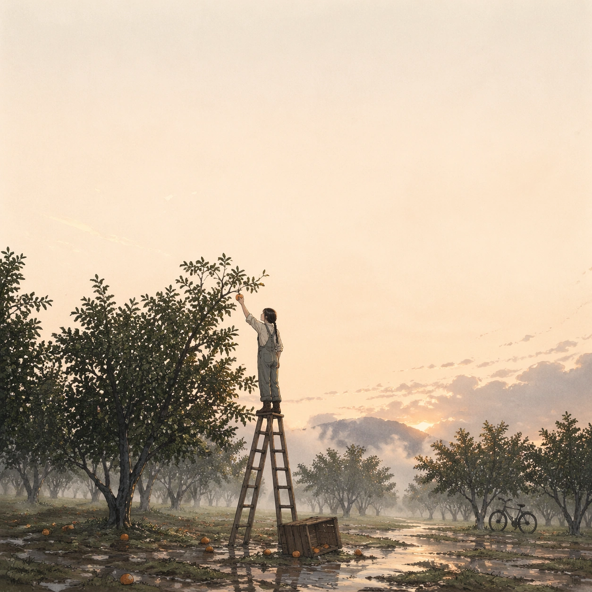

```text
Scene:
A square final one-sheet set in an orchard at first light after a storm. The composition is airy and sparse: rows of wet trees recede diagonally, but most of the image is pale dawn mist and open sky. In the lower center sits a simple ladder and overturned wooden crate, establishing a quiet geometric base. The look should feel like a premium postscript poster, calm and reflective, with soft matte texture and a large untouched upper field where a title could live without actually appearing.

Subject:
A lone anime-coded orchard keeper in work overalls stands on the ladder, one arm reaching to touch a single remaining orange caught in a branch. The figure is small and lightly stylized, with a clear braid silhouette and practical boots. Fallen fruit glistens on the ground, and a bicycle leans against one distant tree. The character should feel emotionally complete and recognizable through shape, but the orchard, ladder, and mist must together carry equal weight. The whole poster should imply the final quiet beat after a larger unseen story has ended.

Important details:
This image should close the package with serenity rather than climax. Use washed apricot dawn, leaf green darkened by rain, pale silver mist, and muted wood brown. Keep all elements cleanly spaced. The ladder should create a vertical accent that balances the broad horizontal orchard rows and the blank sky. Suggest credits or laurels only through compositional breathing room and thin abstract line placement, never readable text. Avoid postcard sweetness; aim for mature festival-poster calm with anime-coded tenderness.

Use case:
Arthouse One-Sheet Anime Remake single study 9/9, serving as a quiet epilogue built from orchard geometry, post-rain atmosphere, and restrained character presence.

Constraints:
No readable text, no watermark, no logos, preserve exact 1:1 aspect ratio, no busy harvest market, no oversaturated sunrise, no whimsical fantasy creatures, no sentimental collage treatment.
```

[Pinned source](https://github.com/ChaosRealmsAI/gpt-image-2-gallery/blob/5296db8c996e38776c83a0bc8c64f848dcd512b3/works/topics/arthouse-one-sheet-anime-remake/packages/single-arthouse-remix-studies/images/09-orchard-after-credits/meta.json) · GPT Image2 · 1254×1254 · No source-declared image dependencies. · ProjectD:[published and publicly accepted](https://aitoolsradar.com/en/prompts/f6e608d1baee27)

## Reference Press Portrait · artist-identity-portrait-and-brand-kit/series-identity-lockup/01-reference-press-portrait

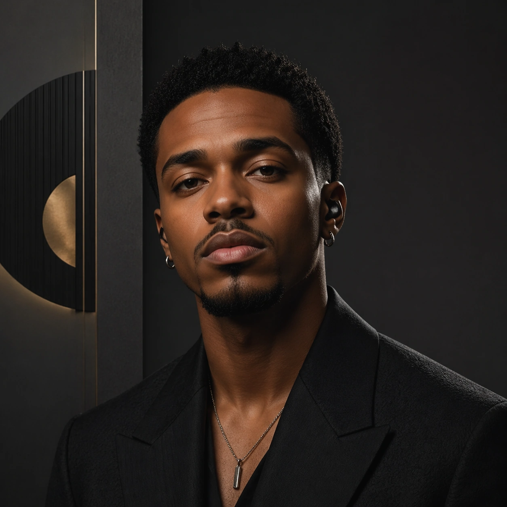

```text
Scene:
A square studio portrait composed like the lead image of a press kit, with neutral charcoal backdrop panels, one soft key light, one narrow rim light, and a controlled layout field that leaves room for future campaign overlays. The camera stays at eye level and slightly close, creating an image that feels intimate, expensive, and usable across editorial and promotional contexts.

Subject:
An invented recording artist faces the camera with relaxed authority, wearing a dark tailored jacket, short textured curls, subtle silver jewelry, and a minimal in-ear monitor. This first image must establish the exact face shape, hair base, skin tone, body proportions, and overall demeanor that later kit images will preserve without drift.

Important details:
The brand-kit language should feel mature and press-ready: abstract geometric emblem panels, muted metallic accents, and disciplined negative space rather than literal readable logos. Skin texture, fabric response, and lighting falloff should be photoreal and believable. The result should communicate a full artist identity system, not just a generic attractive portrait.

Use case:
Artist Kit series study 1/9 for the Artist Identity Portrait and Brand Kit Prompt Atlas theme.

Constraints:
No readable text, no watermark, no logos, preserve exact 1:1 aspect ratio, no microphone as hero prop, no stage crowd, no heavy makeup glamour excess, no wide smile, no busy background graphics, no fashion-brand cues
```

[Pinned source](https://github.com/ChaosRealmsAI/gpt-image-2-gallery/blob/5296db8c996e38776c83a0bc8c64f848dcd512b3/works/topics/artist-identity-portrait-and-brand-kit/packages/series-identity-lockup/images/01-reference-press-portrait/meta.json) · GPT Image2 · 1254×1254 · No source-declared image dependencies. · ProjectD:[published and publicly accepted](https://aitoolsradar.com/en/prompts/afa1117056fa9b)

## Monochrome Rooftop · artist-identity-portrait-and-brand-kit/series-identity-lockup/02-monochrome-rooftop

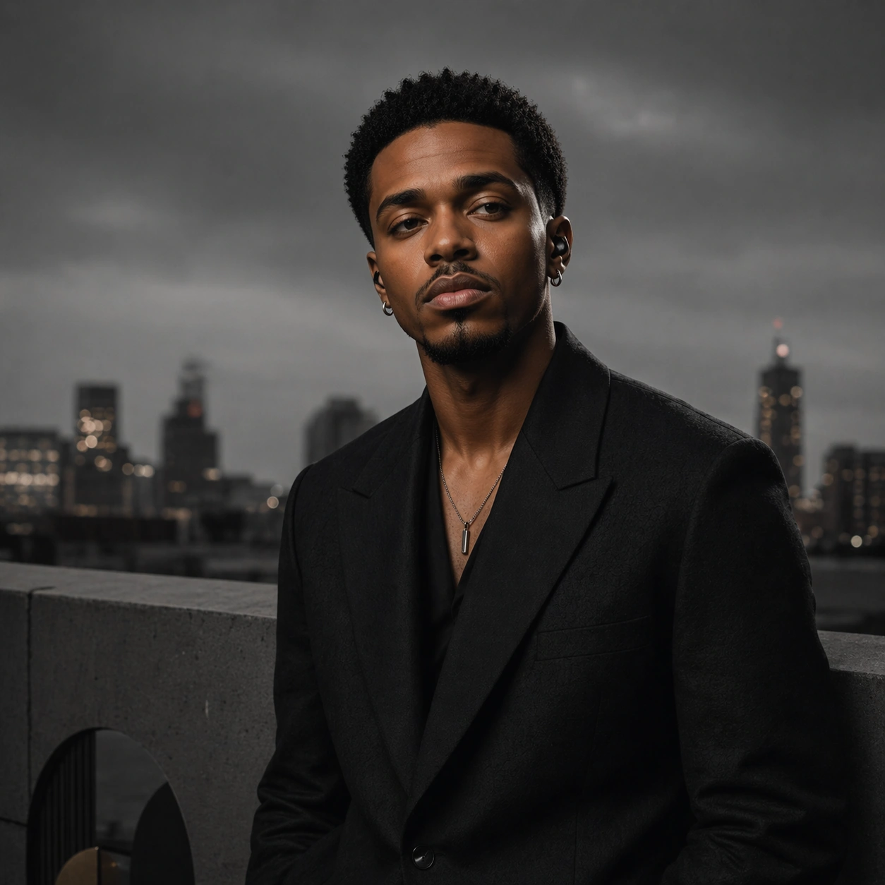

```text
Scene:
A square rooftop portrait at overcast dusk, framed with clean city blur in the distance and a cooler, more editorial monochrome lighting scheme. The composition remains simple and press-usable, with enough empty edge space for later campaign use but a more atmospheric setting than the studio reference.

Subject:
Preserve the exact same artist from the reference image, including face shape, hair base, skin tone, and body proportions. The subject leans lightly against a concrete parapet in the same tailored jacket family, with the gaze turned slightly off-camera and the same calm authority carried into a more documentary urban setting.

Important details:
The image should widen the artist kit without breaking identity lock. Keep the portrait realistic, the geometry disciplined, and the palette nearly monochrome with only minimal metallic highlights. Abstract emblem cues can appear as architectural shadows or reflective inserts, but the artist must remain the undeniable center and must read as the exact same person from the reference portrait.

Use case:
Artist Kit series study 2/9 for the Artist Identity Portrait and Brand Kit Prompt Atlas theme.

Constraints:
No readable text, no watermark, no logos, preserve exact 1:1 aspect ratio, preserve the exact reference face, hair base, and body proportions; no sunset orange explosion, no rooftop party extras, no hats hiding the hair, no lens gimmicks, no streetwear brand graphics
```

[Pinned source](https://github.com/ChaosRealmsAI/gpt-image-2-gallery/blob/5296db8c996e38776c83a0bc8c64f848dcd512b3/works/topics/artist-identity-portrait-and-brand-kit/packages/series-identity-lockup/images/02-monochrome-rooftop/meta.json) · GPT Image2 · 1254×1254 · Reference images required. · ProjectD:[published and publicly accepted](https://aitoolsradar.com/en/prompts/bd76a51011e1d6)

## Rehearsal Chair Kit · artist-identity-portrait-and-brand-kit/series-identity-lockup/03-rehearsal-chair-kit

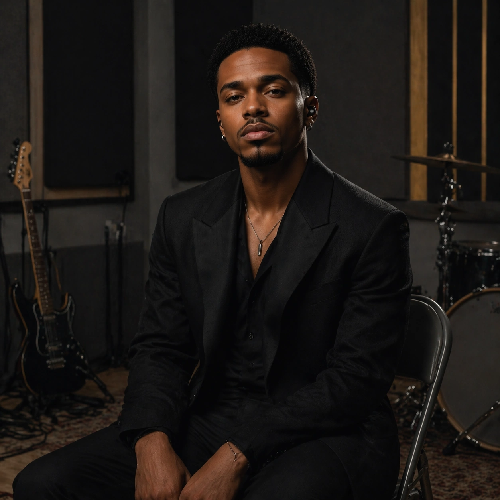

```text
Scene:
A square rehearsal-space portrait shot in a clean room with acoustic panels, a folded chair, muted practical lighting, and shallow depth that hints at instruments without turning them into clutter. The image should feel grounded and human, like a credible press-kit portrait made during production downtime.

Subject:
Preserve the exact same artist from the reference image with identical face structure, hair base, skin tone, and body proportions. The artist sits on a simple chair with shoulders relaxed, hands resting naturally, and a tailored dark outfit that still matches the broader identity grammar established in the studio portrait.

Important details:
Use the room only to reinforce musician context, not to overwhelm the portrait. Subtle instrument silhouettes, cable loops, and acoustic textures are acceptable if they stay secondary. The true continuity comes from the artist face, grooming, wardrobe silhouette, and abstract emblem logic carried through lighting and layout. This should feel like a practical extension of a real artist brand kit.

Use case:
Artist Kit series study 3/9 for the Artist Identity Portrait and Brand Kit Prompt Atlas theme.

Constraints:
No readable text, no watermark, no logos, preserve exact 1:1 aspect ratio, preserve the exact reference face, hair base, and body proportions; no loud instrument performance pose, no cluttered gear stacks, no audience, no casual hoodie swap, no readable posters on the wall
```

[Pinned source](https://github.com/ChaosRealmsAI/gpt-image-2-gallery/blob/5296db8c996e38776c83a0bc8c64f848dcd512b3/works/topics/artist-identity-portrait-and-brand-kit/packages/series-identity-lockup/images/03-rehearsal-chair-kit/meta.json) · GPT Image2 · 1254×1254 · Reference images required. · ProjectD:[published and publicly accepted](https://aitoolsradar.com/en/prompts/f3c08dee0e745f)

## Gel Light Profile · artist-identity-portrait-and-brand-kit/series-identity-lockup/04-gel-light-profile

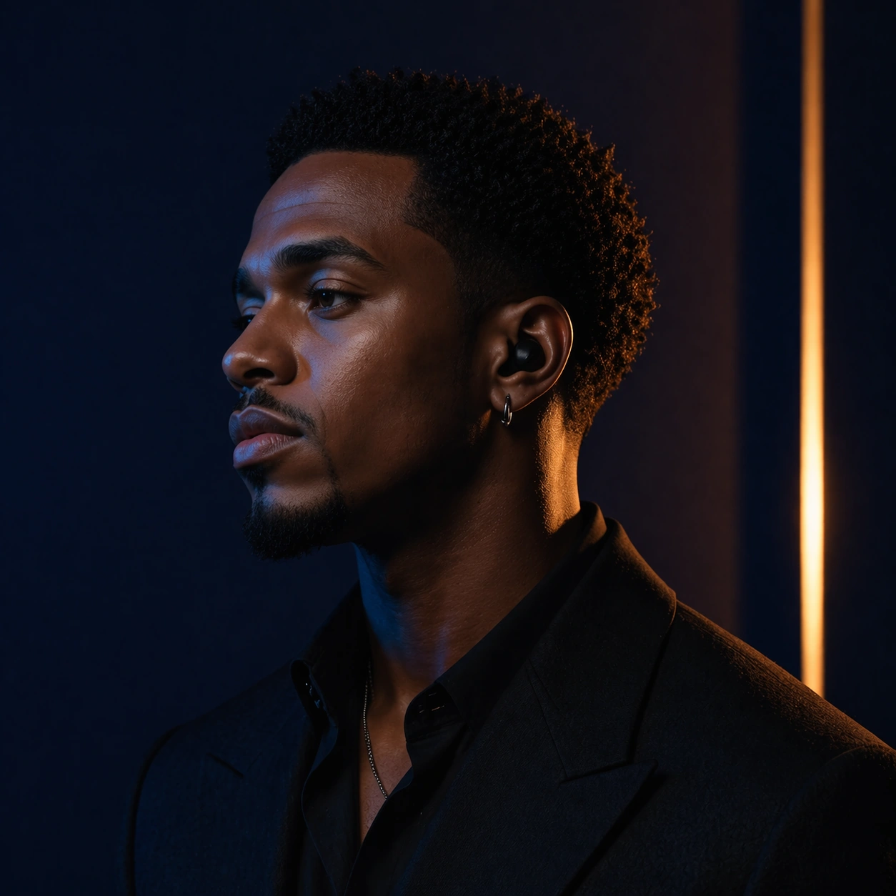

```text
Scene:
A square profile portrait in a dark controlled studio, lit by one deep blue gel and one narrow amber edge light so the face contours feel sculptural and campaign-ready. The frame should feel like a social-campaign extension of the press kit, with dramatic color but still enough restraint to remain usable.

Subject:
Preserve the exact same artist from the reference image, keeping the identical face shape, hair base, skin tone, and body proportions. The subject turns into profile while staying recognizably the same person, wearing the same core tailoring language with only subtle styling shifts in collar and jewelry placement.

Important details:
This variation should add mood, not replace the brand system. Keep skin detail real, highlights controlled, and the background simple. Abstract emblem cues can appear as colored light bars or shadow panels, but there should be no literal logo. The primary test is whether the portrait still reads as the same artist while the campaign expands into a richer emotional register.

Use case:
Artist Kit series study 4/9 for the Artist Identity Portrait and Brand Kit Prompt Atlas theme.

Constraints:
No readable text, no watermark, no logos, preserve exact 1:1 aspect ratio, preserve the exact reference face, hair base, and body proportions; no hard beauty-retouch look, no smoky nightclub crowd, no costume-level wardrobe change, no extreme close crop, no colored text elements
```

[Pinned source](https://github.com/ChaosRealmsAI/gpt-image-2-gallery/blob/5296db8c996e38776c83a0bc8c64f848dcd512b3/works/topics/artist-identity-portrait-and-brand-kit/packages/series-identity-lockup/images/04-gel-light-profile/meta.json) · GPT Image2 · 1254×1254 · Reference images required. · ProjectD:[published and publicly accepted](https://aitoolsradar.com/en/prompts/c621b0af73d2c0)

## Social Avatar Grid · artist-identity-portrait-and-brand-kit/single-brand-surfaces/social-avatar-grid

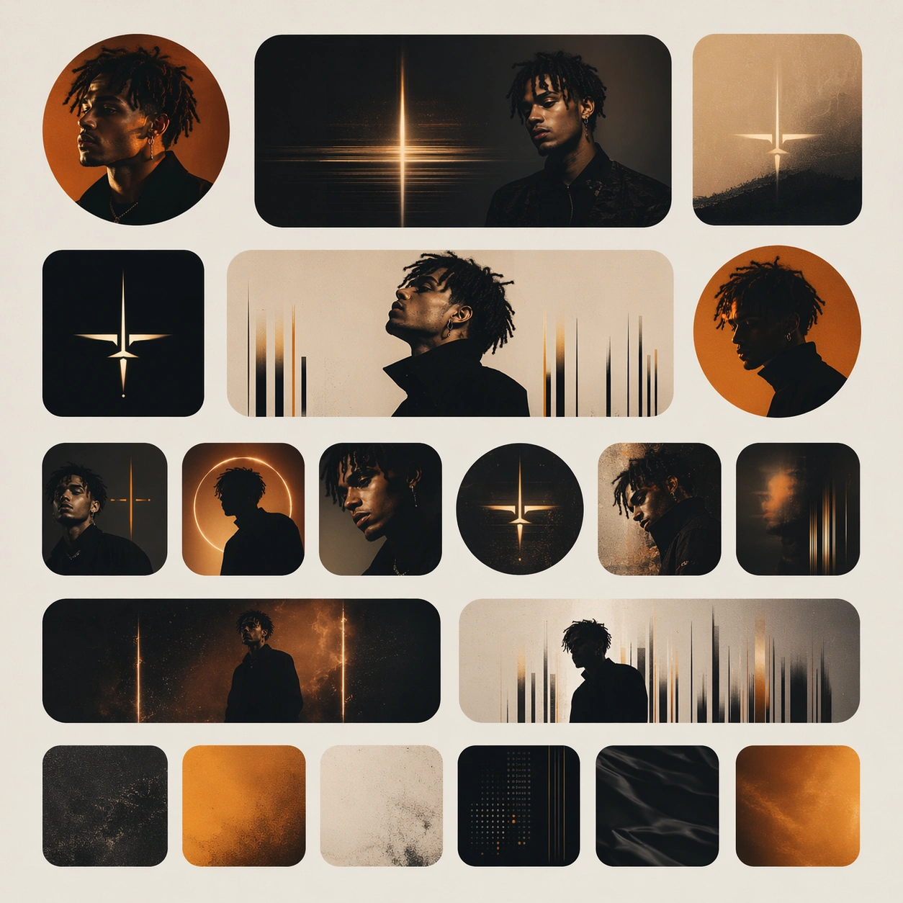

```text
Scene:
A square grid composition on a clean matte background, showing multiple circular and rounded-square profile crops, abstract cover headers, and muted accent tiles arranged as if they belong to one social identity rollout. The framing should feel like a polished campaign board rather than a software screenshot.

Subject:
Each tile contains a version of the same invented artist language: portrait fragments, emblem marks, abstract light bars, and gradient fields prepared for social surfaces. The grid should communicate small-format recognizability and consistency, not literal app interface branding.

Important details:
Prioritize compression clarity, facial memorability, and system logic. The board should look like a design presentation for a musician launch kit, with varied crop behavior but one shared visual ownership. Use disciplined spacing, clean edge alignment, and subtle texture changes to keep the image from feeling flat or generic.

Use case:
Artist Kit single study 6/9 for the Artist Identity Portrait and Brand Kit Prompt Atlas theme.

Constraints:
No readable text, no watermark, no logos, preserve exact 1:1 aspect ratio, no recognizable social-media UI, no readable follower numbers, no notification icons, no bright rainbow palette, no random unrelated photos
```

[Pinned source](https://github.com/ChaosRealmsAI/gpt-image-2-gallery/blob/5296db8c996e38776c83a0bc8c64f848dcd512b3/works/topics/artist-identity-portrait-and-brand-kit/packages/single-brand-surfaces/images/social-avatar-grid/meta.json) · GPT Image2 · 1254×1254 · No source-declared image dependencies. · ProjectD:[published and publicly accepted](https://aitoolsradar.com/en/prompts/da4b460c2170c2)

## Credential Pass Study · artist-identity-portrait-and-brand-kit/single-brand-surfaces/credential-pass-study

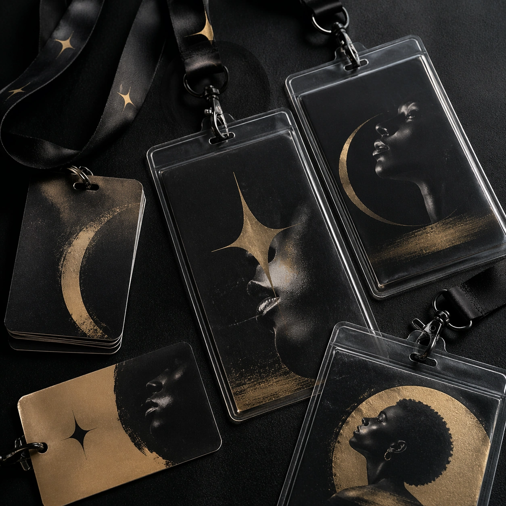

```text
Scene:
A square tabletop product shot of layered backstage passes, satin lanyards, clear laminate sleeves, and clipped portrait inserts arranged with high-end object photography discipline. Light should skim the plastic edges and reveal subtle scuffs, gloss, and realistic material thickness.

Subject:
The composition centers on credential objects designed for an invented artist campaign: abstract portrait crops, emblem shapes, matte-black fields, and one muted metallic accent repeated across multiple passes. The objects should feel usable and event-realistic, but completely free of readable names or venue logos.

Important details:
This is a test of whether artist identity can survive on practical access objects. Keep the materials believable, the spacing tidy, and the brand language consistent. The passes should feel premium and music-industry specific rather than corporate conference badges or fashion guest lists.

Use case:
Artist Kit single study 7/9 for the Artist Identity Portrait and Brand Kit Prompt Atlas theme.

Constraints:
No readable text, no watermark, no logos, preserve exact 1:1 aspect ratio, no barcodes, no readable numbers, no event logo, no tabletop clutter beyond the credential set, no harsh direct flash look
```

[Pinned source](https://github.com/ChaosRealmsAI/gpt-image-2-gallery/blob/5296db8c996e38776c83a0bc8c64f848dcd512b3/works/topics/artist-identity-portrait-and-brand-kit/packages/single-brand-surfaces/images/credential-pass-study/meta.json) · GPT Image2 · 1254×1254 · No source-declared image dependencies. · ProjectD:[published and publicly accepted](https://aitoolsradar.com/en/prompts/bdafb0512d1bb6)

## Emblem Wall Study · artist-identity-portrait-and-brand-kit/single-brand-surfaces/emblem-wall-study

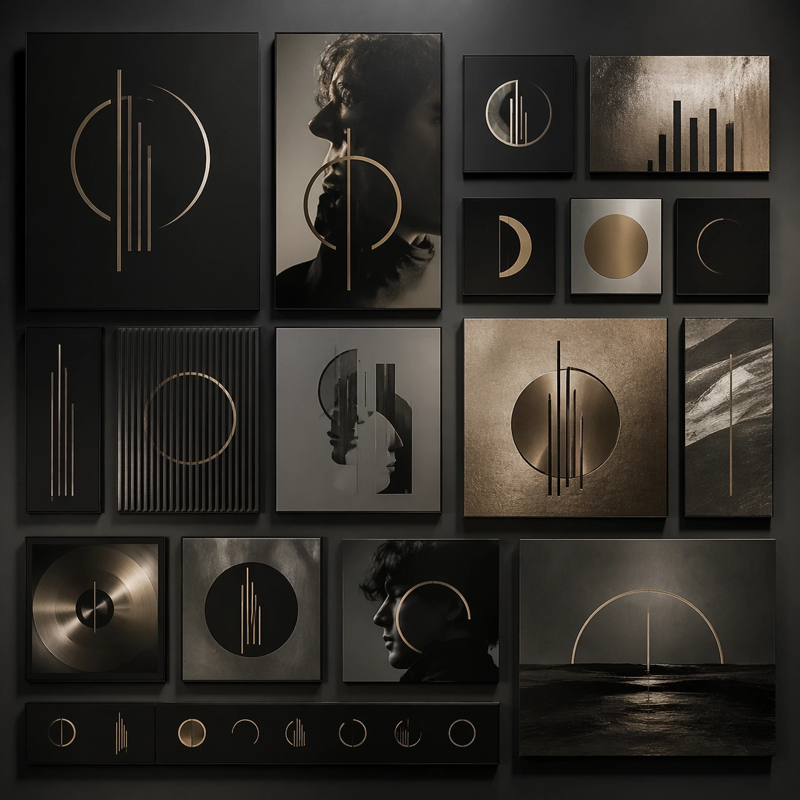

```text
Scene:
A square studio installation image showing a wall of mounted panels, each carrying an abstract emblem fragment, muted portrait crop, or textured metallic field. The camera is frontal and balanced so the wall reads like a serious campaign language board, not a gallery gimmick.

Subject:
The subject is the emblem system itself: circles, bars, profile fragments, and tonal fields arranged into a coherent non-verbal identity for a fictional musician. One or two portrait glimpses can appear, but the primary purpose is to show the ownership of a visual mark system without relying on typography.

Important details:
The installation should feel refined, presentable, and music-industry credible. Use material contrast such as brushed metal, matte board, smoked acrylic, and soft shadow. The panel arrangement must feel intentional and branded, suggesting how an artist identity could extend into sets, packaging, and publicity without needing literal words.

Use case:
Artist Kit single study 8/9 for the Artist Identity Portrait and Brand Kit Prompt Atlas theme.

Constraints:
No readable text, no watermark, no logos, preserve exact 1:1 aspect ratio, no museum labels, no visible screws dominating the frame, no random colors, no graffiti feel, no decorative flourishes unrelated to the emblem system
```

[Pinned source](https://github.com/ChaosRealmsAI/gpt-image-2-gallery/blob/5296db8c996e38776c83a0bc8c64f848dcd512b3/works/topics/artist-identity-portrait-and-brand-kit/packages/single-brand-surfaces/images/emblem-wall-study/meta.json) · GPT Image2 · 1254×1254 · No source-declared image dependencies. · ProjectD:[published and publicly accepted](https://aitoolsradar.com/en/prompts/b96ee25ced3a66)

## Listening Party Invite · artist-identity-portrait-and-brand-kit/single-brand-surfaces/listening-party-invite

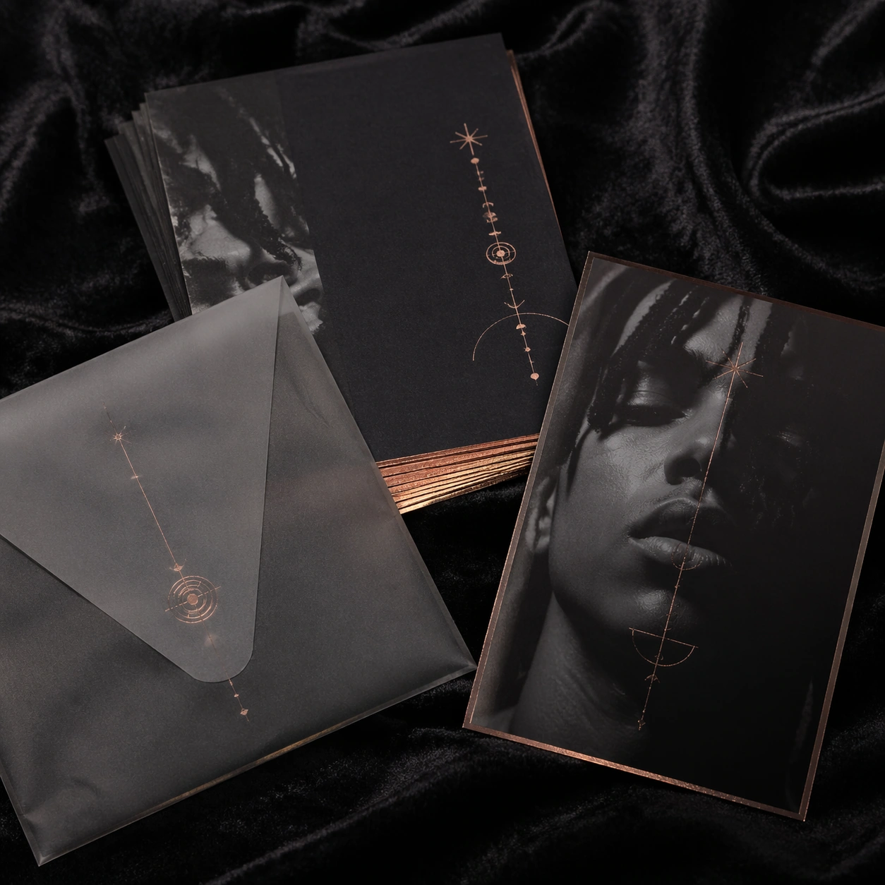

```text
Scene:
A square close tabletop shot of stacked invite cards, a translucent envelope, metallic edge foil, and one portrait insert arranged on dark velvet. The lighting should feel intimate and premium, revealing card stock thickness, foil reflection, and the ritual atmosphere of a private music event invite.

Subject:
The cards carry an invented artist identity through portrait fragments, abstract symbols, and controlled layout zones intended for future event information. The package must read as exclusive music collateral, something for a listening party or press preview, without actually printing legible names or schedules.

Important details:
The visual test here is desirability through restraint. Use a muted palette, tactile materials, and a small set of repeating brand cues so the invite system feels connected to a larger artist kit. Keep everything elegant, not wedding-like or luxury-fashion generic. It should remain distinctly anchored in contemporary music publicity.

Use case:
Artist Kit single study 9/9 for the Artist Identity Portrait and Brand Kit Prompt Atlas theme.

Constraints:
No readable text, no watermark, no logos, preserve exact 1:1 aspect ratio, no wax seals, no floral styling, no handwritten calligraphy, no visible address fields, no extra props unrelated to the invite package
```

[Pinned source](https://github.com/ChaosRealmsAI/gpt-image-2-gallery/blob/5296db8c996e38776c83a0bc8c64f848dcd512b3/works/topics/artist-identity-portrait-and-brand-kit/packages/single-brand-surfaces/images/listening-party-invite/meta.json) · GPT Image2 · 1254×1254 · No source-declared image dependencies. · ProjectD:[published and publicly accepted](https://aitoolsradar.com/en/prompts/7d0b9efd3fafd8)

## Reference Athlete Anchor · athlete-spotlight-and-profile-card-family/series-profile-system/01-reference-athlete-anchor

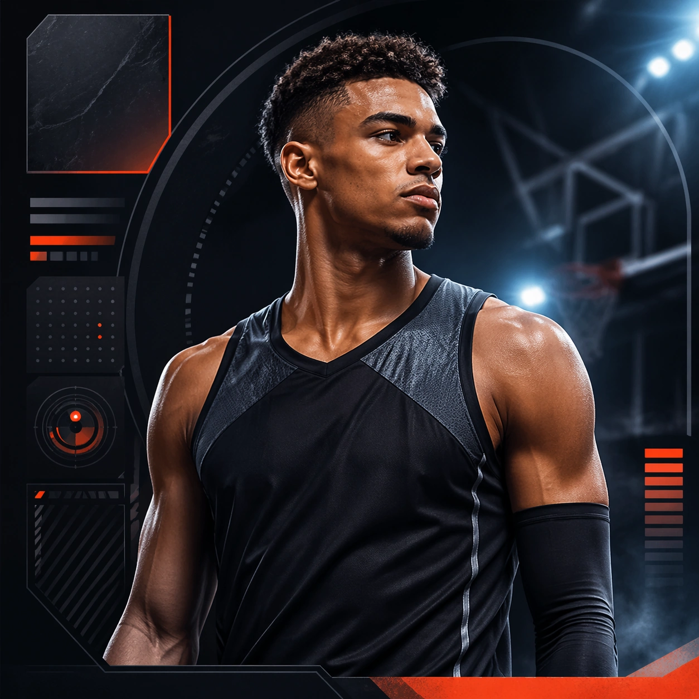

```text
Scene:
Create a square athlete spotlight hero card for Athlete Cards, using a premium arena-adjacent portrait world with charcoal backgrounds, cool blue edge light, and one vivid accent color. The frame should feel commercial, polished, and immediately useful for a real client deliverable rather than a one-off art experiment. Keep the composition readable at thumbnail scale while still rewarding a closer look with layered depth, clean negative space, and strong directional light. Build the image so it clearly supports sports communication, with enough modular structure to imply information architecture without relying on literal words.

Subject:
Center the image on one original elite athlete with a specific haircut, clear facial structure, realistic skin texture, and a brandless performance uniform, arranged as waist-up athlete portrait. Treat the subject as original and brandless, with believable apparel construction, realistic body proportions, and strong emotional legibility. Surround the subject with supporting environmental cues that reinforce the category but never overpower the main figure. All secondary objects, props, and background elements should strengthen the same professional sports or fitness context.

Important details:
This first image must establish the full reference system for later derivatives: profile-card modules, non-readable stat zones, and polished editorial-sports framing. The emotional tone should read as composed authority. Make the visual language reusable, disciplined, and commercially credible, with clean edges, coherent light behavior, and obvious hierarchy. Abstract panels, diagram bands, or stat-like modules are welcome, but they must remain non-readable and subordinate to the main visual message. The result should feel original, specific, and ready to anchor a larger package.

Use case:
Athlete Cards series study 1/9, the reference image for the package.

Constraints:
No readable text, no watermark, no logos, preserve exact 1:1 aspect ratio, no brand marks, no copied famous team or product identity, no generic stock-photo stiffness, no cluttered background noise, no celebrity likenesses.
```

[Pinned source](https://github.com/ChaosRealmsAI/gpt-image-2-gallery/blob/5296db8c996e38776c83a0bc8c64f848dcd512b3/works/topics/athlete-spotlight-and-profile-card-family/packages/series-profile-system/images/01-reference-athlete-anchor/meta.json) · GPT Image2 · 1254×1254 · No source-declared image dependencies. · ProjectD:[published and publicly accepted](https://aitoolsradar.com/en/prompts/25664b3fdbe4cb)

## Stat-dominant Card · athlete-spotlight-and-profile-card-family/series-profile-system/02-stat-dominant-card


```text
Scene:
Build a square stat-heavy player card derived from the reference image for Athlete Cards. Preserve the exact world established by the reference image, including the same palette family, lighting direction, environmental logic, and surface finish. The new frame should feel like a deliberate extension of one campaign system, not a separate concept. Shift the hierarchy to suit this use case, but keep the overall composition commercial, polished, and ready for real rollout.

Subject:
Use the same original subject identity and anchor cues introduced by the reference image, now organized as direct-facing athlete. Keep faces, hair logic, body proportions, apparel or product construction, and major supporting forms consistent with the reference. Allow only the layout emphasis, pose, crop, and contextual energy to change so the result clearly belongs to the same package.

Important details:
Continuity is the main challenge. Preserve the exact reference language for color, materials, framing rhythm, and overall brandless campaign grammar while steering the tone toward analytical confidence. Keep any stat blocks, schedule modules, arrows, badges, or callout panels non-readable. The derivative should prove that the same art direction can handle a different communication task without losing identity or utility. Make it credible for production use, with clean edges, intentional spacing, and no random decorative elements.

Use case:
Athlete Cards series study 2/9, a derivative surface linked to 01-reference-athlete-anchor.

Constraints:
No readable text, no watermark, no logos, preserve exact 1:1 aspect ratio, no new subject identity, no brand marks, no palette drift, no unrelated props, no collage chaos, no copied public-figure styling.
```

[Pinned source](https://github.com/ChaosRealmsAI/gpt-image-2-gallery/blob/5296db8c996e38776c83a0bc8c64f848dcd512b3/works/topics/athlete-spotlight-and-profile-card-family/packages/series-profile-system/images/02-stat-dominant-card/meta.json) · GPT Image2 · 1254×1254 · Reference images required. · ProjectD:[published and publicly accepted](https://aitoolsradar.com/en/prompts/69c42427fc6702)

## Action Burst Card · athlete-spotlight-and-profile-card-family/series-profile-system/03-action-burst-card


```text
Scene:
Build a square action burst athlete card derived from the reference image for Athlete Cards. Preserve the exact world established by the reference image, including the same palette family, lighting direction, environmental logic, and surface finish. The new frame should feel like a deliberate extension of one campaign system, not a separate concept. Shift the hierarchy to suit this use case, but keep the overall composition commercial, polished, and ready for real rollout.

Subject:
Use the same original subject identity and anchor cues introduced by the reference image, now organized as same athlete in controlled motion. Keep faces, hair logic, body proportions, apparel or product construction, and major supporting forms consistent with the reference. Allow only the layout emphasis, pose, crop, and contextual energy to change so the result clearly belongs to the same package.

Important details:
Continuity is the main challenge. Preserve the exact reference language for color, materials, framing rhythm, and overall brandless campaign grammar while steering the tone toward kinetic intensity. Keep any stat blocks, schedule modules, arrows, badges, or callout panels non-readable. The derivative should prove that the same art direction can handle a different communication task without losing identity or utility. Make it credible for production use, with clean edges, intentional spacing, and no random decorative elements.

Use case:
Athlete Cards series study 3/9, a derivative surface linked to 01-reference-athlete-anchor.

Constraints:
No readable text, no watermark, no logos, preserve exact 1:1 aspect ratio, no new subject identity, no brand marks, no palette drift, no unrelated props, no collage chaos, no copied public-figure styling.
```

[Pinned source](https://github.com/ChaosRealmsAI/gpt-image-2-gallery/blob/5296db8c996e38776c83a0bc8c64f848dcd512b3/works/topics/athlete-spotlight-and-profile-card-family/packages/series-profile-system/images/03-action-burst-card/meta.json) · GPT Image2 · 1254×1254 · Reference images required. · ProjectD:[published and publicly accepted](https://aitoolsradar.com/en/prompts/386fa91bc2e698)

## Captain Editorial Card · athlete-spotlight-and-profile-card-family/series-profile-system/04-captain-editorial-card

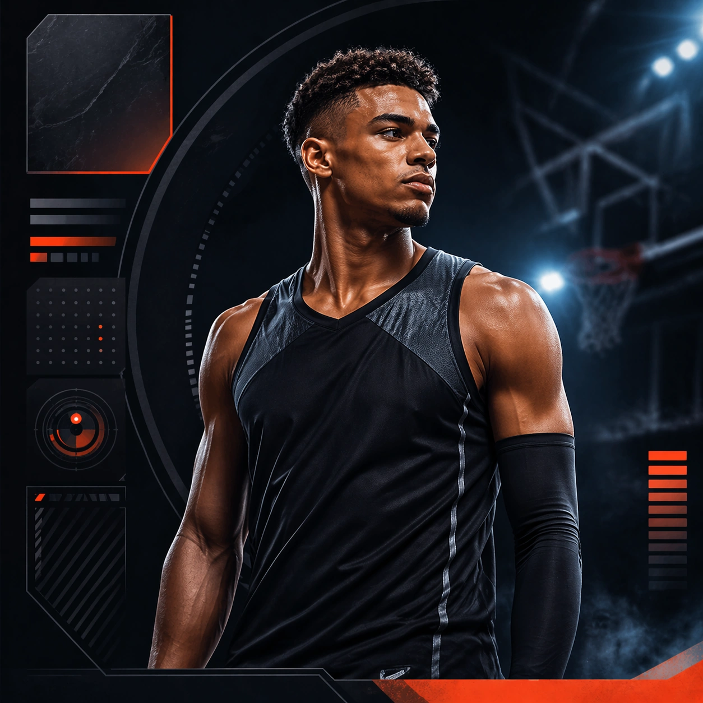

```text
Scene:
Build a square captain editorial card derived from the reference image for Athlete Cards. Preserve the exact world established by the reference image, including the same palette family, lighting direction, environmental logic, and surface finish. The new frame should feel like a deliberate extension of one campaign system, not a separate concept. Shift the hierarchy to suit this use case, but keep the overall composition commercial, polished, and ready for real rollout.

Subject:
Use the same original subject identity and anchor cues introduced by the reference image, now organized as same athlete in three-quarter stance. Keep faces, hair logic, body proportions, apparel or product construction, and major supporting forms consistent with the reference. Allow only the layout emphasis, pose, crop, and contextual energy to change so the result clearly belongs to the same package.

Important details:
Continuity is the main challenge. Preserve the exact reference language for color, materials, framing rhythm, and overall brandless campaign grammar while steering the tone toward calm leadership. Keep any stat blocks, schedule modules, arrows, badges, or callout panels non-readable. The derivative should prove that the same art direction can handle a different communication task without losing identity or utility. Make it credible for production use, with clean edges, intentional spacing, and no random decorative elements.

Use case:
Athlete Cards series study 4/9, a derivative surface linked to 01-reference-athlete-anchor.

Constraints:
No readable text, no watermark, no logos, preserve exact 1:1 aspect ratio, no new subject identity, no brand marks, no palette drift, no unrelated props, no collage chaos, no copied public-figure styling.
```

[Pinned source](https://github.com/ChaosRealmsAI/gpt-image-2-gallery/blob/5296db8c996e38776c83a0bc8c64f848dcd512b3/works/topics/athlete-spotlight-and-profile-card-family/packages/series-profile-system/images/04-captain-editorial-card/meta.json) · GPT Image2 · 1254×1254 · Reference images required. · ProjectD:[published and publicly accepted](https://aitoolsradar.com/en/prompts/eecf410918e1ec)

## Runner Milestone Tile · athlete-spotlight-and-profile-card-family/single-support-studies/runner-milestone-tile

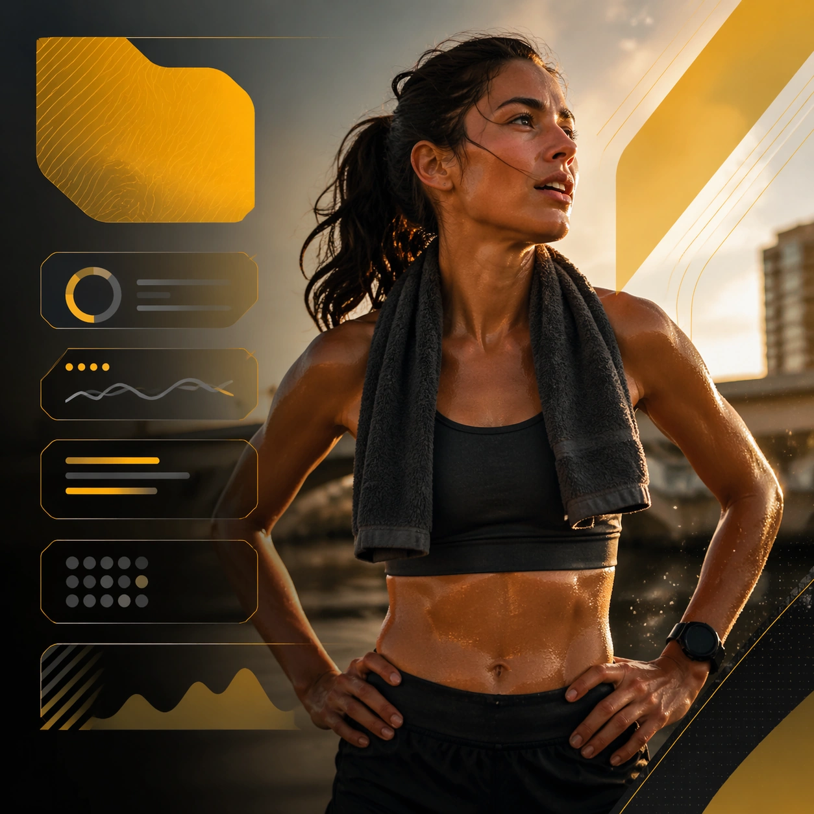

```text
Scene:
Create a square runner milestone tile for Athlete Cards, using portrait-led sports communication with stat-panel discipline, premium lighting, and card-like hierarchy. The composition should read as a practical, production-ready sports or fitness surface with a clear hierarchy, premium lighting, and obvious commercial intent. Keep the environment specific enough to feel real, but leave enough control in the layout for non-readable information modules, campaign blocks, or visualized metrics. Aim for a finish that works for a brand, club, app, academy, or event operator.

Subject:
Build the image around endurance athlete after a run. The subject should be original, believable, and free of any real-brand or celebrity cues. Use realistic apparel, safe body mechanics when movement is visible, and environmental props that support the category without clutter. The subject must stay visually dominant so the design still works as a communication asset rather than a pure scene study.

Important details:
The mood should read as earned accomplishment. Treat layout, light, and supporting graphic structure as part of one polished delivery surface. Any schedule blocks, metric panels, quote zones, badges, or path diagrams must stay abstract and non-readable. Prioritize usefulness, clarity, and category truth over spectacle. The image should feel distinct from the series package while still belonging naturally to the same topic and business use case.

Use case:
Athlete Cards single study 6/9, an independent rollout surface for the topic.

Constraints:
No readable text, no watermark, no logos, preserve exact 1:1 aspect ratio, no brand marks, no public-figure resemblance, no generic stock layout, no cluttered UI imitation, no accidental copyrighted insignia.
```

[Pinned source](https://github.com/ChaosRealmsAI/gpt-image-2-gallery/blob/5296db8c996e38776c83a0bc8c64f848dcd512b3/works/topics/athlete-spotlight-and-profile-card-family/packages/single-support-studies/images/runner-milestone-tile/meta.json) · GPT Image2 · 1254×1254 · No source-declared image dependencies. · ProjectD:[published and publicly accepted](https://aitoolsradar.com/en/prompts/74a97396f8caf8)

## Fighter Walkout Card · athlete-spotlight-and-profile-card-family/single-support-studies/fighter-walkout-card

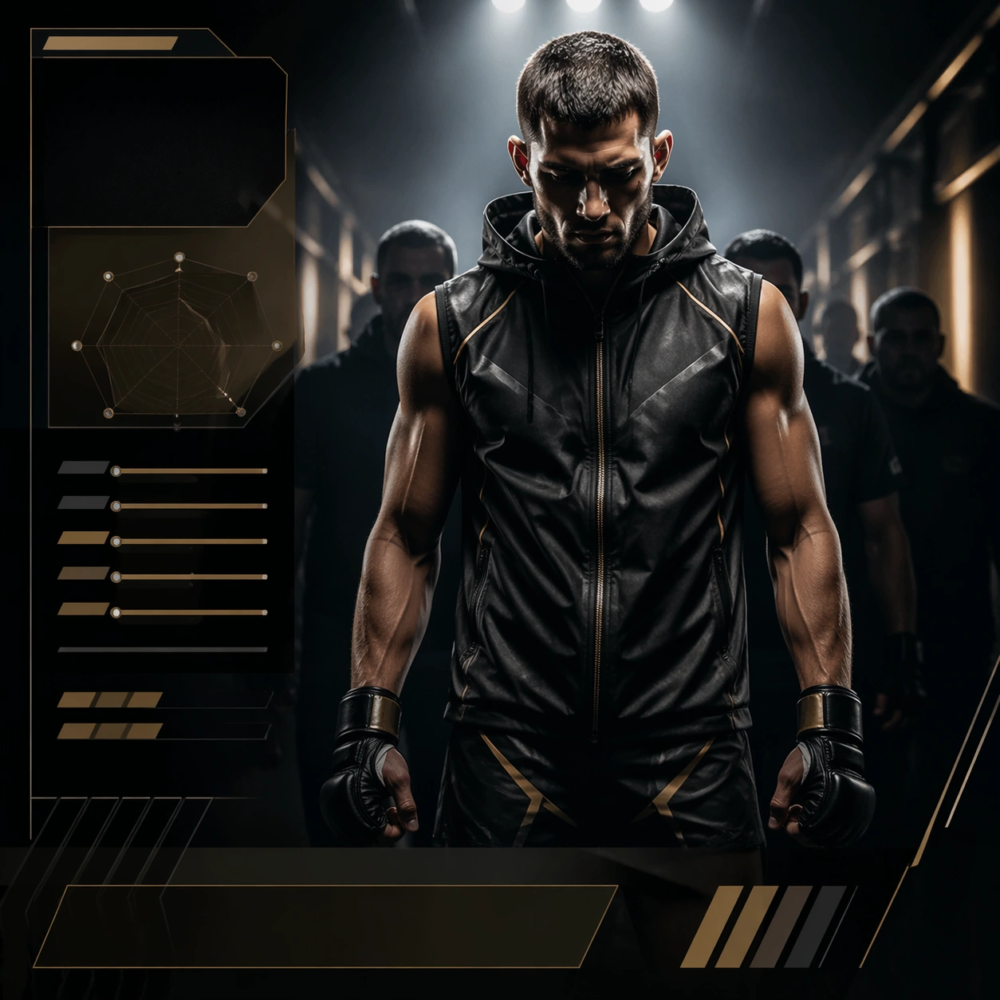

```text
Scene:
Create a square combat walkout card for Athlete Cards, using portrait-led sports communication with stat-panel discipline, premium lighting, and card-like hierarchy. The composition should read as a practical, production-ready sports or fitness surface with a clear hierarchy, premium lighting, and obvious commercial intent. Keep the environment specific enough to feel real, but leave enough control in the layout for non-readable information modules, campaign blocks, or visualized metrics. Aim for a finish that works for a brand, club, app, academy, or event operator.

Subject:
Build the image around fighter in tunnel light. The subject should be original, believable, and free of any real-brand or celebrity cues. Use realistic apparel, safe body mechanics when movement is visible, and environmental props that support the category without clutter. The subject must stay visually dominant so the design still works as a communication asset rather than a pure scene study.

Important details:
The mood should read as focused intensity. Treat layout, light, and supporting graphic structure as part of one polished delivery surface. Any schedule blocks, metric panels, quote zones, badges, or path diagrams must stay abstract and non-readable. Prioritize usefulness, clarity, and category truth over spectacle. The image should feel distinct from the series package while still belonging naturally to the same topic and business use case.

Use case:
Athlete Cards single study 7/9, an independent rollout surface for the topic.

Constraints:
No readable text, no watermark, no logos, preserve exact 1:1 aspect ratio, no brand marks, no public-figure resemblance, no generic stock layout, no cluttered UI imitation, no accidental copyrighted insignia.
```

[Pinned source](https://github.com/ChaosRealmsAI/gpt-image-2-gallery/blob/5296db8c996e38776c83a0bc8c64f848dcd512b3/works/topics/athlete-spotlight-and-profile-card-family/packages/single-support-studies/images/fighter-walkout-card/meta.json) · GPT Image2 · 1254×1254 · No source-declared image dependencies. · ProjectD:[published and publicly accepted](https://aitoolsradar.com/en/prompts/55fc32548175fd)

## Recovery Day Portrait · athlete-spotlight-and-profile-card-family/single-support-studies/recovery-day-portrait

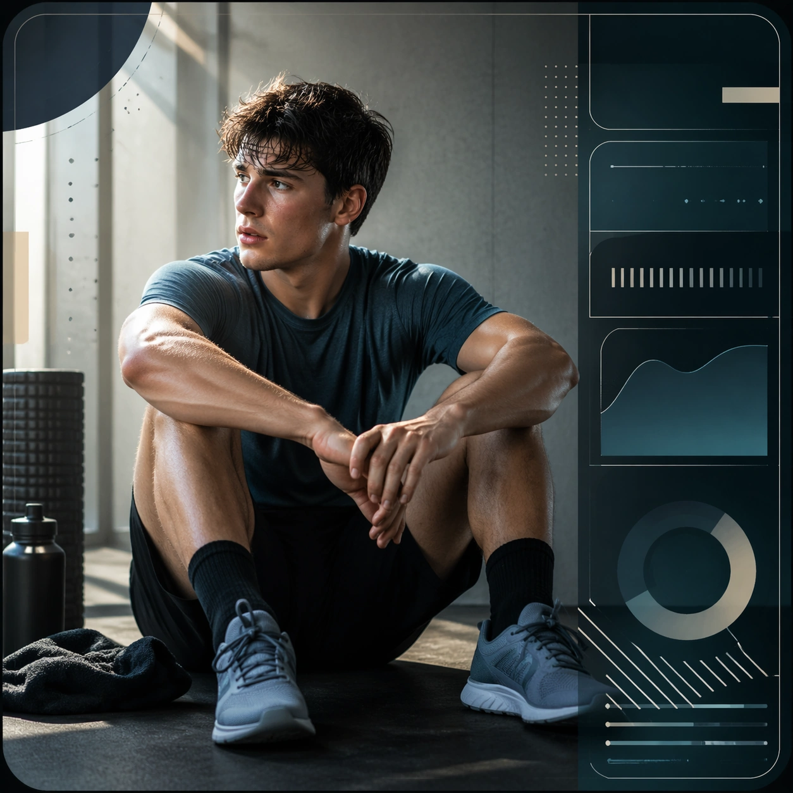

```text
Scene:
Create a square recovery portrait card for Athlete Cards, using portrait-led sports communication with stat-panel discipline, premium lighting, and card-like hierarchy. The composition should read as a practical, production-ready sports or fitness surface with a clear hierarchy, premium lighting, and obvious commercial intent. Keep the environment specific enough to feel real, but leave enough control in the layout for non-readable information modules, campaign blocks, or visualized metrics. Aim for a finish that works for a brand, club, app, academy, or event operator.

Subject:
Build the image around athlete seated after training. The subject should be original, believable, and free of any real-brand or celebrity cues. Use realistic apparel, safe body mechanics when movement is visible, and environmental props that support the category without clutter. The subject must stay visually dominant so the design still works as a communication asset rather than a pure scene study.

Important details:
The mood should read as reflective calm. Treat layout, light, and supporting graphic structure as part of one polished delivery surface. Any schedule blocks, metric panels, quote zones, badges, or path diagrams must stay abstract and non-readable. Prioritize usefulness, clarity, and category truth over spectacle. The image should feel distinct from the series package while still belonging naturally to the same topic and business use case.

Use case:
Athlete Cards single study 8/9, an independent rollout surface for the topic.

Constraints:
No readable text, no watermark, no logos, preserve exact 1:1 aspect ratio, no brand marks, no public-figure resemblance, no generic stock layout, no cluttered UI imitation, no accidental copyrighted insignia.
```

[Pinned source](https://github.com/ChaosRealmsAI/gpt-image-2-gallery/blob/5296db8c996e38776c83a0bc8c64f848dcd512b3/works/topics/athlete-spotlight-and-profile-card-family/packages/single-support-studies/images/recovery-day-portrait/meta.json) · GPT Image2 · 1254×1254 · No source-declared image dependencies. · ProjectD:[published and publicly accepted](https://aitoolsradar.com/en/prompts/b759300f68246c)

## Dual Athlete Comparison · athlete-spotlight-and-profile-card-family/single-support-studies/dual-athlete-comparison

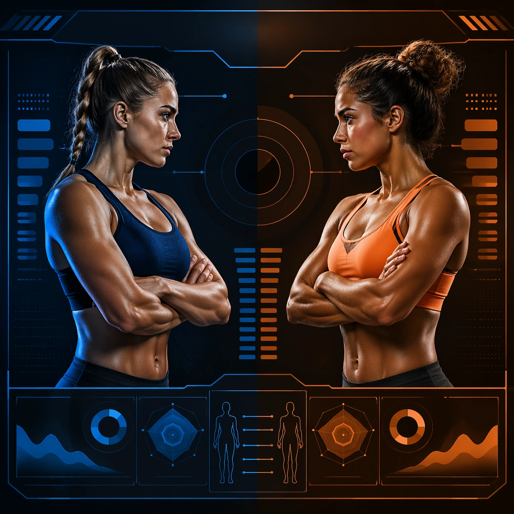

```text
Scene:
Create a square dual-athlete comparison card for Athlete Cards, using portrait-led sports communication with stat-panel discipline, premium lighting, and card-like hierarchy. The composition should read as a practical, production-ready sports or fitness surface with a clear hierarchy, premium lighting, and obvious commercial intent. Keep the environment specific enough to feel real, but leave enough control in the layout for non-readable information modules, campaign blocks, or visualized metrics. Aim for a finish that works for a brand, club, app, academy, or event operator.

Subject:
Build the image around two inward-facing athletes. The subject should be original, believable, and free of any real-brand or celebrity cues. Use realistic apparel, safe body mechanics when movement is visible, and environmental props that support the category without clutter. The subject must stay visually dominant so the design still works as a communication asset rather than a pure scene study.

Important details:
The mood should read as balanced analysis. Treat layout, light, and supporting graphic structure as part of one polished delivery surface. Any schedule blocks, metric panels, quote zones, badges, or path diagrams must stay abstract and non-readable. Prioritize usefulness, clarity, and category truth over spectacle. The image should feel distinct from the series package while still belonging naturally to the same topic and business use case.

Use case:
Athlete Cards single study 9/9, an independent rollout surface for the topic.

Constraints:
No readable text, no watermark, no logos, preserve exact 1:1 aspect ratio, no brand marks, no public-figure resemblance, no generic stock layout, no cluttered UI imitation, no accidental copyrighted insignia.
```

[Pinned source](https://github.com/ChaosRealmsAI/gpt-image-2-gallery/blob/5296db8c996e38776c83a0bc8c64f848dcd512b3/works/topics/athlete-spotlight-and-profile-card-family/packages/single-support-studies/images/dual-athlete-comparison/meta.json) · GPT Image2 · 1254×1254 · No source-declared image dependencies. · ProjectD:[published and publicly accepted](https://aitoolsradar.com/en/prompts/22e37389e2fb5d)

## Reference Anchor · atlantis-underwater-plaza/series-core-discovery/01-reference-anchor

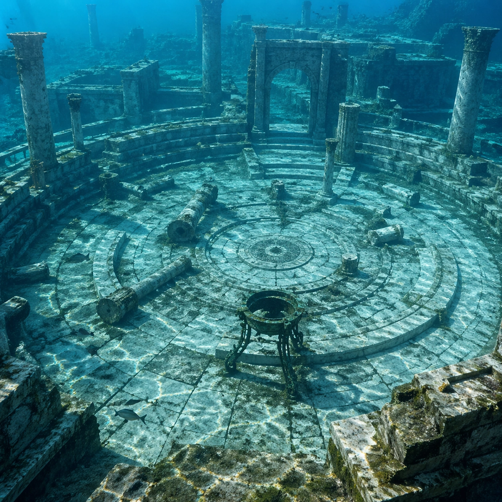

```text
Scene:
A square documentary image composed like a premium archaeology magazine feature. Use clear turquoise water, pale marble, oxidized bronze, and moving bands of sun caustics. Frame a submerged circular plaza with ring walls, fallen columns, bronze remnants, and fish moving through a drowned Atlantean civic center with crisp depth layering, restrained contrast, and subtle atmospheric depth so the scene feels excavated, observed, and historically grounded rather than theatrical or game-like. Keep the light directional but believable, as if captured during a careful field visit.

Subject:
Center the image on a submerged circular plaza with ring walls, fallen columns, bronze remnants, and fish moving through a drowned Atlantean civic center. Include culturally accurate surface logic, region-specific setting, and believable human-scale cues in stairs, doorways, cut blocks, relief edges, or water depth. Shapes, carvings, masonry joints, and site wear should feel studied from real archaeology, with no generic ancient-world mashup and no ornamental filler borrowed from another civilization.

Important details:
Keep the city logic disciplined and archaeological even though it is speculative: ring geometry, civic axes, hydrodynamic wear, and material aging should feel plausible rather than mythic excess. Emphasize marble paving, bronze tripod fragments, algae haze, suspended silt, carved stone rings, and refracted light patterns. Keep inscriptions, painted registers, symbolic motifs, or carved bands visually plausible but not readable. Preserve a museum-grade balance between beauty and evidence: light should reveal relief depth, edge wear, repairs, sediment traces, and excavation context without turning the site into fantasy spectacle. The composition should feel like a definitive reference frame that later variations can inherit exactly.

Use case:
Atlantis Underwater Plaza series study 1/9.

Constraints:
No readable text, no watermark, no logos, preserve exact 1:1 aspect ratio, no mermaids, no glowing crystals, no submarines, no futuristic domes, no tourists, no anachronistic props, no collage layout, no exaggerated fantasy lighting.
```

[Pinned source](https://github.com/ChaosRealmsAI/gpt-image-2-gallery/blob/5296db8c996e38776c83a0bc8c64f848dcd512b3/works/topics/atlantis-underwater-plaza/packages/series-core-discovery/images/01-reference-anchor/meta.json) · GPT Image2 · 1254×1254 · No source-declared image dependencies. · ProjectD:[published and publicly accepted](https://aitoolsradar.com/en/prompts/9cd3eea1ec5529)

## Human Scale Reveal · atlantis-underwater-plaza/series-core-discovery/02-human-scale-reveal

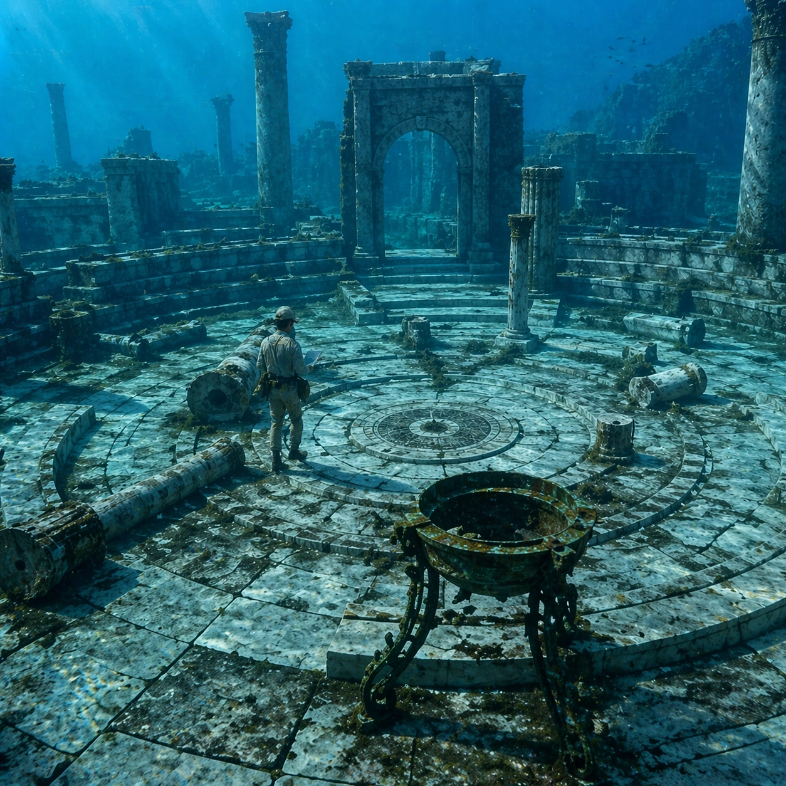

```text
Scene:
A square follow-up field image from the same site, slightly closer and lower than the reference anchor, with careful documentary framing and the same material palette. The camera should feel physically present inside the archaeological space, using natural light, soft depth separation, and one clear human figure to explain scale without turning the image into lifestyle photography.

Subject:
Show the same site identity established in the reference anchor, now with an archaeologist, conservator, or field researcher moving through the scene in practical neutral clothing. The person should be small relative to the monument and clearly secondary to the architecture, water, or painted wall system. Keep the main forms, structural rhythm, and civilizational markers unchanged.

Important details:
Preserve the exact site identity, base geometry, material behavior, and cultural signatures from the reference model. Only vary vantage, gesture, and scale cues. Keep the city logic disciplined and archaeological even though it is speculative: ring geometry, civic axes, hydrodynamic wear, and material aging should feel plausible rather than mythic excess. Human presence should clarify stair height, wall size, carving depth, or spatial compression while respecting conservation protocol and historical seriousness. Keep any tools understated and generic, with no readable labels. The image must still look like a rigorous archaeological record first and a dramatic scene second.

Use case:
Atlantis Underwater Plaza series study 2/9.

Constraints:
No readable text, no watermark, no logos, preserve exact 1:1 aspect ratio, preserve exact site identity from the reference image, no mermaids, no glowing crystals, no submarines, no futuristic domes, no fashion editorial styling, no crowd, no cinematic props.
```

[Pinned source](https://github.com/ChaosRealmsAI/gpt-image-2-gallery/blob/5296db8c996e38776c83a0bc8c64f848dcd512b3/works/topics/atlantis-underwater-plaza/packages/series-core-discovery/images/02-human-scale-reveal/meta.json) · GPT Image2 · 1254×1254 · Reference images required. · ProjectD:[published and publicly accepted](https://aitoolsradar.com/en/prompts/c859775245ac73)

## Surface Close Study · atlantis-underwater-plaza/series-core-discovery/03-surface-close-study

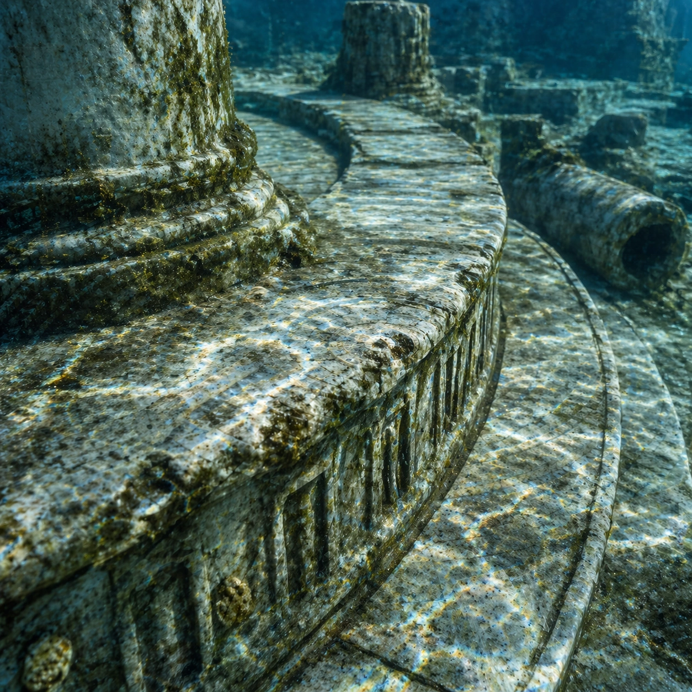

```text
Scene:
A square close study framed within the same site established by the reference anchor. Use a tight crop, shallow but believable depth of field, and raking light that reveals tactile evidence in surface relief, pigment, tool marks, moisture, or marine wear. The image should feel like a museum conservation photograph elevated to gallery quality.

Subject:
Focus on a materially rich portion of the same site: carved edges, painted plaster, fitted stone, root-wrapped masonry, submerged paving, or quarry-cut facial planes depending on the civilization. The composition should remain anchored to the original location and show enough surrounding context that viewers still recognize the parent site rather than mistaking it for an unrelated artifact.

Important details:
Preserve the exact site identity from the reference model while shifting emphasis to forensic surface evidence. Keep the city logic disciplined and archaeological even though it is speculative: ring geometry, civic axes, hydrodynamic wear, and material aging should feel plausible rather than mythic excess. Make micro-texture, fracture lines, pigment retention, water wear, plant interaction, dust, or chisel traces visually persuasive. Avoid decorative clutter. Every mark should feel like evidence of making, weathering, excavation, or conservation. Keep any symbolic marks non-legible and historically appropriate, and make the light reveal depth without flattening the material richness.

Use case:
Atlantis Underwater Plaza series study 3/9.

Constraints:
No readable text, no watermark, no logos, preserve exact 1:1 aspect ratio, preserve exact site identity from the reference image, no mermaids, no glowing crystals, no submarines, no futuristic domes, no isolated floating artifact, no studio backdrop, no fake macro abstraction.
```

[Pinned source](https://github.com/ChaosRealmsAI/gpt-image-2-gallery/blob/5296db8c996e38776c83a0bc8c64f848dcd512b3/works/topics/atlantis-underwater-plaza/packages/series-core-discovery/images/03-surface-close-study/meta.json) · GPT Image2 · 1254×1254 · Reference images required. · ProjectD:[published and publicly accepted](https://aitoolsradar.com/en/prompts/a1ece96ccaa6b5)

## Atmospheric Wide Reveal · atlantis-underwater-plaza/series-core-discovery/04-atmospheric-wide-reveal

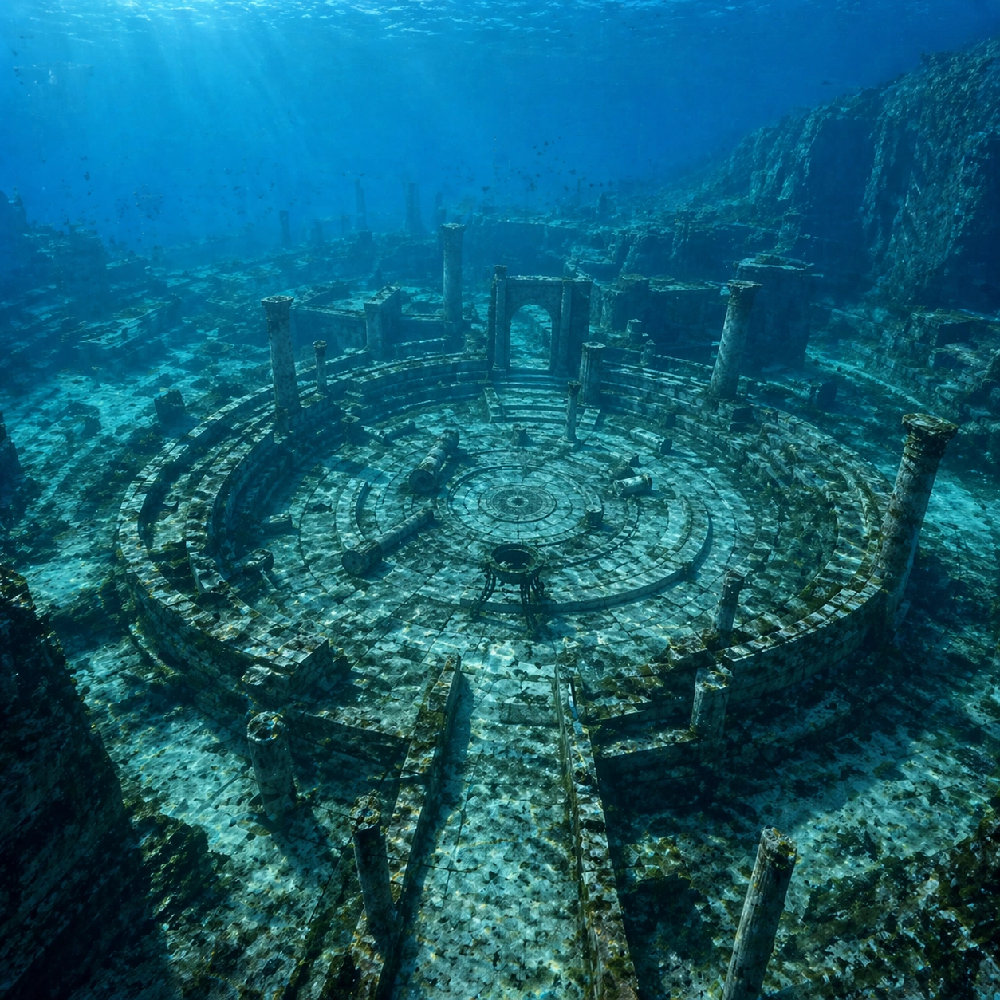

```text
Scene:
A square wide reveal of the same site under a slightly different environmental condition, with more surrounding geography or architecture visible while keeping the anchor landmark dominant. Use disciplined composition, atmospheric perspective, and natural light behavior so the image feels like a patient field photograph captured after the reference shot rather than a different fantasy set.

Subject:
Show the same site identity with broader context: approaches, terraces, ring walls, canyon slot, canopy volume, quarry slope, or chamber boundaries depending on the location. The anchor structure must remain instantly recognizable. Environmental scale should deepen understanding of why the site is placed here and how people, water, topography, or vegetation shape the experience of the monument.

Important details:
Preserve the exact landmark, materials, and civilizational cues from the reference model while allowing wider framing and a different atmospheric emphasis. Keep the city logic disciplined and archaeological even though it is speculative: ring geometry, civic axes, hydrodynamic wear, and material aging should feel plausible rather than mythic excess. Use geography and environmental systems to add meaning: drainage, mist, current, valley depth, roots, irrigation, or enclosure logic. The image should feel both beautiful and evidentiary, with no compositional tricks that break continuity with the established site.

Use case:
Atlantis Underwater Plaza series study 4/9.

Constraints:
No readable text, no watermark, no logos, preserve exact 1:1 aspect ratio, preserve exact site identity from the reference image, no mermaids, no glowing crystals, no submarines, no futuristic domes, no unrelated landmarks, no speculative mashup architecture, no posterized grading.
```

[Pinned source](https://github.com/ChaosRealmsAI/gpt-image-2-gallery/blob/5296db8c996e38776c83a0bc8c64f848dcd512b3/works/topics/atlantis-underwater-plaza/packages/series-core-discovery/images/04-atmospheric-wide-reveal/meta.json) · GPT Image2 · 1254×1254 · Reference images required. · ProjectD:[published and publicly accepted](https://aitoolsradar.com/en/prompts/84a94988709d57)

## Excavation Overview · atlantis-underwater-plaza/single-context-studies/excavation-overview


```text
Scene:
A square independent archaeology study composed from a slightly elevated fieldwork viewpoint. Use balanced natural light, crisp evidence hierarchy, and practical site organization so the image feels publishable in a museum report and still visually strong enough for a gallery wall. The frame should explain where excavation is happening without relying on readable markers or diagrams.

Subject:
Show an underwater survey lane with marker floats above, careful sediment disturbance, and divers documenting concentric masonry beneath clear water. Include grounded human traces such as ladders, trays, brushes, baskets, light rigs, or measuring tools only when they support archaeological realism and remain visually secondary. The site should stay culturally specific, with architecture, surface treatment, sediment, and environmental context all belonging to the correct civilization rather than a generic dig.

Important details:
Keep the city logic disciplined and archaeological even though it is speculative: ring geometry, civic axes, hydrodynamic wear, and material aging should feel plausible rather than mythic excess. Prioritize evidence relationships: exposed layers, cleaned edges, protected surfaces, loose fragments, and transitions between buried and revealed material. Let color, wear, and composition explain what has just been uncovered. The image must feel methodical rather than adventurous. Keep any site tags, notes, or markers abstract and unreadable. Avoid sensational treasure imagery and keep the atmosphere scholarly, patient, and materially convincing.

Use case:
Atlantis Underwater Plaza single study 5/9.

Constraints:
No readable text, no watermark, no logos, preserve exact 1:1 aspect ratio, no mermaids, no glowing crystals, no submarines, no futuristic domes, no treasure-chest clichés, no action-movie posing, no arbitrary props, no infographic overlay.
```

[Pinned source](https://github.com/ChaosRealmsAI/gpt-image-2-gallery/blob/5296db8c996e38776c83a0bc8c64f848dcd512b3/works/topics/atlantis-underwater-plaza/packages/single-context-studies/images/excavation-overview/meta.json) · GPT Image2 · 1254×1254 · No source-declared image dependencies. · ProjectD:[published and publicly accepted](https://aitoolsradar.com/en/prompts/fda14e1273ee59)

## Artifact Tableau · atlantis-underwater-plaza/single-context-studies/artifact-tableau

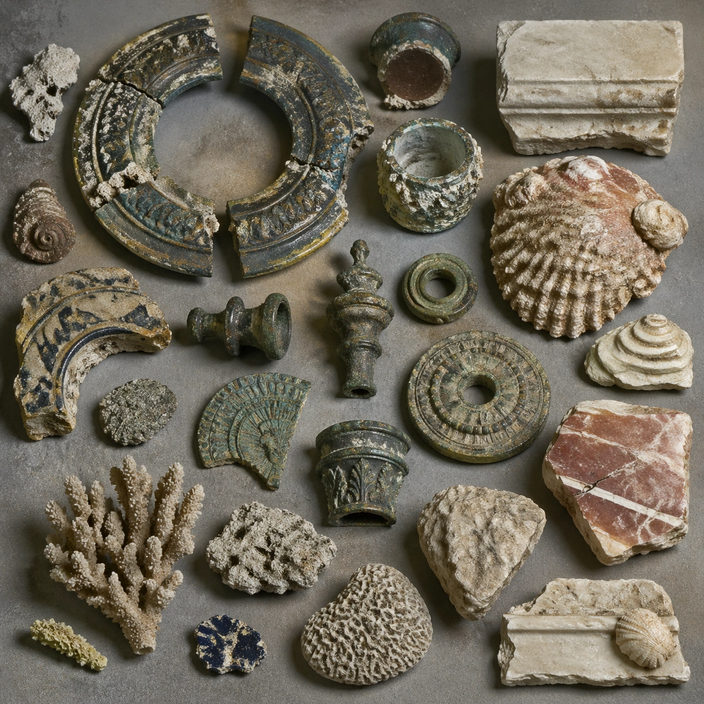

```text
Scene:
A square artifact and material study arranged like a high-end conservation photograph. Use soft directional light, controlled shadow falloff, and a neutral work surface so every fragment reads clearly. The image should feel intimate and scientific, but still rich enough to communicate the broader civilization through craft, wear, and material vocabulary alone.

Subject:
Present bronze fittings, shell-encrusted fragments, marble chips, coral growth samples, and recovered ceremonial pieces on a marine archaeology platform. Arrange the pieces with disciplined spacing and believable conservation handling. Include enough variation in scale, finish, and damage state to suggest excavation reality rather than a perfectly staged luxury still life. Nothing should look modern or decorative for its own sake; every object must feel like evidence tied to the same cultural world as the main topic.

Important details:
Emphasize tactile surfaces, honest aging, and historically grounded material behavior. Keep the city logic disciplined and archaeological even though it is speculative: ring geometry, civic axes, hydrodynamic wear, and material aging should feel plausible rather than mythic excess. Show abrasion, dust, corrosion, cracks, mineral bloom, pigment retention, or edge polish where appropriate. Keep the arrangement orderly but not sterile, as if prepared for a serious cataloging session. No readable labels, no museum placards, and no visual shortcuts that turn the study into product photography detached from archaeology.

Use case:
Atlantis Underwater Plaza single study 6/9.

Constraints:
No readable text, no watermark, no logos, preserve exact 1:1 aspect ratio, no mermaids, no glowing crystals, no submarines, no futuristic domes, no luxury advertising gloss, no floating objects, no velvet jewelry styling, no unrelated tools.
```

[Pinned source](https://github.com/ChaosRealmsAI/gpt-image-2-gallery/blob/5296db8c996e38776c83a0bc8c64f848dcd512b3/works/topics/atlantis-underwater-plaza/packages/single-context-studies/images/artifact-tableau/meta.json) · GPT Image2 · 1254×1254 · No source-declared image dependencies. · ProjectD:[published and publicly accepted](https://aitoolsradar.com/en/prompts/b3aeb846e3ccb9)

## Light Shift Study · atlantis-underwater-plaza/single-context-studies/light-shift-study

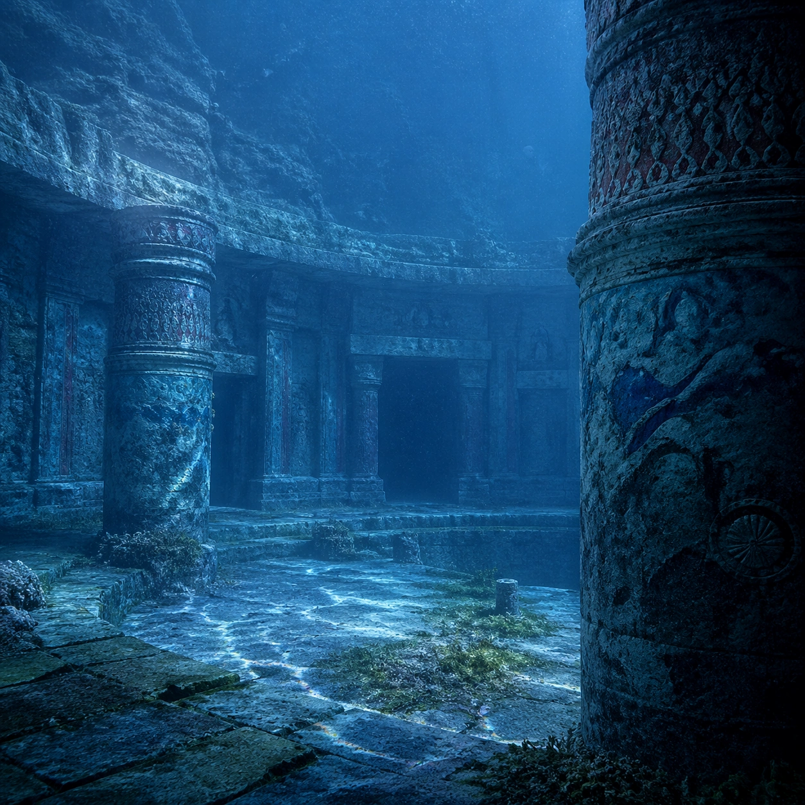

```text
Scene:
A square mood variation from the same civilization theme, built around deeper blue current conditions with softer visibility, denser suspended particles, and cooler caustic patterns across the same plaza. The image should stay grounded in field realism while testing how different illumination changes material reading, atmosphere, and emotional register. Keep the frame self-contained and coherent, as if photographed during a second visit under altered conditions.

Subject:
Show a culturally accurate site or interior connected to the same world as the main topic, but not as a direct dependency on the series reference. The focus should be on how light transforms relief, color, moisture, water, dust, or vegetation while preserving archaeological credibility. Architectural forms, objects, and setting must still belong to the same civilization with no cross-cultural contamination.

Important details:
Keep the city logic disciplined and archaeological even though it is speculative: ring geometry, civic axes, hydrodynamic wear, and material aging should feel plausible rather than mythic excess. Use the shift in light to reveal different evidence than the other studies: pigment glow, root sheen, caustics, wet stone, canyon shadow, marine haze, terrace depth, or quarry moisture. Keep the result serious and observational rather than romanticized. Non-readable motifs are acceptable, but there should be no signs, captions, or modern display devices. The image should feel like a rigorous visual experiment in historical atmosphere.

Use case:
Atlantis Underwater Plaza single study 7/9.

Constraints:
No readable text, no watermark, no logos, preserve exact 1:1 aspect ratio, no mermaids, no glowing crystals, no submarines, no futuristic domes, no theatrical color filters, no supernatural effects, no montage composition, no glossy concept-art exaggeration.
```

[Pinned source](https://github.com/ChaosRealmsAI/gpt-image-2-gallery/blob/5296db8c996e38776c83a0bc8c64f848dcd512b3/works/topics/atlantis-underwater-plaza/packages/single-context-studies/images/light-shift-study/meta.json) · GPT Image2 · 1254×1254 · No source-declared image dependencies. · ProjectD:[published and publicly accepted](https://aitoolsradar.com/en/prompts/09ba6bd5c3b5ea)

## Survey Perspective · atlantis-underwater-plaza/single-context-studies/survey-perspective

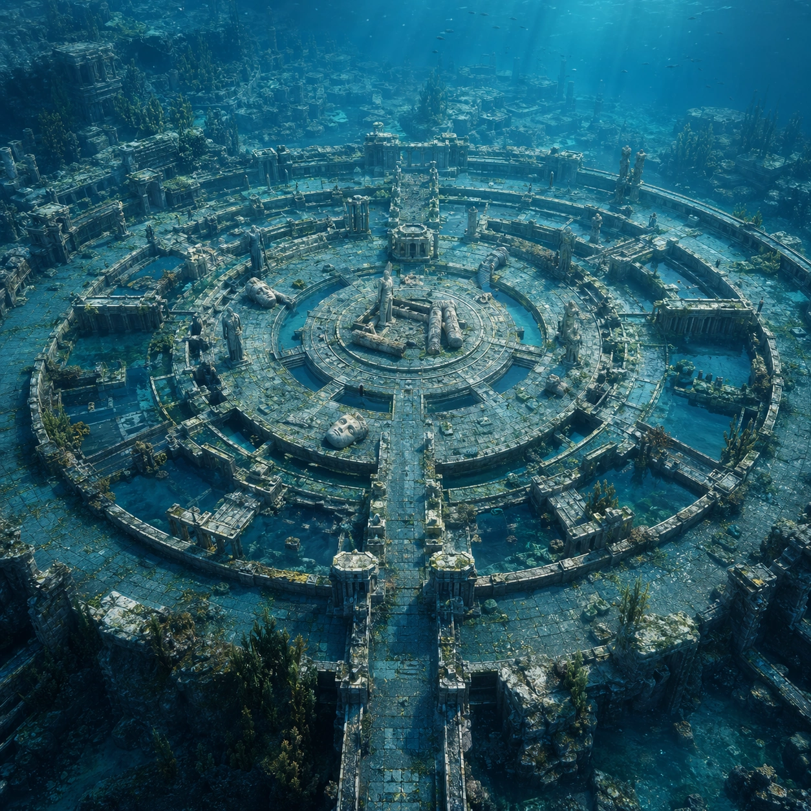

```text
Scene:
A square survey-oriented image that explains spatial logic with the clarity of an expert field overview while still reading as a finished artwork. Use a stable elevated vantage, clean depth layering, and enough visible terrain or architecture to make relationships legible without turning the frame into a literal map. The scene should feel analytical and cinematic at the same time.

Subject:
Show a high underwater perspective that reveals the circular plan, processional routes, broken statuary positions, and surrounding ring walls as one coherent urban diagram. Organize the composition so paths, terraces, walls, courtyards, chambers, canals, root systems, or quarry clusters can be read as a coherent system. The image should reveal how the civilization used land, water, elevation, enclosure, or monumentality. Keep all architecture, materials, and environmental details consistent with the correct place and period.

Important details:
Keep the city logic disciplined and archaeological even though it is speculative: ring geometry, civic axes, hydrodynamic wear, and material aging should feel plausible rather than mythic excess. This image should reward close looking by showing infrastructural logic: how stone courses align, how water moves, how rooms connect, how carved masses sit inside geology, or how vegetation interacts with built form. Avoid explicit annotation. Let composition, light, and scale cues do the explanatory work. Keep any measuring elements generic and unreadable, and make the image feel like serious research made visually elegant.

Use case:
Atlantis Underwater Plaza single study 8/9.

Constraints:
No readable text, no watermark, no logos, preserve exact 1:1 aspect ratio, no mermaids, no glowing crystals, no submarines, no futuristic domes, no infographic arrows, no split-screen layout, no impossible aerial geometry, no unrelated settlements.
```

[Pinned source](https://github.com/ChaosRealmsAI/gpt-image-2-gallery/blob/5296db8c996e38776c83a0bc8c64f848dcd512b3/works/topics/atlantis-underwater-plaza/packages/single-context-studies/images/survey-perspective/meta.json) · GPT Image2 · 1254×1254 · No source-declared image dependencies. · ProjectD:[published and publicly accepted](https://aitoolsradar.com/en/prompts/4e05d58c9f58bc)

## Editorial Reconstruction · atlantis-underwater-plaza/single-context-studies/editorial-reconstruction

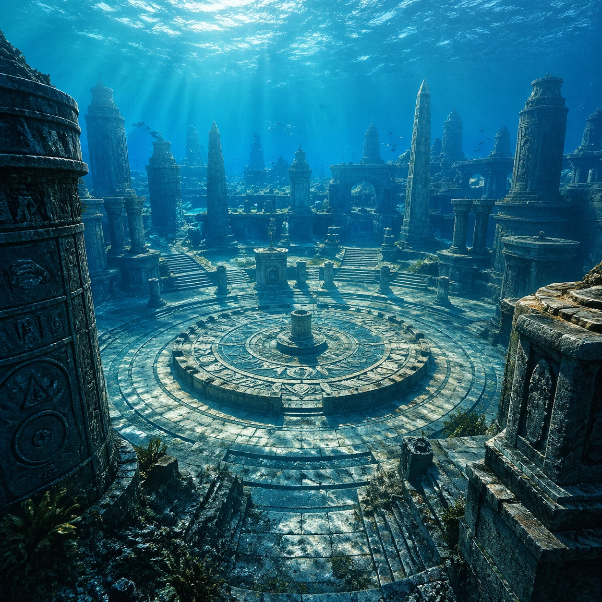

```text
Scene:
A square hero image designed for a museum wall graphic or flagship magazine cover, but without any actual typography. Use strong focal hierarchy, refined contrast, and a polished finish that still feels rooted in archaeological evidence. The frame should look complete on its own and communicate why this civilization remains visually unforgettable.

Subject:
Build the image around a premium speculative archaeology hero image that treats Atlantis as disciplined underwater evidence rather than fantasy adventure. Present architecture, artifacts, environment, and atmosphere as one coherent statement. The composition can be more distilled than a field snapshot, but it must remain culturally specific, materially persuasive, and free of fantasy shorthand. Nothing should feel like a movie poster or commercial franchise imitation.

Important details:
Keep the city logic disciplined and archaeological even though it is speculative: ring geometry, civic axes, hydrodynamic wear, and material aging should feel plausible rather than mythic excess. Distill the site or cultural world into one decisive visual argument: place, craft, weathering, engineering, and memory. Use the strongest material signatures from this civilization and let them sit in a believable environment with controlled dramatic weight. Keep any carved or painted symbols non-readable. The result should look like responsible high-end visual storytelling for research and public interpretation, not a spectacle-first matte painting.

Use case:
Atlantis Underwater Plaza single study 9/9.

Constraints:
No readable text, no watermark, no logos, preserve exact 1:1 aspect ratio, no mermaids, no glowing crystals, no submarines, no futuristic domes, no movie-poster tropes, no overdesigned framing devices, no collage layout, no brand-like iconography.
```

[Pinned source](https://github.com/ChaosRealmsAI/gpt-image-2-gallery/blob/5296db8c996e38776c83a0bc8c64f848dcd512b3/works/topics/atlantis-underwater-plaza/packages/single-context-studies/images/editorial-reconstruction/meta.json) · GPT Image2 · 1254×1254 · No source-declared image dependencies. · ProjectD:[published and publicly accepted](https://aitoolsradar.com/en/prompts/a9fb46d21bd889)

## Macro Study · audubon-specimen-atlas/single-audubon-specimen-studies/macro-study

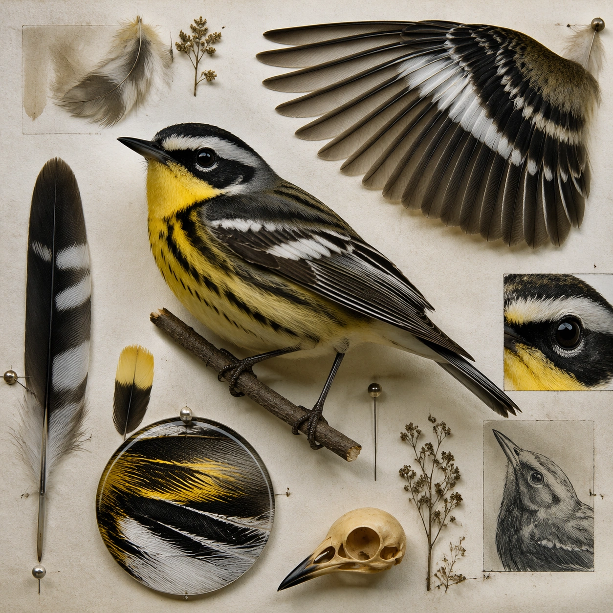

```text
Scene:
A square photographic image with intentional lens choice, coherent light, and a subject that feels observed rather than merely decorated. Build the frame around closer observation that reveals fine structure and optical behavior. Keep the lighting, camera distance, and spatial organization tuned for a high-signal research image rather than a casual snapshot. The image belongs to the Audubon Specimen Atlas theme and should feel immediately legible as a prompt atlas theme for audubon specimen atlas, testing structured-layout, technical-diagram with gpt image 2..

Subject:
Center the study on closer observation that reveals fine structure and optical behavior. Translate the theme into a concrete visual statement instead of an abstract mood board: the viewer should understand what kind of image this is, what is being tested, and why the composition is difficult. Use the slug idea of audubon specimen atlas as a literal guide for subject matter, materials, and staging. If helpful, borrow the broad visual cues suggested by John James Audubon, Maria Sibylla Merian, but keep the result original and specific to this study.

Important details:
The realism should come from timing, optics, and material response: atmosphere, contrast, depth, motion, and tiny physical cues all need to agree. Preserve a disciplined square composition, clear focal hierarchy, and enough secondary information to make the image feel complete rather than underspecified. The image should look polished, novel, and exhibition-ready, with topic-specific credibility coming from the way surfaces, structure, and visual language reinforce Audubon Specimen Atlas. Avoid generic filler elements that do not serve the main concept.

Use case:
Audubon Specimen Atlas single study 2/8, testing structured-layout, technical-diagram through the macro study variation.

Constraints:
No readable text, no watermark, no logos, preserve exact 1:1 aspect ratio, no watermark, no cheap HDR excess, no unreadable signage, no fake stock-photo posing, no compositing seams, no arbitrary lens flare.
```

[Pinned source](https://github.com/ChaosRealmsAI/gpt-image-2-gallery/blob/5296db8c996e38776c83a0bc8c64f848dcd512b3/works/topics/audubon-specimen-atlas/packages/single-audubon-specimen-studies/images/macro-study/meta.json) · GPT Image2 · 1254×1254 · No source-declared image dependencies. · ProjectD:[published and publicly accepted](https://aitoolsradar.com/en/prompts/99dea1f0425254)

## Side Light Study · audubon-specimen-atlas/single-audubon-specimen-studies/side-light-study

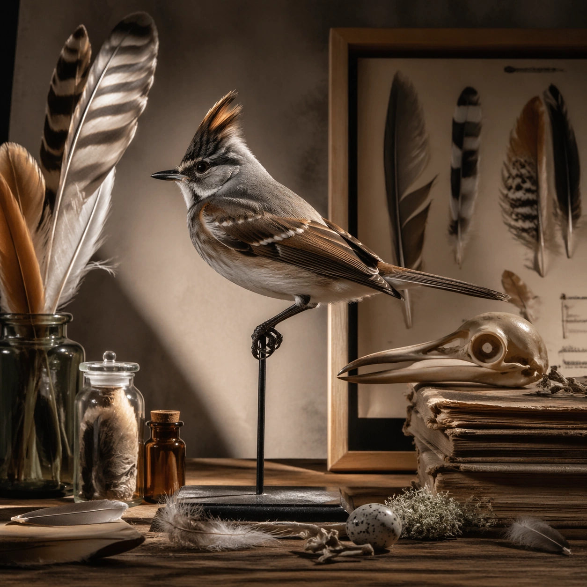

```text
Scene:
A square photographic image with intentional lens choice, coherent light, and a subject that feels observed rather than merely decorated. Build the frame around a directional-light treatment that increases form and drama. Keep the lighting, camera distance, and spatial organization tuned for a high-signal research image rather than a casual snapshot. The image belongs to the Audubon Specimen Atlas theme and should feel immediately legible as a prompt atlas theme for audubon specimen atlas, testing structured-layout, technical-diagram with gpt image 2..

Subject:
Center the study on a directional-light treatment that increases form and drama. Translate the theme into a concrete visual statement instead of an abstract mood board: the viewer should understand what kind of image this is, what is being tested, and why the composition is difficult. Use the slug idea of audubon specimen atlas as a literal guide for subject matter, materials, and staging. If helpful, borrow the broad visual cues suggested by John James Audubon, Maria Sibylla Merian, but keep the result original and specific to this study.

Important details:
The realism should come from timing, optics, and material response: atmosphere, contrast, depth, motion, and tiny physical cues all need to agree. Preserve a disciplined square composition, clear focal hierarchy, and enough secondary information to make the image feel complete rather than underspecified. The image should look polished, novel, and exhibition-ready, with topic-specific credibility coming from the way surfaces, structure, and visual language reinforce Audubon Specimen Atlas. Avoid generic filler elements that do not serve the main concept.

Use case:
Audubon Specimen Atlas single study 3/8, testing structured-layout, technical-diagram through the side light study variation.

Constraints:
No readable text, no watermark, no logos, preserve exact 1:1 aspect ratio, no watermark, no cheap HDR excess, no unreadable signage, no fake stock-photo posing, no compositing seams, no arbitrary lens flare.
```

[Pinned source](https://github.com/ChaosRealmsAI/gpt-image-2-gallery/blob/5296db8c996e38776c83a0bc8c64f848dcd512b3/works/topics/audubon-specimen-atlas/packages/single-audubon-specimen-studies/images/side-light-study/meta.json) · GPT Image2 · 1254×1254 · No source-declared image dependencies. · ProjectD:[published and publicly accepted](https://aitoolsradar.com/en/prompts/c916201280b67a)

## Motion Moment · audubon-specimen-atlas/single-audubon-specimen-studies/motion-moment

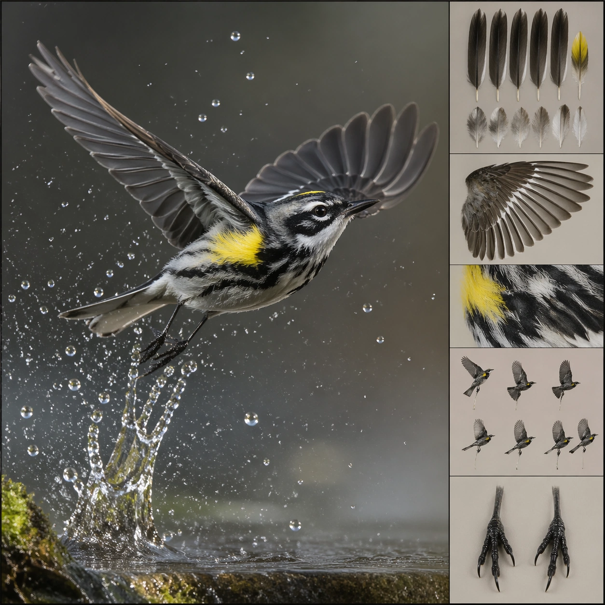

```text
Scene:
A square photographic image with intentional lens choice, coherent light, and a subject that feels observed rather than merely decorated. Build the frame around a time-sensitive or kinetic phenomenon captured at the right instant. Keep the lighting, camera distance, and spatial organization tuned for a high-signal research image rather than a casual snapshot. The image belongs to the Audubon Specimen Atlas theme and should feel immediately legible as a prompt atlas theme for audubon specimen atlas, testing structured-layout, technical-diagram with gpt image 2..

Subject:
Center the study on a time-sensitive or kinetic phenomenon captured at the right instant. Translate the theme into a concrete visual statement instead of an abstract mood board: the viewer should understand what kind of image this is, what is being tested, and why the composition is difficult. Use the slug idea of audubon specimen atlas as a literal guide for subject matter, materials, and staging. If helpful, borrow the broad visual cues suggested by John James Audubon, Maria Sibylla Merian, but keep the result original and specific to this study.

Important details:
The realism should come from timing, optics, and material response: atmosphere, contrast, depth, motion, and tiny physical cues all need to agree. Preserve a disciplined square composition, clear focal hierarchy, and enough secondary information to make the image feel complete rather than underspecified. The image should look polished, novel, and exhibition-ready, with topic-specific credibility coming from the way surfaces, structure, and visual language reinforce Audubon Specimen Atlas. Avoid generic filler elements that do not serve the main concept.

Use case:
Audubon Specimen Atlas single study 4/8, testing structured-layout, technical-diagram through the motion moment variation.

Constraints:
No readable text, no watermark, no logos, preserve exact 1:1 aspect ratio, no watermark, no cheap HDR excess, no unreadable signage, no fake stock-photo posing, no compositing seams, no arbitrary lens flare.
```

[Pinned source](https://github.com/ChaosRealmsAI/gpt-image-2-gallery/blob/5296db8c996e38776c83a0bc8c64f848dcd512b3/works/topics/audubon-specimen-atlas/packages/single-audubon-specimen-studies/images/motion-moment/meta.json) · GPT Image2 · 1254×1254 · No source-declared image dependencies. · ProjectD:[published and publicly accepted](https://aitoolsradar.com/en/prompts/9670dc6de89587)

## Low-Light Atlas · audubon-specimen-atlas/single-audubon-specimen-studies/low-light-atlas

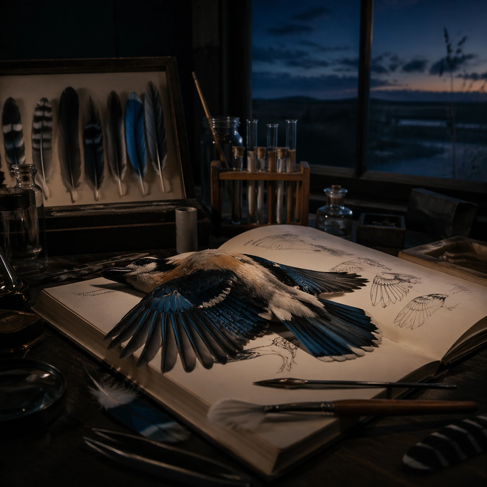

```text
Scene:
A square photographic image with intentional lens choice, coherent light, and a subject that feels observed rather than merely decorated. Build the frame around a dusk, night, or low-light frame with disciplined exposure. Keep the lighting, camera distance, and spatial organization tuned for a high-signal research image rather than a casual snapshot. The image belongs to the Audubon Specimen Atlas theme and should feel immediately legible as a prompt atlas theme for audubon specimen atlas, testing structured-layout, technical-diagram with gpt image 2..

Subject:
Center the study on a dusk, night, or low-light frame with disciplined exposure. Translate the theme into a concrete visual statement instead of an abstract mood board: the viewer should understand what kind of image this is, what is being tested, and why the composition is difficult. Use the slug idea of audubon specimen atlas as a literal guide for subject matter, materials, and staging. If helpful, borrow the broad visual cues suggested by John James Audubon, Maria Sibylla Merian, but keep the result original and specific to this study.

Important details:
The realism should come from timing, optics, and material response: atmosphere, contrast, depth, motion, and tiny physical cues all need to agree. Preserve a disciplined square composition, clear focal hierarchy, and enough secondary information to make the image feel complete rather than underspecified. The image should look polished, novel, and exhibition-ready, with topic-specific credibility coming from the way surfaces, structure, and visual language reinforce Audubon Specimen Atlas. Avoid generic filler elements that do not serve the main concept.

Use case:
Audubon Specimen Atlas single study 5/8, testing structured-layout, technical-diagram through the low-light atlas variation.

Constraints:
No readable text, no watermark, no logos, preserve exact 1:1 aspect ratio, no watermark, no cheap HDR excess, no unreadable signage, no fake stock-photo posing, no compositing seams, no arbitrary lens flare.
```

[Pinned source](https://github.com/ChaosRealmsAI/gpt-image-2-gallery/blob/5296db8c996e38776c83a0bc8c64f848dcd512b3/works/topics/audubon-specimen-atlas/packages/single-audubon-specimen-studies/images/low-light-atlas/meta.json) · GPT Image2 · 1254×1254 · No source-declared image dependencies. · ProjectD:[published and publicly accepted](https://aitoolsradar.com/en/prompts/1ba3957b808369)

## Specimen Table · audubon-specimen-atlas/single-audubon-specimen-studies/specimen-table

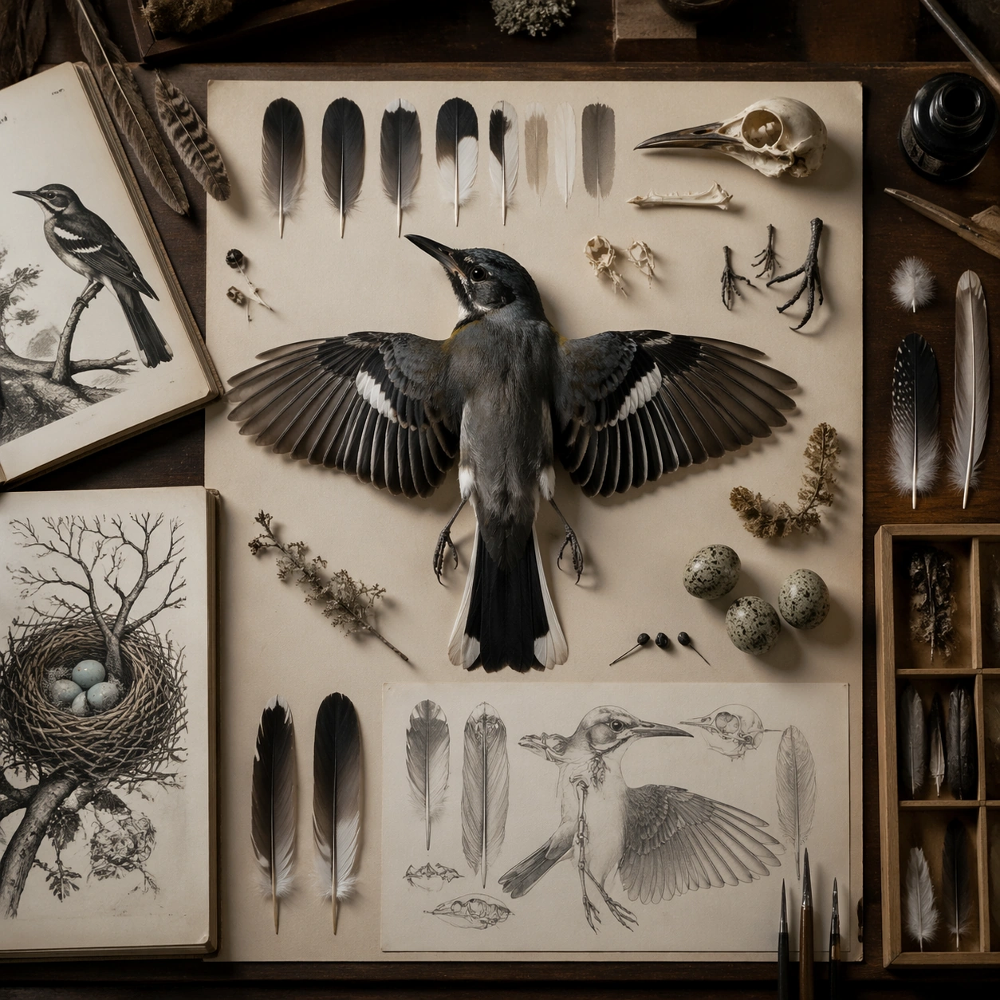

```text
Scene:
A square photographic image with intentional lens choice, coherent light, and a subject that feels observed rather than merely decorated. Build the frame around a carefully arranged or comparative frame that still feels photographic. Keep the lighting, camera distance, and spatial organization tuned for a high-signal research image rather than a casual snapshot. The image belongs to the Audubon Specimen Atlas theme and should feel immediately legible as a prompt atlas theme for audubon specimen atlas, testing structured-layout, technical-diagram with gpt image 2..

Subject:
Center the study on a carefully arranged or comparative frame that still feels photographic. Translate the theme into a concrete visual statement instead of an abstract mood board: the viewer should understand what kind of image this is, what is being tested, and why the composition is difficult. Use the slug idea of audubon specimen atlas as a literal guide for subject matter, materials, and staging. If helpful, borrow the broad visual cues suggested by John James Audubon, Maria Sibylla Merian, but keep the result original and specific to this study.

Important details:
The realism should come from timing, optics, and material response: atmosphere, contrast, depth, motion, and tiny physical cues all need to agree. Preserve a disciplined square composition, clear focal hierarchy, and enough secondary information to make the image feel complete rather than underspecified. The image should look polished, novel, and exhibition-ready, with topic-specific credibility coming from the way surfaces, structure, and visual language reinforce Audubon Specimen Atlas. Avoid generic filler elements that do not serve the main concept.

Use case:
Audubon Specimen Atlas single study 6/8, testing structured-layout, technical-diagram through the specimen table variation.

Constraints:
No readable text, no watermark, no logos, preserve exact 1:1 aspect ratio, no watermark, no cheap HDR excess, no unreadable signage, no fake stock-photo posing, no compositing seams, no arbitrary lens flare.
```

[Pinned source](https://github.com/ChaosRealmsAI/gpt-image-2-gallery/blob/5296db8c996e38776c83a0bc8c64f848dcd512b3/works/topics/audubon-specimen-atlas/packages/single-audubon-specimen-studies/images/specimen-table/meta.json) · GPT Image2 · 1254×1254 · No source-declared image dependencies. · ProjectD:[published and publicly accepted](https://aitoolsradar.com/en/prompts/3c26f1f02cce76)

## Atmospheric View · audubon-specimen-atlas/single-audubon-specimen-studies/atmospheric-view

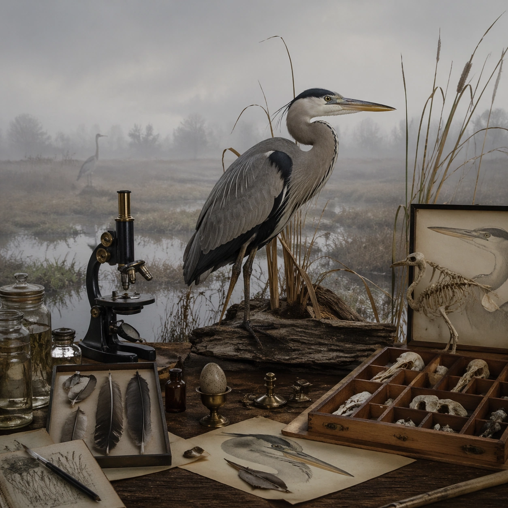

```text
Scene:
A square photographic image with intentional lens choice, coherent light, and a subject that feels observed rather than merely decorated. Build the frame around weather, haze, or volumetric light used to deepen realism. Keep the lighting, camera distance, and spatial organization tuned for a high-signal research image rather than a casual snapshot. The image belongs to the Audubon Specimen Atlas theme and should feel immediately legible as a prompt atlas theme for audubon specimen atlas, testing structured-layout, technical-diagram with gpt image 2..

Subject:
Center the study on weather, haze, or volumetric light used to deepen realism. Translate the theme into a concrete visual statement instead of an abstract mood board: the viewer should understand what kind of image this is, what is being tested, and why the composition is difficult. Use the slug idea of audubon specimen atlas as a literal guide for subject matter, materials, and staging. If helpful, borrow the broad visual cues suggested by John James Audubon, Maria Sibylla Merian, but keep the result original and specific to this study.

Important details:
The realism should come from timing, optics, and material response: atmosphere, contrast, depth, motion, and tiny physical cues all need to agree. Preserve a disciplined square composition, clear focal hierarchy, and enough secondary information to make the image feel complete rather than underspecified. The image should look polished, novel, and exhibition-ready, with topic-specific credibility coming from the way surfaces, structure, and visual language reinforce Audubon Specimen Atlas. Avoid generic filler elements that do not serve the main concept.

Use case:
Audubon Specimen Atlas single study 7/8, testing structured-layout, technical-diagram through the atmospheric view variation.

Constraints:
No readable text, no watermark, no logos, preserve exact 1:1 aspect ratio, no watermark, no cheap HDR excess, no unreadable signage, no fake stock-photo posing, no compositing seams, no arbitrary lens flare.
```

[Pinned source](https://github.com/ChaosRealmsAI/gpt-image-2-gallery/blob/5296db8c996e38776c83a0bc8c64f848dcd512b3/works/topics/audubon-specimen-atlas/packages/single-audubon-specimen-studies/images/atmospheric-view/meta.json) · GPT Image2 · 1254×1254 · No source-declared image dependencies. · ProjectD:[published and publicly accepted](https://aitoolsradar.com/en/prompts/4a714d0921fbf4)

## Signature Frame · audubon-specimen-atlas/single-audubon-specimen-studies/signature-frame

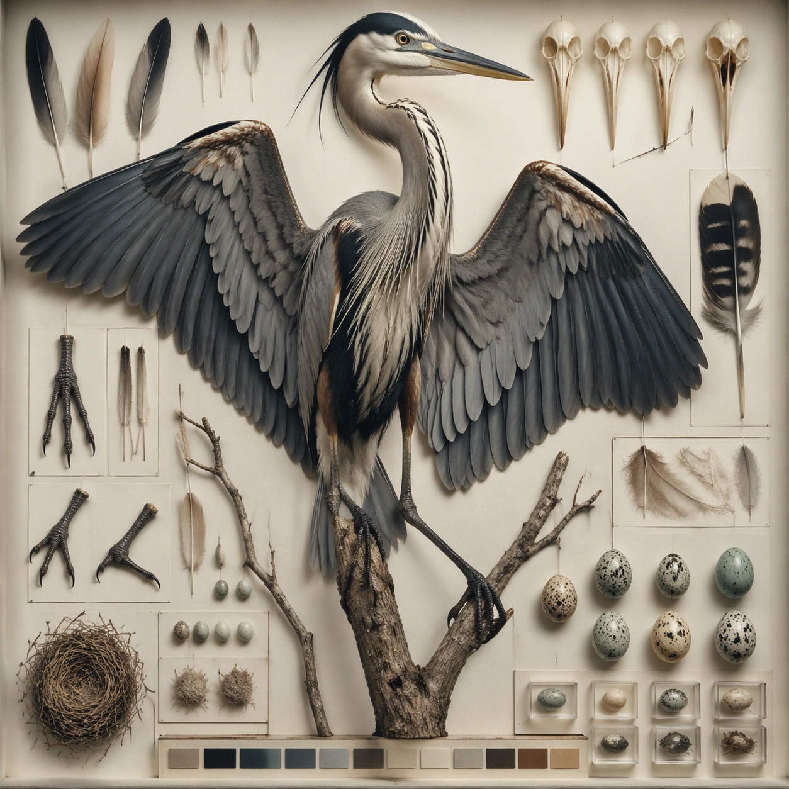

```text
Scene:
A square photographic image with intentional lens choice, coherent light, and a subject that feels observed rather than merely decorated. Build the frame around the most memorable final image for the topic. Keep the lighting, camera distance, and spatial organization tuned for a high-signal research image rather than a casual snapshot. The image belongs to the Audubon Specimen Atlas theme and should feel immediately legible as a prompt atlas theme for audubon specimen atlas, testing structured-layout, technical-diagram with gpt image 2..

Subject:
Center the study on the most memorable final image for the topic. Translate the theme into a concrete visual statement instead of an abstract mood board: the viewer should understand what kind of image this is, what is being tested, and why the composition is difficult. Use the slug idea of audubon specimen atlas as a literal guide for subject matter, materials, and staging. If helpful, borrow the broad visual cues suggested by John James Audubon, Maria Sibylla Merian, but keep the result original and specific to this study.

Important details:
The realism should come from timing, optics, and material response: atmosphere, contrast, depth, motion, and tiny physical cues all need to agree. Preserve a disciplined square composition, clear focal hierarchy, and enough secondary information to make the image feel complete rather than underspecified. The image should look polished, novel, and exhibition-ready, with topic-specific credibility coming from the way surfaces, structure, and visual language reinforce Audubon Specimen Atlas. Avoid generic filler elements that do not serve the main concept.

Use case:
Audubon Specimen Atlas single study 8/8, testing structured-layout, technical-diagram through the signature frame variation.

Constraints:
No readable text, no watermark, no logos, preserve exact 1:1 aspect ratio, no watermark, no cheap HDR excess, no unreadable signage, no fake stock-photo posing, no compositing seams, no arbitrary lens flare.
```

[Pinned source](https://github.com/ChaosRealmsAI/gpt-image-2-gallery/blob/5296db8c996e38776c83a0bc8c64f848dcd512b3/works/topics/audubon-specimen-atlas/packages/single-audubon-specimen-studies/images/signature-frame/meta.json) · GPT Image2 · 1254×1254 · No source-declared image dependencies. · ProjectD:[published and publicly accepted](https://aitoolsradar.com/en/prompts/b362d2ece8dde7)

## Reference Anchor · aurora-glacier-silent-theatre/series-core-system/01-reference-anchor

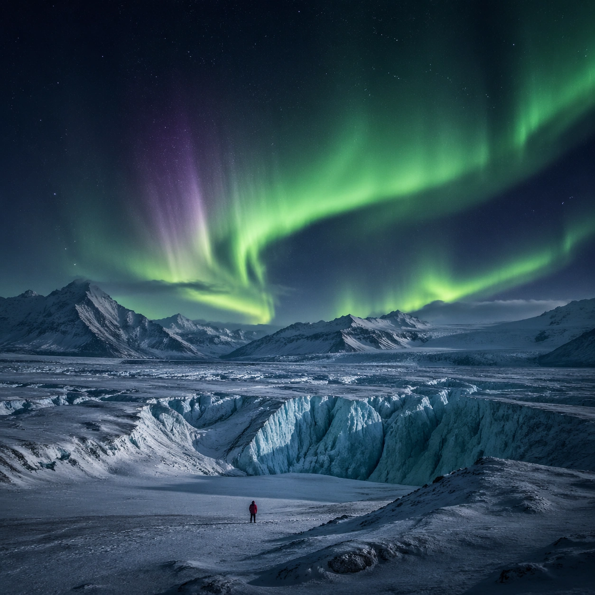

```text
Scene:
Create a square cinematic still for Aurora Glacier Silent Theatre. Use production-grade photoreal lighting, disciplined lens behavior, and a composition that feels like a finished key frame from an original film rather than a casual snapshot. An Arctic glacier plain opens under a sweeping aurora curtain, with deep night sky, luminous green and faint violet ribbons overhead, fractured ice catching reflected color, and a breath-frozen atmosphere that feels almost soundless. Keep the camera in a disciplined anchor position so the full lighting event and the main spatial structure are immediately legible from edge to edge.

Subject:
Build a coherent original scene whose emotional center comes from atmosphere, light physics, and spatial clarity. Avoid relying on celebrity likeness, franchise iconography, or stylized illustration shortcuts. A solitary human figure in a red parka should appear tiny against the glacier geometry, while crevasses, wind-scoured snow, and ice walls provide a strong sense of scale without cluttering the frame. This frame should lock the canonical arrangement, scale relationship, and emotional tone that the later dependent images inherit.

Important details:
Preserve a believable physical world with strong depth layering, careful color separation, and premium image discipline. Keep the aurora soft and physically plausible rather than graphic, with believable ice reflectance, low-angle moonless ambient light, and careful contrast so the red parka remains a scale marker rather than a fashion focal point. Use this image to establish the authoritative direction of light, atmospheric density, and structural silhouette for the package.

Use case:
Aurora Glacier series study 1/9.

Constraints:
No readable text, no watermark, no logos, preserve exact 1:1 aspect ratio, no tents, no readable expedition logos, no fantasy animals, no saturated nightclub colors, no fireworks effect.
```

[Pinned source](https://github.com/ChaosRealmsAI/gpt-image-2-gallery/blob/5296db8c996e38776c83a0bc8c64f848dcd512b3/works/topics/aurora-glacier-silent-theatre/packages/series-core-system/images/01-reference-anchor/meta.json) · GPT Image2 · 1254×1254 · No source-declared image dependencies. · ProjectD:[published and publicly accepted](https://aitoolsradar.com/en/prompts/6f2d41e96c3eb1)

## Closer Frame · aurora-glacier-silent-theatre/series-core-system/02-closer-frame


```text
Scene:
Create a square cinematic still for Aurora Glacier Silent Theatre. Use production-grade photoreal lighting, disciplined lens behavior, and a composition that feels like a finished key frame from an original film rather than a casual snapshot. An Arctic glacier plain opens under a sweeping aurora curtain, with deep night sky, luminous green and faint violet ribbons overhead, fractured ice catching reflected color, and a breath-frozen atmosphere that feels almost soundless. Move the camera closer or lower so the viewer feels more embedded inside the atmosphere while the same light direction and environment remain intact.

Subject:
Build a coherent original scene whose emotional center comes from atmosphere, light physics, and spatial clarity. Avoid relying on celebrity likeness, franchise iconography, or stylized illustration shortcuts. A solitary human figure in a red parka should appear tiny against the glacier geometry, while crevasses, wind-scoured snow, and ice walls provide a strong sense of scale without cluttering the frame. Preserve the same world logic from the reference and let one human-scale or material-scale element become more prominent without stealing focus from the atmosphere.

Important details:
Preserve a believable physical world with strong depth layering, careful color separation, and premium image discipline. Keep the aurora soft and physically plausible rather than graphic, with believable ice reflectance, low-angle moonless ambient light, and careful contrast so the red parka remains a scale marker rather than a fashion focal point. Keep the palette family, structural read, and light behavior from image 01 while increasing immediacy and tactile presence.

Use case:
Aurora Glacier series study 2/9.

Constraints:
No readable text, no watermark, no logos, preserve exact 1:1 aspect ratio, no tents, no readable expedition logos, no fantasy animals, no saturated nightclub colors, no fireworks effect.
```

[Pinned source](https://github.com/ChaosRealmsAI/gpt-image-2-gallery/blob/5296db8c996e38776c83a0bc8c64f848dcd512b3/works/topics/aurora-glacier-silent-theatre/packages/series-core-system/images/02-closer-frame/meta.json) · GPT Image2 · 1254×1254 · Reference images required. · ProjectD:[published and publicly accepted](https://aitoolsradar.com/en/prompts/6c34103f0f0acb)

## Spatial Counterpoint · aurora-glacier-silent-theatre/series-core-system/03-spatial-counterpoint

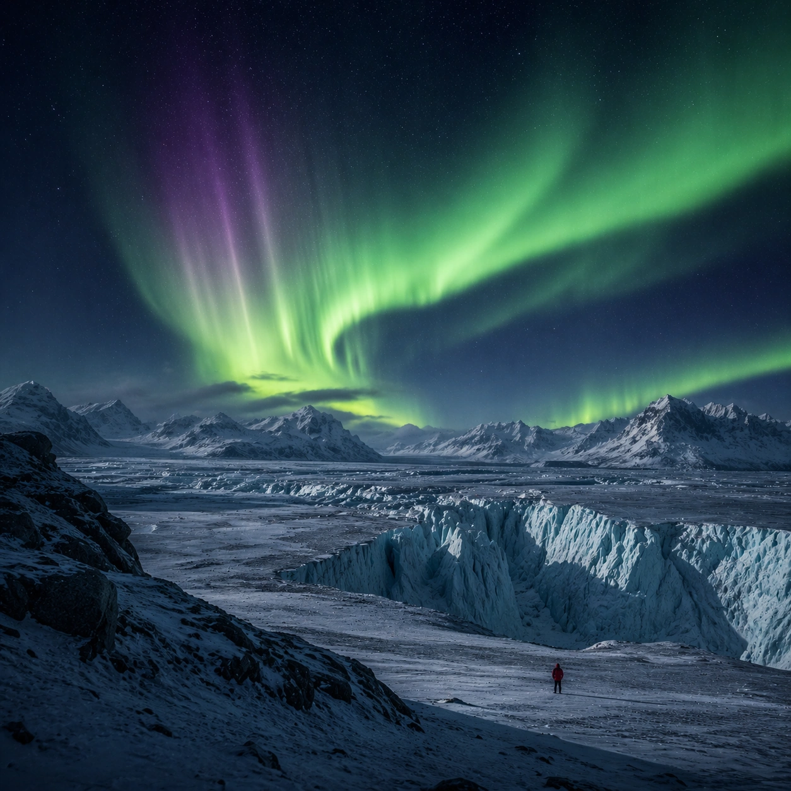

```text
Scene:
Create a square cinematic still for Aurora Glacier Silent Theatre. Use production-grade photoreal lighting, disciplined lens behavior, and a composition that feels like a finished key frame from an original film rather than a casual snapshot. An Arctic glacier plain opens under a sweeping aurora curtain, with deep night sky, luminous green and faint violet ribbons overhead, fractured ice catching reflected color, and a breath-frozen atmosphere that feels almost soundless. Shift to an oblique or lateral point of view that reveals different depth layers while staying inside the same place and the same atmospheric event.

Subject:
Build a coherent original scene whose emotional center comes from atmosphere, light physics, and spatial clarity. Avoid relying on celebrity likeness, franchise iconography, or stylized illustration shortcuts. A solitary human figure in a red parka should appear tiny against the glacier geometry, while crevasses, wind-scoured snow, and ice walls provide a strong sense of scale without cluttering the frame. Hold the reference structure, but use the new angle to show secondary planes, foreground interruption, or a changed distance relationship.

Important details:
Preserve a believable physical world with strong depth layering, careful color separation, and premium image discipline. Keep the aurora soft and physically plausible rather than graphic, with believable ice reflectance, low-angle moonless ambient light, and careful contrast so the red parka remains a scale marker rather than a fashion focal point. The success condition is continuity with the reference plus a richer sense of depth, not a new location or a new lighting system.

Use case:
Aurora Glacier series study 3/9.

Constraints:
No readable text, no watermark, no logos, preserve exact 1:1 aspect ratio, no tents, no readable expedition logos, no fantasy animals, no saturated nightclub colors, no fireworks effect.
```

[Pinned source](https://github.com/ChaosRealmsAI/gpt-image-2-gallery/blob/5296db8c996e38776c83a0bc8c64f848dcd512b3/works/topics/aurora-glacier-silent-theatre/packages/series-core-system/images/03-spatial-counterpoint/meta.json) · GPT Image2 · 1254×1254 · Reference images required. · ProjectD:[published and publicly accepted](https://aitoolsradar.com/en/prompts/685ac80c6bfca4)

## Climax Frame · aurora-glacier-silent-theatre/series-core-system/04-climax-frame

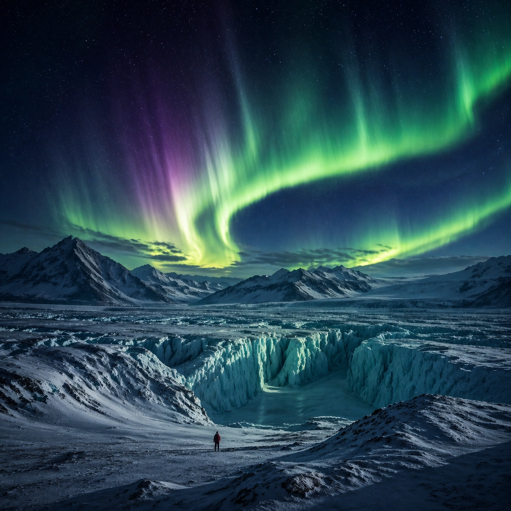

```text
Scene:
Create a square cinematic still for Aurora Glacier Silent Theatre. Use production-grade photoreal lighting, disciplined lens behavior, and a composition that feels like a finished key frame from an original film rather than a casual snapshot. An Arctic glacier plain opens under a sweeping aurora curtain, with deep night sky, luminous green and faint violet ribbons overhead, fractured ice catching reflected color, and a breath-frozen atmosphere that feels almost soundless. Push the composition toward the emotional peak of the same setup, with the most dramatic balance of brightness, shadow, or atmospheric density inside the established world.

Subject:
Build a coherent original scene whose emotional center comes from atmosphere, light physics, and spatial clarity. Avoid relying on celebrity likeness, franchise iconography, or stylized illustration shortcuts. A solitary human figure in a red parka should appear tiny against the glacier geometry, while crevasses, wind-scoured snow, and ice walls provide a strong sense of scale without cluttering the frame. Everything should still read as the same location and same event, but framed for maximum narrative force and visual closure.

Important details:
Preserve a believable physical world with strong depth layering, careful color separation, and premium image discipline. Keep the aurora soft and physically plausible rather than graphic, with believable ice reflectance, low-angle moonless ambient light, and careful contrast so the red parka remains a scale marker rather than a fashion focal point. Make it feel like the strongest hero frame of the sequence without breaking continuity or introducing a new design language.

Use case:
Aurora Glacier series study 4/9.

Constraints:
No readable text, no watermark, no logos, preserve exact 1:1 aspect ratio, no tents, no readable expedition logos, no fantasy animals, no saturated nightclub colors, no fireworks effect.
```

[Pinned source](https://github.com/ChaosRealmsAI/gpt-image-2-gallery/blob/5296db8c996e38776c83a0bc8c64f848dcd512b3/works/topics/aurora-glacier-silent-theatre/packages/series-core-system/images/04-climax-frame/meta.json) · GPT Image2 · 1254×1254 · Reference images required. · ProjectD:[published and publicly accepted](https://aitoolsradar.com/en/prompts/283cf7758e71ae)

## Silhouette Study · aurora-glacier-silent-theatre/single-support-studies/silhouette-study

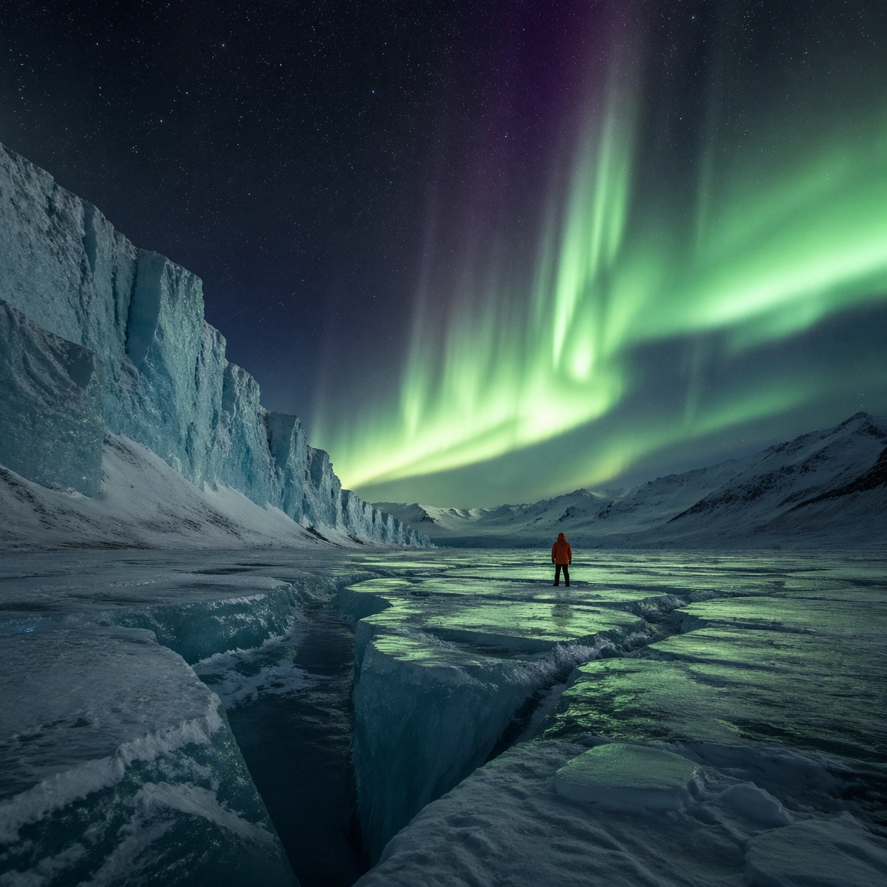

```text
Scene:
Create a square cinematic still for Aurora Glacier Silent Theatre. Use production-grade photoreal lighting, disciplined lens behavior, and a composition that feels like a finished key frame from an original film rather than a casual snapshot. An Arctic glacier plain opens under a sweeping aurora curtain, with deep night sky, luminous green and faint violet ribbons overhead, fractured ice catching reflected color, and a breath-frozen atmosphere that feels almost soundless. Compose an independent frame where one human, animal, or object silhouette negotiates with the atmospheric light event in a clean, readable way.

Subject:
Build a coherent original scene whose emotional center comes from atmosphere, light physics, and spatial clarity. Avoid relying on celebrity likeness, franchise iconography, or stylized illustration shortcuts. A solitary human figure in a red parka should appear tiny against the glacier geometry, while crevasses, wind-scoured snow, and ice walls provide a strong sense of scale without cluttering the frame. The silhouette should supply scale and emotional orientation, but the environment still needs to carry most of the storytelling weight.

Important details:
Preserve a believable physical world with strong depth layering, careful color separation, and premium image discipline. Keep the aurora soft and physically plausible rather than graphic, with believable ice reflectance, low-angle moonless ambient light, and careful contrast so the red parka remains a scale marker rather than a fashion focal point. Keep the silhouette simple and believable, avoiding poster-like graphic flattening while preserving strong contrast.

Use case:
Aurora Glacier single study 6/9.

Constraints:
No readable text, no watermark, no logos, preserve exact 1:1 aspect ratio, no tents, no readable expedition logos, no fantasy animals, no saturated nightclub colors, no fireworks effect.
```

[Pinned source](https://github.com/ChaosRealmsAI/gpt-image-2-gallery/blob/5296db8c996e38776c83a0bc8c64f848dcd512b3/works/topics/aurora-glacier-silent-theatre/packages/single-support-studies/images/silhouette-study/meta.json) · GPT Image2 · 1254×1254 · No source-declared image dependencies. · ProjectD:[published and publicly accepted](https://aitoolsradar.com/en/prompts/92bbfe6006c1b3)

## Transition Study · aurora-glacier-silent-theatre/single-support-studies/transition-study

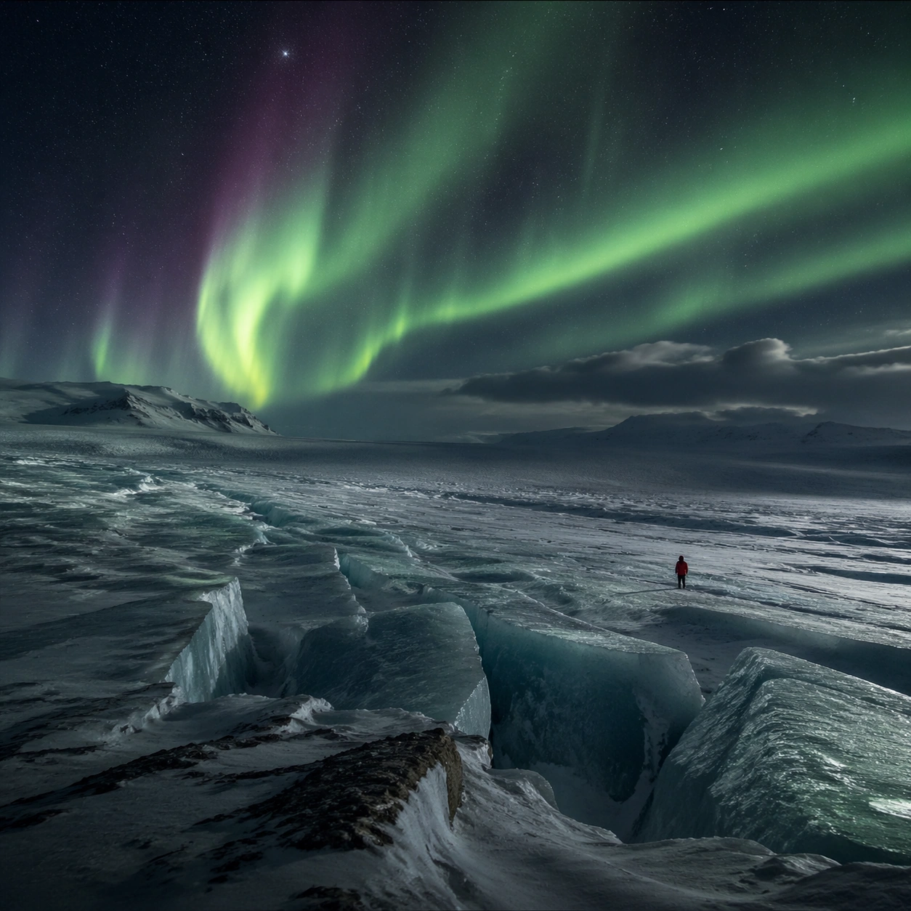

```text
Scene:
Create a square cinematic still for Aurora Glacier Silent Theatre. Use production-grade photoreal lighting, disciplined lens behavior, and a composition that feels like a finished key frame from an original film rather than a casual snapshot. An Arctic glacier plain opens under a sweeping aurora curtain, with deep night sky, luminous green and faint violet ribbons overhead, fractured ice catching reflected color, and a breath-frozen atmosphere that feels almost soundless. Treat this as an adjacent moment before or after the main event, preserving the same topic language while letting the atmosphere shift slightly in intensity or position.

Subject:
Build a coherent original scene whose emotional center comes from atmosphere, light physics, and spatial clarity. Avoid relying on celebrity likeness, franchise iconography, or stylized illustration shortcuts. A solitary human figure in a red parka should appear tiny against the glacier geometry, while crevasses, wind-scoured snow, and ice walls provide a strong sense of scale without cluttering the frame. Show the environment in transition, with clear evidence of recent motion, changing weather, or fading light, but without turning it into action spectacle.

Important details:
Preserve a believable physical world with strong depth layering, careful color separation, and premium image discipline. Keep the aurora soft and physically plausible rather than graphic, with believable ice reflectance, low-angle moonless ambient light, and careful contrast so the red parka remains a scale marker rather than a fashion focal point. Subtle temporal storytelling matters here more than maximal drama, so let traces, gradients, and environmental residue do the work.

Use case:
Aurora Glacier single study 7/9.

Constraints:
No readable text, no watermark, no logos, preserve exact 1:1 aspect ratio, no tents, no readable expedition logos, no fantasy animals, no saturated nightclub colors, no fireworks effect.
```

[Pinned source](https://github.com/ChaosRealmsAI/gpt-image-2-gallery/blob/5296db8c996e38776c83a0bc8c64f848dcd512b3/works/topics/aurora-glacier-silent-theatre/packages/single-support-studies/images/transition-study/meta.json) · GPT Image2 · 1254×1254 · No source-declared image dependencies. · ProjectD:[published and publicly accepted](https://aitoolsradar.com/en/prompts/64a915cb707a0d)

## Wide Study · aurora-glacier-silent-theatre/single-support-studies/wide-study

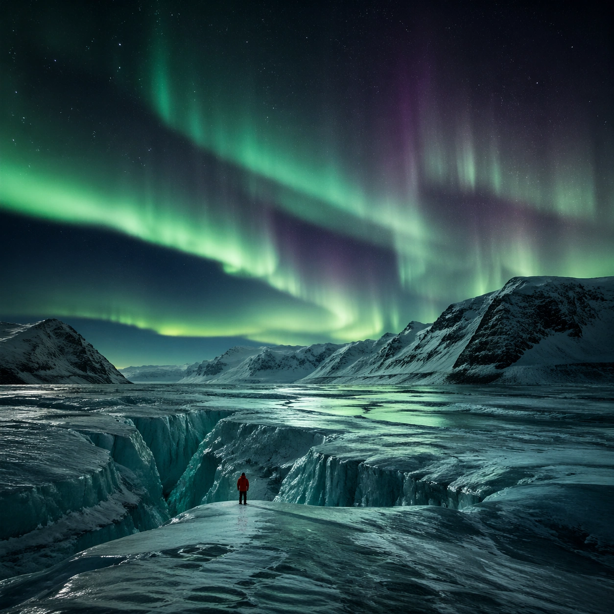

```text
Scene:
Create a square cinematic still for Aurora Glacier Silent Theatre. Use production-grade photoreal lighting, disciplined lens behavior, and a composition that feels like a finished key frame from an original film rather than a casual snapshot. An Arctic glacier plain opens under a sweeping aurora curtain, with deep night sky, luminous green and faint violet ribbons overhead, fractured ice catching reflected color, and a breath-frozen atmosphere that feels almost soundless. Pull back enough to explain the broader geography or architectural envelope while keeping the square crop intentional and balanced.

Subject:
Build a coherent original scene whose emotional center comes from atmosphere, light physics, and spatial clarity. Avoid relying on celebrity likeness, franchise iconography, or stylized illustration shortcuts. A solitary human figure in a red parka should appear tiny against the glacier geometry, while crevasses, wind-scoured snow, and ice walls provide a strong sense of scale without cluttering the frame. The wider frame should reveal how the main light or weather phenomenon organizes the surrounding world and not just the immediate subject.

Important details:
Preserve a believable physical world with strong depth layering, careful color separation, and premium image discipline. Keep the aurora soft and physically plausible rather than graphic, with believable ice reflectance, low-angle moonless ambient light, and careful contrast so the red parka remains a scale marker rather than a fashion focal point. Make scale legible through spacing, horizon control, and foreground-to-background separation rather than through extra props.

Use case:
Aurora Glacier single study 8/9.

Constraints:
No readable text, no watermark, no logos, preserve exact 1:1 aspect ratio, no tents, no readable expedition logos, no fantasy animals, no saturated nightclub colors, no fireworks effect.
```

[Pinned source](https://github.com/ChaosRealmsAI/gpt-image-2-gallery/blob/5296db8c996e38776c83a0bc8c64f848dcd512b3/works/topics/aurora-glacier-silent-theatre/packages/single-support-studies/images/wide-study/meta.json) · GPT Image2 · 1254×1254 · No source-declared image dependencies. · ProjectD:[published and publicly accepted](https://aitoolsradar.com/en/prompts/0a7b69f7196b3c)

## Afterglow Study · aurora-glacier-silent-theatre/single-support-studies/afterglow-study


```text
Scene:
Create a square cinematic still for Aurora Glacier Silent Theatre. Use production-grade photoreal lighting, disciplined lens behavior, and a composition that feels like a finished key frame from an original film rather than a casual snapshot. An Arctic glacier plain opens under a sweeping aurora curtain, with deep night sky, luminous green and faint violet ribbons overhead, fractured ice catching reflected color, and a breath-frozen atmosphere that feels almost soundless. End on a quieter independent image that holds the residue of the topic atmosphere after its loudest moment has passed, while still feeling complete and exhibition-ready.

Subject:
Build a coherent original scene whose emotional center comes from atmosphere, light physics, and spatial clarity. Avoid relying on celebrity likeness, franchise iconography, or stylized illustration shortcuts. A solitary human figure in a red parka should appear tiny against the glacier geometry, while crevasses, wind-scoured snow, and ice walls provide a strong sense of scale without cluttering the frame. The frame should suggest memory, aftermath, or lingering presence through environment first and only secondarily through any figure or object.

Important details:
Preserve a believable physical world with strong depth layering, careful color separation, and premium image discipline. Keep the aurora soft and physically plausible rather than graphic, with believable ice reflectance, low-angle moonless ambient light, and careful contrast so the red parka remains a scale marker rather than a fashion focal point. Favor restraint, believable light decay, and subtle narrative closure over spectacle or decorative excess.

Use case:
Aurora Glacier single study 9/9.

Constraints:
No readable text, no watermark, no logos, preserve exact 1:1 aspect ratio, no tents, no readable expedition logos, no fantasy animals, no saturated nightclub colors, no fireworks effect.
```

[Pinned source](https://github.com/ChaosRealmsAI/gpt-image-2-gallery/blob/5296db8c996e38776c83a0bc8c64f848dcd512b3/works/topics/aurora-glacier-silent-theatre/packages/single-support-studies/images/afterglow-study/meta.json) · GPT Image2 · 1254×1254 · No source-declared image dependencies. · ProjectD:[published and publicly accepted](https://aitoolsradar.com/en/prompts/e8f7c9a80d8d1e)

## Exploded Arrangement · automotive-concept-art/single-automotive-concept-art-studies/exploded-arrangement

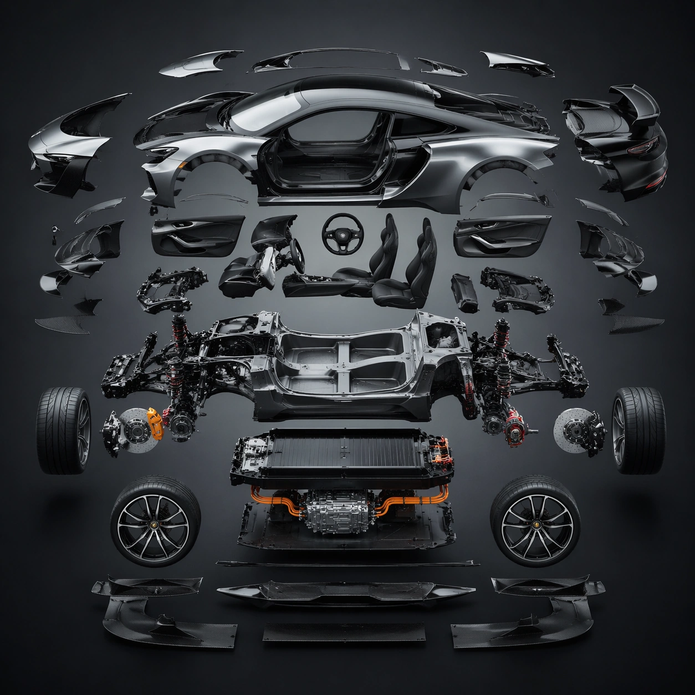

```text
Scene:
A square CGI or design-visualization frame with calibrated lighting, intentional composition, and premium material rendering. Build the frame around components or accessories separated with clean studio logic. Keep the lighting, camera distance, and spatial organization tuned for a high-signal research image rather than a casual snapshot. The image belongs to the Automotive Concept Art theme and should feel immediately legible as a prompt atlas theme for automotive concept art, testing technical-diagram, style-transfer, commercial-mockup with gpt image 2..

Subject:
Center the study on components or accessories separated with clean studio logic. Translate the theme into a concrete visual statement instead of an abstract mood board: the viewer should understand what kind of image this is, what is being tested, and why the composition is difficult. Use the slug idea of automotive concept art as a literal guide for subject matter, materials, and staging.

Important details:
The model must feel engineered or art-directed rather than merely stylized: edges, seams, translucency, reflections, and scale cues should all hold up. Preserve a disciplined square composition, clear focal hierarchy, and enough secondary information to make the image feel complete rather than underspecified. The image should look polished, novel, and exhibition-ready, with topic-specific credibility coming from the way surfaces, structure, and visual language reinforce Automotive Concept Art. Avoid generic filler elements that do not serve the main concept.

Use case:
Automotive Concept Art single study 2/8, testing technical-diagram, style-transfer, commercial-mockup through the exploded arrangement variation.

Constraints:
No readable text, no watermark, no logos, preserve exact 1:1 aspect ratio, no real brand logos, no low-poly shortcuts, no broken reflections, no muddy materials, no generic showroom clutter, no unreadable UI overlays.
```

[Pinned source](https://github.com/ChaosRealmsAI/gpt-image-2-gallery/blob/5296db8c996e38776c83a0bc8c64f848dcd512b3/works/topics/automotive-concept-art/packages/single-automotive-concept-art-studies/images/exploded-arrangement/meta.json) · GPT Image2 · 1254×1254 · No source-declared image dependencies. · ProjectD:[published and publicly accepted](https://aitoolsradar.com/en/prompts/4aff10c9749a25)

## Material Pass · automotive-concept-art/single-automotive-concept-art-studies/material-pass

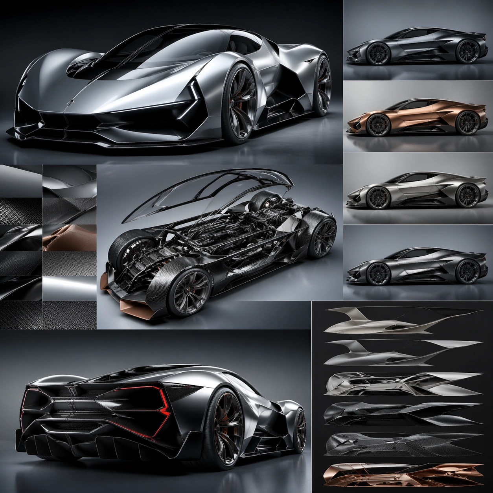

```text
Scene:
A square CGI or design-visualization frame with calibrated lighting, intentional composition, and premium material rendering. Build the frame around the same design idea pushed through surface richness and shader control. Keep the lighting, camera distance, and spatial organization tuned for a high-signal research image rather than a casual snapshot. The image belongs to the Automotive Concept Art theme and should feel immediately legible as a prompt atlas theme for automotive concept art, testing technical-diagram, style-transfer, commercial-mockup with gpt image 2..

Subject:
Center the study on the same design idea pushed through surface richness and shader control. Translate the theme into a concrete visual statement instead of an abstract mood board: the viewer should understand what kind of image this is, what is being tested, and why the composition is difficult. Use the slug idea of automotive concept art as a literal guide for subject matter, materials, and staging.

Important details:
The model must feel engineered or art-directed rather than merely stylized: edges, seams, translucency, reflections, and scale cues should all hold up. Preserve a disciplined square composition, clear focal hierarchy, and enough secondary information to make the image feel complete rather than underspecified. The image should look polished, novel, and exhibition-ready, with topic-specific credibility coming from the way surfaces, structure, and visual language reinforce Automotive Concept Art. Avoid generic filler elements that do not serve the main concept.

Use case:
Automotive Concept Art single study 3/8, testing technical-diagram, style-transfer, commercial-mockup through the material pass variation.

Constraints:
No readable text, no watermark, no logos, preserve exact 1:1 aspect ratio, no real brand logos, no low-poly shortcuts, no broken reflections, no muddy materials, no generic showroom clutter, no unreadable UI overlays.
```

[Pinned source](https://github.com/ChaosRealmsAI/gpt-image-2-gallery/blob/5296db8c996e38776c83a0bc8c64f848dcd512b3/works/topics/automotive-concept-art/packages/single-automotive-concept-art-studies/images/material-pass/meta.json) · GPT Image2 · 1254×1254 · No source-declared image dependencies. · ProjectD:[published and publicly accepted](https://aitoolsradar.com/en/prompts/c497b71524fe89)

## Studio Turn · automotive-concept-art/single-automotive-concept-art-studies/studio-turn

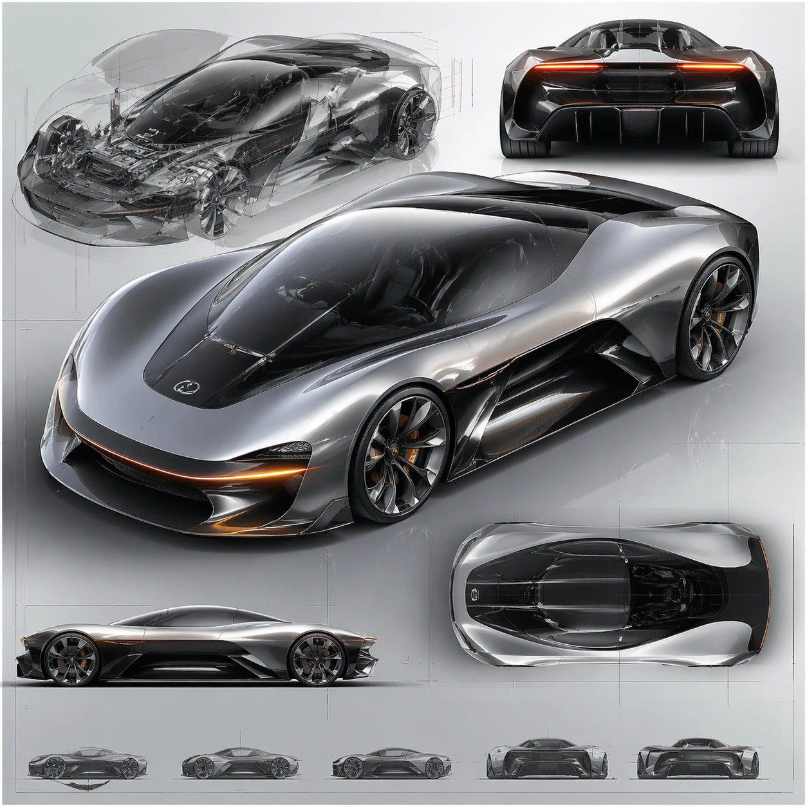

```text
Scene:
A square CGI or design-visualization frame with calibrated lighting, intentional composition, and premium material rendering. Build the frame around a presentation angle that reveals volume and silhouette clearly. Keep the lighting, camera distance, and spatial organization tuned for a high-signal research image rather than a casual snapshot. The image belongs to the Automotive Concept Art theme and should feel immediately legible as a prompt atlas theme for automotive concept art, testing technical-diagram, style-transfer, commercial-mockup with gpt image 2..

Subject:
Center the study on a presentation angle that reveals volume and silhouette clearly. Translate the theme into a concrete visual statement instead of an abstract mood board: the viewer should understand what kind of image this is, what is being tested, and why the composition is difficult. Use the slug idea of automotive concept art as a literal guide for subject matter, materials, and staging.

Important details:
The model must feel engineered or art-directed rather than merely stylized: edges, seams, translucency, reflections, and scale cues should all hold up. Preserve a disciplined square composition, clear focal hierarchy, and enough secondary information to make the image feel complete rather than underspecified. The image should look polished, novel, and exhibition-ready, with topic-specific credibility coming from the way surfaces, structure, and visual language reinforce Automotive Concept Art. Avoid generic filler elements that do not serve the main concept.

Use case:
Automotive Concept Art single study 4/8, testing technical-diagram, style-transfer, commercial-mockup through the studio turn variation.

Constraints:
No readable text, no watermark, no logos, preserve exact 1:1 aspect ratio, no real brand logos, no low-poly shortcuts, no broken reflections, no muddy materials, no generic showroom clutter, no unreadable UI overlays.
```

[Pinned source](https://github.com/ChaosRealmsAI/gpt-image-2-gallery/blob/5296db8c996e38776c83a0bc8c64f848dcd512b3/works/topics/automotive-concept-art/packages/single-automotive-concept-art-studies/images/studio-turn/meta.json) · GPT Image2 · 1254×1254 · No source-declared image dependencies. · ProjectD:[published and publicly accepted](https://aitoolsradar.com/en/prompts/57f47d2df1a6ce)

## Scale Comparison · automotive-concept-art/single-automotive-concept-art-studies/scale-comparison


```text
Scene:
A square CGI or design-visualization frame with calibrated lighting, intentional composition, and premium material rendering. Build the frame around supporting context that clarifies proportion and use without becoming literal advertising. Keep the lighting, camera distance, and spatial organization tuned for a high-signal research image rather than a casual snapshot. The image belongs to the Automotive Concept Art theme and should feel immediately legible as a prompt atlas theme for automotive concept art, testing technical-diagram, style-transfer, commercial-mockup with gpt image 2..

Subject:
Center the study on supporting context that clarifies proportion and use without becoming literal advertising. Translate the theme into a concrete visual statement instead of an abstract mood board: the viewer should understand what kind of image this is, what is being tested, and why the composition is difficult. Use the slug idea of automotive concept art as a literal guide for subject matter, materials, and staging.

Important details:
The model must feel engineered or art-directed rather than merely stylized: edges, seams, translucency, reflections, and scale cues should all hold up. Preserve a disciplined square composition, clear focal hierarchy, and enough secondary information to make the image feel complete rather than underspecified. The image should look polished, novel, and exhibition-ready, with topic-specific credibility coming from the way surfaces, structure, and visual language reinforce Automotive Concept Art. Avoid generic filler elements that do not serve the main concept.

Use case:
Automotive Concept Art single study 5/8, testing technical-diagram, style-transfer, commercial-mockup through the scale comparison variation.

Constraints:
No readable text, no watermark, no logos, preserve exact 1:1 aspect ratio, no real brand logos, no low-poly shortcuts, no broken reflections, no muddy materials, no generic showroom clutter, no unreadable UI overlays.
```

[Pinned source](https://github.com/ChaosRealmsAI/gpt-image-2-gallery/blob/5296db8c996e38776c83a0bc8c64f848dcd512b3/works/topics/automotive-concept-art/packages/single-automotive-concept-art-studies/images/scale-comparison/meta.json) · GPT Image2 · 1254×1254 · No source-declared image dependencies. · ProjectD:[published and publicly accepted](https://aitoolsradar.com/en/prompts/22aa6a6355c833)

## Detail Closeup · automotive-concept-art/single-automotive-concept-art-studies/detail-closeup

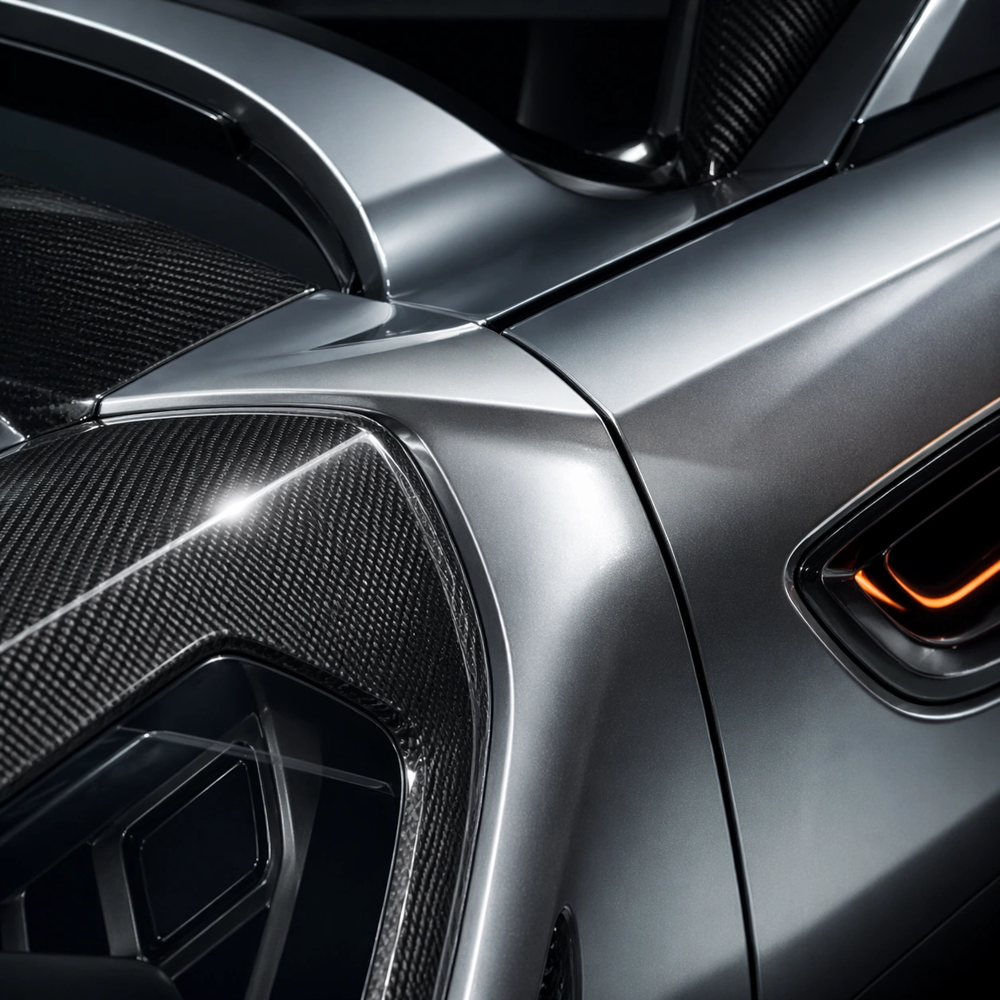

```text
Scene:
A square CGI or design-visualization frame with calibrated lighting, intentional composition, and premium material rendering. Build the frame around macro rendering of joints, textures, or finish transitions. Keep the lighting, camera distance, and spatial organization tuned for a high-signal research image rather than a casual snapshot. The image belongs to the Automotive Concept Art theme and should feel immediately legible as a prompt atlas theme for automotive concept art, testing technical-diagram, style-transfer, commercial-mockup with gpt image 2..

Subject:
Center the study on macro rendering of joints, textures, or finish transitions. Translate the theme into a concrete visual statement instead of an abstract mood board: the viewer should understand what kind of image this is, what is being tested, and why the composition is difficult. Use the slug idea of automotive concept art as a literal guide for subject matter, materials, and staging.

Important details:
The model must feel engineered or art-directed rather than merely stylized: edges, seams, translucency, reflections, and scale cues should all hold up. Preserve a disciplined square composition, clear focal hierarchy, and enough secondary information to make the image feel complete rather than underspecified. The image should look polished, novel, and exhibition-ready, with topic-specific credibility coming from the way surfaces, structure, and visual language reinforce Automotive Concept Art. Avoid generic filler elements that do not serve the main concept.

Use case:
Automotive Concept Art single study 6/8, testing technical-diagram, style-transfer, commercial-mockup through the detail closeup variation.

Constraints:
No readable text, no watermark, no logos, preserve exact 1:1 aspect ratio, no real brand logos, no low-poly shortcuts, no broken reflections, no muddy materials, no generic showroom clutter, no unreadable UI overlays.
```

[Pinned source](https://github.com/ChaosRealmsAI/gpt-image-2-gallery/blob/5296db8c996e38776c83a0bc8c64f848dcd512b3/works/topics/automotive-concept-art/packages/single-automotive-concept-art-studies/images/detail-closeup/meta.json) · GPT Image2 · 1254×1254 · No source-declared image dependencies. · ProjectD:[published and publicly accepted](https://aitoolsradar.com/en/prompts/060ab1d31d5369)

## 环境展示 · automotive-concept-art/single-automotive-concept-art-studies/environment-presentation

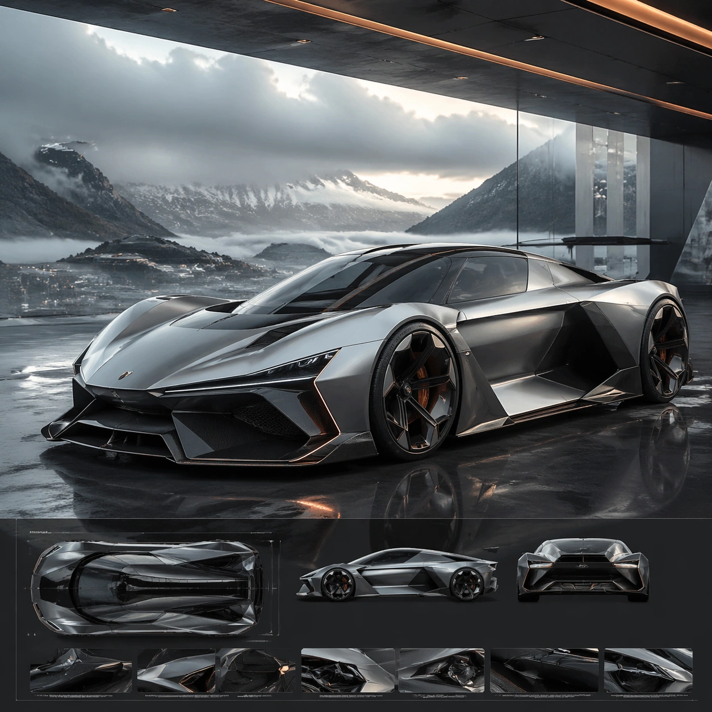

```text
Scene:
A square CGI or design-visualization frame with calibrated lighting, intentional composition, and premium material rendering. Build the frame around the design placed into a context that tests realism and narrative. Keep the lighting, camera distance, and spatial organization tuned for a high-signal research image rather than a casual snapshot. The image belongs to the Automotive Concept Art theme and should feel immediately legible as a prompt atlas theme for automotive concept art, testing technical-diagram, style-transfer, commercial-mockup with gpt image 2..

Subject:
Center the study on the design placed into a context that tests realism and narrative. Translate the theme into a concrete visual statement instead of an abstract mood board: the viewer should understand what kind of image this is, what is being tested, and why the composition is difficult. Use the slug idea of automotive concept art as a literal guide for subject matter, materials, and staging.

Important details:
The model must feel engineered or art-directed rather than merely stylized: edges, seams, translucency, reflections, and scale cues should all hold up. Preserve a disciplined square composition, clear focal hierarchy, and enough secondary information to make the image feel complete rather than underspecified. The image should look polished, novel, and exhibition-ready, with topic-specific credibility coming from the way surfaces, structure, and visual language reinforce Automotive Concept Art. Avoid generic filler elements that do not serve the main concept.

Use case:
Automotive Concept Art single study 7/8, testing technical-diagram, style-transfer, commercial-mockup through the 环境展示 variation.

Constraints:
No readable text, no watermark, no logos, preserve exact 1:1 aspect ratio, no real brand logos, no low-poly shortcuts, no broken reflections, no muddy materials, no generic showroom clutter, no unreadable UI overlays.
```

[Pinned source](https://github.com/ChaosRealmsAI/gpt-image-2-gallery/blob/5296db8c996e38776c83a0bc8c64f848dcd512b3/works/topics/automotive-concept-art/packages/single-automotive-concept-art-studies/images/environment-presentation/meta.json) · GPT Image2 · 1254×1254 · No source-declared image dependencies. · ProjectD:[published and publicly accepted](https://aitoolsradar.com/en/prompts/ad6b8e17e73eda)

## Signature Render · automotive-concept-art/single-automotive-concept-art-studies/signature-render

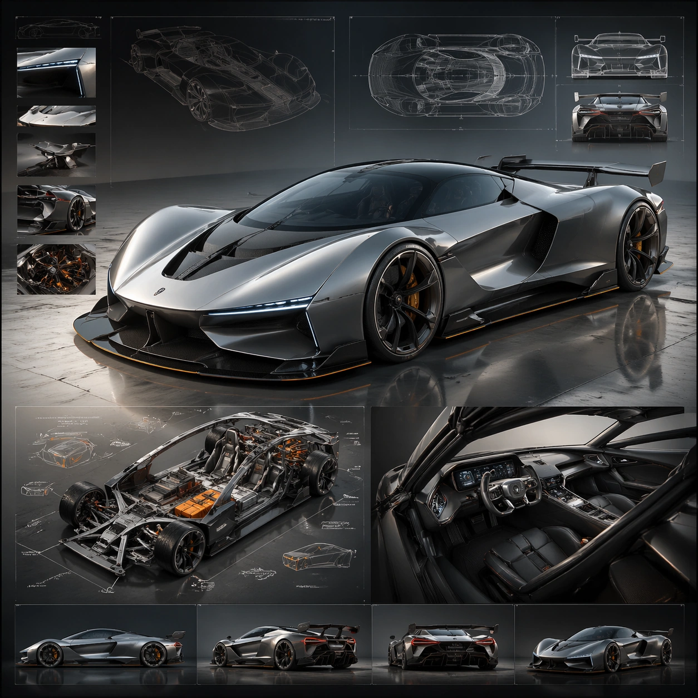

```text
Scene:
A square CGI or design-visualization frame with calibrated lighting, intentional composition, and premium material rendering. Build the frame around the most complete and persuasive final render for the theme. Keep the lighting, camera distance, and spatial organization tuned for a high-signal research image rather than a casual snapshot. The image belongs to the Automotive Concept Art theme and should feel immediately legible as a prompt atlas theme for automotive concept art, testing technical-diagram, style-transfer, commercial-mockup with gpt image 2..

Subject:
Center the study on the most complete and persuasive final render for the theme. Translate the theme into a concrete visual statement instead of an abstract mood board: the viewer should understand what kind of image this is, what is being tested, and why the composition is difficult. Use the slug idea of automotive concept art as a literal guide for subject matter, materials, and staging.

Important details:
The model must feel engineered or art-directed rather than merely stylized: edges, seams, translucency, reflections, and scale cues should all hold up. Preserve a disciplined square composition, clear focal hierarchy, and enough secondary information to make the image feel complete rather than underspecified. The image should look polished, novel, and exhibition-ready, with topic-specific credibility coming from the way surfaces, structure, and visual language reinforce Automotive Concept Art. Avoid generic filler elements that do not serve the main concept.

Use case:
Automotive Concept Art single study 8/8, testing technical-diagram, style-transfer, commercial-mockup through the signature render variation.

Constraints:
No readable text, no watermark, no logos, preserve exact 1:1 aspect ratio, no real brand logos, no low-poly shortcuts, no broken reflections, no muddy materials, no generic showroom clutter, no unreadable UI overlays.
```

[Pinned source](https://github.com/ChaosRealmsAI/gpt-image-2-gallery/blob/5296db8c996e38776c83a0bc8c64f848dcd512b3/works/topics/automotive-concept-art/packages/single-automotive-concept-art-studies/images/signature-render/meta.json) · GPT Image2 · 1254×1254 · No source-declared image dependencies. · ProjectD:[published and publicly accepted](https://aitoolsradar.com/en/prompts/48c4816808a09f)

## Reference Cabin · automotive-interior-cockpit-ui-hero/series-core-system/01-reference-anchor

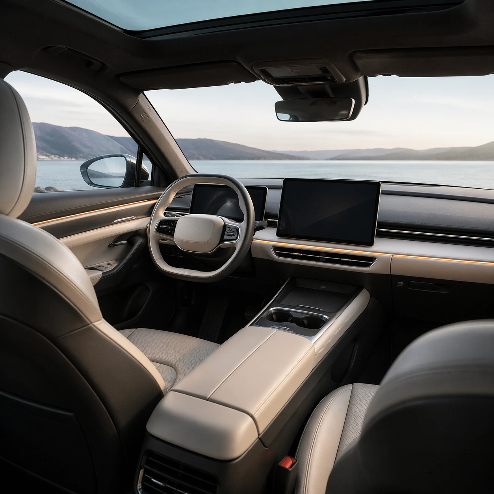

```text
Scene:
A square wide interior hero from the driver-side rear seat with balanced daylight, polished highlights, and calm premium contrast. Compose the frame as a square key visual with disciplined camera placement, premium lighting control, and believable real-world scale. The tonal range should feel polished and intentional, with enough atmosphere to create depth without obscuring form. Keep contrast calibrated for launch, catalog, or research presentation use rather than casual snapshot aesthetics.

Subject:
Center an original premium electric crossover interior with a sculpted steering wheel, floating instrument panel, thin vent architecture, integrated ambient light band, perforated leather seats, and a panoramic roof. Make the subject feel original, production-aware, and clearly grounded in Automotive Interior Cockpit UI Hero. For this series image, preserve exact core subject identity, proportions, base geometry, and material language from the reference image whenever continuity matters. The focal hierarchy should be immediate: primary form first, then material behavior, then supporting environmental cues that clarify use context and difficulty.

Important details:
Make the dashboard, steering wheel, center console, seats, and displays legible as one cohesive cabin design. The frame should feel like a launch-grade interior asset rather than a documentary snapshot. Preserve exact steering-wheel geometry, seat shape, dashboard architecture, screen proportions, ambient light path, and material palette across the series. The UI must feel believable but contain no readable text. Cabin ergonomics should feel manufacturable and premium. Use believable materials, engineering logic, and professional composition discipline. Reflections, shadows, edge breaks, texture scale, interface density, and small physical joints must all support realism. Avoid filler props, vague mood-board clutter, or any element that weakens the sense of a purpose-built industrial or automotive image.

Use case:
Cockpit UI series study 1/9 for Automotive Interior Cockpit UI Hero, built as image 01-reference-anchor.

Constraints:
No readable text, no watermark, no logos, preserve exact 1:1 aspect ratio, no readable UI labels, no logos, no passengers, no fantasy holograms, no steering-wheel badge text, no cheap plastic sheen.
```

[Pinned source](https://github.com/ChaosRealmsAI/gpt-image-2-gallery/blob/5296db8c996e38776c83a0bc8c64f848dcd512b3/works/topics/automotive-interior-cockpit-ui-hero/packages/series-core-system/images/01-reference-anchor/meta.json) · GPT Image2 · 1254×1254 · No source-declared image dependencies. · ProjectD:[published and publicly accepted](https://aitoolsradar.com/en/prompts/701709c39ebeee)

## Night Drive Mode · automotive-interior-cockpit-ui-hero/series-core-system/02-context-shift

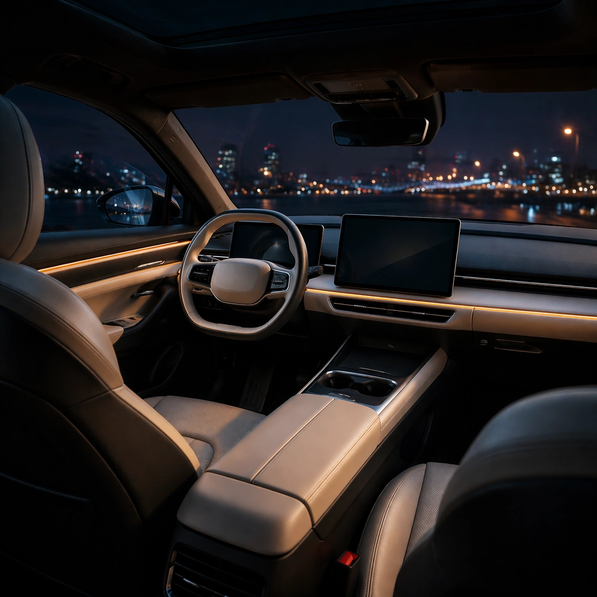

```text
Scene:
A square cabin at night with outside city bokeh, low ambient illumination, and carefully controlled blue-amber light accents. Compose the frame as a square key visual with disciplined camera placement, premium lighting control, and believable real-world scale. The tonal range should feel polished and intentional, with enough atmosphere to create depth without obscuring form. Keep contrast calibrated for launch, catalog, or research presentation use rather than casual snapshot aesthetics.

Subject:
Center an original premium electric crossover interior with a sculpted steering wheel, floating instrument panel, thin vent architecture, integrated ambient light band, perforated leather seats, and a panoramic roof. Make the subject feel original, production-aware, and clearly grounded in Automotive Interior Cockpit UI Hero. For this series image, preserve exact core subject identity, proportions, base geometry, and material language from the reference image whenever continuity matters. The focal hierarchy should be immediate: primary form first, then material behavior, then supporting environmental cues that clarify use context and difficulty.

Important details:
Keep the exact same cockpit identity while using night contrast to emphasize screen hierarchy, reflective control, and reassuring premium atmosphere instead of flashy gadget spectacle. Preserve exact steering-wheel geometry, seat shape, dashboard architecture, screen proportions, ambient light path, and material palette across the series. The UI must feel believable but contain no readable text. Cabin ergonomics should feel manufacturable and premium. Use believable materials, engineering logic, and professional composition discipline. Reflections, shadows, edge breaks, texture scale, interface density, and small physical joints must all support realism. Avoid filler props, vague mood-board clutter, or any element that weakens the sense of a purpose-built industrial or automotive image.

Use case:
Cockpit UI series study 2/9 for Automotive Interior Cockpit UI Hero, built as image 02-context-shift.

Constraints:
No readable text, no watermark, no logos, preserve exact 1:1 aspect ratio, no readable UI labels, no logos, no passengers, no fantasy holograms, no steering-wheel badge text, no cheap plastic sheen.
```

[Pinned source](https://github.com/ChaosRealmsAI/gpt-image-2-gallery/blob/5296db8c996e38776c83a0bc8c64f848dcd512b3/works/topics/automotive-interior-cockpit-ui-hero/packages/series-core-system/images/02-context-shift/meta.json) · GPT Image2 · 1254×1254 · Reference images required. · ProjectD:[published and publicly accepted](https://aitoolsradar.com/en/prompts/f172c433110625)

## Material Focus · automotive-interior-cockpit-ui-hero/series-core-system/03-surface-study

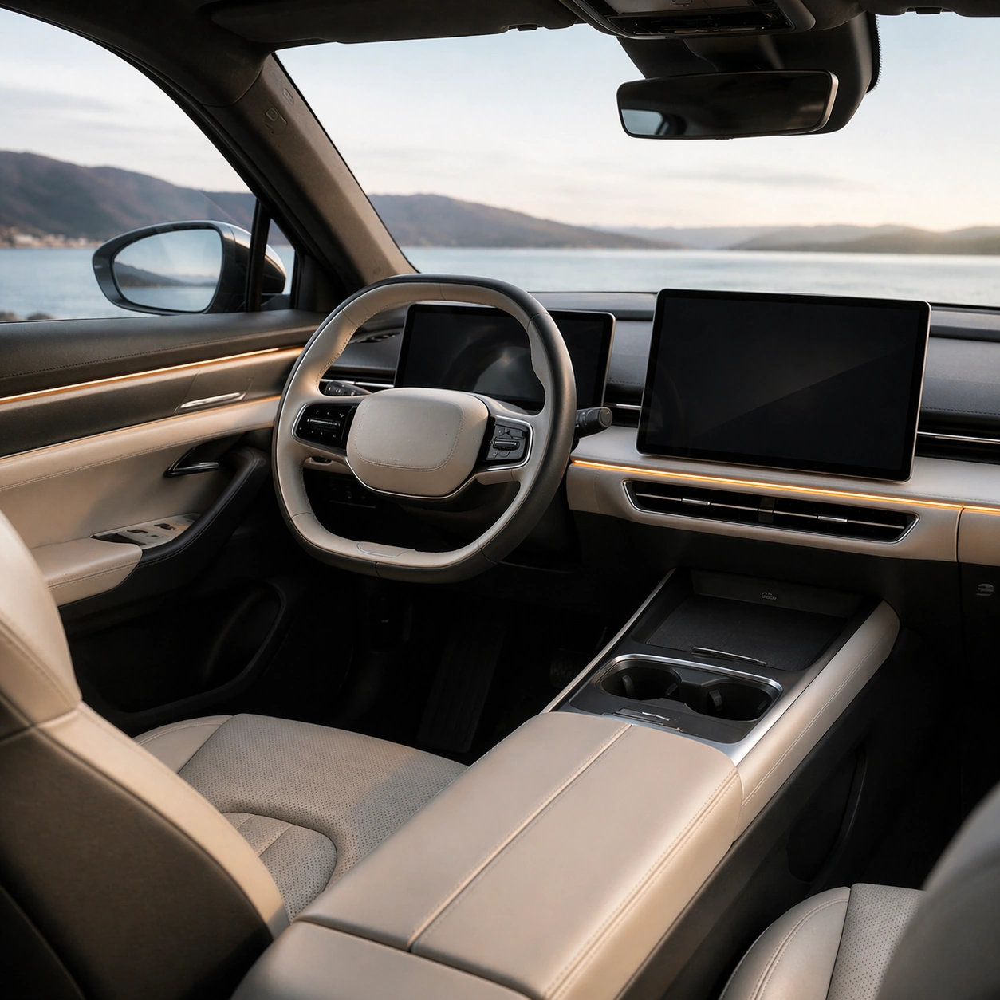

```text
Scene:
A square close interior composition with soft daylight and subtle directional shadows revealing stitching, perforation, and edge transitions. Compose the frame as a square key visual with disciplined camera placement, premium lighting control, and believable real-world scale. The tonal range should feel polished and intentional, with enough atmosphere to create depth without obscuring form. Keep contrast calibrated for launch, catalog, or research presentation use rather than casual snapshot aesthetics.

Subject:
Center an original premium electric crossover interior with a sculpted steering wheel, floating instrument panel, thin vent architecture, integrated ambient light band, perforated leather seats, and a panoramic roof. Make the subject feel original, production-aware, and clearly grounded in Automotive Interior Cockpit UI Hero. For this series image, preserve exact core subject identity, proportions, base geometry, and material language from the reference image whenever continuity matters. The focal hierarchy should be immediate: primary form first, then material behavior, then supporting environmental cues that clarify use context and difficulty.

Important details:
Push tactile realism in leather, metal, rubber, and glass while keeping the cabin identity exact. The materials should read as production-grade, not concept-art speculation. Preserve exact steering-wheel geometry, seat shape, dashboard architecture, screen proportions, ambient light path, and material palette across the series. The UI must feel believable but contain no readable text. Cabin ergonomics should feel manufacturable and premium. Use believable materials, engineering logic, and professional composition discipline. Reflections, shadows, edge breaks, texture scale, interface density, and small physical joints must all support realism. Avoid filler props, vague mood-board clutter, or any element that weakens the sense of a purpose-built industrial or automotive image.

Use case:
Cockpit UI series study 3/9 for Automotive Interior Cockpit UI Hero, built as image 03-surface-study.

Constraints:
No readable text, no watermark, no logos, preserve exact 1:1 aspect ratio, no readable UI labels, no logos, no passengers, no fantasy holograms, no steering-wheel badge text, no cheap plastic sheen.
```

[Pinned source](https://github.com/ChaosRealmsAI/gpt-image-2-gallery/blob/5296db8c996e38776c83a0bc8c64f848dcd512b3/works/topics/automotive-interior-cockpit-ui-hero/packages/series-core-system/images/03-surface-study/meta.json) · GPT Image2 · 1254×1254 · Reference images required. · ProjectD:[published and publicly accepted](https://aitoolsradar.com/en/prompts/433104fdd976dd)

## Passenger Hero · automotive-interior-cockpit-ui-hero/series-core-system/04-presentation-master

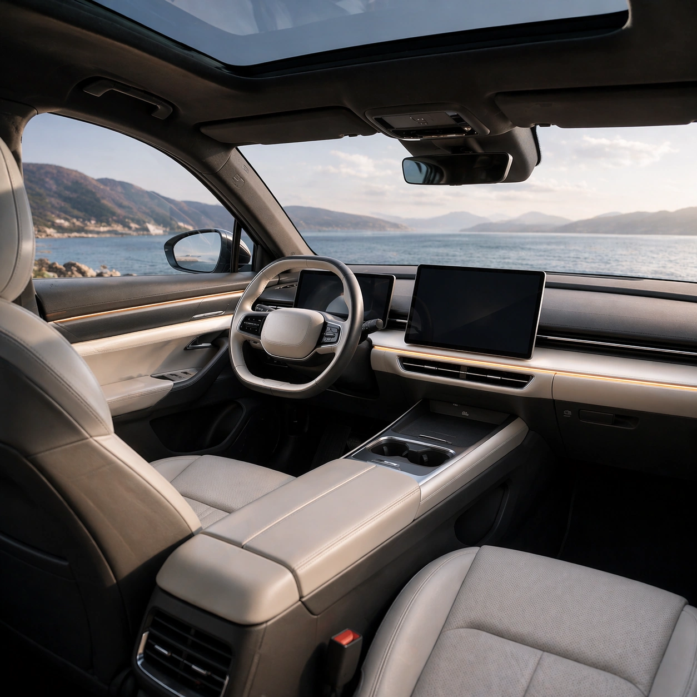

```text
Scene:
A square passenger-side perspective with open panoramic glass, controlled daylight, and balanced specular behavior across trim and upholstery. Compose the frame as a square key visual with disciplined camera placement, premium lighting control, and believable real-world scale. The tonal range should feel polished and intentional, with enough atmosphere to create depth without obscuring form. Keep contrast calibrated for launch, catalog, or research presentation use rather than casual snapshot aesthetics.

Subject:
Center an original premium electric crossover interior with a sculpted steering wheel, floating instrument panel, thin vent architecture, integrated ambient light band, perforated leather seats, and a panoramic roof. Make the subject feel original, production-aware, and clearly grounded in Automotive Interior Cockpit UI Hero. For this series image, preserve exact core subject identity, proportions, base geometry, and material language from the reference image whenever continuity matters. The focal hierarchy should be immediate: primary form first, then material behavior, then supporting environmental cues that clarify use context and difficulty.

Important details:
Turn the same cockpit into a brochure-quality premium interior plate with spatial clarity, elegant restraint, and clean visual hierarchy suitable for product communication. Preserve exact steering-wheel geometry, seat shape, dashboard architecture, screen proportions, ambient light path, and material palette across the series. The UI must feel believable but contain no readable text. Cabin ergonomics should feel manufacturable and premium. Use believable materials, engineering logic, and professional composition discipline. Reflections, shadows, edge breaks, texture scale, interface density, and small physical joints must all support realism. Avoid filler props, vague mood-board clutter, or any element that weakens the sense of a purpose-built industrial or automotive image.

Use case:
Cockpit UI series study 4/9 for Automotive Interior Cockpit UI Hero, built as image 04-presentation-master.

Constraints:
No readable text, no watermark, no logos, preserve exact 1:1 aspect ratio, no readable UI labels, no logos, no passengers, no fantasy holograms, no steering-wheel badge text, no cheap plastic sheen.
```

[Pinned source](https://github.com/ChaosRealmsAI/gpt-image-2-gallery/blob/5296db8c996e38776c83a0bc8c64f848dcd512b3/works/topics/automotive-interior-cockpit-ui-hero/packages/series-core-system/images/04-presentation-master/meta.json) · GPT Image2 · 1254×1254 · Reference images required. · ProjectD:[published and publicly accepted](https://aitoolsradar.com/en/prompts/8320954aaa1836)

## Steering Control Macro · automotive-interior-cockpit-ui-hero/single-support-studies/support-two

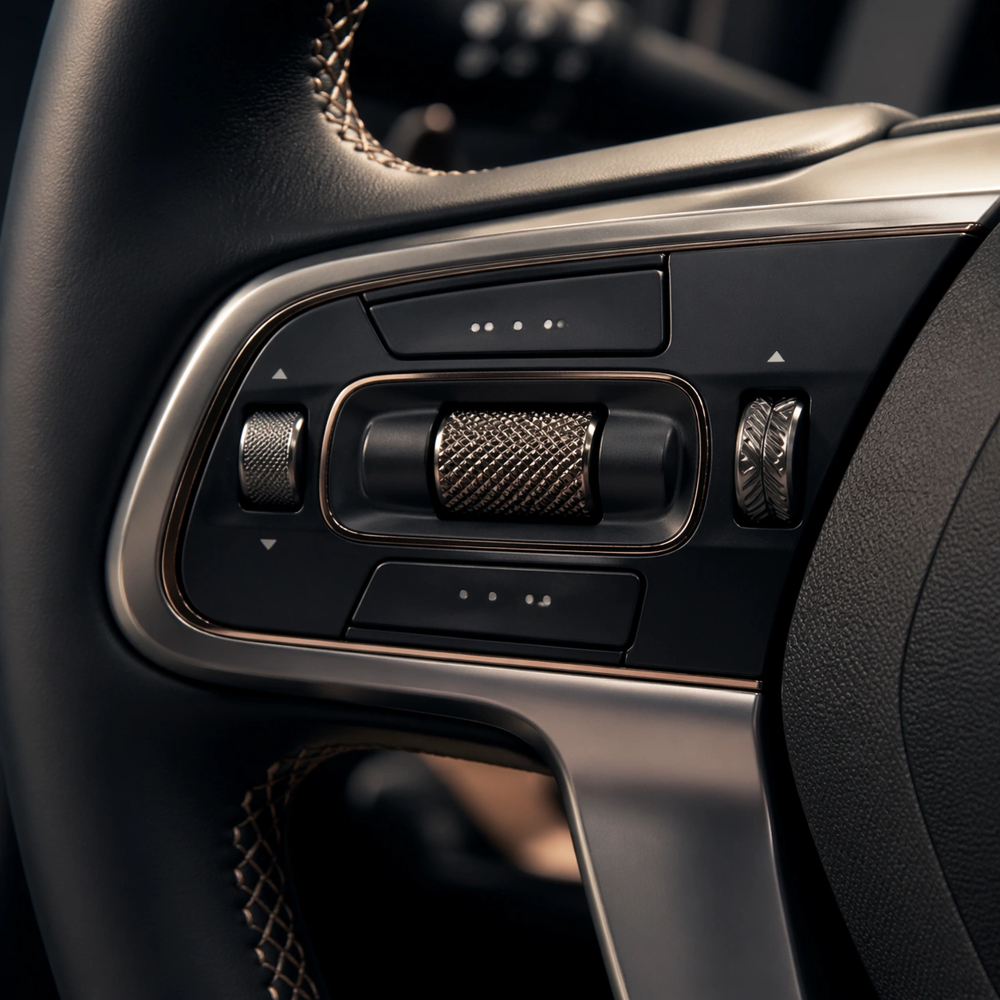

```text
Scene:
A square macro product-photo setup with controlled grazing light, shallow depth, and strong tactile contrast. Compose the frame as a square key visual with disciplined camera placement, premium lighting control, and believable real-world scale. The tonal range should feel polished and intentional, with enough atmosphere to create depth without obscuring form. Keep contrast calibrated for launch, catalog, or research presentation use rather than casual snapshot aesthetics.

Subject:
Center an original steering-wheel spoke with rollers, haptics, stitched leather, satin metal, and precise seam geometry. Make the subject feel original, production-aware, and clearly grounded in Automotive Interior Cockpit UI Hero. Treat this as an independent study that must feel complete and coherent without relying on any external reference image. The focal hierarchy should be immediate: primary form first, then material behavior, then supporting environmental cues that clarify use context and difficulty.

Important details:
Stress ergonomics, manufacturable button geometry, and tactile finish. The crop should immediately read as premium automotive hardware rather than consumer electronics. The visual language should still feel native to Automotive Interior Cockpit UI Hero, using disciplined industrial or campaign composition instead of generic stock photography. Use believable materials, engineering logic, and professional composition discipline. Reflections, shadows, edge breaks, texture scale, interface density, and small physical joints must all support realism. Avoid filler props, vague mood-board clutter, or any element that weakens the sense of a purpose-built industrial or automotive image.

Use case:
Cockpit UI single study 6/9 for Automotive Interior Cockpit UI Hero, built as image support-two.

Constraints:
No readable text, no watermark, no logos, preserve exact 1:1 aspect ratio, no readable text, no logos, no app-store iconography, no fantasy holograms, no navigation labels, no brand marks.
```

[Pinned source](https://github.com/ChaosRealmsAI/gpt-image-2-gallery/blob/5296db8c996e38776c83a0bc8c64f848dcd512b3/works/topics/automotive-interior-cockpit-ui-hero/packages/single-support-studies/images/support-two/meta.json) · GPT Image2 · 1254×1254 · No source-declared image dependencies. · ProjectD:[published and publicly accepted](https://aitoolsradar.com/en/prompts/1b1b49853e8adc)

## Rear Cabin Comfort · automotive-interior-cockpit-ui-hero/single-support-studies/support-three

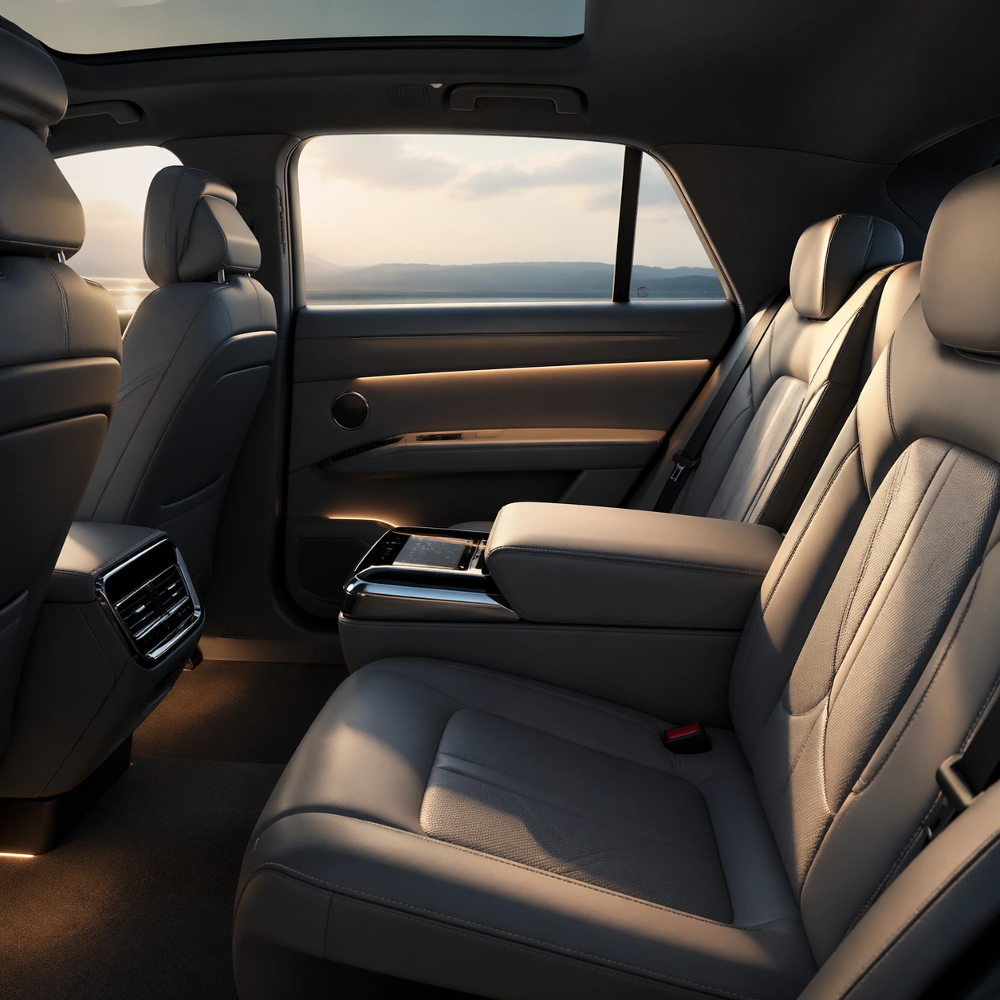

```text
Scene:
A square rear-passenger composition with calm daylight, gentle tonal range, and clear spatial depth from seat to glazing. Compose the frame as a square key visual with disciplined camera placement, premium lighting control, and believable real-world scale. The tonal range should feel polished and intentional, with enough atmosphere to create depth without obscuring form. Keep contrast calibrated for launch, catalog, or research presentation use rather than casual snapshot aesthetics.

Subject:
Center an original premium rear seating zone with integrated armrest, climate vents, subtle ambient light, and soft-touch materials. Make the subject feel original, production-aware, and clearly grounded in Automotive Interior Cockpit UI Hero. Treat this as an independent study that must feel complete and coherent without relying on any external reference image. The focal hierarchy should be immediate: primary form first, then material behavior, then supporting environmental cues that clarify use context and difficulty.

Important details:
Keep the image credible, spacious, and restrained rather than limousine fantasy. It should communicate everyday luxury and believable interior packaging. The visual language should still feel native to Automotive Interior Cockpit UI Hero, using disciplined industrial or campaign composition instead of generic stock photography. Use believable materials, engineering logic, and professional composition discipline. Reflections, shadows, edge breaks, texture scale, interface density, and small physical joints must all support realism. Avoid filler props, vague mood-board clutter, or any element that weakens the sense of a purpose-built industrial or automotive image.

Use case:
Cockpit UI single study 7/9 for Automotive Interior Cockpit UI Hero, built as image support-three.

Constraints:
No readable text, no watermark, no logos, preserve exact 1:1 aspect ratio, no readable text, no logos, no app-store iconography, no fantasy holograms, no navigation labels, no brand marks.
```

[Pinned source](https://github.com/ChaosRealmsAI/gpt-image-2-gallery/blob/5296db8c996e38776c83a0bc8c64f848dcd512b3/works/topics/automotive-interior-cockpit-ui-hero/packages/single-support-studies/images/support-three/meta.json) · GPT Image2 · 1254×1254 · No source-declared image dependencies. · ProjectD:[published and publicly accepted](https://aitoolsradar.com/en/prompts/5865a47bec1372)

## Center Console Layout · automotive-interior-cockpit-ui-hero/single-support-studies/support-four

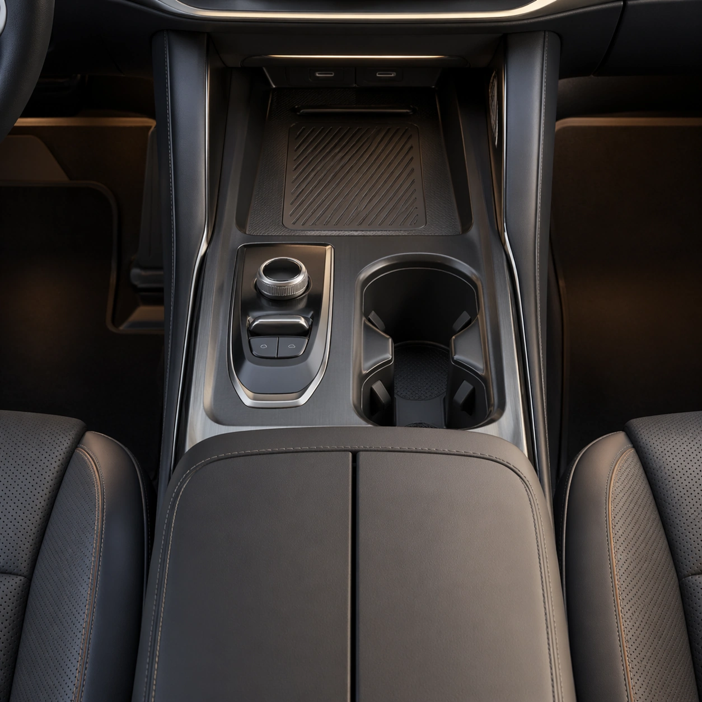

```text
Scene:
A square slightly top-down composition with soft studio lighting, crisp shadows, and carefully managed depth across the console plane. Compose the frame as a square key visual with disciplined camera placement, premium lighting control, and believable real-world scale. The tonal range should feel polished and intentional, with enough atmosphere to create depth without obscuring form. Keep contrast calibrated for launch, catalog, or research presentation use rather than casual snapshot aesthetics.

Subject:
Center an original center console showing cupholders, storage lid, wireless charging tray, armrest, and compact drive controls. Make the subject feel original, production-aware, and clearly grounded in Automotive Interior Cockpit UI Hero. Treat this as an independent study that must feel complete and coherent without relying on any external reference image. The focal hierarchy should be immediate: primary form first, then material behavior, then supporting environmental cues that clarify use context and difficulty.

Important details:
The layout should feel production-ready, spatially clear, and elegantly resolved. Every element must serve ergonomic logic, not visual novelty for its own sake. The visual language should still feel native to Automotive Interior Cockpit UI Hero, using disciplined industrial or campaign composition instead of generic stock photography. Use believable materials, engineering logic, and professional composition discipline. Reflections, shadows, edge breaks, texture scale, interface density, and small physical joints must all support realism. Avoid filler props, vague mood-board clutter, or any element that weakens the sense of a purpose-built industrial or automotive image.

Use case:
Cockpit UI single study 8/9 for Automotive Interior Cockpit UI Hero, built as image support-four.

Constraints:
No readable text, no watermark, no logos, preserve exact 1:1 aspect ratio, no readable text, no logos, no app-store iconography, no fantasy holograms, no navigation labels, no brand marks.
```

[Pinned source](https://github.com/ChaosRealmsAI/gpt-image-2-gallery/blob/5296db8c996e38776c83a0bc8c64f848dcd512b3/works/topics/automotive-interior-cockpit-ui-hero/packages/single-support-studies/images/support-four/meta.json) · GPT Image2 · 1254×1254 · No source-declared image dependencies. · ProjectD:[published and publicly accepted](https://aitoolsradar.com/en/prompts/bed2d527e1a4b8)

## Dealer Screen Mockup · automotive-interior-cockpit-ui-hero/single-support-studies/support-five

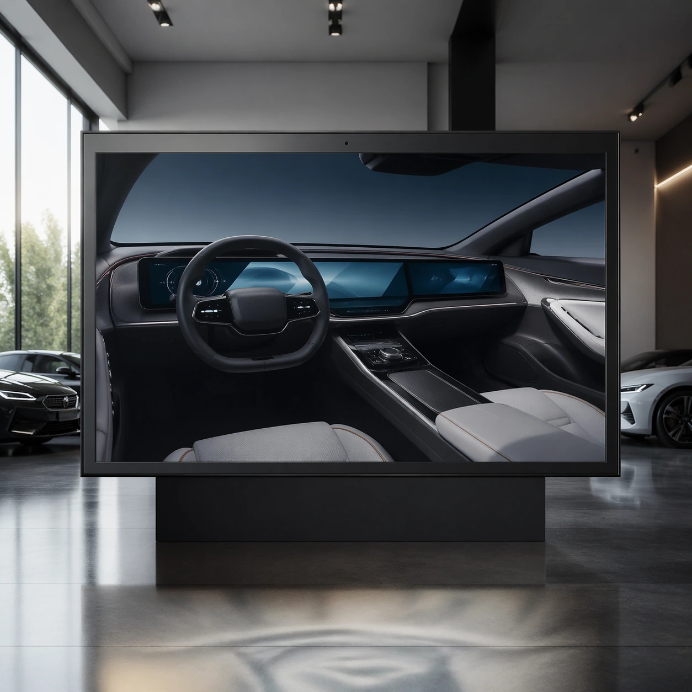

```text
Scene:
A square showroom-like environment with one large clean digital screen, polished floor reflections, and disciplined architectural light. Compose the frame as a square key visual with disciplined camera placement, premium lighting control, and believable real-world scale. The tonal range should feel polished and intentional, with enough atmosphere to create depth without obscuring form. Keep contrast calibrated for launch, catalog, or research presentation use rather than casual snapshot aesthetics.

Subject:
Center an original cockpit visual adapted to a premium freestanding display inside an automotive retail space. Make the subject feel original, production-aware, and clearly grounded in Automotive Interior Cockpit UI Hero. Treat this as an independent study that must feel complete and coherent without relying on any external reference image. The focal hierarchy should be immediate: primary form first, then material behavior, then supporting environmental cues that clarify use context and difficulty.

Important details:
Keep all on-screen content abstract and non-readable while the retail environment remains believable. The mockup should demonstrate premium communication rather than flashy entertainment. The visual language should still feel native to Automotive Interior Cockpit UI Hero, using disciplined industrial or campaign composition instead of generic stock photography. Use believable materials, engineering logic, and professional composition discipline. Reflections, shadows, edge breaks, texture scale, interface density, and small physical joints must all support realism. Avoid filler props, vague mood-board clutter, or any element that weakens the sense of a purpose-built industrial or automotive image.

Use case:
Cockpit UI single study 9/9 for Automotive Interior Cockpit UI Hero, built as image support-five.

Constraints:
No readable text, no watermark, no logos, preserve exact 1:1 aspect ratio, no readable text, no logos, no app-store iconography, no fantasy holograms, no navigation labels, no brand marks.
```

[Pinned source](https://github.com/ChaosRealmsAI/gpt-image-2-gallery/blob/5296db8c996e38776c83a0bc8c64f848dcd512b3/works/topics/automotive-interior-cockpit-ui-hero/packages/single-support-studies/images/support-five/meta.json) · GPT Image2 · 1254×1254 · No source-declared image dependencies. · ProjectD:[published and publicly accepted](https://aitoolsradar.com/en/prompts/c97aa0ac0d9b64)

## Reference Anchor · awkward-social-realism-comedy-set/series-core-system/01-reference-anchor


```text
Scene:
Create a square reference image for Awkward Social Realism Comedy Set. Build a reference anchor establishing the core system with a premium, production-ready finish. Use a polished modular board or campaign surface with clean spacing, premium game-UI finish, and clear focal hierarchy. The composition should feel intentional, clean, and reusable for gallery, research, campaign, or internal handoff contexts. Lighting must support readability first, with the main forms clearly separated from the background and enough breathing room for the system to stay legible at both hero scale and thumbnail scale.

Subject:
Center a coherent original game-art system built for premium production and marketing surfaces. For this image, focus on reference anchor. Keep the same system logic stable across screenshots, cards, banners, and overview boards. This image is the canonical anchor that later series images must follow. The viewer should immediately understand what role this surface plays inside a cohesive game-production asset pack.

Important details:
Lock framing, icon grammar, palette blocking, and surface hierarchy so the kit feels production-ready and consistent. Preserve the core silhouette, framing language, and material logic from the reference image while each variation changes function. Keep materials believable, edge hierarchy disciplined, and the visual language consistent with Awkward Realism. Use abstract interface blocks or diagram accents when helpful, but avoid any readable language. The final result should feel like a deliberate production asset rather than a random illustration.

Use case:
Awkward Social Realism Comedy Set series study 1/9, designed as reference anchor within a cohesive asset pack.

Constraints:
No readable text, no watermark, no logos, preserve exact 1:1 aspect ratio, no unrelated objects, no broken visual hierarchy, no malformed anatomy or broken perspective, no random decorative clutter.
```

[Pinned source](https://github.com/ChaosRealmsAI/gpt-image-2-gallery/blob/5296db8c996e38776c83a0bc8c64f848dcd512b3/works/topics/awkward-social-realism-comedy-set/packages/series-core-system/images/01-reference-anchor/meta.json) · GPT Image2 · 1254×1254 · No source-declared image dependencies. · ProjectD:[published and publicly accepted](https://aitoolsradar.com/en/prompts/a84a534d68fe7d)

## Variant Three · awkward-social-realism-comedy-set/series-core-system/04-variant-three


```text
Scene:
Create a square dependent image for Awkward Social Realism Comedy Set. Build a third controlled variation in the same system with a premium, production-ready finish. Use a polished modular board or campaign surface with clean spacing, premium game-UI finish, and clear focal hierarchy. The composition should feel intentional, clean, and reusable for gallery, research, campaign, or internal handoff contexts. Lighting must support readability first, with the main forms clearly separated from the background and enough breathing room for the system to stay legible at both hero scale and thumbnail scale.

Subject:
Center a coherent original game-art system built for premium production and marketing surfaces. For this image, focus on the intended support surface. Keep the same system logic stable across screenshots, cards, banners, and overview boards. Preserve exact identity or system logic from the reference image while changing only the intended variation axis. The viewer should immediately understand what role this surface plays inside a cohesive game-production asset pack.

Important details:
Lock framing, icon grammar, palette blocking, and surface hierarchy so the kit feels production-ready and consistent. Preserve the core silhouette, framing language, and material logic from the reference image while each variation changes function. Keep materials believable, edge hierarchy disciplined, and the visual language consistent with Awkward Realism. Use abstract interface blocks or diagram accents when helpful, but avoid any readable language. The final result should feel like a deliberate production asset rather than a random illustration.

Use case:
Awkward Social Realism Comedy Set series study 4/9, designed as variant three within a cohesive asset pack.

Constraints:
No readable text, no watermark, no logos, preserve exact 1:1 aspect ratio, no unrelated objects, no broken visual hierarchy, no malformed anatomy or broken perspective, no random decorative clutter.
```

[Pinned source](https://github.com/ChaosRealmsAI/gpt-image-2-gallery/blob/5296db8c996e38776c83a0bc8c64f848dcd512b3/works/topics/awkward-social-realism-comedy-set/packages/series-core-system/images/04-variant-three/meta.json) · GPT Image2 · 1254×1254 · Reference images required. · ProjectD:[published and publicly accepted](https://aitoolsradar.com/en/prompts/c7e5bf5a0d20e8)

## Support One · awkward-social-realism-comedy-set/single-support-studies/support-one


```text
Scene:
Create a square standalone support image for Awkward Social Realism Comedy Set. Build a support-surface study with a clear focal hierarchy and a finished professional surface. Use a polished modular board or campaign surface with clean spacing, premium game-UI finish, and clear focal hierarchy. The frame should feel self-contained and polished, with enough structure to explain the system even without the reference series, yet still obviously belonging to the same theme and production world.

Subject:
Show a coherent original game-art system built for premium production and marketing surfaces in a way that emphasizes the intended support surface. Keep the same system logic stable across screenshots, cards, banners, and overview boards. Even though this image is independent, the viewer should still recognize the same universe, same commercial logic, and same production intent as the core package.

Important details:
Lock framing, icon grammar, palette blocking, and surface hierarchy so the kit feels production-ready and consistent. Preserve the broader theme language through color, framing, material choices, and modular composition. Use clean panel rhythm, premium asset presentation, and believable detail density. The image should work equally well as a gallery study, research reference, and mock production deliverable.

Use case:
Awkward Social Realism Comedy Set single study 5/9, exploring support one as a support surface.

Constraints:
No readable text, no watermark, no logos, preserve exact 1:1 aspect ratio, no unrelated objects, no broken visual hierarchy, no visual noise that obscures the main surface, no accidental brand resemblance.
```

[Pinned source](https://github.com/ChaosRealmsAI/gpt-image-2-gallery/blob/5296db8c996e38776c83a0bc8c64f848dcd512b3/works/topics/awkward-social-realism-comedy-set/packages/single-support-studies/images/support-one/meta.json) · GPT Image2 · 1254×1254 · No source-declared image dependencies. · ProjectD:[published and publicly accepted](https://aitoolsradar.com/en/prompts/073e6f3983de01)

## Support Two · awkward-social-realism-comedy-set/single-support-studies/support-two


```text
Scene:
Create a square standalone support image for Awkward Social Realism Comedy Set. Build a second support-surface study with a clear focal hierarchy and a finished professional surface. Use a polished modular board or campaign surface with clean spacing, premium game-UI finish, and clear focal hierarchy. The frame should feel self-contained and polished, with enough structure to explain the system even without the reference series, yet still obviously belonging to the same theme and production world.

Subject:
Show a coherent original game-art system built for premium production and marketing surfaces in a way that emphasizes the intended support surface. Keep the same system logic stable across screenshots, cards, banners, and overview boards. Even though this image is independent, the viewer should still recognize the same universe, same commercial logic, and same production intent as the core package.

Important details:
Lock framing, icon grammar, palette blocking, and surface hierarchy so the kit feels production-ready and consistent. Preserve the broader theme language through color, framing, material choices, and modular composition. Use clean panel rhythm, premium asset presentation, and believable detail density. The image should work equally well as a gallery study, research reference, and mock production deliverable.

Use case:
Awkward Social Realism Comedy Set single study 6/9, exploring support two as a support surface.

Constraints:
No readable text, no watermark, no logos, preserve exact 1:1 aspect ratio, no unrelated objects, no broken visual hierarchy, no visual noise that obscures the main surface, no accidental brand resemblance.
```

[Pinned source](https://github.com/ChaosRealmsAI/gpt-image-2-gallery/blob/5296db8c996e38776c83a0bc8c64f848dcd512b3/works/topics/awkward-social-realism-comedy-set/packages/single-support-studies/images/support-two/meta.json) · GPT Image2 · 1254×1254 · No source-declared image dependencies. · ProjectD:[published and publicly accepted](https://aitoolsradar.com/en/prompts/09e9a9b8b6a7f6)

## Support Three · awkward-social-realism-comedy-set/single-support-studies/support-three


```text
Scene:
Create a square standalone support image for Awkward Social Realism Comedy Set. Build a third support-surface study with a clear focal hierarchy and a finished professional surface. Use a polished modular board or campaign surface with clean spacing, premium game-UI finish, and clear focal hierarchy. The frame should feel self-contained and polished, with enough structure to explain the system even without the reference series, yet still obviously belonging to the same theme and production world.

Subject:
Show a coherent original game-art system built for premium production and marketing surfaces in a way that emphasizes the intended support surface. Keep the same system logic stable across screenshots, cards, banners, and overview boards. Even though this image is independent, the viewer should still recognize the same universe, same commercial logic, and same production intent as the core package.

Important details:
Lock framing, icon grammar, palette blocking, and surface hierarchy so the kit feels production-ready and consistent. Preserve the broader theme language through color, framing, material choices, and modular composition. Use clean panel rhythm, premium asset presentation, and believable detail density. The image should work equally well as a gallery study, research reference, and mock production deliverable.

Use case:
Awkward Social Realism Comedy Set single study 7/9, exploring support three as a support surface.

Constraints:
No readable text, no watermark, no logos, preserve exact 1:1 aspect ratio, no unrelated objects, no broken visual hierarchy, no visual noise that obscures the main surface, no accidental brand resemblance.
```

[Pinned source](https://github.com/ChaosRealmsAI/gpt-image-2-gallery/blob/5296db8c996e38776c83a0bc8c64f848dcd512b3/works/topics/awkward-social-realism-comedy-set/packages/single-support-studies/images/support-three/meta.json) · GPT Image2 · 1254×1254 · No source-declared image dependencies. · ProjectD:[published and publicly accepted](https://aitoolsradar.com/en/prompts/0af57660bb0103)

## Support Four · awkward-social-realism-comedy-set/single-support-studies/support-four


```text
Scene:
Create a square standalone support image for Awkward Social Realism Comedy Set. Build a fourth support-surface study with a clear focal hierarchy and a finished professional surface. Use a polished modular board or campaign surface with clean spacing, premium game-UI finish, and clear focal hierarchy. The frame should feel self-contained and polished, with enough structure to explain the system even without the reference series, yet still obviously belonging to the same theme and production world.

Subject:
Show a coherent original game-art system built for premium production and marketing surfaces in a way that emphasizes the intended support surface. Keep the same system logic stable across screenshots, cards, banners, and overview boards. Even though this image is independent, the viewer should still recognize the same universe, same commercial logic, and same production intent as the core package.

Important details:
Lock framing, icon grammar, palette blocking, and surface hierarchy so the kit feels production-ready and consistent. Preserve the broader theme language through color, framing, material choices, and modular composition. Use clean panel rhythm, premium asset presentation, and believable detail density. The image should work equally well as a gallery study, research reference, and mock production deliverable.

Use case:
Awkward Social Realism Comedy Set single study 8/9, exploring support four as a support surface.

Constraints:
No readable text, no watermark, no logos, preserve exact 1:1 aspect ratio, no unrelated objects, no broken visual hierarchy, no visual noise that obscures the main surface, no accidental brand resemblance.
```

[Pinned source](https://github.com/ChaosRealmsAI/gpt-image-2-gallery/blob/5296db8c996e38776c83a0bc8c64f848dcd512b3/works/topics/awkward-social-realism-comedy-set/packages/single-support-studies/images/support-four/meta.json) · GPT Image2 · 1254×1254 · No source-declared image dependencies. · ProjectD:[published and publicly accepted](https://aitoolsradar.com/en/prompts/f84ae176dbf2d8)

## Support Five · awkward-social-realism-comedy-set/single-support-studies/support-five


```text
Scene:
Create a square standalone support image for Awkward Social Realism Comedy Set. Build a fifth support-surface study with a clear focal hierarchy and a finished professional surface. Use a polished modular board or campaign surface with clean spacing, premium game-UI finish, and clear focal hierarchy. The frame should feel self-contained and polished, with enough structure to explain the system even without the reference series, yet still obviously belonging to the same theme and production world.

Subject:
Show a coherent original game-art system built for premium production and marketing surfaces in a way that emphasizes the intended support surface. Keep the same system logic stable across screenshots, cards, banners, and overview boards. Even though this image is independent, the viewer should still recognize the same universe, same commercial logic, and same production intent as the core package.

Important details:
Lock framing, icon grammar, palette blocking, and surface hierarchy so the kit feels production-ready and consistent. Preserve the broader theme language through color, framing, material choices, and modular composition. Use clean panel rhythm, premium asset presentation, and believable detail density. The image should work equally well as a gallery study, research reference, and mock production deliverable.

Use case:
Awkward Social Realism Comedy Set single study 9/9, exploring support five as a support surface.

Constraints:
No readable text, no watermark, no logos, preserve exact 1:1 aspect ratio, no unrelated objects, no broken visual hierarchy, no visual noise that obscures the main surface, no accidental brand resemblance.
```

[Pinned source](https://github.com/ChaosRealmsAI/gpt-image-2-gallery/blob/5296db8c996e38776c83a0bc8c64f848dcd512b3/works/topics/awkward-social-realism-comedy-set/packages/single-support-studies/images/support-five/meta.json) · GPT Image2 · 1254×1254 · No source-declared image dependencies. · ProjectD:[published and publicly accepted](https://aitoolsradar.com/en/prompts/ecb07977668413)

## Reference Anchor · awwwards-grade-launch-page-interface/series-core-system/01-reference-anchor


```text
Scene:
Create a square reference image for award-grade Launch Page Interface. Build a reference anchor establishing the core system with a premium, production-ready finish. Use a polished modular board or campaign surface with clean spacing, premium game-UI finish, and clear focal hierarchy. The composition should feel intentional, clean, and reusable for gallery, research, campaign, or internal handoff contexts. Lighting must support readability first, with the main forms clearly separated from the background and enough breathing room for the system to stay legible at both hero scale and thumbnail scale.

Subject:
Center a coherent original game-art system built for premium production and marketing surfaces. For this image, focus on reference anchor. Keep the same system logic stable across screenshots, cards, banners, and overview boards. This image is the canonical anchor that later series images must follow. The viewer should immediately understand what role this surface plays inside a cohesive game-production asset pack.

Important details:
Lock framing, icon grammar, palette blocking, and surface hierarchy so the kit feels production-ready and consistent. Preserve the core silhouette, framing language, and material logic from the reference image while each variation changes function. Keep materials believable, edge hierarchy disciplined, and the visual language consistent with award-grade launch UI. Use abstract interface blocks or diagram accents when helpful, but avoid any readable language. The final result should feel like a deliberate production asset rather than a random illustration.

Use case:
award-grade Launch Page Interface series study 1/9, designed as reference anchor within a cohesive asset pack.

Constraints:
No readable text, no watermark, no logos, preserve exact 1:1 aspect ratio, no unrelated objects, no broken visual hierarchy, no malformed anatomy or broken perspective, no random decorative clutter.
```

[Pinned source](https://github.com/ChaosRealmsAI/gpt-image-2-gallery/blob/5296db8c996e38776c83a0bc8c64f848dcd512b3/works/topics/awwwards-grade-launch-page-interface/packages/series-core-system/images/01-reference-anchor/meta.json) · GPT Image2 · 1254×1254 · No source-declared image dependencies. · ProjectD:[published and publicly accepted](https://aitoolsradar.com/en/prompts/dec0227a96220b)

## Variant One · awwwards-grade-launch-page-interface/series-core-system/02-variant-one


```text
Scene:
Create a square dependent image for award-grade Launch Page Interface. Build a first controlled variation in the same system with a premium, production-ready finish. Use a polished modular board or campaign surface with clean spacing, premium game-UI finish, and clear focal hierarchy. The composition should feel intentional, clean, and reusable for gallery, research, campaign, or internal handoff contexts. Lighting must support readability first, with the main forms clearly separated from the background and enough breathing room for the system to stay legible at both hero scale and thumbnail scale.

Subject:
Center a coherent original game-art system built for premium production and marketing surfaces. For this image, focus on the intended support surface. Keep the same system logic stable across screenshots, cards, banners, and overview boards. Preserve exact identity or system logic from the reference image while changing only the intended variation axis. The viewer should immediately understand what role this surface plays inside a cohesive game-production asset pack.

Important details:
Lock framing, icon grammar, palette blocking, and surface hierarchy so the kit feels production-ready and consistent. Preserve the core silhouette, framing language, and material logic from the reference image while each variation changes function. Keep materials believable, edge hierarchy disciplined, and the visual language consistent with award-grade launch UI. Use abstract interface blocks or diagram accents when helpful, but avoid any readable language. The final result should feel like a deliberate production asset rather than a random illustration.

Use case:
award-grade Launch Page Interface series study 2/9, designed as variant one within a cohesive asset pack.

Constraints:
No readable text, no watermark, no logos, preserve exact 1:1 aspect ratio, no unrelated objects, no broken visual hierarchy, no malformed anatomy or broken perspective, no random decorative clutter.
```

[Pinned source](https://github.com/ChaosRealmsAI/gpt-image-2-gallery/blob/5296db8c996e38776c83a0bc8c64f848dcd512b3/works/topics/awwwards-grade-launch-page-interface/packages/series-core-system/images/02-variant-one/meta.json) · GPT Image2 · 1254×1254 · Reference images required. · ProjectD:[published and publicly accepted](https://aitoolsradar.com/en/prompts/c677e02bd09831)

## Variant Two · awwwards-grade-launch-page-interface/series-core-system/03-variant-two


```text
Scene:
Create a square dependent image for award-grade Launch Page Interface. Build a second controlled variation in the same system with a premium, production-ready finish. Use a polished modular board or campaign surface with clean spacing, premium game-UI finish, and clear focal hierarchy. The composition should feel intentional, clean, and reusable for gallery, research, campaign, or internal handoff contexts. Lighting must support readability first, with the main forms clearly separated from the background and enough breathing room for the system to stay legible at both hero scale and thumbnail scale.

Subject:
Center a coherent original game-art system built for premium production and marketing surfaces. For this image, focus on the intended support surface. Keep the same system logic stable across screenshots, cards, banners, and overview boards. Preserve exact identity or system logic from the reference image while changing only the intended variation axis. The viewer should immediately understand what role this surface plays inside a cohesive game-production asset pack.

Important details:
Lock framing, icon grammar, palette blocking, and surface hierarchy so the kit feels production-ready and consistent. Preserve the core silhouette, framing language, and material logic from the reference image while each variation changes function. Keep materials believable, edge hierarchy disciplined, and the visual language consistent with award-grade launch UI. Use abstract interface blocks or diagram accents when helpful, but avoid any readable language. The final result should feel like a deliberate production asset rather than a random illustration.

Use case:
award-grade Launch Page Interface series study 3/9, designed as variant two within a cohesive asset pack.

Constraints:
No readable text, no watermark, no logos, preserve exact 1:1 aspect ratio, no unrelated objects, no broken visual hierarchy, no malformed anatomy or broken perspective, no random decorative clutter.
```

[Pinned source](https://github.com/ChaosRealmsAI/gpt-image-2-gallery/blob/5296db8c996e38776c83a0bc8c64f848dcd512b3/works/topics/awwwards-grade-launch-page-interface/packages/series-core-system/images/03-variant-two/meta.json) · GPT Image2 · 1254×1254 · Reference images required. · ProjectD:[published and publicly accepted](https://aitoolsradar.com/en/prompts/c808838ebca23b)

## Variant Three · awwwards-grade-launch-page-interface/series-core-system/04-variant-three


```text
Scene:
Create a square dependent image for award-grade Launch Page Interface. Build a third controlled variation in the same system with a premium, production-ready finish. Use a polished modular board or campaign surface with clean spacing, premium game-UI finish, and clear focal hierarchy. The composition should feel intentional, clean, and reusable for gallery, research, campaign, or internal handoff contexts. Lighting must support readability first, with the main forms clearly separated from the background and enough breathing room for the system to stay legible at both hero scale and thumbnail scale.

Subject:
Center a coherent original game-art system built for premium production and marketing surfaces. For this image, focus on the intended support surface. Keep the same system logic stable across screenshots, cards, banners, and overview boards. Preserve exact identity or system logic from the reference image while changing only the intended variation axis. The viewer should immediately understand what role this surface plays inside a cohesive game-production asset pack.

Important details:
Lock framing, icon grammar, palette blocking, and surface hierarchy so the kit feels production-ready and consistent. Preserve the core silhouette, framing language, and material logic from the reference image while each variation changes function. Keep materials believable, edge hierarchy disciplined, and the visual language consistent with award-grade launch UI. Use abstract interface blocks or diagram accents when helpful, but avoid any readable language. The final result should feel like a deliberate production asset rather than a random illustration.

Use case:
award-grade Launch Page Interface series study 4/9, designed as variant three within a cohesive asset pack.

Constraints:
No readable text, no watermark, no logos, preserve exact 1:1 aspect ratio, no unrelated objects, no broken visual hierarchy, no malformed anatomy or broken perspective, no random decorative clutter.
```

[Pinned source](https://github.com/ChaosRealmsAI/gpt-image-2-gallery/blob/5296db8c996e38776c83a0bc8c64f848dcd512b3/works/topics/awwwards-grade-launch-page-interface/packages/series-core-system/images/04-variant-three/meta.json) · GPT Image2 · 1254×1254 · Reference images required. · ProjectD:[published and publicly accepted](https://aitoolsradar.com/en/prompts/fa3868e234f02b)

## Support One · awwwards-grade-launch-page-interface/single-support-studies/support-one


```text
Scene:
Create a square standalone support image for award-grade Launch Page Interface. Build a support-surface study with a clear focal hierarchy and a finished professional surface. Use a polished modular board or campaign surface with clean spacing, premium game-UI finish, and clear focal hierarchy. The frame should feel self-contained and polished, with enough structure to explain the system even without the reference series, yet still obviously belonging to the same theme and production world.

Subject:
Show a coherent original game-art system built for premium production and marketing surfaces in a way that emphasizes the intended support surface. Keep the same system logic stable across screenshots, cards, banners, and overview boards. Even though this image is independent, the viewer should still recognize the same universe, same commercial logic, and same production intent as the core package.

Important details:
Lock framing, icon grammar, palette blocking, and surface hierarchy so the kit feels production-ready and consistent. Preserve the broader theme language through color, framing, material choices, and modular composition. Use clean panel rhythm, premium asset presentation, and believable detail density. The image should work equally well as a gallery study, research reference, and mock production deliverable.

Use case:
award-grade Launch Page Interface single study 5/9, exploring support one as a support surface.

Constraints:
No readable text, no watermark, no logos, preserve exact 1:1 aspect ratio, no unrelated objects, no broken visual hierarchy, no visual noise that obscures the main surface, no accidental brand resemblance.
```

[Pinned source](https://github.com/ChaosRealmsAI/gpt-image-2-gallery/blob/5296db8c996e38776c83a0bc8c64f848dcd512b3/works/topics/awwwards-grade-launch-page-interface/packages/single-support-studies/images/support-one/meta.json) · GPT Image2 · 1254×1254 · No source-declared image dependencies. · ProjectD:[published and publicly accepted](https://aitoolsradar.com/en/prompts/9ffeaa0a505e06)

## Support Two · awwwards-grade-launch-page-interface/single-support-studies/support-two


```text
Scene:
Create a square standalone support image for award-grade Launch Page Interface. Build a second support-surface study with a clear focal hierarchy and a finished professional surface. Use a polished modular board or campaign surface with clean spacing, premium game-UI finish, and clear focal hierarchy. The frame should feel self-contained and polished, with enough structure to explain the system even without the reference series, yet still obviously belonging to the same theme and production world.

Subject:
Show a coherent original game-art system built for premium production and marketing surfaces in a way that emphasizes the intended support surface. Keep the same system logic stable across screenshots, cards, banners, and overview boards. Even though this image is independent, the viewer should still recognize the same universe, same commercial logic, and same production intent as the core package.

Important details:
Lock framing, icon grammar, palette blocking, and surface hierarchy so the kit feels production-ready and consistent. Preserve the broader theme language through color, framing, material choices, and modular composition. Use clean panel rhythm, premium asset presentation, and believable detail density. The image should work equally well as a gallery study, research reference, and mock production deliverable.

Use case:
award-grade Launch Page Interface single study 6/9, exploring support two as a support surface.

Constraints:
No readable text, no watermark, no logos, preserve exact 1:1 aspect ratio, no unrelated objects, no broken visual hierarchy, no visual noise that obscures the main surface, no accidental brand resemblance.
```

[Pinned source](https://github.com/ChaosRealmsAI/gpt-image-2-gallery/blob/5296db8c996e38776c83a0bc8c64f848dcd512b3/works/topics/awwwards-grade-launch-page-interface/packages/single-support-studies/images/support-two/meta.json) · GPT Image2 · 1254×1254 · No source-declared image dependencies. · ProjectD:[published and publicly accepted](https://aitoolsradar.com/en/prompts/b112373ef82717)

## Support Three · awwwards-grade-launch-page-interface/single-support-studies/support-three


```text
Scene:
Create a square standalone support image for award-grade Launch Page Interface. Build a third support-surface study with a clear focal hierarchy and a finished professional surface. Use a polished modular board or campaign surface with clean spacing, premium game-UI finish, and clear focal hierarchy. The frame should feel self-contained and polished, with enough structure to explain the system even without the reference series, yet still obviously belonging to the same theme and production world.

Subject:
Show a coherent original game-art system built for premium production and marketing surfaces in a way that emphasizes the intended support surface. Keep the same system logic stable across screenshots, cards, banners, and overview boards. Even though this image is independent, the viewer should still recognize the same universe, same commercial logic, and same production intent as the core package.

Important details:
Lock framing, icon grammar, palette blocking, and surface hierarchy so the kit feels production-ready and consistent. Preserve the broader theme language through color, framing, material choices, and modular composition. Use clean panel rhythm, premium asset presentation, and believable detail density. The image should work equally well as a gallery study, research reference, and mock production deliverable.

Use case:
award-grade Launch Page Interface single study 7/9, exploring support three as a support surface.

Constraints:
No readable text, no watermark, no logos, preserve exact 1:1 aspect ratio, no unrelated objects, no broken visual hierarchy, no visual noise that obscures the main surface, no accidental brand resemblance.
```

[Pinned source](https://github.com/ChaosRealmsAI/gpt-image-2-gallery/blob/5296db8c996e38776c83a0bc8c64f848dcd512b3/works/topics/awwwards-grade-launch-page-interface/packages/single-support-studies/images/support-three/meta.json) · GPT Image2 · 1254×1254 · No source-declared image dependencies. · ProjectD:[published and publicly accepted](https://aitoolsradar.com/en/prompts/8a889aabaea62c)

## Support Four · awwwards-grade-launch-page-interface/single-support-studies/support-four


```text
Scene:
Create a square standalone support image for award-grade Launch Page Interface. Build a fourth support-surface study with a clear focal hierarchy and a finished professional surface. Use a polished modular board or campaign surface with clean spacing, premium game-UI finish, and clear focal hierarchy. The frame should feel self-contained and polished, with enough structure to explain the system even without the reference series, yet still obviously belonging to the same theme and production world.

Subject:
Show a coherent original game-art system built for premium production and marketing surfaces in a way that emphasizes the intended support surface. Keep the same system logic stable across screenshots, cards, banners, and overview boards. Even though this image is independent, the viewer should still recognize the same universe, same commercial logic, and same production intent as the core package.

Important details:
Lock framing, icon grammar, palette blocking, and surface hierarchy so the kit feels production-ready and consistent. Preserve the broader theme language through color, framing, material choices, and modular composition. Use clean panel rhythm, premium asset presentation, and believable detail density. The image should work equally well as a gallery study, research reference, and mock production deliverable.

Use case:
award-grade Launch Page Interface single study 8/9, exploring support four as a support surface.

Constraints:
No readable text, no watermark, no logos, preserve exact 1:1 aspect ratio, no unrelated objects, no broken visual hierarchy, no visual noise that obscures the main surface, no accidental brand resemblance.
```

[Pinned source](https://github.com/ChaosRealmsAI/gpt-image-2-gallery/blob/5296db8c996e38776c83a0bc8c64f848dcd512b3/works/topics/awwwards-grade-launch-page-interface/packages/single-support-studies/images/support-four/meta.json) · GPT Image2 · 1254×1254 · No source-declared image dependencies. · ProjectD:[published and publicly accepted](https://aitoolsradar.com/en/prompts/ba1e7d24bf154d)

## Support Five · awwwards-grade-launch-page-interface/single-support-studies/support-five


```text
Scene:
Create a square standalone support image for award-grade Launch Page Interface. Build a fifth support-surface study with a clear focal hierarchy and a finished professional surface. Use a polished modular board or campaign surface with clean spacing, premium game-UI finish, and clear focal hierarchy. The frame should feel self-contained and polished, with enough structure to explain the system even without the reference series, yet still obviously belonging to the same theme and production world.

Subject:
Show a coherent original game-art system built for premium production and marketing surfaces in a way that emphasizes the intended support surface. Keep the same system logic stable across screenshots, cards, banners, and overview boards. Even though this image is independent, the viewer should still recognize the same universe, same commercial logic, and same production intent as the core package.

Important details:
Lock framing, icon grammar, palette blocking, and surface hierarchy so the kit feels production-ready and consistent. Preserve the broader theme language through color, framing, material choices, and modular composition. Use clean panel rhythm, premium asset presentation, and believable detail density. The image should work equally well as a gallery study, research reference, and mock production deliverable.

Use case:
award-grade Launch Page Interface single study 9/9, exploring support five as a support surface.

Constraints:
No readable text, no watermark, no logos, preserve exact 1:1 aspect ratio, no unrelated objects, no broken visual hierarchy, no visual noise that obscures the main surface, no accidental brand resemblance.
```

[Pinned source](https://github.com/ChaosRealmsAI/gpt-image-2-gallery/blob/5296db8c996e38776c83a0bc8c64f848dcd512b3/works/topics/awwwards-grade-launch-page-interface/packages/single-support-studies/images/support-five/meta.json) · GPT Image2 · 1254×1254 · No source-declared image dependencies. · ProjectD:[published and publicly accepted](https://aitoolsradar.com/en/prompts/cf496a0aeb6d44)

## Reference Anchor · babylon-hanging-gardens/series-core-discovery/01-reference-anchor


```text
Scene:
A square documentary image composed like a premium archaeology magazine feature. Use sunlit buff stone, saturated vine green, glazed deep blue, and Euphrates river haze. Frame a terraced Babylonian garden complex rising in stacked levels with irrigation channels, hanging vegetation, and distant river atmosphere with crisp depth layering, restrained contrast, and subtle atmospheric depth so the scene feels excavated, observed, and historically grounded rather than theatrical or game-like. Keep the light directional but believable, as if captured during a careful field visit.

Subject:
Center the image on a terraced Babylonian garden complex rising in stacked levels with irrigation channels, hanging vegetation, and distant river atmosphere. Include culturally accurate surface logic, region-specific setting, and believable human-scale cues in stairs, doorways, cut blocks, relief edges, or water depth. Shapes, carvings, masonry joints, and site wear should feel studied from real archaeology, with no generic ancient-world mashup and no ornamental filler borrowed from another civilization.

Important details:
Keep the reconstruction architecturally disciplined, with Near Eastern massing, stepped terrace engineering, visible hydraulic logic, and planted abundance that feels maintained by ancient infrastructure rather than magical floating greenery. Emphasize sun-baked masonry, glazed brick details, irrigation water, trailing vines, palms, and engineered terrace retaining walls. Keep inscriptions, painted registers, symbolic motifs, or carved bands visually plausible but not readable. Preserve a museum-grade balance between beauty and evidence: light should reveal relief depth, edge wear, repairs, sediment traces, and excavation context without turning the site into fantasy spectacle. The composition should feel like a definitive reference frame that later variations can inherit exactly.

Use case:
Babylon Hanging Gardens series study 1/9.

Constraints:
No readable text, no watermark, no logos, preserve exact 1:1 aspect ratio, no fantasy dragons, no neon glow, no steel frameworks, no modern city skyline, no tourists, no anachronistic props, no collage layout, no exaggerated fantasy lighting.
```

[Pinned source](https://github.com/ChaosRealmsAI/gpt-image-2-gallery/blob/5296db8c996e38776c83a0bc8c64f848dcd512b3/works/topics/babylon-hanging-gardens/packages/series-core-discovery/images/01-reference-anchor/meta.json) · GPT Image2 · 1254×1254 · No source-declared image dependencies. · ProjectD:[published and publicly accepted](https://aitoolsradar.com/en/prompts/6b88391d8de9d6)

## Human Scale Reveal · babylon-hanging-gardens/series-core-discovery/02-human-scale-reveal


```text
Scene:
A square follow-up field image from the same site, slightly closer and lower than the reference anchor, with careful documentary framing and the same material palette. The camera should feel physically present inside the archaeological space, using natural light, soft depth separation, and one clear human figure to explain scale without turning the image into lifestyle photography.

Subject:
Show the same site identity established in the reference anchor, now with an archaeologist, conservator, or field researcher moving through the scene in practical neutral clothing. The person should be small relative to the monument and clearly secondary to the architecture, water, or painted wall system. Keep the main forms, structural rhythm, and civilizational markers unchanged.

Important details:
Preserve the exact site identity, base geometry, material behavior, and cultural signatures from the reference model. Only vary vantage, gesture, and scale cues. Keep the reconstruction architecturally disciplined, with Near Eastern massing, stepped terrace engineering, visible hydraulic logic, and planted abundance that feels maintained by ancient infrastructure rather than magical floating greenery. Human presence should clarify stair height, wall size, carving depth, or spatial compression while respecting conservation protocol and historical seriousness. Keep any tools understated and generic, with no readable labels. The image must still look like a rigorous archaeological record first and a dramatic scene second.

Use case:
Babylon Hanging Gardens series study 2/9.

Constraints:
No readable text, no watermark, no logos, preserve exact 1:1 aspect ratio, preserve exact site identity from the reference image, no fantasy dragons, no neon glow, no steel frameworks, no modern city skyline, no fashion editorial styling, no crowd, no cinematic props.
```

[Pinned source](https://github.com/ChaosRealmsAI/gpt-image-2-gallery/blob/5296db8c996e38776c83a0bc8c64f848dcd512b3/works/topics/babylon-hanging-gardens/packages/series-core-discovery/images/02-human-scale-reveal/meta.json) · GPT Image2 · 1254×1254 · Reference images required. · ProjectD:[published and publicly accepted](https://aitoolsradar.com/en/prompts/4a548ed4e8e616)

## Surface Close Study · babylon-hanging-gardens/series-core-discovery/03-surface-close-study


```text
Scene:
A square close study framed within the same site established by the reference anchor. Use a tight crop, shallow but believable depth of field, and raking light that reveals tactile evidence in surface relief, pigment, tool marks, moisture, or marine wear. The image should feel like a museum conservation photograph elevated to gallery quality.

Subject:
Focus on a materially rich portion of the same site: carved edges, painted plaster, fitted stone, root-wrapped masonry, submerged paving, or quarry-cut facial planes depending on the civilization. The composition should remain anchored to the original location and show enough surrounding context that viewers still recognize the parent site rather than mistaking it for an unrelated artifact.

Important details:
Preserve the exact site identity from the reference model while shifting emphasis to forensic surface evidence. Keep the reconstruction architecturally disciplined, with Near Eastern massing, stepped terrace engineering, visible hydraulic logic, and planted abundance that feels maintained by ancient infrastructure rather than magical floating greenery. Make micro-texture, fracture lines, pigment retention, water wear, plant interaction, dust, or chisel traces visually persuasive. Avoid decorative clutter. Every mark should feel like evidence of making, weathering, excavation, or conservation. Keep any symbolic marks non-legible and historically appropriate, and make the light reveal depth without flattening the material richness.

Use case:
Babylon Hanging Gardens series study 3/9.

Constraints:
No readable text, no watermark, no logos, preserve exact 1:1 aspect ratio, preserve exact site identity from the reference image, no fantasy dragons, no neon glow, no steel frameworks, no modern city skyline, no isolated floating artifact, no studio backdrop, no fake macro abstraction.
```

[Pinned source](https://github.com/ChaosRealmsAI/gpt-image-2-gallery/blob/5296db8c996e38776c83a0bc8c64f848dcd512b3/works/topics/babylon-hanging-gardens/packages/series-core-discovery/images/03-surface-close-study/meta.json) · GPT Image2 · 1024×1024 · Reference images required. · ProjectD:[published and publicly accepted](https://aitoolsradar.com/en/prompts/24f4112f924d30)

## Atmospheric Wide Reveal · babylon-hanging-gardens/series-core-discovery/04-atmospheric-wide-reveal


```text
Scene:
A square wide reveal of the same site under a slightly different environmental condition, with more surrounding geography or architecture visible while keeping the anchor landmark dominant. Use disciplined composition, atmospheric perspective, and natural light behavior so the image feels like a patient field photograph captured after the reference shot rather than a different fantasy set.

Subject:
Show the same site identity with broader context: approaches, terraces, ring walls, canyon slot, canopy volume, quarry slope, or chamber boundaries depending on the location. The anchor structure must remain instantly recognizable. Environmental scale should deepen understanding of why the site is placed here and how people, water, topography, or vegetation shape the experience of the monument.

Important details:
Preserve the exact landmark, materials, and civilizational cues from the reference model while allowing wider framing and a different atmospheric emphasis. Keep the reconstruction architecturally disciplined, with Near Eastern massing, stepped terrace engineering, visible hydraulic logic, and planted abundance that feels maintained by ancient infrastructure rather than magical floating greenery. Use geography and environmental systems to add meaning: drainage, mist, current, valley depth, roots, irrigation, or enclosure logic. The image should feel both beautiful and evidentiary, with no compositional tricks that break continuity with the established site.

Use case:
Babylon Hanging Gardens series study 4/9.

Constraints:
No readable text, no watermark, no logos, preserve exact 1:1 aspect ratio, preserve exact site identity from the reference image, no fantasy dragons, no neon glow, no steel frameworks, no modern city skyline, no unrelated landmarks, no speculative mashup architecture, no posterized grading.
```

[Pinned source](https://github.com/ChaosRealmsAI/gpt-image-2-gallery/blob/5296db8c996e38776c83a0bc8c64f848dcd512b3/works/topics/babylon-hanging-gardens/packages/series-core-discovery/images/04-atmospheric-wide-reveal/meta.json) · GPT Image2 · 1254×1254 · Reference images required. · ProjectD:[published and publicly accepted](https://aitoolsradar.com/en/prompts/8efa00d4ef8ca0)

## Excavation Overview · babylon-hanging-gardens/single-context-studies/excavation-overview


```text
Scene:
A square independent archaeology study composed from a slightly elevated fieldwork viewpoint. Use balanced natural light, crisp evidence hierarchy, and practical site organization so the image feels publishable in a museum report and still visually strong enough for a gallery wall. The frame should explain where excavation is happening without relying on readable markers or diagrams.

Subject:
Show a ground-level archaeological interpretation view where foundations, channel remains, and reconstructed terrace relationships can be studied with technical clarity. Include grounded human traces such as ladders, trays, brushes, baskets, light rigs, or measuring tools only when they support archaeological realism and remain visually secondary. The site should stay culturally specific, with architecture, surface treatment, sediment, and environmental context all belonging to the correct civilization rather than a generic dig.

Important details:
Keep the reconstruction architecturally disciplined, with Near Eastern massing, stepped terrace engineering, visible hydraulic logic, and planted abundance that feels maintained by ancient infrastructure rather than magical floating greenery. Prioritize evidence relationships: exposed layers, cleaned edges, protected surfaces, loose fragments, and transitions between buried and revealed material. Let color, wear, and composition explain what has just been uncovered. The image must feel methodical rather than adventurous. Keep any site tags, notes, or markers abstract and unreadable. Avoid sensational treasure imagery and keep the atmosphere scholarly, patient, and materially convincing.

Use case:
Babylon Hanging Gardens single study 5/9.

Constraints:
No readable text, no watermark, no logos, preserve exact 1:1 aspect ratio, no fantasy dragons, no neon glow, no steel frameworks, no modern city skyline, no treasure-chest clichés, no action-movie posing, no arbitrary props, no infographic overlay.
```

[Pinned source](https://github.com/ChaosRealmsAI/gpt-image-2-gallery/blob/5296db8c996e38776c83a0bc8c64f848dcd512b3/works/topics/babylon-hanging-gardens/packages/single-context-studies/images/excavation-overview/meta.json) · GPT Image2 · 1254×1254 · No source-declared image dependencies. · ProjectD:[published and publicly accepted](https://aitoolsradar.com/en/prompts/27d36f87b3a9ac)

## Artifact Tableau · babylon-hanging-gardens/single-context-studies/artifact-tableau


```text
Scene:
A square artifact and material study arranged like a high-end conservation photograph. Use soft directional light, controlled shadow falloff, and a neutral work surface so every fragment reads clearly. The image should feel intimate and scientific, but still rich enough to communicate the broader civilization through craft, wear, and material vocabulary alone.

Subject:
Present glazed brick fragments, cuneiform tablet pieces, irrigation fittings, botanical remains, and carved decorative elements on a study surface. Arrange the pieces with disciplined spacing and believable conservation handling. Include enough variation in scale, finish, and damage state to suggest excavation reality rather than a perfectly staged luxury still life. Nothing should look modern or decorative for its own sake; every object must feel like evidence tied to the same cultural world as the main topic.

Important details:
Emphasize tactile surfaces, honest aging, and historically grounded material behavior. Keep the reconstruction architecturally disciplined, with Near Eastern massing, stepped terrace engineering, visible hydraulic logic, and planted abundance that feels maintained by ancient infrastructure rather than magical floating greenery. Show abrasion, dust, corrosion, cracks, mineral bloom, pigment retention, or edge polish where appropriate. Keep the arrangement orderly but not sterile, as if prepared for a serious cataloging session. No readable labels, no museum placards, and no visual shortcuts that turn the study into product photography detached from archaeology.

Use case:
Babylon Hanging Gardens single study 6/9.

Constraints:
No readable text, no watermark, no logos, preserve exact 1:1 aspect ratio, no fantasy dragons, no neon glow, no steel frameworks, no modern city skyline, no luxury advertising gloss, no floating objects, no velvet jewelry styling, no unrelated tools.
```

[Pinned source](https://github.com/ChaosRealmsAI/gpt-image-2-gallery/blob/5296db8c996e38776c83a0bc8c64f848dcd512b3/works/topics/babylon-hanging-gardens/packages/single-context-studies/images/artifact-tableau/meta.json) · GPT Image2 · 1254×1254 · No source-declared image dependencies. · ProjectD:[published and publicly accepted](https://aitoolsradar.com/en/prompts/2c7c2e8eba49e0)

## Light Shift Study · babylon-hanging-gardens/single-context-studies/light-shift-study


```text
Scene:
A square mood variation from the same civilization theme, built around late afternoon river haze that warms the stone, deepens garden shadow, and turns water channels more reflective. The image should stay grounded in field realism while testing how different illumination changes material reading, atmosphere, and emotional register. Keep the frame self-contained and coherent, as if photographed during a second visit under altered conditions.

Subject:
Show a culturally accurate site or interior connected to the same world as the main topic, but not as a direct dependency on the series reference. The focus should be on how light transforms relief, color, moisture, water, dust, or vegetation while preserving archaeological credibility. Architectural forms, objects, and setting must still belong to the same civilization with no cross-cultural contamination.

Important details:
Keep the reconstruction architecturally disciplined, with Near Eastern massing, stepped terrace engineering, visible hydraulic logic, and planted abundance that feels maintained by ancient infrastructure rather than magical floating greenery. Use the shift in light to reveal different evidence than the other studies: pigment glow, root sheen, caustics, wet stone, canyon shadow, marine haze, terrace depth, or quarry moisture. Keep the result serious and observational rather than romanticized. Non-readable motifs are acceptable, but there should be no signs, captions, or modern display devices. The image should feel like a rigorous visual experiment in historical atmosphere.

Use case:
Babylon Hanging Gardens single study 7/9.

Constraints:
No readable text, no watermark, no logos, preserve exact 1:1 aspect ratio, no fantasy dragons, no neon glow, no steel frameworks, no modern city skyline, no theatrical color filters, no supernatural effects, no montage composition, no glossy concept-art exaggeration.
```

[Pinned source](https://github.com/ChaosRealmsAI/gpt-image-2-gallery/blob/5296db8c996e38776c83a0bc8c64f848dcd512b3/works/topics/babylon-hanging-gardens/packages/single-context-studies/images/light-shift-study/meta.json) · GPT Image2 · 1254×1254 · No source-declared image dependencies. · ProjectD:[published and publicly accepted](https://aitoolsradar.com/en/prompts/a9b80135db0a4b)

## Survey Perspective · babylon-hanging-gardens/single-context-studies/survey-perspective


```text
Scene:
A square survey-oriented image that explains spatial logic with the clarity of an expert field overview while still reading as a finished artwork. Use a stable elevated vantage, clean depth layering, and enough visible terrain or architecture to make relationships legible without turning the frame into a literal map. The scene should feel analytical and cinematic at the same time.

Subject:
Show an elevated survey perspective that explains terrace stacking, water movement, planted zones, and the garden relation to surrounding Babylonian urban fabric. Organize the composition so paths, terraces, walls, courtyards, chambers, canals, root systems, or quarry clusters can be read as a coherent system. The image should reveal how the civilization used land, water, elevation, enclosure, or monumentality. Keep all architecture, materials, and environmental details consistent with the correct place and period.

Important details:
Keep the reconstruction architecturally disciplined, with Near Eastern massing, stepped terrace engineering, visible hydraulic logic, and planted abundance that feels maintained by ancient infrastructure rather than magical floating greenery. This image should reward close looking by showing infrastructural logic: how stone courses align, how water moves, how rooms connect, how carved masses sit inside geology, or how vegetation interacts with built form. Avoid explicit annotation. Let composition, light, and scale cues do the explanatory work. Keep any measuring elements generic and unreadable, and make the image feel like serious research made visually elegant.

Use case:
Babylon Hanging Gardens single study 8/9.

Constraints:
No readable text, no watermark, no logos, preserve exact 1:1 aspect ratio, no fantasy dragons, no neon glow, no steel frameworks, no modern city skyline, no infographic arrows, no split-screen layout, no impossible aerial geometry, no unrelated settlements.
```

[Pinned source](https://github.com/ChaosRealmsAI/gpt-image-2-gallery/blob/5296db8c996e38776c83a0bc8c64f848dcd512b3/works/topics/babylon-hanging-gardens/packages/single-context-studies/images/survey-perspective/meta.json) · GPT Image2 · 1254×1254 · No source-declared image dependencies. · ProjectD:[published and publicly accepted](https://aitoolsradar.com/en/prompts/60a4f673f2d02e)

## Editorial Reconstruction · babylon-hanging-gardens/single-context-studies/editorial-reconstruction


```text
Scene:
A square hero image designed for a museum wall graphic or flagship magazine cover, but without any actual typography. Use strong focal hierarchy, refined contrast, and a polished finish that still feels rooted in archaeological evidence. The frame should look complete on its own and communicate why this civilization remains visually unforgettable.

Subject:
Build the image around an editorial reconstruction that makes the wonder feel engineered, irrigated, and historically argued rather than purely mythical. Present architecture, artifacts, environment, and atmosphere as one coherent statement. The composition can be more distilled than a field snapshot, but it must remain culturally specific, materially persuasive, and free of fantasy shorthand. Nothing should feel like a movie poster or commercial franchise imitation.

Important details:
Keep the reconstruction architecturally disciplined, with Near Eastern massing, stepped terrace engineering, visible hydraulic logic, and planted abundance that feels maintained by ancient infrastructure rather than magical floating greenery. Distill the site or cultural world into one decisive visual argument: place, craft, weathering, engineering, and memory. Use the strongest material signatures from this civilization and let them sit in a believable environment with controlled dramatic weight. Keep any carved or painted symbols non-readable. The result should look like responsible high-end visual storytelling for research and public interpretation, not a spectacle-first matte painting.

Use case:
Babylon Hanging Gardens single study 9/9.

Constraints:
No readable text, no watermark, no logos, preserve exact 1:1 aspect ratio, no fantasy dragons, no neon glow, no steel frameworks, no modern city skyline, no movie-poster tropes, no overdesigned framing devices, no collage layout, no brand-like iconography.
```

[Pinned source](https://github.com/ChaosRealmsAI/gpt-image-2-gallery/blob/5296db8c996e38776c83a0bc8c64f848dcd512b3/works/topics/babylon-hanging-gardens/packages/single-context-studies/images/editorial-reconstruction/meta.json) · GPT Image2 · 1254×1254 · No source-declared image dependencies. · ProjectD:[published and publicly accepted](https://aitoolsradar.com/en/prompts/298506f2641244)

## Campus Desk Anchor · back-to-school-enrollment-and-retail-kit/series-enrollment-retail-system/01-campus-desk-anchor


```text
Scene:
Create a square premium back-to-school campaign image with bright morning classroom-like light, crisp shadows, clean desk surfaces, and a palette of notebook neutrals, muted blue, warm yellow, and fresh green accents. The environment should feel energetic and organized, suitable for both education enrollment and retail campaign use. Build the scene as a polished academic reset world, not a generic stock classroom.

Subject:
Center an organized desk or campus-ready setup with stationery, backpack or bag, device-like object, planner forms without readable text, and one or two educational or family-retail cues integrated into a clear hierarchy. The subject should communicate readiness, momentum, and practical optimism. Keep it broad enough to support schools, electronics, stationery, or parent-facing retail campaigns under one coherent visual system.

Important details:
Lock the school-reset grammar here: crisp organization, bright functional light, clean product grouping, campus energy, and a balance between youthful optimism and practical structure. The anchor should feel reusable across enrollment, retail, and orientation materials while remaining clearly back-to-school and commercially useful.

Use case:
Back to School series study 1/9.

Constraints:
No readable text, no watermark, no logos, preserve exact 1:1 aspect ratio, no readable notebook text, no school logos, no visible grades or report cards, no mascot imagery, no chaotic messy desk, no brand device marks, no classroom chalkboard writing, no graduation cues.
```

[Pinned source](https://github.com/ChaosRealmsAI/gpt-image-2-gallery/blob/5296db8c996e38776c83a0bc8c64f848dcd512b3/works/topics/back-to-school-enrollment-and-retail-kit/packages/series-enrollment-retail-system/images/01-campus-desk-anchor/meta.json) · GPT Image2 · 1254×1254 · No source-declared image dependencies. · ProjectD:[published and publicly accepted](https://aitoolsradar.com/en/prompts/9fc3026f091fbb)

## Starter Kit Variation · back-to-school-enrollment-and-retail-kit/series-enrollment-retail-system/02-starter-kit-variation


```text
Scene:
Create a square dependent campaign image in the exact same bright academic world, preserving the same morning light, desk materials, and crisp organization from the reference image, but shift the composition toward a starter kit or younger-school bundle. The scene should still feel obviously part of the same system while becoming slightly more object-forward and retail-kit oriented.

Subject:
Feature a starter bundle with notebooks, pencils, lunch or storage forms, backpack elements, and abstract planning cues arranged into a clear school-readiness composition. Preserve exact palette, light direction, and organizational language from the reference model while changing the age and bundle emphasis. The result should remain premium, original, and useful for retail or school promotion.

Important details:
Preserve exact campaign identity from the reference image. Readiness should come from grouping, cleanliness, and scale rather than readable labels. Make materials believable and tactile, from paper edges to zipper pulls and molded plastics. Avoid childish cartoon energy and keep the scene commercially sharp enough for modern education and retail rollout.

Use case:
Back to School series study 2/9.

Constraints:
No readable text, no watermark, no logos, preserve exact 1:1 aspect ratio, preserve exact campaign identity from the reference image, no readable labels, no mascot graphics, no cluttered stickers, no school logo, no messy art-room chaos, no cartoon lunchbox characters, no chalkboard text.
```

[Pinned source](https://github.com/ChaosRealmsAI/gpt-image-2-gallery/blob/5296db8c996e38776c83a0bc8c64f848dcd512b3/works/topics/back-to-school-enrollment-and-retail-kit/packages/series-enrollment-retail-system/images/02-starter-kit-variation/meta.json) · GPT Image2 · 1254×1254 · Reference images required. · ProjectD:[published and publicly accepted](https://aitoolsradar.com/en/prompts/56b31710b6a81d)

## Tech Bundle Variation · back-to-school-enrollment-and-retail-kit/series-enrollment-retail-system/03-tech-bundle-variation


```text
Scene:
Create a square dependent image inside the same bright academic environment, preserving the exact light quality, palette, desk materials, and organized spacing from the reference image, but orient the composition toward a student-tech bundle. The frame should remain clearly part of the anchor campaign while becoming more device and accessory centered.

Subject:
Show device-like forms, headphones, charger or cable organization, notebook support, bag, and academic accessories arranged into a polished back-to-school technology scene. Preserve exact campaign identity from the reference model while shifting emphasis toward connected study tools. The setup should feel realistic and commercially suitable for electronics retail, campus bundles, or parent-focused promotions.

Important details:
Keep structure and optimism intact. Readability must come from layout and object hierarchy, never from screens or readable labels. Make metals, plastics, textiles, and paper all feel credible. The final image should serve as a modern back-to-school asset for tech and education brands without drifting into generic office or gaming aesthetics.

Use case:
Back to School series study 3/9.

Constraints:
No readable text, no watermark, no logos, preserve exact 1:1 aspect ratio, preserve exact campaign identity from the reference image, no readable screens, no logos, no gaming neon, no classroom chaos, no mascot visuals, no cluttered cables, no chalkboard text, no corporate office vibe.
```

[Pinned source](https://github.com/ChaosRealmsAI/gpt-image-2-gallery/blob/5296db8c996e38776c83a0bc8c64f848dcd512b3/works/topics/back-to-school-enrollment-and-retail-kit/packages/series-enrollment-retail-system/images/03-tech-bundle-variation/meta.json) · GPT Image2 · 1254×1254 · Reference images required. · ProjectD:[published and publicly accepted](https://aitoolsradar.com/en/prompts/d913ba604e279d)

## Enrollment Fair Variation · back-to-school-enrollment-and-retail-kit/series-enrollment-retail-system/04-enrollment-fair-variation


```text
Scene:
Create a square dependent campaign image in the same bright school-reset environment, preserving the exact morning light, clean materials, and optimistic academic polish from the reference image, but widen the composition toward an enrollment-fair or orientation-display setting. The scene should remain visually continuous with the anchor while leaning more toward institutional promotion and wayfinding atmosphere.

Subject:
Feature a booth or display-like setup with boards that contain no readable text, organized stationery, welcome-pack objects, device support, and directional elements arranged into a premium enrollment presentation. Preserve exact campaign identity from the reference model while changing the use case toward student recruitment and orientation. The result should feel clean, inviting, and operationally useful.

Important details:
Keep the same visual grammar: bright clarity, youthfully optimistic energy, disciplined structure, and tactile credibility. The orientation-display cue should come from layout and object grouping rather than actual signage. Make it suitable for schools, education brands, or family-focused campaign surfaces during back-to-school season.

Use case:
Back to School series study 4/9.

Constraints:
No readable text, no watermark, no logos, preserve exact 1:1 aspect ratio, preserve exact campaign identity from the reference image, no readable signage, no school logos, no mascot banners, no crowded fair chaos, no graduation caps, no chalkboard text, no corporate tradeshow mood.
```

[Pinned source](https://github.com/ChaosRealmsAI/gpt-image-2-gallery/blob/5296db8c996e38776c83a0bc8c64f848dcd512b3/works/topics/back-to-school-enrollment-and-retail-kit/packages/series-enrollment-retail-system/images/04-enrollment-fair-variation/meta.json) · GPT Image2 · 1254×1254 · Reference images required. · ProjectD:[published and publicly accepted](https://aitoolsradar.com/en/prompts/5a52c9d185bfef)

## Classroom Welcome Surface · back-to-school-enrollment-and-retail-kit/single-campus-support-studies/classroom-welcome-surface


```text
Scene:
Create a square classroom environment image with bright morning light, colorful but disciplined educational materials, and a sense of readiness before students arrive. The frame should feel polished and optimistic, suitable for school marketing or enrollment support. Keep the setting real and inviting rather than theatrical or childish, with enough depth to read as a true environment.

Subject:
Show desks or tables, seating, supplies, display surfaces with no readable text, and a few personal comfort cues that make the classroom feel welcoming. The subject should communicate structure, care, and the start of a new term. Focus on material order and atmosphere rather than on people or slogans.

Important details:
The room should feel alive but not messy. Wood, plastic, paper, and daylight should all behave convincingly. Use color to support youthful energy without becoming loud. The result should work for school campaigns, enrollment pages, or retail partnerships around classroom readiness.

Use case:
Back to School single study 6/9.

Constraints:
No readable text, no watermark, no logos, preserve exact 1:1 aspect ratio, no readable posters, no school logo, no mascot decorations, no crowded student scene, no chalkboard text, no messy art project spill, no graduation cues, no cartoon classroom theme.
```

[Pinned source](https://github.com/ChaosRealmsAI/gpt-image-2-gallery/blob/5296db8c996e38776c83a0bc8c64f848dcd512b3/works/topics/back-to-school-enrollment-and-retail-kit/packages/single-campus-support-studies/images/classroom-welcome-surface/meta.json) · GPT Image2 · 1254×1254 · No source-declared image dependencies. · ProjectD:[published and publicly accepted](https://aitoolsradar.com/en/prompts/4de50aa5419d02)

## Parent Checkout Cart · back-to-school-enrollment-and-retail-kit/single-campus-support-studies/parent-checkout-cart


```text
Scene:
Create a square retail image with bright aisle or checkout light, organized product stacks, and a polished family-shopping atmosphere. The frame should feel like a campaign image for school-season purchasing rather than a supermarket snapshot. Use cart geometry, shelf rhythm, and clear object hierarchy to communicate efficient preparation and family-oriented buying behavior.

Subject:
Show a cart with school supplies, tech accessories, storage items, lunch or apparel forms, and a few checkout cues that remain non-legible. People can be implied or partly present, but the purchasing structure should stay central. The subject should communicate bulk preparation, care, and efficient decision-making for the new term.

Important details:
Retail clarity matters most. Make cart metal, packaging forms, plastic, paper, and polished floor reflections all feel real. Keep the scene commercially neat and useful for retail, education, or parent-targeted promotions. Avoid discount-chaos energy; this is organized, capable preparation. Keep the frame precise enough for gallery, research, and campaign reuse, with believable materials and a strong thumbnail read.

Use case:
Back to School single study 7/9.

Constraints:
No readable text, no watermark, no logos, preserve exact 1:1 aspect ratio, no readable price labels, no store logos, no chaotic crowd, no mascot packaging, no messy bargain-bin feel, no readable receipts, no neon promo signs, no graduation décor.
```

[Pinned source](https://github.com/ChaosRealmsAI/gpt-image-2-gallery/blob/5296db8c996e38776c83a0bc8c64f848dcd512b3/works/topics/back-to-school-enrollment-and-retail-kit/packages/single-campus-support-studies/images/parent-checkout-cart/meta.json) · GPT Image2 · 1254×1254 · No source-declared image dependencies. · ProjectD:[published and publicly accepted](https://aitoolsradar.com/en/prompts/5a88a2c38a07da)

## Dorm Desk Setup · back-to-school-enrollment-and-retail-kit/single-campus-support-studies/dorm-desk-setup


```text
Scene:
Create a square student-room or dorm-desk image with soft daylight, practical furniture, and a polished lived-in feel. The frame should feel contemporary and premium enough for campaign use while still grounded in real student life. Keep the composition clean and structured, with a balance of productivity, comfort, and compact space efficiency.

Subject:
Show a desk setup with laptop-like form, notebooks, lamp, bedding edge or textile, storage units, and one or two personal objects that suggest a new term beginning. The subject should communicate readiness, self-direction, and manageable independence. Keep everything brand-neutral and free of readable notes or posters.

Important details:
Texture and spatial logic are key. Fabric, wood, plastic, metal, and daylight should all feel believable. Avoid aspirational luxury that erases student reality, but keep enough polish that the scene works for education, furniture, tech, or retail campaigns tied to the school season. Keep the frame precise enough for gallery, research, and campaign reuse, with believable materials and a strong thumbnail read.

Use case:
Back to School single study 8/9.

Constraints:
No readable text, no watermark, no logos, preserve exact 1:1 aspect ratio, no readable posters, no logo laptop, no messy laundry pile, no mascot décor, no gaming neon, no food clutter, no chalkboard text, no graduation items.
```

[Pinned source](https://github.com/ChaosRealmsAI/gpt-image-2-gallery/blob/5296db8c996e38776c83a0bc8c64f848dcd512b3/works/topics/back-to-school-enrollment-and-retail-kit/packages/single-campus-support-studies/images/dorm-desk-setup/meta.json) · GPT Image2 · 1254×1254 · No source-declared image dependencies. · ProjectD:[published and publicly accepted](https://aitoolsradar.com/en/prompts/46b183e81c7706)

## Bus Stop Morning Kit · back-to-school-enrollment-and-retail-kit/single-campus-support-studies/bus-stop-morning-kit


```text
Scene:
Create a square morning transit image with crisp early light, cool air, and a feeling of purposeful movement into the day. The setting can suggest a bus stop, school entry path, or pickup zone, but it should remain polished and campaign-ready rather than documentary. Use strong directional light, grounded architecture, and a clear sense of readiness.

Subject:
Show a bag, jacket or outer layer, bottle, lunch form, notebook or folder silhouettes, and a few transit cues arranged into a scene of departure for school. Human presence can be implied but should not dominate. The subject should communicate routine, confidence, and the start of a new academic rhythm.

Important details:
Light and object texture carry the image. Fabric, asphalt or paving, metal rail, paper edges, and cool morning air should all feel real. The result should support transport, school, apparel, or retail campaign surfaces during back-to-school season. Keep the mood optimistic, structured, and forward-moving. Keep the frame precise enough for gallery, research, and campaign reuse, with believable materials and a strong thumbnail read.

Use case:
Back to School single study 9/9.

Constraints:
No readable text, no watermark, no logos, preserve exact 1:1 aspect ratio, no readable route signs, no school logos, no crowd, no mascot graphics, no traffic chaos, no graduation cues, no branded bus, no chalkboard props.
```

[Pinned source](https://github.com/ChaosRealmsAI/gpt-image-2-gallery/blob/5296db8c996e38776c83a0bc8c64f848dcd512b3/works/topics/back-to-school-enrollment-and-retail-kit/packages/single-campus-support-studies/images/bus-stop-morning-kit/meta.json) · GPT Image2 · 1254×1254 · No source-declared image dependencies. · ProjectD:[published and publicly accepted](https://aitoolsradar.com/en/prompts/3534e77e527d6a)

## Reference Key Visual · banksy-street-satire/series-campaign-core/01-reference-key-visual


```text
Scene:
A square campaign image designed for distribution, with bold focal hierarchy, strong color blocking, and cinematic energy. The framing should read instantly from a distance while still rewarding close inspection with layered secondary details and coherent scene logic.

Subject:
The subject is a campaign-ready visual system for anonymous stencil street satire. Build the frame from anonymous stencil street satire. A Prompt Atlas theme for anonymous stencil street satire Street Satire, testing reasoning- composition, style- transfer with GPT Image 2.. anonymous stencil street satire. Focus on concrete visual elements, believable material behavior, and layered subject hierarchy so the result feels authored instead of template-like. Core campaign poster or hero tile.

Important details:
This first image is the canonical anchor for the series. Establish the visual rules, palette logic, and shape language that later series images must preserve. Keep the concept specific to anonymous stencil street satire, with concrete forms and believable relationships between primary subject, support elements, and background structure. Avoid visual noise. Every secondary detail should reinforce the main idea instead of competing with it. The composition should feel immediately legible and impressive, with a self-explaining core idea and enough finish to work without heavy post-production.

Use case:
anonymous stencil street satire series study 1/9 for Prompt Atlas.

Constraints:
No readable text, no watermark, no logos, preserve exact 1:1 aspect ratio, no irrelevant brand marks, no generic clip-art simplification, no broken anatomy, no muddy lighting, no random collage fragments, no empty background without purpose.
```

[Pinned source](https://github.com/ChaosRealmsAI/gpt-image-2-gallery/blob/5296db8c996e38776c83a0bc8c64f848dcd512b3/works/topics/banksy-street-satire/packages/series-campaign-core/images/01-reference-key-visual/meta.json) · GPT Image2 · 1254×1254 · No source-declared image dependencies. · ProjectD:[published and publicly accepted](https://aitoolsradar.com/en/prompts/f14aaef31cc36f)

## Action Beat Expansion · banksy-street-satire/series-campaign-core/02-action-beat-expansion


```text
Scene:
A square campaign image designed for distribution, with bold focal hierarchy, strong color blocking, and cinematic energy. The framing should read instantly from a distance while still rewarding close inspection with layered secondary details and coherent scene logic.

Subject:
The subject is a campaign-ready visual system for anonymous stencil street satire. Build the frame from anonymous stencil street satire. A Prompt Atlas theme for anonymous stencil street satire Street Satire, testing reasoning- composition, style- transfer with GPT Image 2.. anonymous stencil street satire. Focus on concrete visual elements, believable material behavior, and layered subject hierarchy so the result feels authored instead of template-like. More kinetic campaign continuation.

Important details:
This image depends on the reference anchor and must preserve the same core subject logic, silhouette memory, palette family, and visual grammar from the reference result. Keep the concept specific to anonymous stencil street satire, with concrete forms and believable relationships between primary subject, support elements, and background structure. Avoid visual noise. Every secondary detail should reinforce the main idea instead of competing with it. The composition should feel immediately legible and impressive, with a self-explaining core idea and enough finish to work without heavy post-production.

Use case:
anonymous stencil street satire series study 2/9 for Prompt Atlas.

Constraints:
No readable text, no watermark, no logos, preserve exact 1:1 aspect ratio, no irrelevant brand marks, no generic clip-art simplification, no broken anatomy, no muddy lighting, no random collage fragments, no empty background without purpose.
```

[Pinned source](https://github.com/ChaosRealmsAI/gpt-image-2-gallery/blob/5296db8c996e38776c83a0bc8c64f848dcd512b3/works/topics/banksy-street-satire/packages/series-campaign-core/images/02-action-beat-expansion/meta.json) · GPT Image2 · 1254×1254 · Reference images required. · ProjectD:[published and publicly accepted](https://aitoolsradar.com/en/prompts/68c6cd027de8c1)

## Reveal Moment · banksy-street-satire/series-campaign-core/03-reveal-moment


```text
Scene:
A square campaign image designed for distribution, with bold focal hierarchy, strong color blocking, and cinematic energy. The framing should read instantly from a distance while still rewarding close inspection with layered secondary details and coherent scene logic.

Subject:
The subject is a campaign-ready visual system for anonymous stencil street satire. Build the frame from anonymous stencil street satire. A Prompt Atlas theme for anonymous stencil street satire Street Satire, testing reasoning- composition, style- transfer with GPT Image 2.. anonymous stencil street satire. Focus on concrete visual elements, believable material behavior, and layered subject hierarchy so the result feels authored instead of template-like. Revelatory or highlight frame in the same language.

Important details:
This image depends on the reference anchor and must preserve the same core subject logic, silhouette memory, palette family, and visual grammar from the reference result. Keep the concept specific to anonymous stencil street satire, with concrete forms and believable relationships between primary subject, support elements, and background structure. Avoid visual noise. Every secondary detail should reinforce the main idea instead of competing with it. The composition should feel immediately legible and impressive, with a self-explaining core idea and enough finish to work without heavy post-production.

Use case:
anonymous stencil street satire series study 3/9 for Prompt Atlas.

Constraints:
No readable text, no watermark, no logos, preserve exact 1:1 aspect ratio, no irrelevant brand marks, no generic clip-art simplification, no broken anatomy, no muddy lighting, no random collage fragments, no empty background without purpose.
```

[Pinned source](https://github.com/ChaosRealmsAI/gpt-image-2-gallery/blob/5296db8c996e38776c83a0bc8c64f848dcd512b3/works/topics/banksy-street-satire/packages/series-campaign-core/images/03-reveal-moment/meta.json) · GPT Image2 · 1254×1254 · Reference images required. · ProjectD:[published and publicly accepted](https://aitoolsradar.com/en/prompts/d08c6c5066498d)

## Payoff Frame · banksy-street-satire/series-campaign-core/04-payoff-frame


```text
Scene:
A square campaign image designed for distribution, with bold focal hierarchy, strong color blocking, and cinematic energy. The framing should read instantly from a distance while still rewarding close inspection with layered secondary details and coherent scene logic.

Subject:
The subject is a campaign-ready visual system for anonymous stencil street satire. Build the frame from anonymous stencil street satire. A Prompt Atlas theme for anonymous stencil street satire Street Satire, testing reasoning- composition, style- transfer with GPT Image 2.. anonymous stencil street satire. Focus on concrete visual elements, believable material behavior, and layered subject hierarchy so the result feels authored instead of template-like. The strongest concluding campaign image.

Important details:
This image depends on the reference anchor and must preserve the same core subject logic, silhouette memory, palette family, and visual grammar from the reference result. Keep the concept specific to anonymous stencil street satire, with concrete forms and believable relationships between primary subject, support elements, and background structure. Avoid visual noise. Every secondary detail should reinforce the main idea instead of competing with it. The composition should feel immediately legible and impressive, with a self-explaining core idea and enough finish to work without heavy post-production.

Use case:
anonymous stencil street satire series study 4/9 for Prompt Atlas.

Constraints:
No readable text, no watermark, no logos, preserve exact 1:1 aspect ratio, no irrelevant brand marks, no generic clip-art simplification, no broken anatomy, no muddy lighting, no random collage fragments, no empty background without purpose.
```

[Pinned source](https://github.com/ChaosRealmsAI/gpt-image-2-gallery/blob/5296db8c996e38776c83a0bc8c64f848dcd512b3/works/topics/banksy-street-satire/packages/series-campaign-core/images/04-payoff-frame/meta.json) · GPT Image2 · 1254×1254 · Reference images required. · ProjectD:[published and publicly accepted](https://aitoolsradar.com/en/prompts/018eb63b356d6f)

## Supporting Promo Tile · banksy-street-satire/single-campaign-support-studies/supporting-promo-tile


```text
Scene:
A square campaign image designed for distribution, with bold focal hierarchy, strong color blocking, and cinematic energy. The framing should read instantly from a distance while still rewarding close inspection with layered secondary details and coherent scene logic.

Subject:
The subject is a campaign-ready visual system for anonymous stencil street satire. Build the frame from anonymous stencil street satire. A Prompt Atlas theme for anonymous stencil street satire Street Satire, testing reasoning- composition, style- transfer with GPT Image 2.. anonymous stencil street satire. Focus on concrete visual elements, believable material behavior, and layered subject hierarchy so the result feels authored instead of template-like. Secondary campaign tile with clear focal hierarchy.

Important details:
This is an independent support study inside the same theme, so it should feel related in visual language without relying on a runtime reference image. Keep the concept specific to anonymous stencil street satire, with concrete forms and believable relationships between primary subject, support elements, and background structure. Avoid visual noise. Every secondary detail should reinforce the main idea instead of competing with it. The composition should feel immediately legible and impressive, with a self-explaining core idea and enough finish to work without heavy post-production.

Use case:
anonymous stencil street satire single study 5/9 for Prompt Atlas.

Constraints:
No readable text, no watermark, no logos, preserve exact 1:1 aspect ratio, no irrelevant brand marks, no generic clip-art simplification, no broken anatomy, no muddy lighting, no random collage fragments, no empty background without purpose.
```

[Pinned source](https://github.com/ChaosRealmsAI/gpt-image-2-gallery/blob/5296db8c996e38776c83a0bc8c64f848dcd512b3/works/topics/banksy-street-satire/packages/single-campaign-support-studies/images/supporting-promo-tile/meta.json) · GPT Image2 · 1254×1254 · No source-declared image dependencies. · ProjectD:[published and publicly accepted](https://aitoolsradar.com/en/prompts/721b1c8fd8a7b2)

## Character or Prop Focus · banksy-street-satire/single-campaign-support-studies/character-or-prop-focus


```text
Scene:
A square campaign image designed for distribution, with bold focal hierarchy, strong color blocking, and cinematic energy. The framing should read instantly from a distance while still rewarding close inspection with layered secondary details and coherent scene logic.

Subject:
The subject is a campaign-ready visual system for anonymous stencil street satire. Build the frame from anonymous stencil street satire. A Prompt Atlas theme for anonymous stencil street satire Street Satire, testing reasoning- composition, style- transfer with GPT Image 2.. anonymous stencil street satire. Focus on concrete visual elements, believable material behavior, and layered subject hierarchy so the result feels authored instead of template-like. A focused support study built around one memorable element.

Important details:
This is an independent support study inside the same theme, so it should feel related in visual language without relying on a runtime reference image. Keep the concept specific to anonymous stencil street satire, with concrete forms and believable relationships between primary subject, support elements, and background structure. Avoid visual noise. Every secondary detail should reinforce the main idea instead of competing with it. The composition should feel immediately legible and impressive, with a self-explaining core idea and enough finish to work without heavy post-production.

Use case:
anonymous stencil street satire single study 6/9 for Prompt Atlas.

Constraints:
No readable text, no watermark, no logos, preserve exact 1:1 aspect ratio, no irrelevant brand marks, no generic clip-art simplification, no broken anatomy, no muddy lighting, no random collage fragments, no empty background without purpose.
```

[Pinned source](https://github.com/ChaosRealmsAI/gpt-image-2-gallery/blob/5296db8c996e38776c83a0bc8c64f848dcd512b3/works/topics/banksy-street-satire/packages/single-campaign-support-studies/images/character-or-prop-focus/meta.json) · GPT Image2 · 1254×1254 · No source-declared image dependencies. · ProjectD:[published and publicly accepted](https://aitoolsradar.com/en/prompts/d6fa8cdd1475f0)

## Alternate Crop Poster · banksy-street-satire/single-campaign-support-studies/alternate-crop-poster


```text
Scene:
A square campaign image designed for distribution, with bold focal hierarchy, strong color blocking, and cinematic energy. The framing should read instantly from a distance while still rewarding close inspection with layered secondary details and coherent scene logic.

Subject:
The subject is a campaign-ready visual system for anonymous stencil street satire. Build the frame from anonymous stencil street satire. A Prompt Atlas theme for anonymous stencil street satire Street Satire, testing reasoning- composition, style- transfer with GPT Image 2.. anonymous stencil street satire. Focus on concrete visual elements, believable material behavior, and layered subject hierarchy so the result feels authored instead of template-like. Alternate poster crop in the same language.

Important details:
This is an independent support study inside the same theme, so it should feel related in visual language without relying on a runtime reference image. Keep the concept specific to anonymous stencil street satire, with concrete forms and believable relationships between primary subject, support elements, and background structure. Avoid visual noise. Every secondary detail should reinforce the main idea instead of competing with it. The composition should feel immediately legible and impressive, with a self-explaining core idea and enough finish to work without heavy post-production.

Use case:
anonymous stencil street satire single study 7/9 for Prompt Atlas.

Constraints:
No readable text, no watermark, no logos, preserve exact 1:1 aspect ratio, no irrelevant brand marks, no generic clip-art simplification, no broken anatomy, no muddy lighting, no random collage fragments, no empty background without purpose.
```

[Pinned source](https://github.com/ChaosRealmsAI/gpt-image-2-gallery/blob/5296db8c996e38776c83a0bc8c64f848dcd512b3/works/topics/banksy-street-satire/packages/single-campaign-support-studies/images/alternate-crop-poster/meta.json) · GPT Image2 · 1254×1254 · No source-declared image dependencies. · ProjectD:[published and publicly accepted](https://aitoolsradar.com/en/prompts/58f1a35c60b10a)

## Behind the Scenes Board · banksy-street-satire/single-campaign-support-studies/behind-the-scenes-board


```text
Scene:
A square campaign image designed for distribution, with bold focal hierarchy, strong color blocking, and cinematic energy. The framing should read instantly from a distance while still rewarding close inspection with layered secondary details and coherent scene logic.

Subject:
The subject is a campaign-ready visual system for anonymous stencil street satire. Build the frame from anonymous stencil street satire. A Prompt Atlas theme for anonymous stencil street satire Street Satire, testing reasoning- composition, style- transfer with GPT Image 2.. anonymous stencil street satire. Focus on concrete visual elements, believable material behavior, and layered subject hierarchy so the result feels authored instead of template-like. Process-style support board without literal text.

Important details:
This is an independent support study inside the same theme, so it should feel related in visual language without relying on a runtime reference image. Keep the concept specific to anonymous stencil street satire, with concrete forms and believable relationships between primary subject, support elements, and background structure. Avoid visual noise. Every secondary detail should reinforce the main idea instead of competing with it. The composition should feel immediately legible and impressive, with a self-explaining core idea and enough finish to work without heavy post-production.

Use case:
anonymous stencil street satire single study 8/9 for Prompt Atlas.

Constraints:
No readable text, no watermark, no logos, preserve exact 1:1 aspect ratio, no irrelevant brand marks, no generic clip-art simplification, no broken anatomy, no muddy lighting, no random collage fragments, no empty background without purpose.
```

[Pinned source](https://github.com/ChaosRealmsAI/gpt-image-2-gallery/blob/5296db8c996e38776c83a0bc8c64f848dcd512b3/works/topics/banksy-street-satire/packages/single-campaign-support-studies/images/behind-the-scenes-board/meta.json) · GPT Image2 · 1254×1254 · No source-declared image dependencies. · ProjectD:[published and publicly accepted](https://aitoolsradar.com/en/prompts/a648e4e660996f)

## Recap Cover Panel · banksy-street-satire/single-campaign-support-studies/recap-cover-panel


```text
Scene:
A square campaign image designed for distribution, with bold focal hierarchy, strong color blocking, and cinematic energy. The framing should read instantly from a distance while still rewarding close inspection with layered secondary details and coherent scene logic.

Subject:
The subject is a campaign-ready visual system for anonymous stencil street satire. Build the frame from anonymous stencil street satire. A Prompt Atlas theme for anonymous stencil street satire Street Satire, testing reasoning- composition, style- transfer with GPT Image 2.. anonymous stencil street satire. Focus on concrete visual elements, believable material behavior, and layered subject hierarchy so the result feels authored instead of template-like. Square recap or after-event cover image.

Important details:
This is an independent support study inside the same theme, so it should feel related in visual language without relying on a runtime reference image. Keep the concept specific to anonymous stencil street satire, with concrete forms and believable relationships between primary subject, support elements, and background structure. Avoid visual noise. Every secondary detail should reinforce the main idea instead of competing with it. The composition should feel immediately legible and impressive, with a self-explaining core idea and enough finish to work without heavy post-production.

Use case:
anonymous stencil street satire single study 9/9 for Prompt Atlas.

Constraints:
No readable text, no watermark, no logos, preserve exact 1:1 aspect ratio, no irrelevant brand marks, no generic clip-art simplification, no broken anatomy, no muddy lighting, no random collage fragments, no empty background without purpose.
```

[Pinned source](https://github.com/ChaosRealmsAI/gpt-image-2-gallery/blob/5296db8c996e38776c83a0bc8c64f848dcd512b3/works/topics/banksy-street-satire/packages/single-campaign-support-studies/images/recap-cover-panel/meta.json) · GPT Image2 · 1254×1254 · No source-declared image dependencies. · ProjectD:[published and publicly accepted](https://aitoolsradar.com/en/prompts/86087b07c3109b)

## Ram Herald · baroque-bestiary-candlelight/single-baroque-bestiary-candlelight/01-ram-herald


```text
Scene:
A square portrait staged in a dark chamber lit by candles, embers, or a single hidden lantern, with heavy shadows, warm ochre skin tones, black velvet darkness, and a painterly yet physically believable material presence. The frame should feel ceremonial, intimate, and heavy with air, fabric, and oil-rich color. Stage the portrait against a near-black tapestry with two low candles and a table edge holding a wax seal dish.

Subject:
The subject is a fantastical humanoid beast presented with aristocratic gravity: horned, feathered, scaled, furred, or antlered, dressed in ornate garments and posed as if for an old court portrait. The creature should feel specific, dignified, and psychologically readable rather than monstrous chaos. A ram-headed herald in brocade coat and tarnished chain rests one hand on a rolled parchment tube, looking toward the viewer with ceremonial patience.

Important details:
The visual law is baroque portrait discipline fused with invented natural history. Preserve luxurious fabric folds, worn metal embroidery, candle smoke, skin texture, fur detail, and solemn hand placement. Avoid cartoon exaggeration, playful fantasy tropes, or bright modern polish. Let the horns carry subtle weathering and the velvet sleeves absorb light so the face remains the true focal point.

Use case:
Baroque Bestiary Candlelight single study 1/9.

Constraints:
No readable text, no watermark, no logos, preserve exact 1:1 aspect ratio, no crowns copied from real regalia, no readable heraldic text, no slapstick fantasy, no modern makeup styling, no glossy digital sheen, no broken anatomy, no low-detail background, no accidental text fragments.
```

[Pinned source](https://github.com/ChaosRealmsAI/gpt-image-2-gallery/blob/5296db8c996e38776c83a0bc8c64f848dcd512b3/works/topics/baroque-bestiary-candlelight/packages/single-baroque-bestiary-candlelight/images/01-ram-herald/meta.json) · GPT Image2 · 1254×1254 · No source-declared image dependencies. · ProjectD:[published and publicly accepted](https://aitoolsradar.com/en/prompts/6f63489b147ecc)

## Heron Cardinal · baroque-bestiary-candlelight/single-baroque-bestiary-candlelight/02-heron-cardinal


```text
Scene:
A square portrait staged in a dark chamber lit by candles, embers, or a single hidden lantern, with heavy shadows, warm ochre skin tones, black velvet darkness, and a painterly yet physically believable material presence. The frame should feel ceremonial, intimate, and heavy with air, fabric, and oil-rich color. Use a narrow crimson drape backdrop and a side candle that carves the neck and beak from darkness.

Subject:
The subject is a fantastical humanoid beast presented with aristocratic gravity: horned, feathered, scaled, furred, or antlered, dressed in ornate garments and posed as if for an old court portrait. The creature should feel specific, dignified, and psychologically readable rather than monstrous chaos. A long-necked heron-like cleric in layered red robes holds a rosary-like string of carved seeds, projecting austere spiritual authority.

Important details:
The visual law is baroque portrait discipline fused with invented natural history. Preserve luxurious fabric folds, worn metal embroidery, candle smoke, skin texture, fur detail, and solemn hand placement. Avoid cartoon exaggeration, playful fantasy tropes, or bright modern polish. Keep the beak elegant, the robe folds weighty, and the candle edge light thin enough to preserve mystery.

Use case:
Baroque Bestiary Candlelight single study 2/9.

Constraints:
No readable text, no watermark, no logos, preserve exact 1:1 aspect ratio, no crowns copied from real regalia, no readable heraldic text, no slapstick fantasy, no modern makeup styling, no glossy digital sheen, no broken anatomy, no low-detail background, no accidental text fragments.
```

[Pinned source](https://github.com/ChaosRealmsAI/gpt-image-2-gallery/blob/5296db8c996e38776c83a0bc8c64f848dcd512b3/works/topics/baroque-bestiary-candlelight/packages/single-baroque-bestiary-candlelight/images/02-heron-cardinal/meta.json) · GPT Image2 · 1254×1254 · No source-declared image dependencies. · ProjectD:[published and publicly accepted](https://aitoolsradar.com/en/prompts/09bcc50b4b43aa)

## Lion Archivist · baroque-bestiary-candlelight/single-baroque-bestiary-candlelight/03-lion-archivist


```text
Scene:
A square portrait staged in a dark chamber lit by candles, embers, or a single hidden lantern, with heavy shadows, warm ochre skin tones, black velvet darkness, and a painterly yet physically believable material presence. The frame should feel ceremonial, intimate, and heavy with air, fabric, and oil-rich color. Place the figure beside a shadowed cabinet of drawers and a brass reading stand under amber candle glow.

Subject:
The subject is a fantastical humanoid beast presented with aristocratic gravity: horned, feathered, scaled, furred, or antlered, dressed in ornate garments and posed as if for an old court portrait. The creature should feel specific, dignified, and psychologically readable rather than monstrous chaos. A lion-faced archivist in worn scholar robes holds a tiny magnifier over an illuminated specimen card, with mane texture emerging from the dark.

Important details:
The visual law is baroque portrait discipline fused with invented natural history. Preserve luxurious fabric folds, worn metal embroidery, candle smoke, skin texture, fur detail, and solemn hand placement. Avoid cartoon exaggeration, playful fantasy tropes, or bright modern polish. The portrait should balance beastly strength with librarian calm, using paper edges and brass fittings as quiet status symbols.

Use case:
Baroque Bestiary Candlelight single study 3/9.

Constraints:
No readable text, no watermark, no logos, preserve exact 1:1 aspect ratio, no crowns copied from real regalia, no readable heraldic text, no slapstick fantasy, no modern makeup styling, no glossy digital sheen, no broken anatomy, no low-detail background, no accidental text fragments.
```

[Pinned source](https://github.com/ChaosRealmsAI/gpt-image-2-gallery/blob/5296db8c996e38776c83a0bc8c64f848dcd512b3/works/topics/baroque-bestiary-candlelight/packages/single-baroque-bestiary-candlelight/images/03-lion-archivist/meta.json) · GPT Image2 · 1254×1254 · No source-declared image dependencies. · ProjectD:[published and publicly accepted](https://aitoolsradar.com/en/prompts/d6e5a40470ab4a)

## Boar Alchemist · baroque-bestiary-candlelight/single-baroque-bestiary-candlelight/04-boar-alchemist


```text
Scene:
A square portrait staged in a dark chamber lit by candles, embers, or a single hidden lantern, with heavy shadows, warm ochre skin tones, black velvet darkness, and a painterly yet physically believable material presence. The frame should feel ceremonial, intimate, and heavy with air, fabric, and oil-rich color. Frame a stone worktable with glass vials, an iron spoon, and one guttering candle beside a cracked wall niche.

Subject:
The subject is a fantastical humanoid beast presented with aristocratic gravity: horned, feathered, scaled, furred, or antlered, dressed in ornate garments and posed as if for an old court portrait. The creature should feel specific, dignified, and psychologically readable rather than monstrous chaos. A boar-faced alchemist in stained damask sleeves leans forward protectively over a shallow dish of glowing mineral powder.

Important details:
The visual law is baroque portrait discipline fused with invented natural history. Preserve luxurious fabric folds, worn metal embroidery, candle smoke, skin texture, fur detail, and solemn hand placement. Avoid cartoon exaggeration, playful fantasy tropes, or bright modern polish. Make the powders and glass feel tangible but secondary to the heavy brow, tusks, and serious concentration of the sitter.

Use case:
Baroque Bestiary Candlelight single study 4/9.

Constraints:
No readable text, no watermark, no logos, preserve exact 1:1 aspect ratio, no crowns copied from real regalia, no readable heraldic text, no slapstick fantasy, no modern makeup styling, no glossy digital sheen, no broken anatomy, no low-detail background, no accidental text fragments.
```

[Pinned source](https://github.com/ChaosRealmsAI/gpt-image-2-gallery/blob/5296db8c996e38776c83a0bc8c64f848dcd512b3/works/topics/baroque-bestiary-candlelight/packages/single-baroque-bestiary-candlelight/images/04-boar-alchemist/meta.json) · GPT Image2 · 1254×1254 · No source-declared image dependencies. · ProjectD:[published and publicly accepted](https://aitoolsradar.com/en/prompts/fa376d4cca2949)

## Stag Magistrate · baroque-bestiary-candlelight/single-baroque-bestiary-candlelight/05-stag-magistrate


```text
Scene:
A square portrait staged in a dark chamber lit by candles, embers, or a single hidden lantern, with heavy shadows, warm ochre skin tones, black velvet darkness, and a painterly yet physically believable material presence. The frame should feel ceremonial, intimate, and heavy with air, fabric, and oil-rich color. Use a judicial chamber with a dark oak chair, velvet curtain, and two faint candles low in the frame.

Subject:
The subject is a fantastical humanoid beast presented with aristocratic gravity: horned, feathered, scaled, furred, or antlered, dressed in ornate garments and posed as if for an old court portrait. The creature should feel specific, dignified, and psychologically readable rather than monstrous chaos. A stag-antlered magistrate in black robe and white collar sits upright with hands folded, presenting judgment without motion.

Important details:
The visual law is baroque portrait discipline fused with invented natural history. Preserve luxurious fabric folds, worn metal embroidery, candle smoke, skin texture, fur detail, and solemn hand placement. Avoid cartoon exaggeration, playful fantasy tropes, or bright modern polish. The antlers should create a formal crown-like silhouette, but the emotional tone must remain grave and human.

Use case:
Baroque Bestiary Candlelight single study 5/9.

Constraints:
No readable text, no watermark, no logos, preserve exact 1:1 aspect ratio, no crowns copied from real regalia, no readable heraldic text, no slapstick fantasy, no modern makeup styling, no glossy digital sheen, no broken anatomy, no low-detail background, no accidental text fragments.
```

[Pinned source](https://github.com/ChaosRealmsAI/gpt-image-2-gallery/blob/5296db8c996e38776c83a0bc8c64f848dcd512b3/works/topics/baroque-bestiary-candlelight/packages/single-baroque-bestiary-candlelight/images/05-stag-magistrate/meta.json) · GPT Image2 · 1254×1254 · No source-declared image dependencies. · ProjectD:[published and publicly accepted](https://aitoolsradar.com/en/prompts/1f1d7d23ea0d8b)

## Owl Widow · baroque-bestiary-candlelight/single-baroque-bestiary-candlelight/06-owl-widow


```text
Scene:
A square portrait staged in a dark chamber lit by candles, embers, or a single hidden lantern, with heavy shadows, warm ochre skin tones, black velvet darkness, and a painterly yet physically believable material presence. The frame should feel ceremonial, intimate, and heavy with air, fabric, and oil-rich color. Stage the portrait near a curtained window where candlelight and a sliver of moonlight barely separate the figure from the room.

Subject:
The subject is a fantastical humanoid beast presented with aristocratic gravity: horned, feathered, scaled, furred, or antlered, dressed in ornate garments and posed as if for an old court portrait. The creature should feel specific, dignified, and psychologically readable rather than monstrous chaos. An owl-faced widow in layered black lace holds a small ring box closed in both hands, staring with exhausted intelligence.

Important details:
The visual law is baroque portrait discipline fused with invented natural history. Preserve luxurious fabric folds, worn metal embroidery, candle smoke, skin texture, fur detail, and solemn hand placement. Avoid cartoon exaggeration, playful fantasy tropes, or bright modern polish. Favor quiet textures such as lace, feather edge, dried tears of wax, and dusty wood over theatrical action.

Use case:
Baroque Bestiary Candlelight single study 6/9.

Constraints:
No readable text, no watermark, no logos, preserve exact 1:1 aspect ratio, no crowns copied from real regalia, no readable heraldic text, no slapstick fantasy, no modern makeup styling, no glossy digital sheen, no broken anatomy, no low-detail background, no accidental text fragments.
```

[Pinned source](https://github.com/ChaosRealmsAI/gpt-image-2-gallery/blob/5296db8c996e38776c83a0bc8c64f848dcd512b3/works/topics/baroque-bestiary-candlelight/packages/single-baroque-bestiary-candlelight/images/06-owl-widow/meta.json) · GPT Image2 · 1254×1254 · No source-declared image dependencies. · ProjectD:[published and publicly accepted](https://aitoolsradar.com/en/prompts/c0f62482cfda41)

## Wolf Astronomer · baroque-bestiary-candlelight/single-baroque-bestiary-candlelight/07-wolf-astronomer


```text
Scene:
A square portrait staged in a dark chamber lit by candles, embers, or a single hidden lantern, with heavy shadows, warm ochre skin tones, black velvet darkness, and a painterly yet physically believable material presence. The frame should feel ceremonial, intimate, and heavy with air, fabric, and oil-rich color. Use a dim observatory study with brass dividers, a star globe, and a candle reflecting off smoked glass.

Subject:
The subject is a fantastical humanoid beast presented with aristocratic gravity: horned, feathered, scaled, furred, or antlered, dressed in ornate garments and posed as if for an old court portrait. The creature should feel specific, dignified, and psychologically readable rather than monstrous chaos. A wolf-faced astronomer in night robe turns slightly toward the viewer while one gloved hand steadies a charting compass.

Important details:
The visual law is baroque portrait discipline fused with invented natural history. Preserve luxurious fabric folds, worn metal embroidery, candle smoke, skin texture, fur detail, and solemn hand placement. Avoid cartoon exaggeration, playful fantasy tropes, or bright modern polish. The room should feel scholarly and nocturnal, with brass instruments serving as quiet satellites around the main portrait.

Use case:
Baroque Bestiary Candlelight single study 7/9.

Constraints:
No readable text, no watermark, no logos, preserve exact 1:1 aspect ratio, no crowns copied from real regalia, no readable heraldic text, no slapstick fantasy, no modern makeup styling, no glossy digital sheen, no broken anatomy, no low-detail background, no accidental text fragments.
```

[Pinned source](https://github.com/ChaosRealmsAI/gpt-image-2-gallery/blob/5296db8c996e38776c83a0bc8c64f848dcd512b3/works/topics/baroque-bestiary-candlelight/packages/single-baroque-bestiary-candlelight/images/07-wolf-astronomer/meta.json) · GPT Image2 · 1254×1254 · No source-declared image dependencies. · ProjectD:[published and publicly accepted](https://aitoolsradar.com/en/prompts/0d0447fb959cab)

## Eel Chamberlain · baroque-bestiary-candlelight/single-baroque-bestiary-candlelight/08-eel-chamberlain


```text
Scene:
A square portrait staged in a dark chamber lit by candles, embers, or a single hidden lantern, with heavy shadows, warm ochre skin tones, black velvet darkness, and a painterly yet physically believable material presence. The frame should feel ceremonial, intimate, and heavy with air, fabric, and oil-rich color. Set the image in a damp stone hall with candelabras reflected on glossy floor patches and a heavy curtain behind the sitter.

Subject:
The subject is a fantastical humanoid beast presented with aristocratic gravity: horned, feathered, scaled, furred, or antlered, dressed in ornate garments and posed as if for an old court portrait. The creature should feel specific, dignified, and psychologically readable rather than monstrous chaos. An eel-skinned chamberlain in embroidered courtwear holds a silver tray with sealed correspondence, their elongated face both elegant and unsettling.

Important details:
The visual law is baroque portrait discipline fused with invented natural history. Preserve luxurious fabric folds, worn metal embroidery, candle smoke, skin texture, fur detail, and solemn hand placement. Avoid cartoon exaggeration, playful fantasy tropes, or bright modern polish. Preserve the slippery skin sheen carefully so it feels organic, not plastic, and keep the embroidery rich but worn.

Use case:
Baroque Bestiary Candlelight single study 8/9.

Constraints:
No readable text, no watermark, no logos, preserve exact 1:1 aspect ratio, no crowns copied from real regalia, no readable heraldic text, no slapstick fantasy, no modern makeup styling, no glossy digital sheen, no broken anatomy, no low-detail background, no accidental text fragments.
```

[Pinned source](https://github.com/ChaosRealmsAI/gpt-image-2-gallery/blob/5296db8c996e38776c83a0bc8c64f848dcd512b3/works/topics/baroque-bestiary-candlelight/packages/single-baroque-bestiary-candlelight/images/08-eel-chamberlain/meta.json) · GPT Image2 · 1254×1254 · No source-declared image dependencies. · ProjectD:[published and publicly accepted](https://aitoolsradar.com/en/prompts/35a27e317f7988)

## Moth Empress · baroque-bestiary-candlelight/single-baroque-bestiary-candlelight/09-moth-empress


```text
Scene:
A square portrait staged in a dark chamber lit by candles, embers, or a single hidden lantern, with heavy shadows, warm ochre skin tones, black velvet darkness, and a painterly yet physically believable material presence. The frame should feel ceremonial, intimate, and heavy with air, fabric, and oil-rich color. Close on a throne alcove with deep burgundy cloth, one central candle cluster, and ash drifting through the darkness.

Subject:
The subject is a fantastical humanoid beast presented with aristocratic gravity: horned, feathered, scaled, furred, or antlered, dressed in ornate garments and posed as if for an old court portrait. The creature should feel specific, dignified, and psychologically readable rather than monstrous chaos. A moth-faced empress with powdery wings folded like a mantle sits frontally in richly stitched robes, projecting soft but absolute authority.

Important details:
The visual law is baroque portrait discipline fused with invented natural history. Preserve luxurious fabric folds, worn metal embroidery, candle smoke, skin texture, fur detail, and solemn hand placement. Avoid cartoon exaggeration, playful fantasy tropes, or bright modern polish. Keep the wings velvety and fragile, with the face lit enough to reveal expression without flattening the mystery.

Use case:
Baroque Bestiary Candlelight single study 9/9.

Constraints:
No readable text, no watermark, no logos, preserve exact 1:1 aspect ratio, no crowns copied from real regalia, no readable heraldic text, no slapstick fantasy, no modern makeup styling, no glossy digital sheen, no broken anatomy, no low-detail background, no accidental text fragments.
```

[Pinned source](https://github.com/ChaosRealmsAI/gpt-image-2-gallery/blob/5296db8c996e38776c83a0bc8c64f848dcd512b3/works/topics/baroque-bestiary-candlelight/packages/single-baroque-bestiary-candlelight/images/09-moth-empress/meta.json) · GPT Image2 · 1254×1254 · No source-declared image dependencies. · ProjectD:[published and publicly accepted](https://aitoolsradar.com/en/prompts/10102c91019936)

## Print Proof Flatlay · bauhaus-poster-textbook/single-poster-studies/02-print-proof-flatlay


```text
Scene:
A square overhead tabletop photograph of a fresh poster proof on neutral worktable paper, lit by cool daylight, with crop marks, tape tabs, and slight paper bow visible around the sheet. The poster should express strict geometric modernism built from circles, bars, triangles, squares, and measured negative space, using cobalt blue, mustard yellow, cadmium red, black, and warm paper white and a tactile surface appropriate to the medium.

Subject:
Design the poster as a print-shop proof, preserving the same poster language while allowing production clues such as edge trims, registration targets, and process marks to frame the composition. Use modular furniture silhouettes, workshop tools, compass arcs, ruler lines, and architecture-school diagrams as the main visual ingredients, and organize them with geometric sans-serif blocks and numerals treated purely as non-readable forms. For the contemporary-subject axis, thread in a bike-share docking station and urban wayfinding elements reduced into pure geometry. The poster must feel like an original design object rather than a reproduction of any known work.

Important details:
The image must still read as a finished poster concept, but it should carry believable print-process evidence and material tactility instead of gallery-wall perfection. Preserve mathematical spacing, flat planes, hard edges, exact weight distribution, and clean asymmetry. Keep every letterform abstract and non-readable, as if it were a typographic texture rather than language. Make the style unmistakable through composition, palette, surface behavior, and symbolic compression. no decorative flourishes, no gradients, no photoreal portraits, no soft painterly blending.

Use case:
Bauhaus Poster single study 2/9, testing production realism and process evidence.

Constraints:
No readable text, no watermark, no logos, preserve exact 1:1 aspect ratio, no copyrighted characters, no real brand marks, no QR codes, no interface chrome, no accidental gibberish lettering.
```

[Pinned source](https://github.com/ChaosRealmsAI/gpt-image-2-gallery/blob/5296db8c996e38776c83a0bc8c64f848dcd512b3/works/topics/bauhaus-poster-textbook/packages/single-poster-studies/images/02-print-proof-flatlay/meta.json) · GPT Image2 · 1254×1254 · No source-declared image dependencies. · ProjectD:[published and publicly accepted](https://aitoolsradar.com/en/prompts/b441ecec510889)

## Transit Lightbox · bauhaus-poster-textbook/single-poster-studies/03-transit-lightbox


```text
Scene:
A square dusk street photograph of a backlit transit poster glowing inside glass, with faint rain reflections, soft city blur in the distance, and the poster remaining fully legible as a composition. The poster should express strict geometric modernism built from circles, bars, triangles, squares, and measured negative space, using cobalt blue, mustard yellow, cadmium red, black, and warm paper white and a tactile surface appropriate to the medium.

Subject:
Adapt the poster into a public-facing lightbox version that still honors the original style grammar while feeling bold enough to stop a passerby from several meters away. Use modular furniture silhouettes, workshop tools, compass arcs, ruler lines, and architecture-school diagrams as the main visual ingredients, and organize them with geometric sans-serif blocks and numerals treated purely as non-readable forms. For the contemporary-subject axis, thread in a bike-share docking station and urban wayfinding elements reduced into pure geometry. The poster must feel like an original design object rather than a reproduction of any known work.

Important details:
Let the style survive the illumination test: color blocking, silhouette contrast, and abstract lettering should stay controlled under bright internal light and reflective glass. Preserve mathematical spacing, flat planes, hard edges, exact weight distribution, and clean asymmetry. Keep every letterform abstract and non-readable, as if it were a typographic texture rather than language. Make the style unmistakable through composition, palette, surface behavior, and symbolic compression. no decorative flourishes, no gradients, no photoreal portraits, no soft painterly blending.

Use case:
Bauhaus Poster single study 3/9, testing distance readability in public display.

Constraints:
No readable text, no watermark, no logos, preserve exact 1:1 aspect ratio, no copyrighted characters, no real brand marks, no QR codes, no interface chrome, no accidental gibberish lettering.
```

[Pinned source](https://github.com/ChaosRealmsAI/gpt-image-2-gallery/blob/5296db8c996e38776c83a0bc8c64f848dcd512b3/works/topics/bauhaus-poster-textbook/packages/single-poster-studies/images/03-transit-lightbox/meta.json) · GPT Image2 · 1254×1254 · No source-declared image dependencies. · ProjectD:[published and publicly accepted](https://aitoolsradar.com/en/prompts/1d2575b542a613)

## Wheatpaste Wall Layer · bauhaus-poster-textbook/single-poster-studies/04-wheatpaste-wall


```text
Scene:
A square urban wall study with the poster pasted onto rough plaster among torn edges and older paper remnants, photographed in soft overcast light so texture, glue bubbles, and surface scars stay visible. The poster should express strict geometric modernism built from circles, bars, triangles, squares, and measured negative space, using cobalt blue, mustard yellow, cadmium red, black, and warm paper white and a tactile surface appropriate to the medium.

Subject:
Create a version that feels made for the street, with the poster carrying enough formal force to survive abrasion, layering, and imperfect placement without losing its visual identity. Use modular furniture silhouettes, workshop tools, compass arcs, ruler lines, and architecture-school diagrams as the main visual ingredients, and organize them with geometric sans-serif blocks and numerals treated purely as non-readable forms. For the contemporary-subject axis, thread in a bike-share docking station and urban wayfinding elements reduced into pure geometry. The poster must feel like an original design object rather than a reproduction of any known work.

Important details:
Keep the main design intact but let the environment add grit: lifted corners, tiny tears, wrinkled paper, and older color fragments around the perimeter should amplify the style rather than dilute it. Preserve mathematical spacing, flat planes, hard edges, exact weight distribution, and clean asymmetry. Keep every letterform abstract and non-readable, as if it were a typographic texture rather than language. Make the style unmistakable through composition, palette, surface behavior, and symbolic compression. no decorative flourishes, no gradients, no photoreal portraits, no soft painterly blending.

Use case:
Bauhaus Poster single study 4/9, testing street-life durability and layered context.

Constraints:
No readable text, no watermark, no logos, preserve exact 1:1 aspect ratio, no copyrighted characters, no real brand marks, no QR codes, no interface chrome, no accidental gibberish lettering.
```

[Pinned source](https://github.com/ChaosRealmsAI/gpt-image-2-gallery/blob/5296db8c996e38776c83a0bc8c64f848dcd512b3/works/topics/bauhaus-poster-textbook/packages/single-poster-studies/images/04-wheatpaste-wall/meta.json) · GPT Image2 · 1254×1254 · No source-declared image dependencies. · ProjectD:[published and publicly accepted](https://aitoolsradar.com/en/prompts/a31ed3bbff054e)

## Folded Archive Copy · bauhaus-poster-textbook/single-poster-studies/05-folded-archive-copy


```text
Scene:
A square conservation-table view of a vintage poster laid on gray felt under raking light, with visible fold lines, softened corners, and subtle aging that still preserves the integrity of the image. The poster should express strict geometric modernism built from circles, bars, triangles, squares, and measured negative space, using cobalt blue, mustard yellow, cadmium red, black, and warm paper white and a tactile surface appropriate to the medium.

Subject:
Present the poster as an archive copy that has been stored, unfolded, and carefully documented, letting age and handling reveal how the design holds up across time. Use modular furniture silhouettes, workshop tools, compass arcs, ruler lines, and architecture-school diagrams as the main visual ingredients, and organize them with geometric sans-serif blocks and numerals treated purely as non-readable forms. For the contemporary-subject axis, thread in a bike-share docking station and urban wayfinding elements reduced into pure geometry. The poster must feel like an original design object rather than a reproduction of any known work.

Important details:
Aging must stay believable rather than theatrical: slight yellowing, fold memory, edge wear, and pigment variation should support the historical or crafted feeling of the style. Preserve mathematical spacing, flat planes, hard edges, exact weight distribution, and clean asymmetry. Keep every letterform abstract and non-readable, as if it were a typographic texture rather than language. Make the style unmistakable through composition, palette, surface behavior, and symbolic compression. no decorative flourishes, no gradients, no photoreal portraits, no soft painterly blending.

Use case:
Bauhaus Poster single study 5/9, testing archival endurance and age character.

Constraints:
No readable text, no watermark, no logos, preserve exact 1:1 aspect ratio, no copyrighted characters, no real brand marks, no QR codes, no interface chrome, no accidental gibberish lettering.
```

[Pinned source](https://github.com/ChaosRealmsAI/gpt-image-2-gallery/blob/5296db8c996e38776c83a0bc8c64f848dcd512b3/works/topics/bauhaus-poster-textbook/packages/single-poster-studies/images/05-folded-archive-copy/meta.json) · GPT Image2 · 1254×1254 · No source-declared image dependencies. · ProjectD:[published and publicly accepted](https://aitoolsradar.com/en/prompts/332900df6de399)

## Twin Poster Diptych · bauhaus-poster-textbook/single-poster-studies/06-twin-poster-diptych


```text
Scene:
A square white-wall installation showing two companion posters hung side by side with equal spacing, photographed frontally so the pair reads as a designed conversation rather than two unrelated sheets. The poster should express strict geometric modernism built from circles, bars, triangles, squares, and measured negative space, using cobalt blue, mustard yellow, cadmium red, black, and warm paper white and a tactile surface appropriate to the medium.

Subject:
Compose a matched diptych: two posters sharing one style system while splitting the narrative across paired motifs, mirrored masses, or complementary color emphasis. Use modular furniture silhouettes, workshop tools, compass arcs, ruler lines, and architecture-school diagrams as the main visual ingredients, and organize them with geometric sans-serif blocks and numerals treated purely as non-readable forms. For the contemporary-subject axis, thread in a bike-share docking station and urban wayfinding elements reduced into pure geometry. The poster must feel like an original design object rather than a reproduction of any known work.

Important details:
Both halves should feel distinct yet inseparable. Preserve one coherent visual language, but let each sheet carry its own focal symbol and rhythm without readable wording. Preserve mathematical spacing, flat planes, hard edges, exact weight distribution, and clean asymmetry. Keep every letterform abstract and non-readable, as if it were a typographic texture rather than language. Make the style unmistakable through composition, palette, surface behavior, and symbolic compression. no decorative flourishes, no gradients, no photoreal portraits, no soft painterly blending.

Use case:
Bauhaus Poster single study 6/9, testing system flexibility across a paired set.

Constraints:
No readable text, no watermark, no logos, preserve exact 1:1 aspect ratio, no copyrighted characters, no real brand marks, no QR codes, no interface chrome, no accidental gibberish lettering.
```

[Pinned source](https://github.com/ChaosRealmsAI/gpt-image-2-gallery/blob/5296db8c996e38776c83a0bc8c64f848dcd512b3/works/topics/bauhaus-poster-textbook/packages/single-poster-studies/images/06-twin-poster-diptych/meta.json) · GPT Image2 · 1254×1254 · No source-declared image dependencies. · ProjectD:[published and publicly accepted](https://aitoolsradar.com/en/prompts/ec2ecc62bc8cea)

## Stacked Print Bundle · bauhaus-poster-textbook/single-poster-studies/07-stacked-print-bundle


```text
Scene:
A square tabletop shot of several poster prints stacked and slightly fanned, with curled corners, offset edges, and soft directional light revealing paper thickness and ink behavior. The poster should express strict geometric modernism built from circles, bars, triangles, squares, and measured negative space, using cobalt blue, mustard yellow, cadmium red, black, and warm paper white and a tactile surface appropriate to the medium.

Subject:
Design the top poster to dominate while nearby duplicate sheets echo the same composition, creating a tactile print-run scene rather than a single isolated sheet. Use modular furniture silhouettes, workshop tools, compass arcs, ruler lines, and architecture-school diagrams as the main visual ingredients, and organize them with geometric sans-serif blocks and numerals treated purely as non-readable forms. For the contemporary-subject axis, thread in a bike-share docking station and urban wayfinding elements reduced into pure geometry. The poster must feel like an original design object rather than a reproduction of any known work.

Important details:
Use the stack to emphasize production character: edge shadows, repeated motifs peeking from beneath, and subtle misalignment should enrich the material reading without changing the core design. Preserve mathematical spacing, flat planes, hard edges, exact weight distribution, and clean asymmetry. Keep every letterform abstract and non-readable, as if it were a typographic texture rather than language. Make the style unmistakable through composition, palette, surface behavior, and symbolic compression. no decorative flourishes, no gradients, no photoreal portraits, no soft painterly blending.

Use case:
Bauhaus Poster single study 7/9, testing print-run tactility and repeat presence.

Constraints:
No readable text, no watermark, no logos, preserve exact 1:1 aspect ratio, no copyrighted characters, no real brand marks, no QR codes, no interface chrome, no accidental gibberish lettering.
```

[Pinned source](https://github.com/ChaosRealmsAI/gpt-image-2-gallery/blob/5296db8c996e38776c83a0bc8c64f848dcd512b3/works/topics/bauhaus-poster-textbook/packages/single-poster-studies/images/07-stacked-print-bundle/meta.json) · GPT Image2 · 1254×1254 · No source-declared image dependencies. · ProjectD:[published and publicly accepted](https://aitoolsradar.com/en/prompts/6a3f4866bc1a48)

## Kiosk Night Glow · bauhaus-poster-textbook/single-poster-studies/08-kiosk-night-glow


```text
Scene:
A square nighttime city view with the poster wrapping part of a cylindrical kiosk, wet pavement reflecting nearby light, and the composition holding together under moody urban illumination. The poster should express strict geometric modernism built from circles, bars, triangles, squares, and measured negative space, using cobalt blue, mustard yellow, cadmium red, black, and warm paper white and a tactile surface appropriate to the medium.

Subject:
Reframe the design for a dramatic street-placement context, where the poster has to project style and mood through reflection, curvature, and surrounding darkness. Use modular furniture silhouettes, workshop tools, compass arcs, ruler lines, and architecture-school diagrams as the main visual ingredients, and organize them with geometric sans-serif blocks and numerals treated purely as non-readable forms. For the contemporary-subject axis, thread in a bike-share docking station and urban wayfinding elements reduced into pure geometry. The poster must feel like an original design object rather than a reproduction of any known work.

Important details:
The design should remain instantly recognizable despite the cylindrical wrap. Preserve major blocks, symbolic shapes, and abstract title forms so the style still feels authoritative at night. Preserve mathematical spacing, flat planes, hard edges, exact weight distribution, and clean asymmetry. Keep every letterform abstract and non-readable, as if it were a typographic texture rather than language. Make the style unmistakable through composition, palette, surface behavior, and symbolic compression. no decorative flourishes, no gradients, no photoreal portraits, no soft painterly blending.

Use case:
Bauhaus Poster single study 8/9, testing atmospheric display under rain and glow.

Constraints:
No readable text, no watermark, no logos, preserve exact 1:1 aspect ratio, no copyrighted characters, no real brand marks, no QR codes, no interface chrome, no accidental gibberish lettering.
```

[Pinned source](https://github.com/ChaosRealmsAI/gpt-image-2-gallery/blob/5296db8c996e38776c83a0bc8c64f848dcd512b3/works/topics/bauhaus-poster-textbook/packages/single-poster-studies/images/08-kiosk-night-glow/meta.json) · GPT Image2 · 1254×1254 · No source-declared image dependencies. · ProjectD:[published and publicly accepted](https://aitoolsradar.com/en/prompts/f048842ad34c80)

## Contemporary Remix · bauhaus-poster-textbook/single-poster-studies/09-contemporary-remix


```text
Scene:
A square front-facing poster presentation on a clean neutral wall, lit like a premium print test, with crisp edges and a polished but still tactile finish appropriate to the style. The poster should express strict geometric modernism built from circles, bars, triangles, squares, and measured negative space, using cobalt blue, mustard yellow, cadmium red, black, and warm paper white and a tactile surface appropriate to the medium.

Subject:
Apply the historical poster language to a contemporary urban subject so the old visual grammar proves it can carry present-day themes without losing authenticity or formal discipline. Use modular furniture silhouettes, workshop tools, compass arcs, ruler lines, and architecture-school diagrams as the main visual ingredients, and organize them with geometric sans-serif blocks and numerals treated purely as non-readable forms. For the contemporary-subject axis, thread in a bike-share docking station and urban wayfinding elements reduced into pure geometry. The poster must feel like an original design object rather than a reproduction of any known work.

Important details:
This is not parody. The contemporary subject should feel genuinely absorbed into the style through palette, composition, symbolic compression, and non-readable lettering treatment. Preserve mathematical spacing, flat planes, hard edges, exact weight distribution, and clean asymmetry. Keep every letterform abstract and non-readable, as if it were a typographic texture rather than language. Make the style unmistakable through composition, palette, surface behavior, and symbolic compression. no decorative flourishes, no gradients, no photoreal portraits, no soft painterly blending.

Use case:
Bauhaus Poster single study 9/9, testing historical grammar on a present-day subject.

Constraints:
No readable text, no watermark, no logos, preserve exact 1:1 aspect ratio, no copyrighted characters, no real brand marks, no QR codes, no interface chrome, no accidental gibberish lettering.
```

[Pinned source](https://github.com/ChaosRealmsAI/gpt-image-2-gallery/blob/5296db8c996e38776c83a0bc8c64f848dcd512b3/works/topics/bauhaus-poster-textbook/packages/single-poster-studies/images/09-contemporary-remix/meta.json) · GPT Image2 · 1254×1254 · No source-declared image dependencies. · ProjectD:[published and publicly accepted](https://aitoolsradar.com/en/prompts/0a0fab9576ffee)

## Anchor Portrait · beauty-look-era-switchboard/series-identity-lock/01-anchor-portrait


```text
Scene:
A square commercial beauty-or-fashion image designed like a polished campaign proof for Beauty Look Era Switchboard. Keep the camera discipline clear and believable: portrait-oriented within the square, premium studio light, controlled tonal contrast, and enough surrounding negative space to feel like an ad layout without relying on readable typography. The image should look production-ready, with realistic skin, hair, fabric, and makeup rendering that supports identity locking instead of distracting from it.

Subject:
Build the frame around one clearly recognizable person. Anchor Portrait should feel like a specific transformation step that defines the exact face, camera angle, skin texture, and model identity that later images must preserve. The face structure, age, body proportions, and general camera position must stay consistent with the same-person premise of Transform one face across distinct beauty directions such as clean-girl, Y2K, runway editorial, bridal, and retro glamour while preserving recognizability.. Styling, wardrobe, grooming, makeup, hair, or pose can evolve, but the viewer must believe it is unquestionably the same subject across the whole theme. Use a premium editorial-commercial tone rather than a casual portrait session.

Important details:
The visual test is identity consistency under change. Preserve stable bone structure, eye spacing, nose shape, lip volume, skin tone family, and believable texture response. Let the transformation be visible through styling choices instead of facial drift. This theme studies editing-workflow, multi-image-reference, photorealism, commercial-mockup through a production-ready visual system. Make the composition clean enough for client review, with professional grooming fidelity and enough detail for salon, beauty, or fashion decision-making. Aim for clear hierarchy, polished craft, and immediately usable campaign logic.

Use case:
Beauty Look Era Switchboard series study 1/4.

Constraints:
No readable text, no watermark, no logos, preserve exact 1:1 aspect ratio, no face drift, no inconsistent age shift, no extra limbs, no duplicate person, no asymmetric eye placement, no beauty-editorial chaos.
```

[Pinned source](https://github.com/ChaosRealmsAI/gpt-image-2-gallery/blob/5296db8c996e38776c83a0bc8c64f848dcd512b3/works/topics/beauty-look-era-switchboard/packages/series-identity-lock/images/01-anchor-portrait/meta.json) · GPT Image2 · 1254×1254 · No source-declared image dependencies. · ProjectD:[published and publicly accepted](https://aitoolsradar.com/en/prompts/0d2e8af0e6c52e)

## First Switch · beauty-look-era-switchboard/series-identity-lock/02-first-switch


```text
Scene:
A square commercial beauty-or-fashion image designed like a polished campaign proof for Beauty Look Era Switchboard. Keep the camera discipline clear and believable: portrait-oriented within the square, premium studio light, controlled tonal contrast, and enough surrounding negative space to feel like an ad layout without relying on readable typography. The image should look production-ready, with realistic skin, hair, fabric, and makeup rendering that supports identity locking instead of distracting from it.

Subject:
Build the frame around one clearly recognizable person. First Switch should feel like a specific transformation step that keeps the same identity but changes the styling direction in a clear and controlled way. The face structure, age, body proportions, and general camera position must stay consistent with the same-person premise of Transform one face across distinct beauty directions such as clean-girl, Y2K, runway editorial, bridal, and retro glamour while preserving recognizability.. Styling, wardrobe, grooming, makeup, hair, or pose can evolve, but the viewer must believe it is unquestionably the same subject across the whole theme. Use a premium editorial-commercial tone rather than a casual portrait session.

Important details:
The visual test is identity consistency under change. Preserve stable bone structure, eye spacing, nose shape, lip volume, skin tone family, and believable texture response. Let the transformation be visible through styling choices instead of facial drift. This theme studies editing-workflow, multi-image-reference, photorealism, commercial-mockup through a production-ready visual system. Make the composition clean enough for client review, with professional grooming fidelity and enough detail for salon, beauty, or fashion decision-making. Aim for clear hierarchy, polished craft, and immediately usable campaign logic.

Use case:
Beauty Look Era Switchboard series study 2/4.

Constraints:
No readable text, no watermark, no logos, preserve exact 1:1 aspect ratio, no face drift, no inconsistent age shift, no extra limbs, no duplicate person, no asymmetric eye placement, no beauty-editorial chaos.
```

[Pinned source](https://github.com/ChaosRealmsAI/gpt-image-2-gallery/blob/5296db8c996e38776c83a0bc8c64f848dcd512b3/works/topics/beauty-look-era-switchboard/packages/series-identity-lock/images/02-first-switch/meta.json) · GPT Image2 · 1254×1254 · Reference images required. · ProjectD:[published and publicly accepted](https://aitoolsradar.com/en/prompts/d7ddce2eb9d134)

## Second Switch · beauty-look-era-switchboard/series-identity-lock/03-second-switch


```text
Scene:
A square commercial beauty-or-fashion image designed like a polished campaign proof for Beauty Look Era Switchboard. Keep the camera discipline clear and believable: portrait-oriented within the square, premium studio light, controlled tonal contrast, and enough surrounding negative space to feel like an ad layout without relying on readable typography. The image should look production-ready, with realistic skin, hair, fabric, and makeup rendering that supports identity locking instead of distracting from it.

Subject:
Build the frame around one clearly recognizable person. Second Switch should feel like a specific transformation step that pushes the same identity into a more dramatic transformation without face drift. The face structure, age, body proportions, and general camera position must stay consistent with the same-person premise of Transform one face across distinct beauty directions such as clean-girl, Y2K, runway editorial, bridal, and retro glamour while preserving recognizability.. Styling, wardrobe, grooming, makeup, hair, or pose can evolve, but the viewer must believe it is unquestionably the same subject across the whole theme. Use a premium editorial-commercial tone rather than a casual portrait session.

Important details:
The visual test is identity consistency under change. Preserve stable bone structure, eye spacing, nose shape, lip volume, skin tone family, and believable texture response. Let the transformation be visible through styling choices instead of facial drift. This theme studies editing-workflow, multi-image-reference, photorealism, commercial-mockup through a production-ready visual system. Make the composition clean enough for client review, with professional grooming fidelity and enough detail for salon, beauty, or fashion decision-making. Aim for clear hierarchy, polished craft, and immediately usable campaign logic.

Use case:
Beauty Look Era Switchboard series study 3/4.

Constraints:
No readable text, no watermark, no logos, preserve exact 1:1 aspect ratio, no face drift, no inconsistent age shift, no extra limbs, no duplicate person, no asymmetric eye placement, no beauty-editorial chaos.
```

[Pinned source](https://github.com/ChaosRealmsAI/gpt-image-2-gallery/blob/5296db8c996e38776c83a0bc8c64f848dcd512b3/works/topics/beauty-look-era-switchboard/packages/series-identity-lock/images/03-second-switch/meta.json) · GPT Image2 · 1254×1254 · Reference images required. · ProjectD:[published and publicly accepted](https://aitoolsradar.com/en/prompts/c8a37b1061123a)

## Campaign Finish · beauty-look-era-switchboard/series-identity-lock/04-campaign-finish


```text
Scene:
A square commercial beauty-or-fashion image designed like a polished campaign proof for Beauty Look Era Switchboard. Keep the camera discipline clear and believable: portrait-oriented within the square, premium studio light, controlled tonal contrast, and enough surrounding negative space to feel like an ad layout without relying on readable typography. The image should look production-ready, with realistic skin, hair, fabric, and makeup rendering that supports identity locking instead of distracting from it.

Subject:
Build the frame around one clearly recognizable person. Campaign Finish should feel like a specific transformation step that turns the locked identity into a polished campaign-ready hero frame. The face structure, age, body proportions, and general camera position must stay consistent with the same-person premise of Transform one face across distinct beauty directions such as clean-girl, Y2K, runway editorial, bridal, and retro glamour while preserving recognizability.. Styling, wardrobe, grooming, makeup, hair, or pose can evolve, but the viewer must believe it is unquestionably the same subject across the whole theme. Use a premium editorial-commercial tone rather than a casual portrait session.

Important details:
The visual test is identity consistency under change. Preserve stable bone structure, eye spacing, nose shape, lip volume, skin tone family, and believable texture response. Let the transformation be visible through styling choices instead of facial drift. This theme studies editing-workflow, multi-image-reference, photorealism, commercial-mockup through a production-ready visual system. Make the composition clean enough for client review, with professional grooming fidelity and enough detail for salon, beauty, or fashion decision-making. Aim for clear hierarchy, polished craft, and immediately usable campaign logic.

Use case:
Beauty Look Era Switchboard series study 4/4.

Constraints:
No readable text, no watermark, no logos, preserve exact 1:1 aspect ratio, no face drift, no inconsistent age shift, no extra limbs, no duplicate person, no asymmetric eye placement, no beauty-editorial chaos.
```

[Pinned source](https://github.com/ChaosRealmsAI/gpt-image-2-gallery/blob/5296db8c996e38776c83a0bc8c64f848dcd512b3/works/topics/beauty-look-era-switchboard/packages/series-identity-lock/images/04-campaign-finish/meta.json) · GPT Image2 · 1254×1254 · Reference images required. · ProjectD:[published and publicly accepted](https://aitoolsradar.com/en/prompts/1c5c4c4d20614e)

## Lookbook Sheet · beauty-look-era-switchboard/single-editorial-support/lookbook-sheet


```text
Scene:
A square commercial beauty-or-fashion image designed like a polished campaign proof for Beauty Look Era Switchboard. Keep the camera discipline clear and believable: portrait-oriented within the square, premium studio light, controlled tonal contrast, and enough surrounding negative space to feel like an ad layout without relying on readable typography. The image should look production-ready, with realistic skin, hair, fabric, and makeup rendering that supports identity locking instead of distracting from it.

Subject:
Build the frame around one clearly recognizable person. Lookbook Sheet should feel like a specific transformation step that a fashion or salon lookbook page using one consistent identity across multiple panels. The face structure, age, body proportions, and general camera position must stay consistent with the same-person premise of Transform one face across distinct beauty directions such as clean-girl, Y2K, runway editorial, bridal, and retro glamour while preserving recognizability.. Styling, wardrobe, grooming, makeup, hair, or pose can evolve, but the viewer must believe it is unquestionably the same subject across the whole theme. Use a premium editorial-commercial tone rather than a casual portrait session.

Important details:
The visual test is identity consistency under change. Preserve stable bone structure, eye spacing, nose shape, lip volume, skin tone family, and believable texture response. Let the transformation be visible through styling choices instead of facial drift. This theme studies editing-workflow, multi-image-reference, photorealism, commercial-mockup through a production-ready visual system. Make the composition clean enough for client review, with professional grooming fidelity and enough detail for salon, beauty, or fashion decision-making. Aim for clear hierarchy, polished craft, and immediately usable campaign logic.

Use case:
Beauty Look Era Switchboard single study 2/5.

Constraints:
No readable text, no watermark, no logos, preserve exact 1:1 aspect ratio, no face drift, no inconsistent age shift, no extra limbs, no duplicate person, no asymmetric eye placement, no beauty-editorial chaos.
```

[Pinned source](https://github.com/ChaosRealmsAI/gpt-image-2-gallery/blob/5296db8c996e38776c83a0bc8c64f848dcd512b3/works/topics/beauty-look-era-switchboard/packages/single-editorial-support/images/lookbook-sheet/meta.json) · GPT Image2 · 1254×1254 · No source-declared image dependencies. · ProjectD:[published and publicly accepted](https://aitoolsradar.com/en/prompts/c431c150639b1a)

## Detail Close-up · beauty-look-era-switchboard/single-editorial-support/detail-closeup


```text
Scene:
A square commercial beauty-or-fashion image designed like a polished campaign proof for Beauty Look Era Switchboard. Keep the camera discipline clear and believable: portrait-oriented within the square, premium studio light, controlled tonal contrast, and enough surrounding negative space to feel like an ad layout without relying on readable typography. The image should look production-ready, with realistic skin, hair, fabric, and makeup rendering that supports identity locking instead of distracting from it.

Subject:
Build the frame around one clearly recognizable person. Detail Close-up should feel like a specific transformation step that a close-up study focusing on texture, finish, and precise beauty or garment details. The face structure, age, body proportions, and general camera position must stay consistent with the same-person premise of Transform one face across distinct beauty directions such as clean-girl, Y2K, runway editorial, bridal, and retro glamour while preserving recognizability.. Styling, wardrobe, grooming, makeup, hair, or pose can evolve, but the viewer must believe it is unquestionably the same subject across the whole theme. Use a premium editorial-commercial tone rather than a casual portrait session.

Important details:
The visual test is identity consistency under change. Preserve stable bone structure, eye spacing, nose shape, lip volume, skin tone family, and believable texture response. Let the transformation be visible through styling choices instead of facial drift. This theme studies editing-workflow, multi-image-reference, photorealism, commercial-mockup through a production-ready visual system. Make the composition clean enough for client review, with professional grooming fidelity and enough detail for salon, beauty, or fashion decision-making. Aim for clear hierarchy, polished craft, and immediately usable campaign logic.

Use case:
Beauty Look Era Switchboard single study 3/5.

Constraints:
No readable text, no watermark, no logos, preserve exact 1:1 aspect ratio, no face drift, no inconsistent age shift, no extra limbs, no duplicate person, no asymmetric eye placement, no beauty-editorial chaos.
```

[Pinned source](https://github.com/ChaosRealmsAI/gpt-image-2-gallery/blob/5296db8c996e38776c83a0bc8c64f848dcd512b3/works/topics/beauty-look-era-switchboard/packages/single-editorial-support/images/detail-closeup/meta.json) · GPT Image2 · 1254×1254 · No source-declared image dependencies. · ProjectD:[published and publicly accepted](https://aitoolsradar.com/en/prompts/cc3003eae9c3ff)

## Promo Poster · beauty-look-era-switchboard/single-editorial-support/promo-poster


```text
Scene:
A square commercial beauty-or-fashion image designed like a polished campaign proof for Beauty Look Era Switchboard. Keep the camera discipline clear and believable: portrait-oriented within the square, premium studio light, controlled tonal contrast, and enough surrounding negative space to feel like an ad layout without relying on readable typography. The image should look production-ready, with realistic skin, hair, fabric, and makeup rendering that supports identity locking instead of distracting from it.

Subject:
Build the frame around one clearly recognizable person. Promo Poster should feel like a specific transformation step that a polished advertisement frame turning the same identity into a finished commercial visual. The face structure, age, body proportions, and general camera position must stay consistent with the same-person premise of Transform one face across distinct beauty directions such as clean-girl, Y2K, runway editorial, bridal, and retro glamour while preserving recognizability.. Styling, wardrobe, grooming, makeup, hair, or pose can evolve, but the viewer must believe it is unquestionably the same subject across the whole theme. Use a premium editorial-commercial tone rather than a casual portrait session.

Important details:
The visual test is identity consistency under change. Preserve stable bone structure, eye spacing, nose shape, lip volume, skin tone family, and believable texture response. Let the transformation be visible through styling choices instead of facial drift. This theme studies editing-workflow, multi-image-reference, photorealism, commercial-mockup through a production-ready visual system. Make the composition clean enough for client review, with professional grooming fidelity and enough detail for salon, beauty, or fashion decision-making. Aim for clear hierarchy, polished craft, and immediately usable campaign logic.

Use case:
Beauty Look Era Switchboard single study 4/5.

Constraints:
No readable text, no watermark, no logos, preserve exact 1:1 aspect ratio, no face drift, no inconsistent age shift, no extra limbs, no duplicate person, no asymmetric eye placement, no beauty-editorial chaos.
```

[Pinned source](https://github.com/ChaosRealmsAI/gpt-image-2-gallery/blob/5296db8c996e38776c83a0bc8c64f848dcd512b3/works/topics/beauty-look-era-switchboard/packages/single-editorial-support/images/promo-poster/meta.json) · GPT Image2 · 1254×1254 · No source-declared image dependencies. · ProjectD:[published and publicly accepted](https://aitoolsradar.com/en/prompts/505d320f9987a2)

## Campaign Grid · beauty-look-era-switchboard/single-editorial-support/campaign-grid


```text
Scene:
A square commercial beauty-or-fashion image designed like a polished campaign proof for Beauty Look Era Switchboard. Keep the camera discipline clear and believable: portrait-oriented within the square, premium studio light, controlled tonal contrast, and enough surrounding negative space to feel like an ad layout without relying on readable typography. The image should look production-ready, with realistic skin, hair, fabric, and makeup rendering that supports identity locking instead of distracting from it.

Subject:
Build the frame around one clearly recognizable person. Campaign Grid should feel like a specific transformation step that a multi-panel rollout board proving catalog depth and consistent recognition. The face structure, age, body proportions, and general camera position must stay consistent with the same-person premise of Transform one face across distinct beauty directions such as clean-girl, Y2K, runway editorial, bridal, and retro glamour while preserving recognizability.. Styling, wardrobe, grooming, makeup, hair, or pose can evolve, but the viewer must believe it is unquestionably the same subject across the whole theme. Use a premium editorial-commercial tone rather than a casual portrait session.

Important details:
The visual test is identity consistency under change. Preserve stable bone structure, eye spacing, nose shape, lip volume, skin tone family, and believable texture response. Let the transformation be visible through styling choices instead of facial drift. This theme studies editing-workflow, multi-image-reference, photorealism, commercial-mockup through a production-ready visual system. Make the composition clean enough for client review, with professional grooming fidelity and enough detail for salon, beauty, or fashion decision-making. Aim for clear hierarchy, polished craft, and immediately usable campaign logic.

Use case:
Beauty Look Era Switchboard single study 5/5.

Constraints:
No readable text, no watermark, no logos, preserve exact 1:1 aspect ratio, no face drift, no inconsistent age shift, no extra limbs, no duplicate person, no asymmetric eye placement, no beauty-editorial chaos.
```

[Pinned source](https://github.com/ChaosRealmsAI/gpt-image-2-gallery/blob/5296db8c996e38776c83a0bc8c64f848dcd512b3/works/topics/beauty-look-era-switchboard/packages/single-editorial-support/images/campaign-grid/meta.json) · GPT Image2 · 1254×1254 · No source-declared image dependencies. · ProjectD:[published and publicly accepted](https://aitoolsradar.com/en/prompts/f8b53a6af1de2b)

## Reference Proof Anchor · before-after-proof-carousel/series-proof-carousel-system/01-reference-proof-anchor


```text
Scene:
A square master proof frame with stable lighting, strong continuity cues, and a premium commerce-ready layout. Frame the composition like a premium game-production deliverable rather than generic concept art, with disciplined square balance, controlled highlight placement, and enough negative space to keep the focal structure easy to parse. Use lighting, value grouping, and depth layers to make the scene feel intentional, collectible, and immediately useful for internal review or outward-facing promotion.

Subject:
Present the main product or subject in a neutral anchor composition that can support every later proof variation. Build the image around one dominant primary read, then support it with clearly organized secondary shapes, props, interface shells, or environment structures that reinforce gameplay context and commercial usefulness. Every object should look original, fully resolved, and designed to survive cropping for store, profile, patch, or gallery surfaces.

Important details:
This image defines the continuity rules for the rest of the carousel system. Make every frame conversion-oriented, with credible product or subject continuity, strong proof logic, and a premium commerce finish that could sit inside a real carousel or detail page. Treat this image as the root visual anchor: it must be especially stable, complete, and easy for later variations to inherit from.

Use case:
Before-After Proof Carousel series study 1/9.

Constraints:
No readable text, no watermark, no logos, preserve exact 1:1 aspect ratio, no exaggerated miracle effects, no readable copy blocks, no brand logos, no fake certification seals, no chaotic ecommerce clutter.
```

[Pinned source](https://github.com/ChaosRealmsAI/gpt-image-2-gallery/blob/5296db8c996e38776c83a0bc8c64f848dcd512b3/works/topics/before-after-proof-carousel/packages/series-proof-carousel-system/images/01-reference-proof-anchor/meta.json) · GPT Image2 · 1254×1254 · No source-declared image dependencies. · ProjectD:[published and publicly accepted](https://aitoolsradar.com/en/prompts/9021b3a1549602)

## Before State Frame · before-after-proof-carousel/series-proof-carousel-system/02-before-state-frame


```text
Scene:
A square continuity-locked proof frame showing the pre-improvement state with matched angle logic. Frame the composition like a premium game-production deliverable rather than generic concept art, with disciplined square balance, controlled highlight placement, and enough negative space to keep the focal structure easy to parse. Use lighting, value grouping, and depth layers to make the scene feel intentional, collectible, and immediately useful for internal review or outward-facing promotion.

Subject:
Show the same subject before change, preserving identity, environment logic, and camera coherence. Build the image around one dominant primary read, then support it with clearly organized secondary shapes, props, interface shells, or environment structures that reinforce gameplay context and commercial usefulness. Every object should look original, fully resolved, and designed to survive cropping for store, profile, patch, or gallery surfaces.

Important details:
The state difference should be honest and grounded. Make every frame conversion-oriented, with credible product or subject continuity, strong proof logic, and a premium commerce finish that could sit inside a real carousel or detail page. Subject identity and proof logic must remain consistent. The variation may change framing, intensity, or layout emphasis, but it must still feel like a direct continuation of the same design system.

Use case:
Before-After Proof Carousel series study 2/9.

Constraints:
No readable text, no watermark, no logos, preserve exact 1:1 aspect ratio, no exaggerated miracle effects, no readable copy blocks, no brand logos, no fake certification seals, no chaotic ecommerce clutter.
```

[Pinned source](https://github.com/ChaosRealmsAI/gpt-image-2-gallery/blob/5296db8c996e38776c83a0bc8c64f848dcd512b3/works/topics/before-after-proof-carousel/packages/series-proof-carousel-system/images/02-before-state-frame/meta.json) · GPT Image2 · 1254×1254 · Reference images required. · ProjectD:[published and publicly accepted](https://aitoolsradar.com/en/prompts/f9236432f73335)

## After State Frame · before-after-proof-carousel/series-proof-carousel-system/03-after-state-frame


```text
Scene:
A square continuity-locked frame showing the improved state with the same underlying subject logic. Frame the composition like a premium game-production deliverable rather than generic concept art, with disciplined square balance, controlled highlight placement, and enough negative space to keep the focal structure easy to parse. Use lighting, value grouping, and depth layers to make the scene feel intentional, collectible, and immediately useful for internal review or outward-facing promotion.

Subject:
Show the same subject after change, with credible improvement but no implausible exaggeration. Build the image around one dominant primary read, then support it with clearly organized secondary shapes, props, interface shells, or environment structures that reinforce gameplay context and commercial usefulness. Every object should look original, fully resolved, and designed to survive cropping for store, profile, patch, or gallery surfaces.

Important details:
Use continuity to make the proof persuasive. Make every frame conversion-oriented, with credible product or subject continuity, strong proof logic, and a premium commerce finish that could sit inside a real carousel or detail page. Subject identity and proof logic must remain consistent. The variation may change framing, intensity, or layout emphasis, but it must still feel like a direct continuation of the same design system.

Use case:
Before-After Proof Carousel series study 3/9.

Constraints:
No readable text, no watermark, no logos, preserve exact 1:1 aspect ratio, no exaggerated miracle effects, no readable copy blocks, no brand logos, no fake certification seals, no chaotic ecommerce clutter.
```

[Pinned source](https://github.com/ChaosRealmsAI/gpt-image-2-gallery/blob/5296db8c996e38776c83a0bc8c64f848dcd512b3/works/topics/before-after-proof-carousel/packages/series-proof-carousel-system/images/03-after-state-frame/meta.json) · GPT Image2 · 1254×1254 · Reference images required. · ProjectD:[published and publicly accepted](https://aitoolsradar.com/en/prompts/a829ad068f4972)

## Close Proof Detail · before-after-proof-carousel/series-proof-carousel-system/04-close-proof-detail


```text
Scene:
A square macro proof frame that still feels tied to the same subject system. Frame the composition like a premium game-production deliverable rather than generic concept art, with disciplined square balance, controlled highlight placement, and enough negative space to keep the focal structure easy to parse. Use lighting, value grouping, and depth layers to make the scene feel intentional, collectible, and immediately useful for internal review or outward-facing promotion.

Subject:
Show a close evidence crop that reveals the mechanism or visual proof of improvement. Build the image around one dominant primary read, then support it with clearly organized secondary shapes, props, interface shells, or environment structures that reinforce gameplay context and commercial usefulness. Every object should look original, fully resolved, and designed to survive cropping for store, profile, patch, or gallery surfaces.

Important details:
The detail shot must still inherit the anchor identity. Make every frame conversion-oriented, with credible product or subject continuity, strong proof logic, and a premium commerce finish that could sit inside a real carousel or detail page. Subject identity and proof logic must remain consistent. The variation may change framing, intensity, or layout emphasis, but it must still feel like a direct continuation of the same design system.

Use case:
Before-After Proof Carousel series study 4/9.

Constraints:
No readable text, no watermark, no logos, preserve exact 1:1 aspect ratio, no exaggerated miracle effects, no readable copy blocks, no brand logos, no fake certification seals, no chaotic ecommerce clutter.
```

[Pinned source](https://github.com/ChaosRealmsAI/gpt-image-2-gallery/blob/5296db8c996e38776c83a0bc8c64f848dcd512b3/works/topics/before-after-proof-carousel/packages/series-proof-carousel-system/images/04-close-proof-detail/meta.json) · GPT Image2 · 1254×1254 · Reference images required. · ProjectD:[published and publicly accepted](https://aitoolsradar.com/en/prompts/aaa6e9d69cca42)

## Routine Step Board · before-after-proof-carousel/series-proof-carousel-system/05-routine-step-board


```text
Scene:
A square process board that explains the improvement path through staged visual cues. Frame the composition like a premium game-production deliverable rather than generic concept art, with disciplined square balance, controlled highlight placement, and enough negative space to keep the focal structure easy to parse. Use lighting, value grouping, and depth layers to make the scene feel intentional, collectible, and immediately useful for internal review or outward-facing promotion.

Subject:
Show a reference-driven step or routine variation using the same subject family and commercial language. Build the image around one dominant primary read, then support it with clearly organized secondary shapes, props, interface shells, or environment structures that reinforce gameplay context and commercial usefulness. Every object should look original, fully resolved, and designed to survive cropping for store, profile, patch, or gallery surfaces.

Important details:
Keep the progression concise and product-focused. Make every frame conversion-oriented, with credible product or subject continuity, strong proof logic, and a premium commerce finish that could sit inside a real carousel or detail page. Subject identity and proof logic must remain consistent. The variation may change framing, intensity, or layout emphasis, but it must still feel like a direct continuation of the same design system.

Use case:
Before-After Proof Carousel series study 5/9.

Constraints:
No readable text, no watermark, no logos, preserve exact 1:1 aspect ratio, no exaggerated miracle effects, no readable copy blocks, no brand logos, no fake certification seals, no chaotic ecommerce clutter.
```

[Pinned source](https://github.com/ChaosRealmsAI/gpt-image-2-gallery/blob/5296db8c996e38776c83a0bc8c64f848dcd512b3/works/topics/before-after-proof-carousel/packages/series-proof-carousel-system/images/05-routine-step-board/meta.json) · GPT Image2 · 1254×1254 · Reference images required. · ProjectD:[published and publicly accepted](https://aitoolsradar.com/en/prompts/6106b8fcc22c14)

## Benefit Comparison · before-after-proof-carousel/series-proof-carousel-system/06-benefit-comparison


```text
Scene:
A square comparison board that extends the same proof system into a stronger value argument. Frame the composition like a premium game-production deliverable rather than generic concept art, with disciplined square balance, controlled highlight placement, and enough negative space to keep the focal structure easy to parse. Use lighting, value grouping, and depth layers to make the scene feel intentional, collectible, and immediately useful for internal review or outward-facing promotion.

Subject:
Show the same subject translated into a premium comparison composition with obvious shopper-readable hierarchy. Build the image around one dominant primary read, then support it with clearly organized secondary shapes, props, interface shells, or environment structures that reinforce gameplay context and commercial usefulness. Every object should look original, fully resolved, and designed to survive cropping for store, profile, patch, or gallery surfaces.

Important details:
The supporting graphics must remain abstract and non-readable. Make every frame conversion-oriented, with credible product or subject continuity, strong proof logic, and a premium commerce finish that could sit inside a real carousel or detail page. Subject identity and proof logic must remain consistent. The variation may change framing, intensity, or layout emphasis, but it must still feel like a direct continuation of the same design system.

Use case:
Before-After Proof Carousel series study 6/9.

Constraints:
No readable text, no watermark, no logos, preserve exact 1:1 aspect ratio, no exaggerated miracle effects, no readable copy blocks, no brand logos, no fake certification seals, no chaotic ecommerce clutter.
```

[Pinned source](https://github.com/ChaosRealmsAI/gpt-image-2-gallery/blob/5296db8c996e38776c83a0bc8c64f848dcd512b3/works/topics/before-after-proof-carousel/packages/series-proof-carousel-system/images/06-benefit-comparison/meta.json) · GPT Image2 · 1254×1254 · Reference images required. · ProjectD:[published and publicly accepted](https://aitoolsradar.com/en/prompts/dd3d83ed97c113)

## Lifestyle Proof Crop · before-after-proof-carousel/series-proof-carousel-system/07-lifestyle-proof-crop


```text
Scene:
A square continuity-based lifestyle crop that proves the outcome in use. Frame the composition like a premium game-production deliverable rather than generic concept art, with disciplined square balance, controlled highlight placement, and enough negative space to keep the focal structure easy to parse. Use lighting, value grouping, and depth layers to make the scene feel intentional, collectible, and immediately useful for internal review or outward-facing promotion.

Subject:
Show the same subject in a real-life usage context while maintaining the same product and proof identity. Build the image around one dominant primary read, then support it with clearly organized secondary shapes, props, interface shells, or environment structures that reinforce gameplay context and commercial usefulness. Every object should look original, fully resolved, and designed to survive cropping for store, profile, patch, or gallery surfaces.

Important details:
The lifestyle setting should amplify trust. Make every frame conversion-oriented, with credible product or subject continuity, strong proof logic, and a premium commerce finish that could sit inside a real carousel or detail page. Subject identity and proof logic must remain consistent. The variation may change framing, intensity, or layout emphasis, but it must still feel like a direct continuation of the same design system.

Use case:
Before-After Proof Carousel series study 7/9.

Constraints:
No readable text, no watermark, no logos, preserve exact 1:1 aspect ratio, no exaggerated miracle effects, no readable copy blocks, no brand logos, no fake certification seals, no chaotic ecommerce clutter.
```

[Pinned source](https://github.com/ChaosRealmsAI/gpt-image-2-gallery/blob/5296db8c996e38776c83a0bc8c64f848dcd512b3/works/topics/before-after-proof-carousel/packages/series-proof-carousel-system/images/07-lifestyle-proof-crop/meta.json) · GPT Image2 · 1254×1254 · Reference images required. · ProjectD:[published and publicly accepted](https://aitoolsradar.com/en/prompts/158349cb70eda4)

## Carousel Promo Tile · before-after-proof-carousel/series-proof-carousel-system/08-carousel-promo-tile


```text
Scene:
A square social-commerce tile derived from the same proof system. Frame the composition like a premium game-production deliverable rather than generic concept art, with disciplined square balance, controlled highlight placement, and enough negative space to keep the focal structure easy to parse. Use lighting, value grouping, and depth layers to make the scene feel intentional, collectible, and immediately useful for internal review or outward-facing promotion.

Subject:
Show the same proof story compressed into a high-read promotional card that still matches the anchor image. Build the image around one dominant primary read, then support it with clearly organized secondary shapes, props, interface shells, or environment structures that reinforce gameplay context and commercial usefulness. Every object should look original, fully resolved, and designed to survive cropping for store, profile, patch, or gallery surfaces.

Important details:
This should feel campaign-ready. Make every frame conversion-oriented, with credible product or subject continuity, strong proof logic, and a premium commerce finish that could sit inside a real carousel or detail page. Subject identity and proof logic must remain consistent. The variation may change framing, intensity, or layout emphasis, but it must still feel like a direct continuation of the same design system.

Use case:
Before-After Proof Carousel series study 8/9.

Constraints:
No readable text, no watermark, no logos, preserve exact 1:1 aspect ratio, no exaggerated miracle effects, no readable copy blocks, no brand logos, no fake certification seals, no chaotic ecommerce clutter.
```

[Pinned source](https://github.com/ChaosRealmsAI/gpt-image-2-gallery/blob/5296db8c996e38776c83a0bc8c64f848dcd512b3/works/topics/before-after-proof-carousel/packages/series-proof-carousel-system/images/08-carousel-promo-tile/meta.json) · GPT Image2 · 1254×1254 · Reference images required. · ProjectD:[published and publicly accepted](https://aitoolsradar.com/en/prompts/26f072d678e84a)

## Detail Page Master · before-after-proof-carousel/series-proof-carousel-system/09-detail-page-master


```text
Scene:
A square master board combining the whole proof sequence into one refined ecommerce system view. Frame the composition like a premium game-production deliverable rather than generic concept art, with disciplined square balance, controlled highlight placement, and enough negative space to keep the focal structure easy to parse. Use lighting, value grouping, and depth layers to make the scene feel intentional, collectible, and immediately useful for internal review or outward-facing promotion.

Subject:
Show a capstone board that unifies the before-after story into one production-ready detail-page system. Build the image around one dominant primary read, then support it with clearly organized secondary shapes, props, interface shells, or environment structures that reinforce gameplay context and commercial usefulness. Every object should look original, fully resolved, and designed to survive cropping for store, profile, patch, or gallery surfaces.

Important details:
Use continuity and structure to make the system feel complete. Make every frame conversion-oriented, with credible product or subject continuity, strong proof logic, and a premium commerce finish that could sit inside a real carousel or detail page. Subject identity and proof logic must remain consistent. The variation may change framing, intensity, or layout emphasis, but it must still feel like a direct continuation of the same design system.

Use case:
Before-After Proof Carousel series study 9/9.

Constraints:
No readable text, no watermark, no logos, preserve exact 1:1 aspect ratio, no exaggerated miracle effects, no readable copy blocks, no brand logos, no fake certification seals, no chaotic ecommerce clutter.
```

[Pinned source](https://github.com/ChaosRealmsAI/gpt-image-2-gallery/blob/5296db8c996e38776c83a0bc8c64f848dcd512b3/works/topics/before-after-proof-carousel/packages/series-proof-carousel-system/images/09-detail-page-master/meta.json) · GPT Image2 · 1254×1254 · Reference images required. · ProjectD:[published and publicly accepted](https://aitoolsradar.com/en/prompts/1dcbd8b285864e)

## Reference Anchor · bilibili-video-cover-persona-system/series-core-system/01-reference-anchor


```text
Scene:
Create a square reference image for creator video cover persona system. Build a reference anchor establishing the core system with a premium, production-ready finish. Use a polished modular board or campaign surface with clean spacing, premium game-UI finish, and clear focal hierarchy. The composition should feel intentional, clean, and reusable for gallery, research, campaign, or internal handoff contexts. Lighting must support readability first, with the main forms clearly separated from the background and enough breathing room for the system to stay legible at both hero scale and thumbnail scale.

Subject:
Center a coherent original game-art system built for premium production and marketing surfaces. For this image, focus on reference anchor. Keep the same system logic stable across screenshots, cards, banners, and overview boards. This image is the canonical anchor that later series images must follow. The viewer should immediately understand what role this surface plays inside a cohesive game-production asset pack.

Important details:
Lock framing, icon grammar, palette blocking, and surface hierarchy so the kit feels production-ready and consistent. Preserve the core silhouette, framing language, and material logic from the reference image while each variation changes function. Keep materials believable, edge hierarchy disciplined, and the visual language consistent with Bili Covers. Use abstract interface blocks or diagram accents when helpful, but avoid any readable language. The final result should feel like a deliberate production asset rather than a random illustration.

Use case:
creator video cover persona system series study 1/9, designed as reference anchor within a cohesive asset pack.

Constraints:
No readable text, no watermark, no logos, preserve exact 1:1 aspect ratio, no unrelated objects, no broken visual hierarchy, no malformed anatomy or broken perspective, no random decorative clutter.
```

[Pinned source](https://github.com/ChaosRealmsAI/gpt-image-2-gallery/blob/5296db8c996e38776c83a0bc8c64f848dcd512b3/works/topics/bilibili-video-cover-persona-system/packages/series-core-system/images/01-reference-anchor/meta.json) · GPT Image2 · 1254×1254 · No source-declared image dependencies. · ProjectD:[published and publicly accepted](https://aitoolsradar.com/en/prompts/be55eec54d0570)

## Variant One · bilibili-video-cover-persona-system/series-core-system/02-variant-one


```text
Scene:
Create a square dependent image for creator video cover persona system. Build a first controlled variation in the same system with a premium, production-ready finish. Use a polished modular board or campaign surface with clean spacing, premium game-UI finish, and clear focal hierarchy. The composition should feel intentional, clean, and reusable for gallery, research, campaign, or internal handoff contexts. Lighting must support readability first, with the main forms clearly separated from the background and enough breathing room for the system to stay legible at both hero scale and thumbnail scale.

Subject:
Center a coherent original game-art system built for premium production and marketing surfaces. For this image, focus on the intended support surface. Keep the same system logic stable across screenshots, cards, banners, and overview boards. Preserve exact identity or system logic from the reference image while changing only the intended variation axis. The viewer should immediately understand what role this surface plays inside a cohesive game-production asset pack.

Important details:
Lock framing, icon grammar, palette blocking, and surface hierarchy so the kit feels production-ready and consistent. Preserve the core silhouette, framing language, and material logic from the reference image while each variation changes function. Keep materials believable, edge hierarchy disciplined, and the visual language consistent with Bili Covers. Use abstract interface blocks or diagram accents when helpful, but avoid any readable language. The final result should feel like a deliberate production asset rather than a random illustration.

Use case:
creator video cover persona system series study 2/9, designed as variant one within a cohesive asset pack.

Constraints:
No readable text, no watermark, no logos, preserve exact 1:1 aspect ratio, no unrelated objects, no broken visual hierarchy, no malformed anatomy or broken perspective, no random decorative clutter.
```

[Pinned source](https://github.com/ChaosRealmsAI/gpt-image-2-gallery/blob/5296db8c996e38776c83a0bc8c64f848dcd512b3/works/topics/bilibili-video-cover-persona-system/packages/series-core-system/images/02-variant-one/meta.json) · GPT Image2 · 1254×1254 · Reference images required. · ProjectD:[published and publicly accepted](https://aitoolsradar.com/en/prompts/1ed99be092c624)

## Variant Two · bilibili-video-cover-persona-system/series-core-system/03-variant-two


```text
Scene:
Create a square dependent image for creator video cover persona system. Build a second controlled variation in the same system with a premium, production-ready finish. Use a polished modular board or campaign surface with clean spacing, premium game-UI finish, and clear focal hierarchy. The composition should feel intentional, clean, and reusable for gallery, research, campaign, or internal handoff contexts. Lighting must support readability first, with the main forms clearly separated from the background and enough breathing room for the system to stay legible at both hero scale and thumbnail scale.

Subject:
Center a coherent original game-art system built for premium production and marketing surfaces. For this image, focus on the intended support surface. Keep the same system logic stable across screenshots, cards, banners, and overview boards. Preserve exact identity or system logic from the reference image while changing only the intended variation axis. The viewer should immediately understand what role this surface plays inside a cohesive game-production asset pack.

Important details:
Lock framing, icon grammar, palette blocking, and surface hierarchy so the kit feels production-ready and consistent. Preserve the core silhouette, framing language, and material logic from the reference image while each variation changes function. Keep materials believable, edge hierarchy disciplined, and the visual language consistent with Bili Covers. Use abstract interface blocks or diagram accents when helpful, but avoid any readable language. The final result should feel like a deliberate production asset rather than a random illustration.

Use case:
creator video cover persona system series study 3/9, designed as variant two within a cohesive asset pack.

Constraints:
No readable text, no watermark, no logos, preserve exact 1:1 aspect ratio, no unrelated objects, no broken visual hierarchy, no malformed anatomy or broken perspective, no random decorative clutter.
```

[Pinned source](https://github.com/ChaosRealmsAI/gpt-image-2-gallery/blob/5296db8c996e38776c83a0bc8c64f848dcd512b3/works/topics/bilibili-video-cover-persona-system/packages/series-core-system/images/03-variant-two/meta.json) · GPT Image2 · 1254×1254 · Reference images required. · ProjectD:[published and publicly accepted](https://aitoolsradar.com/en/prompts/af3667f80b0b77)

## Variant Three · bilibili-video-cover-persona-system/series-core-system/04-variant-three


```text
Scene:
Create a square dependent image for creator video cover persona system. Build a third controlled variation in the same system with a premium, production-ready finish. Use a polished modular board or campaign surface with clean spacing, premium game-UI finish, and clear focal hierarchy. The composition should feel intentional, clean, and reusable for gallery, research, campaign, or internal handoff contexts. Lighting must support readability first, with the main forms clearly separated from the background and enough breathing room for the system to stay legible at both hero scale and thumbnail scale.

Subject:
Center a coherent original game-art system built for premium production and marketing surfaces. For this image, focus on the intended support surface. Keep the same system logic stable across screenshots, cards, banners, and overview boards. Preserve exact identity or system logic from the reference image while changing only the intended variation axis. The viewer should immediately understand what role this surface plays inside a cohesive game-production asset pack.

Important details:
Lock framing, icon grammar, palette blocking, and surface hierarchy so the kit feels production-ready and consistent. Preserve the core silhouette, framing language, and material logic from the reference image while each variation changes function. Keep materials believable, edge hierarchy disciplined, and the visual language consistent with Bili Covers. Use abstract interface blocks or diagram accents when helpful, but avoid any readable language. The final result should feel like a deliberate production asset rather than a random illustration.

Use case:
creator video cover persona system series study 4/9, designed as variant three within a cohesive asset pack.

Constraints:
No readable text, no watermark, no logos, preserve exact 1:1 aspect ratio, no unrelated objects, no broken visual hierarchy, no malformed anatomy or broken perspective, no random decorative clutter.
```

[Pinned source](https://github.com/ChaosRealmsAI/gpt-image-2-gallery/blob/5296db8c996e38776c83a0bc8c64f848dcd512b3/works/topics/bilibili-video-cover-persona-system/packages/series-core-system/images/04-variant-three/meta.json) · GPT Image2 · 1254×1254 · Reference images required. · ProjectD:[published and publicly accepted](https://aitoolsradar.com/en/prompts/5de94523b81964)

## Support One · bilibili-video-cover-persona-system/single-support-studies/support-one


```text
Scene:
Create a square standalone support image for creator video cover persona system. Build a support-surface study with a clear focal hierarchy and a finished professional surface. Use a polished modular board or campaign surface with clean spacing, premium game-UI finish, and clear focal hierarchy. The frame should feel self-contained and polished, with enough structure to explain the system even without the reference series, yet still obviously belonging to the same theme and production world.

Subject:
Show a coherent original game-art system built for premium production and marketing surfaces in a way that emphasizes the intended support surface. Keep the same system logic stable across screenshots, cards, banners, and overview boards. Even though this image is independent, the viewer should still recognize the same universe, same commercial logic, and same production intent as the core package.

Important details:
Lock framing, icon grammar, palette blocking, and surface hierarchy so the kit feels production-ready and consistent. Preserve the broader theme language through color, framing, material choices, and modular composition. Use clean panel rhythm, premium asset presentation, and believable detail density. The image should work equally well as a gallery study, research reference, and mock production deliverable.

Use case:
creator video cover persona system single study 5/9, exploring support one as a support surface.

Constraints:
No readable text, no watermark, no logos, preserve exact 1:1 aspect ratio, no unrelated objects, no broken visual hierarchy, no visual noise that obscures the main surface, no accidental brand resemblance.
```

[Pinned source](https://github.com/ChaosRealmsAI/gpt-image-2-gallery/blob/5296db8c996e38776c83a0bc8c64f848dcd512b3/works/topics/bilibili-video-cover-persona-system/packages/single-support-studies/images/support-one/meta.json) · GPT Image2 · 1254×1254 · No source-declared image dependencies. · ProjectD:[published and publicly accepted](https://aitoolsradar.com/en/prompts/23b8b146873436)

## Support Two · bilibili-video-cover-persona-system/single-support-studies/support-two


```text
Scene:
Create a square standalone support image for creator video cover persona system. Build a second support-surface study with a clear focal hierarchy and a finished professional surface. Use a polished modular board or campaign surface with clean spacing, premium game-UI finish, and clear focal hierarchy. The frame should feel self-contained and polished, with enough structure to explain the system even without the reference series, yet still obviously belonging to the same theme and production world.

Subject:
Show a coherent original game-art system built for premium production and marketing surfaces in a way that emphasizes the intended support surface. Keep the same system logic stable across screenshots, cards, banners, and overview boards. Even though this image is independent, the viewer should still recognize the same universe, same commercial logic, and same production intent as the core package.

Important details:
Lock framing, icon grammar, palette blocking, and surface hierarchy so the kit feels production-ready and consistent. Preserve the broader theme language through color, framing, material choices, and modular composition. Use clean panel rhythm, premium asset presentation, and believable detail density. The image should work equally well as a gallery study, research reference, and mock production deliverable.

Use case:
creator video cover persona system single study 6/9, exploring support two as a support surface.

Constraints:
No readable text, no watermark, no logos, preserve exact 1:1 aspect ratio, no unrelated objects, no broken visual hierarchy, no visual noise that obscures the main surface, no accidental brand resemblance.
```

[Pinned source](https://github.com/ChaosRealmsAI/gpt-image-2-gallery/blob/5296db8c996e38776c83a0bc8c64f848dcd512b3/works/topics/bilibili-video-cover-persona-system/packages/single-support-studies/images/support-two/meta.json) · GPT Image2 · 1254×1254 · No source-declared image dependencies. · ProjectD:[published and publicly accepted](https://aitoolsradar.com/en/prompts/3c60302681fc58)

## Support Three · bilibili-video-cover-persona-system/single-support-studies/support-three


```text
Scene:
Create a square standalone support image for creator video cover persona system. Build a third support-surface study with a clear focal hierarchy and a finished professional surface. Use a polished modular board or campaign surface with clean spacing, premium game-UI finish, and clear focal hierarchy. The frame should feel self-contained and polished, with enough structure to explain the system even without the reference series, yet still obviously belonging to the same theme and production world.

Subject:
Show a coherent original game-art system built for premium production and marketing surfaces in a way that emphasizes the intended support surface. Keep the same system logic stable across screenshots, cards, banners, and overview boards. Even though this image is independent, the viewer should still recognize the same universe, same commercial logic, and same production intent as the core package.

Important details:
Lock framing, icon grammar, palette blocking, and surface hierarchy so the kit feels production-ready and consistent. Preserve the broader theme language through color, framing, material choices, and modular composition. Use clean panel rhythm, premium asset presentation, and believable detail density. The image should work equally well as a gallery study, research reference, and mock production deliverable.

Use case:
creator video cover persona system single study 7/9, exploring support three as a support surface.

Constraints:
No readable text, no watermark, no logos, preserve exact 1:1 aspect ratio, no unrelated objects, no broken visual hierarchy, no visual noise that obscures the main surface, no accidental brand resemblance.
```

[Pinned source](https://github.com/ChaosRealmsAI/gpt-image-2-gallery/blob/5296db8c996e38776c83a0bc8c64f848dcd512b3/works/topics/bilibili-video-cover-persona-system/packages/single-support-studies/images/support-three/meta.json) · GPT Image2 · 1254×1254 · No source-declared image dependencies. · ProjectD:[published and publicly accepted](https://aitoolsradar.com/en/prompts/5d196789b83803)

## Support Four · bilibili-video-cover-persona-system/single-support-studies/support-four


```text
Scene:
Create a square standalone support image for creator video cover persona system. Build a fourth support-surface study with a clear focal hierarchy and a finished professional surface. Use a polished modular board or campaign surface with clean spacing, premium game-UI finish, and clear focal hierarchy. The frame should feel self-contained and polished, with enough structure to explain the system even without the reference series, yet still obviously belonging to the same theme and production world.

Subject:
Show a coherent original game-art system built for premium production and marketing surfaces in a way that emphasizes the intended support surface. Keep the same system logic stable across screenshots, cards, banners, and overview boards. Even though this image is independent, the viewer should still recognize the same universe, same commercial logic, and same production intent as the core package.

Important details:
Lock framing, icon grammar, palette blocking, and surface hierarchy so the kit feels production-ready and consistent. Preserve the broader theme language through color, framing, material choices, and modular composition. Use clean panel rhythm, premium asset presentation, and believable detail density. The image should work equally well as a gallery study, research reference, and mock production deliverable.

Use case:
creator video cover persona system single study 8/9, exploring support four as a support surface.

Constraints:
No readable text, no watermark, no logos, preserve exact 1:1 aspect ratio, no unrelated objects, no broken visual hierarchy, no visual noise that obscures the main surface, no accidental brand resemblance.
```

[Pinned source](https://github.com/ChaosRealmsAI/gpt-image-2-gallery/blob/5296db8c996e38776c83a0bc8c64f848dcd512b3/works/topics/bilibili-video-cover-persona-system/packages/single-support-studies/images/support-four/meta.json) · GPT Image2 · 1254×1254 · No source-declared image dependencies. · ProjectD:[published and publicly accepted](https://aitoolsradar.com/en/prompts/ca47ab29b9ca64)

## Support Five · bilibili-video-cover-persona-system/single-support-studies/support-five


```text
Scene:
Create a square standalone support image for creator video cover persona system. Build a fifth support-surface study with a clear focal hierarchy and a finished professional surface. Use a polished modular board or campaign surface with clean spacing, premium game-UI finish, and clear focal hierarchy. The frame should feel self-contained and polished, with enough structure to explain the system even without the reference series, yet still obviously belonging to the same theme and production world.

Subject:
Show a coherent original game-art system built for premium production and marketing surfaces in a way that emphasizes the intended support surface. Keep the same system logic stable across screenshots, cards, banners, and overview boards. Even though this image is independent, the viewer should still recognize the same universe, same commercial logic, and same production intent as the core package.

Important details:
Lock framing, icon grammar, palette blocking, and surface hierarchy so the kit feels production-ready and consistent. Preserve the broader theme language through color, framing, material choices, and modular composition. Use clean panel rhythm, premium asset presentation, and believable detail density. The image should work equally well as a gallery study, research reference, and mock production deliverable.

Use case:
creator video cover persona system single study 9/9, exploring support five as a support surface.

Constraints:
No readable text, no watermark, no logos, preserve exact 1:1 aspect ratio, no unrelated objects, no broken visual hierarchy, no visual noise that obscures the main surface, no accidental brand resemblance.
```

[Pinned source](https://github.com/ChaosRealmsAI/gpt-image-2-gallery/blob/5296db8c996e38776c83a0bc8c64f848dcd512b3/works/topics/bilibili-video-cover-persona-system/packages/single-support-studies/images/support-five/meta.json) · GPT Image2 · 1254×1254 · No source-declared image dependencies. · ProjectD:[published and publicly accepted](https://aitoolsradar.com/en/prompts/a5d522ff9ddb88)

## Reference Poster Anchor · billboard-transit-takeover-pack/series-transit-pack-system/01-reference-poster-anchor


```text
Scene:
A square master poster that defines the campaign thesis, palette, and focal structure for the full set. Frame the composition like a premium game-production deliverable rather than generic concept art, with disciplined square balance, controlled highlight placement, and enough negative space to keep the focal structure easy to parse. Use lighting, value grouping, and depth layers to make the scene feel intentional, collectible, and immediately useful for internal review or outward-facing promotion.

Subject:
Present the root campaign image that all later rollout assets inherit from. Build the image around one dominant primary read, then support it with clearly organized secondary shapes, props, interface shells, or environment structures that reinforce gameplay context and commercial usefulness. Every object should look original, fully resolved, and designed to survive cropping for store, profile, patch, or gallery surfaces.

Important details:
This becomes the reference anchor for the poster family. Build every image like a campaign-ready poster system with a memorable central thesis, strong negative space for hypothetical typography, and high-value commercial finish. Treat this image as the root visual anchor: it must be especially stable, complete, and easy for later variations to inherit from.

Use case:
Billboard Transit Takeover Pack series study 1/9.

Constraints:
No readable text, no watermark, no logos, preserve exact 1:1 aspect ratio, no readable titles, no movie/IP mimicry, no unrelated secondary concepts, no flat stock-poster composition, no brand logos.
```

[Pinned source](https://github.com/ChaosRealmsAI/gpt-image-2-gallery/blob/5296db8c996e38776c83a0bc8c64f848dcd512b3/works/topics/billboard-transit-takeover-pack/packages/series-transit-pack-system/images/01-reference-poster-anchor/meta.json) · GPT Image2 · 1254×1254 · No source-declared image dependencies. · ProjectD:[published and publicly accepted](https://aitoolsradar.com/en/prompts/8f86d702ca2502)

## Close Crop Poster · billboard-transit-takeover-pack/series-transit-pack-system/02-close-crop-poster


```text
Scene:
A square derived crop built from the same poster DNA but pushed closer and sharper. Frame the composition like a premium game-production deliverable rather than generic concept art, with disciplined square balance, controlled highlight placement, and enough negative space to keep the focal structure easy to parse. Use lighting, value grouping, and depth layers to make the scene feel intentional, collectible, and immediately useful for internal review or outward-facing promotion.

Subject:
Show the same campaign idea in a tighter hero view. Build the image around one dominant primary read, then support it with clearly organized secondary shapes, props, interface shells, or environment structures that reinforce gameplay context and commercial usefulness. Every object should look original, fully resolved, and designed to survive cropping for store, profile, patch, or gallery surfaces.

Important details:
Continuity with the anchor must remain obvious. Build every image like a campaign-ready poster system with a memorable central thesis, strong negative space for hypothetical typography, and high-value commercial finish. Hook, logo zone, and core image must survive scale changes. The variation may change framing, intensity, or layout emphasis, but it must still feel like a direct continuation of the same design system.

Use case:
Billboard Transit Takeover Pack series study 2/9.

Constraints:
No readable text, no watermark, no logos, preserve exact 1:1 aspect ratio, no readable titles, no movie/IP mimicry, no unrelated secondary concepts, no flat stock-poster composition, no brand logos.
```

[Pinned source](https://github.com/ChaosRealmsAI/gpt-image-2-gallery/blob/5296db8c996e38776c83a0bc8c64f848dcd512b3/works/topics/billboard-transit-takeover-pack/packages/series-transit-pack-system/images/02-close-crop-poster/meta.json) · GPT Image2 · 1254×1254 · Reference images required. · ProjectD:[published and publicly accepted](https://aitoolsradar.com/en/prompts/6722520d102c24)

## Supporting Poster View · billboard-transit-takeover-pack/series-transit-pack-system/03-supporting-poster-view


```text
Scene:
A square derived poster that broadens the same campaign world with more context. Frame the composition like a premium game-production deliverable rather than generic concept art, with disciplined square balance, controlled highlight placement, and enough negative space to keep the focal structure easy to parse. Use lighting, value grouping, and depth layers to make the scene feel intentional, collectible, and immediately useful for internal review or outward-facing promotion.

Subject:
Show the same campaign identity with added support elements or wider cast. Build the image around one dominant primary read, then support it with clearly organized secondary shapes, props, interface shells, or environment structures that reinforce gameplay context and commercial usefulness. Every object should look original, fully resolved, and designed to survive cropping for store, profile, patch, or gallery surfaces.

Important details:
It should read as a direct extension, not a remix. Build every image like a campaign-ready poster system with a memorable central thesis, strong negative space for hypothetical typography, and high-value commercial finish. Hook, logo zone, and core image must survive scale changes. The variation may change framing, intensity, or layout emphasis, but it must still feel like a direct continuation of the same design system.

Use case:
Billboard Transit Takeover Pack series study 3/9.

Constraints:
No readable text, no watermark, no logos, preserve exact 1:1 aspect ratio, no readable titles, no movie/IP mimicry, no unrelated secondary concepts, no flat stock-poster composition, no brand logos.
```

[Pinned source](https://github.com/ChaosRealmsAI/gpt-image-2-gallery/blob/5296db8c996e38776c83a0bc8c64f848dcd512b3/works/topics/billboard-transit-takeover-pack/packages/series-transit-pack-system/images/03-supporting-poster-view/meta.json) · GPT Image2 · 1254×1254 · Reference images required. · ProjectD:[published and publicly accepted](https://aitoolsradar.com/en/prompts/65d934ce15279e)

## Banner Adaptation · billboard-transit-takeover-pack/series-transit-pack-system/04-banner-adaptation


```text
Scene:
A square derived composition designed from the same campaign for broader rollout surfaces. Frame the composition like a premium game-production deliverable rather than generic concept art, with disciplined square balance, controlled highlight placement, and enough negative space to keep the focal structure easy to parse. Use lighting, value grouping, and depth layers to make the scene feel intentional, collectible, and immediately useful for internal review or outward-facing promotion.

Subject:
Show the same poster language adapted for wider placements. Build the image around one dominant primary read, then support it with clearly organized secondary shapes, props, interface shells, or environment structures that reinforce gameplay context and commercial usefulness. Every object should look original, fully resolved, and designed to survive cropping for store, profile, patch, or gallery surfaces.

Important details:
Commercial flexibility is the point. Build every image like a campaign-ready poster system with a memorable central thesis, strong negative space for hypothetical typography, and high-value commercial finish. Hook, logo zone, and core image must survive scale changes. The variation may change framing, intensity, or layout emphasis, but it must still feel like a direct continuation of the same design system.

Use case:
Billboard Transit Takeover Pack series study 4/9.

Constraints:
No readable text, no watermark, no logos, preserve exact 1:1 aspect ratio, no readable titles, no movie/IP mimicry, no unrelated secondary concepts, no flat stock-poster composition, no brand logos.
```

[Pinned source](https://github.com/ChaosRealmsAI/gpt-image-2-gallery/blob/5296db8c996e38776c83a0bc8c64f848dcd512b3/works/topics/billboard-transit-takeover-pack/packages/series-transit-pack-system/images/04-banner-adaptation/meta.json) · GPT Image2 · 1254×1254 · Reference images required. · ProjectD:[published and publicly accepted](https://aitoolsradar.com/en/prompts/07cc3b7b80f59b)

## Vertical Campaign Crop · billboard-transit-takeover-pack/series-transit-pack-system/05-vertical-campaign-crop


```text
Scene:
A square derived vertical-logic crop that preserves the same hierarchy in a taller-feeling arrangement. Frame the composition like a premium game-production deliverable rather than generic concept art, with disciplined square balance, controlled highlight placement, and enough negative space to keep the focal structure easy to parse. Use lighting, value grouping, and depth layers to make the scene feel intentional, collectible, and immediately useful for internal review or outward-facing promotion.

Subject:
Show the same campaign repackaged for a more elongated promotional surface. Build the image around one dominant primary read, then support it with clearly organized secondary shapes, props, interface shells, or environment structures that reinforce gameplay context and commercial usefulness. Every object should look original, fully resolved, and designed to survive cropping for store, profile, patch, or gallery surfaces.

Important details:
The relationship to the anchor should remain direct. Build every image like a campaign-ready poster system with a memorable central thesis, strong negative space for hypothetical typography, and high-value commercial finish. Hook, logo zone, and core image must survive scale changes. The variation may change framing, intensity, or layout emphasis, but it must still feel like a direct continuation of the same design system.

Use case:
Billboard Transit Takeover Pack series study 5/9.

Constraints:
No readable text, no watermark, no logos, preserve exact 1:1 aspect ratio, no readable titles, no movie/IP mimicry, no unrelated secondary concepts, no flat stock-poster composition, no brand logos.
```

[Pinned source](https://github.com/ChaosRealmsAI/gpt-image-2-gallery/blob/5296db8c996e38776c83a0bc8c64f848dcd512b3/works/topics/billboard-transit-takeover-pack/packages/series-transit-pack-system/images/05-vertical-campaign-crop/meta.json) · GPT Image2 · 1254×1254 · Reference images required. · ProjectD:[published and publicly accepted](https://aitoolsradar.com/en/prompts/ef3afab03672d3)

## Teaser Tile · billboard-transit-takeover-pack/series-transit-pack-system/06-teaser-tile


```text
Scene:
A square derived teaser tile using the same color language and campaign symbols. Frame the composition like a premium game-production deliverable rather than generic concept art, with disciplined square balance, controlled highlight placement, and enough negative space to keep the focal structure easy to parse. Use lighting, value grouping, and depth layers to make the scene feel intentional, collectible, and immediately useful for internal review or outward-facing promotion.

Subject:
Show the same campaign in its mystery-driven prelaunch form. Build the image around one dominant primary read, then support it with clearly organized secondary shapes, props, interface shells, or environment structures that reinforce gameplay context and commercial usefulness. Every object should look original, fully resolved, and designed to survive cropping for store, profile, patch, or gallery surfaces.

Important details:
The tone should build anticipation without disconnecting from the anchor. Build every image like a campaign-ready poster system with a memorable central thesis, strong negative space for hypothetical typography, and high-value commercial finish. Hook, logo zone, and core image must survive scale changes. The variation may change framing, intensity, or layout emphasis, but it must still feel like a direct continuation of the same design system.

Use case:
Billboard Transit Takeover Pack series study 6/9.

Constraints:
No readable text, no watermark, no logos, preserve exact 1:1 aspect ratio, no readable titles, no movie/IP mimicry, no unrelated secondary concepts, no flat stock-poster composition, no brand logos.
```

[Pinned source](https://github.com/ChaosRealmsAI/gpt-image-2-gallery/blob/5296db8c996e38776c83a0bc8c64f848dcd512b3/works/topics/billboard-transit-takeover-pack/packages/series-transit-pack-system/images/06-teaser-tile/meta.json) · GPT Image2 · 1254×1254 · Reference images required. · ProjectD:[published and publicly accepted](https://aitoolsradar.com/en/prompts/47763103f33b66)

## Environment Poster View · billboard-transit-takeover-pack/series-transit-pack-system/07-environment-poster-view


```text
Scene:
A square derived poster emphasizing the same world or setting more strongly. Frame the composition like a premium game-production deliverable rather than generic concept art, with disciplined square balance, controlled highlight placement, and enough negative space to keep the focal structure easy to parse. Use lighting, value grouping, and depth layers to make the scene feel intentional, collectible, and immediately useful for internal review or outward-facing promotion.

Subject:
Show the same campaign identity carried by atmosphere and place. Build the image around one dominant primary read, then support it with clearly organized secondary shapes, props, interface shells, or environment structures that reinforce gameplay context and commercial usefulness. Every object should look original, fully resolved, and designed to survive cropping for store, profile, patch, or gallery surfaces.

Important details:
The environment should still inherit the same campaign DNA. Build every image like a campaign-ready poster system with a memorable central thesis, strong negative space for hypothetical typography, and high-value commercial finish. Hook, logo zone, and core image must survive scale changes. The variation may change framing, intensity, or layout emphasis, but it must still feel like a direct continuation of the same design system.

Use case:
Billboard Transit Takeover Pack series study 7/9.

Constraints:
No readable text, no watermark, no logos, preserve exact 1:1 aspect ratio, no readable titles, no movie/IP mimicry, no unrelated secondary concepts, no flat stock-poster composition, no brand logos.
```

[Pinned source](https://github.com/ChaosRealmsAI/gpt-image-2-gallery/blob/5296db8c996e38776c83a0bc8c64f848dcd512b3/works/topics/billboard-transit-takeover-pack/packages/series-transit-pack-system/images/07-environment-poster-view/meta.json) · GPT Image2 · 1254×1254 · Reference images required. · ProjectD:[published and publicly accepted](https://aitoolsradar.com/en/prompts/d3357b6528eef0)

## Social Rollout Card · billboard-transit-takeover-pack/series-transit-pack-system/08-social-rollout-card


```text
Scene:
A square derived social card made from the same poster system. Frame the composition like a premium game-production deliverable rather than generic concept art, with disciplined square balance, controlled highlight placement, and enough negative space to keep the focal structure easy to parse. Use lighting, value grouping, and depth layers to make the scene feel intentional, collectible, and immediately useful for internal review or outward-facing promotion.

Subject:
Show the same campaign condensed for social release timing. Build the image around one dominant primary read, then support it with clearly organized secondary shapes, props, interface shells, or environment structures that reinforce gameplay context and commercial usefulness. Every object should look original, fully resolved, and designed to survive cropping for store, profile, patch, or gallery surfaces.

Important details:
It should still read as part of the same rollout. Build every image like a campaign-ready poster system with a memorable central thesis, strong negative space for hypothetical typography, and high-value commercial finish. Hook, logo zone, and core image must survive scale changes. The variation may change framing, intensity, or layout emphasis, but it must still feel like a direct continuation of the same design system.

Use case:
Billboard Transit Takeover Pack series study 8/9.

Constraints:
No readable text, no watermark, no logos, preserve exact 1:1 aspect ratio, no readable titles, no movie/IP mimicry, no unrelated secondary concepts, no flat stock-poster composition, no brand logos.
```

[Pinned source](https://github.com/ChaosRealmsAI/gpt-image-2-gallery/blob/5296db8c996e38776c83a0bc8c64f848dcd512b3/works/topics/billboard-transit-takeover-pack/packages/series-transit-pack-system/images/08-social-rollout-card/meta.json) · GPT Image2 · 1254×1254 · Reference images required. · ProjectD:[published and publicly accepted](https://aitoolsradar.com/en/prompts/b378eab6b8cb60)

## Rollout Master Board · billboard-transit-takeover-pack/series-transit-pack-system/09-rollout-master-board


```text
Scene:
A square capstone board combining the full poster rollout family into one polished presentation. Frame the composition like a premium game-production deliverable rather than generic concept art, with disciplined square balance, controlled highlight placement, and enough negative space to keep the focal structure easy to parse. Use lighting, value grouping, and depth layers to make the scene feel intentional, collectible, and immediately useful for internal review or outward-facing promotion.

Subject:
Show the complete campaign system summarized in a single production-ready board. Build the image around one dominant primary read, then support it with clearly organized secondary shapes, props, interface shells, or environment structures that reinforce gameplay context and commercial usefulness. Every object should look original, fully resolved, and designed to survive cropping for store, profile, patch, or gallery surfaces.

Important details:
Everything must clearly descend from the anchor poster. Build every image like a campaign-ready poster system with a memorable central thesis, strong negative space for hypothetical typography, and high-value commercial finish. Hook, logo zone, and core image must survive scale changes. The variation may change framing, intensity, or layout emphasis, but it must still feel like a direct continuation of the same design system.

Use case:
Billboard Transit Takeover Pack series study 9/9.

Constraints:
No readable text, no watermark, no logos, preserve exact 1:1 aspect ratio, no readable titles, no movie/IP mimicry, no unrelated secondary concepts, no flat stock-poster composition, no brand logos.
```

[Pinned source](https://github.com/ChaosRealmsAI/gpt-image-2-gallery/blob/5296db8c996e38776c83a0bc8c64f848dcd512b3/works/topics/billboard-transit-takeover-pack/packages/series-transit-pack-system/images/09-rollout-master-board/meta.json) · GPT Image2 · 1254×1254 · Reference images required. · ProjectD:[published and publicly accepted](https://aitoolsradar.com/en/prompts/ffd631a8a7a5b1)

## Reference Biome Vista · biome-establishing-scene-pack/series-world-sequence/01-reference-biome-vista


```text
Scene:
A square loading-screen style establishing vista for a fictional game biome, composed as a grand but playable environment painting. The camera looks across a storm-carved mangrove canyon at dawn, with layered cliffs, hanging cable routes, shallow reflective water channels, broken industrial ruins, and one dominant landmark tower rising above the fog. Light is cool in the shadows and warm on the skyline, creating strong depth while preserving navigation clarity.

Subject:
A believable game-ready biome that feels like a real world entrance rather than a generic landscape matte painting. The space should show walkable ledges, bridges, lift platforms, watch towers, drainage channels, and path logic that players could actually traverse. The dominant landmark is a partly collapsed reactor-observatory fused into red stone and giant roots, giving the region a memorable silhouette. No characters are necessary; the environment itself is the hero subject.

Important details:
This image is the canonical reference for the series. Lock the landmark positions, canyon profile, root-covered tower silhouette, bridge network, palette of rust red stone, deep teal water, pale mist, and cold metallic structures. The image should sell both exploration mood and gameplay readability, with clear foreground, midground, and background separation. Atmosphere supports scale but must never erase pathing or landmark memory.

Use case:
Biome Pack series study 1/9, establishing the reference biome view for later atmosphere and route variations.

Constraints:
No readable text, no watermark, no logos, preserve exact 1:1 aspect ratio, no characters, no vehicles, no unreadable signage, no random fantasy castle clutter, no flat matte-painting emptiness, no oversaturated sky
```

[Pinned source](https://github.com/ChaosRealmsAI/gpt-image-2-gallery/blob/5296db8c996e38776c83a0bc8c64f848dcd512b3/works/topics/biome-establishing-scene-pack/packages/series-world-sequence/images/01-reference-biome-vista/meta.json) · GPT Image2 · 1254×1254 · No source-declared image dependencies. · ProjectD:[published and publicly accepted](https://aitoolsradar.com/en/prompts/1636f5b6912621)

## Traversal Bridge Route · biome-establishing-scene-pack/series-world-sequence/02-traversal-bridge-route


```text
Scene:
A square traversal-focused gameplay art frame using the same biome and landmark language as the reference vista, but with the camera lowered closer to the route so hanging bridges, cliff switchbacks, and suspended maintenance platforms become the compositional spine. Lighting is slightly brighter and clearer than image 01, with crisp edge light on ropes, railings, and wet stone.

Subject:
The exact same mangrove canyon biome from the reference model, preserving the collapsed reactor-observatory tower, canyon walls, root growth, water channels, and bridge architecture. Recompose the space to highlight how a player would move through it: one main bridge crossing in the foreground, secondary catwalks in the midground, and a distant lift platform leading toward the landmark.

Important details:
Preserve the landmark silhouette, palette, and route logic from the reference image. The goal is to make traversal feel intentional and readable, not cinematic chaos. Show believable handrails, anchor points, support beams, wet stone wear, puddle reflections, and depth cues that clarify where a player could step, climb, or look next. The world language must remain identical to the reference biome.

Use case:
Biome Pack series study 2/9, using the same biome reference to foreground traversal and path readability.

Constraints:
No readable text, no watermark, no logos, preserve exact 1:1 aspect ratio, preserve exact landmarks from the reference model, no characters, no combat effects, no broken bridge collapse in progress, no unreadable UI text, no floating islands
```

[Pinned source](https://github.com/ChaosRealmsAI/gpt-image-2-gallery/blob/5296db8c996e38776c83a0bc8c64f848dcd512b3/works/topics/biome-establishing-scene-pack/packages/series-world-sequence/images/02-traversal-bridge-route/meta.json) · GPT Image2 · 1254×1254 · Reference images required. · ProjectD:[published and publicly accepted](https://aitoolsradar.com/en/prompts/6e80fad45111eb)

## Stormfront Landmark · biome-establishing-scene-pack/series-world-sequence/03-stormfront-landmark


```text
Scene:
A square dramatic weather variant of the same biome, framed around the landmark tower under approaching storm clouds, lateral rain bands, and colder metallic highlights. The camera remains wide enough to preserve environment layout, but the sky grows heavier and the water channels darken, making the landmark feel more dangerous and sacred without losing spatial clarity.

Subject:
The exact same mangrove canyon biome from the reference model, with the same collapsed observatory-reactor, cable routes, cliff forms, root systems, and water network. Shift the weather into an incoming stormfront: brighter lightning far in the distance, stronger wind in banners of mist, and slicker surfaces across rock and metal, while the landmark remains the unmistakable center of the region.

Important details:
Preserve the reference silhouette and route logic with zero landmark drift. Weather should amplify mood, not hide the level design. Keep bridge positions, canyon profile, and tower anatomy aligned to the reference while increasing contrast between wet stone, cold steel, rain haze, and luminous emergency lights tucked into the architecture. The result should read like a chapter-page hero image for the same playable biome.

Use case:
Biome Pack series study 3/9, preserving the same biome while transforming the atmosphere into a stormfront showcase.

Constraints:
No readable text, no watermark, no logos, preserve exact 1:1 aspect ratio, preserve exact landmarks from the reference model, no characters, no tornado spectacle, no unreadable signage, no lightning striking the camera, no muddy blur
```

[Pinned source](https://github.com/ChaosRealmsAI/gpt-image-2-gallery/blob/5296db8c996e38776c83a0bc8c64f848dcd512b3/works/topics/biome-establishing-scene-pack/packages/series-world-sequence/images/03-stormfront-landmark/meta.json) · GPT Image2 · 1254×1254 · Reference images required. · ProjectD:[published and publicly accepted](https://aitoolsradar.com/en/prompts/1a67c803f9b604)

## Night Watchfire State · biome-establishing-scene-pack/series-world-sequence/04-night-watchfire-state


```text
Scene:
A square night-time version of the same biome, viewed from a mid-wide angle that still reveals the landmark tower, lower bridges, and water channels while replacing the dawn palette with deep blue darkness, warm watchfire pools, and reflected lantern trails. Fog sits low in the canyon, allowing lights to sketch the route structure without flattening the space.

Subject:
The exact same mangrove canyon biome from the reference model, with identical landmark placement, bridge rhythm, root-covered tower silhouette, and traversal routes. The scene now depicts an operational night watch state: signal braziers or enclosed work lights along the catwalks, dim service lamps around the tower base, and calm water reflecting the route network.

Important details:
Preserve the reference geometry and world identity precisely. Night readability depends on disciplined lighting hierarchy, not random glow. Use warm route lights, cool moonlit rock faces, selective reflections, and crisp silhouette edges to keep pathing legible. The scene should feel suitable for a loading screen or chapter backdrop that still belongs unmistakably to the same biome established in image 01.

Use case:
Biome Pack series study 4/9, preserving the same biome in a readable night-state atmosphere.

Constraints:
No readable text, no watermark, no logos, preserve exact 1:1 aspect ratio, preserve exact landmarks from the reference model, no characters, no readable signs, no neon city clutter, no star-filled fantasy sky, no overexposed bloom
```

[Pinned source](https://github.com/ChaosRealmsAI/gpt-image-2-gallery/blob/5296db8c996e38776c83a0bc8c64f848dcd512b3/works/topics/biome-establishing-scene-pack/packages/series-world-sequence/images/04-night-watchfire-state/meta.json) · GPT Image2 · 1254×1254 · Reference images required. · ProjectD:[published and publicly accepted](https://aitoolsradar.com/en/prompts/edf2a257d6150b)

## Landmark Interior Threshold · biome-establishing-scene-pack/single-support-studies/landmark-interior-threshold


```text
Scene:
A square interior-threshold environment frame positioned at the entrance of the landmark tower, looking from a damp exterior platform into a half-open chamber of steel ribs, root intrusion, and misty reflected light. The shot balances interior architecture with glimpses back into the canyon beyond, keeping a sense of place continuity.

Subject:
The subject is the threshold where exterior biome and interior landmark meet: fractured metal ribs, wet stone steps, root growth through seams, hanging maintenance cables, shallow water, and a distant view back to the canyon. The space should feel like the first room a player reaches after crossing the biome rather than a disconnected concept painting.

Important details:
Maintain the same palette and material logic as the wider biome: rust-red stone, teal moisture, pale fog, cold steel, and selective warm utility lights. Composition should clearly show door scale, navigable steps, cover elements, and exploratory promise. The image needs to feel immediately usable as a story beat, chapter sub-header, or exploration promo asset.

Use case:
Biome Pack single study 6/9, extending the biome identity into a landmark interior threshold shot.

Constraints:
No readable text, no watermark, no logos, preserve exact 1:1 aspect ratio, no readable text, no characters, no combat, no magical portal cliché, no cluttered debris field, no non-square crop
```

[Pinned source](https://github.com/ChaosRealmsAI/gpt-image-2-gallery/blob/5296db8c996e38776c83a0bc8c64f848dcd512b3/works/topics/biome-establishing-scene-pack/packages/single-support-studies/images/landmark-interior-threshold/meta.json) · GPT Image2 · 1254×1254 · No source-declared image dependencies. · ProjectD:[published and publicly accepted](https://aitoolsradar.com/en/prompts/b94548b9f8101c)

## Flora and Surface Board · biome-establishing-scene-pack/single-support-studies/flora-and-surface-board


```text
Scene:
A square environment material board arranged like a premium art-direction review, with macro close-ups of bark roots, wet stone, corroded metal, shallow water, moss, and rope fibers surrounding one small biome silhouette. Lighting is controlled and descriptive, avoiding harsh glamor in favor of legible texture and palette relationships.

Subject:
The subject is the tactile language of the canyon biome rather than a full vista. Show giant mangrove bark, red sediment stone, slick steel, mineral crust, damp rope bridges, teal water ripples, and lantern-warmed metal as a family of surfaces that all belong to one environment.

Important details:
This board should help a viewer understand why the biome feels cohesive. Emphasize scale clues, wear patterns, mineral staining, root invasion, corrosion edges, and moisture behavior. Layout can use abstract dividers and chips but no readable labels. The overall tone should feel like a production surface guide ready for concept, level art, and marketing teams to share.

Use case:
Biome Pack single study 7/9, summarizing the core flora and material language behind the biome.

Constraints:
No readable text, no watermark, no logos, preserve exact 1:1 aspect ratio, no readable text, no characters, no random unrelated plants, no plastic-looking surfaces, no overprocessed macro blur, no logo marks
```

[Pinned source](https://github.com/ChaosRealmsAI/gpt-image-2-gallery/blob/5296db8c996e38776c83a0bc8c64f848dcd512b3/works/topics/biome-establishing-scene-pack/packages/single-support-studies/images/flora-and-surface-board/meta.json) · GPT Image2 · 1254×1254 · No source-declared image dependencies. · ProjectD:[published and publicly accepted](https://aitoolsradar.com/en/prompts/dc26fdd1115881)

## Weather Variant Board · biome-establishing-scene-pack/single-support-studies/weather-variant-board


```text
Scene:
A square comparison board showing three atmosphere states of the same biome across a disciplined triptych-like layout, with each window focusing on the same landmark zone under clear dawn, hard rain, and dense fog. The background remains quiet and graphic so the environment variations read immediately.

Subject:
The subject is one consistent landmark composition repeated across multiple weather states, proving that the biome remains recognizable through climate shifts. The observatory tower, bridge route, cliff shape, and water channel should remain constant while visibility, moisture, and light quality change.

Important details:
Make the comparison logic visual rather than textual. Weather must affect contrast, reflections, surface wetness, fog density, and sky color, but never erase the location identity. The board should feel useful for chapter-page planning, loading-screen art direction, and event variant discussion, while remaining polished enough to stand alone as a gallery image.

Use case:
Biome Pack single study 8/9, comparing multiple weather states while preserving the same biome identity.

Constraints:
No readable text, no watermark, no logos, preserve exact 1:1 aspect ratio, no readable text, no character inserts, no chaotic split-screen effects, no landmark drift between states, no poster slogans, no off-topic props
```

[Pinned source](https://github.com/ChaosRealmsAI/gpt-image-2-gallery/blob/5296db8c996e38776c83a0bc8c64f848dcd512b3/works/topics/biome-establishing-scene-pack/packages/single-support-studies/images/weather-variant-board/meta.json) · GPT Image2 · 1254×1254 · No source-declared image dependencies. · ProjectD:[published and publicly accepted](https://aitoolsradar.com/en/prompts/3a80f45cd223d2)

## Chapter Page Hero Crop · biome-establishing-scene-pack/single-support-studies/chapter-page-hero-crop


```text
Scene:
A square website-hero style crop for the fictional biome, designed as a clean promotional environment image with bold foreground framing, a strong midground landmark, and enough open space to imply possible UI placement without actually rendering text. Lighting is elegant, atmospheric, and slightly more graphic than the gameplay-focused studies.

Subject:
The subject remains the same canyon biome and landmark tower, but the composition is optimized for a branded page hero: strong diagonal bridge line in the foreground, tower framed by roots in the midground, and a soft atmospheric depth stack behind it. The environment should feel explorable, memorable, and commercially polished.

Important details:
Focus on conversion-friendly clarity: one iconic landmark, one clear path cue, one memorable color relationship, and one set of surface materials that instantly identifies the region. Keep the art premium and collectible, suitable for a chapter landing page, event backdrop, or region overview panel without relying on readable text or logos.

Use case:
Biome Pack single study 9/9, adapting the biome into a polished chapter-page hero crop.

Constraints:
No readable text, no watermark, no logos, preserve exact 1:1 aspect ratio, no readable text, no characters, no oversized UI panels, no logo shapes, no random fantasy castles, no distorted horizon
```

[Pinned source](https://github.com/ChaosRealmsAI/gpt-image-2-gallery/blob/5296db8c996e38776c83a0bc8c64f848dcd512b3/works/topics/biome-establishing-scene-pack/packages/single-support-studies/images/chapter-page-hero-crop/meta.json) · GPT Image2 · 1254×1254 · No source-declared image dependencies. · ProjectD:[published and publicly accepted](https://aitoolsradar.com/en/prompts/0cd5cc5916551a)

## Sentinel Frame Anchor · biomechanical-entity-design-board/series-core-system/01-sentinel-frame-anchor


```text
Scene:
Create a square concept board for one biomechanical entity, balancing orthographic clarity, material close-ups, and enough dramatic lighting to feel like a finished poster. The layout should feel structured, with a dominant hero view supported by sections, parts, or alternate poses rather than scattered fragments. Build the board around a frontal sentinel stance with support views for the spine, shoulder assemblies, and lower-limb loading points.

Subject:
Center the image on a coherent organism-machine fusion where anatomy, exoskeletal plating, powered joints, sensors, and functional appendages belong to one design family. The being should feel purposeful, with visible load paths, movement logic, and enough biological cues to avoid looking like a plain robot. Establish one tall guardian-type body with plated musculature, optic nodes, joint sleeves, and a clearly readable chest core.

Important details:
Control noise aggressively. Use clear mass hierarchy, disciplined materials, and selective cross-section or inset views to explain how organic tissue and mechanical systems cooperate. The board should remain commercially useful for design review, poster, or worldbuilding deck surfaces. The anchor board should lock silhouette, material balance, and inset hierarchy so later variants can preserve the same entity family. Resolve the anchor rules that later reference-dependent variants must inherit, especially the torso silhouette, joint language, plated musculature, and board hierarchy.

Use case:
Biomech Board series study 1/4, designed as a reusable core-system image for this topic.

Constraints:
No readable text, no watermark, no logos, preserve exact 1:1 aspect ratio, no gore splatter, no random wires everywhere, no superhero costume cues, no readable labels, no weapon fetish clutter.
```

[Pinned source](https://github.com/ChaosRealmsAI/gpt-image-2-gallery/blob/5296db8c996e38776c83a0bc8c64f848dcd512b3/works/topics/biomechanical-entity-design-board/packages/series-core-system/images/01-sentinel-frame-anchor/meta.json) · GPT Image2 · 1254×1254 · No source-declared image dependencies. · ProjectD:[published and publicly accepted](https://aitoolsradar.com/en/prompts/ebfcdddfa238e5)

## Combat Deployment Stance · biomechanical-entity-design-board/series-core-system/02-combat-deployment-stance


```text
Scene:
Create a square concept board for one biomechanical entity, balancing orthographic clarity, material close-ups, and enough dramatic lighting to feel like a finished poster. The layout should feel structured, with a dominant hero view supported by sections, parts, or alternate poses rather than scattered fragments. Keep the same board language but rotate the main pose into a dynamic deployment stance with one limb extended and panel articulation exposed.

Subject:
Center the image on a coherent organism-machine fusion where anatomy, exoskeletal plating, powered joints, sensors, and functional appendages belong to one design family. The being should feel purposeful, with visible load paths, movement logic, and enough biological cues to avoid looking like a plain robot. Preserve the reference torso, limb proportions, and joint design while revealing protective shutters, bracing behavior, and threat posture.

Important details:
Control noise aggressively. Use clear mass hierarchy, disciplined materials, and selective cross-section or inset views to explain how organic tissue and mechanical systems cooperate. The board should remain commercially useful for design review, poster, or worldbuilding deck surfaces. Action should never overwhelm clarity; the viewer must still read the same original body family immediately. Preserve the exact structural language established by the reference image, especially the torso silhouette, joint language, plated musculature, and board hierarchy.

Use case:
Biomech Board series study 2/4, designed as a reusable core-system image for this topic.

Constraints:
No readable text, no watermark, no logos, preserve exact 1:1 aspect ratio, no gore splatter, no random wires everywhere, no superhero costume cues, no readable labels, no superhero jump pose.
```

[Pinned source](https://github.com/ChaosRealmsAI/gpt-image-2-gallery/blob/5296db8c996e38776c83a0bc8c64f848dcd512b3/works/topics/biomechanical-entity-design-board/packages/series-core-system/images/02-combat-deployment-stance/meta.json) · GPT Image2 · 1254×1254 · Reference images required. · ProjectD:[published and publicly accepted](https://aitoolsradar.com/en/prompts/8fba8fe77e3c73)

## Medical Repair Access · biomechanical-entity-design-board/series-core-system/03-medical-repair-access


```text
Scene:
Create a square concept board for one biomechanical entity, balancing orthographic clarity, material close-ups, and enough dramatic lighting to feel like a finished poster. The layout should feel structured, with a dominant hero view supported by sections, parts, or alternate poses rather than scattered fragments. Compose the same board around a restrained maintenance setting with opened service plates, soft examination light, and tissue-meets-machine access points.

Subject:
Center the image on a coherent organism-machine fusion where anatomy, exoskeletal plating, powered joints, sensors, and functional appendages belong to one design family. The being should feel purposeful, with visible load paths, movement logic, and enough biological cues to avoid looking like a plain robot. Keep the base silhouette intact while making repair logic, modular organs, cable bundles, and regenerative material interfaces more explicit.

Important details:
Control noise aggressively. Use clear mass hierarchy, disciplined materials, and selective cross-section or inset views to explain how organic tissue and mechanical systems cooperate. The board should remain commercially useful for design review, poster, or worldbuilding deck surfaces. The tone should feel technical and compassionate rather than gruesome, using careful cutaway logic instead of exposed violence. Preserve the exact structural language established by the reference image, especially the torso silhouette, joint language, plated musculature, and board hierarchy.

Use case:
Biomech Board series study 3/4, designed as a reusable core-system image for this topic.

Constraints:
No readable text, no watermark, no logos, preserve exact 1:1 aspect ratio, no gore splatter, no random wires everywhere, no superhero costume cues, no readable labels, no surgery gore.
```

[Pinned source](https://github.com/ChaosRealmsAI/gpt-image-2-gallery/blob/5296db8c996e38776c83a0bc8c64f848dcd512b3/works/topics/biomechanical-entity-design-board/packages/series-core-system/images/03-medical-repair-access/meta.json) · GPT Image2 · 1254×1254 · Reference images required. · ProjectD:[published and publicly accepted](https://aitoolsradar.com/en/prompts/759cdd19c7318b)

## Dormant Disassembly View · biomechanical-entity-design-board/series-core-system/04-dormant-disassembly-view


```text
Scene:
Create a square concept board for one biomechanical entity, balancing orthographic clarity, material close-ups, and enough dramatic lighting to feel like a finished poster. The layout should feel structured, with a dominant hero view supported by sections, parts, or alternate poses rather than scattered fragments. Stage the board around a horizontal or suspended dormant pose with a few major panels and limbs offset for study.

Subject:
Center the image on a coherent organism-machine fusion where anatomy, exoskeletal plating, powered joints, sensors, and functional appendages belong to one design family. The being should feel purposeful, with visible load paths, movement logic, and enough biological cues to avoid looking like a plain robot. Preserve the anchor structure while emphasizing fastening logic, modular armor shells, and internal actuator placement.

Important details:
Control noise aggressively. Use clear mass hierarchy, disciplined materials, and selective cross-section or inset views to explain how organic tissue and mechanical systems cooperate. The board should remain commercially useful for design review, poster, or worldbuilding deck surfaces. Disassembly must feel methodical and informative, never exploded into chaos or detached from the body plan. Preserve the exact structural language established by the reference image, especially the torso silhouette, joint language, plated musculature, and board hierarchy.

Use case:
Biomech Board series study 4/4, designed as a reusable core-system image for this topic.

Constraints:
No readable text, no watermark, no logos, preserve exact 1:1 aspect ratio, no gore splatter, no random wires everywhere, no superhero costume cues, no readable labels, no floating random fragments.
```

[Pinned source](https://github.com/ChaosRealmsAI/gpt-image-2-gallery/blob/5296db8c996e38776c83a0bc8c64f848dcd512b3/works/topics/biomechanical-entity-design-board/packages/series-core-system/images/04-dormant-disassembly-view/meta.json) · GPT Image2 · 1254×1254 · Reference images required. · ProjectD:[published and publicly accepted](https://aitoolsradar.com/en/prompts/e1c28e3a57f34b)

## Aquatic Survey Drone Fauna · biomechanical-entity-design-board/single-support-studies/02-aquatic-survey-drone-fauna


```text
Scene:
Design a square biomechanical concept plate that reads clearly from a distance and rewards close inspection. Use one strong main pose or view supported by carefully placed detail windows, component callouts, or environment cues. Show a sleek aquatic entity with side profile, dorsal instrumentation, fin mechanics, and sonar organ insets against a dark water field.

Subject:
Show a complete biomechanical entity or subsystem with clear task identity: guard, carrier, swimmer, scout, ritual host, or similar. The fusion between body logic and engineering should feel intentional and load-bearing. Blend marine anatomy, observation sensors, and low-disturbance propulsion into one coherent survey specialist.

Important details:
Favor anatomical structure, movement plausibility, and material discipline over surface noise. The result should feel buildable within its fictional world, not like a random accumulation of tubes and spikes. The result should feel elegant and purposeful, not like a random robot fish. Preserve readable biomechanics so joints, muscles, shells, and machines all seem to cooperate under one functional design logic.

Use case:
Biomech Board single study 2/5, designed as a self-contained support image for this topic.

Constraints:
No readable text, no watermark, no logos, preserve exact 1:1 aspect ratio, no horror torture imagery, no generic robot soldier clichés, no comic-book posing, no logo insignia, no submarine cartoon styling.
```

[Pinned source](https://github.com/ChaosRealmsAI/gpt-image-2-gallery/blob/5296db8c996e38776c83a0bc8c64f848dcd512b3/works/topics/biomechanical-entity-design-board/packages/single-support-studies/images/02-aquatic-survey-drone-fauna/meta.json) · GPT Image2 · 1254×1254 · No source-declared image dependencies. · ProjectD:[published and publicly accepted](https://aitoolsradar.com/en/prompts/42f869b231cb81)

## Nursery Grown Scout · biomechanical-entity-design-board/single-support-studies/03-nursery-grown-scout


```text
Scene:
Design a square biomechanical concept plate that reads clearly from a distance and rewards close inspection. Use one strong main pose or view supported by carefully placed detail windows, component callouts, or environment cues. Build a structured board around a juvenile-scale scout with growth chamber context, limb studies, and sensory anatomy panels.

Subject:
Show a complete biomechanical entity or subsystem with clear task identity: guard, carrier, swimmer, scout, ritual host, or similar. The fusion between body logic and engineering should feel intentional and load-bearing. Make the entity feel designed for agility, learning, and environmental reading rather than combat.

Important details:
Favor anatomical structure, movement plausibility, and material discipline over surface noise. The result should feel buildable within its fictional world, not like a random accumulation of tubes and spikes. Use material softness and developmental cues to differentiate it from finished military machines. Preserve readable biomechanics so joints, muscles, shells, and machines all seem to cooperate under one functional design logic.

Use case:
Biomech Board single study 3/5, designed as a self-contained support image for this topic.

Constraints:
No readable text, no watermark, no logos, preserve exact 1:1 aspect ratio, no horror torture imagery, no generic robot soldier clichés, no comic-book posing, no logo insignia, no cute mascot look.
```

[Pinned source](https://github.com/ChaosRealmsAI/gpt-image-2-gallery/blob/5296db8c996e38776c83a0bc8c64f848dcd512b3/works/topics/biomechanical-entity-design-board/packages/single-support-studies/images/03-nursery-grown-scout/meta.json) · GPT Image2 · 1254×1254 · No source-declared image dependencies. · ProjectD:[published and publicly accepted](https://aitoolsradar.com/en/prompts/6d1f1efd8f97ff)

## Siege Carrier Torso Study · biomechanical-entity-design-board/single-support-studies/04-siege-carrier-torso-study


```text
Scene:
Design a square biomechanical concept plate that reads clearly from a distance and rewards close inspection. Use one strong main pose or view supported by carefully placed detail windows, component callouts, or environment cues. Compose the square around a monumental torso section with support diagrams of anchor limbs, shell plates, and internal energy routing.

Subject:
Show a complete biomechanical entity or subsystem with clear task identity: guard, carrier, swimmer, scout, ritual host, or similar. The fusion between body logic and engineering should feel intentional and load-bearing. The protagonist is the body architecture itself, showing how huge mass, shielding, and motive force are coordinated.

Important details:
Favor anatomical structure, movement plausibility, and material discipline over surface noise. The result should feel buildable within its fictional world, not like a random accumulation of tubes and spikes. Keep the view analytical and imposing without turning it into unreadable armor noise. Preserve readable biomechanics so joints, muscles, shells, and machines all seem to cooperate under one functional design logic.

Use case:
Biomech Board single study 4/5, designed as a self-contained support image for this topic.

Constraints:
No readable text, no watermark, no logos, preserve exact 1:1 aspect ratio, no horror torture imagery, no generic robot soldier clichés, no comic-book posing, no logo insignia, no tank-on-legs clichés.
```

[Pinned source](https://github.com/ChaosRealmsAI/gpt-image-2-gallery/blob/5296db8c996e38776c83a0bc8c64f848dcd512b3/works/topics/biomechanical-entity-design-board/packages/single-support-studies/images/04-siege-carrier-torso-study/meta.json) · GPT Image2 · 1254×1254 · No source-declared image dependencies. · ProjectD:[published and publicly accepted](https://aitoolsradar.com/en/prompts/30836b8a6e9a49)

## Ritual Display Chassis · biomechanical-entity-design-board/single-support-studies/05-ritual-display-chassis


```text
Scene:
Design a square biomechanical concept plate that reads clearly from a distance and rewards close inspection. Use one strong main pose or view supported by carefully placed detail windows, component callouts, or environment cues. Design a polished concept board for a ceremonial chassis with controlled pose, display appendages, and layered material detail windows.

Subject:
Show a complete biomechanical entity or subsystem with clear task identity: guard, carrier, swimmer, scout, ritual host, or similar. The fusion between body logic and engineering should feel intentional and load-bearing. The entity should feel built for procession or social meaning, but still obey clear biomechanics and assembly logic.

Important details:
Favor anatomical structure, movement plausibility, and material discipline over surface noise. The result should feel buildable within its fictional world, not like a random accumulation of tubes and spikes. Use ornament sparingly as a structural extension, not as decorative clutter hiding the body plan. Preserve readable biomechanics so joints, muscles, shells, and machines all seem to cooperate under one functional design logic.

Use case:
Biomech Board single study 5/5, designed as a self-contained support image for this topic.

Constraints:
No readable text, no watermark, no logos, preserve exact 1:1 aspect ratio, no horror torture imagery, no generic robot soldier clichés, no comic-book posing, no logo insignia, no crown-and-scepter fantasy royalty.
```

[Pinned source](https://github.com/ChaosRealmsAI/gpt-image-2-gallery/blob/5296db8c996e38776c83a0bc8c64f848dcd512b3/works/topics/biomechanical-entity-design-board/packages/single-support-studies/images/05-ritual-display-chassis/meta.json) · GPT Image2 · 1254×1254 · No source-declared image dependencies. · ProjectD:[published and publicly accepted](https://aitoolsradar.com/en/prompts/e00ab34caf028d)

## Midnight Deal Anchor · black-friday-and-shopping-frenzy-kit/series-deal-pulse-system/01-midnight-deal-anchor


```text
Scene:
Create a square digital-retail campaign image with a midnight black base, sharp white highlights, acidic yellow accents, and electric edge lighting. The composition should feel like a premium e-commerce hero surface translated into a physical merch world: aggressive, layered, and urgent, yet still controlled enough for a real campaign. Use bold blocks, sale-chip silhouettes, and product staging that imply heavy discount hierarchy without relying on readable typography.

Subject:
Center a stack of premium consumer products and abstract pricing surfaces arranged into a forceful Black Friday composition. Include cartons, devices or lifestyle goods, glowing panels, sticker-like geometric shapes, and motion cues that suggest countdown urgency and deal density. The subject must feel original and brand-neutral, but instantly legible as a high-pressure sale environment designed for digital retail conversion.

Important details:
Lock the system here: black field, white contrast bars, yellow urgency accents, metallic reflections, diagonal momentum, and non-legible sale-card geometry. Readability should come from hierarchy, spacing, and scale, not from actual words. The image must feel sharp, tactical, and commercially viable for Black Friday landing pages, promo carousels, and marketplace hero placements. Avoid chaotic bargain-bin mess; make the aggression intentional and premium.

Use case:
Black Friday series study 1/9.

Constraints:
No readable text, no watermark, no logos, preserve exact 1:1 aspect ratio, no readable numbers or words, no logos, no random neon rainbow, no crowd stampede, no broken perspective, no cheap clip-art burst shapes, no currency symbols, no generic mall scene.
```

[Pinned source](https://github.com/ChaosRealmsAI/gpt-image-2-gallery/blob/5296db8c996e38776c83a0bc8c64f848dcd512b3/works/topics/black-friday-and-shopping-frenzy-kit/packages/series-deal-pulse-system/images/01-midnight-deal-anchor/meta.json) · GPT Image2 · 1254×1254 · No source-declared image dependencies. · ProjectD:[published and publicly accepted](https://aitoolsradar.com/en/prompts/40f3129c324e73)

## Electronics Drop Variation · black-friday-and-shopping-frenzy-kit/series-deal-pulse-system/02-electronics-drop-variation


```text
Scene:
Create a square dependent sale image in the exact same midnight retail world, with the same black field, white hierarchy, yellow urgency accents, and aggressive edge lighting from the reference. Adjust the camera slightly to favor stacked devices and cleaner shelving geometry, but preserve the same visual pressure and campaign polish. The viewer should feel obvious continuity with the anchor image at first glance.

Subject:
Feature electronics-like product silhouettes, carton structures, charging accessories, and abstract price-chip panels arranged into a powerful deal-drop composition. Preserve the exact sale-chip grammar, panel spacing, light direction, and reflective material logic from the reference image while shifting the category emphasis toward tech. Everything should remain brand-neutral and original while still reading as a major high-demand sale moment.

Important details:
Preserve exact campaign identity from the reference image: same contrast ratio, same accent placement, same motion diagonals, and the same clean-aggressive digital-retail logic. Product clarity must come from shape and hierarchy, not labels. Keep the scene premium and tightly art-directed, avoiding discount-chaos cliché. The final result should feel like a conversion-focused hero asset for a serious marketplace or electronics retailer.

Use case:
Black Friday series study 2/9.

Constraints:
No readable text, no watermark, no logos, preserve exact 1:1 aspect ratio, preserve exact campaign identity from the reference image, no readable product screens, no brand marks, no currency signs, no explosion effects, no crowd, no random cyberpunk elements, no broken device anatomy.
```

[Pinned source](https://github.com/ChaosRealmsAI/gpt-image-2-gallery/blob/5296db8c996e38776c83a0bc8c64f848dcd512b3/works/topics/black-friday-and-shopping-frenzy-kit/packages/series-deal-pulse-system/images/02-electronics-drop-variation/meta.json) · GPT Image2 · 1254×1254 · Reference images required. · ProjectD:[published and publicly accepted](https://aitoolsradar.com/en/prompts/0279ec2c8059ff)

## Beauty Bundle Variation · black-friday-and-shopping-frenzy-kit/series-deal-pulse-system/03-beauty-bundle-variation


```text
Scene:
Create a square dependent sale image with the identical midnight-black world, white structural bars, yellow accents, and sharp luminous edges from the reference image, but organize the space into a cleaner product tableau suited to beauty-bundle promotion. Keep the composition clearly connected to the anchor, with the same urgency and conversion pressure, while letting packaging rhythm and repetition create a more curated sale presentation.

Subject:
Show a bundle of premium beauty-like products, trays, cartons, and abstract promotion chips layered into a dense but disciplined Black Friday layout. Preserve exact spacing logic, high-contrast panel behavior, and lighting direction from the reference model while changing the category emphasis. The viewer should read this as the same sale campaign translated to a different assortment, not a new campaign language.

Important details:
Keep hierarchy and urgency intact. Sale-readability must come from bold shape contrast, placement, and scale, never from actual words. Product forms should be original, polished, and plausible, with reflective packaging and sharp edges that support the premium-aggressive tone. The overall effect should feel fit for beauty retail, social promo tiles, and e-commerce hero banners under the same Black Friday system.

Use case:
Black Friday series study 3/9.

Constraints:
No readable text, no watermark, no logos, preserve exact 1:1 aspect ratio, preserve exact campaign identity from the reference image, no readable labels, no soft pastel drift, no luxury magazine glamour, no logos, no random confetti, no broken packaging, no beauty model.
```

[Pinned source](https://github.com/ChaosRealmsAI/gpt-image-2-gallery/blob/5296db8c996e38776c83a0bc8c64f848dcd512b3/works/topics/black-friday-and-shopping-frenzy-kit/packages/series-deal-pulse-system/images/03-beauty-bundle-variation/meta.json) · GPT Image2 · 1254×1254 · Reference images required. · ProjectD:[published and publicly accepted](https://aitoolsradar.com/en/prompts/0a6c3fa050ff48)

## Home Tech Cart Variation · black-friday-and-shopping-frenzy-kit/series-deal-pulse-system/04-home-tech-cart-variation


```text
Scene:
Create a square dependent campaign image within the same Black Friday world, using the exact black base, stark white bars, yellow sale accents, and crisp reflected light from the reference image, but expand the space to suggest a cart-driven retail scene. The frame should stay graphic and pressure-heavy while introducing more environment cues around stacked goods and checkout movement.

Subject:
Feature home-tech-like products, boxed appliances or accessories, cart silhouettes, and abstract sale surfaces arranged into a premium frenzy composition. Preserve exact layout logic, accent rhythm, and lighting identity from the reference model while shifting the scene toward basket-building and cart urgency. The imagery must remain original, non-branded, and optimized for campaign usability.

Important details:
Treat this as the same sale grammar under a new retail use case. Maintain crisp hierarchy, disciplined geometry, and strong thumbnail read. The cart cue should strengthen urgency without turning the image into a literal supermarket shot. Keep reflections, box edges, and accent panels believable and polished. The final asset should feel like a direct extension of the reference campaign, ready for homepage takeovers or app sale promotions.

Use case:
Black Friday series study 4/9.

Constraints:
No readable text, no watermark, no logos, preserve exact 1:1 aspect ratio, preserve exact campaign identity from the reference image, no readable checkout screens, no currency symbols, no supermarket aisle clutter, no logo boxes, no human crowd, no random red holiday cues, no low-end bargain-bin mess.
```

[Pinned source](https://github.com/ChaosRealmsAI/gpt-image-2-gallery/blob/5296db8c996e38776c83a0bc8c64f848dcd512b3/works/topics/black-friday-and-shopping-frenzy-kit/packages/series-deal-pulse-system/images/04-home-tech-cart-variation/meta.json) · GPT Image2 · 1254×1254 · Reference images required. · ProjectD:[published and publicly accepted](https://aitoolsradar.com/en/prompts/7685aea4033b2f)

## Midnight Queue Entry · black-friday-and-shopping-frenzy-kit/single-commerce-support-studies/midnight-queue-entry


```text
Scene:
Create a square storefront entrance scene at night with bright interior sale lighting, dark exterior surroundings, wet pavement reflections, and a controlled sense of anticipation. The frame should communicate access and urgency without showing chaos or readable signage. Compose it like a premium campaign image for a major sale opening, with strong architecture, clear lines, and a disciplined sense of pressure.

Subject:
Show a retail entrance with abstract sale panels, stanchions, shopping carts, reflected light, and a few blurred human silhouettes that stay secondary to the store threshold. The composition should imply an opening rush and high-value access without becoming documentary crowd photography. Keep everything brand-neutral and visually centered on the experience of entering a major sale environment.

Important details:
Make atmosphere persuasive through light, reflection, spacing, and threshold design. Queue energy should come from composition rather than from visible readable text or chaotic people. The result should look suitable for sale-night announcement art, app splash imagery, or event-promo campaign support. Keep the environment believable, premium, and pressure-heavy.

Use case:
Black Friday single study 6/9.

Constraints:
No readable text, no watermark, no logos, preserve exact 1:1 aspect ratio, no readable store name, no screaming crowd close-up, no police barrier vibe, no logo bags, no currency graphics, no confetti, no carnival lighting, no celebrity faces.
```

[Pinned source](https://github.com/ChaosRealmsAI/gpt-image-2-gallery/blob/5296db8c996e38776c83a0bc8c64f848dcd512b3/works/topics/black-friday-and-shopping-frenzy-kit/packages/single-commerce-support-studies/images/midnight-queue-entry/meta.json) · GPT Image2 · 1254×1254 · No source-declared image dependencies. · ProjectD:[published and publicly accepted](https://aitoolsradar.com/en/prompts/8b00a243727acd)

## Stockroom Parcel Storm · black-friday-and-shopping-frenzy-kit/single-commerce-support-studies/stockroom-parcel-storm


```text
Scene:
Create a square logistics image inside a premium stockroom with dark industrial tones, hard white strip light, yellow safety accents, and orderly parcel density. The frame should feel intense and time-sensitive, but still structured enough for a commercial campaign. Use strong perspective lines, stacked parcels, rolling cages, and controlled motion blur so the image communicates volume and fulfillment pressure without collapsing into chaos.

Subject:
Center a sorting zone with parcel stacks, carts, taped boxes, gloves, conveyors, and geometric routing surfaces, all brand-neutral and free of readable labels. The scene should tell a fulfillment story: demand is high, the operation is moving fast, and the retailer is under pressure. Keep people minimal or blurred so the logistics environment stays dominant and reusable.

Important details:
Material realism matters. Cardboard wear, tape sheen, metal rack reflections, concrete floor marks, and directional light should all feel persuasive. Avoid warehouse sloppiness. This is a campaign-ready logistics visual for shipping cutoffs, demand surges, and order-volume storytelling. The composition should read instantly and strongly at both full size and small promo-tile scale.

Use case:
Black Friday single study 7/9.

Constraints:
No readable text, no watermark, no logos, preserve exact 1:1 aspect ratio, no readable labels, no delivery company logos, no forklift hazard scene, no messy trash, no visible invoice text, no brand tape, no random holiday decorations, no crowding that destroys hierarchy.
```

[Pinned source](https://github.com/ChaosRealmsAI/gpt-image-2-gallery/blob/5296db8c996e38776c83a0bc8c64f848dcd512b3/works/topics/black-friday-and-shopping-frenzy-kit/packages/single-commerce-support-studies/images/stockroom-parcel-storm/meta.json) · GPT Image2 · 1254×1254 · No source-declared image dependencies. · ProjectD:[published and publicly accepted](https://aitoolsradar.com/en/prompts/8a11bf4ddd0422)

## App Card Promo Board · black-friday-and-shopping-frenzy-kit/single-commerce-support-studies/app-card-promo-board


```text
Scene:
Create a square front-facing promo board with dark UI-like panels, bright white product cards, yellow accent badges, and crisp spacing. The image should look like a premium app campaign translated into a physical concept board, with strong grid logic and a direct thumbnail read. Keep everything non-legible but obviously optimized for discounts, bundles, and rapid browsing behavior.

Subject:
Build a layered system of cards, chips, tiles, product silhouettes, and checkout cues arranged into one coherent Black Friday visual board. The subject should feel like a high-pressure app surface for major promotions, but rendered as a refined campaign mockup without actual interface text. Use clear hierarchy, card grouping, and a confident retail rhythm that signals urgency and value.

Important details:
Structured layout is the main challenge. Keep spacing disciplined, contrast strong, and abstract text blocks consistent enough that the eye reads sale information even though nothing is readable. Materials can be semi-gloss panels, matte cards, and subtle reflections. The final frame should be suitable for promo strategy decks, sale-landing hero images, or social countdown creatives.

Use case:
Black Friday single study 8/9.

Constraints:
No readable text, no watermark, no logos, preserve exact 1:1 aspect ratio, no readable app text, no currency symbols, no logo icons, no random 3D emoji elements, no broken grid, no pastel drift, no fake screenshots, no cluttered background.
```

[Pinned source](https://github.com/ChaosRealmsAI/gpt-image-2-gallery/blob/5296db8c996e38776c83a0bc8c64f848dcd512b3/works/topics/black-friday-and-shopping-frenzy-kit/packages/single-commerce-support-studies/images/app-card-promo-board/meta.json) · GPT Image2 · 1254×1254 · No source-declared image dependencies. · ProjectD:[published and publicly accepted](https://aitoolsradar.com/en/prompts/5f99815b12b20d)

## Parcel Doorburst · black-friday-and-shopping-frenzy-kit/single-commerce-support-studies/parcel-doorburst


```text
Scene:
Create a square doorstep delivery image at dawn or dusk with crisp exterior light, stacked parcel volume, and a strong sense of recent motion. The frame should feel like a campaign visual for shipping success during peak sale season. Use architecture, package placement, and directional shadow to make the image organized and credible, not comedic or messy.

Subject:
Show a residential or apartment threshold where multiple parcels have just been placed in a tidy but high-volume arrangement. Use varied box sizes, tape, soft weather cues, and subtle motion traces, but keep labels blank and brand-neutral. The subject should communicate the scale of demand and the excitement of arrival without showing faces or readable shipping details.

Important details:
The story is volume under control. Make cardboard, tape, stone, metal, and ambient light feel real. Keep the scene visually simple enough for campaign use while still conveying a flood of deals arriving at home. Avoid sentimentality. This is about the aftershock of a major sale and the physical evidence of successful fulfillment.

Use case:
Black Friday single study 9/9.

Constraints:
No readable text, no watermark, no logos, preserve exact 1:1 aspect ratio, no readable labels, no courier logos, no house-number text, no holiday gift wrapping, no comedic overspill of boxes, no vehicles, no people posing, no damaged parcels.
```

[Pinned source](https://github.com/ChaosRealmsAI/gpt-image-2-gallery/blob/5296db8c996e38776c83a0bc8c64f848dcd512b3/works/topics/black-friday-and-shopping-frenzy-kit/packages/single-commerce-support-studies/images/parcel-doorburst/meta.json) · GPT Image2 · 1254×1254 · No source-declared image dependencies. · ProjectD:[published and publicly accepted](https://aitoolsradar.com/en/prompts/ee5d791960b939)

## Reference Anchor · blue-hour-metropolis/series-core-system/01-reference-anchor


```text
Scene:
Create a square cinematic still for Blue Hour Metropolis Long Exposure. Use production-grade photoreal lighting, disciplined lens behavior, and a composition that feels like a finished key frame from an original film rather than a casual snapshot. A dense riverside metropolis is captured at the exact transition of blue hour, where the sky holds deep cobalt, windows begin to glow warm gold, traffic turns into elegant light trails, and water reflects both cool atmosphere and neon accents. Keep the camera in a disciplined anchor position so the full lighting event and the main spatial structure are immediately legible from edge to edge.

Subject:
Build a coherent original scene whose emotional center comes from atmosphere, light physics, and spatial clarity. Avoid relying on celebrity likeness, franchise iconography, or stylized illustration shortcuts. Skyscrapers, bridges, riverbanks, layered roads, and a few boats or ferries should form a coherent urban rhythm, with architecture believable and anonymous rather than tied to any one landmark identity. This frame should lock the canonical arrangement, scale relationship, and emotional tone that the later dependent images inherit.

Important details:
Preserve a believable physical world with strong depth layering, careful color separation, and premium image discipline. Control color temperature precisely, keeping the cool ambient sky separate from warm occupancy lights, with long-exposure motion on roads and water that feels polished, metropolitan, and technically disciplined. Use this image to establish the authoritative direction of light, atmospheric density, and structural silhouette for the package.

Use case:
Blue Hour City series study 1/9.

Constraints:
No readable text, no watermark, no logos, preserve exact 1:1 aspect ratio, no readable billboards, no famous landmark mimicry, no fireworks, no science-fiction holograms, no empty skyline.
```

[Pinned source](https://github.com/ChaosRealmsAI/gpt-image-2-gallery/blob/5296db8c996e38776c83a0bc8c64f848dcd512b3/works/topics/blue-hour-metropolis/packages/series-core-system/images/01-reference-anchor/meta.json) · GPT Image2 · 1254×1254 · No source-declared image dependencies. · ProjectD:[published and publicly accepted](https://aitoolsradar.com/en/prompts/c8d9e4ff614bfb)

## Closer Frame · blue-hour-metropolis/series-core-system/02-closer-frame


```text
Scene:
Create a square cinematic still for Blue Hour Metropolis Long Exposure. Use production-grade photoreal lighting, disciplined lens behavior, and a composition that feels like a finished key frame from an original film rather than a casual snapshot. A dense riverside metropolis is captured at the exact transition of blue hour, where the sky holds deep cobalt, windows begin to glow warm gold, traffic turns into elegant light trails, and water reflects both cool atmosphere and neon accents. Move the camera closer or lower so the viewer feels more embedded inside the atmosphere while the same light direction and environment remain intact.

Subject:
Build a coherent original scene whose emotional center comes from atmosphere, light physics, and spatial clarity. Avoid relying on celebrity likeness, franchise iconography, or stylized illustration shortcuts. Skyscrapers, bridges, riverbanks, layered roads, and a few boats or ferries should form a coherent urban rhythm, with architecture believable and anonymous rather than tied to any one landmark identity. Preserve the same world logic from the reference and let one human-scale or material-scale element become more prominent without stealing focus from the atmosphere.

Important details:
Preserve a believable physical world with strong depth layering, careful color separation, and premium image discipline. Control color temperature precisely, keeping the cool ambient sky separate from warm occupancy lights, with long-exposure motion on roads and water that feels polished, metropolitan, and technically disciplined. Keep the palette family, structural read, and light behavior from image 01 while increasing immediacy and tactile presence.

Use case:
Blue Hour City series study 2/9.

Constraints:
No readable text, no watermark, no logos, preserve exact 1:1 aspect ratio, no readable billboards, no famous landmark mimicry, no fireworks, no science-fiction holograms, no empty skyline.
```

[Pinned source](https://github.com/ChaosRealmsAI/gpt-image-2-gallery/blob/5296db8c996e38776c83a0bc8c64f848dcd512b3/works/topics/blue-hour-metropolis/packages/series-core-system/images/02-closer-frame/meta.json) · GPT Image2 · 1254×1254 · Reference images required. · ProjectD:[published and publicly accepted](https://aitoolsradar.com/en/prompts/78fb8b1fba5288)

## Spatial Counterpoint · blue-hour-metropolis/series-core-system/03-spatial-counterpoint


```text
Scene:
Create a square cinematic still for Blue Hour Metropolis Long Exposure. Use production-grade photoreal lighting, disciplined lens behavior, and a composition that feels like a finished key frame from an original film rather than a casual snapshot. A dense riverside metropolis is captured at the exact transition of blue hour, where the sky holds deep cobalt, windows begin to glow warm gold, traffic turns into elegant light trails, and water reflects both cool atmosphere and neon accents. Shift to an oblique or lateral point of view that reveals different depth layers while staying inside the same place and the same atmospheric event.

Subject:
Build a coherent original scene whose emotional center comes from atmosphere, light physics, and spatial clarity. Avoid relying on celebrity likeness, franchise iconography, or stylized illustration shortcuts. Skyscrapers, bridges, riverbanks, layered roads, and a few boats or ferries should form a coherent urban rhythm, with architecture believable and anonymous rather than tied to any one landmark identity. Hold the reference structure, but use the new angle to show secondary planes, foreground interruption, or a changed distance relationship.

Important details:
Preserve a believable physical world with strong depth layering, careful color separation, and premium image discipline. Control color temperature precisely, keeping the cool ambient sky separate from warm occupancy lights, with long-exposure motion on roads and water that feels polished, metropolitan, and technically disciplined. The success condition is continuity with the reference plus a richer sense of depth, not a new location or a new lighting system.

Use case:
Blue Hour City series study 3/9.

Constraints:
No readable text, no watermark, no logos, preserve exact 1:1 aspect ratio, no readable billboards, no famous landmark mimicry, no fireworks, no science-fiction holograms, no empty skyline.
```

[Pinned source](https://github.com/ChaosRealmsAI/gpt-image-2-gallery/blob/5296db8c996e38776c83a0bc8c64f848dcd512b3/works/topics/blue-hour-metropolis/packages/series-core-system/images/03-spatial-counterpoint/meta.json) · GPT Image2 · 1254×1254 · Reference images required. · ProjectD:[published and publicly accepted](https://aitoolsradar.com/en/prompts/8bd4882f9877d2)

## Climax Frame · blue-hour-metropolis/series-core-system/04-climax-frame


```text
Scene:
Create a square cinematic still for Blue Hour Metropolis Long Exposure. Use production-grade photoreal lighting, disciplined lens behavior, and a composition that feels like a finished key frame from an original film rather than a casual snapshot. A dense riverside metropolis is captured at the exact transition of blue hour, where the sky holds deep cobalt, windows begin to glow warm gold, traffic turns into elegant light trails, and water reflects both cool atmosphere and neon accents. Push the composition toward the emotional peak of the same setup, with the most dramatic balance of brightness, shadow, or atmospheric density inside the established world.

Subject:
Build a coherent original scene whose emotional center comes from atmosphere, light physics, and spatial clarity. Avoid relying on celebrity likeness, franchise iconography, or stylized illustration shortcuts. Skyscrapers, bridges, riverbanks, layered roads, and a few boats or ferries should form a coherent urban rhythm, with architecture believable and anonymous rather than tied to any one landmark identity. Everything should still read as the same location and same event, but framed for maximum narrative force and visual closure.

Important details:
Preserve a believable physical world with strong depth layering, careful color separation, and premium image discipline. Control color temperature precisely, keeping the cool ambient sky separate from warm occupancy lights, with long-exposure motion on roads and water that feels polished, metropolitan, and technically disciplined. Make it feel like the strongest hero frame of the sequence without breaking continuity or introducing a new design language.

Use case:
Blue Hour City series study 4/9.

Constraints:
No readable text, no watermark, no logos, preserve exact 1:1 aspect ratio, no readable billboards, no famous landmark mimicry, no fireworks, no science-fiction holograms, no empty skyline.
```

[Pinned source](https://github.com/ChaosRealmsAI/gpt-image-2-gallery/blob/5296db8c996e38776c83a0bc8c64f848dcd512b3/works/topics/blue-hour-metropolis/packages/series-core-system/images/04-climax-frame/meta.json) · GPT Image2 · 1254×1254 · Reference images required. · ProjectD:[published and publicly accepted](https://aitoolsradar.com/en/prompts/c4b667d1ea4449)

## Silhouette Study · blue-hour-metropolis/single-support-studies/silhouette-study


```text
Scene:
Create a square cinematic still for Blue Hour Metropolis Long Exposure. Use production-grade photoreal lighting, disciplined lens behavior, and a composition that feels like a finished key frame from an original film rather than a casual snapshot. A dense riverside metropolis is captured at the exact transition of blue hour, where the sky holds deep cobalt, windows begin to glow warm gold, traffic turns into elegant light trails, and water reflects both cool atmosphere and neon accents. Compose an independent frame where one human, animal, or object silhouette negotiates with the atmospheric light event in a clean, readable way.

Subject:
Build a coherent original scene whose emotional center comes from atmosphere, light physics, and spatial clarity. Avoid relying on celebrity likeness, franchise iconography, or stylized illustration shortcuts. Skyscrapers, bridges, riverbanks, layered roads, and a few boats or ferries should form a coherent urban rhythm, with architecture believable and anonymous rather than tied to any one landmark identity. The silhouette should supply scale and emotional orientation, but the environment still needs to carry most of the storytelling weight.

Important details:
Preserve a believable physical world with strong depth layering, careful color separation, and premium image discipline. Control color temperature precisely, keeping the cool ambient sky separate from warm occupancy lights, with long-exposure motion on roads and water that feels polished, metropolitan, and technically disciplined. Keep the silhouette simple and believable, avoiding poster-like graphic flattening while preserving strong contrast.

Use case:
Blue Hour City single study 6/9.

Constraints:
No readable text, no watermark, no logos, preserve exact 1:1 aspect ratio, no readable billboards, no famous landmark mimicry, no fireworks, no science-fiction holograms, no empty skyline.
```

[Pinned source](https://github.com/ChaosRealmsAI/gpt-image-2-gallery/blob/5296db8c996e38776c83a0bc8c64f848dcd512b3/works/topics/blue-hour-metropolis/packages/single-support-studies/images/silhouette-study/meta.json) · GPT Image2 · 1254×1254 · No source-declared image dependencies. · ProjectD:[published and publicly accepted](https://aitoolsradar.com/en/prompts/e82f2cee52a55c)

## Transition Study · blue-hour-metropolis/single-support-studies/transition-study


```text
Scene:
Create a square cinematic still for Blue Hour Metropolis Long Exposure. Use production-grade photoreal lighting, disciplined lens behavior, and a composition that feels like a finished key frame from an original film rather than a casual snapshot. A dense riverside metropolis is captured at the exact transition of blue hour, where the sky holds deep cobalt, windows begin to glow warm gold, traffic turns into elegant light trails, and water reflects both cool atmosphere and neon accents. Treat this as an adjacent moment before or after the main event, preserving the same topic language while letting the atmosphere shift slightly in intensity or position.

Subject:
Build a coherent original scene whose emotional center comes from atmosphere, light physics, and spatial clarity. Avoid relying on celebrity likeness, franchise iconography, or stylized illustration shortcuts. Skyscrapers, bridges, riverbanks, layered roads, and a few boats or ferries should form a coherent urban rhythm, with architecture believable and anonymous rather than tied to any one landmark identity. Show the environment in transition, with clear evidence of recent motion, changing weather, or fading light, but without turning it into action spectacle.

Important details:
Preserve a believable physical world with strong depth layering, careful color separation, and premium image discipline. Control color temperature precisely, keeping the cool ambient sky separate from warm occupancy lights, with long-exposure motion on roads and water that feels polished, metropolitan, and technically disciplined. Subtle temporal storytelling matters here more than maximal drama, so let traces, gradients, and environmental residue do the work.

Use case:
Blue Hour City single study 7/9.

Constraints:
No readable text, no watermark, no logos, preserve exact 1:1 aspect ratio, no readable billboards, no famous landmark mimicry, no fireworks, no science-fiction holograms, no empty skyline.
```

[Pinned source](https://github.com/ChaosRealmsAI/gpt-image-2-gallery/blob/5296db8c996e38776c83a0bc8c64f848dcd512b3/works/topics/blue-hour-metropolis/packages/single-support-studies/images/transition-study/meta.json) · GPT Image2 · 1254×1254 · No source-declared image dependencies. · ProjectD:[published and publicly accepted](https://aitoolsradar.com/en/prompts/6db417620103d2)

## Wide Study · blue-hour-metropolis/single-support-studies/wide-study


```text
Scene:
Create a square cinematic still for Blue Hour Metropolis Long Exposure. Use production-grade photoreal lighting, disciplined lens behavior, and a composition that feels like a finished key frame from an original film rather than a casual snapshot. A dense riverside metropolis is captured at the exact transition of blue hour, where the sky holds deep cobalt, windows begin to glow warm gold, traffic turns into elegant light trails, and water reflects both cool atmosphere and neon accents. Pull back enough to explain the broader geography or architectural envelope while keeping the square crop intentional and balanced.

Subject:
Build a coherent original scene whose emotional center comes from atmosphere, light physics, and spatial clarity. Avoid relying on celebrity likeness, franchise iconography, or stylized illustration shortcuts. Skyscrapers, bridges, riverbanks, layered roads, and a few boats or ferries should form a coherent urban rhythm, with architecture believable and anonymous rather than tied to any one landmark identity. The wider frame should reveal how the main light or weather phenomenon organizes the surrounding world and not just the immediate subject.

Important details:
Preserve a believable physical world with strong depth layering, careful color separation, and premium image discipline. Control color temperature precisely, keeping the cool ambient sky separate from warm occupancy lights, with long-exposure motion on roads and water that feels polished, metropolitan, and technically disciplined. Make scale legible through spacing, horizon control, and foreground-to-background separation rather than through extra props.

Use case:
Blue Hour City single study 8/9.

Constraints:
No readable text, no watermark, no logos, preserve exact 1:1 aspect ratio, no readable billboards, no famous landmark mimicry, no fireworks, no science-fiction holograms, no empty skyline.
```

[Pinned source](https://github.com/ChaosRealmsAI/gpt-image-2-gallery/blob/5296db8c996e38776c83a0bc8c64f848dcd512b3/works/topics/blue-hour-metropolis/packages/single-support-studies/images/wide-study/meta.json) · GPT Image2 · 1254×1254 · No source-declared image dependencies. · ProjectD:[published and publicly accepted](https://aitoolsradar.com/en/prompts/2468cfe17ad79f)

## Afterglow Study · blue-hour-metropolis/single-support-studies/afterglow-study


```text
Scene:
Create a square cinematic still for Blue Hour Metropolis Long Exposure. Use production-grade photoreal lighting, disciplined lens behavior, and a composition that feels like a finished key frame from an original film rather than a casual snapshot. A dense riverside metropolis is captured at the exact transition of blue hour, where the sky holds deep cobalt, windows begin to glow warm gold, traffic turns into elegant light trails, and water reflects both cool atmosphere and neon accents. End on a quieter independent image that holds the residue of the topic atmosphere after its loudest moment has passed, while still feeling complete and exhibition-ready.

Subject:
Build a coherent original scene whose emotional center comes from atmosphere, light physics, and spatial clarity. Avoid relying on celebrity likeness, franchise iconography, or stylized illustration shortcuts. Skyscrapers, bridges, riverbanks, layered roads, and a few boats or ferries should form a coherent urban rhythm, with architecture believable and anonymous rather than tied to any one landmark identity. The frame should suggest memory, aftermath, or lingering presence through environment first and only secondarily through any figure or object.

Important details:
Preserve a believable physical world with strong depth layering, careful color separation, and premium image discipline. Control color temperature precisely, keeping the cool ambient sky separate from warm occupancy lights, with long-exposure motion on roads and water that feels polished, metropolitan, and technically disciplined. Favor restraint, believable light decay, and subtle narrative closure over spectacle or decorative excess.

Use case:
Blue Hour City single study 9/9.

Constraints:
No readable text, no watermark, no logos, preserve exact 1:1 aspect ratio, no readable billboards, no famous landmark mimicry, no fireworks, no science-fiction holograms, no empty skyline.
```

[Pinned source](https://github.com/ChaosRealmsAI/gpt-image-2-gallery/blob/5296db8c996e38776c83a0bc8c64f848dcd512b3/works/topics/blue-hour-metropolis/packages/single-support-studies/images/afterglow-study/meta.json) · GPT Image2 · 1254×1254 · No source-declared image dependencies. · ProjectD:[published and publicly accepted](https://aitoolsradar.com/en/prompts/82f3ea0714f766)

## Variant Grid · book-series-design/single-book-series-design-studies/variant-grid


```text
Scene:
A square editorial or interface layout study with exact margins, confident grid structure, and premium print or screen presentation. Build the frame around multiple aligned variations sharing one disciplined layout system. Keep the lighting, camera distance, and spatial organization tuned for a high-signal research image rather than a casual snapshot. The image belongs to the Book Series Design theme and should feel immediately legible as a prompt atlas theme for book series design, testing text-rendering, structured-layout, style-transfer, commercial-mockup with gpt image 2..

Subject:
Center the study on multiple aligned variations sharing one disciplined layout system. Translate the theme into a concrete visual statement instead of an abstract mood board: the viewer should understand what kind of image this is, what is being tested, and why the composition is difficult. Use the slug idea of book series design as a literal guide for subject matter, materials, and staging.

Important details:
Typography fields must stay unreadable, but hierarchy, rhythm, and page architecture should feel convincing enough for design review. Preserve a disciplined square composition, clear focal hierarchy, and enough secondary information to make the image feel complete rather than underspecified. The image should look polished, novel, and exhibition-ready, with topic-specific credibility coming from the way surfaces, structure, and visual language reinforce Book Series Design. Avoid generic filler elements that do not serve the main concept.

Use case:
Book Series Design single study 2/8, testing text-rendering, structured-layout, style-transfer, commercial-mockup through the variant grid variation.

Constraints:
No readable text, no watermark, no logos, preserve exact 1:1 aspect ratio, no readable text, no logo lockups from real brands, no broken grid, no arbitrary poster clutter, no malformed columns, no accidental lorem ipsum.
```

[Pinned source](https://github.com/ChaosRealmsAI/gpt-image-2-gallery/blob/5296db8c996e38776c83a0bc8c64f848dcd512b3/works/topics/book-series-design/packages/single-book-series-design-studies/images/variant-grid/meta.json) · GPT Image2 · 1254×1254 · No source-declared image dependencies. · ProjectD:[published and publicly accepted](https://aitoolsradar.com/en/prompts/90c5d8c97fb80f)

## Desk Review · book-series-design/single-book-series-design-studies/desk-review


```text
Scene:
A square editorial or interface layout study with exact margins, confident grid structure, and premium print or screen presentation. Build the frame around a presentation context that shows the layout as a reviewed design object. Keep the lighting, camera distance, and spatial organization tuned for a high-signal research image rather than a casual snapshot. The image belongs to the Book Series Design theme and should feel immediately legible as a prompt atlas theme for book series design, testing text-rendering, structured-layout, style-transfer, commercial-mockup with gpt image 2..

Subject:
Center the study on a presentation context that shows the layout as a reviewed design object. Translate the theme into a concrete visual statement instead of an abstract mood board: the viewer should understand what kind of image this is, what is being tested, and why the composition is difficult. Use the slug idea of book series design as a literal guide for subject matter, materials, and staging.

Important details:
Typography fields must stay unreadable, but hierarchy, rhythm, and page architecture should feel convincing enough for design review. Preserve a disciplined square composition, clear focal hierarchy, and enough secondary information to make the image feel complete rather than underspecified. The image should look polished, novel, and exhibition-ready, with topic-specific credibility coming from the way surfaces, structure, and visual language reinforce Book Series Design. Avoid generic filler elements that do not serve the main concept.

Use case:
Book Series Design single study 3/8, testing text-rendering, structured-layout, style-transfer, commercial-mockup through the desk review variation.

Constraints:
No readable text, no watermark, no logos, preserve exact 1:1 aspect ratio, no readable text, no logo lockups from real brands, no broken grid, no arbitrary poster clutter, no malformed columns, no accidental lorem ipsum.
```

[Pinned source](https://github.com/ChaosRealmsAI/gpt-image-2-gallery/blob/5296db8c996e38776c83a0bc8c64f848dcd512b3/works/topics/book-series-design/packages/single-book-series-design-studies/images/desk-review/meta.json) · GPT Image2 · 1254×1254 · No source-declared image dependencies. · ProjectD:[published and publicly accepted](https://aitoolsradar.com/en/prompts/f7d246c32e0ce0)

## Material Closeup · book-series-design/single-book-series-design-studies/material-closeup


```text
Scene:
A square editorial or interface layout study with exact margins, confident grid structure, and premium print or screen presentation. Build the frame around print grain, paper, or screen detail without losing overall composition. Keep the lighting, camera distance, and spatial organization tuned for a high-signal research image rather than a casual snapshot. The image belongs to the Book Series Design theme and should feel immediately legible as a prompt atlas theme for book series design, testing text-rendering, structured-layout, style-transfer, commercial-mockup with gpt image 2..

Subject:
Center the study on print grain, paper, or screen detail without losing overall composition. Translate the theme into a concrete visual statement instead of an abstract mood board: the viewer should understand what kind of image this is, what is being tested, and why the composition is difficult. Use the slug idea of book series design as a literal guide for subject matter, materials, and staging.

Important details:
Typography fields must stay unreadable, but hierarchy, rhythm, and page architecture should feel convincing enough for design review. Preserve a disciplined square composition, clear focal hierarchy, and enough secondary information to make the image feel complete rather than underspecified. The image should look polished, novel, and exhibition-ready, with topic-specific credibility coming from the way surfaces, structure, and visual language reinforce Book Series Design. Avoid generic filler elements that do not serve the main concept.

Use case:
Book Series Design single study 4/8, testing text-rendering, structured-layout, style-transfer, commercial-mockup through the material closeup variation.

Constraints:
No readable text, no watermark, no logos, preserve exact 1:1 aspect ratio, no readable text, no logo lockups from real brands, no broken grid, no arbitrary poster clutter, no malformed columns, no accidental lorem ipsum.
```

[Pinned source](https://github.com/ChaosRealmsAI/gpt-image-2-gallery/blob/5296db8c996e38776c83a0bc8c64f848dcd512b3/works/topics/book-series-design/packages/single-book-series-design-studies/images/material-closeup/meta.json) · GPT Image2 · 1254×1254 · No source-declared image dependencies. · ProjectD:[published and publicly accepted](https://aitoolsradar.com/en/prompts/f942af1180a79c)

## Archive Sheet · book-series-design/single-book-series-design-studies/archive-sheet


```text
Scene:
A square editorial or interface layout study with exact margins, confident grid structure, and premium print or screen presentation. Build the frame around a flat archival or proof-like sheet with modular content blocks. Keep the lighting, camera distance, and spatial organization tuned for a high-signal research image rather than a casual snapshot. The image belongs to the Book Series Design theme and should feel immediately legible as a prompt atlas theme for book series design, testing text-rendering, structured-layout, style-transfer, commercial-mockup with gpt image 2..

Subject:
Center the study on a flat archival or proof-like sheet with modular content blocks. Translate the theme into a concrete visual statement instead of an abstract mood board: the viewer should understand what kind of image this is, what is being tested, and why the composition is difficult. Use the slug idea of book series design as a literal guide for subject matter, materials, and staging.

Important details:
Typography fields must stay unreadable, but hierarchy, rhythm, and page architecture should feel convincing enough for design review. Preserve a disciplined square composition, clear focal hierarchy, and enough secondary information to make the image feel complete rather than underspecified. The image should look polished, novel, and exhibition-ready, with topic-specific credibility coming from the way surfaces, structure, and visual language reinforce Book Series Design. Avoid generic filler elements that do not serve the main concept.

Use case:
Book Series Design single study 5/8, testing text-rendering, structured-layout, style-transfer, commercial-mockup through the archive sheet variation.

Constraints:
No readable text, no watermark, no logos, preserve exact 1:1 aspect ratio, no readable text, no logo lockups from real brands, no broken grid, no arbitrary poster clutter, no malformed columns, no accidental lorem ipsum.
```

[Pinned source](https://github.com/ChaosRealmsAI/gpt-image-2-gallery/blob/5296db8c996e38776c83a0bc8c64f848dcd512b3/works/topics/book-series-design/packages/single-book-series-design-studies/images/archive-sheet/meta.json) · GPT Image2 · 1254×1254 · No source-declared image dependencies. · ProjectD:[published and publicly accepted](https://aitoolsradar.com/en/prompts/2ef9d925213a97)

## 陈列展示 · book-series-design/single-book-series-design-studies/retail-presentation


```text
Scene:
A square editorial or interface layout study with exact margins, confident grid structure, and premium print or screen presentation. Build the frame around a polished display context that still preserves layout logic. Keep the lighting, camera distance, and spatial organization tuned for a high-signal research image rather than a casual snapshot. The image belongs to the Book Series Design theme and should feel immediately legible as a prompt atlas theme for book series design, testing text-rendering, structured-layout, style-transfer, commercial-mockup with gpt image 2..

Subject:
Center the study on a polished display context that still preserves layout logic. Translate the theme into a concrete visual statement instead of an abstract mood board: the viewer should understand what kind of image this is, what is being tested, and why the composition is difficult. Use the slug idea of book series design as a literal guide for subject matter, materials, and staging.

Important details:
Typography fields must stay unreadable, but hierarchy, rhythm, and page architecture should feel convincing enough for design review. Preserve a disciplined square composition, clear focal hierarchy, and enough secondary information to make the image feel complete rather than underspecified. The image should look polished, novel, and exhibition-ready, with topic-specific credibility coming from the way surfaces, structure, and visual language reinforce Book Series Design. Avoid generic filler elements that do not serve the main concept.

Use case:
Book Series Design single study 6/8, testing text-rendering, structured-layout, style-transfer, commercial-mockup through the 陈列展示 variation.

Constraints:
No readable text, no watermark, no logos, preserve exact 1:1 aspect ratio, no readable text, no logo lockups from real brands, no broken grid, no arbitrary poster clutter, no malformed columns, no accidental lorem ipsum.
```

[Pinned source](https://github.com/ChaosRealmsAI/gpt-image-2-gallery/blob/5296db8c996e38776c83a0bc8c64f848dcd512b3/works/topics/book-series-design/packages/single-book-series-design-studies/images/retail-presentation/meta.json) · GPT Image2 · 1254×1254 · No source-declared image dependencies. · ProjectD:[published and publicly accepted](https://aitoolsradar.com/en/prompts/b1445cdb2cb42f)

## System Board · book-series-design/single-book-series-design-studies/system-board


```text
Scene:
A square editorial or interface layout study with exact margins, confident grid structure, and premium print or screen presentation. Build the frame around a family of elements organized into a coherent visual language. Keep the lighting, camera distance, and spatial organization tuned for a high-signal research image rather than a casual snapshot. The image belongs to the Book Series Design theme and should feel immediately legible as a prompt atlas theme for book series design, testing text-rendering, structured-layout, style-transfer, commercial-mockup with gpt image 2..

Subject:
Center the study on a family of elements organized into a coherent visual language. Translate the theme into a concrete visual statement instead of an abstract mood board: the viewer should understand what kind of image this is, what is being tested, and why the composition is difficult. Use the slug idea of book series design as a literal guide for subject matter, materials, and staging.

Important details:
Typography fields must stay unreadable, but hierarchy, rhythm, and page architecture should feel convincing enough for design review. Preserve a disciplined square composition, clear focal hierarchy, and enough secondary information to make the image feel complete rather than underspecified. The image should look polished, novel, and exhibition-ready, with topic-specific credibility coming from the way surfaces, structure, and visual language reinforce Book Series Design. Avoid generic filler elements that do not serve the main concept.

Use case:
Book Series Design single study 7/8, testing text-rendering, structured-layout, style-transfer, commercial-mockup through the system board variation.

Constraints:
No readable text, no watermark, no logos, preserve exact 1:1 aspect ratio, no readable text, no logo lockups from real brands, no broken grid, no arbitrary poster clutter, no malformed columns, no accidental lorem ipsum.
```

[Pinned source](https://github.com/ChaosRealmsAI/gpt-image-2-gallery/blob/5296db8c996e38776c83a0bc8c64f848dcd512b3/works/topics/book-series-design/packages/single-book-series-design-studies/images/system-board/meta.json) · GPT Image2 · 1254×1254 · No source-declared image dependencies. · ProjectD:[published and publicly accepted](https://aitoolsradar.com/en/prompts/fc60f0f97efb2a)

## Signature Layout · book-series-design/single-book-series-design-studies/signature-layout


```text
Scene:
A square editorial or interface layout study with exact margins, confident grid structure, and premium print or screen presentation. Build the frame around the most distilled expression of the topic’s layout identity. Keep the lighting, camera distance, and spatial organization tuned for a high-signal research image rather than a casual snapshot. The image belongs to the Book Series Design theme and should feel immediately legible as a prompt atlas theme for book series design, testing text-rendering, structured-layout, style-transfer, commercial-mockup with gpt image 2..

Subject:
Center the study on the most distilled expression of the topic’s layout identity. Translate the theme into a concrete visual statement instead of an abstract mood board: the viewer should understand what kind of image this is, what is being tested, and why the composition is difficult. Use the slug idea of book series design as a literal guide for subject matter, materials, and staging.

Important details:
Typography fields must stay unreadable, but hierarchy, rhythm, and page architecture should feel convincing enough for design review. Preserve a disciplined square composition, clear focal hierarchy, and enough secondary information to make the image feel complete rather than underspecified. The image should look polished, novel, and exhibition-ready, with topic-specific credibility coming from the way surfaces, structure, and visual language reinforce Book Series Design. Avoid generic filler elements that do not serve the main concept.

Use case:
Book Series Design single study 8/8, testing text-rendering, structured-layout, style-transfer, commercial-mockup through the signature layout variation.

Constraints:
No readable text, no watermark, no logos, preserve exact 1:1 aspect ratio, no readable text, no logo lockups from real brands, no broken grid, no arbitrary poster clutter, no malformed columns, no accidental lorem ipsum.
```

[Pinned source](https://github.com/ChaosRealmsAI/gpt-image-2-gallery/blob/5296db8c996e38776c83a0bc8c64f848dcd512b3/works/topics/book-series-design/packages/single-book-series-design-studies/images/signature-layout/meta.json) · GPT Image2 · 1254×1254 · No source-declared image dependencies. · ProjectD:[published and publicly accepted](https://aitoolsradar.com/en/prompts/9fbb62b4792f32)

## Reference Intro Phase · boss-arena-phase-keyframes/series-boss-phase-core/01-reference-intro-phase


```text
Scene:
A square premium key-art frame built for a reference-dependent production series. Stage a dramatic intro-phase arena keyframe that introduces the boss and readable combat space with controlled lighting, clear silhouette separation, and a camera setup that feels deliberate enough for campaign reuse. The composition should carry strong focal hierarchy, believable depth, and polished surface behavior while still staying stable enough to support downstream dependent variations.

Subject:
Center the image on a dramatic intro-phase arena keyframe that introduces the boss and readable combat space. The result should feel like a concrete, shippable asset for Boss Arena Phase Keyframes, not a generic fantasy render. Build the subject with layered materials, stable anatomy or engineering logic, and enough specificity that later images can inherit the same underlying identity. This image is the root reference that defines continuity for the rest of the series. The viewer should immediately understand what is being preserved across the sequence and what is changing in this particular beat.

Important details:
establish floor plan, cover rhythm, hazard zones, and the boss silhouette that later phases must preserve. Make continuity explicit through repeatable shape language, proportion control, and a coherent palette system. Changes in pose, angle, mood, rarity, weather, or layout should still feel downstream of one stable source. Avoid clutter that would confuse reference use. Any interface-like blocks or graphic surfaces must remain abstract and unreadable. Keep the image polished, original, and suitable for both gallery display and production review.

Use case:
Boss Arena Phase Keyframes series study 1/4, focused on reference intro phase.

Constraints:
No readable text, no watermark, no logos, preserve exact 1:1 aspect ratio, no UI overlay, no unreadable explosions, no broken continuity, no off-model redesign, no accidental franchise resemblance.
```

[Pinned source](https://github.com/ChaosRealmsAI/gpt-image-2-gallery/blob/5296db8c996e38776c83a0bc8c64f848dcd512b3/works/topics/boss-arena-phase-keyframes/packages/series-boss-phase-core/images/01-reference-intro-phase/meta.json) · GPT Image2 · 1254×1254 · No source-declared image dependencies. · ProjectD:[published and publicly accepted](https://aitoolsradar.com/en/prompts/f1417ff9935279)

## Mechanic Reveal · boss-arena-phase-keyframes/series-boss-phase-core/02-mechanic-reveal


```text
Scene:
A square premium key-art frame built for a reference-dependent production series. Stage the same arena at the moment a signature mechanic is revealed through light, motion, and floor response with controlled lighting, clear silhouette separation, and a camera setup that feels deliberate enough for campaign reuse. The composition should carry strong focal hierarchy, believable depth, and polished surface behavior while still staying stable enough to support downstream dependent variations.

Subject:
Center the image on the same arena at the moment a signature mechanic is revealed through light, motion, and floor response. The result should feel like a concrete, shippable asset for Boss Arena Phase Keyframes, not a generic fantasy render. Build the subject with layered materials, stable anatomy or engineering logic, and enough specificity that later images can inherit the same underlying identity. Preserve the same arena layout, boss silhouette, hazard language, and traversal cover logic from the reference keyframe from the reference image while changing only what this variation needs. The viewer should immediately understand what is being preserved across the sequence and what is changing in this particular beat.

Important details:
keep spatial clarity high enough that players could understand the encounter layout at a glance. Make continuity explicit through repeatable shape language, proportion control, and a coherent palette system. Changes in pose, angle, mood, rarity, weather, or layout should still feel downstream of one stable source. Avoid clutter that would confuse reference use. Any interface-like blocks or graphic surfaces must remain abstract and unreadable. Keep the image polished, original, and suitable for both gallery display and production review.

Use case:
Boss Arena Phase Keyframes series study 2/4, focused on mechanic reveal.

Constraints:
No readable text, no watermark, no logos, preserve exact 1:1 aspect ratio, no total particle fog, no abstract chaos, no broken continuity, no off-model redesign, no accidental franchise resemblance.
```

[Pinned source](https://github.com/ChaosRealmsAI/gpt-image-2-gallery/blob/5296db8c996e38776c83a0bc8c64f848dcd512b3/works/topics/boss-arena-phase-keyframes/packages/series-boss-phase-core/images/02-mechanic-reveal/meta.json) · GPT Image2 · 1254×1254 · Reference images required. · ProjectD:[published and publicly accepted](https://aitoolsradar.com/en/prompts/77482e36241358)

## Phase Two Collapse · boss-arena-phase-keyframes/series-boss-phase-core/03-phase-two-collapse


```text
Scene:
A square premium key-art frame built for a reference-dependent production series. Stage the same arena partially collapsing or transforming as the encounter escalates with controlled lighting, clear silhouette separation, and a camera setup that feels deliberate enough for campaign reuse. The composition should carry strong focal hierarchy, believable depth, and polished surface behavior while still staying stable enough to support downstream dependent variations.

Subject:
Center the image on the same arena partially collapsing or transforming as the encounter escalates. The result should feel like a concrete, shippable asset for Boss Arena Phase Keyframes, not a generic fantasy render. Build the subject with layered materials, stable anatomy or engineering logic, and enough specificity that later images can inherit the same underlying identity. Preserve the same arena layout, boss silhouette, hazard language, and traversal cover logic from the reference keyframe from the reference image while changing only what this variation needs. The viewer should immediately understand what is being preserved across the sequence and what is changing in this particular beat.

Important details:
destruction should feel physically motivated and still preserve the underlying arena identity. Make continuity explicit through repeatable shape language, proportion control, and a coherent palette system. Changes in pose, angle, mood, rarity, weather, or layout should still feel downstream of one stable source. Avoid clutter that would confuse reference use. Any interface-like blocks or graphic surfaces must remain abstract and unreadable. Keep the image polished, original, and suitable for both gallery display and production review.

Use case:
Boss Arena Phase Keyframes series study 3/4, focused on phase two collapse.

Constraints:
No readable text, no watermark, no logos, preserve exact 1:1 aspect ratio, no impossible geometry, no full-screen debris, no broken continuity, no off-model redesign, no accidental franchise resemblance.
```

[Pinned source](https://github.com/ChaosRealmsAI/gpt-image-2-gallery/blob/5296db8c996e38776c83a0bc8c64f848dcd512b3/works/topics/boss-arena-phase-keyframes/packages/series-boss-phase-core/images/03-phase-two-collapse/meta.json) · GPT Image2 · 1254×1254 · Reference images required. · ProjectD:[published and publicly accepted](https://aitoolsradar.com/en/prompts/1379e8ef86c4ec)

## Final Burn Frame · boss-arena-phase-keyframes/series-boss-phase-core/04-final-burn-frame


```text
Scene:
A square premium key-art frame built for a reference-dependent production series. Stage the same boss arena at a final burn moment with intense but readable endgame pressure with controlled lighting, clear silhouette separation, and a camera setup that feels deliberate enough for campaign reuse. The composition should carry strong focal hierarchy, believable depth, and polished surface behavior while still staying stable enough to support downstream dependent variations.

Subject:
Center the image on the same boss arena at a final burn moment with intense but readable endgame pressure. The result should feel like a concrete, shippable asset for Boss Arena Phase Keyframes, not a generic fantasy render. Build the subject with layered materials, stable anatomy or engineering logic, and enough specificity that later images can inherit the same underlying identity. Preserve the same arena layout, boss silhouette, hazard language, and traversal cover logic from the reference keyframe from the reference image while changing only what this variation needs. The viewer should immediately understand what is being preserved across the sequence and what is changing in this particular beat.

Important details:
push danger and spectacle while preserving route readability and encounter continuity. Make continuity explicit through repeatable shape language, proportion control, and a coherent palette system. Changes in pose, angle, mood, rarity, weather, or layout should still feel downstream of one stable source. Avoid clutter that would confuse reference use. Any interface-like blocks or graphic surfaces must remain abstract and unreadable. Keep the image polished, original, and suitable for both gallery display and production review.

Use case:
Boss Arena Phase Keyframes series study 4/4, focused on final burn frame.

Constraints:
No readable text, no watermark, no logos, preserve exact 1:1 aspect ratio, no unreadable firestorm, no cutscene-only framing, no broken continuity, no off-model redesign, no accidental franchise resemblance.
```

[Pinned source](https://github.com/ChaosRealmsAI/gpt-image-2-gallery/blob/5296db8c996e38776c83a0bc8c64f848dcd512b3/works/topics/boss-arena-phase-keyframes/packages/series-boss-phase-core/images/04-final-burn-frame/meta.json) · GPT Image2 · 1254×1254 · Reference images required. · ProjectD:[published and publicly accepted](https://aitoolsradar.com/en/prompts/1c4e0acecd0665)

## Boss Intro Wide · boss-arena-phase-keyframes/single-boss-support-studies/boss-intro-wide


```text
Scene:
A square production-ready image designed for a game-art review wall and a commercial gallery at the same time. Frame a wider promotional frame that sells the boss entrance and space scale to players with disciplined lighting, clean edge separation, and enough surrounding context to prove how the asset would behave in a real product surface. The camera, crop, and tonal balance should feel intentional rather than generic, with high readability at first glance and convincing material response under closer inspection.

Subject:
Center the study on a wider promotional frame that sells the boss entrance and space scale to players. Translate the topic into a concrete, shippable visual statement instead of a loose mood board. Build layered object relationships, believable surface finish, and strong silhouette grouping so the image reads immediately as part of Boss Arena Phase Keyframes. The subject should feel made for a live game pipeline: useful in store, UI, campaign, or art-review contexts, with visual hierarchy strong enough to survive aggressive cropping.

Important details:
the wide shot should still preserve actionable arena geography. Keep every supporting element subordinate to the main read, and make category separation obvious through form, color zoning, depth, and material logic rather than words. Where panels, cards, badges, or interface blocks appear, they must look professionally structured but remain unreadable. The visual language should feel premium, original, and coherent across this package, with no filler clutter and no accidental resemblance to a specific shipped game IP.

Use case:
Boss Arena Phase Keyframes single study 2/5, focused on boss intro wide.

Constraints:
No readable text, no watermark, no logos, preserve exact 1:1 aspect ratio, no trailer text, no logos, no broken hierarchy, no generic stock-photo staging, no accidental UI gibberish.
```

[Pinned source](https://github.com/ChaosRealmsAI/gpt-image-2-gallery/blob/5296db8c996e38776c83a0bc8c64f848dcd512b3/works/topics/boss-arena-phase-keyframes/packages/single-boss-support-studies/images/boss-intro-wide/meta.json) · GPT Image2 · 1254×1254 · No source-declared image dependencies. · ProjectD:[published and publicly accepted](https://aitoolsradar.com/en/prompts/0ccd2efb4b839b)

## Collapse Overhead · boss-arena-phase-keyframes/single-boss-support-studies/collapse-overhead


```text
Scene:
A square production-ready image designed for a game-art review wall and a commercial gallery at the same time. Frame an overhead or elevated view of the arena during structural collapse with disciplined lighting, clean edge separation, and enough surrounding context to prove how the asset would behave in a real product surface. The camera, crop, and tonal balance should feel intentional rather than generic, with high readability at first glance and convincing material response under closer inspection.

Subject:
Center the study on an overhead or elevated view of the arena during structural collapse. Translate the topic into a concrete, shippable visual statement instead of a loose mood board. Build layered object relationships, believable surface finish, and strong silhouette grouping so the image reads immediately as part of Boss Arena Phase Keyframes. The subject should feel made for a live game pipeline: useful in store, UI, campaign, or art-review contexts, with visual hierarchy strong enough to survive aggressive cropping.

Important details:
show route breakage and fallback spaces with strong spatial coherence. Keep every supporting element subordinate to the main read, and make category separation obvious through form, color zoning, depth, and material logic rather than words. Where panels, cards, badges, or interface blocks appear, they must look professionally structured but remain unreadable. The visual language should feel premium, original, and coherent across this package, with no filler clutter and no accidental resemblance to a specific shipped game IP.

Use case:
Boss Arena Phase Keyframes single study 3/5, focused on collapse overhead.

Constraints:
No readable text, no watermark, no logos, preserve exact 1:1 aspect ratio, no minimap styling, no labels, no broken hierarchy, no generic stock-photo staging, no accidental UI gibberish.
```

[Pinned source](https://github.com/ChaosRealmsAI/gpt-image-2-gallery/blob/5296db8c996e38776c83a0bc8c64f848dcd512b3/works/topics/boss-arena-phase-keyframes/packages/single-boss-support-studies/images/collapse-overhead/meta.json) · GPT Image2 · 1254×1254 · No source-declared image dependencies. · ProjectD:[published and publicly accepted](https://aitoolsradar.com/en/prompts/d9074c92e2f714)

## Survivor Cover Shot · boss-arena-phase-keyframes/single-boss-support-studies/survivor-cover-shot


```text
Scene:
A square production-ready image designed for a game-art review wall and a commercial gallery at the same time. Frame a player-perspective adjacent frame that emphasizes cover, spacing, and survival pressure with disciplined lighting, clean edge separation, and enough surrounding context to prove how the asset would behave in a real product surface. The camera, crop, and tonal balance should feel intentional rather than generic, with high readability at first glance and convincing material response under closer inspection.

Subject:
Center the study on a player-perspective adjacent frame that emphasizes cover, spacing, and survival pressure. Translate the topic into a concrete, shippable visual statement instead of a loose mood board. Build layered object relationships, believable surface finish, and strong silhouette grouping so the image reads immediately as part of Boss Arena Phase Keyframes. The subject should feel made for a live game pipeline: useful in store, UI, campaign, or art-review contexts, with visual hierarchy strong enough to survive aggressive cropping.

Important details:
the image should feel like a real combat read rather than a poster in disguise. Keep every supporting element subordinate to the main read, and make category separation obvious through form, color zoning, depth, and material logic rather than words. Where panels, cards, badges, or interface blocks appear, they must look professionally structured but remain unreadable. The visual language should feel premium, original, and coherent across this package, with no filler clutter and no accidental resemblance to a specific shipped game IP.

Use case:
Boss Arena Phase Keyframes single study 4/5, focused on survivor cover shot.

Constraints:
No readable text, no watermark, no logos, preserve exact 1:1 aspect ratio, no weapon HUD text, no fake reticles, no broken hierarchy, no generic stock-photo staging, no accidental UI gibberish.
```

[Pinned source](https://github.com/ChaosRealmsAI/gpt-image-2-gallery/blob/5296db8c996e38776c83a0bc8c64f848dcd512b3/works/topics/boss-arena-phase-keyframes/packages/single-boss-support-studies/images/survivor-cover-shot/meta.json) · GPT Image2 · 1254×1254 · No source-declared image dependencies. · ProjectD:[published and publicly accepted](https://aitoolsradar.com/en/prompts/93b0526c36ec7c)

## Encounter Promo Poster · boss-arena-phase-keyframes/single-boss-support-studies/encounter-promo-poster


```text
Scene:
A square production-ready image designed for a game-art review wall and a commercial gallery at the same time. Frame a poster-like package for the boss encounter using the arena and phase cues as the core graphic system with disciplined lighting, clean edge separation, and enough surrounding context to prove how the asset would behave in a real product surface. The camera, crop, and tonal balance should feel intentional rather than generic, with high readability at first glance and convincing material response under closer inspection.

Subject:
Center the study on a poster-like package for the boss encounter using the arena and phase cues as the core graphic system. Translate the topic into a concrete, shippable visual statement instead of a loose mood board. Build layered object relationships, believable surface finish, and strong silhouette grouping so the image reads immediately as part of Boss Arena Phase Keyframes. The subject should feel made for a live game pipeline: useful in store, UI, campaign, or art-review contexts, with visual hierarchy strong enough to survive aggressive cropping.

Important details:
make it feel event-worthy and dangerous without sacrificing encounter readability. Keep every supporting element subordinate to the main read, and make category separation obvious through form, color zoning, depth, and material logic rather than words. Where panels, cards, badges, or interface blocks appear, they must look professionally structured but remain unreadable. The visual language should feel premium, original, and coherent across this package, with no filler clutter and no accidental resemblance to a specific shipped game IP.

Use case:
Boss Arena Phase Keyframes single study 5/5, focused on encounter promo poster.

Constraints:
No readable text, no watermark, no logos, preserve exact 1:1 aspect ratio, no slogan copy, no logo lockups, no broken hierarchy, no generic stock-photo staging, no accidental UI gibberish.
```

[Pinned source](https://github.com/ChaosRealmsAI/gpt-image-2-gallery/blob/5296db8c996e38776c83a0bc8c64f848dcd512b3/works/topics/boss-arena-phase-keyframes/packages/single-boss-support-studies/images/encounter-promo-poster/meta.json) · GPT Image2 · 1254×1254 · No source-declared image dependencies. · ProjectD:[published and publicly accepted](https://aitoolsradar.com/en/prompts/bd330671a0fd33)

## Suite Overview Morning · boutique-guestroom-editorial-suite/series-spatial-language-lock/01-suite-overview-morning


```text
Scene:
Create a square architectural reference still for Boutique Guestroom Editorial Suite. Use a wide morning view from the entry looking across bed, seating, and window layers and treat the frame like a premium interior or architecture editorial photograph with disciplined perspective, readable depth from foreground to background, and enough negative space for the spatial hierarchy to breathe. Light the scene so sleep experience, tactile detail, and editorial calm feel immediate, using warm plaster white, walnut brown, muted clay, brushed bronze, and soft morning gray as the governing tonal range. The composition must read as a high-end commercial image that could sit inside hospitality websites, travel editorials, booking campaigns, and room-style handoff decks.

Subject:
Show a boutique hotel suite with limewashed plaster walls, walnut millwork, tailored linen bedding, bronze reading lights, textured drapery, and a quietly lived-in premium mood. Center the full suite composition, window light, and premium but relaxed stay atmosphere. This is the canonical reference image for the package, so the major proportions, material transitions, fixture families, and circulation logic must feel highly specific and internally coherent rather than generic luxury styling. Let the viewer understand how the space is organized within a single glance, with foreground anchors, a clear middle zone, and a resolved background termination.

Important details:
Lock the bed proportions, walnut joinery, plaster texture, bronze hardware, linen styling, and restrained resort palette. Surfaces should feel tactile and believable: stone veining must stay plausible, metals should have disciplined reflectance, fabrics should show natural weight, and concealed lighting should shape the volume instead of flattening it. Use abstract signage, menu, label, or caption zones only as unreadable graphic hints. The image should feel practical for downstream design reviews and polished enough for public-facing campaign use.

Use case:
Boutique Guestroom Editorial Suite series study 1/9, establishing the canonical guestroom identity for the series.

Constraints:
No readable text, no watermark, no logos, preserve exact 1:1 aspect ratio, no people, no messy luggage spill, no cheap decor, no hard flash, no exaggerated luxury clichés, no breakfast tray in the center.
```

[Pinned source](https://github.com/ChaosRealmsAI/gpt-image-2-gallery/blob/5296db8c996e38776c83a0bc8c64f848dcd512b3/works/topics/boutique-guestroom-editorial-suite/packages/series-spatial-language-lock/images/01-suite-overview-morning/meta.json) · GPT Image2 · 1254×1254 · No source-declared image dependencies. · ProjectD:[published and publicly accepted](https://aitoolsradar.com/en/prompts/4ebe6b3eefa4c1)

## Window Seat Reading · boutique-guestroom-editorial-suite/series-spatial-language-lock/02-window-seat-reading


```text
Scene:
Create a square reference-dependent architecture still for Boutique Guestroom Editorial Suite. Use a side angle toward the window seat and bed edge while keeping the same lens discipline, editorial polish, and material believability established by the reference image. The lighting can shift to support the intended mood, but the space must still feel like the same authored project with a stable viewpoint logic, convincing depth separation, and clean commercial-photography finish. Keep warm plaster white, walnut brown, muted clay, brushed bronze, and soft morning gray as the governing tonal range even when the emphasis changes.

Subject:
Show a boutique hotel suite with limewashed plaster walls, walnut millwork, tailored linen bedding, bronze reading lights, textured drapery, and a quietly lived-in premium mood. Focus on the exact same suite from the reference image, now emphasizing drapery depth, seating fabric, and daylight softness. Preserve exact architectural identity, plan logic, material palette, fixture family, and circulation cues from the reference image while changing only the intended emphasis described here. The viewer should immediately recognize the same project, not a loose cousin, with matching silhouette logic, aligned detailing, and consistent brand atmosphere.

Important details:
Preserve the bed proportions, walnut joinery, plaster texture, bronze hardware, linen styling, and restrained resort palette. Any abstract wayfinding, menu, wall-label, or packaging zones must stay unreadable and subordinate to the spatial image. Joinery, edges, reflections, and lighting should remain realistic enough for an operator or design team to treat the image as a credible reference. The variation should feel deliberate and commercially useful, proving that one locked spatial language can flex across multiple campaign or editorial surfaces.

Use case:
Boutique Guestroom Editorial Suite series study 2/9, extending the suite lounge layer while preserving the same room identity.

Constraints:
No readable text, no watermark, no logos, preserve exact 1:1 aspect ratio, preserve exact architectural identity from the reference image, no people, no messy luggage spill, no cheap decor, no hard flash, no exaggerated luxury clichés, no city skyline dominating the frame.
```

[Pinned source](https://github.com/ChaosRealmsAI/gpt-image-2-gallery/blob/5296db8c996e38776c83a0bc8c64f848dcd512b3/works/topics/boutique-guestroom-editorial-suite/packages/series-spatial-language-lock/images/02-window-seat-reading/meta.json) · GPT Image2 · 1254×1254 · Reference images required. · ProjectD:[published and publicly accepted](https://aitoolsradar.com/en/prompts/5221c6b68529dc)

## Bath Vanity Connection · boutique-guestroom-editorial-suite/series-spatial-language-lock/03-bath-vanity-connection


```text
Scene:
Create a square reference-dependent architecture still for Boutique Guestroom Editorial Suite. Use a camera angle that links the bedroom threshold to the stone vanity zone while keeping the same lens discipline, editorial polish, and material believability established by the reference image. The lighting can shift to support the intended mood, but the space must still feel like the same authored project with a stable viewpoint logic, convincing depth separation, and clean commercial-photography finish. Keep warm plaster white, walnut brown, muted clay, brushed bronze, and soft morning gray as the governing tonal range even when the emphasis changes.

Subject:
Show a boutique hotel suite with limewashed plaster walls, walnut millwork, tailored linen bedding, bronze reading lights, textured drapery, and a quietly lived-in premium mood. Focus on the exact same suite from the reference image, now emphasizing vanity materials, mirror glow, and spatial continuity. Preserve exact architectural identity, plan logic, material palette, fixture family, and circulation cues from the reference image while changing only the intended emphasis described here. The viewer should immediately recognize the same project, not a loose cousin, with matching silhouette logic, aligned detailing, and consistent brand atmosphere.

Important details:
Preserve the bed proportions, walnut joinery, plaster texture, bronze hardware, linen styling, and restrained resort palette. Any abstract wayfinding, menu, wall-label, or packaging zones must stay unreadable and subordinate to the spatial image. Joinery, edges, reflections, and lighting should remain realistic enough for an operator or design team to treat the image as a credible reference. The variation should feel deliberate and commercially useful, proving that one locked spatial language can flex across multiple campaign or editorial surfaces.

Use case:
Boutique Guestroom Editorial Suite series study 3/9, extending the bath-to-bedroom transition in the same boutique language.

Constraints:
No readable text, no watermark, no logos, preserve exact 1:1 aspect ratio, preserve exact architectural identity from the reference image, no people, no messy luggage spill, no cheap decor, no hard flash, no exaggerated luxury clichés, no readable amenity labels.
```

[Pinned source](https://github.com/ChaosRealmsAI/gpt-image-2-gallery/blob/5296db8c996e38776c83a0bc8c64f848dcd512b3/works/topics/boutique-guestroom-editorial-suite/packages/series-spatial-language-lock/images/03-bath-vanity-connection/meta.json) · GPT Image2 · 1254×1254 · Reference images required. · ProjectD:[published and publicly accepted](https://aitoolsradar.com/en/prompts/f02dd274ac4ad6)
