# ChaosRealmsAI GPT Image2 — source archive 3

**All items individually reviewed.** Current publication and held outcomes are recorded per item below; [complete review ledger](data/chaos-editorial-review-progress-2026-11-06.json). Full source prompts, model evidence, native dimensions, reference requirements and unchanged author-published2400px renditions are retained. These are GPT Image2, not2.6. Raw generation PNGs are absent from this source tree.

MIT · copyright2026 GPT Image2 Hub / ChaosRealmsAI. [Full source license](sources/chaos-gpt-image-2/LICENSE). Original external rights retained.

## Turndown Night Scene · boutique-guestroom-editorial-suite/series-spatial-language-lock/04-turndown-night-scene

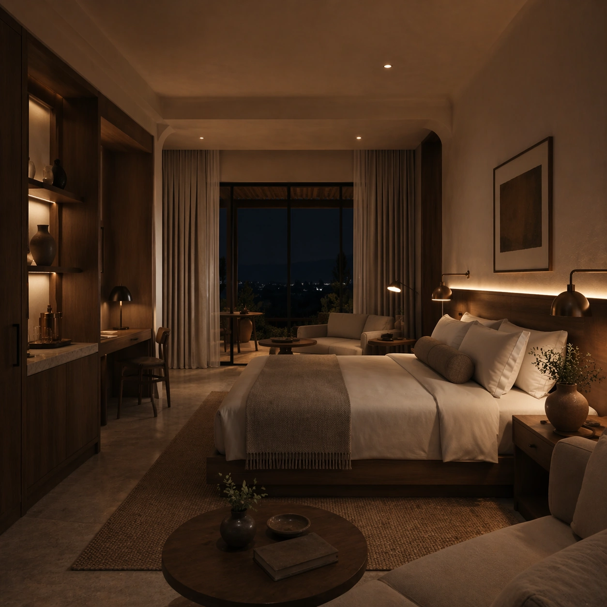

```text
Scene:
Create a square reference-dependent architecture still for Boutique Guestroom Editorial Suite. Use a night composition from near the lounge chair back toward the bed while keeping the same lens discipline, editorial polish, and material believability established by the reference image. The lighting can shift to support the intended mood, but the space must still feel like the same authored project with a stable viewpoint logic, convincing depth separation, and clean commercial-photography finish. Keep warm plaster white, walnut brown, muted clay, brushed bronze, and soft morning gray as the governing tonal range even when the emphasis changes.

Subject:
Show a boutique hotel suite with limewashed plaster walls, walnut millwork, tailored linen bedding, bronze reading lights, textured drapery, and a quietly lived-in premium mood. Focus on the exact same suite from the reference image, now emphasizing lamp glow, turndown styling, and layered shadows. Preserve exact architectural identity, plan logic, material palette, fixture family, and circulation cues from the reference image while changing only the intended emphasis described here. The viewer should immediately recognize the same project, not a loose cousin, with matching silhouette logic, aligned detailing, and consistent brand atmosphere.

Important details:
Preserve the bed proportions, walnut joinery, plaster texture, bronze hardware, linen styling, and restrained resort palette. Any abstract wayfinding, menu, wall-label, or packaging zones must stay unreadable and subordinate to the spatial image. Joinery, edges, reflections, and lighting should remain realistic enough for an operator or design team to treat the image as a credible reference. The variation should feel deliberate and commercially useful, proving that one locked spatial language can flex across multiple campaign or editorial surfaces.

Use case:
Boutique Guestroom Editorial Suite series study 4/9, extending the evening stay mood without altering room geometry.

Constraints:
No readable text, no watermark, no logos, preserve exact 1:1 aspect ratio, preserve exact architectural identity from the reference image, no people, no messy luggage spill, no cheap decor, no hard flash, no exaggerated luxury clichés, no visible staff setup.
```

[Pinned source](https://github.com/ChaosRealmsAI/gpt-image-2-gallery/blob/5296db8c996e38776c83a0bc8c64f848dcd512b3/works/topics/boutique-guestroom-editorial-suite/packages/series-spatial-language-lock/images/04-turndown-night-scene/meta.json) · GPT Image2 · 1254×1254 · Reference images required. · ProjectD:[published and publicly accepted](https://aitoolsradar.com/en/prompts/0d2ca17dcd3587)

## Wardrobe and Packing Bench · boutique-guestroom-editorial-suite/single-support-studies/02-wardrobe-packing-bench

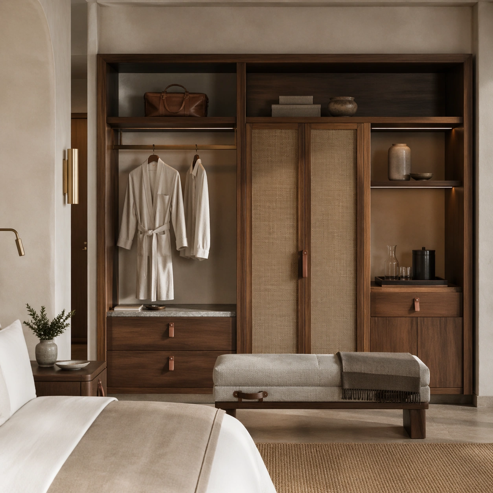

```text
Scene:
Create a square standalone support study for Boutique Guestroom Editorial Suite. Use a front-on view of the open wardrobe wall and upholstered packing bench and frame it like a premium commercial still or design-editorial crop with clear focal hierarchy, disciplined perspective, and enough breathing room for the materials and objects to read at both thumbnail and full size. Keep warm plaster white, walnut brown, muted clay, brushed bronze, and soft morning gray as the tonal guide so the image still belongs to the same theme family, and light the scene in a controlled way that emphasizes texture, edge quality, and authored atmosphere over spectacle.

Subject:
Show a boutique hotel suite with limewashed plaster walls, walnut millwork, tailored linen bedding, bronze reading lights, textured drapery, and a quietly lived-in premium mood. In this support study, focus on joinery rhythm, concealed storage, robe presentation, and leather pull details. The image should work independently, yet it must still feel like it belongs to the same broader world of Guestroom Suite. Make the space, props, and detailing useful for real campaign, editorial, or design-review contexts rather than moodboard abstraction.

Important details:
Carry forward the broader language of the bed proportions, walnut joinery, plaster texture, bronze hardware, linen styling, and restrained resort palette, but let this image prove a new support surface or secondary deliverable. Material realism is essential: wood grain, metal sheen, glass edges, textiles, and stone should feel physically plausible and carefully art directed. Any graphic panels, labels, menus, packaging, or captions must stay abstract and unreadable. The overall result should feel reusable for hospitality websites, travel editorials, booking campaigns, and room-style handoff decks, with enough structure that a creative or operations team could build on it.

Use case:
Boutique Guestroom Editorial Suite single study 6/9, exploring wardrobe editorial detail for hotel room systems.

Constraints:
No readable text, no watermark, no logos, preserve exact 1:1 aspect ratio, no people, no messy luggage spill, no cheap decor, no hard flash, no exaggerated luxury clichés, no open cluttered suitcases.
```

[Pinned source](https://github.com/ChaosRealmsAI/gpt-image-2-gallery/blob/5296db8c996e38776c83a0bc8c64f848dcd512b3/works/topics/boutique-guestroom-editorial-suite/packages/single-support-studies/images/02-wardrobe-packing-bench/meta.json) · GPT Image2 · 1254×1254 · No source-declared image dependencies. · ProjectD:[published and publicly accepted](https://aitoolsradar.com/en/prompts/6f875b9f079ccb)

## Terrace Breakfast Corner · boutique-guestroom-editorial-suite/single-support-studies/03-terrace-breakfast-corner


```text
Scene:
Create a square standalone support study for Boutique Guestroom Editorial Suite. Use a calm terrace corner with stone table and soft exterior light and frame it like a premium commercial still or design-editorial crop with clear focal hierarchy, disciplined perspective, and enough breathing room for the materials and objects to read at both thumbnail and full size. Keep warm plaster white, walnut brown, muted clay, brushed bronze, and soft morning gray as the tonal guide so the image still belongs to the same theme family, and light the scene in a controlled way that emphasizes texture, edge quality, and authored atmosphere over spectacle.

Subject:
Show a boutique hotel suite with limewashed plaster walls, walnut millwork, tailored linen bedding, bronze reading lights, textured drapery, and a quietly lived-in premium mood. In this support study, focus on folded textiles, small breakfast setup, and indoor-outdoor continuity. The image should work independently, yet it must still feel like it belongs to the same broader world of Guestroom Suite. Make the space, props, and detailing useful for real campaign, editorial, or design-review contexts rather than moodboard abstraction.

Important details:
Carry forward the broader language of the bed proportions, walnut joinery, plaster texture, bronze hardware, linen styling, and restrained resort palette, but let this image prove a new support surface or secondary deliverable. Material realism is essential: wood grain, metal sheen, glass edges, textiles, and stone should feel physically plausible and carefully art directed. Any graphic panels, labels, menus, packaging, or captions must stay abstract and unreadable. The overall result should feel reusable for hospitality websites, travel editorials, booking campaigns, and room-style handoff decks, with enough structure that a creative or operations team could build on it.

Use case:
Boutique Guestroom Editorial Suite single study 7/9, exploring suite terrace imagery for booking and editorial use.

Constraints:
No readable text, no watermark, no logos, preserve exact 1:1 aspect ratio, no people, no messy luggage spill, no cheap decor, no hard flash, no exaggerated luxury clichés, no readable menu card.
```

[Pinned source](https://github.com/ChaosRealmsAI/gpt-image-2-gallery/blob/5296db8c996e38776c83a0bc8c64f848dcd512b3/works/topics/boutique-guestroom-editorial-suite/packages/single-support-studies/images/03-terrace-breakfast-corner/meta.json) · GPT Image2 · 1254×1254 · No source-declared image dependencies. · ProjectD:[published and publicly accepted](https://aitoolsradar.com/en/prompts/1d8962974c3ef9)

## Reading Chair Vignette · boutique-guestroom-editorial-suite/single-support-studies/04-reading-chair-vignette

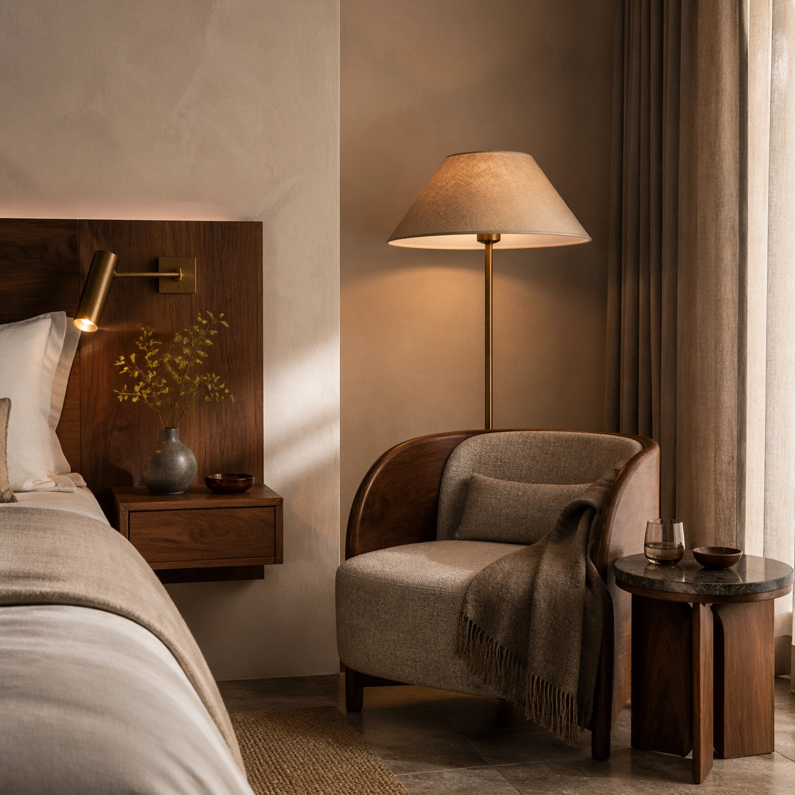

```text
Scene:
Create a square standalone support study for Boutique Guestroom Editorial Suite. Use an intimate corner study of a chair, lamp, side table, and curtain edge and frame it like a premium commercial still or design-editorial crop with clear focal hierarchy, disciplined perspective, and enough breathing room for the materials and objects to read at both thumbnail and full size. Keep warm plaster white, walnut brown, muted clay, brushed bronze, and soft morning gray as the tonal guide so the image still belongs to the same theme family, and light the scene in a controlled way that emphasizes texture, edge quality, and authored atmosphere over spectacle.

Subject:
Show a boutique hotel suite with limewashed plaster walls, walnut millwork, tailored linen bedding, bronze reading lights, textured drapery, and a quietly lived-in premium mood. In this support study, focus on textile tactility, lamp warmth, and quiet nighttime comfort. The image should work independently, yet it must still feel like it belongs to the same broader world of Guestroom Suite. Make the space, props, and detailing useful for real campaign, editorial, or design-review contexts rather than moodboard abstraction.

Important details:
Carry forward the broader language of the bed proportions, walnut joinery, plaster texture, bronze hardware, linen styling, and restrained resort palette, but let this image prove a new support surface or secondary deliverable. Material realism is essential: wood grain, metal sheen, glass edges, textiles, and stone should feel physically plausible and carefully art directed. Any graphic panels, labels, menus, packaging, or captions must stay abstract and unreadable. The overall result should feel reusable for hospitality websites, travel editorials, booking campaigns, and room-style handoff decks, with enough structure that a creative or operations team could build on it.

Use case:
Boutique Guestroom Editorial Suite single study 8/9, exploring emotional editorial support for the guestroom theme.

Constraints:
No readable text, no watermark, no logos, preserve exact 1:1 aspect ratio, no people, no messy luggage spill, no cheap decor, no hard flash, no exaggerated luxury clichés, no book titles.
```

[Pinned source](https://github.com/ChaosRealmsAI/gpt-image-2-gallery/blob/5296db8c996e38776c83a0bc8c64f848dcd512b3/works/topics/boutique-guestroom-editorial-suite/packages/single-support-studies/images/04-reading-chair-vignette/meta.json) · GPT Image2 · 1254×1254 · No source-declared image dependencies. · ProjectD:[published and publicly accepted](https://aitoolsradar.com/en/prompts/0c266dc7839c8f)

## Amenity Still Life · boutique-guestroom-editorial-suite/single-support-studies/05-amenity-still-life

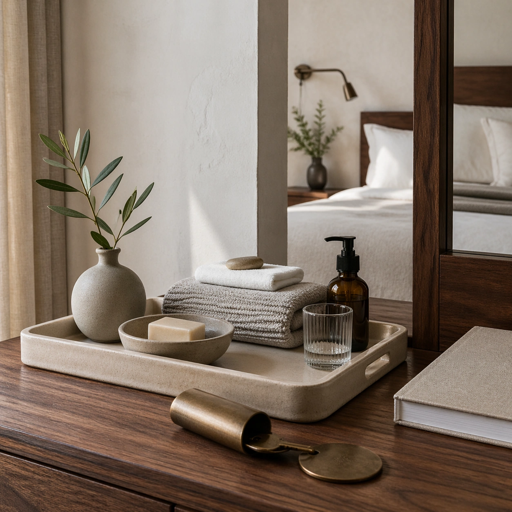

```text
Scene:
Create a square standalone support study for Boutique Guestroom Editorial Suite. Use a tabletop arrangement of folded linen, ceramic tray, brass key sleeve form, and bath objects and frame it like a premium commercial still or design-editorial crop with clear focal hierarchy, disciplined perspective, and enough breathing room for the materials and objects to read at both thumbnail and full size. Keep warm plaster white, walnut brown, muted clay, brushed bronze, and soft morning gray as the tonal guide so the image still belongs to the same theme family, and light the scene in a controlled way that emphasizes texture, edge quality, and authored atmosphere over spectacle.

Subject:
Show a boutique hotel suite with limewashed plaster walls, walnut millwork, tailored linen bedding, bronze reading lights, textured drapery, and a quietly lived-in premium mood. In this support study, focus on crafted hospitality details arranged like a premium room-service still life. The image should work independently, yet it must still feel like it belongs to the same broader world of Guestroom Suite. Make the space, props, and detailing useful for real campaign, editorial, or design-review contexts rather than moodboard abstraction.

Important details:
Carry forward the broader language of the bed proportions, walnut joinery, plaster texture, bronze hardware, linen styling, and restrained resort palette, but let this image prove a new support surface or secondary deliverable. Material realism is essential: wood grain, metal sheen, glass edges, textiles, and stone should feel physically plausible and carefully art directed. Any graphic panels, labels, menus, packaging, or captions must stay abstract and unreadable. The overall result should feel reusable for hospitality websites, travel editorials, booking campaigns, and room-style handoff decks, with enough structure that a creative or operations team could build on it.

Use case:
Boutique Guestroom Editorial Suite single study 9/9, exploring support imagery for amenity storytelling and room-brand communication.

Constraints:
No readable text, no watermark, no logos, preserve exact 1:1 aspect ratio, no people, no messy luggage spill, no cheap decor, no hard flash, no exaggerated luxury clichés, no readable packaging.
```

[Pinned source](https://github.com/ChaosRealmsAI/gpt-image-2-gallery/blob/5296db8c996e38776c83a0bc8c64f848dcd512b3/works/topics/boutique-guestroom-editorial-suite/packages/single-support-studies/images/05-amenity-still-life/meta.json) · GPT Image2 · 1254×1254 · No source-declared image dependencies. · ProjectD:[published and publicly accepted](https://aitoolsradar.com/en/prompts/554cc174b7ca90)

## Soda Stencil Billboard · brand-artist-collab-mockup/single-collab-proposal-studies/soda-stencil-billboard

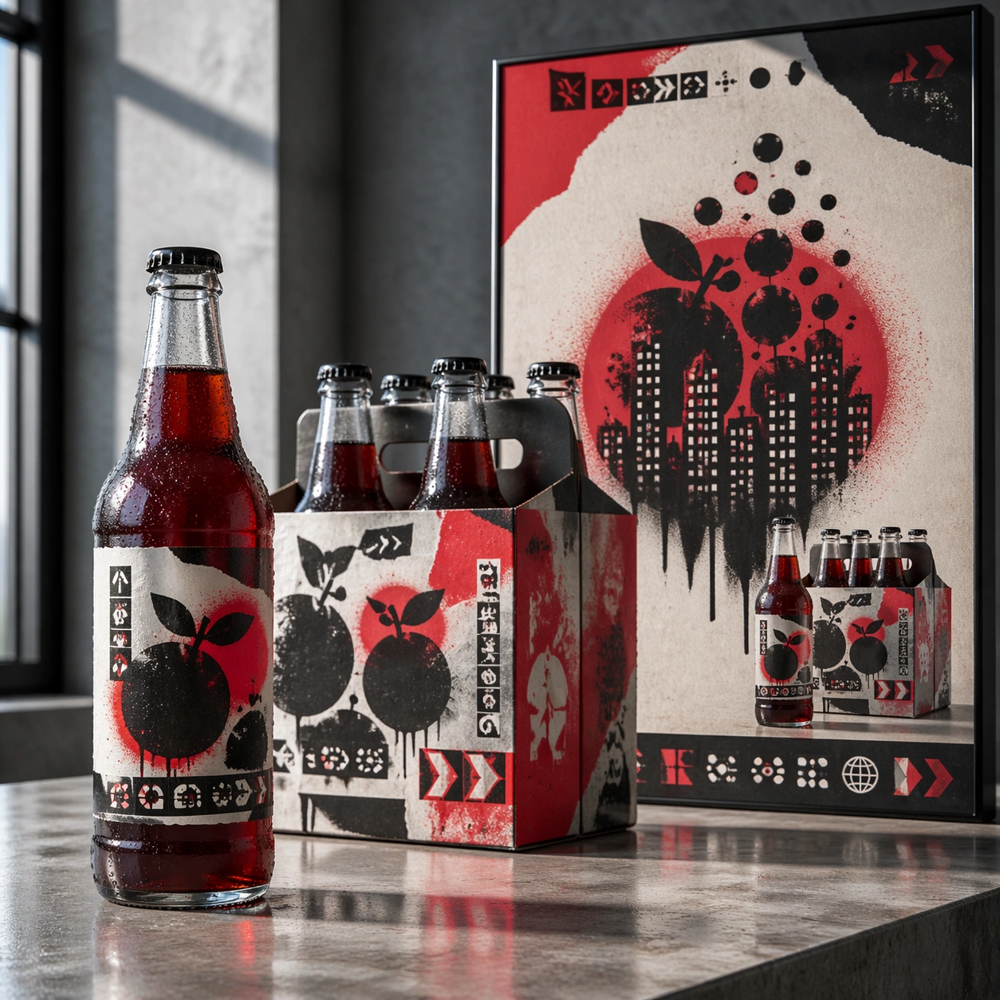

```text
Scene:
A square advertising mockup set on a polished concrete presentation table, lit like a late-afternoon creative agency review. The layout is a balanced commercial board with a glass beverage bottle in the foreground, a six-pack carton slightly behind it, and a vertical street-poster panel rising at the back. The color temperature is cool daylight with selective red highlights, sharp focus, and realistic reflections on glass and varnished cardboard.

Subject:
A fictional soda label collaboration with an anonymous street-stencil muralist language. The bottle is tall and transparent with deep crimson liquid, a torn-paper label shape, sprayed stencil fruit silhouettes, and small abstract warning-label glyph blocks. The carton uses repeated spray-mask shapes, overprinted arrows, and layered sticker textures. The poster shows a dramatic stencil composition of bubbles becoming city windows, with a bold but unreadable headline zone and a clear product packshot area.

Important details:
The art direction should fuse polished beverage marketing with controlled street-art roughness. Keep the same stencil motifs across bottle, carton, and poster so the collaboration reads instantly as one campaign. Make the glass thickness, bottle cap ridges, condensation beads, carton folds, matte spray paint, and pasted-paper edges physically convincing. Layout hierarchy must be clear: product first, packaging second, campaign poster third. Use abstract glyph rows only; no readable copy.

Use case:
Brand Artist Collab Mockup single study 2/8, focused on a beverage launch kit with street-stencil campaign language.

Constraints:
No readable text, no watermark, no logos, preserve exact 1:1 aspect ratio, no existing soda identity, no real street artist signature, no messy graffiti wall, no illegal poster clutter, no warped bottle label, no floating objects.
```

[Pinned source](https://github.com/ChaosRealmsAI/gpt-image-2-gallery/blob/5296db8c996e38776c83a0bc8c64f848dcd512b3/works/topics/brand-artist-collab-mockup/packages/single-collab-proposal-studies/images/soda-stencil-billboard/meta.json) · GPT Image2 · 1254×1254 · No source-declared image dependencies. · ProjectD:[published and publicly accepted](https://aitoolsradar.com/en/prompts/47e969d464886b)

## Phone Dot Gallery · brand-artist-collab-mockup/single-collab-proposal-studies/phone-dot-gallery

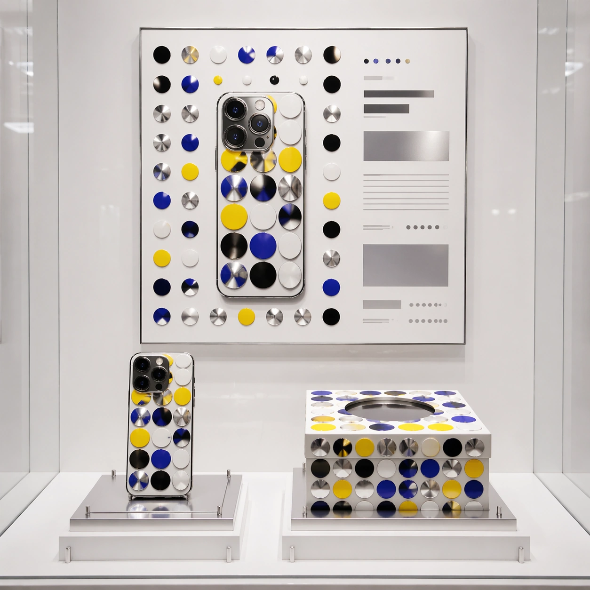

```text
Scene:
A square premium technology retail mockup displayed inside a minimal gallery case. The camera is frontal with a slight top-down angle, enough to show a smartphone, its rigid magnetic box, and a framed launch poster behind them. Lighting is bright white museum lighting with soft reflections, high key shadows, and immaculate spacing. The background is porcelain white with small chrome risers and clean grid alignment.

Subject:
A fictional smartphone capsule collaboration with an avant-garde dot-and-mirror installation artist language. The phone back uses glossy enamel dots in yellow, black, white, and electric blue, arranged around the camera island without hiding functional details. The box has a repeating dot field wrapping across the lid and sides, plus a circular die-cut insert. The poster is a disciplined product ad: phone silhouette centered in a field of dots, mirrored silver accents, and rectangular non-readable copy blocks placed like a luxury launch campaign.

Important details:
The mockup must prove layout control: product, packaging, and poster share the same dot system while each object remains distinct. Preserve realistic phone proportions, lens rings, glass reflections, box seams, printed ink registration, and gallery-case shadows. The dot pattern should feel intentionally composed, not random confetti. Avoid real operating system icons or interface screens; keep the screen dark and reflective. Typography must be implied by clean placeholder bars and tiny abstract glyph rows.

Use case:
Brand Artist Collab Mockup single study 3/8, focused on a technology product capsule with gallery-grade art direction.

Constraints:
No readable text, no watermark, no logos, preserve exact 1:1 aspect ratio, no real phone brand, no real artist signature, no app icons, no hands, no scattered accessories, no low-resolution poster edges.
```

[Pinned source](https://github.com/ChaosRealmsAI/gpt-image-2-gallery/blob/5296db8c996e38776c83a0bc8c64f848dcd512b3/works/topics/brand-artist-collab-mockup/packages/single-collab-proposal-studies/images/phone-dot-gallery/meta.json) · GPT Image2 · 1254×1254 · No source-declared image dependencies. · ProjectD:[published and publicly accepted](https://aitoolsradar.com/en/prompts/bf710e165fb286)

## Sneaker Animation Case · brand-artist-collab-mockup/single-collab-proposal-studies/sneaker-animation-case

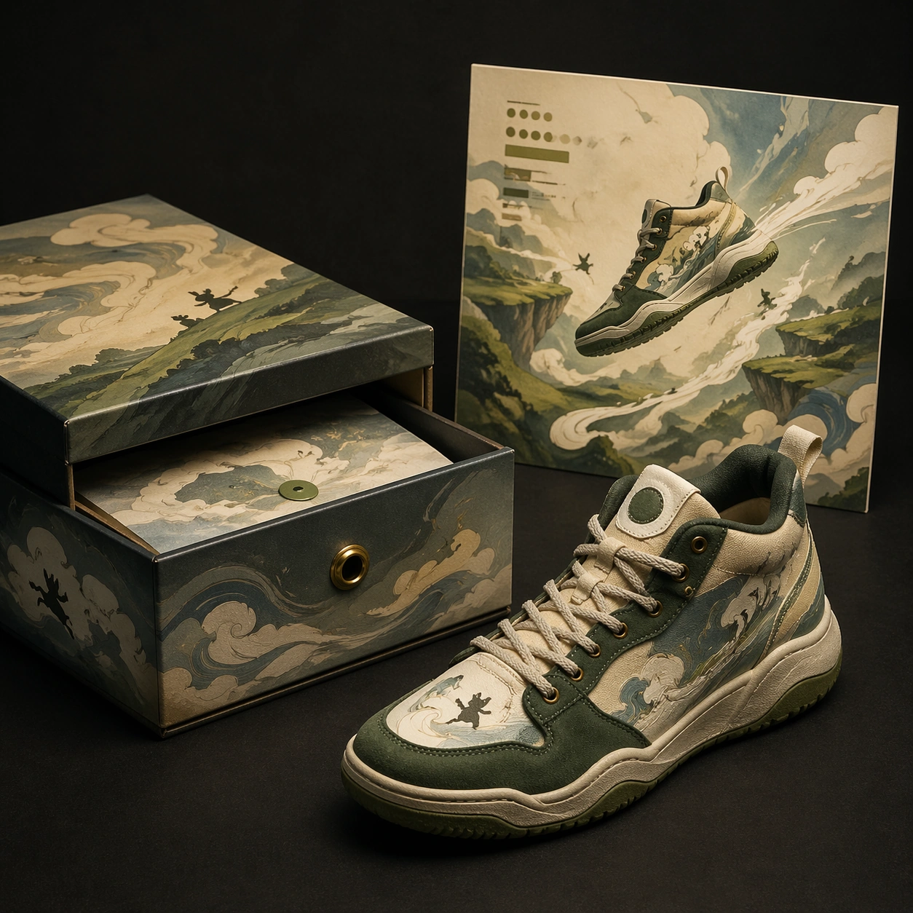

```text
Scene:
A square collector release mockup on a matte black table with warm cinematic overhead lighting. The frame is organized like a high-end footwear campaign board: one sneaker at a three-quarter angle, a rigid drawer box opened beside it, and a square poster card standing upright in the rear. The scene should feel like a studio photograph prepared for a licensing pitch, with controlled shadows and no environmental clutter.

Subject:
A fictional basketball sneaker collaboration with a hand-painted animation background language. The sneaker combines cream canvas, forest-green suede, weathered brass eyelets, and painted wind-swirl panels that feel like moving storybook air. The drawer box has illustrated cloud bands, tiny creature silhouettes, and layered paper texture. The poster card shows the sneaker crossing a floating landscape of hills and sky paths, with a quiet cinematic composition and abstract subtitle-like blocks that remain non-readable.

Important details:
Keep the artwork influence broad and original: soft gouache landscapes, rounded hand-painted forms, and gentle motion lines, not a copy of any known film. Product realism is critical: laces thread through eyelets correctly, sole tread wraps around the shoe, box lid thickness is visible, and the poster card casts a real shadow. The three objects must share one palette of cream, moss, sky blue, charcoal, and brass. Use clean commercial hierarchy without legible copy.

Use case:
Brand Artist Collab Mockup single study 4/8, focused on a cinematic animated-language sneaker release board.

Constraints:
No readable text, no watermark, no logos, preserve exact 1:1 aspect ratio, no existing team marks, no known animation characters, no real studio references, no extra shoes, no impossible lacing, no poster floating without support.
```

[Pinned source](https://github.com/ChaosRealmsAI/gpt-image-2-gallery/blob/5296db8c996e38776c83a0bc8c64f848dcd512b3/works/topics/brand-artist-collab-mockup/packages/single-collab-proposal-studies/images/sneaker-animation-case/meta.json) · GPT Image2 · 1254×1254 · No source-declared image dependencies. · ProjectD:[published and publicly accepted](https://aitoolsradar.com/en/prompts/e1e396587f7767)

## Perfume Calligraphy Counter · brand-artist-collab-mockup/single-collab-proposal-studies/perfume-calligraphy-counter

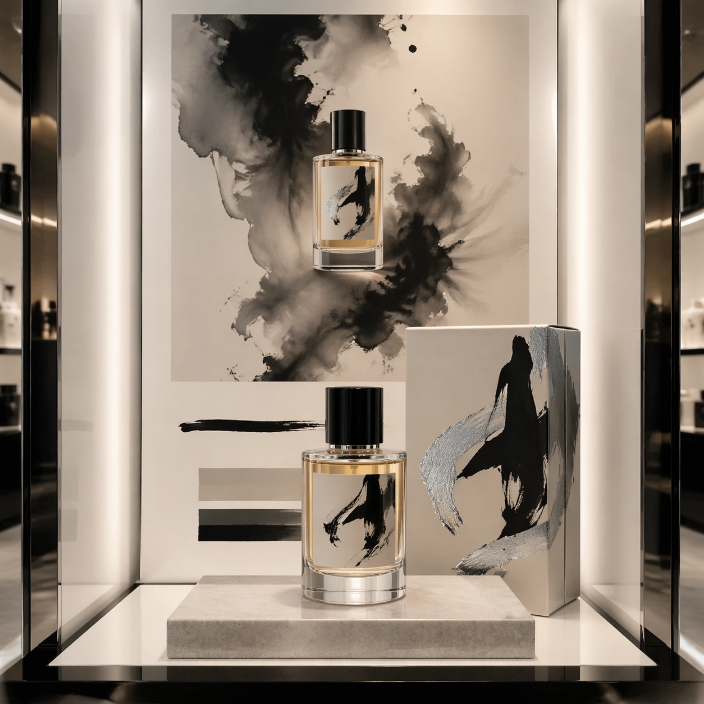

```text
Scene:
A square luxury fragrance counter mockup photographed in a quiet department-store light box. The setup is symmetrical but not rigid: a perfume bottle sits on a low stone plinth, its folding carton stands behind it, and a campaign poster panel forms the vertical backdrop. The lighting is soft pearl-white with deep ink-black accents, shallow shadows, and glossy reflections that make the glass and foil details feel premium.

Subject:
A fictional fragrance house collaboration with an experimental calligraphy painter language. The bottle is thick clear glass with pale amber liquid, a black lacquer cap, and a label made from sweeping abstract ink strokes rather than readable words. The carton uses embossed paper, brushed silver foil, and one large gestural calligraphy mark wrapping from front to side. The poster shows the bottle centered inside a storm of diluted ink wash, with disciplined blank space and non-readable caption blocks placed below the product.

Important details:
The image should balance luxury restraint with expressive art. Make the bottle geometry correct, glass base heavy, liquid meniscus visible, carton fold lines crisp, and foil catching light only on edges. The calligraphy must feel like original abstract marks, not copied characters or legible script. Maintain a clear hierarchy between object, package, and poster. The palette should stay controlled: ivory, ink black, pale amber, warm gray, and subtle silver.

Use case:
Brand Artist Collab Mockup single study 5/8, focused on a fragrance proposal where expressive mark-making becomes commercial packaging.

Constraints:
No readable text, no watermark, no logos, preserve exact 1:1 aspect ratio, no real fragrance brand, no real calligrapher signature, no readable Chinese or Latin characters, no messy ink splashes covering the bottle, no distorted glass.
```

[Pinned source](https://github.com/ChaosRealmsAI/gpt-image-2-gallery/blob/5296db8c996e38776c83a0bc8c64f848dcd512b3/works/topics/brand-artist-collab-mockup/packages/single-collab-proposal-studies/images/perfume-calligraphy-counter/meta.json) · GPT Image2 · 1254×1254 · No source-declared image dependencies. · ProjectD:[published and publicly accepted](https://aitoolsradar.com/en/prompts/6440a1aeeb2676)

## Coffee Riso Launch Kit · brand-artist-collab-mockup/single-collab-proposal-studies/coffee-riso-launch-kit

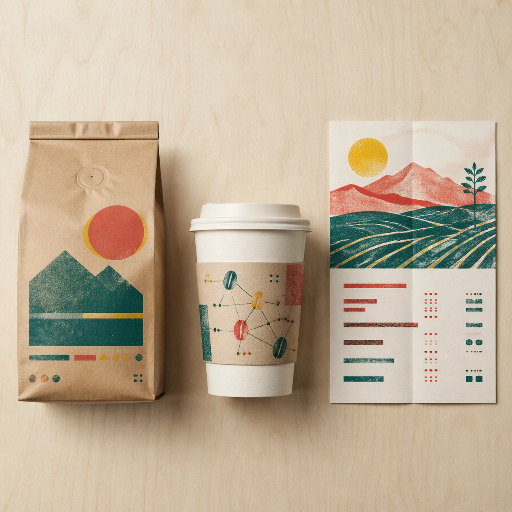

```text
Scene:
A square cafe retail launch mockup arranged on a pale birch tabletop, shot from a clean overhead-frontal hybrid angle. The layout feels like a design presentation spread: a standing coffee bag on the left, a takeaway cup and sleeve in the center, and a folded poster or menu card on the right. Lighting is clear morning daylight, with gentle paper shadows and visible print texture across every surface.

Subject:
A fictional specialty coffee brand collaboration with a risograph print artist language. The coffee bag is matte kraft paper with teal, tomato red, and soy-yellow overprint layers that are slightly misregistered on purpose. The cup sleeve carries abstract bean constellations and rough halftone blocks. The poster card shows a simplified mountain farm scene built from two-color riso shapes, overlaid with structured but non-readable menu bars and small glyph clusters. The products feel coordinated as a limited cafe drop.

Important details:
Make the commercial system believable: sealed bag gussets, valve circle, crimped top, cup rim thickness, sleeve seam, poster fold crease, and grainy ink absorption. Misregistration should be charming and controlled, never chaotic. The image must be legible as product plus packaging plus advertising, with clean negative space and a tight grid. Avoid readable labels while preserving the impression of professional package typography through abstract blocks.

Use case:
Brand Artist Collab Mockup single study 6/8, focused on an independent cafe launch kit with handmade print energy.

Constraints:
No readable text, no watermark, no logos, preserve exact 1:1 aspect ratio, no real cafe brand, no real artist signature, no spilled coffee, no food props, no unreadable clutter pretending to be copy, no distorted cup ellipse.
```

[Pinned source](https://github.com/ChaosRealmsAI/gpt-image-2-gallery/blob/5296db8c996e38776c83a0bc8c64f848dcd512b3/works/topics/brand-artist-collab-mockup/packages/single-collab-proposal-studies/images/coffee-riso-launch-kit/meta.json) · GPT Image2 · 1254×1254 · No source-declared image dependencies. · ProjectD:[published and publicly accepted](https://aitoolsradar.com/en/prompts/aab1de625689a1)

## Bike Ceramic Pop · brand-artist-collab-mockup/single-collab-proposal-studies/bike-ceramic-pop

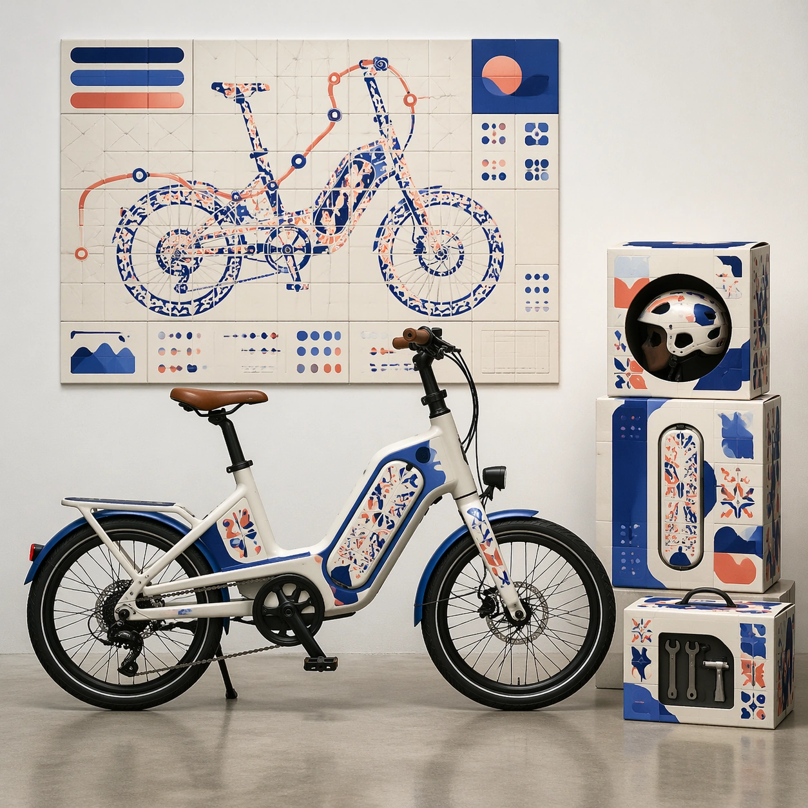

```text
Scene:
A square urban mobility showroom mockup with a compact electric bike displayed beside its shipping accessory kit and a wall-mounted campaign poster. The camera is straight-on at waist height, using a polished concrete floor, white wall, and crisp dealership lighting. The composition is structured as a product launch display: bike across the lower half, packaging modules stacked to one side, poster panel above and behind.

Subject:
A fictional electric bicycle collaboration with a ceramic-pop sculptor language. The bike frame is matte porcelain white with glossy cobalt and coral inlays, rounded modular battery casing, and hand-painted tile-like pattern panels. The accessory packaging consists of a helmet box, battery sleeve, and small toolkit carton with matching ceramic glaze motifs. The poster turns the bike silhouette into a tiled city route map, with abstract non-readable headline bars and small catalog glyphs arranged on a precise grid.

Important details:
The bicycle must be mechanically plausible: round wheels, aligned fork, visible chain or belt path, pedals, brakes, battery housing, and correct contact points on the floor. The ceramic-inspired art should look like glazed inlay and painted tile, not stickers slapped randomly on metal. Packaging must have believable flaps, seams, labels, and printed surface texture. Keep the layout clean enough for a mobility brand deck while showing a complete collaboration system.

Use case:
Brand Artist Collab Mockup single study 7/8, focused on a mobility product system with sculptural ceramic-pop surface design.

Constraints:
No readable text, no watermark, no logos, preserve exact 1:1 aspect ratio, no real bike brand, no real artist signature, no impossible wheel geometry, no floating bike, no showroom people, no overpacked accessory clutter.
```

[Pinned source](https://github.com/ChaosRealmsAI/gpt-image-2-gallery/blob/5296db8c996e38776c83a0bc8c64f848dcd512b3/works/topics/brand-artist-collab-mockup/packages/single-collab-proposal-studies/images/bike-ceramic-pop/meta.json) · GPT Image2 · 1254×1254 · No source-declared image dependencies. · ProjectD:[published and publicly accepted](https://aitoolsradar.com/en/prompts/e08a39086ca50c)

## Headphones Paper Cut Display · brand-artist-collab-mockup/single-collab-proposal-studies/headphones-paper-cut-display

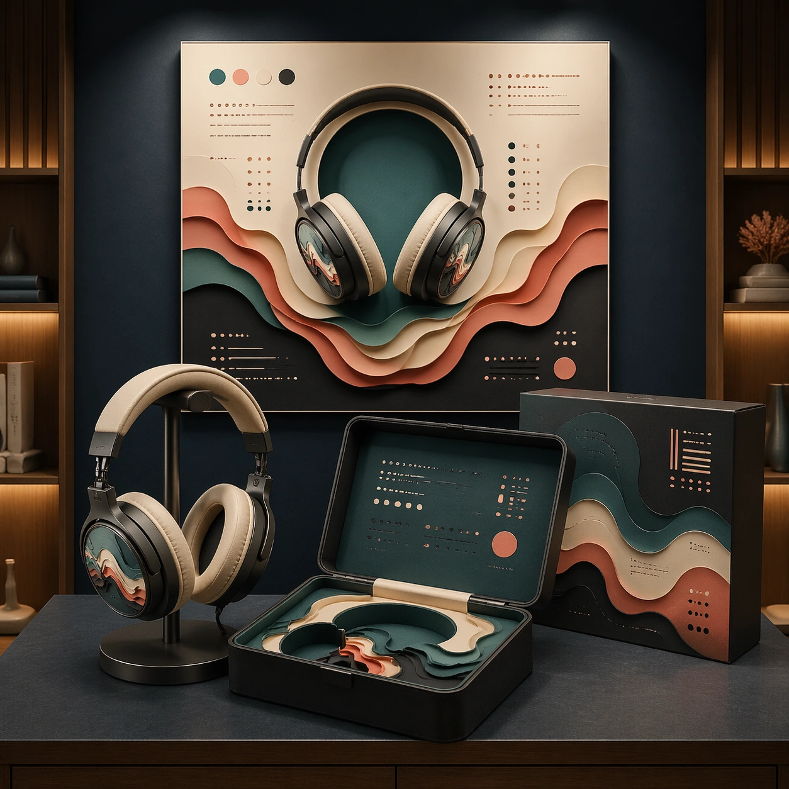

```text
Scene:
A square audio retail display mockup inside a softly lit listening-room alcove. The camera faces a centered tabletop display with over-ear headphones on a low stand, a premium rigid case opened in front, and a square campaign poster mounted on the back wall. The lighting is moody but clear, with warm side highlights, matte navy shadows, and enough brightness to inspect textures and layout.

Subject:
A fictional headphone brand collaboration with a layered paper-cut installation artist language. The headphones have brushed graphite cups, warm ivory cushions, and delicate layered paper relief patterns under translucent outer discs. The rigid case contains nested paper-cut inserts shaped like sound waves, while the sleeve uses stacked color planes in teal, coral, cream, and charcoal. The poster shows sound waves as architectural paper layers around the product silhouette, with non-readable launch-copy blocks arranged like a high-end audio ad.

Important details:
The design must read as a complete collaboration system, not separate props. Preserve accurate headphone anatomy: headband curve, hinges, ear cup thickness, cushion softness, cable-free wireless design, and stable stand contact. Paper layers should cast tiny shadows and reveal thickness, while the case should show premium molded construction. The commercial layout must be structured and calm, with the poster, case, and product sharing one visual language. Use placeholder glyph systems only.

Use case:
Brand Artist Collab Mockup single study 8/8, focused on an audio product display where tactile paper-cut art becomes premium packaging and advertising.

Constraints:
No readable text, no watermark, no logos, preserve exact 1:1 aspect ratio, no real audio brand, no real artist signature, no tangled wires, no floating headphones, no excessive darkness, no illegible poster clutter, no extra retail signage.
```

[Pinned source](https://github.com/ChaosRealmsAI/gpt-image-2-gallery/blob/5296db8c996e38776c83a0bc8c64f848dcd512b3/works/topics/brand-artist-collab-mockup/packages/single-collab-proposal-studies/images/headphones-paper-cut-display/meta.json) · GPT Image2 · 1254×1254 · No source-declared image dependencies. · ProjectD:[published and publicly accepted](https://aitoolsradar.com/en/prompts/d592394aa4de41)

## Reference Anchor · brand-carousel-post-system/series-core-system/01-reference-anchor

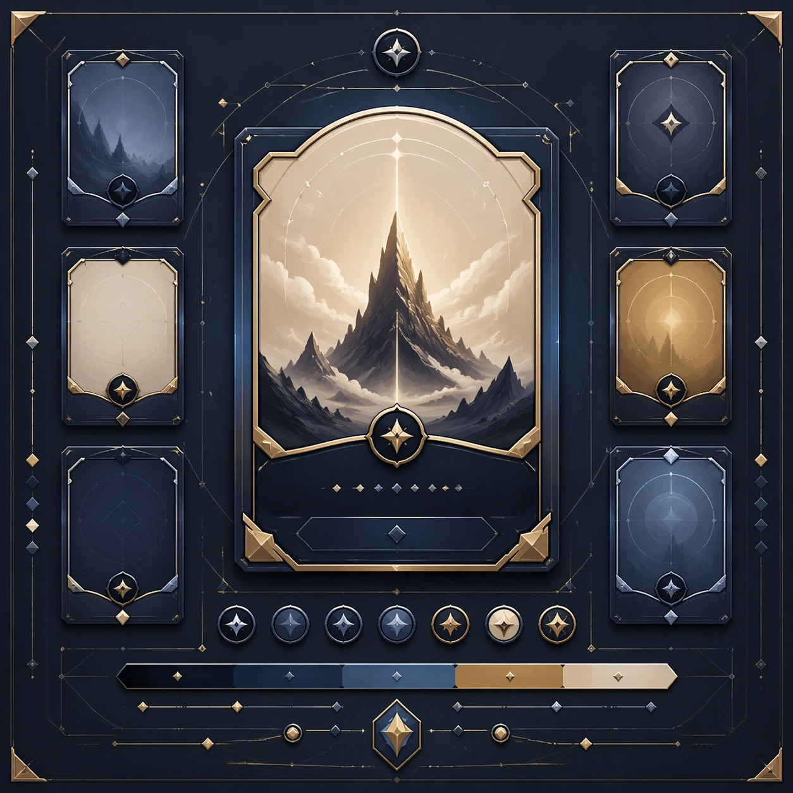

```text
Scene:
Create a square reference image for Brand Carousel Post System. Build a reference anchor establishing the core system with a premium, production-ready finish. Use a polished modular board or campaign surface with clean spacing, premium game-UI finish, and clear focal hierarchy. The composition should feel intentional, clean, and reusable for gallery, research, campaign, or internal handoff contexts. Lighting must support readability first, with the main forms clearly separated from the background and enough breathing room for the system to stay legible at both hero scale and thumbnail scale.

Subject:
Center a coherent original game-art system built for premium production and marketing surfaces. For this image, focus on reference anchor. Keep the same system logic stable across screenshots, cards, banners, and overview boards. This image is the canonical anchor that later series images must follow. The viewer should immediately understand what role this surface plays inside a cohesive game-production asset pack.

Important details:
Lock framing, icon grammar, palette blocking, and surface hierarchy so the kit feels production-ready and consistent. Preserve the core silhouette, framing language, and material logic from the reference image while each variation changes function. Keep materials believable, edge hierarchy disciplined, and the visual language consistent with Carousel System. Use abstract interface blocks or diagram accents when helpful, but avoid any readable language. The final result should feel like a deliberate production asset rather than a random illustration.

Use case:
Brand Carousel Post System series study 1/9, designed as reference anchor within a cohesive asset pack.

Constraints:
No readable text, no watermark, no logos, preserve exact 1:1 aspect ratio, no unrelated objects, no broken visual hierarchy, no malformed anatomy or broken perspective, no random decorative clutter.
```

[Pinned source](https://github.com/ChaosRealmsAI/gpt-image-2-gallery/blob/5296db8c996e38776c83a0bc8c64f848dcd512b3/works/topics/brand-carousel-post-system/packages/series-core-system/images/01-reference-anchor/meta.json) · GPT Image2 · 1254×1254 · No source-declared image dependencies. · ProjectD:[published and publicly accepted](https://aitoolsradar.com/en/prompts/7e168e0a70abaa)

## Variant One · brand-carousel-post-system/series-core-system/02-variant-one

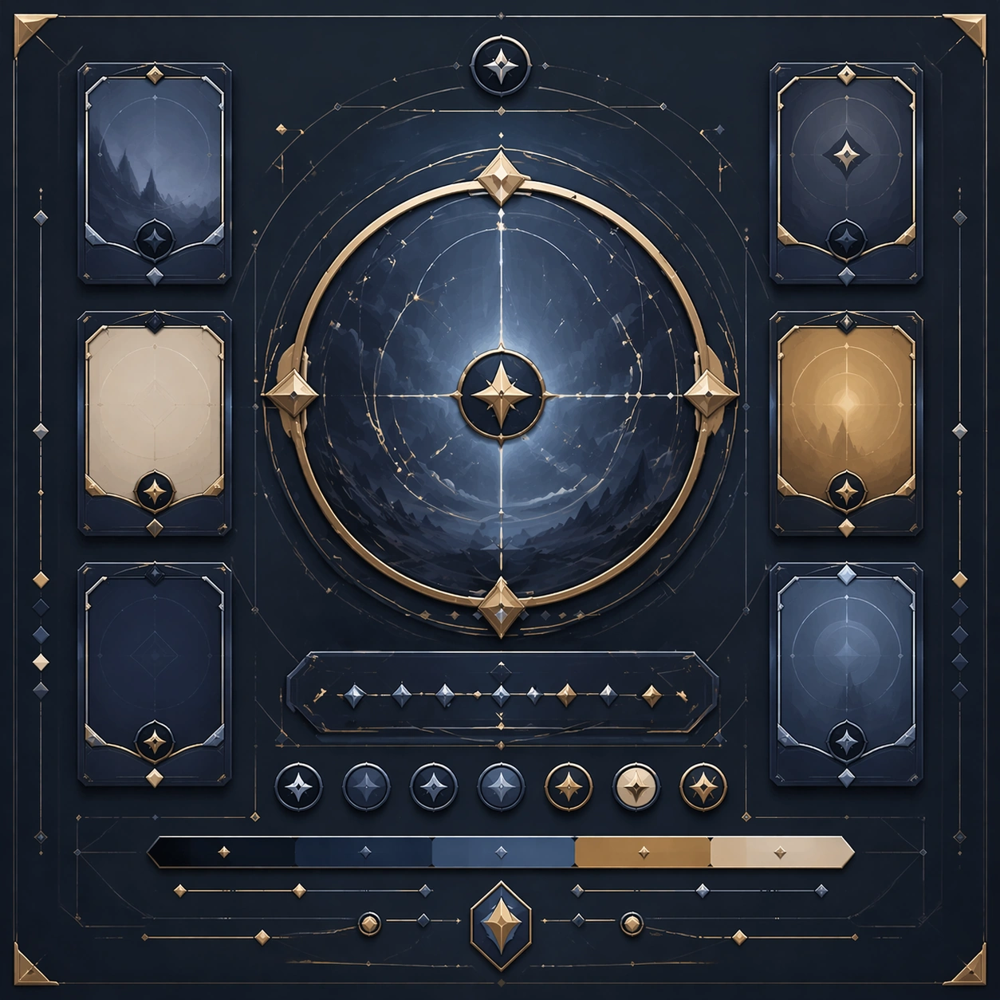

```text
Scene:
Create a square dependent image for Brand Carousel Post System. Build a first controlled variation in the same system with a premium, production-ready finish. Use a polished modular board or campaign surface with clean spacing, premium game-UI finish, and clear focal hierarchy. The composition should feel intentional, clean, and reusable for gallery, research, campaign, or internal handoff contexts. Lighting must support readability first, with the main forms clearly separated from the background and enough breathing room for the system to stay legible at both hero scale and thumbnail scale.

Subject:
Center a coherent original game-art system built for premium production and marketing surfaces. For this image, focus on the intended support surface. Keep the same system logic stable across screenshots, cards, banners, and overview boards. Preserve exact identity or system logic from the reference image while changing only the intended variation axis. The viewer should immediately understand what role this surface plays inside a cohesive game-production asset pack.

Important details:
Lock framing, icon grammar, palette blocking, and surface hierarchy so the kit feels production-ready and consistent. Preserve the core silhouette, framing language, and material logic from the reference image while each variation changes function. Keep materials believable, edge hierarchy disciplined, and the visual language consistent with Carousel System. Use abstract interface blocks or diagram accents when helpful, but avoid any readable language. The final result should feel like a deliberate production asset rather than a random illustration.

Use case:
Brand Carousel Post System series study 2/9, designed as variant one within a cohesive asset pack.

Constraints:
No readable text, no watermark, no logos, preserve exact 1:1 aspect ratio, no unrelated objects, no broken visual hierarchy, no malformed anatomy or broken perspective, no random decorative clutter.
```

[Pinned source](https://github.com/ChaosRealmsAI/gpt-image-2-gallery/blob/5296db8c996e38776c83a0bc8c64f848dcd512b3/works/topics/brand-carousel-post-system/packages/series-core-system/images/02-variant-one/meta.json) · GPT Image2 · 1254×1254 · Reference images required. · ProjectD:[published and publicly accepted](https://aitoolsradar.com/en/prompts/53777539615b93)

## Variant Two · brand-carousel-post-system/series-core-system/03-variant-two

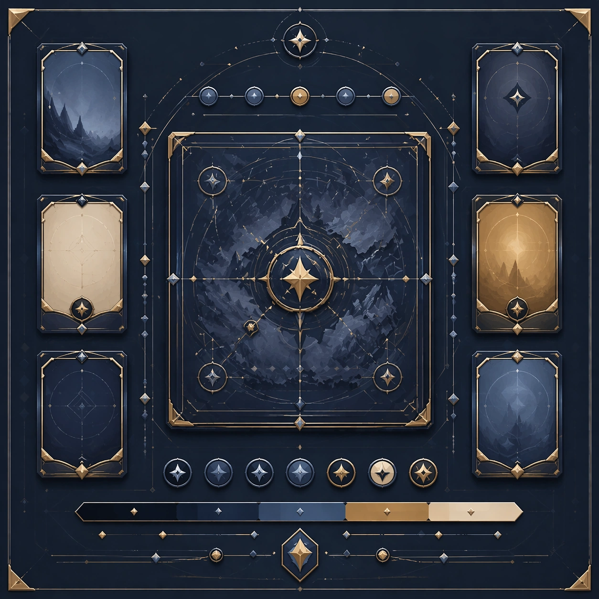

```text
Scene:
Create a square dependent image for Brand Carousel Post System. Build a second controlled variation in the same system with a premium, production-ready finish. Use a polished modular board or campaign surface with clean spacing, premium game-UI finish, and clear focal hierarchy. The composition should feel intentional, clean, and reusable for gallery, research, campaign, or internal handoff contexts. Lighting must support readability first, with the main forms clearly separated from the background and enough breathing room for the system to stay legible at both hero scale and thumbnail scale.

Subject:
Center a coherent original game-art system built for premium production and marketing surfaces. For this image, focus on the intended support surface. Keep the same system logic stable across screenshots, cards, banners, and overview boards. Preserve exact identity or system logic from the reference image while changing only the intended variation axis. The viewer should immediately understand what role this surface plays inside a cohesive game-production asset pack.

Important details:
Lock framing, icon grammar, palette blocking, and surface hierarchy so the kit feels production-ready and consistent. Preserve the core silhouette, framing language, and material logic from the reference image while each variation changes function. Keep materials believable, edge hierarchy disciplined, and the visual language consistent with Carousel System. Use abstract interface blocks or diagram accents when helpful, but avoid any readable language. The final result should feel like a deliberate production asset rather than a random illustration.

Use case:
Brand Carousel Post System series study 3/9, designed as variant two within a cohesive asset pack.

Constraints:
No readable text, no watermark, no logos, preserve exact 1:1 aspect ratio, no unrelated objects, no broken visual hierarchy, no malformed anatomy or broken perspective, no random decorative clutter.
```

[Pinned source](https://github.com/ChaosRealmsAI/gpt-image-2-gallery/blob/5296db8c996e38776c83a0bc8c64f848dcd512b3/works/topics/brand-carousel-post-system/packages/series-core-system/images/03-variant-two/meta.json) · GPT Image2 · 1254×1254 · Reference images required. · ProjectD:[published and publicly accepted](https://aitoolsradar.com/en/prompts/a894bedc13a63c)

## Variant Three · brand-carousel-post-system/series-core-system/04-variant-three

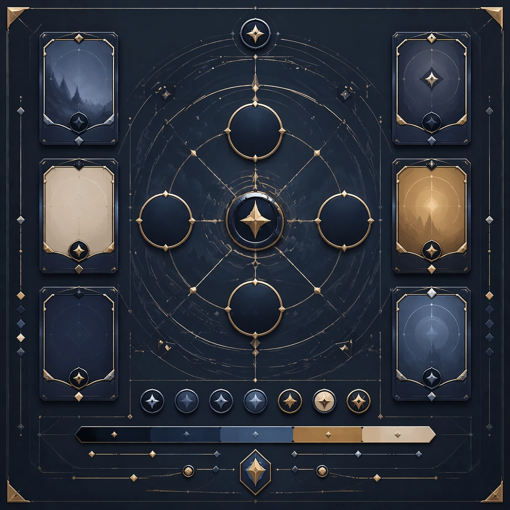

```text
Scene:
Create a square dependent image for Brand Carousel Post System. Build a third controlled variation in the same system with a premium, production-ready finish. Use a polished modular board or campaign surface with clean spacing, premium game-UI finish, and clear focal hierarchy. The composition should feel intentional, clean, and reusable for gallery, research, campaign, or internal handoff contexts. Lighting must support readability first, with the main forms clearly separated from the background and enough breathing room for the system to stay legible at both hero scale and thumbnail scale.

Subject:
Center a coherent original game-art system built for premium production and marketing surfaces. For this image, focus on the intended support surface. Keep the same system logic stable across screenshots, cards, banners, and overview boards. Preserve exact identity or system logic from the reference image while changing only the intended variation axis. The viewer should immediately understand what role this surface plays inside a cohesive game-production asset pack.

Important details:
Lock framing, icon grammar, palette blocking, and surface hierarchy so the kit feels production-ready and consistent. Preserve the core silhouette, framing language, and material logic from the reference image while each variation changes function. Keep materials believable, edge hierarchy disciplined, and the visual language consistent with Carousel System. Use abstract interface blocks or diagram accents when helpful, but avoid any readable language. The final result should feel like a deliberate production asset rather than a random illustration.

Use case:
Brand Carousel Post System series study 4/9, designed as variant three within a cohesive asset pack.

Constraints:
No readable text, no watermark, no logos, preserve exact 1:1 aspect ratio, no unrelated objects, no broken visual hierarchy, no malformed anatomy or broken perspective, no random decorative clutter.
```

[Pinned source](https://github.com/ChaosRealmsAI/gpt-image-2-gallery/blob/5296db8c996e38776c83a0bc8c64f848dcd512b3/works/topics/brand-carousel-post-system/packages/series-core-system/images/04-variant-three/meta.json) · GPT Image2 · 1254×1254 · Reference images required. · ProjectD:[published and publicly accepted](https://aitoolsradar.com/en/prompts/72d41ff55c0bde)

## Support One · brand-carousel-post-system/single-support-studies/support-one

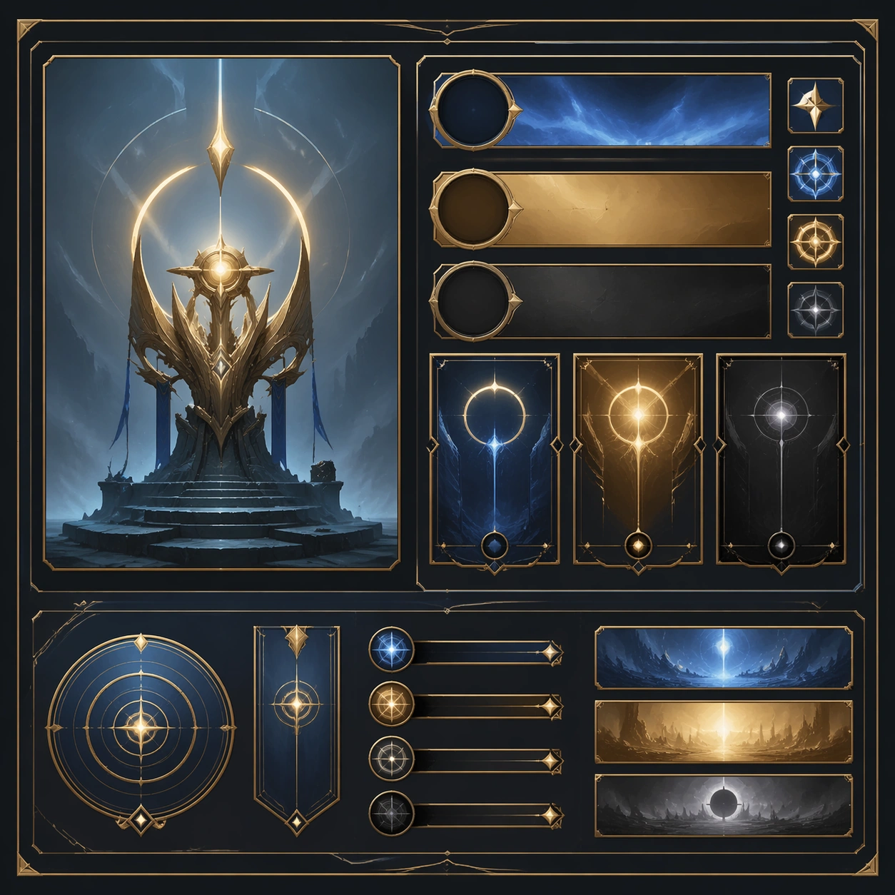

```text
Scene:
Create a square standalone support image for Brand Carousel Post System. Build a support-surface study with a clear focal hierarchy and a finished professional surface. Use a polished modular board or campaign surface with clean spacing, premium game-UI finish, and clear focal hierarchy. The frame should feel self-contained and polished, with enough structure to explain the system even without the reference series, yet still obviously belonging to the same theme and production world.

Subject:
Show a coherent original game-art system built for premium production and marketing surfaces in a way that emphasizes the intended support surface. Keep the same system logic stable across screenshots, cards, banners, and overview boards. Even though this image is independent, the viewer should still recognize the same universe, same commercial logic, and same production intent as the core package.

Important details:
Lock framing, icon grammar, palette blocking, and surface hierarchy so the kit feels production-ready and consistent. Preserve the broader theme language through color, framing, material choices, and modular composition. Use clean panel rhythm, premium asset presentation, and believable detail density. The image should work equally well as a gallery study, research reference, and mock production deliverable.

Use case:
Brand Carousel Post System single study 5/9, exploring support one as a support surface.

Constraints:
No readable text, no watermark, no logos, preserve exact 1:1 aspect ratio, no unrelated objects, no broken visual hierarchy, no visual noise that obscures the main surface, no accidental brand resemblance.
```

[Pinned source](https://github.com/ChaosRealmsAI/gpt-image-2-gallery/blob/5296db8c996e38776c83a0bc8c64f848dcd512b3/works/topics/brand-carousel-post-system/packages/single-support-studies/images/support-one/meta.json) · GPT Image2 · 1254×1254 · No source-declared image dependencies. · ProjectD:[published and publicly accepted](https://aitoolsradar.com/en/prompts/3b788bb552f019)

## Support Two · brand-carousel-post-system/single-support-studies/support-two

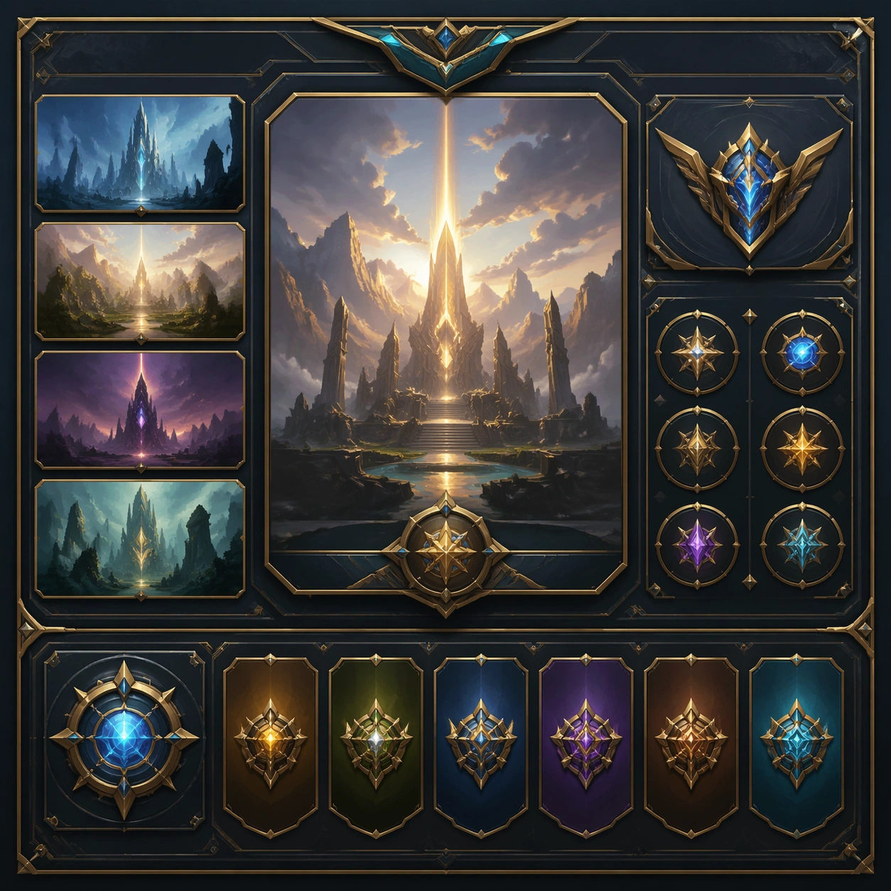

```text
Scene:
Create a square standalone support image for Brand Carousel Post System. Build a second support-surface study with a clear focal hierarchy and a finished professional surface. Use a polished modular board or campaign surface with clean spacing, premium game-UI finish, and clear focal hierarchy. The frame should feel self-contained and polished, with enough structure to explain the system even without the reference series, yet still obviously belonging to the same theme and production world.

Subject:
Show a coherent original game-art system built for premium production and marketing surfaces in a way that emphasizes the intended support surface. Keep the same system logic stable across screenshots, cards, banners, and overview boards. Even though this image is independent, the viewer should still recognize the same universe, same commercial logic, and same production intent as the core package.

Important details:
Lock framing, icon grammar, palette blocking, and surface hierarchy so the kit feels production-ready and consistent. Preserve the broader theme language through color, framing, material choices, and modular composition. Use clean panel rhythm, premium asset presentation, and believable detail density. The image should work equally well as a gallery study, research reference, and mock production deliverable.

Use case:
Brand Carousel Post System single study 6/9, exploring support two as a support surface.

Constraints:
No readable text, no watermark, no logos, preserve exact 1:1 aspect ratio, no unrelated objects, no broken visual hierarchy, no visual noise that obscures the main surface, no accidental brand resemblance.
```

[Pinned source](https://github.com/ChaosRealmsAI/gpt-image-2-gallery/blob/5296db8c996e38776c83a0bc8c64f848dcd512b3/works/topics/brand-carousel-post-system/packages/single-support-studies/images/support-two/meta.json) · GPT Image2 · 1254×1254 · No source-declared image dependencies. · ProjectD:[published and publicly accepted](https://aitoolsradar.com/en/prompts/58a55a535a4058)

## Support Three · brand-carousel-post-system/single-support-studies/support-three

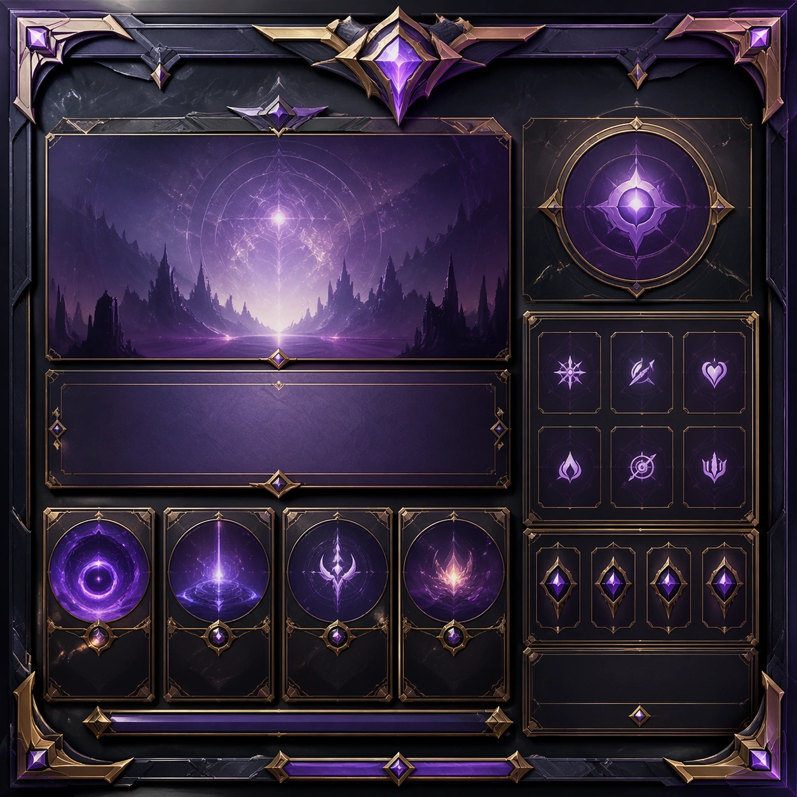

```text
Scene:
Create a square standalone support image for Brand Carousel Post System. Build a third support-surface study with a clear focal hierarchy and a finished professional surface. Use a polished modular board or campaign surface with clean spacing, premium game-UI finish, and clear focal hierarchy. The frame should feel self-contained and polished, with enough structure to explain the system even without the reference series, yet still obviously belonging to the same theme and production world.

Subject:
Show a coherent original game-art system built for premium production and marketing surfaces in a way that emphasizes the intended support surface. Keep the same system logic stable across screenshots, cards, banners, and overview boards. Even though this image is independent, the viewer should still recognize the same universe, same commercial logic, and same production intent as the core package.

Important details:
Lock framing, icon grammar, palette blocking, and surface hierarchy so the kit feels production-ready and consistent. Preserve the broader theme language through color, framing, material choices, and modular composition. Use clean panel rhythm, premium asset presentation, and believable detail density. The image should work equally well as a gallery study, research reference, and mock production deliverable.

Use case:
Brand Carousel Post System single study 7/9, exploring support three as a support surface.

Constraints:
No readable text, no watermark, no logos, preserve exact 1:1 aspect ratio, no unrelated objects, no broken visual hierarchy, no visual noise that obscures the main surface, no accidental brand resemblance.
```

[Pinned source](https://github.com/ChaosRealmsAI/gpt-image-2-gallery/blob/5296db8c996e38776c83a0bc8c64f848dcd512b3/works/topics/brand-carousel-post-system/packages/single-support-studies/images/support-three/meta.json) · GPT Image2 · 1254×1254 · No source-declared image dependencies. · ProjectD:[published and publicly accepted](https://aitoolsradar.com/en/prompts/5972d7f4821a04)

## Support Four · brand-carousel-post-system/single-support-studies/support-four

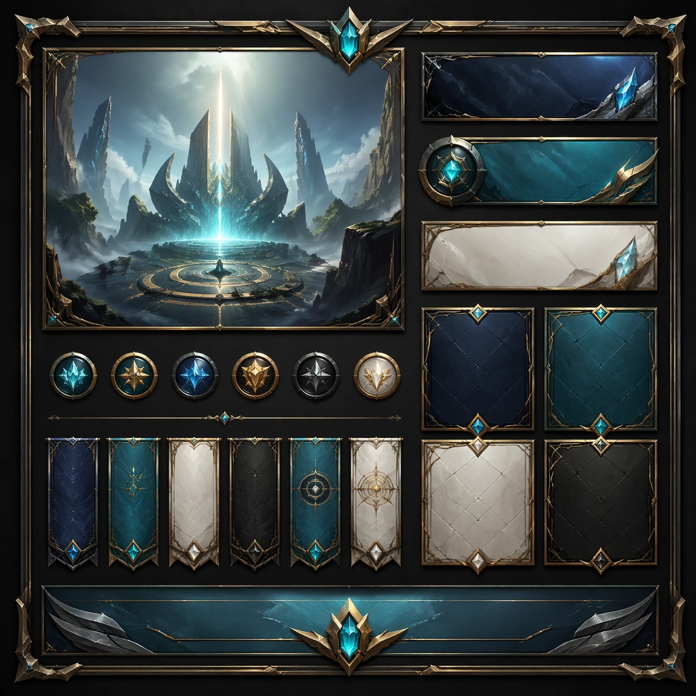

```text
Scene:
Create a square standalone support image for Brand Carousel Post System. Build a fourth support-surface study with a clear focal hierarchy and a finished professional surface. Use a polished modular board or campaign surface with clean spacing, premium game-UI finish, and clear focal hierarchy. The frame should feel self-contained and polished, with enough structure to explain the system even without the reference series, yet still obviously belonging to the same theme and production world.

Subject:
Show a coherent original game-art system built for premium production and marketing surfaces in a way that emphasizes the intended support surface. Keep the same system logic stable across screenshots, cards, banners, and overview boards. Even though this image is independent, the viewer should still recognize the same universe, same commercial logic, and same production intent as the core package.

Important details:
Lock framing, icon grammar, palette blocking, and surface hierarchy so the kit feels production-ready and consistent. Preserve the broader theme language through color, framing, material choices, and modular composition. Use clean panel rhythm, premium asset presentation, and believable detail density. The image should work equally well as a gallery study, research reference, and mock production deliverable.

Use case:
Brand Carousel Post System single study 8/9, exploring support four as a support surface.

Constraints:
No readable text, no watermark, no logos, preserve exact 1:1 aspect ratio, no unrelated objects, no broken visual hierarchy, no visual noise that obscures the main surface, no accidental brand resemblance.
```

[Pinned source](https://github.com/ChaosRealmsAI/gpt-image-2-gallery/blob/5296db8c996e38776c83a0bc8c64f848dcd512b3/works/topics/brand-carousel-post-system/packages/single-support-studies/images/support-four/meta.json) · GPT Image2 · 1254×1254 · No source-declared image dependencies. · ProjectD:[published and publicly accepted](https://aitoolsradar.com/en/prompts/09851bb34416ed)

## Support Five · brand-carousel-post-system/single-support-studies/support-five

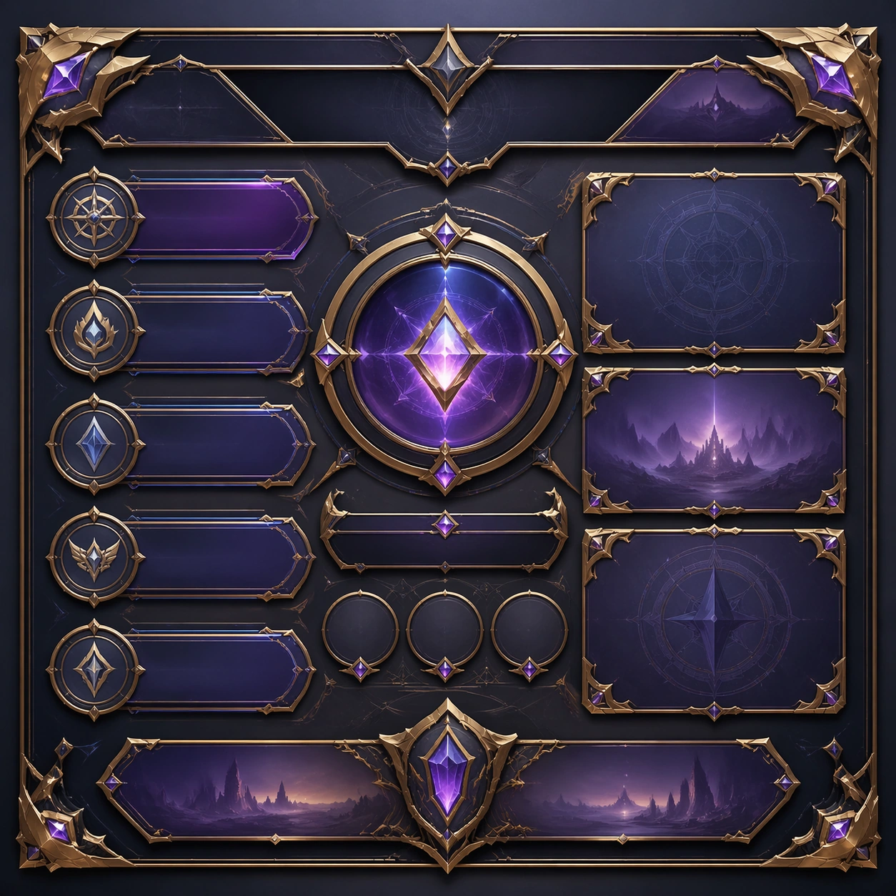

```text
Scene:
Create a square standalone support image for Brand Carousel Post System. Build a fifth support-surface study with a clear focal hierarchy and a finished professional surface. Use a polished modular board or campaign surface with clean spacing, premium game-UI finish, and clear focal hierarchy. The frame should feel self-contained and polished, with enough structure to explain the system even without the reference series, yet still obviously belonging to the same theme and production world.

Subject:
Show a coherent original game-art system built for premium production and marketing surfaces in a way that emphasizes the intended support surface. Keep the same system logic stable across screenshots, cards, banners, and overview boards. Even though this image is independent, the viewer should still recognize the same universe, same commercial logic, and same production intent as the core package.

Important details:
Lock framing, icon grammar, palette blocking, and surface hierarchy so the kit feels production-ready and consistent. Preserve the broader theme language through color, framing, material choices, and modular composition. Use clean panel rhythm, premium asset presentation, and believable detail density. The image should work equally well as a gallery study, research reference, and mock production deliverable.

Use case:
Brand Carousel Post System single study 9/9, exploring support five as a support surface.

Constraints:
No readable text, no watermark, no logos, preserve exact 1:1 aspect ratio, no unrelated objects, no broken visual hierarchy, no visual noise that obscures the main surface, no accidental brand resemblance.
```

[Pinned source](https://github.com/ChaosRealmsAI/gpt-image-2-gallery/blob/5296db8c996e38776c83a0bc8c64f848dcd512b3/works/topics/brand-carousel-post-system/packages/single-support-studies/images/support-five/meta.json) · GPT Image2 · 1254×1254 · No source-declared image dependencies. · ProjectD:[published and publicly accepted](https://aitoolsradar.com/en/prompts/af920c25d9dbdc)

## Variant Grid · brand-identity-mockup-set/single-brand-identity-mockup-set-studies/variant-grid

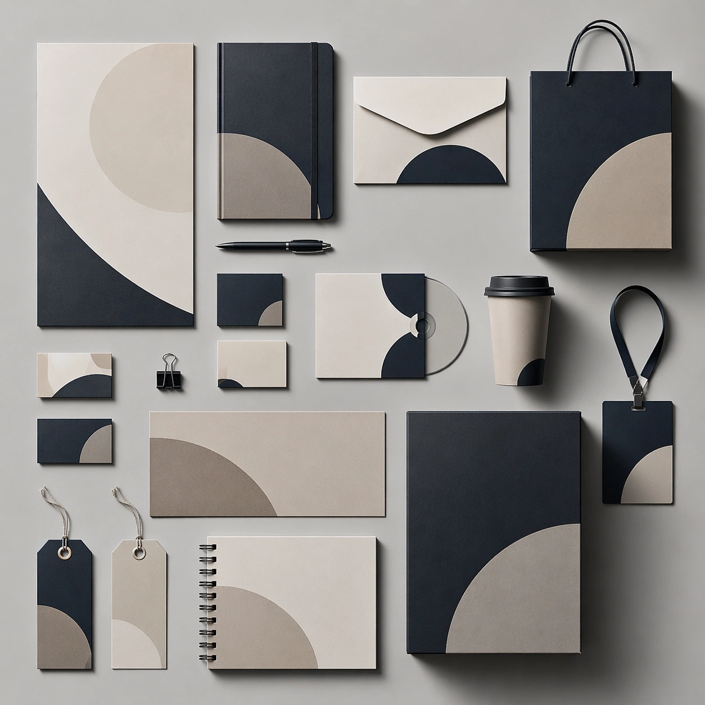

```text
Scene:
A square commercial presentation with realistic materials, clean staging, and believable product photography or retail lighting. Build the frame around a disciplined family of variants presented as one product language. Keep the lighting, camera distance, and spatial organization tuned for a high-signal research image rather than a casual snapshot. The image belongs to the Brand Identity Mockup Set theme and should feel immediately legible as a prompt atlas theme for brand identity mockup set, testing text-rendering, structured-layout, commercial-mockup with gpt image 2..

Subject:
Center the study on a disciplined family of variants presented as one product language. Translate the theme into a concrete visual statement instead of an abstract mood board: the viewer should understand what kind of image this is, what is being tested, and why the composition is difficult. Use the slug idea of brand identity mockup set as a literal guide for subject matter, materials, and staging. If helpful, borrow the broad visual cues suggested by logo, but keep the result original and specific to this study.

Important details:
The mockup should feel saleable and design-ready: sharp edges, controlled reflections, credible paper or plastic behavior, and precise placement. Preserve a disciplined square composition, clear focal hierarchy, and enough secondary information to make the image feel complete rather than underspecified. The image should look polished, novel, and exhibition-ready, with topic-specific credibility coming from the way surfaces, structure, and visual language reinforce Brand Identity Mockup Set. Avoid generic filler elements that do not serve the main concept.

Use case:
Brand Identity Mockup Set single study 2/8, testing text-rendering, structured-layout, commercial-mockup through the variant grid variation.

Constraints:
No readable text, no watermark, no logos, preserve exact 1:1 aspect ratio, no real brand names, no cheap stock-photo styling, no broken perspective, no watermark, no accidental readable packaging copy, no cluttered retail shelf unless intended.
```

[Pinned source](https://github.com/ChaosRealmsAI/gpt-image-2-gallery/blob/5296db8c996e38776c83a0bc8c64f848dcd512b3/works/topics/brand-identity-mockup-set/packages/single-brand-identity-mockup-set-studies/images/variant-grid/meta.json) · GPT Image2 · 1254×1254 · No source-declared image dependencies. · ProjectD:[published and publicly accepted](https://aitoolsradar.com/en/prompts/1ec5beb7f56c1d)

## Desk Review · brand-identity-mockup-set/single-brand-identity-mockup-set-studies/desk-review

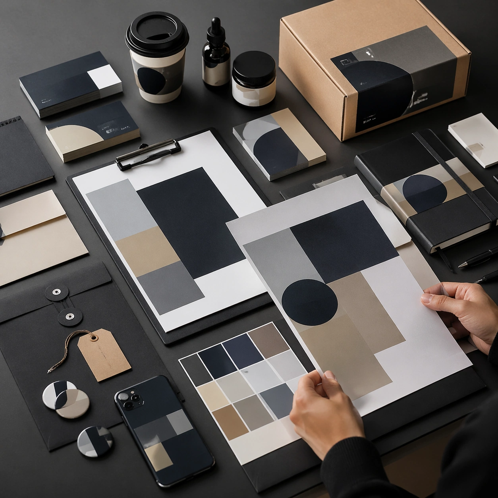

```text
Scene:
A square commercial presentation with realistic materials, clean staging, and believable product photography or retail lighting. Build the frame around the system reviewed on a designer’s table with believable supporting objects. Keep the lighting, camera distance, and spatial organization tuned for a high-signal research image rather than a casual snapshot. The image belongs to the Brand Identity Mockup Set theme and should feel immediately legible as a prompt atlas theme for brand identity mockup set, testing text-rendering, structured-layout, commercial-mockup with gpt image 2..

Subject:
Center the study on the system reviewed on a designer’s table with believable supporting objects. Translate the theme into a concrete visual statement instead of an abstract mood board: the viewer should understand what kind of image this is, what is being tested, and why the composition is difficult. Use the slug idea of brand identity mockup set as a literal guide for subject matter, materials, and staging. If helpful, borrow the broad visual cues suggested by logo, but keep the result original and specific to this study.

Important details:
The mockup should feel saleable and design-ready: sharp edges, controlled reflections, credible paper or plastic behavior, and precise placement. Preserve a disciplined square composition, clear focal hierarchy, and enough secondary information to make the image feel complete rather than underspecified. The image should look polished, novel, and exhibition-ready, with topic-specific credibility coming from the way surfaces, structure, and visual language reinforce Brand Identity Mockup Set. Avoid generic filler elements that do not serve the main concept.

Use case:
Brand Identity Mockup Set single study 3/8, testing text-rendering, structured-layout, commercial-mockup through the desk review variation.

Constraints:
No readable text, no watermark, no logos, preserve exact 1:1 aspect ratio, no real brand names, no cheap stock-photo styling, no broken perspective, no watermark, no accidental readable packaging copy, no cluttered retail shelf unless intended.
```

[Pinned source](https://github.com/ChaosRealmsAI/gpt-image-2-gallery/blob/5296db8c996e38776c83a0bc8c64f848dcd512b3/works/topics/brand-identity-mockup-set/packages/single-brand-identity-mockup-set-studies/images/desk-review/meta.json) · GPT Image2 · 1254×1254 · No source-declared image dependencies. · ProjectD:[published and publicly accepted](https://aitoolsradar.com/en/prompts/ab6faf6acff1e0)

## Material Closeup · brand-identity-mockup-set/single-brand-identity-mockup-set-studies/material-closeup

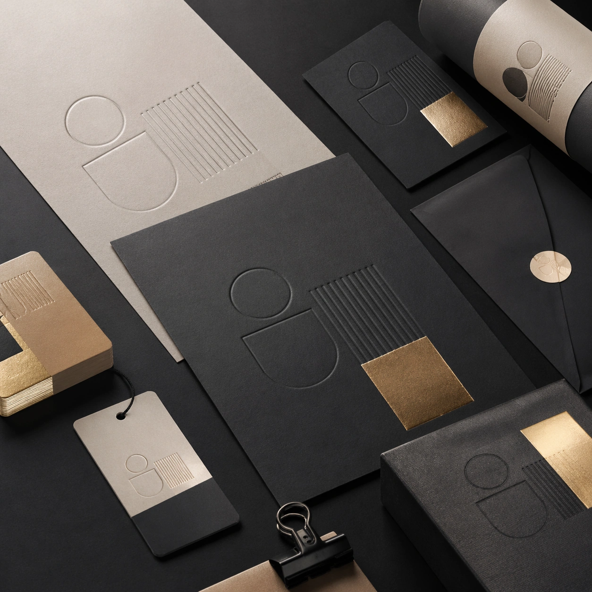

```text
Scene:
A square commercial presentation with realistic materials, clean staging, and believable product photography or retail lighting. Build the frame around tactile finish, emboss, print, foil, or substrate behavior. Keep the lighting, camera distance, and spatial organization tuned for a high-signal research image rather than a casual snapshot. The image belongs to the Brand Identity Mockup Set theme and should feel immediately legible as a prompt atlas theme for brand identity mockup set, testing text-rendering, structured-layout, commercial-mockup with gpt image 2..

Subject:
Center the study on tactile finish, emboss, print, foil, or substrate behavior. Translate the theme into a concrete visual statement instead of an abstract mood board: the viewer should understand what kind of image this is, what is being tested, and why the composition is difficult. Use the slug idea of brand identity mockup set as a literal guide for subject matter, materials, and staging. If helpful, borrow the broad visual cues suggested by logo, but keep the result original and specific to this study.

Important details:
The mockup should feel saleable and design-ready: sharp edges, controlled reflections, credible paper or plastic behavior, and precise placement. Preserve a disciplined square composition, clear focal hierarchy, and enough secondary information to make the image feel complete rather than underspecified. The image should look polished, novel, and exhibition-ready, with topic-specific credibility coming from the way surfaces, structure, and visual language reinforce Brand Identity Mockup Set. Avoid generic filler elements that do not serve the main concept.

Use case:
Brand Identity Mockup Set single study 4/8, testing text-rendering, structured-layout, commercial-mockup through the material closeup variation.

Constraints:
No readable text, no watermark, no logos, preserve exact 1:1 aspect ratio, no real brand names, no cheap stock-photo styling, no broken perspective, no watermark, no accidental readable packaging copy, no cluttered retail shelf unless intended.
```

[Pinned source](https://github.com/ChaosRealmsAI/gpt-image-2-gallery/blob/5296db8c996e38776c83a0bc8c64f848dcd512b3/works/topics/brand-identity-mockup-set/packages/single-brand-identity-mockup-set-studies/images/material-closeup/meta.json) · GPT Image2 · 1254×1254 · No source-declared image dependencies. · ProjectD:[published and publicly accepted](https://aitoolsradar.com/en/prompts/c82458c17580a3)

## Archive Proof · brand-identity-mockup-set/single-brand-identity-mockup-set-studies/archive-proof

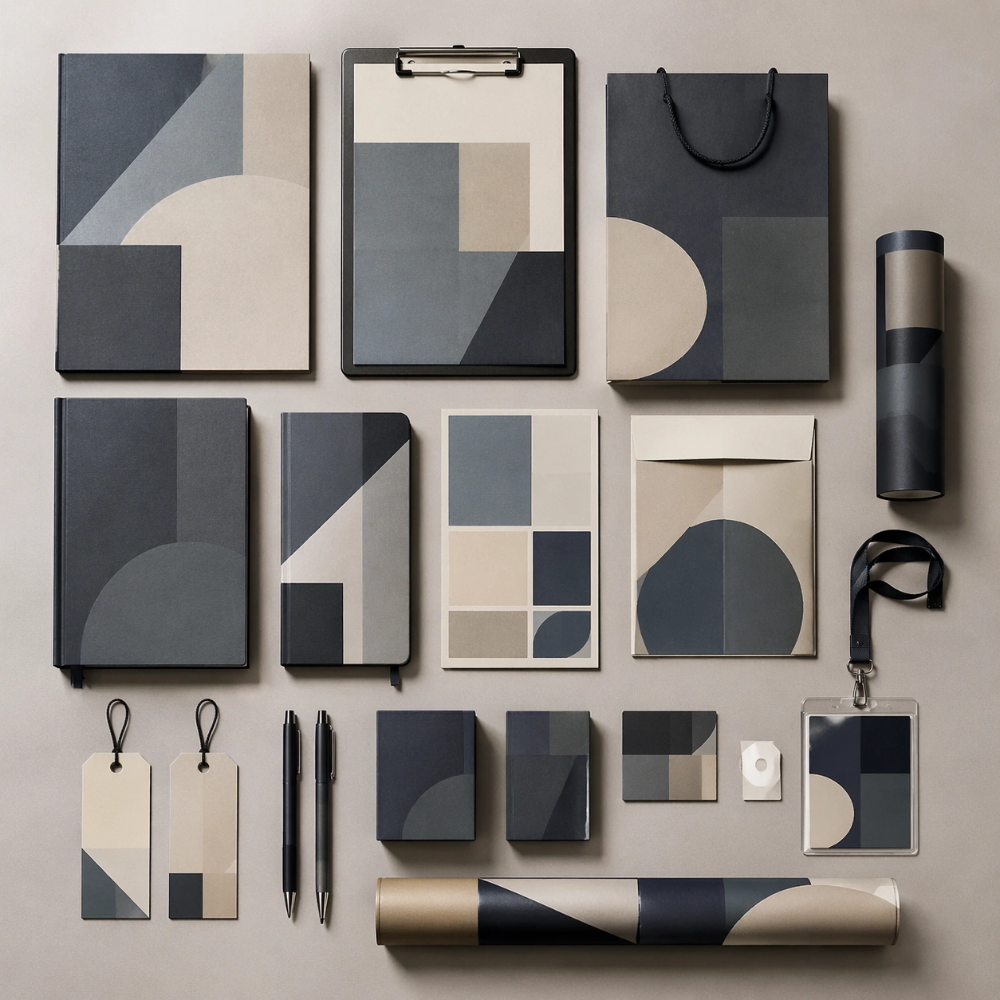

```text
Scene:
A square commercial presentation with realistic materials, clean staging, and believable product photography or retail lighting. Build the frame around proof-like presentation that emphasizes production precision. Keep the lighting, camera distance, and spatial organization tuned for a high-signal research image rather than a casual snapshot. The image belongs to the Brand Identity Mockup Set theme and should feel immediately legible as a prompt atlas theme for brand identity mockup set, testing text-rendering, structured-layout, commercial-mockup with gpt image 2..

Subject:
Center the study on proof-like presentation that emphasizes production precision. Translate the theme into a concrete visual statement instead of an abstract mood board: the viewer should understand what kind of image this is, what is being tested, and why the composition is difficult. Use the slug idea of brand identity mockup set as a literal guide for subject matter, materials, and staging. If helpful, borrow the broad visual cues suggested by logo, but keep the result original and specific to this study.

Important details:
The mockup should feel saleable and design-ready: sharp edges, controlled reflections, credible paper or plastic behavior, and precise placement. Preserve a disciplined square composition, clear focal hierarchy, and enough secondary information to make the image feel complete rather than underspecified. The image should look polished, novel, and exhibition-ready, with topic-specific credibility coming from the way surfaces, structure, and visual language reinforce Brand Identity Mockup Set. Avoid generic filler elements that do not serve the main concept.

Use case:
Brand Identity Mockup Set single study 5/8, testing text-rendering, structured-layout, commercial-mockup through the archive proof variation.

Constraints:
No readable text, no watermark, no logos, preserve exact 1:1 aspect ratio, no real brand names, no cheap stock-photo styling, no broken perspective, no watermark, no accidental readable packaging copy, no cluttered retail shelf unless intended.
```

[Pinned source](https://github.com/ChaosRealmsAI/gpt-image-2-gallery/blob/5296db8c996e38776c83a0bc8c64f848dcd512b3/works/topics/brand-identity-mockup-set/packages/single-brand-identity-mockup-set-studies/images/archive-proof/meta.json) · GPT Image2 · 1254×1254 · No source-declared image dependencies. · ProjectD:[published and publicly accepted](https://aitoolsradar.com/en/prompts/f9ae6cde79b201)

## Retail Shelf · brand-identity-mockup-set/single-brand-identity-mockup-set-studies/retail-shelf

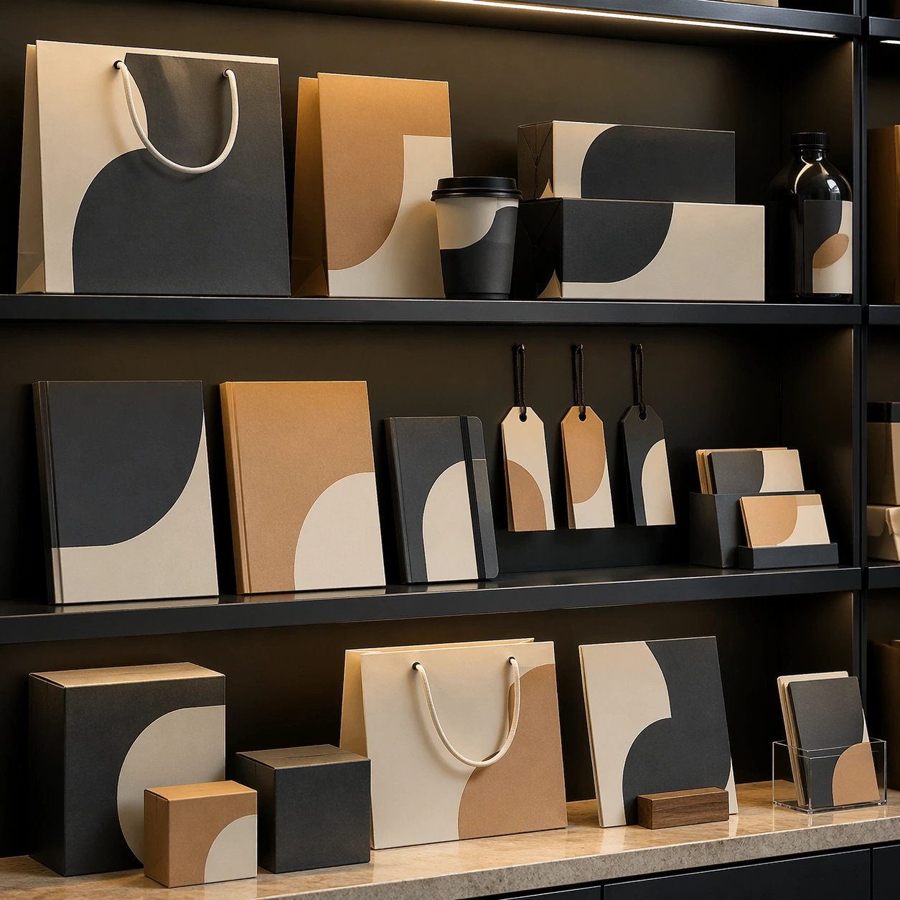

```text
Scene:
A square commercial presentation with realistic materials, clean staging, and believable product photography or retail lighting. Build the frame around a retail-context display that still keeps the product language primary. Keep the lighting, camera distance, and spatial organization tuned for a high-signal research image rather than a casual snapshot. The image belongs to the Brand Identity Mockup Set theme and should feel immediately legible as a prompt atlas theme for brand identity mockup set, testing text-rendering, structured-layout, commercial-mockup with gpt image 2..

Subject:
Center the study on a retail-context display that still keeps the product language primary. Translate the theme into a concrete visual statement instead of an abstract mood board: the viewer should understand what kind of image this is, what is being tested, and why the composition is difficult. Use the slug idea of brand identity mockup set as a literal guide for subject matter, materials, and staging. If helpful, borrow the broad visual cues suggested by logo, but keep the result original and specific to this study.

Important details:
The mockup should feel saleable and design-ready: sharp edges, controlled reflections, credible paper or plastic behavior, and precise placement. Preserve a disciplined square composition, clear focal hierarchy, and enough secondary information to make the image feel complete rather than underspecified. The image should look polished, novel, and exhibition-ready, with topic-specific credibility coming from the way surfaces, structure, and visual language reinforce Brand Identity Mockup Set. Avoid generic filler elements that do not serve the main concept.

Use case:
Brand Identity Mockup Set single study 6/8, testing text-rendering, structured-layout, commercial-mockup through the retail shelf variation.

Constraints:
No readable text, no watermark, no logos, preserve exact 1:1 aspect ratio, no real brand names, no cheap stock-photo styling, no broken perspective, no watermark, no accidental readable packaging copy, no cluttered retail shelf unless intended.
```

[Pinned source](https://github.com/ChaosRealmsAI/gpt-image-2-gallery/blob/5296db8c996e38776c83a0bc8c64f848dcd512b3/works/topics/brand-identity-mockup-set/packages/single-brand-identity-mockup-set-studies/images/retail-shelf/meta.json) · GPT Image2 · 1254×1254 · No source-declared image dependencies. · ProjectD:[published and publicly accepted](https://aitoolsradar.com/en/prompts/fc63ede793d2a8)

## System Board · brand-identity-mockup-set/single-brand-identity-mockup-set-studies/system-board

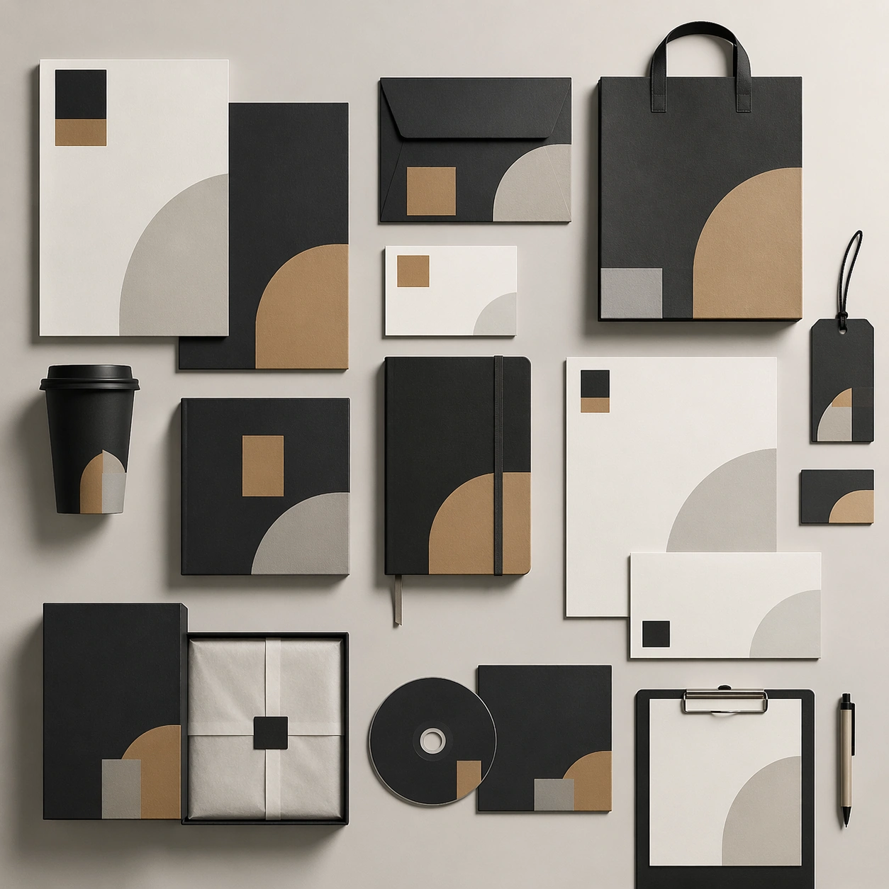

```text
Scene:
A square commercial presentation with realistic materials, clean staging, and believable product photography or retail lighting. Build the frame around multiple assets aligned into one coherent identity or packaging system. Keep the lighting, camera distance, and spatial organization tuned for a high-signal research image rather than a casual snapshot. The image belongs to the Brand Identity Mockup Set theme and should feel immediately legible as a prompt atlas theme for brand identity mockup set, testing text-rendering, structured-layout, commercial-mockup with gpt image 2..

Subject:
Center the study on multiple assets aligned into one coherent identity or packaging system. Translate the theme into a concrete visual statement instead of an abstract mood board: the viewer should understand what kind of image this is, what is being tested, and why the composition is difficult. Use the slug idea of brand identity mockup set as a literal guide for subject matter, materials, and staging. If helpful, borrow the broad visual cues suggested by logo, but keep the result original and specific to this study.

Important details:
The mockup should feel saleable and design-ready: sharp edges, controlled reflections, credible paper or plastic behavior, and precise placement. Preserve a disciplined square composition, clear focal hierarchy, and enough secondary information to make the image feel complete rather than underspecified. The image should look polished, novel, and exhibition-ready, with topic-specific credibility coming from the way surfaces, structure, and visual language reinforce Brand Identity Mockup Set. Avoid generic filler elements that do not serve the main concept.

Use case:
Brand Identity Mockup Set single study 7/8, testing text-rendering, structured-layout, commercial-mockup through the system board variation.

Constraints:
No readable text, no watermark, no logos, preserve exact 1:1 aspect ratio, no real brand names, no cheap stock-photo styling, no broken perspective, no watermark, no accidental readable packaging copy, no cluttered retail shelf unless intended.
```

[Pinned source](https://github.com/ChaosRealmsAI/gpt-image-2-gallery/blob/5296db8c996e38776c83a0bc8c64f848dcd512b3/works/topics/brand-identity-mockup-set/packages/single-brand-identity-mockup-set-studies/images/system-board/meta.json) · GPT Image2 · 1254×1254 · No source-declared image dependencies. · ProjectD:[published and publicly accepted](https://aitoolsradar.com/en/prompts/d18f7a0735a02a)

## Signature Mockup · brand-identity-mockup-set/single-brand-identity-mockup-set-studies/signature-mockup

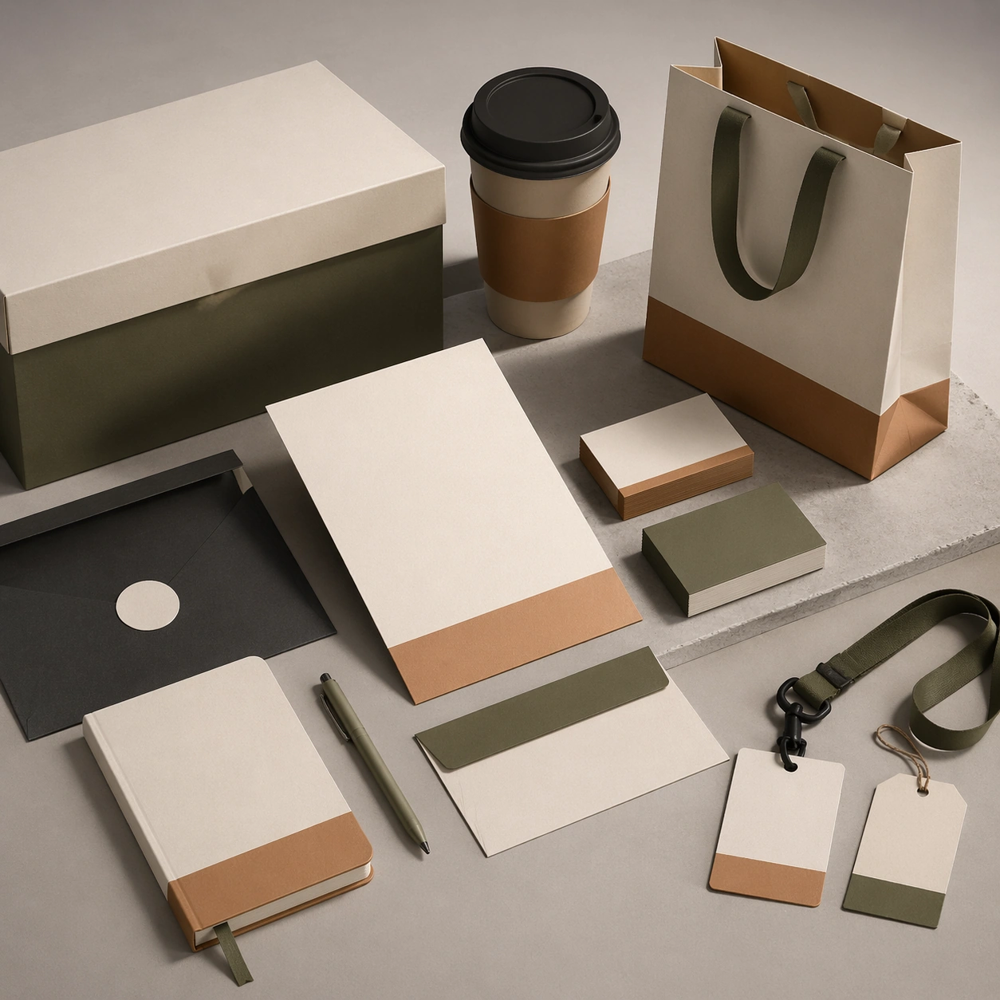

```text
Scene:
A square commercial presentation with realistic materials, clean staging, and believable product photography or retail lighting. Build the frame around the strongest single commercial frame for the topic. Keep the lighting, camera distance, and spatial organization tuned for a high-signal research image rather than a casual snapshot. The image belongs to the Brand Identity Mockup Set theme and should feel immediately legible as a prompt atlas theme for brand identity mockup set, testing text-rendering, structured-layout, commercial-mockup with gpt image 2..

Subject:
Center the study on the strongest single commercial frame for the topic. Translate the theme into a concrete visual statement instead of an abstract mood board: the viewer should understand what kind of image this is, what is being tested, and why the composition is difficult. Use the slug idea of brand identity mockup set as a literal guide for subject matter, materials, and staging. If helpful, borrow the broad visual cues suggested by logo, but keep the result original and specific to this study.

Important details:
The mockup should feel saleable and design-ready: sharp edges, controlled reflections, credible paper or plastic behavior, and precise placement. Preserve a disciplined square composition, clear focal hierarchy, and enough secondary information to make the image feel complete rather than underspecified. The image should look polished, novel, and exhibition-ready, with topic-specific credibility coming from the way surfaces, structure, and visual language reinforce Brand Identity Mockup Set. Avoid generic filler elements that do not serve the main concept.

Use case:
Brand Identity Mockup Set single study 8/8, testing text-rendering, structured-layout, commercial-mockup through the signature mockup variation.

Constraints:
No readable text, no watermark, no logos, preserve exact 1:1 aspect ratio, no real brand names, no cheap stock-photo styling, no broken perspective, no watermark, no accidental readable packaging copy, no cluttered retail shelf unless intended.
```

[Pinned source](https://github.com/ChaosRealmsAI/gpt-image-2-gallery/blob/5296db8c996e38776c83a0bc8c64f848dcd512b3/works/topics/brand-identity-mockup-set/packages/single-brand-identity-mockup-set-studies/images/signature-mockup/meta.json) · GPT Image2 · 1254×1254 · No source-declared image dependencies. · ProjectD:[published and publicly accepted](https://aitoolsradar.com/en/prompts/5afd23e64e2f57)

## Weekend Table Anchor · breakfast-brunch-tabletop-system/series-core-system/01-weekend-table-anchor

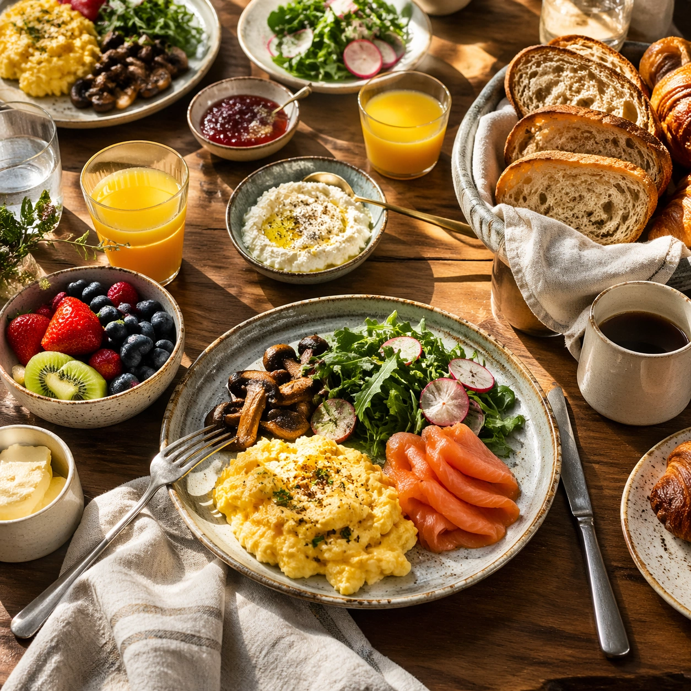

```text
Scene:
Compose a square brunch tabletop image with layered tableware, generous daylight, and a sense of weekend abundance that still feels organized enough for real hospitality and publishing use. The scene should balance multiple objects without losing the hero focal point, making table choreography and dish relationships a core part of the image. Use natural weekend daylight from the side, with a large table partially visible in square crop and soft shadows that keep the surface lively and dimensional.

Subject:
The food must look fresh, warm, and genuinely shareable: eggs, breads, fruit, spreads, juices, and plated brunch mains should feel cooked and plated for service, not arranged as fake prop food. Center one hero brunch plate surrounded by secondary glasses, bread, and fruit cues that suggest a shareable table without turning the frame into a buffet.

Important details:
Table logic matters. Plates, glasses, linens, and serving utensils need believable spacing, overlap, and hierarchy so the image can support menus, social assets, and campaign layouts. Make the abundance feel intentional rather than chaotic, with appetizing textures and natural daylight carrying the mood. This image establishes the reference system for the series, including camera height, tabletop discipline, prop family, and color control that later images must inherit. This image must establish the brunch system for the series: mixed ceramics, warm bread texture, polished cutlery restraint, and easy but intentional weekend hospitality.

Use case:
Brunch Tabletop series study 1/9, built for Prompt Atlas coverage of a food and beverage commercial visual system.

Constraints:
No readable text, no watermark, no logos, preserve exact 1:1 aspect ratio, no buffet chaos, no greasy diner styling unless specifically implied, no visible phone screens, no plastic takeaway packaging, no fake stock-family posing, no unreadable signage, no crowded people, no buffet hotel trays, no greasy fast-food look.
```

[Pinned source](https://github.com/ChaosRealmsAI/gpt-image-2-gallery/blob/5296db8c996e38776c83a0bc8c64f848dcd512b3/works/topics/breakfast-brunch-tabletop-system/packages/series-core-system/images/01-weekend-table-anchor/meta.json) · GPT Image2 · 1254×1254 · No source-declared image dependencies. · ProjectD:[published and publicly accepted](https://aitoolsradar.com/en/prompts/cc2ace5b7606f5)

## Juice Carafe Board · breakfast-brunch-tabletop-system/single-support-studies/juice-carafe-board

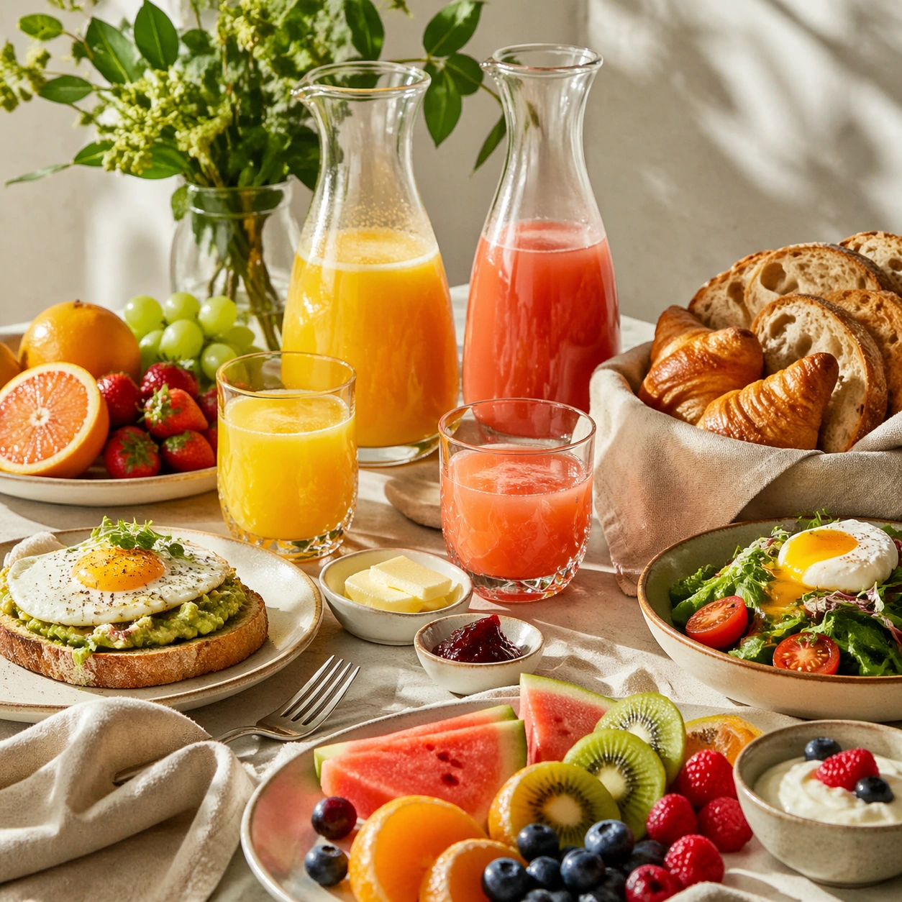

```text
Scene:
Compose a square brunch tabletop image with layered tableware, generous daylight, and a sense of weekend abundance that still feels organized enough for real hospitality and publishing use. The scene should balance multiple objects without losing the hero focal point, making table choreography and dish relationships a core part of the image. Compose a square still life around one or two glass carafes, juice glasses, sliced fruit, and a clean breakfast sideboard under bright daylight.

Subject:
The food must look fresh, warm, and genuinely shareable: eggs, breads, fruit, spreads, juices, and plated brunch mains should feel cooked and plated for service, not arranged as fake prop food. Let fresh juice color, glass transparency, and brunch service cues drive the image, supported by minimal food elements.

Important details:
Table logic matters. Plates, glasses, linens, and serving utensils need believable spacing, overlap, and hierarchy so the image can support menus, social assets, and campaign layouts. Make the abundance feel intentional rather than chaotic, with appetizing textures and natural daylight carrying the mood. This image should feel fully self-contained while still belonging to the same broader topic and commercial world. The frame should feel fresh and premium, with believable pulp, condensation, and glass thickness. It should support a brunch campaign without needing a full table scene.

Use case:
Brunch Tabletop single study 6/9, built for Prompt Atlas coverage of a food and beverage commercial visual system.

Constraints:
No readable text, no watermark, no logos, preserve exact 1:1 aspect ratio, no buffet chaos, no greasy diner styling unless specifically implied, no visible phone screens, no plastic takeaway packaging, no fake stock-family posing, no unreadable signage, no smoothie-bar branding, no plastic bottles, no breakfast-cereal clutter.
```

[Pinned source](https://github.com/ChaosRealmsAI/gpt-image-2-gallery/blob/5296db8c996e38776c83a0bc8c64f848dcd512b3/works/topics/breakfast-brunch-tabletop-system/packages/single-support-studies/images/juice-carafe-board/meta.json) · GPT Image2 · 1254×1254 · No source-declared image dependencies. · ProjectD:[published and publicly accepted](https://aitoolsradar.com/en/prompts/2247eee222d693)

## Skillet Hash Centerpiece · breakfast-brunch-tabletop-system/single-support-studies/skillet-hash-centerpiece

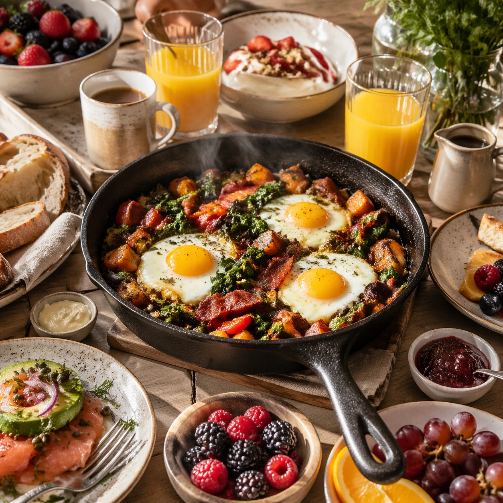

```text
Scene:
Compose a square brunch tabletop image with layered tableware, generous daylight, and a sense of weekend abundance that still feels organized enough for real hospitality and publishing use. The scene should balance multiple objects without losing the hero focal point, making table choreography and dish relationships a core part of the image. Shoot a cast-iron skillet at table center with surrounding side plates and daylight shadows, keeping the composition square and service-ready.

Subject:
The food must look fresh, warm, and genuinely shareable: eggs, breads, fruit, spreads, juices, and plated brunch mains should feel cooked and plated for service, not arranged as fake prop food. Show a brunch hash or comparable skillet preparation with eggs, herbs, crisp edges, and visible heat that feels fresh from the pass.

Important details:
Table logic matters. Plates, glasses, linens, and serving utensils need believable spacing, overlap, and hierarchy so the image can support menus, social assets, and campaign layouts. Make the abundance feel intentional rather than chaotic, with appetizing textures and natural daylight carrying the mood. This image should feel fully self-contained while still belonging to the same broader topic and commercial world. Balance abundance with discipline: the skillet should feel robust and communal, but the frame still needs elegant composition, credible steam, and appetizing color control.

Use case:
Brunch Tabletop single study 7/9, built for Prompt Atlas coverage of a food and beverage commercial visual system.

Constraints:
No readable text, no watermark, no logos, preserve exact 1:1 aspect ratio, no buffet chaos, no greasy diner styling unless specifically implied, no visible phone screens, no plastic takeaway packaging, no fake stock-family posing, no unreadable signage, no camping cues, no giant family platter, no visible stove top.
```

[Pinned source](https://github.com/ChaosRealmsAI/gpt-image-2-gallery/blob/5296db8c996e38776c83a0bc8c64f848dcd512b3/works/topics/breakfast-brunch-tabletop-system/packages/single-support-studies/images/skillet-hash-centerpiece/meta.json) · GPT Image2 · 1254×1254 · No source-declared image dependencies. · ProjectD:[published and publicly accepted](https://aitoolsradar.com/en/prompts/0012516fbc425a)

## Group Toast Moment · breakfast-brunch-tabletop-system/single-support-studies/group-toast-moment


```text
Scene:
Compose a square brunch tabletop image with layered tableware, generous daylight, and a sense of weekend abundance that still feels organized enough for real hospitality and publishing use. The scene should balance multiple objects without losing the hero focal point, making table choreography and dish relationships a core part of the image. Use a square crop of several hands raising juice or sparkling brunch drinks over a partly visible tabletop, backlit by soft daylight.

Subject:
The food must look fresh, warm, and genuinely shareable: eggs, breads, fruit, spreads, juices, and plated brunch mains should feel cooked and plated for service, not arranged as fake prop food. Keep the drinks and table beneath them crisp and inviting, using the hand gestures only to communicate social brunch energy.

Important details:
Table logic matters. Plates, glasses, linens, and serving utensils need believable spacing, overlap, and hierarchy so the image can support menus, social assets, and campaign layouts. Make the abundance feel intentional rather than chaotic, with appetizing textures and natural daylight carrying the mood. This image should feel fully self-contained while still belonging to the same broader topic and commercial world. Hands, glass reflections, and liquid levels must feel natural. The image should suggest togetherness without collapsing into generic lifestyle stock photography.

Use case:
Brunch Tabletop single study 8/9, built for Prompt Atlas coverage of a food and beverage commercial visual system.

Constraints:
No readable text, no watermark, no logos, preserve exact 1:1 aspect ratio, no buffet chaos, no greasy diner styling unless specifically implied, no visible phone screens, no plastic takeaway packaging, no fake stock-family posing, no unreadable signage, no faces, no wedding vibe, no confetti.
```

[Pinned source](https://github.com/ChaosRealmsAI/gpt-image-2-gallery/blob/5296db8c996e38776c83a0bc8c64f848dcd512b3/works/topics/breakfast-brunch-tabletop-system/packages/single-support-studies/images/group-toast-moment/meta.json) · GPT Image2 · 1254×1254 · No source-declared image dependencies. · ProjectD:[published and publicly accepted](https://aitoolsradar.com/en/prompts/cf7a8682536c43)

## Jam Butter Flatlay · breakfast-brunch-tabletop-system/single-support-studies/jam-butter-flatlay

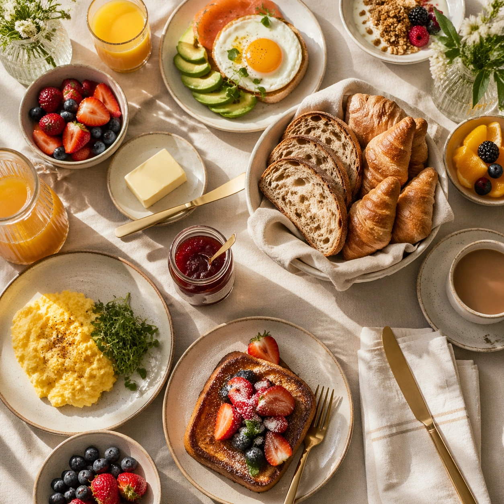

```text
Scene:
Compose a square brunch tabletop image with layered tableware, generous daylight, and a sense of weekend abundance that still feels organized enough for real hospitality and publishing use. The scene should balance multiple objects without losing the hero focal point, making table choreography and dish relationships a core part of the image. Use a strict top-down square composition with toast, butter dish, jam pot, knife, and folded napkin arranged with clean hospitality logic.

Subject:
The food must look fresh, warm, and genuinely shareable: eggs, breads, fruit, spreads, juices, and plated brunch mains should feel cooked and plated for service, not arranged as fake prop food. Treat simple breakfast components as premium objects through texture, spacing, and restraint rather than excess plating.

Important details:
Table logic matters. Plates, glasses, linens, and serving utensils need believable spacing, overlap, and hierarchy so the image can support menus, social assets, and campaign layouts. Make the abundance feel intentional rather than chaotic, with appetizing textures and natural daylight carrying the mood. This image should feel fully self-contained while still belonging to the same broader topic and commercial world. Crumb control, butter softness, preserve translucency, and table linen rhythm should make the frame feel elevated and editorial-ready.

Use case:
Brunch Tabletop single study 9/9, built for Prompt Atlas coverage of a food and beverage commercial visual system.

Constraints:
No readable text, no watermark, no logos, preserve exact 1:1 aspect ratio, no buffet chaos, no greasy diner styling unless specifically implied, no visible phone screens, no plastic takeaway packaging, no fake stock-family posing, no unreadable signage, no packaged jam labels, no breakfast cereal boxes, no cluttered newspaper props.
```

[Pinned source](https://github.com/ChaosRealmsAI/gpt-image-2-gallery/blob/5296db8c996e38776c83a0bc8c64f848dcd512b3/works/topics/breakfast-brunch-tabletop-system/packages/single-support-studies/images/jam-butter-flatlay/meta.json) · GPT Image2 · 1254×1254 · No source-declared image dependencies. · ProjectD:[published and publicly accepted](https://aitoolsradar.com/en/prompts/5821e37bed1a16)

## Reference Bridal Anchor · bridal-couture-portrait-story/series-bridal-couture-lock/01-reference-bridal-anchor

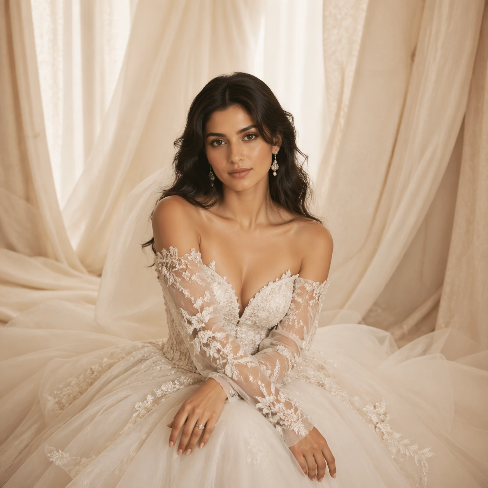

```text
Scene:
Create a square 1:1 portrait image for Bridal Couture Portrait Story. Use a luminous couture-studio or quiet suite setup with soft ivory light, visible fabric depth, and romantic restraint. The frame should feel like a finished professional deliverable rather than a casual snapshot, with clear lens discipline, believable light falloff, and a palette that directly supports Produce bridal and couture portrait stories with refined fabric rendering, emotional elegance, and premium magazine-level bridal photography cues.. Keep enough surrounding space and compositional control for gallery, research, campaign, or approval-board reuse while staying photoreal and human-scaled.

Subject:
Center one bridal couture model with warm olive skin, wavy dark hair, luminous eyes, refined posture, and graceful hands. Establish the bride identity, face, hair base, hand shape, and body proportions that all later variations must preserve. Use the example direction from the brief as grounding context: Produce bridal and couture portrait stories with refined fabric rendering, emotional elegance, and premium magazine-level bridal photography cues.. Wardrobe, lighting, environment, and pose may shift to serve this variation, but the viewer must immediately understand that the same reference identity is still in front of the camera.

Important details:
This backlog line is difficult because Produce bridal and couture portrait stories with refined fabric rendering, emotional elegance, and premium magazine-level bridal photography cues.. Preserve skin tone family, bone structure, eye spacing, nose shape, mouth shape, hairline logic, shoulder width, and overall body read across the entire series. preserve exact face / hair base / body proportions from the reference model. This anchor should feel elevated and couture, not cheap studio-template wedding photography. Avoid the common failure described in the brief: ordinary image models often lose likeness once styling, lighting, or layout changes enter the frame. Success should feel like the result should feel professionally usable, coherent, and clearly built around one stable human identity.

Use case:
Bridal Couture Portrait Story series study 1/9, the baseline bridal couture portrait.

Constraints:
No readable text, no watermark, no logos, preserve exact 1:1 aspect ratio, preserve exact face / hair base / body proportions from the reference model, no banquet hall clutter, no bouquet overload, no bridal party, no cheesy sparkle filter.
```

[Pinned source](https://github.com/ChaosRealmsAI/gpt-image-2-gallery/blob/5296db8c996e38776c83a0bc8c64f848dcd512b3/works/topics/bridal-couture-portrait-story/packages/series-bridal-couture-lock/images/01-reference-bridal-anchor/meta.json) · GPT Image2 · 1254×1254 · No source-declared image dependencies. · ProjectD:[published and publicly accepted](https://aitoolsradar.com/en/prompts/4ac82c27098cfa)

## Cover Portrait · bridal-couture-portrait-story/series-bridal-couture-lock/02-cover-portrait

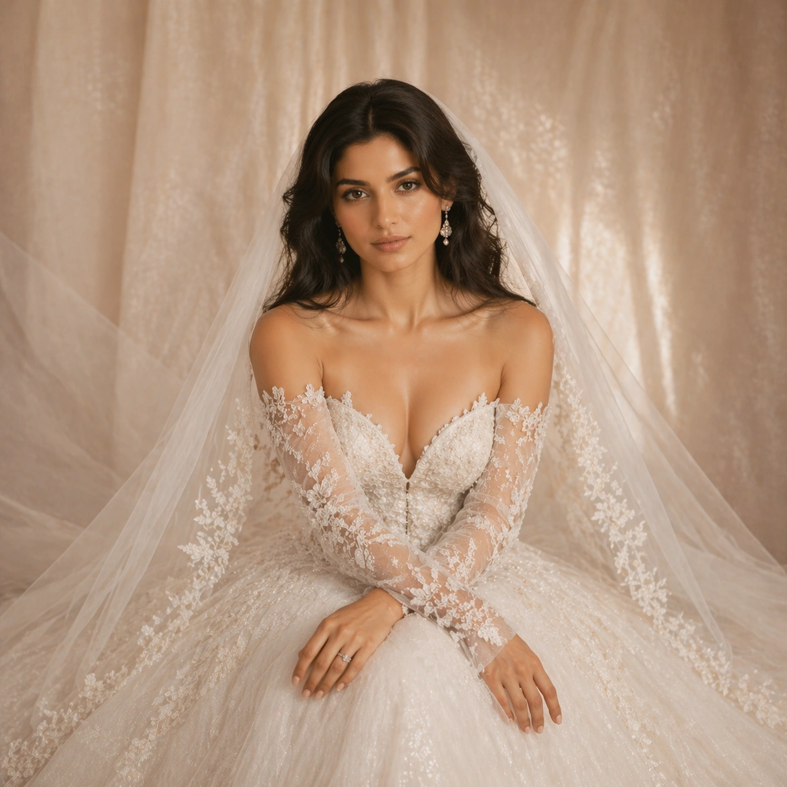

```text
Scene:
Create a square 1:1 portrait image for Bridal Couture Portrait Story. Use a premium front-facing fashion-wedding frame with veil, face, and neckline all clearly controlled. The frame should feel like a finished professional deliverable rather than a casual snapshot, with clear lens discipline, believable light falloff, and a palette that directly supports Produce bridal and couture portrait stories with refined fabric rendering, emotional elegance, and premium magazine-level bridal photography cues.. Keep enough surrounding space and compositional control for gallery, research, campaign, or approval-board reuse while staying photoreal and human-scaled.

Subject:
Center one bridal couture model with warm olive skin, wavy dark hair, luminous eyes, refined posture, and graceful hands. Keep the same bride exact while shaping the crop into a magazine-cover-ready hero portrait. Use the example direction from the brief as grounding context: Produce bridal and couture portrait stories with refined fabric rendering, emotional elegance, and premium magazine-level bridal photography cues.. Wardrobe, lighting, environment, and pose may shift to serve this variation, but the viewer must immediately understand that the same reference identity is still in front of the camera.

Important details:
This backlog line is difficult because Produce bridal and couture portrait stories with refined fabric rendering, emotional elegance, and premium magazine-level bridal photography cues.. Preserve skin tone family, bone structure, eye spacing, nose shape, mouth shape, hairline logic, shoulder width, and overall body read across the entire series. preserve exact face / hair base / body proportions from the reference model. Expression and framing may become more iconic, but likeness must not drift. Avoid the common failure described in the brief: ordinary image models often lose likeness once styling, lighting, or layout changes enter the frame. Success should feel like the result should feel professionally usable, coherent, and clearly built around one stable human identity.

Use case:
Bridal Couture Portrait Story series study 2/9, a bridal cover portrait.

Constraints:
No readable text, no watermark, no logos, preserve exact 1:1 aspect ratio, preserve exact face / hair base / body proportions from the reference model, no new face shape, no changed eyebrow arch, no fake logo masthead, no generic stock smile.
```

[Pinned source](https://github.com/ChaosRealmsAI/gpt-image-2-gallery/blob/5296db8c996e38776c83a0bc8c64f848dcd512b3/works/topics/bridal-couture-portrait-story/packages/series-bridal-couture-lock/images/02-cover-portrait/meta.json) · GPT Image2 · 1254×1254 · Reference images required. · ProjectD:[published and publicly accepted](https://aitoolsradar.com/en/prompts/a96fd643d65a00)

## Veil Close-up · bridal-couture-portrait-story/series-bridal-couture-lock/03-veil-closeup

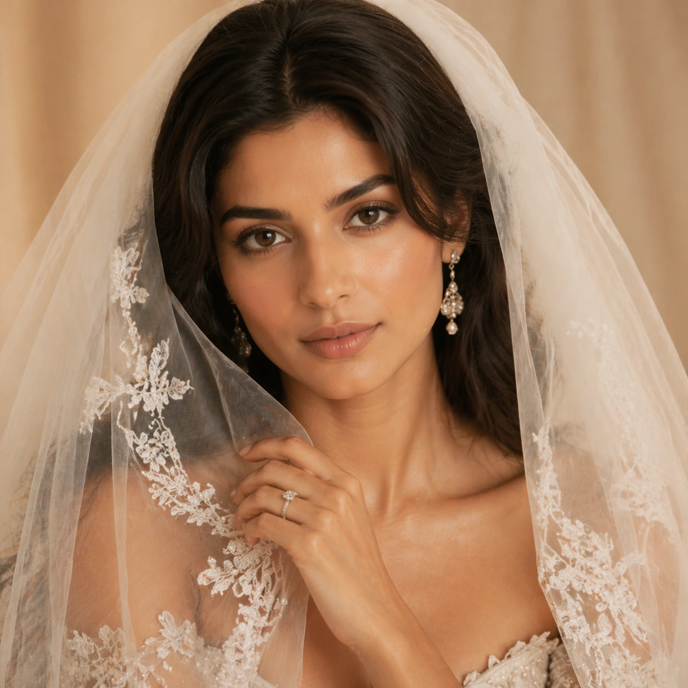

```text
Scene:
Create a square 1:1 portrait image for Bridal Couture Portrait Story. Use a close beauty-fashion crop where veil texture, eyelashes, and skin remain crisp and plausible. The frame should feel like a finished professional deliverable rather than a casual snapshot, with clear lens discipline, believable light falloff, and a palette that directly supports Produce bridal and couture portrait stories with refined fabric rendering, emotional elegance, and premium magazine-level bridal photography cues.. Keep enough surrounding space and compositional control for gallery, research, campaign, or approval-board reuse while staying photoreal and human-scaled.

Subject:
Center one bridal couture model with warm olive skin, wavy dark hair, luminous eyes, refined posture, and graceful hands. Push closer to the same face while adding veil texture and gentle fabric interaction. Preserve exact face / hair base / body proportions from the reference model. Use the example direction from the brief as grounding context: Produce bridal and couture portrait stories with refined fabric rendering, emotional elegance, and premium magazine-level bridal photography cues.. Wardrobe, lighting, environment, and pose may shift to serve this variation, but the viewer must immediately understand that the same reference identity is still in front of the camera.

Important details:
This backlog line is difficult because Produce bridal and couture portrait stories with refined fabric rendering, emotional elegance, and premium magazine-level bridal photography cues.. Preserve skin tone family, bone structure, eye spacing, nose shape, mouth shape, hairline logic, shoulder width, and overall body read across the entire series. preserve exact face / hair base / body proportions from the reference model. The veil should frame the likeness, not hide or change it. Avoid the common failure described in the brief: ordinary image models often lose likeness once styling, lighting, or layout changes enter the frame. Success should feel like the result should feel professionally usable, coherent, and clearly built around one stable human identity.

Use case:
Bridal Couture Portrait Story series study 3/9, a veil close-up.

Constraints:
No readable text, no watermark, no logos, preserve exact 1:1 aspect ratio, preserve exact face / hair base / body proportions from the reference model, no opaque veil blocking face, no altered nose bridge, no glitter overload, no extra hands.
```

[Pinned source](https://github.com/ChaosRealmsAI/gpt-image-2-gallery/blob/5296db8c996e38776c83a0bc8c64f848dcd512b3/works/topics/bridal-couture-portrait-story/packages/series-bridal-couture-lock/images/03-veil-closeup/meta.json) · GPT Image2 · 1254×1254 · Reference images required. · ProjectD:[published and publicly accepted](https://aitoolsradar.com/en/prompts/34ee9d3f6b397c)

## Couture Full Body · bridal-couture-portrait-story/series-bridal-couture-lock/04-couture-full-body

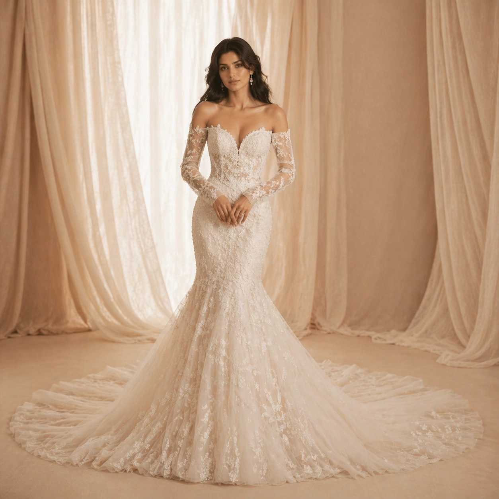

```text
Scene:
Create a square 1:1 portrait image for Bridal Couture Portrait Story. Use a square fashion setup with enough room to show silhouette, train, and posture while keeping the face readable. The frame should feel like a finished professional deliverable rather than a casual snapshot, with clear lens discipline, believable light falloff, and a palette that directly supports Produce bridal and couture portrait stories with refined fabric rendering, emotional elegance, and premium magazine-level bridal photography cues.. Keep enough surrounding space and compositional control for gallery, research, campaign, or approval-board reuse while staying photoreal and human-scaled.

Subject:
Center one bridal couture model with warm olive skin, wavy dark hair, luminous eyes, refined posture, and graceful hands. Show the same bride in a full-length couture pose with stable body proportions and believable fabric volume. Use the example direction from the brief as grounding context: Produce bridal and couture portrait stories with refined fabric rendering, emotional elegance, and premium magazine-level bridal photography cues.. Wardrobe, lighting, environment, and pose may shift to serve this variation, but the viewer must immediately understand that the same reference identity is still in front of the camera.

Important details:
This backlog line is difficult because Produce bridal and couture portrait stories with refined fabric rendering, emotional elegance, and premium magazine-level bridal photography cues.. Preserve skin tone family, bone structure, eye spacing, nose shape, mouth shape, hairline logic, shoulder width, and overall body read across the entire series. preserve exact face / hair base / body proportions from the reference model. The dress can expand dramatically, but the human figure must stay exact. Avoid the common failure described in the brief: ordinary image models often lose likeness once styling, lighting, or layout changes enter the frame. Success should feel like the result should feel professionally usable, coherent, and clearly built around one stable human identity.

Use case:
Bridal Couture Portrait Story series study 4/9, a couture full-body portrait.

Constraints:
No readable text, no watermark, no logos, preserve exact 1:1 aspect ratio, preserve exact face / hair base / body proportions from the reference model, no giant ballgown distortion, no shortened legs, no floating hem, no background decor clutter.
```

[Pinned source](https://github.com/ChaosRealmsAI/gpt-image-2-gallery/blob/5296db8c996e38776c83a0bc8c64f848dcd512b3/works/topics/bridal-couture-portrait-story/packages/series-bridal-couture-lock/images/04-couture-full-body/meta.json) · GPT Image2 · 1254×1254 · Reference images required. · ProjectD:[published and publicly accepted](https://aitoolsradar.com/en/prompts/f9772337fc0592)

## Seated Atelier Portrait · bridal-couture-portrait-story/series-bridal-couture-lock/05-seated-atelier-portrait

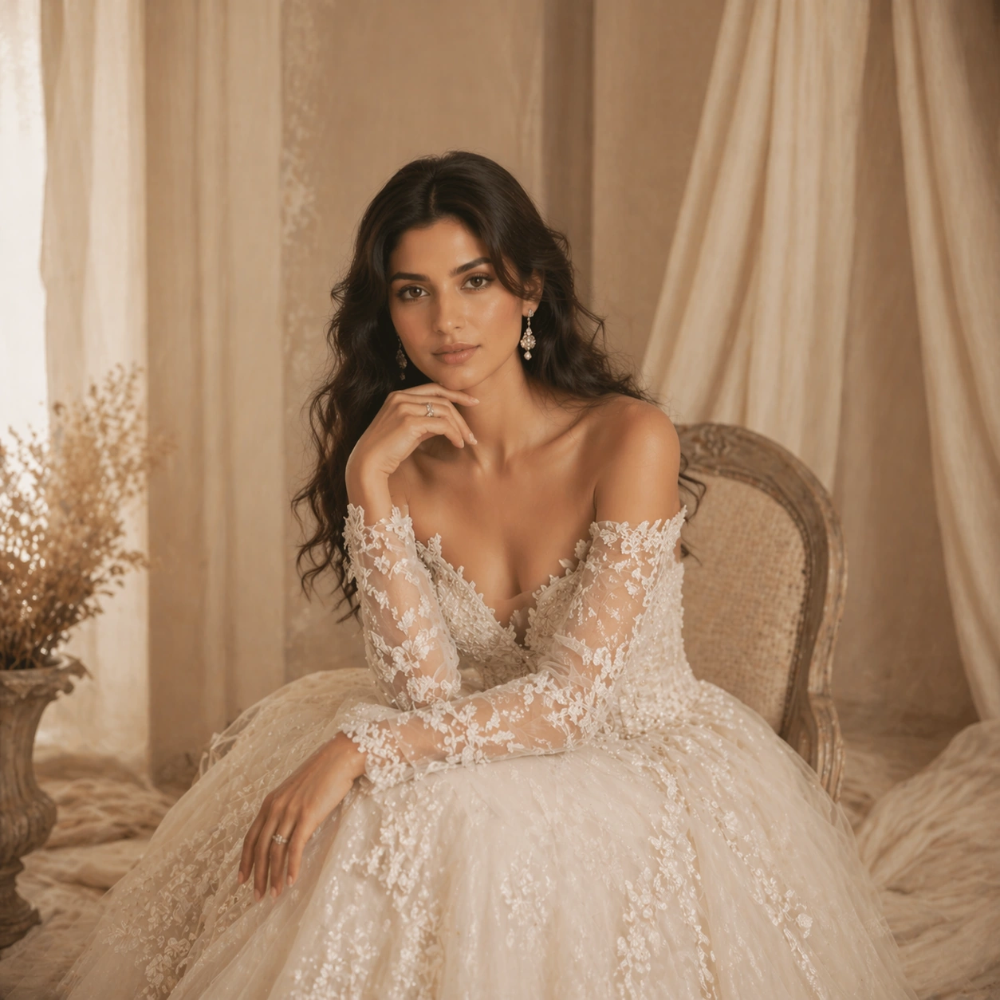

```text
Scene:
Create a square 1:1 portrait image for Bridal Couture Portrait Story. Use a quieter couture setting with chair, fabric drape, and soft atelier light. The frame should feel like a finished professional deliverable rather than a casual snapshot, with clear lens discipline, believable light falloff, and a palette that directly supports Produce bridal and couture portrait stories with refined fabric rendering, emotional elegance, and premium magazine-level bridal photography cues.. Keep enough surrounding space and compositional control for gallery, research, campaign, or approval-board reuse while staying photoreal and human-scaled.

Subject:
Center one bridal couture model with warm olive skin, wavy dark hair, luminous eyes, refined posture, and graceful hands. Maintain the same identity while shifting into a more intimate seated pose that still feels editorial and elevated. Use the example direction from the brief as grounding context: Produce bridal and couture portrait stories with refined fabric rendering, emotional elegance, and premium magazine-level bridal photography cues.. Wardrobe, lighting, environment, and pose may shift to serve this variation, but the viewer must immediately understand that the same reference identity is still in front of the camera.

Important details:
This backlog line is difficult because Produce bridal and couture portrait stories with refined fabric rendering, emotional elegance, and premium magazine-level bridal photography cues.. Preserve skin tone family, bone structure, eye spacing, nose shape, mouth shape, hairline logic, shoulder width, and overall body read across the entire series. preserve exact face / hair base / body proportions from the reference model. Hands, shoulders, and face should remain consistent even in a different posture. Avoid the common failure described in the brief: ordinary image models often lose likeness once styling, lighting, or layout changes enter the frame. Success should feel like the result should feel professionally usable, coherent, and clearly built around one stable human identity.

Use case:
Bridal Couture Portrait Story series study 5/9, a seated atelier portrait.

Constraints:
No readable text, no watermark, no logos, preserve exact 1:1 aspect ratio, preserve exact face / hair base / body proportions from the reference model, no stiff mannequin pose, no different hairstyle, no extra stylist, no readable dress tags.
```

[Pinned source](https://github.com/ChaosRealmsAI/gpt-image-2-gallery/blob/5296db8c996e38776c83a0bc8c64f848dcd512b3/works/topics/bridal-couture-portrait-story/packages/series-bridal-couture-lock/images/05-seated-atelier-portrait/meta.json) · GPT Image2 · 1254×1254 · Reference images required. · ProjectD:[published and publicly accepted](https://aitoolsradar.com/en/prompts/96ab0dc57c8f3e)

## Romantic Window Profile · bridal-couture-portrait-story/series-bridal-couture-lock/06-romantic-window-profile

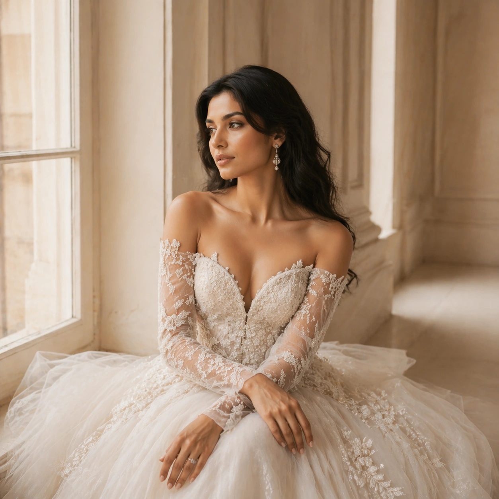

```text
Scene:
Create a square 1:1 portrait image for Bridal Couture Portrait Story. Use a profile or three-quarter portrait shaped by natural window light and pale architectural surroundings. The frame should feel like a finished professional deliverable rather than a casual snapshot, with clear lens discipline, believable light falloff, and a palette that directly supports Produce bridal and couture portrait stories with refined fabric rendering, emotional elegance, and premium magazine-level bridal photography cues.. Keep enough surrounding space and compositional control for gallery, research, campaign, or approval-board reuse while staying photoreal and human-scaled.

Subject:
Center one bridal couture model with warm olive skin, wavy dark hair, luminous eyes, refined posture, and graceful hands. Use softer daylight while preserving the same brow line, jawline, and hair base established in the anchor. Use the example direction from the brief as grounding context: Produce bridal and couture portrait stories with refined fabric rendering, emotional elegance, and premium magazine-level bridal photography cues.. Wardrobe, lighting, environment, and pose may shift to serve this variation, but the viewer must immediately understand that the same reference identity is still in front of the camera.

Important details:
This backlog line is difficult because Produce bridal and couture portrait stories with refined fabric rendering, emotional elegance, and premium magazine-level bridal photography cues.. Preserve skin tone family, bone structure, eye spacing, nose shape, mouth shape, hairline logic, shoulder width, and overall body read across the entire series. preserve exact face / hair base / body proportions from the reference model. This should sell quiet emotion and couture finish together. Avoid the common failure described in the brief: ordinary image models often lose likeness once styling, lighting, or layout changes enter the frame. Success should feel like the result should feel professionally usable, coherent, and clearly built around one stable human identity.

Use case:
Bridal Couture Portrait Story series study 6/9, a romantic profile by a window.

Constraints:
No readable text, no watermark, no logos, preserve exact 1:1 aspect ratio, preserve exact face / hair base / body proportions from the reference model, no melodramatic tears, no altered profile, no floral-wall overload, no different veil shape.
```

[Pinned source](https://github.com/ChaosRealmsAI/gpt-image-2-gallery/blob/5296db8c996e38776c83a0bc8c64f848dcd512b3/works/topics/bridal-couture-portrait-story/packages/series-bridal-couture-lock/images/06-romantic-window-profile/meta.json) · GPT Image2 · 1254×1254 · Reference images required. · ProjectD:[published and publicly accepted](https://aitoolsradar.com/en/prompts/1ff18cc2b72657)

## Monochrome Emotion Frame · bridal-couture-portrait-story/series-bridal-couture-lock/07-monochrome-emotion-frame

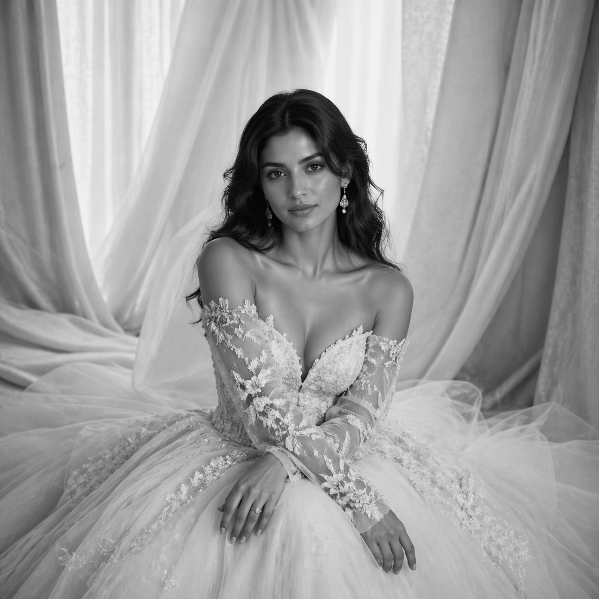

```text
Scene:
Create a square 1:1 portrait image for Bridal Couture Portrait Story. Use a grayscale frame with rich bridal fabric texture, luminous skin, and emotionally restrained contrast. The frame should feel like a finished professional deliverable rather than a casual snapshot, with clear lens discipline, believable light falloff, and a palette that directly supports Produce bridal and couture portrait stories with refined fabric rendering, emotional elegance, and premium magazine-level bridal photography cues.. Keep enough surrounding space and compositional control for gallery, research, campaign, or approval-board reuse while staying photoreal and human-scaled.

Subject:
Center one bridal couture model with warm olive skin, wavy dark hair, luminous eyes, refined posture, and graceful hands. Translate the same bride into black and white without losing recognition, face structure, or material quality. Use the example direction from the brief as grounding context: Produce bridal and couture portrait stories with refined fabric rendering, emotional elegance, and premium magazine-level bridal photography cues.. Wardrobe, lighting, environment, and pose may shift to serve this variation, but the viewer must immediately understand that the same reference identity is still in front of the camera.

Important details:
This backlog line is difficult because Produce bridal and couture portrait stories with refined fabric rendering, emotional elegance, and premium magazine-level bridal photography cues.. Preserve skin tone family, bone structure, eye spacing, nose shape, mouth shape, hairline logic, shoulder width, and overall body read across the entire series. preserve exact face / hair base / body proportions from the reference model. The mood may deepen, but it cannot become a different era or different woman. Avoid the common failure described in the brief: ordinary image models often lose likeness once styling, lighting, or layout changes enter the frame. Success should feel like the result should feel professionally usable, coherent, and clearly built around one stable human identity.

Use case:
Bridal Couture Portrait Story series study 7/9, a monochrome romantic portrait.

Constraints:
No readable text, no watermark, no logos, preserve exact 1:1 aspect ratio, preserve exact face / hair base / body proportions from the reference model, no muddy grayscale, no vintage scratches, no blurred lace detail, no identity drift.
```

[Pinned source](https://github.com/ChaosRealmsAI/gpt-image-2-gallery/blob/5296db8c996e38776c83a0bc8c64f848dcd512b3/works/topics/bridal-couture-portrait-story/packages/series-bridal-couture-lock/images/07-monochrome-emotion-frame/meta.json) · GPT Image2 · 1254×1254 · Reference images required. · ProjectD:[published and publicly accepted](https://aitoolsradar.com/en/prompts/5e58792ea84c96)

## Fabric Detail Hands · bridal-couture-portrait-story/series-bridal-couture-lock/08-fabric-detail-hands

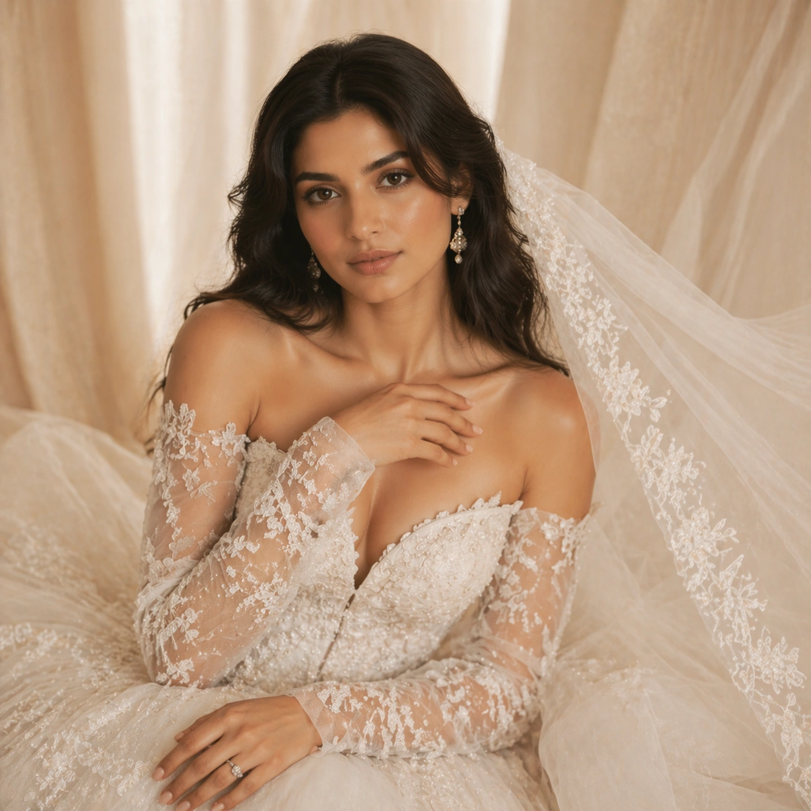

```text
Scene:
Create a square 1:1 portrait image for Bridal Couture Portrait Story. Use a closer couture crop where hands, bodice, veil edge, and face coexist in the frame with tactile realism. The frame should feel like a finished professional deliverable rather than a casual snapshot, with clear lens discipline, believable light falloff, and a palette that directly supports Produce bridal and couture portrait stories with refined fabric rendering, emotional elegance, and premium magazine-level bridal photography cues.. Keep enough surrounding space and compositional control for gallery, research, campaign, or approval-board reuse while staying photoreal and human-scaled.

Subject:
Center one bridal couture model with warm olive skin, wavy dark hair, luminous eyes, refined posture, and graceful hands. Keep the same subject exact while giving more room to fabric handling and gesture. Use the example direction from the brief as grounding context: Produce bridal and couture portrait stories with refined fabric rendering, emotional elegance, and premium magazine-level bridal photography cues.. Wardrobe, lighting, environment, and pose may shift to serve this variation, but the viewer must immediately understand that the same reference identity is still in front of the camera.

Important details:
This backlog line is difficult because Produce bridal and couture portrait stories with refined fabric rendering, emotional elegance, and premium magazine-level bridal photography cues.. Preserve skin tone family, bone structure, eye spacing, nose shape, mouth shape, hairline logic, shoulder width, and overall body read across the entire series. preserve exact face / hair base / body proportions from the reference model. Hands must stay elegant, anatomical, and connected to the same bride identity. Avoid the common failure described in the brief: ordinary image models often lose likeness once styling, lighting, or layout changes enter the frame. Success should feel like the result should feel professionally usable, coherent, and clearly built around one stable human identity.

Use case:
Bridal Couture Portrait Story series study 8/9, a fabric and hand-detail crop.

Constraints:
No readable text, no watermark, no logos, preserve exact 1:1 aspect ratio, preserve exact face / hair base / body proportions from the reference model, no broken fingers, no giant bouquet, no logo clasp, no over-textured fabric noise.
```

[Pinned source](https://github.com/ChaosRealmsAI/gpt-image-2-gallery/blob/5296db8c996e38776c83a0bc8c64f848dcd512b3/works/topics/bridal-couture-portrait-story/packages/series-bridal-couture-lock/images/08-fabric-detail-hands/meta.json) · GPT Image2 · 1254×1254 · Reference images required. · ProjectD:[published and publicly accepted](https://aitoolsradar.com/en/prompts/133f7e37340c42)

## Campaign Cover Crop · bridal-couture-portrait-story/series-bridal-couture-lock/09-campaign-cover-crop

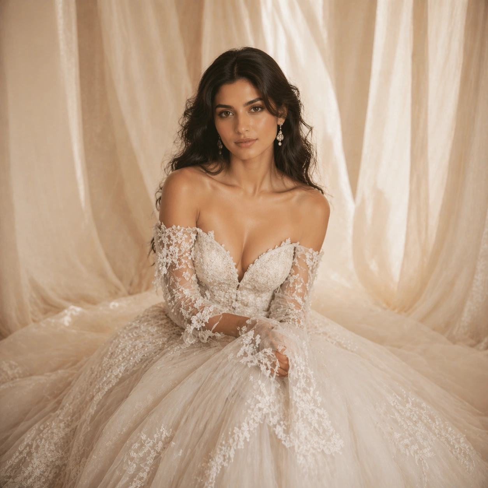

```text
Scene:
Create a square 1:1 portrait image for Bridal Couture Portrait Story. Use a square portrait-layout hybrid with premium couture-ad polish and graceful negative space. The frame should feel like a finished professional deliverable rather than a casual snapshot, with clear lens discipline, believable light falloff, and a palette that directly supports Produce bridal and couture portrait stories with refined fabric rendering, emotional elegance, and premium magazine-level bridal photography cues.. Keep enough surrounding space and compositional control for gallery, research, campaign, or approval-board reuse while staying photoreal and human-scaled.

Subject:
Center one bridal couture model with warm olive skin, wavy dark hair, luminous eyes, refined posture, and graceful hands. Resolve the same bride into a finished campaign-ready portrait that feels like couture brand imagery without readable text. Use the example direction from the brief as grounding context: Produce bridal and couture portrait stories with refined fabric rendering, emotional elegance, and premium magazine-level bridal photography cues.. Wardrobe, lighting, environment, and pose may shift to serve this variation, but the viewer must immediately understand that the same reference identity is still in front of the camera.

Important details:
This backlog line is difficult because Produce bridal and couture portrait stories with refined fabric rendering, emotional elegance, and premium magazine-level bridal photography cues.. Preserve skin tone family, bone structure, eye spacing, nose shape, mouth shape, hairline logic, shoulder width, and overall body read across the entire series. preserve exact face / hair base / body proportions from the reference model. The final image should carry romance, material luxury, and exact identity continuity together. Avoid the common failure described in the brief: ordinary image models often lose likeness once styling, lighting, or layout changes enter the frame. Success should feel like the result should feel professionally usable, coherent, and clearly built around one stable human identity.

Use case:
Bridal Couture Portrait Story series study 9/9, a final bridal campaign frame.

Constraints:
No readable text, no watermark, no logos, preserve exact 1:1 aspect ratio, preserve exact face / hair base / body proportions from the reference model, no readable copy, no monograms, no cheesy lens flare, no poster clutter.
```

[Pinned source](https://github.com/ChaosRealmsAI/gpt-image-2-gallery/blob/5296db8c996e38776c83a0bc8c64f848dcd512b3/works/topics/bridal-couture-portrait-story/packages/series-bridal-couture-lock/images/09-campaign-cover-crop/meta.json) · GPT Image2 · 1254×1254 · Reference images required. · ProjectD:[published and publicly accepted](https://aitoolsradar.com/en/prompts/c7784b632f57b3)

## Holiday Bundle Tile · bundle-shop-capsule-system/single-bundle-shop-studies/holiday-bundle-tile


```text
Scene:
A square production-ready image designed for a game-art review wall and a commercial gallery at the same time. Frame a seasonal bundle tile with festive but tasteful event cues and strong premium framing with disciplined lighting, clean edge separation, and enough surrounding context to prove how the asset would behave in a real product surface. The camera, crop, and tonal balance should feel intentional rather than generic, with high readability at first glance and convincing material response under closer inspection.

Subject:
Center the study on a seasonal bundle tile with festive but tasteful event cues and strong premium framing. Translate the topic into a concrete, shippable visual statement instead of a loose mood board. Build layered object relationships, believable surface finish, and strong silhouette grouping so the image reads immediately as part of Bundle Shop Capsule System. The subject should feel made for a live game pipeline: useful in store, UI, campaign, or art-review contexts, with visual hierarchy strong enough to survive aggressive cropping.

Important details:
make the offer feel limited and giftable without relying on words. Keep every supporting element subordinate to the main read, and make category separation obvious through form, color zoning, depth, and material logic rather than words. Where panels, cards, badges, or interface blocks appear, they must look professionally structured but remain unreadable. The visual language should feel premium, original, and coherent across this package, with no filler clutter and no accidental resemblance to a specific shipped game IP.

Use case:
Bundle Shop Capsule System single study 2/9, focused on holiday bundle tile.

Constraints:
No readable text, no watermark, no logos, preserve exact 1:1 aspect ratio, no holiday logos, no readable text, no broken hierarchy, no generic stock-photo staging, no accidental UI gibberish.
```

[Pinned source](https://github.com/ChaosRealmsAI/gpt-image-2-gallery/blob/5296db8c996e38776c83a0bc8c64f848dcd512b3/works/topics/bundle-shop-capsule-system/packages/single-bundle-shop-studies/images/holiday-bundle-tile/meta.json) · GPT Image2 · 1254×1254 · No source-declared image dependencies. · ProjectD:[published and publicly accepted](https://aitoolsradar.com/en/prompts/aae0ba72a790bb)

## Currency Bonus Offer · bundle-shop-capsule-system/single-bundle-shop-studies/currency-bonus-offer


```text
Scene:
A square production-ready image designed for a game-art review wall and a commercial gallery at the same time. Frame a currency bonus offer tile showing stacked value objects and bonus emphasis with disciplined lighting, clean edge separation, and enough surrounding context to prove how the asset would behave in a real product surface. The camera, crop, and tonal balance should feel intentional rather than generic, with high readability at first glance and convincing material response under closer inspection.

Subject:
Center the study on a currency bonus offer tile showing stacked value objects and bonus emphasis. Translate the topic into a concrete, shippable visual statement instead of a loose mood board. Build layered object relationships, believable surface finish, and strong silhouette grouping so the image reads immediately as part of Bundle Shop Capsule System. The subject should feel made for a live game pipeline: useful in store, UI, campaign, or art-review contexts, with visual hierarchy strong enough to survive aggressive cropping.

Important details:
the hierarchy should communicate extra value through arrangement and glow, not text. Keep every supporting element subordinate to the main read, and make category separation obvious through form, color zoning, depth, and material logic rather than words. Where panels, cards, badges, or interface blocks appear, they must look professionally structured but remain unreadable. The visual language should feel premium, original, and coherent across this package, with no filler clutter and no accidental resemblance to a specific shipped game IP.

Use case:
Bundle Shop Capsule System single study 3/9, focused on currency bonus offer.

Constraints:
No readable text, no watermark, no logos, preserve exact 1:1 aspect ratio, no numbers, no percentages, no broken hierarchy, no generic stock-photo staging, no accidental UI gibberish.
```

[Pinned source](https://github.com/ChaosRealmsAI/gpt-image-2-gallery/blob/5296db8c996e38776c83a0bc8c64f848dcd512b3/works/topics/bundle-shop-capsule-system/packages/single-bundle-shop-studies/images/currency-bonus-offer/meta.json) · GPT Image2 · 1254×1254 · No source-declared image dependencies. · ProjectD:[published and publicly accepted](https://aitoolsradar.com/en/prompts/3208c40f5e9f62)

## Premium Monthly Card · bundle-shop-capsule-system/single-bundle-shop-studies/premium-monthly-card


```text
Scene:
A square production-ready image designed for a game-art review wall and a commercial gallery at the same time. Frame a premium monthly card visual designed like a stable recurring-value product with disciplined lighting, clean edge separation, and enough surrounding context to prove how the asset would behave in a real product surface. The camera, crop, and tonal balance should feel intentional rather than generic, with high readability at first glance and convincing material response under closer inspection.

Subject:
Center the study on a premium monthly card visual designed like a stable recurring-value product. Translate the topic into a concrete, shippable visual statement instead of a loose mood board. Build layered object relationships, believable surface finish, and strong silhouette grouping so the image reads immediately as part of Bundle Shop Capsule System. The subject should feel made for a live game pipeline: useful in store, UI, campaign, or art-review contexts, with visual hierarchy strong enough to survive aggressive cropping.

Important details:
the image should balance prestige with simplicity and repeat-purchase credibility. Keep every supporting element subordinate to the main read, and make category separation obvious through form, color zoning, depth, and material logic rather than words. Where panels, cards, badges, or interface blocks appear, they must look professionally structured but remain unreadable. The visual language should feel premium, original, and coherent across this package, with no filler clutter and no accidental resemblance to a specific shipped game IP.

Use case:
Bundle Shop Capsule System single study 4/9, focused on premium monthly card.

Constraints:
No readable text, no watermark, no logos, preserve exact 1:1 aspect ratio, no calendar text, no prices, no broken hierarchy, no generic stock-photo staging, no accidental UI gibberish.
```

[Pinned source](https://github.com/ChaosRealmsAI/gpt-image-2-gallery/blob/5296db8c996e38776c83a0bc8c64f848dcd512b3/works/topics/bundle-shop-capsule-system/packages/single-bundle-shop-studies/images/premium-monthly-card/meta.json) · GPT Image2 · 1254×1254 · No source-declared image dependencies. · ProjectD:[published and publicly accepted](https://aitoolsradar.com/en/prompts/95d0fdea70f2a2)

## Bundle Lineup Board · bundle-shop-capsule-system/single-bundle-shop-studies/bundle-lineup-board

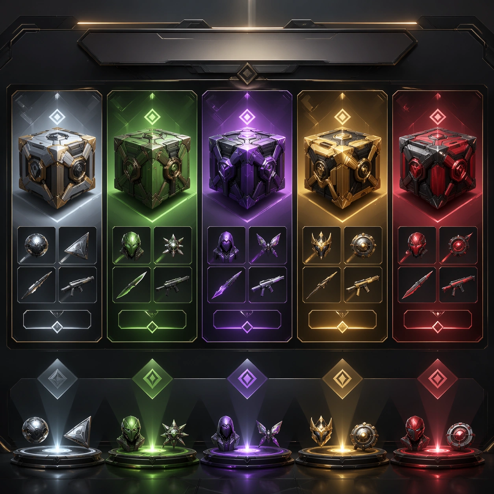

```text
Scene:
A square production-ready image designed for a game-art review wall and a commercial gallery at the same time. Frame a lineup board comparing several store bundles within one clean commercial system with disciplined lighting, clean edge separation, and enough surrounding context to prove how the asset would behave in a real product surface. The camera, crop, and tonal balance should feel intentional rather than generic, with high readability at first glance and convincing material response under closer inspection.

Subject:
Center the study on a lineup board comparing several store bundles within one clean commercial system. Translate the topic into a concrete, shippable visual statement instead of a loose mood board. Build layered object relationships, believable surface finish, and strong silhouette grouping so the image reads immediately as part of Bundle Shop Capsule System. The subject should feel made for a live game pipeline: useful in store, UI, campaign, or art-review contexts, with visual hierarchy strong enough to survive aggressive cropping.

Important details:
grouping and differentiation should be obvious without readable labels. Keep every supporting element subordinate to the main read, and make category separation obvious through form, color zoning, depth, and material logic rather than words. Where panels, cards, badges, or interface blocks appear, they must look professionally structured but remain unreadable. The visual language should feel premium, original, and coherent across this package, with no filler clutter and no accidental resemblance to a specific shipped game IP.

Use case:
Bundle Shop Capsule System single study 5/9, focused on bundle lineup board.

Constraints:
No readable text, no watermark, no logos, preserve exact 1:1 aspect ratio, no price columns, no UI copy, no broken hierarchy, no generic stock-photo staging, no accidental UI gibberish.
```

[Pinned source](https://github.com/ChaosRealmsAI/gpt-image-2-gallery/blob/5296db8c996e38776c83a0bc8c64f848dcd512b3/works/topics/bundle-shop-capsule-system/packages/single-bundle-shop-studies/images/bundle-lineup-board/meta.json) · GPT Image2 · 1254×1254 · No source-declared image dependencies. · ProjectD:[published and publicly accepted](https://aitoolsradar.com/en/prompts/8a3fb8eed53dea)

## Capsule Closeup Study · bundle-shop-capsule-system/single-bundle-shop-studies/capsule-closeup-study


```text
Scene:
A square production-ready image designed for a game-art review wall and a commercial gallery at the same time. Frame a close-up study of packaging materials, ribbons, seals, and reward surfaces inside a bundle capsule with disciplined lighting, clean edge separation, and enough surrounding context to prove how the asset would behave in a real product surface. The camera, crop, and tonal balance should feel intentional rather than generic, with high readability at first glance and convincing material response under closer inspection.

Subject:
Center the study on a close-up study of packaging materials, ribbons, seals, and reward surfaces inside a bundle capsule. Translate the topic into a concrete, shippable visual statement instead of a loose mood board. Build layered object relationships, believable surface finish, and strong silhouette grouping so the image reads immediately as part of Bundle Shop Capsule System. The subject should feel made for a live game pipeline: useful in store, UI, campaign, or art-review contexts, with visual hierarchy strong enough to survive aggressive cropping.

Important details:
micro detail should reinforce premium value and seasonal polish. Keep every supporting element subordinate to the main read, and make category separation obvious through form, color zoning, depth, and material logic rather than words. Where panels, cards, badges, or interface blocks appear, they must look professionally structured but remain unreadable. The visual language should feel premium, original, and coherent across this package, with no filler clutter and no accidental resemblance to a specific shipped game IP.

Use case:
Bundle Shop Capsule System single study 6/9, focused on capsule closeup study.

Constraints:
No readable text, no watermark, no logos, preserve exact 1:1 aspect ratio, no serial numbers, no logos, no broken hierarchy, no generic stock-photo staging, no accidental UI gibberish.
```

[Pinned source](https://github.com/ChaosRealmsAI/gpt-image-2-gallery/blob/5296db8c996e38776c83a0bc8c64f848dcd512b3/works/topics/bundle-shop-capsule-system/packages/single-bundle-shop-studies/images/capsule-closeup-study/meta.json) · GPT Image2 · 1254×1254 · No source-declared image dependencies. · ProjectD:[published and publicly accepted](https://aitoolsradar.com/en/prompts/660316ef2a165d)

## Shop Homepage Takeover · bundle-shop-capsule-system/single-bundle-shop-studies/shop-homepage-takeover

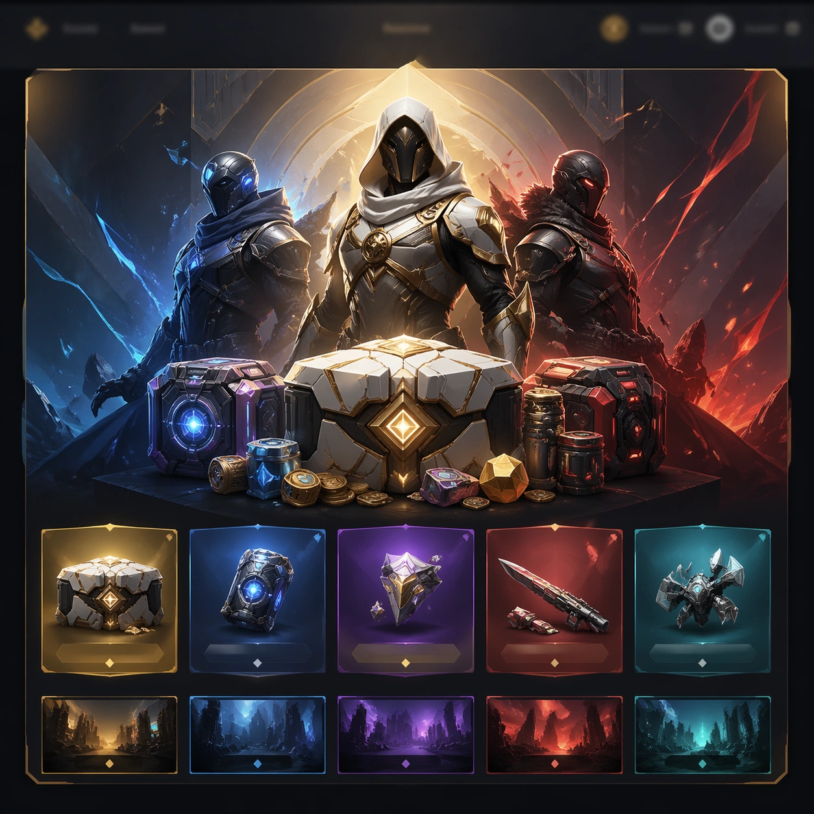

```text
Scene:
A square production-ready image designed for a game-art review wall and a commercial gallery at the same time. Frame a homepage takeover-style visual packaging multiple offers into one coordinated commercial splash with disciplined lighting, clean edge separation, and enough surrounding context to prove how the asset would behave in a real product surface. The camera, crop, and tonal balance should feel intentional rather than generic, with high readability at first glance and convincing material response under closer inspection.

Subject:
Center the study on a homepage takeover-style visual packaging multiple offers into one coordinated commercial splash. Translate the topic into a concrete, shippable visual statement instead of a loose mood board. Build layered object relationships, believable surface finish, and strong silhouette grouping so the image reads immediately as part of Bundle Shop Capsule System. The subject should feel made for a live game pipeline: useful in store, UI, campaign, or art-review contexts, with visual hierarchy strong enough to survive aggressive cropping.

Important details:
keep hierarchy clean enough for real store use and fast scanning. Keep every supporting element subordinate to the main read, and make category separation obvious through form, color zoning, depth, and material logic rather than words. Where panels, cards, badges, or interface blocks appear, they must look professionally structured but remain unreadable. The visual language should feel premium, original, and coherent across this package, with no filler clutter and no accidental resemblance to a specific shipped game IP.

Use case:
Bundle Shop Capsule System single study 7/9, focused on shop homepage takeover.

Constraints:
No readable text, no watermark, no logos, preserve exact 1:1 aspect ratio, no navigation text, no readable tabs, no broken hierarchy, no generic stock-photo staging, no accidental UI gibberish.
```

[Pinned source](https://github.com/ChaosRealmsAI/gpt-image-2-gallery/blob/5296db8c996e38776c83a0bc8c64f848dcd512b3/works/topics/bundle-shop-capsule-system/packages/single-bundle-shop-studies/images/shop-homepage-takeover/meta.json) · GPT Image2 · 1254×1254 · No source-declared image dependencies. · ProjectD:[published and publicly accepted](https://aitoolsradar.com/en/prompts/e0d5031c7d875f)

## Subscription Reward Board · bundle-shop-capsule-system/single-bundle-shop-studies/subscription-reward-board

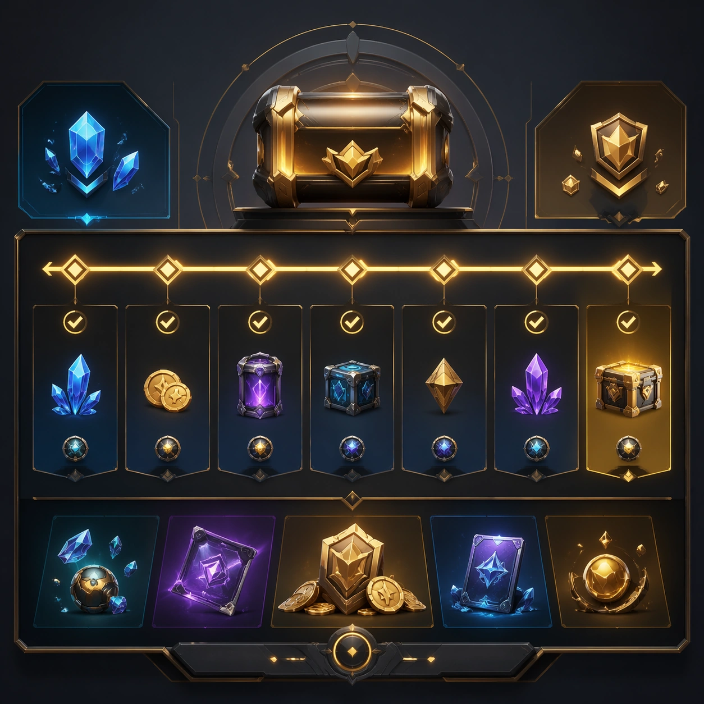

```text
Scene:
A square production-ready image designed for a game-art review wall and a commercial gallery at the same time. Frame a reward board visualizing a recurring offer and its layered benefits through objects and cadence with disciplined lighting, clean edge separation, and enough surrounding context to prove how the asset would behave in a real product surface. The camera, crop, and tonal balance should feel intentional rather than generic, with high readability at first glance and convincing material response under closer inspection.

Subject:
Center the study on a reward board visualizing a recurring offer and its layered benefits through objects and cadence. Translate the topic into a concrete, shippable visual statement instead of a loose mood board. Build layered object relationships, believable surface finish, and strong silhouette grouping so the image reads immediately as part of Bundle Shop Capsule System. The subject should feel made for a live game pipeline: useful in store, UI, campaign, or art-review contexts, with visual hierarchy strong enough to survive aggressive cropping.

Important details:
the structure should imply ongoing value while remaining abstract. Keep every supporting element subordinate to the main read, and make category separation obvious through form, color zoning, depth, and material logic rather than words. Where panels, cards, badges, or interface blocks appear, they must look professionally structured but remain unreadable. The visual language should feel premium, original, and coherent across this package, with no filler clutter and no accidental resemblance to a specific shipped game IP.

Use case:
Bundle Shop Capsule System single study 8/9, focused on subscription reward board.

Constraints:
No readable text, no watermark, no logos, preserve exact 1:1 aspect ratio, no calendars, no labels, no broken hierarchy, no generic stock-photo staging, no accidental UI gibberish.
```

[Pinned source](https://github.com/ChaosRealmsAI/gpt-image-2-gallery/blob/5296db8c996e38776c83a0bc8c64f848dcd512b3/works/topics/bundle-shop-capsule-system/packages/single-bundle-shop-studies/images/subscription-reward-board/meta.json) · GPT Image2 · 1254×1254 · No source-declared image dependencies. · ProjectD:[published and publicly accepted](https://aitoolsradar.com/en/prompts/a8b8c18e5b1ff5)

## VIP Offer Poster · bundle-shop-capsule-system/single-bundle-shop-studies/vip-offer-poster


```text
Scene:
A square production-ready image designed for a game-art review wall and a commercial gallery at the same time. Frame a premium poster-like asset pushing a high-tier bundle as a prestige purchase with disciplined lighting, clean edge separation, and enough surrounding context to prove how the asset would behave in a real product surface. The camera, crop, and tonal balance should feel intentional rather than generic, with high readability at first glance and convincing material response under closer inspection.

Subject:
Center the study on a premium poster-like asset pushing a high-tier bundle as a prestige purchase. Translate the topic into a concrete, shippable visual statement instead of a loose mood board. Build layered object relationships, believable surface finish, and strong silhouette grouping so the image reads immediately as part of Bundle Shop Capsule System. The subject should feel made for a live game pipeline: useful in store, UI, campaign, or art-review contexts, with visual hierarchy strong enough to survive aggressive cropping.

Important details:
make it feel luxurious, finite, and conversion-ready without visible copy. Keep every supporting element subordinate to the main read, and make category separation obvious through form, color zoning, depth, and material logic rather than words. Where panels, cards, badges, or interface blocks appear, they must look professionally structured but remain unreadable. The visual language should feel premium, original, and coherent across this package, with no filler clutter and no accidental resemblance to a specific shipped game IP.

Use case:
Bundle Shop Capsule System single study 9/9, focused on vip offer poster.

Constraints:
No readable text, no watermark, no logos, preserve exact 1:1 aspect ratio, no slogans, no logos, no broken hierarchy, no generic stock-photo staging, no accidental UI gibberish.
```

[Pinned source](https://github.com/ChaosRealmsAI/gpt-image-2-gallery/blob/5296db8c996e38776c83a0bc8c64f848dcd512b3/works/topics/bundle-shop-capsule-system/packages/single-bundle-shop-studies/images/vip-offer-poster/meta.json) · GPT Image2 · 1254×1254 · No source-declared image dependencies. · ProjectD:[published and publicly accepted](https://aitoolsradar.com/en/prompts/d0c8fbc4a0d78f)

## Reference Anchor · cathedral-light-beam-worship/series-core-system/01-reference-anchor

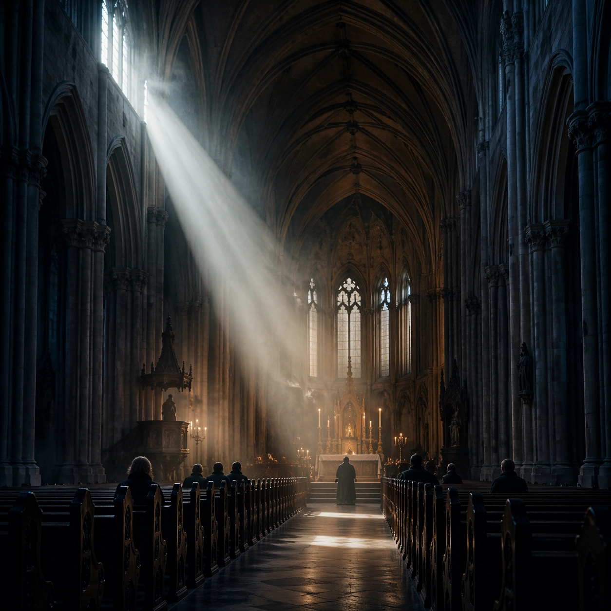

```text
Scene:
Create a square cinematic still for Cathedral Light Beam of Worship. Use production-grade photoreal lighting, disciplined lens behavior, and a composition that feels like a finished key frame from an original film rather than a casual snapshot. A vast Gothic nave is carved by one sharply defined shaft of early sun entering from high clerestory windows on the left, with cold blue shadows in the aisles, faint amber heat around the altar, and visibly suspended dust or incense in the air. Keep the camera in a disciplined anchor position so the full lighting event and the main spatial structure are immediately legible from edge to edge.

Subject:
Build a coherent original scene whose emotional center comes from atmosphere, light physics, and spatial clarity. Avoid relying on celebrity likeness, franchise iconography, or stylized illustration shortcuts. Stone columns, ribbed vaults, carved pews, a restrained altar glow, and a few worshippers or attendants in silhouette should define the human scale without turning the image into a crowd scene or ceremony spectacle. This frame should lock the canonical arrangement, scale relationship, and emotional tone that the later dependent images inherit.

Important details:
Preserve a believable physical world with strong depth layering, careful color separation, and premium image discipline. Treat the volumetric beam as the true protagonist, with physically coherent light falloff, believable bounce on worn stone, clean separation between shadow layers, and a solemn emotional register that feels sacred rather than theatrical. Use this image to establish the authoritative direction of light, atmospheric density, and structural silhouette for the package.

Use case:
Cathedral Beam series study 1/9.

Constraints:
No readable text, no watermark, no logos, preserve exact 1:1 aspect ratio, no fantasy creatures, no electric stage lights, no readable scripture, no tourist clutter, no exaggerated stained-glass rainbows.
```

[Pinned source](https://github.com/ChaosRealmsAI/gpt-image-2-gallery/blob/5296db8c996e38776c83a0bc8c64f848dcd512b3/works/topics/cathedral-light-beam-worship/packages/series-core-system/images/01-reference-anchor/meta.json) · GPT Image2 · 1254×1254 · No source-declared image dependencies. · ProjectD:[published and publicly accepted](https://aitoolsradar.com/en/prompts/68e919be23fa91)

## Closer Frame · cathedral-light-beam-worship/series-core-system/02-closer-frame

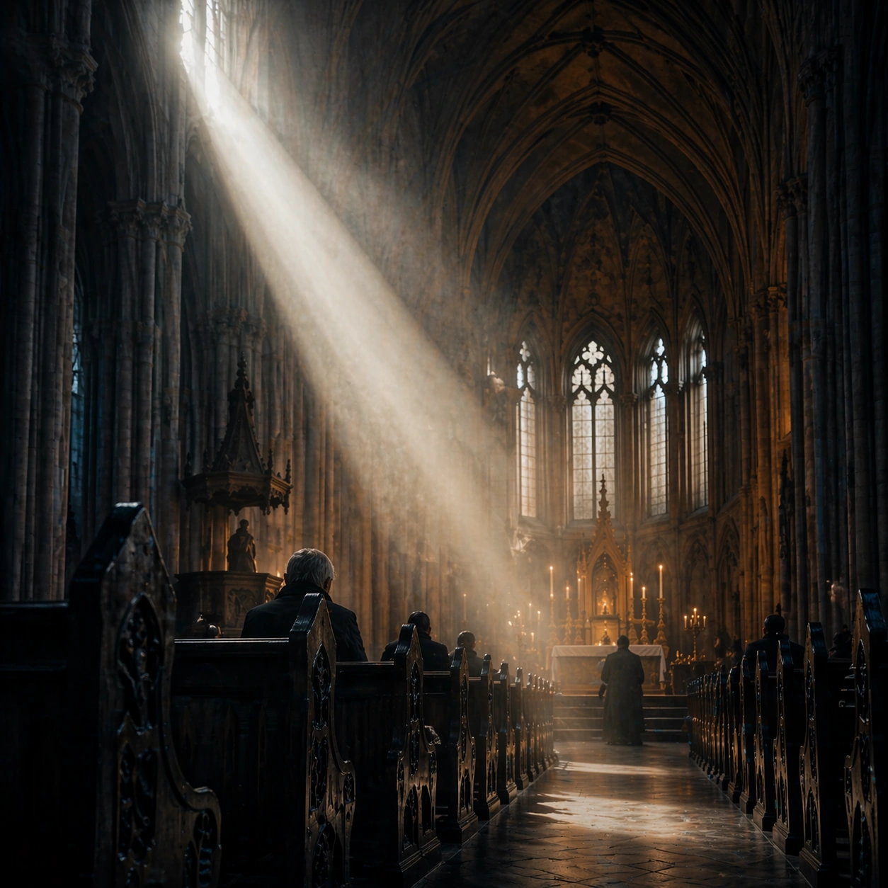

```text
Scene:
Create a square cinematic still for Cathedral Light Beam of Worship. Use production-grade photoreal lighting, disciplined lens behavior, and a composition that feels like a finished key frame from an original film rather than a casual snapshot. A vast Gothic nave is carved by one sharply defined shaft of early sun entering from high clerestory windows on the left, with cold blue shadows in the aisles, faint amber heat around the altar, and visibly suspended dust or incense in the air. Move the camera closer or lower so the viewer feels more embedded inside the atmosphere while the same light direction and environment remain intact.

Subject:
Build a coherent original scene whose emotional center comes from atmosphere, light physics, and spatial clarity. Avoid relying on celebrity likeness, franchise iconography, or stylized illustration shortcuts. Stone columns, ribbed vaults, carved pews, a restrained altar glow, and a few worshippers or attendants in silhouette should define the human scale without turning the image into a crowd scene or ceremony spectacle. Preserve the same world logic from the reference and let one human-scale or material-scale element become more prominent without stealing focus from the atmosphere.

Important details:
Preserve a believable physical world with strong depth layering, careful color separation, and premium image discipline. Treat the volumetric beam as the true protagonist, with physically coherent light falloff, believable bounce on worn stone, clean separation between shadow layers, and a solemn emotional register that feels sacred rather than theatrical. Keep the palette family, structural read, and light behavior from image 01 while increasing immediacy and tactile presence.

Use case:
Cathedral Beam series study 2/9.

Constraints:
No readable text, no watermark, no logos, preserve exact 1:1 aspect ratio, no fantasy creatures, no electric stage lights, no readable scripture, no tourist clutter, no exaggerated stained-glass rainbows.
```

[Pinned source](https://github.com/ChaosRealmsAI/gpt-image-2-gallery/blob/5296db8c996e38776c83a0bc8c64f848dcd512b3/works/topics/cathedral-light-beam-worship/packages/series-core-system/images/02-closer-frame/meta.json) · GPT Image2 · 1254×1254 · Reference images required. · ProjectD:[published and publicly accepted](https://aitoolsradar.com/en/prompts/dea333a0cb4a38)

## Spatial Counterpoint · cathedral-light-beam-worship/series-core-system/03-spatial-counterpoint

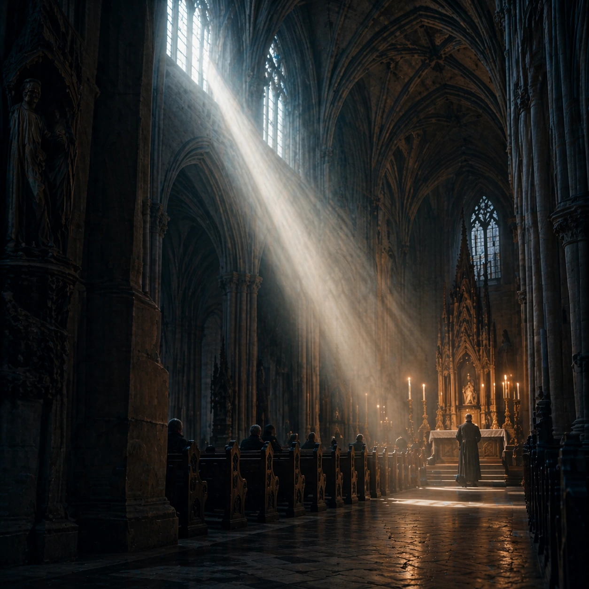

```text
Scene:
Create a square cinematic still for Cathedral Light Beam of Worship. Use production-grade photoreal lighting, disciplined lens behavior, and a composition that feels like a finished key frame from an original film rather than a casual snapshot. A vast Gothic nave is carved by one sharply defined shaft of early sun entering from high clerestory windows on the left, with cold blue shadows in the aisles, faint amber heat around the altar, and visibly suspended dust or incense in the air. Shift to an oblique or lateral point of view that reveals different depth layers while staying inside the same place and the same atmospheric event.

Subject:
Build a coherent original scene whose emotional center comes from atmosphere, light physics, and spatial clarity. Avoid relying on celebrity likeness, franchise iconography, or stylized illustration shortcuts. Stone columns, ribbed vaults, carved pews, a restrained altar glow, and a few worshippers or attendants in silhouette should define the human scale without turning the image into a crowd scene or ceremony spectacle. Hold the reference structure, but use the new angle to show secondary planes, foreground interruption, or a changed distance relationship.

Important details:
Preserve a believable physical world with strong depth layering, careful color separation, and premium image discipline. Treat the volumetric beam as the true protagonist, with physically coherent light falloff, believable bounce on worn stone, clean separation between shadow layers, and a solemn emotional register that feels sacred rather than theatrical. The success condition is continuity with the reference plus a richer sense of depth, not a new location or a new lighting system.

Use case:
Cathedral Beam series study 3/9.

Constraints:
No readable text, no watermark, no logos, preserve exact 1:1 aspect ratio, no fantasy creatures, no electric stage lights, no readable scripture, no tourist clutter, no exaggerated stained-glass rainbows.
```

[Pinned source](https://github.com/ChaosRealmsAI/gpt-image-2-gallery/blob/5296db8c996e38776c83a0bc8c64f848dcd512b3/works/topics/cathedral-light-beam-worship/packages/series-core-system/images/03-spatial-counterpoint/meta.json) · GPT Image2 · 1254×1254 · Reference images required. · ProjectD:[published and publicly accepted](https://aitoolsradar.com/en/prompts/44ab90fde5a88b)

## Climax Frame · cathedral-light-beam-worship/series-core-system/04-climax-frame

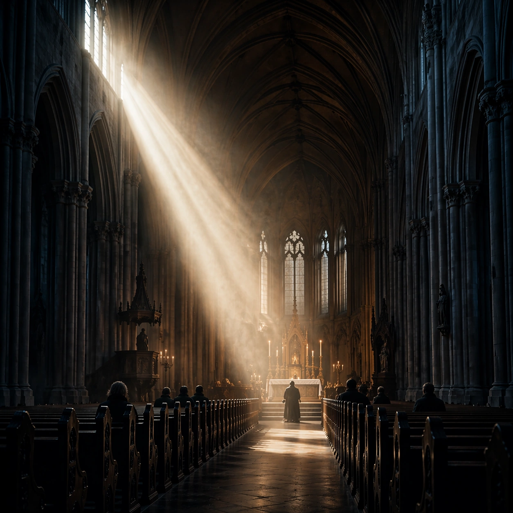

```text
Scene:
Create a square cinematic still for Cathedral Light Beam of Worship. Use production-grade photoreal lighting, disciplined lens behavior, and a composition that feels like a finished key frame from an original film rather than a casual snapshot. A vast Gothic nave is carved by one sharply defined shaft of early sun entering from high clerestory windows on the left, with cold blue shadows in the aisles, faint amber heat around the altar, and visibly suspended dust or incense in the air. Push the composition toward the emotional peak of the same setup, with the most dramatic balance of brightness, shadow, or atmospheric density inside the established world.

Subject:
Build a coherent original scene whose emotional center comes from atmosphere, light physics, and spatial clarity. Avoid relying on celebrity likeness, franchise iconography, or stylized illustration shortcuts. Stone columns, ribbed vaults, carved pews, a restrained altar glow, and a few worshippers or attendants in silhouette should define the human scale without turning the image into a crowd scene or ceremony spectacle. Everything should still read as the same location and same event, but framed for maximum narrative force and visual closure.

Important details:
Preserve a believable physical world with strong depth layering, careful color separation, and premium image discipline. Treat the volumetric beam as the true protagonist, with physically coherent light falloff, believable bounce on worn stone, clean separation between shadow layers, and a solemn emotional register that feels sacred rather than theatrical. Make it feel like the strongest hero frame of the sequence without breaking continuity or introducing a new design language.

Use case:
Cathedral Beam series study 4/9.

Constraints:
No readable text, no watermark, no logos, preserve exact 1:1 aspect ratio, no fantasy creatures, no electric stage lights, no readable scripture, no tourist clutter, no exaggerated stained-glass rainbows.
```

[Pinned source](https://github.com/ChaosRealmsAI/gpt-image-2-gallery/blob/5296db8c996e38776c83a0bc8c64f848dcd512b3/works/topics/cathedral-light-beam-worship/packages/series-core-system/images/04-climax-frame/meta.json) · GPT Image2 · 1254×1254 · Reference images required. · ProjectD:[published and publicly accepted](https://aitoolsradar.com/en/prompts/e6e85bc2cd559b)

## Surface Study · cathedral-light-beam-worship/single-support-studies/surface-study

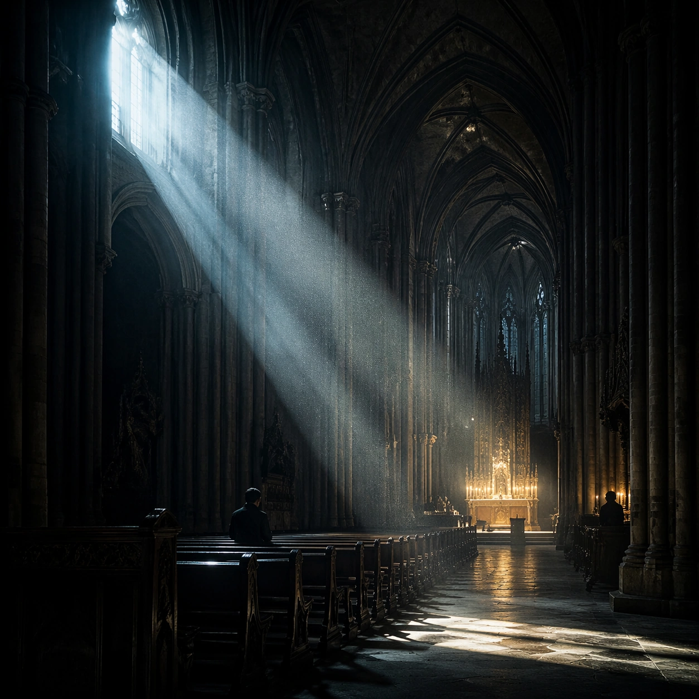

```text
Scene:
Create a square cinematic still for Cathedral Light Beam of Worship. Use production-grade photoreal lighting, disciplined lens behavior, and a composition that feels like a finished key frame from an original film rather than a casual snapshot. A vast Gothic nave is carved by one sharply defined shaft of early sun entering from high clerestory windows on the left, with cold blue shadows in the aisles, faint amber heat around the altar, and visibly suspended dust or incense in the air. Build an independent square study around the way atmosphere interacts with surfaces, keeping enough environmental context for the image to feel finished rather than cropped at random.

Subject:
Build a coherent original scene whose emotional center comes from atmosphere, light physics, and spatial clarity. Avoid relying on celebrity likeness, franchise iconography, or stylized illustration shortcuts. Stone columns, ribbed vaults, carved pews, a restrained altar glow, and a few worshippers or attendants in silhouette should define the human scale without turning the image into a crowd scene or ceremony spectacle. Let textures, reflections, residue, moisture, dust, or particulate response become primary, while the broader setting remains clearly implied.

Important details:
Preserve a believable physical world with strong depth layering, careful color separation, and premium image discipline. Treat the volumetric beam as the true protagonist, with physically coherent light falloff, believable bounce on worn stone, clean separation between shadow layers, and a solemn emotional register that feels sacred rather than theatrical. The key is material credibility under dramatic light, with micro-contrast and controlled mood supporting the theme.

Use case:
Cathedral Beam single study 5/9.

Constraints:
No readable text, no watermark, no logos, preserve exact 1:1 aspect ratio, no fantasy creatures, no electric stage lights, no readable scripture, no tourist clutter, no exaggerated stained-glass rainbows.
```

[Pinned source](https://github.com/ChaosRealmsAI/gpt-image-2-gallery/blob/5296db8c996e38776c83a0bc8c64f848dcd512b3/works/topics/cathedral-light-beam-worship/packages/single-support-studies/images/surface-study/meta.json) · GPT Image2 · 1254×1254 · No source-declared image dependencies. · ProjectD:[published and publicly accepted](https://aitoolsradar.com/en/prompts/3d956bee5abe69)

## Silhouette Study · cathedral-light-beam-worship/single-support-studies/silhouette-study

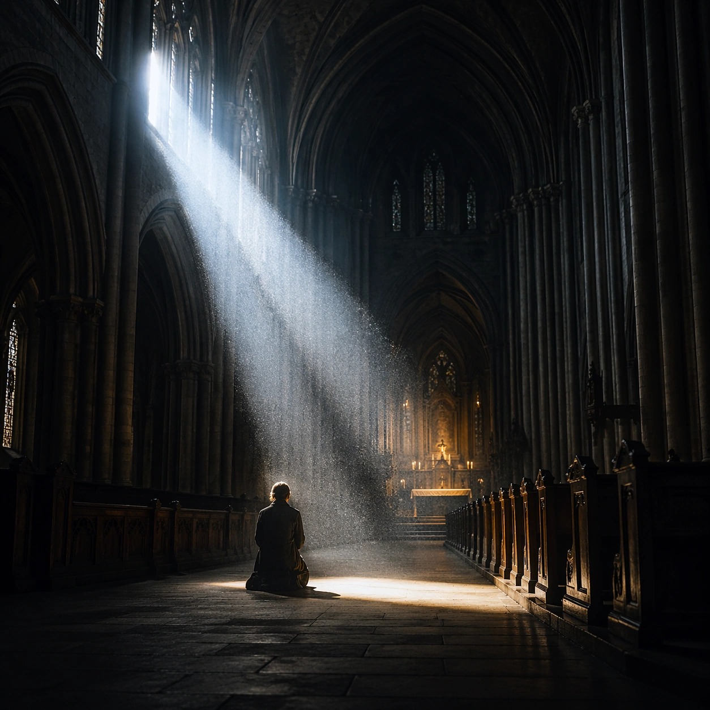

```text
Scene:
Create a square cinematic still for Cathedral Light Beam of Worship. Use production-grade photoreal lighting, disciplined lens behavior, and a composition that feels like a finished key frame from an original film rather than a casual snapshot. A vast Gothic nave is carved by one sharply defined shaft of early sun entering from high clerestory windows on the left, with cold blue shadows in the aisles, faint amber heat around the altar, and visibly suspended dust or incense in the air. Compose an independent frame where one human, animal, or object silhouette negotiates with the atmospheric light event in a clean, readable way.

Subject:
Build a coherent original scene whose emotional center comes from atmosphere, light physics, and spatial clarity. Avoid relying on celebrity likeness, franchise iconography, or stylized illustration shortcuts. Stone columns, ribbed vaults, carved pews, a restrained altar glow, and a few worshippers or attendants in silhouette should define the human scale without turning the image into a crowd scene or ceremony spectacle. The silhouette should supply scale and emotional orientation, but the environment still needs to carry most of the storytelling weight.

Important details:
Preserve a believable physical world with strong depth layering, careful color separation, and premium image discipline. Treat the volumetric beam as the true protagonist, with physically coherent light falloff, believable bounce on worn stone, clean separation between shadow layers, and a solemn emotional register that feels sacred rather than theatrical. Keep the silhouette simple and believable, avoiding poster-like graphic flattening while preserving strong contrast.

Use case:
Cathedral Beam single study 6/9.

Constraints:
No readable text, no watermark, no logos, preserve exact 1:1 aspect ratio, no fantasy creatures, no electric stage lights, no readable scripture, no tourist clutter, no exaggerated stained-glass rainbows.
```

[Pinned source](https://github.com/ChaosRealmsAI/gpt-image-2-gallery/blob/5296db8c996e38776c83a0bc8c64f848dcd512b3/works/topics/cathedral-light-beam-worship/packages/single-support-studies/images/silhouette-study/meta.json) · GPT Image2 · 1254×1254 · No source-declared image dependencies. · ProjectD:[published and publicly accepted](https://aitoolsradar.com/en/prompts/c002a1685ae7dd)

## Transition Study · cathedral-light-beam-worship/single-support-studies/transition-study

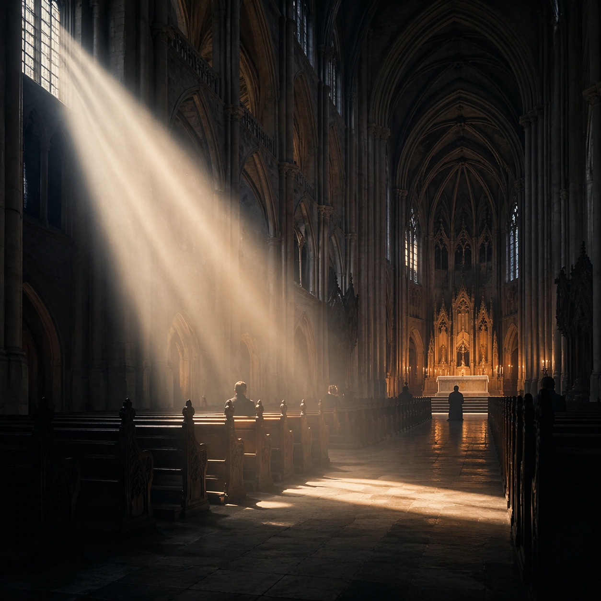

```text
Scene:
Create a square cinematic still for Cathedral Light Beam of Worship. Use production-grade photoreal lighting, disciplined lens behavior, and a composition that feels like a finished key frame from an original film rather than a casual snapshot. A vast Gothic nave is carved by one sharply defined shaft of early sun entering from high clerestory windows on the left, with cold blue shadows in the aisles, faint amber heat around the altar, and visibly suspended dust or incense in the air. Treat this as an adjacent moment before or after the main event, preserving the same topic language while letting the atmosphere shift slightly in intensity or position.

Subject:
Build a coherent original scene whose emotional center comes from atmosphere, light physics, and spatial clarity. Avoid relying on celebrity likeness, franchise iconography, or stylized illustration shortcuts. Stone columns, ribbed vaults, carved pews, a restrained altar glow, and a few worshippers or attendants in silhouette should define the human scale without turning the image into a crowd scene or ceremony spectacle. Show the environment in transition, with clear evidence of recent motion, changing weather, or fading light, but without turning it into action spectacle.

Important details:
Preserve a believable physical world with strong depth layering, careful color separation, and premium image discipline. Treat the volumetric beam as the true protagonist, with physically coherent light falloff, believable bounce on worn stone, clean separation between shadow layers, and a solemn emotional register that feels sacred rather than theatrical. Subtle temporal storytelling matters here more than maximal drama, so let traces, gradients, and environmental residue do the work.

Use case:
Cathedral Beam single study 7/9.

Constraints:
No readable text, no watermark, no logos, preserve exact 1:1 aspect ratio, no fantasy creatures, no electric stage lights, no readable scripture, no tourist clutter, no exaggerated stained-glass rainbows.
```

[Pinned source](https://github.com/ChaosRealmsAI/gpt-image-2-gallery/blob/5296db8c996e38776c83a0bc8c64f848dcd512b3/works/topics/cathedral-light-beam-worship/packages/single-support-studies/images/transition-study/meta.json) · GPT Image2 · 1254×1254 · No source-declared image dependencies. · ProjectD:[published and publicly accepted](https://aitoolsradar.com/en/prompts/eae2f79c5732fa)

## Wide Study · cathedral-light-beam-worship/single-support-studies/wide-study


```text
Scene:
Create a square cinematic still for Cathedral Light Beam of Worship. Use production-grade photoreal lighting, disciplined lens behavior, and a composition that feels like a finished key frame from an original film rather than a casual snapshot. A vast Gothic nave is carved by one sharply defined shaft of early sun entering from high clerestory windows on the left, with cold blue shadows in the aisles, faint amber heat around the altar, and visibly suspended dust or incense in the air. Pull back enough to explain the broader geography or architectural envelope while keeping the square crop intentional and balanced.

Subject:
Build a coherent original scene whose emotional center comes from atmosphere, light physics, and spatial clarity. Avoid relying on celebrity likeness, franchise iconography, or stylized illustration shortcuts. Stone columns, ribbed vaults, carved pews, a restrained altar glow, and a few worshippers or attendants in silhouette should define the human scale without turning the image into a crowd scene or ceremony spectacle. The wider frame should reveal how the main light or weather phenomenon organizes the surrounding world and not just the immediate subject.

Important details:
Preserve a believable physical world with strong depth layering, careful color separation, and premium image discipline. Treat the volumetric beam as the true protagonist, with physically coherent light falloff, believable bounce on worn stone, clean separation between shadow layers, and a solemn emotional register that feels sacred rather than theatrical. Make scale legible through spacing, horizon control, and foreground-to-background separation rather than through extra props.

Use case:
Cathedral Beam single study 8/9.

Constraints:
No readable text, no watermark, no logos, preserve exact 1:1 aspect ratio, no fantasy creatures, no electric stage lights, no readable scripture, no tourist clutter, no exaggerated stained-glass rainbows.
```

[Pinned source](https://github.com/ChaosRealmsAI/gpt-image-2-gallery/blob/5296db8c996e38776c83a0bc8c64f848dcd512b3/works/topics/cathedral-light-beam-worship/packages/single-support-studies/images/wide-study/meta.json) · GPT Image2 · 1254×1254 · No source-declared image dependencies. · ProjectD:[published and publicly accepted](https://aitoolsradar.com/en/prompts/f10c4fcc9f3c1c)

## Afterglow Study · cathedral-light-beam-worship/single-support-studies/afterglow-study


```text
Scene:
Create a square cinematic still for Cathedral Light Beam of Worship. Use production-grade photoreal lighting, disciplined lens behavior, and a composition that feels like a finished key frame from an original film rather than a casual snapshot. A vast Gothic nave is carved by one sharply defined shaft of early sun entering from high clerestory windows on the left, with cold blue shadows in the aisles, faint amber heat around the altar, and visibly suspended dust or incense in the air. End on a quieter independent image that holds the residue of the topic atmosphere after its loudest moment has passed, while still feeling complete and exhibition-ready.

Subject:
Build a coherent original scene whose emotional center comes from atmosphere, light physics, and spatial clarity. Avoid relying on celebrity likeness, franchise iconography, or stylized illustration shortcuts. Stone columns, ribbed vaults, carved pews, a restrained altar glow, and a few worshippers or attendants in silhouette should define the human scale without turning the image into a crowd scene or ceremony spectacle. The frame should suggest memory, aftermath, or lingering presence through environment first and only secondarily through any figure or object.

Important details:
Preserve a believable physical world with strong depth layering, careful color separation, and premium image discipline. Treat the volumetric beam as the true protagonist, with physically coherent light falloff, believable bounce on worn stone, clean separation between shadow layers, and a solemn emotional register that feels sacred rather than theatrical. Favor restraint, believable light decay, and subtle narrative closure over spectacle or decorative excess.

Use case:
Cathedral Beam single study 9/9.

Constraints:
No readable text, no watermark, no logos, preserve exact 1:1 aspect ratio, no fantasy creatures, no electric stage lights, no readable scripture, no tourist clutter, no exaggerated stained-glass rainbows.
```

[Pinned source](https://github.com/ChaosRealmsAI/gpt-image-2-gallery/blob/5296db8c996e38776c83a0bc8c64f848dcd512b3/works/topics/cathedral-light-beam-worship/packages/single-support-studies/images/afterglow-study/meta.json) · GPT Image2 · 1254×1254 · No source-declared image dependencies. · ProjectD:[published and publicly accepted](https://aitoolsradar.com/en/prompts/8ad8f9e03f618b)

## Zodiac Roundel · celestial-chart-renaissance/single-celestial-chart-studies/01-zodiac-roundel


```text
Scene:
Compose a square celestial chart as if it were a carefully restored historical plate viewed perfectly flat to the viewer. The image should combine parchment authority, measured circular layout, and precise star placement with enough visual richness to feel like a collector-grade cosmological artifact rather than a generic map graphic. Render it as a prestigious parchment chart with warm ivory paper and delicate gold accents. Keep the square crop exact, the camera flat, and the tonal design disciplined enough that structure stays clear at poster scale and under close inspection.

Subject:
Use a zodiac wheel, star field, coordinate arcs, and astrolabe-like structures to organize mythic constellation figures across the page. The figures should arise from the constellations with graceful economy, while the astronomical scaffolding remains clear enough that the image still feels like serious cartography instead of fantasy painting. Focus this variation on a grand roundel centered on the zodiac with mythic figures braided into a disciplined astronomical wheel. The composition should feel complete and singular, as though one finished artifact has been resolved with full conviction rather than one fragment pulled from a larger sheet.

Important details:
Hierarchy is critical. Keep the star field ordered, the circular bands centered, and the corner instruments disciplined. Use gold, sepia, lapis, and faded ivory in controlled balance, reserving the strongest accents for major constellations, cardinal axes, and instrument joints. Annotation-like marks must remain abstract and unreadable. Keep the circular bands exact and the figures proportional, so the map still reads first as a chart and second as a picture. Preserve crisp edge behavior, stable hierarchy, and enough fine information that the image rewards slow viewing without losing the main read from a distance.

Use case:
Celestial Chart single study 1/9, designed as a self-contained sacred-geometry image with a distinct material and compositional emphasis.

Constraints:
No readable text, no watermark, no logos, preserve exact 1:1 aspect ratio, no random modern infographic styling, no readable labels, no distorted zodiac wheel, no cartoon myth figures, no scattered stars without logic, no theatrical cloud wallpaper, no horoscope poster vibe, no broken ring symmetry, no readable signs.
```

[Pinned source](https://github.com/ChaosRealmsAI/gpt-image-2-gallery/blob/5296db8c996e38776c83a0bc8c64f848dcd512b3/works/topics/celestial-chart-renaissance/packages/single-celestial-chart-studies/images/01-zodiac-roundel/meta.json) · GPT Image2 · 1254×1254 · No source-declared image dependencies. · ProjectD:**Held:** Source asks precise astronomical star positions, stable polar/zodiac structure and exact instrument geometry; generated constellation/star mapping is not independently validated for cartographic or educational use. Retain full artwork/prompt in archive; hold functional astronomy acceptance.

## Polar Heavens Sheet · celestial-chart-renaissance/single-celestial-chart-studies/02-polar-heavens-sheet


```text
Scene:
Compose a square celestial chart as if it were a carefully restored historical plate viewed perfectly flat to the viewer. The image should combine parchment authority, measured circular layout, and precise star placement with enough visual richness to feel like a collector-grade cosmological artifact rather than a generic map graphic. Use cooler blue-black star field tones over aged parchment, always viewed head on. Keep the square crop exact, the camera flat, and the tonal design disciplined enough that structure stays clear at poster scale and under close inspection.

Subject:
Use a zodiac wheel, star field, coordinate arcs, and astrolabe-like structures to organize mythic constellation figures across the page. The figures should arise from the constellations with graceful economy, while the astronomical scaffolding remains clear enough that the image still feels like serious cartography instead of fantasy painting. Focus this variation on a polar-focused chart where the heavens revolve around a stable northern center and circumpolar figures. The composition should feel complete and singular, as though one finished artifact has been resolved with full conviction rather than one fragment pulled from a larger sheet.

Important details:
Hierarchy is critical. Keep the star field ordered, the circular bands centered, and the corner instruments disciplined. Use gold, sepia, lapis, and faded ivory in controlled balance, reserving the strongest accents for major constellations, cardinal axes, and instrument joints. Annotation-like marks must remain abstract and unreadable. The polar geometry must remain stable and convincing, with concentric guidance arcs anchoring the figurative constellations. Preserve crisp edge behavior, stable hierarchy, and enough fine information that the image rewards slow viewing without losing the main read from a distance.

Use case:
Celestial Chart single study 2/9, designed as a self-contained sacred-geometry image with a distinct material and compositional emphasis.

Constraints:
No readable text, no watermark, no logos, preserve exact 1:1 aspect ratio, no random modern infographic styling, no readable labels, no distorted zodiac wheel, no cartoon myth figures, no scattered stars without logic, no theatrical cloud wallpaper, no swirling galaxy background, no drifting pole, no random aurora effects.
```

[Pinned source](https://github.com/ChaosRealmsAI/gpt-image-2-gallery/blob/5296db8c996e38776c83a0bc8c64f848dcd512b3/works/topics/celestial-chart-renaissance/packages/single-celestial-chart-studies/images/02-polar-heavens-sheet/meta.json) · GPT Image2 · 1254×1254 · No source-declared image dependencies. · ProjectD:**Held:** Source asks precise astronomical star positions, stable polar/zodiac structure and exact instrument geometry; generated constellation/star mapping is not independently validated for cartographic or educational use. Retain full artwork/prompt in archive; hold functional astronomy acceptance.

## Astrolabe Corner Compendium · celestial-chart-renaissance/single-celestial-chart-studies/03-astrolabe-corner-compendium


```text
Scene:
Compose a square celestial chart as if it were a carefully restored historical plate viewed perfectly flat to the viewer. The image should combine parchment authority, measured circular layout, and precise star placement with enough visual richness to feel like a collector-grade cosmological artifact rather than a generic map graphic. Keep the corners active but subordinate, like a scholar's page designed by a master engraver. Keep the square crop exact, the camera flat, and the tonal design disciplined enough that structure stays clear at poster scale and under close inspection.

Subject:
Use a zodiac wheel, star field, coordinate arcs, and astrolabe-like structures to organize mythic constellation figures across the page. The figures should arise from the constellations with graceful economy, while the astronomical scaffolding remains clear enough that the image still feels like serious cartography instead of fantasy painting. Focus this variation on a sheet where the central sky map is supported by four disciplined corner instrument studies. The composition should feel complete and singular, as though one finished artifact has been resolved with full conviction rather than one fragment pulled from a larger sheet.

Important details:
Hierarchy is critical. Keep the star field ordered, the circular bands centered, and the corner instruments disciplined. Use gold, sepia, lapis, and faded ivory in controlled balance, reserving the strongest accents for major constellations, cardinal axes, and instrument joints. Annotation-like marks must remain abstract and unreadable. Each corner device should echo the logic of the central chart and remain non-readable, abstract, and mechanically plausible. Preserve crisp edge behavior, stable hierarchy, and enough fine information that the image rewards slow viewing without losing the main read from a distance.

Use case:
Celestial Chart single study 3/9, designed as a self-contained sacred-geometry image with a distinct material and compositional emphasis.

Constraints:
No readable text, no watermark, no logos, preserve exact 1:1 aspect ratio, no random modern infographic styling, no readable labels, no distorted zodiac wheel, no cartoon myth figures, no scattered stars without logic, no theatrical cloud wallpaper, no readable measurements, no cluttered margins, no lopsided corners.
```

[Pinned source](https://github.com/ChaosRealmsAI/gpt-image-2-gallery/blob/5296db8c996e38776c83a0bc8c64f848dcd512b3/works/topics/celestial-chart-renaissance/packages/single-celestial-chart-studies/images/03-astrolabe-corner-compendium/meta.json) · GPT Image2 · 1254×1254 · No source-declared image dependencies. · ProjectD:**Held:** Source asks precise astronomical star positions, stable polar/zodiac structure and exact instrument geometry; generated constellation/star mapping is not independently validated for cartographic or educational use. Retain full artwork/prompt in archive; hold functional astronomy acceptance.

## Midnight Observatory Map · celestial-chart-renaissance/single-celestial-chart-studies/04-midnight-observatory-map


```text
Scene:
Compose a square celestial chart as if it were a carefully restored historical plate viewed perfectly flat to the viewer. The image should combine parchment authority, measured circular layout, and precise star placement with enough visual richness to feel like a collector-grade cosmological artifact rather than a generic map graphic. Use deep indigo, silver, and old parchment browns, keeping the camera flat and the mood quiet. Keep the square crop exact, the camera flat, and the tonal design disciplined enough that structure stays clear at poster scale and under close inspection.

Subject:
Use a zodiac wheel, star field, coordinate arcs, and astrolabe-like structures to organize mythic constellation figures across the page. The figures should arise from the constellations with graceful economy, while the astronomical scaffolding remains clear enough that the image still feels like serious cartography instead of fantasy painting. Focus this variation on a darker chart with silver stars, pale figures, and a hushed observatory mood built on exact geometry. The composition should feel complete and singular, as though one finished artifact has been resolved with full conviction rather than one fragment pulled from a larger sheet.

Important details:
Hierarchy is critical. Keep the star field ordered, the circular bands centered, and the corner instruments disciplined. Use gold, sepia, lapis, and faded ivory in controlled balance, reserving the strongest accents for major constellations, cardinal axes, and instrument joints. Annotation-like marks must remain abstract and unreadable. Night atmosphere should heighten focus, not obscure the relationship between star positions, circular bands, and corner instruments. Preserve crisp edge behavior, stable hierarchy, and enough fine information that the image rewards slow viewing without losing the main read from a distance.

Use case:
Celestial Chart single study 4/9, designed as a self-contained sacred-geometry image with a distinct material and compositional emphasis.

Constraints:
No readable text, no watermark, no logos, preserve exact 1:1 aspect ratio, no random modern infographic styling, no readable labels, no distorted zodiac wheel, no cartoon myth figures, no scattered stars without logic, no theatrical cloud wallpaper, no telescope room scene, no cinematic moon glow, no fuzzy star clusters.
```

[Pinned source](https://github.com/ChaosRealmsAI/gpt-image-2-gallery/blob/5296db8c996e38776c83a0bc8c64f848dcd512b3/works/topics/celestial-chart-renaissance/packages/single-celestial-chart-studies/images/04-midnight-observatory-map/meta.json) · GPT Image2 · 1254×1254 · No source-declared image dependencies. · ProjectD:**Held:** Source asks precise astronomical star positions, stable polar/zodiac structure and exact instrument geometry; generated constellation/star mapping is not independently validated for cartographic or educational use. Retain full artwork/prompt in archive; hold functional astronomy acceptance.

## Gilded Equinox Plate · celestial-chart-renaissance/single-celestial-chart-studies/05-gilded-equinox-plate


```text
Scene:
Compose a square celestial chart as if it were a carefully restored historical plate viewed perfectly flat to the viewer. The image should combine parchment authority, measured circular layout, and precise star placement with enough visual richness to feel like a collector-grade cosmological artifact rather than a generic map graphic. Present the page like a formal commemorative plate with restrained gold leaf and stable axis alignment. Keep the square crop exact, the camera flat, and the tonal design disciplined enough that structure stays clear at poster scale and under close inspection.

Subject:
Use a zodiac wheel, star field, coordinate arcs, and astrolabe-like structures to organize mythic constellation figures across the page. The figures should arise from the constellations with graceful economy, while the astronomical scaffolding remains clear enough that the image still feels like serious cartography instead of fantasy painting. Focus this variation on a luminous equinox study balancing day-night tonality across a perfectly centered celestial wheel. The composition should feel complete and singular, as though one finished artifact has been resolved with full conviction rather than one fragment pulled from a larger sheet.

Important details:
Hierarchy is critical. Keep the star field ordered, the circular bands centered, and the corner instruments disciplined. Use gold, sepia, lapis, and faded ivory in controlled balance, reserving the strongest accents for major constellations, cardinal axes, and instrument joints. Annotation-like marks must remain abstract and unreadable. The split in tonality should support the equinox idea while preserving unified chart readability and exact circle registration. Preserve crisp edge behavior, stable hierarchy, and enough fine information that the image rewards slow viewing without losing the main read from a distance.

Use case:
Celestial Chart single study 5/9, designed as a self-contained sacred-geometry image with a distinct material and compositional emphasis.

Constraints:
No readable text, no watermark, no logos, preserve exact 1:1 aspect ratio, no random modern infographic styling, no readable labels, no distorted zodiac wheel, no cartoon myth figures, no scattered stars without logic, no theatrical cloud wallpaper, no half-page collage seam, no sunrise landscape, no decorative ribbons.
```

[Pinned source](https://github.com/ChaosRealmsAI/gpt-image-2-gallery/blob/5296db8c996e38776c83a0bc8c64f848dcd512b3/works/topics/celestial-chart-renaissance/packages/single-celestial-chart-studies/images/05-gilded-equinox-plate/meta.json) · GPT Image2 · 1254×1254 · No source-declared image dependencies. · ProjectD:**Held:** Source asks precise astronomical star positions, stable polar/zodiac structure and exact instrument geometry; generated constellation/star mapping is not independently validated for cartographic or educational use. Retain full artwork/prompt in archive; hold functional astronomy acceptance.

## Sea Navigation Sky · celestial-chart-renaissance/single-celestial-chart-studies/06-sea-navigation-sky


```text
Scene:
Compose a square celestial chart as if it were a carefully restored historical plate viewed perfectly flat to the viewer. The image should combine parchment authority, measured circular layout, and precise star placement with enough visual richness to feel like a collector-grade cosmological artifact rather than a generic map graphic. Render it as a parchment sea-sky atlas sheet with elegant curves and no perspective tilt. Keep the square crop exact, the camera flat, and the tonal design disciplined enough that structure stays clear at poster scale and under close inspection.

Subject:
Use a zodiac wheel, star field, coordinate arcs, and astrolabe-like structures to organize mythic constellation figures across the page. The figures should arise from the constellations with graceful economy, while the astronomical scaffolding remains clear enough that the image still feels like serious cartography instead of fantasy painting. Focus this variation on a chart that links the heavens to sea navigation through disciplined horizon arcs and marine instrument cues. The composition should feel complete and singular, as though one finished artifact has been resolved with full conviction rather than one fragment pulled from a larger sheet.

Important details:
Hierarchy is critical. Keep the star field ordered, the circular bands centered, and the corner instruments disciplined. Use gold, sepia, lapis, and faded ivory in controlled balance, reserving the strongest accents for major constellations, cardinal axes, and instrument joints. Annotation-like marks must remain abstract and unreadable. Keep the celestial map dominant, using the navigation cues only to add practical intelligence and worldliness. Preserve crisp edge behavior, stable hierarchy, and enough fine information that the image rewards slow viewing without losing the main read from a distance.

Use case:
Celestial Chart single study 6/9, designed as a self-contained sacred-geometry image with a distinct material and compositional emphasis.

Constraints:
No readable text, no watermark, no logos, preserve exact 1:1 aspect ratio, no random modern infographic styling, no readable labels, no distorted zodiac wheel, no cartoon myth figures, no scattered stars without logic, no theatrical cloud wallpaper, no ships, no readable coast names, no storm painting backdrop.
```

[Pinned source](https://github.com/ChaosRealmsAI/gpt-image-2-gallery/blob/5296db8c996e38776c83a0bc8c64f848dcd512b3/works/topics/celestial-chart-renaissance/packages/single-celestial-chart-studies/images/06-sea-navigation-sky/meta.json) · GPT Image2 · 1254×1254 · No source-declared image dependencies. · ProjectD:**Held:** Source requests precise astronomical/cartographic structure; actual generated star positions and instrument geometry are unverified for navigation or educational accuracy. Archive retained; functional astronomy approval held.

## Clouded Parchment Horizon · celestial-chart-renaissance/single-celestial-chart-studies/07-clouded-parchment-horizon


```text
Scene:
Compose a square celestial chart as if it were a carefully restored historical plate viewed perfectly flat to the viewer. The image should combine parchment authority, measured circular layout, and precise star placement with enough visual richness to feel like a collector-grade cosmological artifact rather than a generic map graphic. Use pale cloud washes and subtle wear as atmospheric support around a firm circular star system. Keep the square crop exact, the camera flat, and the tonal design disciplined enough that structure stays clear at poster scale and under close inspection.

Subject:
Use a zodiac wheel, star field, coordinate arcs, and astrolabe-like structures to organize mythic constellation figures across the page. The figures should arise from the constellations with graceful economy, while the astronomical scaffolding remains clear enough that the image still feels like serious cartography instead of fantasy painting. Focus this variation on a softer parchment chart where faint cloud bands frame the map without disturbing the geometry. The composition should feel complete and singular, as though one finished artifact has been resolved with full conviction rather than one fragment pulled from a larger sheet.

Important details:
Hierarchy is critical. Keep the star field ordered, the circular bands centered, and the corner instruments disciplined. Use gold, sepia, lapis, and faded ivory in controlled balance, reserving the strongest accents for major constellations, cardinal axes, and instrument joints. Annotation-like marks must remain abstract and unreadable. Clouds should never cover major constellations or ring joints; the chart must remain authoritative first and atmospheric second. Preserve crisp edge behavior, stable hierarchy, and enough fine information that the image rewards slow viewing without losing the main read from a distance.

Use case:
Celestial Chart single study 7/9, designed as a self-contained sacred-geometry image with a distinct material and compositional emphasis.

Constraints:
No readable text, no watermark, no logos, preserve exact 1:1 aspect ratio, no random modern infographic styling, no readable labels, no distorted zodiac wheel, no cartoon myth figures, no scattered stars without logic, no theatrical cloud wallpaper, no dramatic tempest sky, no blurry page, no melted figure edges.
```

[Pinned source](https://github.com/ChaosRealmsAI/gpt-image-2-gallery/blob/5296db8c996e38776c83a0bc8c64f848dcd512b3/works/topics/celestial-chart-renaissance/packages/single-celestial-chart-studies/images/07-clouded-parchment-horizon/meta.json) · GPT Image2 · 1254×1254 · No source-declared image dependencies. · ProjectD:**Held:** Source requests precise astronomical/cartographic structure; actual generated star positions and instrument geometry are unverified for navigation or educational accuracy. Archive retained; functional astronomy approval held.

## Lapis Starfield Rose · celestial-chart-renaissance/single-celestial-chart-studies/08-lapis-starfield-rose


```text
Scene:
Compose a square celestial chart as if it were a carefully restored historical plate viewed perfectly flat to the viewer. The image should combine parchment authority, measured circular layout, and precise star placement with enough visual richness to feel like a collector-grade cosmological artifact rather than a generic map graphic. Keep the color sumptuous but structured, with the wheel perfectly centered inside the square frame. Keep the square crop exact, the camera flat, and the tonal design disciplined enough that structure stays clear at poster scale and under close inspection.

Subject:
Use a zodiac wheel, star field, coordinate arcs, and astrolabe-like structures to organize mythic constellation figures across the page. The figures should arise from the constellations with graceful economy, while the astronomical scaffolding remains clear enough that the image still feels like serious cartography instead of fantasy painting. Focus this variation on a jewel-toned plate where the celestial wheel becomes a lapis-and-gold rose of constellations and stars. The composition should feel complete and singular, as though one finished artifact has been resolved with full conviction rather than one fragment pulled from a larger sheet.

Important details:
Hierarchy is critical. Keep the star field ordered, the circular bands centered, and the corner instruments disciplined. Use gold, sepia, lapis, and faded ivory in controlled balance, reserving the strongest accents for major constellations, cardinal axes, and instrument joints. Annotation-like marks must remain abstract and unreadable. The lapis field should intensify the stars and figures while preserving the measured logic of a real chart. Preserve crisp edge behavior, stable hierarchy, and enough fine information that the image rewards slow viewing without losing the main read from a distance.

Use case:
Celestial Chart single study 8/9, designed as a self-contained sacred-geometry image with a distinct material and compositional emphasis.

Constraints:
No readable text, no watermark, no logos, preserve exact 1:1 aspect ratio, no random modern infographic styling, no readable labels, no distorted zodiac wheel, no cartoon myth figures, no scattered stars without logic, no theatrical cloud wallpaper, no gemstone poster excess, no random nebula background, no soft-focus gold dust.
```

[Pinned source](https://github.com/ChaosRealmsAI/gpt-image-2-gallery/blob/5296db8c996e38776c83a0bc8c64f848dcd512b3/works/topics/celestial-chart-renaissance/packages/single-celestial-chart-studies/images/08-lapis-starfield-rose/meta.json) · GPT Image2 · 1254×1254 · No source-declared image dependencies. · ProjectD:**Held:** Source requests precise astronomical/cartographic structure; actual generated star positions and instrument geometry are unverified for navigation or educational accuracy. Archive retained; functional astronomy approval held.

## Scholar Desk Chart · celestial-chart-renaissance/single-celestial-chart-studies/09-scholar-desk-chart


```text
Scene:
Compose a square celestial chart as if it were a carefully restored historical plate viewed perfectly flat to the viewer. The image should combine parchment authority, measured circular layout, and precise star placement with enough visual richness to feel like a collector-grade cosmological artifact rather than a generic map graphic. Present it almost like a flat lay but without perspective distortion, preserving the face-on integrity of the page. Keep the square crop exact, the camera flat, and the tonal design disciplined enough that structure stays clear at poster scale and under close inspection.

Subject:
Use a zodiac wheel, star field, coordinate arcs, and astrolabe-like structures to organize mythic constellation figures across the page. The figures should arise from the constellations with graceful economy, while the astronomical scaffolding remains clear enough that the image still feels like serious cartography instead of fantasy painting. Focus this variation on a composed archival study where the chart feels like a prized desk folio with instrument shadows and measured stillness. The composition should feel complete and singular, as though one finished artifact has been resolved with full conviction rather than one fragment pulled from a larger sheet.

Important details:
Hierarchy is critical. Keep the star field ordered, the circular bands centered, and the corner instruments disciplined. Use gold, sepia, lapis, and faded ivory in controlled balance, reserving the strongest accents for major constellations, cardinal axes, and instrument joints. Annotation-like marks must remain abstract and unreadable. Use subtle edge shadows and conservation wear only to make the sheet tactile; the star map itself must remain crisp and ordered. Preserve crisp edge behavior, stable hierarchy, and enough fine information that the image rewards slow viewing without losing the main read from a distance.

Use case:
Celestial Chart single study 9/9, designed as a self-contained sacred-geometry image with a distinct material and compositional emphasis.

Constraints:
No readable text, no watermark, no logos, preserve exact 1:1 aspect ratio, no random modern infographic styling, no readable labels, no distorted zodiac wheel, no cartoon myth figures, no scattered stars without logic, no theatrical cloud wallpaper, no cluttered desk props, no readable notes, no dramatic scene setting.
```

[Pinned source](https://github.com/ChaosRealmsAI/gpt-image-2-gallery/blob/5296db8c996e38776c83a0bc8c64f848dcd512b3/works/topics/celestial-chart-renaissance/packages/single-celestial-chart-studies/images/09-scholar-desk-chart/meta.json) · GPT Image2 · 1254×1254 · No source-declared image dependencies. · ProjectD:**Held:** Source requests precise astronomical/cartographic structure; actual generated star positions and instrument geometry are unverified for navigation or educational accuracy. Archive retained; functional astronomy approval held.

## Reference Featured Banner · character-banner-gacha-pool-visuals/series-gacha-banner-core/01-reference-featured-banner


```text
Scene:
A square premium key-art frame built for a reference-dependent production series. Stage a flagship featured-banner composition for one summon pool with high conversion energy with controlled lighting, clear silhouette separation, and a camera setup that feels deliberate enough for campaign reuse. The composition should carry strong focal hierarchy, believable depth, and polished surface behavior while still staying stable enough to support downstream dependent variations.

Subject:
Center the image on a flagship featured-banner composition for one summon pool with high conversion energy. The result should feel like a concrete, shippable asset for Character Banner Gacha Pool Visuals, not a generic fantasy render. Build the subject with layered materials, stable anatomy or engineering logic, and enough specificity that later images can inherit the same underlying identity. This image is the root reference that defines continuity for the rest of the series. The viewer should immediately understand what is being preserved across the sequence and what is changing in this particular beat.

Important details:
establish the hero identity, rarity frame language, and pool atmosphere that later assets must keep intact. Make continuity explicit through repeatable shape language, proportion control, and a coherent palette system. Changes in pose, angle, mood, rarity, weather, or layout should still feel downstream of one stable source. Avoid clutter that would confuse reference use. Any interface-like blocks or graphic surfaces must remain abstract and unreadable. Keep the image polished, original, and suitable for both gallery display and production review.

Use case:
Character Banner Gacha Pool Visuals series study 1/4, focused on reference featured banner.

Constraints:
No readable text, no watermark, no logos, preserve exact 1:1 aspect ratio, no readable rates, no logo lockups, no broken continuity, no off-model redesign, no accidental franchise resemblance.
```

[Pinned source](https://github.com/ChaosRealmsAI/gpt-image-2-gallery/blob/5296db8c996e38776c83a0bc8c64f848dcd512b3/works/topics/character-banner-gacha-pool-visuals/packages/series-gacha-banner-core/images/01-reference-featured-banner/meta.json) · GPT Image2 · 1254×1254 · No source-declared image dependencies. · ProjectD:[published and publicly accepted](https://aitoolsradar.com/en/prompts/41c60d87bf4ed0)

## Rate Up Card Strip · character-banner-gacha-pool-visuals/series-gacha-banner-core/02-rate-up-card-strip


```text
Scene:
A square premium key-art frame built for a reference-dependent production series. Stage the same pool translated into a card-strip style asset featuring the promoted unit in a tighter layout with controlled lighting, clear silhouette separation, and a camera setup that feels deliberate enough for campaign reuse. The composition should carry strong focal hierarchy, believable depth, and polished surface behavior while still staying stable enough to support downstream dependent variations.

Subject:
Center the image on the same pool translated into a card-strip style asset featuring the promoted unit in a tighter layout. The result should feel like a concrete, shippable asset for Character Banner Gacha Pool Visuals, not a generic fantasy render. Build the subject with layered materials, stable anatomy or engineering logic, and enough specificity that later images can inherit the same underlying identity. Preserve the same featured hero identity, pool theme, rarity framing, and summon color language from the reference banner from the reference image while changing only what this variation needs. The viewer should immediately understand what is being preserved across the sequence and what is changing in this particular beat.

Important details:
keep the same hero unmistakable while adapting the composition for a denser product surface. Make continuity explicit through repeatable shape language, proportion control, and a coherent palette system. Changes in pose, angle, mood, rarity, weather, or layout should still feel downstream of one stable source. Avoid clutter that would confuse reference use. Any interface-like blocks or graphic surfaces must remain abstract and unreadable. Keep the image polished, original, and suitable for both gallery display and production review.

Use case:
Character Banner Gacha Pool Visuals series study 2/4, focused on rate up card strip.

Constraints:
No readable text, no watermark, no logos, preserve exact 1:1 aspect ratio, no percentages, no text labels, no broken continuity, no off-model redesign, no accidental franchise resemblance.
```

[Pinned source](https://github.com/ChaosRealmsAI/gpt-image-2-gallery/blob/5296db8c996e38776c83a0bc8c64f848dcd512b3/works/topics/character-banner-gacha-pool-visuals/packages/series-gacha-banner-core/images/02-rate-up-card-strip/meta.json) · GPT Image2 · 1254×1254 · Reference images required. · ProjectD:[published and publicly accepted](https://aitoolsradar.com/en/prompts/fc8c985752e84d)

## Pity Explainer Crop · character-banner-gacha-pool-visuals/series-gacha-banner-core/03-pity-explainer-crop


```text
Scene:
A square premium key-art frame built for a reference-dependent production series. Stage the same summon pool adapted into an explainer-like crop that implies pity or guarantee mechanics without text with controlled lighting, clear silhouette separation, and a camera setup that feels deliberate enough for campaign reuse. The composition should carry strong focal hierarchy, believable depth, and polished surface behavior while still staying stable enough to support downstream dependent variations.

Subject:
Center the image on the same summon pool adapted into an explainer-like crop that implies pity or guarantee mechanics without text. The result should feel like a concrete, shippable asset for Character Banner Gacha Pool Visuals, not a generic fantasy render. Build the subject with layered materials, stable anatomy or engineering logic, and enough specificity that later images can inherit the same underlying identity. Preserve the same featured hero identity, pool theme, rarity framing, and summon color language from the reference banner from the reference image while changing only what this variation needs. The viewer should immediately understand what is being preserved across the sequence and what is changing in this particular beat.

Important details:
use abstract progress cues and premium framing without sacrificing hero visibility. Make continuity explicit through repeatable shape language, proportion control, and a coherent palette system. Changes in pose, angle, mood, rarity, weather, or layout should still feel downstream of one stable source. Avoid clutter that would confuse reference use. Any interface-like blocks or graphic surfaces must remain abstract and unreadable. Keep the image polished, original, and suitable for both gallery display and production review.

Use case:
Character Banner Gacha Pool Visuals series study 3/4, focused on pity explainer crop.

Constraints:
No readable text, no watermark, no logos, preserve exact 1:1 aspect ratio, no readable UI copy, no numerals, no broken continuity, no off-model redesign, no accidental franchise resemblance.
```

[Pinned source](https://github.com/ChaosRealmsAI/gpt-image-2-gallery/blob/5296db8c996e38776c83a0bc8c64f848dcd512b3/works/topics/character-banner-gacha-pool-visuals/packages/series-gacha-banner-core/images/03-pity-explainer-crop/meta.json) · GPT Image2 · 1254×1254 · Reference images required. · ProjectD:[published and publicly accepted](https://aitoolsradar.com/en/prompts/5506c5f55422f5)

## Summon Splash Poster · character-banner-gacha-pool-visuals/series-gacha-banner-core/04-summon-splash-poster


```text
Scene:
A square premium key-art frame built for a reference-dependent production series. Stage the same pool expanded into a splash poster that heightens desire and spectacle with controlled lighting, clear silhouette separation, and a camera setup that feels deliberate enough for campaign reuse. The composition should carry strong focal hierarchy, believable depth, and polished surface behavior while still staying stable enough to support downstream dependent variations.

Subject:
Center the image on the same pool expanded into a splash poster that heightens desire and spectacle. The result should feel like a concrete, shippable asset for Character Banner Gacha Pool Visuals, not a generic fantasy render. Build the subject with layered materials, stable anatomy or engineering logic, and enough specificity that later images can inherit the same underlying identity. Preserve the same featured hero identity, pool theme, rarity framing, and summon color language from the reference banner from the reference image while changing only what this variation needs. The viewer should immediately understand what is being preserved across the sequence and what is changing in this particular beat.

Important details:
make it feel celebratory and rare while preserving the same hero, frame logic, and color identity. Make continuity explicit through repeatable shape language, proportion control, and a coherent palette system. Changes in pose, angle, mood, rarity, weather, or layout should still feel downstream of one stable source. Avoid clutter that would confuse reference use. Any interface-like blocks or graphic surfaces must remain abstract and unreadable. Keep the image polished, original, and suitable for both gallery display and production review.

Use case:
Character Banner Gacha Pool Visuals series study 4/4, focused on summon splash poster.

Constraints:
No readable text, no watermark, no logos, preserve exact 1:1 aspect ratio, no jackpot text, no confetti overload, no broken continuity, no off-model redesign, no accidental franchise resemblance.
```

[Pinned source](https://github.com/ChaosRealmsAI/gpt-image-2-gallery/blob/5296db8c996e38776c83a0bc8c64f848dcd512b3/works/topics/character-banner-gacha-pool-visuals/packages/series-gacha-banner-core/images/04-summon-splash-poster/meta.json) · GPT Image2 · 1254×1254 · Reference images required. · ProjectD:[published and publicly accepted](https://aitoolsradar.com/en/prompts/43042cbae191ca)

## Summon Portal Closeup · character-banner-gacha-pool-visuals/single-gacha-support-assets/summon-portal-closeup


```text
Scene:
A square production-ready image designed for a game-art review wall and a commercial gallery at the same time. Frame a close-up asset focused on the summon portal or reveal moment as a premium event texture with disciplined lighting, clean edge separation, and enough surrounding context to prove how the asset would behave in a real product surface. The camera, crop, and tonal balance should feel intentional rather than generic, with high readability at first glance and convincing material response under closer inspection.

Subject:
Center the study on a close-up asset focused on the summon portal or reveal moment as a premium event texture. Translate the topic into a concrete, shippable visual statement instead of a loose mood board. Build layered object relationships, believable surface finish, and strong silhouette grouping so the image reads immediately as part of Character Banner Gacha Pool Visuals. The subject should feel made for a live game pipeline: useful in store, UI, campaign, or art-review contexts, with visual hierarchy strong enough to survive aggressive cropping.

Important details:
the effect language should feel tied to the same pool identity rather than generic magic. Keep every supporting element subordinate to the main read, and make category separation obvious through form, color zoning, depth, and material logic rather than words. Where panels, cards, badges, or interface blocks appear, they must look professionally structured but remain unreadable. The visual language should feel premium, original, and coherent across this package, with no filler clutter and no accidental resemblance to a specific shipped game IP.

Use case:
Character Banner Gacha Pool Visuals single study 2/5, focused on summon portal closeup.

Constraints:
No readable text, no watermark, no logos, preserve exact 1:1 aspect ratio, no runic text, no logos, no broken hierarchy, no generic stock-photo staging, no accidental UI gibberish.
```

[Pinned source](https://github.com/ChaosRealmsAI/gpt-image-2-gallery/blob/5296db8c996e38776c83a0bc8c64f848dcd512b3/works/topics/character-banner-gacha-pool-visuals/packages/single-gacha-support-assets/images/summon-portal-closeup/meta.json) · GPT Image2 · 1254×1254 · No source-declared image dependencies. · ProjectD:[published and publicly accepted](https://aitoolsradar.com/en/prompts/ccf2ba6f6fb637)

## Featured Card Frame Study · character-banner-gacha-pool-visuals/single-gacha-support-assets/featured-card-frame-study


```text
Scene:
A square production-ready image designed for a game-art review wall and a commercial gallery at the same time. Frame a card-frame study that isolates the promoted rarity frame and character crop system with disciplined lighting, clean edge separation, and enough surrounding context to prove how the asset would behave in a real product surface. The camera, crop, and tonal balance should feel intentional rather than generic, with high readability at first glance and convincing material response under closer inspection.

Subject:
Center the study on a card-frame study that isolates the promoted rarity frame and character crop system. Translate the topic into a concrete, shippable visual statement instead of a loose mood board. Build layered object relationships, believable surface finish, and strong silhouette grouping so the image reads immediately as part of Character Banner Gacha Pool Visuals. The subject should feel made for a live game pipeline: useful in store, UI, campaign, or art-review contexts, with visual hierarchy strong enough to survive aggressive cropping.

Important details:
the frame should feel monetizable, collectible, and consistent with the rest of the event. Keep every supporting element subordinate to the main read, and make category separation obvious through form, color zoning, depth, and material logic rather than words. Where panels, cards, badges, or interface blocks appear, they must look professionally structured but remain unreadable. The visual language should feel premium, original, and coherent across this package, with no filler clutter and no accidental resemblance to a specific shipped game IP.

Use case:
Character Banner Gacha Pool Visuals single study 3/5, focused on featured card frame study.

Constraints:
No readable text, no watermark, no logos, preserve exact 1:1 aspect ratio, no readable stats, no labels, no broken hierarchy, no generic stock-photo staging, no accidental UI gibberish.
```

[Pinned source](https://github.com/ChaosRealmsAI/gpt-image-2-gallery/blob/5296db8c996e38776c83a0bc8c64f848dcd512b3/works/topics/character-banner-gacha-pool-visuals/packages/single-gacha-support-assets/images/featured-card-frame-study/meta.json) · GPT Image2 · 1254×1254 · No source-declared image dependencies. · ProjectD:[published and publicly accepted](https://aitoolsradar.com/en/prompts/658ef31dc15460)

## Social Promo Square · character-banner-gacha-pool-visuals/single-gacha-support-assets/social-promo-square


```text
Scene:
A square production-ready image designed for a game-art review wall and a commercial gallery at the same time. Frame a square social promo tile for the summon pool using the same hero and color system with disciplined lighting, clean edge separation, and enough surrounding context to prove how the asset would behave in a real product surface. The camera, crop, and tonal balance should feel intentional rather than generic, with high readability at first glance and convincing material response under closer inspection.

Subject:
Center the study on a square social promo tile for the summon pool using the same hero and color system. Translate the topic into a concrete, shippable visual statement instead of a loose mood board. Build layered object relationships, believable surface finish, and strong silhouette grouping so the image reads immediately as part of Character Banner Gacha Pool Visuals. The subject should feel made for a live game pipeline: useful in store, UI, campaign, or art-review contexts, with visual hierarchy strong enough to survive aggressive cropping.

Important details:
optimize for compression, rapid recognition, and campaign spread. Keep every supporting element subordinate to the main read, and make category separation obvious through form, color zoning, depth, and material logic rather than words. Where panels, cards, badges, or interface blocks appear, they must look professionally structured but remain unreadable. The visual language should feel premium, original, and coherent across this package, with no filler clutter and no accidental resemblance to a specific shipped game IP.

Use case:
Character Banner Gacha Pool Visuals single study 4/5, focused on social promo square.

Constraints:
No readable text, no watermark, no logos, preserve exact 1:1 aspect ratio, no hashtag copy, no text, no broken hierarchy, no generic stock-photo staging, no accidental UI gibberish.
```

[Pinned source](https://github.com/ChaosRealmsAI/gpt-image-2-gallery/blob/5296db8c996e38776c83a0bc8c64f848dcd512b3/works/topics/character-banner-gacha-pool-visuals/packages/single-gacha-support-assets/images/social-promo-square/meta.json) · GPT Image2 · 1254×1254 · No source-declared image dependencies. · ProjectD:[published and publicly accepted](https://aitoolsradar.com/en/prompts/27dc7e3bb3ab0f)

## Reward Reveal Capsule · character-banner-gacha-pool-visuals/single-gacha-support-assets/reward-reveal-capsule


```text
Scene:
A square production-ready image designed for a game-art review wall and a commercial gallery at the same time. Frame a reveal capsule asset that packages the pool reward fantasy into a compact commercial tile with disciplined lighting, clean edge separation, and enough surrounding context to prove how the asset would behave in a real product surface. The camera, crop, and tonal balance should feel intentional rather than generic, with high readability at first glance and convincing material response under closer inspection.

Subject:
Center the study on a reveal capsule asset that packages the pool reward fantasy into a compact commercial tile. Translate the topic into a concrete, shippable visual statement instead of a loose mood board. Build layered object relationships, believable surface finish, and strong silhouette grouping so the image reads immediately as part of Character Banner Gacha Pool Visuals. The subject should feel made for a live game pipeline: useful in store, UI, campaign, or art-review contexts, with visual hierarchy strong enough to survive aggressive cropping.

Important details:
the image should feel high-value and campaign-ready without any explicit pricing or odds. Keep every supporting element subordinate to the main read, and make category separation obvious through form, color zoning, depth, and material logic rather than words. Where panels, cards, badges, or interface blocks appear, they must look professionally structured but remain unreadable. The visual language should feel premium, original, and coherent across this package, with no filler clutter and no accidental resemblance to a specific shipped game IP.

Use case:
Character Banner Gacha Pool Visuals single study 5/5, focused on reward reveal capsule.

Constraints:
No readable text, no watermark, no logos, preserve exact 1:1 aspect ratio, no prices, no percentages, no broken hierarchy, no generic stock-photo staging, no accidental UI gibberish.
```

[Pinned source](https://github.com/ChaosRealmsAI/gpt-image-2-gallery/blob/5296db8c996e38776c83a0bc8c64f848dcd512b3/works/topics/character-banner-gacha-pool-visuals/packages/single-gacha-support-assets/images/reward-reveal-capsule/meta.json) · GPT Image2 · 1254×1254 · No source-declared image dependencies. · ProjectD:[published and publicly accepted](https://aitoolsradar.com/en/prompts/52d93635cbdcf6)

## Reference Anchor · character-merch-drop-system/series-core-system/01-reference-anchor


```text
Scene:
Create a square reference image for Character Merch Drop System. Build a reference anchor establishing the core system with a premium, production-ready finish. Use a polished modular board or campaign surface with clean spacing, premium game-UI finish, and clear focal hierarchy. The composition should feel intentional, clean, and reusable for gallery, research, campaign, or internal handoff contexts. Lighting must support readability first, with the main forms clearly separated from the background and enough breathing room for the system to stay legible at both hero scale and thumbnail scale.

Subject:
Center a coherent original game-art system built for premium production and marketing surfaces. For this image, focus on reference anchor. Keep the same system logic stable across screenshots, cards, banners, and overview boards. This image is the canonical anchor that later series images must follow. The viewer should immediately understand what role this surface plays inside a cohesive game-production asset pack.

Important details:
Lock framing, icon grammar, palette blocking, and surface hierarchy so the kit feels production-ready and consistent. Preserve the core silhouette, framing language, and material logic from the reference image while each variation changes function. Keep materials believable, edge hierarchy disciplined, and the visual language consistent with Merch Drop. Use abstract interface blocks or diagram accents when helpful, but avoid any readable language. The final result should feel like a deliberate production asset rather than a random illustration.

Use case:
Character Merch Drop System series study 1/9, designed as reference anchor within a cohesive asset pack.

Constraints:
No readable text, no watermark, no logos, preserve exact 1:1 aspect ratio, no unrelated objects, no broken visual hierarchy, no malformed anatomy or broken perspective, no random decorative clutter.
```

[Pinned source](https://github.com/ChaosRealmsAI/gpt-image-2-gallery/blob/5296db8c996e38776c83a0bc8c64f848dcd512b3/works/topics/character-merch-drop-system/packages/series-core-system/images/01-reference-anchor/meta.json) · GPT Image2 · 1254×1254 · No source-declared image dependencies. · ProjectD:[published and publicly accepted](https://aitoolsradar.com/en/prompts/698146b4015ce8)

## Variant One · character-merch-drop-system/series-core-system/02-variant-one


```text
Scene:
Create a square dependent image for Character Merch Drop System. Build a first controlled variation in the same system with a premium, production-ready finish. Use a polished modular board or campaign surface with clean spacing, premium game-UI finish, and clear focal hierarchy. The composition should feel intentional, clean, and reusable for gallery, research, campaign, or internal handoff contexts. Lighting must support readability first, with the main forms clearly separated from the background and enough breathing room for the system to stay legible at both hero scale and thumbnail scale.

Subject:
Center a coherent original game-art system built for premium production and marketing surfaces. For this image, focus on the intended support surface. Keep the same system logic stable across screenshots, cards, banners, and overview boards. Preserve exact identity or system logic from the reference image while changing only the intended variation axis. The viewer should immediately understand what role this surface plays inside a cohesive game-production asset pack.

Important details:
Lock framing, icon grammar, palette blocking, and surface hierarchy so the kit feels production-ready and consistent. Preserve the core silhouette, framing language, and material logic from the reference image while each variation changes function. Keep materials believable, edge hierarchy disciplined, and the visual language consistent with Merch Drop. Use abstract interface blocks or diagram accents when helpful, but avoid any readable language. The final result should feel like a deliberate production asset rather than a random illustration.

Use case:
Character Merch Drop System series study 2/9, designed as variant one within a cohesive asset pack.

Constraints:
No readable text, no watermark, no logos, preserve exact 1:1 aspect ratio, no unrelated objects, no broken visual hierarchy, no malformed anatomy or broken perspective, no random decorative clutter.
```

[Pinned source](https://github.com/ChaosRealmsAI/gpt-image-2-gallery/blob/5296db8c996e38776c83a0bc8c64f848dcd512b3/works/topics/character-merch-drop-system/packages/series-core-system/images/02-variant-one/meta.json) · GPT Image2 · 1024×1024 · Reference images required. · ProjectD:[published and publicly accepted](https://aitoolsradar.com/en/prompts/e8fb6413776a10)

## Variant Two · character-merch-drop-system/series-core-system/03-variant-two


```text
Scene:
Create a square dependent image for Character Merch Drop System. Build a second controlled variation in the same system with a premium, production-ready finish. Use a polished modular board or campaign surface with clean spacing, premium game-UI finish, and clear focal hierarchy. The composition should feel intentional, clean, and reusable for gallery, research, campaign, or internal handoff contexts. Lighting must support readability first, with the main forms clearly separated from the background and enough breathing room for the system to stay legible at both hero scale and thumbnail scale.

Subject:
Center a coherent original game-art system built for premium production and marketing surfaces. For this image, focus on the intended support surface. Keep the same system logic stable across screenshots, cards, banners, and overview boards. Preserve exact identity or system logic from the reference image while changing only the intended variation axis. The viewer should immediately understand what role this surface plays inside a cohesive game-production asset pack.

Important details:
Lock framing, icon grammar, palette blocking, and surface hierarchy so the kit feels production-ready and consistent. Preserve the core silhouette, framing language, and material logic from the reference image while each variation changes function. Keep materials believable, edge hierarchy disciplined, and the visual language consistent with Merch Drop. Use abstract interface blocks or diagram accents when helpful, but avoid any readable language. The final result should feel like a deliberate production asset rather than a random illustration.

Use case:
Character Merch Drop System series study 3/9, designed as variant two within a cohesive asset pack.

Constraints:
No readable text, no watermark, no logos, preserve exact 1:1 aspect ratio, no unrelated objects, no broken visual hierarchy, no malformed anatomy or broken perspective, no random decorative clutter.
```

[Pinned source](https://github.com/ChaosRealmsAI/gpt-image-2-gallery/blob/5296db8c996e38776c83a0bc8c64f848dcd512b3/works/topics/character-merch-drop-system/packages/series-core-system/images/03-variant-two/meta.json) · GPT Image2 · 1254×1254 · Reference images required. · ProjectD:[published and publicly accepted](https://aitoolsradar.com/en/prompts/6c7cb860b4830f)

## Variant Three · character-merch-drop-system/series-core-system/04-variant-three


```text
Scene:
Create a square dependent image for Character Merch Drop System. Build a third controlled variation in the same system with a premium, production-ready finish. Use a polished modular board or campaign surface with clean spacing, premium game-UI finish, and clear focal hierarchy. The composition should feel intentional, clean, and reusable for gallery, research, campaign, or internal handoff contexts. Lighting must support readability first, with the main forms clearly separated from the background and enough breathing room for the system to stay legible at both hero scale and thumbnail scale.

Subject:
Center a coherent original game-art system built for premium production and marketing surfaces. For this image, focus on the intended support surface. Keep the same system logic stable across screenshots, cards, banners, and overview boards. Preserve exact identity or system logic from the reference image while changing only the intended variation axis. The viewer should immediately understand what role this surface plays inside a cohesive game-production asset pack.

Important details:
Lock framing, icon grammar, palette blocking, and surface hierarchy so the kit feels production-ready and consistent. Preserve the core silhouette, framing language, and material logic from the reference image while each variation changes function. Keep materials believable, edge hierarchy disciplined, and the visual language consistent with Merch Drop. Use abstract interface blocks or diagram accents when helpful, but avoid any readable language. The final result should feel like a deliberate production asset rather than a random illustration.

Use case:
Character Merch Drop System series study 4/9, designed as variant three within a cohesive asset pack.

Constraints:
No readable text, no watermark, no logos, preserve exact 1:1 aspect ratio, no unrelated objects, no broken visual hierarchy, no malformed anatomy or broken perspective, no random decorative clutter.
```

[Pinned source](https://github.com/ChaosRealmsAI/gpt-image-2-gallery/blob/5296db8c996e38776c83a0bc8c64f848dcd512b3/works/topics/character-merch-drop-system/packages/series-core-system/images/04-variant-three/meta.json) · GPT Image2 · 1254×1254 · Reference images required. · ProjectD:[published and publicly accepted](https://aitoolsradar.com/en/prompts/202c9c17dc4818)

## Support One · character-merch-drop-system/single-support-studies/support-one


```text
Scene:
Create a square standalone support image for Character Merch Drop System. Build a support-surface study with a clear focal hierarchy and a finished professional surface. Use a polished modular board or campaign surface with clean spacing, premium game-UI finish, and clear focal hierarchy. The frame should feel self-contained and polished, with enough structure to explain the system even without the reference series, yet still obviously belonging to the same theme and production world.

Subject:
Show a coherent original game-art system built for premium production and marketing surfaces in a way that emphasizes the intended support surface. Keep the same system logic stable across screenshots, cards, banners, and overview boards. Even though this image is independent, the viewer should still recognize the same universe, same commercial logic, and same production intent as the core package.

Important details:
Lock framing, icon grammar, palette blocking, and surface hierarchy so the kit feels production-ready and consistent. Preserve the broader theme language through color, framing, material choices, and modular composition. Use clean panel rhythm, premium asset presentation, and believable detail density. The image should work equally well as a gallery study, research reference, and mock production deliverable.

Use case:
Character Merch Drop System single study 5/9, exploring support one as a support surface.

Constraints:
No readable text, no watermark, no logos, preserve exact 1:1 aspect ratio, no unrelated objects, no broken visual hierarchy, no visual noise that obscures the main surface, no accidental brand resemblance.
```

[Pinned source](https://github.com/ChaosRealmsAI/gpt-image-2-gallery/blob/5296db8c996e38776c83a0bc8c64f848dcd512b3/works/topics/character-merch-drop-system/packages/single-support-studies/images/support-one/meta.json) · GPT Image2 · 1254×1254 · No source-declared image dependencies. · ProjectD:[published and publicly accepted](https://aitoolsradar.com/en/prompts/b0eb2cfe6c4247)

## Support Two · character-merch-drop-system/single-support-studies/support-two


```text
Scene:
Create a square standalone support image for Character Merch Drop System. Build a second support-surface study with a clear focal hierarchy and a finished professional surface. Use a polished modular board or campaign surface with clean spacing, premium game-UI finish, and clear focal hierarchy. The frame should feel self-contained and polished, with enough structure to explain the system even without the reference series, yet still obviously belonging to the same theme and production world.

Subject:
Show a coherent original game-art system built for premium production and marketing surfaces in a way that emphasizes the intended support surface. Keep the same system logic stable across screenshots, cards, banners, and overview boards. Even though this image is independent, the viewer should still recognize the same universe, same commercial logic, and same production intent as the core package.

Important details:
Lock framing, icon grammar, palette blocking, and surface hierarchy so the kit feels production-ready and consistent. Preserve the broader theme language through color, framing, material choices, and modular composition. Use clean panel rhythm, premium asset presentation, and believable detail density. The image should work equally well as a gallery study, research reference, and mock production deliverable.

Use case:
Character Merch Drop System single study 6/9, exploring support two as a support surface.

Constraints:
No readable text, no watermark, no logos, preserve exact 1:1 aspect ratio, no unrelated objects, no broken visual hierarchy, no visual noise that obscures the main surface, no accidental brand resemblance.
```

[Pinned source](https://github.com/ChaosRealmsAI/gpt-image-2-gallery/blob/5296db8c996e38776c83a0bc8c64f848dcd512b3/works/topics/character-merch-drop-system/packages/single-support-studies/images/support-two/meta.json) · GPT Image2 · 1254×1254 · No source-declared image dependencies. · ProjectD:[published and publicly accepted](https://aitoolsradar.com/en/prompts/c997182bbb80d2)

## Support Three · character-merch-drop-system/single-support-studies/support-three


```text
Scene:
Create a square standalone support image for Character Merch Drop System. Build a third support-surface study with a clear focal hierarchy and a finished professional surface. Use a polished modular board or campaign surface with clean spacing, premium game-UI finish, and clear focal hierarchy. The frame should feel self-contained and polished, with enough structure to explain the system even without the reference series, yet still obviously belonging to the same theme and production world.

Subject:
Show a coherent original game-art system built for premium production and marketing surfaces in a way that emphasizes the intended support surface. Keep the same system logic stable across screenshots, cards, banners, and overview boards. Even though this image is independent, the viewer should still recognize the same universe, same commercial logic, and same production intent as the core package.

Important details:
Lock framing, icon grammar, palette blocking, and surface hierarchy so the kit feels production-ready and consistent. Preserve the broader theme language through color, framing, material choices, and modular composition. Use clean panel rhythm, premium asset presentation, and believable detail density. The image should work equally well as a gallery study, research reference, and mock production deliverable.

Use case:
Character Merch Drop System single study 7/9, exploring support three as a support surface.

Constraints:
No readable text, no watermark, no logos, preserve exact 1:1 aspect ratio, no unrelated objects, no broken visual hierarchy, no visual noise that obscures the main surface, no accidental brand resemblance.
```

[Pinned source](https://github.com/ChaosRealmsAI/gpt-image-2-gallery/blob/5296db8c996e38776c83a0bc8c64f848dcd512b3/works/topics/character-merch-drop-system/packages/single-support-studies/images/support-three/meta.json) · GPT Image2 · 1254×1254 · No source-declared image dependencies. · ProjectD:[published and publicly accepted](https://aitoolsradar.com/en/prompts/4f1e9dda788f1c)

## Support Four · character-merch-drop-system/single-support-studies/support-four


```text
Scene:
Create a square standalone support image for Character Merch Drop System. Build a fourth support-surface study with a clear focal hierarchy and a finished professional surface. Use a polished modular board or campaign surface with clean spacing, premium game-UI finish, and clear focal hierarchy. The frame should feel self-contained and polished, with enough structure to explain the system even without the reference series, yet still obviously belonging to the same theme and production world.

Subject:
Show a coherent original game-art system built for premium production and marketing surfaces in a way that emphasizes the intended support surface. Keep the same system logic stable across screenshots, cards, banners, and overview boards. Even though this image is independent, the viewer should still recognize the same universe, same commercial logic, and same production intent as the core package.

Important details:
Lock framing, icon grammar, palette blocking, and surface hierarchy so the kit feels production-ready and consistent. Preserve the broader theme language through color, framing, material choices, and modular composition. Use clean panel rhythm, premium asset presentation, and believable detail density. The image should work equally well as a gallery study, research reference, and mock production deliverable.

Use case:
Character Merch Drop System single study 8/9, exploring support four as a support surface.

Constraints:
No readable text, no watermark, no logos, preserve exact 1:1 aspect ratio, no unrelated objects, no broken visual hierarchy, no visual noise that obscures the main surface, no accidental brand resemblance.
```

[Pinned source](https://github.com/ChaosRealmsAI/gpt-image-2-gallery/blob/5296db8c996e38776c83a0bc8c64f848dcd512b3/works/topics/character-merch-drop-system/packages/single-support-studies/images/support-four/meta.json) · GPT Image2 · 1254×1254 · No source-declared image dependencies. · ProjectD:[published and publicly accepted](https://aitoolsradar.com/en/prompts/cc025dc9f16476)

## Support Five · character-merch-drop-system/single-support-studies/support-five


```text
Scene:
Create a square standalone support image for Character Merch Drop System. Build a fifth support-surface study with a clear focal hierarchy and a finished professional surface. Use a polished modular board or campaign surface with clean spacing, premium game-UI finish, and clear focal hierarchy. The frame should feel self-contained and polished, with enough structure to explain the system even without the reference series, yet still obviously belonging to the same theme and production world.

Subject:
Show a coherent original game-art system built for premium production and marketing surfaces in a way that emphasizes the intended support surface. Keep the same system logic stable across screenshots, cards, banners, and overview boards. Even though this image is independent, the viewer should still recognize the same universe, same commercial logic, and same production intent as the core package.

Important details:
Lock framing, icon grammar, palette blocking, and surface hierarchy so the kit feels production-ready and consistent. Preserve the broader theme language through color, framing, material choices, and modular composition. Use clean panel rhythm, premium asset presentation, and believable detail density. The image should work equally well as a gallery study, research reference, and mock production deliverable.

Use case:
Character Merch Drop System single study 9/9, exploring support five as a support surface.

Constraints:
No readable text, no watermark, no logos, preserve exact 1:1 aspect ratio, no unrelated objects, no broken visual hierarchy, no visual noise that obscures the main surface, no accidental brand resemblance.
```

[Pinned source](https://github.com/ChaosRealmsAI/gpt-image-2-gallery/blob/5296db8c996e38776c83a0bc8c64f848dcd512b3/works/topics/character-merch-drop-system/packages/single-support-studies/images/support-five/meta.json) · GPT Image2 · 1254×1254 · No source-declared image dependencies. · ProjectD:[published and publicly accepted](https://aitoolsradar.com/en/prompts/80082421df68f3)

## Reference Anchor · character-poster-rollout-system/series-core-system/01-reference-anchor


```text
Scene:
Create a square reference image for Character Poster Rollout System. Build a reference anchor establishing the core system with a premium, production-ready finish. Use a polished modular board or campaign surface with clean spacing, premium game-UI finish, and clear focal hierarchy. The composition should feel intentional, clean, and reusable for gallery, research, campaign, or internal handoff contexts. Lighting must support readability first, with the main forms clearly separated from the background and enough breathing room for the system to stay legible at both hero scale and thumbnail scale.

Subject:
Center a coherent original game-art system built for premium production and marketing surfaces. For this image, focus on reference anchor. Keep the same system logic stable across screenshots, cards, banners, and overview boards. This image is the canonical anchor that later series images must follow. The viewer should immediately understand what role this surface plays inside a cohesive game-production asset pack.

Important details:
Lock framing, icon grammar, palette blocking, and surface hierarchy so the kit feels production-ready and consistent. Preserve the core silhouette, framing language, and material logic from the reference image while each variation changes function. Keep materials believable, edge hierarchy disciplined, and the visual language consistent with Character Posters. Use abstract interface blocks or diagram accents when helpful, but avoid any readable language. The final result should feel like a deliberate production asset rather than a random illustration.

Use case:
Character Poster Rollout System series study 1/9, designed as reference anchor within a cohesive asset pack.

Constraints:
No readable text, no watermark, no logos, preserve exact 1:1 aspect ratio, no unrelated objects, no broken visual hierarchy, no malformed anatomy or broken perspective, no random decorative clutter.
```

[Pinned source](https://github.com/ChaosRealmsAI/gpt-image-2-gallery/blob/5296db8c996e38776c83a0bc8c64f848dcd512b3/works/topics/character-poster-rollout-system/packages/series-core-system/images/01-reference-anchor/meta.json) · GPT Image2 · 1254×1254 · No source-declared image dependencies. · ProjectD:[published and publicly accepted](https://aitoolsradar.com/en/prompts/11286d8f4eb40d)

## Variant One · character-poster-rollout-system/series-core-system/02-variant-one


```text
Scene:
Create a square dependent image for Character Poster Rollout System. Build a first controlled variation in the same system with a premium, production-ready finish. Use a polished modular board or campaign surface with clean spacing, premium game-UI finish, and clear focal hierarchy. The composition should feel intentional, clean, and reusable for gallery, research, campaign, or internal handoff contexts. Lighting must support readability first, with the main forms clearly separated from the background and enough breathing room for the system to stay legible at both hero scale and thumbnail scale.

Subject:
Center a coherent original game-art system built for premium production and marketing surfaces. For this image, focus on the intended support surface. Keep the same system logic stable across screenshots, cards, banners, and overview boards. Preserve exact identity or system logic from the reference image while changing only the intended variation axis. The viewer should immediately understand what role this surface plays inside a cohesive game-production asset pack.

Important details:
Lock framing, icon grammar, palette blocking, and surface hierarchy so the kit feels production-ready and consistent. Preserve the core silhouette, framing language, and material logic from the reference image while each variation changes function. Keep materials believable, edge hierarchy disciplined, and the visual language consistent with Character Posters. Use abstract interface blocks or diagram accents when helpful, but avoid any readable language. The final result should feel like a deliberate production asset rather than a random illustration.

Use case:
Character Poster Rollout System series study 2/9, designed as variant one within a cohesive asset pack.

Constraints:
No readable text, no watermark, no logos, preserve exact 1:1 aspect ratio, no unrelated objects, no broken visual hierarchy, no malformed anatomy or broken perspective, no random decorative clutter.
```

[Pinned source](https://github.com/ChaosRealmsAI/gpt-image-2-gallery/blob/5296db8c996e38776c83a0bc8c64f848dcd512b3/works/topics/character-poster-rollout-system/packages/series-core-system/images/02-variant-one/meta.json) · GPT Image2 · 1254×1254 · Reference images required. · ProjectD:[published and publicly accepted](https://aitoolsradar.com/en/prompts/61f3074ad9ef4f)

## Variant Two · character-poster-rollout-system/series-core-system/03-variant-two


```text
Scene:
Create a square dependent image for Character Poster Rollout System. Build a second controlled variation in the same system with a premium, production-ready finish. Use a polished modular board or campaign surface with clean spacing, premium game-UI finish, and clear focal hierarchy. The composition should feel intentional, clean, and reusable for gallery, research, campaign, or internal handoff contexts. Lighting must support readability first, with the main forms clearly separated from the background and enough breathing room for the system to stay legible at both hero scale and thumbnail scale.

Subject:
Center a coherent original game-art system built for premium production and marketing surfaces. For this image, focus on the intended support surface. Keep the same system logic stable across screenshots, cards, banners, and overview boards. Preserve exact identity or system logic from the reference image while changing only the intended variation axis. The viewer should immediately understand what role this surface plays inside a cohesive game-production asset pack.

Important details:
Lock framing, icon grammar, palette blocking, and surface hierarchy so the kit feels production-ready and consistent. Preserve the core silhouette, framing language, and material logic from the reference image while each variation changes function. Keep materials believable, edge hierarchy disciplined, and the visual language consistent with Character Posters. Use abstract interface blocks or diagram accents when helpful, but avoid any readable language. The final result should feel like a deliberate production asset rather than a random illustration.

Use case:
Character Poster Rollout System series study 3/9, designed as variant two within a cohesive asset pack.

Constraints:
No readable text, no watermark, no logos, preserve exact 1:1 aspect ratio, no unrelated objects, no broken visual hierarchy, no malformed anatomy or broken perspective, no random decorative clutter.
```

[Pinned source](https://github.com/ChaosRealmsAI/gpt-image-2-gallery/blob/5296db8c996e38776c83a0bc8c64f848dcd512b3/works/topics/character-poster-rollout-system/packages/series-core-system/images/03-variant-two/meta.json) · GPT Image2 · 1254×1254 · Reference images required. · ProjectD:[published and publicly accepted](https://aitoolsradar.com/en/prompts/5fa4bf2f038cf8)

## Variant Three · character-poster-rollout-system/series-core-system/04-variant-three


```text
Scene:
Create a square dependent image for Character Poster Rollout System. Build a third controlled variation in the same system with a premium, production-ready finish. Use a polished modular board or campaign surface with clean spacing, premium game-UI finish, and clear focal hierarchy. The composition should feel intentional, clean, and reusable for gallery, research, campaign, or internal handoff contexts. Lighting must support readability first, with the main forms clearly separated from the background and enough breathing room for the system to stay legible at both hero scale and thumbnail scale.

Subject:
Center a coherent original game-art system built for premium production and marketing surfaces. For this image, focus on the intended support surface. Keep the same system logic stable across screenshots, cards, banners, and overview boards. Preserve exact identity or system logic from the reference image while changing only the intended variation axis. The viewer should immediately understand what role this surface plays inside a cohesive game-production asset pack.

Important details:
Lock framing, icon grammar, palette blocking, and surface hierarchy so the kit feels production-ready and consistent. Preserve the core silhouette, framing language, and material logic from the reference image while each variation changes function. Keep materials believable, edge hierarchy disciplined, and the visual language consistent with Character Posters. Use abstract interface blocks or diagram accents when helpful, but avoid any readable language. The final result should feel like a deliberate production asset rather than a random illustration.

Use case:
Character Poster Rollout System series study 4/9, designed as variant three within a cohesive asset pack.

Constraints:
No readable text, no watermark, no logos, preserve exact 1:1 aspect ratio, no unrelated objects, no broken visual hierarchy, no malformed anatomy or broken perspective, no random decorative clutter.
```

[Pinned source](https://github.com/ChaosRealmsAI/gpt-image-2-gallery/blob/5296db8c996e38776c83a0bc8c64f848dcd512b3/works/topics/character-poster-rollout-system/packages/series-core-system/images/04-variant-three/meta.json) · GPT Image2 · 1254×1254 · Reference images required. · ProjectD:[published and publicly accepted](https://aitoolsradar.com/en/prompts/411ae2d6720263)

## Support One · character-poster-rollout-system/single-support-studies/support-one


```text
Scene:
Create a square standalone support image for Character Poster Rollout System. Build a support-surface study with a clear focal hierarchy and a finished professional surface. Use a polished modular board or campaign surface with clean spacing, premium game-UI finish, and clear focal hierarchy. The frame should feel self-contained and polished, with enough structure to explain the system even without the reference series, yet still obviously belonging to the same theme and production world.

Subject:
Show a coherent original game-art system built for premium production and marketing surfaces in a way that emphasizes the intended support surface. Keep the same system logic stable across screenshots, cards, banners, and overview boards. Even though this image is independent, the viewer should still recognize the same universe, same commercial logic, and same production intent as the core package.

Important details:
Lock framing, icon grammar, palette blocking, and surface hierarchy so the kit feels production-ready and consistent. Preserve the broader theme language through color, framing, material choices, and modular composition. Use clean panel rhythm, premium asset presentation, and believable detail density. The image should work equally well as a gallery study, research reference, and mock production deliverable.

Use case:
Character Poster Rollout System single study 5/9, exploring support one as a support surface.

Constraints:
No readable text, no watermark, no logos, preserve exact 1:1 aspect ratio, no unrelated objects, no broken visual hierarchy, no visual noise that obscures the main surface, no accidental brand resemblance.
```

[Pinned source](https://github.com/ChaosRealmsAI/gpt-image-2-gallery/blob/5296db8c996e38776c83a0bc8c64f848dcd512b3/works/topics/character-poster-rollout-system/packages/single-support-studies/images/support-one/meta.json) · GPT Image2 · 1254×1254 · No source-declared image dependencies. · ProjectD:[published and publicly accepted](https://aitoolsradar.com/en/prompts/d1bb358f9f5d71)

## Support Two · character-poster-rollout-system/single-support-studies/support-two


```text
Scene:
Create a square standalone support image for Character Poster Rollout System. Build a second support-surface study with a clear focal hierarchy and a finished professional surface. Use a polished modular board or campaign surface with clean spacing, premium game-UI finish, and clear focal hierarchy. The frame should feel self-contained and polished, with enough structure to explain the system even without the reference series, yet still obviously belonging to the same theme and production world.

Subject:
Show a coherent original game-art system built for premium production and marketing surfaces in a way that emphasizes the intended support surface. Keep the same system logic stable across screenshots, cards, banners, and overview boards. Even though this image is independent, the viewer should still recognize the same universe, same commercial logic, and same production intent as the core package.

Important details:
Lock framing, icon grammar, palette blocking, and surface hierarchy so the kit feels production-ready and consistent. Preserve the broader theme language through color, framing, material choices, and modular composition. Use clean panel rhythm, premium asset presentation, and believable detail density. The image should work equally well as a gallery study, research reference, and mock production deliverable.

Use case:
Character Poster Rollout System single study 6/9, exploring support two as a support surface.

Constraints:
No readable text, no watermark, no logos, preserve exact 1:1 aspect ratio, no unrelated objects, no broken visual hierarchy, no visual noise that obscures the main surface, no accidental brand resemblance.
```

[Pinned source](https://github.com/ChaosRealmsAI/gpt-image-2-gallery/blob/5296db8c996e38776c83a0bc8c64f848dcd512b3/works/topics/character-poster-rollout-system/packages/single-support-studies/images/support-two/meta.json) · GPT Image2 · 1254×1254 · No source-declared image dependencies. · ProjectD:[published and publicly accepted](https://aitoolsradar.com/en/prompts/45cce46f157478)

## Support Three · character-poster-rollout-system/single-support-studies/support-three


```text
Scene:
Create a square standalone support image for Character Poster Rollout System. Build a third support-surface study with a clear focal hierarchy and a finished professional surface. Use a polished modular board or campaign surface with clean spacing, premium game-UI finish, and clear focal hierarchy. The frame should feel self-contained and polished, with enough structure to explain the system even without the reference series, yet still obviously belonging to the same theme and production world.

Subject:
Show a coherent original game-art system built for premium production and marketing surfaces in a way that emphasizes the intended support surface. Keep the same system logic stable across screenshots, cards, banners, and overview boards. Even though this image is independent, the viewer should still recognize the same universe, same commercial logic, and same production intent as the core package.

Important details:
Lock framing, icon grammar, palette blocking, and surface hierarchy so the kit feels production-ready and consistent. Preserve the broader theme language through color, framing, material choices, and modular composition. Use clean panel rhythm, premium asset presentation, and believable detail density. The image should work equally well as a gallery study, research reference, and mock production deliverable.

Use case:
Character Poster Rollout System single study 7/9, exploring support three as a support surface.

Constraints:
No readable text, no watermark, no logos, preserve exact 1:1 aspect ratio, no unrelated objects, no broken visual hierarchy, no visual noise that obscures the main surface, no accidental brand resemblance.
```

[Pinned source](https://github.com/ChaosRealmsAI/gpt-image-2-gallery/blob/5296db8c996e38776c83a0bc8c64f848dcd512b3/works/topics/character-poster-rollout-system/packages/single-support-studies/images/support-three/meta.json) · GPT Image2 · 1254×1254 · No source-declared image dependencies. · ProjectD:[published and publicly accepted](https://aitoolsradar.com/en/prompts/fd96ee92c20656)

## Support Four · character-poster-rollout-system/single-support-studies/support-four


```text
Scene:
Create a square standalone support image for Character Poster Rollout System. Build a fourth support-surface study with a clear focal hierarchy and a finished professional surface. Use a polished modular board or campaign surface with clean spacing, premium game-UI finish, and clear focal hierarchy. The frame should feel self-contained and polished, with enough structure to explain the system even without the reference series, yet still obviously belonging to the same theme and production world.

Subject:
Show a coherent original game-art system built for premium production and marketing surfaces in a way that emphasizes the intended support surface. Keep the same system logic stable across screenshots, cards, banners, and overview boards. Even though this image is independent, the viewer should still recognize the same universe, same commercial logic, and same production intent as the core package.

Important details:
Lock framing, icon grammar, palette blocking, and surface hierarchy so the kit feels production-ready and consistent. Preserve the broader theme language through color, framing, material choices, and modular composition. Use clean panel rhythm, premium asset presentation, and believable detail density. The image should work equally well as a gallery study, research reference, and mock production deliverable.

Use case:
Character Poster Rollout System single study 8/9, exploring support four as a support surface.

Constraints:
No readable text, no watermark, no logos, preserve exact 1:1 aspect ratio, no unrelated objects, no broken visual hierarchy, no visual noise that obscures the main surface, no accidental brand resemblance.
```

[Pinned source](https://github.com/ChaosRealmsAI/gpt-image-2-gallery/blob/5296db8c996e38776c83a0bc8c64f848dcd512b3/works/topics/character-poster-rollout-system/packages/single-support-studies/images/support-four/meta.json) · GPT Image2 · 1254×1254 · No source-declared image dependencies. · ProjectD:[published and publicly accepted](https://aitoolsradar.com/en/prompts/7f704d9fabcd6f)

## Support Five · character-poster-rollout-system/single-support-studies/support-five


```text
Scene:
Create a square standalone support image for Character Poster Rollout System. Build a fifth support-surface study with a clear focal hierarchy and a finished professional surface. Use a polished modular board or campaign surface with clean spacing, premium game-UI finish, and clear focal hierarchy. The frame should feel self-contained and polished, with enough structure to explain the system even without the reference series, yet still obviously belonging to the same theme and production world.

Subject:
Show a coherent original game-art system built for premium production and marketing surfaces in a way that emphasizes the intended support surface. Keep the same system logic stable across screenshots, cards, banners, and overview boards. Even though this image is independent, the viewer should still recognize the same universe, same commercial logic, and same production intent as the core package.

Important details:
Lock framing, icon grammar, palette blocking, and surface hierarchy so the kit feels production-ready and consistent. Preserve the broader theme language through color, framing, material choices, and modular composition. Use clean panel rhythm, premium asset presentation, and believable detail density. The image should work equally well as a gallery study, research reference, and mock production deliverable.

Use case:
Character Poster Rollout System single study 9/9, exploring support five as a support surface.

Constraints:
No readable text, no watermark, no logos, preserve exact 1:1 aspect ratio, no unrelated objects, no broken visual hierarchy, no visual noise that obscures the main surface, no accidental brand resemblance.
```

[Pinned source](https://github.com/ChaosRealmsAI/gpt-image-2-gallery/blob/5296db8c996e38776c83a0bc8c64f848dcd512b3/works/topics/character-poster-rollout-system/packages/single-support-studies/images/support-five/meta.json) · GPT Image2 · 1254×1254 · No source-declared image dependencies. · ProjectD:[published and publicly accepted](https://aitoolsradar.com/en/prompts/09ed8e6291ec8a)

## Reference Anchor · character-quirk-comedy-sheet/series-core-system/01-reference-anchor


```text
Scene:
Create a square reference image for Character Quirk Comedy Sheet. Build a reference anchor establishing the core system with a premium, production-ready finish. Use a polished modular board or campaign surface with clean spacing, premium game-UI finish, and clear focal hierarchy. The composition should feel intentional, clean, and reusable for gallery, research, campaign, or internal handoff contexts. Lighting must support readability first, with the main forms clearly separated from the background and enough breathing room for the system to stay legible at both hero scale and thumbnail scale.

Subject:
Center a coherent original game-art system built for premium production and marketing surfaces. For this image, focus on reference anchor. Keep the same system logic stable across screenshots, cards, banners, and overview boards. This image is the canonical anchor that later series images must follow. The viewer should immediately understand what role this surface plays inside a cohesive game-production asset pack.

Important details:
Lock framing, icon grammar, palette blocking, and surface hierarchy so the kit feels production-ready and consistent. Preserve the core silhouette, framing language, and material logic from the reference image while each variation changes function. Keep materials believable, edge hierarchy disciplined, and the visual language consistent with Quirk Sheet. Use abstract interface blocks or diagram accents when helpful, but avoid any readable language. The final result should feel like a deliberate production asset rather than a random illustration.

Use case:
Character Quirk Comedy Sheet series study 1/9, designed as reference anchor within a cohesive asset pack.

Constraints:
No readable text, no watermark, no logos, preserve exact 1:1 aspect ratio, no unrelated objects, no broken visual hierarchy, no malformed anatomy or broken perspective, no random decorative clutter.
```

[Pinned source](https://github.com/ChaosRealmsAI/gpt-image-2-gallery/blob/5296db8c996e38776c83a0bc8c64f848dcd512b3/works/topics/character-quirk-comedy-sheet/packages/series-core-system/images/01-reference-anchor/meta.json) · GPT Image2 · 1254×1254 · No source-declared image dependencies. · ProjectD:[published and publicly accepted](https://aitoolsradar.com/en/prompts/fca9474693b5cc)

## Variant Two · character-quirk-comedy-sheet/series-core-system/03-variant-two


```text
Scene:
Create a square dependent image for Character Quirk Comedy Sheet. Build a second controlled variation in the same system with a premium, production-ready finish. Use a polished modular board or campaign surface with clean spacing, premium game-UI finish, and clear focal hierarchy. The composition should feel intentional, clean, and reusable for gallery, research, campaign, or internal handoff contexts. Lighting must support readability first, with the main forms clearly separated from the background and enough breathing room for the system to stay legible at both hero scale and thumbnail scale.

Subject:
Center a coherent original game-art system built for premium production and marketing surfaces. For this image, focus on the intended support surface. Keep the same system logic stable across screenshots, cards, banners, and overview boards. Preserve exact identity or system logic from the reference image while changing only the intended variation axis. The viewer should immediately understand what role this surface plays inside a cohesive game-production asset pack.

Important details:
Lock framing, icon grammar, palette blocking, and surface hierarchy so the kit feels production-ready and consistent. Preserve the core silhouette, framing language, and material logic from the reference image while each variation changes function. Keep materials believable, edge hierarchy disciplined, and the visual language consistent with Quirk Sheet. Use abstract interface blocks or diagram accents when helpful, but avoid any readable language. The final result should feel like a deliberate production asset rather than a random illustration.

Use case:
Character Quirk Comedy Sheet series study 3/9, designed as variant two within a cohesive asset pack.

Constraints:
No readable text, no watermark, no logos, preserve exact 1:1 aspect ratio, no unrelated objects, no broken visual hierarchy, no malformed anatomy or broken perspective, no random decorative clutter.
```

[Pinned source](https://github.com/ChaosRealmsAI/gpt-image-2-gallery/blob/5296db8c996e38776c83a0bc8c64f848dcd512b3/works/topics/character-quirk-comedy-sheet/packages/series-core-system/images/03-variant-two/meta.json) · GPT Image2 · 1254×1254 · Reference images required. · ProjectD:[published and publicly accepted](https://aitoolsradar.com/en/prompts/3398bb63e4b8da)

## Support One · character-quirk-comedy-sheet/single-support-studies/support-one


```text
Scene:
Create a square standalone support image for Character Quirk Comedy Sheet. Build a support-surface study with a clear focal hierarchy and a finished professional surface. Use a polished modular board or campaign surface with clean spacing, premium game-UI finish, and clear focal hierarchy. The frame should feel self-contained and polished, with enough structure to explain the system even without the reference series, yet still obviously belonging to the same theme and production world.

Subject:
Show a coherent original game-art system built for premium production and marketing surfaces in a way that emphasizes the intended support surface. Keep the same system logic stable across screenshots, cards, banners, and overview boards. Even though this image is independent, the viewer should still recognize the same universe, same commercial logic, and same production intent as the core package.

Important details:
Lock framing, icon grammar, palette blocking, and surface hierarchy so the kit feels production-ready and consistent. Preserve the broader theme language through color, framing, material choices, and modular composition. Use clean panel rhythm, premium asset presentation, and believable detail density. The image should work equally well as a gallery study, research reference, and mock production deliverable.

Use case:
Character Quirk Comedy Sheet single study 5/9, exploring support one as a support surface.

Constraints:
No readable text, no watermark, no logos, preserve exact 1:1 aspect ratio, no unrelated objects, no broken visual hierarchy, no visual noise that obscures the main surface, no accidental brand resemblance.
```

[Pinned source](https://github.com/ChaosRealmsAI/gpt-image-2-gallery/blob/5296db8c996e38776c83a0bc8c64f848dcd512b3/works/topics/character-quirk-comedy-sheet/packages/single-support-studies/images/support-one/meta.json) · GPT Image2 · 1254×1254 · No source-declared image dependencies. · ProjectD:[published and publicly accepted](https://aitoolsradar.com/en/prompts/cc52eb89edea9d)

## Support Two · character-quirk-comedy-sheet/single-support-studies/support-two


```text
Scene:
Create a square standalone support image for Character Quirk Comedy Sheet. Build a second support-surface study with a clear focal hierarchy and a finished professional surface. Use a polished modular board or campaign surface with clean spacing, premium game-UI finish, and clear focal hierarchy. The frame should feel self-contained and polished, with enough structure to explain the system even without the reference series, yet still obviously belonging to the same theme and production world.

Subject:
Show a coherent original game-art system built for premium production and marketing surfaces in a way that emphasizes the intended support surface. Keep the same system logic stable across screenshots, cards, banners, and overview boards. Even though this image is independent, the viewer should still recognize the same universe, same commercial logic, and same production intent as the core package.

Important details:
Lock framing, icon grammar, palette blocking, and surface hierarchy so the kit feels production-ready and consistent. Preserve the broader theme language through color, framing, material choices, and modular composition. Use clean panel rhythm, premium asset presentation, and believable detail density. The image should work equally well as a gallery study, research reference, and mock production deliverable.

Use case:
Character Quirk Comedy Sheet single study 6/9, exploring support two as a support surface.

Constraints:
No readable text, no watermark, no logos, preserve exact 1:1 aspect ratio, no unrelated objects, no broken visual hierarchy, no visual noise that obscures the main surface, no accidental brand resemblance.
```

[Pinned source](https://github.com/ChaosRealmsAI/gpt-image-2-gallery/blob/5296db8c996e38776c83a0bc8c64f848dcd512b3/works/topics/character-quirk-comedy-sheet/packages/single-support-studies/images/support-two/meta.json) · GPT Image2 · 1254×1254 · No source-declared image dependencies. · ProjectD:[published and publicly accepted](https://aitoolsradar.com/en/prompts/8c6f56beb31fda)

## Support Three · character-quirk-comedy-sheet/single-support-studies/support-three


```text
Scene:
Create a square standalone support image for Character Quirk Comedy Sheet. Build a third support-surface study with a clear focal hierarchy and a finished professional surface. Use a polished modular board or campaign surface with clean spacing, premium game-UI finish, and clear focal hierarchy. The frame should feel self-contained and polished, with enough structure to explain the system even without the reference series, yet still obviously belonging to the same theme and production world.

Subject:
Show a coherent original game-art system built for premium production and marketing surfaces in a way that emphasizes the intended support surface. Keep the same system logic stable across screenshots, cards, banners, and overview boards. Even though this image is independent, the viewer should still recognize the same universe, same commercial logic, and same production intent as the core package.

Important details:
Lock framing, icon grammar, palette blocking, and surface hierarchy so the kit feels production-ready and consistent. Preserve the broader theme language through color, framing, material choices, and modular composition. Use clean panel rhythm, premium asset presentation, and believable detail density. The image should work equally well as a gallery study, research reference, and mock production deliverable.

Use case:
Character Quirk Comedy Sheet single study 7/9, exploring support three as a support surface.

Constraints:
No readable text, no watermark, no logos, preserve exact 1:1 aspect ratio, no unrelated objects, no broken visual hierarchy, no visual noise that obscures the main surface, no accidental brand resemblance.
```

[Pinned source](https://github.com/ChaosRealmsAI/gpt-image-2-gallery/blob/5296db8c996e38776c83a0bc8c64f848dcd512b3/works/topics/character-quirk-comedy-sheet/packages/single-support-studies/images/support-three/meta.json) · GPT Image2 · 1254×1254 · No source-declared image dependencies. · ProjectD:[published and publicly accepted](https://aitoolsradar.com/en/prompts/5a52612c073a07)

## Support Four · character-quirk-comedy-sheet/single-support-studies/support-four


```text
Scene:
Create a square standalone support image for Character Quirk Comedy Sheet. Build a fourth support-surface study with a clear focal hierarchy and a finished professional surface. Use a polished modular board or campaign surface with clean spacing, premium game-UI finish, and clear focal hierarchy. The frame should feel self-contained and polished, with enough structure to explain the system even without the reference series, yet still obviously belonging to the same theme and production world.

Subject:
Show a coherent original game-art system built for premium production and marketing surfaces in a way that emphasizes the intended support surface. Keep the same system logic stable across screenshots, cards, banners, and overview boards. Even though this image is independent, the viewer should still recognize the same universe, same commercial logic, and same production intent as the core package.

Important details:
Lock framing, icon grammar, palette blocking, and surface hierarchy so the kit feels production-ready and consistent. Preserve the broader theme language through color, framing, material choices, and modular composition. Use clean panel rhythm, premium asset presentation, and believable detail density. The image should work equally well as a gallery study, research reference, and mock production deliverable.

Use case:
Character Quirk Comedy Sheet single study 8/9, exploring support four as a support surface.

Constraints:
No readable text, no watermark, no logos, preserve exact 1:1 aspect ratio, no unrelated objects, no broken visual hierarchy, no visual noise that obscures the main surface, no accidental brand resemblance.
```

[Pinned source](https://github.com/ChaosRealmsAI/gpt-image-2-gallery/blob/5296db8c996e38776c83a0bc8c64f848dcd512b3/works/topics/character-quirk-comedy-sheet/packages/single-support-studies/images/support-four/meta.json) · GPT Image2 · 1254×1254 · No source-declared image dependencies. · ProjectD:[published and publicly accepted](https://aitoolsradar.com/en/prompts/29fca3329cfde5)

## Support Five · character-quirk-comedy-sheet/single-support-studies/support-five


```text
Scene:
Create a square standalone support image for Character Quirk Comedy Sheet. Build a fifth support-surface study with a clear focal hierarchy and a finished professional surface. Use a polished modular board or campaign surface with clean spacing, premium game-UI finish, and clear focal hierarchy. The frame should feel self-contained and polished, with enough structure to explain the system even without the reference series, yet still obviously belonging to the same theme and production world.

Subject:
Show a coherent original game-art system built for premium production and marketing surfaces in a way that emphasizes the intended support surface. Keep the same system logic stable across screenshots, cards, banners, and overview boards. Even though this image is independent, the viewer should still recognize the same universe, same commercial logic, and same production intent as the core package.

Important details:
Lock framing, icon grammar, palette blocking, and surface hierarchy so the kit feels production-ready and consistent. Preserve the broader theme language through color, framing, material choices, and modular composition. Use clean panel rhythm, premium asset presentation, and believable detail density. The image should work equally well as a gallery study, research reference, and mock production deliverable.

Use case:
Character Quirk Comedy Sheet single study 9/9, exploring support five as a support surface.

Constraints:
No readable text, no watermark, no logos, preserve exact 1:1 aspect ratio, no unrelated objects, no broken visual hierarchy, no visual noise that obscures the main surface, no accidental brand resemblance.
```

[Pinned source](https://github.com/ChaosRealmsAI/gpt-image-2-gallery/blob/5296db8c996e38776c83a0bc8c64f848dcd512b3/works/topics/character-quirk-comedy-sheet/packages/single-support-studies/images/support-five/meta.json) · GPT Image2 · 1254×1254 · No source-declared image dependencies. · ProjectD:[published and publicly accepted](https://aitoolsradar.com/en/prompts/06d6f32100a4a0)

## Reference Courier Sheet · character-turnaround/series-courier-variant-turnarounds/01-reference-courier-sheet


```text
Scene:
A square concept-art turnaround sheet pinned against a soft neutral studio board, shown perfectly front-facing like a clean production document. The composition is bright, controlled, and diagrammatic rather than cinematic: pale gray paper field, restrained charcoal guide lines, soft overhead light, and enough margin for the sheet to breathe. The frame must feel like a polished animation or game studio deliverable with balanced spacing and clear silhouette readability.

Subject:
Design one original courier heroine presented in four aligned full-body views on the same sheet: front, three-quarter forty-five-degree view, ninety-degree side view, and back view. She stands in a relaxed T-pose with matching proportions in every view. Her identity is specific and repeatable: compact athletic build, copper-brown skin, narrow oval face, right-eyebrow notch scar, short dark bob tucked behind one ear, teal cropped jacket over a rust utility underlayer, matte graphite cargo trousers, split-tone knee boots, and a slim mechanical left forearm with amber indicator slits. Add a few small accessory insets such as gloves, belt buckle, and boot sole tread, but keep them secondary.

Important details:
The sheet must read as industrial character design, not poster art. Keep consistent anatomy, head size, limb length, clothing seams, hardware placement, and facial structure across all four views. Include a non-readable height ruler made only of ticks and blocks, a faint floor baseline, and thin callout boxes with abstract marks instead of text. Preserve clean negative space, controlled line hierarchy, and a professional concept-sheet rhythm.

Use case:
Character Turnaround series study 1/8, establishing the canonical identity and sheet grammar for a reference-driven production lineup.

Constraints:
No readable text, no watermark, no logos, preserve exact 1:1 aspect ratio, no extra fifth pose, no dramatic action stance, no weapon, no floating UI overlay, no malformed hands, no inconsistent face between views.
```

[Pinned source](https://github.com/ChaosRealmsAI/gpt-image-2-gallery/blob/5296db8c996e38776c83a0bc8c64f848dcd512b3/works/topics/character-turnaround/packages/series-courier-variant-turnarounds/images/01-reference-courier-sheet/meta.json) · GPT Image2 · 1254×1254 · No source-declared image dependencies. · ProjectD:[published and publicly accepted](https://aitoolsradar.com/en/prompts/b1213c99e72e69)

## Arctic Expedition Sheet · character-turnaround/series-courier-variant-turnarounds/02-arctic-expedition-sheet


```text
Scene:
A square production turnaround sheet using the exact same clean concept-art layout as the reference: flat studio board, generous pale background, faint alignment guides, and crisp overhead document lighting. The sheet should feel like it belongs in the same package and was prepared by the same studio artist, with the same spacing, margins, floor baseline, and neutral presentation.

Subject:
Use the reference as the primary identity source. Show the same courier heroine again in four aligned full-body views on one sheet: front, forty-five-degree, side, and back, all in a consistent T-pose. She now wears an arctic-expedition variant of her outfit: insulated teal-white field jacket with orange rescue tabs, thermal neck seal, padded graphite trousers, snow gaiters over the same boot silhouette, compact utility sled harness attachments, and the same slim mechanical left forearm visible through a segmented glove system. Preserve the exact face, haircut, eyebrow notch scar, proportions, stance, and mechanical-arm shape from image 01.

Important details:
This must read as a wardrobe adaptation, not a new person. Keep the same head shape, torso length, shoulder width, knee height, glove proportions, and boot geometry across all views. The arctic clothing should add believable bulk without changing body identity. Maintain technical-sheet cues: a non-readable measurement ruler with ticks only, subtle swatch chips, abstract callout boxes, and tiny gear detail insets. Material logic matters: quilted insulation, matte frost-resistant fabric, brushed metal fasteners, and restrained color blocking.

Use case:
Character Turnaround series study 2/8, testing reference-based identity preservation while adapting the same hero into an arctic field variant.

Constraints:
No readable text, no watermark, no logos, preserve exact 1:1 aspect ratio, no extra poses, no snowstorm background, no new face, no oversized parka obscuring silhouette, no missing mechanical arm details, no asymmetry between views.
```

[Pinned source](https://github.com/ChaosRealmsAI/gpt-image-2-gallery/blob/5296db8c996e38776c83a0bc8c64f848dcd512b3/works/topics/character-turnaround/packages/series-courier-variant-turnarounds/images/02-arctic-expedition-sheet/meta.json) · GPT Image2 · 1254×1254 · Reference images required. · ProjectD:[published and publicly accepted](https://aitoolsradar.com/en/prompts/c571190f8f6e89)

## Desert Scout Sheet · character-turnaround/series-courier-variant-turnarounds/03-desert-scout-sheet


```text
Scene:
A square concept-art turnaround sheet with the same straight-on studio presentation as the reference package: bright neutral board, disciplined margins, thin guide lines, and quiet document lighting. The sheet should feel functionally identical to image 01, as if the studio reused the same template for a new environmental variant. Keep the overall brightness and diagram clarity high so every silhouette edge is inspectable.

Subject:
Use the reference as the primary identity anchor. Show the same courier heroine in four matching views on one sheet: front, forty-five-degree, side, and back, all in the same T-pose and scale. Convert her outfit into a desert-scout kit while keeping face and proportions identical: light sand-colored overwrap over the cropped teal base jacket, rust cooling scarf, mesh underpanels, sun hood folded behind the neck, hydration canister on the lower back, dust gaiters clipped over the same boots, and the same mechanical left forearm now fitted with heat-shield plating and fine cable channels. Preserve the eyebrow scar, bob haircut, compact athletic build, and recognizable hardware placements from image 01.

Important details:
The challenge is controlled identity continuity under wardrobe transformation. Do not let the desert fabric change her body size, head shape, or limb length. Keep the same boot sole, glove length, belt position, and elbow placement across views. Add industrial-sheet details such as non-readable swatches, angle wedges, and small accessory insets for the hood and canister. Materials should feel plausible for heat, dust, and mobility: woven fabric, ceramic snaps, matte polymer tubing, and softly abraded metal.

Use case:
Character Turnaround series study 3/8, testing identity consistency and technical-sheet reasoning for a heat-adapted scout variant.

Constraints:
No readable text, no watermark, no logos, preserve exact 1:1 aspect ratio, no action pose, no giant cape shape hiding anatomy, no changed hairstyle, no futuristic hologram UI, no mismatched boot design, no different person in any view.
```

[Pinned source](https://github.com/ChaosRealmsAI/gpt-image-2-gallery/blob/5296db8c996e38776c83a0bc8c64f848dcd512b3/works/topics/character-turnaround/packages/series-courier-variant-turnarounds/images/03-desert-scout-sheet/meta.json) · GPT Image2 · 1254×1254 · Reference images required. · ProjectD:[published and publicly accepted](https://aitoolsradar.com/en/prompts/8fc0207e3359a5)

## Ceremonial Harbor Sheet · character-turnaround/series-courier-variant-turnarounds/04-ceremonial-harbor-sheet


```text
Scene:
A square studio turnaround sheet presented exactly like the earlier images in the package: flat neutral board, precise layout grid, balanced margins, and soft top light with no dramatic shadows. The sheet should feel like the final approved page in the same production binder, keeping the same view order, spacing, and restrained document aesthetic.

Subject:
Use the reference as the primary character and proportion guide. Show the same courier heroine in four aligned full-body views on one sheet: front, forty-five-degree, side, and back, all in the same T-pose. She now wears a ceremonial harbor-uniform version of her gear: fitted teal parade coat with copper trim, rust sash folded into a disciplined geometric wrap, polished graphite shoulder hardware, harbor-signal pennant motifs reduced to abstract shapes, formal gloves, and the same mechanical left forearm integrated into a dress cuff with exposed amber slits still visible. Preserve the exact face, eyebrow notch scar, haircut, body proportions, and boot foundation from image 01, even though the costume is more formal and architectural.

Important details:
This image should prove that costume elevation does not break identity consistency. Keep the same cranial shape, chin line, shoulder width, knee height, and hand scale across all four views. The ceremonial design should remain believable for a working port authority rather than fantasy royalty. Include non-readable insignia blocks, a tick-mark ruler, and tidy accessory callouts for glove, clasp, and sash knot. Surfaces should feel premium and functional: heavy woven fabric, brushed metal, lacquered trim, and practical seam logic.

Use case:
Character Turnaround series study 4/8, testing whether the same character can survive a formal ceremonial redesign without losing industrial sheet precision.

Constraints:
No readable text, no watermark, no logos, preserve exact 1:1 aspect ratio, no throne-room background, no fantasy crown, no different face, no ornate clutter overwhelming the sheet, no missing mechanical-arm cues, no inconsistent proportions between views.
```

[Pinned source](https://github.com/ChaosRealmsAI/gpt-image-2-gallery/blob/5296db8c996e38776c83a0bc8c64f848dcd512b3/works/topics/character-turnaround/packages/series-courier-variant-turnarounds/images/04-ceremonial-harbor-sheet/meta.json) · GPT Image2 · 1254×1254 · Reference images required. · ProjectD:[published and publicly accepted](https://aitoolsradar.com/en/prompts/217ea1da4ca2b2)

## Reef Salvager Turnaround · character-turnaround/single-turnaround-sheet-studies/reef-salvager-turnaround


```text
Scene:
A square concept-art turnaround sheet laid out like a marine-equipment production document on a pale sea-glass background board. The presentation is flat, centered, and highly inspectable, with crisp paper texture, thin technical guides, and soft diffuse light that keeps every contour legible. The mood is practical and oceanic, leaning toward workwear design rather than fantasy adventure.

Subject:
Create one original reef salvager character shown in four aligned full-body views on the same sheet: front, forty-five-degree, side, and back, all in a neutral T-pose. The salvager is a sturdy diver-technician with sun-browned skin, tightly coiled hair bound into a short knot, a broad nose, layered pearl-gray flotation vest, sea-green drysuit panels, orange tether clips, reinforced gloves, fin-compatible boots, and a compact exoskeletal shoulder brace used for lifting found machinery. Add one or two small insets for a salvage hook and pressure gauntlet, keeping the main four views dominant and evenly spaced.

Important details:
Treat this as a professional turnaround page. Preserve exact facial structure, body mass, harness placement, glove thickness, and boot shape across every view. Material logic matters: salt-scuffed polymer, woven strap webbing, neoprene folds, anodized metal buckles, and translucent gasket edges. Include a non-readable measurement ruler and abstract notation boxes only. Avoid turning the page into an underwater scene; the strength is in industrial costume coherence and clean view-to-view repeatability.

Use case:
Character Turnaround single study 6/8, testing a marine-industrial four-view sheet with believable equipment engineering and stable identity.

Constraints:
No readable text, no watermark, no logos, preserve exact 1:1 aspect ratio, no underwater background, no extra dynamic pose, no weaponized harpoon, no fantasy mermaid elements, no inconsistent harness hardware, no anatomy drift between views.
```

[Pinned source](https://github.com/ChaosRealmsAI/gpt-image-2-gallery/blob/5296db8c996e38776c83a0bc8c64f848dcd512b3/works/topics/character-turnaround/packages/single-turnaround-sheet-studies/images/reef-salvager-turnaround/meta.json) · GPT Image2 · 1254×1254 · No source-declared image dependencies. · ProjectD:[published and publicly accepted](https://aitoolsradar.com/en/prompts/993efcb8edfa70)

## Lunar Botanist Turnaround · character-turnaround/single-turnaround-sheet-studies/lunar-botanist-turnaround


```text
Scene:
A square character turnaround sheet presented as a polished space-horticulture design page on a softly lit off-white board. The camera is perfectly straight-on, the background is calm and minimal, and the layout emphasizes inspection and comparison rather than drama. Use a restrained palette of bone white, muted olive, brushed silver, and dusty lavender, with fine guide lines and careful margins.

Subject:
Create one original lunar botanist shown in four aligned full-body views on the same sheet: front, forty-five-degree, side, and back, all in a neutral T-pose. The botanist is a thoughtful greenhouse field specialist with a rounded face, short curly hair tied into two compact loops, insulated plant-sample satchel, slim pressure-soft suit beneath an apron-like gardening overlayer, seed canisters on the thighs, soft magnetic boots, and forearm tools for clipping, grafting, and moisture sampling. Add one or two modest insets for a pruning tool and seed capsule tray, without reducing the dominance of the four main views.

Important details:
The page must read as an industrial character sheet for a believable lunar agriculture pipeline. Preserve identical anatomy, facial structure, suit seam logic, pocket count, and tool placement across every view. Materials should feel plausible for greenhouse work in partial gravity: dusty fabric, translucent sample tubes, brushed aluminum connectors, flexible joint seals, and lightly worn rubber soles. Include a non-readable tick ruler, abstract specimen symbols, and clean callout boxes with no letters. Keep the design grounded and usable rather than whimsical.

Use case:
Character Turnaround single study 7/8, testing a space-agriculture four-view sheet with technical precision and gentle worldbuilding.

Constraints:
No readable text, no watermark, no logos, preserve exact 1:1 aspect ratio, no outer-space vista background, no astronaut helmet obscuring the face, no floating character, no cartoon plant creatures, no inconsistent tool placement, no proportion changes between views.
```

[Pinned source](https://github.com/ChaosRealmsAI/gpt-image-2-gallery/blob/5296db8c996e38776c83a0bc8c64f848dcd512b3/works/topics/character-turnaround/packages/single-turnaround-sheet-studies/images/lunar-botanist-turnaround/meta.json) · GPT Image2 · 1254×1254 · No source-declared image dependencies. · ProjectD:[published and publicly accepted](https://aitoolsradar.com/en/prompts/37e6f802b5107c)

## Volcanic Envoy Turnaround · character-turnaround/single-turnaround-sheet-studies/volcanic-envoy-turnaround


```text
Scene:
A square concept-art turnaround sheet mounted on a warm mineral-toned studio board, presented perfectly flat like a production document. Lighting is soft and even, with enough contrast to separate dark fabrics from copper hardware. The page should feel like a formal costume-development sheet for a worldbuilding-heavy game or animated feature, while remaining clean, technical, and easy to inspect.

Subject:
Create one original volcanic envoy character shown in four aligned full-body views on the same sheet: front, forty-five-degree, side, and back, all in a neutral T-pose. The envoy is a tall diplomatic traveler from a geothermal region, with deep brown skin, high cheekbones, tightly wrapped hair coils, layered charcoal heat-cloak split into engineered panels, ember-red lining, basalt bead counterweights, protective throat collar, ash-resistant gloves, and heavy magnetic-soled boots with vented greaves. Include one or two small accessory insets for a clasp mechanism and ceremonial heat token, but keep the main four views large and dominant.

Important details:
This sheet should balance ceremony and technical utility. Preserve exact facial identity, shoulder span, cloak panel logic, bead placement, boot geometry, and glove length across all four views. Materials must feel tactile and grounded: charred woven cloth, dark stone beads, forged copper clasps, matte heat shields, and ash-dusted leather. Include a non-readable tick ruler and abstract diagram boxes only. Avoid fantasy excess; the image should still read like a real character sheet prepared for modeling, rigging, or costume approval.

Use case:
Character Turnaround single study 8/8, testing a ceremonial-industrial four-view sheet with strong silhouette control and production-sheet credibility.

Constraints:
No readable text, no watermark, no logos, preserve exact 1:1 aspect ratio, no lava battlefield background, no fire magic effects, no extra dynamic pose, no oversized cloak hiding anatomy, no drifting accessory count, no inconsistent face across views.
```

[Pinned source](https://github.com/ChaosRealmsAI/gpt-image-2-gallery/blob/5296db8c996e38776c83a0bc8c64f848dcd512b3/works/topics/character-turnaround/packages/single-turnaround-sheet-studies/images/volcanic-envoy-turnaround/meta.json) · GPT Image2 · 1254×1254 · No source-declared image dependencies. · ProjectD:[published and publicly accepted](https://aitoolsradar.com/en/prompts/50bd74e7192d26)

## Reference Mascot Pack · chibi-franchise-campaign-pack/series-character-pack/01-reference-mascot-pack


```text
Scene:
A square retail-ready campaign visual for Chibi Franchise Campaign Pack, combining cute character appeal with polished commercial presentation. The composition should feel like a high-finish launch board: crisp packaging edges, collectible object staging, clean shelf or poster context, and vivid but controlled color. It should be immediately legible from far away, but still dense with charming small details that reward closer inspection.

Subject:
Build the image around Reference Mascot Pack, a frame that defines the cute character silhouette, packaging shell, and retail color logic. Translate Convert larger fictional universes into tightly art-directed chibi campaign systems that can span posters, stickers, key visuals, and merch-ready layouts. into one lovable mascot, figure, or product system that feels ready for posters, boxes, stickers, inserts, or point-of-sale material. The result should feel like a fresh research image with clear commercial focus rather than random fan art. The main subject must remain unmistakable even when surrounded by accessories and display pieces.

Important details:
Charm alone is not enough. Preserve clean silhouette recognition, convincing package construction, reliable prop scale, and structured layout logic so the image feels sellable. This theme studies style-transfer, multi-image-reference, commercial-mockup, structured-layout through a production-ready visual system. Avoid noisy clutter; every secondary element should reinforce collectibility, retail desirability, or explainer clarity. Aim for clear hierarchy, polished craft, and immediately usable campaign logic.

Use case:
Chibi Franchise Campaign Pack series study 1/4.

Constraints:
No readable text, no watermark, no logos, preserve exact 1:1 aspect ratio, no horror elements, no brand theft, no malformed packaging edges, no muddy mascot silhouette, no messy retail shelf, no chaotic prop overload.
```

[Pinned source](https://github.com/ChaosRealmsAI/gpt-image-2-gallery/blob/5296db8c996e38776c83a0bc8c64f848dcd512b3/works/topics/chibi-franchise-campaign-pack/packages/series-character-pack/images/01-reference-mascot-pack/meta.json) · GPT Image2 · 1254×1254 · No source-declared image dependencies. · ProjectD:[published and publicly accepted](https://aitoolsradar.com/en/prompts/75e6dcd3ab0382)

## Sticker Burst Variant · chibi-franchise-campaign-pack/series-character-pack/02-sticker-burst


```text
Scene:
A square retail-ready campaign visual for Chibi Franchise Campaign Pack, combining cute character appeal with polished commercial presentation. The composition should feel like a high-finish launch board: crisp packaging edges, collectible object staging, clean shelf or poster context, and vivid but controlled color. It should be immediately legible from far away, but still dense with charming small details that reward closer inspection.

Subject:
Build the image around Sticker Burst Variant, a frame that keeps the same character and package identity while adding collectible sticker energy. Translate Convert larger fictional universes into tightly art-directed chibi campaign systems that can span posters, stickers, key visuals, and merch-ready layouts. into one lovable mascot, figure, or product system that feels ready for posters, boxes, stickers, inserts, or point-of-sale material. The result should feel like a fresh research image with clear commercial focus rather than random fan art. The main subject must remain unmistakable even when surrounded by accessories and display pieces.

Important details:
Charm alone is not enough. Preserve clean silhouette recognition, convincing package construction, reliable prop scale, and structured layout logic so the image feels sellable. This theme studies style-transfer, multi-image-reference, commercial-mockup, structured-layout through a production-ready visual system. Avoid noisy clutter; every secondary element should reinforce collectibility, retail desirability, or explainer clarity. Aim for clear hierarchy, polished craft, and immediately usable campaign logic.

Use case:
Chibi Franchise Campaign Pack series study 2/4.

Constraints:
No readable text, no watermark, no logos, preserve exact 1:1 aspect ratio, no horror elements, no brand theft, no malformed packaging edges, no muddy mascot silhouette, no messy retail shelf, no chaotic prop overload.
```

[Pinned source](https://github.com/ChaosRealmsAI/gpt-image-2-gallery/blob/5296db8c996e38776c83a0bc8c64f848dcd512b3/works/topics/chibi-franchise-campaign-pack/packages/series-character-pack/images/02-sticker-burst/meta.json) · GPT Image2 · 1254×1254 · Reference images required. · ProjectD:[published and publicly accepted](https://aitoolsradar.com/en/prompts/3db5f2d91a5b35)

## Shelf Launch Variant · chibi-franchise-campaign-pack/series-character-pack/03-shelf-launch


```text
Scene:
A square retail-ready campaign visual for Chibi Franchise Campaign Pack, combining cute character appeal with polished commercial presentation. The composition should feel like a high-finish launch board: crisp packaging edges, collectible object staging, clean shelf or poster context, and vivid but controlled color. It should be immediately legible from far away, but still dense with charming small details that reward closer inspection.

Subject:
Build the image around Shelf Launch Variant, a frame that translates the same mascot package into a shelf-ready launch composition. Translate Convert larger fictional universes into tightly art-directed chibi campaign systems that can span posters, stickers, key visuals, and merch-ready layouts. into one lovable mascot, figure, or product system that feels ready for posters, boxes, stickers, inserts, or point-of-sale material. The result should feel like a fresh research image with clear commercial focus rather than random fan art. The main subject must remain unmistakable even when surrounded by accessories and display pieces.

Important details:
Charm alone is not enough. Preserve clean silhouette recognition, convincing package construction, reliable prop scale, and structured layout logic so the image feels sellable. This theme studies style-transfer, multi-image-reference, commercial-mockup, structured-layout through a production-ready visual system. Avoid noisy clutter; every secondary element should reinforce collectibility, retail desirability, or explainer clarity. Aim for clear hierarchy, polished craft, and immediately usable campaign logic.

Use case:
Chibi Franchise Campaign Pack series study 3/4.

Constraints:
No readable text, no watermark, no logos, preserve exact 1:1 aspect ratio, no horror elements, no brand theft, no malformed packaging edges, no muddy mascot silhouette, no messy retail shelf, no chaotic prop overload.
```

[Pinned source](https://github.com/ChaosRealmsAI/gpt-image-2-gallery/blob/5296db8c996e38776c83a0bc8c64f848dcd512b3/works/topics/chibi-franchise-campaign-pack/packages/series-character-pack/images/03-shelf-launch/meta.json) · GPT Image2 · 1254×1254 · Reference images required. · ProjectD:[published and publicly accepted](https://aitoolsradar.com/en/prompts/3c027a765f6e4f)

## Premium Collab Box · chibi-franchise-campaign-pack/series-character-pack/04-premium-collab-box


```text
Scene:
A square retail-ready campaign visual for Chibi Franchise Campaign Pack, combining cute character appeal with polished commercial presentation. The composition should feel like a high-finish launch board: crisp packaging edges, collectible object staging, clean shelf or poster context, and vivid but controlled color. It should be immediately legible from far away, but still dense with charming small details that reward closer inspection.

Subject:
Build the image around Premium Collab Box, a frame that elevates the same character system into a premium collaboration box visual. Translate Convert larger fictional universes into tightly art-directed chibi campaign systems that can span posters, stickers, key visuals, and merch-ready layouts. into one lovable mascot, figure, or product system that feels ready for posters, boxes, stickers, inserts, or point-of-sale material. The result should feel like a fresh research image with clear commercial focus rather than random fan art. The main subject must remain unmistakable even when surrounded by accessories and display pieces.

Important details:
Charm alone is not enough. Preserve clean silhouette recognition, convincing package construction, reliable prop scale, and structured layout logic so the image feels sellable. This theme studies style-transfer, multi-image-reference, commercial-mockup, structured-layout through a production-ready visual system. Avoid noisy clutter; every secondary element should reinforce collectibility, retail desirability, or explainer clarity. Aim for clear hierarchy, polished craft, and immediately usable campaign logic.

Use case:
Chibi Franchise Campaign Pack series study 4/4.

Constraints:
No readable text, no watermark, no logos, preserve exact 1:1 aspect ratio, no horror elements, no brand theft, no malformed packaging edges, no muddy mascot silhouette, no messy retail shelf, no chaotic prop overload.
```

[Pinned source](https://github.com/ChaosRealmsAI/gpt-image-2-gallery/blob/5296db8c996e38776c83a0bc8c64f848dcd512b3/works/topics/chibi-franchise-campaign-pack/packages/series-character-pack/images/04-premium-collab-box/meta.json) · GPT Image2 · 1254×1254 · Reference images required. · ProjectD:[published and publicly accepted](https://aitoolsradar.com/en/prompts/5453ab7c1bb5ac)

## Merch Preview · chibi-franchise-campaign-pack/single-retail-support/merch-preview


```text
Scene:
A square retail-ready campaign visual for Chibi Franchise Campaign Pack, combining cute character appeal with polished commercial presentation. The composition should feel like a high-finish launch board: crisp packaging edges, collectible object staging, clean shelf or poster context, and vivid but controlled color. It should be immediately legible from far away, but still dense with charming small details that reward closer inspection.

Subject:
Build the image around Merch Preview, a frame that a merchandise-forward visual showing accessories, stickers, tags, or bonus items. Translate Convert larger fictional universes into tightly art-directed chibi campaign systems that can span posters, stickers, key visuals, and merch-ready layouts. into one lovable mascot, figure, or product system that feels ready for posters, boxes, stickers, inserts, or point-of-sale material. The result should feel like a fresh research image with clear commercial focus rather than random fan art. The main subject must remain unmistakable even when surrounded by accessories and display pieces.

Important details:
Charm alone is not enough. Preserve clean silhouette recognition, convincing package construction, reliable prop scale, and structured layout logic so the image feels sellable. This theme studies style-transfer, multi-image-reference, commercial-mockup, structured-layout through a production-ready visual system. Avoid noisy clutter; every secondary element should reinforce collectibility, retail desirability, or explainer clarity. Aim for clear hierarchy, polished craft, and immediately usable campaign logic.

Use case:
Chibi Franchise Campaign Pack single study 2/5.

Constraints:
No readable text, no watermark, no logos, preserve exact 1:1 aspect ratio, no horror elements, no brand theft, no malformed packaging edges, no muddy mascot silhouette, no messy retail shelf, no chaotic prop overload.
```

[Pinned source](https://github.com/ChaosRealmsAI/gpt-image-2-gallery/blob/5296db8c996e38776c83a0bc8c64f848dcd512b3/works/topics/chibi-franchise-campaign-pack/packages/single-retail-support/images/merch-preview/meta.json) · GPT Image2 · 1254×1254 · No source-declared image dependencies. · ProjectD:[published and publicly accepted](https://aitoolsradar.com/en/prompts/403ee2ef0f579e)

## Counter Display · chibi-franchise-campaign-pack/single-retail-support/counter-display


```text
Scene:
A square retail-ready campaign visual for Chibi Franchise Campaign Pack, combining cute character appeal with polished commercial presentation. The composition should feel like a high-finish launch board: crisp packaging edges, collectible object staging, clean shelf or poster context, and vivid but controlled color. It should be immediately legible from far away, but still dense with charming small details that reward closer inspection.

Subject:
Build the image around Counter Display, a frame that a point-of-sale display study that proves the system can live in store. Translate Convert larger fictional universes into tightly art-directed chibi campaign systems that can span posters, stickers, key visuals, and merch-ready layouts. into one lovable mascot, figure, or product system that feels ready for posters, boxes, stickers, inserts, or point-of-sale material. The result should feel like a fresh research image with clear commercial focus rather than random fan art. The main subject must remain unmistakable even when surrounded by accessories and display pieces.

Important details:
Charm alone is not enough. Preserve clean silhouette recognition, convincing package construction, reliable prop scale, and structured layout logic so the image feels sellable. This theme studies style-transfer, multi-image-reference, commercial-mockup, structured-layout through a production-ready visual system. Avoid noisy clutter; every secondary element should reinforce collectibility, retail desirability, or explainer clarity. Aim for clear hierarchy, polished craft, and immediately usable campaign logic.

Use case:
Chibi Franchise Campaign Pack single study 3/5.

Constraints:
No readable text, no watermark, no logos, preserve exact 1:1 aspect ratio, no horror elements, no brand theft, no malformed packaging edges, no muddy mascot silhouette, no messy retail shelf, no chaotic prop overload.
```

[Pinned source](https://github.com/ChaosRealmsAI/gpt-image-2-gallery/blob/5296db8c996e38776c83a0bc8c64f848dcd512b3/works/topics/chibi-franchise-campaign-pack/packages/single-retail-support/images/counter-display/meta.json) · GPT Image2 · 1254×1254 · No source-declared image dependencies. · ProjectD:[published and publicly accepted](https://aitoolsradar.com/en/prompts/7bf04e701552c9)

## Launch Poster · chibi-franchise-campaign-pack/single-retail-support/launch-poster


```text
Scene:
A square retail-ready campaign visual for Chibi Franchise Campaign Pack, combining cute character appeal with polished commercial presentation. The composition should feel like a high-finish launch board: crisp packaging edges, collectible object staging, clean shelf or poster context, and vivid but controlled color. It should be immediately legible from far away, but still dense with charming small details that reward closer inspection.

Subject:
Build the image around Launch Poster, a frame that a clean release poster with cute emotional pull and unmistakable product focus. Translate Convert larger fictional universes into tightly art-directed chibi campaign systems that can span posters, stickers, key visuals, and merch-ready layouts. into one lovable mascot, figure, or product system that feels ready for posters, boxes, stickers, inserts, or point-of-sale material. The result should feel like a fresh research image with clear commercial focus rather than random fan art. The main subject must remain unmistakable even when surrounded by accessories and display pieces.

Important details:
Charm alone is not enough. Preserve clean silhouette recognition, convincing package construction, reliable prop scale, and structured layout logic so the image feels sellable. This theme studies style-transfer, multi-image-reference, commercial-mockup, structured-layout through a production-ready visual system. Avoid noisy clutter; every secondary element should reinforce collectibility, retail desirability, or explainer clarity. Aim for clear hierarchy, polished craft, and immediately usable campaign logic.

Use case:
Chibi Franchise Campaign Pack single study 4/5.

Constraints:
No readable text, no watermark, no logos, preserve exact 1:1 aspect ratio, no horror elements, no brand theft, no malformed packaging edges, no muddy mascot silhouette, no messy retail shelf, no chaotic prop overload.
```

[Pinned source](https://github.com/ChaosRealmsAI/gpt-image-2-gallery/blob/5296db8c996e38776c83a0bc8c64f848dcd512b3/works/topics/chibi-franchise-campaign-pack/packages/single-retail-support/images/launch-poster/meta.json) · GPT Image2 · 1254×1254 · No source-declared image dependencies. · ProjectD:[published and publicly accepted](https://aitoolsradar.com/en/prompts/0b609380c74084)

## Collector Sheet · chibi-franchise-campaign-pack/single-retail-support/collector-sheet


```text
Scene:
A square retail-ready campaign visual for Chibi Franchise Campaign Pack, combining cute character appeal with polished commercial presentation. The composition should feel like a high-finish launch board: crisp packaging edges, collectible object staging, clean shelf or poster context, and vivid but controlled color. It should be immediately legible from far away, but still dense with charming small details that reward closer inspection.

Subject:
Build the image around Collector Sheet, a frame that a collector-oriented overview image unifying variants, icons, and packaging cues. Translate Convert larger fictional universes into tightly art-directed chibi campaign systems that can span posters, stickers, key visuals, and merch-ready layouts. into one lovable mascot, figure, or product system that feels ready for posters, boxes, stickers, inserts, or point-of-sale material. The result should feel like a fresh research image with clear commercial focus rather than random fan art. The main subject must remain unmistakable even when surrounded by accessories and display pieces.

Important details:
Charm alone is not enough. Preserve clean silhouette recognition, convincing package construction, reliable prop scale, and structured layout logic so the image feels sellable. This theme studies style-transfer, multi-image-reference, commercial-mockup, structured-layout through a production-ready visual system. Avoid noisy clutter; every secondary element should reinforce collectibility, retail desirability, or explainer clarity. Aim for clear hierarchy, polished craft, and immediately usable campaign logic.

Use case:
Chibi Franchise Campaign Pack single study 5/5.

Constraints:
No readable text, no watermark, no logos, preserve exact 1:1 aspect ratio, no horror elements, no brand theft, no malformed packaging edges, no muddy mascot silhouette, no messy retail shelf, no chaotic prop overload.
```

[Pinned source](https://github.com/ChaosRealmsAI/gpt-image-2-gallery/blob/5296db8c996e38776c83a0bc8c64f848dcd512b3/works/topics/chibi-franchise-campaign-pack/packages/single-retail-support/images/collector-sheet/meta.json) · GPT Image2 · 1254×1254 · No source-declared image dependencies. · ProjectD:[published and publicly accepted](https://aitoolsradar.com/en/prompts/a5e66f6a8975a5)

## Reference Bedtime Spread · children-storybook-scene-page-system/series-core-system/01-reference-bedtime-spread


```text
Scene:
Create a square view of an open storybook spread seen almost straight-on, as if photographed for a publisher presentation. The page should contain a warm painted bedroom scene with moonlit window light, soft gouache texture, rounded shapes, and calm negative space where short text could later be placed outside the illustration. Keep the square frame balanced, calm, and production-ready so the asset can serve gallery review, research comparison, and real educational delivery at the same time.

Subject:
Introduce one young child in striped pajamas and a small fox companion sharing a bedtime ritual among books, blankets, and quiet room objects. Their faces, proportions, clothing base, and emotional connection must be extremely clear, because every later spread in the series depends on recognizing the same pair immediately. The subject matter should feel intentionally selected for a coherent curriculum family rather than like a random decorative assortment.

Important details:
Keep the illustration style gentle and editorially controlled: layered watercolor-gouache surfaces, warm navy and apricot night tones, clean page gutters, and a balance between narrative detail and page readability. The spread should feel publishable for a contemporary children storybook, with emotional warmth and stable character identity. Preserve the same child protagonist, fox companion, brush texture, page framing, color family, and storybook page proportions from the reference spread. Use variation only in the teaching content, supporting props, and scene-specific mood while preserving the core visual system exactly.

Use case:
Children Storybook Scene Page System series study 1/4, reference bedtime spread.

Constraints:
No readable text, no watermark, no logos, preserve exact 1:1 aspect ratio, no readable story text, no logos, no celebrity resemblance, no harsh horror mood, no hyper-detailed realism, no extra main characters replacing the leads.
```

[Pinned source](https://github.com/ChaosRealmsAI/gpt-image-2-gallery/blob/5296db8c996e38776c83a0bc8c64f848dcd512b3/works/topics/children-storybook-scene-page-system/packages/series-core-system/images/01-reference-bedtime-spread/meta.json) · GPT Image2 · 1024×1024 · No source-declared image dependencies. · ProjectD:[published and publicly accepted](https://aitoolsradar.com/en/prompts/e5b682d24cfb10)

## Raincoat Puddle Walk · children-storybook-scene-page-system/series-core-system/02-raincoat-puddle-walk


```text
Scene:
Keep the same square open-book presentation, page framing, painted texture, and gutter proportions from the reference spread, but move the story into a rainy outdoor walk under silver morning light. The image should look like the next page of the same published picture book, not a separate illustration style. Keep the square frame balanced, calm, and production-ready so the asset can serve gallery review, research comparison, and real educational delivery at the same time.

Subject:
Show the same child and fox companion in rain gear splashing through puddles beside low houses, umbrellas, and reflective sidewalks. Their faces, body scale, and core visual identity must remain identical to the bedtime spread, even though the environment, weather, and motion become more active. The subject matter should feel intentionally selected for a coherent curriculum family rather than like a random decorative assortment.

Important details:
Preserve the same brush behavior, color-family logic, and page design system from the reference image. Let change come through weather, movement, and environmental storytelling, while the relationship and illustration language remain stable enough for seamless page-turn continuity. Preserve the same child protagonist, fox companion, brush texture, page framing, color family, and storybook page proportions from the reference spread. Use variation only in the teaching content, supporting props, and scene-specific mood while preserving the core visual system exactly.

Use case:
Children Storybook Scene Page System series study 2/4, raincoat puddle walk.

Constraints:
No readable text, no watermark, no logos, preserve exact 1:1 aspect ratio, no readable story text, no logos, no celebrity resemblance, no harsh horror mood, no hyper-detailed realism, no extra main characters replacing the leads.
```

[Pinned source](https://github.com/ChaosRealmsAI/gpt-image-2-gallery/blob/5296db8c996e38776c83a0bc8c64f848dcd512b3/works/topics/children-storybook-scene-page-system/packages/series-core-system/images/02-raincoat-puddle-walk/meta.json) · GPT Image2 · 1254×1254 · Reference images required. · ProjectD:[published and publicly accepted](https://aitoolsradar.com/en/prompts/27313ebea6cef2)

## Library Hideaway · children-storybook-scene-page-system/series-core-system/03-library-hideaway


```text
Scene:
Render the same square open-book view with matching page margins, soft paper texture, and storybook paint handling, now set inside a cozy children library under honey-colored lamp light. The spread should feel like a calm middle chapter that deepens the world without breaking style continuity. Keep the square frame balanced, calm, and production-ready so the asset can serve gallery review, research comparison, and real educational delivery at the same time.

Subject:
Place the same child and fox companion in a reading nook surrounded by shelves, cushions, low tables, and borrowed picture books. Their facial features, clothing base, and emotional bond must match the reference spread exactly, while the setting shifts to quiet discovery and concentration. The subject matter should feel intentionally selected for a coherent curriculum family rather than like a random decorative assortment.

Important details:
Maintain the established illustration logic from the reference image: gentle brushwork, rounded staging, warm educational atmosphere, and clear page composition. The library scene should feel narratively rich yet still leave visual breathing room for eventual typesetting outside the main art. Preserve the same child protagonist, fox companion, brush texture, page framing, color family, and storybook page proportions from the reference spread. Use variation only in the teaching content, supporting props, and scene-specific mood while preserving the core visual system exactly.

Use case:
Children Storybook Scene Page System series study 3/4, library hideaway.

Constraints:
No readable text, no watermark, no logos, preserve exact 1:1 aspect ratio, no readable story text, no logos, no celebrity resemblance, no harsh horror mood, no hyper-detailed realism, no extra main characters replacing the leads.
```

[Pinned source](https://github.com/ChaosRealmsAI/gpt-image-2-gallery/blob/5296db8c996e38776c83a0bc8c64f848dcd512b3/works/topics/children-storybook-scene-page-system/packages/series-core-system/images/03-library-hideaway/meta.json) · GPT Image2 · 1254×1254 · Reference images required. · ProjectD:[published and publicly accepted](https://aitoolsradar.com/en/prompts/536f806fd86efe)

## Garden Evening Return · children-storybook-scene-page-system/series-core-system/04-garden-evening-return


```text
Scene:
Return to the same square open-spread presentation and page-design proportions, but move the final scene into a dusky garden path leading home with lantern glow and gentle twilight colors. The image should feel like a soft closing spread from the same published story sequence. Keep the square frame balanced, calm, and production-ready so the asset can serve gallery review, research comparison, and real educational delivery at the same time.

Subject:
Show the same child and fox companion carrying gathered flowers and small discoveries back toward a warmly lit doorway. Their identities, proportions, clothing logic, and tenderness must remain fully consistent with the reference spread so the sequence reads as one continuous picture book. The subject matter should feel intentionally selected for a coherent curriculum family rather than like a random decorative assortment.

Important details:
Keep the painted style, page framing, and atmosphere anchored to the reference image while letting light, color temperature, and environmental closure create the sense of ending. The series should read as a coherent story-world ready for real book development. Preserve the same child protagonist, fox companion, brush texture, page framing, color family, and storybook page proportions from the reference spread. Use variation only in the teaching content, supporting props, and scene-specific mood while preserving the core visual system exactly.

Use case:
Children Storybook Scene Page System series study 4/4, garden evening return.

Constraints:
No readable text, no watermark, no logos, preserve exact 1:1 aspect ratio, no readable story text, no logos, no celebrity resemblance, no harsh horror mood, no hyper-detailed realism, no extra main characters replacing the leads.
```

[Pinned source](https://github.com/ChaosRealmsAI/gpt-image-2-gallery/blob/5296db8c996e38776c83a0bc8c64f848dcd512b3/works/topics/children-storybook-scene-page-system/packages/series-core-system/images/04-garden-evening-return/meta.json) · GPT Image2 · 1254×1254 · Reference images required. · ProjectD:[published and publicly accepted](https://aitoolsradar.com/en/prompts/63a53691ae4ebd)

## Character Sticker Sheet · children-storybook-scene-page-system/single-support-studies/02-character-sticker-sheet


```text
Scene:
Show a square top-down sticker-sheet mockup on a craft table with gentle daylight and clean cut-line realism. The asset should feel like an activity-book insert or bookstore add-on product, with crisp edges and tidy spacing between the illustrated pieces. Keep the square frame balanced, calm, and production-ready so the asset can serve gallery review, research comparison, and real educational delivery at the same time.

Subject:
Fill the sheet with character poses, props, animals, stars, leaves, and small story-world objects drawn in the same warm painted language as a children picture book. Keep a few larger hero stickers and many small companion icons, all arranged with easy scanning and production polish. The subject arrangement should feel complete and self-contained, able to stand alone as a real supporting deliverable inside the same education business line.

Important details:
Use blank seal areas and color blocks instead of printed names. The sheet should bridge storytelling and activity design, proving the world can extend into playful educational surfaces. Keep the visual hierarchy modular, commercially believable, and clearly tied to a real educational use case rather than a generic mood board.

Use case:
Children Storybook Scene Page System single study 2/5, character sticker sheet.

Constraints:
No readable text, no watermark, no logos, preserve exact 1:1 aspect ratio, no readable text, no logos, no harsh realism, no licensed character resemblance, no cluttered scrapbook styling, no horror elements.
```

[Pinned source](https://github.com/ChaosRealmsAI/gpt-image-2-gallery/blob/5296db8c996e38776c83a0bc8c64f848dcd512b3/works/topics/children-storybook-scene-page-system/packages/single-support-studies/images/02-character-sticker-sheet/meta.json) · GPT Image2 · 1254×1254 · No source-declared image dependencies. · ProjectD:[published and publicly accepted](https://aitoolsradar.com/en/prompts/ad4b086617754c)

## Activity Search Page · children-storybook-scene-page-system/single-support-studies/03-activity-search-page


```text
Scene:
Create a square open-page activity spread seen from above, printed on matte paper and lit like a premium workbook preview. The layout should feel playful but controlled, with one busy story scene balanced by blank instruction zones and small target-icon panels. Keep the square frame balanced, calm, and production-ready so the asset can serve gallery review, research comparison, and real educational delivery at the same time.

Subject:
Build a rich illustrated environment full of story objects, animals, and repeated motifs that children could search for visually. Use empty target boxes and pictorial cue circles instead of readable instructions, making the page useful across languages. The subject arrangement should feel complete and self-contained, able to stand alone as a real supporting deliverable inside the same education business line.

Important details:
The illustration should stay warm, child-friendly, and narratively coherent rather than random. The page must communicate focused play, observation, and gentle learning through composition alone. Keep the visual hierarchy modular, commercially believable, and clearly tied to a real educational use case rather than a generic mood board.

Use case:
Children Storybook Scene Page System single study 3/5, activity search page.

Constraints:
No readable text, no watermark, no logos, preserve exact 1:1 aspect ratio, no readable text, no logos, no harsh realism, no licensed character resemblance, no cluttered scrapbook styling, no horror elements.
```

[Pinned source](https://github.com/ChaosRealmsAI/gpt-image-2-gallery/blob/5296db8c996e38776c83a0bc8c64f848dcd512b3/works/topics/children-storybook-scene-page-system/packages/single-support-studies/images/03-activity-search-page/meta.json) · GPT Image2 · 1254×1254 · No source-declared image dependencies. · ProjectD:[published and publicly accepted](https://aitoolsradar.com/en/prompts/2eb96de7ec7ad4)

## Endpaper Pattern · children-storybook-scene-page-system/single-support-studies/04-endpaper-pattern


```text
Scene:
Render a square pattern-board presentation as if pinned in a publishing design review, with printed swatches, folded corner samples, and soft neutral lighting. The composition should feel like an editorial materials board for a picture-book package. Keep the square frame balanced, calm, and production-ready so the asset can serve gallery review, research comparison, and real educational delivery at the same time.

Subject:
Use repeating motifs from a gentle story world such as fox tails, leaves, stars, boots, flowers, books, and lanterns, arranged into a seamless but characterful pattern. Include a few larger sample patches and one open book showing how the pattern could live on endpapers. The subject arrangement should feel complete and self-contained, able to stand alone as a real supporting deliverable inside the same education business line.

Important details:
Keep the pattern sophisticated enough for real publishing design while remaining friendly for children. The system should feel like a companion surface to story pages, not a separate decorative style. Keep the visual hierarchy modular, commercially believable, and clearly tied to a real educational use case rather than a generic mood board.

Use case:
Children Storybook Scene Page System single study 4/5, endpaper pattern.

Constraints:
No readable text, no watermark, no logos, preserve exact 1:1 aspect ratio, no readable text, no logos, no harsh realism, no licensed character resemblance, no cluttered scrapbook styling, no horror elements.
```

[Pinned source](https://github.com/ChaosRealmsAI/gpt-image-2-gallery/blob/5296db8c996e38776c83a0bc8c64f848dcd512b3/works/topics/children-storybook-scene-page-system/packages/single-support-studies/images/04-endpaper-pattern/meta.json) · GPT Image2 · 1254×1254 · No source-declared image dependencies. · ProjectD:[published and publicly accepted](https://aitoolsradar.com/en/prompts/fe446bc5486bfe)

## Read-Aloud Poster · children-storybook-scene-page-system/single-support-studies/05-read-aloud-poster


```text
Scene:
Show a square classroom poster mockup straight-on against a reading-corner wall with soft sunlight, low shelves, and cushions just out of focus. The poster should feel like a school literacy-culture asset built from the visual language of a beloved contemporary picture book. Keep the square frame balanced, calm, and production-ready so the asset can serve gallery review, research comparison, and real educational delivery at the same time.

Subject:
Center warm painted characters, a blank headline band, a few supporting spot illustrations, and an inviting group-reading mood. The composition should be bold enough to work on a wall but still intimate enough to suggest shared reading time. The subject arrangement should feel complete and self-contained, able to stand alone as a real supporting deliverable inside the same education business line.

Important details:
Keep the poster visually calm and publisher-quality, with strong hierarchy and no printed copy. It should prove the storybook system can extend into literacy promotion and classroom culture surfaces. Keep the visual hierarchy modular, commercially believable, and clearly tied to a real educational use case rather than a generic mood board.

Use case:
Children Storybook Scene Page System single study 5/5, read-aloud poster.

Constraints:
No readable text, no watermark, no logos, preserve exact 1:1 aspect ratio, no readable text, no logos, no harsh realism, no licensed character resemblance, no cluttered scrapbook styling, no horror elements.
```

[Pinned source](https://github.com/ChaosRealmsAI/gpt-image-2-gallery/blob/5296db8c996e38776c83a0bc8c64f848dcd512b3/works/topics/children-storybook-scene-page-system/packages/single-support-studies/images/05-read-aloud-poster/meta.json) · GPT Image2 · 1254×1254 · No source-declared image dependencies. · ProjectD:[published and publicly accepted](https://aitoolsradar.com/en/prompts/a38ef6151c83de)

## Canonical One-Sheet · chinese-cultural-revolution-poster/single-poster-studies/01-canonical-one-sheet


```text
Scene:
A square straight-on studio view of a pristine poster mounted on a matte wall with even museum lighting, crisp corners, and enough breathing room around the sheet for the full composition to read as an intentional object. The poster should express late-1970s handmade gouache poster language with bright optimism, grouped figures, clean silhouettes, and celebratory sunlit staging, using red, gold, sky blue, leaf green, cream, and warm skin tones painted opaquely and a tactile surface appropriate to the medium.

Subject:
Build the flagship poster statement for this style, with the strongest hierarchy, the clearest subject silhouette, and the most disciplined balance between image field, pseudo-typography, and empty space. Use workers, farmers, teachers, textile mills, books, wheat, machinery, and radiant sky bands as the main visual ingredients, and organize them with brush slogan panels and seal forms treated as non-readable compositional devices. For the contemporary-subject axis, thread in urban community gardens, public libraries, and makerspaces rendered through optimistic collective poster grammar. The poster must feel like an original design object rather than a reproduction of any known work.

Important details:
Treat this as the cleanest thesis image in the set: the paper should look fresh, the inks or paint should feel deliberate, and every formal rule of the style should be easy to study at a glance. Preserve uplifted expressions, gouache blending, clear grouping hierarchy, and warm public-education energy without specific portraiture. Keep every letterform abstract and non-readable, as if it were a typographic texture rather than language. Make the style unmistakable through composition, palette, surface behavior, and symbolic compression. no actual political portraits, no national emblem, no cynical decay, no muddy desaturated palette.

Use case:
Chinese 70s Poster single study 1/9, establishing the cleanest museum-grade poster reading.

Constraints:
No readable text, no watermark, no logos, preserve exact 1:1 aspect ratio, no copyrighted characters, no real brand marks, no QR codes, no interface chrome, no accidental gibberish lettering.
```

[Pinned source](https://github.com/ChaosRealmsAI/gpt-image-2-gallery/blob/5296db8c996e38776c83a0bc8c64f848dcd512b3/works/topics/chinese-cultural-revolution-poster/packages/single-poster-studies/images/01-canonical-one-sheet/meta.json) · GPT Image2 · 1254×1254 · No source-declared image dependencies. · ProjectD:[published and publicly accepted](https://aitoolsradar.com/en/prompts/fdf09ebec0c5ea)

## Print Proof Flatlay · chinese-cultural-revolution-poster/single-poster-studies/02-print-proof-flatlay


```text
Scene:
A square overhead tabletop photograph of a fresh poster proof on neutral worktable paper, lit by cool daylight, with crop marks, tape tabs, and slight paper bow visible around the sheet. The poster should express late-1970s handmade gouache poster language with bright optimism, grouped figures, clean silhouettes, and celebratory sunlit staging, using red, gold, sky blue, leaf green, cream, and warm skin tones painted opaquely and a tactile surface appropriate to the medium.

Subject:
Design the poster as a print-shop proof, preserving the same poster language while allowing production clues such as edge trims, registration targets, and process marks to frame the composition. Use workers, farmers, teachers, textile mills, books, wheat, machinery, and radiant sky bands as the main visual ingredients, and organize them with brush slogan panels and seal forms treated as non-readable compositional devices. For the contemporary-subject axis, thread in urban community gardens, public libraries, and makerspaces rendered through optimistic collective poster grammar. The poster must feel like an original design object rather than a reproduction of any known work.

Important details:
The image must still read as a finished poster concept, but it should carry believable print-process evidence and material tactility instead of gallery-wall perfection. Preserve uplifted expressions, gouache blending, clear grouping hierarchy, and warm public-education energy without specific portraiture. Keep every letterform abstract and non-readable, as if it were a typographic texture rather than language. Make the style unmistakable through composition, palette, surface behavior, and symbolic compression. no actual political portraits, no national emblem, no cynical decay, no muddy desaturated palette.

Use case:
Chinese 70s Poster single study 2/9, testing production realism and process evidence.

Constraints:
No readable text, no watermark, no logos, preserve exact 1:1 aspect ratio, no copyrighted characters, no real brand marks, no QR codes, no interface chrome, no accidental gibberish lettering.
```

[Pinned source](https://github.com/ChaosRealmsAI/gpt-image-2-gallery/blob/5296db8c996e38776c83a0bc8c64f848dcd512b3/works/topics/chinese-cultural-revolution-poster/packages/single-poster-studies/images/02-print-proof-flatlay/meta.json) · GPT Image2 · 1254×1254 · No source-declared image dependencies. · ProjectD:[published and publicly accepted](https://aitoolsradar.com/en/prompts/dff7e6f17a3220)

## Transit Lightbox · chinese-cultural-revolution-poster/single-poster-studies/03-transit-lightbox


```text
Scene:
A square dusk street photograph of a backlit transit poster glowing inside glass, with faint rain reflections, soft city blur in the distance, and the poster remaining fully legible as a composition. The poster should express late-1970s handmade gouache poster language with bright optimism, grouped figures, clean silhouettes, and celebratory sunlit staging, using red, gold, sky blue, leaf green, cream, and warm skin tones painted opaquely and a tactile surface appropriate to the medium.

Subject:
Adapt the poster into a public-facing lightbox version that still honors the original style grammar while feeling bold enough to stop a passerby from several meters away. Use workers, farmers, teachers, textile mills, books, wheat, machinery, and radiant sky bands as the main visual ingredients, and organize them with brush slogan panels and seal forms treated as non-readable compositional devices. For the contemporary-subject axis, thread in urban community gardens, public libraries, and makerspaces rendered through optimistic collective poster grammar. The poster must feel like an original design object rather than a reproduction of any known work.

Important details:
Let the style survive the illumination test: color blocking, silhouette contrast, and abstract lettering should stay controlled under bright internal light and reflective glass. Preserve uplifted expressions, gouache blending, clear grouping hierarchy, and warm public-education energy without specific portraiture. Keep every letterform abstract and non-readable, as if it were a typographic texture rather than language. Make the style unmistakable through composition, palette, surface behavior, and symbolic compression. no actual political portraits, no national emblem, no cynical decay, no muddy desaturated palette.

Use case:
Chinese 70s Poster single study 3/9, testing distance readability in public display.

Constraints:
No readable text, no watermark, no logos, preserve exact 1:1 aspect ratio, no copyrighted characters, no real brand marks, no QR codes, no interface chrome, no accidental gibberish lettering.
```

[Pinned source](https://github.com/ChaosRealmsAI/gpt-image-2-gallery/blob/5296db8c996e38776c83a0bc8c64f848dcd512b3/works/topics/chinese-cultural-revolution-poster/packages/single-poster-studies/images/03-transit-lightbox/meta.json) · GPT Image2 · 1254×1254 · No source-declared image dependencies. · ProjectD:[published and publicly accepted](https://aitoolsradar.com/en/prompts/bfb17c5e357b88)

## Wheatpaste Wall Layer · chinese-cultural-revolution-poster/single-poster-studies/04-wheatpaste-wall


```text
Scene:
A square urban wall study with the poster pasted onto rough plaster among torn edges and older paper remnants, photographed in soft overcast light so texture, glue bubbles, and surface scars stay visible. The poster should express late-1970s handmade gouache poster language with bright optimism, grouped figures, clean silhouettes, and celebratory sunlit staging, using red, gold, sky blue, leaf green, cream, and warm skin tones painted opaquely and a tactile surface appropriate to the medium.

Subject:
Create a version that feels made for the street, with the poster carrying enough formal force to survive abrasion, layering, and imperfect placement without losing its visual identity. Use workers, farmers, teachers, textile mills, books, wheat, machinery, and radiant sky bands as the main visual ingredients, and organize them with brush slogan panels and seal forms treated as non-readable compositional devices. For the contemporary-subject axis, thread in urban community gardens, public libraries, and makerspaces rendered through optimistic collective poster grammar. The poster must feel like an original design object rather than a reproduction of any known work.

Important details:
Keep the main design intact but let the environment add grit: lifted corners, tiny tears, wrinkled paper, and older color fragments around the perimeter should amplify the style rather than dilute it. Preserve uplifted expressions, gouache blending, clear grouping hierarchy, and warm public-education energy without specific portraiture. Keep every letterform abstract and non-readable, as if it were a typographic texture rather than language. Make the style unmistakable through composition, palette, surface behavior, and symbolic compression. no actual political portraits, no national emblem, no cynical decay, no muddy desaturated palette.

Use case:
Chinese 70s Poster single study 4/9, testing street-life durability and layered context.

Constraints:
No readable text, no watermark, no logos, preserve exact 1:1 aspect ratio, no copyrighted characters, no real brand marks, no QR codes, no interface chrome, no accidental gibberish lettering.
```

[Pinned source](https://github.com/ChaosRealmsAI/gpt-image-2-gallery/blob/5296db8c996e38776c83a0bc8c64f848dcd512b3/works/topics/chinese-cultural-revolution-poster/packages/single-poster-studies/images/04-wheatpaste-wall/meta.json) · GPT Image2 · 1254×1254 · No source-declared image dependencies. · ProjectD:[published and publicly accepted](https://aitoolsradar.com/en/prompts/7531030a9e9003)

## Folded Archive Copy · chinese-cultural-revolution-poster/single-poster-studies/05-folded-archive-copy


```text
Scene:
A square conservation-table view of a vintage poster laid on gray felt under raking light, with visible fold lines, softened corners, and subtle aging that still preserves the integrity of the image. The poster should express late-1970s handmade gouache poster language with bright optimism, grouped figures, clean silhouettes, and celebratory sunlit staging, using red, gold, sky blue, leaf green, cream, and warm skin tones painted opaquely and a tactile surface appropriate to the medium.

Subject:
Present the poster as an archive copy that has been stored, unfolded, and carefully documented, letting age and handling reveal how the design holds up across time. Use workers, farmers, teachers, textile mills, books, wheat, machinery, and radiant sky bands as the main visual ingredients, and organize them with brush slogan panels and seal forms treated as non-readable compositional devices. For the contemporary-subject axis, thread in urban community gardens, public libraries, and makerspaces rendered through optimistic collective poster grammar. The poster must feel like an original design object rather than a reproduction of any known work.

Important details:
Aging must stay believable rather than theatrical: slight yellowing, fold memory, edge wear, and pigment variation should support the historical or crafted feeling of the style. Preserve uplifted expressions, gouache blending, clear grouping hierarchy, and warm public-education energy without specific portraiture. Keep every letterform abstract and non-readable, as if it were a typographic texture rather than language. Make the style unmistakable through composition, palette, surface behavior, and symbolic compression. no actual political portraits, no national emblem, no cynical decay, no muddy desaturated palette.

Use case:
Chinese 70s Poster single study 5/9, testing archival endurance and age character.

Constraints:
No readable text, no watermark, no logos, preserve exact 1:1 aspect ratio, no copyrighted characters, no real brand marks, no QR codes, no interface chrome, no accidental gibberish lettering.
```

[Pinned source](https://github.com/ChaosRealmsAI/gpt-image-2-gallery/blob/5296db8c996e38776c83a0bc8c64f848dcd512b3/works/topics/chinese-cultural-revolution-poster/packages/single-poster-studies/images/05-folded-archive-copy/meta.json) · GPT Image2 · 1254×1254 · No source-declared image dependencies. · ProjectD:[published and publicly accepted](https://aitoolsradar.com/en/prompts/4c3072a6f0c5e4)

## Twin Poster Diptych · chinese-cultural-revolution-poster/single-poster-studies/06-twin-poster-diptych


```text
Scene:
A square white-wall installation showing two companion posters hung side by side with equal spacing, photographed frontally so the pair reads as a designed conversation rather than two unrelated sheets. The poster should express late-1970s handmade gouache poster language with bright optimism, grouped figures, clean silhouettes, and celebratory sunlit staging, using red, gold, sky blue, leaf green, cream, and warm skin tones painted opaquely and a tactile surface appropriate to the medium.

Subject:
Compose a matched diptych: two posters sharing one style system while splitting the narrative across paired motifs, mirrored masses, or complementary color emphasis. Use workers, farmers, teachers, textile mills, books, wheat, machinery, and radiant sky bands as the main visual ingredients, and organize them with brush slogan panels and seal forms treated as non-readable compositional devices. For the contemporary-subject axis, thread in urban community gardens, public libraries, and makerspaces rendered through optimistic collective poster grammar. The poster must feel like an original design object rather than a reproduction of any known work.

Important details:
Both halves should feel distinct yet inseparable. Preserve one coherent visual language, but let each sheet carry its own focal symbol and rhythm without readable wording. Preserve uplifted expressions, gouache blending, clear grouping hierarchy, and warm public-education energy without specific portraiture. Keep every letterform abstract and non-readable, as if it were a typographic texture rather than language. Make the style unmistakable through composition, palette, surface behavior, and symbolic compression. no actual political portraits, no national emblem, no cynical decay, no muddy desaturated palette.

Use case:
Chinese 70s Poster single study 6/9, testing system flexibility across a paired set.

Constraints:
No readable text, no watermark, no logos, preserve exact 1:1 aspect ratio, no copyrighted characters, no real brand marks, no QR codes, no interface chrome, no accidental gibberish lettering.
```

[Pinned source](https://github.com/ChaosRealmsAI/gpt-image-2-gallery/blob/5296db8c996e38776c83a0bc8c64f848dcd512b3/works/topics/chinese-cultural-revolution-poster/packages/single-poster-studies/images/06-twin-poster-diptych/meta.json) · GPT Image2 · 1254×1254 · No source-declared image dependencies. · ProjectD:[published and publicly accepted](https://aitoolsradar.com/en/prompts/72cf0dea8ebd29)

## Stacked Print Bundle · chinese-cultural-revolution-poster/single-poster-studies/07-stacked-print-bundle


```text
Scene:
A square tabletop shot of several poster prints stacked and slightly fanned, with curled corners, offset edges, and soft directional light revealing paper thickness and ink behavior. The poster should express late-1970s handmade gouache poster language with bright optimism, grouped figures, clean silhouettes, and celebratory sunlit staging, using red, gold, sky blue, leaf green, cream, and warm skin tones painted opaquely and a tactile surface appropriate to the medium.

Subject:
Design the top poster to dominate while nearby duplicate sheets echo the same composition, creating a tactile print-run scene rather than a single isolated sheet. Use workers, farmers, teachers, textile mills, books, wheat, machinery, and radiant sky bands as the main visual ingredients, and organize them with brush slogan panels and seal forms treated as non-readable compositional devices. For the contemporary-subject axis, thread in urban community gardens, public libraries, and makerspaces rendered through optimistic collective poster grammar. The poster must feel like an original design object rather than a reproduction of any known work.

Important details:
Use the stack to emphasize production character: edge shadows, repeated motifs peeking from beneath, and subtle misalignment should enrich the material reading without changing the core design. Preserve uplifted expressions, gouache blending, clear grouping hierarchy, and warm public-education energy without specific portraiture. Keep every letterform abstract and non-readable, as if it were a typographic texture rather than language. Make the style unmistakable through composition, palette, surface behavior, and symbolic compression. no actual political portraits, no national emblem, no cynical decay, no muddy desaturated palette.

Use case:
Chinese 70s Poster single study 7/9, testing print-run tactility and repeat presence.

Constraints:
No readable text, no watermark, no logos, preserve exact 1:1 aspect ratio, no copyrighted characters, no real brand marks, no QR codes, no interface chrome, no accidental gibberish lettering.
```

[Pinned source](https://github.com/ChaosRealmsAI/gpt-image-2-gallery/blob/5296db8c996e38776c83a0bc8c64f848dcd512b3/works/topics/chinese-cultural-revolution-poster/packages/single-poster-studies/images/07-stacked-print-bundle/meta.json) · GPT Image2 · 1254×1254 · No source-declared image dependencies. · ProjectD:[published and publicly accepted](https://aitoolsradar.com/en/prompts/c67846ee5bfc84)

## Kiosk Night Glow · chinese-cultural-revolution-poster/single-poster-studies/08-kiosk-night-glow


```text
Scene:
A square nighttime city view with the poster wrapping part of a cylindrical kiosk, wet pavement reflecting nearby light, and the composition holding together under moody urban illumination. The poster should express late-1970s handmade gouache poster language with bright optimism, grouped figures, clean silhouettes, and celebratory sunlit staging, using red, gold, sky blue, leaf green, cream, and warm skin tones painted opaquely and a tactile surface appropriate to the medium.

Subject:
Reframe the design for a dramatic street-placement context, where the poster has to project style and mood through reflection, curvature, and surrounding darkness. Use workers, farmers, teachers, textile mills, books, wheat, machinery, and radiant sky bands as the main visual ingredients, and organize them with brush slogan panels and seal forms treated as non-readable compositional devices. For the contemporary-subject axis, thread in urban community gardens, public libraries, and makerspaces rendered through optimistic collective poster grammar. The poster must feel like an original design object rather than a reproduction of any known work.

Important details:
The design should remain instantly recognizable despite the cylindrical wrap. Preserve major blocks, symbolic shapes, and abstract title forms so the style still feels authoritative at night. Preserve uplifted expressions, gouache blending, clear grouping hierarchy, and warm public-education energy without specific portraiture. Keep every letterform abstract and non-readable, as if it were a typographic texture rather than language. Make the style unmistakable through composition, palette, surface behavior, and symbolic compression. no actual political portraits, no national emblem, no cynical decay, no muddy desaturated palette.

Use case:
Chinese 70s Poster single study 8/9, testing atmospheric display under rain and glow.

Constraints:
No readable text, no watermark, no logos, preserve exact 1:1 aspect ratio, no copyrighted characters, no real brand marks, no QR codes, no interface chrome, no accidental gibberish lettering.
```

[Pinned source](https://github.com/ChaosRealmsAI/gpt-image-2-gallery/blob/5296db8c996e38776c83a0bc8c64f848dcd512b3/works/topics/chinese-cultural-revolution-poster/packages/single-poster-studies/images/08-kiosk-night-glow/meta.json) · GPT Image2 · 1254×1254 · No source-declared image dependencies. · ProjectD:[published and publicly accepted](https://aitoolsradar.com/en/prompts/6337e7ca99ad66)

## Contemporary Remix · chinese-cultural-revolution-poster/single-poster-studies/09-contemporary-remix


```text
Scene:
A square front-facing poster presentation on a clean neutral wall, lit like a premium print test, with crisp edges and a polished but still tactile finish appropriate to the style. The poster should express late-1970s handmade gouache poster language with bright optimism, grouped figures, clean silhouettes, and celebratory sunlit staging, using red, gold, sky blue, leaf green, cream, and warm skin tones painted opaquely and a tactile surface appropriate to the medium.

Subject:
Apply the historical poster language to a contemporary urban subject so the old visual grammar proves it can carry present-day themes without losing authenticity or formal discipline. Use workers, farmers, teachers, textile mills, books, wheat, machinery, and radiant sky bands as the main visual ingredients, and organize them with brush slogan panels and seal forms treated as non-readable compositional devices. For the contemporary-subject axis, thread in urban community gardens, public libraries, and makerspaces rendered through optimistic collective poster grammar. The poster must feel like an original design object rather than a reproduction of any known work.

Important details:
This is not parody. The contemporary subject should feel genuinely absorbed into the style through palette, composition, symbolic compression, and non-readable lettering treatment. Preserve uplifted expressions, gouache blending, clear grouping hierarchy, and warm public-education energy without specific portraiture. Keep every letterform abstract and non-readable, as if it were a typographic texture rather than language. Make the style unmistakable through composition, palette, surface behavior, and symbolic compression. no actual political portraits, no national emblem, no cynical decay, no muddy desaturated palette.

Use case:
Chinese 70s Poster single study 9/9, testing historical grammar on a present-day subject.

Constraints:
No readable text, no watermark, no logos, preserve exact 1:1 aspect ratio, no copyrighted characters, no real brand marks, no QR codes, no interface chrome, no accidental gibberish lettering.
```

[Pinned source](https://github.com/ChaosRealmsAI/gpt-image-2-gallery/blob/5296db8c996e38776c83a0bc8c64f848dcd512b3/works/topics/chinese-cultural-revolution-poster/packages/single-poster-studies/images/09-contemporary-remix/meta.json) · GPT Image2 · 1254×1254 · No source-declared image dependencies. · ProjectD:[published and publicly accepted](https://aitoolsradar.com/en/prompts/a90359634b5361)

## Lacquer Pedestal Anchor · chocolate-lacquer-sculpture/series-core-system/01-lacquer-pedestal-anchor


```text
Scene:
Create a square competition-style pastry studio photograph with one sculptural chocolate showpiece on a dark pedestal against a controlled neutral or black backdrop. Softbox reflections should skim the tempered surfaces with glass-like sharpness, while shadows stay deep and elegant. The object must feel large, balanced, and professionally lit, as if documented after winning a grand pastry prize. Center one tall showpiece on a matte dark pedestal in a black studio, with large softboxes creating crisp controlled reflection bands across the tempered chocolate. The backdrop should remain quiet and deep so the sculpture reads as monumental.

Subject:
Build an abstract chocolate sculpture from sweeping arcs, a central mass, a few thin balancing elements, and restrained gold-leaf accents. The surfaces should vary from mirror-dark to satin brown, showing the complexity of temper and material thickness. The piece must feel poised between elegance and collapse without actually looking unstable.

Important details:
Tempered chocolate realism is critical: mirror reflections, crisp edges, matte-to-gloss transitions, gold leaf, sugar accents, and structural balance all need to feel plausible. The sculpture can be impossible in composition, but never sloppy in craft. Every support point and reflection line should suggest deliberate pastry engineering. This first image establishes the pedestal height, camera distance, reflection pattern, and competition-showpiece scale for the series. Every reflection line should confirm a clean tempered surface, and the balance of the sculpture should feel engineered even when visually daring.

Use case:
Chocolate lacquer sculpture series study 1/9, defining the anchor showpiece and studio reflection system.

Constraints:
No readable text, no watermark, no logos, preserve exact 1:1 aspect ratio, no candy-bar packaging cues, no readable competition banners, no cartoon dessert palette, no smudged fingerprints, no cluttered workshop background, no pastry-shop counter, no wrapper fragments, no readable award plaque.
```

[Pinned source](https://github.com/ChaosRealmsAI/gpt-image-2-gallery/blob/5296db8c996e38776c83a0bc8c64f848dcd512b3/works/topics/chocolate-lacquer-sculpture/packages/series-core-system/images/01-lacquer-pedestal-anchor/meta.json) · GPT Image2 · 1254×1254 · No source-declared image dependencies. · ProjectD:[published and publicly accepted](https://aitoolsradar.com/en/prompts/15152764976fa9)

## Ribbon Arch Balance · chocolate-lacquer-sculpture/series-core-system/02-ribbon-arch-balance


```text
Scene:
Create a square competition-style pastry studio photograph with one sculptural chocolate showpiece on a dark pedestal against a controlled neutral or black backdrop. Softbox reflections should skim the tempered surfaces with glass-like sharpness, while shadows stay deep and elegant. The object must feel large, balanced, and professionally lit, as if documented after winning a grand pastry prize. Keep the exact pedestal, camera distance, black backdrop, and softbox reflection bands from the reference image so the sculpture series remains coherent. The light should travel clearly along long curved surfaces.

Subject:
Construct the showpiece from broad tempered chocolate ribbons looping into an arching form, punctuated by a few thin supports and delicate gold accents. The sculpture should feel aerodynamic and precise, with open negative space between the curved members. The balance must look improbable but still defensible.

Important details:
Tempered chocolate realism is critical: mirror reflections, crisp edges, matte-to-gloss transitions, gold leaf, sugar accents, and structural balance all need to feel plausible. The sculpture can be impossible in composition, but never sloppy in craft. Every support point and reflection line should suggest deliberate pastry engineering. Preserve exact pedestal scale, studio lighting, and reflection logic from the reference model while changing the geometry toward long continuous chocolate ribbons. Reflection lines should reveal perfect temper and clean curvature with no waviness.

Use case:
Chocolate lacquer sculpture series study 2/9, translating the anchor system into arched ribbon geometry.

Constraints:
No readable text, no watermark, no logos, preserve exact 1:1 aspect ratio, no candy-bar packaging cues, no readable competition banners, no cartoon dessert palette, no smudged fingerprints, no cluttered workshop background, no melted edge softness, no bakery dessert props, no colorful candy garnish.
```

[Pinned source](https://github.com/ChaosRealmsAI/gpt-image-2-gallery/blob/5296db8c996e38776c83a0bc8c64f848dcd512b3/works/topics/chocolate-lacquer-sculpture/packages/series-core-system/images/02-ribbon-arch-balance/meta.json) · GPT Image2 · 1254×1254 · Reference images required. · ProjectD:[published and publicly accepted](https://aitoolsradar.com/en/prompts/7043fff618aa57)

## Feather Spire Orbit · chocolate-lacquer-sculpture/series-core-system/03-feather-spire-orbit


```text
Scene:
Create a square competition-style pastry studio photograph with one sculptural chocolate showpiece on a dark pedestal against a controlled neutral or black backdrop. Softbox reflections should skim the tempered surfaces with glass-like sharpness, while shadows stay deep and elegant. The object must feel large, balanced, and professionally lit, as if documented after winning a grand pastry prize. Maintain the exact pedestal height, camera distance, black studio depth, and softbox reflection structure from the reference image so the showpieces feel photographed under one competition setup. The mood should remain severe and elegant.

Subject:
Show a tall central spire of dark tempered chocolate surrounded by thinner feather-like blades and suspended circular elements that imply orbital motion. The sculpture should feel lighter and more vertical than the ribbon variation, with a disciplined mix of mirror-dark lacquer and selective gold leaf. Structural balance must remain convincing.

Important details:
Tempered chocolate realism is critical: mirror reflections, crisp edges, matte-to-gloss transitions, gold leaf, sugar accents, and structural balance all need to feel plausible. The sculpture can be impossible in composition, but never sloppy in craft. Every support point and reflection line should suggest deliberate pastry engineering. Preserve exact studio system and reflection logic from the reference model while shifting the geometry toward thin blades, slender spans, and vertical lift. Edge sharpness and support points are especially important so the sculpture does not feel digitally impossible.

Use case:
Chocolate lacquer sculpture series study 3/9, adapting the anchor showpiece into a slender spire and orbit structure.

Constraints:
No readable text, no watermark, no logos, preserve exact 1:1 aspect ratio, no candy-bar packaging cues, no readable competition banners, no cartoon dessert palette, no smudged fingerprints, no cluttered workshop background, no broken thin elements, no decorative sugar confetti, no text signage.
```

[Pinned source](https://github.com/ChaosRealmsAI/gpt-image-2-gallery/blob/5296db8c996e38776c83a0bc8c64f848dcd512b3/works/topics/chocolate-lacquer-sculpture/packages/series-core-system/images/03-feather-spire-orbit/meta.json) · GPT Image2 · 1254×1254 · Reference images required. · ProjectD:[published and publicly accepted](https://aitoolsradar.com/en/prompts/0a57dbce88b1c3)

## Amber Sugar Chocolate Fusion · chocolate-lacquer-sculpture/series-core-system/04-amber-sugar-chocolate-fusion


```text
Scene:
Create a square competition-style pastry studio photograph with one sculptural chocolate showpiece on a dark pedestal against a controlled neutral or black backdrop. Softbox reflections should skim the tempered surfaces with glass-like sharpness, while shadows stay deep and elegant. The object must feel large, balanced, and professionally lit, as if documented after winning a grand pastry prize. Use the same pedestal, camera distance, and softbox reflection system from the reference image, but allow warm amber highlights to travel through translucent sugar components intertwined with dark chocolate. The black background should stay otherwise unchanged.

Subject:
Create a competition showpiece where dark lacquered chocolate arcs support or intersect with translucent amber sugar sails and a few tiny gold-leaf accents. The fusion should feel technically ambitious and balanced, with each material visibly performing a different structural role. The sculpture must remain elegant rather than decorative.

Important details:
Tempered chocolate realism is critical: mirror reflections, crisp edges, matte-to-gloss transitions, gold leaf, sugar accents, and structural balance all need to feel plausible. The sculpture can be impossible in composition, but never sloppy in craft. Every support point and reflection line should suggest deliberate pastry engineering. Preserve exact studio language and tempered reflection logic from the reference model while introducing translucent sugar that catches light in a different way from chocolate. The contrast between opaque lacquer and glowing amber should feel intentional and premium.

Use case:
Chocolate lacquer sculpture series study 4/9, concluding the anchor system with a chocolate-and-amber fusion showpiece.

Constraints:
No readable text, no watermark, no logos, preserve exact 1:1 aspect ratio, no candy-bar packaging cues, no readable competition banners, no cartoon dessert palette, no smudged fingerprints, no cluttered workshop background, no candy-store colors, no sticky caramel drip look, no festive cake decorations.
```

[Pinned source](https://github.com/ChaosRealmsAI/gpt-image-2-gallery/blob/5296db8c996e38776c83a0bc8c64f848dcd512b3/works/topics/chocolate-lacquer-sculpture/packages/series-core-system/images/04-amber-sugar-chocolate-fusion/meta.json) · GPT Image2 · 1254×1254 · Reference images required. · ProjectD:[published and publicly accepted](https://aitoolsradar.com/en/prompts/8af45581388c6c)

## Tempering Reflection Test · chocolate-lacquer-sculpture/single-support-studies/tempering-reflection-test


```text
Scene:
Create a square competition-style pastry studio photograph with one sculptural chocolate showpiece on a dark pedestal against a controlled neutral or black backdrop. Softbox reflections should skim the tempered surfaces with glass-like sharpness, while shadows stay deep and elegant. The object must feel large, balanced, and professionally lit, as if documented after winning a grand pastry prize. Use a square dark-studio tabletop with neutral lighting and enough spacing for several geometric chocolate forms to sit like material samples. Reflection bands should remain the main graphic event across the objects.

Subject:
Arrange a few small tempered shapes such as spheres, cylinders, ribbons, and facets on the table, each showing a different reflection behavior. The setup should look like a pastry studio testing surface perfection before building a larger showpiece. The objects should feel disciplined, expensive, and purpose-built.

Important details:
Tempered chocolate realism is critical: mirror reflections, crisp edges, matte-to-gloss transitions, gold leaf, sugar accents, and structural balance all need to feel plausible. The sculpture can be impossible in composition, but never sloppy in craft. Every support point and reflection line should suggest deliberate pastry engineering. The key is comparative clarity: each form should reveal temper quality through different reflection curvature and edge sharpness. The image should feel like a material benchmark, not a product advertisement.

Use case:
Chocolate lacquer sculpture single study 6/9, turning surface-reflection testing into a refined studio still life.

Constraints:
No readable text, no watermark, no logos, preserve exact 1:1 aspect ratio, no candy-bar packaging cues, no readable competition banners, no cartoon dessert palette, no smudged fingerprints, no cluttered workshop background, no candy wrappers, no printed notes, no playful colorful toppings.
```

[Pinned source](https://github.com/ChaosRealmsAI/gpt-image-2-gallery/blob/5296db8c996e38776c83a0bc8c64f848dcd512b3/works/topics/chocolate-lacquer-sculpture/packages/single-support-studies/images/tempering-reflection-test/meta.json) · GPT Image2 · 1254×1254 · No source-declared image dependencies. · ProjectD:[published and publicly accepted](https://aitoolsradar.com/en/prompts/61620c179afbec)

## Competition Turntable View · chocolate-lacquer-sculpture/single-support-studies/competition-turntable-view


```text
Scene:
Create a square competition-style pastry studio photograph with one sculptural chocolate showpiece on a dark pedestal against a controlled neutral or black backdrop. Softbox reflections should skim the tempered surfaces with glass-like sharpness, while shadows stay deep and elegant. The object must feel large, balanced, and professionally lit, as if documented after winning a grand pastry prize. Create a square studio shot of a chocolate sculpture on a rotating-display style base, with black surroundings and balanced front lighting. The base should feel professional and understated, never theatrical.

Subject:
Present one ambitious chocolate sculpture with clear front-facing symmetry and a few delicate outstretched elements, as if positioned for judging or documentation. Gold leaf, lacquer, and precise supports may accent the form. The work should feel like a competition finalist captured in a moment of stillness.

Important details:
Tempered chocolate realism is critical: mirror reflections, crisp edges, matte-to-gloss transitions, gold leaf, sugar accents, and structural balance all need to feel plausible. The sculpture can be impossible in composition, but never sloppy in craft. Every support point and reflection line should suggest deliberate pastry engineering. The image should balance pedestal presence with sculptural dominance. Lighting must flatter the temper while preserving enough shadow to keep the object dramatic and dimensional.

Use case:
Chocolate lacquer sculpture single study 7/9, documenting a judged showpiece on a quiet competition base.

Constraints:
No readable text, no watermark, no logos, preserve exact 1:1 aspect ratio, no candy-bar packaging cues, no readable competition banners, no cartoon dessert palette, no smudged fingerprints, no cluttered workshop background, no trophy text, no audience background, no confetti celebration.
```

[Pinned source](https://github.com/ChaosRealmsAI/gpt-image-2-gallery/blob/5296db8c996e38776c83a0bc8c64f848dcd512b3/works/topics/chocolate-lacquer-sculpture/packages/single-support-studies/images/competition-turntable-view/meta.json) · GPT Image2 · 1254×1254 · No source-declared image dependencies. · ProjectD:[published and publicly accepted](https://aitoolsradar.com/en/prompts/afeceed3cc1a49)

## Exploded Structural Maquette · chocolate-lacquer-sculpture/single-support-studies/exploded-structural-maquette


```text
Scene:
Create a square competition-style pastry studio photograph with one sculptural chocolate showpiece on a dark pedestal against a controlled neutral or black backdrop. Softbox reflections should skim the tempered surfaces with glass-like sharpness, while shadows stay deep and elegant. The object must feel large, balanced, and professionally lit, as if documented after winning a grand pastry prize. Use a square dark tabletop or neutral studio background with controlled light and enough breathing room for multiple components to float or rest in separated order. The composition should feel analytical and premium.

Subject:
Lay out or suspend the components of a showpiece in exploded order: curved chocolate arcs, slender supports, a base, amber sugar inserts, and a few metallic accents. The parts should feel engineered for assembly, like a pastry equivalent of an exploded product diagram but without text. The image must remain elegant and tactile.

Important details:
Tempered chocolate realism is critical: mirror reflections, crisp edges, matte-to-gloss transitions, gold leaf, sugar accents, and structural balance all need to feel plausible. The sculpture can be impossible in composition, but never sloppy in craft. Every support point and reflection line should suggest deliberate pastry engineering. Every component needs a credible structural purpose and a distinct material role. Reflection lines and cast shadows should help explain assembly logic without any labels.

Use case:
Chocolate lacquer sculpture single study 8/9, revealing the structural logic behind a competition showpiece.

Constraints:
No readable text, no watermark, no logos, preserve exact 1:1 aspect ratio, no candy-bar packaging cues, no readable competition banners, no cartoon dessert palette, no smudged fingerprints, no cluttered workshop background, no technical text callouts, no workshop mess, no plastic support rods.
```

[Pinned source](https://github.com/ChaosRealmsAI/gpt-image-2-gallery/blob/5296db8c996e38776c83a0bc8c64f848dcd512b3/works/topics/chocolate-lacquer-sculpture/packages/single-support-studies/images/exploded-structural-maquette/meta.json) · GPT Image2 · 1254×1254 · No source-declared image dependencies. · ProjectD:[published and publicly accepted](https://aitoolsradar.com/en/prompts/a8bc98e7e46efa)

## Midnight Praline Monolith · chocolate-lacquer-sculpture/single-support-studies/midnight-praline-monolith


```text
Scene:
Create a square competition-style pastry studio photograph with one sculptural chocolate showpiece on a dark pedestal against a controlled neutral or black backdrop. Softbox reflections should skim the tempered surfaces with glass-like sharpness, while shadows stay deep and elegant. The object must feel large, balanced, and professionally lit, as if documented after winning a grand pastry prize. Create a square black-studio photograph with one large monolithic chocolate form on a dark pedestal, using crisp softbox reflections and deep surrounding shadow. The mood should be midnight-dark and monumental.

Subject:
Build a dense sculptural mass from layered dark chocolate planes, with a few precise cuts, narrow openings, and restrained gold accents interrupting the volume. The monolith should feel heavy and stable, as if carved from tempered darkness. A few subtle praline-inspired cavity hints may appear within the structure.

Important details:
Tempered chocolate realism is critical: mirror reflections, crisp edges, matte-to-gloss transitions, gold leaf, sugar accents, and structural balance all need to feel plausible. The sculpture can be impossible in composition, but never sloppy in craft. Every support point and reflection line should suggest deliberate pastry engineering. The power of the image comes from weight, reflection, and controlled interruption. Make the mass feel undeniably chocolate while preserving the severe monumentality of the form.

Use case:
Chocolate lacquer sculpture single study 9/9, turning tempered chocolate into a monumental midnight monolith.

Constraints:
No readable text, no watermark, no logos, preserve exact 1:1 aspect ratio, no candy-bar packaging cues, no readable competition banners, no cartoon dessert palette, no smudged fingerprints, no cluttered workshop background, no cake-slice associations, no dessert plate context, no sugary decorations.
```

[Pinned source](https://github.com/ChaosRealmsAI/gpt-image-2-gallery/blob/5296db8c996e38776c83a0bc8c64f848dcd512b3/works/topics/chocolate-lacquer-sculpture/packages/single-support-studies/images/midnight-praline-monolith/meta.json) · GPT Image2 · 1254×1254 · No source-declared image dependencies. · ProjectD:[published and publicly accepted](https://aitoolsradar.com/en/prompts/c5c4fe189b57ca)

## Evergreen Window Anchor · christmas-retail-gifting-campaign/series-gifting-rollout/01-evergreen-window-anchor


```text
Scene:
Create a square luxury retail campaign image staged like a flagship holiday window at blue hour. Use warm amber bulbs, soft snow haze outside the glass, deep spruce green, ribbon red, and brushed brass reflections. The camera should sit at a natural shopper eye level, with enough depth to feel like a real storefront but enough order that the frame reads as a polished hero asset for premium merchandising and gifting communication.

Subject:
Center stacked gift boxes, a hero hamper, evergreen garlands, velvet ribbons, matte ceramic ornaments, and a small amount of bakery or fragrance gifting cues arranged into one coherent Christmas retail composition. The objects should feel premium and tactile rather than toy-like. Build clear foreground, midground, and background layers so the viewer immediately reads wrapping quality, bundle hierarchy, and a believable in-store campaign language.

Important details:
Lock the campaign grammar here: pine texture, ribbon thickness, brass hardware, cream paper stock, amber lighting direction, and a refined balance between abundance and breathing room. Keep the gift architecture elegant and commercially usable, with no cluttered department-store chaos. Surfaces should feel physically real, gift-ready, and suitable for a reusable retail toolkit that could expand into web banners, window displays, and catalog covers.

Use case:
Christmas Retail series study 1/9.

Constraints:
No readable text, no watermark, no logos, preserve exact 1:1 aspect ratio, no character mascots, no cartoon sleigh clichés, no busy crowd, no branded packaging, no readable price cards, no excessive snowfall blocking the products, no cheap glitter explosion.
```

[Pinned source](https://github.com/ChaosRealmsAI/gpt-image-2-gallery/blob/5296db8c996e38776c83a0bc8c64f848dcd512b3/works/topics/christmas-retail-gifting-campaign/packages/series-gifting-rollout/images/01-evergreen-window-anchor/meta.json) · GPT Image2 · 1254×1254 · No source-declared image dependencies. · ProjectD:[published and publicly accepted](https://aitoolsradar.com/en/prompts/91b71ed85bb2ab)

## Premium Hamper Variation · christmas-retail-gifting-campaign/series-gifting-rollout/02-premium-hamper-variation


```text
Scene:
Create a square dependent campaign visual inside the same flagship holiday retail world, but frame it slightly closer and lower so the hamper reads as the hero deliverable. Keep the same amber store light, spruce-and-brass palette, frosted window glow, and premium merchandising calm established by the reference image. The camera should feel physically related to the anchor rather than like a different brand or a different store.

Subject:
Feature a structured premium hamper with layered compartments, wrapped jars, folded linens, candles, confectionery tins, and evergreen sprigs gathered into one impressive Christmas gift bundle. Preserve the exact wrapping materials, ribbon character, ornament language, and display logic from the reference model while changing the assortment and scale emphasis. The hamper must feel giftable, tactile, and sellable rather than decorative only.

Important details:
Preserve exact palette blocking, material hierarchy, lighting direction, prop grammar, and retail warmth from the reference image. Only change the gifting tier and composition emphasis. Keep the hamper architecture disciplined, with visible premium surfaces, believable packing logic, and enough negative space that the bundle can function as a hero ad image. The final result should look like a high-conversion seasonal merchandising asset, not a random holiday still life.

Use case:
Christmas Retail series study 2/9.

Constraints:
No readable text, no watermark, no logos, preserve exact 1:1 aspect ratio, preserve exact campaign identity from the reference image, no unrelated toy props, no chaotic confetti, no crowd, no readable tags, no brand marks, no exaggerated fantasy snow, no color drift into neon.
```

[Pinned source](https://github.com/ChaosRealmsAI/gpt-image-2-gallery/blob/5296db8c996e38776c83a0bc8c64f848dcd512b3/works/topics/christmas-retail-gifting-campaign/packages/series-gifting-rollout/images/02-premium-hamper-variation/meta.json) · GPT Image2 · 1254×1254 · Reference images required. · ProjectD:[published and publicly accepted](https://aitoolsradar.com/en/prompts/4397bd6f9c638f)

## Beauty Advent Variation · christmas-retail-gifting-campaign/series-gifting-rollout/03-beauty-advent-variation


```text
Scene:
Create a square dependent Christmas beauty campaign scene in the same window-display environment, with the same eye-level perspective, amber lighting, and evergreen framing, but make the composition cleaner and more shelf-architected. Let reflective lacquer, cream paper, and brass details remain consistent with the reference while the scene shifts toward a prestige beauty gifting surface with tidy compartments and rhythmic repetition.

Subject:
Show an advent-style beauty gift presentation with small boxes, perfume-like silhouettes, candle vessels, satin pouches, and ribbon-wrapped bundles arranged in a premium stepped structure. Preserve the exact material language, color family, and ornament grammar from the reference image while changing the product category emphasis. The arrangement should feel refined, gift-forward, and immediately useful for holiday merchandising across display tables, social crops, and hero tiles.

Important details:
Hold the same campaign identity exactly: warm gold lighting, spruce accents, cream wrapping stock, elegant ribbon proportion, and calm premium composition. Introduce category specificity through form factor, not through branding or readable labels. Maintain believable packaging seams, soft reflections, and a luxurious but not overcrowded holiday rhythm. The viewer should understand that this is the same brand world translated into a beauty gifting expression.

Use case:
Christmas Retail series study 3/9.

Constraints:
No readable text, no watermark, no logos, preserve exact 1:1 aspect ratio, preserve exact campaign identity from the reference image, no readable beauty labels, no lipstick smears, no glossy magazine clutter, no unrelated fashion model, no logo embossing, no cheap glitter noise.
```

[Pinned source](https://github.com/ChaosRealmsAI/gpt-image-2-gallery/blob/5296db8c996e38776c83a0bc8c64f848dcd512b3/works/topics/christmas-retail-gifting-campaign/packages/series-gifting-rollout/images/03-beauty-advent-variation/meta.json) · GPT Image2 · 1254×1254 · Reference images required. · ProjectD:[published and publicly accepted](https://aitoolsradar.com/en/prompts/17c85616ed652e)

## Cozy Home Bundle Variation · christmas-retail-gifting-campaign/series-gifting-rollout/04-cozy-home-bundle-variation


```text
Scene:
Create a square dependent holiday retail visual within the same flagship Christmas environment, but let the framing widen enough to include folded knit textures, candle glow, and tabletop warmth without losing the original store-window discipline. Keep the same amber illumination, spruce shadows, cream paper, brass accents, and tactile winter atmosphere from the reference image so the campaign world stays exact.

Subject:
Feature a cozy home gifting bundle composed of folded throws, ceramic mugs, candles, tea tins, small boxes, and wrapped comfort items presented as a premium seasonal set. Preserve exact wrapping logic, prop styling, and retail hierarchy from the reference image while shifting the category toward home comfort. The arrangement should feel curated, layered, and ready for catalog, gifting guide, or storefront reuse.

Important details:
The dependent image must inherit the anchor precisely: same palette balance, same lighting angle, same ribbon behavior, same evergreen usage, and the same calm commercial finish. Only the item mix and emotional register should move toward home warmth. Keep material realism persuasive, with believable knit texture, wax translucency, ceramic glaze, and paper folds. Nothing should read like a generic winter moodboard; it needs to feel like one coherent Christmas retail campaign extension.

Use case:
Christmas Retail series study 4/9.

Constraints:
No readable text, no watermark, no logos, preserve exact 1:1 aspect ratio, preserve exact campaign identity from the reference image, no people, no fireplace cliché, no branded mugs, no readable packaging, no plush toy mascot, no excess faux snow, no random rustic clutter.
```

[Pinned source](https://github.com/ChaosRealmsAI/gpt-image-2-gallery/blob/5296db8c996e38776c83a0bc8c64f848dcd512b3/works/topics/christmas-retail-gifting-campaign/packages/series-gifting-rollout/images/04-cozy-home-bundle-variation/meta.json) · GPT Image2 · 1254×1254 · Reference images required. · ProjectD:[published and publicly accepted](https://aitoolsradar.com/en/prompts/a789b8891a443d)

## Gift Wrap Flatlay Editorial · christmas-retail-gifting-campaign/single-retail-support-studies/gift-wrap-flatlay-editorial


```text
Scene:
Create a square overhead editorial flatlay on a warm ivory tabletop with soft winter daylight and subtle directional shadow. Use a polished premium-stationery feeling rather than craft-store mess. The arrangement should feel intentionally art-directed for a holiday gift guide, with enough empty space between objects that every material reads clearly and the composition can work as a social tile, e-commerce story card, or editorial insert.

Subject:
Arrange premium wrapping paper, velvet ribbon spools, wax seals without letters, blank gift tags, brass scissors, evergreen clippings, matte ornaments, and folded tissue into a coherent Christmas preparation scene. The objects should feel used by a tasteful retailer preparing orders rather than by a hobbyist. Emphasize tactile surfaces, clean geometry, and the relationship between wrapping tools and premium gift presentation.

Important details:
Keep the styling elegant and commercially useful: cream, pine green, muted cranberry, and brushed brass only. Make every edge crisp enough for catalog reuse, with believable paper grain, ribbon sheen, scissor reflections, and soft evergreen needles. Avoid crowded scrapbook behavior. The image should communicate gift-prep professionalism and seasonal warmth while remaining calm, premium, and highly reusable across campaign support surfaces.

Use case:
Christmas Retail single study 5/9.

Constraints:
No readable text, no watermark, no logos, preserve exact 1:1 aspect ratio, no handwritten notes, no readable tags, no logos, no glitter spill, no cheap novelty ornaments, no human hands entering frame, no messy tape scraps, no random bright plastic colors.
```

[Pinned source](https://github.com/ChaosRealmsAI/gpt-image-2-gallery/blob/5296db8c996e38776c83a0bc8c64f848dcd512b3/works/topics/christmas-retail-gifting-campaign/packages/single-retail-support-studies/images/gift-wrap-flatlay-editorial/meta.json) · GPT Image2 · 1254×1254 · No source-declared image dependencies. · ProjectD:[published and publicly accepted](https://aitoolsradar.com/en/prompts/dfd604c595edb5)

## Snow Window Storefront · christmas-retail-gifting-campaign/single-retail-support-studies/snow-window-storefront


```text
Scene:
Create a square street-level storefront image at winter dusk with soft snowfall, wet pavement reflections, and a warm inviting interior glow. The scene should read like a premium retail exterior hero rather than a tourism postcard. Use composed architectural framing, disciplined contrast, and a cozy but upscale palette so the storefront can function as a campaign atmosphere image for holiday retail, loyalty messaging, or seasonal landing pages.

Subject:
Show a boutique storefront dressed for Christmas with curated window gifts, evergreen swags, hanging lights, and glimpses of wrapped products inside. Keep human presence minimal or absent so the merchandising remains central. The door, windows, display plinths, and reflected street surface should all support a believable premium retail story without drifting into fantasy village cliché or theme-park excess.

Important details:
Emphasize believable retail atmosphere: warm light spilling onto wet stone, careful window composition, tasteful ornament density, and products arranged with commercial clarity. Snow should support mood, not hide detail. Keep the scene highly usable as a retail-brand seasonal image, with realism in glass reflections, moisture, metal hardware, and the depth from exterior cold to interior warmth. Everything should feel sellable and grounded.

Use case:
Christmas Retail single study 6/9.

Constraints:
No readable text, no watermark, no logos, preserve exact 1:1 aspect ratio, no readable store sign, no pedestrians blocking the window, no Santa character, no sleigh imagery, no cartoon reindeer, no oversized candy props, no branded shopfront, no excessive snowstorm blur.
```

[Pinned source](https://github.com/ChaosRealmsAI/gpt-image-2-gallery/blob/5296db8c996e38776c83a0bc8c64f848dcd512b3/works/topics/christmas-retail-gifting-campaign/packages/single-retail-support-studies/images/snow-window-storefront/meta.json) · GPT Image2 · 1254×1254 · No source-declared image dependencies. · ProjectD:[published and publicly accepted](https://aitoolsradar.com/en/prompts/a730d349004818)

## Tabletop Hamper Closeup · christmas-retail-gifting-campaign/single-retail-support-studies/tabletop-hamper-closeup


```text
Scene:
Create a square close-up tabletop photograph with soft candle-adjacent warmth, shallow but believable depth of field, and rich material contrast. The framing should feel like a premium catalog insert that zooms into gift quality. Keep the crop intimate without becoming abstract, and let the light rake gently across paper fibers, ribbon folds, evergreen needles, and basket weave so the material value is unmistakable.

Subject:
Focus on a premium Christmas hamper corner with layered wrapping paper, velvet ribbon, woven basket edge, ceramic ornament, and one or two partially visible gift items tucked beneath tissue. The composition should suggest abundance while staying precise and restrained. Every object should support the idea of elevated holiday gifting through craft, care, and tactile refinement rather than through branding or novelty props.

Important details:
Micro-texture matters here. Make paper grain, ribbon nap, basket fibers, wax glow, and evergreen freshness highly persuasive. Keep the palette controlled and festive without becoming loud. The image should feel like a detail crop from a serious retail campaign, useful for premium PDP headers, social detail tiles, or seasonal editorial storytelling. Avoid vague blur and make every visible surface feel intentionally art-directed and photographically real.

Use case:
Christmas Retail single study 7/9.

Constraints:
No readable text, no watermark, no logos, preserve exact 1:1 aspect ratio, no readable labels, no glitter mess, no fingerprints on glossy surfaces, no random food crumbs, no low-end packaging plastic, no color cast shift, no fake macro abstraction.
```

[Pinned source](https://github.com/ChaosRealmsAI/gpt-image-2-gallery/blob/5296db8c996e38776c83a0bc8c64f848dcd512b3/works/topics/christmas-retail-gifting-campaign/packages/single-retail-support-studies/images/tabletop-hamper-closeup/meta.json) · GPT Image2 · 1254×1254 · No source-declared image dependencies. · ProjectD:[published and publicly accepted](https://aitoolsradar.com/en/prompts/d046f2e20d267d)

## Catalog Cocoa Gifting Scene · christmas-retail-gifting-campaign/single-retail-support-studies/catalog-cocoa-gifting-scene


```text
Scene:
Create a square tabletop lifestyle image with soft morning winter light and a catalog-like editorial polish. The setting should feel domestic but still premium enough for commercial use, with linen, ceramic, and wrapped parcels arranged into a balanced holiday composition. Let warmth come from material choices and steam glow rather than from exaggerated red saturation or cliché cabin décor.

Subject:
Show a wrapped Christmas gift beside a ceramic mug of cocoa, a small plate of seasonal biscuits, folded textile, and one elegant ornament, all arranged as a believable gifting moment. The objects should suggest an intimate holiday ritual that a retailer could use to connect products with comfort, not merely a food scene. Keep the gift clearly important and integrated into the winter lifestyle story.

Important details:
Balance softness with commercial clarity. The mug, steam, fabric weave, paper folds, and ornament finish should all read cleanly. Keep the palette understated and premium, with cream, pine, cocoa brown, muted red, and brass highlights. This should feel like a support visual for gift-guide storytelling or seasonal email art, with enough detail to feel rich but enough restraint to remain reusable and sophisticated.

Use case:
Christmas Retail single study 8/9.

Constraints:
No readable text, no watermark, no logos, preserve exact 1:1 aspect ratio, no readable mug graphics, no cinnamon-letter decorations, no crowd, no heavy rustic cabin theme, no marshmallow overload, no cheap props, no branded tins, no messy crumbs.
```

[Pinned source](https://github.com/ChaosRealmsAI/gpt-image-2-gallery/blob/5296db8c996e38776c83a0bc8c64f848dcd512b3/works/topics/christmas-retail-gifting-campaign/packages/single-retail-support-studies/images/catalog-cocoa-gifting-scene/meta.json) · GPT Image2 · 1254×1254 · No source-declared image dependencies. · ProjectD:[published and publicly accepted](https://aitoolsradar.com/en/prompts/a144087dcccfde)

## Doorstep Courier Drop · christmas-retail-gifting-campaign/single-retail-support-studies/doorstep-courier-drop


```text
Scene:
Create a square doorstep delivery scene at early evening with crisp cold air, soft porch lighting, and a premium residential threshold decorated for the holidays. The composition should feel like a finished campaign image about service and gifting convenience, not a candid documentary. Keep architecture tasteful, weather believable, and the package placement organized enough that the viewer reads reliable premium fulfillment at a glance.

Subject:
Feature two or three wrapped Christmas parcels at a decorated doorstep with evergreen wreath texture, subtle lantern light, and careful packaging details. The courier can be implied through placement and motion traces rather than shown directly. Focus on the parcels, the threshold, and the emotional promise of a well-delivered holiday gift experience rather than on people or branded logistics.

Important details:
Make the scene feel trustworthy, calm, and upscale. Cardboard, paper wrap, ribbon, stone steps, metal hardware, and evergreen should all have realistic material behavior. Keep the composition balanced and commercially useful for shipping messages, last-mile gifting ads, or service banners. The result should communicate seasonal convenience without slipping into generic stock-photo sentimentality or low-end parcel chaos.

Use case:
Christmas Retail single study 9/9.

Constraints:
No readable text, no watermark, no logos, preserve exact 1:1 aspect ratio, no readable shipping labels, no company logos, no visible house numbers, no people taking center stage, no messy cardboard pile, no cartoon snow, no vehicle in frame, no porch sign text.
```

[Pinned source](https://github.com/ChaosRealmsAI/gpt-image-2-gallery/blob/5296db8c996e38776c83a0bc8c64f848dcd512b3/works/topics/christmas-retail-gifting-campaign/packages/single-retail-support-studies/images/doorstep-courier-drop/meta.json) · GPT Image2 · 1254×1254 · No source-declared image dependencies. · ProjectD:[published and publicly accepted](https://aitoolsradar.com/en/prompts/d6c8d07360def2)

## Reference Anchor · cinematic-end-of-world-landscape-set/series-core-system/01-reference-anchor


```text
Scene:
Create a square reference image for Cinematic End-of-World Landscape Set. Build a reference anchor establishing the core system with a premium, production-ready finish. Use a polished modular board or campaign surface with clean spacing, premium game-UI finish, and clear focal hierarchy. The composition should feel intentional, clean, and reusable for gallery, research, campaign, or internal handoff contexts. Lighting must support readability first, with the main forms clearly separated from the background and enough breathing room for the system to stay legible at both hero scale and thumbnail scale.

Subject:
Center a coherent original game-art system built for premium production and marketing surfaces. For this image, focus on reference anchor. Keep the same system logic stable across screenshots, cards, banners, and overview boards. This image is the canonical anchor that later series images must follow. The viewer should immediately understand what role this surface plays inside a cohesive game-production asset pack.

Important details:
Lock framing, icon grammar, palette blocking, and surface hierarchy so the kit feels production-ready and consistent. Preserve the core silhouette, framing language, and material logic from the reference image while each variation changes function. Keep materials believable, edge hierarchy disciplined, and the visual language consistent with Endworld Landscapes. Use abstract interface blocks or diagram accents when helpful, but avoid any readable language. The final result should feel like a deliberate production asset rather than a random illustration.

Use case:
Cinematic End-of-World Landscape Set series study 1/9, designed as reference anchor within a cohesive asset pack.

Constraints:
No readable text, no watermark, no logos, preserve exact 1:1 aspect ratio, no unrelated objects, no broken visual hierarchy, no malformed anatomy or broken perspective, no random decorative clutter.
```

[Pinned source](https://github.com/ChaosRealmsAI/gpt-image-2-gallery/blob/5296db8c996e38776c83a0bc8c64f848dcd512b3/works/topics/cinematic-end-of-world-landscape-set/packages/series-core-system/images/01-reference-anchor/meta.json) · GPT Image2 · 1254×1254 · No source-declared image dependencies. · ProjectD:[published and publicly accepted](https://aitoolsradar.com/en/prompts/dfeff81827affa)

## Variant One · cinematic-end-of-world-landscape-set/series-core-system/02-variant-one


```text
Scene:
Create a square dependent image for Cinematic End-of-World Landscape Set. Build a first controlled variation in the same system with a premium, production-ready finish. Use a polished modular board or campaign surface with clean spacing, premium game-UI finish, and clear focal hierarchy. The composition should feel intentional, clean, and reusable for gallery, research, campaign, or internal handoff contexts. Lighting must support readability first, with the main forms clearly separated from the background and enough breathing room for the system to stay legible at both hero scale and thumbnail scale.

Subject:
Center a coherent original game-art system built for premium production and marketing surfaces. For this image, focus on the intended support surface. Keep the same system logic stable across screenshots, cards, banners, and overview boards. Preserve exact identity or system logic from the reference image while changing only the intended variation axis. The viewer should immediately understand what role this surface plays inside a cohesive game-production asset pack.

Important details:
Lock framing, icon grammar, palette blocking, and surface hierarchy so the kit feels production-ready and consistent. Preserve the core silhouette, framing language, and material logic from the reference image while each variation changes function. Keep materials believable, edge hierarchy disciplined, and the visual language consistent with Endworld Landscapes. Use abstract interface blocks or diagram accents when helpful, but avoid any readable language. The final result should feel like a deliberate production asset rather than a random illustration.

Use case:
Cinematic End-of-World Landscape Set series study 2/9, designed as variant one within a cohesive asset pack.

Constraints:
No readable text, no watermark, no logos, preserve exact 1:1 aspect ratio, no unrelated objects, no broken visual hierarchy, no malformed anatomy or broken perspective, no random decorative clutter.
```

[Pinned source](https://github.com/ChaosRealmsAI/gpt-image-2-gallery/blob/5296db8c996e38776c83a0bc8c64f848dcd512b3/works/topics/cinematic-end-of-world-landscape-set/packages/series-core-system/images/02-variant-one/meta.json) · GPT Image2 · 1254×1254 · Reference images required. · ProjectD:[published and publicly accepted](https://aitoolsradar.com/en/prompts/76cb1bcf98788d)

## Variant Two · cinematic-end-of-world-landscape-set/series-core-system/03-variant-two


```text
Scene:
Create a square dependent image for Cinematic End-of-World Landscape Set. Build a second controlled variation in the same system with a premium, production-ready finish. Use a polished modular board or campaign surface with clean spacing, premium game-UI finish, and clear focal hierarchy. The composition should feel intentional, clean, and reusable for gallery, research, campaign, or internal handoff contexts. Lighting must support readability first, with the main forms clearly separated from the background and enough breathing room for the system to stay legible at both hero scale and thumbnail scale.

Subject:
Center a coherent original game-art system built for premium production and marketing surfaces. For this image, focus on the intended support surface. Keep the same system logic stable across screenshots, cards, banners, and overview boards. Preserve exact identity or system logic from the reference image while changing only the intended variation axis. The viewer should immediately understand what role this surface plays inside a cohesive game-production asset pack.

Important details:
Lock framing, icon grammar, palette blocking, and surface hierarchy so the kit feels production-ready and consistent. Preserve the core silhouette, framing language, and material logic from the reference image while each variation changes function. Keep materials believable, edge hierarchy disciplined, and the visual language consistent with Endworld Landscapes. Use abstract interface blocks or diagram accents when helpful, but avoid any readable language. The final result should feel like a deliberate production asset rather than a random illustration.

Use case:
Cinematic End-of-World Landscape Set series study 3/9, designed as variant two within a cohesive asset pack.

Constraints:
No readable text, no watermark, no logos, preserve exact 1:1 aspect ratio, no unrelated objects, no broken visual hierarchy, no malformed anatomy or broken perspective, no random decorative clutter.
```

[Pinned source](https://github.com/ChaosRealmsAI/gpt-image-2-gallery/blob/5296db8c996e38776c83a0bc8c64f848dcd512b3/works/topics/cinematic-end-of-world-landscape-set/packages/series-core-system/images/03-variant-two/meta.json) · GPT Image2 · 1254×1254 · Reference images required. · ProjectD:[published and publicly accepted](https://aitoolsradar.com/en/prompts/f7f99a257f40af)

## Variant Three · cinematic-end-of-world-landscape-set/series-core-system/04-variant-three


```text
Scene:
Create a square dependent image for Cinematic End-of-World Landscape Set. Build a third controlled variation in the same system with a premium, production-ready finish. Use a polished modular board or campaign surface with clean spacing, premium game-UI finish, and clear focal hierarchy. The composition should feel intentional, clean, and reusable for gallery, research, campaign, or internal handoff contexts. Lighting must support readability first, with the main forms clearly separated from the background and enough breathing room for the system to stay legible at both hero scale and thumbnail scale.

Subject:
Center a coherent original game-art system built for premium production and marketing surfaces. For this image, focus on the intended support surface. Keep the same system logic stable across screenshots, cards, banners, and overview boards. Preserve exact identity or system logic from the reference image while changing only the intended variation axis. The viewer should immediately understand what role this surface plays inside a cohesive game-production asset pack.

Important details:
Lock framing, icon grammar, palette blocking, and surface hierarchy so the kit feels production-ready and consistent. Preserve the core silhouette, framing language, and material logic from the reference image while each variation changes function. Keep materials believable, edge hierarchy disciplined, and the visual language consistent with Endworld Landscapes. Use abstract interface blocks or diagram accents when helpful, but avoid any readable language. The final result should feel like a deliberate production asset rather than a random illustration.

Use case:
Cinematic End-of-World Landscape Set series study 4/9, designed as variant three within a cohesive asset pack.

Constraints:
No readable text, no watermark, no logos, preserve exact 1:1 aspect ratio, no unrelated objects, no broken visual hierarchy, no malformed anatomy or broken perspective, no random decorative clutter.
```

[Pinned source](https://github.com/ChaosRealmsAI/gpt-image-2-gallery/blob/5296db8c996e38776c83a0bc8c64f848dcd512b3/works/topics/cinematic-end-of-world-landscape-set/packages/series-core-system/images/04-variant-three/meta.json) · GPT Image2 · 1254×1254 · Reference images required. · ProjectD:[published and publicly accepted](https://aitoolsradar.com/en/prompts/5941022c7b0473)

## Support One · cinematic-end-of-world-landscape-set/single-support-studies/support-one


```text
Scene:
Create a square standalone support image for Cinematic End-of-World Landscape Set. Build a support-surface study with a clear focal hierarchy and a finished professional surface. Use a polished modular board or campaign surface with clean spacing, premium game-UI finish, and clear focal hierarchy. The frame should feel self-contained and polished, with enough structure to explain the system even without the reference series, yet still obviously belonging to the same theme and production world.

Subject:
Show a coherent original game-art system built for premium production and marketing surfaces in a way that emphasizes the intended support surface. Keep the same system logic stable across screenshots, cards, banners, and overview boards. Even though this image is independent, the viewer should still recognize the same universe, same commercial logic, and same production intent as the core package.

Important details:
Lock framing, icon grammar, palette blocking, and surface hierarchy so the kit feels production-ready and consistent. Preserve the broader theme language through color, framing, material choices, and modular composition. Use clean panel rhythm, premium asset presentation, and believable detail density. The image should work equally well as a gallery study, research reference, and mock production deliverable.

Use case:
Cinematic End-of-World Landscape Set single study 5/9, exploring support one as a support surface.

Constraints:
No readable text, no watermark, no logos, preserve exact 1:1 aspect ratio, no unrelated objects, no broken visual hierarchy, no visual noise that obscures the main surface, no accidental brand resemblance.
```

[Pinned source](https://github.com/ChaosRealmsAI/gpt-image-2-gallery/blob/5296db8c996e38776c83a0bc8c64f848dcd512b3/works/topics/cinematic-end-of-world-landscape-set/packages/single-support-studies/images/support-one/meta.json) · GPT Image2 · 1254×1254 · No source-declared image dependencies. · ProjectD:[published and publicly accepted](https://aitoolsradar.com/en/prompts/8812279b681eaa)

## Support Two · cinematic-end-of-world-landscape-set/single-support-studies/support-two


```text
Scene:
Create a square standalone support image for Cinematic End-of-World Landscape Set. Build a second support-surface study with a clear focal hierarchy and a finished professional surface. Use a polished modular board or campaign surface with clean spacing, premium game-UI finish, and clear focal hierarchy. The frame should feel self-contained and polished, with enough structure to explain the system even without the reference series, yet still obviously belonging to the same theme and production world.

Subject:
Show a coherent original game-art system built for premium production and marketing surfaces in a way that emphasizes the intended support surface. Keep the same system logic stable across screenshots, cards, banners, and overview boards. Even though this image is independent, the viewer should still recognize the same universe, same commercial logic, and same production intent as the core package.

Important details:
Lock framing, icon grammar, palette blocking, and surface hierarchy so the kit feels production-ready and consistent. Preserve the broader theme language through color, framing, material choices, and modular composition. Use clean panel rhythm, premium asset presentation, and believable detail density. The image should work equally well as a gallery study, research reference, and mock production deliverable.

Use case:
Cinematic End-of-World Landscape Set single study 6/9, exploring support two as a support surface.

Constraints:
No readable text, no watermark, no logos, preserve exact 1:1 aspect ratio, no unrelated objects, no broken visual hierarchy, no visual noise that obscures the main surface, no accidental brand resemblance.
```

[Pinned source](https://github.com/ChaosRealmsAI/gpt-image-2-gallery/blob/5296db8c996e38776c83a0bc8c64f848dcd512b3/works/topics/cinematic-end-of-world-landscape-set/packages/single-support-studies/images/support-two/meta.json) · GPT Image2 · 1254×1254 · No source-declared image dependencies. · ProjectD:[published and publicly accepted](https://aitoolsradar.com/en/prompts/068f5381d6fd8f)

## Support Three · cinematic-end-of-world-landscape-set/single-support-studies/support-three


```text
Scene:
Create a square standalone support image for Cinematic End-of-World Landscape Set. Build a third support-surface study with a clear focal hierarchy and a finished professional surface. Use a polished modular board or campaign surface with clean spacing, premium game-UI finish, and clear focal hierarchy. The frame should feel self-contained and polished, with enough structure to explain the system even without the reference series, yet still obviously belonging to the same theme and production world.

Subject:
Show a coherent original game-art system built for premium production and marketing surfaces in a way that emphasizes the intended support surface. Keep the same system logic stable across screenshots, cards, banners, and overview boards. Even though this image is independent, the viewer should still recognize the same universe, same commercial logic, and same production intent as the core package.

Important details:
Lock framing, icon grammar, palette blocking, and surface hierarchy so the kit feels production-ready and consistent. Preserve the broader theme language through color, framing, material choices, and modular composition. Use clean panel rhythm, premium asset presentation, and believable detail density. The image should work equally well as a gallery study, research reference, and mock production deliverable.

Use case:
Cinematic End-of-World Landscape Set single study 7/9, exploring support three as a support surface.

Constraints:
No readable text, no watermark, no logos, preserve exact 1:1 aspect ratio, no unrelated objects, no broken visual hierarchy, no visual noise that obscures the main surface, no accidental brand resemblance.
```

[Pinned source](https://github.com/ChaosRealmsAI/gpt-image-2-gallery/blob/5296db8c996e38776c83a0bc8c64f848dcd512b3/works/topics/cinematic-end-of-world-landscape-set/packages/single-support-studies/images/support-three/meta.json) · GPT Image2 · 1254×1254 · No source-declared image dependencies. · ProjectD:[published and publicly accepted](https://aitoolsradar.com/en/prompts/e871943ccbf9f0)

## Support Four · cinematic-end-of-world-landscape-set/single-support-studies/support-four


```text
Scene:
Create a square standalone support image for Cinematic End-of-World Landscape Set. Build a fourth support-surface study with a clear focal hierarchy and a finished professional surface. Use a polished modular board or campaign surface with clean spacing, premium game-UI finish, and clear focal hierarchy. The frame should feel self-contained and polished, with enough structure to explain the system even without the reference series, yet still obviously belonging to the same theme and production world.

Subject:
Show a coherent original game-art system built for premium production and marketing surfaces in a way that emphasizes the intended support surface. Keep the same system logic stable across screenshots, cards, banners, and overview boards. Even though this image is independent, the viewer should still recognize the same universe, same commercial logic, and same production intent as the core package.

Important details:
Lock framing, icon grammar, palette blocking, and surface hierarchy so the kit feels production-ready and consistent. Preserve the broader theme language through color, framing, material choices, and modular composition. Use clean panel rhythm, premium asset presentation, and believable detail density. The image should work equally well as a gallery study, research reference, and mock production deliverable.

Use case:
Cinematic End-of-World Landscape Set single study 8/9, exploring support four as a support surface.

Constraints:
No readable text, no watermark, no logos, preserve exact 1:1 aspect ratio, no unrelated objects, no broken visual hierarchy, no visual noise that obscures the main surface, no accidental brand resemblance.
```

[Pinned source](https://github.com/ChaosRealmsAI/gpt-image-2-gallery/blob/5296db8c996e38776c83a0bc8c64f848dcd512b3/works/topics/cinematic-end-of-world-landscape-set/packages/single-support-studies/images/support-four/meta.json) · GPT Image2 · 1254×1254 · No source-declared image dependencies. · ProjectD:[published and publicly accepted](https://aitoolsradar.com/en/prompts/64f6bc0447cc2e)

## Support Five · cinematic-end-of-world-landscape-set/single-support-studies/support-five


```text
Scene:
Create a square standalone support image for Cinematic End-of-World Landscape Set. Build a fifth support-surface study with a clear focal hierarchy and a finished professional surface. Use a polished modular board or campaign surface with clean spacing, premium game-UI finish, and clear focal hierarchy. The frame should feel self-contained and polished, with enough structure to explain the system even without the reference series, yet still obviously belonging to the same theme and production world.

Subject:
Show a coherent original game-art system built for premium production and marketing surfaces in a way that emphasizes the intended support surface. Keep the same system logic stable across screenshots, cards, banners, and overview boards. Even though this image is independent, the viewer should still recognize the same universe, same commercial logic, and same production intent as the core package.

Important details:
Lock framing, icon grammar, palette blocking, and surface hierarchy so the kit feels production-ready and consistent. Preserve the broader theme language through color, framing, material choices, and modular composition. Use clean panel rhythm, premium asset presentation, and believable detail density. The image should work equally well as a gallery study, research reference, and mock production deliverable.

Use case:
Cinematic End-of-World Landscape Set single study 9/9, exploring support five as a support surface.

Constraints:
No readable text, no watermark, no logos, preserve exact 1:1 aspect ratio, no unrelated objects, no broken visual hierarchy, no visual noise that obscures the main surface, no accidental brand resemblance.
```

[Pinned source](https://github.com/ChaosRealmsAI/gpt-image-2-gallery/blob/5296db8c996e38776c83a0bc8c64f848dcd512b3/works/topics/cinematic-end-of-world-landscape-set/packages/single-support-studies/images/support-five/meta.json) · GPT Image2 · 1254×1254 · No source-declared image dependencies. · ProjectD:[published and publicly accepted](https://aitoolsradar.com/en/prompts/f3c3384f154fb8)

## Reference Hero Scene · cinematic-hardware-microsite/series-launch-narrative/01-reference-hero-scene


```text
Scene:
A square-framed premium website still designed for Cinematic Hardware Microsite. The image should feel like a cinematic hardware microsite captured at its most polished moment: controlled contrast, glossy but believable materials, deep atmosphere, and a disciplined web-art-direction rhythm. Use the square crop to show a complete webpage moment inside the frame, with clear zones for hero media, quiet non-legible interface rails, and elegant spacing rather than a flat generic UI.

Subject:
Establish the master visual language for the microsite hero with one flagship hardware object, one immersive environment, and one calm but unmistakable launch-page hierarchy. Draw on this topic direction: Create cinematic microsite visuals for hardware launches, balancing immersive hero storytelling with readable spec sections and conversion modules. Use the theme focus "电影感网页首屏 + 规格模块 + 场景演绎" and the inspiration "掌机、机械键盘、专业相机或桌面音箱新品的长页面网站首屏与内容区组合提案。" as raw material, but render a fictional premium hardware launch rather than referencing any specific brand. Let the main object feel like a plausible camera, handheld console, keyboard, speaker, or audio device, depending on what best serves the composition. Keep the same hero hardware silhouette, lens language, palette, and premium web composition established by the reference frame while redistributing emphasis toward a cinematic landing-page opening.

Important details:
Honor the topic's core requirement: 比普通 landing page 更强调情绪化场景和硬件美学，但仍要有可读的网页结构。 Preserve premium product-photography realism, clean industrial design cues, layered web hierarchy, and the sense that the page could be sliced into multiple scroll sections. Reflect the frontier claim that ordinary models lose section rhythm and system cohesion in these complex commercial layouts; this image should instead keep the product silhouette, material finish, lighting logic, and module cadence unusually coherent. Success should feel aligned with these goals: 既有高级情绪图，也有真实网页 section 感; 产品外观、材质、配件和使用场景可信; 页面像可以切成多段长图或网页模块; 适合做科技品牌提案或 demo showcase.

Use case:
Cinematic Hardware Microsite series study 1/4.

Constraints:
No readable text, no watermark, no logos, preserve exact 1:1 aspect ratio, no browser chrome, no random lorem ipsum, no cheap ecommerce clutter, no floating disconnected UI cards, no distorted product geometry, no extra hands unless the concept requires them.
```

[Pinned source](https://github.com/ChaosRealmsAI/gpt-image-2-gallery/blob/5296db8c996e38776c83a0bc8c64f848dcd512b3/works/topics/cinematic-hardware-microsite/packages/series-launch-narrative/images/01-reference-hero-scene/meta.json) · GPT Image2 · 1254×1254 · No source-declared image dependencies. · ProjectD:[published and publicly accepted](https://aitoolsradar.com/en/prompts/0dea0b1a90c513)

## Scroll Feature Rhythm · cinematic-hardware-microsite/series-launch-narrative/02-scroll-feature-rhythm


```text
Scene:
A square-framed premium website still designed for Cinematic Hardware Microsite. The image should feel like a cinematic hardware microsite captured at its most polished moment: controlled contrast, glossy but believable materials, deep atmosphere, and a disciplined web-art-direction rhythm. Use the square crop to show a complete webpage moment inside the frame, with clear zones for hero media, quiet non-legible interface rails, and elegant spacing rather than a flat generic UI.

Subject:
Translate the same visual language into a scroll-like feature stack with alternating close product crops, supporting scene fragments, and restrained interface rails. Draw on this topic direction: Create cinematic microsite visuals for hardware launches, balancing immersive hero storytelling with readable spec sections and conversion modules. Use the theme focus "电影感网页首屏 + 规格模块 + 场景演绎" and the inspiration "掌机、机械键盘、专业相机或桌面音箱新品的长页面网站首屏与内容区组合提案。" as raw material, but render a fictional premium hardware launch rather than referencing any specific brand. Let the main object feel like a plausible camera, handheld console, keyboard, speaker, or audio device, depending on what best serves the composition. Preserve the reference product identity while shifting the composition into a modular narrative section with alternating hero crops and quieter feature reveals.

Important details:
Honor the topic's core requirement: 比普通 landing page 更强调情绪化场景和硬件美学，但仍要有可读的网页结构。 Preserve premium product-photography realism, clean industrial design cues, layered web hierarchy, and the sense that the page could be sliced into multiple scroll sections. Reflect the frontier claim that ordinary models lose section rhythm and system cohesion in these complex commercial layouts; this image should instead keep the product silhouette, material finish, lighting logic, and module cadence unusually coherent. Success should feel aligned with these goals: 既有高级情绪图，也有真实网页 section 感; 产品外观、材质、配件和使用场景可信; 页面像可以切成多段长图或网页模块; 适合做科技品牌提案或 demo showcase.

Use case:
Cinematic Hardware Microsite series study 2/4.

Constraints:
No readable text, no watermark, no logos, preserve exact 1:1 aspect ratio, no browser chrome, no random lorem ipsum, no cheap ecommerce clutter, no floating disconnected UI cards, no distorted product geometry, no extra hands unless the concept requires them.
```

[Pinned source](https://github.com/ChaosRealmsAI/gpt-image-2-gallery/blob/5296db8c996e38776c83a0bc8c64f848dcd512b3/works/topics/cinematic-hardware-microsite/packages/series-launch-narrative/images/02-scroll-feature-rhythm/meta.json) · GPT Image2 · 1254×1254 · Reference images required. · ProjectD:[published and publicly accepted](https://aitoolsradar.com/en/prompts/fc8d57bfdbcfd3)

## Material Spec Closeup · cinematic-hardware-microsite/series-launch-narrative/03-material-spec-closeup


```text
Scene:
A square-framed premium website still designed for Cinematic Hardware Microsite. The image should feel like a cinematic hardware microsite captured at its most polished moment: controlled contrast, glossy but believable materials, deep atmosphere, and a disciplined web-art-direction rhythm. Use the square crop to show a complete webpage moment inside the frame, with clear zones for hero media, quiet non-legible interface rails, and elegant spacing rather than a flat generic UI.

Subject:
Focus on tactile industrial detail, precision seams, and spec-zone rhythm so the page still feels cinematic while becoming more analytical and conversion-ready. Draw on this topic direction: Create cinematic microsite visuals for hardware launches, balancing immersive hero storytelling with readable spec sections and conversion modules. Use the theme focus "电影感网页首屏 + 规格模块 + 场景演绎" and the inspiration "掌机、机械键盘、专业相机或桌面音箱新品的长页面网站首屏与内容区组合提案。" as raw material, but render a fictional premium hardware launch rather than referencing any specific brand. Let the main object feel like a plausible camera, handheld console, keyboard, speaker, or audio device, depending on what best serves the composition. Preserve the reference hardware finish and lighting logic while compressing the scene into a detail-led section with disciplined spec panels and macro material drama.

Important details:
Honor the topic's core requirement: 比普通 landing page 更强调情绪化场景和硬件美学，但仍要有可读的网页结构。 Preserve premium product-photography realism, clean industrial design cues, layered web hierarchy, and the sense that the page could be sliced into multiple scroll sections. Reflect the frontier claim that ordinary models lose section rhythm and system cohesion in these complex commercial layouts; this image should instead keep the product silhouette, material finish, lighting logic, and module cadence unusually coherent. Success should feel aligned with these goals: 既有高级情绪图，也有真实网页 section 感; 产品外观、材质、配件和使用场景可信; 页面像可以切成多段长图或网页模块; 适合做科技品牌提案或 demo showcase.

Use case:
Cinematic Hardware Microsite series study 3/4.

Constraints:
No readable text, no watermark, no logos, preserve exact 1:1 aspect ratio, no browser chrome, no random lorem ipsum, no cheap ecommerce clutter, no floating disconnected UI cards, no distorted product geometry, no extra hands unless the concept requires them.
```

[Pinned source](https://github.com/ChaosRealmsAI/gpt-image-2-gallery/blob/5296db8c996e38776c83a0bc8c64f848dcd512b3/works/topics/cinematic-hardware-microsite/packages/series-launch-narrative/images/03-material-spec-closeup/meta.json) · GPT Image2 · 1254×1254 · Reference images required. · ProjectD:[published and publicly accepted](https://aitoolsradar.com/en/prompts/bb994812185d4b)

## Conversion Finale Frame · cinematic-hardware-microsite/series-launch-narrative/04-conversion-finale-frame


```text
Scene:
A square-framed premium website still designed for Cinematic Hardware Microsite. The image should feel like a cinematic hardware microsite captured at its most polished moment: controlled contrast, glossy but believable materials, deep atmosphere, and a disciplined web-art-direction rhythm. Use the square crop to show a complete webpage moment inside the frame, with clear zones for hero media, quiet non-legible interface rails, and elegant spacing rather than a flat generic UI.

Subject:
Resolve the launch narrative into a conversion-ready closing section with pricing-zone structure, accessory context, and one final premium hardware beauty shot. Draw on this topic direction: Create cinematic microsite visuals for hardware launches, balancing immersive hero storytelling with readable spec sections and conversion modules. Use the theme focus "电影感网页首屏 + 规格模块 + 场景演绎" and the inspiration "掌机、机械键盘、专业相机或桌面音箱新品的长页面网站首屏与内容区组合提案。" as raw material, but render a fictional premium hardware launch rather than referencing any specific brand. Let the main object feel like a plausible camera, handheld console, keyboard, speaker, or audio device, depending on what best serves the composition. Preserve the reference product identity while reframing it as the decisive finale of the microsite, with stronger CTA hierarchy and cleaner concluding composition.

Important details:
Honor the topic's core requirement: 比普通 landing page 更强调情绪化场景和硬件美学，但仍要有可读的网页结构。 Preserve premium product-photography realism, clean industrial design cues, layered web hierarchy, and the sense that the page could be sliced into multiple scroll sections. Reflect the frontier claim that ordinary models lose section rhythm and system cohesion in these complex commercial layouts; this image should instead keep the product silhouette, material finish, lighting logic, and module cadence unusually coherent. Success should feel aligned with these goals: 既有高级情绪图，也有真实网页 section 感; 产品外观、材质、配件和使用场景可信; 页面像可以切成多段长图或网页模块; 适合做科技品牌提案或 demo showcase.

Use case:
Cinematic Hardware Microsite series study 4/4.

Constraints:
No readable text, no watermark, no logos, preserve exact 1:1 aspect ratio, no browser chrome, no random lorem ipsum, no cheap ecommerce clutter, no floating disconnected UI cards, no distorted product geometry, no extra hands unless the concept requires them.
```

[Pinned source](https://github.com/ChaosRealmsAI/gpt-image-2-gallery/blob/5296db8c996e38776c83a0bc8c64f848dcd512b3/works/topics/cinematic-hardware-microsite/packages/series-launch-narrative/images/04-conversion-finale-frame/meta.json) · GPT Image2 · 1254×1254 · Reference images required. · ProjectD:[published and publicly accepted](https://aitoolsradar.com/en/prompts/1c83ddee255464)

## Lifestyle Usage Panel · cinematic-hardware-microsite/single-module-studies/02-lifestyle-usage-panel


```text
Scene:
A square-framed premium website still designed for Cinematic Hardware Microsite. The image should feel like a cinematic hardware microsite captured at its most polished moment: controlled contrast, glossy but believable materials, deep atmosphere, and a disciplined web-art-direction rhythm. Use the square crop to show a complete webpage moment inside the frame, with clear zones for hero media, quiet non-legible interface rails, and elegant spacing rather than a flat generic UI.

Subject:
Stage the hardware in believable use within an environment that feels emotionally rich yet clearly organized for a premium technology microsite. Draw on this topic direction: Create cinematic microsite visuals for hardware launches, balancing immersive hero storytelling with readable spec sections and conversion modules. Use the theme focus "电影感网页首屏 + 规格模块 + 场景演绎" and the inspiration "掌机、机械键盘、专业相机或桌面音箱新品的长页面网站首屏与内容区组合提案。" as raw material, but render a fictional premium hardware launch rather than referencing any specific brand. Let the main object feel like a plausible camera, handheld console, keyboard, speaker, or audio device, depending on what best serves the composition. Make the hardware interaction feel credible and aspirational without turning the image into a generic candid photo or messy editorial spread.

Important details:
Honor the topic's core requirement: 比普通 landing page 更强调情绪化场景和硬件美学，但仍要有可读的网页结构。 Preserve premium product-photography realism, clean industrial design cues, layered web hierarchy, and the sense that the page could be sliced into multiple scroll sections. Reflect the frontier claim that ordinary models lose section rhythm and system cohesion in these complex commercial layouts; this image should instead keep the product silhouette, material finish, lighting logic, and module cadence unusually coherent. Success should feel aligned with these goals: 既有高级情绪图，也有真实网页 section 感; 产品外观、材质、配件和使用场景可信; 页面像可以切成多段长图或网页模块; 适合做科技品牌提案或 demo showcase.

Use case:
Cinematic Hardware Microsite single study 2/5.

Constraints:
No readable text, no watermark, no logos, preserve exact 1:1 aspect ratio, no browser chrome, no random lorem ipsum, no cheap ecommerce clutter, no floating disconnected UI cards, no distorted product geometry, no extra hands unless the concept requires them.
```

[Pinned source](https://github.com/ChaosRealmsAI/gpt-image-2-gallery/blob/5296db8c996e38776c83a0bc8c64f848dcd512b3/works/topics/cinematic-hardware-microsite/packages/single-module-studies/images/02-lifestyle-usage-panel/meta.json) · GPT Image2 · 1254×1254 · No source-declared image dependencies. · ProjectD:[published and publicly accepted](https://aitoolsradar.com/en/prompts/64d69cc57e9146)

## Module Comparison Grid · cinematic-hardware-microsite/single-module-studies/03-module-comparison-grid


```text
Scene:
A square-framed premium website still designed for Cinematic Hardware Microsite. The image should feel like a cinematic hardware microsite captured at its most polished moment: controlled contrast, glossy but believable materials, deep atmosphere, and a disciplined web-art-direction rhythm. Use the square crop to show a complete webpage moment inside the frame, with clear zones for hero media, quiet non-legible interface rails, and elegant spacing rather than a flat generic UI.

Subject:
Build a disciplined comparison grid with repeated product angles, cropped details, and non-legible information blocks that still read as a polished web section. Draw on this topic direction: Create cinematic microsite visuals for hardware launches, balancing immersive hero storytelling with readable spec sections and conversion modules. Use the theme focus "电影感网页首屏 + 规格模块 + 场景演绎" and the inspiration "掌机、机械键盘、专业相机或桌面音箱新品的长页面网站首屏与内容区组合提案。" as raw material, but render a fictional premium hardware launch rather than referencing any specific brand. Let the main object feel like a plausible camera, handheld console, keyboard, speaker, or audio device, depending on what best serves the composition. Keep every panel aligned and campaign-like, with no random dashboard clutter and no actual readable typography.

Important details:
Honor the topic's core requirement: 比普通 landing page 更强调情绪化场景和硬件美学，但仍要有可读的网页结构。 Preserve premium product-photography realism, clean industrial design cues, layered web hierarchy, and the sense that the page could be sliced into multiple scroll sections. Reflect the frontier claim that ordinary models lose section rhythm and system cohesion in these complex commercial layouts; this image should instead keep the product silhouette, material finish, lighting logic, and module cadence unusually coherent. Success should feel aligned with these goals: 既有高级情绪图，也有真实网页 section 感; 产品外观、材质、配件和使用场景可信; 页面像可以切成多段长图或网页模块; 适合做科技品牌提案或 demo showcase.

Use case:
Cinematic Hardware Microsite single study 3/5.

Constraints:
No readable text, no watermark, no logos, preserve exact 1:1 aspect ratio, no browser chrome, no random lorem ipsum, no cheap ecommerce clutter, no floating disconnected UI cards, no distorted product geometry, no extra hands unless the concept requires them.
```

[Pinned source](https://github.com/ChaosRealmsAI/gpt-image-2-gallery/blob/5296db8c996e38776c83a0bc8c64f848dcd512b3/works/topics/cinematic-hardware-microsite/packages/single-module-studies/images/03-module-comparison-grid/meta.json) · GPT Image2 · 1254×1254 · No source-declared image dependencies. · ProjectD:[published and publicly accepted](https://aitoolsradar.com/en/prompts/8bc24c9e163297)

## Packaging Accessory Card · cinematic-hardware-microsite/single-module-studies/04-packaging-accessory-card


```text
Scene:
A square-framed premium website still designed for Cinematic Hardware Microsite. The image should feel like a cinematic hardware microsite captured at its most polished moment: controlled contrast, glossy but believable materials, deep atmosphere, and a disciplined web-art-direction rhythm. Use the square crop to show a complete webpage moment inside the frame, with clear zones for hero media, quiet non-legible interface rails, and elegant spacing rather than a flat generic UI.

Subject:
Show the hardware beside packaging elements, charging parts, and tactile closeups so the page can sell completeness, ritual, and industrial finish. Draw on this topic direction: Create cinematic microsite visuals for hardware launches, balancing immersive hero storytelling with readable spec sections and conversion modules. Use the theme focus "电影感网页首屏 + 规格模块 + 场景演绎" and the inspiration "掌机、机械键盘、专业相机或桌面音箱新品的长页面网站首屏与内容区组合提案。" as raw material, but render a fictional premium hardware launch rather than referencing any specific brand. Let the main object feel like a plausible camera, handheld console, keyboard, speaker, or audio device, depending on what best serves the composition. Emphasize packaging realism and accessory hierarchy without making the layout feel like a crowded marketplace listing.

Important details:
Honor the topic's core requirement: 比普通 landing page 更强调情绪化场景和硬件美学，但仍要有可读的网页结构。 Preserve premium product-photography realism, clean industrial design cues, layered web hierarchy, and the sense that the page could be sliced into multiple scroll sections. Reflect the frontier claim that ordinary models lose section rhythm and system cohesion in these complex commercial layouts; this image should instead keep the product silhouette, material finish, lighting logic, and module cadence unusually coherent. Success should feel aligned with these goals: 既有高级情绪图，也有真实网页 section 感; 产品外观、材质、配件和使用场景可信; 页面像可以切成多段长图或网页模块; 适合做科技品牌提案或 demo showcase.

Use case:
Cinematic Hardware Microsite single study 4/5.

Constraints:
No readable text, no watermark, no logos, preserve exact 1:1 aspect ratio, no browser chrome, no random lorem ipsum, no cheap ecommerce clutter, no floating disconnected UI cards, no distorted product geometry, no extra hands unless the concept requires them.
```

[Pinned source](https://github.com/ChaosRealmsAI/gpt-image-2-gallery/blob/5296db8c996e38776c83a0bc8c64f848dcd512b3/works/topics/cinematic-hardware-microsite/packages/single-module-studies/images/04-packaging-accessory-card/meta.json) · GPT Image2 · 1254×1254 · No source-declared image dependencies. · ProjectD:[published and publicly accepted](https://aitoolsradar.com/en/prompts/5de124299a7d9a)

## Campaign Cutdown Mockup · cinematic-hardware-microsite/single-module-studies/05-campaign-cutdown-mockup


```text
Scene:
A square-framed premium website still designed for Cinematic Hardware Microsite. The image should feel like a cinematic hardware microsite captured at its most polished moment: controlled contrast, glossy but believable materials, deep atmosphere, and a disciplined web-art-direction rhythm. Use the square crop to show a complete webpage moment inside the frame, with clear zones for hero media, quiet non-legible interface rails, and elegant spacing rather than a flat generic UI.

Subject:
Translate the cinematic hardware launch language into a tighter crop suitable for banners, card placements, or social promo tiles while retaining premium clarity. Draw on this topic direction: Create cinematic microsite visuals for hardware launches, balancing immersive hero storytelling with readable spec sections and conversion modules. Use the theme focus "电影感网页首屏 + 规格模块 + 场景演绎" and the inspiration "掌机、机械键盘、专业相机或桌面音箱新品的长页面网站首屏与内容区组合提案。" as raw material, but render a fictional premium hardware launch rather than referencing any specific brand. Let the main object feel like a plausible camera, handheld console, keyboard, speaker, or audio device, depending on what best serves the composition. Keep the image modular, branded, and readable at a glance, but avoid readable text, obvious logos, and noisy interface decoration.

Important details:
Honor the topic's core requirement: 比普通 landing page 更强调情绪化场景和硬件美学，但仍要有可读的网页结构。 Preserve premium product-photography realism, clean industrial design cues, layered web hierarchy, and the sense that the page could be sliced into multiple scroll sections. Reflect the frontier claim that ordinary models lose section rhythm and system cohesion in these complex commercial layouts; this image should instead keep the product silhouette, material finish, lighting logic, and module cadence unusually coherent. Success should feel aligned with these goals: 既有高级情绪图，也有真实网页 section 感; 产品外观、材质、配件和使用场景可信; 页面像可以切成多段长图或网页模块; 适合做科技品牌提案或 demo showcase.

Use case:
Cinematic Hardware Microsite single study 5/5.

Constraints:
No readable text, no watermark, no logos, preserve exact 1:1 aspect ratio, no browser chrome, no random lorem ipsum, no cheap ecommerce clutter, no floating disconnected UI cards, no distorted product geometry, no extra hands unless the concept requires them.
```

[Pinned source](https://github.com/ChaosRealmsAI/gpt-image-2-gallery/blob/5296db8c996e38776c83a0bc8c64f848dcd512b3/works/topics/cinematic-hardware-microsite/packages/single-module-studies/images/05-campaign-cutdown-mockup/meta.json) · GPT Image2 · 1254×1254 · No source-declared image dependencies. · ProjectD:[published and publicly accepted](https://aitoolsradar.com/en/prompts/d032f9b7659a7f)

## Reference Character Anchor · cinematic-story-portrait-sequence/series-cinematic-portrait-lock/01-reference-character-anchor


```text
Scene:
Create a square 1:1 portrait image for Cinematic Story Portrait Sequence. Use a premium story-led portrait setup with calm atmosphere, cinematic light discipline, and enough detail to define the recurring character. The frame should feel like a finished professional deliverable rather than a casual snapshot, with clear lens discipline, believable light falloff, and a palette that directly supports Build portrait sequences that feel like stills from a character-driven film, with emotional continuity, scene logic, and camera-language variation.. Keep enough surrounding space and compositional control for gallery, research, campaign, or approval-board reuse while staying photoreal and human-scaled.

Subject:
Center one film protagonist with pale olive skin, tired expressive eyes, slightly tousled dark hair, and a grounded natural build. Establish the exact face, hair base, body proportions, and costume baseline that later story beats must preserve. Use the example direction from the brief as grounding context: Build portrait sequences that feel like stills from a character-driven film, with emotional continuity, scene logic, and camera-language variation.. Wardrobe, lighting, environment, and pose may shift to serve this variation, but the viewer must immediately understand that the same reference identity is still in front of the camera.

Important details:
This backlog line is difficult because Build portrait sequences that feel like stills from a character-driven film, with emotional continuity, scene logic, and camera-language variation.. Preserve skin tone family, bone structure, eye spacing, nose shape, mouth shape, hairline logic, shoulder width, and overall body read across the entire series. preserve exact face / hair base / body proportions from the reference model. This is the anchor portrait for a narrative sequence, so recognition matters more than spectacle. Avoid the common failure described in the brief: ordinary image models often lose likeness once styling, lighting, or layout changes enter the frame. Success should feel like the result should feel professionally usable, coherent, and clearly built around one stable human identity.

Use case:
Cinematic Story Portrait Sequence series study 1/9, the baseline character portrait.

Constraints:
No readable text, no watermark, no logos, preserve exact 1:1 aspect ratio, preserve exact face / hair base / body proportions from the reference model, no crowd, no unreadable poster text, no genre clutter, no face ambiguity.
```

[Pinned source](https://github.com/ChaosRealmsAI/gpt-image-2-gallery/blob/5296db8c996e38776c83a0bc8c64f848dcd512b3/works/topics/cinematic-story-portrait-sequence/packages/series-cinematic-portrait-lock/images/01-reference-character-anchor/meta.json) · GPT Image2 · 1254×1254 · No source-declared image dependencies. · ProjectD:[published and publicly accepted](https://aitoolsradar.com/en/prompts/580119d0d98528)

## Interior Scene · cinematic-story-portrait-sequence/series-cinematic-portrait-lock/02-interior-scene


```text
Scene:
Create a square 1:1 portrait image for Cinematic Story Portrait Sequence. Use a carefully staged room or interior with motivated light, layered depth, and one clear emotional focus. The frame should feel like a finished professional deliverable rather than a casual snapshot, with clear lens discipline, believable light falloff, and a palette that directly supports Build portrait sequences that feel like stills from a character-driven film, with emotional continuity, scene logic, and camera-language variation.. Keep enough surrounding space and compositional control for gallery, research, campaign, or approval-board reuse while staying photoreal and human-scaled.

Subject:
Center one film protagonist with pale olive skin, tired expressive eyes, slightly tousled dark hair, and a grounded natural build. Place the same character into a story situation without changing who they are. Preserve the anchor identity even as costume texture or environment becomes richer. Use the example direction from the brief as grounding context: Build portrait sequences that feel like stills from a character-driven film, with emotional continuity, scene logic, and camera-language variation.. Wardrobe, lighting, environment, and pose may shift to serve this variation, but the viewer must immediately understand that the same reference identity is still in front of the camera.

Important details:
This backlog line is difficult because Build portrait sequences that feel like stills from a character-driven film, with emotional continuity, scene logic, and camera-language variation.. Preserve skin tone family, bone structure, eye spacing, nose shape, mouth shape, hairline logic, shoulder width, and overall body read across the entire series. preserve exact face / hair base / body proportions from the reference model. The scene may feel cinematic, but likeness still outranks atmosphere. Avoid the common failure described in the brief: ordinary image models often lose likeness once styling, lighting, or layout changes enter the frame. Success should feel like the result should feel professionally usable, coherent, and clearly built around one stable human identity.

Use case:
Cinematic Story Portrait Sequence series study 2/9, an interior story beat.

Constraints:
No readable text, no watermark, no logos, preserve exact 1:1 aspect ratio, preserve exact face / hair base / body proportions from the reference model, no extra protagonists, no busy set dressing, no drastic age shift, no unrelated props.
```

[Pinned source](https://github.com/ChaosRealmsAI/gpt-image-2-gallery/blob/5296db8c996e38776c83a0bc8c64f848dcd512b3/works/topics/cinematic-story-portrait-sequence/packages/series-cinematic-portrait-lock/images/02-interior-scene/meta.json) · GPT Image2 · 1254×1254 · Reference images required. · ProjectD:[published and publicly accepted](https://aitoolsradar.com/en/prompts/78aac4fbe8444f)

## Transition Pause · cinematic-story-portrait-sequence/series-cinematic-portrait-lock/03-transition-pause


```text
Scene:
Create a square 1:1 portrait image for Cinematic Story Portrait Sequence. Use a hallway, alley, corridor, or threshold frame with directional light and clean silhouette control. The frame should feel like a finished professional deliverable rather than a casual snapshot, with clear lens discipline, believable light falloff, and a palette that directly supports Build portrait sequences that feel like stills from a character-driven film, with emotional continuity, scene logic, and camera-language variation.. Keep enough surrounding space and compositional control for gallery, research, campaign, or approval-board reuse while staying photoreal and human-scaled.

Subject:
Center one film protagonist with pale olive skin, tired expressive eyes, slightly tousled dark hair, and a grounded natural build. Use a transition space to show the same character in motion or pause while preserving exact face / hair base / body proportions from the reference model. Use the example direction from the brief as grounding context: Build portrait sequences that feel like stills from a character-driven film, with emotional continuity, scene logic, and camera-language variation.. Wardrobe, lighting, environment, and pose may shift to serve this variation, but the viewer must immediately understand that the same reference identity is still in front of the camera.

Important details:
This backlog line is difficult because Build portrait sequences that feel like stills from a character-driven film, with emotional continuity, scene logic, and camera-language variation.. Preserve skin tone family, bone structure, eye spacing, nose shape, mouth shape, hairline logic, shoulder width, and overall body read across the entire series. preserve exact face / hair base / body proportions from the reference model. This image should feel like the next shot in one film, not a new casting choice. Avoid the common failure described in the brief: ordinary image models often lose likeness once styling, lighting, or layout changes enter the frame. Success should feel like the result should feel professionally usable, coherent, and clearly built around one stable human identity.

Use case:
Cinematic Story Portrait Sequence series study 3/9, a transitional pause portrait.

Constraints:
No readable text, no watermark, no logos, preserve exact 1:1 aspect ratio, preserve exact face / hair base / body proportions from the reference model, no hidden face, no body warp, no action blur, no background signage.
```

[Pinned source](https://github.com/ChaosRealmsAI/gpt-image-2-gallery/blob/5296db8c996e38776c83a0bc8c64f848dcd512b3/works/topics/cinematic-story-portrait-sequence/packages/series-cinematic-portrait-lock/images/03-transition-pause/meta.json) · GPT Image2 · 1254×1254 · Reference images required. · ProjectD:[published and publicly accepted](https://aitoolsradar.com/en/prompts/e7a0c0f7d08470)

## Close-up Emotion · cinematic-story-portrait-sequence/series-cinematic-portrait-lock/04-closeup-emotion


```text
Scene:
Create a square 1:1 portrait image for Cinematic Story Portrait Sequence. Use a tighter crop with visible skin texture, lashes, breath, and emotional tension controlled by cinematic light. The frame should feel like a finished professional deliverable rather than a casual snapshot, with clear lens discipline, believable light falloff, and a palette that directly supports Build portrait sequences that feel like stills from a character-driven film, with emotional continuity, scene logic, and camera-language variation.. Keep enough surrounding space and compositional control for gallery, research, campaign, or approval-board reuse while staying photoreal and human-scaled.

Subject:
Center one film protagonist with pale olive skin, tired expressive eyes, slightly tousled dark hair, and a grounded natural build. Move closer to the same face to test emotional precision without any identity drift. Use the example direction from the brief as grounding context: Build portrait sequences that feel like stills from a character-driven film, with emotional continuity, scene logic, and camera-language variation.. Wardrobe, lighting, environment, and pose may shift to serve this variation, but the viewer must immediately understand that the same reference identity is still in front of the camera.

Important details:
This backlog line is difficult because Build portrait sequences that feel like stills from a character-driven film, with emotional continuity, scene logic, and camera-language variation.. Preserve skin tone family, bone structure, eye spacing, nose shape, mouth shape, hairline logic, shoulder width, and overall body read across the entire series. preserve exact face / hair base / body proportions from the reference model. Every small facial marker should still match the reference anchor. Avoid the common failure described in the brief: ordinary image models often lose likeness once styling, lighting, or layout changes enter the frame. Success should feel like the result should feel professionally usable, coherent, and clearly built around one stable human identity.

Use case:
Cinematic Story Portrait Sequence series study 4/9, a close emotional portrait.

Constraints:
No readable text, no watermark, no logos, preserve exact 1:1 aspect ratio, preserve exact face / hair base / body proportions from the reference model, no tears that melt features, no face reshaping, no extreme beauty retouching, no second person.
```

[Pinned source](https://github.com/ChaosRealmsAI/gpt-image-2-gallery/blob/5296db8c996e38776c83a0bc8c64f848dcd512b3/works/topics/cinematic-story-portrait-sequence/packages/series-cinematic-portrait-lock/images/04-closeup-emotion/meta.json) · GPT Image2 · 1254×1254 · Reference images required. · ProjectD:[published and publicly accepted](https://aitoolsradar.com/en/prompts/df2a6bd89ed01c)

## Exterior Walk · cinematic-story-portrait-sequence/series-cinematic-portrait-lock/05-exterior-walk


```text
Scene:
Create a square 1:1 portrait image for Cinematic Story Portrait Sequence. Use a believable outdoor setup with motivated practical light and enough environment to imply story stakes. The frame should feel like a finished professional deliverable rather than a casual snapshot, with clear lens discipline, believable light falloff, and a palette that directly supports Build portrait sequences that feel like stills from a character-driven film, with emotional continuity, scene logic, and camera-language variation.. Keep enough surrounding space and compositional control for gallery, research, campaign, or approval-board reuse while staying photoreal and human-scaled.

Subject:
Center one film protagonist with pale olive skin, tired expressive eyes, slightly tousled dark hair, and a grounded natural build. Keep the same character exact while expanding to a wider frame that shows gait, shoulders, and costume silhouette in context. Use the example direction from the brief as grounding context: Build portrait sequences that feel like stills from a character-driven film, with emotional continuity, scene logic, and camera-language variation.. Wardrobe, lighting, environment, and pose may shift to serve this variation, but the viewer must immediately understand that the same reference identity is still in front of the camera.

Important details:
This backlog line is difficult because Build portrait sequences that feel like stills from a character-driven film, with emotional continuity, scene logic, and camera-language variation.. Preserve skin tone family, bone structure, eye spacing, nose shape, mouth shape, hairline logic, shoulder width, and overall body read across the entire series. preserve exact face / hair base / body proportions from the reference model. Body proportions must stay stable even in motion-aware framing. Avoid the common failure described in the brief: ordinary image models often lose likeness once styling, lighting, or layout changes enter the frame. Success should feel like the result should feel professionally usable, coherent, and clearly built around one stable human identity.

Use case:
Cinematic Story Portrait Sequence series study 5/9, an exterior walk or movement frame.

Constraints:
No readable text, no watermark, no logos, preserve exact 1:1 aspect ratio, preserve exact face / hair base / body proportions from the reference model, no action-movie explosion cliche, no giant environment spectacle, no body elongation, no crowd confusion.
```

[Pinned source](https://github.com/ChaosRealmsAI/gpt-image-2-gallery/blob/5296db8c996e38776c83a0bc8c64f848dcd512b3/works/topics/cinematic-story-portrait-sequence/packages/series-cinematic-portrait-lock/images/05-exterior-walk/meta.json) · GPT Image2 · 1254×1254 · Reference images required. · ProjectD:[published and publicly accepted](https://aitoolsradar.com/en/prompts/c2cde65509593e)

## Profile Shadow · cinematic-story-portrait-sequence/series-cinematic-portrait-lock/06-profile-shadow


```text
Scene:
Create a square 1:1 portrait image for Cinematic Story Portrait Sequence. Use a moody side-light frame with rich shadow design, clean negative space, and readable facial geometry. The frame should feel like a finished professional deliverable rather than a casual snapshot, with clear lens discipline, believable light falloff, and a palette that directly supports Build portrait sequences that feel like stills from a character-driven film, with emotional continuity, scene logic, and camera-language variation.. Keep enough surrounding space and compositional control for gallery, research, campaign, or approval-board reuse while staying photoreal and human-scaled.

Subject:
Center one film protagonist with pale olive skin, tired expressive eyes, slightly tousled dark hair, and a grounded natural build. Use profile and shadow to deepen mood, but preserve the exact nose bridge, jawline, ear shape, and hair base from the reference. Use the example direction from the brief as grounding context: Build portrait sequences that feel like stills from a character-driven film, with emotional continuity, scene logic, and camera-language variation.. Wardrobe, lighting, environment, and pose may shift to serve this variation, but the viewer must immediately understand that the same reference identity is still in front of the camera.

Important details:
This backlog line is difficult because Build portrait sequences that feel like stills from a character-driven film, with emotional continuity, scene logic, and camera-language variation.. Preserve skin tone family, bone structure, eye spacing, nose shape, mouth shape, hairline logic, shoulder width, and overall body read across the entire series. preserve exact face / hair base / body proportions from the reference model. This should feel psychologically sharper, not visually inconsistent. Avoid the common failure described in the brief: ordinary image models often lose likeness once styling, lighting, or layout changes enter the frame. Success should feel like the result should feel professionally usable, coherent, and clearly built around one stable human identity.

Use case:
Cinematic Story Portrait Sequence series study 6/9, a profile or shadow-driven portrait.

Constraints:
No readable text, no watermark, no logos, preserve exact 1:1 aspect ratio, preserve exact face / hair base / body proportions from the reference model, no crushed shadow mush, no altered profile, no costume reset, no thriller poster text.
```

[Pinned source](https://github.com/ChaosRealmsAI/gpt-image-2-gallery/blob/5296db8c996e38776c83a0bc8c64f848dcd512b3/works/topics/cinematic-story-portrait-sequence/packages/series-cinematic-portrait-lock/images/06-profile-shadow/meta.json) · GPT Image2 · 1254×1254 · Reference images required. · ProjectD:[published and publicly accepted](https://aitoolsradar.com/en/prompts/381515728060a4)

## Detail Prop Frame · cinematic-story-portrait-sequence/series-cinematic-portrait-lock/07-detail-prop-frame


```text
Scene:
Create a square 1:1 portrait image for Cinematic Story Portrait Sequence. Use a tighter narrative crop that lets one object, garment edge, or environmental clue support the portrait without stealing focus. The frame should feel like a finished professional deliverable rather than a casual snapshot, with clear lens discipline, believable light falloff, and a palette that directly supports Build portrait sequences that feel like stills from a character-driven film, with emotional continuity, scene logic, and camera-language variation.. Keep enough surrounding space and compositional control for gallery, research, campaign, or approval-board reuse while staying photoreal and human-scaled.

Subject:
Center one film protagonist with pale olive skin, tired expressive eyes, slightly tousled dark hair, and a grounded natural build. Keep the same character identity dominant while allowing one prop or costume detail to strengthen the story world. Use the example direction from the brief as grounding context: Build portrait sequences that feel like stills from a character-driven film, with emotional continuity, scene logic, and camera-language variation.. Wardrobe, lighting, environment, and pose may shift to serve this variation, but the viewer must immediately understand that the same reference identity is still in front of the camera.

Important details:
This backlog line is difficult because Build portrait sequences that feel like stills from a character-driven film, with emotional continuity, scene logic, and camera-language variation.. Preserve skin tone family, bone structure, eye spacing, nose shape, mouth shape, hairline logic, shoulder width, and overall body read across the entire series. preserve exact face / hair base / body proportions from the reference model. The prop exists to deepen narrative context, not to distract from likeness. Avoid the common failure described in the brief: ordinary image models often lose likeness once styling, lighting, or layout changes enter the frame. Success should feel like the result should feel professionally usable, coherent, and clearly built around one stable human identity.

Use case:
Cinematic Story Portrait Sequence series study 7/9, a detail frame with one prop or costume clue.

Constraints:
No readable text, no watermark, no logos, preserve exact 1:1 aspect ratio, preserve exact face / hair base / body proportions from the reference model, no branded props, no unreadable newspaper text, no weapon overload, no broken hands.
```

[Pinned source](https://github.com/ChaosRealmsAI/gpt-image-2-gallery/blob/5296db8c996e38776c83a0bc8c64f848dcd512b3/works/topics/cinematic-story-portrait-sequence/packages/series-cinematic-portrait-lock/images/07-detail-prop-frame/meta.json) · GPT Image2 · 1254×1254 · Reference images required. · ProjectD:[published and publicly accepted](https://aitoolsradar.com/en/prompts/b43739bad94252)

## Poster Crop · cinematic-story-portrait-sequence/series-cinematic-portrait-lock/08-poster-crop


```text
Scene:
Create a square 1:1 portrait image for Cinematic Story Portrait Sequence. Use a cleaner campaign or one-sheet style portrait with deliberate negative space and clear focal hierarchy. The frame should feel like a finished professional deliverable rather than a casual snapshot, with clear lens discipline, believable light falloff, and a palette that directly supports Build portrait sequences that feel like stills from a character-driven film, with emotional continuity, scene logic, and camera-language variation.. Keep enough surrounding space and compositional control for gallery, research, campaign, or approval-board reuse while staying photoreal and human-scaled.

Subject:
Center one film protagonist with pale olive skin, tired expressive eyes, slightly tousled dark hair, and a grounded natural build. Turn the same character into a poster-worthy portrait without readable text or identity drift. Use the example direction from the brief as grounding context: Build portrait sequences that feel like stills from a character-driven film, with emotional continuity, scene logic, and camera-language variation.. Wardrobe, lighting, environment, and pose may shift to serve this variation, but the viewer must immediately understand that the same reference identity is still in front of the camera.

Important details:
This backlog line is difficult because Build portrait sequences that feel like stills from a character-driven film, with emotional continuity, scene logic, and camera-language variation.. Preserve skin tone family, bone structure, eye spacing, nose shape, mouth shape, hairline logic, shoulder width, and overall body read across the entire series. preserve exact face / hair base / body proportions from the reference model. This frame should feel usable for key art while staying true to the reference model. Avoid the common failure described in the brief: ordinary image models often lose likeness once styling, lighting, or layout changes enter the frame. Success should feel like the result should feel professionally usable, coherent, and clearly built around one stable human identity.

Use case:
Cinematic Story Portrait Sequence series study 8/9, a poster-like hero crop.

Constraints:
No readable text, no watermark, no logos, preserve exact 1:1 aspect ratio, preserve exact face / hair base / body proportions from the reference model, no fake title text, no logo marks, no giant montage collage, no alternate casting.
```

[Pinned source](https://github.com/ChaosRealmsAI/gpt-image-2-gallery/blob/5296db8c996e38776c83a0bc8c64f848dcd512b3/works/topics/cinematic-story-portrait-sequence/packages/series-cinematic-portrait-lock/images/08-poster-crop/meta.json) · GPT Image2 · 1254×1254 · Reference images required. · ProjectD:[published and publicly accepted](https://aitoolsradar.com/en/prompts/e0fc5261501056)

## Finale Aftermath · cinematic-story-portrait-sequence/series-cinematic-portrait-lock/09-finale-aftermath


```text
Scene:
Create a square 1:1 portrait image for Cinematic Story Portrait Sequence. Use a quieter cinematic frame with residue, dusk, or emotional calm, still anchored by precise portrait craft. The frame should feel like a finished professional deliverable rather than a casual snapshot, with clear lens discipline, believable light falloff, and a palette that directly supports Build portrait sequences that feel like stills from a character-driven film, with emotional continuity, scene logic, and camera-language variation.. Keep enough surrounding space and compositional control for gallery, research, campaign, or approval-board reuse while staying photoreal and human-scaled.

Subject:
Center one film protagonist with pale olive skin, tired expressive eyes, slightly tousled dark hair, and a grounded natural build. Close the series on the same character, carrying all previous continuity into a final resolved image that still looks like part of the same story arc. Use the example direction from the brief as grounding context: Build portrait sequences that feel like stills from a character-driven film, with emotional continuity, scene logic, and camera-language variation.. Wardrobe, lighting, environment, and pose may shift to serve this variation, but the viewer must immediately understand that the same reference identity is still in front of the camera.

Important details:
This backlog line is difficult because Build portrait sequences that feel like stills from a character-driven film, with emotional continuity, scene logic, and camera-language variation.. Preserve skin tone family, bone structure, eye spacing, nose shape, mouth shape, hairline logic, shoulder width, and overall body read across the entire series. preserve exact face / hair base / body proportions from the reference model. Mood may soften or darken, but the same-person read cannot weaken. Avoid the common failure described in the brief: ordinary image models often lose likeness once styling, lighting, or layout changes enter the frame. Success should feel like the result should feel professionally usable, coherent, and clearly built around one stable human identity.

Use case:
Cinematic Story Portrait Sequence series study 9/9, a resolved final aftermath portrait.

Constraints:
No readable text, no watermark, no logos, preserve exact 1:1 aspect ratio, preserve exact face / hair base / body proportions from the reference model, no sequel-bait crowd scene, no face drift, no genre jump, no decorative smoke overload.
```

[Pinned source](https://github.com/ChaosRealmsAI/gpt-image-2-gallery/blob/5296db8c996e38776c83a0bc8c64f848dcd512b3/works/topics/cinematic-story-portrait-sequence/packages/series-cinematic-portrait-lock/images/09-finale-aftermath/meta.json) · GPT Image2 · 1254×1254 · Reference images required. · ProjectD:[published and publicly accepted](https://aitoolsradar.com/en/prompts/8eafa53713c511)

## Reference Routine Board · classroom-routine-and-rule-visual-set/series-core-system/01-reference-routine-board


```text
Scene:
Create a square straight-on classroom wall poster with clean daylight, matte print texture, and a few soft environmental cues from shelves and cubbies. The asset should feel like a real behavior-support board designed for young children, combining instructional clarity with emotional calm. Keep the square frame balanced, calm, and production-ready so the asset can serve gallery review, research comparison, and real educational delivery at the same time.

Subject:
Build the poster around a simple daily sequence shown through large pictograms, illustrated children, blank headline zones, and modular step panels. The system should signal transitions, expectations, and order through icons and spacing rather than through strict text rules. The subject matter should feel intentionally selected for a coherent curriculum family rather than like a random decorative assortment.

Important details:
Keep the tone warm, respectful, and easy to follow. Use rounded blocks, reassuring colors, generous whitespace, and a visual hierarchy that helps children know what comes next at a glance. Preserve the same poster modules, icon scale, blank headline bands, classroom color coding, and pacing rhythm from the reference routine board. Use variation only in the teaching content, supporting props, and scene-specific mood while preserving the core visual system exactly.

Use case:
Classroom Routine and Rule Visual Set series study 1/4, reference routine board.

Constraints:
No readable text, no watermark, no logos, preserve exact 1:1 aspect ratio, no readable text, no teacher handwriting, no logos, no cluttered classroom walls, no harsh warning tone, no chaotic sticker overload.
```

[Pinned source](https://github.com/ChaosRealmsAI/gpt-image-2-gallery/blob/5296db8c996e38776c83a0bc8c64f848dcd512b3/works/topics/classroom-routine-and-rule-visual-set/packages/series-core-system/images/01-reference-routine-board/meta.json) · GPT Image2 · 1254×1254 · No source-declared image dependencies. · ProjectD:[published and publicly accepted](https://aitoolsradar.com/en/prompts/1e1f67e25ba0b9)

## Handwashing Sequence Board · classroom-routine-and-rule-visual-set/series-core-system/02-handwashing-sequence-board


```text
Scene:
Keep the same square poster presentation, wall context, daylight softness, and print finish from the reference routine board. The image should read as another coordinated classroom-management asset that belongs in the same elementary or preschool room. Keep the square frame balanced, calm, and production-ready so the asset can serve gallery review, research comparison, and real educational delivery at the same time.

Subject:
Show the handwashing routine through pictorial steps such as sleeves up, soap, scrub, rinse, dry, and line return, each captured inside the same rounded panel system. Use simple bathroom icons and child-friendly cues, but no real text or numbers. The subject matter should feel intentionally selected for a coherent curriculum family rather than like a random decorative assortment.

Important details:
Preserve the exact reference layout logic, including icon size, color rhythm, headline bands, and panel spacing. The board should feel actionable and calm rather than corrective or punitive. Preserve the same poster modules, icon scale, blank headline bands, classroom color coding, and pacing rhythm from the reference routine board. Use variation only in the teaching content, supporting props, and scene-specific mood while preserving the core visual system exactly.

Use case:
Classroom Routine and Rule Visual Set series study 2/4, handwashing sequence board.

Constraints:
No readable text, no watermark, no logos, preserve exact 1:1 aspect ratio, no readable text, no teacher handwriting, no logos, no cluttered classroom walls, no harsh warning tone, no chaotic sticker overload.
```

[Pinned source](https://github.com/ChaosRealmsAI/gpt-image-2-gallery/blob/5296db8c996e38776c83a0bc8c64f848dcd512b3/works/topics/classroom-routine-and-rule-visual-set/packages/series-core-system/images/02-handwashing-sequence-board/meta.json) · GPT Image2 · 1254×1254 · Reference images required. · ProjectD:[published and publicly accepted](https://aitoolsradar.com/en/prompts/14aa4afa97d316)

## Line-Up Transition Board · classroom-routine-and-rule-visual-set/series-core-system/03-line-up-transition-board


```text
Scene:
Render the identical square wall-poster mockup again, now situated near a classroom door with soft light and blurred cubbies nearby. The asset should look like a real transition-support poster for moving children from one activity to another smoothly. Keep the square frame balanced, calm, and production-ready so the asset can serve gallery review, research comparison, and real educational delivery at the same time.

Subject:
Use illustrated children, footprints, waiting icons, quiet-body cues, and a sequence of line-up actions shown visually inside the same poster grid. The structure must make the expected behavior obvious without any written commands. The subject matter should feel intentionally selected for a coherent curriculum family rather than like a random decorative assortment.

Important details:
Keep the same peaceful discipline as the reference board: rounded panels, stable color codes, and predictable hierarchy. The message should be supportive, concrete, and classroom-ready. Preserve the same poster modules, icon scale, blank headline bands, classroom color coding, and pacing rhythm from the reference routine board. Use variation only in the teaching content, supporting props, and scene-specific mood while preserving the core visual system exactly.

Use case:
Classroom Routine and Rule Visual Set series study 3/4, line-up transition board.

Constraints:
No readable text, no watermark, no logos, preserve exact 1:1 aspect ratio, no readable text, no teacher handwriting, no logos, no cluttered classroom walls, no harsh warning tone, no chaotic sticker overload.
```

[Pinned source](https://github.com/ChaosRealmsAI/gpt-image-2-gallery/blob/5296db8c996e38776c83a0bc8c64f848dcd512b3/works/topics/classroom-routine-and-rule-visual-set/packages/series-core-system/images/03-line-up-transition-board/meta.json) · GPT Image2 · 1254×1254 · Reference images required. · ProjectD:[published and publicly accepted](https://aitoolsradar.com/en/prompts/18f40fb06b3533)

## Reading Corner Board · classroom-routine-and-rule-visual-set/series-core-system/04-reading-corner-board


```text
Scene:
Return to the same square wall-poster presentation and environmental realism from the reference board, but place the asset near a soft reading nook with cushions and low shelves in the background. The poster should feel like a quiet, literacy-friendly rule board for young readers. Keep the square frame balanced, calm, and production-ready so the asset can serve gallery review, research comparison, and real educational delivery at the same time.

Subject:
Show expectations for choosing a book, sitting gently, sharing space, returning materials, and quiet reflection through icons, mini scenes, and blank title panels. The visual language should feel consistent with the earlier routine posters while adapting to a calmer reading mood. The subject matter should feel intentionally selected for a coherent curriculum family rather than like a random decorative assortment.

Important details:
Preserve the full system from the reference board: same panel proportions, icon style, color palette, and whitespace logic. The complete set should read as one coherent classroom-management toolkit. Preserve the same poster modules, icon scale, blank headline bands, classroom color coding, and pacing rhythm from the reference routine board. Use variation only in the teaching content, supporting props, and scene-specific mood while preserving the core visual system exactly.

Use case:
Classroom Routine and Rule Visual Set series study 4/4, reading corner board.

Constraints:
No readable text, no watermark, no logos, preserve exact 1:1 aspect ratio, no readable text, no teacher handwriting, no logos, no cluttered classroom walls, no harsh warning tone, no chaotic sticker overload.
```

[Pinned source](https://github.com/ChaosRealmsAI/gpt-image-2-gallery/blob/5296db8c996e38776c83a0bc8c64f848dcd512b3/works/topics/classroom-routine-and-rule-visual-set/packages/series-core-system/images/04-reading-corner-board/meta.json) · GPT Image2 · 1254×1254 · Reference images required. · ProjectD:[published and publicly accepted](https://aitoolsradar.com/en/prompts/c0257c832e6295)

## Lanyard Mini Cards · classroom-routine-and-rule-visual-set/single-support-studies/02-lanyard-mini-cards


```text
Scene:
Create a square product shot of several mini routine cards clipped to lanyards and rings on a teacher table with soft side light. The image should feel like a practical classroom tool launch visual, compact and durable rather than decorative. Keep the square frame balanced, calm, and production-ready so the asset can serve gallery review, research comparison, and real educational delivery at the same time.

Subject:
The cards should show quick visual cues such as line-up, wash hands, reading, quiet time, and tidy-up using only icons and mini scenes. Keep the pieces clearly coded, sturdy, and easy to scan in a moment of classroom movement. The subject arrangement should feel complete and self-contained, able to stand alone as a real supporting deliverable inside the same education business line.

Important details:
Favor utility and build quality. Rounded corners, laminated finish, and intuitive color grouping should carry the design, proving the rule system can scale down into portable teacher tools. Keep the visual hierarchy modular, commercially believable, and clearly tied to a real educational use case rather than a generic mood board.

Use case:
Classroom Routine and Rule Visual Set single study 2/5, lanyard mini cards.

Constraints:
No readable text, no watermark, no logos, preserve exact 1:1 aspect ratio, no readable text, no logos, no scary warning symbols, no chaotic wall clutter, no generic stock classroom mess, no adult office styling.
```

[Pinned source](https://github.com/ChaosRealmsAI/gpt-image-2-gallery/blob/5296db8c996e38776c83a0bc8c64f848dcd512b3/works/topics/classroom-routine-and-rule-visual-set/packages/single-support-studies/images/02-lanyard-mini-cards/meta.json) · GPT Image2 · 1254×1254 · No source-declared image dependencies. · ProjectD:[published and publicly accepted](https://aitoolsradar.com/en/prompts/126a6aba9fe369)

## Floor Sticker Icons · classroom-routine-and-rule-visual-set/single-support-studies/03-floor-sticker-icons


```text
Scene:
Render a square low-angle classroom-floor scene with neat sticker markers leading between door, sink, cubbies, and reading corner. The image should feel like a practical school-installation photograph used in a facilities or classroom-design guide. Keep the square frame balanced, calm, and production-ready so the asset can serve gallery review, research comparison, and real educational delivery at the same time.

Subject:
Use footprints, arrows, waiting spots, and station icons in a soft child-friendly palette, sized for actual use in an early-years room. The markers should visually organize movement without turning the room into a loud arcade. The subject arrangement should feel complete and self-contained, able to stand alone as a real supporting deliverable inside the same education business line.

Important details:
Keep the floor system believable and quietly effective. The asset should communicate classroom choreography and independence through environmental graphics alone. Keep the visual hierarchy modular, commercially believable, and clearly tied to a real educational use case rather than a generic mood board.

Use case:
Classroom Routine and Rule Visual Set single study 3/5, floor sticker icons.

Constraints:
No readable text, no watermark, no logos, preserve exact 1:1 aspect ratio, no readable text, no logos, no scary warning symbols, no chaotic wall clutter, no generic stock classroom mess, no adult office styling.
```

[Pinned source](https://github.com/ChaosRealmsAI/gpt-image-2-gallery/blob/5296db8c996e38776c83a0bc8c64f848dcd512b3/works/topics/classroom-routine-and-rule-visual-set/packages/single-support-studies/images/03-floor-sticker-icons/meta.json) · GPT Image2 · 1254×1254 · No source-declared image dependencies. · ProjectD:[published and publicly accepted](https://aitoolsradar.com/en/prompts/578d9bf77da229)

## Teacher Support Board · classroom-routine-and-rule-visual-set/single-support-studies/04-teacher-support-board


```text
Scene:
Create a square editorial board pinned on a neutral wall with mini visual cues, schedule tokens, and magnetic pieces arranged under crisp light. The image should feel like a planning-tool surface from a thoughtfully designed classroom-management system. Keep the square frame balanced, calm, and production-ready so the asset can serve gallery review, research comparison, and real educational delivery at the same time.

Subject:
Show reusable icons, blank quick-reference panels, transition symbols, and gentle behavior cues that help adults coordinate routines consistently. The design should look specific to early-childhood education, not corporate office planning. The subject arrangement should feel complete and self-contained, able to stand alone as a real supporting deliverable inside the same education business line.

Important details:
Keep the layout modular, spacious, and genuinely useful. The board should prove the rule system supports adults behind the scenes as well as children in the room. Keep the visual hierarchy modular, commercially believable, and clearly tied to a real educational use case rather than a generic mood board.

Use case:
Classroom Routine and Rule Visual Set single study 4/5, teacher support board.

Constraints:
No readable text, no watermark, no logos, preserve exact 1:1 aspect ratio, no readable text, no logos, no scary warning symbols, no chaotic wall clutter, no generic stock classroom mess, no adult office styling.
```

[Pinned source](https://github.com/ChaosRealmsAI/gpt-image-2-gallery/blob/5296db8c996e38776c83a0bc8c64f848dcd512b3/works/topics/classroom-routine-and-rule-visual-set/packages/single-support-studies/images/04-teacher-support-board/meta.json) · GPT Image2 · 1254×1254 · No source-declared image dependencies. · ProjectD:[published and publicly accepted](https://aitoolsradar.com/en/prompts/0bf76c7245cbff)

## Calm Corner Choice Board · classroom-routine-and-rule-visual-set/single-support-studies/05-calm-corner-choice-board


```text
Scene:
Show a square calm-corner setup with one choice board mounted near cushions, sensory tools, and a low shelf under soft afternoon light. The atmosphere should feel reassuring, respectful, and real for an early-childhood classroom. Keep the square frame balanced, calm, and production-ready so the asset can serve gallery review, research comparison, and real educational delivery at the same time.

Subject:
The board offers visual choices such as breathing, hugging a pillow, reading quietly, stretching, or using a timer, all expressed through icons and blank labels. The scene should support emotional regulation without shame or punishment cues. The subject arrangement should feel complete and self-contained, able to stand alone as a real supporting deliverable inside the same education business line.

Important details:
Keep the design gentle, spacious, and clearly child-safe. This asset should show that classroom rules can be visualized as support and routine, not just control. Keep the visual hierarchy modular, commercially believable, and clearly tied to a real educational use case rather than a generic mood board.

Use case:
Classroom Routine and Rule Visual Set single study 5/5, calm corner choice board.

Constraints:
No readable text, no watermark, no logos, preserve exact 1:1 aspect ratio, no readable text, no logos, no scary warning symbols, no chaotic wall clutter, no generic stock classroom mess, no adult office styling.
```

[Pinned source](https://github.com/ChaosRealmsAI/gpt-image-2-gallery/blob/5296db8c996e38776c83a0bc8c64f848dcd512b3/works/topics/classroom-routine-and-rule-visual-set/packages/single-support-studies/images/05-calm-corner-choice-board/meta.json) · GPT Image2 · 1254×1254 · No source-declared image dependencies. · ProjectD:[published and publicly accepted](https://aitoolsradar.com/en/prompts/b15f829fc64b37)

## Exploded Arrangement · claymation-style/single-claymation-style-studies/exploded-arrangement


```text
Scene:
A square CGI or design-visualization frame with calibrated lighting, intentional composition, and premium material rendering. Build the frame around components or accessories separated with clean studio logic. Keep the lighting, camera distance, and spatial organization tuned for a high-signal research image rather than a casual snapshot. The image belongs to the Claymation Style theme and should feel immediately legible as a prompt atlas theme for claymation style, testing multi-image-reference, physics-materials, style-transfer with gpt image 2..

Subject:
Center the study on components or accessories separated with clean studio logic. Translate the theme into a concrete visual statement instead of an abstract mood board: the viewer should understand what kind of image this is, what is being tested, and why the composition is difficult. Use the slug idea of claymation style as a literal guide for subject matter, materials, and staging. If helpful, borrow the broad visual cues suggested by stop motion, but keep the result original and specific to this study.

Important details:
The model must feel engineered or art-directed rather than merely stylized: edges, seams, translucency, reflections, and scale cues should all hold up. Preserve a disciplined square composition, clear focal hierarchy, and enough secondary information to make the image feel complete rather than underspecified. The image should look polished, novel, and exhibition-ready, with topic-specific credibility coming from the way surfaces, structure, and visual language reinforce Claymation Style. Avoid generic filler elements that do not serve the main concept.

Use case:
Claymation Style single study 2/8, testing multi-image-reference, physics-materials, style-transfer through the exploded arrangement variation.

Constraints:
No readable text, no watermark, no logos, preserve exact 1:1 aspect ratio, no real brand logos, no low-poly shortcuts, no broken reflections, no muddy materials, no generic showroom clutter, no unreadable UI overlays.
```

[Pinned source](https://github.com/ChaosRealmsAI/gpt-image-2-gallery/blob/5296db8c996e38776c83a0bc8c64f848dcd512b3/works/topics/claymation-style/packages/single-claymation-style-studies/images/exploded-arrangement/meta.json) · GPT Image2 · 1254×1254 · No source-declared image dependencies. · ProjectD:[published and publicly accepted](https://aitoolsradar.com/en/prompts/bde8f4e78a1f3b)

## Material Pass · claymation-style/single-claymation-style-studies/material-pass


```text
Scene:
A square CGI or design-visualization frame with calibrated lighting, intentional composition, and premium material rendering. Build the frame around the same design idea pushed through surface richness and shader control. Keep the lighting, camera distance, and spatial organization tuned for a high-signal research image rather than a casual snapshot. The image belongs to the Claymation Style theme and should feel immediately legible as a prompt atlas theme for claymation style, testing multi-image-reference, physics-materials, style-transfer with gpt image 2..

Subject:
Center the study on the same design idea pushed through surface richness and shader control. Translate the theme into a concrete visual statement instead of an abstract mood board: the viewer should understand what kind of image this is, what is being tested, and why the composition is difficult. Use the slug idea of claymation style as a literal guide for subject matter, materials, and staging. If helpful, borrow the broad visual cues suggested by stop motion, but keep the result original and specific to this study.

Important details:
The model must feel engineered or art-directed rather than merely stylized: edges, seams, translucency, reflections, and scale cues should all hold up. Preserve a disciplined square composition, clear focal hierarchy, and enough secondary information to make the image feel complete rather than underspecified. The image should look polished, novel, and exhibition-ready, with topic-specific credibility coming from the way surfaces, structure, and visual language reinforce Claymation Style. Avoid generic filler elements that do not serve the main concept.

Use case:
Claymation Style single study 3/8, testing multi-image-reference, physics-materials, style-transfer through the material pass variation.

Constraints:
No readable text, no watermark, no logos, preserve exact 1:1 aspect ratio, no real brand logos, no low-poly shortcuts, no broken reflections, no muddy materials, no generic showroom clutter, no unreadable UI overlays.
```

[Pinned source](https://github.com/ChaosRealmsAI/gpt-image-2-gallery/blob/5296db8c996e38776c83a0bc8c64f848dcd512b3/works/topics/claymation-style/packages/single-claymation-style-studies/images/material-pass/meta.json) · GPT Image2 · 1254×1254 · No source-declared image dependencies. · ProjectD:[published and publicly accepted](https://aitoolsradar.com/en/prompts/e8d82ac0e21974)

## Studio Turn · claymation-style/single-claymation-style-studies/studio-turn


```text
Scene:
A square CGI or design-visualization frame with calibrated lighting, intentional composition, and premium material rendering. Build the frame around a presentation angle that reveals volume and silhouette clearly. Keep the lighting, camera distance, and spatial organization tuned for a high-signal research image rather than a casual snapshot. The image belongs to the Claymation Style theme and should feel immediately legible as a prompt atlas theme for claymation style, testing multi-image-reference, physics-materials, style-transfer with gpt image 2..

Subject:
Center the study on a presentation angle that reveals volume and silhouette clearly. Translate the theme into a concrete visual statement instead of an abstract mood board: the viewer should understand what kind of image this is, what is being tested, and why the composition is difficult. Use the slug idea of claymation style as a literal guide for subject matter, materials, and staging. If helpful, borrow the broad visual cues suggested by stop motion, but keep the result original and specific to this study.

Important details:
The model must feel engineered or art-directed rather than merely stylized: edges, seams, translucency, reflections, and scale cues should all hold up. Preserve a disciplined square composition, clear focal hierarchy, and enough secondary information to make the image feel complete rather than underspecified. The image should look polished, novel, and exhibition-ready, with topic-specific credibility coming from the way surfaces, structure, and visual language reinforce Claymation Style. Avoid generic filler elements that do not serve the main concept.

Use case:
Claymation Style single study 4/8, testing multi-image-reference, physics-materials, style-transfer through the studio turn variation.

Constraints:
No readable text, no watermark, no logos, preserve exact 1:1 aspect ratio, no real brand logos, no low-poly shortcuts, no broken reflections, no muddy materials, no generic showroom clutter, no unreadable UI overlays.
```

[Pinned source](https://github.com/ChaosRealmsAI/gpt-image-2-gallery/blob/5296db8c996e38776c83a0bc8c64f848dcd512b3/works/topics/claymation-style/packages/single-claymation-style-studies/images/studio-turn/meta.json) · GPT Image2 · 1254×1254 · No source-declared image dependencies. · ProjectD:[published and publicly accepted](https://aitoolsradar.com/en/prompts/937d1a864dea40)

## Scale Comparison · claymation-style/single-claymation-style-studies/scale-comparison


```text
Scene:
A square CGI or design-visualization frame with calibrated lighting, intentional composition, and premium material rendering. Build the frame around supporting context that clarifies proportion and use without becoming literal advertising. Keep the lighting, camera distance, and spatial organization tuned for a high-signal research image rather than a casual snapshot. The image belongs to the Claymation Style theme and should feel immediately legible as a prompt atlas theme for claymation style, testing multi-image-reference, physics-materials, style-transfer with gpt image 2..

Subject:
Center the study on supporting context that clarifies proportion and use without becoming literal advertising. Translate the theme into a concrete visual statement instead of an abstract mood board: the viewer should understand what kind of image this is, what is being tested, and why the composition is difficult. Use the slug idea of claymation style as a literal guide for subject matter, materials, and staging. If helpful, borrow the broad visual cues suggested by stop motion, but keep the result original and specific to this study.

Important details:
The model must feel engineered or art-directed rather than merely stylized: edges, seams, translucency, reflections, and scale cues should all hold up. Preserve a disciplined square composition, clear focal hierarchy, and enough secondary information to make the image feel complete rather than underspecified. The image should look polished, novel, and exhibition-ready, with topic-specific credibility coming from the way surfaces, structure, and visual language reinforce Claymation Style. Avoid generic filler elements that do not serve the main concept.

Use case:
Claymation Style single study 5/8, testing multi-image-reference, physics-materials, style-transfer through the scale comparison variation.

Constraints:
No readable text, no watermark, no logos, preserve exact 1:1 aspect ratio, no real brand logos, no low-poly shortcuts, no broken reflections, no muddy materials, no generic showroom clutter, no unreadable UI overlays.
```

[Pinned source](https://github.com/ChaosRealmsAI/gpt-image-2-gallery/blob/5296db8c996e38776c83a0bc8c64f848dcd512b3/works/topics/claymation-style/packages/single-claymation-style-studies/images/scale-comparison/meta.json) · GPT Image2 · 1254×1254 · No source-declared image dependencies. · ProjectD:[published and publicly accepted](https://aitoolsradar.com/en/prompts/3c73c95552536a)

## Detail Closeup · claymation-style/single-claymation-style-studies/detail-closeup


```text
Scene:
A square CGI or design-visualization frame with calibrated lighting, intentional composition, and premium material rendering. Build the frame around macro rendering of joints, textures, or finish transitions. Keep the lighting, camera distance, and spatial organization tuned for a high-signal research image rather than a casual snapshot. The image belongs to the Claymation Style theme and should feel immediately legible as a prompt atlas theme for claymation style, testing multi-image-reference, physics-materials, style-transfer with gpt image 2..

Subject:
Center the study on macro rendering of joints, textures, or finish transitions. Translate the theme into a concrete visual statement instead of an abstract mood board: the viewer should understand what kind of image this is, what is being tested, and why the composition is difficult. Use the slug idea of claymation style as a literal guide for subject matter, materials, and staging. If helpful, borrow the broad visual cues suggested by stop motion, but keep the result original and specific to this study.

Important details:
The model must feel engineered or art-directed rather than merely stylized: edges, seams, translucency, reflections, and scale cues should all hold up. Preserve a disciplined square composition, clear focal hierarchy, and enough secondary information to make the image feel complete rather than underspecified. The image should look polished, novel, and exhibition-ready, with topic-specific credibility coming from the way surfaces, structure, and visual language reinforce Claymation Style. Avoid generic filler elements that do not serve the main concept.

Use case:
Claymation Style single study 6/8, testing multi-image-reference, physics-materials, style-transfer through the detail closeup variation.

Constraints:
No readable text, no watermark, no logos, preserve exact 1:1 aspect ratio, no real brand logos, no low-poly shortcuts, no broken reflections, no muddy materials, no generic showroom clutter, no unreadable UI overlays.
```

[Pinned source](https://github.com/ChaosRealmsAI/gpt-image-2-gallery/blob/5296db8c996e38776c83a0bc8c64f848dcd512b3/works/topics/claymation-style/packages/single-claymation-style-studies/images/detail-closeup/meta.json) · GPT Image2 · 1254×1254 · No source-declared image dependencies. · ProjectD:[published and publicly accepted](https://aitoolsradar.com/en/prompts/8baa70e921cee7)

## 环境展示 · claymation-style/single-claymation-style-studies/environment-presentation


```text
Scene:
A square CGI or design-visualization frame with calibrated lighting, intentional composition, and premium material rendering. Build the frame around the design placed into a context that tests realism and narrative. Keep the lighting, camera distance, and spatial organization tuned for a high-signal research image rather than a casual snapshot. The image belongs to the Claymation Style theme and should feel immediately legible as a prompt atlas theme for claymation style, testing multi-image-reference, physics-materials, style-transfer with gpt image 2..

Subject:
Center the study on the design placed into a context that tests realism and narrative. Translate the theme into a concrete visual statement instead of an abstract mood board: the viewer should understand what kind of image this is, what is being tested, and why the composition is difficult. Use the slug idea of claymation style as a literal guide for subject matter, materials, and staging. If helpful, borrow the broad visual cues suggested by stop motion, but keep the result original and specific to this study.

Important details:
The model must feel engineered or art-directed rather than merely stylized: edges, seams, translucency, reflections, and scale cues should all hold up. Preserve a disciplined square composition, clear focal hierarchy, and enough secondary information to make the image feel complete rather than underspecified. The image should look polished, novel, and exhibition-ready, with topic-specific credibility coming from the way surfaces, structure, and visual language reinforce Claymation Style. Avoid generic filler elements that do not serve the main concept.

Use case:
Claymation Style single study 7/8, testing multi-image-reference, physics-materials, style-transfer through the 环境展示 variation.

Constraints:
No readable text, no watermark, no logos, preserve exact 1:1 aspect ratio, no real brand logos, no low-poly shortcuts, no broken reflections, no muddy materials, no generic showroom clutter, no unreadable UI overlays.
```

[Pinned source](https://github.com/ChaosRealmsAI/gpt-image-2-gallery/blob/5296db8c996e38776c83a0bc8c64f848dcd512b3/works/topics/claymation-style/packages/single-claymation-style-studies/images/environment-presentation/meta.json) · GPT Image2 · 1254×1254 · No source-declared image dependencies. · ProjectD:[published and publicly accepted](https://aitoolsradar.com/en/prompts/06fe914b9db677)

## Signature Render · claymation-style/single-claymation-style-studies/signature-render


```text
Scene:
A square CGI or design-visualization frame with calibrated lighting, intentional composition, and premium material rendering. Build the frame around the most complete and persuasive final render for the theme. Keep the lighting, camera distance, and spatial organization tuned for a high-signal research image rather than a casual snapshot. The image belongs to the Claymation Style theme and should feel immediately legible as a prompt atlas theme for claymation style, testing multi-image-reference, physics-materials, style-transfer with gpt image 2..

Subject:
Center the study on the most complete and persuasive final render for the theme. Translate the theme into a concrete visual statement instead of an abstract mood board: the viewer should understand what kind of image this is, what is being tested, and why the composition is difficult. Use the slug idea of claymation style as a literal guide for subject matter, materials, and staging. If helpful, borrow the broad visual cues suggested by stop motion, but keep the result original and specific to this study.

Important details:
The model must feel engineered or art-directed rather than merely stylized: edges, seams, translucency, reflections, and scale cues should all hold up. Preserve a disciplined square composition, clear focal hierarchy, and enough secondary information to make the image feel complete rather than underspecified. The image should look polished, novel, and exhibition-ready, with topic-specific credibility coming from the way surfaces, structure, and visual language reinforce Claymation Style. Avoid generic filler elements that do not serve the main concept.

Use case:
Claymation Style single study 8/8, testing multi-image-reference, physics-materials, style-transfer through the signature render variation.

Constraints:
No readable text, no watermark, no logos, preserve exact 1:1 aspect ratio, no real brand logos, no low-poly shortcuts, no broken reflections, no muddy materials, no generic showroom clutter, no unreadable UI overlays.
```

[Pinned source](https://github.com/ChaosRealmsAI/gpt-image-2-gallery/blob/5296db8c996e38776c83a0bc8c64f848dcd512b3/works/topics/claymation-style/packages/single-claymation-style-studies/images/signature-render/meta.json) · GPT Image2 · 1254×1254 · No source-declared image dependencies. · ProjectD:[published and publicly accepted](https://aitoolsradar.com/en/prompts/1f80087d9a662c)

## Reception Lobby Hero · clinic-brand-and-interior-visual-system/single-clinic-brand-studies/reception-lobby-hero


```text
Scene:
A square reception-lobby brand hero for Clinic Brand and Interior Visual System. Compose it at eye level with a welcoming front desk, seating niche, and visible circulation paths. Use a palette of mineral white, muted teal, pale sage, warm oak, and brushed aluminum, soft daylight with clean indirect reflections, and a mood of institutional calm, premium trust, and approachable warmth. The frame should feel like a real healthcare communication asset art-directed for professional delivery, not a stock photo, speculative concept render, or generic corporate template. Keep the camera distance, negative space, and depth cues disciplined so the image reads immediately even at thumbnail size.

Subject:
Center on a modern specialty clinic lobby with a curved desk, frosted glass partitions, modular seating, a beverage counter, and discreet branded wall graphics. Show enough surrounding context that the viewer understands the intended service surface, user situation, and institutional setting. Every object, person, diagram, device crop, or spatial cue should support clarity, trust, and practical use. If people appear, keep them anonymous, natural, privacy-safe, and grounded in believable body language rather than promotional posing.

Important details:
Maintain a clinic identity system expressed through rounded geometry, hygienic materials, discreet wayfinding zones, and premium but practical detailing. Make the brand language visible across wall panels, staff uniforms, and packaging accents without relying on any readable typography. Use abstract icon shapes, color blocks, chart bars, interface modules, or non-legible placeholder microcopy whenever information structure is needed, but never readable text. Materials, spacing, lighting, and hierarchy should feel production-ready and healthcare-specific. Avoid generic lifestyle filler, decorative noise, or design gestures that do not reinforce the communication goal.

Use case:
Clinic Brand single study 1/9 for a clinic website hero and brand overview.

Constraints:
No readable text, no watermark, no logos, preserve exact 1:1 aspect ratio, no spa cliches, no chaotic emergency scenes, no futuristic medical hardware, no dirty or damaged surfaces, no crowded queue, no empty shell space.
```

[Pinned source](https://github.com/ChaosRealmsAI/gpt-image-2-gallery/blob/5296db8c996e38776c83a0bc8c64f848dcd512b3/works/topics/clinic-brand-and-interior-visual-system/packages/single-clinic-brand-studies/images/reception-lobby-hero/meta.json) · GPT Image2 · 1254×1254 · No source-declared image dependencies. · ProjectD:[published and publicly accepted](https://aitoolsradar.com/en/prompts/d4ad5fb93865cf)

## Facade Signage Mockup · clinic-brand-and-interior-visual-system/single-clinic-brand-studies/facade-signage-mockup


```text
Scene:
A square street-facing facade mockup for Clinic Brand and Interior Visual System. Compose it as a straight-on exterior shot with the entrance, glazing, and signage zone clearly organized. Use a palette of mineral white, muted teal, pale sage, warm oak, and brushed aluminum, soft daylight with clean indirect reflections, and a mood of institutional calm, premium trust, and approachable warmth. The frame should feel like a real healthcare communication asset art-directed for professional delivery, not a stock photo, speculative concept render, or generic corporate template. Keep the camera distance, negative space, and depth cues disciplined so the image reads immediately even at thumbnail size.

Subject:
Center on a compact urban clinic facade with frosted windows, clean stone cladding, abstract icon signage, subtle lighting, and accessible entry details. Show enough surrounding context that the viewer understands the intended service surface, user situation, and institutional setting. Every object, person, diagram, device crop, or spatial cue should support clarity, trust, and practical use. If people appear, keep them anonymous, natural, privacy-safe, and grounded in believable body language rather than promotional posing.

Important details:
Maintain a clinic identity system expressed through rounded geometry, hygienic materials, discreet wayfinding zones, and premium but practical detailing. Show how the brand reads from the street through color blocking, material contrast, and clear service cues rather than through logos or literal names. Use abstract icon shapes, color blocks, chart bars, interface modules, or non-legible placeholder microcopy whenever information structure is needed, but never readable text. Materials, spacing, lighting, and hierarchy should feel production-ready and healthcare-specific. Avoid generic lifestyle filler, decorative noise, or design gestures that do not reinforce the communication goal.

Use case:
Clinic Brand single study 2/9 for a storefront presentation and launch deck cover.

Constraints:
No readable text, no watermark, no logos, preserve exact 1:1 aspect ratio, no spa cliches, no chaotic emergency scenes, no futuristic medical hardware, no dirty or damaged surfaces, no cars dominating the frame, no retail-shop confusion.
```

[Pinned source](https://github.com/ChaosRealmsAI/gpt-image-2-gallery/blob/5296db8c996e38776c83a0bc8c64f848dcd512b3/works/topics/clinic-brand-and-interior-visual-system/packages/single-clinic-brand-studies/images/facade-signage-mockup/meta.json) · GPT Image2 · 1254×1254 · No source-declared image dependencies. · ProjectD:[published and publicly accepted](https://aitoolsradar.com/en/prompts/6e0befc02e531b)

## Wayfinding Wall Panel · clinic-brand-and-interior-visual-system/single-clinic-brand-studies/wayfinding-wall-panel


```text
Scene:
A square interior wayfinding panel study for Clinic Brand and Interior Visual System. Compose it as a close architectural crop with wall graphics, corridor transitions, and one visible room threshold. Use a palette of mineral white, muted teal, pale sage, warm oak, and brushed aluminum, soft daylight with clean indirect reflections, and a mood of institutional calm, premium trust, and approachable warmth. The frame should feel like a real healthcare communication asset art-directed for professional delivery, not a stock photo, speculative concept render, or generic corporate template. Keep the camera distance, negative space, and depth cues disciplined so the image reads immediately even at thumbnail size.

Subject:
Center on a clinic hallway segment featuring abstract directional panels, room markers, frosted doors, floor lines, and calm overhead lighting. Show enough surrounding context that the viewer understands the intended service surface, user situation, and institutional setting. Every object, person, diagram, device crop, or spatial cue should support clarity, trust, and practical use. If people appear, keep them anonymous, natural, privacy-safe, and grounded in believable body language rather than promotional posing.

Important details:
Maintain a clinic identity system expressed through rounded geometry, hygienic materials, discreet wayfinding zones, and premium but practical detailing. Emphasize wayfinding hierarchy, accessible contrast, and how the same identity system scales across navigation surfaces. Use abstract icon shapes, color blocks, chart bars, interface modules, or non-legible placeholder microcopy whenever information structure is needed, but never readable text. Materials, spacing, lighting, and hierarchy should feel production-ready and healthcare-specific. Avoid generic lifestyle filler, decorative noise, or design gestures that do not reinforce the communication goal.

Use case:
Clinic Brand single study 3/9 for a signage system proposal board.

Constraints:
No readable text, no watermark, no logos, preserve exact 1:1 aspect ratio, no spa cliches, no chaotic emergency scenes, no futuristic medical hardware, no dirty or damaged surfaces, no long unreadable text columns, no visual clutter.
```

[Pinned source](https://github.com/ChaosRealmsAI/gpt-image-2-gallery/blob/5296db8c996e38776c83a0bc8c64f848dcd512b3/works/topics/clinic-brand-and-interior-visual-system/packages/single-clinic-brand-studies/images/wayfinding-wall-panel/meta.json) · GPT Image2 · 1254×1254 · No source-declared image dependencies. · ProjectD:[published and publicly accepted](https://aitoolsradar.com/en/prompts/7cc2114da5faae)

## Consultation Room Overview · clinic-brand-and-interior-visual-system/single-clinic-brand-studies/consultation-room-overview


```text
Scene:
A square consultation-room interior study for Clinic Brand and Interior Visual System. Compose it from a slightly wide corner angle that reveals seating, exam surfaces, and patient-facing information zones. Use a palette of mineral white, muted teal, pale sage, warm oak, and brushed aluminum, soft daylight with clean indirect reflections, and a mood of institutional calm, premium trust, and approachable warmth. The frame should feel like a real healthcare communication asset art-directed for professional delivery, not a stock photo, speculative concept render, or generic corporate template. Keep the camera distance, negative space, and depth cues disciplined so the image reads immediately even at thumbnail size.

Subject:
Center on a private consultation room with a clinician chair, visitor seating, concealed storage, soft wall art, and gentle technology integration. Show enough surrounding context that the viewer understands the intended service surface, user situation, and institutional setting. Every object, person, diagram, device crop, or spatial cue should support clarity, trust, and practical use. If people appear, keep them anonymous, natural, privacy-safe, and grounded in believable body language rather than promotional posing.

Important details:
Maintain a clinic identity system expressed through rounded geometry, hygienic materials, discreet wayfinding zones, and premium but practical detailing. Keep the room believable, privacy-aware, and aligned with the clinic brand through color, materials, and small operational touches. Use abstract icon shapes, color blocks, chart bars, interface modules, or non-legible placeholder microcopy whenever information structure is needed, but never readable text. Materials, spacing, lighting, and hierarchy should feel production-ready and healthcare-specific. Avoid generic lifestyle filler, decorative noise, or design gestures that do not reinforce the communication goal.

Use case:
Clinic Brand single study 4/9 for a brochure spread for private care spaces.

Constraints:
No readable text, no watermark, no logos, preserve exact 1:1 aspect ratio, no spa cliches, no chaotic emergency scenes, no futuristic medical hardware, no dirty or damaged surfaces, no invasive procedure setup, no cold hospital harshness.
```

[Pinned source](https://github.com/ChaosRealmsAI/gpt-image-2-gallery/blob/5296db8c996e38776c83a0bc8c64f848dcd512b3/works/topics/clinic-brand-and-interior-visual-system/packages/single-clinic-brand-studies/images/consultation-room-overview/meta.json) · GPT Image2 · 1254×1254 · No source-declared image dependencies. · ProjectD:[published and publicly accepted](https://aitoolsradar.com/en/prompts/ecd4609512d3ca)

## Doctor Intro Brochure Cover · clinic-brand-and-interior-visual-system/single-clinic-brand-studies/doctor-intro-brochure-cover


```text
Scene:
A square printed brochure cover mockup for Clinic Brand and Interior Visual System. Compose it as a flat but dimensional print piece resting on a clean desk with supporting samples. Use a palette of mineral white, muted teal, pale sage, warm oak, and brushed aluminum, soft daylight with clean indirect reflections, and a mood of institutional calm, premium trust, and approachable warmth. The frame should feel like a real healthcare communication asset art-directed for professional delivery, not a stock photo, speculative concept render, or generic corporate template. Keep the camera distance, negative space, and depth cues disciplined so the image reads immediately even at thumbnail size.

Subject:
Center on a folded clinic brochure cover paired with appointment cards, a pen, fabric swatches, and a subtle portrait placeholder panel. Show enough surrounding context that the viewer understands the intended service surface, user situation, and institutional setting. Every object, person, diagram, device crop, or spatial cue should support clarity, trust, and practical use. If people appear, keep them anonymous, natural, privacy-safe, and grounded in believable body language rather than promotional posing.

Important details:
Maintain a clinic identity system expressed through rounded geometry, hygienic materials, discreet wayfinding zones, and premium but practical detailing. Use abstract photo windows and non-legible text bars to suggest editorial hierarchy while preserving a premium healthcare tone. Use abstract icon shapes, color blocks, chart bars, interface modules, or non-legible placeholder microcopy whenever information structure is needed, but never readable text. Materials, spacing, lighting, and hierarchy should feel production-ready and healthcare-specific. Avoid generic lifestyle filler, decorative noise, or design gestures that do not reinforce the communication goal.

Use case:
Clinic Brand single study 5/9 for a brand brochure cover and collateral preview.

Constraints:
No readable text, no watermark, no logos, preserve exact 1:1 aspect ratio, no spa cliches, no chaotic emergency scenes, no futuristic medical hardware, no dirty or damaged surfaces, no fashion-magazine styling, no excessive props.
```

[Pinned source](https://github.com/ChaosRealmsAI/gpt-image-2-gallery/blob/5296db8c996e38776c83a0bc8c64f848dcd512b3/works/topics/clinic-brand-and-interior-visual-system/packages/single-clinic-brand-studies/images/doctor-intro-brochure-cover/meta.json) · GPT Image2 · 1254×1254 · No source-declared image dependencies. · ProjectD:[published and publicly accepted](https://aitoolsradar.com/en/prompts/bbc7335929dbb8)

## Stationery and Badge Flatlay · clinic-brand-and-interior-visual-system/single-clinic-brand-studies/stationery-and-badge-flatlay


```text
Scene:
A square operational collateral flatlay for Clinic Brand and Interior Visual System. Compose it from directly above with deliberate spacing between every item. Use a palette of mineral white, muted teal, pale sage, warm oak, and brushed aluminum, soft daylight with clean indirect reflections, and a mood of institutional calm, premium trust, and approachable warmth. The frame should feel like a real healthcare communication asset art-directed for professional delivery, not a stock photo, speculative concept render, or generic corporate template. Keep the camera distance, negative space, and depth cues disciplined so the image reads immediately even at thumbnail size.

Subject:
Center on a coordinated set of appointment cards, envelopes, badge holders, prescription sleeves, a folder, and a small product carton. Show enough surrounding context that the viewer understands the intended service surface, user situation, and institutional setting. Every object, person, diagram, device crop, or spatial cue should support clarity, trust, and practical use. If people appear, keep them anonymous, natural, privacy-safe, and grounded in believable body language rather than promotional posing.

Important details:
Maintain a clinic identity system expressed through rounded geometry, hygienic materials, discreet wayfinding zones, and premium but practical detailing. Make the system feel ready for daily clinic operations, with cohesive colors, materials, and restrained iconography. Use abstract icon shapes, color blocks, chart bars, interface modules, or non-legible placeholder microcopy whenever information structure is needed, but never readable text. Materials, spacing, lighting, and hierarchy should feel production-ready and healthcare-specific. Avoid generic lifestyle filler, decorative noise, or design gestures that do not reinforce the communication goal.

Use case:
Clinic Brand single study 6/9 for a stationery and onboarding asset sheet.

Constraints:
No readable text, no watermark, no logos, preserve exact 1:1 aspect ratio, no spa cliches, no chaotic emergency scenes, no futuristic medical hardware, no dirty or damaged surfaces, no luxury-brand excess, no readable printed copy.
```

[Pinned source](https://github.com/ChaosRealmsAI/gpt-image-2-gallery/blob/5296db8c996e38776c83a0bc8c64f848dcd512b3/works/topics/clinic-brand-and-interior-visual-system/packages/single-clinic-brand-studies/images/stationery-and-badge-flatlay/meta.json) · GPT Image2 · 1254×1254 · No source-declared image dependencies. · ProjectD:[published and publicly accepted](https://aitoolsradar.com/en/prompts/9ceaf1f7952144)

## Appointment App Screen Board · clinic-brand-and-interior-visual-system/single-clinic-brand-studies/appointment-app-screen-board


```text
Scene:
A square digital interface concept board for Clinic Brand and Interior Visual System. Compose it as a tidy screen mockup array integrated with real material samples and a device crop. Use a palette of mineral white, muted teal, pale sage, warm oak, and brushed aluminum, soft daylight with clean indirect reflections, and a mood of institutional calm, premium trust, and approachable warmth. The frame should feel like a real healthcare communication asset art-directed for professional delivery, not a stock photo, speculative concept render, or generic corporate template. Keep the camera distance, negative space, and depth cues disciplined so the image reads immediately even at thumbnail size.

Subject:
Center on mobile appointment screens, reminder modules, profile cards, and check-in states translated into calm healthcare UI tiles. Show enough surrounding context that the viewer understands the intended service surface, user situation, and institutional setting. Every object, person, diagram, device crop, or spatial cue should support clarity, trust, and practical use. If people appear, keep them anonymous, natural, privacy-safe, and grounded in believable body language rather than promotional posing.

Important details:
Maintain a clinic identity system expressed through rounded geometry, hygienic materials, discreet wayfinding zones, and premium but practical detailing. Keep interface blocks realistic, highly legible in structure, and visibly tied back to the same clinic brand system. Use abstract icon shapes, color blocks, chart bars, interface modules, or non-legible placeholder microcopy whenever information structure is needed, but never readable text. Materials, spacing, lighting, and hierarchy should feel production-ready and healthcare-specific. Avoid generic lifestyle filler, decorative noise, or design gestures that do not reinforce the communication goal.

Use case:
Clinic Brand single study 7/9 for a digital touchpoint extension board.

Constraints:
No readable text, no watermark, no logos, preserve exact 1:1 aspect ratio, no spa cliches, no chaotic emergency scenes, no futuristic medical hardware, no dirty or damaged surfaces, no futuristic dashboard overload, no obvious consumer-tech branding.
```

[Pinned source](https://github.com/ChaosRealmsAI/gpt-image-2-gallery/blob/5296db8c996e38776c83a0bc8c64f848dcd512b3/works/topics/clinic-brand-and-interior-visual-system/packages/single-clinic-brand-studies/images/appointment-app-screen-board/meta.json) · GPT Image2 · 1254×1254 · No source-declared image dependencies. · ProjectD:[published and publicly accepted](https://aitoolsradar.com/en/prompts/ef47b1ac116e38)

## Specialty Room Brand Crop · clinic-brand-and-interior-visual-system/single-clinic-brand-studies/specialty-room-brand-crop


```text
Scene:
A square specialty-room environmental detail for Clinic Brand and Interior Visual System. Compose it as a tighter crop focused on one branded treatment room corner with depth and texture. Use a palette of mineral white, muted teal, pale sage, warm oak, and brushed aluminum, soft daylight with clean indirect reflections, and a mood of institutional calm, premium trust, and approachable warmth. The frame should feel like a real healthcare communication asset art-directed for professional delivery, not a stock photo, speculative concept render, or generic corporate template. Keep the camera distance, negative space, and depth cues disciplined so the image reads immediately even at thumbnail size.

Subject:
Center on a dermatology or dental treatment space with cabinetry, task lighting, soft accent color, framed diagrams, and clean instrument storage. Show enough surrounding context that the viewer understands the intended service surface, user situation, and institutional setting. Every object, person, diagram, device crop, or spatial cue should support clarity, trust, and practical use. If people appear, keep them anonymous, natural, privacy-safe, and grounded in believable body language rather than promotional posing.

Important details:
Maintain a clinic identity system expressed through rounded geometry, hygienic materials, discreet wayfinding zones, and premium but practical detailing. Show how specialty cues can appear without changing the overall identity language or making the room feel intimidating. Use abstract icon shapes, color blocks, chart bars, interface modules, or non-legible placeholder microcopy whenever information structure is needed, but never readable text. Materials, spacing, lighting, and hierarchy should feel production-ready and healthcare-specific. Avoid generic lifestyle filler, decorative noise, or design gestures that do not reinforce the communication goal.

Use case:
Clinic Brand single study 8/9 for a specialty service page supporting image.

Constraints:
No readable text, no watermark, no logos, preserve exact 1:1 aspect ratio, no spa cliches, no chaotic emergency scenes, no futuristic medical hardware, no dirty or damaged surfaces, no graphic tools, no patient in procedure.
```

[Pinned source](https://github.com/ChaosRealmsAI/gpt-image-2-gallery/blob/5296db8c996e38776c83a0bc8c64f848dcd512b3/works/topics/clinic-brand-and-interior-visual-system/packages/single-clinic-brand-studies/images/specialty-room-brand-crop/meta.json) · GPT Image2 · 1254×1254 · No source-declared image dependencies. · ProjectD:[published and publicly accepted](https://aitoolsradar.com/en/prompts/68bc69420edf77)

## Brand Guideline Material Board · clinic-brand-and-interior-visual-system/single-clinic-brand-studies/brand-guideline-material-board


```text
Scene:
A square brand guideline material board for Clinic Brand and Interior Visual System. Compose it as a square presentation board with samples, mini mockups, and environmental crops arranged in a crisp grid. Use a palette of mineral white, muted teal, pale sage, warm oak, and brushed aluminum, soft daylight with clean indirect reflections, and a mood of institutional calm, premium trust, and approachable warmth. The frame should feel like a real healthcare communication asset art-directed for professional delivery, not a stock photo, speculative concept render, or generic corporate template. Keep the camera distance, negative space, and depth cues disciplined so the image reads immediately even at thumbnail size.

Subject:
Center on material chips, color swatches, signage fragments, packaging details, web module previews, and spatial reference photos from the same clinic identity. Show enough surrounding context that the viewer understands the intended service surface, user situation, and institutional setting. Every object, person, diagram, device crop, or spatial cue should support clarity, trust, and practical use. If people appear, keep them anonymous, natural, privacy-safe, and grounded in believable body language rather than promotional posing.

Important details:
Maintain a clinic identity system expressed through rounded geometry, hygienic materials, discreet wayfinding zones, and premium but practical detailing. The board should read as a complete operating system for healthcare branding rather than a loose mood board. Use abstract icon shapes, color blocks, chart bars, interface modules, or non-legible placeholder microcopy whenever information structure is needed, but never readable text. Materials, spacing, lighting, and hierarchy should feel production-ready and healthcare-specific. Avoid generic lifestyle filler, decorative noise, or design gestures that do not reinforce the communication goal.

Use case:
Clinic Brand single study 9/9 for a final brand system summary board.

Constraints:
No readable text, no watermark, no logos, preserve exact 1:1 aspect ratio, no spa cliches, no chaotic emergency scenes, no futuristic medical hardware, no dirty or damaged surfaces, no random inspiration scraps, no off-theme luxury cues.
```

[Pinned source](https://github.com/ChaosRealmsAI/gpt-image-2-gallery/blob/5296db8c996e38776c83a0bc8c64f848dcd512b3/works/topics/clinic-brand-and-interior-visual-system/packages/single-clinic-brand-studies/images/brand-guideline-material-board/meta.json) · GPT Image2 · 1254×1254 · No source-declared image dependencies. · ProjectD:[published and publicly accepted](https://aitoolsradar.com/en/prompts/61681df66277c2)
