# ChaosRealmsAI GPT Image2 — source archive 4

**Source-paired archive; all items here await individual ProjectD editorial review.** Full source prompts, model evidence, native dimensions, reference requirements and unchanged author-published2400px renditions are retained. These are GPT Image2, not2.6. Raw generation PNGs are absent from this source tree.

MIT · copyright2026 GPT Image2 Hub / ChaosRealmsAI. [Full source license](sources/chaos-gpt-image-2/LICENSE). Original external rights retained.

## Editorial Old Fashioned Anchor · cocktail-anatomy-editorial/series-core-system/01-editorial-old-fashioned-anchor

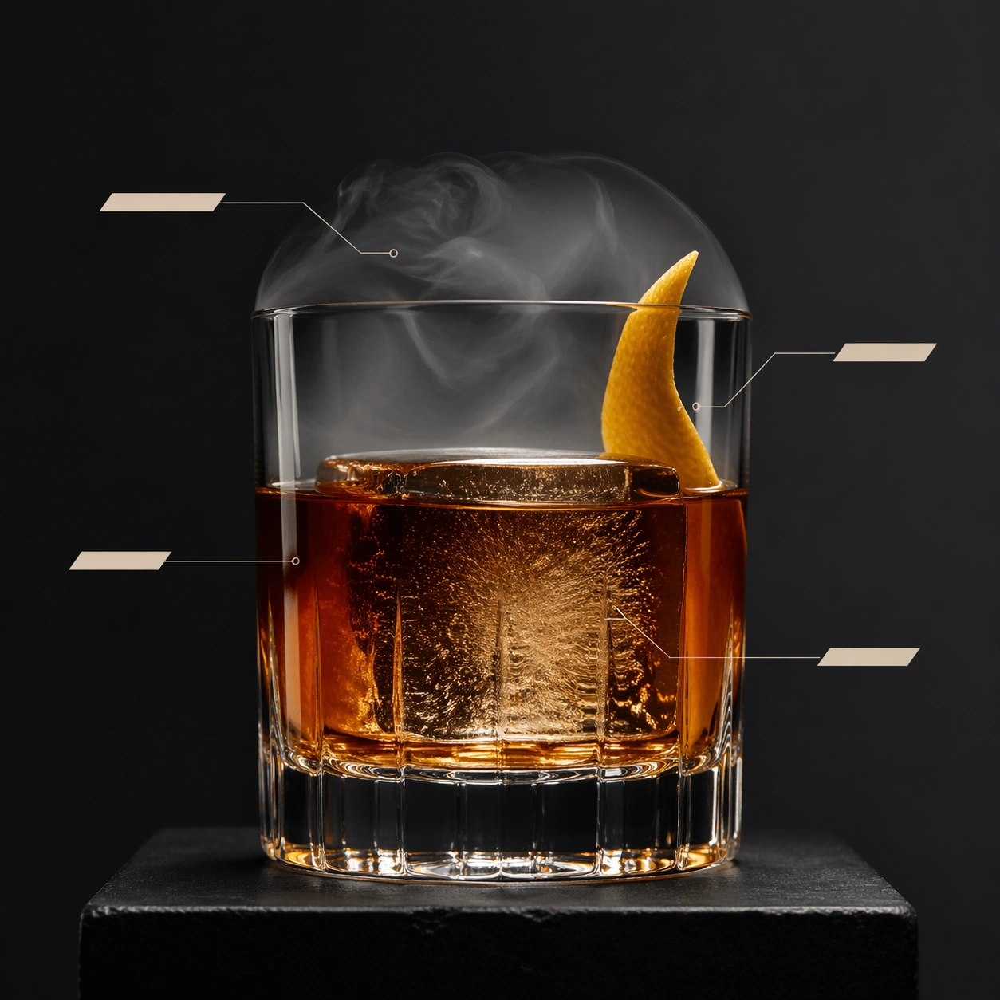

```text
Scene:
Create a square premium editorial cocktail photograph with Scandinavian restraint: the glass sits against a dark or neutral studio backdrop, lit with crisp directional light that reveals liquid clarity, condensation, and the shape of the vessel. The composition should leave clean space for anatomy-like annotation structures. Any diagram devices must stay abstract, minimal, and completely unreadable. Center a low heavy glass on a dark matte pedestal with generous negative space around it, using cool neutral studio light and a faint warm edge highlight to model the liquid. Thin annotation leaders and blank callout tabs should orbit the glass with clean spacing, like a high-end editorial layout.

Subject:
Show an amber stirred cocktail with one large clear ice cube, a restrained citrus twist, and a lifted smoke dome or lingering smoke veil. The glass should feel expensive and weighty, with clear optical distortion through the liquid and ice. The anatomy-callout system must point toward liquid layer, ice core, garnish twist, and smoke volume without using any readable words.

Important details:
The work should feel like a luxury magazine spread translated into one square frame, where product photography and information design cooperate without becoming cluttered. Glass thickness, ice clarity, citrus oils, bubbles, smoke, and liquid layering all need to feel physically accurate. Hairline leader lines may terminate in blank bars or geometric tabs, but never readable labels. This first image establishes the editorial anatomy grammar for the series, so callout spacing, leader-line weight, glass scale, and lighting family must feel precise and repeatable. Smoke should remain semi-transparent, the ice should show subtle internal bubbles, and the callouts must stay elegant rather than technical or crowded.

Use case:
Cocktail anatomy editorial series study 1/9, defining the anchor layout for diagrammed bar photography.

Constraints:
No readable text, no watermark, no logos, preserve exact 1:1 aspect ratio, no menu typography, no neon nightclub clutter, no brand bottle labels, no bar receipt props, no visible trademarks, no bottle in frame, no readable magazine masthead, no heavy infographic clutter.
```

[Pinned source](https://github.com/ChaosRealmsAI/gpt-image-2-gallery/blob/5296db8c996e38776c83a0bc8c64f848dcd512b3/works/topics/cocktail-anatomy-editorial/packages/series-core-system/images/01-editorial-old-fashioned-anchor/meta.json) · GPT Image2 · 1254×1254 · No source-declared image dependencies. · ProjectD:pending individual review.

## Martini Cutaway · cocktail-anatomy-editorial/series-core-system/02-martini-cutaway

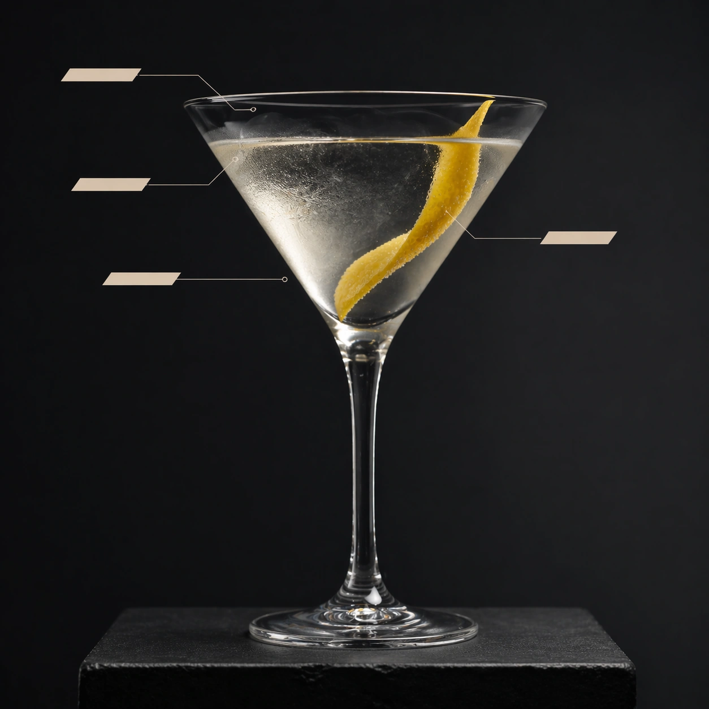

```text
Scene:
Create a square premium editorial cocktail photograph with Scandinavian restraint: the glass sits against a dark or neutral studio backdrop, lit with crisp directional light that reveals liquid clarity, condensation, and the shape of the vessel. The composition should leave clean space for anatomy-like annotation structures. Any diagram devices must stay abstract, minimal, and completely unreadable. Keep the exact centered layout, leader-line grammar, negative-space balance, and restrained studio lighting from the reference image so the editorial system stays instantly recognizable. The background should remain minimal and dark-neutral, with only soft gradients separating the glass from the field.

Subject:
Feature a chilled martini-style stemmed glass with pale transparent liquid, a long olive or citrus garnish, and a visible frost ring near the upper bowl. Hairline annotation leaders should point toward the glass lip, chill haze, garnish suspension, and the meniscus of the drink. The glass should read as razor-clean and architectural.

Important details:
The work should feel like a luxury magazine spread translated into one square frame, where product photography and information design cooperate without becoming cluttered. Glass thickness, ice clarity, citrus oils, bubbles, smoke, and liquid layering all need to feel physically accurate. Hairline leader lines may terminate in blank bars or geometric tabs, but never readable labels. Preserve exact layout, callout spacing, and camera height from the reference model while only changing the vessel family and the material cues of chill and clarity. The stem, rim, and liquid meniscus must feel crisp, and the abstract callout shapes should stay elegant and unreadable.

Use case:
Cocktail anatomy editorial series study 2/9, translating the anchor layout into a chilled martini profile.

Constraints:
No readable text, no watermark, no logos, preserve exact 1:1 aspect ratio, no menu typography, no neon nightclub clutter, no brand bottle labels, no bar receipt props, no visible trademarks, no olive-brine mess, no nightclub blue lighting, no readable etched glass text.
```

[Pinned source](https://github.com/ChaosRealmsAI/gpt-image-2-gallery/blob/5296db8c996e38776c83a0bc8c64f848dcd512b3/works/topics/cocktail-anatomy-editorial/packages/series-core-system/images/02-martini-cutaway/meta.json) · GPT Image2 · 1254×1254 · Reference images required. · ProjectD:pending individual review.

## Highball Carbonation Diagram · cocktail-anatomy-editorial/series-core-system/03-highball-carbonation-diagram

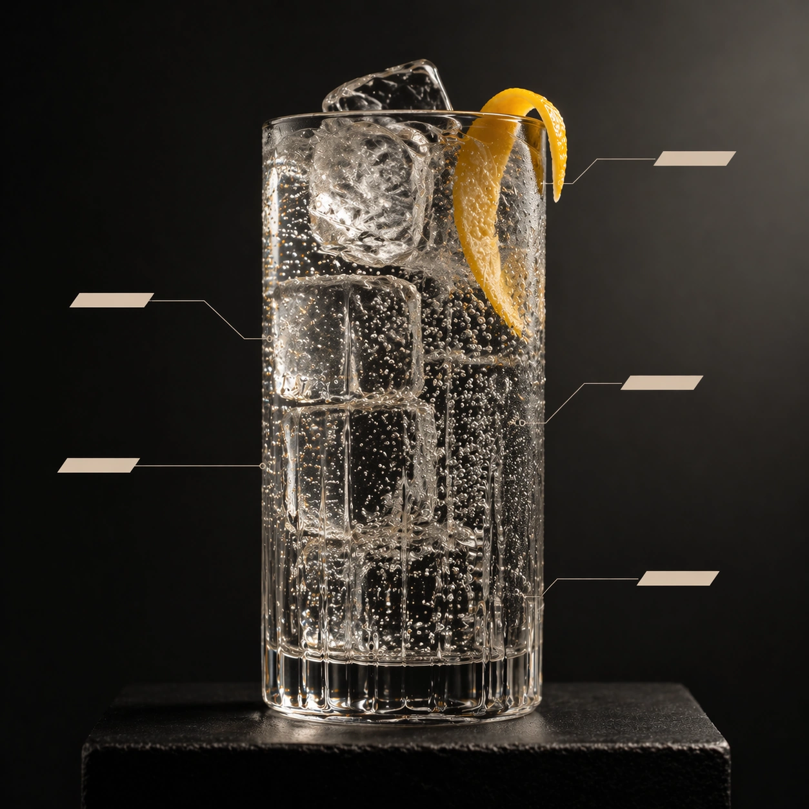

```text
Scene:
Create a square premium editorial cocktail photograph with Scandinavian restraint: the glass sits against a dark or neutral studio backdrop, lit with crisp directional light that reveals liquid clarity, condensation, and the shape of the vessel. The composition should leave clean space for anatomy-like annotation structures. Any diagram devices must stay abstract, minimal, and completely unreadable. Maintain the exact centered composition, annotation grammar, and premium restraint from the reference image, but use a taller glass and slightly brighter side light so carbonation remains visible. The background should stay minimal and soft enough that the bubbles and ice become the active visual detail.

Subject:
Show a clear or lightly tinted highball in a tall glass packed with stacked ice and a slim citrus garnish. Tiny streams of carbonation should rise through the liquid, while leader lines point toward bubble columns, ice faces, garnish bend, and condensation paths. The scene should feel refreshing, exact, and diagrammed without becoming corporate.

Important details:
The work should feel like a luxury magazine spread translated into one square frame, where product photography and information design cooperate without becoming cluttered. Glass thickness, ice clarity, citrus oils, bubbles, smoke, and liquid layering all need to feel physically accurate. Hairline leader lines may terminate in blank bars or geometric tabs, but never readable labels. Preserve exact layout rhythm, callout weight, and studio tone from the reference model while shifting the hero to sparkle and verticality. Carbonation needs believable scale variation, the ice should feel cold and transparent, and every diagram accent must stay abstract and label-free.

Use case:
Cocktail anatomy editorial series study 3/9, converting the anchor system into a carbonation-focused highball page.

Constraints:
No readable text, no watermark, no logos, preserve exact 1:1 aspect ratio, no menu typography, no neon nightclub clutter, no brand bottle labels, no bar receipt props, no visible trademarks, no soda-ad cliche styling, no readable bottle labels, no fruit pile garnish.
```

[Pinned source](https://github.com/ChaosRealmsAI/gpt-image-2-gallery/blob/5296db8c996e38776c83a0bc8c64f848dcd512b3/works/topics/cocktail-anatomy-editorial/packages/series-core-system/images/03-highball-carbonation-diagram/meta.json) · GPT Image2 · 1254×1254 · Reference images required. · ProjectD:pending individual review.

## Smoke Dome Negroni · cocktail-anatomy-editorial/series-core-system/04-smoke-dome-negroni

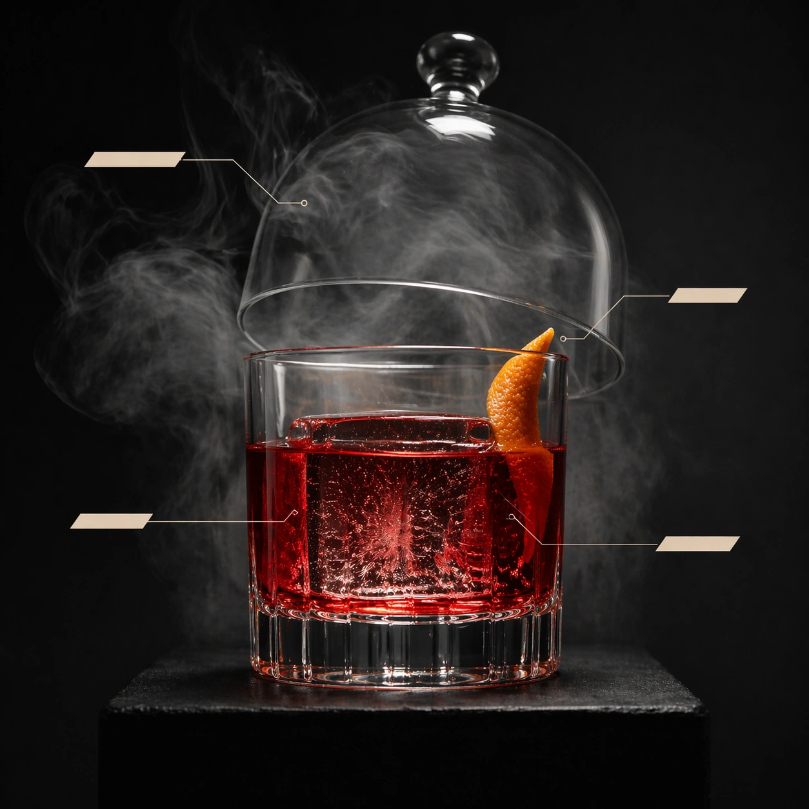

```text
Scene:
Create a square premium editorial cocktail photograph with Scandinavian restraint: the glass sits against a dark or neutral studio backdrop, lit with crisp directional light that reveals liquid clarity, condensation, and the shape of the vessel. The composition should leave clean space for anatomy-like annotation structures. Any diagram devices must stay abstract, minimal, and completely unreadable. Use the same centered editorial stage, blank callout bars, and restrained lighting family from the reference image, but allow a lifted glass dome or drifting smoke volume to create a second large form around the drink. The backdrop must remain clean so the transparent layers stay readable.

Subject:
Present a ruby-toned stirred cocktail in a low glass with one large clear cube and a curled peel, partially wrapped by a glass dome and a fading smoke plume. Callout leaders should point toward the smoke edge, the ice core, the citrus oil zone, and the liquid body. The whole scene should feel like an upscale spirits magazine cutaway translated into abstract visual language.

Important details:
The work should feel like a luxury magazine spread translated into one square frame, where product photography and information design cooperate without becoming cluttered. Glass thickness, ice clarity, citrus oils, bubbles, smoke, and liquid layering all need to feel physically accurate. Hairline leader lines may terminate in blank bars or geometric tabs, but never readable labels. Preserve exact layout spacing, callout grammar, and camera height from the reference model while increasing atmospheric complexity. Smoke must feel semi-transparent and volumetric, not opaque fog, and the ruby liquid should remain luminous around the ice.

Use case:
Cocktail anatomy editorial series study 4/9, closing the anchor system with a smoked ruby cocktail.

Constraints:
No readable text, no watermark, no logos, preserve exact 1:1 aspect ratio, no menu typography, no neon nightclub clutter, no brand bottle labels, no bar receipt props, no visible trademarks, no brand bottle hero, no busy back bar reflections, no readable callout text.
```

[Pinned source](https://github.com/ChaosRealmsAI/gpt-image-2-gallery/blob/5296db8c996e38776c83a0bc8c64f848dcd512b3/works/topics/cocktail-anatomy-editorial/packages/series-core-system/images/04-smoke-dome-negroni/meta.json) · GPT Image2 · 1254×1254 · Reference images required. · ProjectD:pending individual review.

## Citrus Peel Mechanics · cocktail-anatomy-editorial/single-support-studies/citrus-peel-mechanics

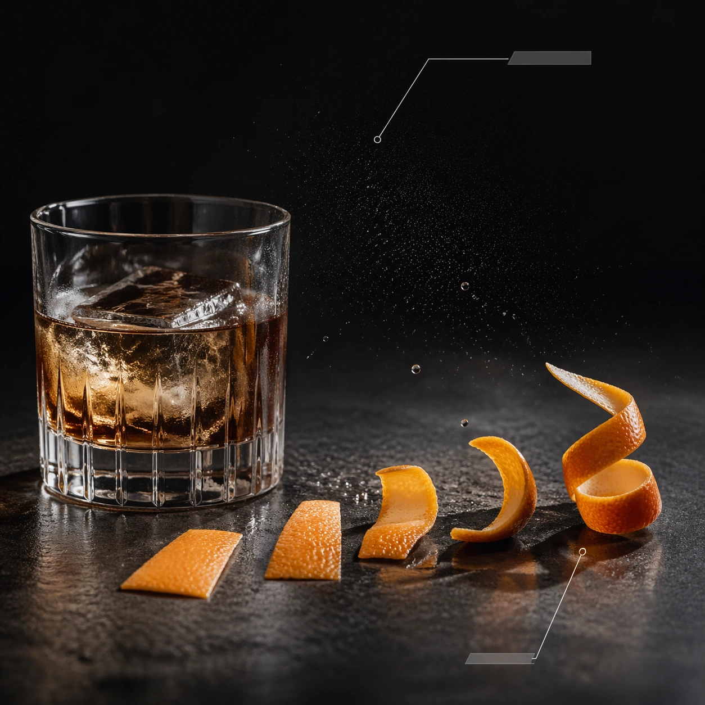

```text
Scene:
Create a square premium editorial cocktail photograph with Scandinavian restraint: the glass sits against a dark or neutral studio backdrop, lit with crisp directional light that reveals liquid clarity, condensation, and the shape of the vessel. The composition should leave clean space for anatomy-like annotation structures. Any diagram devices must stay abstract, minimal, and completely unreadable. Use a square close editorial setup on a dark stone or brushed metal surface with clean directional light and plenty of empty space. The image should feel like a magazine detail spread, not a casual garnish-prep shot.

Subject:
Show several precisely cut citrus peels at different stages of twist and expression beside a half-finished lowball glass. A few tiny oil droplets should catch the light midair or on the surface, while one hairline leader points toward the peel curl and another toward the mist of oil. The scene should celebrate garnish engineering through restraint.

Important details:
The work should feel like a luxury magazine spread translated into one square frame, where product photography and information design cooperate without becoming cluttered. Glass thickness, ice clarity, citrus oils, bubbles, smoke, and liquid layering all need to feel physically accurate. Hairline leader lines may terminate in blank bars or geometric tabs, but never readable labels. Peel thickness, pore texture, and oil sparkle must feel real and high-end. The callout grammar should stay minimal so the viewer reads design thinking rather than instruction.

Use case:
Cocktail anatomy editorial single study 6/9, turning citrus garnish construction into an editorial mechanism study.

Constraints:
No readable text, no watermark, no logos, preserve exact 1:1 aspect ratio, no menu typography, no neon nightclub clutter, no brand bottle labels, no bar receipt props, no visible trademarks, no bar clutter, no readable recipe cards, no messy rinds pile.
```

[Pinned source](https://github.com/ChaosRealmsAI/gpt-image-2-gallery/blob/5296db8c996e38776c83a0bc8c64f848dcd512b3/works/topics/cocktail-anatomy-editorial/packages/single-support-studies/images/citrus-peel-mechanics/meta.json) · GPT Image2 · 1254×1254 · No source-declared image dependencies. · ProjectD:pending individual review.

## Layered Coupe Section · cocktail-anatomy-editorial/single-support-studies/layered-coupe-section

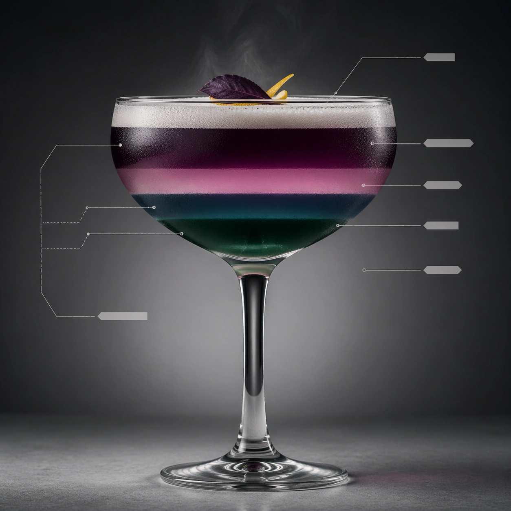

```text
Scene:
Create a square premium editorial cocktail photograph with Scandinavian restraint: the glass sits against a dark or neutral studio backdrop, lit with crisp directional light that reveals liquid clarity, condensation, and the shape of the vessel. The composition should leave clean space for anatomy-like annotation structures. Any diagram devices must stay abstract, minimal, and completely unreadable. Create a square front-facing studio composition with a coupe glass centered against a soft dark-to-light gradient background. Fine leader lines and blank tabs may bracket the glass, but the main impression should remain elegant and photographic.

Subject:
Fill the coupe with visibly stratified liquid bands in closely related jewel tones, crowned by a thin foam or perfumed mist and a restrained garnish. The liquid layers should remain sharply separated, with the meniscus and stem rendered crisply. The drink should feel like a controlled visual experiment in density and light.

Important details:
The work should feel like a luxury magazine spread translated into one square frame, where product photography and information design cooperate without becoming cluttered. Glass thickness, ice clarity, citrus oils, bubbles, smoke, and liquid layering all need to feel physically accurate. Hairline leader lines may terminate in blank bars or geometric tabs, but never readable labels. Make the layer boundaries believable, not posterized, with subtle transitions at the edges and proper distortion through the curvature of the glass. The editorial annotations should suggest explanation while staying entirely unreadable.

Use case:
Cocktail anatomy editorial single study 7/9, documenting liquid stratification inside a coupe.

Constraints:
No readable text, no watermark, no logos, preserve exact 1:1 aspect ratio, no menu typography, no neon nightclub clutter, no brand bottle labels, no bar receipt props, no visible trademarks, no candy-bright rainbow layers, no nightclub neon, no recipe text.
```

[Pinned source](https://github.com/ChaosRealmsAI/gpt-image-2-gallery/blob/5296db8c996e38776c83a0bc8c64f848dcd512b3/works/topics/cocktail-anatomy-editorial/packages/single-support-studies/images/layered-coupe-section/meta.json) · GPT Image2 · 1254×1254 · No source-declared image dependencies. · ProjectD:pending individual review.

## Bar Spoon Vortex · cocktail-anatomy-editorial/single-support-studies/bar-spoon-vortex

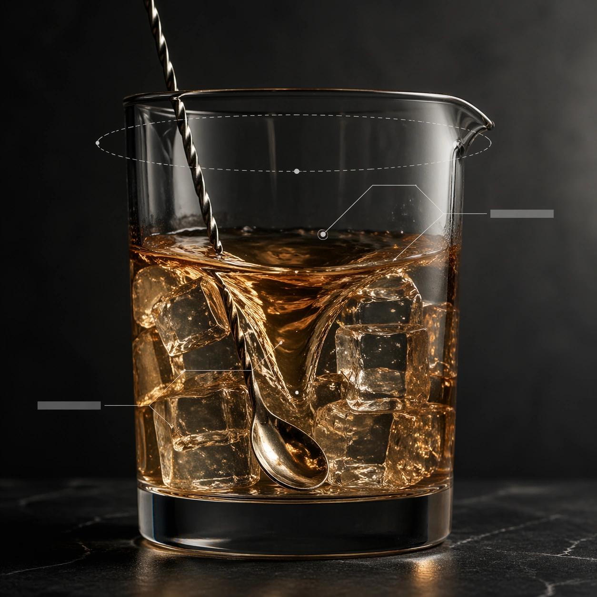

```text
Scene:
Create a square premium editorial cocktail photograph with Scandinavian restraint: the glass sits against a dark or neutral studio backdrop, lit with crisp directional light that reveals liquid clarity, condensation, and the shape of the vessel. The composition should leave clean space for anatomy-like annotation structures. Any diagram devices must stay abstract, minimal, and completely unreadable. Use a square close studio crop on a mixing glass under moody directional light, leaving enough surrounding space for the spiral motion to remain legible. The background should stay quiet and neutral, with no bar clutter.

Subject:
Show a long bar spoon inside a mixing glass as the drink rotates into a visible vortex, with stacked ice facets and subtle reflections in the liquid. A couple of abstract callout marks can point toward the vortex center and spoon spiral, but the scene should remain photographic first. The motion must feel refined and controlled, not splashy.

Important details:
The work should feel like a luxury magazine spread translated into one square frame, where product photography and information design cooperate without becoming cluttered. Glass thickness, ice clarity, citrus oils, bubbles, smoke, and liquid layering all need to feel physically accurate. Hairline leader lines may terminate in blank bars or geometric tabs, but never readable labels. Focus on circular liquid behavior, reflection distortion, and the elegant geometry of the spoon stem. The viewer should sense technique and choreography rather than speed for its own sake.

Use case:
Cocktail anatomy editorial single study 8/9, emphasizing the stirring vortex as a diagrammable cocktail mechanism.

Constraints:
No readable text, no watermark, no logos, preserve exact 1:1 aspect ratio, no menu typography, no neon nightclub clutter, no brand bottle labels, no bar receipt props, no visible trademarks, no splash explosion, no visible bartender hands, no branded mixing glass.
```

[Pinned source](https://github.com/ChaosRealmsAI/gpt-image-2-gallery/blob/5296db8c996e38776c83a0bc8c64f848dcd512b3/works/topics/cocktail-anatomy-editorial/packages/single-support-studies/images/bar-spoon-vortex/meta.json) · GPT Image2 · 1254×1254 · No source-declared image dependencies. · ProjectD:pending individual review.

## Frosted Cocktail Flight · cocktail-anatomy-editorial/single-support-studies/frosted-cocktail-flight

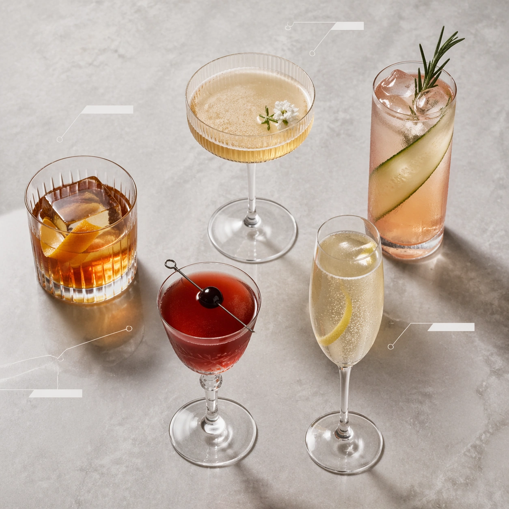

```text
Scene:
Create a square premium editorial cocktail photograph with Scandinavian restraint: the glass sits against a dark or neutral studio backdrop, lit with crisp directional light that reveals liquid clarity, condensation, and the shape of the vessel. The composition should leave clean space for anatomy-like annotation structures. Any diagram devices must stay abstract, minimal, and completely unreadable. Create a square overhead arrangement on a pale stone surface, using cool natural-looking studio light and enough spacing that each glass reads as one entry in an editorial taxonomy. The overall image should feel clean, Scandinavian, and magazine-ready.

Subject:
Arrange five different cocktails in distinct vessels: lowball, coupe, highball, flute, and Nick-and-Nora, each with a restrained garnish and different ice or foam behavior. Use a few abstract leader lines and blank tabs in the negative space between glasses to hint at anatomy indexing without introducing readable information. The flight should feel curated, not commercial or crowded.

Important details:
The work should feel like a luxury magazine spread translated into one square frame, where product photography and information design cooperate without becoming cluttered. Glass thickness, ice clarity, citrus oils, bubbles, smoke, and liquid layering all need to feel physically accurate. Hairline leader lines may terminate in blank bars or geometric tabs, but never readable labels. Make each vessel and drink behavior distinct while maintaining one coherent palette and lighting language. The composition should function like an overview page that still respects material realism down to condensation beads and glass thickness.

Use case:
Cocktail anatomy editorial single study 9/9, broadening the theme into a curated editorial flight.

Constraints:
No readable text, no watermark, no logos, preserve exact 1:1 aspect ratio, no menu typography, no neon nightclub clutter, no brand bottle labels, no bar receipt props, no visible trademarks, no menus, no coasters with logos, no tabletop clutter.
```

[Pinned source](https://github.com/ChaosRealmsAI/gpt-image-2-gallery/blob/5296db8c996e38776c83a0bc8c64f848dcd512b3/works/topics/cocktail-anatomy-editorial/packages/single-support-studies/images/frosted-cocktail-flight/meta.json) · GPT Image2 · 1254×1254 · No source-declared image dependencies. · ProjectD:pending individual review.

## Morning Bar Anchor · coffee-drink-ritual-campaign-series/series-core-system/01-morning-bar-anchor


```text
Scene:
Compose a square beverage campaign image built around ritual, vessel, light, and atmosphere. The frame should feel like it belongs to a premium drink brand that understands daily habits: ceramic warmth, glass condensation, steam behavior, and tactile surfaces all need to read as observed and real rather than generic lifestyle filler. Use early daylight mixed with one practical warm source, creating a quiet bar counter atmosphere with long soft shadows and tactile wood grain.

Subject:
The hero beverage must feel consumable and culturally grounded, with believable proportions, realistic liquid behavior, and supporting tools or props that reinforce the ritual without overwhelming the drink itself. Center a fresh coffee or tea beverage in a crafted vessel, supported by one spoon, one small side element, and subtle traces of recent preparation.

Important details:
Credibility comes from timing and materials: crema density, ice clarity, tea translucency, condensation trails, and the way a hand or vessel sits in space. Keep the mood intentional and campaign-ready, with enough atmosphere to suggest a lived routine while preserving product focus. This image establishes the reference system for the series, including camera height, tabletop discipline, prop family, and color control that later images must inherit. This reference image should lock the camera height, prop discipline, palette, and sensory mood for the series: calm, premium, tactile, and deeply habitual.

Use case:
Coffee Rituals series study 1/9, built for Prompt Atlas coverage of a food and beverage commercial visual system.

Constraints:
No readable text, no watermark, no logos, preserve exact 1:1 aspect ratio, no plastic café props, no latte-art gimmick overload, no fake steam clouds, no unreadable cup slogans, no random breakfast clutter, no artificial neon excess, no visible brand logos, no café crowd, no oversized pastry props.
```

[Pinned source](https://github.com/ChaosRealmsAI/gpt-image-2-gallery/blob/5296db8c996e38776c83a0bc8c64f848dcd512b3/works/topics/coffee-drink-ritual-campaign-series/packages/series-core-system/images/01-morning-bar-anchor/meta.json) · GPT Image2 · 1254×1254 · No source-declared image dependencies. · ProjectD:pending individual review.

## Pour-Over Bloom · coffee-drink-ritual-campaign-series/series-core-system/02-pour-over-bloom


```text
Scene:
Compose a square beverage campaign image built around ritual, vessel, light, and atmosphere. The frame should feel like it belongs to a premium drink brand that understands daily habits: ceramic warmth, glass condensation, steam behavior, and tactile surfaces all need to read as observed and real rather than generic lifestyle filler. Retain the same bar counter, vessel family, and morning tonal warmth, but add a precise pouring gesture and gentle bloom rising from the grounds.

Subject:
The hero beverage must feel consumable and culturally grounded, with believable proportions, realistic liquid behavior, and supporting tools or props that reinforce the ritual without overwhelming the drink itself. Show a pour-over setup with kettle stream, dripper, and cup in alignment, making the brew moment feel accurate and sensory-rich without becoming tutorial-like.

Important details:
Credibility comes from timing and materials: crema density, ice clarity, tea translucency, condensation trails, and the way a hand or vessel sits in space. Keep the mood intentional and campaign-ready, with enough atmosphere to suggest a lived routine while preserving product focus. Preserve the exact camera height, lens feel, prop family, tabletop scale, palette discipline, and brand logic established by 01-morning-bar-anchor. Preserve the reference lens feel, table scale, and premium quietness while making water flow, filter geometry, and steam behavior physically convincing.

Use case:
Coffee Rituals series study 2/9, built for Prompt Atlas coverage of a food and beverage commercial visual system.

Constraints:
No readable text, no watermark, no logos, preserve exact 1:1 aspect ratio, no plastic café props, no latte-art gimmick overload, no fake steam clouds, no unreadable cup slogans, no random breakfast clutter, no artificial neon excess, no dramatic splash chaos, no gadget overload, no café menu boards.
```

[Pinned source](https://github.com/ChaosRealmsAI/gpt-image-2-gallery/blob/5296db8c996e38776c83a0bc8c64f848dcd512b3/works/topics/coffee-drink-ritual-campaign-series/packages/series-core-system/images/02-pour-over-bloom/meta.json) · GPT Image2 · 1254×1254 · Reference images required. · ProjectD:pending individual review.

## Latte Window Steam · coffee-drink-ritual-campaign-series/series-core-system/03-latte-window-steam


```text
Scene:
Compose a square beverage campaign image built around ritual, vessel, light, and atmosphere. The frame should feel like it belongs to a premium drink brand that understands daily habits: ceramic warmth, glass condensation, steam behavior, and tactile surfaces all need to read as observed and real rather than generic lifestyle filler. Maintain the same square framing and tabletop materials, but pivot the light toward a side window so steam, foam, and cup curvature become more prominent.

Subject:
The hero beverage must feel consumable and culturally grounded, with believable proportions, realistic liquid behavior, and supporting tools or props that reinforce the ritual without overwhelming the drink itself. Present a milk-based coffee or tea latte in a ceramic cup with nuanced foam texture, one side pastry accent, and a calm morning pause mood.

Important details:
Credibility comes from timing and materials: crema density, ice clarity, tea translucency, condensation trails, and the way a hand or vessel sits in space. Keep the mood intentional and campaign-ready, with enough atmosphere to suggest a lived routine while preserving product focus. Preserve the exact camera height, lens feel, prop family, tabletop scale, palette discipline, and brand logic established by 01-morning-bar-anchor. The anchor image should remain visible through vessel shape, surface palette, and camera distance, even as the drink texture becomes creamier and more diffuse.

Use case:
Coffee Rituals series study 3/9, built for Prompt Atlas coverage of a food and beverage commercial visual system.

Constraints:
No readable text, no watermark, no logos, preserve exact 1:1 aspect ratio, no plastic café props, no latte-art gimmick overload, no fake steam clouds, no unreadable cup slogans, no random breakfast clutter, no artificial neon excess, no heart-shaped foam cliché, no breakfast buffet clutter, no oversized mug.
```

[Pinned source](https://github.com/ChaosRealmsAI/gpt-image-2-gallery/blob/5296db8c996e38776c83a0bc8c64f848dcd512b3/works/topics/coffee-drink-ritual-campaign-series/packages/series-core-system/images/03-latte-window-steam/meta.json) · GPT Image2 · 1254×1254 · Reference images required. · ProjectD:pending individual review.

## Evening Tonic Pour · coffee-drink-ritual-campaign-series/series-core-system/04-evening-tonic-pour


```text
Scene:
Compose a square beverage campaign image built around ritual, vessel, light, and atmosphere. The frame should feel like it belongs to a premium drink brand that understands daily habits: ceramic warmth, glass condensation, steam behavior, and tactile surfaces all need to read as observed and real rather than generic lifestyle filler. Keep the same tabletop geometry and campaign polish, but shift to twilight tones, reflective glass, and a crisp rim light that catches bubbles and ice edges.

Subject:
The hero beverage must feel consumable and culturally grounded, with believable proportions, realistic liquid behavior, and supporting tools or props that reinforce the ritual without overwhelming the drink itself. Show a tonic-style coffee, tea, or nonalcoholic evening drink being poured over clear ice in a premium glass, supported by one minimal garnish.

Important details:
Credibility comes from timing and materials: crema density, ice clarity, tea translucency, condensation trails, and the way a hand or vessel sits in space. Keep the mood intentional and campaign-ready, with enough atmosphere to suggest a lived routine while preserving product focus. Preserve the exact camera height, lens feel, prop family, tabletop scale, palette discipline, and brand logic established by 01-morning-bar-anchor. Preserve the reference composition and prop restraint while letting carbonation, condensation, and glass reflections carry the new time-of-day story.

Use case:
Coffee Rituals series study 4/9, built for Prompt Atlas coverage of a food and beverage commercial visual system.

Constraints:
No readable text, no watermark, no logos, preserve exact 1:1 aspect ratio, no plastic café props, no latte-art gimmick overload, no fake steam clouds, no unreadable cup slogans, no random breakfast clutter, no artificial neon excess, no nightclub scene, no cocktail umbrellas, no bar-label branding.
```

[Pinned source](https://github.com/ChaosRealmsAI/gpt-image-2-gallery/blob/5296db8c996e38776c83a0bc8c64f848dcd512b3/works/topics/coffee-drink-ritual-campaign-series/packages/series-core-system/images/04-evening-tonic-pour/meta.json) · GPT Image2 · 1254×1254 · Reference images required. · ProjectD:pending individual review.

## Iced Condensation Study · coffee-drink-ritual-campaign-series/single-support-studies/iced-condensation-study

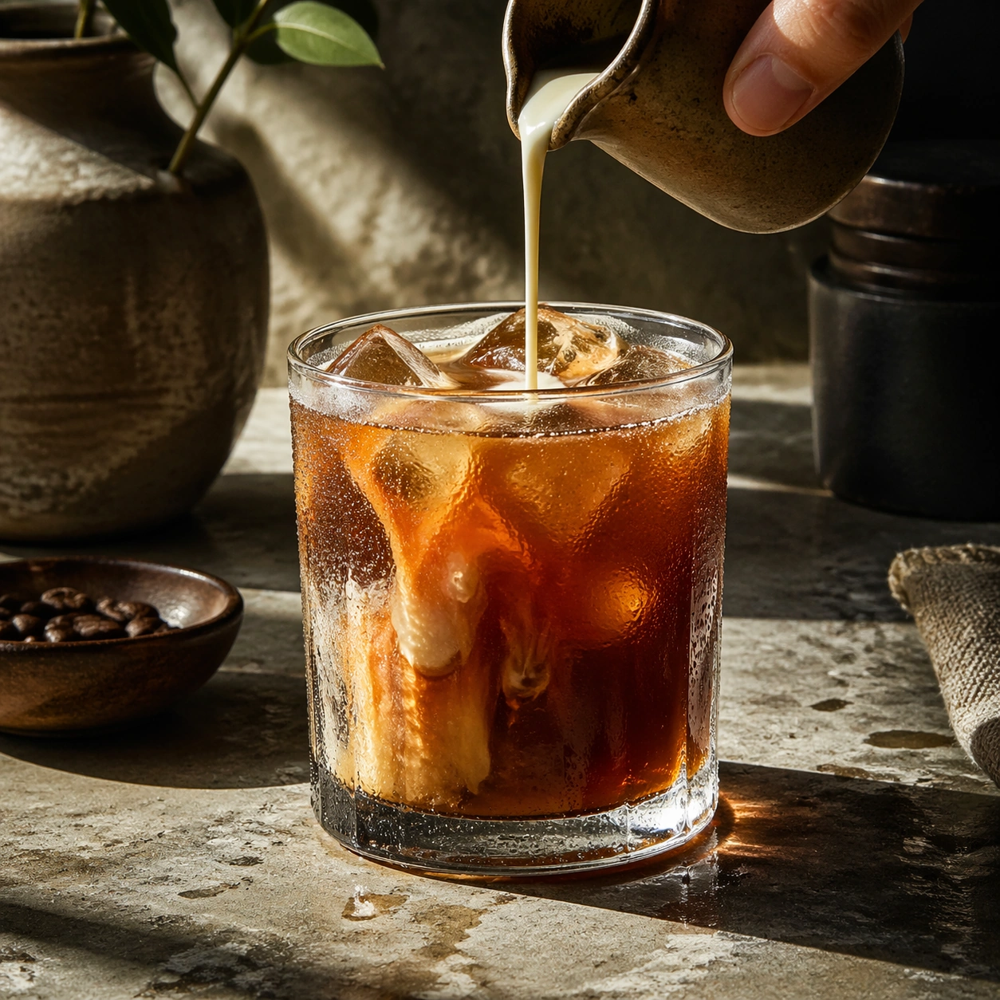

```text
Scene:
Compose a square beverage campaign image built around ritual, vessel, light, and atmosphere. The frame should feel like it belongs to a premium drink brand that understands daily habits: ceramic warmth, glass condensation, steam behavior, and tactile surfaces all need to read as observed and real rather than generic lifestyle filler. Move close to a chilled glass on a stone surface with directional afternoon light catching the wet exterior and the drink color within.

Subject:
The hero beverage must feel consumable and culturally grounded, with believable proportions, realistic liquid behavior, and supporting tools or props that reinforce the ritual without overwhelming the drink itself. Center an iced beverage with clean cubes, believable dilution, and subtle garnish so the drink itself becomes the landscape.

Important details:
Credibility comes from timing and materials: crema density, ice clarity, tea translucency, condensation trails, and the way a hand or vessel sits in space. Keep the mood intentional and campaign-ready, with enough atmosphere to suggest a lived routine while preserving product focus. This image should feel fully self-contained while still belonging to the same broader topic and commercial world. Condensation must behave physically, with varying droplet sizes, slick surfaces, and realistic refraction through the glass and ice.

Use case:
Coffee Rituals single study 6/9, built for Prompt Atlas coverage of a food and beverage commercial visual system.

Constraints:
No readable text, no watermark, no logos, preserve exact 1:1 aspect ratio, no plastic café props, no latte-art gimmick overload, no fake steam clouds, no unreadable cup slogans, no random breakfast clutter, no artificial neon excess, no explosive splash, no frozen slush, no beach props.
```

[Pinned source](https://github.com/ChaosRealmsAI/gpt-image-2-gallery/blob/5296db8c996e38776c83a0bc8c64f848dcd512b3/works/topics/coffee-drink-ritual-campaign-series/packages/single-support-studies/images/iced-condensation-study/meta.json) · GPT Image2 · 1254×1254 · No source-declared image dependencies. · ProjectD:pending individual review.

## Tea Ritual Tray · coffee-drink-ritual-campaign-series/single-support-studies/tea-ritual-tray


```text
Scene:
Compose a square beverage campaign image built around ritual, vessel, light, and atmosphere. The frame should feel like it belongs to a premium drink brand that understands daily habits: ceramic warmth, glass condensation, steam behavior, and tactile surfaces all need to read as observed and real rather than generic lifestyle filler. Use a square top-down or slight angle over a dark tray, with muted daylight and a quiet background that emphasizes vessel shapes.

Subject:
The hero beverage must feel consumable and culturally grounded, with believable proportions, realistic liquid behavior, and supporting tools or props that reinforce the ritual without overwhelming the drink itself. Arrange a teapot, two cups, one infuser or strainer, and a small ingredient accent such as citrus peel or loose leaves.

Important details:
Credibility comes from timing and materials: crema density, ice clarity, tea translucency, condensation trails, and the way a hand or vessel sits in space. Keep the mood intentional and campaign-ready, with enough atmosphere to suggest a lived routine while preserving product focus. This image should feel fully self-contained while still belonging to the same broader topic and commercial world. The tray composition should feel elegant and intentional, with credible ceramic finish, liquid translucency, and a sense of preparation without showing full instruction steps.

Use case:
Coffee Rituals single study 7/9, built for Prompt Atlas coverage of a food and beverage commercial visual system.

Constraints:
No readable text, no watermark, no logos, preserve exact 1:1 aspect ratio, no plastic café props, no latte-art gimmick overload, no fake steam clouds, no unreadable cup slogans, no random breakfast clutter, no artificial neon excess, no ornate palace styling, no crowded dim sum spread, no readable tea labels.
```

[Pinned source](https://github.com/ChaosRealmsAI/gpt-image-2-gallery/blob/5296db8c996e38776c83a0bc8c64f848dcd512b3/works/topics/coffee-drink-ritual-campaign-series/packages/single-support-studies/images/tea-ritual-tray/meta.json) · GPT Image2 · 1254×1254 · No source-declared image dependencies. · ProjectD:pending individual review.

## Cafe Counter Rush · coffee-drink-ritual-campaign-series/single-support-studies/cafe-counter-rush

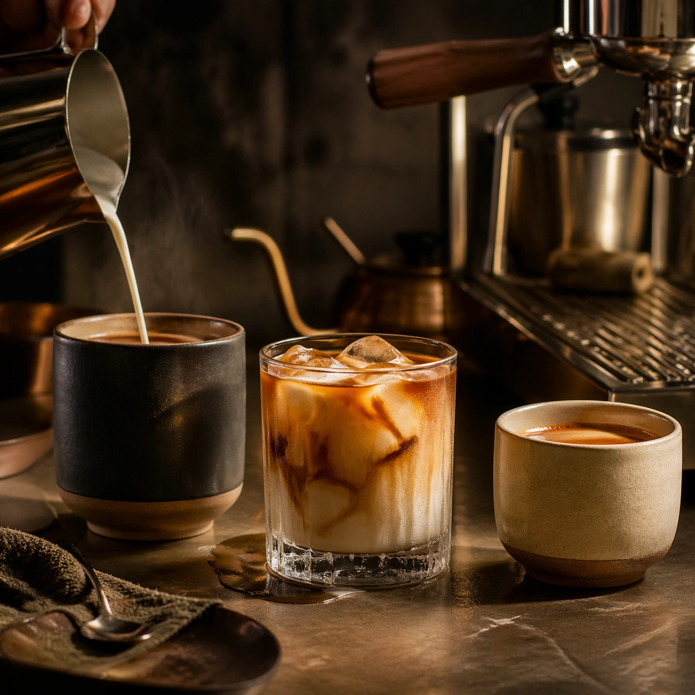

```text
Scene:
Compose a square beverage campaign image built around ritual, vessel, light, and atmosphere. The frame should feel like it belongs to a premium drink brand that understands daily habits: ceramic warmth, glass condensation, steam behavior, and tactile surfaces all need to read as observed and real rather than generic lifestyle filler. Use a square crop of a busy but controlled counter moment, with several drinks aligned and warm practical lights reflecting off metal and ceramic surfaces.

Subject:
The hero beverage must feel consumable and culturally grounded, with believable proportions, realistic liquid behavior, and supporting tools or props that reinforce the ritual without overwhelming the drink itself. Show two or three beverages at different completion stages, suggesting a café rush without introducing visible faces or chaos.

Important details:
Credibility comes from timing and materials: crema density, ice clarity, tea translucency, condensation trails, and the way a hand or vessel sits in space. Keep the mood intentional and campaign-ready, with enough atmosphere to suggest a lived routine while preserving product focus. This image should feel fully self-contained while still belonging to the same broader topic and commercial world. Timing is crucial: drips, steam, and bar reflections should feel immediate, but the frame still needs clear focal priority and commercial polish.

Use case:
Coffee Rituals single study 8/9, built for Prompt Atlas coverage of a food and beverage commercial visual system.

Constraints:
No readable text, no watermark, no logos, preserve exact 1:1 aspect ratio, no plastic café props, no latte-art gimmick overload, no fake steam clouds, no unreadable cup slogans, no random breakfast clutter, no artificial neon excess, no cashier hardware, no readable order slips, no crowded human figures.
```

[Pinned source](https://github.com/ChaosRealmsAI/gpt-image-2-gallery/blob/5296db8c996e38776c83a0bc8c64f848dcd512b3/works/topics/coffee-drink-ritual-campaign-series/packages/single-support-studies/images/cafe-counter-rush/meta.json) · GPT Image2 · 1254×1254 · No source-declared image dependencies. · ProjectD:pending individual review.

## Commuter Takeaway Cup · coffee-drink-ritual-campaign-series/single-support-studies/commuter-takeaway-cup


```text
Scene:
Compose a square beverage campaign image built around ritual, vessel, light, and atmosphere. The frame should feel like it belongs to a premium drink brand that understands daily habits: ceramic warmth, glass condensation, steam behavior, and tactile surfaces all need to read as observed and real rather than generic lifestyle filler. Frame a square close crop of a hand carrying a takeaway cup near a doorway or transit-adjacent surface, with soft city blur in the background.

Subject:
The hero beverage must feel consumable and culturally grounded, with believable proportions, realistic liquid behavior, and supporting tools or props that reinforce the ritual without overwhelming the drink itself. Keep the cup, sleeve, lid texture, and drink warmth central while using the environment only to hint at an active daily commute.

Important details:
Credibility comes from timing and materials: crema density, ice clarity, tea translucency, condensation trails, and the way a hand or vessel sits in space. Keep the mood intentional and campaign-ready, with enough atmosphere to suggest a lived routine while preserving product focus. This image should feel fully self-contained while still belonging to the same broader topic and commercial world. The sleeve, paper grain, lid fit, and hand posture must feel real and premium. The image should sell habit and convenience without looking like stock lifestyle advertising.

Use case:
Coffee Rituals single study 9/9, built for Prompt Atlas coverage of a food and beverage commercial visual system.

Constraints:
No readable text, no watermark, no logos, preserve exact 1:1 aspect ratio, no plastic café props, no latte-art gimmick overload, no fake steam clouds, no unreadable cup slogans, no random breakfast clutter, no artificial neon excess, no readable brand mark, no obvious train logos, no full face portrait.
```

[Pinned source](https://github.com/ChaosRealmsAI/gpt-image-2-gallery/blob/5296db8c996e38776c83a0bc8c64f848dcd512b3/works/topics/coffee-drink-ritual-campaign-series/packages/single-support-studies/images/commuter-takeaway-cup/meta.json) · GPT Image2 · 1254×1254 · No source-declared image dependencies. · ProjectD:pending individual review.

## Apartment Command Desk · cold-precision-grid-interior/single-cold-precision-grid-interior/02-apartment-command-desk

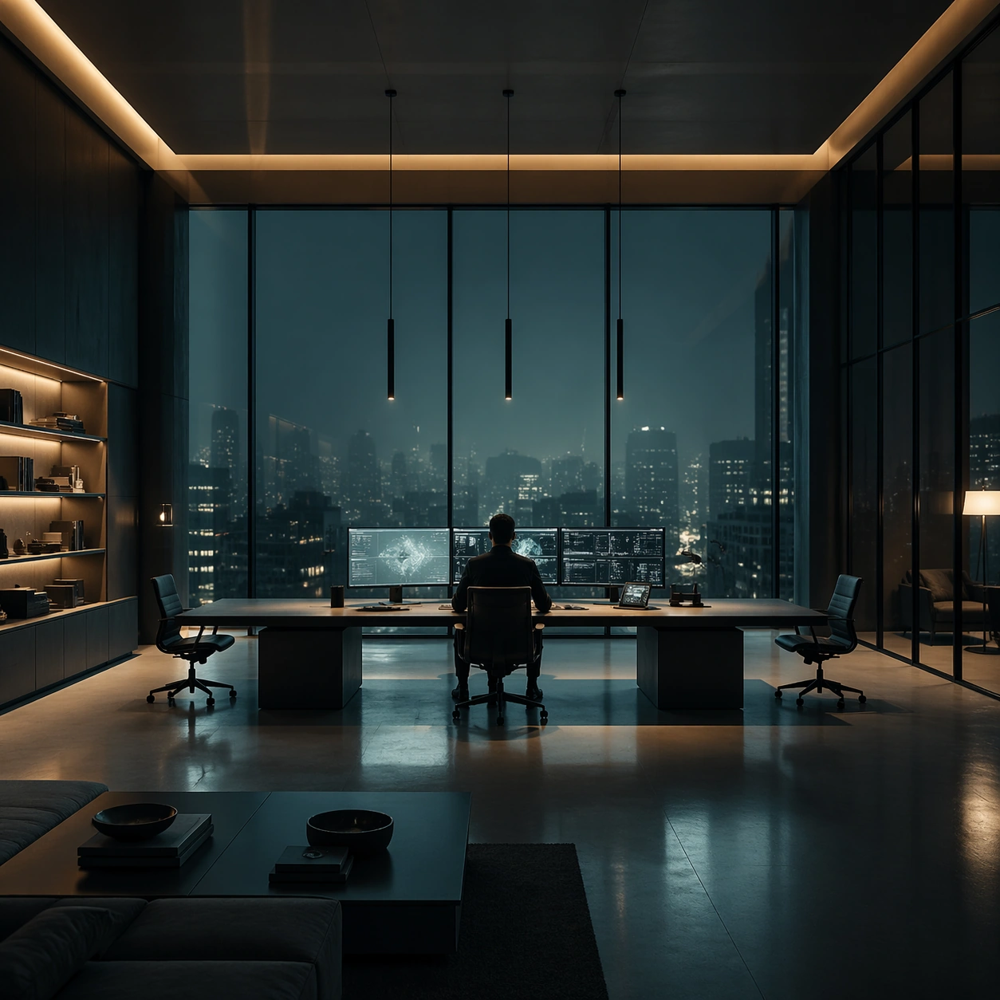

```text
Scene:
A square interior image defined by desaturated teal, nicotine amber, matte charcoal, and polished glass, with every desk, chair, monitor, and light source positioned with mathematical restraint. The room should feel contemporary and expensive, but emotionally distant, as if every element has been audited for balance and control. Use a luxury apartment living room converted into a command desk arrangement, with floor-to-ceiling windows, low shelving, and one long table centered under pendant lights.

Subject:
Use office floors, apartments, control rooms, or meeting spaces where human figures appear small, backlit, and subordinate to the grid of furniture and screens. The subject is not one person so much as the cold system of objects, reflections, and intervals between them. A single resident works alone at the table, reduced to a dark outline against the glass and screen reflections.

Important details:
The signature depends on exact spacing, subdued color, restrained contrast, and a polished investigative mood. Preserve orderly cable paths, clean desk surfaces, sensible monitor glow, and strong negative space. Avoid colorful personality clutter, playful decor, or casual lived-in mess. The interior should feel curated and severe, with almost no personal objects except those necessary to support the system logic.

Use case:
Cold Precision Grid Interior single study 2/9.

Constraints:
No readable text, no watermark, no logos, preserve exact 1:1 aspect ratio, no visible logos on screens, no colorful sticky notes, no comic exaggeration, no warm family-home coziness, no random clutter piles, no broken anatomy, no low-detail background, no accidental text fragments.
```

[Pinned source](https://github.com/ChaosRealmsAI/gpt-image-2-gallery/blob/5296db8c996e38776c83a0bc8c64f848dcd512b3/works/topics/cold-precision-grid-interior/packages/single-cold-precision-grid-interior/images/02-apartment-command-desk/meta.json) · GPT Image2 · 1254×1254 · No source-declared image dependencies. · ProjectD:pending individual review.

## Compliance Room · cold-precision-grid-interior/single-cold-precision-grid-interior/03-compliance-room

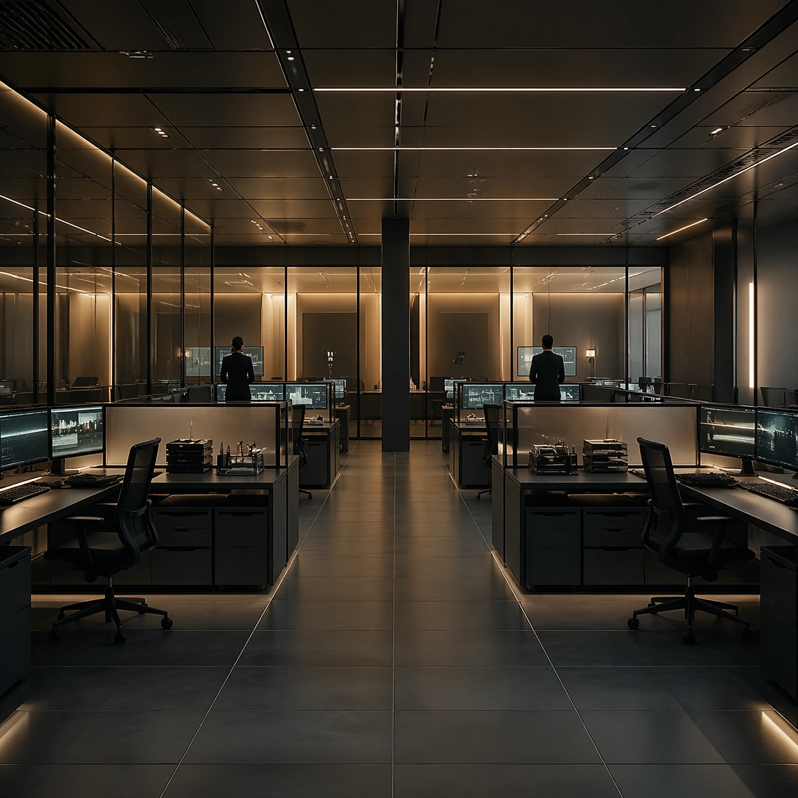

```text
Scene:
A square interior image defined by desaturated teal, nicotine amber, matte charcoal, and polished glass, with every desk, chair, monitor, and light source positioned with mathematical restraint. The room should feel contemporary and expensive, but emotionally distant, as if every element has been audited for balance and control. Construct a compliance review room with modular desks, rolling task chairs, file trays, and frosted partitions arranged in perfect lanes.

Subject:
Use office floors, apartments, control rooms, or meeting spaces where human figures appear small, backlit, and subordinate to the grid of furniture and screens. The subject is not one person so much as the cold system of objects, reflections, and intervals between them. Two people stand at opposite ends of the room reviewing screens, their separation reinforcing the procedural atmosphere.

Important details:
The signature depends on exact spacing, subdued color, restrained contrast, and a polished investigative mood. Preserve orderly cable paths, clean desk surfaces, sensible monitor glow, and strong negative space. Avoid colorful personality clutter, playful decor, or casual lived-in mess. Let the frosted glass, aluminum edges, and muted amber light make the space feel monitored and exact.

Use case:
Cold Precision Grid Interior single study 3/9.

Constraints:
No readable text, no watermark, no logos, preserve exact 1:1 aspect ratio, no visible logos on screens, no colorful sticky notes, no comic exaggeration, no warm family-home coziness, no random clutter piles, no broken anatomy, no low-detail background, no accidental text fragments.
```

[Pinned source](https://github.com/ChaosRealmsAI/gpt-image-2-gallery/blob/5296db8c996e38776c83a0bc8c64f848dcd512b3/works/topics/cold-precision-grid-interior/packages/single-cold-precision-grid-interior/images/03-compliance-room/meta.json) · GPT Image2 · 1254×1254 · No source-declared image dependencies. · ProjectD:pending individual review.

## Surveillance Kitchen · cold-precision-grid-interior/single-cold-precision-grid-interior/04-surveillance-kitchen

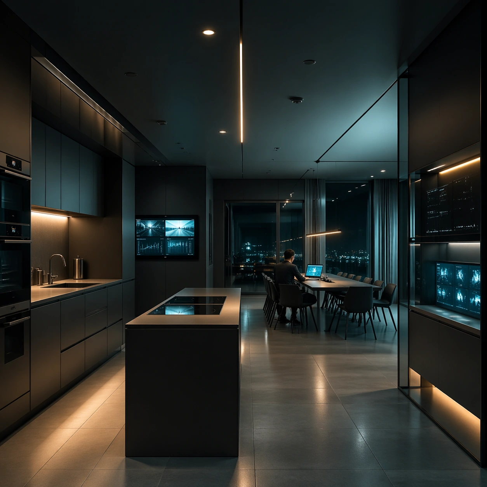

```text
Scene:
A square interior image defined by desaturated teal, nicotine amber, matte charcoal, and polished glass, with every desk, chair, monitor, and light source positioned with mathematical restraint. The room should feel contemporary and expensive, but emotionally distant, as if every element has been audited for balance and control. Set the scene in a minimalist kitchen-dining space where under-cabinet lights, induction panels, and wall screens turn domestic architecture into a monitored grid.

Subject:
Use office floors, apartments, control rooms, or meeting spaces where human figures appear small, backlit, and subordinate to the grid of furniture and screens. The subject is not one person so much as the cold system of objects, reflections, and intervals between them. A seated figure studies a laptop at the dining end while secondary screens glow softly from built-in millwork.

Important details:
The signature depends on exact spacing, subdued color, restrained contrast, and a polished investigative mood. Preserve orderly cable paths, clean desk surfaces, sensible monitor glow, and strong negative space. Avoid colorful personality clutter, playful decor, or casual lived-in mess. The room must remain believable as a home, but every line should still feel calibrated and unsentimental.

Use case:
Cold Precision Grid Interior single study 4/9.

Constraints:
No readable text, no watermark, no logos, preserve exact 1:1 aspect ratio, no visible logos on screens, no colorful sticky notes, no comic exaggeration, no warm family-home coziness, no random clutter piles, no broken anatomy, no low-detail background, no accidental text fragments.
```

[Pinned source](https://github.com/ChaosRealmsAI/gpt-image-2-gallery/blob/5296db8c996e38776c83a0bc8c64f848dcd512b3/works/topics/cold-precision-grid-interior/packages/single-cold-precision-grid-interior/images/04-surveillance-kitchen/meta.json) · GPT Image2 · 1254×1254 · No source-declared image dependencies. · ProjectD:pending individual review.

## Legal Boardroom · cold-precision-grid-interior/single-cold-precision-grid-interior/05-legal-boardroom


```text
Scene:
A square interior image defined by desaturated teal, nicotine amber, matte charcoal, and polished glass, with every desk, chair, monitor, and light source positioned with mathematical restraint. The room should feel contemporary and expensive, but emotionally distant, as if every element has been audited for balance and control. Use a boardroom with elongated table, identical leather chairs, concealed lighting coves, and dark glass panels reflecting the room back into itself.

Subject:
Use office floors, apartments, control rooms, or meeting spaces where human figures appear small, backlit, and subordinate to the grid of furniture and screens. The subject is not one person so much as the cold system of objects, reflections, and intervals between them. A solitary folder and water glass sit at the midpoint of the table while one attorney silhouette lingers at the far end.

Important details:
The signature depends on exact spacing, subdued color, restrained contrast, and a polished investigative mood. Preserve orderly cable paths, clean desk surfaces, sensible monitor glow, and strong negative space. Avoid colorful personality clutter, playful decor, or casual lived-in mess. The composition should communicate power through stillness and expensive restraint rather than grand decoration.

Use case:
Cold Precision Grid Interior single study 5/9.

Constraints:
No readable text, no watermark, no logos, preserve exact 1:1 aspect ratio, no visible logos on screens, no colorful sticky notes, no comic exaggeration, no warm family-home coziness, no random clutter piles, no broken anatomy, no low-detail background, no accidental text fragments.
```

[Pinned source](https://github.com/ChaosRealmsAI/gpt-image-2-gallery/blob/5296db8c996e38776c83a0bc8c64f848dcd512b3/works/topics/cold-precision-grid-interior/packages/single-cold-precision-grid-interior/images/05-legal-boardroom/meta.json) · GPT Image2 · 1254×1254 · No source-declared image dependencies. · ProjectD:pending individual review.

## Copy Room Grid · cold-precision-grid-interior/single-cold-precision-grid-interior/06-copy-room-grid

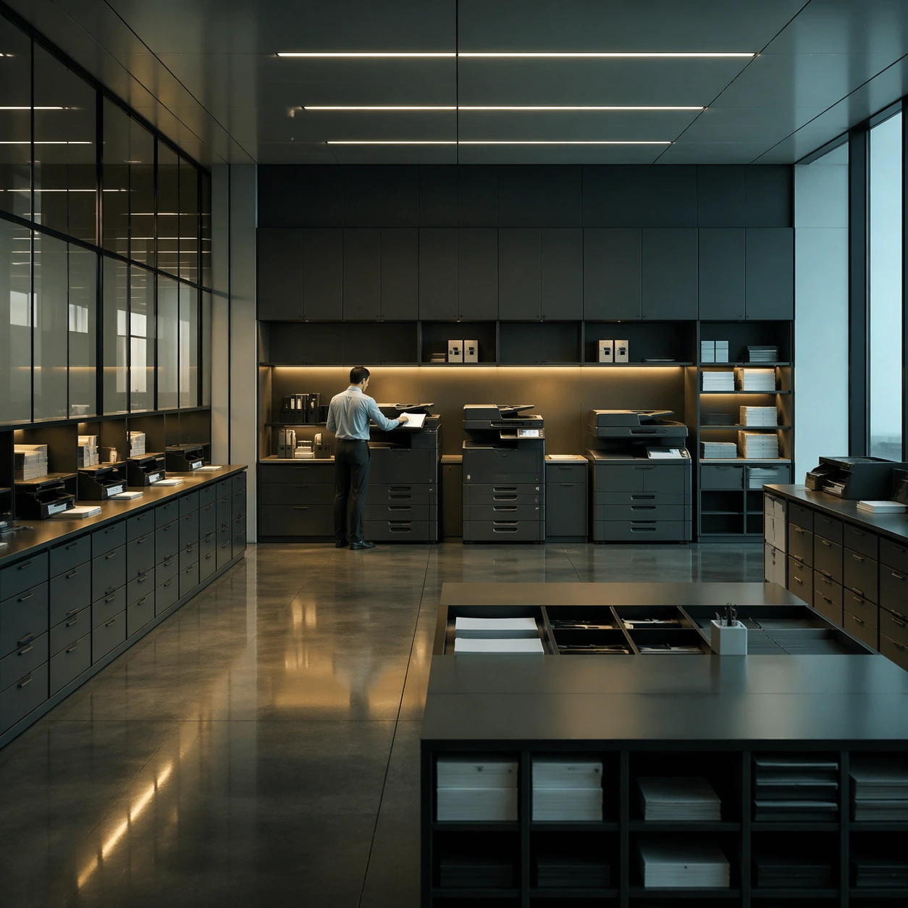

```text
Scene:
A square interior image defined by desaturated teal, nicotine amber, matte charcoal, and polished glass, with every desk, chair, monitor, and light source positioned with mathematical restraint. The room should feel contemporary and expensive, but emotionally distant, as if every element has been audited for balance and control. Build a corporate copy room with printers, supply cabinets, and utility counters arranged as a perfect service matrix under flat overhead light.

Subject:
Use office floors, apartments, control rooms, or meeting spaces where human figures appear small, backlit, and subordinate to the grid of furniture and screens. The subject is not one person so much as the cold system of objects, reflections, and intervals between them. An employee in shirtsleeves stands alone feeding paper into one machine, the smallest human event inside an exact equipment grid.

Important details:
The signature depends on exact spacing, subdued color, restrained contrast, and a polished investigative mood. Preserve orderly cable paths, clean desk surfaces, sensible monitor glow, and strong negative space. Avoid colorful personality clutter, playful decor, or casual lived-in mess. The printers should feel heavy, matte, and practical, with every edge parallel or perpendicular to the frame.

Use case:
Cold Precision Grid Interior single study 6/9.

Constraints:
No readable text, no watermark, no logos, preserve exact 1:1 aspect ratio, no visible logos on screens, no colorful sticky notes, no comic exaggeration, no warm family-home coziness, no random clutter piles, no broken anatomy, no low-detail background, no accidental text fragments.
```

[Pinned source](https://github.com/ChaosRealmsAI/gpt-image-2-gallery/blob/5296db8c996e38776c83a0bc8c64f848dcd512b3/works/topics/cold-precision-grid-interior/packages/single-cold-precision-grid-interior/images/06-copy-room-grid/meta.json) · GPT Image2 · 1254×1254 · No source-declared image dependencies. · ProjectD:pending individual review.

## Server Apartment · cold-precision-grid-interior/single-cold-precision-grid-interior/07-server-apartment

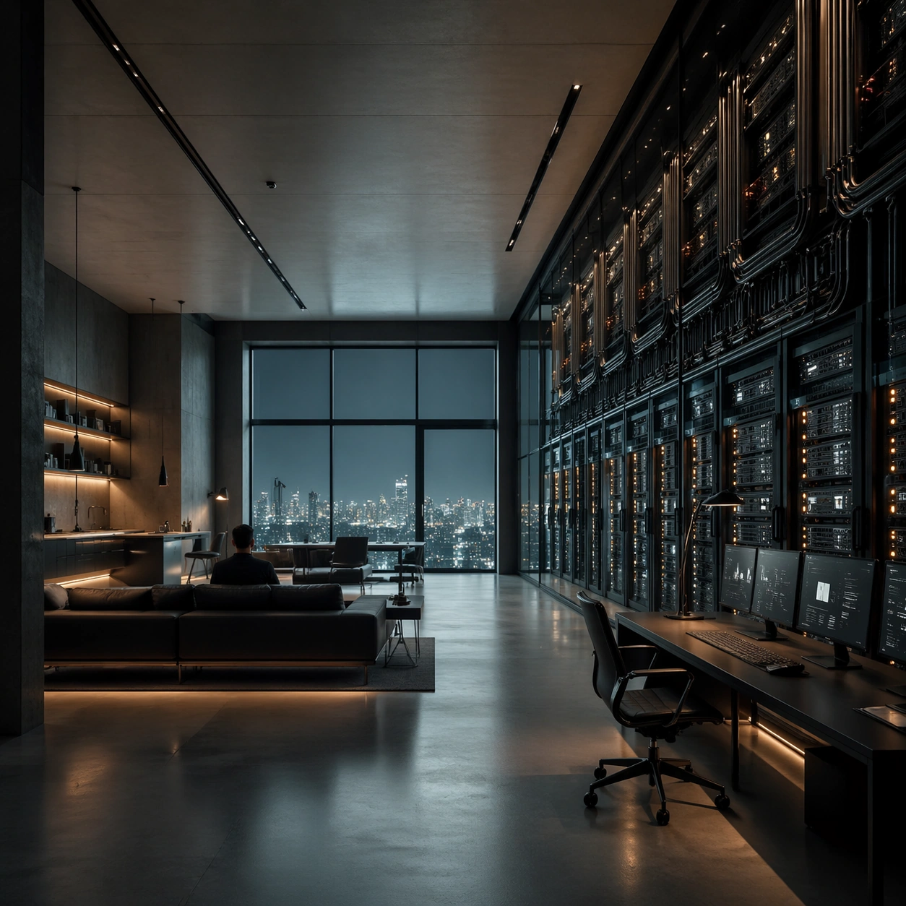

```text
Scene:
A square interior image defined by desaturated teal, nicotine amber, matte charcoal, and polished glass, with every desk, chair, monitor, and light source positioned with mathematical restraint. The room should feel contemporary and expensive, but emotionally distant, as if every element has been audited for balance and control. Compose a loft apartment where one wall has been replaced by server racks and cable management channels, balanced by calm residential furnishings on the opposite side.

Subject:
Use office floors, apartments, control rooms, or meeting spaces where human figures appear small, backlit, and subordinate to the grid of furniture and screens. The subject is not one person so much as the cold system of objects, reflections, and intervals between them. A resident in dark clothing sits at a minimalist sofa facing the racks, small against the machine wall.

Important details:
The signature depends on exact spacing, subdued color, restrained contrast, and a polished investigative mood. Preserve orderly cable paths, clean desk surfaces, sensible monitor glow, and strong negative space. Avoid colorful personality clutter, playful decor, or casual lived-in mess. Keep the electronics elegant and believable, with amber status lights punctuating a largely teal, charcoal, and smoke palette.

Use case:
Cold Precision Grid Interior single study 7/9.

Constraints:
No readable text, no watermark, no logos, preserve exact 1:1 aspect ratio, no visible logos on screens, no colorful sticky notes, no comic exaggeration, no warm family-home coziness, no random clutter piles, no broken anatomy, no low-detail background, no accidental text fragments.
```

[Pinned source](https://github.com/ChaosRealmsAI/gpt-image-2-gallery/blob/5296db8c996e38776c83a0bc8c64f848dcd512b3/works/topics/cold-precision-grid-interior/packages/single-cold-precision-grid-interior/images/07-server-apartment/meta.json) · GPT Image2 · 1254×1254 · No source-declared image dependencies. · ProjectD:pending individual review.

## Night Audit Pods · cold-precision-grid-interior/single-cold-precision-grid-interior/08-night-audit-pods


```text
Scene:
A square interior image defined by desaturated teal, nicotine amber, matte charcoal, and polished glass, with every desk, chair, monitor, and light source positioned with mathematical restraint. The room should feel contemporary and expensive, but emotionally distant, as if every element has been audited for balance and control. Show a deep office floor divided into glass-walled audit pods, each furnished identically and receding in measured rhythm.

Subject:
Use office floors, apartments, control rooms, or meeting spaces where human figures appear small, backlit, and subordinate to the grid of furniture and screens. The subject is not one person so much as the cold system of objects, reflections, and intervals between them. One worker stands in the nearest pod while the remaining rooms glow empty, emphasizing the modular system.

Important details:
The signature depends on exact spacing, subdued color, restrained contrast, and a polished investigative mood. Preserve orderly cable paths, clean desk surfaces, sensible monitor glow, and strong negative space. Avoid colorful personality clutter, playful decor, or casual lived-in mess. Use glass reflections and muted carpet pattern to build a slow, clinical sense of repetition.

Use case:
Cold Precision Grid Interior single study 8/9.

Constraints:
No readable text, no watermark, no logos, preserve exact 1:1 aspect ratio, no visible logos on screens, no colorful sticky notes, no comic exaggeration, no warm family-home coziness, no random clutter piles, no broken anatomy, no low-detail background, no accidental text fragments.
```

[Pinned source](https://github.com/ChaosRealmsAI/gpt-image-2-gallery/blob/5296db8c996e38776c83a0bc8c64f848dcd512b3/works/topics/cold-precision-grid-interior/packages/single-cold-precision-grid-interior/images/08-night-audit-pods/meta.json) · GPT Image2 · 1254×1254 · No source-declared image dependencies. · ProjectD:pending individual review.

## Sleep Pod Office · cold-precision-grid-interior/single-cold-precision-grid-interior/09-sleep-pod-office

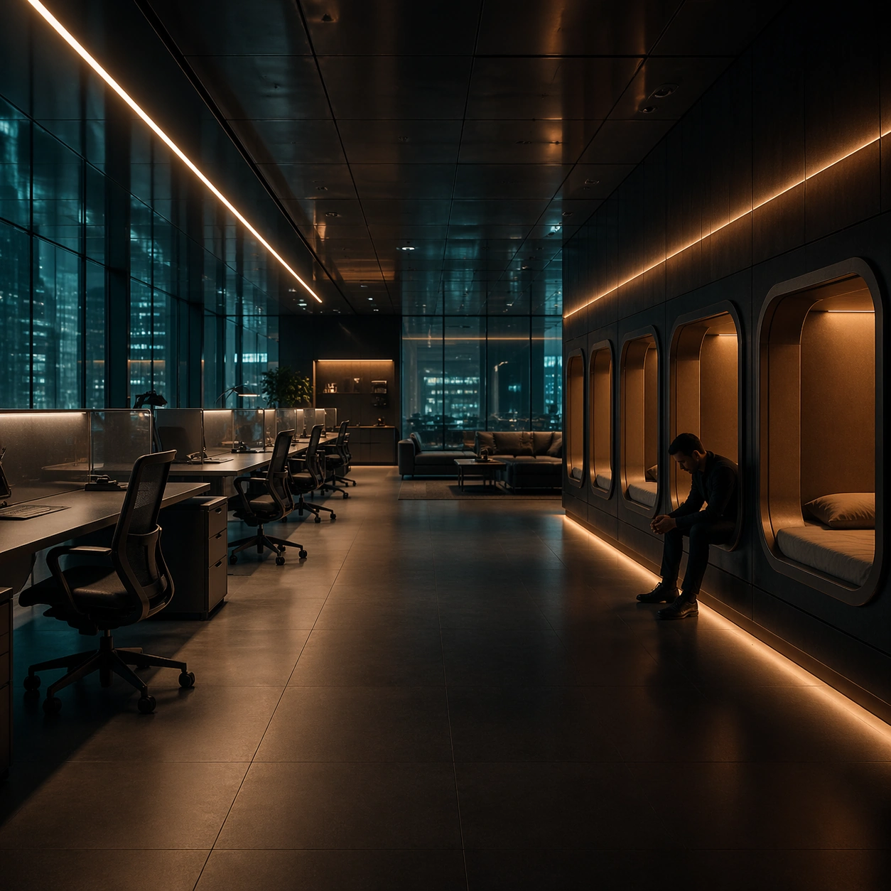

```text
Scene:
A square interior image defined by desaturated teal, nicotine amber, matte charcoal, and polished glass, with every desk, chair, monitor, and light source positioned with mathematical restraint. The room should feel contemporary and expensive, but emotionally distant, as if every element has been audited for balance and control. End with an after-hours office lounge containing built-in sleep pods, low amber strips, and neatly parked ergonomic chairs under teal window reflections.

Subject:
Use office floors, apartments, control rooms, or meeting spaces where human figures appear small, backlit, and subordinate to the grid of furniture and screens. The subject is not one person so much as the cold system of objects, reflections, and intervals between them. A single exhausted worker sits upright at the edge of a pod, silhouetted against the controlled ambient light.

Important details:
The signature depends on exact spacing, subdued color, restrained contrast, and a polished investigative mood. Preserve orderly cable paths, clean desk surfaces, sensible monitor glow, and strong negative space. Avoid colorful personality clutter, playful decor, or casual lived-in mess. The image should feel quietly troubling because of its orderliness, not because of visible drama.

Use case:
Cold Precision Grid Interior single study 9/9.

Constraints:
No readable text, no watermark, no logos, preserve exact 1:1 aspect ratio, no visible logos on screens, no colorful sticky notes, no comic exaggeration, no warm family-home coziness, no random clutter piles, no broken anatomy, no low-detail background, no accidental text fragments.
```

[Pinned source](https://github.com/ChaosRealmsAI/gpt-image-2-gallery/blob/5296db8c996e38776c83a0bc8c64f848dcd512b3/works/topics/cold-precision-grid-interior/packages/single-cold-precision-grid-interior/images/09-sleep-pod-office/meta.json) · GPT Image2 · 1254×1254 · No source-declared image dependencies. · ProjectD:pending individual review.

## Reference Mascot Pack · collector-figure-blister-ads/series-character-pack/01-reference-mascot-pack

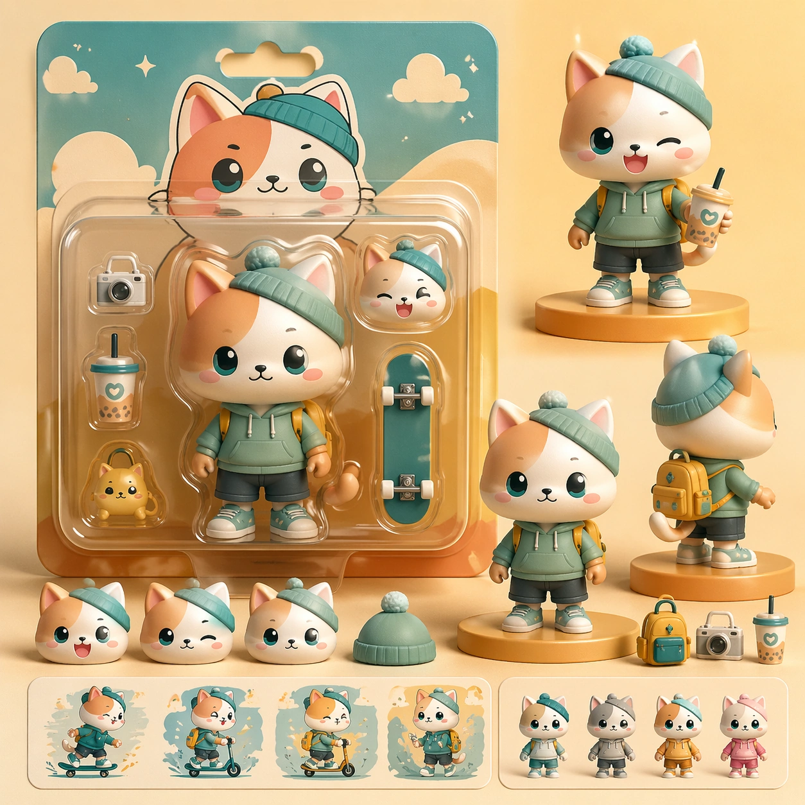

```text
Scene:
A square retail-ready campaign visual for Collector Figure Blister Ads, combining cute character appeal with polished commercial presentation. The composition should feel like a high-finish launch board: crisp packaging edges, collectible object staging, clean shelf or poster context, and vivid but controlled color. It should be immediately legible from far away, but still dense with charming small details that reward closer inspection.

Subject:
Build the image around Reference Mascot Pack, a frame that defines the cute character silhouette, packaging shell, and retail color logic. Translate Build campaign-ready blister-pack and collector-toy advertisements featuring super-deformed characters, accessories, rarity cues, and retail-style packaging polish. into one lovable mascot, figure, or product system that feels ready for posters, boxes, stickers, inserts, or point-of-sale material. The result should feel like a fresh research image with clear commercial focus rather than random fan art. The main subject must remain unmistakable even when surrounded by accessories and display pieces.

Important details:
Charm alone is not enough. Preserve clean silhouette recognition, convincing package construction, reliable prop scale, and structured layout logic so the image feels sellable. This theme studies commercial-mockup, style-transfer, structured-layout, photorealism through a production-ready visual system. Avoid noisy clutter; every secondary element should reinforce collectibility, retail desirability, or explainer clarity. Aim for clear hierarchy, polished craft, and immediately usable campaign logic.

Use case:
Collector Figure Blister Ads series study 1/4.

Constraints:
No readable text, no watermark, no logos, preserve exact 1:1 aspect ratio, no horror elements, no brand theft, no malformed packaging edges, no muddy mascot silhouette, no messy retail shelf, no chaotic prop overload.
```

[Pinned source](https://github.com/ChaosRealmsAI/gpt-image-2-gallery/blob/5296db8c996e38776c83a0bc8c64f848dcd512b3/works/topics/collector-figure-blister-ads/packages/series-character-pack/images/01-reference-mascot-pack/meta.json) · GPT Image2 · 1254×1254 · No source-declared image dependencies. · ProjectD:pending individual review.

## Sticker Burst Variant · collector-figure-blister-ads/series-character-pack/02-sticker-burst

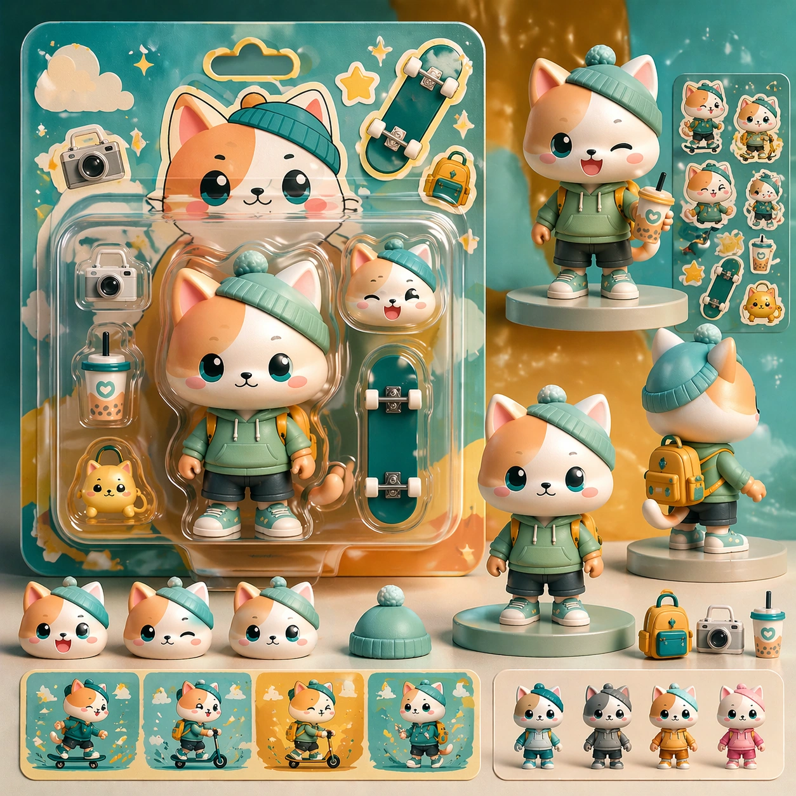

```text
Scene:
A square retail-ready campaign visual for Collector Figure Blister Ads, combining cute character appeal with polished commercial presentation. The composition should feel like a high-finish launch board: crisp packaging edges, collectible object staging, clean shelf or poster context, and vivid but controlled color. It should be immediately legible from far away, but still dense with charming small details that reward closer inspection.

Subject:
Build the image around Sticker Burst Variant, a frame that keeps the same character and package identity while adding collectible sticker energy. Translate Build campaign-ready blister-pack and collector-toy advertisements featuring super-deformed characters, accessories, rarity cues, and retail-style packaging polish. into one lovable mascot, figure, or product system that feels ready for posters, boxes, stickers, inserts, or point-of-sale material. The result should feel like a fresh research image with clear commercial focus rather than random fan art. The main subject must remain unmistakable even when surrounded by accessories and display pieces.

Important details:
Charm alone is not enough. Preserve clean silhouette recognition, convincing package construction, reliable prop scale, and structured layout logic so the image feels sellable. This theme studies commercial-mockup, style-transfer, structured-layout, photorealism through a production-ready visual system. Avoid noisy clutter; every secondary element should reinforce collectibility, retail desirability, or explainer clarity. Aim for clear hierarchy, polished craft, and immediately usable campaign logic.

Use case:
Collector Figure Blister Ads series study 2/4.

Constraints:
No readable text, no watermark, no logos, preserve exact 1:1 aspect ratio, no horror elements, no brand theft, no malformed packaging edges, no muddy mascot silhouette, no messy retail shelf, no chaotic prop overload.
```

[Pinned source](https://github.com/ChaosRealmsAI/gpt-image-2-gallery/blob/5296db8c996e38776c83a0bc8c64f848dcd512b3/works/topics/collector-figure-blister-ads/packages/series-character-pack/images/02-sticker-burst/meta.json) · GPT Image2 · 1254×1254 · Reference images required. · ProjectD:pending individual review.

## Shelf Launch Variant · collector-figure-blister-ads/series-character-pack/03-shelf-launch

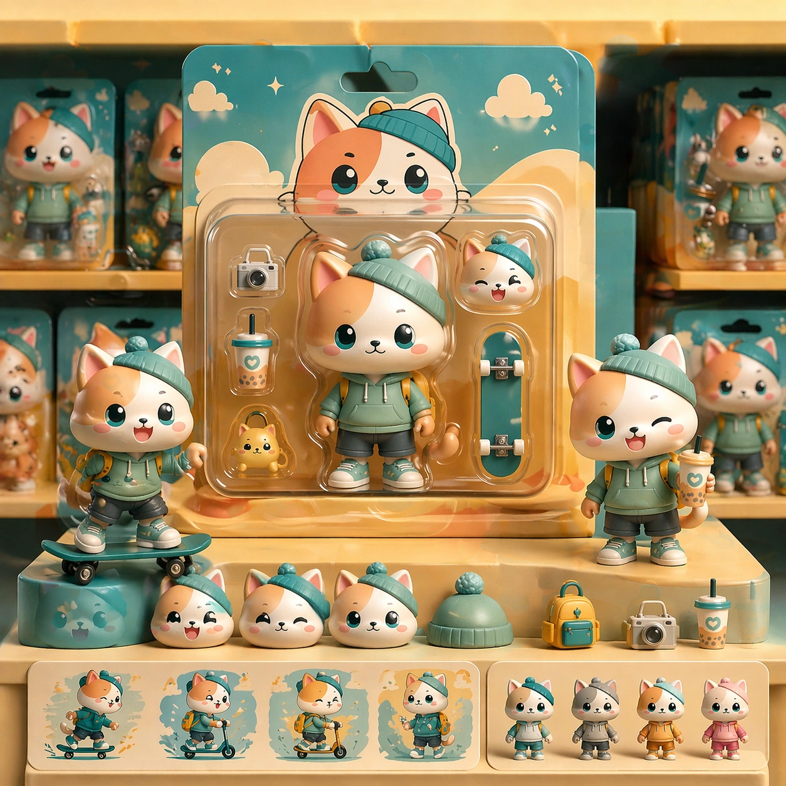

```text
Scene:
A square retail-ready campaign visual for Collector Figure Blister Ads, combining cute character appeal with polished commercial presentation. The composition should feel like a high-finish launch board: crisp packaging edges, collectible object staging, clean shelf or poster context, and vivid but controlled color. It should be immediately legible from far away, but still dense with charming small details that reward closer inspection.

Subject:
Build the image around Shelf Launch Variant, a frame that translates the same mascot package into a shelf-ready launch composition. Translate Build campaign-ready blister-pack and collector-toy advertisements featuring super-deformed characters, accessories, rarity cues, and retail-style packaging polish. into one lovable mascot, figure, or product system that feels ready for posters, boxes, stickers, inserts, or point-of-sale material. The result should feel like a fresh research image with clear commercial focus rather than random fan art. The main subject must remain unmistakable even when surrounded by accessories and display pieces.

Important details:
Charm alone is not enough. Preserve clean silhouette recognition, convincing package construction, reliable prop scale, and structured layout logic so the image feels sellable. This theme studies commercial-mockup, style-transfer, structured-layout, photorealism through a production-ready visual system. Avoid noisy clutter; every secondary element should reinforce collectibility, retail desirability, or explainer clarity. Aim for clear hierarchy, polished craft, and immediately usable campaign logic.

Use case:
Collector Figure Blister Ads series study 3/4.

Constraints:
No readable text, no watermark, no logos, preserve exact 1:1 aspect ratio, no horror elements, no brand theft, no malformed packaging edges, no muddy mascot silhouette, no messy retail shelf, no chaotic prop overload.
```

[Pinned source](https://github.com/ChaosRealmsAI/gpt-image-2-gallery/blob/5296db8c996e38776c83a0bc8c64f848dcd512b3/works/topics/collector-figure-blister-ads/packages/series-character-pack/images/03-shelf-launch/meta.json) · GPT Image2 · 1254×1254 · Reference images required. · ProjectD:pending individual review.

## Premium Collab Box · collector-figure-blister-ads/series-character-pack/04-premium-collab-box

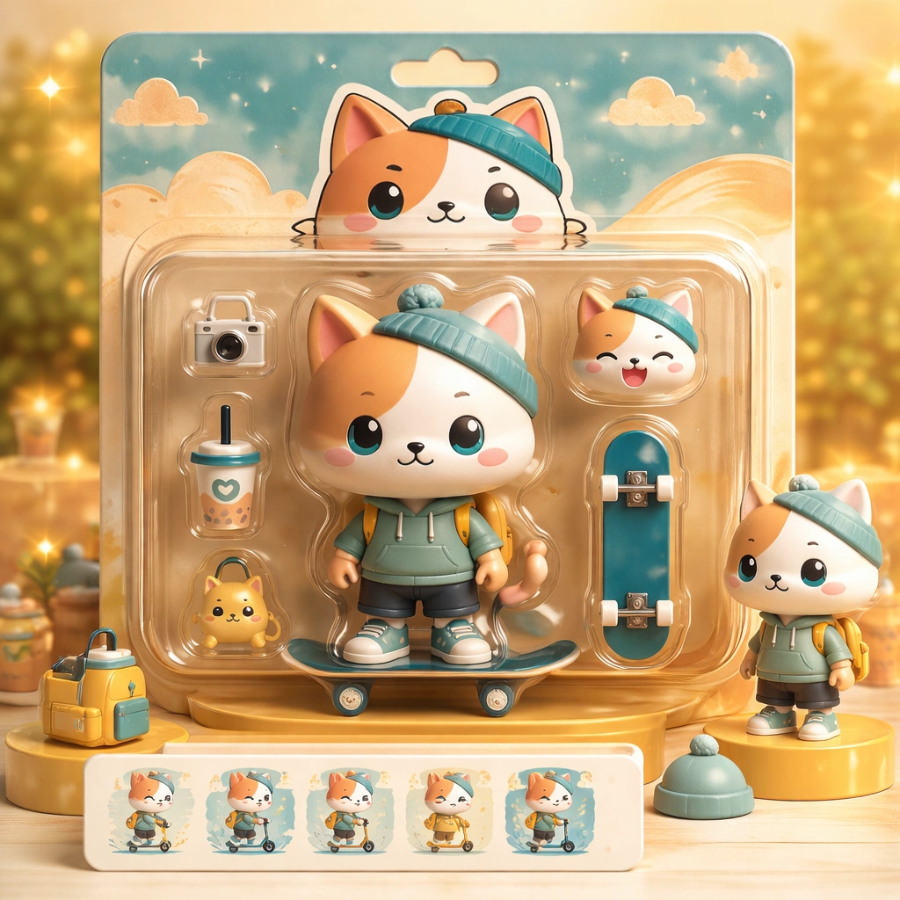

```text
Scene:
A square retail-ready campaign visual for Collector Figure Blister Ads, combining cute character appeal with polished commercial presentation. The composition should feel like a high-finish launch board: crisp packaging edges, collectible object staging, clean shelf or poster context, and vivid but controlled color. It should be immediately legible from far away, but still dense with charming small details that reward closer inspection.

Subject:
Build the image around Premium Collab Box, a frame that elevates the same character system into a premium collaboration box visual. Translate Build campaign-ready blister-pack and collector-toy advertisements featuring super-deformed characters, accessories, rarity cues, and retail-style packaging polish. into one lovable mascot, figure, or product system that feels ready for posters, boxes, stickers, inserts, or point-of-sale material. The result should feel like a fresh research image with clear commercial focus rather than random fan art. The main subject must remain unmistakable even when surrounded by accessories and display pieces.

Important details:
Charm alone is not enough. Preserve clean silhouette recognition, convincing package construction, reliable prop scale, and structured layout logic so the image feels sellable. This theme studies commercial-mockup, style-transfer, structured-layout, photorealism through a production-ready visual system. Avoid noisy clutter; every secondary element should reinforce collectibility, retail desirability, or explainer clarity. Aim for clear hierarchy, polished craft, and immediately usable campaign logic.

Use case:
Collector Figure Blister Ads series study 4/4.

Constraints:
No readable text, no watermark, no logos, preserve exact 1:1 aspect ratio, no horror elements, no brand theft, no malformed packaging edges, no muddy mascot silhouette, no messy retail shelf, no chaotic prop overload.
```

[Pinned source](https://github.com/ChaosRealmsAI/gpt-image-2-gallery/blob/5296db8c996e38776c83a0bc8c64f848dcd512b3/works/topics/collector-figure-blister-ads/packages/series-character-pack/images/04-premium-collab-box/meta.json) · GPT Image2 · 1024×1024 · Reference images required. · ProjectD:pending individual review.

## Merch Preview · collector-figure-blister-ads/single-retail-support/merch-preview

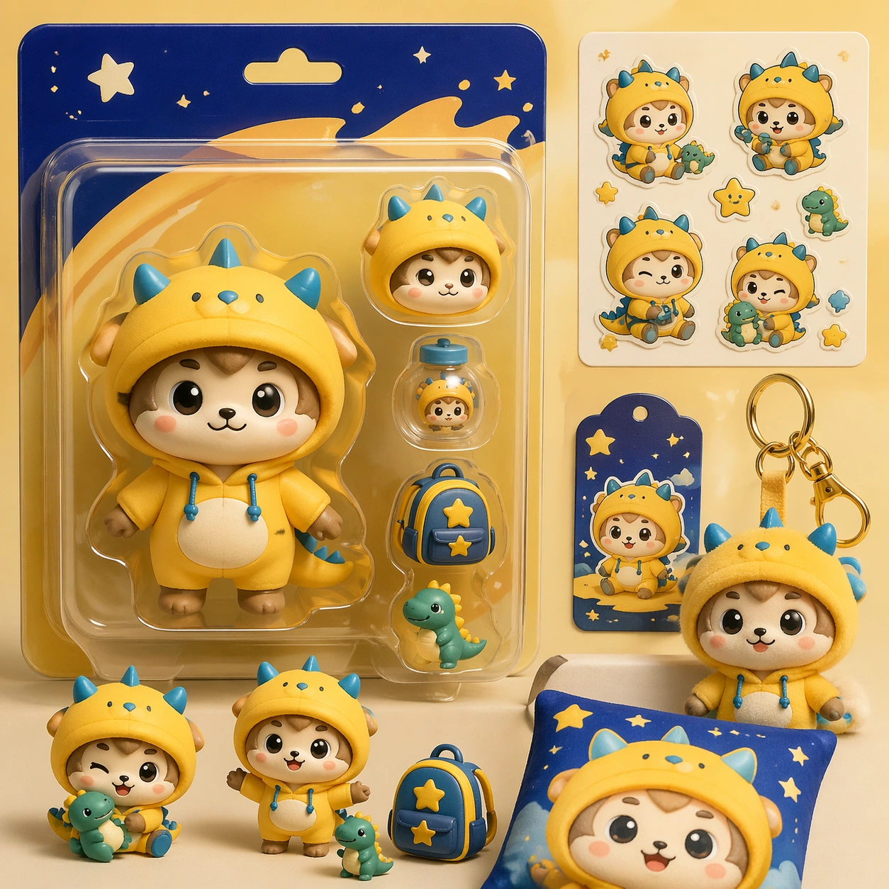

```text
Scene:
A square retail-ready campaign visual for Collector Figure Blister Ads, combining cute character appeal with polished commercial presentation. The composition should feel like a high-finish launch board: crisp packaging edges, collectible object staging, clean shelf or poster context, and vivid but controlled color. It should be immediately legible from far away, but still dense with charming small details that reward closer inspection.

Subject:
Build the image around Merch Preview, a frame that a merchandise-forward visual showing accessories, stickers, tags, or bonus items. Translate Build campaign-ready blister-pack and collector-toy advertisements featuring super-deformed characters, accessories, rarity cues, and retail-style packaging polish. into one lovable mascot, figure, or product system that feels ready for posters, boxes, stickers, inserts, or point-of-sale material. The result should feel like a fresh research image with clear commercial focus rather than random fan art. The main subject must remain unmistakable even when surrounded by accessories and display pieces.

Important details:
Charm alone is not enough. Preserve clean silhouette recognition, convincing package construction, reliable prop scale, and structured layout logic so the image feels sellable. This theme studies commercial-mockup, style-transfer, structured-layout, photorealism through a production-ready visual system. Avoid noisy clutter; every secondary element should reinforce collectibility, retail desirability, or explainer clarity. Aim for clear hierarchy, polished craft, and immediately usable campaign logic.

Use case:
Collector Figure Blister Ads single study 2/5.

Constraints:
No readable text, no watermark, no logos, preserve exact 1:1 aspect ratio, no horror elements, no brand theft, no malformed packaging edges, no muddy mascot silhouette, no messy retail shelf, no chaotic prop overload.
```

[Pinned source](https://github.com/ChaosRealmsAI/gpt-image-2-gallery/blob/5296db8c996e38776c83a0bc8c64f848dcd512b3/works/topics/collector-figure-blister-ads/packages/single-retail-support/images/merch-preview/meta.json) · GPT Image2 · 1254×1254 · No source-declared image dependencies. · ProjectD:pending individual review.

## Counter Display · collector-figure-blister-ads/single-retail-support/counter-display

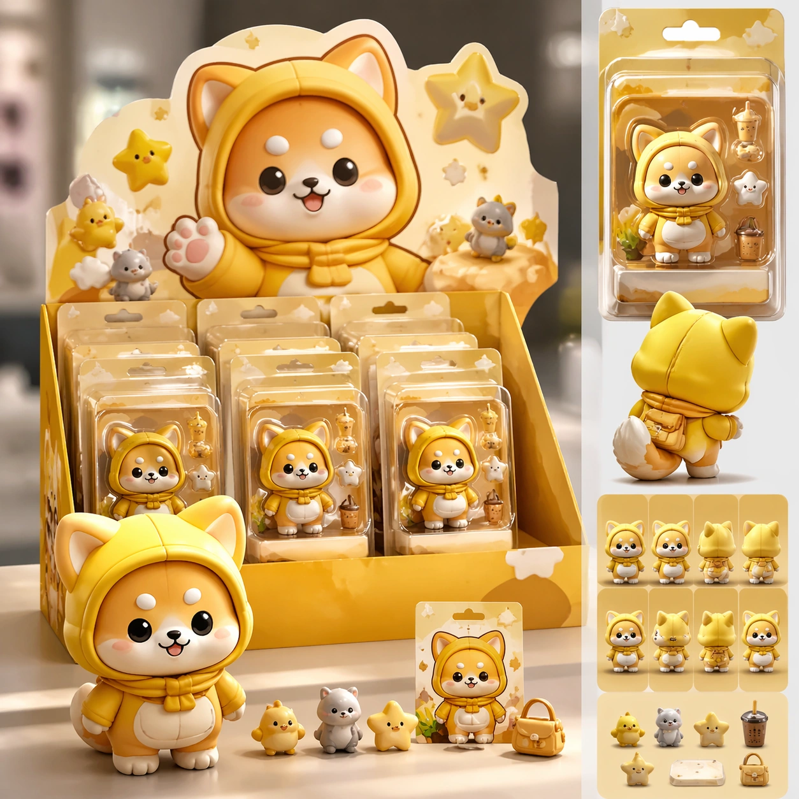

```text
Scene:
A square retail-ready campaign visual for Collector Figure Blister Ads, combining cute character appeal with polished commercial presentation. The composition should feel like a high-finish launch board: crisp packaging edges, collectible object staging, clean shelf or poster context, and vivid but controlled color. It should be immediately legible from far away, but still dense with charming small details that reward closer inspection.

Subject:
Build the image around Counter Display, a frame that a point-of-sale display study that proves the system can live in store. Translate Build campaign-ready blister-pack and collector-toy advertisements featuring super-deformed characters, accessories, rarity cues, and retail-style packaging polish. into one lovable mascot, figure, or product system that feels ready for posters, boxes, stickers, inserts, or point-of-sale material. The result should feel like a fresh research image with clear commercial focus rather than random fan art. The main subject must remain unmistakable even when surrounded by accessories and display pieces.

Important details:
Charm alone is not enough. Preserve clean silhouette recognition, convincing package construction, reliable prop scale, and structured layout logic so the image feels sellable. This theme studies commercial-mockup, style-transfer, structured-layout, photorealism through a production-ready visual system. Avoid noisy clutter; every secondary element should reinforce collectibility, retail desirability, or explainer clarity. Aim for clear hierarchy, polished craft, and immediately usable campaign logic.

Use case:
Collector Figure Blister Ads single study 3/5.

Constraints:
No readable text, no watermark, no logos, preserve exact 1:1 aspect ratio, no horror elements, no brand theft, no malformed packaging edges, no muddy mascot silhouette, no messy retail shelf, no chaotic prop overload.
```

[Pinned source](https://github.com/ChaosRealmsAI/gpt-image-2-gallery/blob/5296db8c996e38776c83a0bc8c64f848dcd512b3/works/topics/collector-figure-blister-ads/packages/single-retail-support/images/counter-display/meta.json) · GPT Image2 · 1254×1254 · No source-declared image dependencies. · ProjectD:pending individual review.

## Launch Poster · collector-figure-blister-ads/single-retail-support/launch-poster

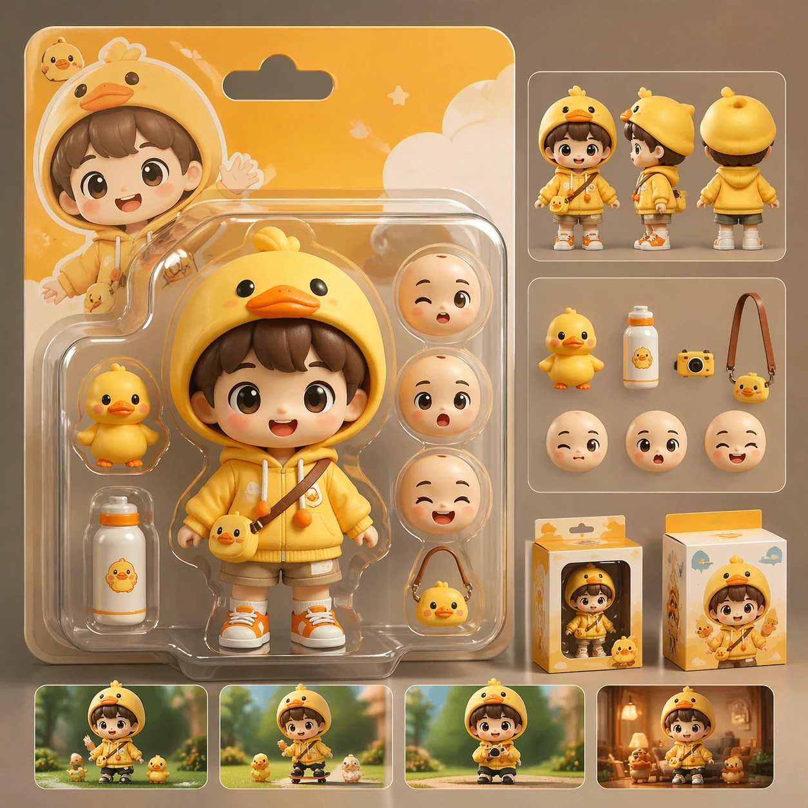

```text
Scene:
A square retail-ready campaign visual for Collector Figure Blister Ads, combining cute character appeal with polished commercial presentation. The composition should feel like a high-finish launch board: crisp packaging edges, collectible object staging, clean shelf or poster context, and vivid but controlled color. It should be immediately legible from far away, but still dense with charming small details that reward closer inspection.

Subject:
Build the image around Launch Poster, a frame that a clean release poster with cute emotional pull and unmistakable product focus. Translate Build campaign-ready blister-pack and collector-toy advertisements featuring super-deformed characters, accessories, rarity cues, and retail-style packaging polish. into one lovable mascot, figure, or product system that feels ready for posters, boxes, stickers, inserts, or point-of-sale material. The result should feel like a fresh research image with clear commercial focus rather than random fan art. The main subject must remain unmistakable even when surrounded by accessories and display pieces.

Important details:
Charm alone is not enough. Preserve clean silhouette recognition, convincing package construction, reliable prop scale, and structured layout logic so the image feels sellable. This theme studies commercial-mockup, style-transfer, structured-layout, photorealism through a production-ready visual system. Avoid noisy clutter; every secondary element should reinforce collectibility, retail desirability, or explainer clarity. Aim for clear hierarchy, polished craft, and immediately usable campaign logic.

Use case:
Collector Figure Blister Ads single study 4/5.

Constraints:
No readable text, no watermark, no logos, preserve exact 1:1 aspect ratio, no horror elements, no brand theft, no malformed packaging edges, no muddy mascot silhouette, no messy retail shelf, no chaotic prop overload.
```

[Pinned source](https://github.com/ChaosRealmsAI/gpt-image-2-gallery/blob/5296db8c996e38776c83a0bc8c64f848dcd512b3/works/topics/collector-figure-blister-ads/packages/single-retail-support/images/launch-poster/meta.json) · GPT Image2 · 1254×1254 · No source-declared image dependencies. · ProjectD:pending individual review.

## Collector Sheet · collector-figure-blister-ads/single-retail-support/collector-sheet

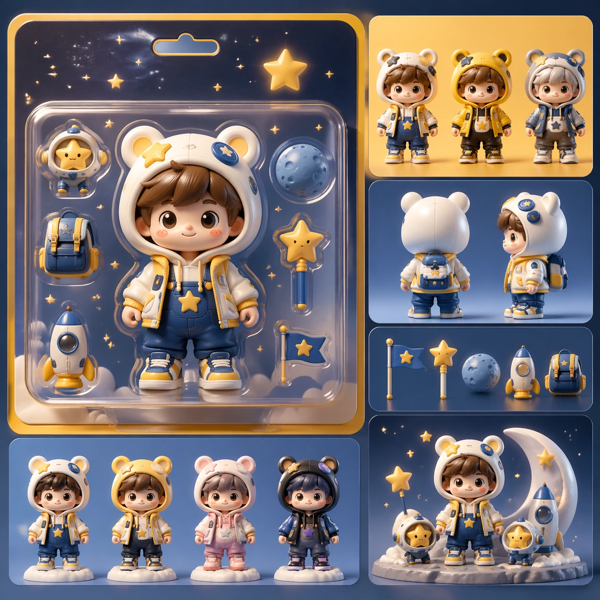

```text
Scene:
A square retail-ready campaign visual for Collector Figure Blister Ads, combining cute character appeal with polished commercial presentation. The composition should feel like a high-finish launch board: crisp packaging edges, collectible object staging, clean shelf or poster context, and vivid but controlled color. It should be immediately legible from far away, but still dense with charming small details that reward closer inspection.

Subject:
Build the image around Collector Sheet, a frame that a collector-oriented overview image unifying variants, icons, and packaging cues. Translate Build campaign-ready blister-pack and collector-toy advertisements featuring super-deformed characters, accessories, rarity cues, and retail-style packaging polish. into one lovable mascot, figure, or product system that feels ready for posters, boxes, stickers, inserts, or point-of-sale material. The result should feel like a fresh research image with clear commercial focus rather than random fan art. The main subject must remain unmistakable even when surrounded by accessories and display pieces.

Important details:
Charm alone is not enough. Preserve clean silhouette recognition, convincing package construction, reliable prop scale, and structured layout logic so the image feels sellable. This theme studies commercial-mockup, style-transfer, structured-layout, photorealism through a production-ready visual system. Avoid noisy clutter; every secondary element should reinforce collectibility, retail desirability, or explainer clarity. Aim for clear hierarchy, polished craft, and immediately usable campaign logic.

Use case:
Collector Figure Blister Ads single study 5/5.

Constraints:
No readable text, no watermark, no logos, preserve exact 1:1 aspect ratio, no horror elements, no brand theft, no malformed packaging edges, no muddy mascot silhouette, no messy retail shelf, no chaotic prop overload.
```

[Pinned source](https://github.com/ChaosRealmsAI/gpt-image-2-gallery/blob/5296db8c996e38776c83a0bc8c64f848dcd512b3/works/topics/collector-figure-blister-ads/packages/single-retail-support/images/collector-sheet/meta.json) · GPT Image2 · 1254×1254 · No source-declared image dependencies. · ProjectD:pending individual review.

## Transformable Overview · compact-urban-apartment-efficiency-aesthetic/series-spatial-language-lock/01-transformable-overview

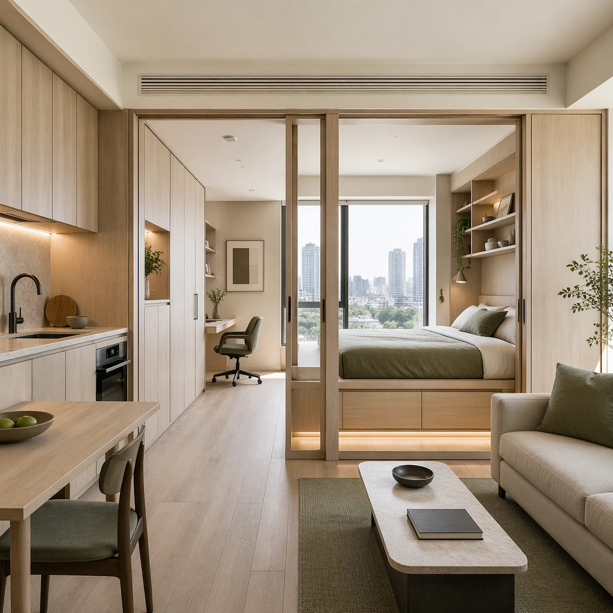

```text
Scene:
Create a square architectural reference still for Compact Urban Apartment Efficiency Aesthetic. Use a wide daylight overview that reveals living, dining, work, and sleep zones in one frame and treat the frame like a premium interior or architecture editorial photograph with disciplined perspective, readable depth from foreground to background, and enough negative space for the spatial hierarchy to breathe. Light the scene so space efficiency, hidden storage, and calm urban living feel immediate, using light ash wood, warm white plaster, soft graphite accents, pale stone, and muted sage textiles as the governing tonal range. The composition must read as a high-end commercial image that could sit inside rental campaigns, design editorials, developer micro-unit decks, and small-space planning references.

Subject:
Show a compact urban apartment with ash wood millwork, sliding partitions, hidden storage walls, a built-in platform bed, compact stone kitchen surfaces, and calm metropolitan daylight. Center the apartment’s transformable plan logic, storage walls, and quiet urban elegance. This is the canonical reference image for the package, so the major proportions, material transitions, fixture families, and circulation logic must feel highly specific and internally coherent rather than generic luxury styling. Let the viewer understand how the space is organized within a single glance, with foreground anchors, a clear middle zone, and a resolved background termination.

Important details:
Lock the sliding partition system, integrated storage geometry, ash wood detailing, compact kitchen language, and quiet city-apartment restraint. Surfaces should feel tactile and believable: stone veining must stay plausible, metals should have disciplined reflectance, fabrics should show natural weight, and concealed lighting should shape the volume instead of flattening it. Use abstract signage, menu, label, or caption zones only as unreadable graphic hints. The image should feel practical for downstream design reviews and polished enough for public-facing campaign use.

Use case:
Compact Urban Apartment Efficiency Aesthetic series study 1/9, establishing the canonical compact apartment system for the series.

Constraints:
No readable text, no watermark, no logos, preserve exact 1:1 aspect ratio, no clutter piles, no messy shoes, no novelty gadgets, no colorful toy furniture, no cramped distortion, no fisheye distortion.
```

[Pinned source](https://github.com/ChaosRealmsAI/gpt-image-2-gallery/blob/5296db8c996e38776c83a0bc8c64f848dcd512b3/works/topics/compact-urban-apartment-efficiency-aesthetic/packages/series-spatial-language-lock/images/01-transformable-overview/meta.json) · GPT Image2 · 1254×1254 · No source-declared image dependencies. · ProjectD:pending individual review.

## Kitchen Desk Hybrid · compact-urban-apartment-efficiency-aesthetic/series-spatial-language-lock/02-kitchen-desk-hybrid

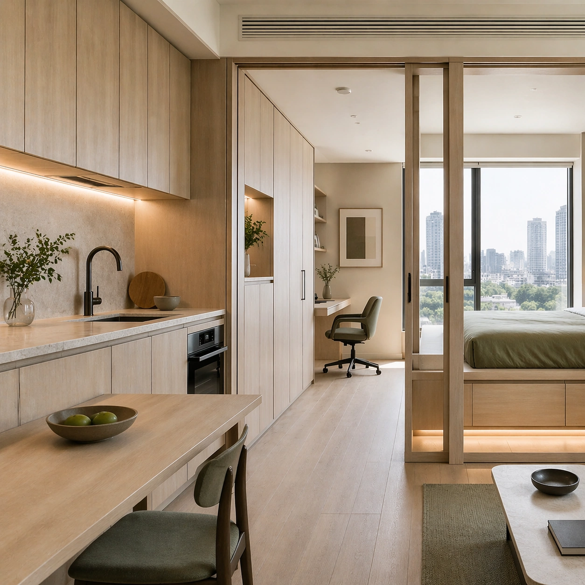

```text
Scene:
Create a square reference-dependent architecture still for Compact Urban Apartment Efficiency Aesthetic. Use a square view focused on the kitchen counter extending into a work nook while keeping the same lens discipline, editorial polish, and material believability established by the reference image. The lighting can shift to support the intended mood, but the space must still feel like the same authored project with a stable viewpoint logic, convincing depth separation, and clean commercial-photography finish. Keep light ash wood, warm white plaster, soft graphite accents, pale stone, and muted sage textiles as the governing tonal range even when the emphasis changes.

Subject:
Show a compact urban apartment with ash wood millwork, sliding partitions, hidden storage walls, a built-in platform bed, compact stone kitchen surfaces, and calm metropolitan daylight. Focus on the exact same apartment from the reference image, now emphasizing multifunctional surfaces and compact circulation. Preserve exact architectural identity, plan logic, material palette, fixture family, and circulation cues from the reference image while changing only the intended emphasis described here. The viewer should immediately recognize the same project, not a loose cousin, with matching silhouette logic, aligned detailing, and consistent brand atmosphere.

Important details:
Preserve the sliding partition system, integrated storage geometry, ash wood detailing, compact kitchen language, and quiet city-apartment restraint. Any abstract wayfinding, menu, wall-label, or packaging zones must stay unreadable and subordinate to the spatial image. Joinery, edges, reflections, and lighting should remain realistic enough for an operator or design team to treat the image as a credible reference. The variation should feel deliberate and commercially useful, proving that one locked spatial language can flex across multiple campaign or editorial surfaces.

Use case:
Compact Urban Apartment Efficiency Aesthetic series study 2/9, extending hybrid kitchen-work logic while preserving the same apartment identity.

Constraints:
No readable text, no watermark, no logos, preserve exact 1:1 aspect ratio, preserve exact architectural identity from the reference image, no clutter piles, no messy shoes, no novelty gadgets, no colorful toy furniture, no cramped distortion, no visible laptop logos.
```

[Pinned source](https://github.com/ChaosRealmsAI/gpt-image-2-gallery/blob/5296db8c996e38776c83a0bc8c64f848dcd512b3/works/topics/compact-urban-apartment-efficiency-aesthetic/packages/series-spatial-language-lock/images/02-kitchen-desk-hybrid/meta.json) · GPT Image2 · 1254×1254 · Reference images required. · ProjectD:pending individual review.

## Platform Bedroom Storage · compact-urban-apartment-efficiency-aesthetic/series-spatial-language-lock/03-platform-bedroom-storage

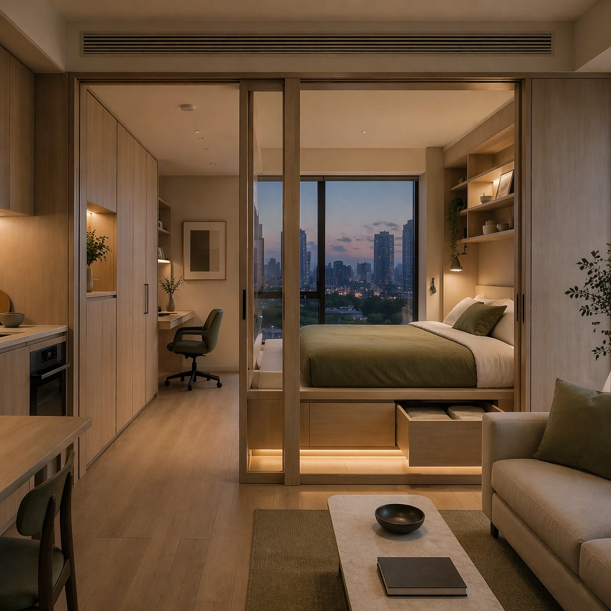

```text
Scene:
Create a square reference-dependent architecture still for Compact Urban Apartment Efficiency Aesthetic. Use a viewpoint toward the platform bed and integrated drawers while keeping the same lens discipline, editorial polish, and material believability established by the reference image. The lighting can shift to support the intended mood, but the space must still feel like the same authored project with a stable viewpoint logic, convincing depth separation, and clean commercial-photography finish. Keep light ash wood, warm white plaster, soft graphite accents, pale stone, and muted sage textiles as the governing tonal range even when the emphasis changes.

Subject:
Show a compact urban apartment with ash wood millwork, sliding partitions, hidden storage walls, a built-in platform bed, compact stone kitchen surfaces, and calm metropolitan daylight. Focus on the exact same apartment from the reference image, now emphasizing bed-platform joinery, concealed storage, and soft evening calm. Preserve exact architectural identity, plan logic, material palette, fixture family, and circulation cues from the reference image while changing only the intended emphasis described here. The viewer should immediately recognize the same project, not a loose cousin, with matching silhouette logic, aligned detailing, and consistent brand atmosphere.

Important details:
Preserve the sliding partition system, integrated storage geometry, ash wood detailing, compact kitchen language, and quiet city-apartment restraint. Any abstract wayfinding, menu, wall-label, or packaging zones must stay unreadable and subordinate to the spatial image. Joinery, edges, reflections, and lighting should remain realistic enough for an operator or design team to treat the image as a credible reference. The variation should feel deliberate and commercially useful, proving that one locked spatial language can flex across multiple campaign or editorial surfaces.

Use case:
Compact Urban Apartment Efficiency Aesthetic series study 3/9, extending sleep-zone efficiency in the same design language.

Constraints:
No readable text, no watermark, no logos, preserve exact 1:1 aspect ratio, preserve exact architectural identity from the reference image, no clutter piles, no messy shoes, no novelty gadgets, no colorful toy furniture, no cramped distortion, no exposed clothing mess.
```

[Pinned source](https://github.com/ChaosRealmsAI/gpt-image-2-gallery/blob/5296db8c996e38776c83a0bc8c64f848dcd512b3/works/topics/compact-urban-apartment-efficiency-aesthetic/packages/series-spatial-language-lock/images/03-platform-bedroom-storage/meta.json) · GPT Image2 · 1254×1254 · Reference images required. · ProjectD:pending individual review.

## Bath and Laundry Core · compact-urban-apartment-efficiency-aesthetic/series-spatial-language-lock/04-bath-laundry-core

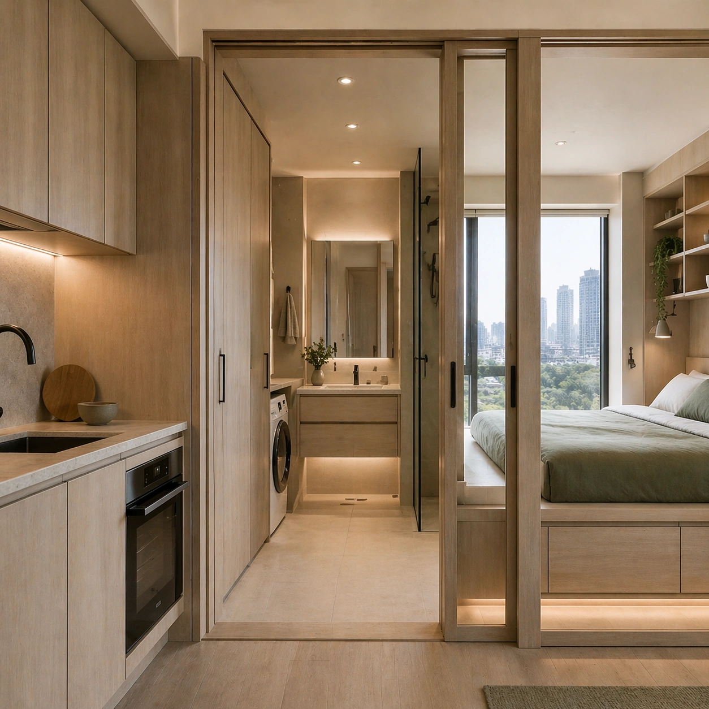

```text
Scene:
Create a square reference-dependent architecture still for Compact Urban Apartment Efficiency Aesthetic. Use a precise angle into the bathroom-laundry core framed by the sliding partition while keeping the same lens discipline, editorial polish, and material believability established by the reference image. The lighting can shift to support the intended mood, but the space must still feel like the same authored project with a stable viewpoint logic, convincing depth separation, and clean commercial-photography finish. Keep light ash wood, warm white plaster, soft graphite accents, pale stone, and muted sage textiles as the governing tonal range even when the emphasis changes.

Subject:
Show a compact urban apartment with ash wood millwork, sliding partitions, hidden storage walls, a built-in platform bed, compact stone kitchen surfaces, and calm metropolitan daylight. Focus on the exact same apartment from the reference image, now emphasizing compact service planning and refined material transitions. Preserve exact architectural identity, plan logic, material palette, fixture family, and circulation cues from the reference image while changing only the intended emphasis described here. The viewer should immediately recognize the same project, not a loose cousin, with matching silhouette logic, aligned detailing, and consistent brand atmosphere.

Important details:
Preserve the sliding partition system, integrated storage geometry, ash wood detailing, compact kitchen language, and quiet city-apartment restraint. Any abstract wayfinding, menu, wall-label, or packaging zones must stay unreadable and subordinate to the spatial image. Joinery, edges, reflections, and lighting should remain realistic enough for an operator or design team to treat the image as a credible reference. The variation should feel deliberate and commercially useful, proving that one locked spatial language can flex across multiple campaign or editorial surfaces.

Use case:
Compact Urban Apartment Efficiency Aesthetic series study 4/9, extending service-core intelligence without changing the core apartment identity.

Constraints:
No readable text, no watermark, no logos, preserve exact 1:1 aspect ratio, preserve exact architectural identity from the reference image, no clutter piles, no messy shoes, no novelty gadgets, no colorful toy furniture, no cramped distortion, no detergent labels.
```

[Pinned source](https://github.com/ChaosRealmsAI/gpt-image-2-gallery/blob/5296db8c996e38776c83a0bc8c64f848dcd512b3/works/topics/compact-urban-apartment-efficiency-aesthetic/packages/series-spatial-language-lock/images/04-bath-laundry-core/meta.json) · GPT Image2 · 1254×1254 · Reference images required. · ProjectD:pending individual review.

## Wardrobe Organization Wall · compact-urban-apartment-efficiency-aesthetic/single-support-studies/02-wardrobe-organization-wall

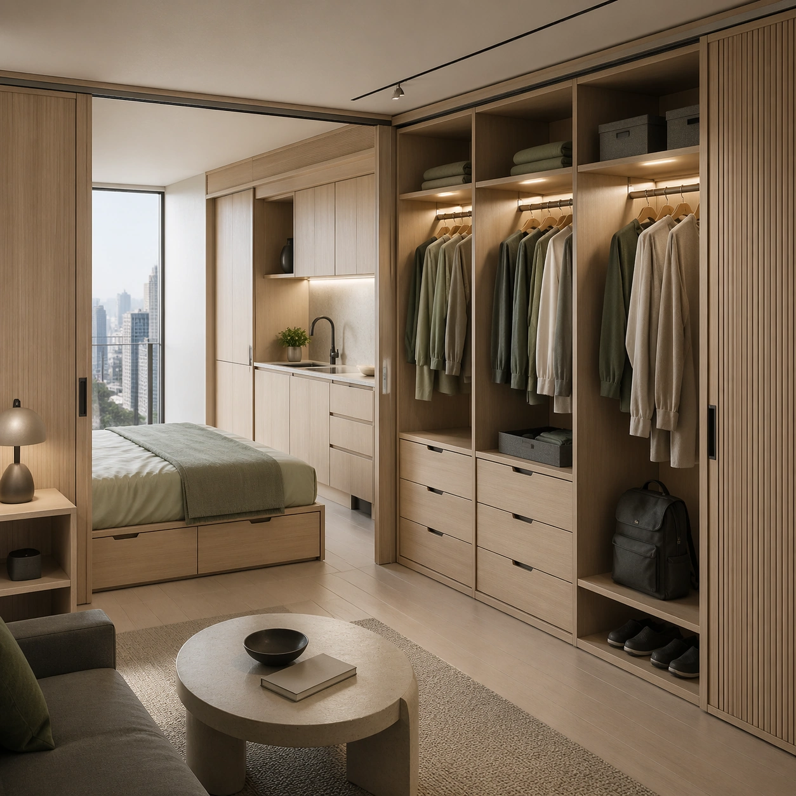

```text
Scene:
Create a square standalone support study for Compact Urban Apartment Efficiency Aesthetic. Use an open wardrobe wall with drawers, hanging zones, and inset lighting and frame it like a premium commercial still or design-editorial crop with clear focal hierarchy, disciplined perspective, and enough breathing room for the materials and objects to read at both thumbnail and full size. Keep light ash wood, warm white plaster, soft graphite accents, pale stone, and muted sage textiles as the tonal guide so the image still belongs to the same theme family, and light the scene in a controlled way that emphasizes texture, edge quality, and authored atmosphere over spectacle.

Subject:
Show a compact urban apartment with ash wood millwork, sliding partitions, hidden storage walls, a built-in platform bed, compact stone kitchen surfaces, and calm metropolitan daylight. In this support study, focus on organization logic, material calm, and believable daily-use spacing. The image should work independently, yet it must still feel like it belongs to the same broader world of Urban Apartment. Make the space, props, and detailing useful for real campaign, editorial, or design-review contexts rather than moodboard abstraction.

Important details:
Carry forward the broader language of the sliding partition system, integrated storage geometry, ash wood detailing, compact kitchen language, and quiet city-apartment restraint, but let this image prove a new support surface or secondary deliverable. Material realism is essential: wood grain, metal sheen, glass edges, textiles, and stone should feel physically plausible and carefully art directed. Any graphic panels, labels, menus, packaging, or captions must stay abstract and unreadable. The overall result should feel reusable for rental campaigns, design editorials, developer micro-unit decks, and small-space planning references, with enough structure that a creative or operations team could build on it.

Use case:
Compact Urban Apartment Efficiency Aesthetic single study 6/9, exploring storage-system support image for compact living.

Constraints:
No readable text, no watermark, no logos, preserve exact 1:1 aspect ratio, no clutter piles, no messy shoes, no novelty gadgets, no colorful toy furniture, no cramped distortion, no readable garment branding.
```

[Pinned source](https://github.com/ChaosRealmsAI/gpt-image-2-gallery/blob/5296db8c996e38776c83a0bc8c64f848dcd512b3/works/topics/compact-urban-apartment-efficiency-aesthetic/packages/single-support-studies/images/02-wardrobe-organization-wall/meta.json) · GPT Image2 · 1254×1254 · No source-declared image dependencies. · ProjectD:pending individual review.

## Window Nook Editorial · compact-urban-apartment-efficiency-aesthetic/single-support-studies/03-window-nook-editorial

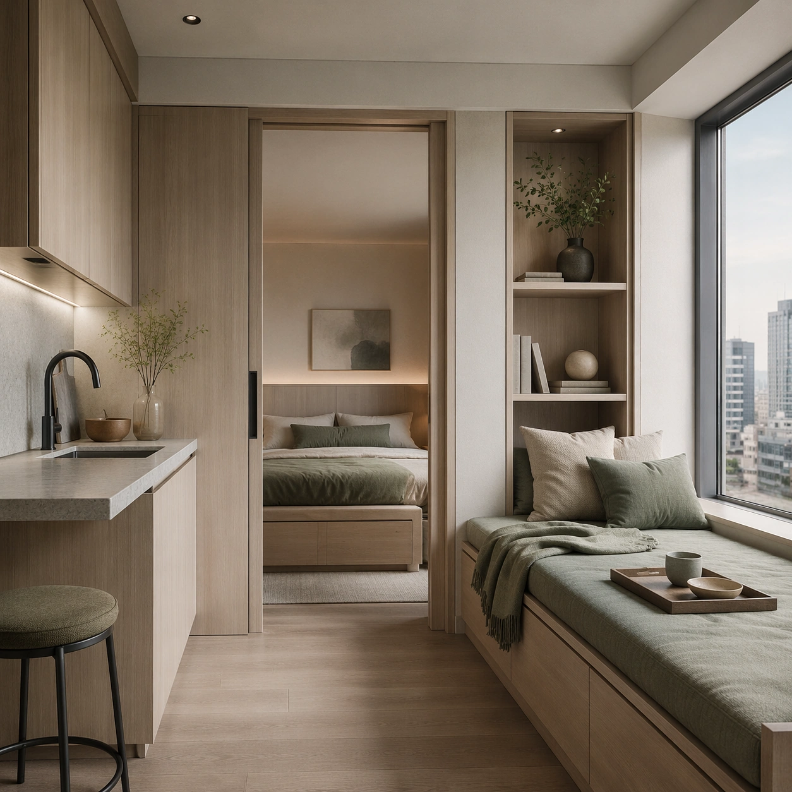

```text
Scene:
Create a square standalone support study for Compact Urban Apartment Efficiency Aesthetic. Use a quiet window nook with bench seat, shelf, and city light beyond and frame it like a premium commercial still or design-editorial crop with clear focal hierarchy, disciplined perspective, and enough breathing room for the materials and objects to read at both thumbnail and full size. Keep light ash wood, warm white plaster, soft graphite accents, pale stone, and muted sage textiles as the tonal guide so the image still belongs to the same theme family, and light the scene in a controlled way that emphasizes texture, edge quality, and authored atmosphere over spectacle.

Subject:
Show a compact urban apartment with ash wood millwork, sliding partitions, hidden storage walls, a built-in platform bed, compact stone kitchen surfaces, and calm metropolitan daylight. In this support study, focus on micro-living comfort, layered textiles, and negative space. The image should work independently, yet it must still feel like it belongs to the same broader world of Urban Apartment. Make the space, props, and detailing useful for real campaign, editorial, or design-review contexts rather than moodboard abstraction.

Important details:
Carry forward the broader language of the sliding partition system, integrated storage geometry, ash wood detailing, compact kitchen language, and quiet city-apartment restraint, but let this image prove a new support surface or secondary deliverable. Material realism is essential: wood grain, metal sheen, glass edges, textiles, and stone should feel physically plausible and carefully art directed. Any graphic panels, labels, menus, packaging, or captions must stay abstract and unreadable. The overall result should feel reusable for rental campaigns, design editorials, developer micro-unit decks, and small-space planning references, with enough structure that a creative or operations team could build on it.

Use case:
Compact Urban Apartment Efficiency Aesthetic single study 7/9, exploring editorial support for a calm urban lifestyle.

Constraints:
No readable text, no watermark, no logos, preserve exact 1:1 aspect ratio, no clutter piles, no messy shoes, no novelty gadgets, no colorful toy furniture, no cramped distortion, no dominant skyline billboards.
```

[Pinned source](https://github.com/ChaosRealmsAI/gpt-image-2-gallery/blob/5296db8c996e38776c83a0bc8c64f848dcd512b3/works/topics/compact-urban-apartment-efficiency-aesthetic/packages/single-support-studies/images/03-window-nook-editorial/meta.json) · GPT Image2 · 1254×1254 · No source-declared image dependencies. · ProjectD:pending individual review.

## Entry Bike Storage · compact-urban-apartment-efficiency-aesthetic/single-support-studies/04-entry-bike-storage

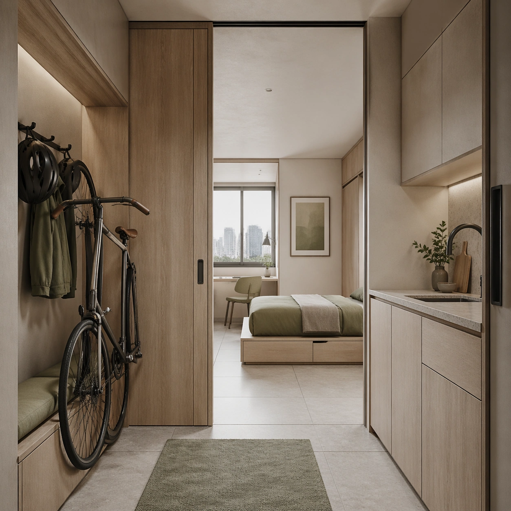

```text
Scene:
Create a square standalone support study for Compact Urban Apartment Efficiency Aesthetic. Use an entry sequence where a bicycle fits neatly beside hidden cabinetry and a bench and frame it like a premium commercial still or design-editorial crop with clear focal hierarchy, disciplined perspective, and enough breathing room for the materials and objects to read at both thumbnail and full size. Keep light ash wood, warm white plaster, soft graphite accents, pale stone, and muted sage textiles as the tonal guide so the image still belongs to the same theme family, and light the scene in a controlled way that emphasizes texture, edge quality, and authored atmosphere over spectacle.

Subject:
Show a compact urban apartment with ash wood millwork, sliding partitions, hidden storage walls, a built-in platform bed, compact stone kitchen surfaces, and calm metropolitan daylight. In this support study, focus on practical storage, circulation clearance, and tasteful metropolitan realism. The image should work independently, yet it must still feel like it belongs to the same broader world of Urban Apartment. Make the space, props, and detailing useful for real campaign, editorial, or design-review contexts rather than moodboard abstraction.

Important details:
Carry forward the broader language of the sliding partition system, integrated storage geometry, ash wood detailing, compact kitchen language, and quiet city-apartment restraint, but let this image prove a new support surface or secondary deliverable. Material realism is essential: wood grain, metal sheen, glass edges, textiles, and stone should feel physically plausible and carefully art directed. Any graphic panels, labels, menus, packaging, or captions must stay abstract and unreadable. The overall result should feel reusable for rental campaigns, design editorials, developer micro-unit decks, and small-space planning references, with enough structure that a creative or operations team could build on it.

Use case:
Compact Urban Apartment Efficiency Aesthetic single study 8/9, exploring support study for urban mobility integration.

Constraints:
No readable text, no watermark, no logos, preserve exact 1:1 aspect ratio, no clutter piles, no messy shoes, no novelty gadgets, no colorful toy furniture, no cramped distortion, no brand marks on the bicycle.
```

[Pinned source](https://github.com/ChaosRealmsAI/gpt-image-2-gallery/blob/5296db8c996e38776c83a0bc8c64f848dcd512b3/works/topics/compact-urban-apartment-efficiency-aesthetic/packages/single-support-studies/images/04-entry-bike-storage/meta.json) · GPT Image2 · 1254×1254 · No source-declared image dependencies. · ProjectD:pending individual review.

## Integrated Pet Corner · compact-urban-apartment-efficiency-aesthetic/single-support-studies/05-pet-corner-integrated

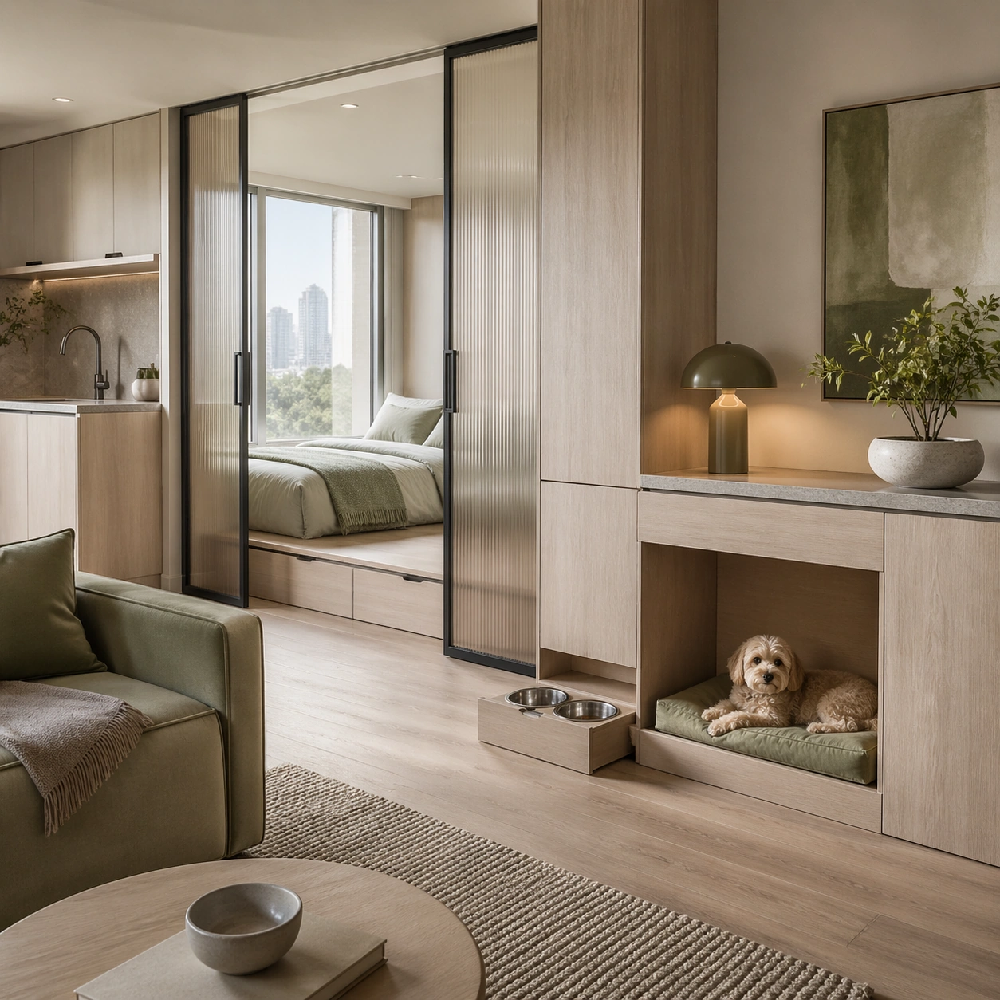

```text
Scene:
Create a square standalone support study for Compact Urban Apartment Efficiency Aesthetic. Use a compact pet nook built into lower millwork beside the living zone and frame it like a premium commercial still or design-editorial crop with clear focal hierarchy, disciplined perspective, and enough breathing room for the materials and objects to read at both thumbnail and full size. Keep light ash wood, warm white plaster, soft graphite accents, pale stone, and muted sage textiles as the tonal guide so the image still belongs to the same theme family, and light the scene in a controlled way that emphasizes texture, edge quality, and authored atmosphere over spectacle.

Subject:
Show a compact urban apartment with ash wood millwork, sliding partitions, hidden storage walls, a built-in platform bed, compact stone kitchen surfaces, and calm metropolitan daylight. In this support study, focus on small-space empathy, concealed bowls, durable finishes, and residential warmth. The image should work independently, yet it must still feel like it belongs to the same broader world of Urban Apartment. Make the space, props, and detailing useful for real campaign, editorial, or design-review contexts rather than moodboard abstraction.

Important details:
Carry forward the broader language of the sliding partition system, integrated storage geometry, ash wood detailing, compact kitchen language, and quiet city-apartment restraint, but let this image prove a new support surface or secondary deliverable. Material realism is essential: wood grain, metal sheen, glass edges, textiles, and stone should feel physically plausible and carefully art directed. Any graphic panels, labels, menus, packaging, or captions must stay abstract and unreadable. The overall result should feel reusable for rental campaigns, design editorials, developer micro-unit decks, and small-space planning references, with enough structure that a creative or operations team could build on it.

Use case:
Compact Urban Apartment Efficiency Aesthetic single study 9/9, exploring support image for flexible compact-home marketing.

Constraints:
No readable text, no watermark, no logos, preserve exact 1:1 aspect ratio, no clutter piles, no messy shoes, no novelty gadgets, no colorful toy furniture, no cramped distortion, no visible pet food labels.
```

[Pinned source](https://github.com/ChaosRealmsAI/gpt-image-2-gallery/blob/5296db8c996e38776c83a0bc8c64f848dcd512b3/works/topics/compact-urban-apartment-efficiency-aesthetic/packages/single-support-studies/images/05-pet-corner-integrated/meta.json) · GPT Image2 · 1254×1254 · No source-declared image dependencies. · ProjectD:pending individual review.

## Macro Study · complex-optics-materials/single-complex-optics-materials-studies/macro-study


```text
Scene:
A square material-focused image where lighting, scale, and surface behavior are the main event. Build the frame around extreme close observation of texture, grain, and edge behavior. Keep the lighting, camera distance, and spatial organization tuned for a high-signal research image rather than a casual snapshot. The image belongs to the Complex Optics Materials theme and should feel immediately legible as a prompt atlas theme for complex optics materials, testing photorealism, physics-materials, reasoning-composition with gpt image 2..

Subject:
Center the study on extreme close observation of texture, grain, and edge behavior. Translate the theme into a concrete visual statement instead of an abstract mood board: the viewer should understand what kind of image this is, what is being tested, and why the composition is difficult. Use the slug idea of complex optics materials as a literal guide for subject matter, materials, and staging.

Important details:
Microstructure matters: refraction, fibers, scratches, pores, edge wear, translucency, and dust should all feel physically specific. Preserve a disciplined square composition, clear focal hierarchy, and enough secondary information to make the image feel complete rather than underspecified. The image should look polished, novel, and exhibition-ready, with topic-specific credibility coming from the way surfaces, structure, and visual language reinforce Complex Optics Materials. Avoid generic filler elements that do not serve the main concept.

Use case:
Complex Optics Materials single study 2/8, testing photorealism, physics-materials, reasoning-composition through the macro study variation.

Constraints:
No readable text, no watermark, no logos, preserve exact 1:1 aspect ratio, no generic stock macro, no broken scale cues, no plastic-looking texture when it should feel natural, no meaningless blur, no watermark, no fake labels.
```

[Pinned source](https://github.com/ChaosRealmsAI/gpt-image-2-gallery/blob/5296db8c996e38776c83a0bc8c64f848dcd512b3/works/topics/complex-optics-materials/packages/single-complex-optics-materials-studies/images/macro-study/meta.json) · GPT Image2 · 1254×1254 · No source-declared image dependencies. · ProjectD:pending individual review.

## Side Light Study · complex-optics-materials/single-complex-optics-materials-studies/side-light-study


```text
Scene:
A square material-focused image where lighting, scale, and surface behavior are the main event. Build the frame around raking light used to reveal depth and relief. Keep the lighting, camera distance, and spatial organization tuned for a high-signal research image rather than a casual snapshot. The image belongs to the Complex Optics Materials theme and should feel immediately legible as a prompt atlas theme for complex optics materials, testing photorealism, physics-materials, reasoning-composition with gpt image 2..

Subject:
Center the study on raking light used to reveal depth and relief. Translate the theme into a concrete visual statement instead of an abstract mood board: the viewer should understand what kind of image this is, what is being tested, and why the composition is difficult. Use the slug idea of complex optics materials as a literal guide for subject matter, materials, and staging.

Important details:
Microstructure matters: refraction, fibers, scratches, pores, edge wear, translucency, and dust should all feel physically specific. Preserve a disciplined square composition, clear focal hierarchy, and enough secondary information to make the image feel complete rather than underspecified. The image should look polished, novel, and exhibition-ready, with topic-specific credibility coming from the way surfaces, structure, and visual language reinforce Complex Optics Materials. Avoid generic filler elements that do not serve the main concept.

Use case:
Complex Optics Materials single study 3/8, testing photorealism, physics-materials, reasoning-composition through the side light study variation.

Constraints:
No readable text, no watermark, no logos, preserve exact 1:1 aspect ratio, no generic stock macro, no broken scale cues, no plastic-looking texture when it should feel natural, no meaningless blur, no watermark, no fake labels.
```

[Pinned source](https://github.com/ChaosRealmsAI/gpt-image-2-gallery/blob/5296db8c996e38776c83a0bc8c64f848dcd512b3/works/topics/complex-optics-materials/packages/single-complex-optics-materials-studies/images/side-light-study/meta.json) · GPT Image2 · 1254×1254 · No source-declared image dependencies. · ProjectD:pending individual review.

## Process Trace · complex-optics-materials/single-complex-optics-materials-studies/process-trace


```text
Scene:
A square material-focused image where lighting, scale, and surface behavior are the main event. Build the frame around evidence of making, wear, or transformation frozen in the surface. Keep the lighting, camera distance, and spatial organization tuned for a high-signal research image rather than a casual snapshot. The image belongs to the Complex Optics Materials theme and should feel immediately legible as a prompt atlas theme for complex optics materials, testing photorealism, physics-materials, reasoning-composition with gpt image 2..

Subject:
Center the study on evidence of making, wear, or transformation frozen in the surface. Translate the theme into a concrete visual statement instead of an abstract mood board: the viewer should understand what kind of image this is, what is being tested, and why the composition is difficult. Use the slug idea of complex optics materials as a literal guide for subject matter, materials, and staging.

Important details:
Microstructure matters: refraction, fibers, scratches, pores, edge wear, translucency, and dust should all feel physically specific. Preserve a disciplined square composition, clear focal hierarchy, and enough secondary information to make the image feel complete rather than underspecified. The image should look polished, novel, and exhibition-ready, with topic-specific credibility coming from the way surfaces, structure, and visual language reinforce Complex Optics Materials. Avoid generic filler elements that do not serve the main concept.

Use case:
Complex Optics Materials single study 4/8, testing photorealism, physics-materials, reasoning-composition through the process trace variation.

Constraints:
No readable text, no watermark, no logos, preserve exact 1:1 aspect ratio, no generic stock macro, no broken scale cues, no plastic-looking texture when it should feel natural, no meaningless blur, no watermark, no fake labels.
```

[Pinned source](https://github.com/ChaosRealmsAI/gpt-image-2-gallery/blob/5296db8c996e38776c83a0bc8c64f848dcd512b3/works/topics/complex-optics-materials/packages/single-complex-optics-materials-studies/images/process-trace/meta.json) · GPT Image2 · 1254×1254 · No source-declared image dependencies. · ProjectD:pending individual review.

## Specimen Table · complex-optics-materials/single-complex-optics-materials-studies/specimen-table

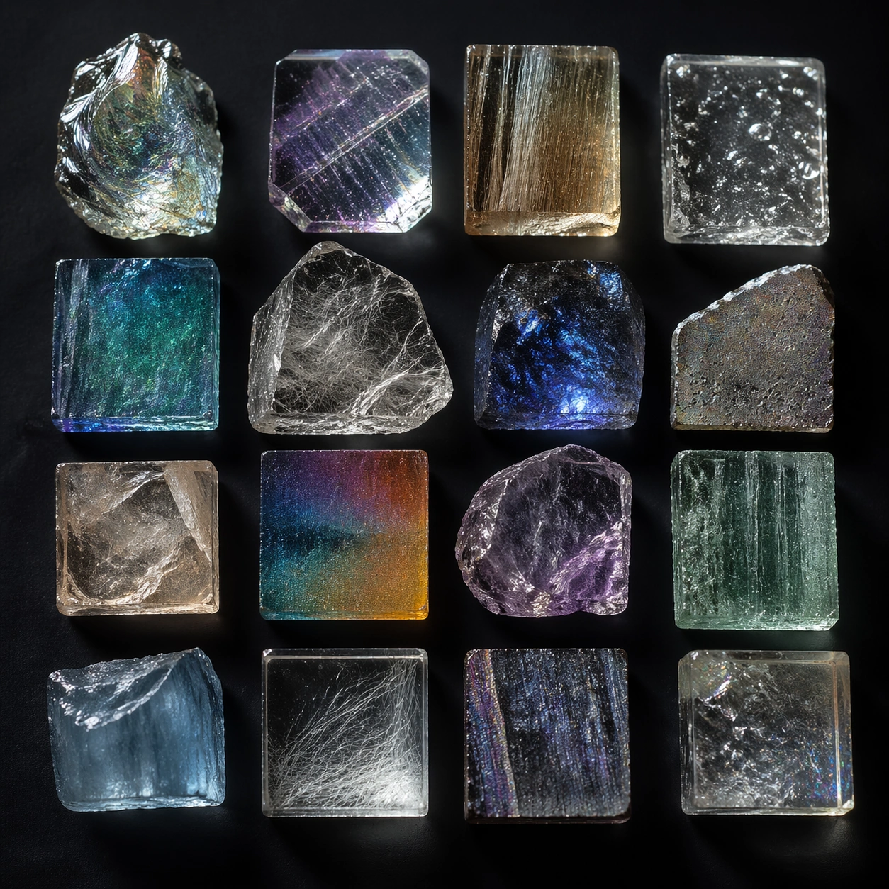

```text
Scene:
A square material-focused image where lighting, scale, and surface behavior are the main event. Build the frame around multiple related samples arranged for comparison. Keep the lighting, camera distance, and spatial organization tuned for a high-signal research image rather than a casual snapshot. The image belongs to the Complex Optics Materials theme and should feel immediately legible as a prompt atlas theme for complex optics materials, testing photorealism, physics-materials, reasoning-composition with gpt image 2..

Subject:
Center the study on multiple related samples arranged for comparison. Translate the theme into a concrete visual statement instead of an abstract mood board: the viewer should understand what kind of image this is, what is being tested, and why the composition is difficult. Use the slug idea of complex optics materials as a literal guide for subject matter, materials, and staging.

Important details:
Microstructure matters: refraction, fibers, scratches, pores, edge wear, translucency, and dust should all feel physically specific. Preserve a disciplined square composition, clear focal hierarchy, and enough secondary information to make the image feel complete rather than underspecified. The image should look polished, novel, and exhibition-ready, with topic-specific credibility coming from the way surfaces, structure, and visual language reinforce Complex Optics Materials. Avoid generic filler elements that do not serve the main concept.

Use case:
Complex Optics Materials single study 5/8, testing photorealism, physics-materials, reasoning-composition through the specimen table variation.

Constraints:
No readable text, no watermark, no logos, preserve exact 1:1 aspect ratio, no generic stock macro, no broken scale cues, no plastic-looking texture when it should feel natural, no meaningless blur, no watermark, no fake labels.
```

[Pinned source](https://github.com/ChaosRealmsAI/gpt-image-2-gallery/blob/5296db8c996e38776c83a0bc8c64f848dcd512b3/works/topics/complex-optics-materials/packages/single-complex-optics-materials-studies/images/specimen-table/meta.json) · GPT Image2 · 1254×1254 · No source-declared image dependencies. · ProjectD:pending individual review.

## 氛围场景 · complex-optics-materials/single-complex-optics-materials-studies/atmospheric-view

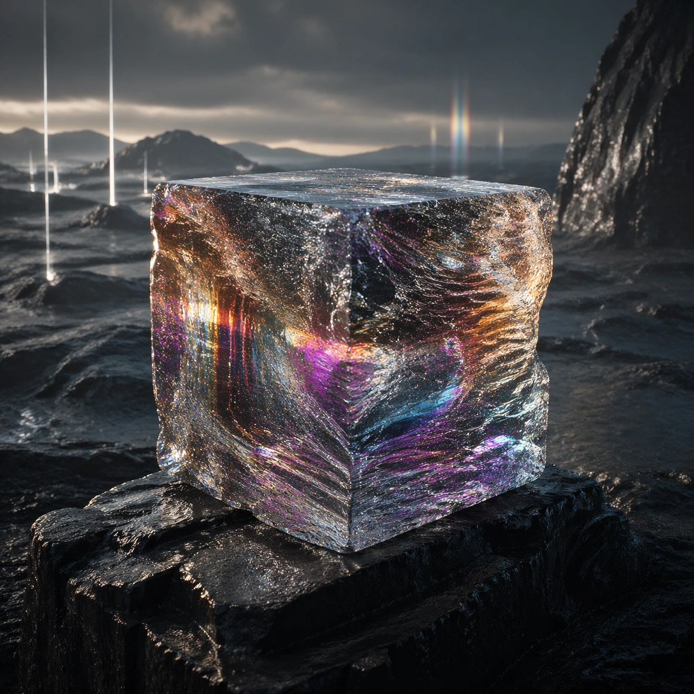

```text
Scene:
A square material-focused image where lighting, scale, and surface behavior are the main event. Build the frame around the material placed into a broader environment without losing tactile priority. Keep the lighting, camera distance, and spatial organization tuned for a high-signal research image rather than a casual snapshot. The image belongs to the Complex Optics Materials theme and should feel immediately legible as a prompt atlas theme for complex optics materials, testing photorealism, physics-materials, reasoning-composition with gpt image 2..

Subject:
Center the study on the material placed into a broader environment without losing tactile priority. Translate the theme into a concrete visual statement instead of an abstract mood board: the viewer should understand what kind of image this is, what is being tested, and why the composition is difficult. Use the slug idea of complex optics materials as a literal guide for subject matter, materials, and staging.

Important details:
Microstructure matters: refraction, fibers, scratches, pores, edge wear, translucency, and dust should all feel physically specific. Preserve a disciplined square composition, clear focal hierarchy, and enough secondary information to make the image feel complete rather than underspecified. The image should look polished, novel, and exhibition-ready, with topic-specific credibility coming from the way surfaces, structure, and visual language reinforce Complex Optics Materials. Avoid generic filler elements that do not serve the main concept.

Use case:
Complex Optics Materials single study 6/8, testing photorealism, physics-materials, reasoning-composition through the 氛围场景 variation.

Constraints:
No readable text, no watermark, no logos, preserve exact 1:1 aspect ratio, no generic stock macro, no broken scale cues, no plastic-looking texture when it should feel natural, no meaningless blur, no watermark, no fake labels.
```

[Pinned source](https://github.com/ChaosRealmsAI/gpt-image-2-gallery/blob/5296db8c996e38776c83a0bc8c64f848dcd512b3/works/topics/complex-optics-materials/packages/single-complex-optics-materials-studies/images/atmospheric-view/meta.json) · GPT Image2 · 1254×1254 · No source-declared image dependencies. · ProjectD:pending individual review.

## Structure Closeup · complex-optics-materials/single-complex-optics-materials-studies/structure-closeup

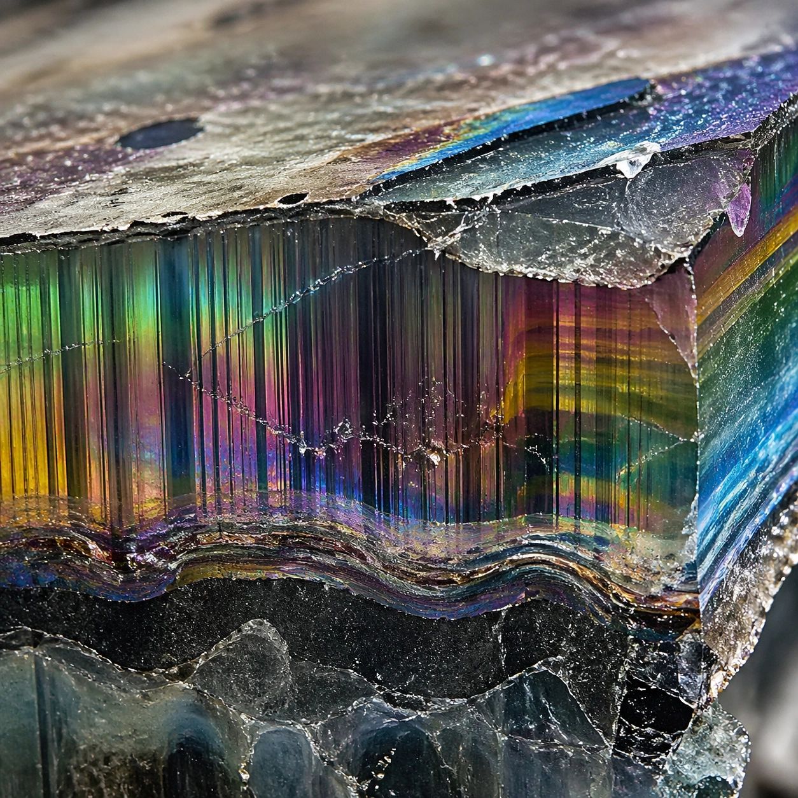

```text
Scene:
A square material-focused image where lighting, scale, and surface behavior are the main event. Build the frame around the internal or layered structure made legible through detail. Keep the lighting, camera distance, and spatial organization tuned for a high-signal research image rather than a casual snapshot. The image belongs to the Complex Optics Materials theme and should feel immediately legible as a prompt atlas theme for complex optics materials, testing photorealism, physics-materials, reasoning-composition with gpt image 2..

Subject:
Center the study on the internal or layered structure made legible through detail. Translate the theme into a concrete visual statement instead of an abstract mood board: the viewer should understand what kind of image this is, what is being tested, and why the composition is difficult. Use the slug idea of complex optics materials as a literal guide for subject matter, materials, and staging.

Important details:
Microstructure matters: refraction, fibers, scratches, pores, edge wear, translucency, and dust should all feel physically specific. Preserve a disciplined square composition, clear focal hierarchy, and enough secondary information to make the image feel complete rather than underspecified. The image should look polished, novel, and exhibition-ready, with topic-specific credibility coming from the way surfaces, structure, and visual language reinforce Complex Optics Materials. Avoid generic filler elements that do not serve the main concept.

Use case:
Complex Optics Materials single study 7/8, testing photorealism, physics-materials, reasoning-composition through the structure closeup variation.

Constraints:
No readable text, no watermark, no logos, preserve exact 1:1 aspect ratio, no generic stock macro, no broken scale cues, no plastic-looking texture when it should feel natural, no meaningless blur, no watermark, no fake labels.
```

[Pinned source](https://github.com/ChaosRealmsAI/gpt-image-2-gallery/blob/5296db8c996e38776c83a0bc8c64f848dcd512b3/works/topics/complex-optics-materials/packages/single-complex-optics-materials-studies/images/structure-closeup/meta.json) · GPT Image2 · 1254×1254 · No source-declared image dependencies. · ProjectD:pending individual review.

## Signature Material · complex-optics-materials/single-complex-optics-materials-studies/signature-material

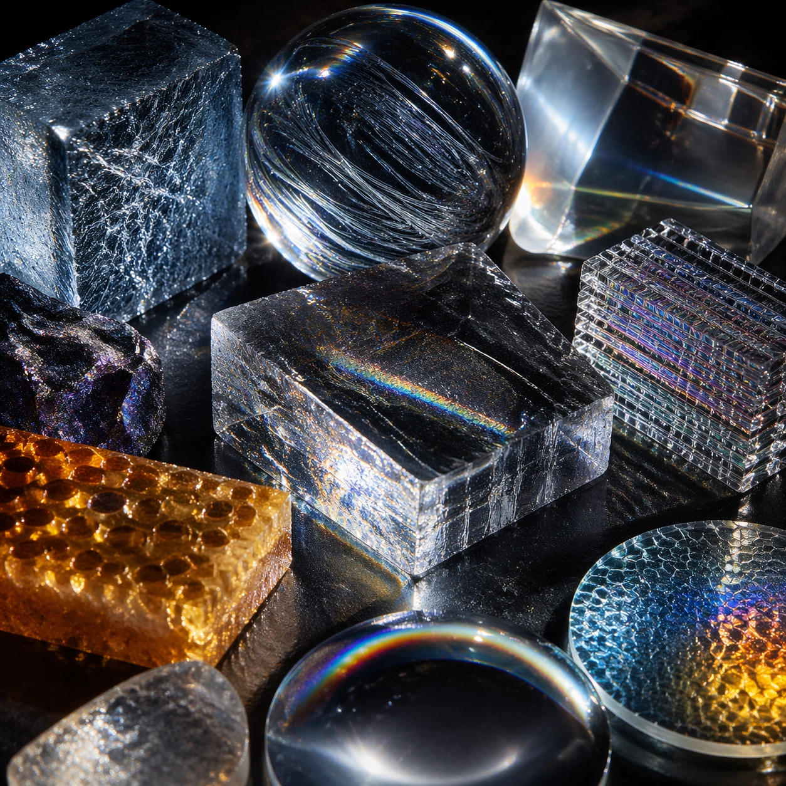

```text
Scene:
A square material-focused image where lighting, scale, and surface behavior are the main event. Build the frame around the most complete and persuasive final material image. Keep the lighting, camera distance, and spatial organization tuned for a high-signal research image rather than a casual snapshot. The image belongs to the Complex Optics Materials theme and should feel immediately legible as a prompt atlas theme for complex optics materials, testing photorealism, physics-materials, reasoning-composition with gpt image 2..

Subject:
Center the study on the most complete and persuasive final material image. Translate the theme into a concrete visual statement instead of an abstract mood board: the viewer should understand what kind of image this is, what is being tested, and why the composition is difficult. Use the slug idea of complex optics materials as a literal guide for subject matter, materials, and staging.

Important details:
Microstructure matters: refraction, fibers, scratches, pores, edge wear, translucency, and dust should all feel physically specific. Preserve a disciplined square composition, clear focal hierarchy, and enough secondary information to make the image feel complete rather than underspecified. The image should look polished, novel, and exhibition-ready, with topic-specific credibility coming from the way surfaces, structure, and visual language reinforce Complex Optics Materials. Avoid generic filler elements that do not serve the main concept.

Use case:
Complex Optics Materials single study 8/8, testing photorealism, physics-materials, reasoning-composition through the signature material variation.

Constraints:
No readable text, no watermark, no logos, preserve exact 1:1 aspect ratio, no generic stock macro, no broken scale cues, no plastic-looking texture when it should feel natural, no meaningless blur, no watermark, no fake labels.
```

[Pinned source](https://github.com/ChaosRealmsAI/gpt-image-2-gallery/blob/5296db8c996e38776c83a0bc8c64f848dcd512b3/works/topics/complex-optics-materials/packages/single-complex-optics-materials-studies/images/signature-material/meta.json) · GPT Image2 · 1254×1254 · No source-declared image dependencies. · ProjectD:pending individual review.

## Reference Anchor · component-library-premium-showcase/series-core-system/01-reference-anchor

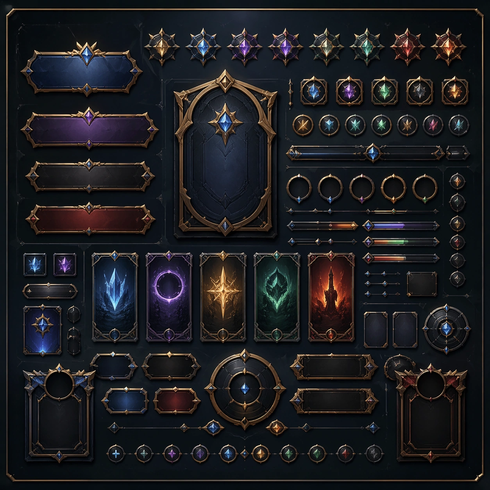

```text
Scene:
Create a square reference image for Component Library Premium Showcase. Build a reference anchor establishing the core system with a premium, production-ready finish. Use a polished modular board or campaign surface with clean spacing, premium game-UI finish, and clear focal hierarchy. The composition should feel intentional, clean, and reusable for gallery, research, campaign, or internal handoff contexts. Lighting must support readability first, with the main forms clearly separated from the background and enough breathing room for the system to stay legible at both hero scale and thumbnail scale.

Subject:
Center a coherent original game-art system built for premium production and marketing surfaces. For this image, focus on reference anchor. Keep the same system logic stable across screenshots, cards, banners, and overview boards. This image is the canonical anchor that later series images must follow. The viewer should immediately understand what role this surface plays inside a cohesive game-production asset pack.

Important details:
Lock framing, icon grammar, palette blocking, and surface hierarchy so the kit feels production-ready and consistent. Preserve the core silhouette, framing language, and material logic from the reference image while each variation changes function. Keep materials believable, edge hierarchy disciplined, and the visual language consistent with Component Showcase. Use abstract interface blocks or diagram accents when helpful, but avoid any readable language. The final result should feel like a deliberate production asset rather than a random illustration.

Use case:
Component Library Premium Showcase series study 1/9, designed as reference anchor within a cohesive asset pack.

Constraints:
No readable text, no watermark, no logos, preserve exact 1:1 aspect ratio, no unrelated objects, no broken visual hierarchy, no malformed anatomy or broken perspective, no random decorative clutter.
```

[Pinned source](https://github.com/ChaosRealmsAI/gpt-image-2-gallery/blob/5296db8c996e38776c83a0bc8c64f848dcd512b3/works/topics/component-library-premium-showcase/packages/series-core-system/images/01-reference-anchor/meta.json) · GPT Image2 · 1254×1254 · No source-declared image dependencies. · ProjectD:pending individual review.

## Variant One · component-library-premium-showcase/series-core-system/02-variant-one

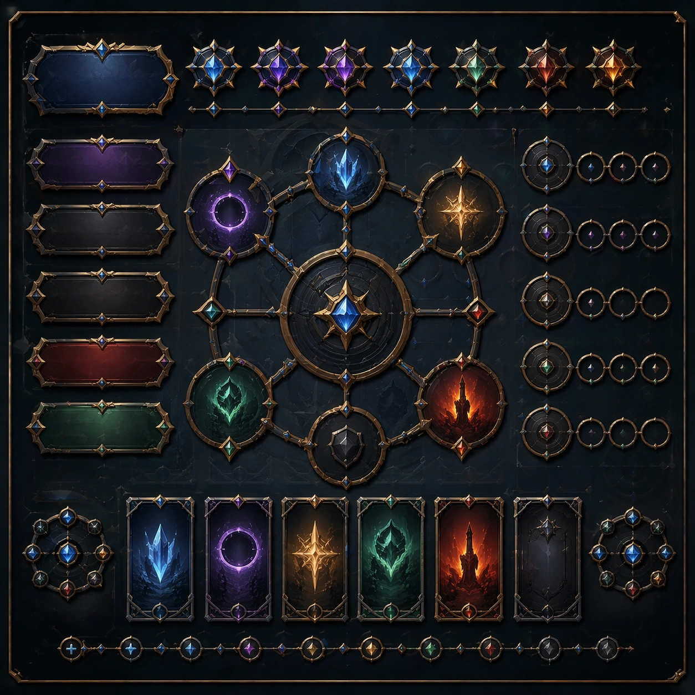

```text
Scene:
Create a square dependent image for Component Library Premium Showcase. Build a first controlled variation in the same system with a premium, production-ready finish. Use a polished modular board or campaign surface with clean spacing, premium game-UI finish, and clear focal hierarchy. The composition should feel intentional, clean, and reusable for gallery, research, campaign, or internal handoff contexts. Lighting must support readability first, with the main forms clearly separated from the background and enough breathing room for the system to stay legible at both hero scale and thumbnail scale.

Subject:
Center a coherent original game-art system built for premium production and marketing surfaces. For this image, focus on the intended support surface. Keep the same system logic stable across screenshots, cards, banners, and overview boards. Preserve exact identity or system logic from the reference image while changing only the intended variation axis. The viewer should immediately understand what role this surface plays inside a cohesive game-production asset pack.

Important details:
Lock framing, icon grammar, palette blocking, and surface hierarchy so the kit feels production-ready and consistent. Preserve the core silhouette, framing language, and material logic from the reference image while each variation changes function. Keep materials believable, edge hierarchy disciplined, and the visual language consistent with Component Showcase. Use abstract interface blocks or diagram accents when helpful, but avoid any readable language. The final result should feel like a deliberate production asset rather than a random illustration.

Use case:
Component Library Premium Showcase series study 2/9, designed as variant one within a cohesive asset pack.

Constraints:
No readable text, no watermark, no logos, preserve exact 1:1 aspect ratio, no unrelated objects, no broken visual hierarchy, no malformed anatomy or broken perspective, no random decorative clutter.
```

[Pinned source](https://github.com/ChaosRealmsAI/gpt-image-2-gallery/blob/5296db8c996e38776c83a0bc8c64f848dcd512b3/works/topics/component-library-premium-showcase/packages/series-core-system/images/02-variant-one/meta.json) · GPT Image2 · 1254×1254 · Reference images required. · ProjectD:pending individual review.

## Variant Two · component-library-premium-showcase/series-core-system/03-variant-two

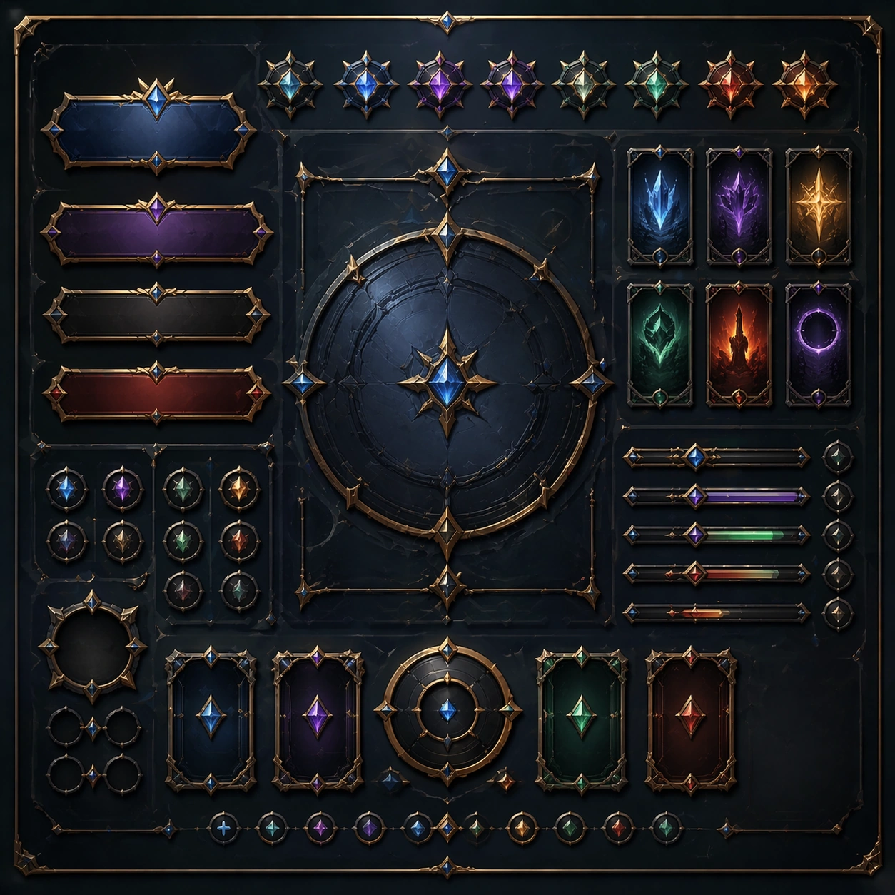

```text
Scene:
Create a square dependent image for Component Library Premium Showcase. Build a second controlled variation in the same system with a premium, production-ready finish. Use a polished modular board or campaign surface with clean spacing, premium game-UI finish, and clear focal hierarchy. The composition should feel intentional, clean, and reusable for gallery, research, campaign, or internal handoff contexts. Lighting must support readability first, with the main forms clearly separated from the background and enough breathing room for the system to stay legible at both hero scale and thumbnail scale.

Subject:
Center a coherent original game-art system built for premium production and marketing surfaces. For this image, focus on the intended support surface. Keep the same system logic stable across screenshots, cards, banners, and overview boards. Preserve exact identity or system logic from the reference image while changing only the intended variation axis. The viewer should immediately understand what role this surface plays inside a cohesive game-production asset pack.

Important details:
Lock framing, icon grammar, palette blocking, and surface hierarchy so the kit feels production-ready and consistent. Preserve the core silhouette, framing language, and material logic from the reference image while each variation changes function. Keep materials believable, edge hierarchy disciplined, and the visual language consistent with Component Showcase. Use abstract interface blocks or diagram accents when helpful, but avoid any readable language. The final result should feel like a deliberate production asset rather than a random illustration.

Use case:
Component Library Premium Showcase series study 3/9, designed as variant two within a cohesive asset pack.

Constraints:
No readable text, no watermark, no logos, preserve exact 1:1 aspect ratio, no unrelated objects, no broken visual hierarchy, no malformed anatomy or broken perspective, no random decorative clutter.
```

[Pinned source](https://github.com/ChaosRealmsAI/gpt-image-2-gallery/blob/5296db8c996e38776c83a0bc8c64f848dcd512b3/works/topics/component-library-premium-showcase/packages/series-core-system/images/03-variant-two/meta.json) · GPT Image2 · 1254×1254 · Reference images required. · ProjectD:pending individual review.

## Variant Three · component-library-premium-showcase/series-core-system/04-variant-three

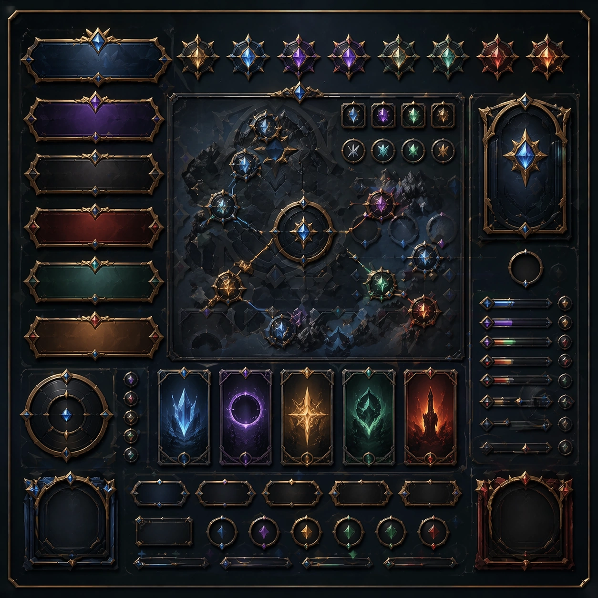

```text
Scene:
Create a square dependent image for Component Library Premium Showcase. Build a third controlled variation in the same system with a premium, production-ready finish. Use a polished modular board or campaign surface with clean spacing, premium game-UI finish, and clear focal hierarchy. The composition should feel intentional, clean, and reusable for gallery, research, campaign, or internal handoff contexts. Lighting must support readability first, with the main forms clearly separated from the background and enough breathing room for the system to stay legible at both hero scale and thumbnail scale.

Subject:
Center a coherent original game-art system built for premium production and marketing surfaces. For this image, focus on the intended support surface. Keep the same system logic stable across screenshots, cards, banners, and overview boards. Preserve exact identity or system logic from the reference image while changing only the intended variation axis. The viewer should immediately understand what role this surface plays inside a cohesive game-production asset pack.

Important details:
Lock framing, icon grammar, palette blocking, and surface hierarchy so the kit feels production-ready and consistent. Preserve the core silhouette, framing language, and material logic from the reference image while each variation changes function. Keep materials believable, edge hierarchy disciplined, and the visual language consistent with Component Showcase. Use abstract interface blocks or diagram accents when helpful, but avoid any readable language. The final result should feel like a deliberate production asset rather than a random illustration.

Use case:
Component Library Premium Showcase series study 4/9, designed as variant three within a cohesive asset pack.

Constraints:
No readable text, no watermark, no logos, preserve exact 1:1 aspect ratio, no unrelated objects, no broken visual hierarchy, no malformed anatomy or broken perspective, no random decorative clutter.
```

[Pinned source](https://github.com/ChaosRealmsAI/gpt-image-2-gallery/blob/5296db8c996e38776c83a0bc8c64f848dcd512b3/works/topics/component-library-premium-showcase/packages/series-core-system/images/04-variant-three/meta.json) · GPT Image2 · 1254×1254 · Reference images required. · ProjectD:pending individual review.

## Support One · component-library-premium-showcase/single-support-studies/support-one

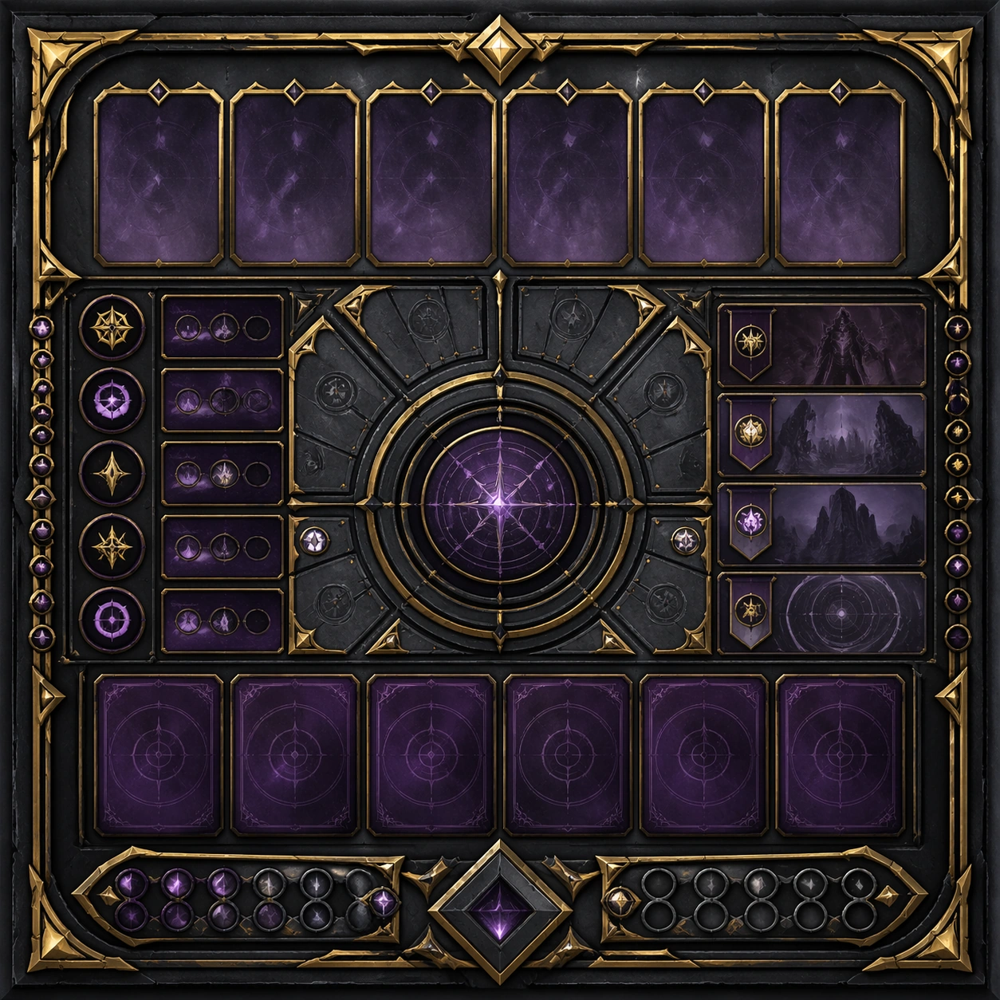

```text
Scene:
Create a square standalone support image for Component Library Premium Showcase. Build a support-surface study with a clear focal hierarchy and a finished professional surface. Use a polished modular board or campaign surface with clean spacing, premium game-UI finish, and clear focal hierarchy. The frame should feel self-contained and polished, with enough structure to explain the system even without the reference series, yet still obviously belonging to the same theme and production world.

Subject:
Show a coherent original game-art system built for premium production and marketing surfaces in a way that emphasizes the intended support surface. Keep the same system logic stable across screenshots, cards, banners, and overview boards. Even though this image is independent, the viewer should still recognize the same universe, same commercial logic, and same production intent as the core package.

Important details:
Lock framing, icon grammar, palette blocking, and surface hierarchy so the kit feels production-ready and consistent. Preserve the broader theme language through color, framing, material choices, and modular composition. Use clean panel rhythm, premium asset presentation, and believable detail density. The image should work equally well as a gallery study, research reference, and mock production deliverable.

Use case:
Component Library Premium Showcase single study 5/9, exploring support one as a support surface.

Constraints:
No readable text, no watermark, no logos, preserve exact 1:1 aspect ratio, no unrelated objects, no broken visual hierarchy, no visual noise that obscures the main surface, no accidental brand resemblance.
```

[Pinned source](https://github.com/ChaosRealmsAI/gpt-image-2-gallery/blob/5296db8c996e38776c83a0bc8c64f848dcd512b3/works/topics/component-library-premium-showcase/packages/single-support-studies/images/support-one/meta.json) · GPT Image2 · 1254×1254 · No source-declared image dependencies. · ProjectD:pending individual review.

## Support Two · component-library-premium-showcase/single-support-studies/support-two

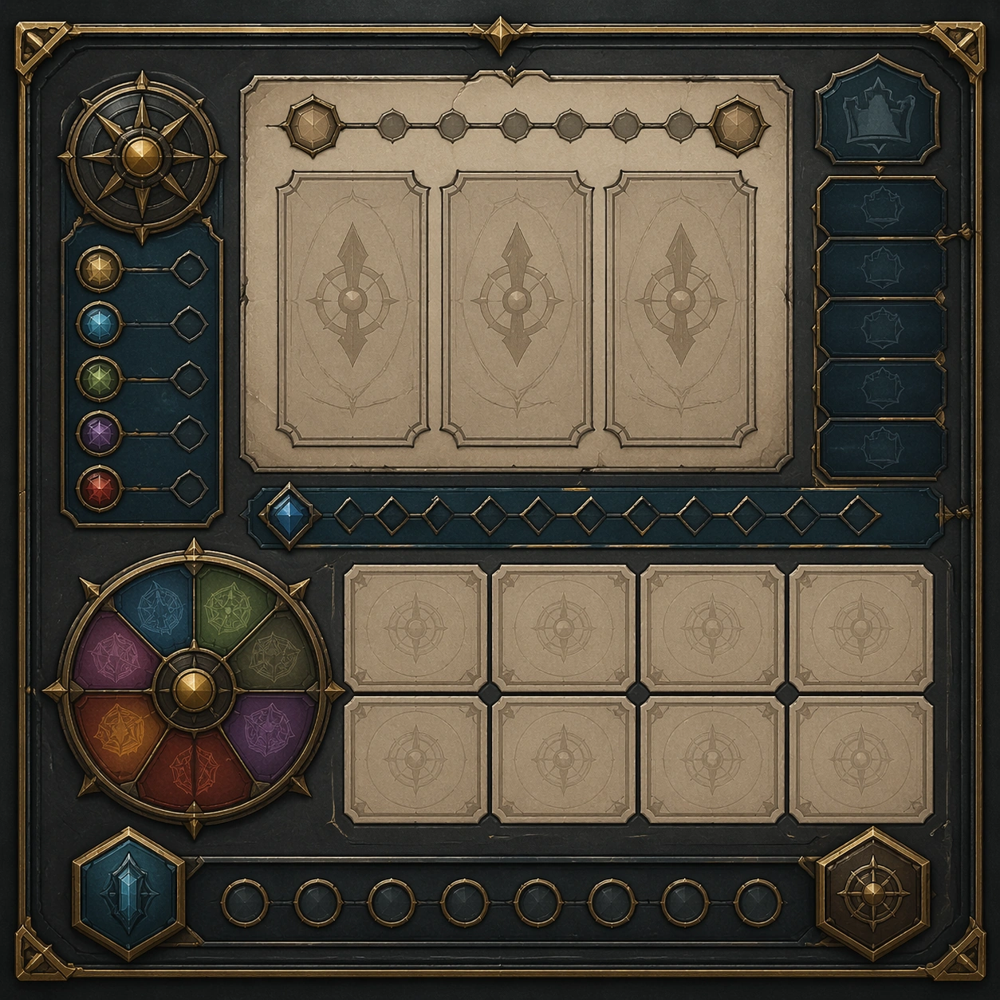

```text
Scene:
Create a square standalone support image for Component Library Premium Showcase. Build a second support-surface study with a clear focal hierarchy and a finished professional surface. Use a polished modular board or campaign surface with clean spacing, premium game-UI finish, and clear focal hierarchy. The frame should feel self-contained and polished, with enough structure to explain the system even without the reference series, yet still obviously belonging to the same theme and production world.

Subject:
Show a coherent original game-art system built for premium production and marketing surfaces in a way that emphasizes the intended support surface. Keep the same system logic stable across screenshots, cards, banners, and overview boards. Even though this image is independent, the viewer should still recognize the same universe, same commercial logic, and same production intent as the core package.

Important details:
Lock framing, icon grammar, palette blocking, and surface hierarchy so the kit feels production-ready and consistent. Preserve the broader theme language through color, framing, material choices, and modular composition. Use clean panel rhythm, premium asset presentation, and believable detail density. The image should work equally well as a gallery study, research reference, and mock production deliverable.

Use case:
Component Library Premium Showcase single study 6/9, exploring support two as a support surface.

Constraints:
No readable text, no watermark, no logos, preserve exact 1:1 aspect ratio, no unrelated objects, no broken visual hierarchy, no visual noise that obscures the main surface, no accidental brand resemblance.
```

[Pinned source](https://github.com/ChaosRealmsAI/gpt-image-2-gallery/blob/5296db8c996e38776c83a0bc8c64f848dcd512b3/works/topics/component-library-premium-showcase/packages/single-support-studies/images/support-two/meta.json) · GPT Image2 · 1254×1254 · No source-declared image dependencies. · ProjectD:pending individual review.

## Support Three · component-library-premium-showcase/single-support-studies/support-three

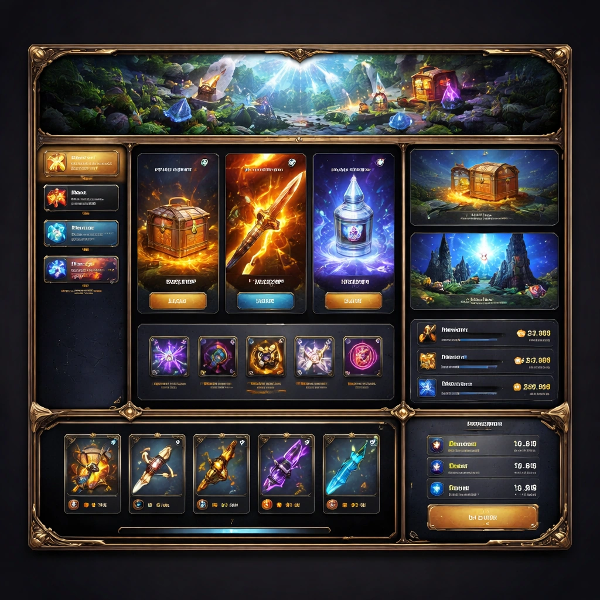

```text
Scene:
Create a square standalone support image for Component Library Premium Showcase. Build a third support-surface study with a clear focal hierarchy and a finished professional surface. Use a polished modular board or campaign surface with clean spacing, premium game-UI finish, and clear focal hierarchy. The frame should feel self-contained and polished, with enough structure to explain the system even without the reference series, yet still obviously belonging to the same theme and production world.

Subject:
Show a coherent original game-art system built for premium production and marketing surfaces in a way that emphasizes the intended support surface. Keep the same system logic stable across screenshots, cards, banners, and overview boards. Even though this image is independent, the viewer should still recognize the same universe, same commercial logic, and same production intent as the core package.

Important details:
Lock framing, icon grammar, palette blocking, and surface hierarchy so the kit feels production-ready and consistent. Preserve the broader theme language through color, framing, material choices, and modular composition. Use clean panel rhythm, premium asset presentation, and believable detail density. The image should work equally well as a gallery study, research reference, and mock production deliverable.

Use case:
Component Library Premium Showcase single study 7/9, exploring support three as a support surface.

Constraints:
No readable text, no watermark, no logos, preserve exact 1:1 aspect ratio, no unrelated objects, no broken visual hierarchy, no visual noise that obscures the main surface, no accidental brand resemblance.
```

[Pinned source](https://github.com/ChaosRealmsAI/gpt-image-2-gallery/blob/5296db8c996e38776c83a0bc8c64f848dcd512b3/works/topics/component-library-premium-showcase/packages/single-support-studies/images/support-three/meta.json) · GPT Image2 · 1024×1024 · No source-declared image dependencies. · ProjectD:pending individual review.

## Support Four · component-library-premium-showcase/single-support-studies/support-four

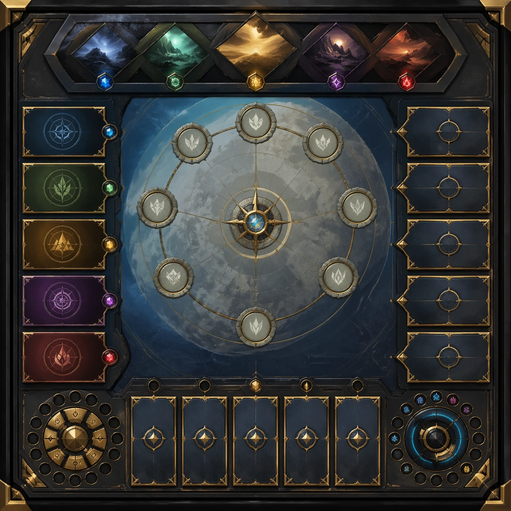

```text
Scene:
Create a square standalone support image for Component Library Premium Showcase. Build a fourth support-surface study with a clear focal hierarchy and a finished professional surface. Use a polished modular board or campaign surface with clean spacing, premium game-UI finish, and clear focal hierarchy. The frame should feel self-contained and polished, with enough structure to explain the system even without the reference series, yet still obviously belonging to the same theme and production world.

Subject:
Show a coherent original game-art system built for premium production and marketing surfaces in a way that emphasizes the intended support surface. Keep the same system logic stable across screenshots, cards, banners, and overview boards. Even though this image is independent, the viewer should still recognize the same universe, same commercial logic, and same production intent as the core package.

Important details:
Lock framing, icon grammar, palette blocking, and surface hierarchy so the kit feels production-ready and consistent. Preserve the broader theme language through color, framing, material choices, and modular composition. Use clean panel rhythm, premium asset presentation, and believable detail density. The image should work equally well as a gallery study, research reference, and mock production deliverable.

Use case:
Component Library Premium Showcase single study 8/9, exploring support four as a support surface.

Constraints:
No readable text, no watermark, no logos, preserve exact 1:1 aspect ratio, no unrelated objects, no broken visual hierarchy, no visual noise that obscures the main surface, no accidental brand resemblance.
```

[Pinned source](https://github.com/ChaosRealmsAI/gpt-image-2-gallery/blob/5296db8c996e38776c83a0bc8c64f848dcd512b3/works/topics/component-library-premium-showcase/packages/single-support-studies/images/support-four/meta.json) · GPT Image2 · 1254×1254 · No source-declared image dependencies. · ProjectD:pending individual review.

## Support Five · component-library-premium-showcase/single-support-studies/support-five

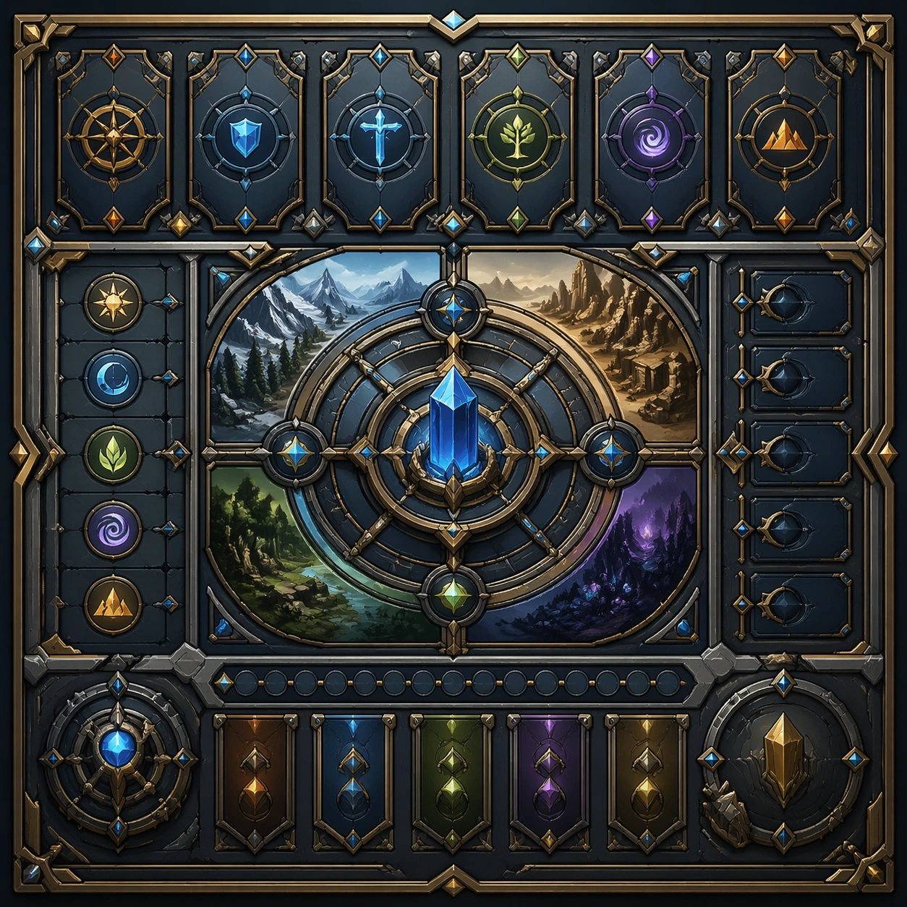

```text
Scene:
Create a square standalone support image for Component Library Premium Showcase. Build a fifth support-surface study with a clear focal hierarchy and a finished professional surface. Use a polished modular board or campaign surface with clean spacing, premium game-UI finish, and clear focal hierarchy. The frame should feel self-contained and polished, with enough structure to explain the system even without the reference series, yet still obviously belonging to the same theme and production world.

Subject:
Show a coherent original game-art system built for premium production and marketing surfaces in a way that emphasizes the intended support surface. Keep the same system logic stable across screenshots, cards, banners, and overview boards. Even though this image is independent, the viewer should still recognize the same universe, same commercial logic, and same production intent as the core package.

Important details:
Lock framing, icon grammar, palette blocking, and surface hierarchy so the kit feels production-ready and consistent. Preserve the broader theme language through color, framing, material choices, and modular composition. Use clean panel rhythm, premium asset presentation, and believable detail density. The image should work equally well as a gallery study, research reference, and mock production deliverable.

Use case:
Component Library Premium Showcase single study 9/9, exploring support five as a support surface.

Constraints:
No readable text, no watermark, no logos, preserve exact 1:1 aspect ratio, no unrelated objects, no broken visual hierarchy, no visual noise that obscures the main surface, no accidental brand resemblance.
```

[Pinned source](https://github.com/ChaosRealmsAI/gpt-image-2-gallery/blob/5296db8c996e38776c83a0bc8c64f848dcd512b3/works/topics/component-library-premium-showcase/packages/single-support-studies/images/support-five/meta.json) · GPT Image2 · 1254×1254 · No source-declared image dependencies. · ProjectD:pending individual review.

## Reference Anchor · consumer-app-polish-flow-screens/series-core-system/01-reference-anchor

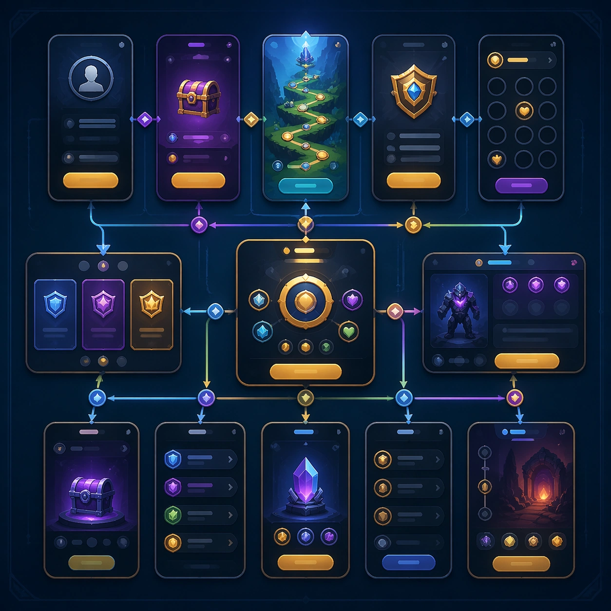

```text
Scene:
Create a square reference image for Consumer App Polish Flow Screens. Build a reference anchor establishing the core system with a premium, production-ready finish. Use a polished modular board or campaign surface with clean spacing, premium game-UI finish, and clear focal hierarchy. The composition should feel intentional, clean, and reusable for gallery, research, campaign, or internal handoff contexts. Lighting must support readability first, with the main forms clearly separated from the background and enough breathing room for the system to stay legible at both hero scale and thumbnail scale.

Subject:
Center a coherent original game-art system built for premium production and marketing surfaces. For this image, focus on reference anchor. Keep the same system logic stable across screenshots, cards, banners, and overview boards. This image is the canonical anchor that later series images must follow. The viewer should immediately understand what role this surface plays inside a cohesive game-production asset pack.

Important details:
Lock framing, icon grammar, palette blocking, and surface hierarchy so the kit feels production-ready and consistent. Preserve the core silhouette, framing language, and material logic from the reference image while each variation changes function. Keep materials believable, edge hierarchy disciplined, and the visual language consistent with App Flow Polish. Use abstract interface blocks or diagram accents when helpful, but avoid any readable language. The final result should feel like a deliberate production asset rather than a random illustration.

Use case:
Consumer App Polish Flow Screens series study 1/9, designed as reference anchor within a cohesive asset pack.

Constraints:
No readable text, no watermark, no logos, preserve exact 1:1 aspect ratio, no unrelated objects, no broken visual hierarchy, no malformed anatomy or broken perspective, no random decorative clutter.
```

[Pinned source](https://github.com/ChaosRealmsAI/gpt-image-2-gallery/blob/5296db8c996e38776c83a0bc8c64f848dcd512b3/works/topics/consumer-app-polish-flow-screens/packages/series-core-system/images/01-reference-anchor/meta.json) · GPT Image2 · 1254×1254 · No source-declared image dependencies. · ProjectD:pending individual review.

## Variant One · consumer-app-polish-flow-screens/series-core-system/02-variant-one

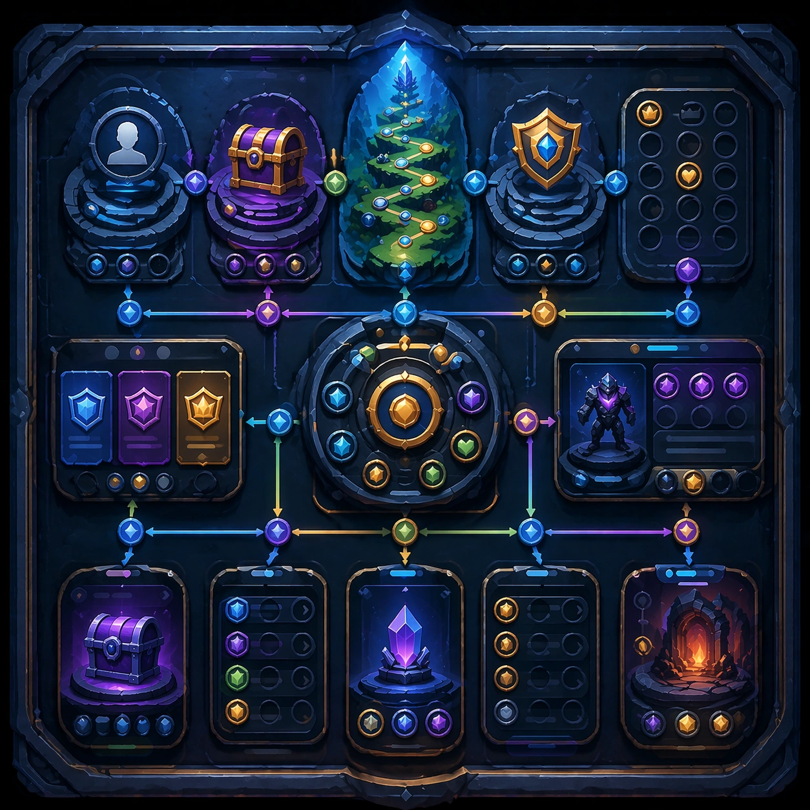

```text
Scene:
Create a square dependent image for Consumer App Polish Flow Screens. Build a first controlled variation in the same system with a premium, production-ready finish. Use a polished modular board or campaign surface with clean spacing, premium game-UI finish, and clear focal hierarchy. The composition should feel intentional, clean, and reusable for gallery, research, campaign, or internal handoff contexts. Lighting must support readability first, with the main forms clearly separated from the background and enough breathing room for the system to stay legible at both hero scale and thumbnail scale.

Subject:
Center a coherent original game-art system built for premium production and marketing surfaces. For this image, focus on the intended support surface. Keep the same system logic stable across screenshots, cards, banners, and overview boards. Preserve exact identity or system logic from the reference image while changing only the intended variation axis. The viewer should immediately understand what role this surface plays inside a cohesive game-production asset pack.

Important details:
Lock framing, icon grammar, palette blocking, and surface hierarchy so the kit feels production-ready and consistent. Preserve the core silhouette, framing language, and material logic from the reference image while each variation changes function. Keep materials believable, edge hierarchy disciplined, and the visual language consistent with App Flow Polish. Use abstract interface blocks or diagram accents when helpful, but avoid any readable language. The final result should feel like a deliberate production asset rather than a random illustration.

Use case:
Consumer App Polish Flow Screens series study 2/9, designed as variant one within a cohesive asset pack.

Constraints:
No readable text, no watermark, no logos, preserve exact 1:1 aspect ratio, no unrelated objects, no broken visual hierarchy, no malformed anatomy or broken perspective, no random decorative clutter.
```

[Pinned source](https://github.com/ChaosRealmsAI/gpt-image-2-gallery/blob/5296db8c996e38776c83a0bc8c64f848dcd512b3/works/topics/consumer-app-polish-flow-screens/packages/series-core-system/images/02-variant-one/meta.json) · GPT Image2 · 1254×1254 · Reference images required. · ProjectD:pending individual review.

## Variant Two · consumer-app-polish-flow-screens/series-core-system/03-variant-two

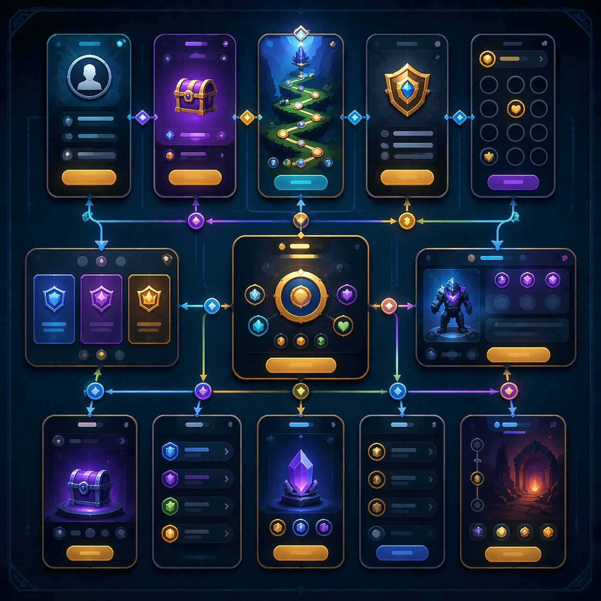

```text
Scene:
Create a square dependent image for Consumer App Polish Flow Screens. Build a second controlled variation in the same system with a premium, production-ready finish. Use a polished modular board or campaign surface with clean spacing, premium game-UI finish, and clear focal hierarchy. The composition should feel intentional, clean, and reusable for gallery, research, campaign, or internal handoff contexts. Lighting must support readability first, with the main forms clearly separated from the background and enough breathing room for the system to stay legible at both hero scale and thumbnail scale.

Subject:
Center a coherent original game-art system built for premium production and marketing surfaces. For this image, focus on the intended support surface. Keep the same system logic stable across screenshots, cards, banners, and overview boards. Preserve exact identity or system logic from the reference image while changing only the intended variation axis. The viewer should immediately understand what role this surface plays inside a cohesive game-production asset pack.

Important details:
Lock framing, icon grammar, palette blocking, and surface hierarchy so the kit feels production-ready and consistent. Preserve the core silhouette, framing language, and material logic from the reference image while each variation changes function. Keep materials believable, edge hierarchy disciplined, and the visual language consistent with App Flow Polish. Use abstract interface blocks or diagram accents when helpful, but avoid any readable language. The final result should feel like a deliberate production asset rather than a random illustration.

Use case:
Consumer App Polish Flow Screens series study 3/9, designed as variant two within a cohesive asset pack.

Constraints:
No readable text, no watermark, no logos, preserve exact 1:1 aspect ratio, no unrelated objects, no broken visual hierarchy, no malformed anatomy or broken perspective, no random decorative clutter.
```

[Pinned source](https://github.com/ChaosRealmsAI/gpt-image-2-gallery/blob/5296db8c996e38776c83a0bc8c64f848dcd512b3/works/topics/consumer-app-polish-flow-screens/packages/series-core-system/images/03-variant-two/meta.json) · GPT Image2 · 1254×1254 · Reference images required. · ProjectD:pending individual review.

## Variant Three · consumer-app-polish-flow-screens/series-core-system/04-variant-three

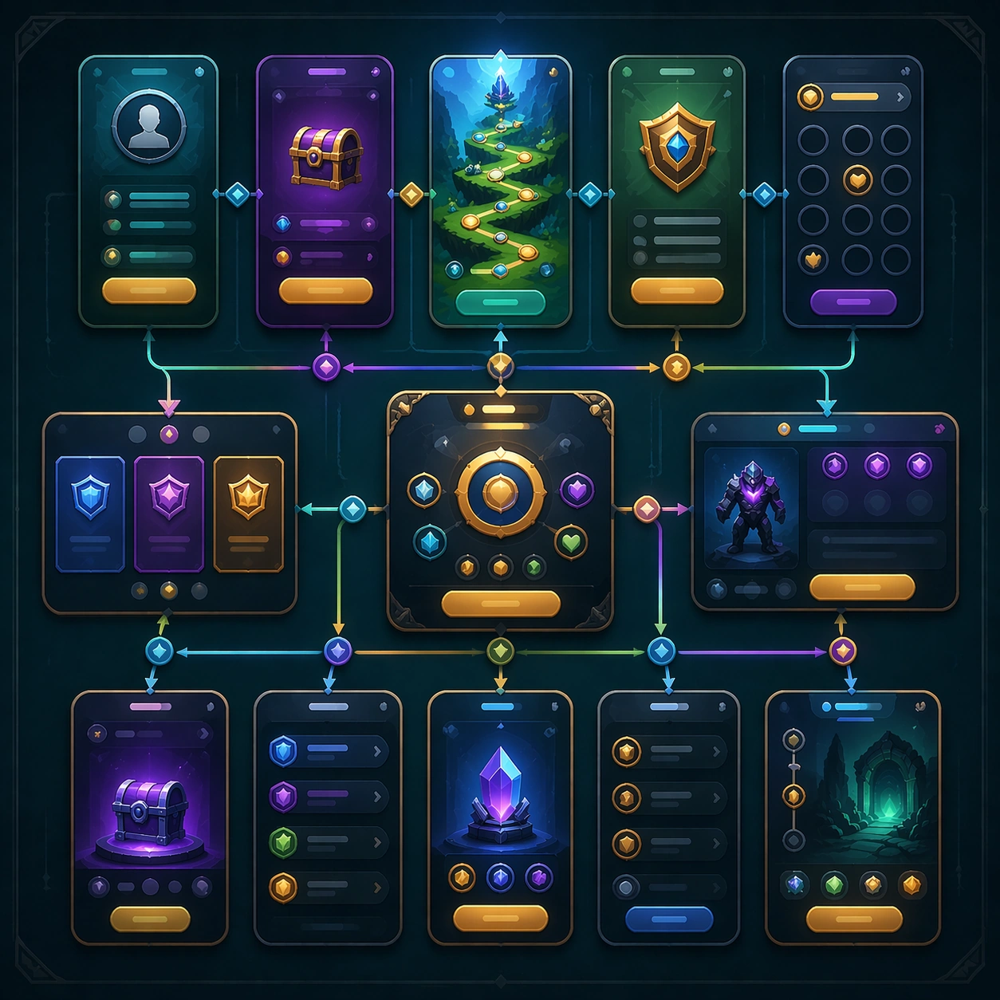

```text
Scene:
Create a square dependent image for Consumer App Polish Flow Screens. Build a third controlled variation in the same system with a premium, production-ready finish. Use a polished modular board or campaign surface with clean spacing, premium game-UI finish, and clear focal hierarchy. The composition should feel intentional, clean, and reusable for gallery, research, campaign, or internal handoff contexts. Lighting must support readability first, with the main forms clearly separated from the background and enough breathing room for the system to stay legible at both hero scale and thumbnail scale.

Subject:
Center a coherent original game-art system built for premium production and marketing surfaces. For this image, focus on the intended support surface. Keep the same system logic stable across screenshots, cards, banners, and overview boards. Preserve exact identity or system logic from the reference image while changing only the intended variation axis. The viewer should immediately understand what role this surface plays inside a cohesive game-production asset pack.

Important details:
Lock framing, icon grammar, palette blocking, and surface hierarchy so the kit feels production-ready and consistent. Preserve the core silhouette, framing language, and material logic from the reference image while each variation changes function. Keep materials believable, edge hierarchy disciplined, and the visual language consistent with App Flow Polish. Use abstract interface blocks or diagram accents when helpful, but avoid any readable language. The final result should feel like a deliberate production asset rather than a random illustration.

Use case:
Consumer App Polish Flow Screens series study 4/9, designed as variant three within a cohesive asset pack.

Constraints:
No readable text, no watermark, no logos, preserve exact 1:1 aspect ratio, no unrelated objects, no broken visual hierarchy, no malformed anatomy or broken perspective, no random decorative clutter.
```

[Pinned source](https://github.com/ChaosRealmsAI/gpt-image-2-gallery/blob/5296db8c996e38776c83a0bc8c64f848dcd512b3/works/topics/consumer-app-polish-flow-screens/packages/series-core-system/images/04-variant-three/meta.json) · GPT Image2 · 1254×1254 · Reference images required. · ProjectD:pending individual review.

## Support One · consumer-app-polish-flow-screens/single-support-studies/support-one

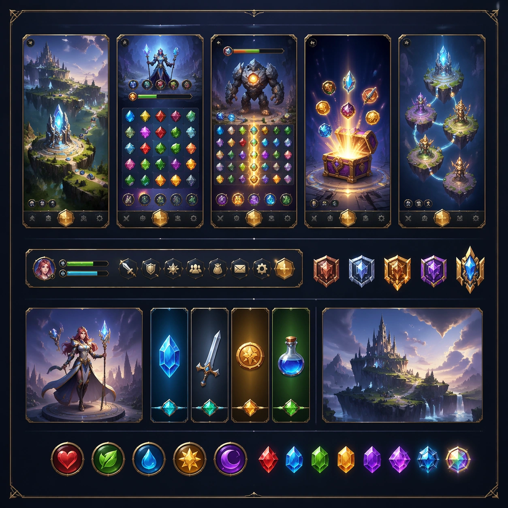

```text
Scene:
Create a square standalone support image for Consumer App Polish Flow Screens. Build a support-surface study with a clear focal hierarchy and a finished professional surface. Use a polished modular board or campaign surface with clean spacing, premium game-UI finish, and clear focal hierarchy. The frame should feel self-contained and polished, with enough structure to explain the system even without the reference series, yet still obviously belonging to the same theme and production world.

Subject:
Show a coherent original game-art system built for premium production and marketing surfaces in a way that emphasizes the intended support surface. Keep the same system logic stable across screenshots, cards, banners, and overview boards. Even though this image is independent, the viewer should still recognize the same universe, same commercial logic, and same production intent as the core package.

Important details:
Lock framing, icon grammar, palette blocking, and surface hierarchy so the kit feels production-ready and consistent. Preserve the broader theme language through color, framing, material choices, and modular composition. Use clean panel rhythm, premium asset presentation, and believable detail density. The image should work equally well as a gallery study, research reference, and mock production deliverable.

Use case:
Consumer App Polish Flow Screens single study 5/9, exploring support one as a support surface.

Constraints:
No readable text, no watermark, no logos, preserve exact 1:1 aspect ratio, no unrelated objects, no broken visual hierarchy, no visual noise that obscures the main surface, no accidental brand resemblance.
```

[Pinned source](https://github.com/ChaosRealmsAI/gpt-image-2-gallery/blob/5296db8c996e38776c83a0bc8c64f848dcd512b3/works/topics/consumer-app-polish-flow-screens/packages/single-support-studies/images/support-one/meta.json) · GPT Image2 · 1254×1254 · No source-declared image dependencies. · ProjectD:pending individual review.

## Support Two · consumer-app-polish-flow-screens/single-support-studies/support-two


```text
Scene:
Create a square standalone support image for Consumer App Polish Flow Screens. Build a second support-surface study with a clear focal hierarchy and a finished professional surface. Use a polished modular board or campaign surface with clean spacing, premium game-UI finish, and clear focal hierarchy. The frame should feel self-contained and polished, with enough structure to explain the system even without the reference series, yet still obviously belonging to the same theme and production world.

Subject:
Show a coherent original game-art system built for premium production and marketing surfaces in a way that emphasizes the intended support surface. Keep the same system logic stable across screenshots, cards, banners, and overview boards. Even though this image is independent, the viewer should still recognize the same universe, same commercial logic, and same production intent as the core package.

Important details:
Lock framing, icon grammar, palette blocking, and surface hierarchy so the kit feels production-ready and consistent. Preserve the broader theme language through color, framing, material choices, and modular composition. Use clean panel rhythm, premium asset presentation, and believable detail density. The image should work equally well as a gallery study, research reference, and mock production deliverable.

Use case:
Consumer App Polish Flow Screens single study 6/9, exploring support two as a support surface.

Constraints:
No readable text, no watermark, no logos, preserve exact 1:1 aspect ratio, no unrelated objects, no broken visual hierarchy, no visual noise that obscures the main surface, no accidental brand resemblance.
```

[Pinned source](https://github.com/ChaosRealmsAI/gpt-image-2-gallery/blob/5296db8c996e38776c83a0bc8c64f848dcd512b3/works/topics/consumer-app-polish-flow-screens/packages/single-support-studies/images/support-two/meta.json) · GPT Image2 · 1254×1254 · No source-declared image dependencies. · ProjectD:pending individual review.

## Support Three · consumer-app-polish-flow-screens/single-support-studies/support-three


```text
Scene:
Create a square standalone support image for Consumer App Polish Flow Screens. Build a third support-surface study with a clear focal hierarchy and a finished professional surface. Use a polished modular board or campaign surface with clean spacing, premium game-UI finish, and clear focal hierarchy. The frame should feel self-contained and polished, with enough structure to explain the system even without the reference series, yet still obviously belonging to the same theme and production world.

Subject:
Show a coherent original game-art system built for premium production and marketing surfaces in a way that emphasizes the intended support surface. Keep the same system logic stable across screenshots, cards, banners, and overview boards. Even though this image is independent, the viewer should still recognize the same universe, same commercial logic, and same production intent as the core package.

Important details:
Lock framing, icon grammar, palette blocking, and surface hierarchy so the kit feels production-ready and consistent. Preserve the broader theme language through color, framing, material choices, and modular composition. Use clean panel rhythm, premium asset presentation, and believable detail density. The image should work equally well as a gallery study, research reference, and mock production deliverable.

Use case:
Consumer App Polish Flow Screens single study 7/9, exploring support three as a support surface.

Constraints:
No readable text, no watermark, no logos, preserve exact 1:1 aspect ratio, no unrelated objects, no broken visual hierarchy, no visual noise that obscures the main surface, no accidental brand resemblance.
```

[Pinned source](https://github.com/ChaosRealmsAI/gpt-image-2-gallery/blob/5296db8c996e38776c83a0bc8c64f848dcd512b3/works/topics/consumer-app-polish-flow-screens/packages/single-support-studies/images/support-three/meta.json) · GPT Image2 · 1254×1254 · No source-declared image dependencies. · ProjectD:pending individual review.

## Support Four · consumer-app-polish-flow-screens/single-support-studies/support-four


```text
Scene:
Create a square standalone support image for Consumer App Polish Flow Screens. Build a fourth support-surface study with a clear focal hierarchy and a finished professional surface. Use a polished modular board or campaign surface with clean spacing, premium game-UI finish, and clear focal hierarchy. The frame should feel self-contained and polished, with enough structure to explain the system even without the reference series, yet still obviously belonging to the same theme and production world.

Subject:
Show a coherent original game-art system built for premium production and marketing surfaces in a way that emphasizes the intended support surface. Keep the same system logic stable across screenshots, cards, banners, and overview boards. Even though this image is independent, the viewer should still recognize the same universe, same commercial logic, and same production intent as the core package.

Important details:
Lock framing, icon grammar, palette blocking, and surface hierarchy so the kit feels production-ready and consistent. Preserve the broader theme language through color, framing, material choices, and modular composition. Use clean panel rhythm, premium asset presentation, and believable detail density. The image should work equally well as a gallery study, research reference, and mock production deliverable.

Use case:
Consumer App Polish Flow Screens single study 8/9, exploring support four as a support surface.

Constraints:
No readable text, no watermark, no logos, preserve exact 1:1 aspect ratio, no unrelated objects, no broken visual hierarchy, no visual noise that obscures the main surface, no accidental brand resemblance.
```

[Pinned source](https://github.com/ChaosRealmsAI/gpt-image-2-gallery/blob/5296db8c996e38776c83a0bc8c64f848dcd512b3/works/topics/consumer-app-polish-flow-screens/packages/single-support-studies/images/support-four/meta.json) · GPT Image2 · 1254×1254 · No source-declared image dependencies. · ProjectD:pending individual review.

## Support Five · consumer-app-polish-flow-screens/single-support-studies/support-five


```text
Scene:
Create a square standalone support image for Consumer App Polish Flow Screens. Build a fifth support-surface study with a clear focal hierarchy and a finished professional surface. Use a polished modular board or campaign surface with clean spacing, premium game-UI finish, and clear focal hierarchy. The frame should feel self-contained and polished, with enough structure to explain the system even without the reference series, yet still obviously belonging to the same theme and production world.

Subject:
Show a coherent original game-art system built for premium production and marketing surfaces in a way that emphasizes the intended support surface. Keep the same system logic stable across screenshots, cards, banners, and overview boards. Even though this image is independent, the viewer should still recognize the same universe, same commercial logic, and same production intent as the core package.

Important details:
Lock framing, icon grammar, palette blocking, and surface hierarchy so the kit feels production-ready and consistent. Preserve the broader theme language through color, framing, material choices, and modular composition. Use clean panel rhythm, premium asset presentation, and believable detail density. The image should work equally well as a gallery study, research reference, and mock production deliverable.

Use case:
Consumer App Polish Flow Screens single study 9/9, exploring support five as a support surface.

Constraints:
No readable text, no watermark, no logos, preserve exact 1:1 aspect ratio, no unrelated objects, no broken visual hierarchy, no visual noise that obscures the main surface, no accidental brand resemblance.
```

[Pinned source](https://github.com/ChaosRealmsAI/gpt-image-2-gallery/blob/5296db8c996e38776c83a0bc8c64f848dcd512b3/works/topics/consumer-app-polish-flow-screens/packages/single-support-studies/images/support-five/meta.json) · GPT Image2 · 1254×1254 · No source-declared image dependencies. · ProjectD:pending individual review.

## Reference Anchor · convention-booth-licensing-kit/series-core-system/01-reference-anchor


```text
Scene:
Create a square reference image for Convention Booth Licensing Kit. Build a reference anchor establishing the core system with a premium, production-ready finish. Use a polished modular board or campaign surface with clean spacing, premium game-UI finish, and clear focal hierarchy. The composition should feel intentional, clean, and reusable for gallery, research, campaign, or internal handoff contexts. Lighting must support readability first, with the main forms clearly separated from the background and enough breathing room for the system to stay legible at both hero scale and thumbnail scale.

Subject:
Center a coherent original game-art system built for premium production and marketing surfaces. For this image, focus on reference anchor. Keep the same system logic stable across screenshots, cards, banners, and overview boards. This image is the canonical anchor that later series images must follow. The viewer should immediately understand what role this surface plays inside a cohesive game-production asset pack.

Important details:
Lock framing, icon grammar, palette blocking, and surface hierarchy so the kit feels production-ready and consistent. Preserve the core silhouette, framing language, and material logic from the reference image while each variation changes function. Keep materials believable, edge hierarchy disciplined, and the visual language consistent with Booth Kit. Use abstract interface blocks or diagram accents when helpful, but avoid any readable language. The final result should feel like a deliberate production asset rather than a random illustration.

Use case:
Convention Booth Licensing Kit series study 1/9, designed as reference anchor within a cohesive asset pack.

Constraints:
No readable text, no watermark, no logos, preserve exact 1:1 aspect ratio, no unrelated objects, no broken visual hierarchy, no malformed anatomy or broken perspective, no random decorative clutter.
```

[Pinned source](https://github.com/ChaosRealmsAI/gpt-image-2-gallery/blob/5296db8c996e38776c83a0bc8c64f848dcd512b3/works/topics/convention-booth-licensing-kit/packages/series-core-system/images/01-reference-anchor/meta.json) · GPT Image2 · 1254×1254 · No source-declared image dependencies. · ProjectD:pending individual review.

## Variant One · convention-booth-licensing-kit/series-core-system/02-variant-one


```text
Scene:
Create a square dependent image for Convention Booth Licensing Kit. Build a first controlled variation in the same system with a premium, production-ready finish. Use a polished modular board or campaign surface with clean spacing, premium game-UI finish, and clear focal hierarchy. The composition should feel intentional, clean, and reusable for gallery, research, campaign, or internal handoff contexts. Lighting must support readability first, with the main forms clearly separated from the background and enough breathing room for the system to stay legible at both hero scale and thumbnail scale.

Subject:
Center a coherent original game-art system built for premium production and marketing surfaces. For this image, focus on the intended support surface. Keep the same system logic stable across screenshots, cards, banners, and overview boards. Preserve exact identity or system logic from the reference image while changing only the intended variation axis. The viewer should immediately understand what role this surface plays inside a cohesive game-production asset pack.

Important details:
Lock framing, icon grammar, palette blocking, and surface hierarchy so the kit feels production-ready and consistent. Preserve the core silhouette, framing language, and material logic from the reference image while each variation changes function. Keep materials believable, edge hierarchy disciplined, and the visual language consistent with Booth Kit. Use abstract interface blocks or diagram accents when helpful, but avoid any readable language. The final result should feel like a deliberate production asset rather than a random illustration.

Use case:
Convention Booth Licensing Kit series study 2/9, designed as variant one within a cohesive asset pack.

Constraints:
No readable text, no watermark, no logos, preserve exact 1:1 aspect ratio, no unrelated objects, no broken visual hierarchy, no malformed anatomy or broken perspective, no random decorative clutter.
```

[Pinned source](https://github.com/ChaosRealmsAI/gpt-image-2-gallery/blob/5296db8c996e38776c83a0bc8c64f848dcd512b3/works/topics/convention-booth-licensing-kit/packages/series-core-system/images/02-variant-one/meta.json) · GPT Image2 · 1254×1254 · Reference images required. · ProjectD:pending individual review.

## Variant Two · convention-booth-licensing-kit/series-core-system/03-variant-two


```text
Scene:
Create a square dependent image for Convention Booth Licensing Kit. Build a second controlled variation in the same system with a premium, production-ready finish. Use a polished modular board or campaign surface with clean spacing, premium game-UI finish, and clear focal hierarchy. The composition should feel intentional, clean, and reusable for gallery, research, campaign, or internal handoff contexts. Lighting must support readability first, with the main forms clearly separated from the background and enough breathing room for the system to stay legible at both hero scale and thumbnail scale.

Subject:
Center a coherent original game-art system built for premium production and marketing surfaces. For this image, focus on the intended support surface. Keep the same system logic stable across screenshots, cards, banners, and overview boards. Preserve exact identity or system logic from the reference image while changing only the intended variation axis. The viewer should immediately understand what role this surface plays inside a cohesive game-production asset pack.

Important details:
Lock framing, icon grammar, palette blocking, and surface hierarchy so the kit feels production-ready and consistent. Preserve the core silhouette, framing language, and material logic from the reference image while each variation changes function. Keep materials believable, edge hierarchy disciplined, and the visual language consistent with Booth Kit. Use abstract interface blocks or diagram accents when helpful, but avoid any readable language. The final result should feel like a deliberate production asset rather than a random illustration.

Use case:
Convention Booth Licensing Kit series study 3/9, designed as variant two within a cohesive asset pack.

Constraints:
No readable text, no watermark, no logos, preserve exact 1:1 aspect ratio, no unrelated objects, no broken visual hierarchy, no malformed anatomy or broken perspective, no random decorative clutter.
```

[Pinned source](https://github.com/ChaosRealmsAI/gpt-image-2-gallery/blob/5296db8c996e38776c83a0bc8c64f848dcd512b3/works/topics/convention-booth-licensing-kit/packages/series-core-system/images/03-variant-two/meta.json) · GPT Image2 · 1254×1254 · Reference images required. · ProjectD:pending individual review.

## Variant Three · convention-booth-licensing-kit/series-core-system/04-variant-three


```text
Scene:
Create a square dependent image for Convention Booth Licensing Kit. Build a third controlled variation in the same system with a premium, production-ready finish. Use a polished modular board or campaign surface with clean spacing, premium game-UI finish, and clear focal hierarchy. The composition should feel intentional, clean, and reusable for gallery, research, campaign, or internal handoff contexts. Lighting must support readability first, with the main forms clearly separated from the background and enough breathing room for the system to stay legible at both hero scale and thumbnail scale.

Subject:
Center a coherent original game-art system built for premium production and marketing surfaces. For this image, focus on the intended support surface. Keep the same system logic stable across screenshots, cards, banners, and overview boards. Preserve exact identity or system logic from the reference image while changing only the intended variation axis. The viewer should immediately understand what role this surface plays inside a cohesive game-production asset pack.

Important details:
Lock framing, icon grammar, palette blocking, and surface hierarchy so the kit feels production-ready and consistent. Preserve the core silhouette, framing language, and material logic from the reference image while each variation changes function. Keep materials believable, edge hierarchy disciplined, and the visual language consistent with Booth Kit. Use abstract interface blocks or diagram accents when helpful, but avoid any readable language. The final result should feel like a deliberate production asset rather than a random illustration.

Use case:
Convention Booth Licensing Kit series study 4/9, designed as variant three within a cohesive asset pack.

Constraints:
No readable text, no watermark, no logos, preserve exact 1:1 aspect ratio, no unrelated objects, no broken visual hierarchy, no malformed anatomy or broken perspective, no random decorative clutter.
```

[Pinned source](https://github.com/ChaosRealmsAI/gpt-image-2-gallery/blob/5296db8c996e38776c83a0bc8c64f848dcd512b3/works/topics/convention-booth-licensing-kit/packages/series-core-system/images/04-variant-three/meta.json) · GPT Image2 · 1254×1254 · Reference images required. · ProjectD:pending individual review.

## Support One · convention-booth-licensing-kit/single-support-studies/support-one


```text
Scene:
Create a square standalone support image for Convention Booth Licensing Kit. Build a support-surface study with a clear focal hierarchy and a finished professional surface. Use a polished modular board or campaign surface with clean spacing, premium game-UI finish, and clear focal hierarchy. The frame should feel self-contained and polished, with enough structure to explain the system even without the reference series, yet still obviously belonging to the same theme and production world.

Subject:
Show a coherent original game-art system built for premium production and marketing surfaces in a way that emphasizes the intended support surface. Keep the same system logic stable across screenshots, cards, banners, and overview boards. Even though this image is independent, the viewer should still recognize the same universe, same commercial logic, and same production intent as the core package.

Important details:
Lock framing, icon grammar, palette blocking, and surface hierarchy so the kit feels production-ready and consistent. Preserve the broader theme language through color, framing, material choices, and modular composition. Use clean panel rhythm, premium asset presentation, and believable detail density. The image should work equally well as a gallery study, research reference, and mock production deliverable.

Use case:
Convention Booth Licensing Kit single study 5/9, exploring support one as a support surface.

Constraints:
No readable text, no watermark, no logos, preserve exact 1:1 aspect ratio, no unrelated objects, no broken visual hierarchy, no visual noise that obscures the main surface, no accidental brand resemblance.
```

[Pinned source](https://github.com/ChaosRealmsAI/gpt-image-2-gallery/blob/5296db8c996e38776c83a0bc8c64f848dcd512b3/works/topics/convention-booth-licensing-kit/packages/single-support-studies/images/support-one/meta.json) · GPT Image2 · 1254×1254 · No source-declared image dependencies. · ProjectD:pending individual review.

## Support Two · convention-booth-licensing-kit/single-support-studies/support-two


```text
Scene:
Create a square standalone support image for Convention Booth Licensing Kit. Build a second support-surface study with a clear focal hierarchy and a finished professional surface. Use a polished modular board or campaign surface with clean spacing, premium game-UI finish, and clear focal hierarchy. The frame should feel self-contained and polished, with enough structure to explain the system even without the reference series, yet still obviously belonging to the same theme and production world.

Subject:
Show a coherent original game-art system built for premium production and marketing surfaces in a way that emphasizes the intended support surface. Keep the same system logic stable across screenshots, cards, banners, and overview boards. Even though this image is independent, the viewer should still recognize the same universe, same commercial logic, and same production intent as the core package.

Important details:
Lock framing, icon grammar, palette blocking, and surface hierarchy so the kit feels production-ready and consistent. Preserve the broader theme language through color, framing, material choices, and modular composition. Use clean panel rhythm, premium asset presentation, and believable detail density. The image should work equally well as a gallery study, research reference, and mock production deliverable.

Use case:
Convention Booth Licensing Kit single study 6/9, exploring support two as a support surface.

Constraints:
No readable text, no watermark, no logos, preserve exact 1:1 aspect ratio, no unrelated objects, no broken visual hierarchy, no visual noise that obscures the main surface, no accidental brand resemblance.
```

[Pinned source](https://github.com/ChaosRealmsAI/gpt-image-2-gallery/blob/5296db8c996e38776c83a0bc8c64f848dcd512b3/works/topics/convention-booth-licensing-kit/packages/single-support-studies/images/support-two/meta.json) · GPT Image2 · 1254×1254 · No source-declared image dependencies. · ProjectD:pending individual review.

## Support Three · convention-booth-licensing-kit/single-support-studies/support-three


```text
Scene:
Create a square standalone support image for Convention Booth Licensing Kit. Build a third support-surface study with a clear focal hierarchy and a finished professional surface. Use a polished modular board or campaign surface with clean spacing, premium game-UI finish, and clear focal hierarchy. The frame should feel self-contained and polished, with enough structure to explain the system even without the reference series, yet still obviously belonging to the same theme and production world.

Subject:
Show a coherent original game-art system built for premium production and marketing surfaces in a way that emphasizes the intended support surface. Keep the same system logic stable across screenshots, cards, banners, and overview boards. Even though this image is independent, the viewer should still recognize the same universe, same commercial logic, and same production intent as the core package.

Important details:
Lock framing, icon grammar, palette blocking, and surface hierarchy so the kit feels production-ready and consistent. Preserve the broader theme language through color, framing, material choices, and modular composition. Use clean panel rhythm, premium asset presentation, and believable detail density. The image should work equally well as a gallery study, research reference, and mock production deliverable.

Use case:
Convention Booth Licensing Kit single study 7/9, exploring support three as a support surface.

Constraints:
No readable text, no watermark, no logos, preserve exact 1:1 aspect ratio, no unrelated objects, no broken visual hierarchy, no visual noise that obscures the main surface, no accidental brand resemblance.
```

[Pinned source](https://github.com/ChaosRealmsAI/gpt-image-2-gallery/blob/5296db8c996e38776c83a0bc8c64f848dcd512b3/works/topics/convention-booth-licensing-kit/packages/single-support-studies/images/support-three/meta.json) · GPT Image2 · 1254×1254 · No source-declared image dependencies. · ProjectD:pending individual review.

## Support Four · convention-booth-licensing-kit/single-support-studies/support-four


```text
Scene:
Create a square standalone support image for Convention Booth Licensing Kit. Build a fourth support-surface study with a clear focal hierarchy and a finished professional surface. Use a polished modular board or campaign surface with clean spacing, premium game-UI finish, and clear focal hierarchy. The frame should feel self-contained and polished, with enough structure to explain the system even without the reference series, yet still obviously belonging to the same theme and production world.

Subject:
Show a coherent original game-art system built for premium production and marketing surfaces in a way that emphasizes the intended support surface. Keep the same system logic stable across screenshots, cards, banners, and overview boards. Even though this image is independent, the viewer should still recognize the same universe, same commercial logic, and same production intent as the core package.

Important details:
Lock framing, icon grammar, palette blocking, and surface hierarchy so the kit feels production-ready and consistent. Preserve the broader theme language through color, framing, material choices, and modular composition. Use clean panel rhythm, premium asset presentation, and believable detail density. The image should work equally well as a gallery study, research reference, and mock production deliverable.

Use case:
Convention Booth Licensing Kit single study 8/9, exploring support four as a support surface.

Constraints:
No readable text, no watermark, no logos, preserve exact 1:1 aspect ratio, no unrelated objects, no broken visual hierarchy, no visual noise that obscures the main surface, no accidental brand resemblance.
```

[Pinned source](https://github.com/ChaosRealmsAI/gpt-image-2-gallery/blob/5296db8c996e38776c83a0bc8c64f848dcd512b3/works/topics/convention-booth-licensing-kit/packages/single-support-studies/images/support-four/meta.json) · GPT Image2 · 1254×1254 · No source-declared image dependencies. · ProjectD:pending individual review.

## Support Five · convention-booth-licensing-kit/single-support-studies/support-five


```text
Scene:
Create a square standalone support image for Convention Booth Licensing Kit. Build a fifth support-surface study with a clear focal hierarchy and a finished professional surface. Use a polished modular board or campaign surface with clean spacing, premium game-UI finish, and clear focal hierarchy. The frame should feel self-contained and polished, with enough structure to explain the system even without the reference series, yet still obviously belonging to the same theme and production world.

Subject:
Show a coherent original game-art system built for premium production and marketing surfaces in a way that emphasizes the intended support surface. Keep the same system logic stable across screenshots, cards, banners, and overview boards. Even though this image is independent, the viewer should still recognize the same universe, same commercial logic, and same production intent as the core package.

Important details:
Lock framing, icon grammar, palette blocking, and surface hierarchy so the kit feels production-ready and consistent. Preserve the broader theme language through color, framing, material choices, and modular composition. Use clean panel rhythm, premium asset presentation, and believable detail density. The image should work equally well as a gallery study, research reference, and mock production deliverable.

Use case:
Convention Booth Licensing Kit single study 9/9, exploring support five as a support surface.

Constraints:
No readable text, no watermark, no logos, preserve exact 1:1 aspect ratio, no unrelated objects, no broken visual hierarchy, no visual noise that obscures the main surface, no accidental brand resemblance.
```

[Pinned source](https://github.com/ChaosRealmsAI/gpt-image-2-gallery/blob/5296db8c996e38776c83a0bc8c64f848dcd512b3/works/topics/convention-booth-licensing-kit/packages/single-support-studies/images/support-five/meta.json) · GPT Image2 · 1254×1254 · No source-declared image dependencies. · ProjectD:pending individual review.

## Base Transit Poster · conversational-editing-workflow/series-iterative-poster-edit/01-base-transit-poster


```text
Scene:
Square crop of a polished public-transit campaign poster displayed flat on a design review wall, bright neutral studio lighting, crisp editorial realism, clean margins, and a calm modern palette of cream, graphite, sky blue, and coral accents. The poster looks like a finished layout, not a software screen. The camera is straight-on with no perspective distortion, showing the entire poster and a thin surrounding wall edge.

Subject:
A central illustrated tram shelter at midday, two small pedestrians at opposite sides, one abstract headline block near the top made only of unreadable graphic strokes, a large image panel in the middle, and a balanced row of abstract information blocks near the bottom. The structure must be clear enough that later edits can preserve its identity: same frame, same shelter, same right-side figure, same decorative route shapes, and same overall spacing.

Important details:
This is the root reference for a conversational editing chain. Build deliberate edit handles into the image: a removable left pedestrian, a sky that can shift from midday to dusk, a heading area that can become larger, and a palette that can cool down. All text-like elements must be abstract marks, never readable words or letters.

Use case:
Conversational Editing Workflow series study 1/8, establishing the base image for later semantic edits without masks.

Constraints:
No readable text, no watermark, no logos, preserve exact 1:1 aspect ratio, no real transit brand, no UI overlay, no crop marks, no handwritten notes, no torn paper, no cluttered review board.
```

[Pinned source](https://github.com/ChaosRealmsAI/gpt-image-2-gallery/blob/5296db8c996e38776c83a0bc8c64f848dcd512b3/works/topics/conversational-editing-workflow/packages/series-iterative-poster-edit/images/01-base-transit-poster/meta.json) · GPT Image2 · 1254×1254 · No source-declared image dependencies. · ProjectD:pending individual review.

## Larger Cooler Heading · conversational-editing-workflow/series-iterative-poster-edit/03-larger-cooler-heading


```text
Scene:
Square crop of the same transit campaign poster on the same neutral review wall, using the reference as the visual source. The image should look like the next conversational edit after the dusk and removal pass: still a flat poster, still straight-on, still carefully designed, but with a more prominent top heading zone and a cooler design temperature.

Subject:
Keep the dusk tram shelter scene, repaired empty left side, right pedestrian, central image panel, bottom abstract information blocks, margins, and poster identity from the reference. Enlarge the top abstract heading block so it occupies more vertical space and has stronger visual priority, while remaining unreadable and graphic. Shift the overall palette cooler: more blue, cyan, pale lavender, and graphite; less coral warmth. Preserve the warm horizon glow only as a subtle trace inside the illustrated scene.

Important details:
This edit tests whether a model can revise layout hierarchy without rebuilding the whole poster. The heading area should become bigger through careful reflow: nearby route shapes and abstract blocks adjust around it, but the composition stays balanced and recognizable. Avoid literal letters. The abstract heading can be thick bars, modular glyph-like marks, and poster-design shapes that imply larger text without being readable.

Use case:
Conversational Editing Workflow series study 3/8, showing a follow-up request that enlarges a nonreadable heading and cools the color system while preserving previous edits.

Constraints:
No readable text, no watermark, no logos, preserve exact 1:1 aspect ratio, no return of the removed left person, no hot orange redesign, no new poster topic, no visible editing handles, no distorted frame, no real transit map.
```

[Pinned source](https://github.com/ChaosRealmsAI/gpt-image-2-gallery/blob/5296db8c996e38776c83a0bc8c64f848dcd512b3/works/topics/conversational-editing-workflow/packages/series-iterative-poster-edit/images/03-larger-cooler-heading/meta.json) · GPT Image2 · 1254×1254 · Reference images required. · ProjectD:pending individual review.

## Final Balanced Campaign · conversational-editing-workflow/series-iterative-poster-edit/04-final-balanced-campaign


```text
Scene:
Square crop of the final version of the same transit campaign poster on the same review wall, straight-on and evenly lit. It should read as the polished result after several conversational edit turns, with a clean professional finish and no visible trace of the editing process.

Subject:
Preserve the original poster identity from the reference: central tram shelter, repaired empty left side, retained right pedestrian, abstract enlarged heading area, dusk environment, lower information block rhythm, route motifs, and square campaign framing. Make the final version more balanced and presentation-ready: refine spacing, clarify the hierarchy, tune contrast, and make the cool palette elegant rather than flat. The poster should look as if a designer accepted the conversational edits and produced a finished campaign proof.

Important details:
This image must demonstrate cumulative instruction following. The earlier requested changes should all remain visible: dusk atmosphere, no left pedestrian, larger abstract heading, cooler overall color, and preserved base composition. Rebalance only through subtle graphic design decisions: cleaner negative space, sharper icon-like abstract route marks, smoother illustration edges, and better tonal separation. Do not invent a new poster, change the topic, or add literal explanations.

Use case:
Conversational Editing Workflow series study 4/8, final cumulative edit proving that multiple conversational revisions can be resolved into one coherent image.

Constraints:
No readable text, no watermark, no logos, preserve exact 1:1 aspect ratio, no left figure returning, no warm midday lighting, no software UI, no before-after split, no annotation labels, no brand identity, no chaotic poster elements.
```

[Pinned source](https://github.com/ChaosRealmsAI/gpt-image-2-gallery/blob/5296db8c996e38776c83a0bc8c64f848dcd512b3/works/topics/conversational-editing-workflow/packages/series-iterative-poster-edit/images/04-final-balanced-campaign/meta.json) · GPT Image2 · 1254×1254 · Reference images required. · ProjectD:pending individual review.

## Product Colorway Edit · conversational-editing-workflow/single-editing-scenarios/product-colorway-edit


```text
Scene:
Square crop of a product photography set for a lightweight running shoe, clean studio sweep, softbox lighting, pale gray floor, and a few controlled prop shadows. The style is photorealistic commercial mockup with restrained color and crisp material definition.

Subject:
A single shoe sits three-quarter view on a low acrylic riser. The image should imply an edit request such as keep the shoe shape, remove the red heel tag, make the upper cooler blue-gray, and preserve the sole texture and lace geometry. The result must look like the same product after conversational colorway editing, not a different model. Include subtle mesh, translucent sole edge, small decorative stripe shapes with no logo, and clean repaired fabric where the heel tag used to be.

Important details:
This tests local semantic editing without a mask. The shoe silhouette, stitching pattern, lace placement, sole grooves, and lighting must remain coherent while targeted attributes change. The removed tag should leave believable material continuity. The cooler colorway should affect the upper and accent stripe but not the background or shadows. The product should remain centered with catalog-level clarity, suitable for comparing whether shape identity survived the edit.

Use case:
Conversational Editing Workflow single study 6/8, testing object-preserving product edits across removal, material repair, and color transformation.

Constraints:
No readable text, no watermark, no logos, preserve exact 1:1 aspect ratio, no brand marks, no extra shoes, no foot or model, no UI overlay, no split before-after view, no deformed sole, no mismatched laces.
```

[Pinned source](https://github.com/ChaosRealmsAI/gpt-image-2-gallery/blob/5296db8c996e38776c83a0bc8c64f848dcd512b3/works/topics/conversational-editing-workflow/packages/single-editing-scenarios/images/product-colorway-edit/meta.json) · GPT Image2 · 1254×1254 · No source-declared image dependencies. · ProjectD:pending individual review.

## Living Room Declutter · conversational-editing-workflow/single-editing-scenarios/living-room-declutter


```text
Scene:
Square crop of a compact living room photographed from eye level, soft overcast daylight through a side window, realistic interior design styling, natural wood floor, cream walls, and a calm balanced exposure. The room should feel lived-in but already edited into a cleaner final state.

Subject:
Show a sofa, coffee table, standing lamp, wall art with abstract unreadable marks, indoor plant, and a rug. The scene should imply a conversational edit sequence: remove the toy pile from the left floor area, make the room slightly cooler in color temperature, straighten the wall art, and keep the sofa, plant, table objects, rug pattern, and window position consistent. The removed area should be naturally repaired with visible floor grain and correct shadows.

Important details:
This is a mask-free interior editing challenge. The edit must maintain room geometry, scale, lighting direction, and object relationships while changing only the requested semantic elements. The cooler mood should be subtle, not a blue filter over everything. The straightened wall art should align with the room perspective. The floor where clutter was removed must not be blurry, smeared, or unnaturally empty; it should contain plausible shadow and texture continuity.

Use case:
Conversational Editing Workflow single study 7/8, testing scene cleanup, color-temperature adjustment, and geometry correction in one coherent interior.

Constraints:
No readable text, no watermark, no logos, preserve exact 1:1 aspect ratio, no before-after split, no editing UI, no distorted furniture, no extra people, no messy replacement clutter, no impossible shadows, no warped wall frame.
```

[Pinned source](https://github.com/ChaosRealmsAI/gpt-image-2-gallery/blob/5296db8c996e38776c83a0bc8c64f848dcd512b3/works/topics/conversational-editing-workflow/packages/single-editing-scenarios/images/living-room-declutter/meta.json) · GPT Image2 · 1254×1254 · No source-declared image dependencies. · ProjectD:pending individual review.

## Gallery Layout Correction · conversational-editing-workflow/single-editing-scenarios/gallery-layout-correction


```text
Scene:
Square crop of a contemporary gallery wall photographed straight-on, soft ceiling track lights, matte white wall, concrete floor edge, and a restrained exhibition design mood. The image should be clean and frontal, like documentation of a corrected layout after a curator requested edits.

Subject:
Show five framed abstract artworks arranged in a precise grid-like rhythm. The final image should imply multiple conversational edits: remove the small leftmost label plaque, enlarge the central artwork, make the lighting cooler, and align the top row more evenly while preserving the identities of the other frames. All visible art marks are abstract shapes and textures; no readable labels or signatures. The empty wall where the plaque was removed should retain wall texture and natural shadow falloff.

Important details:
This tests structured layout correction. The central frame should grow without colliding with the neighboring frames, and the surrounding frames should reposition just enough to maintain balance. Track-light highlights must follow the cooler lighting request while still looking physically plausible. Keep the wall plane, floor line, frame materials, and overall exhibition style consistent. The corrected grid should feel intentional, not mechanically perfect or randomly rearranged.

Use case:
Conversational Editing Workflow single study 8/8, testing layout-aware object removal, resizing, lighting change, and alignment repair.

Constraints:
No readable text, no watermark, no logos, preserve exact 1:1 aspect ratio, no museum brand, no people, no UI overlay, no before-after split, no crooked final frames, no impossible light beams, no duplicate central artwork.
```

[Pinned source](https://github.com/ChaosRealmsAI/gpt-image-2-gallery/blob/5296db8c996e38776c83a0bc8c64f848dcd512b3/works/topics/conversational-editing-workflow/packages/single-editing-scenarios/images/gallery-layout-correction/meta.json) · GPT Image2 · 1254×1254 · No source-declared image dependencies. · ProjectD:pending individual review.

## Core Radial Engine · cosmic-mandala-hyperdense/single-mandala-density-studies/01-core-radial-engine


```text
Scene:
Build a square, front-facing sacred-geometry plate that feels like a premium gallery print rather than a casual illustration. The frame should be fully occupied by one disciplined radial composition, with micro-detail remaining crisp from the bindu center to the outer perimeter and with lighting chosen to clarify line work, relief, and layered depth. Keep the crop completely centered and calm, like a collector poster photographed under controlled museum lighting. Keep the square crop exact, the camera flat, and the tonal design disciplined enough that structure stays clear at poster scale and under close inspection.

Subject:
Construct a concentric mandala from nested petals, orbital arcs, lattice rings, stellar emblems, and abstract cosmological glyphs. Every ring must belong to one coherent radial system, with a stable central axis, measured spacing, and enough structural variety that the viewer can keep discovering new information without the image collapsing into noise. Focus this variation on a deep obsidian-and-gold master mandala with twelve disciplined outer bands and a razor-sharp central star. The composition should feel complete and singular, as though one finished artifact has been resolved with full conviction rather than one fragment pulled from a larger sheet.

Important details:
Perfect symmetry is the main test. Keep ring spacing consistent, preserve clean edge transitions, and let scale hierarchy control the eye from center to rim. Use glow, metallic accents, shadow pockets, and fine line weight changes only where they strengthen legibility and make the density feel intentional rather than ornamental clutter. Use restrained gold leaf shimmer, fine charcoal shadow channels, and tiny celestial nodes that repeat cleanly around the full circumference. Preserve crisp edge behavior, stable hierarchy, and enough fine information that the image rewards slow viewing without losing the main read from a distance.

Use case:
Cosmic Mandala single study 1/9, designed as a self-contained sacred-geometry image with a distinct material and compositional emphasis.

Constraints:
No readable text, no watermark, no logos, preserve exact 1:1 aspect ratio, no broken symmetry, no drifting center point, no muddy outer rim, no random clip-art symbols, no decorative filler detached from the radial logic, no accidental lettering, no oversized empty center, no soft-focus bloom, no uneven petal counts.
```

[Pinned source](https://github.com/ChaosRealmsAI/gpt-image-2-gallery/blob/5296db8c996e38776c83a0bc8c64f848dcd512b3/works/topics/cosmic-mandala-hyperdense/packages/single-mandala-density-studies/images/01-core-radial-engine/meta.json) · GPT Image2 · 1254×1254 · No source-declared image dependencies. · ProjectD:pending individual review.

## Zodiac Orbit Choir · cosmic-mandala-hyperdense/single-mandala-density-studies/02-zodiac-orbit-choir


```text
Scene:
Build a square, front-facing sacred-geometry plate that feels like a premium gallery print rather than a casual illustration. The frame should be fully occupied by one disciplined radial composition, with micro-detail remaining crisp from the bindu center to the outer perimeter and with lighting chosen to clarify line work, relief, and layered depth. Present the piece as a ceremonial chart on dark midnight lacquer with a cool halo behind the outer ring. Keep the square crop exact, the camera flat, and the tonal design disciplined enough that structure stays clear at poster scale and under close inspection.

Subject:
Construct a concentric mandala from nested petals, orbital arcs, lattice rings, stellar emblems, and abstract cosmological glyphs. Every ring must belong to one coherent radial system, with a stable central axis, measured spacing, and enough structural variety that the viewer can keep discovering new information without the image collapsing into noise. Focus this variation on a ring system where zodiac-like emblems, planet paths, and moon phases interlock inside one precise circular choir. The composition should feel complete and singular, as though one finished artifact has been resolved with full conviction rather than one fragment pulled from a larger sheet.

Important details:
Perfect symmetry is the main test. Keep ring spacing consistent, preserve clean edge transitions, and let scale hierarchy control the eye from center to rim. Use glow, metallic accents, shadow pockets, and fine line weight changes only where they strengthen legibility and make the density feel intentional rather than ornamental clutter. Make the icon families feel related by geometry, not by illustration style, and keep the orbit spacing precise enough to read as one engineered mechanism. Preserve crisp edge behavior, stable hierarchy, and enough fine information that the image rewards slow viewing without losing the main read from a distance.

Use case:
Cosmic Mandala single study 2/9, designed as a self-contained sacred-geometry image with a distinct material and compositional emphasis.

Constraints:
No readable text, no watermark, no logos, preserve exact 1:1 aspect ratio, no broken symmetry, no drifting center point, no muddy outer rim, no random clip-art symbols, no decorative filler detached from the radial logic, no accidental lettering, no horoscope-card kitsch, no floating icons without anchors, no empty quadrant.
```

[Pinned source](https://github.com/ChaosRealmsAI/gpt-image-2-gallery/blob/5296db8c996e38776c83a0bc8c64f848dcd512b3/works/topics/cosmic-mandala-hyperdense/packages/single-mandala-density-studies/images/02-zodiac-orbit-choir/meta.json) · GPT Image2 · 1254×1254 · No source-declared image dependencies. · ProjectD:pending individual review.

## Binary Nebula Crown · cosmic-mandala-hyperdense/single-mandala-density-studies/03-binary-nebula-crown


```text
Scene:
Build a square, front-facing sacred-geometry plate that feels like a premium gallery print rather than a casual illustration. The frame should be fully occupied by one disciplined radial composition, with micro-detail remaining crisp from the bindu center to the outer perimeter and with lighting chosen to clarify line work, relief, and layered depth. Treat the frame like a nocturnal cosmic print with deep blacks, faint cyan sparks, and a measured central glow. Keep the square crop exact, the camera flat, and the tonal design disciplined enough that structure stays clear at poster scale and under close inspection.

Subject:
Construct a concentric mandala from nested petals, orbital arcs, lattice rings, stellar emblems, and abstract cosmological glyphs. Every ring must belong to one coherent radial system, with a stable central axis, measured spacing, and enough structural variety that the viewer can keep discovering new information without the image collapsing into noise. Focus this variation on an ultra-dense crown of radial code-like dot bands and nebular curls fused into sacred geometry. The composition should feel complete and singular, as though one finished artifact has been resolved with full conviction rather than one fragment pulled from a larger sheet.

Important details:
Perfect symmetry is the main test. Keep ring spacing consistent, preserve clean edge transitions, and let scale hierarchy control the eye from center to rim. Use glow, metallic accents, shadow pockets, and fine line weight changes only where they strengthen legibility and make the density feel intentional rather than ornamental clutter. Blend tiny dotted bands, wave seams, and filigree arcs so the diagram feels futuristic without losing devotional symmetry. Preserve crisp edge behavior, stable hierarchy, and enough fine information that the image rewards slow viewing without losing the main read from a distance.

Use case:
Cosmic Mandala single study 3/9, designed as a self-contained sacred-geometry image with a distinct material and compositional emphasis.

Constraints:
No readable text, no watermark, no logos, preserve exact 1:1 aspect ratio, no broken symmetry, no drifting center point, no muddy outer rim, no random clip-art symbols, no decorative filler detached from the radial logic, no accidental lettering, no sci-fi interface clutter, no obvious UI panels, no asymmetrical nebula spill.
```

[Pinned source](https://github.com/ChaosRealmsAI/gpt-image-2-gallery/blob/5296db8c996e38776c83a0bc8c64f848dcd512b3/works/topics/cosmic-mandala-hyperdense/packages/single-mandala-density-studies/images/03-binary-nebula-crown/meta.json) · GPT Image2 · 1254×1254 · No source-declared image dependencies. · ProjectD:pending individual review.

## Solar Eclipse Cross Section · cosmic-mandala-hyperdense/single-mandala-density-studies/04-solar-eclipse-cross-section


```text
Scene:
Build a square, front-facing sacred-geometry plate that feels like a premium gallery print rather than a casual illustration. The frame should be fully occupied by one disciplined radial composition, with micro-detail remaining crisp from the bindu center to the outer perimeter and with lighting chosen to clarify line work, relief, and layered depth. Light the work as if it were printed with metallic ink on matte black stock, with subtle eclipse radiance at the center. Keep the square crop exact, the camera flat, and the tonal design disciplined enough that structure stays clear at poster scale and under close inspection.

Subject:
Construct a concentric mandala from nested petals, orbital arcs, lattice rings, stellar emblems, and abstract cosmological glyphs. Every ring must belong to one coherent radial system, with a stable central axis, measured spacing, and enough structural variety that the viewer can keep discovering new information without the image collapsing into noise. Focus this variation on a mandala whose rings suggest eclipse shadows, coronas, and occultation layers while staying perfectly decorative. The composition should feel complete and singular, as though one finished artifact has been resolved with full conviction rather than one fragment pulled from a larger sheet.

Important details:
Perfect symmetry is the main test. Keep ring spacing consistent, preserve clean edge transitions, and let scale hierarchy control the eye from center to rim. Use glow, metallic accents, shadow pockets, and fine line weight changes only where they strengthen legibility and make the density feel intentional rather than ornamental clutter. Keep the corona textures radial and disciplined, and let dark-light transitions articulate ring depth instead of atmospheric smoke. Preserve crisp edge behavior, stable hierarchy, and enough fine information that the image rewards slow viewing without losing the main read from a distance.

Use case:
Cosmic Mandala single study 4/9, designed as a self-contained sacred-geometry image with a distinct material and compositional emphasis.

Constraints:
No readable text, no watermark, no logos, preserve exact 1:1 aspect ratio, no broken symmetry, no drifting center point, no muddy outer rim, no random clip-art symbols, no decorative filler detached from the radial logic, no accidental lettering, no cinematic lens flare, no off-axis light source, no irregular eclipse edge.
```

[Pinned source](https://github.com/ChaosRealmsAI/gpt-image-2-gallery/blob/5296db8c996e38776c83a0bc8c64f848dcd512b3/works/topics/cosmic-mandala-hyperdense/packages/single-mandala-density-studies/images/04-solar-eclipse-cross-section/meta.json) · GPT Image2 · 1254×1254 · No source-declared image dependencies. · ProjectD:pending individual review.

## Obsidian Gold Relief · cosmic-mandala-hyperdense/single-mandala-density-studies/05-obsidian-gold-relief


```text
Scene:
Build a square, front-facing sacred-geometry plate that feels like a premium gallery print rather than a casual illustration. The frame should be fully occupied by one disciplined radial composition, with micro-detail remaining crisp from the bindu center to the outer perimeter and with lighting chosen to clarify line work, relief, and layered depth. Stage it like a luxury object shot viewed straight on, with grazing light revealing shallow relief and crisp incisions. Keep the square crop exact, the camera flat, and the tonal design disciplined enough that structure stays clear at poster scale and under close inspection.

Subject:
Construct a concentric mandala from nested petals, orbital arcs, lattice rings, stellar emblems, and abstract cosmological glyphs. Every ring must belong to one coherent radial system, with a stable central axis, measured spacing, and enough structural variety that the viewer can keep discovering new information without the image collapsing into noise. Focus this variation on a carved relief interpretation where the same cosmological density becomes tactile metalwork and lacquered recesses. The composition should feel complete and singular, as though one finished artifact has been resolved with full conviction rather than one fragment pulled from a larger sheet.

Important details:
Perfect symmetry is the main test. Keep ring spacing consistent, preserve clean edge transitions, and let scale hierarchy control the eye from center to rim. Use glow, metallic accents, shadow pockets, and fine line weight changes only where they strengthen legibility and make the density feel intentional rather than ornamental clutter. Balance glossy black cavities against satin gold ridges, and keep every engraved track clean enough to follow at close distance. Preserve crisp edge behavior, stable hierarchy, and enough fine information that the image rewards slow viewing without losing the main read from a distance.

Use case:
Cosmic Mandala single study 5/9, designed as a self-contained sacred-geometry image with a distinct material and compositional emphasis.

Constraints:
No readable text, no watermark, no logos, preserve exact 1:1 aspect ratio, no broken symmetry, no drifting center point, no muddy outer rim, no random clip-art symbols, no decorative filler detached from the radial logic, no accidental lettering, no blurry embossing, no cheap jewelry styling, no inconsistent engraving depth.
```

[Pinned source](https://github.com/ChaosRealmsAI/gpt-image-2-gallery/blob/5296db8c996e38776c83a0bc8c64f848dcd512b3/works/topics/cosmic-mandala-hyperdense/packages/single-mandala-density-studies/images/05-obsidian-gold-relief/meta.json) · GPT Image2 · 1254×1254 · No source-declared image dependencies. · ProjectD:pending individual review.

## Turquoise Plasma Field · cosmic-mandala-hyperdense/single-mandala-density-studies/06-turquoise-plasma-field


```text
Scene:
Build a square, front-facing sacred-geometry plate that feels like a premium gallery print rather than a casual illustration. The frame should be fully occupied by one disciplined radial composition, with micro-detail remaining crisp from the bindu center to the outer perimeter and with lighting chosen to clarify line work, relief, and layered depth. Use a dark field with cold luminescence, as if the mandala were suspended above a silent laboratory void. Keep the square crop exact, the camera flat, and the tonal design disciplined enough that structure stays clear at poster scale and under close inspection.

Subject:
Construct a concentric mandala from nested petals, orbital arcs, lattice rings, stellar emblems, and abstract cosmological glyphs. Every ring must belong to one coherent radial system, with a stable central axis, measured spacing, and enough structural variety that the viewer can keep discovering new information without the image collapsing into noise. Focus this variation on a cooler version with turquoise, pale silver, and indigo energy bands radiating through the lattice. The composition should feel complete and singular, as though one finished artifact has been resolved with full conviction rather than one fragment pulled from a larger sheet.

Important details:
Perfect symmetry is the main test. Keep ring spacing consistent, preserve clean edge transitions, and let scale hierarchy control the eye from center to rim. Use glow, metallic accents, shadow pockets, and fine line weight changes only where they strengthen legibility and make the density feel intentional rather than ornamental clutter. The glow must hug the geometry rather than leak randomly; keep each luminous contour aligned to the underlying ring logic. Preserve crisp edge behavior, stable hierarchy, and enough fine information that the image rewards slow viewing without losing the main read from a distance.

Use case:
Cosmic Mandala single study 6/9, designed as a self-contained sacred-geometry image with a distinct material and compositional emphasis.

Constraints:
No readable text, no watermark, no logos, preserve exact 1:1 aspect ratio, no broken symmetry, no drifting center point, no muddy outer rim, no random clip-art symbols, no decorative filler detached from the radial logic, no accidental lettering, no neon poster chaos, no purple fog, no detached glows.
```

[Pinned source](https://github.com/ChaosRealmsAI/gpt-image-2-gallery/blob/5296db8c996e38776c83a0bc8c64f848dcd512b3/works/topics/cosmic-mandala-hyperdense/packages/single-mandala-density-studies/images/06-turquoise-plasma-field/meta.json) · GPT Image2 · 1254×1254 · No source-declared image dependencies. · ProjectD:pending individual review.

## Pearl Emboss Codex · cosmic-mandala-hyperdense/single-mandala-density-studies/07-pearl-emboss-codex


```text
Scene:
Build a square, front-facing sacred-geometry plate that feels like a premium gallery print rather than a casual illustration. The frame should be fully occupied by one disciplined radial composition, with micro-detail remaining crisp from the bindu center to the outer perimeter and with lighting chosen to clarify line work, relief, and layered depth. Render it like a rare print under soft raking light, where relief and shadow carry the structure more than color contrast. Keep the square crop exact, the camera flat, and the tonal design disciplined enough that structure stays clear at poster scale and under close inspection.

Subject:
Construct a concentric mandala from nested petals, orbital arcs, lattice rings, stellar emblems, and abstract cosmological glyphs. Every ring must belong to one coherent radial system, with a stable central axis, measured spacing, and enough structural variety that the viewer can keep discovering new information without the image collapsing into noise. Focus this variation on a pale ivory and pearl interpretation that feels embossed into archival paper while preserving the same density. The composition should feel complete and singular, as though one finished artifact has been resolved with full conviction rather than one fragment pulled from a larger sheet.

Important details:
Perfect symmetry is the main test. Keep ring spacing consistent, preserve clean edge transitions, and let scale hierarchy control the eye from center to rim. Use glow, metallic accents, shadow pockets, and fine line weight changes only where they strengthen legibility and make the density feel intentional rather than ornamental clutter. Let delicate embossing, faint mica shimmer, and exact scoring lines create depth without losing the extreme nesting complexity. Preserve crisp edge behavior, stable hierarchy, and enough fine information that the image rewards slow viewing without losing the main read from a distance.

Use case:
Cosmic Mandala single study 7/9, designed as a self-contained sacred-geometry image with a distinct material and compositional emphasis.

Constraints:
No readable text, no watermark, no logos, preserve exact 1:1 aspect ratio, no broken symmetry, no drifting center point, no muddy outer rim, no random clip-art symbols, no decorative filler detached from the radial logic, no accidental lettering, no washed-out low contrast, no paper tears, no decorative flourishes outside the system.
```

[Pinned source](https://github.com/ChaosRealmsAI/gpt-image-2-gallery/blob/5296db8c996e38776c83a0bc8c64f848dcd512b3/works/topics/cosmic-mandala-hyperdense/packages/single-mandala-density-studies/images/07-pearl-emboss-codex/meta.json) · GPT Image2 · 1254×1254 · No source-declared image dependencies. · ProjectD:pending individual review.

## Cathedral Light Bloom · cosmic-mandala-hyperdense/single-mandala-density-studies/08-cathedral-light-bloom


```text
Scene:
Build a square, front-facing sacred-geometry plate that feels like a premium gallery print rather than a casual illustration. The frame should be fully occupied by one disciplined radial composition, with micro-detail remaining crisp from the bindu center to the outer perimeter and with lighting chosen to clarify line work, relief, and layered depth. Give the image the stillness of an architectural light study, with bright inner glow and darker lead-like seams. Keep the square crop exact, the camera flat, and the tonal design disciplined enough that structure stays clear at poster scale and under close inspection.

Subject:
Construct a concentric mandala from nested petals, orbital arcs, lattice rings, stellar emblems, and abstract cosmological glyphs. Every ring must belong to one coherent radial system, with a stable central axis, measured spacing, and enough structural variety that the viewer can keep discovering new information without the image collapsing into noise. Focus this variation on a luminous stained-light variation where the radial structure behaves like a sacred window seen head on. The composition should feel complete and singular, as though one finished artifact has been resolved with full conviction rather than one fragment pulled from a larger sheet.

Important details:
Perfect symmetry is the main test. Keep ring spacing consistent, preserve clean edge transitions, and let scale hierarchy control the eye from center to rim. Use glow, metallic accents, shadow pockets, and fine line weight changes only where they strengthen legibility and make the density feel intentional rather than ornamental clutter. Use jewel-toned radiance sparingly, and keep every petal, spoke, and halo perfectly mirrored so the spectacle stays rigorous. Preserve crisp edge behavior, stable hierarchy, and enough fine information that the image rewards slow viewing without losing the main read from a distance.

Use case:
Cosmic Mandala single study 8/9, designed as a self-contained sacred-geometry image with a distinct material and compositional emphasis.

Constraints:
No readable text, no watermark, no logos, preserve exact 1:1 aspect ratio, no broken symmetry, no drifting center point, no muddy outer rim, no random clip-art symbols, no decorative filler detached from the radial logic, no accidental lettering, no figurative saints, no broken lead lines, no off-center bloom.
```

[Pinned source](https://github.com/ChaosRealmsAI/gpt-image-2-gallery/blob/5296db8c996e38776c83a0bc8c64f848dcd512b3/works/topics/cosmic-mandala-hyperdense/packages/single-mandala-density-studies/images/08-cathedral-light-bloom/meta.json) · GPT Image2 · 1254×1254 · No source-declared image dependencies. · ProjectD:pending individual review.

## Micro Density Atlas · cosmic-mandala-hyperdense/single-mandala-density-studies/09-micro-density-atlas


```text
Scene:
Build a square, front-facing sacred-geometry plate that feels like a premium gallery print rather than a casual illustration. The frame should be fully occupied by one disciplined radial composition, with micro-detail remaining crisp from the bindu center to the outer perimeter and with lighting chosen to clarify line work, relief, and layered depth. Compose it as the most information-rich square in the set, yet keep the overall silhouette calm and circular. Keep the square crop exact, the camera flat, and the tonal design disciplined enough that structure stays clear at poster scale and under close inspection.

Subject:
Construct a concentric mandala from nested petals, orbital arcs, lattice rings, stellar emblems, and abstract cosmological glyphs. Every ring must belong to one coherent radial system, with a stable central axis, measured spacing, and enough structural variety that the viewer can keep discovering new information without the image collapsing into noise. Focus this variation on a maximal study emphasizing tiny sub-rings, minute icon clusters, and nested perimeter detail all the way to the corners. The composition should feel complete and singular, as though one finished artifact has been resolved with full conviction rather than one fragment pulled from a larger sheet.

Important details:
Perfect symmetry is the main test. Keep ring spacing consistent, preserve clean edge transitions, and let scale hierarchy control the eye from center to rim. Use glow, metallic accents, shadow pockets, and fine line weight changes only where they strengthen legibility and make the density feel intentional rather than ornamental clutter. The outermost bands should reward close inspection with miniature repeating structures, while the center remains the unquestioned anchor. Preserve crisp edge behavior, stable hierarchy, and enough fine information that the image rewards slow viewing without losing the main read from a distance.

Use case:
Cosmic Mandala single study 9/9, designed as a self-contained sacred-geometry image with a distinct material and compositional emphasis.

Constraints:
No readable text, no watermark, no logos, preserve exact 1:1 aspect ratio, no broken symmetry, no drifting center point, no muddy outer rim, no random clip-art symbols, no decorative filler detached from the radial logic, no accidental lettering, no noisy wallpaper repetition, no unreadable mush, no corner dead zones.
```

[Pinned source](https://github.com/ChaosRealmsAI/gpt-image-2-gallery/blob/5296db8c996e38776c83a0bc8c64f848dcd512b3/works/topics/cosmic-mandala-hyperdense/packages/single-mandala-density-studies/images/09-micro-density-atlas/meta.json) · GPT Image2 · 1254×1254 · No source-declared image dependencies. · ProjectD:pending individual review.

## Tri-Culture Compass · cosmogram-navigation-ancient/single-navigation-cosmogram-studies/01-tri-culture-compass


```text
Scene:
Create a square, face-on navigational cosmogram that feels like a rare historical instrument plate or ceremonial wayfinding board. The image should be built from clear concentric structure, directional hierarchy, and tactile material logic so that multiple systems can coexist without visual conflict. Lighting should clarify engraving, inlay, or ink construction while preserving flat diagram readability. Render it as a luxury instrument plate with shell, brass, and ink details under calm museum lighting. Keep the square crop exact, the camera flat, and the tonal design disciplined enough that structure stays clear at poster scale and under close inspection.

Subject:
Fuse wave-path logic, compass orientation, star-instrument geometry, horizon circles, and route memory patterns into one sacred navigation system. The composition should explain direction through disciplined shape language rather than readable text, making the image feel both ancient and astonishingly intelligent. Every layer should seem chosen for compatibility, not stacked arbitrarily. Focus this variation on a master cosmogram where three navigation grammars meet in one centered compass-like sacred wheel. The composition should feel complete and singular, as though one finished artifact has been resolved with full conviction rather than one fragment pulled from a larger sheet.

Important details:
Cross-cultural fusion is the real test. Keep the systems distinct enough to recognize as different traditions of wayfinding, yet unified through material palette, circle spacing, and line hierarchy. Use shell, brass, lacquer, jade, parchment, or carved wood sparingly and precisely so the diagram remains authoritative rather than decorative craft clutter. Keep the center stable, the outer rings disciplined, and the different navigational motifs clearly interoperable. Preserve crisp edge behavior, stable hierarchy, and enough fine information that the image rewards slow viewing without losing the main read from a distance.

Use case:
Ancient Cosmogram single study 1/9, designed as a self-contained sacred-geometry image with a distinct material and compositional emphasis.

Constraints:
No readable text, no watermark, no logos, preserve exact 1:1 aspect ratio, no readable labels, no tourist-map styling, no random ships or landscapes, no cluttered instrument pile, no misaligned compass axes, no decorative filler detached from navigational logic, no lopsided compass, no decorative border overload, no detached symbols.
```

[Pinned source](https://github.com/ChaosRealmsAI/gpt-image-2-gallery/blob/5296db8c996e38776c83a0bc8c64f848dcd512b3/works/topics/cosmogram-navigation-ancient/packages/single-navigation-cosmogram-studies/images/01-tri-culture-compass/meta.json) · GPT Image2 · 1254×1254 · No source-declared image dependencies. · ProjectD:pending individual review.

## Wave Lattice Circles · cosmogram-navigation-ancient/single-navigation-cosmogram-studies/02-wave-lattice-circles


```text
Scene:
Create a square, face-on navigational cosmogram that feels like a rare historical instrument plate or ceremonial wayfinding board. The image should be built from clear concentric structure, directional hierarchy, and tactile material logic so that multiple systems can coexist without visual conflict. Lighting should clarify engraving, inlay, or ink construction while preserving flat diagram readability. Use cool oceanic tones and a perfectly frontal presentation, as if the board were laid flat for study. Keep the square crop exact, the camera flat, and the tonal design disciplined enough that structure stays clear at poster scale and under close inspection.

Subject:
Fuse wave-path logic, compass orientation, star-instrument geometry, horizon circles, and route memory patterns into one sacred navigation system. The composition should explain direction through disciplined shape language rather than readable text, making the image feel both ancient and astonishingly intelligent. Every layer should seem chosen for compatibility, not stacked arbitrarily. Focus this variation on a study emphasizing interwoven wave lattices and concentric route memory bands around a central orientation core. The composition should feel complete and singular, as though one finished artifact has been resolved with full conviction rather than one fragment pulled from a larger sheet.

Important details:
Cross-cultural fusion is the real test. Keep the systems distinct enough to recognize as different traditions of wayfinding, yet unified through material palette, circle spacing, and line hierarchy. Use shell, brass, lacquer, jade, parchment, or carved wood sparingly and precisely so the diagram remains authoritative rather than decorative craft clutter. The wave patterns should feel intentional and directional, not like generic ornament or textile pattern. Preserve crisp edge behavior, stable hierarchy, and enough fine information that the image rewards slow viewing without losing the main read from a distance.

Use case:
Ancient Cosmogram single study 2/9, designed as a self-contained sacred-geometry image with a distinct material and compositional emphasis.

Constraints:
No readable text, no watermark, no logos, preserve exact 1:1 aspect ratio, no readable labels, no tourist-map styling, no random ships or landscapes, no cluttered instrument pile, no misaligned compass axes, no decorative filler detached from navigational logic, no fish motifs, no beach scene, no random surf foam.
```

[Pinned source](https://github.com/ChaosRealmsAI/gpt-image-2-gallery/blob/5296db8c996e38776c83a0bc8c64f848dcd512b3/works/topics/cosmogram-navigation-ancient/packages/single-navigation-cosmogram-studies/images/02-wave-lattice-circles/meta.json) · GPT Image2 · 1254×1254 · No source-declared image dependencies. · ProjectD:pending individual review.

## Brass Astrolabe Fusion · cosmogram-navigation-ancient/single-navigation-cosmogram-studies/03-brass-astrolabe-fusion


```text
Scene:
Create a square, face-on navigational cosmogram that feels like a rare historical instrument plate or ceremonial wayfinding board. The image should be built from clear concentric structure, directional hierarchy, and tactile material logic so that multiple systems can coexist without visual conflict. Lighting should clarify engraving, inlay, or ink construction while preserving flat diagram readability. Present it like a historic brass instrument seen dead-on under even raking light. Keep the square crop exact, the camera flat, and the tonal design disciplined enough that structure stays clear at poster scale and under close inspection.

Subject:
Fuse wave-path logic, compass orientation, star-instrument geometry, horizon circles, and route memory patterns into one sacred navigation system. The composition should explain direction through disciplined shape language rather than readable text, making the image feel both ancient and astonishingly intelligent. Every layer should seem chosen for compatibility, not stacked arbitrarily. Focus this variation on a warm metallic study where astrolabe-like arcs, star pointers, and compass geometry merge with route grids. The composition should feel complete and singular, as though one finished artifact has been resolved with full conviction rather than one fragment pulled from a larger sheet.

Important details:
Cross-cultural fusion is the real test. Keep the systems distinct enough to recognize as different traditions of wayfinding, yet unified through material palette, circle spacing, and line hierarchy. Use shell, brass, lacquer, jade, parchment, or carved wood sparingly and precisely so the diagram remains authoritative rather than decorative craft clutter. The metal may glow warmly, but each arc and directional register must remain crisp and logically aligned. Preserve crisp edge behavior, stable hierarchy, and enough fine information that the image rewards slow viewing without losing the main read from a distance.

Use case:
Ancient Cosmogram single study 3/9, designed as a self-contained sacred-geometry image with a distinct material and compositional emphasis.

Constraints:
No readable text, no watermark, no logos, preserve exact 1:1 aspect ratio, no readable labels, no tourist-map styling, no random ships or landscapes, no cluttered instrument pile, no misaligned compass axes, no decorative filler detached from navigational logic, no readable numerals, no cluttered screws, no clock-face cliche.
```

[Pinned source](https://github.com/ChaosRealmsAI/gpt-image-2-gallery/blob/5296db8c996e38776c83a0bc8c64f848dcd512b3/works/topics/cosmogram-navigation-ancient/packages/single-navigation-cosmogram-studies/images/03-brass-astrolabe-fusion/meta.json) · GPT Image2 · 1254×1254 · No source-declared image dependencies. · ProjectD:pending individual review.

## Jade and Shell Plate · cosmogram-navigation-ancient/single-navigation-cosmogram-studies/04-jade-shell-plate


```text
Scene:
Create a square, face-on navigational cosmogram that feels like a rare historical instrument plate or ceremonial wayfinding board. The image should be built from clear concentric structure, directional hierarchy, and tactile material logic so that multiple systems can coexist without visual conflict. Lighting should clarify engraving, inlay, or ink construction while preserving flat diagram readability. Keep the composition square, centered, and ceremonially still, like a treasured chart-object. Keep the square crop exact, the camera flat, and the tonal design disciplined enough that structure stays clear at poster scale and under close inspection.

Subject:
Fuse wave-path logic, compass orientation, star-instrument geometry, horizon circles, and route memory patterns into one sacred navigation system. The composition should explain direction through disciplined shape language rather than readable text, making the image feel both ancient and astonishingly intelligent. Every layer should seem chosen for compatibility, not stacked arbitrarily. Focus this variation on a tactile material study using jade, shell, and dark lacquer to encode routes, bearings, and sacred wayfinding bands. The composition should feel complete and singular, as though one finished artifact has been resolved with full conviction rather than one fragment pulled from a larger sheet.

Important details:
Cross-cultural fusion is the real test. Keep the systems distinct enough to recognize as different traditions of wayfinding, yet unified through material palette, circle spacing, and line hierarchy. Use shell, brass, lacquer, jade, parchment, or carved wood sparingly and precisely so the diagram remains authoritative rather than decorative craft clutter. Material contrast should clarify hierarchy and not compete with the navigational order of circles, spokes, and wave paths. Preserve crisp edge behavior, stable hierarchy, and enough fine information that the image rewards slow viewing without losing the main read from a distance.

Use case:
Ancient Cosmogram single study 4/9, designed as a self-contained sacred-geometry image with a distinct material and compositional emphasis.

Constraints:
No readable text, no watermark, no logos, preserve exact 1:1 aspect ratio, no readable labels, no tourist-map styling, no random ships or landscapes, no cluttered instrument pile, no misaligned compass axes, no decorative filler detached from navigational logic, no jewelry display vibe, no piled artifacts, no broken inlay seams.
```

[Pinned source](https://github.com/ChaosRealmsAI/gpt-image-2-gallery/blob/5296db8c996e38776c83a0bc8c64f848dcd512b3/works/topics/cosmogram-navigation-ancient/packages/single-navigation-cosmogram-studies/images/04-jade-shell-plate/meta.json) · GPT Image2 · 1254×1254 · No source-declared image dependencies. · ProjectD:pending individual review.

## Storm Route Cosmogram · cosmogram-navigation-ancient/single-navigation-cosmogram-studies/05-storm-route-cosmogram


```text
Scene:
Create a square, face-on navigational cosmogram that feels like a rare historical instrument plate or ceremonial wayfinding board. The image should be built from clear concentric structure, directional hierarchy, and tactile material logic so that multiple systems can coexist without visual conflict. Lighting should clarify engraving, inlay, or ink construction while preserving flat diagram readability. Allow some atmospheric drama, but keep the diagram itself frontal and unwavering. Keep the square crop exact, the camera flat, and the tonal design disciplined enough that structure stays clear at poster scale and under close inspection.

Subject:
Fuse wave-path logic, compass orientation, star-instrument geometry, horizon circles, and route memory patterns into one sacred navigation system. The composition should explain direction through disciplined shape language rather than readable text, making the image feel both ancient and astonishingly intelligent. Every layer should seem chosen for compatibility, not stacked arbitrarily. Focus this variation on a darker study where route logic stays stable inside pressure arcs, wave vectors, and weather-like directional fields. The composition should feel complete and singular, as though one finished artifact has been resolved with full conviction rather than one fragment pulled from a larger sheet.

Important details:
Cross-cultural fusion is the real test. Keep the systems distinct enough to recognize as different traditions of wayfinding, yet unified through material palette, circle spacing, and line hierarchy. Use shell, brass, lacquer, jade, parchment, or carved wood sparingly and precisely so the diagram remains authoritative rather than decorative craft clutter. Weather energy should wrap around the navigational logic rather than dissolve it; directionality must remain readable everywhere. Preserve crisp edge behavior, stable hierarchy, and enough fine information that the image rewards slow viewing without losing the main read from a distance.

Use case:
Ancient Cosmogram single study 5/9, designed as a self-contained sacred-geometry image with a distinct material and compositional emphasis.

Constraints:
No readable text, no watermark, no logos, preserve exact 1:1 aspect ratio, no readable labels, no tourist-map styling, no random ships or landscapes, no cluttered instrument pile, no misaligned compass axes, no decorative filler detached from navigational logic, no hurricane satellite image feel, no random lightning, no chaotic swirl.
```

[Pinned source](https://github.com/ChaosRealmsAI/gpt-image-2-gallery/blob/5296db8c996e38776c83a0bc8c64f848dcd512b3/works/topics/cosmogram-navigation-ancient/packages/single-navigation-cosmogram-studies/images/05-storm-route-cosmogram/meta.json) · GPT Image2 · 1254×1254 · No source-declared image dependencies. · ProjectD:pending individual review.

## Parchment Night Wayfinder · cosmogram-navigation-ancient/single-navigation-cosmogram-studies/06-parchment-night-wayfinder


```text
Scene:
Create a square, face-on navigational cosmogram that feels like a rare historical instrument plate or ceremonial wayfinding board. The image should be built from clear concentric structure, directional hierarchy, and tactile material logic so that multiple systems can coexist without visual conflict. Lighting should clarify engraving, inlay, or ink construction while preserving flat diagram readability. Use subdued sepia and indigo with a carefully preserved flat chart presentation. Keep the square crop exact, the camera flat, and the tonal design disciplined enough that structure stays clear at poster scale and under close inspection.

Subject:
Fuse wave-path logic, compass orientation, star-instrument geometry, horizon circles, and route memory patterns into one sacred navigation system. The composition should explain direction through disciplined shape language rather than readable text, making the image feel both ancient and astonishingly intelligent. Every layer should seem chosen for compatibility, not stacked arbitrarily. Focus this variation on an archival parchment study with star guidance, route bands, and calm nocturnal orientation structure. The composition should feel complete and singular, as though one finished artifact has been resolved with full conviction rather than one fragment pulled from a larger sheet.

Important details:
Cross-cultural fusion is the real test. Keep the systems distinct enough to recognize as different traditions of wayfinding, yet unified through material palette, circle spacing, and line hierarchy. Use shell, brass, lacquer, jade, parchment, or carved wood sparingly and precisely so the diagram remains authoritative rather than decorative craft clutter. Night cues should help the eye move through the system while the core compass and route memory geometry remain exact. Preserve crisp edge behavior, stable hierarchy, and enough fine information that the image rewards slow viewing without losing the main read from a distance.

Use case:
Ancient Cosmogram single study 6/9, designed as a self-contained sacred-geometry image with a distinct material and compositional emphasis.

Constraints:
No readable text, no watermark, no logos, preserve exact 1:1 aspect ratio, no readable labels, no tourist-map styling, no random ships or landscapes, no cluttered instrument pile, no misaligned compass axes, no decorative filler detached from navigational logic, no star wallpaper, no readable captions, no sailor scene.
```

[Pinned source](https://github.com/ChaosRealmsAI/gpt-image-2-gallery/blob/5296db8c996e38776c83a0bc8c64f848dcd512b3/works/topics/cosmogram-navigation-ancient/packages/single-navigation-cosmogram-studies/images/06-parchment-night-wayfinder/meta.json) · GPT Image2 · 1254×1254 · No source-declared image dependencies. · ProjectD:pending individual review.

## Carved Wood Navigation Wheel · cosmogram-navigation-ancient/single-navigation-cosmogram-studies/07-carved-wood-navigation-wheel


```text
Scene:
Create a square, face-on navigational cosmogram that feels like a rare historical instrument plate or ceremonial wayfinding board. The image should be built from clear concentric structure, directional hierarchy, and tactile material logic so that multiple systems can coexist without visual conflict. Lighting should clarify engraving, inlay, or ink construction while preserving flat diagram readability. Render it like a museum board sample under soft directional light, straight to camera. Keep the square crop exact, the camera flat, and the tonal design disciplined enough that structure stays clear at poster scale and under close inspection.

Subject:
Fuse wave-path logic, compass orientation, star-instrument geometry, horizon circles, and route memory patterns into one sacred navigation system. The composition should explain direction through disciplined shape language rather than readable text, making the image feel both ancient and astonishingly intelligent. Every layer should seem chosen for compatibility, not stacked arbitrarily. Focus this variation on a carved wood interpretation where route marks and bearings are cut into a formal sacred wheel. The composition should feel complete and singular, as though one finished artifact has been resolved with full conviction rather than one fragment pulled from a larger sheet.

Important details:
Cross-cultural fusion is the real test. Keep the systems distinct enough to recognize as different traditions of wayfinding, yet unified through material palette, circle spacing, and line hierarchy. Use shell, brass, lacquer, jade, parchment, or carved wood sparingly and precisely so the diagram remains authoritative rather than decorative craft clutter. Carving depth, grain direction, and burnished highlights should reinforce the radial order instead of obscuring it. Preserve crisp edge behavior, stable hierarchy, and enough fine information that the image rewards slow viewing without losing the main read from a distance.

Use case:
Ancient Cosmogram single study 7/9, designed as a self-contained sacred-geometry image with a distinct material and compositional emphasis.

Constraints:
No readable text, no watermark, no logos, preserve exact 1:1 aspect ratio, no readable labels, no tourist-map styling, no random ships or landscapes, no cluttered instrument pile, no misaligned compass axes, no decorative filler detached from navigational logic, no rustic souvenir feel, no broken spokes, no decorative folk clutter.
```

[Pinned source](https://github.com/ChaosRealmsAI/gpt-image-2-gallery/blob/5296db8c996e38776c83a0bc8c64f848dcd512b3/works/topics/cosmogram-navigation-ancient/packages/single-navigation-cosmogram-studies/images/07-carved-wood-navigation-wheel/meta.json) · GPT Image2 · 1254×1254 · No source-declared image dependencies. · ProjectD:pending individual review.

## Star Tide Confluence · cosmogram-navigation-ancient/single-navigation-cosmogram-studies/08-star-tide-confluence


```text
Scene:
Create a square, face-on navigational cosmogram that feels like a rare historical instrument plate or ceremonial wayfinding board. The image should be built from clear concentric structure, directional hierarchy, and tactile material logic so that multiple systems can coexist without visual conflict. Lighting should clarify engraving, inlay, or ink construction while preserving flat diagram readability. Use dark teal, bone, and muted brass with a contemplative observatory-meets-ocean mood. Keep the square crop exact, the camera flat, and the tonal design disciplined enough that structure stays clear at poster scale and under close inspection.

Subject:
Fuse wave-path logic, compass orientation, star-instrument geometry, horizon circles, and route memory patterns into one sacred navigation system. The composition should explain direction through disciplined shape language rather than readable text, making the image feel both ancient and astonishingly intelligent. Every layer should seem chosen for compatibility, not stacked arbitrarily. Focus this variation on a luminous study where tidal bands, current memory, and celestial guidance meet inside one exact circular order. The composition should feel complete and singular, as though one finished artifact has been resolved with full conviction rather than one fragment pulled from a larger sheet.

Important details:
Cross-cultural fusion is the real test. Keep the systems distinct enough to recognize as different traditions of wayfinding, yet unified through material palette, circle spacing, and line hierarchy. Use shell, brass, lacquer, jade, parchment, or carved wood sparingly and precisely so the diagram remains authoritative rather than decorative craft clutter. The image should feel deeply interconnected, with tides and stars speaking the same visual language through calibrated geometry. Preserve crisp edge behavior, stable hierarchy, and enough fine information that the image rewards slow viewing without losing the main read from a distance.

Use case:
Ancient Cosmogram single study 8/9, designed as a self-contained sacred-geometry image with a distinct material and compositional emphasis.

Constraints:
No readable text, no watermark, no logos, preserve exact 1:1 aspect ratio, no readable labels, no tourist-map styling, no random ships or landscapes, no cluttered instrument pile, no misaligned compass axes, no decorative filler detached from navigational logic, no fantasy portal vibe, no random bioluminescent creatures, no soft blur hiding paths.
```

[Pinned source](https://github.com/ChaosRealmsAI/gpt-image-2-gallery/blob/5296db8c996e38776c83a0bc8c64f848dcd512b3/works/topics/cosmogram-navigation-ancient/packages/single-navigation-cosmogram-studies/images/08-star-tide-confluence/meta.json) · GPT Image2 · 1254×1254 · No source-declared image dependencies. · ProjectD:pending individual review.

## Atlas Room Overview · cosmogram-navigation-ancient/single-navigation-cosmogram-studies/09-atlas-room-overview


```text
Scene:
Create a square, face-on navigational cosmogram that feels like a rare historical instrument plate or ceremonial wayfinding board. The image should be built from clear concentric structure, directional hierarchy, and tactile material logic so that multiple systems can coexist without visual conflict. Lighting should clarify engraving, inlay, or ink construction while preserving flat diagram readability. Present it as a complete plate with measured margin space and a strong central authority. Keep the square crop exact, the camera flat, and the tonal design disciplined enough that structure stays clear at poster scale and under close inspection.

Subject:
Fuse wave-path logic, compass orientation, star-instrument geometry, horizon circles, and route memory patterns into one sacred navigation system. The composition should explain direction through disciplined shape language rather than readable text, making the image feel both ancient and astonishingly intelligent. Every layer should seem chosen for compatibility, not stacked arbitrarily. Focus this variation on a composed archive-board overview where the full cosmogram feels ready for scholarly wall display. The composition should feel complete and singular, as though one finished artifact has been resolved with full conviction rather than one fragment pulled from a larger sheet.

Important details:
Cross-cultural fusion is the real test. Keep the systems distinct enough to recognize as different traditions of wayfinding, yet unified through material palette, circle spacing, and line hierarchy. Use shell, brass, lacquer, jade, parchment, or carved wood sparingly and precisely so the diagram remains authoritative rather than decorative craft clutter. The overview must feel dense but orderly, proving that multiple navigational systems can coexist within one disciplined square artifact. Preserve crisp edge behavior, stable hierarchy, and enough fine information that the image rewards slow viewing without losing the main read from a distance.

Use case:
Ancient Cosmogram single study 9/9, designed as a self-contained sacred-geometry image with a distinct material and compositional emphasis.

Constraints:
No readable text, no watermark, no logos, preserve exact 1:1 aspect ratio, no readable labels, no tourist-map styling, no random ships or landscapes, no cluttered instrument pile, no misaligned compass axes, no decorative filler detached from navigational logic, no room interior, no frame casting shadow, no modern museum labels.
```

[Pinned source](https://github.com/ChaosRealmsAI/gpt-image-2-gallery/blob/5296db8c996e38776c83a0bc8c64f848dcd512b3/works/topics/cosmogram-navigation-ancient/packages/single-navigation-cosmogram-studies/images/09-atlas-room-overview/meta.json) · GPT Image2 · 1254×1254 · No source-declared image dependencies. · ProjectD:pending individual review.

## Color Field Threshold · courtroom-sketch/single-courtroom-sketch-studies/color-field-threshold


```text
Scene:
A square, gallery-ready composition with painterly surfaces, controlled negative space, and a deliberate fine-art presentation. Build the frame around a few dominant blocks or atmospheres of color with slow transitions and emotional weight. Keep the lighting, camera distance, and spatial organization tuned for a high-signal research image rather than a casual snapshot. The image belongs to the Courtroom Sketch theme and should feel immediately legible as a prompt atlas theme for courtroom sketch, testing photorealism, world-knowledge, style-transfer with gpt image 2..

Subject:
Center the study on a few dominant blocks or atmospheres of color with slow transitions and emotional weight. Translate the theme into a concrete visual statement instead of an abstract mood board: the viewer should understand what kind of image this is, what is being tested, and why the composition is difficult. Use the slug idea of courtroom sketch as a literal guide for subject matter, materials, and staging.

Important details:
Focus on authored mark-making, hierarchy, rhythm, and a visual idea that reads immediately before the viewer inspects the brushwork. Preserve a disciplined square composition, clear focal hierarchy, and enough secondary information to make the image feel complete rather than underspecified. The image should look polished, novel, and exhibition-ready, with topic-specific credibility coming from the way surfaces, structure, and visual language reinforce Courtroom Sketch. Avoid generic filler elements that do not serve the main concept.

Use case:
Courtroom Sketch single study 2/8, testing photorealism, world-knowledge, style-transfer through the color field threshold variation.

Constraints:
No readable text, no watermark, no logos, preserve exact 1:1 aspect ratio, no direct copy of a known artwork, no comic speech bubbles, no accidental typography, no low-effort doodle energy, no muddy center, no fake museum label.
```

[Pinned source](https://github.com/ChaosRealmsAI/gpt-image-2-gallery/blob/5296db8c996e38776c83a0bc8c64f848dcd512b3/works/topics/courtroom-sketch/packages/single-courtroom-sketch-studies/images/color-field-threshold/meta.json) · GPT Image2 · 1254×1254 · No source-declared image dependencies. · ProjectD:pending individual review.

## Fractured Figure Surge · courtroom-sketch/single-courtroom-sketch-studies/fractured-figure-surge


```text
Scene:
A square, gallery-ready composition with painterly surfaces, controlled negative space, and a deliberate fine-art presentation. Build the frame around a figure-like presence that emerges and dissolves through broken strokes and unstable edges. Keep the lighting, camera distance, and spatial organization tuned for a high-signal research image rather than a casual snapshot. The image belongs to the Courtroom Sketch theme and should feel immediately legible as a prompt atlas theme for courtroom sketch, testing photorealism, world-knowledge, style-transfer with gpt image 2..

Subject:
Center the study on a figure-like presence that emerges and dissolves through broken strokes and unstable edges. Translate the theme into a concrete visual statement instead of an abstract mood board: the viewer should understand what kind of image this is, what is being tested, and why the composition is difficult. Use the slug idea of courtroom sketch as a literal guide for subject matter, materials, and staging.

Important details:
Focus on authored mark-making, hierarchy, rhythm, and a visual idea that reads immediately before the viewer inspects the brushwork. Preserve a disciplined square composition, clear focal hierarchy, and enough secondary information to make the image feel complete rather than underspecified. The image should look polished, novel, and exhibition-ready, with topic-specific credibility coming from the way surfaces, structure, and visual language reinforce Courtroom Sketch. Avoid generic filler elements that do not serve the main concept.

Use case:
Courtroom Sketch single study 3/8, testing photorealism, world-knowledge, style-transfer through the fractured figure surge variation.

Constraints:
No readable text, no watermark, no logos, preserve exact 1:1 aspect ratio, no direct copy of a known artwork, no comic speech bubbles, no accidental typography, no low-effort doodle energy, no muddy center, no fake museum label.
```

[Pinned source](https://github.com/ChaosRealmsAI/gpt-image-2-gallery/blob/5296db8c996e38776c83a0bc8c64f848dcd512b3/works/topics/courtroom-sketch/packages/single-courtroom-sketch-studies/images/fractured-figure-surge/meta.json) · GPT Image2 · 1254×1254 · No source-declared image dependencies. · ProjectD:pending individual review.

## Black Brush Choir · courtroom-sketch/single-courtroom-sketch-studies/black-brush-choir


```text
Scene:
A square, gallery-ready composition with painterly surfaces, controlled negative space, and a deliberate fine-art presentation. Build the frame around large decisive black gestures that create rhythm, tension, and architectural pressure. Keep the lighting, camera distance, and spatial organization tuned for a high-signal research image rather than a casual snapshot. The image belongs to the Courtroom Sketch theme and should feel immediately legible as a prompt atlas theme for courtroom sketch, testing photorealism, world-knowledge, style-transfer with gpt image 2..

Subject:
Center the study on large decisive black gestures that create rhythm, tension, and architectural pressure. Translate the theme into a concrete visual statement instead of an abstract mood board: the viewer should understand what kind of image this is, what is being tested, and why the composition is difficult. Use the slug idea of courtroom sketch as a literal guide for subject matter, materials, and staging.

Important details:
Focus on authored mark-making, hierarchy, rhythm, and a visual idea that reads immediately before the viewer inspects the brushwork. Preserve a disciplined square composition, clear focal hierarchy, and enough secondary information to make the image feel complete rather than underspecified. The image should look polished, novel, and exhibition-ready, with topic-specific credibility coming from the way surfaces, structure, and visual language reinforce Courtroom Sketch. Avoid generic filler elements that do not serve the main concept.

Use case:
Courtroom Sketch single study 4/8, testing photorealism, world-knowledge, style-transfer through the black brush choir variation.

Constraints:
No readable text, no watermark, no logos, preserve exact 1:1 aspect ratio, no direct copy of a known artwork, no comic speech bubbles, no accidental typography, no low-effort doodle energy, no muddy center, no fake museum label.
```

[Pinned source](https://github.com/ChaosRealmsAI/gpt-image-2-gallery/blob/5296db8c996e38776c83a0bc8c64f848dcd512b3/works/topics/courtroom-sketch/packages/single-courtroom-sketch-studies/images/black-brush-choir/meta.json) · GPT Image2 · 1254×1254 · No source-declared image dependencies. · ProjectD:pending individual review.

## Studio Floor Afterimage · courtroom-sketch/single-courtroom-sketch-studies/studio-floor-afterimage


```text
Scene:
A square, gallery-ready composition with painterly surfaces, controlled negative space, and a deliberate fine-art presentation. Build the frame around evidence of process, splatter, drag, and layered correction without becoming documentary clutter. Keep the lighting, camera distance, and spatial organization tuned for a high-signal research image rather than a casual snapshot. The image belongs to the Courtroom Sketch theme and should feel immediately legible as a prompt atlas theme for courtroom sketch, testing photorealism, world-knowledge, style-transfer with gpt image 2..

Subject:
Center the study on evidence of process, splatter, drag, and layered correction without becoming documentary clutter. Translate the theme into a concrete visual statement instead of an abstract mood board: the viewer should understand what kind of image this is, what is being tested, and why the composition is difficult. Use the slug idea of courtroom sketch as a literal guide for subject matter, materials, and staging.

Important details:
Focus on authored mark-making, hierarchy, rhythm, and a visual idea that reads immediately before the viewer inspects the brushwork. Preserve a disciplined square composition, clear focal hierarchy, and enough secondary information to make the image feel complete rather than underspecified. The image should look polished, novel, and exhibition-ready, with topic-specific credibility coming from the way surfaces, structure, and visual language reinforce Courtroom Sketch. Avoid generic filler elements that do not serve the main concept.

Use case:
Courtroom Sketch single study 5/8, testing photorealism, world-knowledge, style-transfer through the studio floor afterimage variation.

Constraints:
No readable text, no watermark, no logos, preserve exact 1:1 aspect ratio, no direct copy of a known artwork, no comic speech bubbles, no accidental typography, no low-effort doodle energy, no muddy center, no fake museum label.
```

[Pinned source](https://github.com/ChaosRealmsAI/gpt-image-2-gallery/blob/5296db8c996e38776c83a0bc8c64f848dcd512b3/works/topics/courtroom-sketch/packages/single-courtroom-sketch-studies/images/studio-floor-afterimage/meta.json) · GPT Image2 · 1254×1254 · No source-declared image dependencies. · ProjectD:pending individual review.

## 厚涂天气 · courtroom-sketch/single-courtroom-sketch-studies/impasto-weather


```text
Scene:
A square, gallery-ready composition with painterly surfaces, controlled negative space, and a deliberate fine-art presentation. Build the frame around surface build-up, scrape marks, and thick tactile passages that feel meteorological. Keep the lighting, camera distance, and spatial organization tuned for a high-signal research image rather than a casual snapshot. The image belongs to the Courtroom Sketch theme and should feel immediately legible as a prompt atlas theme for courtroom sketch, testing photorealism, world-knowledge, style-transfer with gpt image 2..

Subject:
Center the study on surface build-up, scrape marks, and thick tactile passages that feel meteorological. Translate the theme into a concrete visual statement instead of an abstract mood board: the viewer should understand what kind of image this is, what is being tested, and why the composition is difficult. Use the slug idea of courtroom sketch as a literal guide for subject matter, materials, and staging.

Important details:
Focus on authored mark-making, hierarchy, rhythm, and a visual idea that reads immediately before the viewer inspects the brushwork. Preserve a disciplined square composition, clear focal hierarchy, and enough secondary information to make the image feel complete rather than underspecified. The image should look polished, novel, and exhibition-ready, with topic-specific credibility coming from the way surfaces, structure, and visual language reinforce Courtroom Sketch. Avoid generic filler elements that do not serve the main concept.

Use case:
Courtroom Sketch single study 6/8, testing photorealism, world-knowledge, style-transfer through the 厚涂天气 variation.

Constraints:
No readable text, no watermark, no logos, preserve exact 1:1 aspect ratio, no direct copy of a known artwork, no comic speech bubbles, no accidental typography, no low-effort doodle energy, no muddy center, no fake museum label.
```

[Pinned source](https://github.com/ChaosRealmsAI/gpt-image-2-gallery/blob/5296db8c996e38776c83a0bc8c64f848dcd512b3/works/topics/courtroom-sketch/packages/single-courtroom-sketch-studies/images/impasto-weather/meta.json) · GPT Image2 · 1254×1254 · No source-declared image dependencies. · ProjectD:pending individual review.

## Gesture Architecture · courtroom-sketch/single-courtroom-sketch-studies/gesture-architecture


```text
Scene:
A square, gallery-ready composition with painterly surfaces, controlled negative space, and a deliberate fine-art presentation. Build the frame around brush movement that locks into a hidden compositional scaffold rather than random motion. Keep the lighting, camera distance, and spatial organization tuned for a high-signal research image rather than a casual snapshot. The image belongs to the Courtroom Sketch theme and should feel immediately legible as a prompt atlas theme for courtroom sketch, testing photorealism, world-knowledge, style-transfer with gpt image 2..

Subject:
Center the study on brush movement that locks into a hidden compositional scaffold rather than random motion. Translate the theme into a concrete visual statement instead of an abstract mood board: the viewer should understand what kind of image this is, what is being tested, and why the composition is difficult. Use the slug idea of courtroom sketch as a literal guide for subject matter, materials, and staging.

Important details:
Focus on authored mark-making, hierarchy, rhythm, and a visual idea that reads immediately before the viewer inspects the brushwork. Preserve a disciplined square composition, clear focal hierarchy, and enough secondary information to make the image feel complete rather than underspecified. The image should look polished, novel, and exhibition-ready, with topic-specific credibility coming from the way surfaces, structure, and visual language reinforce Courtroom Sketch. Avoid generic filler elements that do not serve the main concept.

Use case:
Courtroom Sketch single study 7/8, testing photorealism, world-knowledge, style-transfer through the gesture architecture variation.

Constraints:
No readable text, no watermark, no logos, preserve exact 1:1 aspect ratio, no direct copy of a known artwork, no comic speech bubbles, no accidental typography, no low-effort doodle energy, no muddy center, no fake museum label.
```

[Pinned source](https://github.com/ChaosRealmsAI/gpt-image-2-gallery/blob/5296db8c996e38776c83a0bc8c64f848dcd512b3/works/topics/courtroom-sketch/packages/single-courtroom-sketch-studies/images/gesture-architecture/meta.json) · GPT Image2 · 1254×1254 · No source-declared image dependencies. · ProjectD:pending individual review.

## Museum Wall Hang · courtroom-sketch/single-courtroom-sketch-studies/museum-wall-hang


```text
Scene:
A square, gallery-ready composition with painterly surfaces, controlled negative space, and a deliberate fine-art presentation. Build the frame around a resolved exhibition-grade work whose internal balance feels complete and intentional. Keep the lighting, camera distance, and spatial organization tuned for a high-signal research image rather than a casual snapshot. The image belongs to the Courtroom Sketch theme and should feel immediately legible as a prompt atlas theme for courtroom sketch, testing photorealism, world-knowledge, style-transfer with gpt image 2..

Subject:
Center the study on a resolved exhibition-grade work whose internal balance feels complete and intentional. Translate the theme into a concrete visual statement instead of an abstract mood board: the viewer should understand what kind of image this is, what is being tested, and why the composition is difficult. Use the slug idea of courtroom sketch as a literal guide for subject matter, materials, and staging.

Important details:
Focus on authored mark-making, hierarchy, rhythm, and a visual idea that reads immediately before the viewer inspects the brushwork. Preserve a disciplined square composition, clear focal hierarchy, and enough secondary information to make the image feel complete rather than underspecified. The image should look polished, novel, and exhibition-ready, with topic-specific credibility coming from the way surfaces, structure, and visual language reinforce Courtroom Sketch. Avoid generic filler elements that do not serve the main concept.

Use case:
Courtroom Sketch single study 8/8, testing photorealism, world-knowledge, style-transfer through the museum wall hang variation.

Constraints:
No readable text, no watermark, no logos, preserve exact 1:1 aspect ratio, no direct copy of a known artwork, no comic speech bubbles, no accidental typography, no low-effort doodle energy, no muddy center, no fake museum label.
```

[Pinned source](https://github.com/ChaosRealmsAI/gpt-image-2-gallery/blob/5296db8c996e38776c83a0bc8c64f848dcd512b3/works/topics/courtroom-sketch/packages/single-courtroom-sketch-studies/images/museum-wall-hang/meta.json) · GPT Image2 · 1254×1254 · No source-declared image dependencies. · ProjectD:pending individual review.

## Reception and Townhall Anchor · creative-studio-and-office-brand-floor/series-spatial-language-lock/01-reception-townhall-anchor


```text
Scene:
Create a square architectural reference still for Creative Studio and Office Brand Floor. Use a wide entry view that reveals reception, townhall seating, and the main collaborative volume and treat the frame like a premium interior or architecture editorial photograph with disciplined perspective, readable depth from foreground to background, and enough negative space for the spatial hierarchy to breathe. Light the scene so collaboration, material calm, and authored workplace identity feel immediate, using warm gray, natural oak, charcoal felt, off-white surfaces, and one controlled accent hue as the governing tonal range. The composition must read as a high-end commercial image that could sit inside office leasing decks, employer-brand campaigns, interior editorials, and workspace design reviews.

Subject:
Show a branded creative studio and office floor with modular collaboration tables, acoustic felt panels, smoked glass partitions, library shelving, soft lounge seating, and clear company personality. Center the office’s first impression, brand atmosphere, and circulation hierarchy. This is the canonical reference image for the package, so the major proportions, material transitions, fixture families, and circulation logic must feel highly specific and internally coherent rather than generic luxury styling. Let the viewer understand how the space is organized within a single glance, with foreground anchors, a clear middle zone, and a resolved background termination.

Important details:
Lock the table system, acoustic materials, glass-partition rhythm, informal lounge furniture, and abstract brand-graphic zones. Surfaces should feel tactile and believable: stone veining must stay plausible, metals should have disciplined reflectance, fabrics should show natural weight, and concealed lighting should shape the volume instead of flattening it. Use abstract signage, menu, label, or caption zones only as unreadable graphic hints. The image should feel practical for downstream design reviews and polished enough for public-facing campaign use.

Use case:
Creative Studio and Office Brand Floor series study 1/9, establishing the canonical workplace identity for the package.

Constraints:
No readable text, no watermark, no logos, preserve exact 1:1 aspect ratio, no office workers, no readable whiteboard text, no startup cliché neon, no messy desks, no cheap task-chair overload, no lobby turnstiles dominating.
```

[Pinned source](https://github.com/ChaosRealmsAI/gpt-image-2-gallery/blob/5296db8c996e38776c83a0bc8c64f848dcd512b3/works/topics/creative-studio-and-office-brand-floor/packages/series-spatial-language-lock/images/01-reception-townhall-anchor/meta.json) · GPT Image2 · 1254×1254 · No source-declared image dependencies. · ProjectD:pending individual review.

## Workbench Cluster · creative-studio-and-office-brand-floor/series-spatial-language-lock/02-workbench-cluster


```text
Scene:
Create a square reference-dependent architecture still for Creative Studio and Office Brand Floor. Use a square composition centered on the open workbench cluster under balanced daylight while keeping the same lens discipline, editorial polish, and material believability established by the reference image. The lighting can shift to support the intended mood, but the space must still feel like the same authored project with a stable viewpoint logic, convincing depth separation, and clean commercial-photography finish. Keep warm gray, natural oak, charcoal felt, off-white surfaces, and one controlled accent hue as the governing tonal range even when the emphasis changes.

Subject:
Show a branded creative studio and office floor with modular collaboration tables, acoustic felt panels, smoked glass partitions, library shelving, soft lounge seating, and clear company personality. Focus on the exact same office from the reference image, now emphasizing shared tables, lighting discipline, and creative energy without clutter. Preserve exact architectural identity, plan logic, material palette, fixture family, and circulation cues from the reference image while changing only the intended emphasis described here. The viewer should immediately recognize the same project, not a loose cousin, with matching silhouette logic, aligned detailing, and consistent brand atmosphere.

Important details:
Preserve the table system, acoustic materials, glass-partition rhythm, informal lounge furniture, and abstract brand-graphic zones. Any abstract wayfinding, menu, wall-label, or packaging zones must stay unreadable and subordinate to the spatial image. Joinery, edges, reflections, and lighting should remain realistic enough for an operator or design team to treat the image as a credible reference. The variation should feel deliberate and commercially useful, proving that one locked spatial language can flex across multiple campaign or editorial surfaces.

Use case:
Creative Studio and Office Brand Floor series study 2/9, extending collaboration logic while preserving the same office identity.

Constraints:
No readable text, no watermark, no logos, preserve exact 1:1 aspect ratio, preserve exact architectural identity from the reference image, no office workers, no readable whiteboard text, no startup cliché neon, no messy desks, no cheap task-chair overload, no laptops with readable stickers.
```

[Pinned source](https://github.com/ChaosRealmsAI/gpt-image-2-gallery/blob/5296db8c996e38776c83a0bc8c64f848dcd512b3/works/topics/creative-studio-and-office-brand-floor/packages/series-spatial-language-lock/images/02-workbench-cluster/meta.json) · GPT Image2 · 1254×1254 · Reference images required. · ProjectD:pending individual review.

## Meeting Room Layer · creative-studio-and-office-brand-floor/series-spatial-language-lock/03-meeting-room-layer


```text
Scene:
Create a square reference-dependent architecture still for Creative Studio and Office Brand Floor. Use a view through glass partitions into a meeting room and adjacent circulation while keeping the same lens discipline, editorial polish, and material believability established by the reference image. The lighting can shift to support the intended mood, but the space must still feel like the same authored project with a stable viewpoint logic, convincing depth separation, and clean commercial-photography finish. Keep warm gray, natural oak, charcoal felt, off-white surfaces, and one controlled accent hue as the governing tonal range even when the emphasis changes.

Subject:
Show a branded creative studio and office floor with modular collaboration tables, acoustic felt panels, smoked glass partitions, library shelving, soft lounge seating, and clear company personality. Focus on the exact same office from the reference image, now emphasizing transparency, privacy gradients, and acoustic control. Preserve exact architectural identity, plan logic, material palette, fixture family, and circulation cues from the reference image while changing only the intended emphasis described here. The viewer should immediately recognize the same project, not a loose cousin, with matching silhouette logic, aligned detailing, and consistent brand atmosphere.

Important details:
Preserve the table system, acoustic materials, glass-partition rhythm, informal lounge furniture, and abstract brand-graphic zones. Any abstract wayfinding, menu, wall-label, or packaging zones must stay unreadable and subordinate to the spatial image. Joinery, edges, reflections, and lighting should remain realistic enough for an operator or design team to treat the image as a credible reference. The variation should feel deliberate and commercially useful, proving that one locked spatial language can flex across multiple campaign or editorial surfaces.

Use case:
Creative Studio and Office Brand Floor series study 3/9, extending formal discussion zones inside the same brand language.

Constraints:
No readable text, no watermark, no logos, preserve exact 1:1 aspect ratio, preserve exact architectural identity from the reference image, no office workers, no readable whiteboard text, no startup cliché neon, no messy desks, no cheap task-chair overload, no readable writing on glass.
```

[Pinned source](https://github.com/ChaosRealmsAI/gpt-image-2-gallery/blob/5296db8c996e38776c83a0bc8c64f848dcd512b3/works/topics/creative-studio-and-office-brand-floor/packages/series-spatial-language-lock/images/03-meeting-room-layer/meta.json) · GPT Image2 · 1254×1254 · Reference images required. · ProjectD:pending individual review.

## Cafe Commons Transition · creative-studio-and-office-brand-floor/series-spatial-language-lock/04-cafe-commons-transition


```text
Scene:
Create a square reference-dependent architecture still for Creative Studio and Office Brand Floor. Use a composition linking the office cafe commons to nearby lounge and work points while keeping the same lens discipline, editorial polish, and material believability established by the reference image. The lighting can shift to support the intended mood, but the space must still feel like the same authored project with a stable viewpoint logic, convincing depth separation, and clean commercial-photography finish. Keep warm gray, natural oak, charcoal felt, off-white surfaces, and one controlled accent hue as the governing tonal range even when the emphasis changes.

Subject:
Show a branded creative studio and office floor with modular collaboration tables, acoustic felt panels, smoked glass partitions, library shelving, soft lounge seating, and clear company personality. Focus on the exact same office from the reference image, now emphasizing pause, social energy, and softer materials. Preserve exact architectural identity, plan logic, material palette, fixture family, and circulation cues from the reference image while changing only the intended emphasis described here. The viewer should immediately recognize the same project, not a loose cousin, with matching silhouette logic, aligned detailing, and consistent brand atmosphere.

Important details:
Preserve the table system, acoustic materials, glass-partition rhythm, informal lounge furniture, and abstract brand-graphic zones. Any abstract wayfinding, menu, wall-label, or packaging zones must stay unreadable and subordinate to the spatial image. Joinery, edges, reflections, and lighting should remain realistic enough for an operator or design team to treat the image as a credible reference. The variation should feel deliberate and commercially useful, proving that one locked spatial language can flex across multiple campaign or editorial surfaces.

Use case:
Creative Studio and Office Brand Floor series study 4/9, extending informal social space within the same branded floor.

Constraints:
No readable text, no watermark, no logos, preserve exact 1:1 aspect ratio, preserve exact architectural identity from the reference image, no office workers, no readable whiteboard text, no startup cliché neon, no messy desks, no cheap task-chair overload, no branded coffee cups.
```

[Pinned source](https://github.com/ChaosRealmsAI/gpt-image-2-gallery/blob/5296db8c996e38776c83a0bc8c64f848dcd512b3/works/topics/creative-studio-and-office-brand-floor/packages/series-spatial-language-lock/images/04-cafe-commons-transition/meta.json) · GPT Image2 · 1254×1254 · Reference images required. · ProjectD:pending individual review.

## Focus Booth Study · creative-studio-and-office-brand-floor/single-support-studies/02-focus-booth-study


```text
Scene:
Create a square standalone support study for Creative Studio and Office Brand Floor. Use a quiet focus booth with integrated desk, lamp, and acoustic lining and frame it like a premium commercial still or design-editorial crop with clear focal hierarchy, disciplined perspective, and enough breathing room for the materials and objects to read at both thumbnail and full size. Keep warm gray, natural oak, charcoal felt, off-white surfaces, and one controlled accent hue as the tonal guide so the image still belongs to the same theme family, and light the scene in a controlled way that emphasizes texture, edge quality, and authored atmosphere over spectacle.

Subject:
Show a branded creative studio and office floor with modular collaboration tables, acoustic felt panels, smoked glass partitions, library shelving, soft lounge seating, and clear company personality. In this support study, focus on privacy, compact comfort, and work-ready calm. The image should work independently, yet it must still feel like it belongs to the same broader world of Studio Office. Make the space, props, and detailing useful for real campaign, editorial, or design-review contexts rather than moodboard abstraction.

Important details:
Carry forward the broader language of the table system, acoustic materials, glass-partition rhythm, informal lounge furniture, and abstract brand-graphic zones, but let this image prove a new support surface or secondary deliverable. Material realism is essential: wood grain, metal sheen, glass edges, textiles, and stone should feel physically plausible and carefully art directed. Any graphic panels, labels, menus, packaging, or captions must stay abstract and unreadable. The overall result should feel reusable for office leasing decks, employer-brand campaigns, interior editorials, and workspace design reviews, with enough structure that a creative or operations team could build on it.

Use case:
Creative Studio and Office Brand Floor single study 6/9, exploring support still for flexible office planning.

Constraints:
No readable text, no watermark, no logos, preserve exact 1:1 aspect ratio, no office workers, no readable whiteboard text, no startup cliché neon, no messy desks, no cheap task-chair overload, no visible computer screens.
```

[Pinned source](https://github.com/ChaosRealmsAI/gpt-image-2-gallery/blob/5296db8c996e38776c83a0bc8c64f848dcd512b3/works/topics/creative-studio-and-office-brand-floor/packages/single-support-studies/images/02-focus-booth-study/meta.json) · GPT Image2 · 1024×1024 · No source-declared image dependencies. · ProjectD:pending individual review.

## Maker Table Layout · creative-studio-and-office-brand-floor/single-support-studies/03-maker-table-layout


```text
Scene:
Create a square standalone support study for Creative Studio and Office Brand Floor. Use a maker table with samples, tools, mock forms, and overhead task light and frame it like a premium commercial still or design-editorial crop with clear focal hierarchy, disciplined perspective, and enough breathing room for the materials and objects to read at both thumbnail and full size. Keep warm gray, natural oak, charcoal felt, off-white surfaces, and one controlled accent hue as the tonal guide so the image still belongs to the same theme family, and light the scene in a controlled way that emphasizes texture, edge quality, and authored atmosphere over spectacle.

Subject:
Show a branded creative studio and office floor with modular collaboration tables, acoustic felt panels, smoked glass partitions, library shelving, soft lounge seating, and clear company personality. In this support study, focus on hands-on process atmosphere while staying clean and brand-polished. The image should work independently, yet it must still feel like it belongs to the same broader world of Studio Office. Make the space, props, and detailing useful for real campaign, editorial, or design-review contexts rather than moodboard abstraction.

Important details:
Carry forward the broader language of the table system, acoustic materials, glass-partition rhythm, informal lounge furniture, and abstract brand-graphic zones, but let this image prove a new support surface or secondary deliverable. Material realism is essential: wood grain, metal sheen, glass edges, textiles, and stone should feel physically plausible and carefully art directed. Any graphic panels, labels, menus, packaging, or captions must stay abstract and unreadable. The overall result should feel reusable for office leasing decks, employer-brand campaigns, interior editorials, and workspace design reviews, with enough structure that a creative or operations team could build on it.

Use case:
Creative Studio and Office Brand Floor single study 7/9, exploring support image for creative production identity.

Constraints:
No readable text, no watermark, no logos, preserve exact 1:1 aspect ratio, no office workers, no readable whiteboard text, no startup cliché neon, no messy desks, no cheap task-chair overload, no scattered mess.
```

[Pinned source](https://github.com/ChaosRealmsAI/gpt-image-2-gallery/blob/5296db8c996e38776c83a0bc8c64f848dcd512b3/works/topics/creative-studio-and-office-brand-floor/packages/single-support-studies/images/03-maker-table-layout/meta.json) · GPT Image2 · 1254×1254 · No source-declared image dependencies. · ProjectD:pending individual review.

## Brand Corridor Graphics · creative-studio-and-office-brand-floor/single-support-studies/04-brand-corridor-graphics


```text
Scene:
Create a square standalone support study for Creative Studio and Office Brand Floor. Use a corridor with abstract graphic bands, textured wall panels, and a long perspective and frame it like a premium commercial still or design-editorial crop with clear focal hierarchy, disciplined perspective, and enough breathing room for the materials and objects to read at both thumbnail and full size. Keep warm gray, natural oak, charcoal felt, off-white surfaces, and one controlled accent hue as the tonal guide so the image still belongs to the same theme family, and light the scene in a controlled way that emphasizes texture, edge quality, and authored atmosphere over spectacle.

Subject:
Show a branded creative studio and office floor with modular collaboration tables, acoustic felt panels, smoked glass partitions, library shelving, soft lounge seating, and clear company personality. In this support study, focus on secondary-space branding without readable text and with strong wayfinding rhythm. The image should work independently, yet it must still feel like it belongs to the same broader world of Studio Office. Make the space, props, and detailing useful for real campaign, editorial, or design-review contexts rather than moodboard abstraction.

Important details:
Carry forward the broader language of the table system, acoustic materials, glass-partition rhythm, informal lounge furniture, and abstract brand-graphic zones, but let this image prove a new support surface or secondary deliverable. Material realism is essential: wood grain, metal sheen, glass edges, textiles, and stone should feel physically plausible and carefully art directed. Any graphic panels, labels, menus, packaging, or captions must stay abstract and unreadable. The overall result should feel reusable for office leasing decks, employer-brand campaigns, interior editorials, and workspace design reviews, with enough structure that a creative or operations team could build on it.

Use case:
Creative Studio and Office Brand Floor single study 8/9, exploring support still for brand-in-space systems.

Constraints:
No readable text, no watermark, no logos, preserve exact 1:1 aspect ratio, no office workers, no readable whiteboard text, no startup cliché neon, no messy desks, no cheap task-chair overload, no slogans or letters.
```

[Pinned source](https://github.com/ChaosRealmsAI/gpt-image-2-gallery/blob/5296db8c996e38776c83a0bc8c64f848dcd512b3/works/topics/creative-studio-and-office-brand-floor/packages/single-support-studies/images/04-brand-corridor-graphics/meta.json) · GPT Image2 · 1024×1024 · No source-declared image dependencies. · ProjectD:pending individual review.

## Rooftop Collaboration Terrace · creative-studio-and-office-brand-floor/single-support-studies/05-rooftop-collaboration-terrace


```text
Scene:
Create a square standalone support study for Creative Studio and Office Brand Floor. Use a rooftop terrace with outdoor tables, planting, and skyline softness beyond and frame it like a premium commercial still or design-editorial crop with clear focal hierarchy, disciplined perspective, and enough breathing room for the materials and objects to read at both thumbnail and full size. Keep warm gray, natural oak, charcoal felt, off-white surfaces, and one controlled accent hue as the tonal guide so the image still belongs to the same theme family, and light the scene in a controlled way that emphasizes texture, edge quality, and authored atmosphere over spectacle.

Subject:
Show a branded creative studio and office floor with modular collaboration tables, acoustic felt panels, smoked glass partitions, library shelving, soft lounge seating, and clear company personality. In this support study, focus on company culture, fresh-air work mode, and continuity with interior materials. The image should work independently, yet it must still feel like it belongs to the same broader world of Studio Office. Make the space, props, and detailing useful for real campaign, editorial, or design-review contexts rather than moodboard abstraction.

Important details:
Carry forward the broader language of the table system, acoustic materials, glass-partition rhythm, informal lounge furniture, and abstract brand-graphic zones, but let this image prove a new support surface or secondary deliverable. Material realism is essential: wood grain, metal sheen, glass edges, textiles, and stone should feel physically plausible and carefully art directed. Any graphic panels, labels, menus, packaging, or captions must stay abstract and unreadable. The overall result should feel reusable for office leasing decks, employer-brand campaigns, interior editorials, and workspace design reviews, with enough structure that a creative or operations team could build on it.

Use case:
Creative Studio and Office Brand Floor single study 9/9, exploring support image for talent-brand campaigns and office editorials.

Constraints:
No readable text, no watermark, no logos, preserve exact 1:1 aspect ratio, no office workers, no readable whiteboard text, no startup cliché neon, no messy desks, no cheap task-chair overload, no visible neighboring logos.
```

[Pinned source](https://github.com/ChaosRealmsAI/gpt-image-2-gallery/blob/5296db8c996e38776c83a0bc8c64f848dcd512b3/works/topics/creative-studio-and-office-brand-floor/packages/single-support-studies/images/05-rooftop-collaboration-terrace/meta.json) · GPT Image2 · 1254×1254 · No source-declared image dependencies. · ProjectD:pending individual review.

## Reference Anchor · creator-column-and-thumbnail-family/series-core-system/01-reference-anchor


```text
Scene:
Create a square reference image for Creator Column and Thumbnail Family. Build a reference anchor establishing the core system with a premium, production-ready finish. Use a polished modular board or campaign surface with clean spacing, premium game-UI finish, and clear focal hierarchy. The composition should feel intentional, clean, and reusable for gallery, research, campaign, or internal handoff contexts. Lighting must support readability first, with the main forms clearly separated from the background and enough breathing room for the system to stay legible at both hero scale and thumbnail scale.

Subject:
Center a coherent original game-art system built for premium production and marketing surfaces. For this image, focus on reference anchor. Keep the same system logic stable across screenshots, cards, banners, and overview boards. This image is the canonical anchor that later series images must follow. The viewer should immediately understand what role this surface plays inside a cohesive game-production asset pack.

Important details:
Lock framing, icon grammar, palette blocking, and surface hierarchy so the kit feels production-ready and consistent. Preserve the core silhouette, framing language, and material logic from the reference image while each variation changes function. Keep materials believable, edge hierarchy disciplined, and the visual language consistent with Column Family. Use abstract interface blocks or diagram accents when helpful, but avoid any readable language. The final result should feel like a deliberate production asset rather than a random illustration.

Use case:
Creator Column and Thumbnail Family series study 1/9, designed as reference anchor within a cohesive asset pack.

Constraints:
No readable text, no watermark, no logos, preserve exact 1:1 aspect ratio, no unrelated objects, no broken visual hierarchy, no malformed anatomy or broken perspective, no random decorative clutter.
```

[Pinned source](https://github.com/ChaosRealmsAI/gpt-image-2-gallery/blob/5296db8c996e38776c83a0bc8c64f848dcd512b3/works/topics/creator-column-and-thumbnail-family/packages/series-core-system/images/01-reference-anchor/meta.json) · GPT Image2 · 1254×1254 · No source-declared image dependencies. · ProjectD:pending individual review.

## Variant One · creator-column-and-thumbnail-family/series-core-system/02-variant-one


```text
Scene:
Create a square dependent image for Creator Column and Thumbnail Family. Build a first controlled variation in the same system with a premium, production-ready finish. Use a polished modular board or campaign surface with clean spacing, premium game-UI finish, and clear focal hierarchy. The composition should feel intentional, clean, and reusable for gallery, research, campaign, or internal handoff contexts. Lighting must support readability first, with the main forms clearly separated from the background and enough breathing room for the system to stay legible at both hero scale and thumbnail scale.

Subject:
Center a coherent original game-art system built for premium production and marketing surfaces. For this image, focus on the intended support surface. Keep the same system logic stable across screenshots, cards, banners, and overview boards. Preserve exact identity or system logic from the reference image while changing only the intended variation axis. The viewer should immediately understand what role this surface plays inside a cohesive game-production asset pack.

Important details:
Lock framing, icon grammar, palette blocking, and surface hierarchy so the kit feels production-ready and consistent. Preserve the core silhouette, framing language, and material logic from the reference image while each variation changes function. Keep materials believable, edge hierarchy disciplined, and the visual language consistent with Column Family. Use abstract interface blocks or diagram accents when helpful, but avoid any readable language. The final result should feel like a deliberate production asset rather than a random illustration.

Use case:
Creator Column and Thumbnail Family series study 2/9, designed as variant one within a cohesive asset pack.

Constraints:
No readable text, no watermark, no logos, preserve exact 1:1 aspect ratio, no unrelated objects, no broken visual hierarchy, no malformed anatomy or broken perspective, no random decorative clutter.
```

[Pinned source](https://github.com/ChaosRealmsAI/gpt-image-2-gallery/blob/5296db8c996e38776c83a0bc8c64f848dcd512b3/works/topics/creator-column-and-thumbnail-family/packages/series-core-system/images/02-variant-one/meta.json) · GPT Image2 · 1254×1254 · Reference images required. · ProjectD:pending individual review.

## Variant Two · creator-column-and-thumbnail-family/series-core-system/03-variant-two


```text
Scene:
Create a square dependent image for Creator Column and Thumbnail Family. Build a second controlled variation in the same system with a premium, production-ready finish. Use a polished modular board or campaign surface with clean spacing, premium game-UI finish, and clear focal hierarchy. The composition should feel intentional, clean, and reusable for gallery, research, campaign, or internal handoff contexts. Lighting must support readability first, with the main forms clearly separated from the background and enough breathing room for the system to stay legible at both hero scale and thumbnail scale.

Subject:
Center a coherent original game-art system built for premium production and marketing surfaces. For this image, focus on the intended support surface. Keep the same system logic stable across screenshots, cards, banners, and overview boards. Preserve exact identity or system logic from the reference image while changing only the intended variation axis. The viewer should immediately understand what role this surface plays inside a cohesive game-production asset pack.

Important details:
Lock framing, icon grammar, palette blocking, and surface hierarchy so the kit feels production-ready and consistent. Preserve the core silhouette, framing language, and material logic from the reference image while each variation changes function. Keep materials believable, edge hierarchy disciplined, and the visual language consistent with Column Family. Use abstract interface blocks or diagram accents when helpful, but avoid any readable language. The final result should feel like a deliberate production asset rather than a random illustration.

Use case:
Creator Column and Thumbnail Family series study 3/9, designed as variant two within a cohesive asset pack.

Constraints:
No readable text, no watermark, no logos, preserve exact 1:1 aspect ratio, no unrelated objects, no broken visual hierarchy, no malformed anatomy or broken perspective, no random decorative clutter.
```

[Pinned source](https://github.com/ChaosRealmsAI/gpt-image-2-gallery/blob/5296db8c996e38776c83a0bc8c64f848dcd512b3/works/topics/creator-column-and-thumbnail-family/packages/series-core-system/images/03-variant-two/meta.json) · GPT Image2 · 1254×1254 · Reference images required. · ProjectD:pending individual review.

## Variant Three · creator-column-and-thumbnail-family/series-core-system/04-variant-three


```text
Scene:
Create a square dependent image for Creator Column and Thumbnail Family. Build a third controlled variation in the same system with a premium, production-ready finish. Use a polished modular board or campaign surface with clean spacing, premium game-UI finish, and clear focal hierarchy. The composition should feel intentional, clean, and reusable for gallery, research, campaign, or internal handoff contexts. Lighting must support readability first, with the main forms clearly separated from the background and enough breathing room for the system to stay legible at both hero scale and thumbnail scale.

Subject:
Center a coherent original game-art system built for premium production and marketing surfaces. For this image, focus on the intended support surface. Keep the same system logic stable across screenshots, cards, banners, and overview boards. Preserve exact identity or system logic from the reference image while changing only the intended variation axis. The viewer should immediately understand what role this surface plays inside a cohesive game-production asset pack.

Important details:
Lock framing, icon grammar, palette blocking, and surface hierarchy so the kit feels production-ready and consistent. Preserve the core silhouette, framing language, and material logic from the reference image while each variation changes function. Keep materials believable, edge hierarchy disciplined, and the visual language consistent with Column Family. Use abstract interface blocks or diagram accents when helpful, but avoid any readable language. The final result should feel like a deliberate production asset rather than a random illustration.

Use case:
Creator Column and Thumbnail Family series study 4/9, designed as variant three within a cohesive asset pack.

Constraints:
No readable text, no watermark, no logos, preserve exact 1:1 aspect ratio, no unrelated objects, no broken visual hierarchy, no malformed anatomy or broken perspective, no random decorative clutter.
```

[Pinned source](https://github.com/ChaosRealmsAI/gpt-image-2-gallery/blob/5296db8c996e38776c83a0bc8c64f848dcd512b3/works/topics/creator-column-and-thumbnail-family/packages/series-core-system/images/04-variant-three/meta.json) · GPT Image2 · 1254×1254 · Reference images required. · ProjectD:pending individual review.

## Support One · creator-column-and-thumbnail-family/single-support-studies/support-one


```text
Scene:
Create a square standalone support image for Creator Column and Thumbnail Family. Build a support-surface study with a clear focal hierarchy and a finished professional surface. Use a polished modular board or campaign surface with clean spacing, premium game-UI finish, and clear focal hierarchy. The frame should feel self-contained and polished, with enough structure to explain the system even without the reference series, yet still obviously belonging to the same theme and production world.

Subject:
Show a coherent original game-art system built for premium production and marketing surfaces in a way that emphasizes the intended support surface. Keep the same system logic stable across screenshots, cards, banners, and overview boards. Even though this image is independent, the viewer should still recognize the same universe, same commercial logic, and same production intent as the core package.

Important details:
Lock framing, icon grammar, palette blocking, and surface hierarchy so the kit feels production-ready and consistent. Preserve the broader theme language through color, framing, material choices, and modular composition. Use clean panel rhythm, premium asset presentation, and believable detail density. The image should work equally well as a gallery study, research reference, and mock production deliverable.

Use case:
Creator Column and Thumbnail Family single study 5/9, exploring support one as a support surface.

Constraints:
No readable text, no watermark, no logos, preserve exact 1:1 aspect ratio, no unrelated objects, no broken visual hierarchy, no visual noise that obscures the main surface, no accidental brand resemblance.
```

[Pinned source](https://github.com/ChaosRealmsAI/gpt-image-2-gallery/blob/5296db8c996e38776c83a0bc8c64f848dcd512b3/works/topics/creator-column-and-thumbnail-family/packages/single-support-studies/images/support-one/meta.json) · GPT Image2 · 1254×1254 · No source-declared image dependencies. · ProjectD:pending individual review.

## Support Two · creator-column-and-thumbnail-family/single-support-studies/support-two


```text
Scene:
Create a square standalone support image for Creator Column and Thumbnail Family. Build a second support-surface study with a clear focal hierarchy and a finished professional surface. Use a polished modular board or campaign surface with clean spacing, premium game-UI finish, and clear focal hierarchy. The frame should feel self-contained and polished, with enough structure to explain the system even without the reference series, yet still obviously belonging to the same theme and production world.

Subject:
Show a coherent original game-art system built for premium production and marketing surfaces in a way that emphasizes the intended support surface. Keep the same system logic stable across screenshots, cards, banners, and overview boards. Even though this image is independent, the viewer should still recognize the same universe, same commercial logic, and same production intent as the core package.

Important details:
Lock framing, icon grammar, palette blocking, and surface hierarchy so the kit feels production-ready and consistent. Preserve the broader theme language through color, framing, material choices, and modular composition. Use clean panel rhythm, premium asset presentation, and believable detail density. The image should work equally well as a gallery study, research reference, and mock production deliverable.

Use case:
Creator Column and Thumbnail Family single study 6/9, exploring support two as a support surface.

Constraints:
No readable text, no watermark, no logos, preserve exact 1:1 aspect ratio, no unrelated objects, no broken visual hierarchy, no visual noise that obscures the main surface, no accidental brand resemblance.
```

[Pinned source](https://github.com/ChaosRealmsAI/gpt-image-2-gallery/blob/5296db8c996e38776c83a0bc8c64f848dcd512b3/works/topics/creator-column-and-thumbnail-family/packages/single-support-studies/images/support-two/meta.json) · GPT Image2 · 1254×1254 · No source-declared image dependencies. · ProjectD:pending individual review.

## Support Three · creator-column-and-thumbnail-family/single-support-studies/support-three


```text
Scene:
Create a square standalone support image for Creator Column and Thumbnail Family. Build a third support-surface study with a clear focal hierarchy and a finished professional surface. Use a polished modular board or campaign surface with clean spacing, premium game-UI finish, and clear focal hierarchy. The frame should feel self-contained and polished, with enough structure to explain the system even without the reference series, yet still obviously belonging to the same theme and production world.

Subject:
Show a coherent original game-art system built for premium production and marketing surfaces in a way that emphasizes the intended support surface. Keep the same system logic stable across screenshots, cards, banners, and overview boards. Even though this image is independent, the viewer should still recognize the same universe, same commercial logic, and same production intent as the core package.

Important details:
Lock framing, icon grammar, palette blocking, and surface hierarchy so the kit feels production-ready and consistent. Preserve the broader theme language through color, framing, material choices, and modular composition. Use clean panel rhythm, premium asset presentation, and believable detail density. The image should work equally well as a gallery study, research reference, and mock production deliverable.

Use case:
Creator Column and Thumbnail Family single study 7/9, exploring support three as a support surface.

Constraints:
No readable text, no watermark, no logos, preserve exact 1:1 aspect ratio, no unrelated objects, no broken visual hierarchy, no visual noise that obscures the main surface, no accidental brand resemblance.
```

[Pinned source](https://github.com/ChaosRealmsAI/gpt-image-2-gallery/blob/5296db8c996e38776c83a0bc8c64f848dcd512b3/works/topics/creator-column-and-thumbnail-family/packages/single-support-studies/images/support-three/meta.json) · GPT Image2 · 1254×1254 · No source-declared image dependencies. · ProjectD:pending individual review.

## Support Four · creator-column-and-thumbnail-family/single-support-studies/support-four


```text
Scene:
Create a square standalone support image for Creator Column and Thumbnail Family. Build a fourth support-surface study with a clear focal hierarchy and a finished professional surface. Use a polished modular board or campaign surface with clean spacing, premium game-UI finish, and clear focal hierarchy. The frame should feel self-contained and polished, with enough structure to explain the system even without the reference series, yet still obviously belonging to the same theme and production world.

Subject:
Show a coherent original game-art system built for premium production and marketing surfaces in a way that emphasizes the intended support surface. Keep the same system logic stable across screenshots, cards, banners, and overview boards. Even though this image is independent, the viewer should still recognize the same universe, same commercial logic, and same production intent as the core package.

Important details:
Lock framing, icon grammar, palette blocking, and surface hierarchy so the kit feels production-ready and consistent. Preserve the broader theme language through color, framing, material choices, and modular composition. Use clean panel rhythm, premium asset presentation, and believable detail density. The image should work equally well as a gallery study, research reference, and mock production deliverable.

Use case:
Creator Column and Thumbnail Family single study 8/9, exploring support four as a support surface.

Constraints:
No readable text, no watermark, no logos, preserve exact 1:1 aspect ratio, no unrelated objects, no broken visual hierarchy, no visual noise that obscures the main surface, no accidental brand resemblance.
```

[Pinned source](https://github.com/ChaosRealmsAI/gpt-image-2-gallery/blob/5296db8c996e38776c83a0bc8c64f848dcd512b3/works/topics/creator-column-and-thumbnail-family/packages/single-support-studies/images/support-four/meta.json) · GPT Image2 · 1254×1254 · No source-declared image dependencies. · ProjectD:pending individual review.

## Support Five · creator-column-and-thumbnail-family/single-support-studies/support-five


```text
Scene:
Create a square standalone support image for Creator Column and Thumbnail Family. Build a fifth support-surface study with a clear focal hierarchy and a finished professional surface. Use a polished modular board or campaign surface with clean spacing, premium game-UI finish, and clear focal hierarchy. The frame should feel self-contained and polished, with enough structure to explain the system even without the reference series, yet still obviously belonging to the same theme and production world.

Subject:
Show a coherent original game-art system built for premium production and marketing surfaces in a way that emphasizes the intended support surface. Keep the same system logic stable across screenshots, cards, banners, and overview boards. Even though this image is independent, the viewer should still recognize the same universe, same commercial logic, and same production intent as the core package.

Important details:
Lock framing, icon grammar, palette blocking, and surface hierarchy so the kit feels production-ready and consistent. Preserve the broader theme language through color, framing, material choices, and modular composition. Use clean panel rhythm, premium asset presentation, and believable detail density. The image should work equally well as a gallery study, research reference, and mock production deliverable.

Use case:
Creator Column and Thumbnail Family single study 9/9, exploring support five as a support surface.

Constraints:
No readable text, no watermark, no logos, preserve exact 1:1 aspect ratio, no unrelated objects, no broken visual hierarchy, no visual noise that obscures the main surface, no accidental brand resemblance.
```

[Pinned source](https://github.com/ChaosRealmsAI/gpt-image-2-gallery/blob/5296db8c996e38776c83a0bc8c64f848dcd512b3/works/topics/creator-column-and-thumbnail-family/packages/single-support-studies/images/support-five/meta.json) · GPT Image2 · 1254×1254 · No source-declared image dependencies. · ProjectD:pending individual review.

## Atlas Board Anchor · cross-section-pastry-atlas/series-core-system/01-atlas-board-anchor


```text
Scene:
Create a square pastry documentation image on a seamless pale gray or warm ivory studio background with soft catalog lighting and almost no cast-shadow drama. The camera should feel orthographic or gently frontal so cross-sections remain easy to compare. Everything must read like a pastry atlas: clean, measured, and highly legible, with crumbs controlled and edges crisp. Arrange the scene as a square 2x2 board on a seamless pale background, with enough breathing room around each pastry half that the viewer can read structure immediately. The light should be clean and even, revealing layers and fillings without turning the pastries flat or overexposed.

Subject:
Show four pastry halves aligned on the same plane: one croissant section, one eclair section, one fruit tartlet section, and one opera slice section. Each specimen should be cut cleanly in half and placed with the cut face turned directly toward the camera. The four pieces must feel diverse yet unified by the same photographic discipline and scale logic.

Important details:
Treat every cut face as the hero: laminated layers, cream density, air pockets, fruit cavities, glaze thickness, and crumb structure all need to be countable and believable. The studio language should stay consistent and understated so structural detail does the work. No element should feel collapsed, smeared, or over-stylized. This image establishes the atlas board system for the series, so spacing, background tone, cut-face angle, and shadow softness must be stable enough for later variations to inherit. Countable layers, precise cream volumes, and controlled crumb falloff are more important than decorative garnish.

Use case:
Pastry cross-section atlas series study 1/9, defining the reference board for later specimen families.

Constraints:
No readable text, no watermark, no logos, preserve exact 1:1 aspect ratio, no bakery counter background, no casual napkins, no readable labels, no powdered sugar mess, no rustic knife marks, no serving plates, no forks, no handwritten bakery notes.
```

[Pinned source](https://github.com/ChaosRealmsAI/gpt-image-2-gallery/blob/5296db8c996e38776c83a0bc8c64f848dcd512b3/works/topics/cross-section-pastry-atlas/packages/series-core-system/images/01-atlas-board-anchor/meta.json) · GPT Image2 · 1254×1254 · No source-declared image dependencies. · ProjectD:pending individual review.

## Laminated Quartet · cross-section-pastry-atlas/series-core-system/02-laminated-quartet


```text
Scene:
Create a square pastry documentation image on a seamless pale gray or warm ivory studio background with soft catalog lighting and almost no cast-shadow drama. The camera should feel orthographic or gently frontal so cross-sections remain easy to compare. Everything must read like a pastry atlas: clean, measured, and highly legible, with crumbs controlled and edges crisp. Preserve the exact board spacing, background tone, camera angle, and soft catalog lighting established by the reference image so the grid feels like the same specimen sheet continued. The surface should remain neutral and almost invisible, keeping the eye on the internal structure.

Subject:
Replace the mixed board with four laminated pastries: croissant, pain au chocolat, kouign-amann wedge, and morning bun section. Each item should be sliced with the cut face presented directly forward, revealing different lamination patterns, sugar crust behavior, and internal air-pocket geometry. The collection should feel taxonomic rather than indulgent.

Important details:
Treat every cut face as the hero: laminated layers, cream density, air pockets, fruit cavities, glaze thickness, and crumb structure all need to be countable and believable. The studio language should stay consistent and understated so structural detail does the work. No element should feel collapsed, smeared, or over-stylized. Preserve exact specimen spacing, cut orientation, background tone, and shadow softness from the reference model while only changing the pastry family. Butter layers must remain countable, crisp, and dry-edged, with no gummy collapse or cartoon inflation.

Use case:
Pastry cross-section atlas series study 2/9, focusing the reference board on laminated pastry anatomy.

Constraints:
No readable text, no watermark, no logos, preserve exact 1:1 aspect ratio, no bakery counter background, no casual napkins, no readable labels, no powdered sugar mess, no rustic knife marks, no melted chocolate drips, no sticky bakery glaze mess, no decorative fruit.
```

[Pinned source](https://github.com/ChaosRealmsAI/gpt-image-2-gallery/blob/5296db8c996e38776c83a0bc8c64f848dcd512b3/works/topics/cross-section-pastry-atlas/packages/series-core-system/images/02-laminated-quartet/meta.json) · GPT Image2 · 1254×1254 · Reference images required. · ProjectD:pending individual review.

## Choux Cavity Grid · cross-section-pastry-atlas/series-core-system/03-choux-cavity-grid


```text
Scene:
Create a square pastry documentation image on a seamless pale gray or warm ivory studio background with soft catalog lighting and almost no cast-shadow drama. The camera should feel orthographic or gently frontal so cross-sections remain easy to compare. Everything must read like a pastry atlas: clean, measured, and highly legible, with crumbs controlled and edges crisp. Keep the exact board spacing, camera angle, and neutral specimen-sheet lighting from the reference image so the series continuity stays obvious. The background should remain pale and seamless, with only the faintest controlled shadows under each piece.

Subject:
Present four choux-based specimens cut in half: eclair, Paris-Brest segment, cream puff, and religieuse stack section. Highlight their hollow shells, piped cream chambers, crisp baked crusts, and occasional glaze caps. The group should feel like a rigorous study of void, shell, and filling relationships across one pastry family.

Important details:
Treat every cut face as the hero: laminated layers, cream density, air pockets, fruit cavities, glaze thickness, and crumb structure all need to be countable and believable. The studio language should stay consistent and understated so structural detail does the work. No element should feel collapsed, smeared, or over-stylized. Preserve exact spacing, background tone, and front-facing cut logic from the reference model while changing only the pastry family. Cream should show piping ridges and weight, while shells need thin yet stable walls that do not look inflated or bread-like.

Use case:
Pastry cross-section atlas series study 3/9, mapping hollow-shell structure across choux pastry forms.

Constraints:
No readable text, no watermark, no logos, preserve exact 1:1 aspect ratio, no bakery counter background, no casual napkins, no readable labels, no powdered sugar mess, no rustic knife marks, no melting cream collapse, no cartoon puffs, no extra garnish dust.
```

[Pinned source](https://github.com/ChaosRealmsAI/gpt-image-2-gallery/blob/5296db8c996e38776c83a0bc8c64f848dcd512b3/works/topics/cross-section-pastry-atlas/packages/series-core-system/images/03-choux-cavity-grid/meta.json) · GPT Image2 · 1254×1254 · Reference images required. · ProjectD:pending individual review.

## Entremet Geometry Board · cross-section-pastry-atlas/series-core-system/04-entremet-geometry-board


```text
Scene:
Create a square pastry documentation image on a seamless pale gray or warm ivory studio background with soft catalog lighting and almost no cast-shadow drama. The camera should feel orthographic or gently frontal so cross-sections remain easy to compare. Everything must read like a pastry atlas: clean, measured, and highly legible, with crumbs controlled and edges crisp. Use the same specimen-board spacing, pale background, and frontal cut-face presentation as the reference image, but let the surfaces gain slightly more gloss so mirror glazes and mousse layers stay readable. The lighting must remain calm and documentary.

Subject:
Show four entremet or mousse-cake sections: one berry dome half, one rectangular opera-inspired mousse bar, one citrus insert cake wedge, and one chocolate glaze cube section. Their exteriors should be polished, but the real focus is the precise internal layering of mousse, sponge, gel insert, and glaze skin.

Important details:
Treat every cut face as the hero: laminated layers, cream density, air pockets, fruit cavities, glaze thickness, and crumb structure all need to be countable and believable. The studio language should stay consistent and understated so structural detail does the work. No element should feel collapsed, smeared, or over-stylized. Preserve exact spacing, angle, and catalog-light behavior from the reference model while only shifting into colder mousse and glaze structures. Layers need clean boundaries, even thickness, and believable interaction between sponge, cream, and insert.

Use case:
Pastry cross-section atlas series study 4/9, completing the board system with entremet geometry.

Constraints:
No readable text, no watermark, no logos, preserve exact 1:1 aspect ratio, no bakery counter background, no casual napkins, no readable labels, no powdered sugar mess, no rustic knife marks, no smeared mirror glaze, no melting edges, no plated restaurant garnishes.
```

[Pinned source](https://github.com/ChaosRealmsAI/gpt-image-2-gallery/blob/5296db8c996e38776c83a0bc8c64f848dcd512b3/works/topics/cross-section-pastry-atlas/packages/series-core-system/images/04-entremet-geometry-board/meta.json) · GPT Image2 · 1254×1254 · Reference images required. · ProjectD:pending individual review.

## Opera Layer Count · cross-section-pastry-atlas/single-support-studies/opera-layer-count


```text
Scene:
Create a square pastry documentation image on a seamless pale gray or warm ivory studio background with soft catalog lighting and almost no cast-shadow drama. The camera should feel orthographic or gently frontal so cross-sections remain easy to compare. Everything must read like a pastry atlas: clean, measured, and highly legible, with crumbs controlled and edges crisp. Use a square catalog setup on pale ivory with nearly frontal lighting and a slight shadow at the base. The background should disappear into neutrality so the opera slice reads as stacked architecture.

Subject:
Present one rectangular opera slice cut with surgical cleanliness, revealing alternating dark sponge, coffee cream, ganache, and a taut glossy top glaze. The slice should hold perfectly vertical edges and accurate proportions from top to bottom. The piece must feel elegant, strict, and highly engineered.

Important details:
Treat every cut face as the hero: laminated layers, cream density, air pockets, fruit cavities, glaze thickness, and crumb structure all need to be countable and believable. The studio language should stay consistent and understated so structural detail does the work. No element should feel collapsed, smeared, or over-stylized. Layer boundaries should stay crisp and evenly proportioned, with no sagging cream or muddied glaze. The image should reward close counting and comparison, like a pastry textbook plate made luxurious.

Use case:
Pastry cross-section atlas single study 6/9, documenting opera cake as layered edible architecture.

Constraints:
No readable text, no watermark, no logos, preserve exact 1:1 aspect ratio, no bakery counter background, no casual napkins, no readable labels, no powdered sugar mess, no rustic knife marks, no garnish gold flakes, no plate rim, no melted chocolate smears.
```

[Pinned source](https://github.com/ChaosRealmsAI/gpt-image-2-gallery/blob/5296db8c996e38776c83a0bc8c64f848dcd512b3/works/topics/cross-section-pastry-atlas/packages/single-support-studies/images/opera-layer-count/meta.json) · GPT Image2 · 1254×1254 · No source-declared image dependencies. · ProjectD:pending individual review.

## Mille-Feuille Fracture · cross-section-pastry-atlas/single-support-studies/mille-feuille-fracture


```text
Scene:
Create a square pastry documentation image on a seamless pale gray or warm ivory studio background with soft catalog lighting and almost no cast-shadow drama. The camera should feel orthographic or gently frontal so cross-sections remain easy to compare. Everything must read like a pastry atlas: clean, measured, and highly legible, with crumbs controlled and edges crisp. Create a square close documentary shot on a pale neutral field with enough side light to reveal the crisp edges of the pastry sheets. The shadows should remain restrained so the cream layers stay bright and readable.

Subject:
Show one mille-feuille slice cut or broken cleanly enough to expose dozens of pastry leaves stacked above and below thick pastry cream. The upper layers may show a few slight fractures and flakes, but the overall geometry should remain disciplined and premium. The specimen should feel delicate, brittle, and precise.

Important details:
Treat every cut face as the hero: laminated layers, cream density, air pockets, fruit cavities, glaze thickness, and crumb structure all need to be countable and believable. The studio language should stay consistent and understated so structural detail does the work. No element should feel collapsed, smeared, or over-stylized. Make the contrast between crisp laminated sheets and smooth compressed cream unmistakable. Flake loss should feel natural but controlled, and no part of the dessert should look soggy or collapsed.

Use case:
Pastry cross-section atlas single study 7/9, studying fracture and compression inside mille-feuille.

Constraints:
No readable text, no watermark, no logos, preserve exact 1:1 aspect ratio, no bakery counter background, no casual napkins, no readable labels, no powdered sugar mess, no rustic knife marks, no cafe sugar dust blizzard, no berries on top, no crushed collapse.
```

[Pinned source](https://github.com/ChaosRealmsAI/gpt-image-2-gallery/blob/5296db8c996e38776c83a0bc8c64f848dcd512b3/works/topics/cross-section-pastry-atlas/packages/single-support-studies/images/mille-feuille-fracture/meta.json) · GPT Image2 · 1254×1254 · No source-declared image dependencies. · ProjectD:pending individual review.

## Fruit Tart Core · cross-section-pastry-atlas/single-support-studies/fruit-tart-core


```text
Scene:
Create a square pastry documentation image on a seamless pale gray or warm ivory studio background with soft catalog lighting and almost no cast-shadow drama. The camera should feel orthographic or gently frontal so cross-sections remain easy to compare. Everything must read like a pastry atlas: clean, measured, and highly legible, with crumbs controlled and edges crisp. Use a square frontal pastry plate setup on a pale gray seamless background with soft light that reveals glossy fruit and the tart shell interior equally well. The environment must remain neutral and controlled.

Subject:
Present one fruit tart wedge cut cleanly to reveal the short crust shell, almond cream layer, pastry cream, and stacked fruit slices glazed on top. The cut face should show how the fruit mass sits over the cream without collapsing into mush. The tart must feel elegant, clean, and structurally sound.

Important details:
Treat every cut face as the hero: laminated layers, cream density, air pockets, fruit cavities, glaze thickness, and crumb structure all need to be countable and believable. The studio language should stay consistent and understated so structural detail does the work. No element should feel collapsed, smeared, or over-stylized. Prioritize distinct textures between crisp shell, dense baked layer, smooth cream, and moist glazed fruit. The fruit should look fresh and believable, but the cross-section logic remains the real hero.

Use case:
Pastry cross-section atlas single study 8/9, documenting the internal logic of a glazed fruit tart.

Constraints:
No readable text, no watermark, no logos, preserve exact 1:1 aspect ratio, no bakery counter background, no casual napkins, no readable labels, no powdered sugar mess, no rustic knife marks, no messy juice leakage, no decorative mint bouquet, no uneven cut face.
```

[Pinned source](https://github.com/ChaosRealmsAI/gpt-image-2-gallery/blob/5296db8c996e38776c83a0bc8c64f848dcd512b3/works/topics/cross-section-pastry-atlas/packages/single-support-studies/images/fruit-tart-core/meta.json) · GPT Image2 · 1254×1254 · No source-declared image dependencies. · ProjectD:pending individual review.

## Canele Alveoli Study · cross-section-pastry-atlas/single-support-studies/canele-alveoli-study


```text
Scene:
Create a square pastry documentation image on a seamless pale gray or warm ivory studio background with soft catalog lighting and almost no cast-shadow drama. The camera should feel orthographic or gently frontal so cross-sections remain easy to compare. Everything must read like a pastry atlas: clean, measured, and highly legible, with crumbs controlled and edges crisp. Create a square specimen photograph on warm ivory with soft side light that catches both the ridged dark exterior and the pale open crumb inside. The frame should feel austere and archival.

Subject:
Show one canele cut perfectly in half from top to base, with the interior facing forward and the exterior retaining its dark caramelized ridges. The crumb should show irregular alveoli and a moist custard-like core, while the shell remains thin, glossy, and deeply browned. The pastry must feel honest and tactile, not idealized into plastic perfection.

Important details:
Treat every cut face as the hero: laminated layers, cream density, air pockets, fruit cavities, glaze thickness, and crumb structure all need to be countable and believable. The studio language should stay consistent and understated so structural detail does the work. No element should feel collapsed, smeared, or over-stylized. The key contrast is between lacquered shell and tender interior: make both equally believable. Tiny pores, subtle moisture, and crisp outer ridges should all remain visible without making the dessert look wet or underbaked.

Use case:
Pastry cross-section atlas single study 9/9, capturing canele crust and crumb as one structural contrast.

Constraints:
No readable text, no watermark, no logos, preserve exact 1:1 aspect ratio, no bakery counter background, no casual napkins, no readable labels, no powdered sugar mess, no rustic knife marks, no syrup puddles, no cafe props, no over-dark burnt shell.
```

[Pinned source](https://github.com/ChaosRealmsAI/gpt-image-2-gallery/blob/5296db8c996e38776c83a0bc8c64f848dcd512b3/works/topics/cross-section-pastry-atlas/packages/single-support-studies/images/canele-alveoli-study/meta.json) · GPT Image2 · 1254×1254 · No source-declared image dependencies. · ProjectD:pending individual review.

## Reference Oracle · crystal-ball-narrative/series-oracle-seasons/01-reference-oracle


```text
Scene:
A dark walnut oracle table in a quiet library at night, black velvet cloth under the object, one warm candle on the left, soft cool moonbeam from a high window on the right, shallow background blur.

Subject:
a transparent crystal ball on an antique brass three-claw stand, centered on a dark walnut oracle table. The crystal ball fills about 68% of the square image width and remains the main object.

Important details:
Photorealistic macro still life, 85mm lens, accurate glass refraction and caustics, subtle double reflections on the sphere, crisp brass patina, dark wood grain, inside the ball is a tiny neutral valley with a river and one stone bridge. The miniature world must appear physically inside the glass, not painted on the surface.

Use case:
Reference-dependent Prompt Atlas series for testing object continuity, runtime --ref injection, and gallery thumbnail readability. Square 1:1 crop-safe composition.

Constraints:
No readable text, no watermark, no logos, no human hands, no extra crystal balls, no cartoon style, no fantasy glow outside the sphere, preserve exact 1:1 aspect ratio.
```

[Pinned source](https://github.com/ChaosRealmsAI/gpt-image-2-gallery/blob/5296db8c996e38776c83a0bc8c64f848dcd512b3/works/topics/crystal-ball-narrative/packages/series-oracle-seasons/images/01-reference-oracle/meta.json) · GPT Image2 · 1254×1254 · No source-declared image dependencies. · ProjectD:pending individual review.

## Spring Oracle · crystal-ball-narrative/series-oracle-seasons/02-spring-oracle


```text
Scene:
A dark walnut oracle table in a quiet library at night, black velvet cloth under the object, one warm candle on the left, soft cool moonbeam from a high window on the right, shallow background blur.

Subject:
the same crystal ball and brass stand, now containing a miniature spring world of white blossoms, a winding river, and two tiny travelers. The crystal ball fills about 68% of the square image width and remains the main object.

Important details:
Photorealistic macro still life, 85mm lens, accurate glass refraction and caustics, subtle double reflections on the sphere, crisp brass patina, dark wood grain, preserve the reference crystal ball identity, tabletop position, brass stand, camera angle, and lighting. The miniature world must appear physically inside the glass, not painted on the surface.

Use case:
Reference-dependent Prompt Atlas series for testing object continuity, runtime --ref injection, and gallery thumbnail readability. Square 1:1 crop-safe composition.

Constraints:
No readable text, no watermark, no logos, no human hands, no extra crystal balls, no cartoon style, no fantasy glow outside the sphere, preserve exact 1:1 aspect ratio.
```

[Pinned source](https://github.com/ChaosRealmsAI/gpt-image-2-gallery/blob/5296db8c996e38776c83a0bc8c64f848dcd512b3/works/topics/crystal-ball-narrative/packages/series-oracle-seasons/images/02-spring-oracle/meta.json) · GPT Image2 · 1254×1254 · Reference images required. · ProjectD:pending individual review.

## Autumn Oracle · crystal-ball-narrative/series-oracle-seasons/03-autumn-oracle


```text
Scene:
A dark walnut oracle table in a quiet library at night, black velvet cloth under the object, one warm candle on the left, soft cool moonbeam from a high window on the right, shallow background blur.

Subject:
the same crystal ball and brass stand, now containing a miniature autumn forest with copper leaves and a lantern path. The crystal ball fills about 68% of the square image width and remains the main object.

Important details:
Photorealistic macro still life, 85mm lens, accurate glass refraction and caustics, subtle double reflections on the sphere, crisp brass patina, dark wood grain, preserve the reference crystal ball identity, tabletop position, brass stand, camera angle, and lighting. The miniature world must appear physically inside the glass, not painted on the surface.

Use case:
Reference-dependent Prompt Atlas series for testing object continuity, runtime --ref injection, and gallery thumbnail readability. Square 1:1 crop-safe composition.

Constraints:
No readable text, no watermark, no logos, no human hands, no extra crystal balls, no cartoon style, no fantasy glow outside the sphere, preserve exact 1:1 aspect ratio.
```

[Pinned source](https://github.com/ChaosRealmsAI/gpt-image-2-gallery/blob/5296db8c996e38776c83a0bc8c64f848dcd512b3/works/topics/crystal-ball-narrative/packages/series-oracle-seasons/images/03-autumn-oracle/meta.json) · GPT Image2 · 1254×1254 · Reference images required. · ProjectD:pending individual review.

## Winter Oracle · crystal-ball-narrative/series-oracle-seasons/04-winter-oracle


```text
Scene:
A dark walnut oracle table in a quiet library at night, black velvet cloth under the object, one warm candle on the left, soft cool moonbeam from a high window on the right, shallow background blur.

Subject:
the same crystal ball and brass stand, now containing a miniature winter cabin beside a frozen river under pale blue aurora light. The crystal ball fills about 68% of the square image width and remains the main object.

Important details:
Photorealistic macro still life, 85mm lens, accurate glass refraction and caustics, subtle double reflections on the sphere, crisp brass patina, dark wood grain, preserve the reference crystal ball identity, tabletop position, brass stand, camera angle, and lighting. The miniature world must appear physically inside the glass, not painted on the surface.

Use case:
Reference-dependent Prompt Atlas series for testing object continuity, runtime --ref injection, and gallery thumbnail readability. Square 1:1 crop-safe composition.

Constraints:
No readable text, no watermark, no logos, no human hands, no extra crystal balls, no cartoon style, no fantasy glow outside the sphere, preserve exact 1:1 aspect ratio.
```

[Pinned source](https://github.com/ChaosRealmsAI/gpt-image-2-gallery/blob/5296db8c996e38776c83a0bc8c64f848dcd512b3/works/topics/crystal-ball-narrative/packages/series-oracle-seasons/images/04-winter-oracle/meta.json) · GPT Image2 · 1254×1254 · Reference images required. · ProjectD:pending individual review.

## Feeding Fracture Study · crystal-silicon-lifeform/single-silicon-lifeform-atlas/feeding-fracture-study


```text
Scene:
Design a naturalist notebook page centered on a feeding behavior study, with one main illustration of the organism kneeling at a cracked mineral seam and smaller observational insets around it. The paper should show subtle wash stains, graphite underdrawing, and careful edge shadows that keep the page tactile. Build the frame as a square natural history study with disciplined composition, believable lighting, and enough environmental evidence to explain how this organism or system functions without any caption. Keep the image polished, observational, and suitable for a research gallery rather than pulp fantasy spectacle.

Subject:
Show the organism opening fine feeding cilia or rasping facets into a fracture line rich in heat and trace minerals. Include secondary views of mineral slurry uptake, worn mouthparts, and residue patterns left behind on the rock crust after feeding. Show the anatomy, habitat interaction, and scale cues clearly so the viewer can infer locomotion, feeding, reproduction, or ecological role from the visual alone. Every visible structure should feel evolved for a purpose, with layered foreground, midground, and background information that rewards close inspection.

Important details:
Assume these organisms use mineral accretion, fracture repair, thermal gradients, and electrochemical surfaces instead of flesh-heavy metabolisms. Forms should look feasible for an arid silicon ecology: faceted growth, abrasive wear, and slow but purposeful movement across sand and rock. Explain the feeding method through anatomy and composition alone. Fracture geometry, mineral dust, and body posture should all point toward slow extractive feeding rather than predation. The page should feel like a thoughtful behavior note recorded in the field. Favor coherent biology over decorative excess: tissues, shells, membranes, spores, tendrils, fins, silica lattices, or atmospheric sacs should all follow one material logic. Preserve a convincing relationship between the environment and the body plan, use restrained color hierarchy, and make the image feel like a serious speculative field record rather than a random monster concept.

Use case:
Crystal Silicon Lifeform Field Sketch single study 2/9.

Constraints:
No readable text, no watermark, no logos, preserve exact 1:1 aspect ratio, no readable annotations, no industrial mining machine look, no laser-beam feeding, no gem-store glamour, no accidental brand resemblance, no direct copy of known terrestrial species, no cartoon simplification.
```

[Pinned source](https://github.com/ChaosRealmsAI/gpt-image-2-gallery/blob/5296db8c996e38776c83a0bc8c64f848dcd512b3/works/topics/crystal-silicon-lifeform/packages/single-silicon-lifeform-atlas/images/feeding-fracture-study/meta.json) · GPT Image2 · 1254×1254 · No source-declared image dependencies. · ProjectD:pending individual review.

## Reproductive Spore Cone · crystal-silicon-lifeform/single-silicon-lifeform-atlas/reproductive-spore-cone


```text
Scene:
Compose a cream notebook page dominated by an upright reproductive structure emerging from desert gravel, with supporting inset diagrams showing release stages. Use warm dusty washes and spare pen lines so the scientific page feels quiet and exacting. Build the frame as a square natural history study with disciplined composition, believable lighting, and enough environmental evidence to explain how this organism or system functions without any caption. Keep the image polished, observational, and suitable for a research gallery rather than pulp fantasy spectacle.

Subject:
Center on a mature reproductive cone whose facets open along pressure seams to vent microscopic silica propagules into dry thermally rising air. Around it, show one immature cone, one post-release shell, and a close observational inset of propagules clinging to charged dust. Show the anatomy, habitat interaction, and scale cues clearly so the viewer can infer locomotion, feeding, reproduction, or ecological role from the visual alone. Every visible structure should feel evolved for a purpose, with layered foreground, midground, and background information that rewards close inspection.

Important details:
Assume these organisms use mineral accretion, fracture repair, thermal gradients, and electrochemical surfaces instead of flesh-heavy metabolisms. Forms should look feasible for an arid silicon ecology: faceted growth, abrasive wear, and slow but purposeful movement across sand and rock. Make the reproductive logic tangible: staged opening, dry-environment dispersal, and sacrificial material layers that protect the cone until the correct temperature and electrical conditions arrive. Keep the design alien but structurally believable. Favor coherent biology over decorative excess: tissues, shells, membranes, spores, tendrils, fins, silica lattices, or atmospheric sacs should all follow one material logic. Preserve a convincing relationship between the environment and the body plan, use restrained color hierarchy, and make the image feel like a serious speculative field record rather than a random monster concept.

Use case:
Crystal Silicon Lifeform Field Sketch single study 3/9.

Constraints:
No readable text, no watermark, no logos, preserve exact 1:1 aspect ratio, no flower analogy, no fantasy crystal bloom, no readable handwriting, no glossy product render finish, no accidental brand resemblance, no direct copy of known terrestrial species, no cartoon simplification.
```

[Pinned source](https://github.com/ChaosRealmsAI/gpt-image-2-gallery/blob/5296db8c996e38776c83a0bc8c64f848dcd512b3/works/topics/crystal-silicon-lifeform/packages/single-silicon-lifeform-atlas/images/reproductive-spore-cone/meta.json) · GPT Image2 · 1254×1254 · No source-declared image dependencies. · ProjectD:pending individual review.

## Locomotion Track Plate · crystal-silicon-lifeform/single-silicon-lifeform-atlas/locomotion-track-plate


```text
Scene:
Lay out a field-journal page that compares motion studies across one square spread: a central moving figure over sand, plus inset track patterns and enlarged limb views. The page should feel neatly composed, like a researcher organizing observations after a long desert traverse. Build the frame as a square natural history study with disciplined composition, believable lighting, and enough environmental evidence to explain how this organism or system functions without any caption. Keep the image polished, observational, and suitable for a research gallery rather than pulp fantasy spectacle.

Subject:
Show how the organism advances over abrasive dunes using alternating facet edges, flexible fracture joints, and low-pressure contact pads that keep it from sinking. Tracks in the sand should echo the body plan and reveal gait timing without any written notation. Show the anatomy, habitat interaction, and scale cues clearly so the viewer can infer locomotion, feeding, reproduction, or ecological role from the visual alone. Every visible structure should feel evolved for a purpose, with layered foreground, midground, and background information that rewards close inspection.

Important details:
Assume these organisms use mineral accretion, fracture repair, thermal gradients, and electrochemical surfaces instead of flesh-heavy metabolisms. Forms should look feasible for an arid silicon ecology: faceted growth, abrasive wear, and slow but purposeful movement across sand and rock. Convey locomotion through repeated positions, dust plumes, and footprint spacing rather than cartoon speed lines. The mechanical story matters: how rigid crystal structures still permit movement, shock absorption, and directional control on unstable ground. Favor coherent biology over decorative excess: tissues, shells, membranes, spores, tendrils, fins, silica lattices, or atmospheric sacs should all follow one material logic. Preserve a convincing relationship between the environment and the body plan, use restrained color hierarchy, and make the image feel like a serious speculative field record rather than a random monster concept.

Use case:
Crystal Silicon Lifeform Field Sketch single study 4/9.

Constraints:
No readable text, no watermark, no logos, preserve exact 1:1 aspect ratio, no comic-book motion effects, no robotics schematic style, no readable symbols, no chrome metal look, no accidental brand resemblance, no direct copy of known terrestrial species, no cartoon simplification.
```

[Pinned source](https://github.com/ChaosRealmsAI/gpt-image-2-gallery/blob/5296db8c996e38776c83a0bc8c64f848dcd512b3/works/topics/crystal-silicon-lifeform/packages/single-silicon-lifeform-atlas/images/locomotion-track-plate/meta.json) · GPT Image2 · 1254×1254 · No source-declared image dependencies. · ProjectD:pending individual review.

## Dune Burrow Cross Section · crystal-silicon-lifeform/single-silicon-lifeform-atlas/dune-burrow-cross-section


```text
Scene:
Render a notebook page centered on a clean dune cross section, with the main burrow chamber in the lower half and surface dune contours above. Use sepia and pale mineral washes to make the page feel field-made but lucid, with layered sand textures and calm page rhythm. Build the frame as a square natural history study with disciplined composition, believable lighting, and enough environmental evidence to explain how this organism or system functions without any caption. Keep the image polished, observational, and suitable for a research gallery rather than pulp fantasy spectacle.

Subject:
Illustrate a shelter chamber lined with fused silica pellets where one organism rests during daytime heat spikes. Secondary insets should show vent slits, heat-shedding fins folded for rest, and the relation between surface crust and interior microclimate. Show the anatomy, habitat interaction, and scale cues clearly so the viewer can infer locomotion, feeding, reproduction, or ecological role from the visual alone. Every visible structure should feel evolved for a purpose, with layered foreground, midground, and background information that rewards close inspection.

Important details:
Assume these organisms use mineral accretion, fracture repair, thermal gradients, and electrochemical surfaces instead of flesh-heavy metabolisms. Forms should look feasible for an arid silicon ecology: faceted growth, abrasive wear, and slow but purposeful movement across sand and rock. This page should explain environmental engineering: how the organism stabilizes loose sand, retains nighttime cold, and protects delicate sensor structures from abrasive storms. Keep the cutaway believable, simple, and academically composed. Favor coherent biology over decorative excess: tissues, shells, membranes, spores, tendrils, fins, silica lattices, or atmospheric sacs should all follow one material logic. Preserve a convincing relationship between the environment and the body plan, use restrained color hierarchy, and make the image feel like a serious speculative field record rather than a random monster concept.

Use case:
Crystal Silicon Lifeform Field Sketch single study 5/9.

Constraints:
No readable text, no watermark, no logos, preserve exact 1:1 aspect ratio, no modern infographic arrows, no readable captions, no fantasy cave crystals everywhere, no glossy sci-fi bunker design, no accidental brand resemblance, no direct copy of known terrestrial species, no cartoon simplification.
```

[Pinned source](https://github.com/ChaosRealmsAI/gpt-image-2-gallery/blob/5296db8c996e38776c83a0bc8c64f848dcd512b3/works/topics/crystal-silicon-lifeform/packages/single-silicon-lifeform-atlas/images/dune-burrow-cross-section/meta.json) · GPT Image2 · 1254×1254 · No source-declared image dependencies. · ProjectD:pending individual review.

## Storm Shelter Cluster · crystal-silicon-lifeform/single-silicon-lifeform-atlas/storm-shelter-cluster


```text
Scene:
Create a naturalist page focused on group behavior during a dust storm, with the main plate showing several organisms interlocking in a shallow basin while dust passes overhead. The paper palette should stay restrained, using pale ocher, gray, and rust washes. Build the frame as a square natural history study with disciplined composition, believable lighting, and enough environmental evidence to explain how this organism or system functions without any caption. Keep the image polished, observational, and suitable for a research gallery rather than pulp fantasy spectacle.

Subject:
Show how multiple bodies angle their sensor crests inward and lock outer armor facets together to reduce abrasion and preserve charge balance. Small inset views can compare the open roaming posture with the closed storm posture. Show the anatomy, habitat interaction, and scale cues clearly so the viewer can infer locomotion, feeding, reproduction, or ecological role from the visual alone. Every visible structure should feel evolved for a purpose, with layered foreground, midground, and background information that rewards close inspection.

Important details:
Assume these organisms use mineral accretion, fracture repair, thermal gradients, and electrochemical surfaces instead of flesh-heavy metabolisms. Forms should look feasible for an arid silicon ecology: faceted growth, abrasive wear, and slow but purposeful movement across sand and rock. The cluster should look like an evolved social response, not decorative patterning. Pay attention to contact points, wind direction, sand accumulation, and the tradeoff between protection and sensory awareness. Favor coherent biology over decorative excess: tissues, shells, membranes, spores, tendrils, fins, silica lattices, or atmospheric sacs should all follow one material logic. Preserve a convincing relationship between the environment and the body plan, use restrained color hierarchy, and make the image feel like a serious speculative field record rather than a random monster concept.

Use case:
Crystal Silicon Lifeform Field Sketch single study 6/9.

Constraints:
No readable text, no watermark, no logos, preserve exact 1:1 aspect ratio, no military phalanx styling, no robot swarm look, no text labels, no dramatic sci-fi explosions, no accidental brand resemblance, no direct copy of known terrestrial species, no cartoon simplification.
```

[Pinned source](https://github.com/ChaosRealmsAI/gpt-image-2-gallery/blob/5296db8c996e38776c83a0bc8c64f848dcd512b3/works/topics/crystal-silicon-lifeform/packages/single-silicon-lifeform-atlas/images/storm-shelter-cluster/meta.json) · GPT Image2 · 1024×1024 · No source-declared image dependencies. · ProjectD:pending individual review.

## Juvenile Growth Sequence · crystal-silicon-lifeform/single-silicon-lifeform-atlas/juvenile-growth-sequence


```text
Scene:
Arrange the page as a clean developmental sequence on cream paper, with four life stages stepping across the square from smallest to largest. Soft watercolor washes should distinguish age-related color shifts while pen outlines keep the page disciplined and museum-grade. Build the frame as a square natural history study with disciplined composition, believable lighting, and enough environmental evidence to explain how this organism or system functions without any caption. Keep the image polished, observational, and suitable for a research gallery rather than pulp fantasy spectacle.

Subject:
Present hatchling shards, mobile juvenile scouts, subadult ridge builders, and a mature adult with fully developed sensor crest and mineral reservoirs. Each stage should share unmistakable lineage while showing believable changes in proportion, armor thickness, and function. Show the anatomy, habitat interaction, and scale cues clearly so the viewer can infer locomotion, feeding, reproduction, or ecological role from the visual alone. Every visible structure should feel evolved for a purpose, with layered foreground, midground, and background information that rewards close inspection.

Important details:
Assume these organisms use mineral accretion, fracture repair, thermal gradients, and electrochemical surfaces instead of flesh-heavy metabolisms. Forms should look feasible for an arid silicon ecology: faceted growth, abrasive wear, and slow but purposeful movement across sand and rock. Growth should look accretive and geological: edges repaired, facets thickened, and stress lines reorganized over time. The page should feel comparative and educational without relying on words or numeric markers. Favor coherent biology over decorative excess: tissues, shells, membranes, spores, tendrils, fins, silica lattices, or atmospheric sacs should all follow one material logic. Preserve a convincing relationship between the environment and the body plan, use restrained color hierarchy, and make the image feel like a serious speculative field record rather than a random monster concept.

Use case:
Crystal Silicon Lifeform Field Sketch single study 7/9.

Constraints:
No readable text, no watermark, no logos, preserve exact 1:1 aspect ratio, no cute baby-animal styling, no toy-figure look, no readable numbering, no fantasy evolution glow, no accidental brand resemblance, no direct copy of known terrestrial species, no cartoon simplification.
```

[Pinned source](https://github.com/ChaosRealmsAI/gpt-image-2-gallery/blob/5296db8c996e38776c83a0bc8c64f848dcd512b3/works/topics/crystal-silicon-lifeform/packages/single-silicon-lifeform-atlas/images/juvenile-growth-sequence/meta.json) · GPT Image2 · 1254×1254 · No source-declared image dependencies. · ProjectD:pending individual review.

## Predator Defense Display · crystal-silicon-lifeform/single-silicon-lifeform-atlas/predator-defense-display


```text
Scene:
Construct a page around one dramatic but disciplined defense display, with the main figure opening reflective frills against a rocky desert backdrop sketched in wash. The composition should feel observed, not theatrical, as if the naturalist caught a brief warning posture in the field. Build the frame as a square natural history study with disciplined composition, believable lighting, and enough environmental evidence to explain how this organism or system functions without any caption. Keep the image polished, observational, and suitable for a research gallery rather than pulp fantasy spectacle.

Subject:
Show the animal spreading shard-like lateral plates, angling mirrored surfaces toward a threat, and exposing vibrating resonance cavities that could confuse predators or crack fragile attackers. Include a smaller resting-state inset for comparison. Show the anatomy, habitat interaction, and scale cues clearly so the viewer can infer locomotion, feeding, reproduction, or ecological role from the visual alone. Every visible structure should feel evolved for a purpose, with layered foreground, midground, and background information that rewards close inspection.

Important details:
Assume these organisms use mineral accretion, fracture repair, thermal gradients, and electrochemical surfaces instead of flesh-heavy metabolisms. Forms should look feasible for an arid silicon ecology: faceted growth, abrasive wear, and slow but purposeful movement across sand and rock. The defense mechanism should derive from the same material logic as the rest of the organism: reflective planes, stress-managed seams, and multipurpose structures that also assist thermoregulation or communication. Avoid turning it into a fantasy weapon showcase. Favor coherent biology over decorative excess: tissues, shells, membranes, spores, tendrils, fins, silica lattices, or atmospheric sacs should all follow one material logic. Preserve a convincing relationship between the environment and the body plan, use restrained color hierarchy, and make the image feel like a serious speculative field record rather than a random monster concept.

Use case:
Crystal Silicon Lifeform Field Sketch single study 8/9.

Constraints:
No readable text, no watermark, no logos, preserve exact 1:1 aspect ratio, no battle armor, no humanoid pose, no glowing laser attack, no readable marginal notes, no accidental brand resemblance, no direct copy of known terrestrial species, no cartoon simplification.
```

[Pinned source](https://github.com/ChaosRealmsAI/gpt-image-2-gallery/blob/5296db8c996e38776c83a0bc8c64f848dcd512b3/works/topics/crystal-silicon-lifeform/packages/single-silicon-lifeform-atlas/images/predator-defense-display/meta.json) · GPT Image2 · 1254×1254 · No source-declared image dependencies. · ProjectD:pending individual review.

## Comparative Field Page · crystal-silicon-lifeform/single-silicon-lifeform-atlas/comparative-field-page


```text
Scene:
Finish the package with a comparative notebook page that presents several related species on one coherent cream background, balancing one large key organism with smaller companion sketches. The layout should feel like the concluding spread of a naturalist atlas made in the field. Build the frame as a square natural history study with disciplined composition, believable lighting, and enough environmental evidence to explain how this organism or system functions without any caption. Keep the image polished, observational, and suitable for a research gallery rather than pulp fantasy spectacle.

Subject:
Include a scout form, a burrow specialist, a storm-cluster species, and a juvenile silhouette, each arranged so lineage and niche differences are legible without labels. A faint desert horizon wash can unify the page behind the studies. Show the anatomy, habitat interaction, and scale cues clearly so the viewer can infer locomotion, feeding, reproduction, or ecological role from the visual alone. Every visible structure should feel evolved for a purpose, with layered foreground, midground, and background information that rewards close inspection.

Important details:
Assume these organisms use mineral accretion, fracture repair, thermal gradients, and electrochemical surfaces instead of flesh-heavy metabolisms. Forms should look feasible for an arid silicon ecology: faceted growth, abrasive wear, and slow but purposeful movement across sand and rock. This page should summarize the ecosystem through morphology and composition alone. Preserve consistency of pen style, paper texture, and mineral logic while giving each species enough distinction to feel evolutionarily related but ecologically separate. Favor coherent biology over decorative excess: tissues, shells, membranes, spores, tendrils, fins, silica lattices, or atmospheric sacs should all follow one material logic. Preserve a convincing relationship between the environment and the body plan, use restrained color hierarchy, and make the image feel like a serious speculative field record rather than a random monster concept.

Use case:
Crystal Silicon Lifeform Field Sketch single study 9/9.

Constraints:
No readable text, no watermark, no logos, preserve exact 1:1 aspect ratio, no specimen cutout collage, no readable titles, no modern UI boxes, no polished gemstone catalogue look, no accidental brand resemblance, no direct copy of known terrestrial species, no cartoon simplification.
```

[Pinned source](https://github.com/ChaosRealmsAI/gpt-image-2-gallery/blob/5296db8c996e38776c83a0bc8c64f848dcd512b3/works/topics/crystal-silicon-lifeform/packages/single-silicon-lifeform-atlas/images/comparative-field-page/meta.json) · GPT Image2 · 1254×1254 · No source-declared image dependencies. · ProjectD:pending individual review.

## Canonical One-Sheet · cuban-70s-revolution-print/single-poster-studies/01-canonical-one-sheet


```text
Scene:
A square straight-on studio view of a pristine poster mounted on a matte wall with even museum lighting, crisp corners, and enough breathing room around the sheet for the full composition to read as an intentional object. The poster should express 1970s Caribbean solidarity silkscreen with fluorescent flat planes, stencil edges, posterized faces, and lively registration drift, using hot pink, turquoise, lime, orange, black, and warm off-white paper and a tactile surface appropriate to the medium.

Subject:
Build the flagship poster statement for this style, with the strongest hierarchy, the clearest subject silhouette, and the most disciplined balance between image field, pseudo-typography, and empty space. Use profiles, palms, sun discs, megaphones, marching silhouettes, stars, and tropical botanical shapes as the main visual ingredients, and organize them with blocky title slabs and seal-like shapes rendered as non-readable silkscreen graphics. For the contemporary-subject axis, thread in community gardens, rooftop speakers, and neighborhood bicycles absorbed into a solidarity poster language. The poster must feel like an original design object rather than a reproduction of any known work.

Important details:
Treat this as the cleanest thesis image in the set: the paper should look fresh, the inks or paint should feel deliberate, and every formal rule of the style should be easy to study at a glance. Preserve flat color stacking, visible plate misalignment, rough fibers, and heated tropical energy without realism. Keep every letterform abstract and non-readable, as if it were a typographic texture rather than language. Make the style unmistakable through composition, palette, surface behavior, and symbolic compression. no airbrushed realism, no corporate polish, no clean luxury gradients, no literal readable slogans.

Use case:
Cuban Silkscreen single study 1/9, establishing the cleanest museum-grade poster reading.

Constraints:
No readable text, no watermark, no logos, preserve exact 1:1 aspect ratio, no copyrighted characters, no real brand marks, no QR codes, no interface chrome, no accidental gibberish lettering.
```

[Pinned source](https://github.com/ChaosRealmsAI/gpt-image-2-gallery/blob/5296db8c996e38776c83a0bc8c64f848dcd512b3/works/topics/cuban-70s-revolution-print/packages/single-poster-studies/images/01-canonical-one-sheet/meta.json) · GPT Image2 · 1254×1254 · No source-declared image dependencies. · ProjectD:pending individual review.

## Print Proof Flatlay · cuban-70s-revolution-print/single-poster-studies/02-print-proof-flatlay


```text
Scene:
A square overhead tabletop photograph of a fresh poster proof on neutral worktable paper, lit by cool daylight, with crop marks, tape tabs, and slight paper bow visible around the sheet. The poster should express 1970s Caribbean solidarity silkscreen with fluorescent flat planes, stencil edges, posterized faces, and lively registration drift, using hot pink, turquoise, lime, orange, black, and warm off-white paper and a tactile surface appropriate to the medium.

Subject:
Design the poster as a print-shop proof, preserving the same poster language while allowing production clues such as edge trims, registration targets, and process marks to frame the composition. Use profiles, palms, sun discs, megaphones, marching silhouettes, stars, and tropical botanical shapes as the main visual ingredients, and organize them with blocky title slabs and seal-like shapes rendered as non-readable silkscreen graphics. For the contemporary-subject axis, thread in community gardens, rooftop speakers, and neighborhood bicycles absorbed into a solidarity poster language. The poster must feel like an original design object rather than a reproduction of any known work.

Important details:
The image must still read as a finished poster concept, but it should carry believable print-process evidence and material tactility instead of gallery-wall perfection. Preserve flat color stacking, visible plate misalignment, rough fibers, and heated tropical energy without realism. Keep every letterform abstract and non-readable, as if it were a typographic texture rather than language. Make the style unmistakable through composition, palette, surface behavior, and symbolic compression. no airbrushed realism, no corporate polish, no clean luxury gradients, no literal readable slogans.

Use case:
Cuban Silkscreen single study 2/9, testing production realism and process evidence.

Constraints:
No readable text, no watermark, no logos, preserve exact 1:1 aspect ratio, no copyrighted characters, no real brand marks, no QR codes, no interface chrome, no accidental gibberish lettering.
```

[Pinned source](https://github.com/ChaosRealmsAI/gpt-image-2-gallery/blob/5296db8c996e38776c83a0bc8c64f848dcd512b3/works/topics/cuban-70s-revolution-print/packages/single-poster-studies/images/02-print-proof-flatlay/meta.json) · GPT Image2 · 1254×1254 · No source-declared image dependencies. · ProjectD:pending individual review.

## Transit Lightbox · cuban-70s-revolution-print/single-poster-studies/03-transit-lightbox


```text
Scene:
A square dusk street photograph of a backlit transit poster glowing inside glass, with faint rain reflections, soft city blur in the distance, and the poster remaining fully legible as a composition. The poster should express 1970s Caribbean solidarity silkscreen with fluorescent flat planes, stencil edges, posterized faces, and lively registration drift, using hot pink, turquoise, lime, orange, black, and warm off-white paper and a tactile surface appropriate to the medium.

Subject:
Adapt the poster into a public-facing lightbox version that still honors the original style grammar while feeling bold enough to stop a passerby from several meters away. Use profiles, palms, sun discs, megaphones, marching silhouettes, stars, and tropical botanical shapes as the main visual ingredients, and organize them with blocky title slabs and seal-like shapes rendered as non-readable silkscreen graphics. For the contemporary-subject axis, thread in community gardens, rooftop speakers, and neighborhood bicycles absorbed into a solidarity poster language. The poster must feel like an original design object rather than a reproduction of any known work.

Important details:
Let the style survive the illumination test: color blocking, silhouette contrast, and abstract lettering should stay controlled under bright internal light and reflective glass. Preserve flat color stacking, visible plate misalignment, rough fibers, and heated tropical energy without realism. Keep every letterform abstract and non-readable, as if it were a typographic texture rather than language. Make the style unmistakable through composition, palette, surface behavior, and symbolic compression. no airbrushed realism, no corporate polish, no clean luxury gradients, no literal readable slogans.

Use case:
Cuban Silkscreen single study 3/9, testing distance readability in public display.

Constraints:
No readable text, no watermark, no logos, preserve exact 1:1 aspect ratio, no copyrighted characters, no real brand marks, no QR codes, no interface chrome, no accidental gibberish lettering.
```

[Pinned source](https://github.com/ChaosRealmsAI/gpt-image-2-gallery/blob/5296db8c996e38776c83a0bc8c64f848dcd512b3/works/topics/cuban-70s-revolution-print/packages/single-poster-studies/images/03-transit-lightbox/meta.json) · GPT Image2 · 1254×1254 · No source-declared image dependencies. · ProjectD:pending individual review.

## Wheatpaste Wall Layer · cuban-70s-revolution-print/single-poster-studies/04-wheatpaste-wall


```text
Scene:
A square urban wall study with the poster pasted onto rough plaster among torn edges and older paper remnants, photographed in soft overcast light so texture, glue bubbles, and surface scars stay visible. The poster should express 1970s Caribbean solidarity silkscreen with fluorescent flat planes, stencil edges, posterized faces, and lively registration drift, using hot pink, turquoise, lime, orange, black, and warm off-white paper and a tactile surface appropriate to the medium.

Subject:
Create a version that feels made for the street, with the poster carrying enough formal force to survive abrasion, layering, and imperfect placement without losing its visual identity. Use profiles, palms, sun discs, megaphones, marching silhouettes, stars, and tropical botanical shapes as the main visual ingredients, and organize them with blocky title slabs and seal-like shapes rendered as non-readable silkscreen graphics. For the contemporary-subject axis, thread in community gardens, rooftop speakers, and neighborhood bicycles absorbed into a solidarity poster language. The poster must feel like an original design object rather than a reproduction of any known work.

Important details:
Keep the main design intact but let the environment add grit: lifted corners, tiny tears, wrinkled paper, and older color fragments around the perimeter should amplify the style rather than dilute it. Preserve flat color stacking, visible plate misalignment, rough fibers, and heated tropical energy without realism. Keep every letterform abstract and non-readable, as if it were a typographic texture rather than language. Make the style unmistakable through composition, palette, surface behavior, and symbolic compression. no airbrushed realism, no corporate polish, no clean luxury gradients, no literal readable slogans.

Use case:
Cuban Silkscreen single study 4/9, testing street-life durability and layered context.

Constraints:
No readable text, no watermark, no logos, preserve exact 1:1 aspect ratio, no copyrighted characters, no real brand marks, no QR codes, no interface chrome, no accidental gibberish lettering.
```

[Pinned source](https://github.com/ChaosRealmsAI/gpt-image-2-gallery/blob/5296db8c996e38776c83a0bc8c64f848dcd512b3/works/topics/cuban-70s-revolution-print/packages/single-poster-studies/images/04-wheatpaste-wall/meta.json) · GPT Image2 · 1254×1254 · No source-declared image dependencies. · ProjectD:pending individual review.

## Folded Archive Copy · cuban-70s-revolution-print/single-poster-studies/05-folded-archive-copy


```text
Scene:
A square conservation-table view of a vintage poster laid on gray felt under raking light, with visible fold lines, softened corners, and subtle aging that still preserves the integrity of the image. The poster should express 1970s Caribbean solidarity silkscreen with fluorescent flat planes, stencil edges, posterized faces, and lively registration drift, using hot pink, turquoise, lime, orange, black, and warm off-white paper and a tactile surface appropriate to the medium.

Subject:
Present the poster as an archive copy that has been stored, unfolded, and carefully documented, letting age and handling reveal how the design holds up across time. Use profiles, palms, sun discs, megaphones, marching silhouettes, stars, and tropical botanical shapes as the main visual ingredients, and organize them with blocky title slabs and seal-like shapes rendered as non-readable silkscreen graphics. For the contemporary-subject axis, thread in community gardens, rooftop speakers, and neighborhood bicycles absorbed into a solidarity poster language. The poster must feel like an original design object rather than a reproduction of any known work.

Important details:
Aging must stay believable rather than theatrical: slight yellowing, fold memory, edge wear, and pigment variation should support the historical or crafted feeling of the style. Preserve flat color stacking, visible plate misalignment, rough fibers, and heated tropical energy without realism. Keep every letterform abstract and non-readable, as if it were a typographic texture rather than language. Make the style unmistakable through composition, palette, surface behavior, and symbolic compression. no airbrushed realism, no corporate polish, no clean luxury gradients, no literal readable slogans.

Use case:
Cuban Silkscreen single study 5/9, testing archival endurance and age character.

Constraints:
No readable text, no watermark, no logos, preserve exact 1:1 aspect ratio, no copyrighted characters, no real brand marks, no QR codes, no interface chrome, no accidental gibberish lettering.
```

[Pinned source](https://github.com/ChaosRealmsAI/gpt-image-2-gallery/blob/5296db8c996e38776c83a0bc8c64f848dcd512b3/works/topics/cuban-70s-revolution-print/packages/single-poster-studies/images/05-folded-archive-copy/meta.json) · GPT Image2 · 1254×1254 · No source-declared image dependencies. · ProjectD:pending individual review.

## Twin Poster Diptych · cuban-70s-revolution-print/single-poster-studies/06-twin-poster-diptych


```text
Scene:
A square white-wall installation showing two companion posters hung side by side with equal spacing, photographed frontally so the pair reads as a designed conversation rather than two unrelated sheets. The poster should express 1970s Caribbean solidarity silkscreen with fluorescent flat planes, stencil edges, posterized faces, and lively registration drift, using hot pink, turquoise, lime, orange, black, and warm off-white paper and a tactile surface appropriate to the medium.

Subject:
Compose a matched diptych: two posters sharing one style system while splitting the narrative across paired motifs, mirrored masses, or complementary color emphasis. Use profiles, palms, sun discs, megaphones, marching silhouettes, stars, and tropical botanical shapes as the main visual ingredients, and organize them with blocky title slabs and seal-like shapes rendered as non-readable silkscreen graphics. For the contemporary-subject axis, thread in community gardens, rooftop speakers, and neighborhood bicycles absorbed into a solidarity poster language. The poster must feel like an original design object rather than a reproduction of any known work.

Important details:
Both halves should feel distinct yet inseparable. Preserve one coherent visual language, but let each sheet carry its own focal symbol and rhythm without readable wording. Preserve flat color stacking, visible plate misalignment, rough fibers, and heated tropical energy without realism. Keep every letterform abstract and non-readable, as if it were a typographic texture rather than language. Make the style unmistakable through composition, palette, surface behavior, and symbolic compression. no airbrushed realism, no corporate polish, no clean luxury gradients, no literal readable slogans.

Use case:
Cuban Silkscreen single study 6/9, testing system flexibility across a paired set.

Constraints:
No readable text, no watermark, no logos, preserve exact 1:1 aspect ratio, no copyrighted characters, no real brand marks, no QR codes, no interface chrome, no accidental gibberish lettering.
```

[Pinned source](https://github.com/ChaosRealmsAI/gpt-image-2-gallery/blob/5296db8c996e38776c83a0bc8c64f848dcd512b3/works/topics/cuban-70s-revolution-print/packages/single-poster-studies/images/06-twin-poster-diptych/meta.json) · GPT Image2 · 1254×1254 · No source-declared image dependencies. · ProjectD:pending individual review.

## Stacked Print Bundle · cuban-70s-revolution-print/single-poster-studies/07-stacked-print-bundle


```text
Scene:
A square tabletop shot of several poster prints stacked and slightly fanned, with curled corners, offset edges, and soft directional light revealing paper thickness and ink behavior. The poster should express 1970s Caribbean solidarity silkscreen with fluorescent flat planes, stencil edges, posterized faces, and lively registration drift, using hot pink, turquoise, lime, orange, black, and warm off-white paper and a tactile surface appropriate to the medium.

Subject:
Design the top poster to dominate while nearby duplicate sheets echo the same composition, creating a tactile print-run scene rather than a single isolated sheet. Use profiles, palms, sun discs, megaphones, marching silhouettes, stars, and tropical botanical shapes as the main visual ingredients, and organize them with blocky title slabs and seal-like shapes rendered as non-readable silkscreen graphics. For the contemporary-subject axis, thread in community gardens, rooftop speakers, and neighborhood bicycles absorbed into a solidarity poster language. The poster must feel like an original design object rather than a reproduction of any known work.

Important details:
Use the stack to emphasize production character: edge shadows, repeated motifs peeking from beneath, and subtle misalignment should enrich the material reading without changing the core design. Preserve flat color stacking, visible plate misalignment, rough fibers, and heated tropical energy without realism. Keep every letterform abstract and non-readable, as if it were a typographic texture rather than language. Make the style unmistakable through composition, palette, surface behavior, and symbolic compression. no airbrushed realism, no corporate polish, no clean luxury gradients, no literal readable slogans.

Use case:
Cuban Silkscreen single study 7/9, testing print-run tactility and repeat presence.

Constraints:
No readable text, no watermark, no logos, preserve exact 1:1 aspect ratio, no copyrighted characters, no real brand marks, no QR codes, no interface chrome, no accidental gibberish lettering.
```

[Pinned source](https://github.com/ChaosRealmsAI/gpt-image-2-gallery/blob/5296db8c996e38776c83a0bc8c64f848dcd512b3/works/topics/cuban-70s-revolution-print/packages/single-poster-studies/images/07-stacked-print-bundle/meta.json) · GPT Image2 · 1254×1254 · No source-declared image dependencies. · ProjectD:pending individual review.

## Kiosk Night Glow · cuban-70s-revolution-print/single-poster-studies/08-kiosk-night-glow


```text
Scene:
A square nighttime city view with the poster wrapping part of a cylindrical kiosk, wet pavement reflecting nearby light, and the composition holding together under moody urban illumination. The poster should express 1970s Caribbean solidarity silkscreen with fluorescent flat planes, stencil edges, posterized faces, and lively registration drift, using hot pink, turquoise, lime, orange, black, and warm off-white paper and a tactile surface appropriate to the medium.

Subject:
Reframe the design for a dramatic street-placement context, where the poster has to project style and mood through reflection, curvature, and surrounding darkness. Use profiles, palms, sun discs, megaphones, marching silhouettes, stars, and tropical botanical shapes as the main visual ingredients, and organize them with blocky title slabs and seal-like shapes rendered as non-readable silkscreen graphics. For the contemporary-subject axis, thread in community gardens, rooftop speakers, and neighborhood bicycles absorbed into a solidarity poster language. The poster must feel like an original design object rather than a reproduction of any known work.

Important details:
The design should remain instantly recognizable despite the cylindrical wrap. Preserve major blocks, symbolic shapes, and abstract title forms so the style still feels authoritative at night. Preserve flat color stacking, visible plate misalignment, rough fibers, and heated tropical energy without realism. Keep every letterform abstract and non-readable, as if it were a typographic texture rather than language. Make the style unmistakable through composition, palette, surface behavior, and symbolic compression. no airbrushed realism, no corporate polish, no clean luxury gradients, no literal readable slogans.

Use case:
Cuban Silkscreen single study 8/9, testing atmospheric display under rain and glow.

Constraints:
No readable text, no watermark, no logos, preserve exact 1:1 aspect ratio, no copyrighted characters, no real brand marks, no QR codes, no interface chrome, no accidental gibberish lettering.
```

[Pinned source](https://github.com/ChaosRealmsAI/gpt-image-2-gallery/blob/5296db8c996e38776c83a0bc8c64f848dcd512b3/works/topics/cuban-70s-revolution-print/packages/single-poster-studies/images/08-kiosk-night-glow/meta.json) · GPT Image2 · 1254×1254 · No source-declared image dependencies. · ProjectD:pending individual review.

## Contemporary Remix · cuban-70s-revolution-print/single-poster-studies/09-contemporary-remix


```text
Scene:
A square front-facing poster presentation on a clean neutral wall, lit like a premium print test, with crisp edges and a polished but still tactile finish appropriate to the style. The poster should express 1970s Caribbean solidarity silkscreen with fluorescent flat planes, stencil edges, posterized faces, and lively registration drift, using hot pink, turquoise, lime, orange, black, and warm off-white paper and a tactile surface appropriate to the medium.

Subject:
Apply the historical poster language to a contemporary urban subject so the old visual grammar proves it can carry present-day themes without losing authenticity or formal discipline. Use profiles, palms, sun discs, megaphones, marching silhouettes, stars, and tropical botanical shapes as the main visual ingredients, and organize them with blocky title slabs and seal-like shapes rendered as non-readable silkscreen graphics. For the contemporary-subject axis, thread in community gardens, rooftop speakers, and neighborhood bicycles absorbed into a solidarity poster language. The poster must feel like an original design object rather than a reproduction of any known work.

Important details:
This is not parody. The contemporary subject should feel genuinely absorbed into the style through palette, composition, symbolic compression, and non-readable lettering treatment. Preserve flat color stacking, visible plate misalignment, rough fibers, and heated tropical energy without realism. Keep every letterform abstract and non-readable, as if it were a typographic texture rather than language. Make the style unmistakable through composition, palette, surface behavior, and symbolic compression. no airbrushed realism, no corporate polish, no clean luxury gradients, no literal readable slogans.

Use case:
Cuban Silkscreen single study 9/9, testing historical grammar on a present-day subject.

Constraints:
No readable text, no watermark, no logos, preserve exact 1:1 aspect ratio, no copyrighted characters, no real brand marks, no QR codes, no interface chrome, no accidental gibberish lettering.
```

[Pinned source](https://github.com/ChaosRealmsAI/gpt-image-2-gallery/blob/5296db8c996e38776c83a0bc8c64f848dcd512b3/works/topics/cuban-70s-revolution-print/packages/single-poster-studies/images/09-contemporary-remix/meta.json) · GPT Image2 · 1254×1254 · No source-declared image dependencies. · ProjectD:pending individual review.

## Exploded Arrangement · cute-blind-box-figurine/single-cute-blind-box-figurine-studies/exploded-arrangement


```text
Scene:
A square CGI or design-visualization frame with calibrated lighting, intentional composition, and premium material rendering. Build the frame around components or accessories separated with clean studio logic. Keep the lighting, camera distance, and spatial organization tuned for a high-signal research image rather than a casual snapshot. The image belongs to the Cute Blind Box Figurine theme and should feel immediately legible as a prompt atlas theme for cute blind box figurine, testing physics-materials, style-transfer with gpt image 2..

Subject:
Center the study on components or accessories separated with clean studio logic. Translate the theme into a concrete visual statement instead of an abstract mood board: the viewer should understand what kind of image this is, what is being tested, and why the composition is difficult. Use the slug idea of cute blind box figurine as a literal guide for subject matter, materials, and staging. If helpful, borrow the broad visual cues suggested by POP MART, PVC, studio, but keep the result original and specific to this study.

Important details:
The model must feel engineered or art-directed rather than merely stylized: edges, seams, translucency, reflections, and scale cues should all hold up. Preserve a disciplined square composition, clear focal hierarchy, and enough secondary information to make the image feel complete rather than underspecified. The image should look polished, novel, and exhibition-ready, with topic-specific credibility coming from the way surfaces, structure, and visual language reinforce Cute Blind Box Figurine. Avoid generic filler elements that do not serve the main concept.

Use case:
Cute Blind Box Figurine single study 2/8, testing physics-materials, style-transfer through the exploded arrangement variation.

Constraints:
No readable text, no watermark, no logos, preserve exact 1:1 aspect ratio, no real brand logos, no low-poly shortcuts, no broken reflections, no muddy materials, no generic showroom clutter, no unreadable UI overlays.
```

[Pinned source](https://github.com/ChaosRealmsAI/gpt-image-2-gallery/blob/5296db8c996e38776c83a0bc8c64f848dcd512b3/works/topics/cute-blind-box-figurine/packages/single-cute-blind-box-figurine-studies/images/exploded-arrangement/meta.json) · GPT Image2 · 1254×1254 · No source-declared image dependencies. · ProjectD:pending individual review.

## Material Pass · cute-blind-box-figurine/single-cute-blind-box-figurine-studies/material-pass


```text
Scene:
A square CGI or design-visualization frame with calibrated lighting, intentional composition, and premium material rendering. Build the frame around the same design idea pushed through surface richness and shader control. Keep the lighting, camera distance, and spatial organization tuned for a high-signal research image rather than a casual snapshot. The image belongs to the Cute Blind Box Figurine theme and should feel immediately legible as a prompt atlas theme for cute blind box figurine, testing physics-materials, style-transfer with gpt image 2..

Subject:
Center the study on the same design idea pushed through surface richness and shader control. Translate the theme into a concrete visual statement instead of an abstract mood board: the viewer should understand what kind of image this is, what is being tested, and why the composition is difficult. Use the slug idea of cute blind box figurine as a literal guide for subject matter, materials, and staging. If helpful, borrow the broad visual cues suggested by POP MART, PVC, studio, but keep the result original and specific to this study.

Important details:
The model must feel engineered or art-directed rather than merely stylized: edges, seams, translucency, reflections, and scale cues should all hold up. Preserve a disciplined square composition, clear focal hierarchy, and enough secondary information to make the image feel complete rather than underspecified. The image should look polished, novel, and exhibition-ready, with topic-specific credibility coming from the way surfaces, structure, and visual language reinforce Cute Blind Box Figurine. Avoid generic filler elements that do not serve the main concept.

Use case:
Cute Blind Box Figurine single study 3/8, testing physics-materials, style-transfer through the material pass variation.

Constraints:
No readable text, no watermark, no logos, preserve exact 1:1 aspect ratio, no real brand logos, no low-poly shortcuts, no broken reflections, no muddy materials, no generic showroom clutter, no unreadable UI overlays.
```

[Pinned source](https://github.com/ChaosRealmsAI/gpt-image-2-gallery/blob/5296db8c996e38776c83a0bc8c64f848dcd512b3/works/topics/cute-blind-box-figurine/packages/single-cute-blind-box-figurine-studies/images/material-pass/meta.json) · GPT Image2 · 1254×1254 · No source-declared image dependencies. · ProjectD:pending individual review.

## Studio Turn · cute-blind-box-figurine/single-cute-blind-box-figurine-studies/studio-turn


```text
Scene:
A square CGI or design-visualization frame with calibrated lighting, intentional composition, and premium material rendering. Build the frame around a presentation angle that reveals volume and silhouette clearly. Keep the lighting, camera distance, and spatial organization tuned for a high-signal research image rather than a casual snapshot. The image belongs to the Cute Blind Box Figurine theme and should feel immediately legible as a prompt atlas theme for cute blind box figurine, testing physics-materials, style-transfer with gpt image 2..

Subject:
Center the study on a presentation angle that reveals volume and silhouette clearly. Translate the theme into a concrete visual statement instead of an abstract mood board: the viewer should understand what kind of image this is, what is being tested, and why the composition is difficult. Use the slug idea of cute blind box figurine as a literal guide for subject matter, materials, and staging. If helpful, borrow the broad visual cues suggested by POP MART, PVC, studio, but keep the result original and specific to this study.

Important details:
The model must feel engineered or art-directed rather than merely stylized: edges, seams, translucency, reflections, and scale cues should all hold up. Preserve a disciplined square composition, clear focal hierarchy, and enough secondary information to make the image feel complete rather than underspecified. The image should look polished, novel, and exhibition-ready, with topic-specific credibility coming from the way surfaces, structure, and visual language reinforce Cute Blind Box Figurine. Avoid generic filler elements that do not serve the main concept.

Use case:
Cute Blind Box Figurine single study 4/8, testing physics-materials, style-transfer through the studio turn variation.

Constraints:
No readable text, no watermark, no logos, preserve exact 1:1 aspect ratio, no real brand logos, no low-poly shortcuts, no broken reflections, no muddy materials, no generic showroom clutter, no unreadable UI overlays.
```

[Pinned source](https://github.com/ChaosRealmsAI/gpt-image-2-gallery/blob/5296db8c996e38776c83a0bc8c64f848dcd512b3/works/topics/cute-blind-box-figurine/packages/single-cute-blind-box-figurine-studies/images/studio-turn/meta.json) · GPT Image2 · 1254×1254 · No source-declared image dependencies. · ProjectD:pending individual review.

## Scale Comparison · cute-blind-box-figurine/single-cute-blind-box-figurine-studies/scale-comparison


```text
Scene:
A square CGI or design-visualization frame with calibrated lighting, intentional composition, and premium material rendering. Build the frame around supporting context that clarifies proportion and use without becoming literal advertising. Keep the lighting, camera distance, and spatial organization tuned for a high-signal research image rather than a casual snapshot. The image belongs to the Cute Blind Box Figurine theme and should feel immediately legible as a prompt atlas theme for cute blind box figurine, testing physics-materials, style-transfer with gpt image 2..

Subject:
Center the study on supporting context that clarifies proportion and use without becoming literal advertising. Translate the theme into a concrete visual statement instead of an abstract mood board: the viewer should understand what kind of image this is, what is being tested, and why the composition is difficult. Use the slug idea of cute blind box figurine as a literal guide for subject matter, materials, and staging. If helpful, borrow the broad visual cues suggested by POP MART, PVC, studio, but keep the result original and specific to this study.

Important details:
The model must feel engineered or art-directed rather than merely stylized: edges, seams, translucency, reflections, and scale cues should all hold up. Preserve a disciplined square composition, clear focal hierarchy, and enough secondary information to make the image feel complete rather than underspecified. The image should look polished, novel, and exhibition-ready, with topic-specific credibility coming from the way surfaces, structure, and visual language reinforce Cute Blind Box Figurine. Avoid generic filler elements that do not serve the main concept.

Use case:
Cute Blind Box Figurine single study 5/8, testing physics-materials, style-transfer through the scale comparison variation.

Constraints:
No readable text, no watermark, no logos, preserve exact 1:1 aspect ratio, no real brand logos, no low-poly shortcuts, no broken reflections, no muddy materials, no generic showroom clutter, no unreadable UI overlays.
```

[Pinned source](https://github.com/ChaosRealmsAI/gpt-image-2-gallery/blob/5296db8c996e38776c83a0bc8c64f848dcd512b3/works/topics/cute-blind-box-figurine/packages/single-cute-blind-box-figurine-studies/images/scale-comparison/meta.json) · GPT Image2 · 1254×1254 · No source-declared image dependencies. · ProjectD:pending individual review.

## Detail Closeup · cute-blind-box-figurine/single-cute-blind-box-figurine-studies/detail-closeup


```text
Scene:
A square CGI or design-visualization frame with calibrated lighting, intentional composition, and premium material rendering. Build the frame around macro rendering of joints, textures, or finish transitions. Keep the lighting, camera distance, and spatial organization tuned for a high-signal research image rather than a casual snapshot. The image belongs to the Cute Blind Box Figurine theme and should feel immediately legible as a prompt atlas theme for cute blind box figurine, testing physics-materials, style-transfer with gpt image 2..

Subject:
Center the study on macro rendering of joints, textures, or finish transitions. Translate the theme into a concrete visual statement instead of an abstract mood board: the viewer should understand what kind of image this is, what is being tested, and why the composition is difficult. Use the slug idea of cute blind box figurine as a literal guide for subject matter, materials, and staging. If helpful, borrow the broad visual cues suggested by POP MART, PVC, studio, but keep the result original and specific to this study.

Important details:
The model must feel engineered or art-directed rather than merely stylized: edges, seams, translucency, reflections, and scale cues should all hold up. Preserve a disciplined square composition, clear focal hierarchy, and enough secondary information to make the image feel complete rather than underspecified. The image should look polished, novel, and exhibition-ready, with topic-specific credibility coming from the way surfaces, structure, and visual language reinforce Cute Blind Box Figurine. Avoid generic filler elements that do not serve the main concept.

Use case:
Cute Blind Box Figurine single study 6/8, testing physics-materials, style-transfer through the detail closeup variation.

Constraints:
No readable text, no watermark, no logos, preserve exact 1:1 aspect ratio, no real brand logos, no low-poly shortcuts, no broken reflections, no muddy materials, no generic showroom clutter, no unreadable UI overlays.
```

[Pinned source](https://github.com/ChaosRealmsAI/gpt-image-2-gallery/blob/5296db8c996e38776c83a0bc8c64f848dcd512b3/works/topics/cute-blind-box-figurine/packages/single-cute-blind-box-figurine-studies/images/detail-closeup/meta.json) · GPT Image2 · 1254×1254 · No source-declared image dependencies. · ProjectD:pending individual review.

## 环境展示 · cute-blind-box-figurine/single-cute-blind-box-figurine-studies/environment-presentation


```text
Scene:
A square CGI or design-visualization frame with calibrated lighting, intentional composition, and premium material rendering. Build the frame around the design placed into a context that tests realism and narrative. Keep the lighting, camera distance, and spatial organization tuned for a high-signal research image rather than a casual snapshot. The image belongs to the Cute Blind Box Figurine theme and should feel immediately legible as a prompt atlas theme for cute blind box figurine, testing physics-materials, style-transfer with gpt image 2..

Subject:
Center the study on the design placed into a context that tests realism and narrative. Translate the theme into a concrete visual statement instead of an abstract mood board: the viewer should understand what kind of image this is, what is being tested, and why the composition is difficult. Use the slug idea of cute blind box figurine as a literal guide for subject matter, materials, and staging. If helpful, borrow the broad visual cues suggested by POP MART, PVC, studio, but keep the result original and specific to this study.

Important details:
The model must feel engineered or art-directed rather than merely stylized: edges, seams, translucency, reflections, and scale cues should all hold up. Preserve a disciplined square composition, clear focal hierarchy, and enough secondary information to make the image feel complete rather than underspecified. The image should look polished, novel, and exhibition-ready, with topic-specific credibility coming from the way surfaces, structure, and visual language reinforce Cute Blind Box Figurine. Avoid generic filler elements that do not serve the main concept.

Use case:
Cute Blind Box Figurine single study 7/8, testing physics-materials, style-transfer through the 环境展示 variation.

Constraints:
No readable text, no watermark, no logos, preserve exact 1:1 aspect ratio, no real brand logos, no low-poly shortcuts, no broken reflections, no muddy materials, no generic showroom clutter, no unreadable UI overlays.
```

[Pinned source](https://github.com/ChaosRealmsAI/gpt-image-2-gallery/blob/5296db8c996e38776c83a0bc8c64f848dcd512b3/works/topics/cute-blind-box-figurine/packages/single-cute-blind-box-figurine-studies/images/environment-presentation/meta.json) · GPT Image2 · 1254×1254 · No source-declared image dependencies. · ProjectD:pending individual review.

## Signature Render · cute-blind-box-figurine/single-cute-blind-box-figurine-studies/signature-render


```text
Scene:
A square CGI or design-visualization frame with calibrated lighting, intentional composition, and premium material rendering. Build the frame around the most complete and persuasive final render for the theme. Keep the lighting, camera distance, and spatial organization tuned for a high-signal research image rather than a casual snapshot. The image belongs to the Cute Blind Box Figurine theme and should feel immediately legible as a prompt atlas theme for cute blind box figurine, testing physics-materials, style-transfer with gpt image 2..

Subject:
Center the study on the most complete and persuasive final render for the theme. Translate the theme into a concrete visual statement instead of an abstract mood board: the viewer should understand what kind of image this is, what is being tested, and why the composition is difficult. Use the slug idea of cute blind box figurine as a literal guide for subject matter, materials, and staging. If helpful, borrow the broad visual cues suggested by POP MART, PVC, studio, but keep the result original and specific to this study.

Important details:
The model must feel engineered or art-directed rather than merely stylized: edges, seams, translucency, reflections, and scale cues should all hold up. Preserve a disciplined square composition, clear focal hierarchy, and enough secondary information to make the image feel complete rather than underspecified. The image should look polished, novel, and exhibition-ready, with topic-specific credibility coming from the way surfaces, structure, and visual language reinforce Cute Blind Box Figurine. Avoid generic filler elements that do not serve the main concept.

Use case:
Cute Blind Box Figurine single study 8/8, testing physics-materials, style-transfer through the signature render variation.

Constraints:
No readable text, no watermark, no logos, preserve exact 1:1 aspect ratio, no real brand logos, no low-poly shortcuts, no broken reflections, no muddy materials, no generic showroom clutter, no unreadable UI overlays.
```

[Pinned source](https://github.com/ChaosRealmsAI/gpt-image-2-gallery/blob/5296db8c996e38776c83a0bc8c64f848dcd512b3/works/topics/cute-blind-box-figurine/packages/single-cute-blind-box-figurine-studies/images/signature-render/meta.json) · GPT Image2 · 1254×1254 · No source-declared image dependencies. · ProjectD:pending individual review.

## Treat Unboxing Reaction Card · cute-pet-social-carousel-family/single-pet-social-carousel-studies/02-treat-unboxing-reaction-card


```text
Scene:
A square social carousel card for a pet focused lifestyle account, combining believable photography with polished graphic framing, soft color blocks, and elegant placeholder caption zones. The image should feel feed native and instantly shareable, but still clean enough for a brand team to reuse in campaign planning. Keep the composition legible at thumbnail size and strong enough to function as one panel in a larger carousel sequence. Stage a tabletop scene with a neutral package silhouette, soft cream background, and graphic sticker shadows that frame the pet as the reaction hero.

Subject:
Anchor the card around one clear pet behavior or daily ritual. The animal should stay realistic and expressive, with posture, paws, ears, and eye direction doing most of the emotional work. The framing can include props, bedding, or environment cues, but only when they support the story and help the card read quickly in a busy feed. Feature a small dog sitting with ears lifted, eyes locked on an opened treat pouch shape, and restrained excited posture instead of chaotic jumping.

Important details:
Treat layout as part of the concept: use layered paper blocks, soft borders, icon like dots, or sticker style cutout shadows without introducing readable copy. The mood should remain warm, useful, and commercially organized rather than chaotic influencer clutter. Each card must feel distinct, yet part of the same family of pet content systems for social scheduling, seasonal batches, and brand feeds. Let anticipation drive the card; the viewer should feel the beat before the snack rather than seeing a product ad with text.

Use case:
Cute Pet Social Carousel Family single study 2/9, treat unboxing reaction card for a commercially reusable prompt atlas example.

Constraints:
No readable text, no watermark, no logos, preserve exact 1:1 aspect ratio, no readable captions, no meme screenshot aesthetic, no chaotic collage overload, no warped anatomy, no generic stock photo stiffness, no intrusive human faces, no readable packaging, no flying crumbs, no product logo imitation.
```

[Pinned source](https://github.com/ChaosRealmsAI/gpt-image-2-gallery/blob/5296db8c996e38776c83a0bc8c64f848dcd512b3/works/topics/cute-pet-social-carousel-family/packages/single-pet-social-carousel-studies/images/02-treat-unboxing-reaction-card/meta.json) · GPT Image2 · 1254×1254 · No source-declared image dependencies. · ProjectD:pending individual review.

## Rainy Window Nap Panel · cute-pet-social-carousel-family/single-pet-social-carousel-studies/03-rainy-window-nap-panel


```text
Scene:
A square social carousel card for a pet focused lifestyle account, combining believable photography with polished graphic framing, soft color blocks, and elegant placeholder caption zones. The image should feel feed native and instantly shareable, but still clean enough for a brand team to reuse in campaign planning. Keep the composition legible at thumbnail size and strong enough to function as one panel in a larger carousel sequence. Use cool gray daylight, visible raindrop blur on the window, and a tidy cushion nook with desaturated blue layout accents around the edges.

Subject:
Anchor the card around one clear pet behavior or daily ritual. The animal should stay realistic and expressive, with posture, paws, ears, and eye direction doing most of the emotional work. The framing can include props, bedding, or environment cues, but only when they support the story and help the card read quickly in a busy feed. Show a curled up dog asleep by the window, paws tucked in, with subtle breathing softness and rain lit fur texture.

Important details:
Treat layout as part of the concept: use layered paper blocks, soft borders, icon like dots, or sticker style cutout shadows without introducing readable copy. The mood should remain warm, useful, and commercially organized rather than chaotic influencer clutter. Each card must feel distinct, yet part of the same family of pet content systems for social scheduling, seasonal batches, and brand feeds. The scene should feel soothing and shareable, like a mood reset post inside a weekly carousel, without tipping into cluttered home decor content.

Use case:
Cute Pet Social Carousel Family single study 3/9, rainy window nap panel for a commercially reusable prompt atlas example.

Constraints:
No readable text, no watermark, no logos, preserve exact 1:1 aspect ratio, no readable captions, no meme screenshot aesthetic, no chaotic collage overload, no warped anatomy, no generic stock photo stiffness, no intrusive human faces, no dramatic storm danger, no messy room, no cinematic thunder effects.
```

[Pinned source](https://github.com/ChaosRealmsAI/gpt-image-2-gallery/blob/5296db8c996e38776c83a0bc8c64f848dcd512b3/works/topics/cute-pet-social-carousel-family/packages/single-pet-social-carousel-studies/images/03-rainy-window-nap-panel/meta.json) · GPT Image2 · 1254×1254 · No source-declared image dependencies. · ProjectD:pending individual review.

## Birthday Hat Routine Board · cute-pet-social-carousel-family/single-pet-social-carousel-studies/04-birthday-hat-routine-board


```text
Scene:
A square social carousel card for a pet focused lifestyle account, combining believable photography with polished graphic framing, soft color blocks, and elegant placeholder caption zones. The image should feel feed native and instantly shareable, but still clean enough for a brand team to reuse in campaign planning. Keep the composition legible at thumbnail size and strong enough to function as one panel in a larger carousel sequence. Create a pale pastel studio setup with cake color hints, rounded confetti shapes in the layout, and one small pedestal that keeps the feed card structured.

Subject:
Anchor the card around one clear pet behavior or daily ritual. The animal should stay realistic and expressive, with posture, paws, ears, and eye direction doing most of the emotional work. The framing can include props, bedding, or environment cues, but only when they support the story and help the card read quickly in a busy feed. Feature a pet wearing a tiny well fitted birthday hat, seated calmly with patient eye contact and a groomed coat that still feels real.

Important details:
Treat layout as part of the concept: use layered paper blocks, soft borders, icon like dots, or sticker style cutout shadows without introducing readable copy. The mood should remain warm, useful, and commercially organized rather than chaotic influencer clutter. Each card must feel distinct, yet part of the same family of pet content systems for social scheduling, seasonal batches, and brand feeds. Keep the celebration restrained, polished, and highly reusable for birthdays, milestones, and subscriber social content packs.

Use case:
Cute Pet Social Carousel Family single study 4/9, birthday hat routine board for a commercially reusable prompt atlas example.

Constraints:
No readable text, no watermark, no logos, preserve exact 1:1 aspect ratio, no readable captions, no meme screenshot aesthetic, no chaotic collage overload, no warped anatomy, no generic stock photo stiffness, no intrusive human faces, no sugar mess, no giant balloons, no clown party styling.
```

[Pinned source](https://github.com/ChaosRealmsAI/gpt-image-2-gallery/blob/5296db8c996e38776c83a0bc8c64f848dcd512b3/works/topics/cute-pet-social-carousel-family/packages/single-pet-social-carousel-studies/images/04-birthday-hat-routine-board/meta.json) · GPT Image2 · 1254×1254 · No source-declared image dependencies. · ProjectD:pending individual review.

## Park Return Happy Shake · cute-pet-social-carousel-family/single-pet-social-carousel-studies/05-park-return-happy-shake


```text
Scene:
A square social carousel card for a pet focused lifestyle account, combining believable photography with polished graphic framing, soft color blocks, and elegant placeholder caption zones. The image should feel feed native and instantly shareable, but still clean enough for a brand team to reuse in campaign planning. Keep the composition legible at thumbnail size and strong enough to function as one panel in a larger carousel sequence. Use an entryway or porch scene with late afternoon light, tidy leash hook cues, and graphic side panels that imply a carousel progression.

Subject:
Anchor the card around one clear pet behavior or daily ritual. The animal should stay realistic and expressive, with posture, paws, ears, and eye direction doing most of the emotional work. The framing can include props, bedding, or environment cues, but only when they support the story and help the card read quickly in a busy feed. Show a medium dog mid shake recovery or standing just after the shake, with bright eyes, healthy coat movement, and pleased post walk energy.

Important details:
Treat layout as part of the concept: use layered paper blocks, soft borders, icon like dots, or sticker style cutout shadows without introducing readable copy. The mood should remain warm, useful, and commercially organized rather than chaotic influencer clutter. Each card must feel distinct, yet part of the same family of pet content systems for social scheduling, seasonal batches, and brand feeds. The card should suggest routine, care, and companionship rather than action photography chaos; maintain a clean feed ready layout.

Use case:
Cute Pet Social Carousel Family single study 5/9, park return happy shake for a commercially reusable prompt atlas example.

Constraints:
No readable text, no watermark, no logos, preserve exact 1:1 aspect ratio, no readable captions, no meme screenshot aesthetic, no chaotic collage overload, no warped anatomy, no generic stock photo stiffness, no intrusive human faces, no muddy splash, no motion blur overload, no crowded outdoor background.
```

[Pinned source](https://github.com/ChaosRealmsAI/gpt-image-2-gallery/blob/5296db8c996e38776c83a0bc8c64f848dcd512b3/works/topics/cute-pet-social-carousel-family/packages/single-pet-social-carousel-studies/images/05-park-return-happy-shake/meta.json) · GPT Image2 · 1254×1254 · No source-declared image dependencies. · ProjectD:pending individual review.

## Bath Time Towel Squeeze Card · cute-pet-social-carousel-family/single-pet-social-carousel-studies/06-bath-time-towel-squeeze-card


```text
Scene:
A square social carousel card for a pet focused lifestyle account, combining believable photography with polished graphic framing, soft color blocks, and elegant placeholder caption zones. The image should feel feed native and instantly shareable, but still clean enough for a brand team to reuse in campaign planning. Keep the composition legible at thumbnail size and strong enough to function as one panel in a larger carousel sequence. Frame a bathroom or grooming nook with soft tile, bright diffused light, and minimal color blocks echoing clean care content.

Subject:
Anchor the card around one clear pet behavior or daily ritual. The animal should stay realistic and expressive, with posture, paws, ears, and eye direction doing most of the emotional work. The framing can include props, bedding, or environment cues, but only when they support the story and help the card read quickly in a busy feed. Show a small dog wrapped in a towel after a bath, damp but tidy, with slightly surprised eyes and a compact seated posture.

Important details:
Treat layout as part of the concept: use layered paper blocks, soft borders, icon like dots, or sticker style cutout shadows without introducing readable copy. The mood should remain warm, useful, and commercially organized rather than chaotic influencer clutter. Each card must feel distinct, yet part of the same family of pet content systems for social scheduling, seasonal batches, and brand feeds. The humor should come from recognizable routine, not humiliation. Preserve dignity and softness so the card feels lovable and safe for brands.

Use case:
Cute Pet Social Carousel Family single study 6/9, bath time towel squeeze card for a commercially reusable prompt atlas example.

Constraints:
No readable text, no watermark, no logos, preserve exact 1:1 aspect ratio, no readable captions, no meme screenshot aesthetic, no chaotic collage overload, no warped anatomy, no generic stock photo stiffness, no intrusive human faces, no soaked mess, no shampoo bottle branding, no comedic exaggeration.
```

[Pinned source](https://github.com/ChaosRealmsAI/gpt-image-2-gallery/blob/5296db8c996e38776c83a0bc8c64f848dcd512b3/works/topics/cute-pet-social-carousel-family/packages/single-pet-social-carousel-studies/images/06-bath-time-towel-squeeze-card/meta.json) · GPT Image2 · 1254×1254 · No source-declared image dependencies. · ProjectD:pending individual review.

## Sweater Weather Couch Check-In · cute-pet-social-carousel-family/single-pet-social-carousel-studies/07-sweater-weather-couch-checkin


```text
Scene:
A square social carousel card for a pet focused lifestyle account, combining believable photography with polished graphic framing, soft color blocks, and elegant placeholder caption zones. The image should feel feed native and instantly shareable, but still clean enough for a brand team to reuse in campaign planning. Keep the composition legible at thumbnail size and strong enough to function as one panel in a larger carousel sequence. Use an orderly sofa corner with autumn light, muted rust and cream graphics, and a structured border treatment like a carousel middle panel.

Subject:
Anchor the card around one clear pet behavior or daily ritual. The animal should stay realistic and expressive, with posture, paws, ears, and eye direction doing most of the emotional work. The framing can include props, bedding, or environment cues, but only when they support the story and help the card read quickly in a busy feed. Feature a dog in a simple knit sweater, relaxed on the couch with direct but gentle eye contact and composed body language.

Important details:
Treat layout as part of the concept: use layered paper blocks, soft borders, icon like dots, or sticker style cutout shadows without introducing readable copy. The mood should remain warm, useful, and commercially organized rather than chaotic influencer clutter. Each card must feel distinct, yet part of the same family of pet content systems for social scheduling, seasonal batches, and brand feeds. Keep the styling tasteful and believable, with garment texture and pet comfort treated seriously rather than as costume comedy.

Use case:
Cute Pet Social Carousel Family single study 7/9, sweater weather couch check-in for a commercially reusable prompt atlas example.

Constraints:
No readable text, no watermark, no logos, preserve exact 1:1 aspect ratio, no readable captions, no meme screenshot aesthetic, no chaotic collage overload, no warped anatomy, no generic stock photo stiffness, no intrusive human faces, no oversized fashion show styling, no tangled blankets, no novelty slogans.
```

[Pinned source](https://github.com/ChaosRealmsAI/gpt-image-2-gallery/blob/5296db8c996e38776c83a0bc8c64f848dcd512b3/works/topics/cute-pet-social-carousel-family/packages/single-pet-social-carousel-studies/images/07-sweater-weather-couch-checkin/meta.json) · GPT Image2 · 1254×1254 · No source-declared image dependencies. · ProjectD:pending individual review.

## Desk Companion Workday Post · cute-pet-social-carousel-family/single-pet-social-carousel-studies/08-desk-companion-workday-post


```text
Scene:
A square social carousel card for a pet focused lifestyle account, combining believable photography with polished graphic framing, soft color blocks, and elegant placeholder caption zones. The image should feel feed native and instantly shareable, but still clean enough for a brand team to reuse in campaign planning. Keep the composition legible at thumbnail size and strong enough to function as one panel in a larger carousel sequence. Build a bright desk corner with stationery shapes, laptop edges, and calm neutral daylight, framed by editorial blocks that suggest organized carousel storytelling.

Subject:
Anchor the card around one clear pet behavior or daily ritual. The animal should stay realistic and expressive, with posture, paws, ears, and eye direction doing most of the emotional work. The framing can include props, bedding, or environment cues, but only when they support the story and help the card read quickly in a busy feed. Show a cat or small dog perched beside the workspace, attentive but calm, with paws tucked or neatly placed near the edge of the desk.

Important details:
Treat layout as part of the concept: use layered paper blocks, soft borders, icon like dots, or sticker style cutout shadows without introducing readable copy. The mood should remain warm, useful, and commercially organized rather than chaotic influencer clutter. Each card must feel distinct, yet part of the same family of pet content systems for social scheduling, seasonal batches, and brand feeds. Balance cuteness with adult lifestyle polish; the image should feel useful for creator accounts, stationery brands, and pet-friendly work culture posts.

Use case:
Cute Pet Social Carousel Family single study 8/9, desk companion workday post for a commercially reusable prompt atlas example.

Constraints:
No readable text, no watermark, no logos, preserve exact 1:1 aspect ratio, no readable captions, no meme screenshot aesthetic, no chaotic collage overload, no warped anatomy, no generic stock photo stiffness, no intrusive human faces, no visible readable screens, no coffee spill chaos, no office mess piles.
```

[Pinned source](https://github.com/ChaosRealmsAI/gpt-image-2-gallery/blob/5296db8c996e38776c83a0bc8c64f848dcd512b3/works/topics/cute-pet-social-carousel-family/packages/single-pet-social-carousel-studies/images/08-desk-companion-workday-post/meta.json) · GPT Image2 · 1254×1254 · No source-declared image dependencies. · ProjectD:pending individual review.

## Bedtime Paws Out Finale · cute-pet-social-carousel-family/single-pet-social-carousel-studies/09-bedtime-paws-out-finale


```text
Scene:
A square social carousel card for a pet focused lifestyle account, combining believable photography with polished graphic framing, soft color blocks, and elegant placeholder caption zones. The image should feel feed native and instantly shareable, but still clean enough for a brand team to reuse in campaign planning. Keep the composition legible at thumbnail size and strong enough to function as one panel in a larger carousel sequence. Use dim warm evening light, a tidy bed scene, and dark cream layout bands that signal the final slide of a gentle social series.

Subject:
Anchor the card around one clear pet behavior or daily ritual. The animal should stay realistic and expressive, with posture, paws, ears, and eye direction doing most of the emotional work. The framing can include props, bedding, or environment cues, but only when they support the story and help the card read quickly in a busy feed. Show a pet lying on its side or chest with front paws stretched forward, sleepy eyes, and relaxed body weight settling into the bedding.

Important details:
Treat layout as part of the concept: use layered paper blocks, soft borders, icon like dots, or sticker style cutout shadows without introducing readable copy. The mood should remain warm, useful, and commercially organized rather than chaotic influencer clutter. Each card must feel distinct, yet part of the same family of pet content systems for social scheduling, seasonal batches, and brand feeds. Let softness and closure drive the image. It should feel like a satisfying ending card that invites saves and shares without needing text.

Use case:
Cute Pet Social Carousel Family single study 9/9, bedtime paws out finale for a commercially reusable prompt atlas example.

Constraints:
No readable text, no watermark, no logos, preserve exact 1:1 aspect ratio, no readable captions, no meme screenshot aesthetic, no chaotic collage overload, no warped anatomy, no generic stock photo stiffness, no intrusive human faces, no dramatic darkness, no messy sheets, no human body dominating the frame.
```

[Pinned source](https://github.com/ChaosRealmsAI/gpt-image-2-gallery/blob/5296db8c996e38776c83a0bc8c64f848dcd512b3/works/topics/cute-pet-social-carousel-family/packages/single-pet-social-carousel-studies/images/09-bedtime-paws-out-finale/meta.json) · GPT Image2 · 1254×1254 · No source-declared image dependencies. · ProjectD:pending individual review.

## Reference Mascot Pack · cute-product-explainer-poster/series-character-pack/01-reference-mascot-pack


```text
Scene:
A square retail-ready campaign visual for Cute Product Explainer Poster, combining cute character appeal with polished commercial presentation. The composition should feel like a high-finish launch board: crisp packaging edges, collectible object staging, clean shelf or poster context, and vivid but controlled color. It should be immediately legible from far away, but still dense with charming small details that reward closer inspection.

Subject:
Build the image around Reference Mascot Pack, a frame that defines the cute character silhouette, packaging shell, and retail color logic. Translate Use chibi or mascot characters to explain complex products, workflows, or features through playful yet commercially clear explainer posters. into one lovable mascot, figure, or product system that feels ready for posters, boxes, stickers, inserts, or point-of-sale material. The result should feel like a fresh research image with clear commercial focus rather than random fan art. The main subject must remain unmistakable even when surrounded by accessories and display pieces.

Important details:
Charm alone is not enough. Preserve clean silhouette recognition, convincing package construction, reliable prop scale, and structured layout logic so the image feels sellable. This theme studies structured-layout, text-rendering, commercial-mockup, style-transfer through a production-ready visual system. Avoid noisy clutter; every secondary element should reinforce collectibility, retail desirability, or explainer clarity. Aim for clear hierarchy, polished craft, and immediately usable campaign logic.

Use case:
Cute Product Explainer Poster series study 1/4.

Constraints:
No readable text, no watermark, no logos, preserve exact 1:1 aspect ratio, no horror elements, no brand theft, no malformed packaging edges, no muddy mascot silhouette, no messy retail shelf, no chaotic prop overload.
```

[Pinned source](https://github.com/ChaosRealmsAI/gpt-image-2-gallery/blob/5296db8c996e38776c83a0bc8c64f848dcd512b3/works/topics/cute-product-explainer-poster/packages/series-character-pack/images/01-reference-mascot-pack/meta.json) · GPT Image2 · 1254×1254 · No source-declared image dependencies. · ProjectD:pending individual review.

## Sticker Burst Variant · cute-product-explainer-poster/series-character-pack/02-sticker-burst


```text
Scene:
A square retail-ready campaign visual for Cute Product Explainer Poster, combining cute character appeal with polished commercial presentation. The composition should feel like a high-finish launch board: crisp packaging edges, collectible object staging, clean shelf or poster context, and vivid but controlled color. It should be immediately legible from far away, but still dense with charming small details that reward closer inspection.

Subject:
Build the image around Sticker Burst Variant, a frame that keeps the same character and package identity while adding collectible sticker energy. Translate Use chibi or mascot characters to explain complex products, workflows, or features through playful yet commercially clear explainer posters. into one lovable mascot, figure, or product system that feels ready for posters, boxes, stickers, inserts, or point-of-sale material. The result should feel like a fresh research image with clear commercial focus rather than random fan art. The main subject must remain unmistakable even when surrounded by accessories and display pieces.

Important details:
Charm alone is not enough. Preserve clean silhouette recognition, convincing package construction, reliable prop scale, and structured layout logic so the image feels sellable. This theme studies structured-layout, text-rendering, commercial-mockup, style-transfer through a production-ready visual system. Avoid noisy clutter; every secondary element should reinforce collectibility, retail desirability, or explainer clarity. Aim for clear hierarchy, polished craft, and immediately usable campaign logic.

Use case:
Cute Product Explainer Poster series study 2/4.

Constraints:
No readable text, no watermark, no logos, preserve exact 1:1 aspect ratio, no horror elements, no brand theft, no malformed packaging edges, no muddy mascot silhouette, no messy retail shelf, no chaotic prop overload.
```

[Pinned source](https://github.com/ChaosRealmsAI/gpt-image-2-gallery/blob/5296db8c996e38776c83a0bc8c64f848dcd512b3/works/topics/cute-product-explainer-poster/packages/series-character-pack/images/02-sticker-burst/meta.json) · GPT Image2 · 1254×1254 · Reference images required. · ProjectD:pending individual review.

## Shelf Launch Variant · cute-product-explainer-poster/series-character-pack/03-shelf-launch


```text
Scene:
A square retail-ready campaign visual for Cute Product Explainer Poster, combining cute character appeal with polished commercial presentation. The composition should feel like a high-finish launch board: crisp packaging edges, collectible object staging, clean shelf or poster context, and vivid but controlled color. It should be immediately legible from far away, but still dense with charming small details that reward closer inspection.

Subject:
Build the image around Shelf Launch Variant, a frame that translates the same mascot package into a shelf-ready launch composition. Translate Use chibi or mascot characters to explain complex products, workflows, or features through playful yet commercially clear explainer posters. into one lovable mascot, figure, or product system that feels ready for posters, boxes, stickers, inserts, or point-of-sale material. The result should feel like a fresh research image with clear commercial focus rather than random fan art. The main subject must remain unmistakable even when surrounded by accessories and display pieces.

Important details:
Charm alone is not enough. Preserve clean silhouette recognition, convincing package construction, reliable prop scale, and structured layout logic so the image feels sellable. This theme studies structured-layout, text-rendering, commercial-mockup, style-transfer through a production-ready visual system. Avoid noisy clutter; every secondary element should reinforce collectibility, retail desirability, or explainer clarity. Aim for clear hierarchy, polished craft, and immediately usable campaign logic.

Use case:
Cute Product Explainer Poster series study 3/4.

Constraints:
No readable text, no watermark, no logos, preserve exact 1:1 aspect ratio, no horror elements, no brand theft, no malformed packaging edges, no muddy mascot silhouette, no messy retail shelf, no chaotic prop overload.
```

[Pinned source](https://github.com/ChaosRealmsAI/gpt-image-2-gallery/blob/5296db8c996e38776c83a0bc8c64f848dcd512b3/works/topics/cute-product-explainer-poster/packages/series-character-pack/images/03-shelf-launch/meta.json) · GPT Image2 · 1254×1254 · Reference images required. · ProjectD:pending individual review.

## Premium Collab Box · cute-product-explainer-poster/series-character-pack/04-premium-collab-box


```text
Scene:
A square retail-ready campaign visual for Cute Product Explainer Poster, combining cute character appeal with polished commercial presentation. The composition should feel like a high-finish launch board: crisp packaging edges, collectible object staging, clean shelf or poster context, and vivid but controlled color. It should be immediately legible from far away, but still dense with charming small details that reward closer inspection.

Subject:
Build the image around Premium Collab Box, a frame that elevates the same character system into a premium collaboration box visual. Translate Use chibi or mascot characters to explain complex products, workflows, or features through playful yet commercially clear explainer posters. into one lovable mascot, figure, or product system that feels ready for posters, boxes, stickers, inserts, or point-of-sale material. The result should feel like a fresh research image with clear commercial focus rather than random fan art. The main subject must remain unmistakable even when surrounded by accessories and display pieces.

Important details:
Charm alone is not enough. Preserve clean silhouette recognition, convincing package construction, reliable prop scale, and structured layout logic so the image feels sellable. This theme studies structured-layout, text-rendering, commercial-mockup, style-transfer through a production-ready visual system. Avoid noisy clutter; every secondary element should reinforce collectibility, retail desirability, or explainer clarity. Aim for clear hierarchy, polished craft, and immediately usable campaign logic.

Use case:
Cute Product Explainer Poster series study 4/4.

Constraints:
No readable text, no watermark, no logos, preserve exact 1:1 aspect ratio, no horror elements, no brand theft, no malformed packaging edges, no muddy mascot silhouette, no messy retail shelf, no chaotic prop overload.
```

[Pinned source](https://github.com/ChaosRealmsAI/gpt-image-2-gallery/blob/5296db8c996e38776c83a0bc8c64f848dcd512b3/works/topics/cute-product-explainer-poster/packages/series-character-pack/images/04-premium-collab-box/meta.json) · GPT Image2 · 1254×1254 · Reference images required. · ProjectD:pending individual review.

## Merch Preview · cute-product-explainer-poster/single-retail-support/merch-preview


```text
Scene:
A square retail-ready campaign visual for Cute Product Explainer Poster, combining cute character appeal with polished commercial presentation. The composition should feel like a high-finish launch board: crisp packaging edges, collectible object staging, clean shelf or poster context, and vivid but controlled color. It should be immediately legible from far away, but still dense with charming small details that reward closer inspection.

Subject:
Build the image around Merch Preview, a frame that a merchandise-forward visual showing accessories, stickers, tags, or bonus items. Translate Use chibi or mascot characters to explain complex products, workflows, or features through playful yet commercially clear explainer posters. into one lovable mascot, figure, or product system that feels ready for posters, boxes, stickers, inserts, or point-of-sale material. The result should feel like a fresh research image with clear commercial focus rather than random fan art. The main subject must remain unmistakable even when surrounded by accessories and display pieces.

Important details:
Charm alone is not enough. Preserve clean silhouette recognition, convincing package construction, reliable prop scale, and structured layout logic so the image feels sellable. This theme studies structured-layout, text-rendering, commercial-mockup, style-transfer through a production-ready visual system. Avoid noisy clutter; every secondary element should reinforce collectibility, retail desirability, or explainer clarity. Aim for clear hierarchy, polished craft, and immediately usable campaign logic.

Use case:
Cute Product Explainer Poster single study 2/5.

Constraints:
No readable text, no watermark, no logos, preserve exact 1:1 aspect ratio, no horror elements, no brand theft, no malformed packaging edges, no muddy mascot silhouette, no messy retail shelf, no chaotic prop overload.
```

[Pinned source](https://github.com/ChaosRealmsAI/gpt-image-2-gallery/blob/5296db8c996e38776c83a0bc8c64f848dcd512b3/works/topics/cute-product-explainer-poster/packages/single-retail-support/images/merch-preview/meta.json) · GPT Image2 · 1254×1254 · No source-declared image dependencies. · ProjectD:pending individual review.

## Counter Display · cute-product-explainer-poster/single-retail-support/counter-display


```text
Scene:
A square retail-ready campaign visual for Cute Product Explainer Poster, combining cute character appeal with polished commercial presentation. The composition should feel like a high-finish launch board: crisp packaging edges, collectible object staging, clean shelf or poster context, and vivid but controlled color. It should be immediately legible from far away, but still dense with charming small details that reward closer inspection.

Subject:
Build the image around Counter Display, a frame that a point-of-sale display study that proves the system can live in store. Translate Use chibi or mascot characters to explain complex products, workflows, or features through playful yet commercially clear explainer posters. into one lovable mascot, figure, or product system that feels ready for posters, boxes, stickers, inserts, or point-of-sale material. The result should feel like a fresh research image with clear commercial focus rather than random fan art. The main subject must remain unmistakable even when surrounded by accessories and display pieces.

Important details:
Charm alone is not enough. Preserve clean silhouette recognition, convincing package construction, reliable prop scale, and structured layout logic so the image feels sellable. This theme studies structured-layout, text-rendering, commercial-mockup, style-transfer through a production-ready visual system. Avoid noisy clutter; every secondary element should reinforce collectibility, retail desirability, or explainer clarity. Aim for clear hierarchy, polished craft, and immediately usable campaign logic.

Use case:
Cute Product Explainer Poster single study 3/5.

Constraints:
No readable text, no watermark, no logos, preserve exact 1:1 aspect ratio, no horror elements, no brand theft, no malformed packaging edges, no muddy mascot silhouette, no messy retail shelf, no chaotic prop overload.
```

[Pinned source](https://github.com/ChaosRealmsAI/gpt-image-2-gallery/blob/5296db8c996e38776c83a0bc8c64f848dcd512b3/works/topics/cute-product-explainer-poster/packages/single-retail-support/images/counter-display/meta.json) · GPT Image2 · 1254×1254 · No source-declared image dependencies. · ProjectD:pending individual review.

## Launch Poster · cute-product-explainer-poster/single-retail-support/launch-poster


```text
Scene:
A square retail-ready campaign visual for Cute Product Explainer Poster, combining cute character appeal with polished commercial presentation. The composition should feel like a high-finish launch board: crisp packaging edges, collectible object staging, clean shelf or poster context, and vivid but controlled color. It should be immediately legible from far away, but still dense with charming small details that reward closer inspection.

Subject:
Build the image around Launch Poster, a frame that a clean release poster with cute emotional pull and unmistakable product focus. Translate Use chibi or mascot characters to explain complex products, workflows, or features through playful yet commercially clear explainer posters. into one lovable mascot, figure, or product system that feels ready for posters, boxes, stickers, inserts, or point-of-sale material. The result should feel like a fresh research image with clear commercial focus rather than random fan art. The main subject must remain unmistakable even when surrounded by accessories and display pieces.

Important details:
Charm alone is not enough. Preserve clean silhouette recognition, convincing package construction, reliable prop scale, and structured layout logic so the image feels sellable. This theme studies structured-layout, text-rendering, commercial-mockup, style-transfer through a production-ready visual system. Avoid noisy clutter; every secondary element should reinforce collectibility, retail desirability, or explainer clarity. Aim for clear hierarchy, polished craft, and immediately usable campaign logic.

Use case:
Cute Product Explainer Poster single study 4/5.

Constraints:
No readable text, no watermark, no logos, preserve exact 1:1 aspect ratio, no horror elements, no brand theft, no malformed packaging edges, no muddy mascot silhouette, no messy retail shelf, no chaotic prop overload.
```

[Pinned source](https://github.com/ChaosRealmsAI/gpt-image-2-gallery/blob/5296db8c996e38776c83a0bc8c64f848dcd512b3/works/topics/cute-product-explainer-poster/packages/single-retail-support/images/launch-poster/meta.json) · GPT Image2 · 1254×1254 · No source-declared image dependencies. · ProjectD:pending individual review.

## Collector Sheet · cute-product-explainer-poster/single-retail-support/collector-sheet


```text
Scene:
A square retail-ready campaign visual for Cute Product Explainer Poster, combining cute character appeal with polished commercial presentation. The composition should feel like a high-finish launch board: crisp packaging edges, collectible object staging, clean shelf or poster context, and vivid but controlled color. It should be immediately legible from far away, but still dense with charming small details that reward closer inspection.

Subject:
Build the image around Collector Sheet, a frame that a collector-oriented overview image unifying variants, icons, and packaging cues. Translate Use chibi or mascot characters to explain complex products, workflows, or features through playful yet commercially clear explainer posters. into one lovable mascot, figure, or product system that feels ready for posters, boxes, stickers, inserts, or point-of-sale material. The result should feel like a fresh research image with clear commercial focus rather than random fan art. The main subject must remain unmistakable even when surrounded by accessories and display pieces.

Important details:
Charm alone is not enough. Preserve clean silhouette recognition, convincing package construction, reliable prop scale, and structured layout logic so the image feels sellable. This theme studies structured-layout, text-rendering, commercial-mockup, style-transfer through a production-ready visual system. Avoid noisy clutter; every secondary element should reinforce collectibility, retail desirability, or explainer clarity. Aim for clear hierarchy, polished craft, and immediately usable campaign logic.

Use case:
Cute Product Explainer Poster single study 5/5.

Constraints:
No readable text, no watermark, no logos, preserve exact 1:1 aspect ratio, no horror elements, no brand theft, no malformed packaging edges, no muddy mascot silhouette, no messy retail shelf, no chaotic prop overload.
```

[Pinned source](https://github.com/ChaosRealmsAI/gpt-image-2-gallery/blob/5296db8c996e38776c83a0bc8c64f848dcd512b3/works/topics/cute-product-explainer-poster/packages/single-retail-support/images/collector-sheet/meta.json) · GPT Image2 · 1254×1254 · No source-declared image dependencies. · ProjectD:pending individual review.

## Overview Plate · dashboard-data-visualization/single-dashboard-data-visualization-studies/overview-plate


```text
Scene:
A square plate or board viewed straight-on, with crisp organization, disciplined spacing, and premium print clarity. Build the frame around a complete overview that establishes the system, subject boundaries, and visual hierarchy. Keep the lighting, camera distance, and spatial organization tuned for a high-signal research image rather than a casual snapshot. The image belongs to the Dashboard Data Visualization theme and should feel immediately legible as a prompt atlas theme for dashboard data visualization, testing structured-layout, technical-diagram, reasoning-composition with gpt image 2..

Subject:
Center the study on a complete overview that establishes the system, subject boundaries, and visual hierarchy. Translate the theme into a concrete visual statement instead of an abstract mood board: the viewer should understand what kind of image this is, what is being tested, and why the composition is difficult. Use the slug idea of dashboard data visualization as a literal guide for subject matter, materials, and staging. If helpful, borrow the broad visual cues suggested by CO2, UI, but keep the result original and specific to this study.

Important details:
The image should communicate logic through grouping, hierarchy, callouts, insets, and believable professional layout discipline rather than decorative noise. Preserve a disciplined square composition, clear focal hierarchy, and enough secondary information to make the image feel complete rather than underspecified. The image should look polished, novel, and exhibition-ready, with topic-specific credibility coming from the way surfaces, structure, and visual language reinforce Dashboard Data Visualization. Avoid generic filler elements that do not serve the main concept.

Use case:
Dashboard Data Visualization single study 1/8, testing structured-layout, technical-diagram, reasoning-composition through the overview plate variation.

Constraints:
No readable text, no watermark, no logos, preserve exact 1:1 aspect ratio, no readable labels, no messy arrows, no random infographic decoration, no fake UI chrome unless the topic calls for it, no broken alignment, no meaningless clutter.
```

[Pinned source](https://github.com/ChaosRealmsAI/gpt-image-2-gallery/blob/5296db8c996e38776c83a0bc8c64f848dcd512b3/works/topics/dashboard-data-visualization/packages/single-dashboard-data-visualization-studies/images/overview-plate/meta.json) · GPT Image2 · 1254×1254 · No source-declared image dependencies. · ProjectD:pending individual review.

## Cutaway Panel · dashboard-data-visualization/single-dashboard-data-visualization-studies/cutaway-panel


```text
Scene:
A square plate or board viewed straight-on, with crisp organization, disciplined spacing, and premium print clarity. Build the frame around a cutaway or sectional treatment that reveals interior logic without sacrificing readability. Keep the lighting, camera distance, and spatial organization tuned for a high-signal research image rather than a casual snapshot. The image belongs to the Dashboard Data Visualization theme and should feel immediately legible as a prompt atlas theme for dashboard data visualization, testing structured-layout, technical-diagram, reasoning-composition with gpt image 2..

Subject:
Center the study on a cutaway or sectional treatment that reveals interior logic without sacrificing readability. Translate the theme into a concrete visual statement instead of an abstract mood board: the viewer should understand what kind of image this is, what is being tested, and why the composition is difficult. Use the slug idea of dashboard data visualization as a literal guide for subject matter, materials, and staging. If helpful, borrow the broad visual cues suggested by CO2, UI, but keep the result original and specific to this study.

Important details:
The image should communicate logic through grouping, hierarchy, callouts, insets, and believable professional layout discipline rather than decorative noise. Preserve a disciplined square composition, clear focal hierarchy, and enough secondary information to make the image feel complete rather than underspecified. The image should look polished, novel, and exhibition-ready, with topic-specific credibility coming from the way surfaces, structure, and visual language reinforce Dashboard Data Visualization. Avoid generic filler elements that do not serve the main concept.

Use case:
Dashboard Data Visualization single study 2/8, testing structured-layout, technical-diagram, reasoning-composition through the cutaway panel variation.

Constraints:
No readable text, no watermark, no logos, preserve exact 1:1 aspect ratio, no readable labels, no messy arrows, no random infographic decoration, no fake UI chrome unless the topic calls for it, no broken alignment, no meaningless clutter.
```

[Pinned source](https://github.com/ChaosRealmsAI/gpt-image-2-gallery/blob/5296db8c996e38776c83a0bc8c64f848dcd512b3/works/topics/dashboard-data-visualization/packages/single-dashboard-data-visualization-studies/images/cutaway-panel/meta.json) · GPT Image2 · 1254×1254 · No source-declared image dependencies. · ProjectD:pending individual review.

## Process Sequence · dashboard-data-visualization/single-dashboard-data-visualization-studies/process-sequence


```text
Scene:
A square plate or board viewed straight-on, with crisp organization, disciplined spacing, and premium print clarity. Build the frame around a sequence of stages or states arranged in a disciplined progression. Keep the lighting, camera distance, and spatial organization tuned for a high-signal research image rather than a casual snapshot. The image belongs to the Dashboard Data Visualization theme and should feel immediately legible as a prompt atlas theme for dashboard data visualization, testing structured-layout, technical-diagram, reasoning-composition with gpt image 2..

Subject:
Center the study on a sequence of stages or states arranged in a disciplined progression. Translate the theme into a concrete visual statement instead of an abstract mood board: the viewer should understand what kind of image this is, what is being tested, and why the composition is difficult. Use the slug idea of dashboard data visualization as a literal guide for subject matter, materials, and staging. If helpful, borrow the broad visual cues suggested by CO2, UI, but keep the result original and specific to this study.

Important details:
The image should communicate logic through grouping, hierarchy, callouts, insets, and believable professional layout discipline rather than decorative noise. Preserve a disciplined square composition, clear focal hierarchy, and enough secondary information to make the image feel complete rather than underspecified. The image should look polished, novel, and exhibition-ready, with topic-specific credibility coming from the way surfaces, structure, and visual language reinforce Dashboard Data Visualization. Avoid generic filler elements that do not serve the main concept.

Use case:
Dashboard Data Visualization single study 3/8, testing structured-layout, technical-diagram, reasoning-composition through the process sequence variation.

Constraints:
No readable text, no watermark, no logos, preserve exact 1:1 aspect ratio, no readable labels, no messy arrows, no random infographic decoration, no fake UI chrome unless the topic calls for it, no broken alignment, no meaningless clutter.
```

[Pinned source](https://github.com/ChaosRealmsAI/gpt-image-2-gallery/blob/5296db8c996e38776c83a0bc8c64f848dcd512b3/works/topics/dashboard-data-visualization/packages/single-dashboard-data-visualization-studies/images/process-sequence/meta.json) · GPT Image2 · 1254×1254 · No source-declared image dependencies. · ProjectD:pending individual review.

## Annotation Cluster · dashboard-data-visualization/single-dashboard-data-visualization-studies/annotation-cluster


```text
Scene:
A square plate or board viewed straight-on, with crisp organization, disciplined spacing, and premium print clarity. Build the frame around dense callouts and side insets that feel scholarly while staying unreadable. Keep the lighting, camera distance, and spatial organization tuned for a high-signal research image rather than a casual snapshot. The image belongs to the Dashboard Data Visualization theme and should feel immediately legible as a prompt atlas theme for dashboard data visualization, testing structured-layout, technical-diagram, reasoning-composition with gpt image 2..

Subject:
Center the study on dense callouts and side insets that feel scholarly while staying unreadable. Translate the theme into a concrete visual statement instead of an abstract mood board: the viewer should understand what kind of image this is, what is being tested, and why the composition is difficult. Use the slug idea of dashboard data visualization as a literal guide for subject matter, materials, and staging. If helpful, borrow the broad visual cues suggested by CO2, UI, but keep the result original and specific to this study.

Important details:
The image should communicate logic through grouping, hierarchy, callouts, insets, and believable professional layout discipline rather than decorative noise. Preserve a disciplined square composition, clear focal hierarchy, and enough secondary information to make the image feel complete rather than underspecified. The image should look polished, novel, and exhibition-ready, with topic-specific credibility coming from the way surfaces, structure, and visual language reinforce Dashboard Data Visualization. Avoid generic filler elements that do not serve the main concept.

Use case:
Dashboard Data Visualization single study 4/8, testing structured-layout, technical-diagram, reasoning-composition through the annotation cluster variation.

Constraints:
No readable text, no watermark, no logos, preserve exact 1:1 aspect ratio, no readable labels, no messy arrows, no random infographic decoration, no fake UI chrome unless the topic calls for it, no broken alignment, no meaningless clutter.
```

[Pinned source](https://github.com/ChaosRealmsAI/gpt-image-2-gallery/blob/5296db8c996e38776c83a0bc8c64f848dcd512b3/works/topics/dashboard-data-visualization/packages/single-dashboard-data-visualization-studies/images/annotation-cluster/meta.json) · GPT Image2 · 1254×1254 · No source-declared image dependencies. · ProjectD:pending individual review.

## Comparison Board · dashboard-data-visualization/single-dashboard-data-visualization-studies/comparison-board


```text
Scene:
A square plate or board viewed straight-on, with crisp organization, disciplined spacing, and premium print clarity. Build the frame around a side-by-side comparison structure with strong contrast and equal visual weight. Keep the lighting, camera distance, and spatial organization tuned for a high-signal research image rather than a casual snapshot. The image belongs to the Dashboard Data Visualization theme and should feel immediately legible as a prompt atlas theme for dashboard data visualization, testing structured-layout, technical-diagram, reasoning-composition with gpt image 2..

Subject:
Center the study on a side-by-side comparison structure with strong contrast and equal visual weight. Translate the theme into a concrete visual statement instead of an abstract mood board: the viewer should understand what kind of image this is, what is being tested, and why the composition is difficult. Use the slug idea of dashboard data visualization as a literal guide for subject matter, materials, and staging. If helpful, borrow the broad visual cues suggested by CO2, UI, but keep the result original and specific to this study.

Important details:
The image should communicate logic through grouping, hierarchy, callouts, insets, and believable professional layout discipline rather than decorative noise. Preserve a disciplined square composition, clear focal hierarchy, and enough secondary information to make the image feel complete rather than underspecified. The image should look polished, novel, and exhibition-ready, with topic-specific credibility coming from the way surfaces, structure, and visual language reinforce Dashboard Data Visualization. Avoid generic filler elements that do not serve the main concept.

Use case:
Dashboard Data Visualization single study 5/8, testing structured-layout, technical-diagram, reasoning-composition through the comparison board variation.

Constraints:
No readable text, no watermark, no logos, preserve exact 1:1 aspect ratio, no readable labels, no messy arrows, no random infographic decoration, no fake UI chrome unless the topic calls for it, no broken alignment, no meaningless clutter.
```

[Pinned source](https://github.com/ChaosRealmsAI/gpt-image-2-gallery/blob/5296db8c996e38776c83a0bc8c64f848dcd512b3/works/topics/dashboard-data-visualization/packages/single-dashboard-data-visualization-studies/images/comparison-board/meta.json) · GPT Image2 · 1254×1254 · No source-declared image dependencies. · ProjectD:pending individual review.

## 材质标注 · dashboard-data-visualization/single-dashboard-data-visualization-studies/material-callout


```text
Scene:
A square plate or board viewed straight-on, with crisp organization, disciplined spacing, and premium print clarity. Build the frame around specific texture or material evidence presented with controlled explanatory framing. Keep the lighting, camera distance, and spatial organization tuned for a high-signal research image rather than a casual snapshot. The image belongs to the Dashboard Data Visualization theme and should feel immediately legible as a prompt atlas theme for dashboard data visualization, testing structured-layout, technical-diagram, reasoning-composition with gpt image 2..

Subject:
Center the study on specific texture or material evidence presented with controlled explanatory framing. Translate the theme into a concrete visual statement instead of an abstract mood board: the viewer should understand what kind of image this is, what is being tested, and why the composition is difficult. Use the slug idea of dashboard data visualization as a literal guide for subject matter, materials, and staging. If helpful, borrow the broad visual cues suggested by CO2, UI, but keep the result original and specific to this study.

Important details:
The image should communicate logic through grouping, hierarchy, callouts, insets, and believable professional layout discipline rather than decorative noise. Preserve a disciplined square composition, clear focal hierarchy, and enough secondary information to make the image feel complete rather than underspecified. The image should look polished, novel, and exhibition-ready, with topic-specific credibility coming from the way surfaces, structure, and visual language reinforce Dashboard Data Visualization. Avoid generic filler elements that do not serve the main concept.

Use case:
Dashboard Data Visualization single study 6/8, testing structured-layout, technical-diagram, reasoning-composition through the 材质标注 variation.

Constraints:
No readable text, no watermark, no logos, preserve exact 1:1 aspect ratio, no readable labels, no messy arrows, no random infographic decoration, no fake UI chrome unless the topic calls for it, no broken alignment, no meaningless clutter.
```

[Pinned source](https://github.com/ChaosRealmsAI/gpt-image-2-gallery/blob/5296db8c996e38776c83a0bc8c64f848dcd512b3/works/topics/dashboard-data-visualization/packages/single-dashboard-data-visualization-studies/images/material-callout/meta.json) · GPT Image2 · 1254×1254 · No source-declared image dependencies. · ProjectD:pending individual review.

## Exploded System · dashboard-data-visualization/single-dashboard-data-visualization-studies/exploded-system


```text
Scene:
A square plate or board viewed straight-on, with crisp organization, disciplined spacing, and premium print clarity. Build the frame around components separated clearly enough to reveal construction and dependency. Keep the lighting, camera distance, and spatial organization tuned for a high-signal research image rather than a casual snapshot. The image belongs to the Dashboard Data Visualization theme and should feel immediately legible as a prompt atlas theme for dashboard data visualization, testing structured-layout, technical-diagram, reasoning-composition with gpt image 2..

Subject:
Center the study on components separated clearly enough to reveal construction and dependency. Translate the theme into a concrete visual statement instead of an abstract mood board: the viewer should understand what kind of image this is, what is being tested, and why the composition is difficult. Use the slug idea of dashboard data visualization as a literal guide for subject matter, materials, and staging. If helpful, borrow the broad visual cues suggested by CO2, UI, but keep the result original and specific to this study.

Important details:
The image should communicate logic through grouping, hierarchy, callouts, insets, and believable professional layout discipline rather than decorative noise. Preserve a disciplined square composition, clear focal hierarchy, and enough secondary information to make the image feel complete rather than underspecified. The image should look polished, novel, and exhibition-ready, with topic-specific credibility coming from the way surfaces, structure, and visual language reinforce Dashboard Data Visualization. Avoid generic filler elements that do not serve the main concept.

Use case:
Dashboard Data Visualization single study 7/8, testing structured-layout, technical-diagram, reasoning-composition through the exploded system variation.

Constraints:
No readable text, no watermark, no logos, preserve exact 1:1 aspect ratio, no readable labels, no messy arrows, no random infographic decoration, no fake UI chrome unless the topic calls for it, no broken alignment, no meaningless clutter.
```

[Pinned source](https://github.com/ChaosRealmsAI/gpt-image-2-gallery/blob/5296db8c996e38776c83a0bc8c64f848dcd512b3/works/topics/dashboard-data-visualization/packages/single-dashboard-data-visualization-studies/images/exploded-system/meta.json) · GPT Image2 · 1254×1254 · No source-declared image dependencies. · ProjectD:pending individual review.

## Final Plate · dashboard-data-visualization/single-dashboard-data-visualization-studies/final-plate


```text
Scene:
A square plate or board viewed straight-on, with crisp organization, disciplined spacing, and premium print clarity. Build the frame around a polished final technical plate that feels ready for a research deck or exhibition wall. Keep the lighting, camera distance, and spatial organization tuned for a high-signal research image rather than a casual snapshot. The image belongs to the Dashboard Data Visualization theme and should feel immediately legible as a prompt atlas theme for dashboard data visualization, testing structured-layout, technical-diagram, reasoning-composition with gpt image 2..

Subject:
Center the study on a polished final technical plate that feels ready for a research deck or exhibition wall. Translate the theme into a concrete visual statement instead of an abstract mood board: the viewer should understand what kind of image this is, what is being tested, and why the composition is difficult. Use the slug idea of dashboard data visualization as a literal guide for subject matter, materials, and staging. If helpful, borrow the broad visual cues suggested by CO2, UI, but keep the result original and specific to this study.

Important details:
The image should communicate logic through grouping, hierarchy, callouts, insets, and believable professional layout discipline rather than decorative noise. Preserve a disciplined square composition, clear focal hierarchy, and enough secondary information to make the image feel complete rather than underspecified. The image should look polished, novel, and exhibition-ready, with topic-specific credibility coming from the way surfaces, structure, and visual language reinforce Dashboard Data Visualization. Avoid generic filler elements that do not serve the main concept.

Use case:
Dashboard Data Visualization single study 8/8, testing structured-layout, technical-diagram, reasoning-composition through the final plate variation.

Constraints:
No readable text, no watermark, no logos, preserve exact 1:1 aspect ratio, no readable labels, no messy arrows, no random infographic decoration, no fake UI chrome unless the topic calls for it, no broken alignment, no meaningless clutter.
```

[Pinned source](https://github.com/ChaosRealmsAI/gpt-image-2-gallery/blob/5296db8c996e38776c83a0bc8c64f848dcd512b3/works/topics/dashboard-data-visualization/packages/single-dashboard-data-visualization-studies/images/final-plate/meta.json) · GPT Image2 · 1254×1254 · No source-declared image dependencies. · ProjectD:pending individual review.

## Reference Anchor · data-table-and-admin-clarity-system/series-core-system/01-reference-anchor


```text
Scene:
Create a square reference image for Data Table and Admin Clarity System. Build a reference anchor establishing the core system with a premium, production-ready finish. Use a polished modular board or campaign surface with clean spacing, premium game-UI finish, and clear focal hierarchy. The composition should feel intentional, clean, and reusable for gallery, research, campaign, or internal handoff contexts. Lighting must support readability first, with the main forms clearly separated from the background and enough breathing room for the system to stay legible at both hero scale and thumbnail scale.

Subject:
Center a coherent original game-art system built for premium production and marketing surfaces. For this image, focus on reference anchor. Keep the same system logic stable across screenshots, cards, banners, and overview boards. This image is the canonical anchor that later series images must follow. The viewer should immediately understand what role this surface plays inside a cohesive game-production asset pack.

Important details:
Lock framing, icon grammar, palette blocking, and surface hierarchy so the kit feels production-ready and consistent. Preserve the core silhouette, framing language, and material logic from the reference image while each variation changes function. Keep materials believable, edge hierarchy disciplined, and the visual language consistent with Admin Clarity. Use abstract interface blocks or diagram accents when helpful, but avoid any readable language. The final result should feel like a deliberate production asset rather than a random illustration.

Use case:
Data Table and Admin Clarity System series study 1/9, designed as reference anchor within a cohesive asset pack.

Constraints:
No readable text, no watermark, no logos, preserve exact 1:1 aspect ratio, no unrelated objects, no broken visual hierarchy, no malformed anatomy or broken perspective, no random decorative clutter.
```

[Pinned source](https://github.com/ChaosRealmsAI/gpt-image-2-gallery/blob/5296db8c996e38776c83a0bc8c64f848dcd512b3/works/topics/data-table-and-admin-clarity-system/packages/series-core-system/images/01-reference-anchor/meta.json) · GPT Image2 · 1254×1254 · No source-declared image dependencies. · ProjectD:pending individual review.

## Variant One · data-table-and-admin-clarity-system/series-core-system/02-variant-one


```text
Scene:
Create a square dependent image for Data Table and Admin Clarity System. Build a first controlled variation in the same system with a premium, production-ready finish. Use a polished modular board or campaign surface with clean spacing, premium game-UI finish, and clear focal hierarchy. The composition should feel intentional, clean, and reusable for gallery, research, campaign, or internal handoff contexts. Lighting must support readability first, with the main forms clearly separated from the background and enough breathing room for the system to stay legible at both hero scale and thumbnail scale.

Subject:
Center a coherent original game-art system built for premium production and marketing surfaces. For this image, focus on the intended support surface. Keep the same system logic stable across screenshots, cards, banners, and overview boards. Preserve exact identity or system logic from the reference image while changing only the intended variation axis. The viewer should immediately understand what role this surface plays inside a cohesive game-production asset pack.

Important details:
Lock framing, icon grammar, palette blocking, and surface hierarchy so the kit feels production-ready and consistent. Preserve the core silhouette, framing language, and material logic from the reference image while each variation changes function. Keep materials believable, edge hierarchy disciplined, and the visual language consistent with Admin Clarity. Use abstract interface blocks or diagram accents when helpful, but avoid any readable language. The final result should feel like a deliberate production asset rather than a random illustration.

Use case:
Data Table and Admin Clarity System series study 2/9, designed as variant one within a cohesive asset pack.

Constraints:
No readable text, no watermark, no logos, preserve exact 1:1 aspect ratio, no unrelated objects, no broken visual hierarchy, no malformed anatomy or broken perspective, no random decorative clutter.
```

[Pinned source](https://github.com/ChaosRealmsAI/gpt-image-2-gallery/blob/5296db8c996e38776c83a0bc8c64f848dcd512b3/works/topics/data-table-and-admin-clarity-system/packages/series-core-system/images/02-variant-one/meta.json) · GPT Image2 · 1254×1254 · Reference images required. · ProjectD:pending individual review.

## Variant Two · data-table-and-admin-clarity-system/series-core-system/03-variant-two


```text
Scene:
Create a square dependent image for Data Table and Admin Clarity System. Build a second controlled variation in the same system with a premium, production-ready finish. Use a polished modular board or campaign surface with clean spacing, premium game-UI finish, and clear focal hierarchy. The composition should feel intentional, clean, and reusable for gallery, research, campaign, or internal handoff contexts. Lighting must support readability first, with the main forms clearly separated from the background and enough breathing room for the system to stay legible at both hero scale and thumbnail scale.

Subject:
Center a coherent original game-art system built for premium production and marketing surfaces. For this image, focus on the intended support surface. Keep the same system logic stable across screenshots, cards, banners, and overview boards. Preserve exact identity or system logic from the reference image while changing only the intended variation axis. The viewer should immediately understand what role this surface plays inside a cohesive game-production asset pack.

Important details:
Lock framing, icon grammar, palette blocking, and surface hierarchy so the kit feels production-ready and consistent. Preserve the core silhouette, framing language, and material logic from the reference image while each variation changes function. Keep materials believable, edge hierarchy disciplined, and the visual language consistent with Admin Clarity. Use abstract interface blocks or diagram accents when helpful, but avoid any readable language. The final result should feel like a deliberate production asset rather than a random illustration.

Use case:
Data Table and Admin Clarity System series study 3/9, designed as variant two within a cohesive asset pack.

Constraints:
No readable text, no watermark, no logos, preserve exact 1:1 aspect ratio, no unrelated objects, no broken visual hierarchy, no malformed anatomy or broken perspective, no random decorative clutter.
```

[Pinned source](https://github.com/ChaosRealmsAI/gpt-image-2-gallery/blob/5296db8c996e38776c83a0bc8c64f848dcd512b3/works/topics/data-table-and-admin-clarity-system/packages/series-core-system/images/03-variant-two/meta.json) · GPT Image2 · 1254×1254 · Reference images required. · ProjectD:pending individual review.

## Variant Three · data-table-and-admin-clarity-system/series-core-system/04-variant-three


```text
Scene:
Create a square dependent image for Data Table and Admin Clarity System. Build a third controlled variation in the same system with a premium, production-ready finish. Use a polished modular board or campaign surface with clean spacing, premium game-UI finish, and clear focal hierarchy. The composition should feel intentional, clean, and reusable for gallery, research, campaign, or internal handoff contexts. Lighting must support readability first, with the main forms clearly separated from the background and enough breathing room for the system to stay legible at both hero scale and thumbnail scale.

Subject:
Center a coherent original game-art system built for premium production and marketing surfaces. For this image, focus on the intended support surface. Keep the same system logic stable across screenshots, cards, banners, and overview boards. Preserve exact identity or system logic from the reference image while changing only the intended variation axis. The viewer should immediately understand what role this surface plays inside a cohesive game-production asset pack.

Important details:
Lock framing, icon grammar, palette blocking, and surface hierarchy so the kit feels production-ready and consistent. Preserve the core silhouette, framing language, and material logic from the reference image while each variation changes function. Keep materials believable, edge hierarchy disciplined, and the visual language consistent with Admin Clarity. Use abstract interface blocks or diagram accents when helpful, but avoid any readable language. The final result should feel like a deliberate production asset rather than a random illustration.

Use case:
Data Table and Admin Clarity System series study 4/9, designed as variant three within a cohesive asset pack.

Constraints:
No readable text, no watermark, no logos, preserve exact 1:1 aspect ratio, no unrelated objects, no broken visual hierarchy, no malformed anatomy or broken perspective, no random decorative clutter.
```

[Pinned source](https://github.com/ChaosRealmsAI/gpt-image-2-gallery/blob/5296db8c996e38776c83a0bc8c64f848dcd512b3/works/topics/data-table-and-admin-clarity-system/packages/series-core-system/images/04-variant-three/meta.json) · GPT Image2 · 1254×1254 · Reference images required. · ProjectD:pending individual review.

## Support One · data-table-and-admin-clarity-system/single-support-studies/support-one


```text
Scene:
Create a square standalone support image for Data Table and Admin Clarity System. Build a support-surface study with a clear focal hierarchy and a finished professional surface. Use a polished modular board or campaign surface with clean spacing, premium game-UI finish, and clear focal hierarchy. The frame should feel self-contained and polished, with enough structure to explain the system even without the reference series, yet still obviously belonging to the same theme and production world.

Subject:
Show a coherent original game-art system built for premium production and marketing surfaces in a way that emphasizes the intended support surface. Keep the same system logic stable across screenshots, cards, banners, and overview boards. Even though this image is independent, the viewer should still recognize the same universe, same commercial logic, and same production intent as the core package.

Important details:
Lock framing, icon grammar, palette blocking, and surface hierarchy so the kit feels production-ready and consistent. Preserve the broader theme language through color, framing, material choices, and modular composition. Use clean panel rhythm, premium asset presentation, and believable detail density. The image should work equally well as a gallery study, research reference, and mock production deliverable.

Use case:
Data Table and Admin Clarity System single study 5/9, exploring support one as a support surface.

Constraints:
No readable text, no watermark, no logos, preserve exact 1:1 aspect ratio, no unrelated objects, no broken visual hierarchy, no visual noise that obscures the main surface, no accidental brand resemblance.
```

[Pinned source](https://github.com/ChaosRealmsAI/gpt-image-2-gallery/blob/5296db8c996e38776c83a0bc8c64f848dcd512b3/works/topics/data-table-and-admin-clarity-system/packages/single-support-studies/images/support-one/meta.json) · GPT Image2 · 1254×1254 · No source-declared image dependencies. · ProjectD:pending individual review.

## Support Two · data-table-and-admin-clarity-system/single-support-studies/support-two


```text
Scene:
Create a square standalone support image for Data Table and Admin Clarity System. Build a second support-surface study with a clear focal hierarchy and a finished professional surface. Use a polished modular board or campaign surface with clean spacing, premium game-UI finish, and clear focal hierarchy. The frame should feel self-contained and polished, with enough structure to explain the system even without the reference series, yet still obviously belonging to the same theme and production world.

Subject:
Show a coherent original game-art system built for premium production and marketing surfaces in a way that emphasizes the intended support surface. Keep the same system logic stable across screenshots, cards, banners, and overview boards. Even though this image is independent, the viewer should still recognize the same universe, same commercial logic, and same production intent as the core package.

Important details:
Lock framing, icon grammar, palette blocking, and surface hierarchy so the kit feels production-ready and consistent. Preserve the broader theme language through color, framing, material choices, and modular composition. Use clean panel rhythm, premium asset presentation, and believable detail density. The image should work equally well as a gallery study, research reference, and mock production deliverable.

Use case:
Data Table and Admin Clarity System single study 6/9, exploring support two as a support surface.

Constraints:
No readable text, no watermark, no logos, preserve exact 1:1 aspect ratio, no unrelated objects, no broken visual hierarchy, no visual noise that obscures the main surface, no accidental brand resemblance.
```

[Pinned source](https://github.com/ChaosRealmsAI/gpt-image-2-gallery/blob/5296db8c996e38776c83a0bc8c64f848dcd512b3/works/topics/data-table-and-admin-clarity-system/packages/single-support-studies/images/support-two/meta.json) · GPT Image2 · 1254×1254 · No source-declared image dependencies. · ProjectD:pending individual review.

## Support Three · data-table-and-admin-clarity-system/single-support-studies/support-three


```text
Scene:
Create a square standalone support image for Data Table and Admin Clarity System. Build a third support-surface study with a clear focal hierarchy and a finished professional surface. Use a polished modular board or campaign surface with clean spacing, premium game-UI finish, and clear focal hierarchy. The frame should feel self-contained and polished, with enough structure to explain the system even without the reference series, yet still obviously belonging to the same theme and production world.

Subject:
Show a coherent original game-art system built for premium production and marketing surfaces in a way that emphasizes the intended support surface. Keep the same system logic stable across screenshots, cards, banners, and overview boards. Even though this image is independent, the viewer should still recognize the same universe, same commercial logic, and same production intent as the core package.

Important details:
Lock framing, icon grammar, palette blocking, and surface hierarchy so the kit feels production-ready and consistent. Preserve the broader theme language through color, framing, material choices, and modular composition. Use clean panel rhythm, premium asset presentation, and believable detail density. The image should work equally well as a gallery study, research reference, and mock production deliverable.

Use case:
Data Table and Admin Clarity System single study 7/9, exploring support three as a support surface.

Constraints:
No readable text, no watermark, no logos, preserve exact 1:1 aspect ratio, no unrelated objects, no broken visual hierarchy, no visual noise that obscures the main surface, no accidental brand resemblance.
```

[Pinned source](https://github.com/ChaosRealmsAI/gpt-image-2-gallery/blob/5296db8c996e38776c83a0bc8c64f848dcd512b3/works/topics/data-table-and-admin-clarity-system/packages/single-support-studies/images/support-three/meta.json) · GPT Image2 · 1254×1254 · No source-declared image dependencies. · ProjectD:pending individual review.

## Support Four · data-table-and-admin-clarity-system/single-support-studies/support-four


```text
Scene:
Create a square standalone support image for Data Table and Admin Clarity System. Build a fourth support-surface study with a clear focal hierarchy and a finished professional surface. Use a polished modular board or campaign surface with clean spacing, premium game-UI finish, and clear focal hierarchy. The frame should feel self-contained and polished, with enough structure to explain the system even without the reference series, yet still obviously belonging to the same theme and production world.

Subject:
Show a coherent original game-art system built for premium production and marketing surfaces in a way that emphasizes the intended support surface. Keep the same system logic stable across screenshots, cards, banners, and overview boards. Even though this image is independent, the viewer should still recognize the same universe, same commercial logic, and same production intent as the core package.

Important details:
Lock framing, icon grammar, palette blocking, and surface hierarchy so the kit feels production-ready and consistent. Preserve the broader theme language through color, framing, material choices, and modular composition. Use clean panel rhythm, premium asset presentation, and believable detail density. The image should work equally well as a gallery study, research reference, and mock production deliverable.

Use case:
Data Table and Admin Clarity System single study 8/9, exploring support four as a support surface.

Constraints:
No readable text, no watermark, no logos, preserve exact 1:1 aspect ratio, no unrelated objects, no broken visual hierarchy, no visual noise that obscures the main surface, no accidental brand resemblance.
```

[Pinned source](https://github.com/ChaosRealmsAI/gpt-image-2-gallery/blob/5296db8c996e38776c83a0bc8c64f848dcd512b3/works/topics/data-table-and-admin-clarity-system/packages/single-support-studies/images/support-four/meta.json) · GPT Image2 · 1254×1254 · No source-declared image dependencies. · ProjectD:pending individual review.

## Support Five · data-table-and-admin-clarity-system/single-support-studies/support-five


```text
Scene:
Create a square standalone support image for Data Table and Admin Clarity System. Build a fifth support-surface study with a clear focal hierarchy and a finished professional surface. Use a polished modular board or campaign surface with clean spacing, premium game-UI finish, and clear focal hierarchy. The frame should feel self-contained and polished, with enough structure to explain the system even without the reference series, yet still obviously belonging to the same theme and production world.

Subject:
Show a coherent original game-art system built for premium production and marketing surfaces in a way that emphasizes the intended support surface. Keep the same system logic stable across screenshots, cards, banners, and overview boards. Even though this image is independent, the viewer should still recognize the same universe, same commercial logic, and same production intent as the core package.

Important details:
Lock framing, icon grammar, palette blocking, and surface hierarchy so the kit feels production-ready and consistent. Preserve the broader theme language through color, framing, material choices, and modular composition. Use clean panel rhythm, premium asset presentation, and believable detail density. The image should work equally well as a gallery study, research reference, and mock production deliverable.

Use case:
Data Table and Admin Clarity System single study 9/9, exploring support five as a support surface.

Constraints:
No readable text, no watermark, no logos, preserve exact 1:1 aspect ratio, no unrelated objects, no broken visual hierarchy, no visual noise that obscures the main surface, no accidental brand resemblance.
```

[Pinned source](https://github.com/ChaosRealmsAI/gpt-image-2-gallery/blob/5296db8c996e38776c83a0bc8c64f848dcd512b3/works/topics/data-table-and-admin-clarity-system/packages/single-support-studies/images/support-five/meta.json) · GPT Image2 · 1254×1254 · No source-declared image dependencies. · ProjectD:pending individual review.

## Reference Anchor · dating-app-disaster-comedy-cards/series-core-system/01-reference-anchor


```text
Scene:
Create a square reference image for Dating App Disaster Comedy Cards. Build a reference anchor establishing the core system with a premium, production-ready finish. Use a polished modular board or campaign surface with clean spacing, premium game-UI finish, and clear focal hierarchy. The composition should feel intentional, clean, and reusable for gallery, research, campaign, or internal handoff contexts. Lighting must support readability first, with the main forms clearly separated from the background and enough breathing room for the system to stay legible at both hero scale and thumbnail scale.

Subject:
Center a coherent original game-art system built for premium production and marketing surfaces. For this image, focus on reference anchor. Keep the same system logic stable across screenshots, cards, banners, and overview boards. This image is the canonical anchor that later series images must follow. The viewer should immediately understand what role this surface plays inside a cohesive game-production asset pack.

Important details:
Lock framing, icon grammar, palette blocking, and surface hierarchy so the kit feels production-ready and consistent. Preserve the core silhouette, framing language, and material logic from the reference image while each variation changes function. Keep materials believable, edge hierarchy disciplined, and the visual language consistent with Dating Comedy. Use abstract interface blocks or diagram accents when helpful, but avoid any readable language. The final result should feel like a deliberate production asset rather than a random illustration.

Use case:
Dating App Disaster Comedy Cards series study 1/9, designed as reference anchor within a cohesive asset pack.

Constraints:
No readable text, no watermark, no logos, preserve exact 1:1 aspect ratio, no unrelated objects, no broken visual hierarchy, no malformed anatomy or broken perspective, no random decorative clutter.
```

[Pinned source](https://github.com/ChaosRealmsAI/gpt-image-2-gallery/blob/5296db8c996e38776c83a0bc8c64f848dcd512b3/works/topics/dating-app-disaster-comedy-cards/packages/series-core-system/images/01-reference-anchor/meta.json) · GPT Image2 · 1254×1254 · No source-declared image dependencies. · ProjectD:pending individual review.

## Variant One · dating-app-disaster-comedy-cards/series-core-system/02-variant-one


```text
Scene:
Create a square dependent image for Dating App Disaster Comedy Cards. Build a first controlled variation in the same system with a premium, production-ready finish. Use a polished modular board or campaign surface with clean spacing, premium game-UI finish, and clear focal hierarchy. The composition should feel intentional, clean, and reusable for gallery, research, campaign, or internal handoff contexts. Lighting must support readability first, with the main forms clearly separated from the background and enough breathing room for the system to stay legible at both hero scale and thumbnail scale.

Subject:
Center a coherent original game-art system built for premium production and marketing surfaces. For this image, focus on the intended support surface. Keep the same system logic stable across screenshots, cards, banners, and overview boards. Preserve exact identity or system logic from the reference image while changing only the intended variation axis. The viewer should immediately understand what role this surface plays inside a cohesive game-production asset pack.

Important details:
Lock framing, icon grammar, palette blocking, and surface hierarchy so the kit feels production-ready and consistent. Preserve the core silhouette, framing language, and material logic from the reference image while each variation changes function. Keep materials believable, edge hierarchy disciplined, and the visual language consistent with Dating Comedy. Use abstract interface blocks or diagram accents when helpful, but avoid any readable language. The final result should feel like a deliberate production asset rather than a random illustration.

Use case:
Dating App Disaster Comedy Cards series study 2/9, designed as variant one within a cohesive asset pack.

Constraints:
No readable text, no watermark, no logos, preserve exact 1:1 aspect ratio, no unrelated objects, no broken visual hierarchy, no malformed anatomy or broken perspective, no random decorative clutter.
```

[Pinned source](https://github.com/ChaosRealmsAI/gpt-image-2-gallery/blob/5296db8c996e38776c83a0bc8c64f848dcd512b3/works/topics/dating-app-disaster-comedy-cards/packages/series-core-system/images/02-variant-one/meta.json) · GPT Image2 · 1254×1254 · Reference images required. · ProjectD:pending individual review.

## Variant Two · dating-app-disaster-comedy-cards/series-core-system/03-variant-two


```text
Scene:
Create a square dependent image for Dating App Disaster Comedy Cards. Build a second controlled variation in the same system with a premium, production-ready finish. Use a polished modular board or campaign surface with clean spacing, premium game-UI finish, and clear focal hierarchy. The composition should feel intentional, clean, and reusable for gallery, research, campaign, or internal handoff contexts. Lighting must support readability first, with the main forms clearly separated from the background and enough breathing room for the system to stay legible at both hero scale and thumbnail scale.

Subject:
Center a coherent original game-art system built for premium production and marketing surfaces. For this image, focus on the intended support surface. Keep the same system logic stable across screenshots, cards, banners, and overview boards. Preserve exact identity or system logic from the reference image while changing only the intended variation axis. The viewer should immediately understand what role this surface plays inside a cohesive game-production asset pack.

Important details:
Lock framing, icon grammar, palette blocking, and surface hierarchy so the kit feels production-ready and consistent. Preserve the core silhouette, framing language, and material logic from the reference image while each variation changes function. Keep materials believable, edge hierarchy disciplined, and the visual language consistent with Dating Comedy. Use abstract interface blocks or diagram accents when helpful, but avoid any readable language. The final result should feel like a deliberate production asset rather than a random illustration.

Use case:
Dating App Disaster Comedy Cards series study 3/9, designed as variant two within a cohesive asset pack.

Constraints:
No readable text, no watermark, no logos, preserve exact 1:1 aspect ratio, no unrelated objects, no broken visual hierarchy, no malformed anatomy or broken perspective, no random decorative clutter.
```

[Pinned source](https://github.com/ChaosRealmsAI/gpt-image-2-gallery/blob/5296db8c996e38776c83a0bc8c64f848dcd512b3/works/topics/dating-app-disaster-comedy-cards/packages/series-core-system/images/03-variant-two/meta.json) · GPT Image2 · 1024×1024 · Reference images required. · ProjectD:pending individual review.

## Variant Three · dating-app-disaster-comedy-cards/series-core-system/04-variant-three


```text
Scene:
Create a square dependent image for Dating App Disaster Comedy Cards. Build a third controlled variation in the same system with a premium, production-ready finish. Use a polished modular board or campaign surface with clean spacing, premium game-UI finish, and clear focal hierarchy. The composition should feel intentional, clean, and reusable for gallery, research, campaign, or internal handoff contexts. Lighting must support readability first, with the main forms clearly separated from the background and enough breathing room for the system to stay legible at both hero scale and thumbnail scale.

Subject:
Center a coherent original game-art system built for premium production and marketing surfaces. For this image, focus on the intended support surface. Keep the same system logic stable across screenshots, cards, banners, and overview boards. Preserve exact identity or system logic from the reference image while changing only the intended variation axis. The viewer should immediately understand what role this surface plays inside a cohesive game-production asset pack.

Important details:
Lock framing, icon grammar, palette blocking, and surface hierarchy so the kit feels production-ready and consistent. Preserve the core silhouette, framing language, and material logic from the reference image while each variation changes function. Keep materials believable, edge hierarchy disciplined, and the visual language consistent with Dating Comedy. Use abstract interface blocks or diagram accents when helpful, but avoid any readable language. The final result should feel like a deliberate production asset rather than a random illustration.

Use case:
Dating App Disaster Comedy Cards series study 4/9, designed as variant three within a cohesive asset pack.

Constraints:
No readable text, no watermark, no logos, preserve exact 1:1 aspect ratio, no unrelated objects, no broken visual hierarchy, no malformed anatomy or broken perspective, no random decorative clutter.
```

[Pinned source](https://github.com/ChaosRealmsAI/gpt-image-2-gallery/blob/5296db8c996e38776c83a0bc8c64f848dcd512b3/works/topics/dating-app-disaster-comedy-cards/packages/series-core-system/images/04-variant-three/meta.json) · GPT Image2 · 1254×1254 · Reference images required. · ProjectD:pending individual review.

## Support One · dating-app-disaster-comedy-cards/single-support-studies/support-one


```text
Scene:
Create a square standalone support image for Dating App Disaster Comedy Cards. Build a support-surface study with a clear focal hierarchy and a finished professional surface. Use a polished modular board or campaign surface with clean spacing, premium game-UI finish, and clear focal hierarchy. The frame should feel self-contained and polished, with enough structure to explain the system even without the reference series, yet still obviously belonging to the same theme and production world.

Subject:
Show a coherent original game-art system built for premium production and marketing surfaces in a way that emphasizes the intended support surface. Keep the same system logic stable across screenshots, cards, banners, and overview boards. Even though this image is independent, the viewer should still recognize the same universe, same commercial logic, and same production intent as the core package.

Important details:
Lock framing, icon grammar, palette blocking, and surface hierarchy so the kit feels production-ready and consistent. Preserve the broader theme language through color, framing, material choices, and modular composition. Use clean panel rhythm, premium asset presentation, and believable detail density. The image should work equally well as a gallery study, research reference, and mock production deliverable.

Use case:
Dating App Disaster Comedy Cards single study 5/9, exploring support one as a support surface.

Constraints:
No readable text, no watermark, no logos, preserve exact 1:1 aspect ratio, no unrelated objects, no broken visual hierarchy, no visual noise that obscures the main surface, no accidental brand resemblance.
```

[Pinned source](https://github.com/ChaosRealmsAI/gpt-image-2-gallery/blob/5296db8c996e38776c83a0bc8c64f848dcd512b3/works/topics/dating-app-disaster-comedy-cards/packages/single-support-studies/images/support-one/meta.json) · GPT Image2 · 1254×1254 · No source-declared image dependencies. · ProjectD:pending individual review.

## Support Two · dating-app-disaster-comedy-cards/single-support-studies/support-two


```text
Scene:
Create a square standalone support image for Dating App Disaster Comedy Cards. Build a second support-surface study with a clear focal hierarchy and a finished professional surface. Use a polished modular board or campaign surface with clean spacing, premium game-UI finish, and clear focal hierarchy. The frame should feel self-contained and polished, with enough structure to explain the system even without the reference series, yet still obviously belonging to the same theme and production world.

Subject:
Show a coherent original game-art system built for premium production and marketing surfaces in a way that emphasizes the intended support surface. Keep the same system logic stable across screenshots, cards, banners, and overview boards. Even though this image is independent, the viewer should still recognize the same universe, same commercial logic, and same production intent as the core package.

Important details:
Lock framing, icon grammar, palette blocking, and surface hierarchy so the kit feels production-ready and consistent. Preserve the broader theme language through color, framing, material choices, and modular composition. Use clean panel rhythm, premium asset presentation, and believable detail density. The image should work equally well as a gallery study, research reference, and mock production deliverable.

Use case:
Dating App Disaster Comedy Cards single study 6/9, exploring support two as a support surface.

Constraints:
No readable text, no watermark, no logos, preserve exact 1:1 aspect ratio, no unrelated objects, no broken visual hierarchy, no visual noise that obscures the main surface, no accidental brand resemblance.
```

[Pinned source](https://github.com/ChaosRealmsAI/gpt-image-2-gallery/blob/5296db8c996e38776c83a0bc8c64f848dcd512b3/works/topics/dating-app-disaster-comedy-cards/packages/single-support-studies/images/support-two/meta.json) · GPT Image2 · 1254×1254 · No source-declared image dependencies. · ProjectD:pending individual review.

## Support Three · dating-app-disaster-comedy-cards/single-support-studies/support-three


```text
Scene:
Create a square standalone support image for Dating App Disaster Comedy Cards. Build a third support-surface study with a clear focal hierarchy and a finished professional surface. Use a polished modular board or campaign surface with clean spacing, premium game-UI finish, and clear focal hierarchy. The frame should feel self-contained and polished, with enough structure to explain the system even without the reference series, yet still obviously belonging to the same theme and production world.

Subject:
Show a coherent original game-art system built for premium production and marketing surfaces in a way that emphasizes the intended support surface. Keep the same system logic stable across screenshots, cards, banners, and overview boards. Even though this image is independent, the viewer should still recognize the same universe, same commercial logic, and same production intent as the core package.

Important details:
Lock framing, icon grammar, palette blocking, and surface hierarchy so the kit feels production-ready and consistent. Preserve the broader theme language through color, framing, material choices, and modular composition. Use clean panel rhythm, premium asset presentation, and believable detail density. The image should work equally well as a gallery study, research reference, and mock production deliverable.

Use case:
Dating App Disaster Comedy Cards single study 7/9, exploring support three as a support surface.

Constraints:
No readable text, no watermark, no logos, preserve exact 1:1 aspect ratio, no unrelated objects, no broken visual hierarchy, no visual noise that obscures the main surface, no accidental brand resemblance.
```

[Pinned source](https://github.com/ChaosRealmsAI/gpt-image-2-gallery/blob/5296db8c996e38776c83a0bc8c64f848dcd512b3/works/topics/dating-app-disaster-comedy-cards/packages/single-support-studies/images/support-three/meta.json) · GPT Image2 · 1254×1254 · No source-declared image dependencies. · ProjectD:pending individual review.

## Support Four · dating-app-disaster-comedy-cards/single-support-studies/support-four


```text
Scene:
Create a square standalone support image for Dating App Disaster Comedy Cards. Build a fourth support-surface study with a clear focal hierarchy and a finished professional surface. Use a polished modular board or campaign surface with clean spacing, premium game-UI finish, and clear focal hierarchy. The frame should feel self-contained and polished, with enough structure to explain the system even without the reference series, yet still obviously belonging to the same theme and production world.

Subject:
Show a coherent original game-art system built for premium production and marketing surfaces in a way that emphasizes the intended support surface. Keep the same system logic stable across screenshots, cards, banners, and overview boards. Even though this image is independent, the viewer should still recognize the same universe, same commercial logic, and same production intent as the core package.

Important details:
Lock framing, icon grammar, palette blocking, and surface hierarchy so the kit feels production-ready and consistent. Preserve the broader theme language through color, framing, material choices, and modular composition. Use clean panel rhythm, premium asset presentation, and believable detail density. The image should work equally well as a gallery study, research reference, and mock production deliverable.

Use case:
Dating App Disaster Comedy Cards single study 8/9, exploring support four as a support surface.

Constraints:
No readable text, no watermark, no logos, preserve exact 1:1 aspect ratio, no unrelated objects, no broken visual hierarchy, no visual noise that obscures the main surface, no accidental brand resemblance.
```

[Pinned source](https://github.com/ChaosRealmsAI/gpt-image-2-gallery/blob/5296db8c996e38776c83a0bc8c64f848dcd512b3/works/topics/dating-app-disaster-comedy-cards/packages/single-support-studies/images/support-four/meta.json) · GPT Image2 · 1254×1254 · No source-declared image dependencies. · ProjectD:pending individual review.

## Support Five · dating-app-disaster-comedy-cards/single-support-studies/support-five


```text
Scene:
Create a square standalone support image for Dating App Disaster Comedy Cards. Build a fifth support-surface study with a clear focal hierarchy and a finished professional surface. Use a polished modular board or campaign surface with clean spacing, premium game-UI finish, and clear focal hierarchy. The frame should feel self-contained and polished, with enough structure to explain the system even without the reference series, yet still obviously belonging to the same theme and production world.

Subject:
Show a coherent original game-art system built for premium production and marketing surfaces in a way that emphasizes the intended support surface. Keep the same system logic stable across screenshots, cards, banners, and overview boards. Even though this image is independent, the viewer should still recognize the same universe, same commercial logic, and same production intent as the core package.

Important details:
Lock framing, icon grammar, palette blocking, and surface hierarchy so the kit feels production-ready and consistent. Preserve the broader theme language through color, framing, material choices, and modular composition. Use clean panel rhythm, premium asset presentation, and believable detail density. The image should work equally well as a gallery study, research reference, and mock production deliverable.

Use case:
Dating App Disaster Comedy Cards single study 9/9, exploring support five as a support surface.

Constraints:
No readable text, no watermark, no logos, preserve exact 1:1 aspect ratio, no unrelated objects, no broken visual hierarchy, no visual noise that obscures the main surface, no accidental brand resemblance.
```

[Pinned source](https://github.com/ChaosRealmsAI/gpt-image-2-gallery/blob/5296db8c996e38776c83a0bc8c64f848dcd512b3/works/topics/dating-app-disaster-comedy-cards/packages/single-support-studies/images/support-five/meta.json) · GPT Image2 · 1254×1254 · No source-declared image dependencies. · ProjectD:pending individual review.
