# ChaosRealmsAI GPT Image2 — source archive 5

**All items individually reviewed.** Current publication and held outcomes are recorded per item below; [complete review ledger](data/chaos-editorial-review-progress-2026-11-06.json). Full source prompts, model evidence, native dimensions, reference requirements and unchanged author-published2400px renditions are retained. These are GPT Image2, not2.6. Raw generation PNGs are absent from this source tree.

MIT · copyright2026 GPT Image2 Hub / ChaosRealmsAI. [Full source license](sources/chaos-gpt-image-2/LICENSE). Original external rights retained.

## Reference Anchor · deadpan-caption-image-format/series-core-system/01-reference-anchor

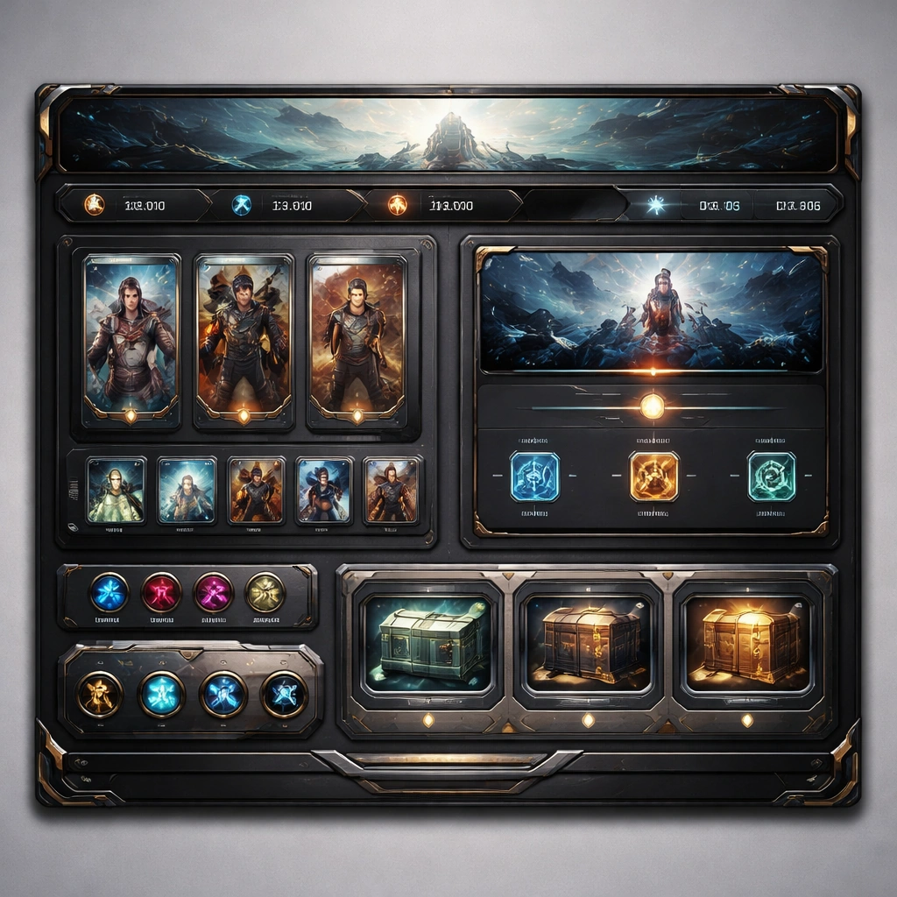

```text
Scene:
Create a square reference image for Deadpan Caption Image Format. Build a reference anchor establishing the core system with a premium, production-ready finish. Use a polished modular board or campaign surface with clean spacing, premium game-UI finish, and clear focal hierarchy. The composition should feel intentional, clean, and reusable for gallery, research, campaign, or internal handoff contexts. Lighting must support readability first, with the main forms clearly separated from the background and enough breathing room for the system to stay legible at both hero scale and thumbnail scale.

Subject:
Center a coherent original game-art system built for premium production and marketing surfaces. For this image, focus on reference anchor. Keep the same system logic stable across screenshots, cards, banners, and overview boards. This image is the canonical anchor that later series images must follow. The viewer should immediately understand what role this surface plays inside a cohesive game-production asset pack.

Important details:
Lock framing, icon grammar, palette blocking, and surface hierarchy so the kit feels production-ready and consistent. Preserve the core silhouette, framing language, and material logic from the reference image while each variation changes function. Keep materials believable, edge hierarchy disciplined, and the visual language consistent with Deadpan Format. Use abstract interface blocks or diagram accents when helpful, but avoid any readable language. The final result should feel like a deliberate production asset rather than a random illustration.

Use case:
Deadpan Caption Image Format series study 1/9, designed as reference anchor within a cohesive asset pack.

Constraints:
No readable text, no watermark, no logos, preserve exact 1:1 aspect ratio, no unrelated objects, no broken visual hierarchy, no malformed anatomy or broken perspective, no random decorative clutter.
```

[Pinned source](https://github.com/ChaosRealmsAI/gpt-image-2-gallery/blob/5296db8c996e38776c83a0bc8c64f848dcd512b3/works/topics/deadpan-caption-image-format/packages/series-core-system/images/01-reference-anchor/meta.json) · GPT Image2 · 1024×1024 · No source-declared image dependencies. · ProjectD:[published and publicly accepted](https://aitoolsradar.com/en/prompts/8ad7cb596eac00)

## Variant One · deadpan-caption-image-format/series-core-system/02-variant-one

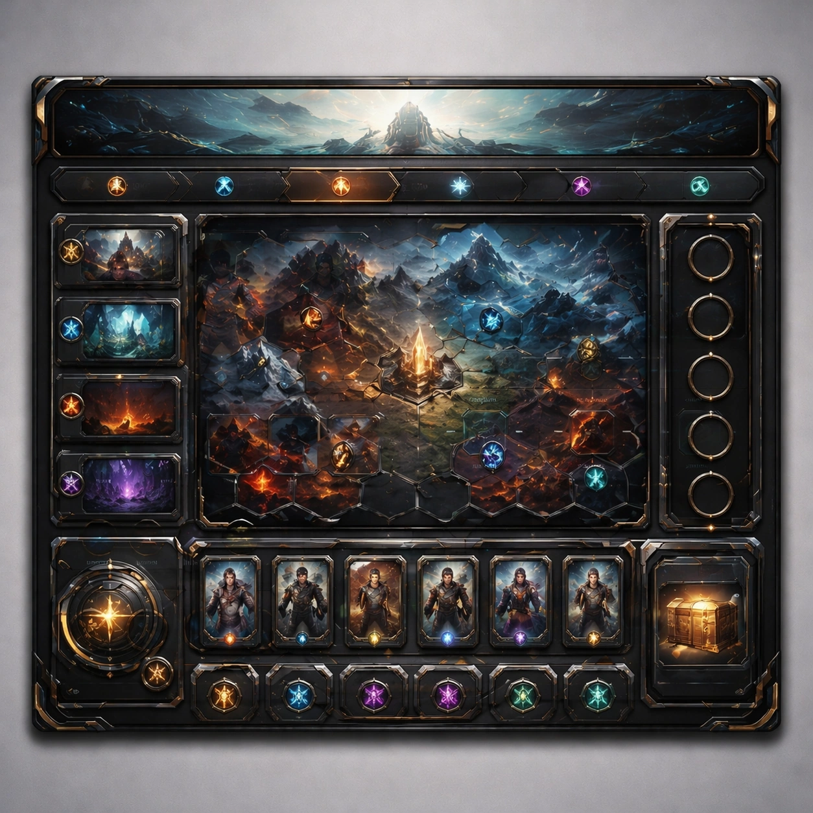

```text
Scene:
Create a square dependent image for Deadpan Caption Image Format. Build a first controlled variation in the same system with a premium, production-ready finish. Use a polished modular board or campaign surface with clean spacing, premium game-UI finish, and clear focal hierarchy. The composition should feel intentional, clean, and reusable for gallery, research, campaign, or internal handoff contexts. Lighting must support readability first, with the main forms clearly separated from the background and enough breathing room for the system to stay legible at both hero scale and thumbnail scale.

Subject:
Center a coherent original game-art system built for premium production and marketing surfaces. For this image, focus on the intended support surface. Keep the same system logic stable across screenshots, cards, banners, and overview boards. Preserve exact identity or system logic from the reference image while changing only the intended variation axis. The viewer should immediately understand what role this surface plays inside a cohesive game-production asset pack.

Important details:
Lock framing, icon grammar, palette blocking, and surface hierarchy so the kit feels production-ready and consistent. Preserve the core silhouette, framing language, and material logic from the reference image while each variation changes function. Keep materials believable, edge hierarchy disciplined, and the visual language consistent with Deadpan Format. Use abstract interface blocks or diagram accents when helpful, but avoid any readable language. The final result should feel like a deliberate production asset rather than a random illustration.

Use case:
Deadpan Caption Image Format series study 2/9, designed as variant one within a cohesive asset pack.

Constraints:
No readable text, no watermark, no logos, preserve exact 1:1 aspect ratio, no unrelated objects, no broken visual hierarchy, no malformed anatomy or broken perspective, no random decorative clutter.
```

[Pinned source](https://github.com/ChaosRealmsAI/gpt-image-2-gallery/blob/5296db8c996e38776c83a0bc8c64f848dcd512b3/works/topics/deadpan-caption-image-format/packages/series-core-system/images/02-variant-one/meta.json) · GPT Image2 · 1254×1254 · Reference images required. · ProjectD:[published and publicly accepted](https://aitoolsradar.com/en/prompts/538cb823ff4360)

## Variant Two · deadpan-caption-image-format/series-core-system/03-variant-two

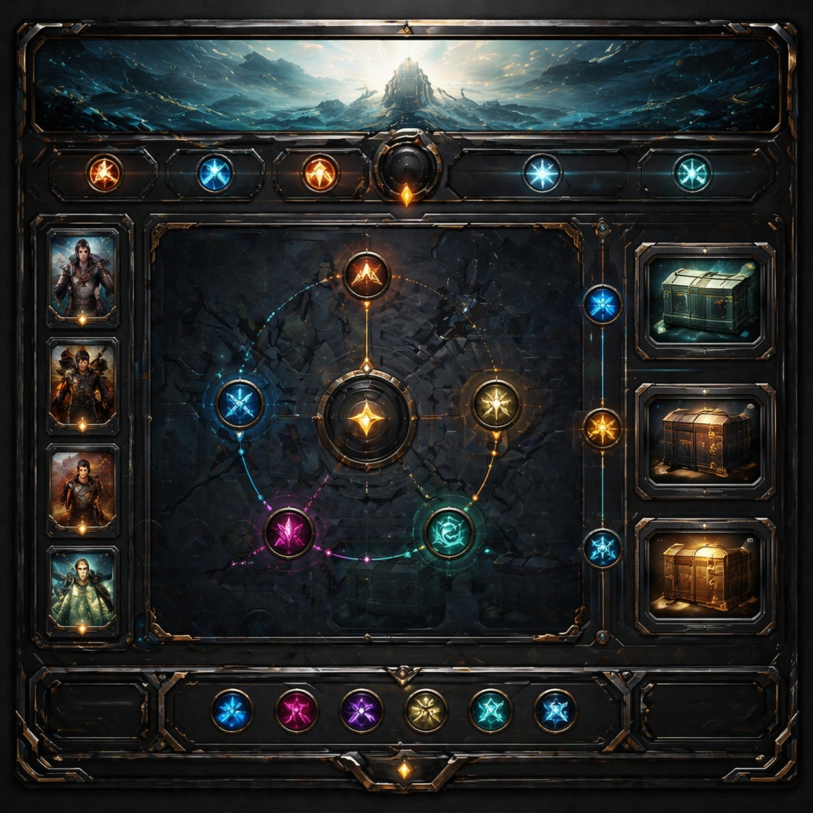

```text
Scene:
Create a square dependent image for Deadpan Caption Image Format. Build a second controlled variation in the same system with a premium, production-ready finish. Use a polished modular board or campaign surface with clean spacing, premium game-UI finish, and clear focal hierarchy. The composition should feel intentional, clean, and reusable for gallery, research, campaign, or internal handoff contexts. Lighting must support readability first, with the main forms clearly separated from the background and enough breathing room for the system to stay legible at both hero scale and thumbnail scale.

Subject:
Center a coherent original game-art system built for premium production and marketing surfaces. For this image, focus on the intended support surface. Keep the same system logic stable across screenshots, cards, banners, and overview boards. Preserve exact identity or system logic from the reference image while changing only the intended variation axis. The viewer should immediately understand what role this surface plays inside a cohesive game-production asset pack.

Important details:
Lock framing, icon grammar, palette blocking, and surface hierarchy so the kit feels production-ready and consistent. Preserve the core silhouette, framing language, and material logic from the reference image while each variation changes function. Keep materials believable, edge hierarchy disciplined, and the visual language consistent with Deadpan Format. Use abstract interface blocks or diagram accents when helpful, but avoid any readable language. The final result should feel like a deliberate production asset rather than a random illustration.

Use case:
Deadpan Caption Image Format series study 3/9, designed as variant two within a cohesive asset pack.

Constraints:
No readable text, no watermark, no logos, preserve exact 1:1 aspect ratio, no unrelated objects, no broken visual hierarchy, no malformed anatomy or broken perspective, no random decorative clutter.
```

[Pinned source](https://github.com/ChaosRealmsAI/gpt-image-2-gallery/blob/5296db8c996e38776c83a0bc8c64f848dcd512b3/works/topics/deadpan-caption-image-format/packages/series-core-system/images/03-variant-two/meta.json) · GPT Image2 · 1254×1254 · Reference images required. · ProjectD:[published and publicly accepted](https://aitoolsradar.com/en/prompts/048a4e643d6348)

## Variant Three · deadpan-caption-image-format/series-core-system/04-variant-three

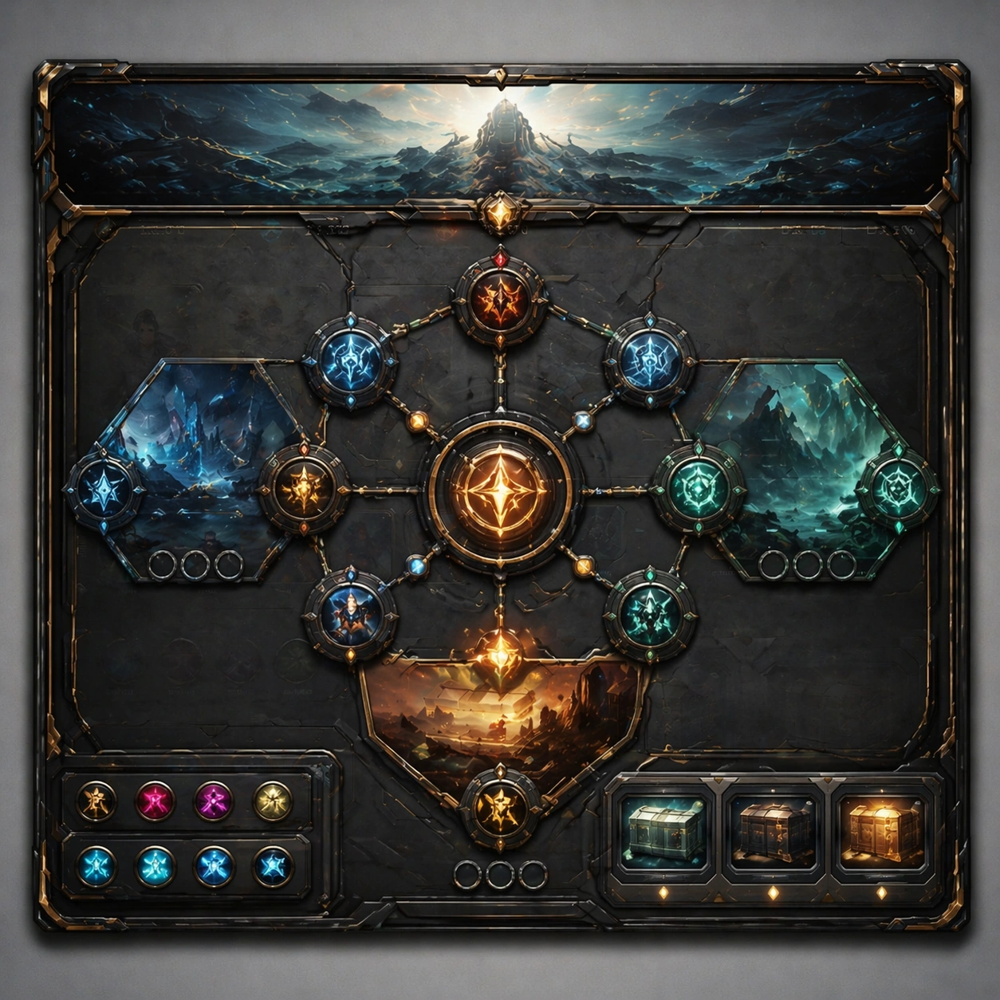

```text
Scene:
Create a square dependent image for Deadpan Caption Image Format. Build a third controlled variation in the same system with a premium, production-ready finish. Use a polished modular board or campaign surface with clean spacing, premium game-UI finish, and clear focal hierarchy. The composition should feel intentional, clean, and reusable for gallery, research, campaign, or internal handoff contexts. Lighting must support readability first, with the main forms clearly separated from the background and enough breathing room for the system to stay legible at both hero scale and thumbnail scale.

Subject:
Center a coherent original game-art system built for premium production and marketing surfaces. For this image, focus on the intended support surface. Keep the same system logic stable across screenshots, cards, banners, and overview boards. Preserve exact identity or system logic from the reference image while changing only the intended variation axis. The viewer should immediately understand what role this surface plays inside a cohesive game-production asset pack.

Important details:
Lock framing, icon grammar, palette blocking, and surface hierarchy so the kit feels production-ready and consistent. Preserve the core silhouette, framing language, and material logic from the reference image while each variation changes function. Keep materials believable, edge hierarchy disciplined, and the visual language consistent with Deadpan Format. Use abstract interface blocks or diagram accents when helpful, but avoid any readable language. The final result should feel like a deliberate production asset rather than a random illustration.

Use case:
Deadpan Caption Image Format series study 4/9, designed as variant three within a cohesive asset pack.

Constraints:
No readable text, no watermark, no logos, preserve exact 1:1 aspect ratio, no unrelated objects, no broken visual hierarchy, no malformed anatomy or broken perspective, no random decorative clutter.
```

[Pinned source](https://github.com/ChaosRealmsAI/gpt-image-2-gallery/blob/5296db8c996e38776c83a0bc8c64f848dcd512b3/works/topics/deadpan-caption-image-format/packages/series-core-system/images/04-variant-three/meta.json) · GPT Image2 · 1254×1254 · Reference images required. · ProjectD:[published and publicly accepted](https://aitoolsradar.com/en/prompts/2f611ea85d403e)

## Support One · deadpan-caption-image-format/single-support-studies/support-one

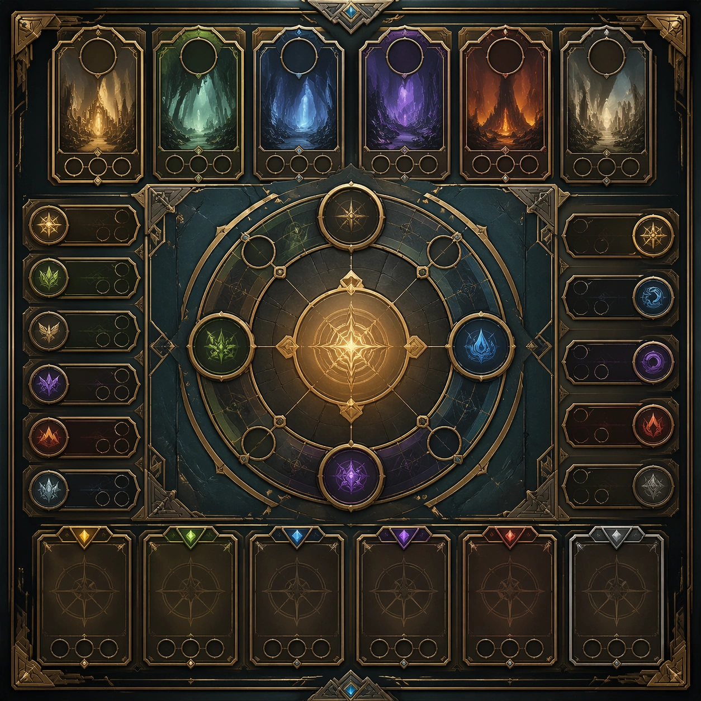

```text
Scene:
Create a square standalone support image for Deadpan Caption Image Format. Build a support-surface study with a clear focal hierarchy and a finished professional surface. Use a polished modular board or campaign surface with clean spacing, premium game-UI finish, and clear focal hierarchy. The frame should feel self-contained and polished, with enough structure to explain the system even without the reference series, yet still obviously belonging to the same theme and production world.

Subject:
Show a coherent original game-art system built for premium production and marketing surfaces in a way that emphasizes the intended support surface. Keep the same system logic stable across screenshots, cards, banners, and overview boards. Even though this image is independent, the viewer should still recognize the same universe, same commercial logic, and same production intent as the core package.

Important details:
Lock framing, icon grammar, palette blocking, and surface hierarchy so the kit feels production-ready and consistent. Preserve the broader theme language through color, framing, material choices, and modular composition. Use clean panel rhythm, premium asset presentation, and believable detail density. The image should work equally well as a gallery study, research reference, and mock production deliverable.

Use case:
Deadpan Caption Image Format single study 5/9, exploring support one as a support surface.

Constraints:
No readable text, no watermark, no logos, preserve exact 1:1 aspect ratio, no unrelated objects, no broken visual hierarchy, no visual noise that obscures the main surface, no accidental brand resemblance.
```

[Pinned source](https://github.com/ChaosRealmsAI/gpt-image-2-gallery/blob/5296db8c996e38776c83a0bc8c64f848dcd512b3/works/topics/deadpan-caption-image-format/packages/single-support-studies/images/support-one/meta.json) · GPT Image2 · 1254×1254 · No source-declared image dependencies. · ProjectD:[published and publicly accepted](https://aitoolsradar.com/en/prompts/068bad386e4093)

## Support Two · deadpan-caption-image-format/single-support-studies/support-two

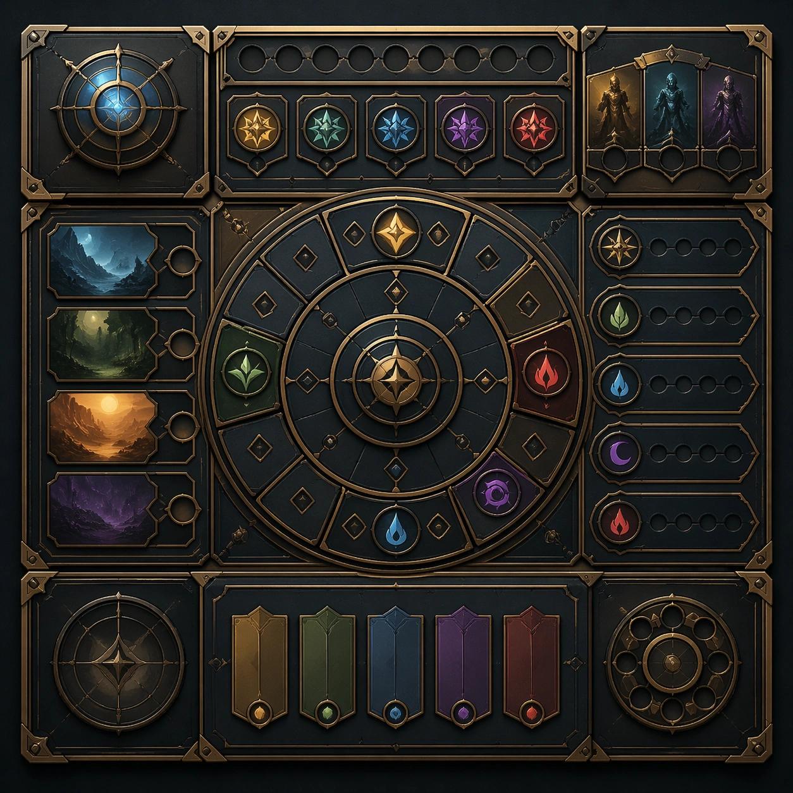

```text
Scene:
Create a square standalone support image for Deadpan Caption Image Format. Build a second support-surface study with a clear focal hierarchy and a finished professional surface. Use a polished modular board or campaign surface with clean spacing, premium game-UI finish, and clear focal hierarchy. The frame should feel self-contained and polished, with enough structure to explain the system even without the reference series, yet still obviously belonging to the same theme and production world.

Subject:
Show a coherent original game-art system built for premium production and marketing surfaces in a way that emphasizes the intended support surface. Keep the same system logic stable across screenshots, cards, banners, and overview boards. Even though this image is independent, the viewer should still recognize the same universe, same commercial logic, and same production intent as the core package.

Important details:
Lock framing, icon grammar, palette blocking, and surface hierarchy so the kit feels production-ready and consistent. Preserve the broader theme language through color, framing, material choices, and modular composition. Use clean panel rhythm, premium asset presentation, and believable detail density. The image should work equally well as a gallery study, research reference, and mock production deliverable.

Use case:
Deadpan Caption Image Format single study 6/9, exploring support two as a support surface.

Constraints:
No readable text, no watermark, no logos, preserve exact 1:1 aspect ratio, no unrelated objects, no broken visual hierarchy, no visual noise that obscures the main surface, no accidental brand resemblance.
```

[Pinned source](https://github.com/ChaosRealmsAI/gpt-image-2-gallery/blob/5296db8c996e38776c83a0bc8c64f848dcd512b3/works/topics/deadpan-caption-image-format/packages/single-support-studies/images/support-two/meta.json) · GPT Image2 · 1254×1254 · No source-declared image dependencies. · ProjectD:[published and publicly accepted](https://aitoolsradar.com/en/prompts/6eeea1dacb24fd)

## Support Three · deadpan-caption-image-format/single-support-studies/support-three

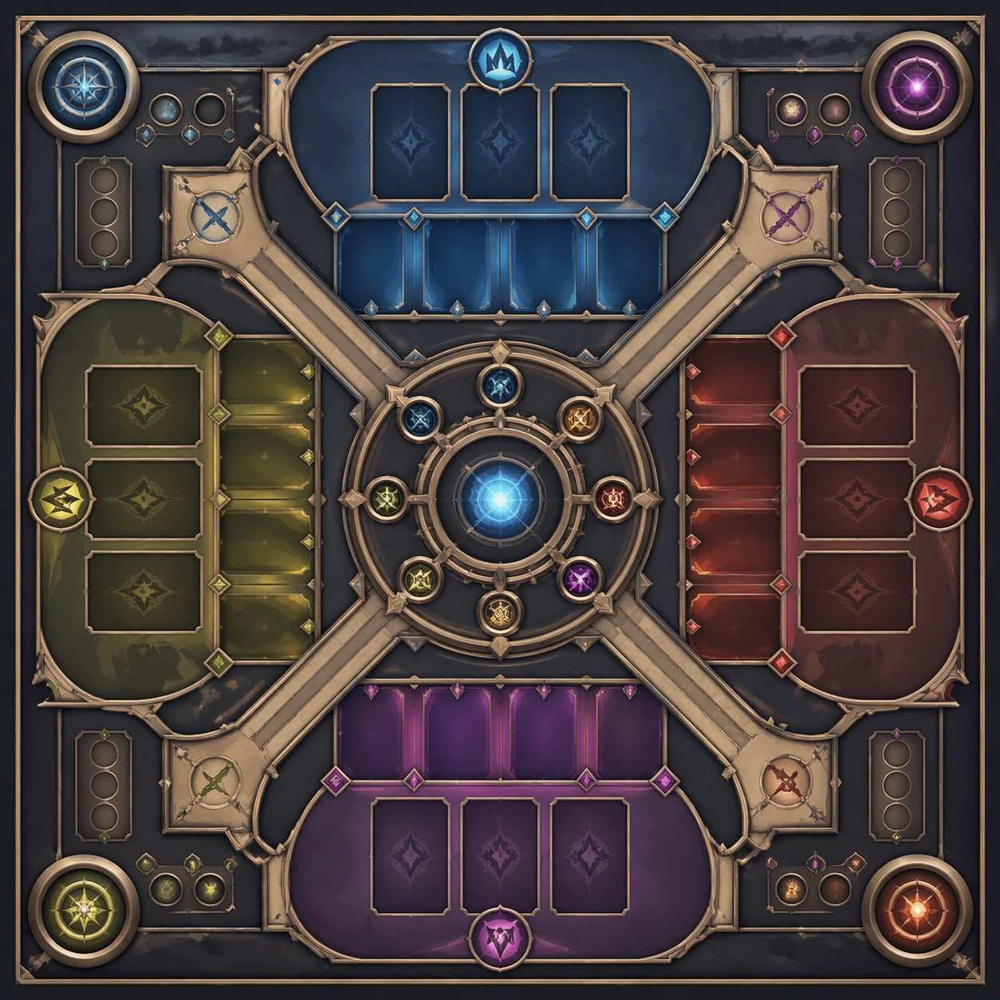

```text
Scene:
Create a square standalone support image for Deadpan Caption Image Format. Build a third support-surface study with a clear focal hierarchy and a finished professional surface. Use a polished modular board or campaign surface with clean spacing, premium game-UI finish, and clear focal hierarchy. The frame should feel self-contained and polished, with enough structure to explain the system even without the reference series, yet still obviously belonging to the same theme and production world.

Subject:
Show a coherent original game-art system built for premium production and marketing surfaces in a way that emphasizes the intended support surface. Keep the same system logic stable across screenshots, cards, banners, and overview boards. Even though this image is independent, the viewer should still recognize the same universe, same commercial logic, and same production intent as the core package.

Important details:
Lock framing, icon grammar, palette blocking, and surface hierarchy so the kit feels production-ready and consistent. Preserve the broader theme language through color, framing, material choices, and modular composition. Use clean panel rhythm, premium asset presentation, and believable detail density. The image should work equally well as a gallery study, research reference, and mock production deliverable.

Use case:
Deadpan Caption Image Format single study 7/9, exploring support three as a support surface.

Constraints:
No readable text, no watermark, no logos, preserve exact 1:1 aspect ratio, no unrelated objects, no broken visual hierarchy, no visual noise that obscures the main surface, no accidental brand resemblance.
```

[Pinned source](https://github.com/ChaosRealmsAI/gpt-image-2-gallery/blob/5296db8c996e38776c83a0bc8c64f848dcd512b3/works/topics/deadpan-caption-image-format/packages/single-support-studies/images/support-three/meta.json) · GPT Image2 · 1254×1254 · No source-declared image dependencies. · ProjectD:[published and publicly accepted](https://aitoolsradar.com/en/prompts/fcd6a81c90599a)

## Support Four · deadpan-caption-image-format/single-support-studies/support-four

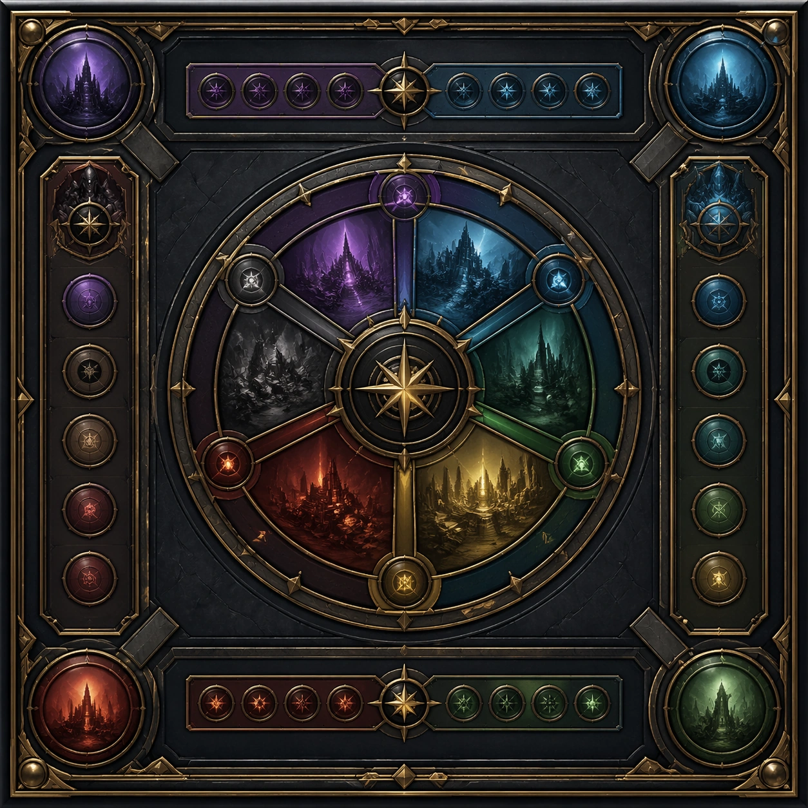

```text
Scene:
Create a square standalone support image for Deadpan Caption Image Format. Build a fourth support-surface study with a clear focal hierarchy and a finished professional surface. Use a polished modular board or campaign surface with clean spacing, premium game-UI finish, and clear focal hierarchy. The frame should feel self-contained and polished, with enough structure to explain the system even without the reference series, yet still obviously belonging to the same theme and production world.

Subject:
Show a coherent original game-art system built for premium production and marketing surfaces in a way that emphasizes the intended support surface. Keep the same system logic stable across screenshots, cards, banners, and overview boards. Even though this image is independent, the viewer should still recognize the same universe, same commercial logic, and same production intent as the core package.

Important details:
Lock framing, icon grammar, palette blocking, and surface hierarchy so the kit feels production-ready and consistent. Preserve the broader theme language through color, framing, material choices, and modular composition. Use clean panel rhythm, premium asset presentation, and believable detail density. The image should work equally well as a gallery study, research reference, and mock production deliverable.

Use case:
Deadpan Caption Image Format single study 8/9, exploring support four as a support surface.

Constraints:
No readable text, no watermark, no logos, preserve exact 1:1 aspect ratio, no unrelated objects, no broken visual hierarchy, no visual noise that obscures the main surface, no accidental brand resemblance.
```

[Pinned source](https://github.com/ChaosRealmsAI/gpt-image-2-gallery/blob/5296db8c996e38776c83a0bc8c64f848dcd512b3/works/topics/deadpan-caption-image-format/packages/single-support-studies/images/support-four/meta.json) · GPT Image2 · 1254×1254 · No source-declared image dependencies. · ProjectD:[published and publicly accepted](https://aitoolsradar.com/en/prompts/70256e17fe5c78)

## Support Five · deadpan-caption-image-format/single-support-studies/support-five

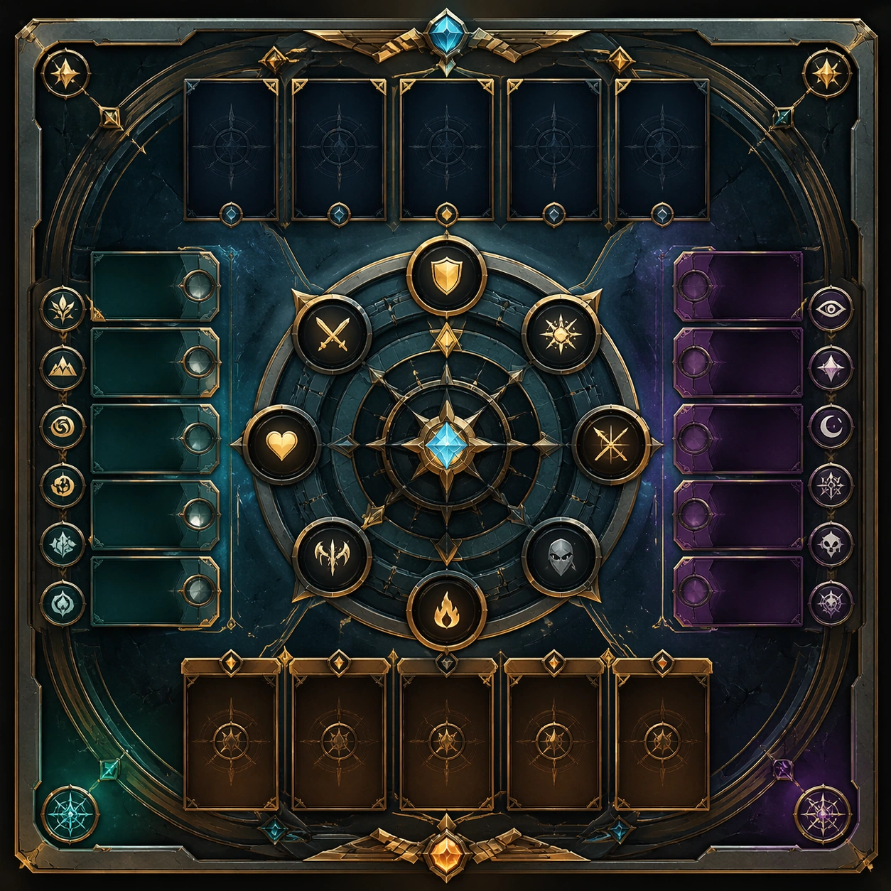

```text
Scene:
Create a square standalone support image for Deadpan Caption Image Format. Build a fifth support-surface study with a clear focal hierarchy and a finished professional surface. Use a polished modular board or campaign surface with clean spacing, premium game-UI finish, and clear focal hierarchy. The frame should feel self-contained and polished, with enough structure to explain the system even without the reference series, yet still obviously belonging to the same theme and production world.

Subject:
Show a coherent original game-art system built for premium production and marketing surfaces in a way that emphasizes the intended support surface. Keep the same system logic stable across screenshots, cards, banners, and overview boards. Even though this image is independent, the viewer should still recognize the same universe, same commercial logic, and same production intent as the core package.

Important details:
Lock framing, icon grammar, palette blocking, and surface hierarchy so the kit feels production-ready and consistent. Preserve the broader theme language through color, framing, material choices, and modular composition. Use clean panel rhythm, premium asset presentation, and believable detail density. The image should work equally well as a gallery study, research reference, and mock production deliverable.

Use case:
Deadpan Caption Image Format single study 9/9, exploring support five as a support surface.

Constraints:
No readable text, no watermark, no logos, preserve exact 1:1 aspect ratio, no unrelated objects, no broken visual hierarchy, no visual noise that obscures the main surface, no accidental brand resemblance.
```

[Pinned source](https://github.com/ChaosRealmsAI/gpt-image-2-gallery/blob/5296db8c996e38776c83a0bc8c64f848dcd512b3/works/topics/deadpan-caption-image-format/packages/single-support-studies/images/support-five/meta.json) · GPT Image2 · 1254×1254 · No source-declared image dependencies. · ProjectD:[published and publicly accepted](https://aitoolsradar.com/en/prompts/291308468e9375)

## App Tile Anchor · delivery-first-food-commerce-tiles/series-core-system/01-app-tile-anchor

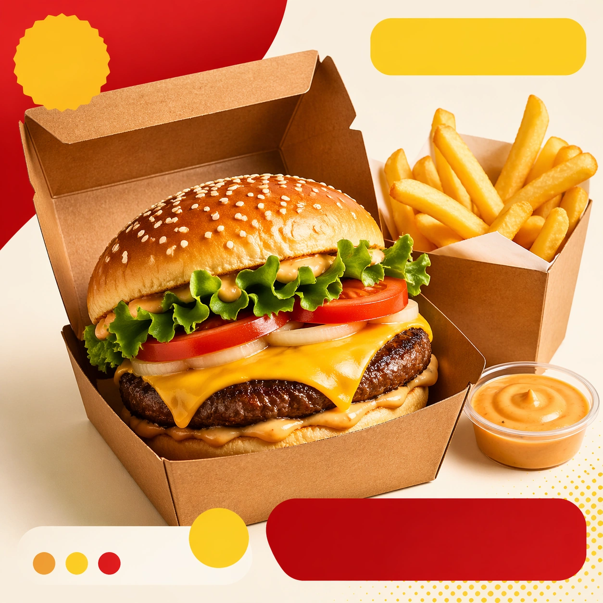

```text
Scene:
Compose a square food-commerce image optimized for instant readability in app tiles, promo cards, or delivery grids. The image should emphasize appetizing clarity, strong hierarchy, and modular layout zones while staying photorealistic and commercially grounded. Packaging, dish crop, and badge-like design shapes can appear, but all text must remain unreadable. Use a bright, clean square card composition with one hero meal in delivery packaging, a secondary side item, and structured placeholder zones around the food.

Subject:
The food should look craveable at thumbnail scale, with clear portion logic, supporting side items when relevant, and delivery-aware presentation that prioritizes speed, legibility, and conversion. Show a craveable meal combo arranged so the hero item dominates, the side clarifies the offer, and the overall tile reads instantly at small size.

Important details:
This theme is about commerce reasoning. Preserve sharp hero food silhouettes, obvious combo structure, and clean tile-safe framing so the assets can survive small screens. Abstract text areas, CTA-like shapes, and offer badges are allowed only as non-legible design modules. Keep everything polished, modern, and immediately useful for ordering surfaces. This image establishes the reference system for the series, including camera height, tabletop discipline, prop family, and color control that later images must inherit. This image must define the tile system for the series: generous margin, bold silhouette separation, clean packaging edges, and unreadable but designed commerce shapes.

Use case:
Delivery Tiles series study 1/9, built for Prompt Atlas coverage of a food and beverage commercial visual system.

Constraints:
No readable text, no watermark, no logos, preserve exact 1:1 aspect ratio, no readable text, no logos, no app UI chrome, no fake prices, no delivery-bag chaos, no greasy blur, no clutter that hurts thumbnail legibility, no readable labels, no checkout UI, no courier person.
```

[Pinned source](https://github.com/ChaosRealmsAI/gpt-image-2-gallery/blob/5296db8c996e38776c83a0bc8c64f848dcd512b3/works/topics/delivery-first-food-commerce-tiles/packages/series-core-system/images/01-app-tile-anchor/meta.json) · GPT Image2 · 1254×1254 · No source-declared image dependencies. · ProjectD:[published and publicly accepted](https://aitoolsradar.com/en/prompts/e6cc611f5f40f7)

## Combo Upsize Tile · delivery-first-food-commerce-tiles/series-core-system/02-combo-upsize-tile

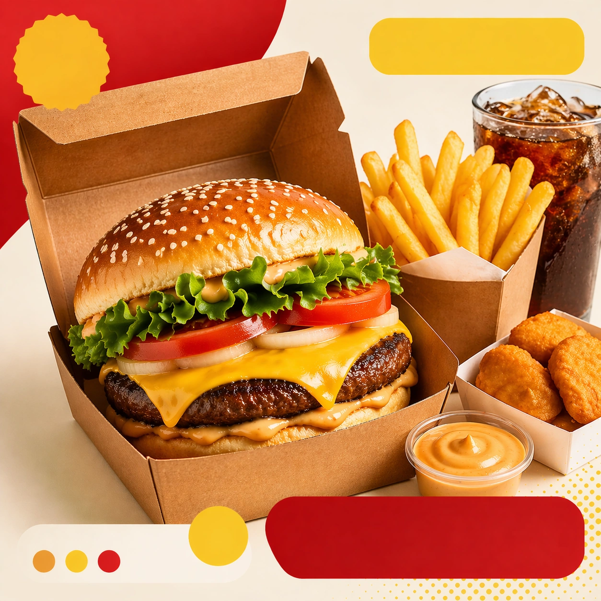

```text
Scene:
Compose a square food-commerce image optimized for instant readability in app tiles, promo cards, or delivery grids. The image should emphasize appetizing clarity, strong hierarchy, and modular layout zones while staying photorealistic and commercially grounded. Packaging, dish crop, and badge-like design shapes can appear, but all text must remain unreadable. Preserve the same card geometry and high-key commerce lighting, but add one extra side or beverage cue to imply a bigger offer.

Subject:
The food should look craveable at thumbnail scale, with clear portion logic, supporting side items when relevant, and delivery-aware presentation that prioritizes speed, legibility, and conversion. Feature a main dish with one clearly visible add-on and organized packaging so the tile communicates a more substantial combo without crowding the frame.

Important details:
This theme is about commerce reasoning. Preserve sharp hero food silhouettes, obvious combo structure, and clean tile-safe framing so the assets can survive small screens. Abstract text areas, CTA-like shapes, and offer badges are allowed only as non-legible design modules. Keep everything polished, modern, and immediately useful for ordering surfaces. Preserve the exact camera height, lens feel, prop family, tabletop scale, palette discipline, and brand logic established by 01-app-tile-anchor. The anchor hierarchy must remain intact: hero food first, support item second, abstract badges third. Keep everything crisp enough for mobile browsing.

Use case:
Delivery Tiles series study 2/9, built for Prompt Atlas coverage of a food and beverage commercial visual system.

Constraints:
No readable text, no watermark, no logos, preserve exact 1:1 aspect ratio, no readable text, no logos, no app UI chrome, no fake prices, no delivery-bag chaos, no greasy blur, no clutter that hurts thumbnail legibility, no readable promo text, no huge feast pile, no delivery driver props.
```

[Pinned source](https://github.com/ChaosRealmsAI/gpt-image-2-gallery/blob/5296db8c996e38776c83a0bc8c64f848dcd512b3/works/topics/delivery-first-food-commerce-tiles/packages/series-core-system/images/02-combo-upsize-tile/meta.json) · GPT Image2 · 1254×1254 · Reference images required. · ProjectD:[published and publicly accepted](https://aitoolsradar.com/en/prompts/0eb435e70451b8)

## Family Bundle Tile · delivery-first-food-commerce-tiles/series-core-system/03-family-bundle-tile

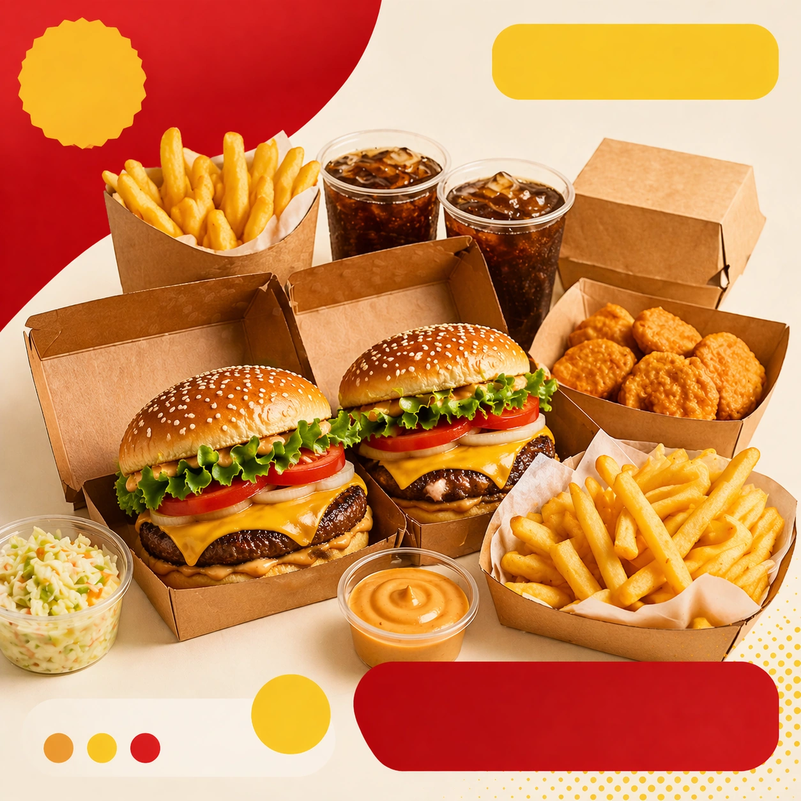

```text
Scene:
Compose a square food-commerce image optimized for instant readability in app tiles, promo cards, or delivery grids. The image should emphasize appetizing clarity, strong hierarchy, and modular layout zones while staying photorealistic and commercially grounded. Packaging, dish crop, and badge-like design shapes can appear, but all text must remain unreadable. Maintain the same commerce card framing and color logic, but widen the perceived meal scope through multiple containers and one shared centerpiece.

Subject:
The food should look craveable at thumbnail scale, with clear portion logic, supporting side items when relevant, and delivery-aware presentation that prioritizes speed, legibility, and conversion. Show a family-style bundle with clear portion grouping, visible packaging lids or open containers, and an easy-to-understand food hierarchy.

Important details:
This theme is about commerce reasoning. Preserve sharp hero food silhouettes, obvious combo structure, and clean tile-safe framing so the assets can survive small screens. Abstract text areas, CTA-like shapes, and offer badges are allowed only as non-legible design modules. Keep everything polished, modern, and immediately useful for ordering surfaces. Preserve the exact camera height, lens feel, prop family, tabletop scale, palette discipline, and brand logic established by 01-app-tile-anchor. The image should still read quickly at thumbnail scale despite the bundle size. Separate containers cleanly, avoid clutter, and keep the food vivid and legible.

Use case:
Delivery Tiles series study 3/9, built for Prompt Atlas coverage of a food and beverage commercial visual system.

Constraints:
No readable text, no watermark, no logos, preserve exact 1:1 aspect ratio, no readable text, no logos, no app UI chrome, no fake prices, no delivery-bag chaos, no greasy blur, no clutter that hurts thumbnail legibility, no banquet chaos, no readable family-meal text, no disposable utensil scatter.
```

[Pinned source](https://github.com/ChaosRealmsAI/gpt-image-2-gallery/blob/5296db8c996e38776c83a0bc8c64f848dcd512b3/works/topics/delivery-first-food-commerce-tiles/packages/series-core-system/images/03-family-bundle-tile/meta.json) · GPT Image2 · 1254×1254 · Reference images required. · ProjectD:[published and publicly accepted](https://aitoolsradar.com/en/prompts/7bf67d1d2cb1a7)

## Late Night Snack Tile · delivery-first-food-commerce-tiles/series-core-system/04-late-night-snack-tile

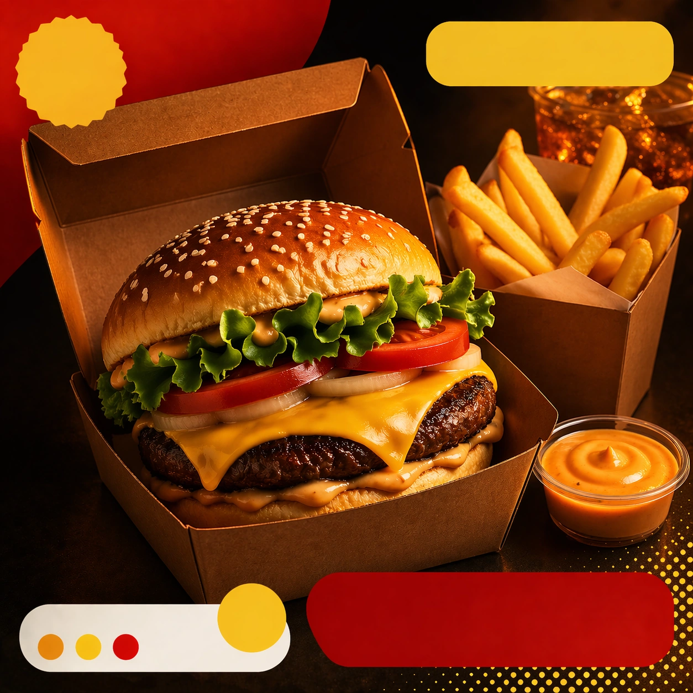

```text
Scene:
Compose a square food-commerce image optimized for instant readability in app tiles, promo cards, or delivery grids. The image should emphasize appetizing clarity, strong hierarchy, and modular layout zones while staying photorealistic and commercially grounded. Packaging, dish crop, and badge-like design shapes can appear, but all text must remain unreadable. Retain the exact card structure but shift the mood to low-key evening light, richer shadows, and warmer highlights that suggest night ordering.

Subject:
The food should look craveable at thumbnail scale, with clear portion logic, supporting side items when relevant, and delivery-aware presentation that prioritizes speed, legibility, and conversion. Center a compact indulgent snack or noodle meal in packaging, with one glowing accent like a drink or dipping sauce to support the nighttime story.

Important details:
This theme is about commerce reasoning. Preserve sharp hero food silhouettes, obvious combo structure, and clean tile-safe framing so the assets can survive small screens. Abstract text areas, CTA-like shapes, and offer badges are allowed only as non-legible design modules. Keep everything polished, modern, and immediately useful for ordering surfaces. Preserve the exact camera height, lens feel, prop family, tabletop scale, palette discipline, and brand logic established by 01-app-tile-anchor. The series anchor should remain visible through layout, placeholder shapes, crop discipline, and appetite-first styling even as the mood turns more nocturnal.

Use case:
Delivery Tiles series study 4/9, built for Prompt Atlas coverage of a food and beverage commercial visual system.

Constraints:
No readable text, no watermark, no logos, preserve exact 1:1 aspect ratio, no readable text, no logos, no app UI chrome, no fake prices, no delivery-bag chaos, no greasy blur, no clutter that hurts thumbnail legibility, no party scene, no readable midnight offer text, no greasy mess.
```

[Pinned source](https://github.com/ChaosRealmsAI/gpt-image-2-gallery/blob/5296db8c996e38776c83a0bc8c64f848dcd512b3/works/topics/delivery-first-food-commerce-tiles/packages/series-core-system/images/04-late-night-snack-tile/meta.json) · GPT Image2 · 1254×1254 · Reference images required. · ProjectD:[published and publicly accepted](https://aitoolsradar.com/en/prompts/683e33b422efce)

## Soup and Side Tile · delivery-first-food-commerce-tiles/single-support-studies/soup-and-side-tile

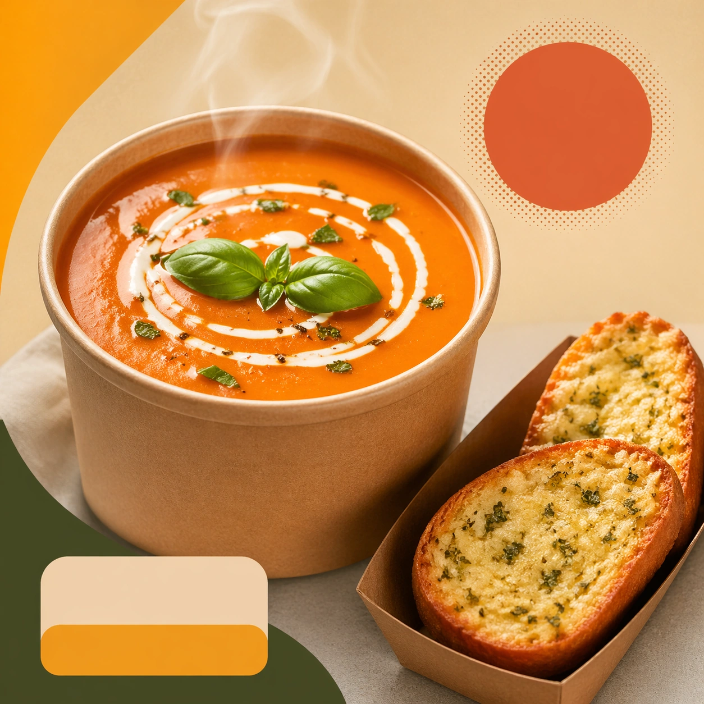

```text
Scene:
Compose a square food-commerce image optimized for instant readability in app tiles, promo cards, or delivery grids. The image should emphasize appetizing clarity, strong hierarchy, and modular layout zones while staying photorealistic and commercially grounded. Packaging, dish crop, and badge-like design shapes can appear, but all text must remain unreadable. Compose a square commerce card around one soup bowl or container, one side item, and a clean support surface with soft light.

Subject:
The food should look craveable at thumbnail scale, with clear portion logic, supporting side items when relevant, and delivery-aware presentation that prioritizes speed, legibility, and conversion. Keep the liquid surface, toppings, and side-item relationship clear so the image communicates warmth, comfort, and completeness.

Important details:
This theme is about commerce reasoning. Preserve sharp hero food silhouettes, obvious combo structure, and clean tile-safe framing so the assets can survive small screens. Abstract text areas, CTA-like shapes, and offer badges are allowed only as non-legible design modules. Keep everything polished, modern, and immediately useful for ordering surfaces. This image should feel fully self-contained while still belonging to the same broader topic and commercial world. Steam, container rims, and side textures must feel real, while the layout remains modular and card-safe for delivery platforms.

Use case:
Delivery Tiles single study 6/9, built for Prompt Atlas coverage of a food and beverage commercial visual system.

Constraints:
No readable text, no watermark, no logos, preserve exact 1:1 aspect ratio, no readable text, no logos, no app UI chrome, no fake prices, no delivery-bag chaos, no greasy blur, no clutter that hurts thumbnail legibility, no spill chaos, no spoonful action, no readable labels.
```

[Pinned source](https://github.com/ChaosRealmsAI/gpt-image-2-gallery/blob/5296db8c996e38776c83a0bc8c64f848dcd512b3/works/topics/delivery-first-food-commerce-tiles/packages/single-support-studies/images/soup-and-side-tile/meta.json) · GPT Image2 · 1254×1254 · No source-declared image dependencies. · ProjectD:[published and publicly accepted](https://aitoolsradar.com/en/prompts/3eb22d3e6541cd)

## Dessert Add-On Tile · delivery-first-food-commerce-tiles/single-support-studies/dessert-add-on-tile

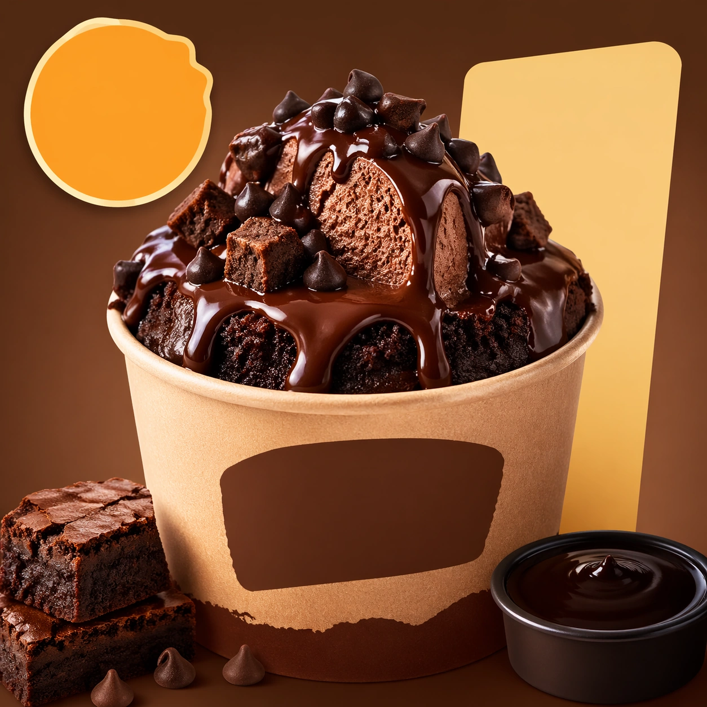

```text
Scene:
Compose a square food-commerce image optimized for instant readability in app tiles, promo cards, or delivery grids. The image should emphasize appetizing clarity, strong hierarchy, and modular layout zones while staying photorealistic and commercially grounded. Packaging, dish crop, and badge-like design shapes can appear, but all text must remain unreadable. Use a clean square tile composition with one premium dessert in a takeaway cup or box, isolated enough to read instantly.

Subject:
The food should look craveable at thumbnail scale, with clear portion logic, supporting side items when relevant, and delivery-aware presentation that prioritizes speed, legibility, and conversion. Let the dessert, packaging, and topping hierarchy communicate indulgence without overloading the card.

Important details:
This theme is about commerce reasoning. Preserve sharp hero food silhouettes, obvious combo structure, and clean tile-safe framing so the assets can survive small screens. Abstract text areas, CTA-like shapes, and offer badges are allowed only as non-legible design modules. Keep everything polished, modern, and immediately useful for ordering surfaces. This image should feel fully self-contained while still belonging to the same broader topic and commercial world. Small-screen clarity is essential: topping contrast, container edge, and abstract badge-like shapes should all reinforce a quick add-on decision.

Use case:
Delivery Tiles single study 7/9, built for Prompt Atlas coverage of a food and beverage commercial visual system.

Constraints:
No readable text, no watermark, no logos, preserve exact 1:1 aspect ratio, no readable text, no logos, no app UI chrome, no fake prices, no delivery-bag chaos, no greasy blur, no clutter that hurts thumbnail legibility, no giant sundae tower, no confetti, no readable add-on text.
```

[Pinned source](https://github.com/ChaosRealmsAI/gpt-image-2-gallery/blob/5296db8c996e38776c83a0bc8c64f848dcd512b3/works/topics/delivery-first-food-commerce-tiles/packages/single-support-studies/images/dessert-add-on-tile/meta.json) · GPT Image2 · 1254×1254 · No source-declared image dependencies. · ProjectD:[published and publicly accepted](https://aitoolsradar.com/en/prompts/c6633ac6204517)

## Beverage Upsell Tile · delivery-first-food-commerce-tiles/single-support-studies/beverage-upsell-tile

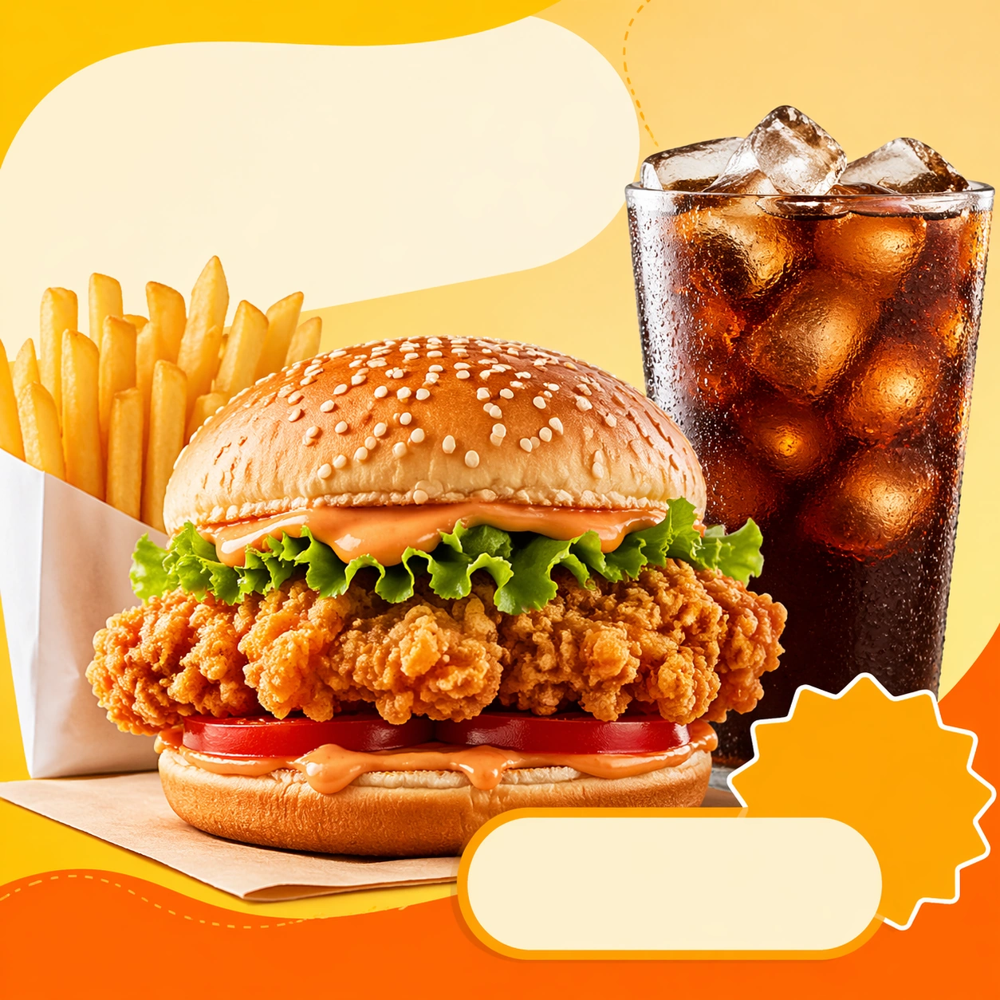

```text
Scene:
Compose a square food-commerce image optimized for instant readability in app tiles, promo cards, or delivery grids. The image should emphasize appetizing clarity, strong hierarchy, and modular layout zones while staying photorealistic and commercially grounded. Packaging, dish crop, and badge-like design shapes can appear, but all text must remain unreadable. Frame one chilled or hot drink beside a food item in a bright modular card layout with room for abstract promotion shapes.

Subject:
The food should look craveable at thumbnail scale, with clear portion logic, supporting side items when relevant, and delivery-aware presentation that prioritizes speed, legibility, and conversion. The drink must read immediately through glass or cup silhouette, liquid color, and condensation or steam.

Important details:
This theme is about commerce reasoning. Preserve sharp hero food silhouettes, obvious combo structure, and clean tile-safe framing so the assets can survive small screens. Abstract text areas, CTA-like shapes, and offer badges are allowed only as non-legible design modules. Keep everything polished, modern, and immediately useful for ordering surfaces. This image should feel fully self-contained while still belonging to the same broader topic and commercial world. Keep the packaging premium and clean, with enough context to show pairing value while preserving a simple tile-safe structure.

Use case:
Delivery Tiles single study 8/9, built for Prompt Atlas coverage of a food and beverage commercial visual system.

Constraints:
No readable text, no watermark, no logos, preserve exact 1:1 aspect ratio, no readable text, no logos, no app UI chrome, no fake prices, no delivery-bag chaos, no greasy blur, no clutter that hurts thumbnail legibility, no readable cup copy, no barista portrait, no app screenshot overlay.
```

[Pinned source](https://github.com/ChaosRealmsAI/gpt-image-2-gallery/blob/5296db8c996e38776c83a0bc8c64f848dcd512b3/works/topics/delivery-first-food-commerce-tiles/packages/single-support-studies/images/beverage-upsell-tile/meta.json) · GPT Image2 · 1254×1254 · No source-declared image dependencies. · ProjectD:[published and publicly accepted](https://aitoolsradar.com/en/prompts/77a1d365af0abc)

## Multi Tile Comparison Board · delivery-first-food-commerce-tiles/single-support-studies/multi-tile-comparison-board

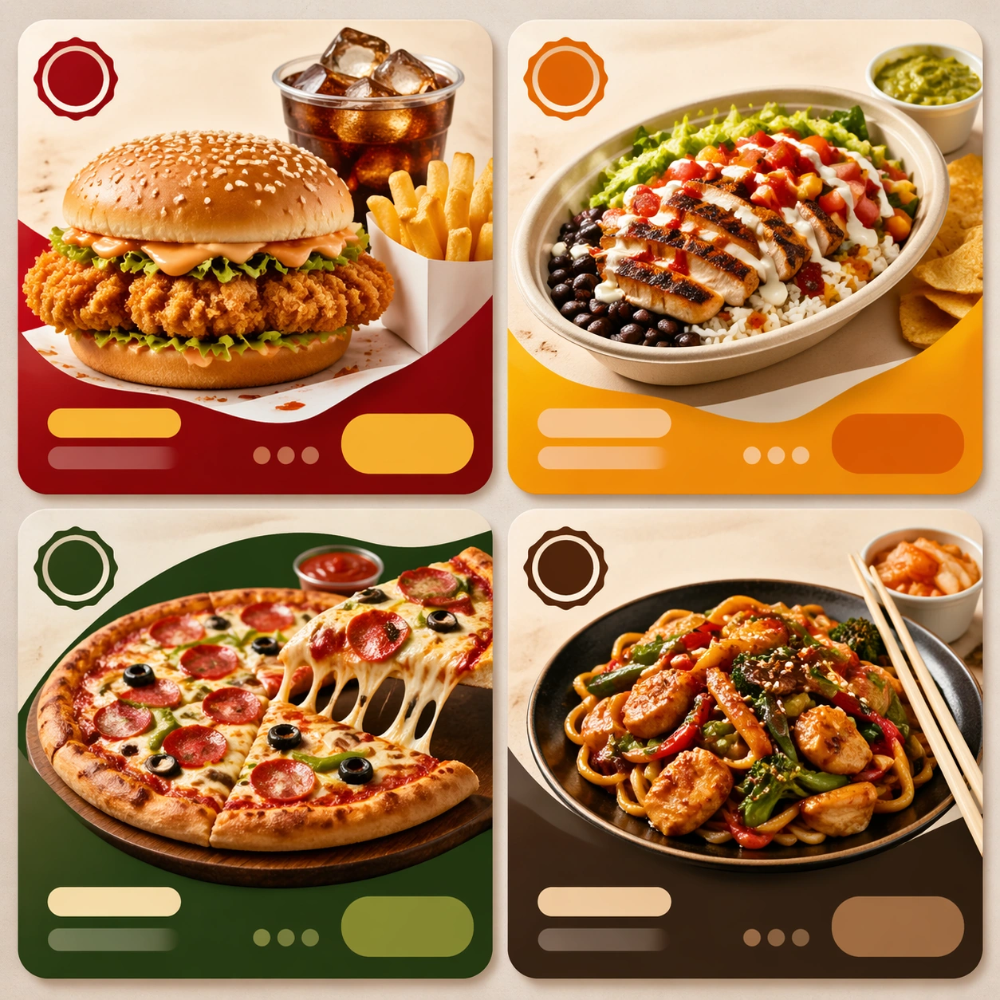

```text
Scene:
Compose a square food-commerce image optimized for instant readability in app tiles, promo cards, or delivery grids. The image should emphasize appetizing clarity, strong hierarchy, and modular layout zones while staying photorealistic and commercially grounded. Packaging, dish crop, and badge-like design shapes can appear, but all text must remain unreadable. Compose a square board containing three or four mini tile modules arranged in a structured grid on a neutral surface.

Subject:
The food should look craveable at thumbnail scale, with clear portion logic, supporting side items when relevant, and delivery-aware presentation that prioritizes speed, legibility, and conversion. Each module should show a distinct meal category while preserving one unified delivery visual language across the board.

Important details:
This theme is about commerce reasoning. Preserve sharp hero food silhouettes, obvious combo structure, and clean tile-safe framing so the assets can survive small screens. Abstract text areas, CTA-like shapes, and offer badges are allowed only as non-legible design modules. Keep everything polished, modern, and immediately useful for ordering surfaces. This image should feel fully self-contained while still belonging to the same broader topic and commercial world. The board tests hierarchy and system thinking: repeated card shapes, abstract text zones, and appetizing category differentiation must all remain clear.

Use case:
Delivery Tiles single study 9/9, built for Prompt Atlas coverage of a food and beverage commercial visual system.

Constraints:
No readable text, no watermark, no logos, preserve exact 1:1 aspect ratio, no readable text, no logos, no app UI chrome, no fake prices, no delivery-bag chaos, no greasy blur, no clutter that hurts thumbnail legibility, no readable menus, no phone frame, no dashboard analytics overlay.
```

[Pinned source](https://github.com/ChaosRealmsAI/gpt-image-2-gallery/blob/5296db8c996e38776c83a0bc8c64f848dcd512b3/works/topics/delivery-first-food-commerce-tiles/packages/single-support-studies/images/multi-tile-comparison-board/meta.json) · GPT Image2 · 1254×1254 · No source-declared image dependencies. · ProjectD:[published and publicly accepted](https://aitoolsradar.com/en/prompts/dc995c1a12a14d)

## Reference Anchor · desert-dusk-monolith/series-core-system/01-reference-anchor


```text
Scene:
Create a square cinematic still for Desert Dusk Monolith. Use production-grade photoreal lighting, disciplined lens behavior, and a composition that feels like a finished key frame from an original film rather than a casual snapshot. A severe desert dune field stretches to the horizon at sunset, where the last light turns the crests copper and rose, the far sky cools toward violet, and one dark monolith stands with absolute stillness above the wind-shaped sand. Keep the camera in a disciplined anchor position so the full lighting event and the main spatial structure are immediately legible from edge to edge.

Subject:
Build a coherent original scene whose emotional center comes from atmosphere, light physics, and spatial clarity. Avoid relying on celebrity likeness, franchise iconography, or stylized illustration shortcuts. The monolith, long shadow, dune ridges, and the empty horizon line should dominate, with no unnecessary props, because the image depends on scale tension between one silent object and an immense landscape. This frame should lock the canonical arrangement, scale relationship, and emotional tone that the later dependent images inherit.

Important details:
Preserve a believable physical world with strong depth layering, careful color separation, and premium image discipline. Keep the geometry minimal but not sterile, using precise shadow direction, tactile sand micro-relief, clean sky gradient, and disciplined negative space so the frame feels monumental rather than decorative. Use this image to establish the authoritative direction of light, atmospheric density, and structural silhouette for the package.

Use case:
Desert Monolith series study 1/9.

Constraints:
No readable text, no watermark, no logos, preserve exact 1:1 aspect ratio, no ruins, no spaceships, no readable markings on the monolith, no crowds, no surreal floating objects.
```

[Pinned source](https://github.com/ChaosRealmsAI/gpt-image-2-gallery/blob/5296db8c996e38776c83a0bc8c64f848dcd512b3/works/topics/desert-dusk-monolith/packages/series-core-system/images/01-reference-anchor/meta.json) · GPT Image2 · 1254×1254 · No source-declared image dependencies. · ProjectD:[published and publicly accepted](https://aitoolsradar.com/en/prompts/82399cf9fe6f02)

## Closer Frame · desert-dusk-monolith/series-core-system/02-closer-frame

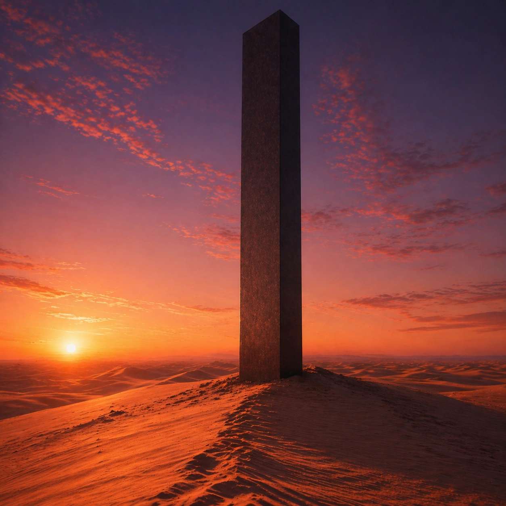

```text
Scene:
Create a square cinematic still for Desert Dusk Monolith. Use production-grade photoreal lighting, disciplined lens behavior, and a composition that feels like a finished key frame from an original film rather than a casual snapshot. A severe desert dune field stretches to the horizon at sunset, where the last light turns the crests copper and rose, the far sky cools toward violet, and one dark monolith stands with absolute stillness above the wind-shaped sand. Move the camera closer or lower so the viewer feels more embedded inside the atmosphere while the same light direction and environment remain intact.

Subject:
Build a coherent original scene whose emotional center comes from atmosphere, light physics, and spatial clarity. Avoid relying on celebrity likeness, franchise iconography, or stylized illustration shortcuts. The monolith, long shadow, dune ridges, and the empty horizon line should dominate, with no unnecessary props, because the image depends on scale tension between one silent object and an immense landscape. Preserve the same world logic from the reference and let one human-scale or material-scale element become more prominent without stealing focus from the atmosphere.

Important details:
Preserve a believable physical world with strong depth layering, careful color separation, and premium image discipline. Keep the geometry minimal but not sterile, using precise shadow direction, tactile sand micro-relief, clean sky gradient, and disciplined negative space so the frame feels monumental rather than decorative. Keep the palette family, structural read, and light behavior from image 01 while increasing immediacy and tactile presence.

Use case:
Desert Monolith series study 2/9.

Constraints:
No readable text, no watermark, no logos, preserve exact 1:1 aspect ratio, no ruins, no spaceships, no readable markings on the monolith, no crowds, no surreal floating objects.
```

[Pinned source](https://github.com/ChaosRealmsAI/gpt-image-2-gallery/blob/5296db8c996e38776c83a0bc8c64f848dcd512b3/works/topics/desert-dusk-monolith/packages/series-core-system/images/02-closer-frame/meta.json) · GPT Image2 · 1254×1254 · Reference images required. · ProjectD:[published and publicly accepted](https://aitoolsradar.com/en/prompts/f11b064bdb3b1d)

## Spatial Counterpoint · desert-dusk-monolith/series-core-system/03-spatial-counterpoint


```text
Scene:
Create a square cinematic still for Desert Dusk Monolith. Use production-grade photoreal lighting, disciplined lens behavior, and a composition that feels like a finished key frame from an original film rather than a casual snapshot. A severe desert dune field stretches to the horizon at sunset, where the last light turns the crests copper and rose, the far sky cools toward violet, and one dark monolith stands with absolute stillness above the wind-shaped sand. Shift to an oblique or lateral point of view that reveals different depth layers while staying inside the same place and the same atmospheric event.

Subject:
Build a coherent original scene whose emotional center comes from atmosphere, light physics, and spatial clarity. Avoid relying on celebrity likeness, franchise iconography, or stylized illustration shortcuts. The monolith, long shadow, dune ridges, and the empty horizon line should dominate, with no unnecessary props, because the image depends on scale tension between one silent object and an immense landscape. Hold the reference structure, but use the new angle to show secondary planes, foreground interruption, or a changed distance relationship.

Important details:
Preserve a believable physical world with strong depth layering, careful color separation, and premium image discipline. Keep the geometry minimal but not sterile, using precise shadow direction, tactile sand micro-relief, clean sky gradient, and disciplined negative space so the frame feels monumental rather than decorative. The success condition is continuity with the reference plus a richer sense of depth, not a new location or a new lighting system.

Use case:
Desert Monolith series study 3/9.

Constraints:
No readable text, no watermark, no logos, preserve exact 1:1 aspect ratio, no ruins, no spaceships, no readable markings on the monolith, no crowds, no surreal floating objects.
```

[Pinned source](https://github.com/ChaosRealmsAI/gpt-image-2-gallery/blob/5296db8c996e38776c83a0bc8c64f848dcd512b3/works/topics/desert-dusk-monolith/packages/series-core-system/images/03-spatial-counterpoint/meta.json) · GPT Image2 · 1254×1254 · Reference images required. · ProjectD:[published and publicly accepted](https://aitoolsradar.com/en/prompts/ca1e466e64cba6)

## Climax Frame · desert-dusk-monolith/series-core-system/04-climax-frame


```text
Scene:
Create a square cinematic still for Desert Dusk Monolith. Use production-grade photoreal lighting, disciplined lens behavior, and a composition that feels like a finished key frame from an original film rather than a casual snapshot. A severe desert dune field stretches to the horizon at sunset, where the last light turns the crests copper and rose, the far sky cools toward violet, and one dark monolith stands with absolute stillness above the wind-shaped sand. Push the composition toward the emotional peak of the same setup, with the most dramatic balance of brightness, shadow, or atmospheric density inside the established world.

Subject:
Build a coherent original scene whose emotional center comes from atmosphere, light physics, and spatial clarity. Avoid relying on celebrity likeness, franchise iconography, or stylized illustration shortcuts. The monolith, long shadow, dune ridges, and the empty horizon line should dominate, with no unnecessary props, because the image depends on scale tension between one silent object and an immense landscape. Everything should still read as the same location and same event, but framed for maximum narrative force and visual closure.

Important details:
Preserve a believable physical world with strong depth layering, careful color separation, and premium image discipline. Keep the geometry minimal but not sterile, using precise shadow direction, tactile sand micro-relief, clean sky gradient, and disciplined negative space so the frame feels monumental rather than decorative. Make it feel like the strongest hero frame of the sequence without breaking continuity or introducing a new design language.

Use case:
Desert Monolith series study 4/9.

Constraints:
No readable text, no watermark, no logos, preserve exact 1:1 aspect ratio, no ruins, no spaceships, no readable markings on the monolith, no crowds, no surreal floating objects.
```

[Pinned source](https://github.com/ChaosRealmsAI/gpt-image-2-gallery/blob/5296db8c996e38776c83a0bc8c64f848dcd512b3/works/topics/desert-dusk-monolith/packages/series-core-system/images/04-climax-frame/meta.json) · GPT Image2 · 1254×1254 · Reference images required. · ProjectD:[published and publicly accepted](https://aitoolsradar.com/en/prompts/de18f04b3784cf)

## Surface Study · desert-dusk-monolith/single-support-studies/surface-study

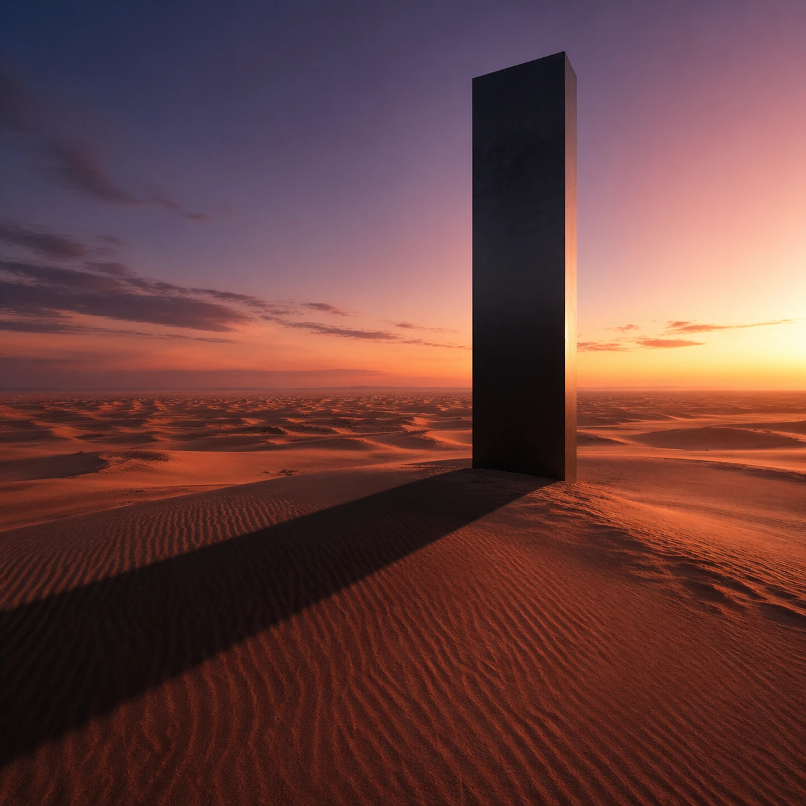

```text
Scene:
Create a square cinematic still for Desert Dusk Monolith. Use production-grade photoreal lighting, disciplined lens behavior, and a composition that feels like a finished key frame from an original film rather than a casual snapshot. A severe desert dune field stretches to the horizon at sunset, where the last light turns the crests copper and rose, the far sky cools toward violet, and one dark monolith stands with absolute stillness above the wind-shaped sand. Build an independent square study around the way atmosphere interacts with surfaces, keeping enough environmental context for the image to feel finished rather than cropped at random.

Subject:
Build a coherent original scene whose emotional center comes from atmosphere, light physics, and spatial clarity. Avoid relying on celebrity likeness, franchise iconography, or stylized illustration shortcuts. The monolith, long shadow, dune ridges, and the empty horizon line should dominate, with no unnecessary props, because the image depends on scale tension between one silent object and an immense landscape. Let textures, reflections, residue, moisture, dust, or particulate response become primary, while the broader setting remains clearly implied.

Important details:
Preserve a believable physical world with strong depth layering, careful color separation, and premium image discipline. Keep the geometry minimal but not sterile, using precise shadow direction, tactile sand micro-relief, clean sky gradient, and disciplined negative space so the frame feels monumental rather than decorative. The key is material credibility under dramatic light, with micro-contrast and controlled mood supporting the theme.

Use case:
Desert Monolith single study 5/9.

Constraints:
No readable text, no watermark, no logos, preserve exact 1:1 aspect ratio, no ruins, no spaceships, no readable markings on the monolith, no crowds, no surreal floating objects.
```

[Pinned source](https://github.com/ChaosRealmsAI/gpt-image-2-gallery/blob/5296db8c996e38776c83a0bc8c64f848dcd512b3/works/topics/desert-dusk-monolith/packages/single-support-studies/images/surface-study/meta.json) · GPT Image2 · 1254×1254 · No source-declared image dependencies. · ProjectD:[published and publicly accepted](https://aitoolsradar.com/en/prompts/e01ea6504e8518)

## Silhouette Study · desert-dusk-monolith/single-support-studies/silhouette-study


```text
Scene:
Create a square cinematic still for Desert Dusk Monolith. Use production-grade photoreal lighting, disciplined lens behavior, and a composition that feels like a finished key frame from an original film rather than a casual snapshot. A severe desert dune field stretches to the horizon at sunset, where the last light turns the crests copper and rose, the far sky cools toward violet, and one dark monolith stands with absolute stillness above the wind-shaped sand. Compose an independent frame where one human, animal, or object silhouette negotiates with the atmospheric light event in a clean, readable way.

Subject:
Build a coherent original scene whose emotional center comes from atmosphere, light physics, and spatial clarity. Avoid relying on celebrity likeness, franchise iconography, or stylized illustration shortcuts. The monolith, long shadow, dune ridges, and the empty horizon line should dominate, with no unnecessary props, because the image depends on scale tension between one silent object and an immense landscape. The silhouette should supply scale and emotional orientation, but the environment still needs to carry most of the storytelling weight.

Important details:
Preserve a believable physical world with strong depth layering, careful color separation, and premium image discipline. Keep the geometry minimal but not sterile, using precise shadow direction, tactile sand micro-relief, clean sky gradient, and disciplined negative space so the frame feels monumental rather than decorative. Keep the silhouette simple and believable, avoiding poster-like graphic flattening while preserving strong contrast.

Use case:
Desert Monolith single study 6/9.

Constraints:
No readable text, no watermark, no logos, preserve exact 1:1 aspect ratio, no ruins, no spaceships, no readable markings on the monolith, no crowds, no surreal floating objects.
```

[Pinned source](https://github.com/ChaosRealmsAI/gpt-image-2-gallery/blob/5296db8c996e38776c83a0bc8c64f848dcd512b3/works/topics/desert-dusk-monolith/packages/single-support-studies/images/silhouette-study/meta.json) · GPT Image2 · 1254×1254 · No source-declared image dependencies. · ProjectD:[published and publicly accepted](https://aitoolsradar.com/en/prompts/bbe25505873228)

## Transition Study · desert-dusk-monolith/single-support-studies/transition-study

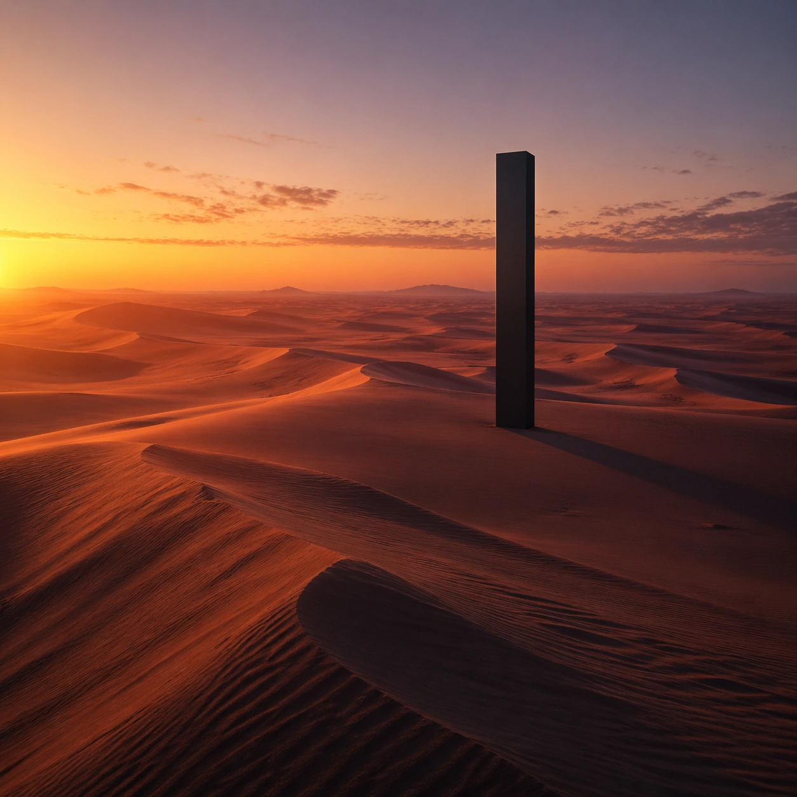

```text
Scene:
Create a square cinematic still for Desert Dusk Monolith. Use production-grade photoreal lighting, disciplined lens behavior, and a composition that feels like a finished key frame from an original film rather than a casual snapshot. A severe desert dune field stretches to the horizon at sunset, where the last light turns the crests copper and rose, the far sky cools toward violet, and one dark monolith stands with absolute stillness above the wind-shaped sand. Treat this as an adjacent moment before or after the main event, preserving the same topic language while letting the atmosphere shift slightly in intensity or position.

Subject:
Build a coherent original scene whose emotional center comes from atmosphere, light physics, and spatial clarity. Avoid relying on celebrity likeness, franchise iconography, or stylized illustration shortcuts. The monolith, long shadow, dune ridges, and the empty horizon line should dominate, with no unnecessary props, because the image depends on scale tension between one silent object and an immense landscape. Show the environment in transition, with clear evidence of recent motion, changing weather, or fading light, but without turning it into action spectacle.

Important details:
Preserve a believable physical world with strong depth layering, careful color separation, and premium image discipline. Keep the geometry minimal but not sterile, using precise shadow direction, tactile sand micro-relief, clean sky gradient, and disciplined negative space so the frame feels monumental rather than decorative. Subtle temporal storytelling matters here more than maximal drama, so let traces, gradients, and environmental residue do the work.

Use case:
Desert Monolith single study 7/9.

Constraints:
No readable text, no watermark, no logos, preserve exact 1:1 aspect ratio, no ruins, no spaceships, no readable markings on the monolith, no crowds, no surreal floating objects.
```

[Pinned source](https://github.com/ChaosRealmsAI/gpt-image-2-gallery/blob/5296db8c996e38776c83a0bc8c64f848dcd512b3/works/topics/desert-dusk-monolith/packages/single-support-studies/images/transition-study/meta.json) · GPT Image2 · 1254×1254 · No source-declared image dependencies. · ProjectD:[published and publicly accepted](https://aitoolsradar.com/en/prompts/af7b4f82fa5d80)

## Wide Study · desert-dusk-monolith/single-support-studies/wide-study


```text
Scene:
Create a square cinematic still for Desert Dusk Monolith. Use production-grade photoreal lighting, disciplined lens behavior, and a composition that feels like a finished key frame from an original film rather than a casual snapshot. A severe desert dune field stretches to the horizon at sunset, where the last light turns the crests copper and rose, the far sky cools toward violet, and one dark monolith stands with absolute stillness above the wind-shaped sand. Pull back enough to explain the broader geography or architectural envelope while keeping the square crop intentional and balanced.

Subject:
Build a coherent original scene whose emotional center comes from atmosphere, light physics, and spatial clarity. Avoid relying on celebrity likeness, franchise iconography, or stylized illustration shortcuts. The monolith, long shadow, dune ridges, and the empty horizon line should dominate, with no unnecessary props, because the image depends on scale tension between one silent object and an immense landscape. The wider frame should reveal how the main light or weather phenomenon organizes the surrounding world and not just the immediate subject.

Important details:
Preserve a believable physical world with strong depth layering, careful color separation, and premium image discipline. Keep the geometry minimal but not sterile, using precise shadow direction, tactile sand micro-relief, clean sky gradient, and disciplined negative space so the frame feels monumental rather than decorative. Make scale legible through spacing, horizon control, and foreground-to-background separation rather than through extra props.

Use case:
Desert Monolith single study 8/9.

Constraints:
No readable text, no watermark, no logos, preserve exact 1:1 aspect ratio, no ruins, no spaceships, no readable markings on the monolith, no crowds, no surreal floating objects.
```

[Pinned source](https://github.com/ChaosRealmsAI/gpt-image-2-gallery/blob/5296db8c996e38776c83a0bc8c64f848dcd512b3/works/topics/desert-dusk-monolith/packages/single-support-studies/images/wide-study/meta.json) · GPT Image2 · 1254×1254 · No source-declared image dependencies. · ProjectD:[published and publicly accepted](https://aitoolsradar.com/en/prompts/0fed1c3c46c8ad)

## Afterglow Study · desert-dusk-monolith/single-support-studies/afterglow-study


```text
Scene:
Create a square cinematic still for Desert Dusk Monolith. Use production-grade photoreal lighting, disciplined lens behavior, and a composition that feels like a finished key frame from an original film rather than a casual snapshot. A severe desert dune field stretches to the horizon at sunset, where the last light turns the crests copper and rose, the far sky cools toward violet, and one dark monolith stands with absolute stillness above the wind-shaped sand. End on a quieter independent image that holds the residue of the topic atmosphere after its loudest moment has passed, while still feeling complete and exhibition-ready.

Subject:
Build a coherent original scene whose emotional center comes from atmosphere, light physics, and spatial clarity. Avoid relying on celebrity likeness, franchise iconography, or stylized illustration shortcuts. The monolith, long shadow, dune ridges, and the empty horizon line should dominate, with no unnecessary props, because the image depends on scale tension between one silent object and an immense landscape. The frame should suggest memory, aftermath, or lingering presence through environment first and only secondarily through any figure or object.

Important details:
Preserve a believable physical world with strong depth layering, careful color separation, and premium image discipline. Keep the geometry minimal but not sterile, using precise shadow direction, tactile sand micro-relief, clean sky gradient, and disciplined negative space so the frame feels monumental rather than decorative. Favor restraint, believable light decay, and subtle narrative closure over spectacle or decorative excess.

Use case:
Desert Monolith single study 9/9.

Constraints:
No readable text, no watermark, no logos, preserve exact 1:1 aspect ratio, no ruins, no spaceships, no readable markings on the monolith, no crowds, no surreal floating objects.
```

[Pinned source](https://github.com/ChaosRealmsAI/gpt-image-2-gallery/blob/5296db8c996e38776c83a0bc8c64f848dcd512b3/works/topics/desert-dusk-monolith/packages/single-support-studies/images/afterglow-study/meta.json) · GPT Image2 · 1254×1254 · No source-declared image dependencies. · ProjectD:[published and publicly accepted](https://aitoolsradar.com/en/prompts/c871d92e9c571d)

## Salon Display Anchor · dessert-patisserie-brand-visual-system/series-core-system/01-salon-display-anchor

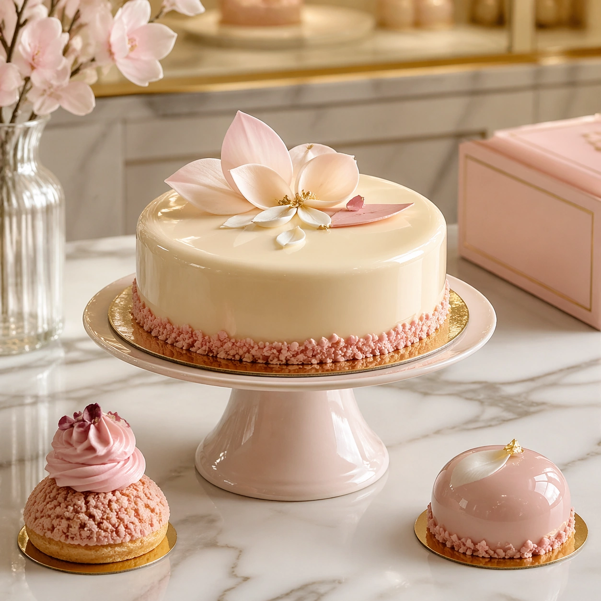

```text
Scene:
Compose a square premium patisserie image with polished but believable boutique lighting, elegant marble or lacquer surfaces, and a sweet-shop atmosphere that feels brand-authored rather than generic. The camera should preserve product clarity, shape definition, and shelf or counter context while leaving enough breathing room for campaign placement. Use soft daylight mixed with warm case lighting so the image feels like an upscale pastry salon at opening hour, with clean reflections and controlled highlights.

Subject:
The desserts must look crafted by a high-end pastry kitchen: clean lamination, glossy glaze, stable cream structure, crisp edges, and packaging or display surfaces that reinforce a coherent dessert identity. Feature an elegant entremet cake on a pedestal with two supporting pastries and one subtle packaging accent in the background.

Important details:
Sweetness should come from color control, finish quality, and material nuance, not from visual clutter. Preserve believable pastry engineering, boutique display logic, and refined merchandising cues so the images can support brand storytelling across retail, packaging, and editorial use. This image establishes the reference system for the series, including camera height, tabletop discipline, prop family, and color control that later images must inherit. This image must define the full visual system for the series: restrained pastel palette, premium materials, clear merchandising rhythm, and high-fidelity pastry finish.

Use case:
Dessert Brand series study 1/9, built for Prompt Atlas coverage of a food and beverage commercial visual system.

Constraints:
No readable text, no watermark, no logos, preserve exact 1:1 aspect ratio, no candy-color overload, no plastic frosting, no supermarket clutter, no cartoon decorations, no melted textures that break realism, no childish party props, no birthday candles, no cartoon toppers, no supermarket bakery trays.
```

[Pinned source](https://github.com/ChaosRealmsAI/gpt-image-2-gallery/blob/5296db8c996e38776c83a0bc8c64f848dcd512b3/works/topics/dessert-patisserie-brand-visual-system/packages/series-core-system/images/01-salon-display-anchor/meta.json) · GPT Image2 · 1254×1254 · No source-declared image dependencies. · ProjectD:[published and publicly accepted](https://aitoolsradar.com/en/prompts/5bfc79e735ba79)

## Croissant Ribbon · dessert-patisserie-brand-visual-system/series-core-system/02-croissant-ribbon

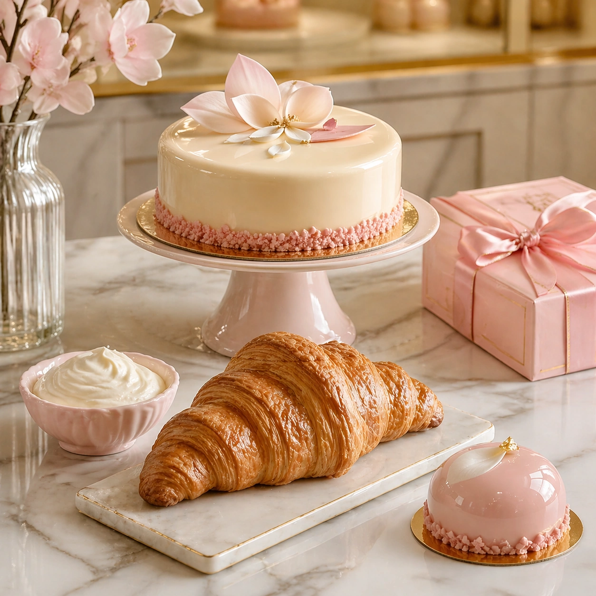

```text
Scene:
Compose a square premium patisserie image with polished but believable boutique lighting, elegant marble or lacquer surfaces, and a sweet-shop atmosphere that feels brand-authored rather than generic. The camera should preserve product clarity, shape definition, and shelf or counter context while leaving enough breathing room for campaign placement. Keep the same salon camera height and marble-counter atmosphere, but let the light reveal crisp lamination, buttery gold tones, and one folded ribbon-like package accent.

Subject:
The desserts must look crafted by a high-end pastry kitchen: clean lamination, glossy glaze, stable cream structure, crisp edges, and packaging or display surfaces that reinforce a coherent dessert identity. Show a croissant or viennoiserie centerpiece with precise layers, a small dish of cream or jam, and packaging details that feel aligned with the same brand family.

Important details:
Sweetness should come from color control, finish quality, and material nuance, not from visual clutter. Preserve believable pastry engineering, boutique display logic, and refined merchandising cues so the images can support brand storytelling across retail, packaging, and editorial use. Preserve the exact camera height, lens feel, prop family, tabletop scale, palette discipline, and brand logic established by 01-salon-display-anchor. Preserve the reference palette, counter spacing, and display sophistication while emphasizing flaky structure, thin glaze, and realistic pastry lift.

Use case:
Dessert Brand series study 2/9, built for Prompt Atlas coverage of a food and beverage commercial visual system.

Constraints:
No readable text, no watermark, no logos, preserve exact 1:1 aspect ratio, no candy-color overload, no plastic frosting, no supermarket clutter, no cartoon decorations, no melted textures that break realism, no childish party props, no rustic paper bag clutter, no café breakfast spread, no chocolate overload.
```

[Pinned source](https://github.com/ChaosRealmsAI/gpt-image-2-gallery/blob/5296db8c996e38776c83a0bc8c64f848dcd512b3/works/topics/dessert-patisserie-brand-visual-system/packages/series-core-system/images/02-croissant-ribbon/meta.json) · GPT Image2 · 1254×1254 · Reference images required. · ProjectD:[published and publicly accepted](https://aitoolsradar.com/en/prompts/ee7a5c801c4cb2)

## Berry Tart Salon · dessert-patisserie-brand-visual-system/series-core-system/03-berry-tart-salon

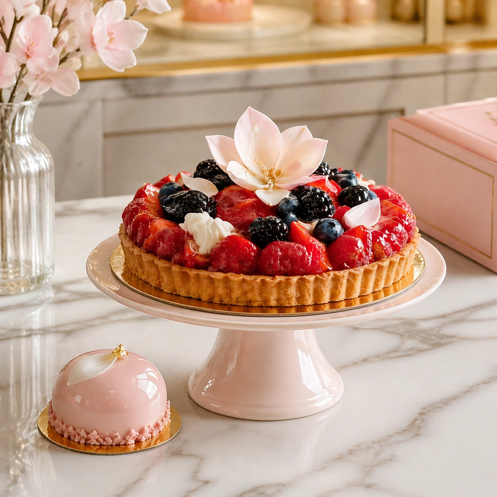

```text
Scene:
Compose a square premium patisserie image with polished but believable boutique lighting, elegant marble or lacquer surfaces, and a sweet-shop atmosphere that feels brand-authored rather than generic. The camera should preserve product clarity, shape definition, and shelf or counter context while leaving enough breathing room for campaign placement. Retain the same polished boutique setting and quiet reflections, with a slightly brighter tonal lift to support berry gloss and pastry precision.

Subject:
The desserts must look crafted by a high-end pastry kitchen: clean lamination, glossy glaze, stable cream structure, crisp edges, and packaging or display surfaces that reinforce a coherent dessert identity. Present a berry tart with mirror-finish fruit, clean cream piping, and one minimal secondary pastry so the frame reads like a luxury display edit.

Important details:
Sweetness should come from color control, finish quality, and material nuance, not from visual clutter. Preserve believable pastry engineering, boutique display logic, and refined merchandising cues so the images can support brand storytelling across retail, packaging, and editorial use. Preserve the exact camera height, lens feel, prop family, tabletop scale, palette discipline, and brand logic established by 01-salon-display-anchor. The display cadence, surface finish, and package language should stay locked to the anchor image, even as color intensity and fruit texture become more vibrant.

Use case:
Dessert Brand series study 3/9, built for Prompt Atlas coverage of a food and beverage commercial visual system.

Constraints:
No readable text, no watermark, no logos, preserve exact 1:1 aspect ratio, no candy-color overload, no plastic frosting, no supermarket clutter, no cartoon decorations, no melted textures that break realism, no childish party props, no farmhouse styling, no dripping fruit syrup, no picnic props.
```

[Pinned source](https://github.com/ChaosRealmsAI/gpt-image-2-gallery/blob/5296db8c996e38776c83a0bc8c64f848dcd512b3/works/topics/dessert-patisserie-brand-visual-system/packages/series-core-system/images/03-berry-tart-salon/meta.json) · GPT Image2 · 1254×1254 · Reference images required. · ProjectD:[published and publicly accepted](https://aitoolsradar.com/en/prompts/b8849a15bd122d)

## Gelato Window Cup · dessert-patisserie-brand-visual-system/series-core-system/04-gelato-window-cup

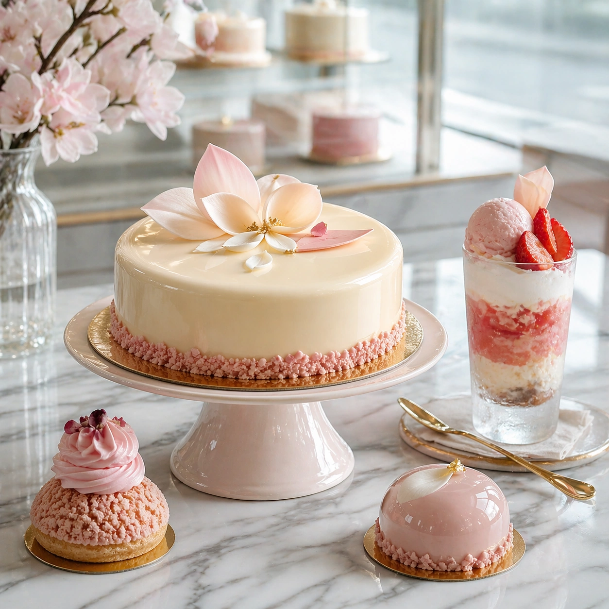

```text
Scene:
Compose a square premium patisserie image with polished but believable boutique lighting, elegant marble or lacquer surfaces, and a sweet-shop atmosphere that feels brand-authored rather than generic. The camera should preserve product clarity, shape definition, and shelf or counter context while leaving enough breathing room for campaign placement. Maintain the same dessert-brand framing and counter logic, but cool the light slightly to support frosted glass, pale cream tones, and a window-side shimmer.

Subject:
The desserts must look crafted by a high-end pastry kitchen: clean lamination, glossy glaze, stable cream structure, crisp edges, and packaging or display surfaces that reinforce a coherent dessert identity. Show a premium gelato or parfait cup with layered textures, fruit accent, and refined packaging cues integrated into the patisserie environment.

Important details:
Sweetness should come from color control, finish quality, and material nuance, not from visual clutter. Preserve believable pastry engineering, boutique display logic, and refined merchandising cues so the images can support brand storytelling across retail, packaging, and editorial use. Preserve the exact camera height, lens feel, prop family, tabletop scale, palette discipline, and brand logic established by 01-salon-display-anchor. Keep the reference display discipline and material hierarchy intact while making cold condensation, spoon reflections, and layered dessert structure fully believable.

Use case:
Dessert Brand series study 4/9, built for Prompt Atlas coverage of a food and beverage commercial visual system.

Constraints:
No readable text, no watermark, no logos, preserve exact 1:1 aspect ratio, no candy-color overload, no plastic frosting, no supermarket clutter, no cartoon decorations, no melted textures that break realism, no childish party props, no plastic spoon, no amusement-park styling, no oversized sundae build.
```

[Pinned source](https://github.com/ChaosRealmsAI/gpt-image-2-gallery/blob/5296db8c996e38776c83a0bc8c64f848dcd512b3/works/topics/dessert-patisserie-brand-visual-system/packages/series-core-system/images/04-gelato-window-cup/meta.json) · GPT Image2 · 1254×1254 · Reference images required. · ProjectD:[published and publicly accepted](https://aitoolsradar.com/en/prompts/f7f210c1d6264c)

## Pastry Case Twilight · dessert-patisserie-brand-visual-system/single-support-studies/pastry-case-twilight

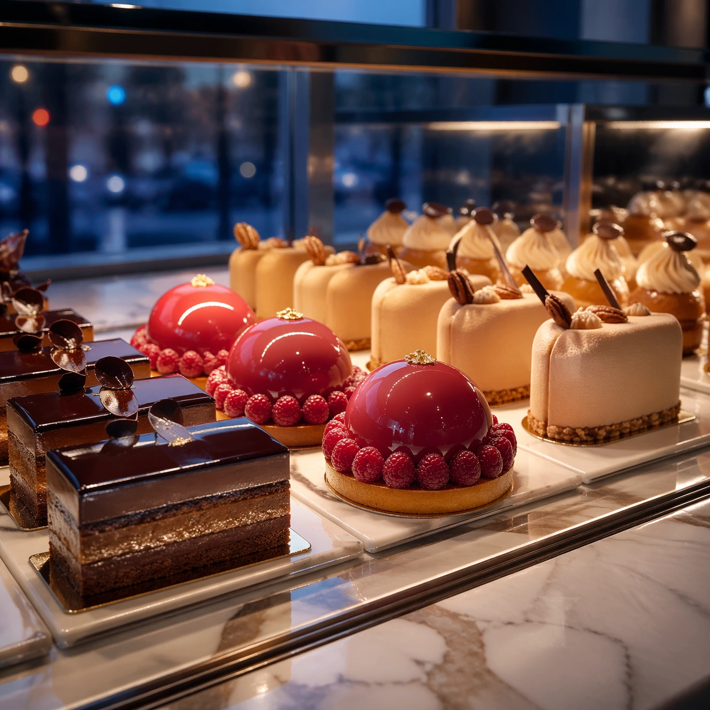

```text
Scene:
Compose a square premium patisserie image with polished but believable boutique lighting, elegant marble or lacquer surfaces, and a sweet-shop atmosphere that feels brand-authored rather than generic. The camera should preserve product clarity, shape definition, and shelf or counter context while leaving enough breathing room for campaign placement. Frame a square crop of a glass pastry case at blue hour, balancing interior warm light with cooler ambient reflections from the shopfront.

Subject:
The desserts must look crafted by a high-end pastry kitchen: clean lamination, glossy glaze, stable cream structure, crisp edges, and packaging or display surfaces that reinforce a coherent dessert identity. Show several hero pastries aligned in a premium display case, with one standout item catching the eye and the rest supporting a consistent retail rhythm.

Important details:
Sweetness should come from color control, finish quality, and material nuance, not from visual clutter. Preserve believable pastry engineering, boutique display logic, and refined merchandising cues so the images can support brand storytelling across retail, packaging, and editorial use. This image should feel fully self-contained while still belonging to the same broader topic and commercial world. Glass cleanliness, reflected highlights, shelf spacing, and pastry scale all need to feel real so the image can sell a believable high-end dessert environment.

Use case:
Dessert Brand single study 6/9, built for Prompt Atlas coverage of a food and beverage commercial visual system.

Constraints:
No readable text, no watermark, no logos, preserve exact 1:1 aspect ratio, no candy-color overload, no plastic frosting, no supermarket clutter, no cartoon decorations, no melted textures that break realism, no childish party props, no crowded bakery stock, no visible staff faces, no fluorescent supermarket light.
```

[Pinned source](https://github.com/ChaosRealmsAI/gpt-image-2-gallery/blob/5296db8c996e38776c83a0bc8c64f848dcd512b3/works/topics/dessert-patisserie-brand-visual-system/packages/single-support-studies/images/pastry-case-twilight/meta.json) · GPT Image2 · 1254×1254 · No source-declared image dependencies. · ProjectD:[published and publicly accepted](https://aitoolsradar.com/en/prompts/a190ee0759cc74)

## Ribbon Bag Counter · dessert-patisserie-brand-visual-system/single-support-studies/ribbon-bag-counter

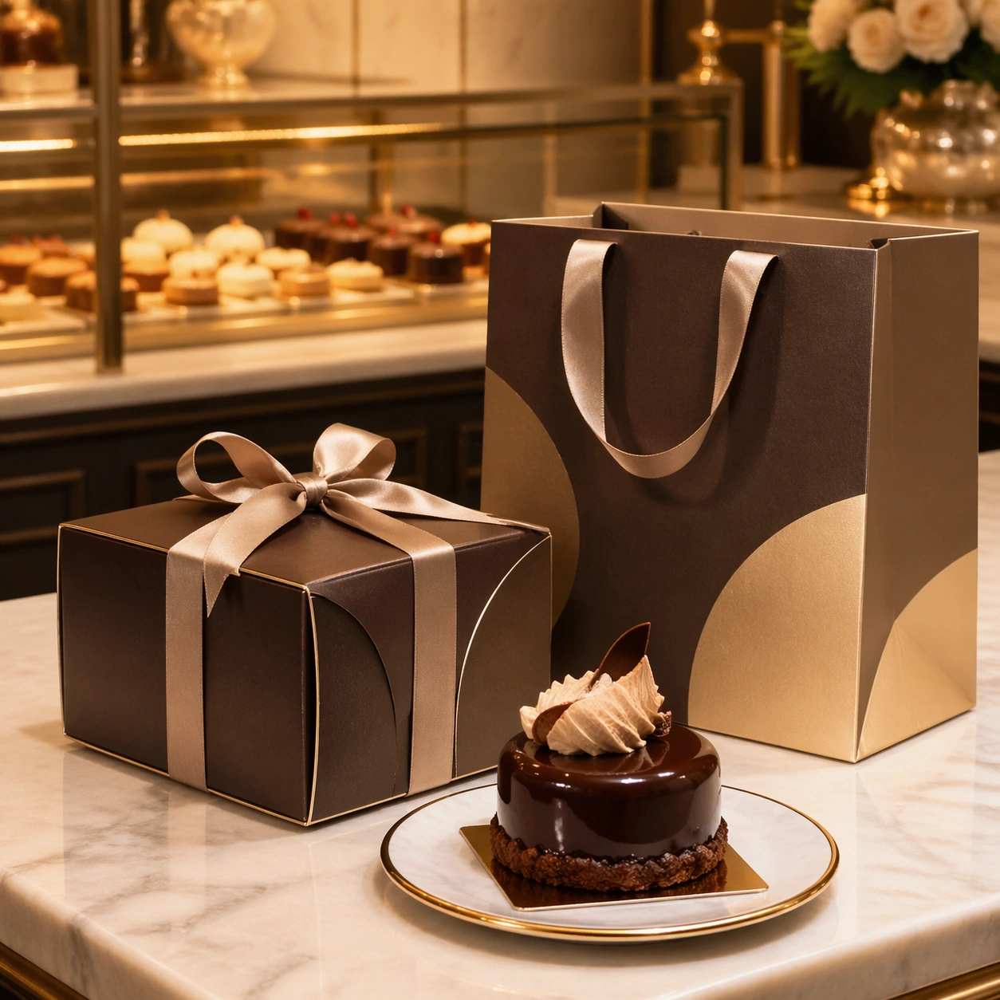

```text
Scene:
Compose a square premium patisserie image with polished but believable boutique lighting, elegant marble or lacquer surfaces, and a sweet-shop atmosphere that feels brand-authored rather than generic. The camera should preserve product clarity, shape definition, and shelf or counter context while leaving enough breathing room for campaign placement. Use a waist-high camera and a boutique counter with one shopping bag, one pastry box, and a polished pastry resting on a tray under soft warm light.

Subject:
The desserts must look crafted by a high-end pastry kitchen: clean lamination, glossy glaze, stable cream structure, crisp edges, and packaging or display surfaces that reinforce a coherent dessert identity. Center the relationship between premium dessert packaging and the actual pastry, showing how the brand travels from counter to takeaway moment.

Important details:
Sweetness should come from color control, finish quality, and material nuance, not from visual clutter. Preserve believable pastry engineering, boutique display logic, and refined merchandising cues so the images can support brand storytelling across retail, packaging, and editorial use. This image should feel fully self-contained while still belonging to the same broader topic and commercial world. Paper thickness, ribbon curves, metal tray reflections, and pastry finish should communicate a premium retail brand without leaning on readable logo copy.

Use case:
Dessert Brand single study 7/9, built for Prompt Atlas coverage of a food and beverage commercial visual system.

Constraints:
No readable text, no watermark, no logos, preserve exact 1:1 aspect ratio, no candy-color overload, no plastic frosting, no supermarket clutter, no cartoon decorations, no melted textures that break realism, no childish party props, no barcode stickers, no receipt clutter, no disposable fast-food cues.
```

[Pinned source](https://github.com/ChaosRealmsAI/gpt-image-2-gallery/blob/5296db8c996e38776c83a0bc8c64f848dcd512b3/works/topics/dessert-patisserie-brand-visual-system/packages/single-support-studies/images/ribbon-bag-counter/meta.json) · GPT Image2 · 1254×1254 · No source-declared image dependencies. · ProjectD:[published and publicly accepted](https://aitoolsradar.com/en/prompts/bf074adf2e1179)

## Petit Four Grid · dessert-patisserie-brand-visual-system/single-support-studies/petit-four-grid

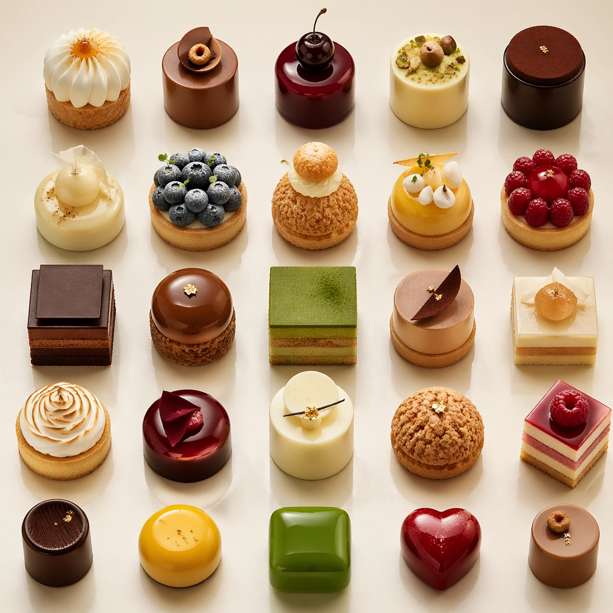

```text
Scene:
Compose a square premium patisserie image with polished but believable boutique lighting, elegant marble or lacquer surfaces, and a sweet-shop atmosphere that feels brand-authored rather than generic. The camera should preserve product clarity, shape definition, and shelf or counter context while leaving enough breathing room for campaign placement. Shoot from high above with a strict square crop and a pale lacquer surface, letting tiny shadows define spacing and repetition.

Subject:
The desserts must look crafted by a high-end pastry kitchen: clean lamination, glossy glaze, stable cream structure, crisp edges, and packaging or display surfaces that reinforce a coherent dessert identity. Arrange a grid of miniature cakes, bonbons, and fruit gels so each piece is distinct but the overall composition feels like one elegant merchandising system.

Important details:
Sweetness should come from color control, finish quality, and material nuance, not from visual clutter. Preserve believable pastry engineering, boutique display logic, and refined merchandising cues so the images can support brand storytelling across retail, packaging, and editorial use. This image should feel fully self-contained while still belonging to the same broader topic and commercial world. Uniform spacing, micro texture, glaze realism, and palette restraint are critical; the image should feel like a premium catalog board for a pastry collection.

Use case:
Dessert Brand single study 8/9, built for Prompt Atlas coverage of a food and beverage commercial visual system.

Constraints:
No readable text, no watermark, no logos, preserve exact 1:1 aspect ratio, no candy-color overload, no plastic frosting, no supermarket clutter, no cartoon decorations, no melted textures that break realism, no childish party props, no rainbow overload, no childish candy mix, no broken pieces.
```

[Pinned source](https://github.com/ChaosRealmsAI/gpt-image-2-gallery/blob/5296db8c996e38776c83a0bc8c64f848dcd512b3/works/topics/dessert-patisserie-brand-visual-system/packages/single-support-studies/images/petit-four-grid/meta.json) · GPT Image2 · 1254×1254 · No source-declared image dependencies. · ProjectD:[published and publicly accepted](https://aitoolsradar.com/en/prompts/e38b41075977a0)

## Afternoon Tea Window · dessert-patisserie-brand-visual-system/single-support-studies/afternoon-tea-window

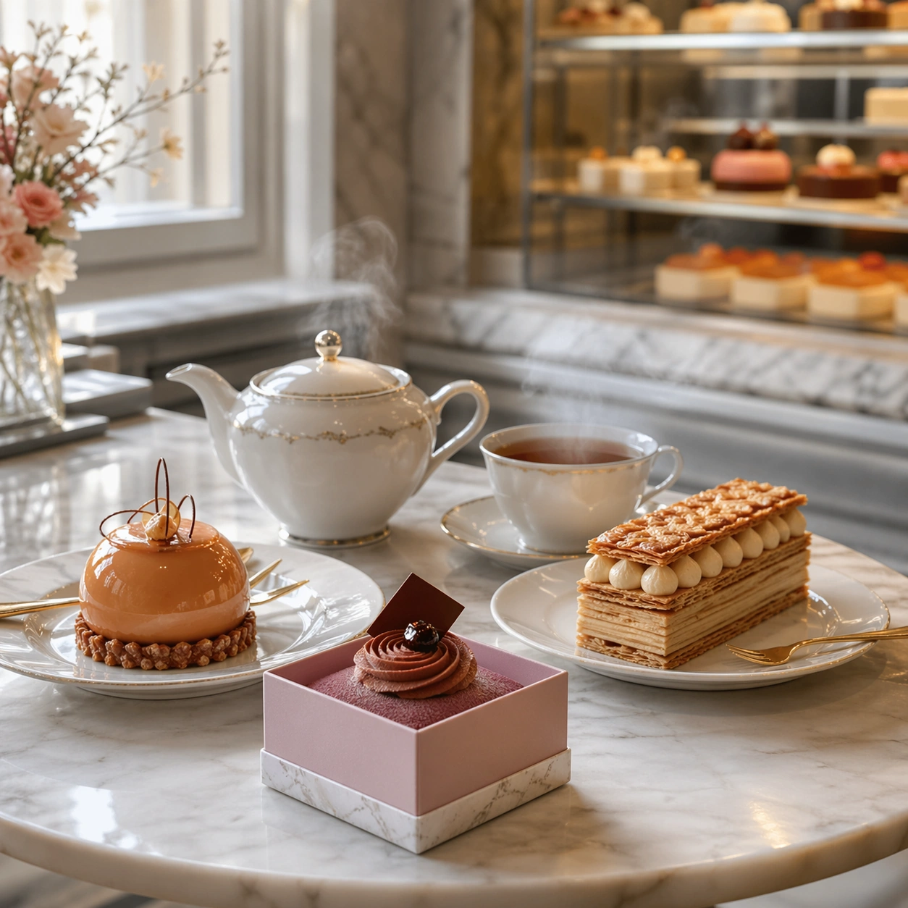

```text
Scene:
Compose a square premium patisserie image with polished but believable boutique lighting, elegant marble or lacquer surfaces, and a sweet-shop atmosphere that feels brand-authored rather than generic. The camera should preserve product clarity, shape definition, and shelf or counter context while leaving enough breathing room for campaign placement. Use diffused window light, a small marble table, and a softly blurred shop interior so the frame feels calm, aspirational, and lived in.

Subject:
The desserts must look crafted by a high-end pastry kitchen: clean lamination, glossy glaze, stable cream structure, crisp edges, and packaging or display surfaces that reinforce a coherent dessert identity. Show a tea set with two plated pastries and one small boxed dessert, creating a believable afternoon tea moment inside the same dessert brand world.

Important details:
Sweetness should come from color control, finish quality, and material nuance, not from visual clutter. Preserve believable pastry engineering, boutique display logic, and refined merchandising cues so the images can support brand storytelling across retail, packaging, and editorial use. This image should feel fully self-contained while still belonging to the same broader topic and commercial world. Tea steam, porcelain reflection, glaze highlights, and crumb discipline should all feel controlled, with enough softness to suggest hospitality without losing product sharpness.

Use case:
Dessert Brand single study 9/9, built for Prompt Atlas coverage of a food and beverage commercial visual system.

Constraints:
No readable text, no watermark, no logos, preserve exact 1:1 aspect ratio, no candy-color overload, no plastic frosting, no supermarket clutter, no cartoon decorations, no melted textures that break realism, no childish party props, no readable menu, no crowded café patrons, no oversized brunch food.
```

[Pinned source](https://github.com/ChaosRealmsAI/gpt-image-2-gallery/blob/5296db8c996e38776c83a0bc8c64f848dcd512b3/works/topics/dessert-patisserie-brand-visual-system/packages/single-support-studies/images/afternoon-tea-window/meta.json) · GPT Image2 · 1254×1254 · No source-declared image dependencies. · ProjectD:[published and publicly accepted](https://aitoolsradar.com/en/prompts/4b741ac1042a1a)

## Reference Anchor · destination-poster-grand-tour-language/series-core-system/01-reference-anchor

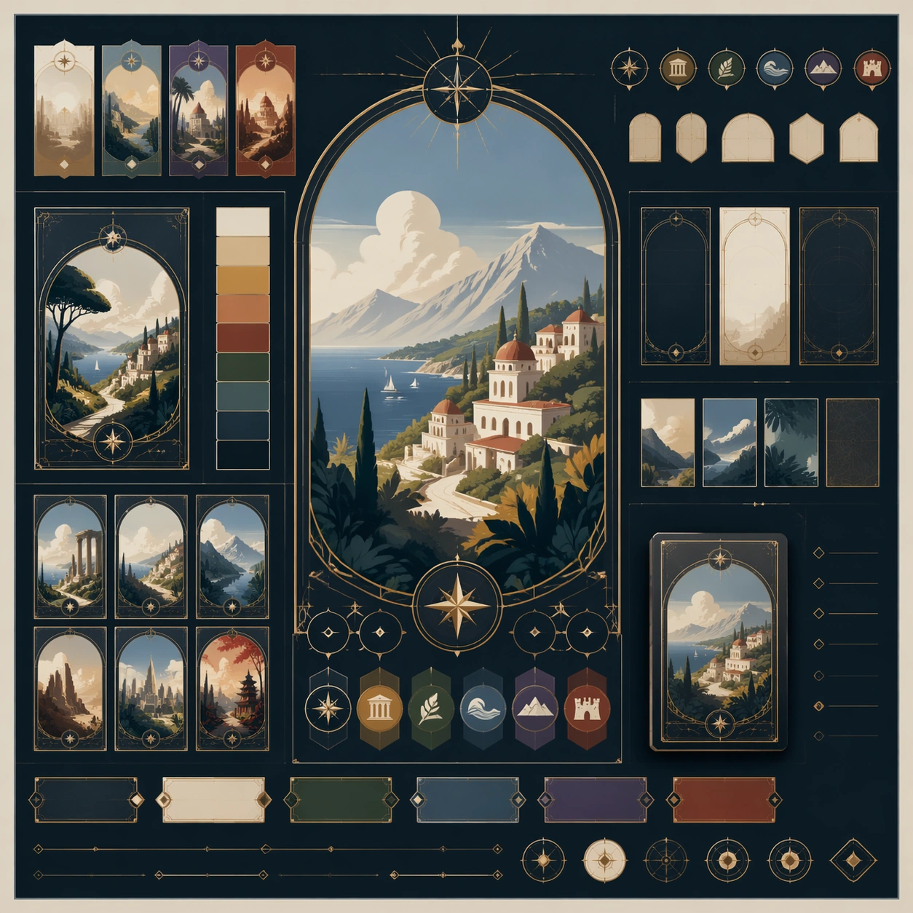

```text
Scene:
Create a square reference image for Destination Poster Grand Tour Language. Build a reference anchor establishing the core system with a premium, production-ready finish. Use a polished modular board or campaign surface with clean spacing, premium game-UI finish, and clear focal hierarchy. The composition should feel intentional, clean, and reusable for gallery, research, campaign, or internal handoff contexts. Lighting must support readability first, with the main forms clearly separated from the background and enough breathing room for the system to stay legible at both hero scale and thumbnail scale.

Subject:
Center a coherent original game-art system built for premium production and marketing surfaces. For this image, focus on reference anchor. Keep the same system logic stable across screenshots, cards, banners, and overview boards. This image is the canonical anchor that later series images must follow. The viewer should immediately understand what role this surface plays inside a cohesive game-production asset pack.

Important details:
Lock framing, icon grammar, palette blocking, and surface hierarchy so the kit feels production-ready and consistent. Preserve the core silhouette, framing language, and material logic from the reference image while each variation changes function. Keep materials believable, edge hierarchy disciplined, and the visual language consistent with Destination Posters. Use abstract interface blocks or diagram accents when helpful, but avoid any readable language. The final result should feel like a deliberate production asset rather than a random illustration.

Use case:
Destination Poster Grand Tour Language series study 1/9, designed as reference anchor within a cohesive asset pack.

Constraints:
No readable text, no watermark, no logos, preserve exact 1:1 aspect ratio, no unrelated objects, no broken visual hierarchy, no malformed anatomy or broken perspective, no random decorative clutter.
```

[Pinned source](https://github.com/ChaosRealmsAI/gpt-image-2-gallery/blob/5296db8c996e38776c83a0bc8c64f848dcd512b3/works/topics/destination-poster-grand-tour-language/packages/series-core-system/images/01-reference-anchor/meta.json) · GPT Image2 · 1254×1254 · No source-declared image dependencies. · ProjectD:[published and publicly accepted](https://aitoolsradar.com/en/prompts/c51426186f6b81)

## Variant One · destination-poster-grand-tour-language/series-core-system/02-variant-one

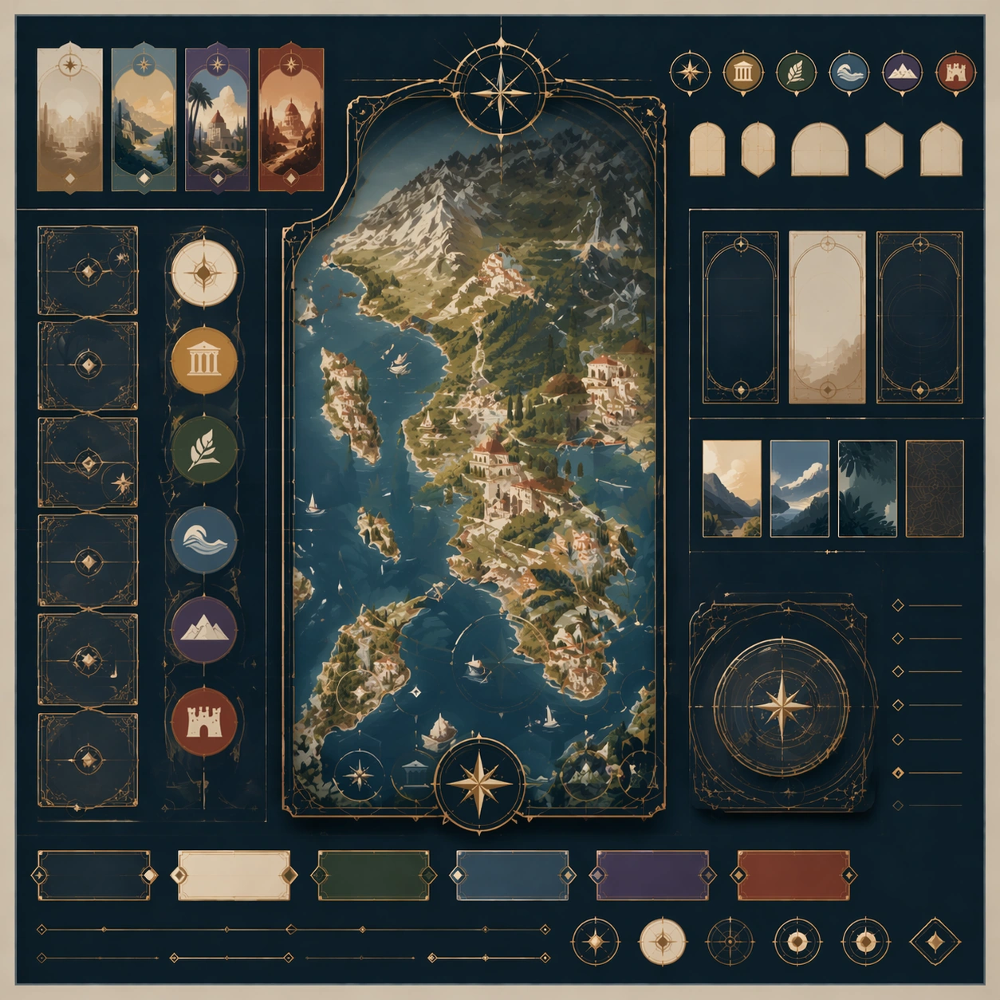

```text
Scene:
Create a square dependent image for Destination Poster Grand Tour Language. Build a first controlled variation in the same system with a premium, production-ready finish. Use a polished modular board or campaign surface with clean spacing, premium game-UI finish, and clear focal hierarchy. The composition should feel intentional, clean, and reusable for gallery, research, campaign, or internal handoff contexts. Lighting must support readability first, with the main forms clearly separated from the background and enough breathing room for the system to stay legible at both hero scale and thumbnail scale.

Subject:
Center a coherent original game-art system built for premium production and marketing surfaces. For this image, focus on the intended support surface. Keep the same system logic stable across screenshots, cards, banners, and overview boards. Preserve exact identity or system logic from the reference image while changing only the intended variation axis. The viewer should immediately understand what role this surface plays inside a cohesive game-production asset pack.

Important details:
Lock framing, icon grammar, palette blocking, and surface hierarchy so the kit feels production-ready and consistent. Preserve the core silhouette, framing language, and material logic from the reference image while each variation changes function. Keep materials believable, edge hierarchy disciplined, and the visual language consistent with Destination Posters. Use abstract interface blocks or diagram accents when helpful, but avoid any readable language. The final result should feel like a deliberate production asset rather than a random illustration.

Use case:
Destination Poster Grand Tour Language series study 2/9, designed as variant one within a cohesive asset pack.

Constraints:
No readable text, no watermark, no logos, preserve exact 1:1 aspect ratio, no unrelated objects, no broken visual hierarchy, no malformed anatomy or broken perspective, no random decorative clutter.
```

[Pinned source](https://github.com/ChaosRealmsAI/gpt-image-2-gallery/blob/5296db8c996e38776c83a0bc8c64f848dcd512b3/works/topics/destination-poster-grand-tour-language/packages/series-core-system/images/02-variant-one/meta.json) · GPT Image2 · 1254×1254 · Reference images required. · ProjectD:[published and publicly accepted](https://aitoolsradar.com/en/prompts/f7db651a98aa0a)

## Variant Two · destination-poster-grand-tour-language/series-core-system/03-variant-two

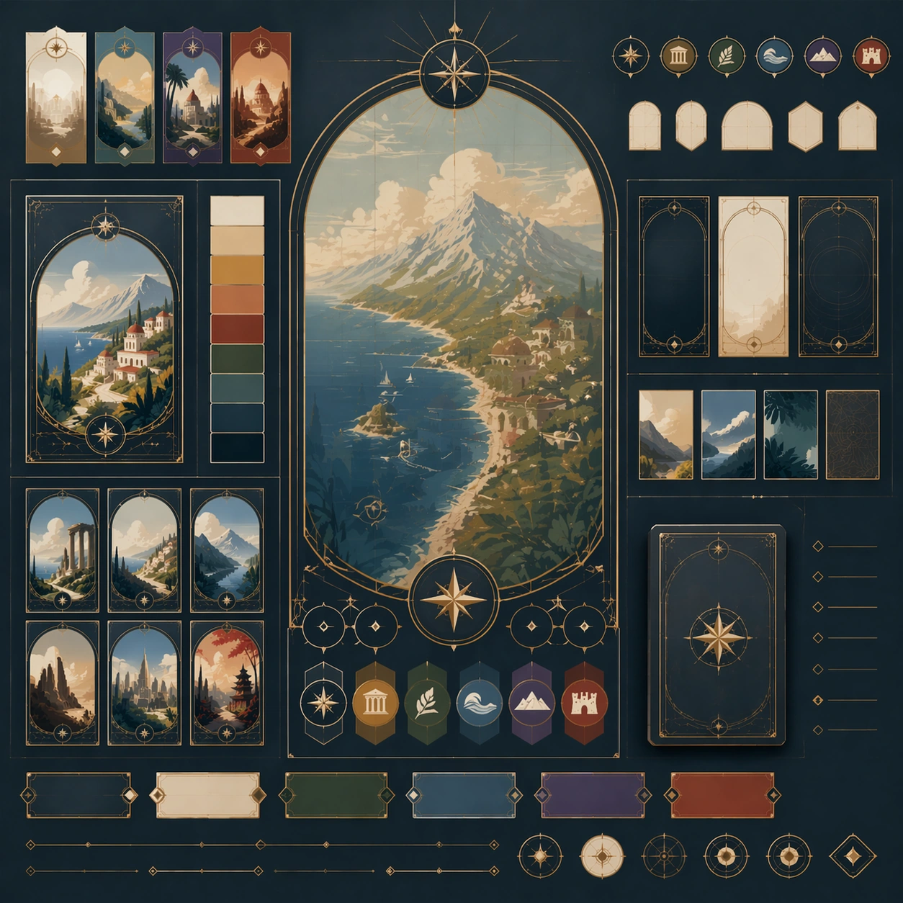

```text
Scene:
Create a square dependent image for Destination Poster Grand Tour Language. Build a second controlled variation in the same system with a premium, production-ready finish. Use a polished modular board or campaign surface with clean spacing, premium game-UI finish, and clear focal hierarchy. The composition should feel intentional, clean, and reusable for gallery, research, campaign, or internal handoff contexts. Lighting must support readability first, with the main forms clearly separated from the background and enough breathing room for the system to stay legible at both hero scale and thumbnail scale.

Subject:
Center a coherent original game-art system built for premium production and marketing surfaces. For this image, focus on the intended support surface. Keep the same system logic stable across screenshots, cards, banners, and overview boards. Preserve exact identity or system logic from the reference image while changing only the intended variation axis. The viewer should immediately understand what role this surface plays inside a cohesive game-production asset pack.

Important details:
Lock framing, icon grammar, palette blocking, and surface hierarchy so the kit feels production-ready and consistent. Preserve the core silhouette, framing language, and material logic from the reference image while each variation changes function. Keep materials believable, edge hierarchy disciplined, and the visual language consistent with Destination Posters. Use abstract interface blocks or diagram accents when helpful, but avoid any readable language. The final result should feel like a deliberate production asset rather than a random illustration.

Use case:
Destination Poster Grand Tour Language series study 3/9, designed as variant two within a cohesive asset pack.

Constraints:
No readable text, no watermark, no logos, preserve exact 1:1 aspect ratio, no unrelated objects, no broken visual hierarchy, no malformed anatomy or broken perspective, no random decorative clutter.
```

[Pinned source](https://github.com/ChaosRealmsAI/gpt-image-2-gallery/blob/5296db8c996e38776c83a0bc8c64f848dcd512b3/works/topics/destination-poster-grand-tour-language/packages/series-core-system/images/03-variant-two/meta.json) · GPT Image2 · 1254×1254 · Reference images required. · ProjectD:[published and publicly accepted](https://aitoolsradar.com/en/prompts/3eab59fec0bd3f)

## Variant Three · destination-poster-grand-tour-language/series-core-system/04-variant-three

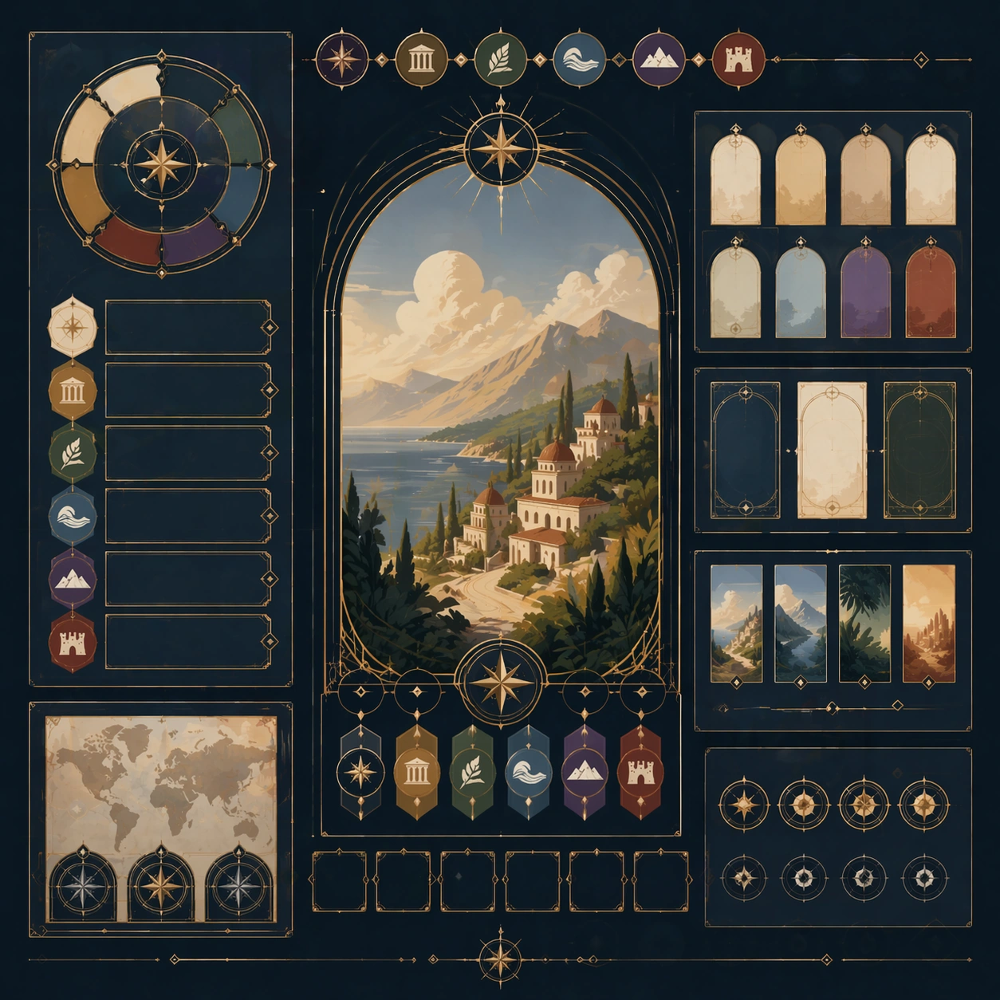

```text
Scene:
Create a square dependent image for Destination Poster Grand Tour Language. Build a third controlled variation in the same system with a premium, production-ready finish. Use a polished modular board or campaign surface with clean spacing, premium game-UI finish, and clear focal hierarchy. The composition should feel intentional, clean, and reusable for gallery, research, campaign, or internal handoff contexts. Lighting must support readability first, with the main forms clearly separated from the background and enough breathing room for the system to stay legible at both hero scale and thumbnail scale.

Subject:
Center a coherent original game-art system built for premium production and marketing surfaces. For this image, focus on the intended support surface. Keep the same system logic stable across screenshots, cards, banners, and overview boards. Preserve exact identity or system logic from the reference image while changing only the intended variation axis. The viewer should immediately understand what role this surface plays inside a cohesive game-production asset pack.

Important details:
Lock framing, icon grammar, palette blocking, and surface hierarchy so the kit feels production-ready and consistent. Preserve the core silhouette, framing language, and material logic from the reference image while each variation changes function. Keep materials believable, edge hierarchy disciplined, and the visual language consistent with Destination Posters. Use abstract interface blocks or diagram accents when helpful, but avoid any readable language. The final result should feel like a deliberate production asset rather than a random illustration.

Use case:
Destination Poster Grand Tour Language series study 4/9, designed as variant three within a cohesive asset pack.

Constraints:
No readable text, no watermark, no logos, preserve exact 1:1 aspect ratio, no unrelated objects, no broken visual hierarchy, no malformed anatomy or broken perspective, no random decorative clutter.
```

[Pinned source](https://github.com/ChaosRealmsAI/gpt-image-2-gallery/blob/5296db8c996e38776c83a0bc8c64f848dcd512b3/works/topics/destination-poster-grand-tour-language/packages/series-core-system/images/04-variant-three/meta.json) · GPT Image2 · 1254×1254 · Reference images required. · ProjectD:[published and publicly accepted](https://aitoolsradar.com/en/prompts/c21fcb23447974)

## Support One · destination-poster-grand-tour-language/single-support-studies/support-one

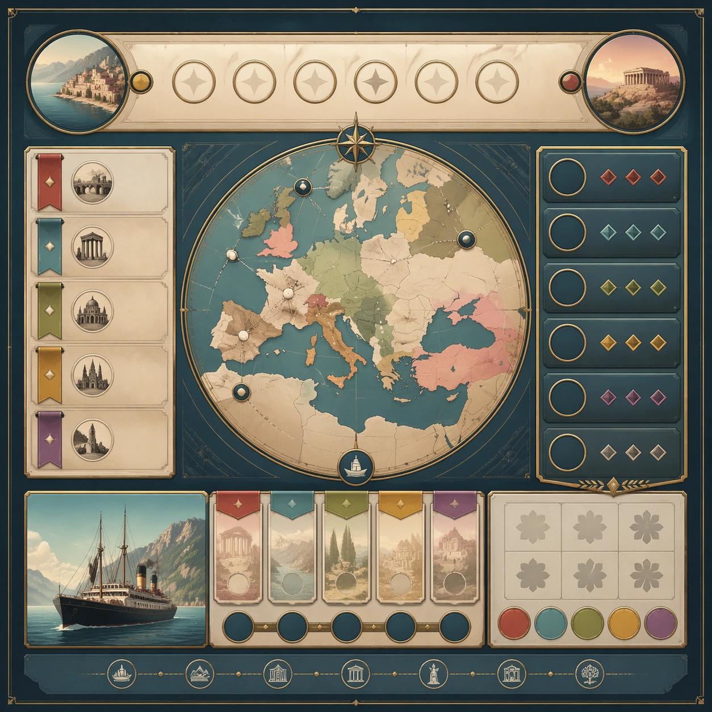

```text
Scene:
Create a square standalone support image for Destination Poster Grand Tour Language. Build a support-surface study with a clear focal hierarchy and a finished professional surface. Use a polished modular board or campaign surface with clean spacing, premium game-UI finish, and clear focal hierarchy. The frame should feel self-contained and polished, with enough structure to explain the system even without the reference series, yet still obviously belonging to the same theme and production world.

Subject:
Show a coherent original game-art system built for premium production and marketing surfaces in a way that emphasizes the intended support surface. Keep the same system logic stable across screenshots, cards, banners, and overview boards. Even though this image is independent, the viewer should still recognize the same universe, same commercial logic, and same production intent as the core package.

Important details:
Lock framing, icon grammar, palette blocking, and surface hierarchy so the kit feels production-ready and consistent. Preserve the broader theme language through color, framing, material choices, and modular composition. Use clean panel rhythm, premium asset presentation, and believable detail density. The image should work equally well as a gallery study, research reference, and mock production deliverable.

Use case:
Destination Poster Grand Tour Language single study 5/9, exploring support one as a support surface.

Constraints:
No readable text, no watermark, no logos, preserve exact 1:1 aspect ratio, no unrelated objects, no broken visual hierarchy, no visual noise that obscures the main surface, no accidental brand resemblance.
```

[Pinned source](https://github.com/ChaosRealmsAI/gpt-image-2-gallery/blob/5296db8c996e38776c83a0bc8c64f848dcd512b3/works/topics/destination-poster-grand-tour-language/packages/single-support-studies/images/support-one/meta.json) · GPT Image2 · 1254×1254 · No source-declared image dependencies. · ProjectD:[published and publicly accepted](https://aitoolsradar.com/en/prompts/63ad4c7af5760a)

## Support Two · destination-poster-grand-tour-language/single-support-studies/support-two

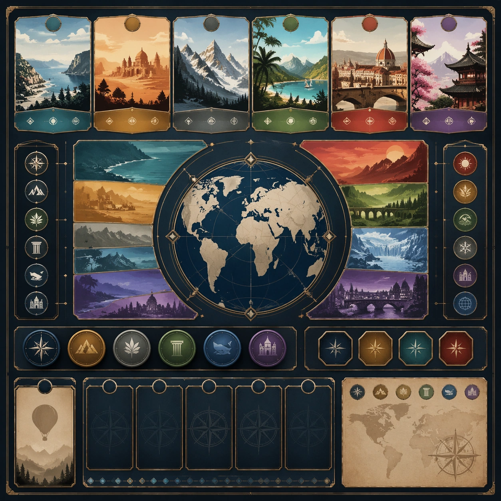

```text
Scene:
Create a square standalone support image for Destination Poster Grand Tour Language. Build a second support-surface study with a clear focal hierarchy and a finished professional surface. Use a polished modular board or campaign surface with clean spacing, premium game-UI finish, and clear focal hierarchy. The frame should feel self-contained and polished, with enough structure to explain the system even without the reference series, yet still obviously belonging to the same theme and production world.

Subject:
Show a coherent original game-art system built for premium production and marketing surfaces in a way that emphasizes the intended support surface. Keep the same system logic stable across screenshots, cards, banners, and overview boards. Even though this image is independent, the viewer should still recognize the same universe, same commercial logic, and same production intent as the core package.

Important details:
Lock framing, icon grammar, palette blocking, and surface hierarchy so the kit feels production-ready and consistent. Preserve the broader theme language through color, framing, material choices, and modular composition. Use clean panel rhythm, premium asset presentation, and believable detail density. The image should work equally well as a gallery study, research reference, and mock production deliverable.

Use case:
Destination Poster Grand Tour Language single study 6/9, exploring support two as a support surface.

Constraints:
No readable text, no watermark, no logos, preserve exact 1:1 aspect ratio, no unrelated objects, no broken visual hierarchy, no visual noise that obscures the main surface, no accidental brand resemblance.
```

[Pinned source](https://github.com/ChaosRealmsAI/gpt-image-2-gallery/blob/5296db8c996e38776c83a0bc8c64f848dcd512b3/works/topics/destination-poster-grand-tour-language/packages/single-support-studies/images/support-two/meta.json) · GPT Image2 · 1254×1254 · No source-declared image dependencies. · ProjectD:[published and publicly accepted](https://aitoolsradar.com/en/prompts/c49379e469e984)

## Support Three · destination-poster-grand-tour-language/single-support-studies/support-three

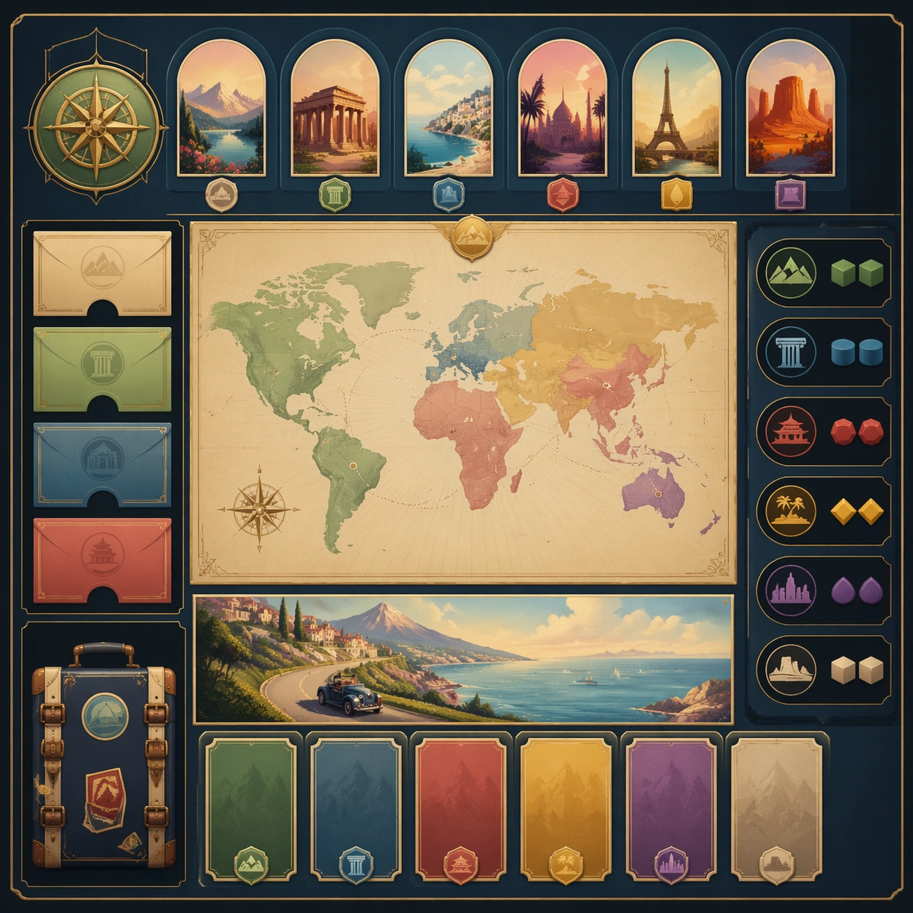

```text
Scene:
Create a square standalone support image for Destination Poster Grand Tour Language. Build a third support-surface study with a clear focal hierarchy and a finished professional surface. Use a polished modular board or campaign surface with clean spacing, premium game-UI finish, and clear focal hierarchy. The frame should feel self-contained and polished, with enough structure to explain the system even without the reference series, yet still obviously belonging to the same theme and production world.

Subject:
Show a coherent original game-art system built for premium production and marketing surfaces in a way that emphasizes the intended support surface. Keep the same system logic stable across screenshots, cards, banners, and overview boards. Even though this image is independent, the viewer should still recognize the same universe, same commercial logic, and same production intent as the core package.

Important details:
Lock framing, icon grammar, palette blocking, and surface hierarchy so the kit feels production-ready and consistent. Preserve the broader theme language through color, framing, material choices, and modular composition. Use clean panel rhythm, premium asset presentation, and believable detail density. The image should work equally well as a gallery study, research reference, and mock production deliverable.

Use case:
Destination Poster Grand Tour Language single study 7/9, exploring support three as a support surface.

Constraints:
No readable text, no watermark, no logos, preserve exact 1:1 aspect ratio, no unrelated objects, no broken visual hierarchy, no visual noise that obscures the main surface, no accidental brand resemblance.
```

[Pinned source](https://github.com/ChaosRealmsAI/gpt-image-2-gallery/blob/5296db8c996e38776c83a0bc8c64f848dcd512b3/works/topics/destination-poster-grand-tour-language/packages/single-support-studies/images/support-three/meta.json) · GPT Image2 · 1254×1254 · No source-declared image dependencies. · ProjectD:[published and publicly accepted](https://aitoolsradar.com/en/prompts/a31684798db820)

## Support Four · destination-poster-grand-tour-language/single-support-studies/support-four

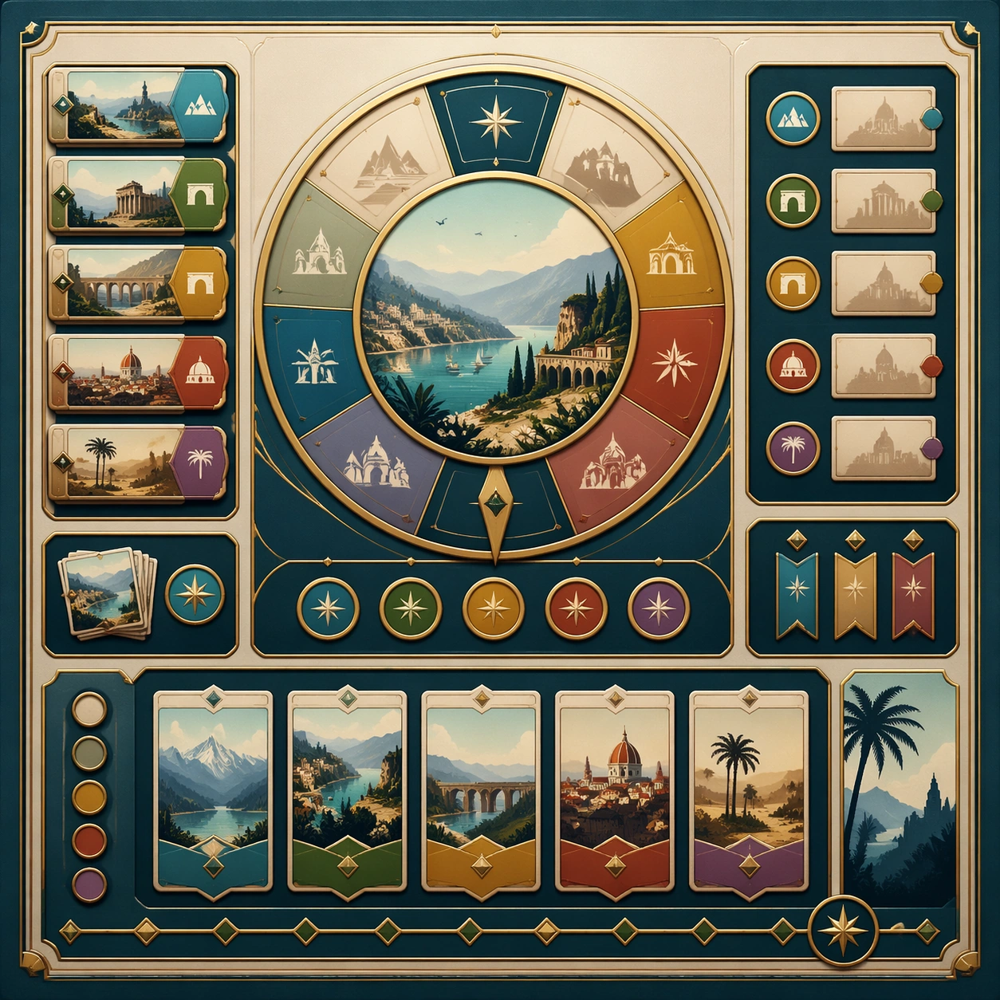

```text
Scene:
Create a square standalone support image for Destination Poster Grand Tour Language. Build a fourth support-surface study with a clear focal hierarchy and a finished professional surface. Use a polished modular board or campaign surface with clean spacing, premium game-UI finish, and clear focal hierarchy. The frame should feel self-contained and polished, with enough structure to explain the system even without the reference series, yet still obviously belonging to the same theme and production world.

Subject:
Show a coherent original game-art system built for premium production and marketing surfaces in a way that emphasizes the intended support surface. Keep the same system logic stable across screenshots, cards, banners, and overview boards. Even though this image is independent, the viewer should still recognize the same universe, same commercial logic, and same production intent as the core package.

Important details:
Lock framing, icon grammar, palette blocking, and surface hierarchy so the kit feels production-ready and consistent. Preserve the broader theme language through color, framing, material choices, and modular composition. Use clean panel rhythm, premium asset presentation, and believable detail density. The image should work equally well as a gallery study, research reference, and mock production deliverable.

Use case:
Destination Poster Grand Tour Language single study 8/9, exploring support four as a support surface.

Constraints:
No readable text, no watermark, no logos, preserve exact 1:1 aspect ratio, no unrelated objects, no broken visual hierarchy, no visual noise that obscures the main surface, no accidental brand resemblance.
```

[Pinned source](https://github.com/ChaosRealmsAI/gpt-image-2-gallery/blob/5296db8c996e38776c83a0bc8c64f848dcd512b3/works/topics/destination-poster-grand-tour-language/packages/single-support-studies/images/support-four/meta.json) · GPT Image2 · 1254×1254 · No source-declared image dependencies. · ProjectD:[published and publicly accepted](https://aitoolsradar.com/en/prompts/745fb4355bd806)

## Support Five · destination-poster-grand-tour-language/single-support-studies/support-five

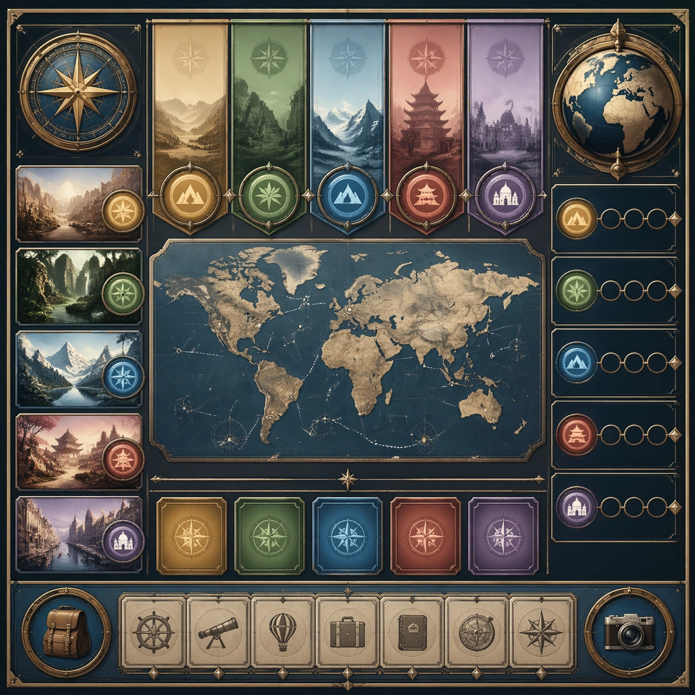

```text
Scene:
Create a square standalone support image for Destination Poster Grand Tour Language. Build a fifth support-surface study with a clear focal hierarchy and a finished professional surface. Use a polished modular board or campaign surface with clean spacing, premium game-UI finish, and clear focal hierarchy. The frame should feel self-contained and polished, with enough structure to explain the system even without the reference series, yet still obviously belonging to the same theme and production world.

Subject:
Show a coherent original game-art system built for premium production and marketing surfaces in a way that emphasizes the intended support surface. Keep the same system logic stable across screenshots, cards, banners, and overview boards. Even though this image is independent, the viewer should still recognize the same universe, same commercial logic, and same production intent as the core package.

Important details:
Lock framing, icon grammar, palette blocking, and surface hierarchy so the kit feels production-ready and consistent. Preserve the broader theme language through color, framing, material choices, and modular composition. Use clean panel rhythm, premium asset presentation, and believable detail density. The image should work equally well as a gallery study, research reference, and mock production deliverable.

Use case:
Destination Poster Grand Tour Language single study 9/9, exploring support five as a support surface.

Constraints:
No readable text, no watermark, no logos, preserve exact 1:1 aspect ratio, no unrelated objects, no broken visual hierarchy, no visual noise that obscures the main surface, no accidental brand resemblance.
```

[Pinned source](https://github.com/ChaosRealmsAI/gpt-image-2-gallery/blob/5296db8c996e38776c83a0bc8c64f848dcd512b3/works/topics/destination-poster-grand-tour-language/packages/single-support-studies/images/support-five/meta.json) · GPT Image2 · 1254×1254 · No source-declared image dependencies. · ProjectD:[published and publicly accepted](https://aitoolsradar.com/en/prompts/bd885ba0df6a6a)

## Reference Anchor · detail-page-story-scroll/series-core-system/01-reference-anchor

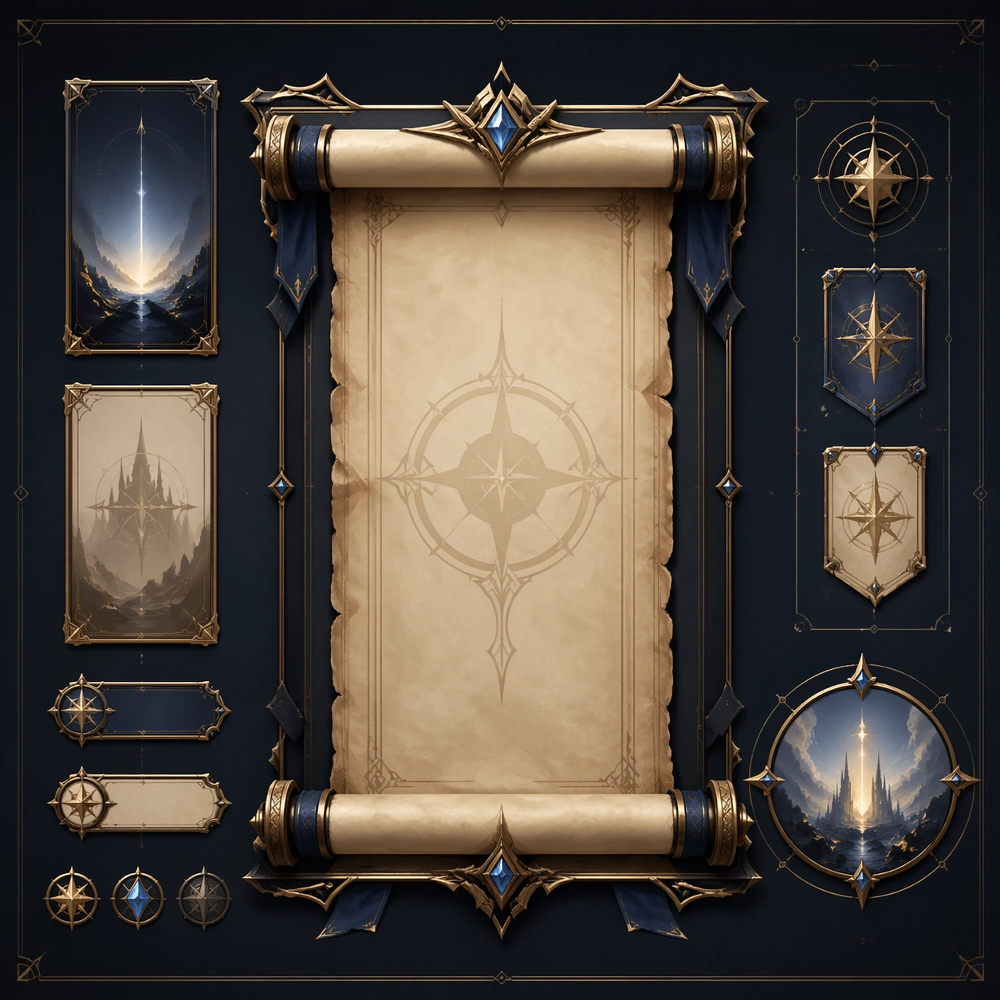

```text
Scene:
Create a square reference image for Detail Page Story Scroll. Build a reference anchor establishing the core system with a premium, production-ready finish. Use a polished modular board or campaign surface with clean spacing, premium game-UI finish, and clear focal hierarchy. The composition should feel intentional, clean, and reusable for gallery, research, campaign, or internal handoff contexts. Lighting must support readability first, with the main forms clearly separated from the background and enough breathing room for the system to stay legible at both hero scale and thumbnail scale.

Subject:
Center a coherent original game-art system built for premium production and marketing surfaces. For this image, focus on reference anchor. Keep the same system logic stable across screenshots, cards, banners, and overview boards. This image is the canonical anchor that later series images must follow. The viewer should immediately understand what role this surface plays inside a cohesive game-production asset pack.

Important details:
Lock framing, icon grammar, palette blocking, and surface hierarchy so the kit feels production-ready and consistent. Preserve the core silhouette, framing language, and material logic from the reference image while each variation changes function. Keep materials believable, edge hierarchy disciplined, and the visual language consistent with Detail Scroll. Use abstract interface blocks or diagram accents when helpful, but avoid any readable language. The final result should feel like a deliberate production asset rather than a random illustration.

Use case:
Detail Page Story Scroll series study 1/9, designed as reference anchor within a cohesive asset pack.

Constraints:
No readable text, no watermark, no logos, preserve exact 1:1 aspect ratio, no unrelated objects, no broken visual hierarchy, no malformed anatomy or broken perspective, no random decorative clutter.
```

[Pinned source](https://github.com/ChaosRealmsAI/gpt-image-2-gallery/blob/5296db8c996e38776c83a0bc8c64f848dcd512b3/works/topics/detail-page-story-scroll/packages/series-core-system/images/01-reference-anchor/meta.json) · GPT Image2 · 1254×1254 · No source-declared image dependencies. · ProjectD:[published and publicly accepted](https://aitoolsradar.com/en/prompts/33e8205ea18820)

## Variant One · detail-page-story-scroll/series-core-system/02-variant-one

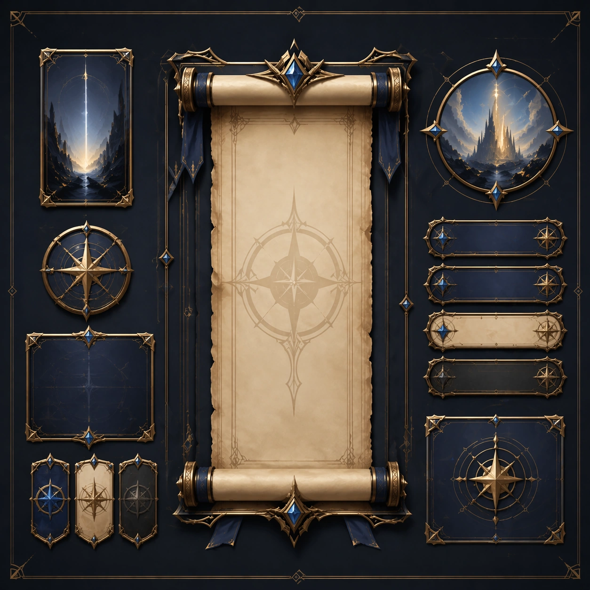

```text
Scene:
Create a square dependent image for Detail Page Story Scroll. Build a first controlled variation in the same system with a premium, production-ready finish. Use a polished modular board or campaign surface with clean spacing, premium game-UI finish, and clear focal hierarchy. The composition should feel intentional, clean, and reusable for gallery, research, campaign, or internal handoff contexts. Lighting must support readability first, with the main forms clearly separated from the background and enough breathing room for the system to stay legible at both hero scale and thumbnail scale.

Subject:
Center a coherent original game-art system built for premium production and marketing surfaces. For this image, focus on the intended support surface. Keep the same system logic stable across screenshots, cards, banners, and overview boards. Preserve exact identity or system logic from the reference image while changing only the intended variation axis. The viewer should immediately understand what role this surface plays inside a cohesive game-production asset pack.

Important details:
Lock framing, icon grammar, palette blocking, and surface hierarchy so the kit feels production-ready and consistent. Preserve the core silhouette, framing language, and material logic from the reference image while each variation changes function. Keep materials believable, edge hierarchy disciplined, and the visual language consistent with Detail Scroll. Use abstract interface blocks or diagram accents when helpful, but avoid any readable language. The final result should feel like a deliberate production asset rather than a random illustration.

Use case:
Detail Page Story Scroll series study 2/9, designed as variant one within a cohesive asset pack.

Constraints:
No readable text, no watermark, no logos, preserve exact 1:1 aspect ratio, no unrelated objects, no broken visual hierarchy, no malformed anatomy or broken perspective, no random decorative clutter.
```

[Pinned source](https://github.com/ChaosRealmsAI/gpt-image-2-gallery/blob/5296db8c996e38776c83a0bc8c64f848dcd512b3/works/topics/detail-page-story-scroll/packages/series-core-system/images/02-variant-one/meta.json) · GPT Image2 · 1254×1254 · Reference images required. · ProjectD:[published and publicly accepted](https://aitoolsradar.com/en/prompts/ff1d11e834311f)

## Variant Two · detail-page-story-scroll/series-core-system/03-variant-two

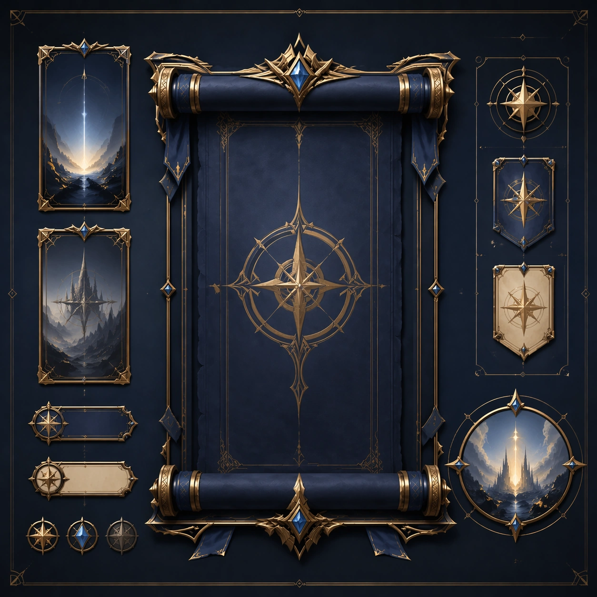

```text
Scene:
Create a square dependent image for Detail Page Story Scroll. Build a second controlled variation in the same system with a premium, production-ready finish. Use a polished modular board or campaign surface with clean spacing, premium game-UI finish, and clear focal hierarchy. The composition should feel intentional, clean, and reusable for gallery, research, campaign, or internal handoff contexts. Lighting must support readability first, with the main forms clearly separated from the background and enough breathing room for the system to stay legible at both hero scale and thumbnail scale.

Subject:
Center a coherent original game-art system built for premium production and marketing surfaces. For this image, focus on the intended support surface. Keep the same system logic stable across screenshots, cards, banners, and overview boards. Preserve exact identity or system logic from the reference image while changing only the intended variation axis. The viewer should immediately understand what role this surface plays inside a cohesive game-production asset pack.

Important details:
Lock framing, icon grammar, palette blocking, and surface hierarchy so the kit feels production-ready and consistent. Preserve the core silhouette, framing language, and material logic from the reference image while each variation changes function. Keep materials believable, edge hierarchy disciplined, and the visual language consistent with Detail Scroll. Use abstract interface blocks or diagram accents when helpful, but avoid any readable language. The final result should feel like a deliberate production asset rather than a random illustration.

Use case:
Detail Page Story Scroll series study 3/9, designed as variant two within a cohesive asset pack.

Constraints:
No readable text, no watermark, no logos, preserve exact 1:1 aspect ratio, no unrelated objects, no broken visual hierarchy, no malformed anatomy or broken perspective, no random decorative clutter.
```

[Pinned source](https://github.com/ChaosRealmsAI/gpt-image-2-gallery/blob/5296db8c996e38776c83a0bc8c64f848dcd512b3/works/topics/detail-page-story-scroll/packages/series-core-system/images/03-variant-two/meta.json) · GPT Image2 · 1254×1254 · Reference images required. · ProjectD:[published and publicly accepted](https://aitoolsradar.com/en/prompts/14b7ff8027bada)

## Variant Three · detail-page-story-scroll/series-core-system/04-variant-three

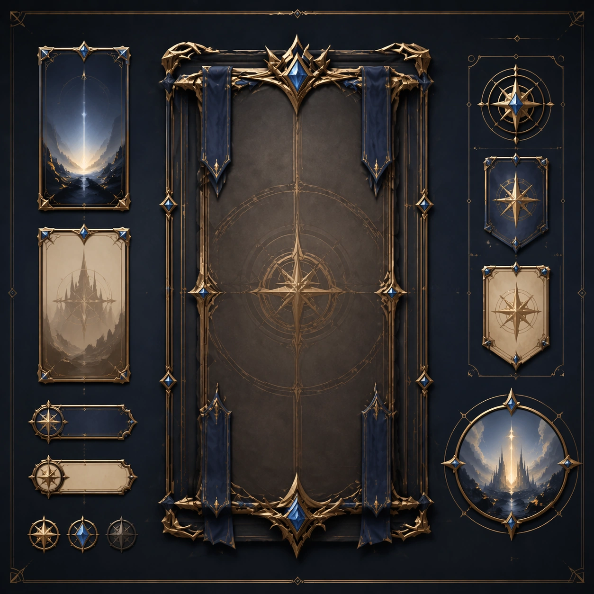

```text
Scene:
Create a square dependent image for Detail Page Story Scroll. Build a third controlled variation in the same system with a premium, production-ready finish. Use a polished modular board or campaign surface with clean spacing, premium game-UI finish, and clear focal hierarchy. The composition should feel intentional, clean, and reusable for gallery, research, campaign, or internal handoff contexts. Lighting must support readability first, with the main forms clearly separated from the background and enough breathing room for the system to stay legible at both hero scale and thumbnail scale.

Subject:
Center a coherent original game-art system built for premium production and marketing surfaces. For this image, focus on the intended support surface. Keep the same system logic stable across screenshots, cards, banners, and overview boards. Preserve exact identity or system logic from the reference image while changing only the intended variation axis. The viewer should immediately understand what role this surface plays inside a cohesive game-production asset pack.

Important details:
Lock framing, icon grammar, palette blocking, and surface hierarchy so the kit feels production-ready and consistent. Preserve the core silhouette, framing language, and material logic from the reference image while each variation changes function. Keep materials believable, edge hierarchy disciplined, and the visual language consistent with Detail Scroll. Use abstract interface blocks or diagram accents when helpful, but avoid any readable language. The final result should feel like a deliberate production asset rather than a random illustration.

Use case:
Detail Page Story Scroll series study 4/9, designed as variant three within a cohesive asset pack.

Constraints:
No readable text, no watermark, no logos, preserve exact 1:1 aspect ratio, no unrelated objects, no broken visual hierarchy, no malformed anatomy or broken perspective, no random decorative clutter.
```

[Pinned source](https://github.com/ChaosRealmsAI/gpt-image-2-gallery/blob/5296db8c996e38776c83a0bc8c64f848dcd512b3/works/topics/detail-page-story-scroll/packages/series-core-system/images/04-variant-three/meta.json) · GPT Image2 · 1254×1254 · Reference images required. · ProjectD:[published and publicly accepted](https://aitoolsradar.com/en/prompts/ef686074e725e9)

## Support One · detail-page-story-scroll/single-support-studies/support-one

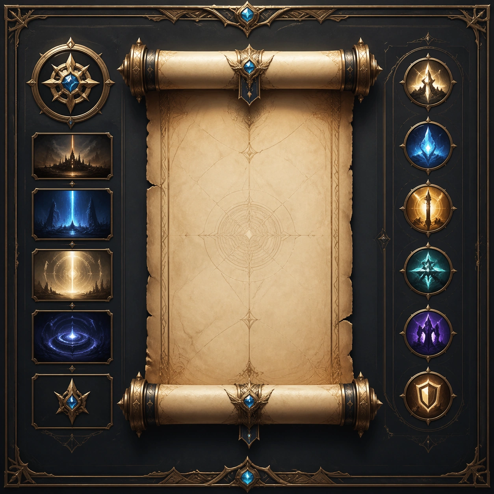

```text
Scene:
Create a square standalone support image for Detail Page Story Scroll. Build a support-surface study with a clear focal hierarchy and a finished professional surface. Use a polished modular board or campaign surface with clean spacing, premium game-UI finish, and clear focal hierarchy. The frame should feel self-contained and polished, with enough structure to explain the system even without the reference series, yet still obviously belonging to the same theme and production world.

Subject:
Show a coherent original game-art system built for premium production and marketing surfaces in a way that emphasizes the intended support surface. Keep the same system logic stable across screenshots, cards, banners, and overview boards. Even though this image is independent, the viewer should still recognize the same universe, same commercial logic, and same production intent as the core package.

Important details:
Lock framing, icon grammar, palette blocking, and surface hierarchy so the kit feels production-ready and consistent. Preserve the broader theme language through color, framing, material choices, and modular composition. Use clean panel rhythm, premium asset presentation, and believable detail density. The image should work equally well as a gallery study, research reference, and mock production deliverable.

Use case:
Detail Page Story Scroll single study 5/9, exploring support one as a support surface.

Constraints:
No readable text, no watermark, no logos, preserve exact 1:1 aspect ratio, no unrelated objects, no broken visual hierarchy, no visual noise that obscures the main surface, no accidental brand resemblance.
```

[Pinned source](https://github.com/ChaosRealmsAI/gpt-image-2-gallery/blob/5296db8c996e38776c83a0bc8c64f848dcd512b3/works/topics/detail-page-story-scroll/packages/single-support-studies/images/support-one/meta.json) · GPT Image2 · 1254×1254 · No source-declared image dependencies. · ProjectD:[published and publicly accepted](https://aitoolsradar.com/en/prompts/99e90d2cb411ab)

## Support Two · detail-page-story-scroll/single-support-studies/support-two

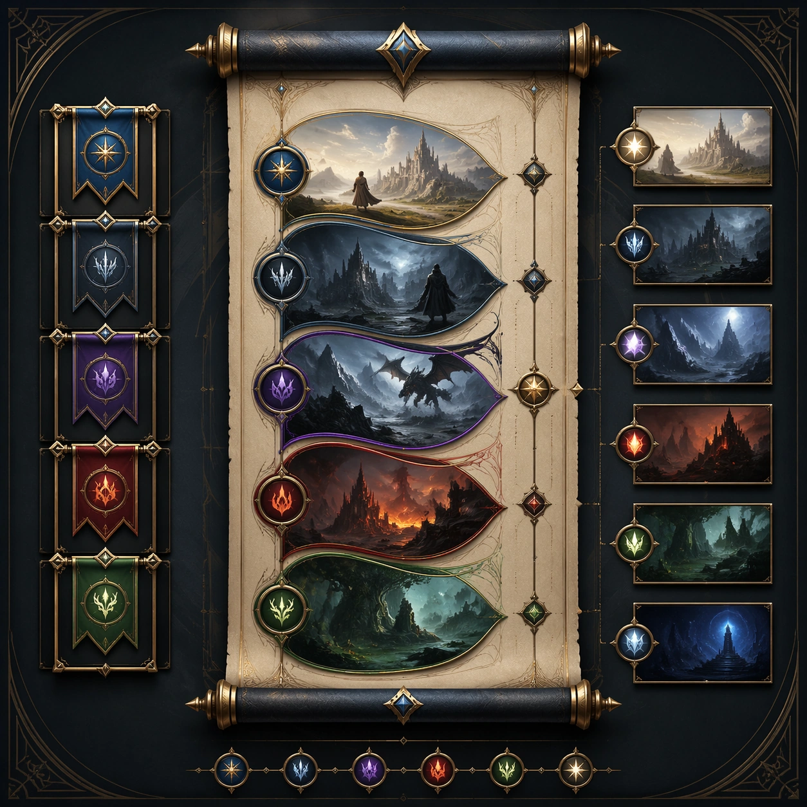

```text
Scene:
Create a square standalone support image for Detail Page Story Scroll. Build a second support-surface study with a clear focal hierarchy and a finished professional surface. Use a polished modular board or campaign surface with clean spacing, premium game-UI finish, and clear focal hierarchy. The frame should feel self-contained and polished, with enough structure to explain the system even without the reference series, yet still obviously belonging to the same theme and production world.

Subject:
Show a coherent original game-art system built for premium production and marketing surfaces in a way that emphasizes the intended support surface. Keep the same system logic stable across screenshots, cards, banners, and overview boards. Even though this image is independent, the viewer should still recognize the same universe, same commercial logic, and same production intent as the core package.

Important details:
Lock framing, icon grammar, palette blocking, and surface hierarchy so the kit feels production-ready and consistent. Preserve the broader theme language through color, framing, material choices, and modular composition. Use clean panel rhythm, premium asset presentation, and believable detail density. The image should work equally well as a gallery study, research reference, and mock production deliverable.

Use case:
Detail Page Story Scroll single study 6/9, exploring support two as a support surface.

Constraints:
No readable text, no watermark, no logos, preserve exact 1:1 aspect ratio, no unrelated objects, no broken visual hierarchy, no visual noise that obscures the main surface, no accidental brand resemblance.
```

[Pinned source](https://github.com/ChaosRealmsAI/gpt-image-2-gallery/blob/5296db8c996e38776c83a0bc8c64f848dcd512b3/works/topics/detail-page-story-scroll/packages/single-support-studies/images/support-two/meta.json) · GPT Image2 · 1254×1254 · No source-declared image dependencies. · ProjectD:[published and publicly accepted](https://aitoolsradar.com/en/prompts/51824cdcdf05e2)

## Support Three · detail-page-story-scroll/single-support-studies/support-three

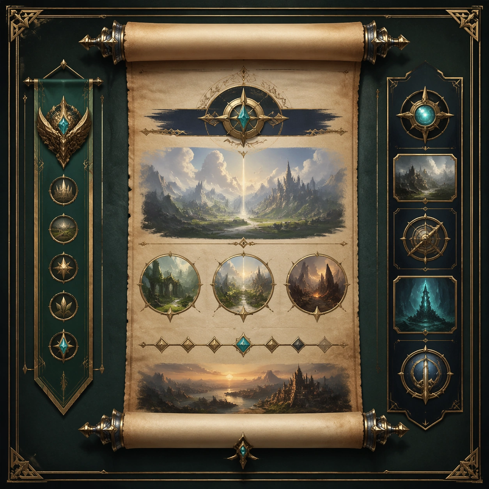

```text
Scene:
Create a square standalone support image for Detail Page Story Scroll. Build a third support-surface study with a clear focal hierarchy and a finished professional surface. Use a polished modular board or campaign surface with clean spacing, premium game-UI finish, and clear focal hierarchy. The frame should feel self-contained and polished, with enough structure to explain the system even without the reference series, yet still obviously belonging to the same theme and production world.

Subject:
Show a coherent original game-art system built for premium production and marketing surfaces in a way that emphasizes the intended support surface. Keep the same system logic stable across screenshots, cards, banners, and overview boards. Even though this image is independent, the viewer should still recognize the same universe, same commercial logic, and same production intent as the core package.

Important details:
Lock framing, icon grammar, palette blocking, and surface hierarchy so the kit feels production-ready and consistent. Preserve the broader theme language through color, framing, material choices, and modular composition. Use clean panel rhythm, premium asset presentation, and believable detail density. The image should work equally well as a gallery study, research reference, and mock production deliverable.

Use case:
Detail Page Story Scroll single study 7/9, exploring support three as a support surface.

Constraints:
No readable text, no watermark, no logos, preserve exact 1:1 aspect ratio, no unrelated objects, no broken visual hierarchy, no visual noise that obscures the main surface, no accidental brand resemblance.
```

[Pinned source](https://github.com/ChaosRealmsAI/gpt-image-2-gallery/blob/5296db8c996e38776c83a0bc8c64f848dcd512b3/works/topics/detail-page-story-scroll/packages/single-support-studies/images/support-three/meta.json) · GPT Image2 · 1254×1254 · No source-declared image dependencies. · ProjectD:[published and publicly accepted](https://aitoolsradar.com/en/prompts/bd9590bf151ae5)

## Support Four · detail-page-story-scroll/single-support-studies/support-four

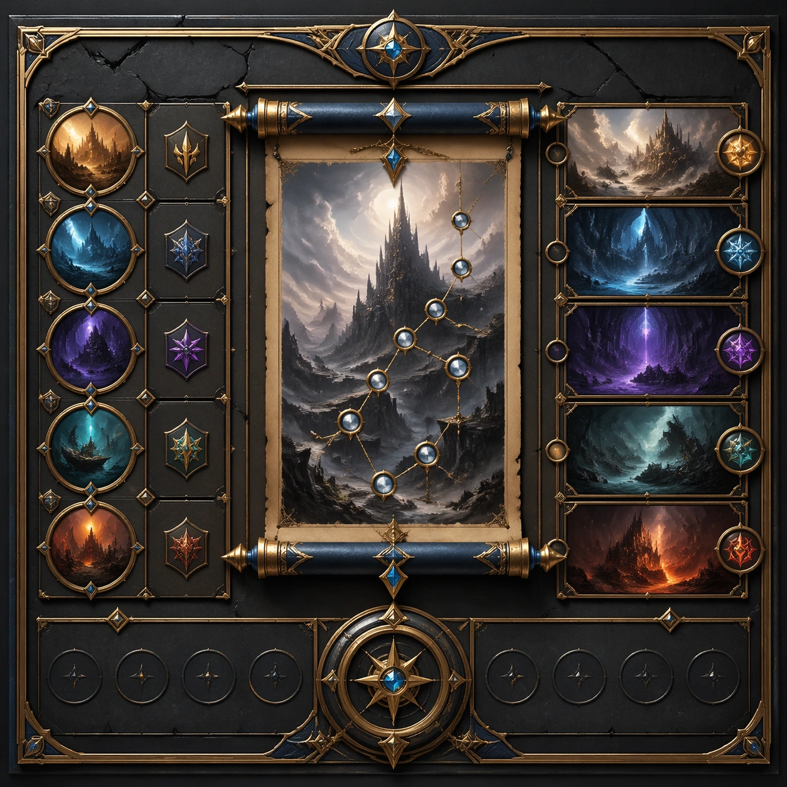

```text
Scene:
Create a square standalone support image for Detail Page Story Scroll. Build a fourth support-surface study with a clear focal hierarchy and a finished professional surface. Use a polished modular board or campaign surface with clean spacing, premium game-UI finish, and clear focal hierarchy. The frame should feel self-contained and polished, with enough structure to explain the system even without the reference series, yet still obviously belonging to the same theme and production world.

Subject:
Show a coherent original game-art system built for premium production and marketing surfaces in a way that emphasizes the intended support surface. Keep the same system logic stable across screenshots, cards, banners, and overview boards. Even though this image is independent, the viewer should still recognize the same universe, same commercial logic, and same production intent as the core package.

Important details:
Lock framing, icon grammar, palette blocking, and surface hierarchy so the kit feels production-ready and consistent. Preserve the broader theme language through color, framing, material choices, and modular composition. Use clean panel rhythm, premium asset presentation, and believable detail density. The image should work equally well as a gallery study, research reference, and mock production deliverable.

Use case:
Detail Page Story Scroll single study 8/9, exploring support four as a support surface.

Constraints:
No readable text, no watermark, no logos, preserve exact 1:1 aspect ratio, no unrelated objects, no broken visual hierarchy, no visual noise that obscures the main surface, no accidental brand resemblance.
```

[Pinned source](https://github.com/ChaosRealmsAI/gpt-image-2-gallery/blob/5296db8c996e38776c83a0bc8c64f848dcd512b3/works/topics/detail-page-story-scroll/packages/single-support-studies/images/support-four/meta.json) · GPT Image2 · 1254×1254 · No source-declared image dependencies. · ProjectD:[published and publicly accepted](https://aitoolsradar.com/en/prompts/15225199444646)

## Support Five · detail-page-story-scroll/single-support-studies/support-five

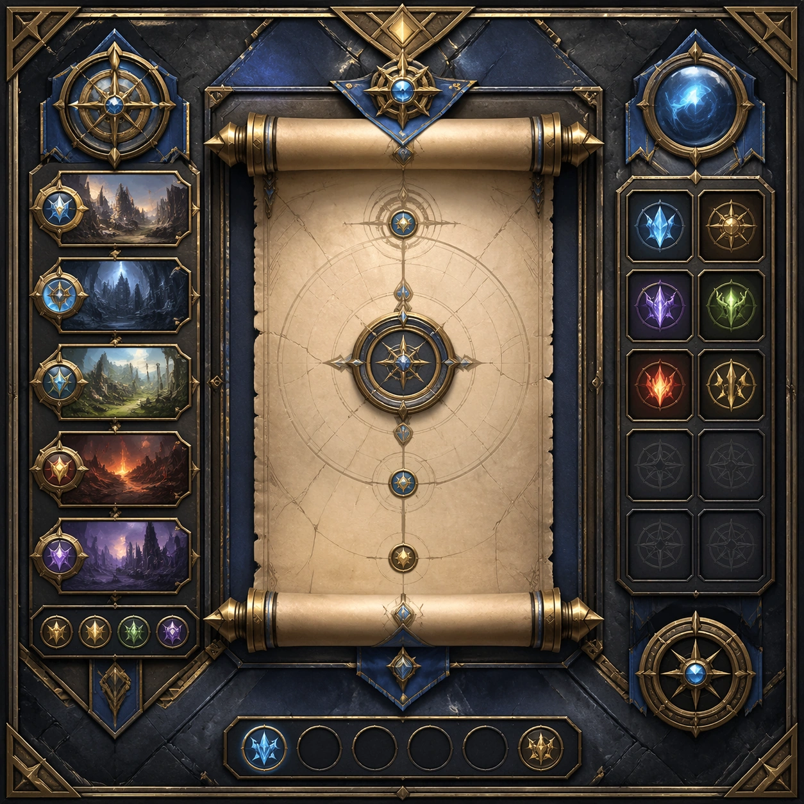

```text
Scene:
Create a square standalone support image for Detail Page Story Scroll. Build a fifth support-surface study with a clear focal hierarchy and a finished professional surface. Use a polished modular board or campaign surface with clean spacing, premium game-UI finish, and clear focal hierarchy. The frame should feel self-contained and polished, with enough structure to explain the system even without the reference series, yet still obviously belonging to the same theme and production world.

Subject:
Show a coherent original game-art system built for premium production and marketing surfaces in a way that emphasizes the intended support surface. Keep the same system logic stable across screenshots, cards, banners, and overview boards. Even though this image is independent, the viewer should still recognize the same universe, same commercial logic, and same production intent as the core package.

Important details:
Lock framing, icon grammar, palette blocking, and surface hierarchy so the kit feels production-ready and consistent. Preserve the broader theme language through color, framing, material choices, and modular composition. Use clean panel rhythm, premium asset presentation, and believable detail density. The image should work equally well as a gallery study, research reference, and mock production deliverable.

Use case:
Detail Page Story Scroll single study 9/9, exploring support five as a support surface.

Constraints:
No readable text, no watermark, no logos, preserve exact 1:1 aspect ratio, no unrelated objects, no broken visual hierarchy, no visual noise that obscures the main surface, no accidental brand resemblance.
```

[Pinned source](https://github.com/ChaosRealmsAI/gpt-image-2-gallery/blob/5296db8c996e38776c83a0bc8c64f848dcd512b3/works/topics/detail-page-story-scroll/packages/single-support-studies/images/support-five/meta.json) · GPT Image2 · 1254×1254 · No source-declared image dependencies. · ProjectD:[published and publicly accepted](https://aitoolsradar.com/en/prompts/bdbecd4c3b1c9e)

## Reference Anchor · developer-tool-dark-ui-refinement-set/series-core-system/01-reference-anchor

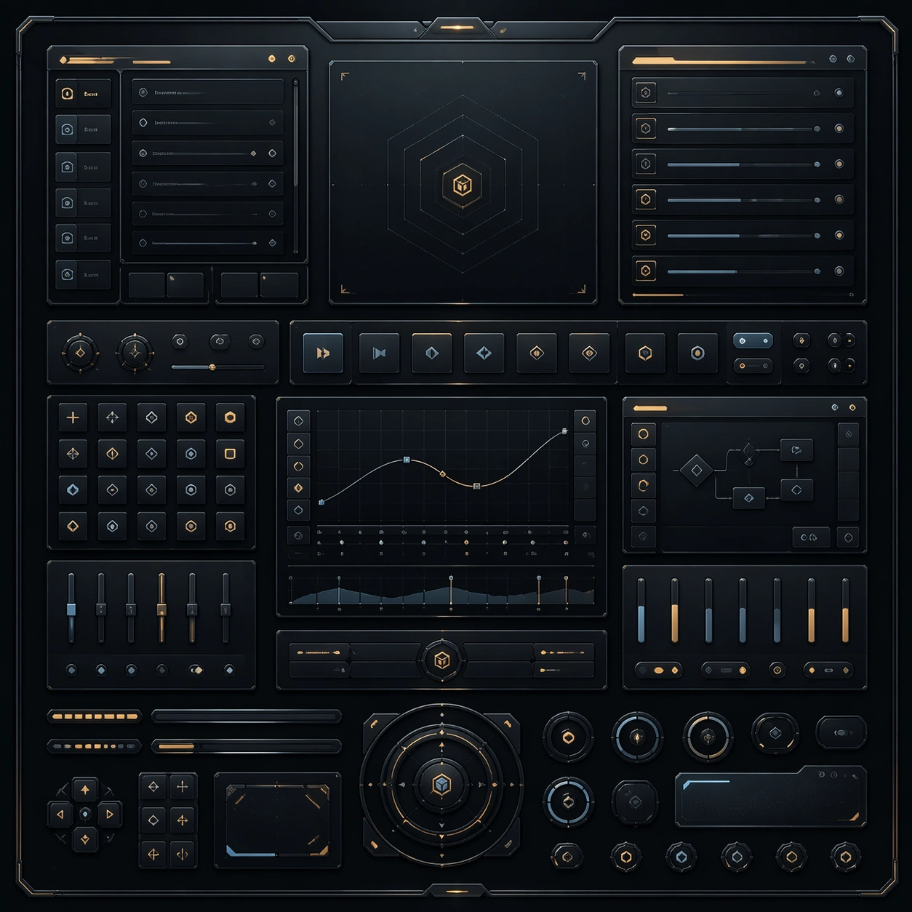

```text
Scene:
Create a square reference image for Developer Tool Dark UI Refinement Set. Build a reference anchor establishing the core system with a premium, production-ready finish. Use a polished modular board or campaign surface with clean spacing, premium game-UI finish, and clear focal hierarchy. The composition should feel intentional, clean, and reusable for gallery, research, campaign, or internal handoff contexts. Lighting must support readability first, with the main forms clearly separated from the background and enough breathing room for the system to stay legible at both hero scale and thumbnail scale.

Subject:
Center a coherent original game-art system built for premium production and marketing surfaces. For this image, focus on reference anchor. Keep the same system logic stable across screenshots, cards, banners, and overview boards. This image is the canonical anchor that later series images must follow. The viewer should immediately understand what role this surface plays inside a cohesive game-production asset pack.

Important details:
Lock framing, icon grammar, palette blocking, and surface hierarchy so the kit feels production-ready and consistent. Preserve the core silhouette, framing language, and material logic from the reference image while each variation changes function. Keep materials believable, edge hierarchy disciplined, and the visual language consistent with Dev Dark UI. Use abstract interface blocks or diagram accents when helpful, but avoid any readable language. The final result should feel like a deliberate production asset rather than a random illustration.

Use case:
Developer Tool Dark UI Refinement Set series study 1/9, designed as reference anchor within a cohesive asset pack.

Constraints:
No readable text, no watermark, no logos, preserve exact 1:1 aspect ratio, no unrelated objects, no broken visual hierarchy, no malformed anatomy or broken perspective, no random decorative clutter.
```

[Pinned source](https://github.com/ChaosRealmsAI/gpt-image-2-gallery/blob/5296db8c996e38776c83a0bc8c64f848dcd512b3/works/topics/developer-tool-dark-ui-refinement-set/packages/series-core-system/images/01-reference-anchor/meta.json) · GPT Image2 · 1254×1254 · No source-declared image dependencies. · ProjectD:[published and publicly accepted](https://aitoolsradar.com/en/prompts/87e6cd99cb98d4)

## Variant One · developer-tool-dark-ui-refinement-set/series-core-system/02-variant-one

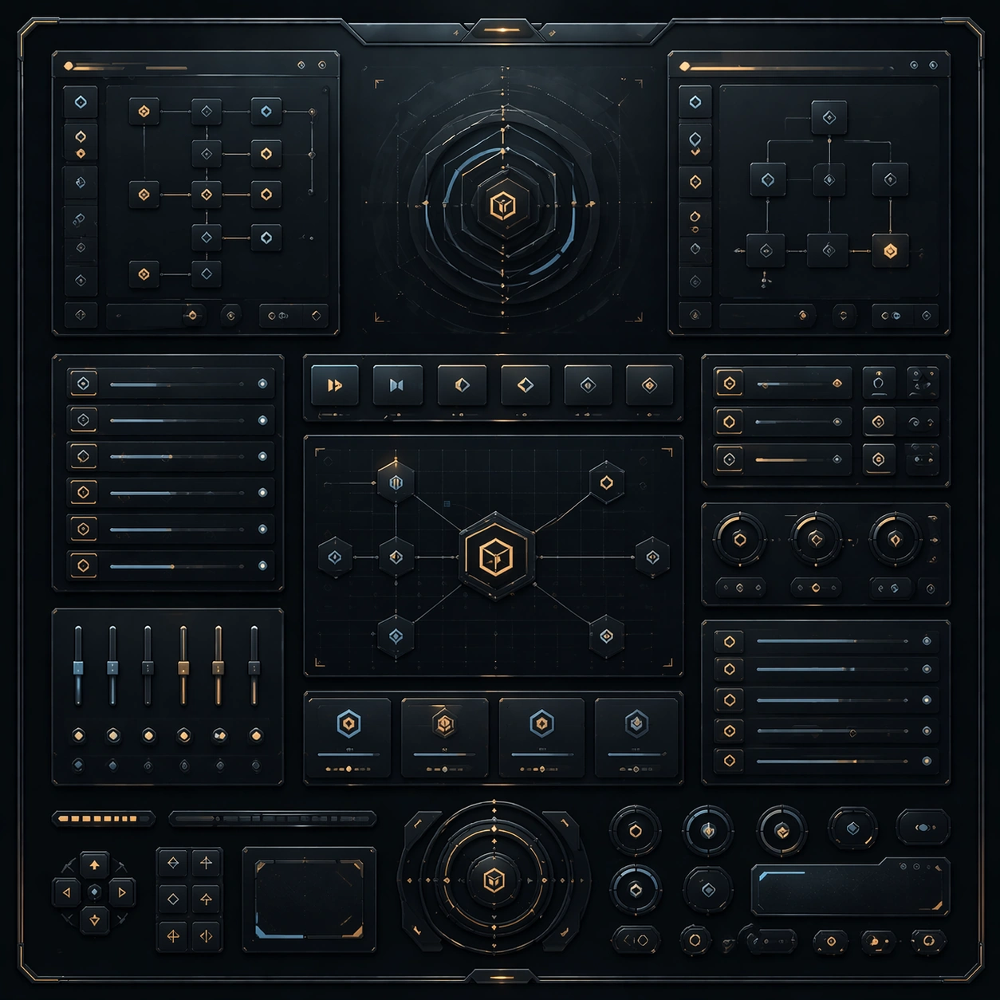

```text
Scene:
Create a square dependent image for Developer Tool Dark UI Refinement Set. Build a first controlled variation in the same system with a premium, production-ready finish. Use a polished modular board or campaign surface with clean spacing, premium game-UI finish, and clear focal hierarchy. The composition should feel intentional, clean, and reusable for gallery, research, campaign, or internal handoff contexts. Lighting must support readability first, with the main forms clearly separated from the background and enough breathing room for the system to stay legible at both hero scale and thumbnail scale.

Subject:
Center a coherent original game-art system built for premium production and marketing surfaces. For this image, focus on the intended support surface. Keep the same system logic stable across screenshots, cards, banners, and overview boards. Preserve exact identity or system logic from the reference image while changing only the intended variation axis. The viewer should immediately understand what role this surface plays inside a cohesive game-production asset pack.

Important details:
Lock framing, icon grammar, palette blocking, and surface hierarchy so the kit feels production-ready and consistent. Preserve the core silhouette, framing language, and material logic from the reference image while each variation changes function. Keep materials believable, edge hierarchy disciplined, and the visual language consistent with Dev Dark UI. Use abstract interface blocks or diagram accents when helpful, but avoid any readable language. The final result should feel like a deliberate production asset rather than a random illustration.

Use case:
Developer Tool Dark UI Refinement Set series study 2/9, designed as variant one within a cohesive asset pack.

Constraints:
No readable text, no watermark, no logos, preserve exact 1:1 aspect ratio, no unrelated objects, no broken visual hierarchy, no malformed anatomy or broken perspective, no random decorative clutter.
```

[Pinned source](https://github.com/ChaosRealmsAI/gpt-image-2-gallery/blob/5296db8c996e38776c83a0bc8c64f848dcd512b3/works/topics/developer-tool-dark-ui-refinement-set/packages/series-core-system/images/02-variant-one/meta.json) · GPT Image2 · 1254×1254 · Reference images required. · ProjectD:[published and publicly accepted](https://aitoolsradar.com/en/prompts/3828e3338a6e94)

## Variant Two · developer-tool-dark-ui-refinement-set/series-core-system/03-variant-two

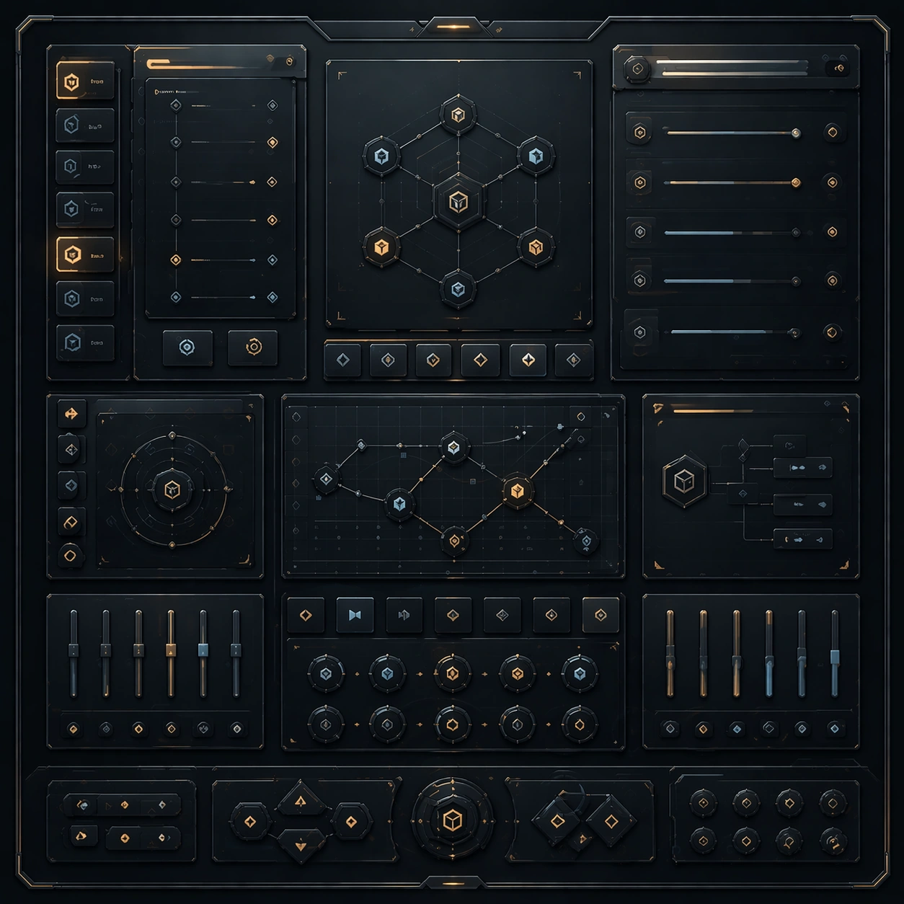

```text
Scene:
Create a square dependent image for Developer Tool Dark UI Refinement Set. Build a second controlled variation in the same system with a premium, production-ready finish. Use a polished modular board or campaign surface with clean spacing, premium game-UI finish, and clear focal hierarchy. The composition should feel intentional, clean, and reusable for gallery, research, campaign, or internal handoff contexts. Lighting must support readability first, with the main forms clearly separated from the background and enough breathing room for the system to stay legible at both hero scale and thumbnail scale.

Subject:
Center a coherent original game-art system built for premium production and marketing surfaces. For this image, focus on the intended support surface. Keep the same system logic stable across screenshots, cards, banners, and overview boards. Preserve exact identity or system logic from the reference image while changing only the intended variation axis. The viewer should immediately understand what role this surface plays inside a cohesive game-production asset pack.

Important details:
Lock framing, icon grammar, palette blocking, and surface hierarchy so the kit feels production-ready and consistent. Preserve the core silhouette, framing language, and material logic from the reference image while each variation changes function. Keep materials believable, edge hierarchy disciplined, and the visual language consistent with Dev Dark UI. Use abstract interface blocks or diagram accents when helpful, but avoid any readable language. The final result should feel like a deliberate production asset rather than a random illustration.

Use case:
Developer Tool Dark UI Refinement Set series study 3/9, designed as variant two within a cohesive asset pack.

Constraints:
No readable text, no watermark, no logos, preserve exact 1:1 aspect ratio, no unrelated objects, no broken visual hierarchy, no malformed anatomy or broken perspective, no random decorative clutter.
```

[Pinned source](https://github.com/ChaosRealmsAI/gpt-image-2-gallery/blob/5296db8c996e38776c83a0bc8c64f848dcd512b3/works/topics/developer-tool-dark-ui-refinement-set/packages/series-core-system/images/03-variant-two/meta.json) · GPT Image2 · 1254×1254 · Reference images required. · ProjectD:[published and publicly accepted](https://aitoolsradar.com/en/prompts/b34e8498de4fac)

## Variant Three · developer-tool-dark-ui-refinement-set/series-core-system/04-variant-three

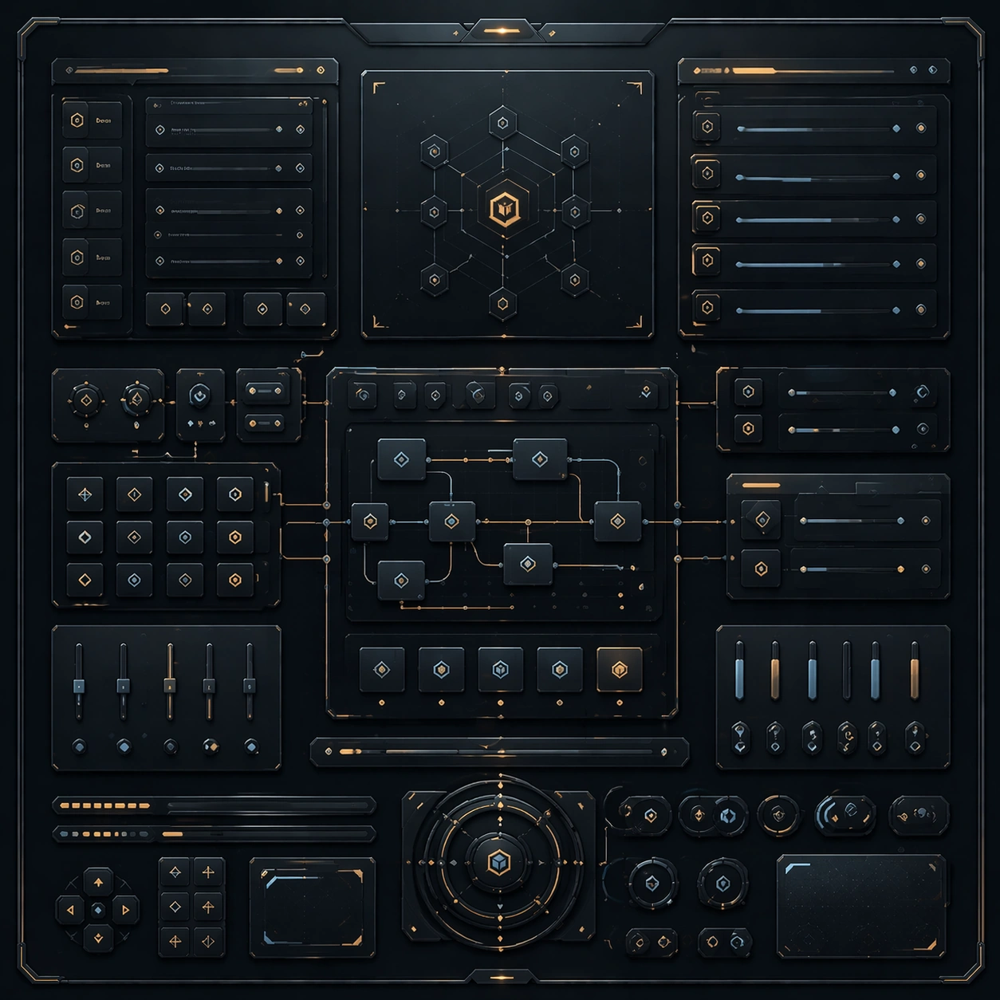

```text
Scene:
Create a square dependent image for Developer Tool Dark UI Refinement Set. Build a third controlled variation in the same system with a premium, production-ready finish. Use a polished modular board or campaign surface with clean spacing, premium game-UI finish, and clear focal hierarchy. The composition should feel intentional, clean, and reusable for gallery, research, campaign, or internal handoff contexts. Lighting must support readability first, with the main forms clearly separated from the background and enough breathing room for the system to stay legible at both hero scale and thumbnail scale.

Subject:
Center a coherent original game-art system built for premium production and marketing surfaces. For this image, focus on the intended support surface. Keep the same system logic stable across screenshots, cards, banners, and overview boards. Preserve exact identity or system logic from the reference image while changing only the intended variation axis. The viewer should immediately understand what role this surface plays inside a cohesive game-production asset pack.

Important details:
Lock framing, icon grammar, palette blocking, and surface hierarchy so the kit feels production-ready and consistent. Preserve the core silhouette, framing language, and material logic from the reference image while each variation changes function. Keep materials believable, edge hierarchy disciplined, and the visual language consistent with Dev Dark UI. Use abstract interface blocks or diagram accents when helpful, but avoid any readable language. The final result should feel like a deliberate production asset rather than a random illustration.

Use case:
Developer Tool Dark UI Refinement Set series study 4/9, designed as variant three within a cohesive asset pack.

Constraints:
No readable text, no watermark, no logos, preserve exact 1:1 aspect ratio, no unrelated objects, no broken visual hierarchy, no malformed anatomy or broken perspective, no random decorative clutter.
```

[Pinned source](https://github.com/ChaosRealmsAI/gpt-image-2-gallery/blob/5296db8c996e38776c83a0bc8c64f848dcd512b3/works/topics/developer-tool-dark-ui-refinement-set/packages/series-core-system/images/04-variant-three/meta.json) · GPT Image2 · 1254×1254 · Reference images required. · ProjectD:[published and publicly accepted](https://aitoolsradar.com/en/prompts/bf870a839495dc)

## Support One · developer-tool-dark-ui-refinement-set/single-support-studies/support-one


```text
Scene:
Create a square standalone support image for Developer Tool Dark UI Refinement Set. Build a support-surface study with a clear focal hierarchy and a finished professional surface. Use a polished modular board or campaign surface with clean spacing, premium game-UI finish, and clear focal hierarchy. The frame should feel self-contained and polished, with enough structure to explain the system even without the reference series, yet still obviously belonging to the same theme and production world.

Subject:
Show a coherent original game-art system built for premium production and marketing surfaces in a way that emphasizes the intended support surface. Keep the same system logic stable across screenshots, cards, banners, and overview boards. Even though this image is independent, the viewer should still recognize the same universe, same commercial logic, and same production intent as the core package.

Important details:
Lock framing, icon grammar, palette blocking, and surface hierarchy so the kit feels production-ready and consistent. Preserve the broader theme language through color, framing, material choices, and modular composition. Use clean panel rhythm, premium asset presentation, and believable detail density. The image should work equally well as a gallery study, research reference, and mock production deliverable.

Use case:
Developer Tool Dark UI Refinement Set single study 5/9, exploring support one as a support surface.

Constraints:
No readable text, no watermark, no logos, preserve exact 1:1 aspect ratio, no unrelated objects, no broken visual hierarchy, no visual noise that obscures the main surface, no accidental brand resemblance.
```

[Pinned source](https://github.com/ChaosRealmsAI/gpt-image-2-gallery/blob/5296db8c996e38776c83a0bc8c64f848dcd512b3/works/topics/developer-tool-dark-ui-refinement-set/packages/single-support-studies/images/support-one/meta.json) · GPT Image2 · 1254×1254 · No source-declared image dependencies. · ProjectD:[published and publicly accepted](https://aitoolsradar.com/en/prompts/132000fbb17016)

## Support Two · developer-tool-dark-ui-refinement-set/single-support-studies/support-two


```text
Scene:
Create a square standalone support image for Developer Tool Dark UI Refinement Set. Build a second support-surface study with a clear focal hierarchy and a finished professional surface. Use a polished modular board or campaign surface with clean spacing, premium game-UI finish, and clear focal hierarchy. The frame should feel self-contained and polished, with enough structure to explain the system even without the reference series, yet still obviously belonging to the same theme and production world.

Subject:
Show a coherent original game-art system built for premium production and marketing surfaces in a way that emphasizes the intended support surface. Keep the same system logic stable across screenshots, cards, banners, and overview boards. Even though this image is independent, the viewer should still recognize the same universe, same commercial logic, and same production intent as the core package.

Important details:
Lock framing, icon grammar, palette blocking, and surface hierarchy so the kit feels production-ready and consistent. Preserve the broader theme language through color, framing, material choices, and modular composition. Use clean panel rhythm, premium asset presentation, and believable detail density. The image should work equally well as a gallery study, research reference, and mock production deliverable.

Use case:
Developer Tool Dark UI Refinement Set single study 6/9, exploring support two as a support surface.

Constraints:
No readable text, no watermark, no logos, preserve exact 1:1 aspect ratio, no unrelated objects, no broken visual hierarchy, no visual noise that obscures the main surface, no accidental brand resemblance.
```

[Pinned source](https://github.com/ChaosRealmsAI/gpt-image-2-gallery/blob/5296db8c996e38776c83a0bc8c64f848dcd512b3/works/topics/developer-tool-dark-ui-refinement-set/packages/single-support-studies/images/support-two/meta.json) · GPT Image2 · 1254×1254 · No source-declared image dependencies. · ProjectD:[published and publicly accepted](https://aitoolsradar.com/en/prompts/98bb81c1d45444)

## Support Three · developer-tool-dark-ui-refinement-set/single-support-studies/support-three


```text
Scene:
Create a square standalone support image for Developer Tool Dark UI Refinement Set. Build a third support-surface study with a clear focal hierarchy and a finished professional surface. Use a polished modular board or campaign surface with clean spacing, premium game-UI finish, and clear focal hierarchy. The frame should feel self-contained and polished, with enough structure to explain the system even without the reference series, yet still obviously belonging to the same theme and production world.

Subject:
Show a coherent original game-art system built for premium production and marketing surfaces in a way that emphasizes the intended support surface. Keep the same system logic stable across screenshots, cards, banners, and overview boards. Even though this image is independent, the viewer should still recognize the same universe, same commercial logic, and same production intent as the core package.

Important details:
Lock framing, icon grammar, palette blocking, and surface hierarchy so the kit feels production-ready and consistent. Preserve the broader theme language through color, framing, material choices, and modular composition. Use clean panel rhythm, premium asset presentation, and believable detail density. The image should work equally well as a gallery study, research reference, and mock production deliverable.

Use case:
Developer Tool Dark UI Refinement Set single study 7/9, exploring support three as a support surface.

Constraints:
No readable text, no watermark, no logos, preserve exact 1:1 aspect ratio, no unrelated objects, no broken visual hierarchy, no visual noise that obscures the main surface, no accidental brand resemblance.
```

[Pinned source](https://github.com/ChaosRealmsAI/gpt-image-2-gallery/blob/5296db8c996e38776c83a0bc8c64f848dcd512b3/works/topics/developer-tool-dark-ui-refinement-set/packages/single-support-studies/images/support-three/meta.json) · GPT Image2 · 1254×1254 · No source-declared image dependencies. · ProjectD:[published and publicly accepted](https://aitoolsradar.com/en/prompts/0b871b1cad5b05)

## Support Four · developer-tool-dark-ui-refinement-set/single-support-studies/support-four


```text
Scene:
Create a square standalone support image for Developer Tool Dark UI Refinement Set. Build a fourth support-surface study with a clear focal hierarchy and a finished professional surface. Use a polished modular board or campaign surface with clean spacing, premium game-UI finish, and clear focal hierarchy. The frame should feel self-contained and polished, with enough structure to explain the system even without the reference series, yet still obviously belonging to the same theme and production world.

Subject:
Show a coherent original game-art system built for premium production and marketing surfaces in a way that emphasizes the intended support surface. Keep the same system logic stable across screenshots, cards, banners, and overview boards. Even though this image is independent, the viewer should still recognize the same universe, same commercial logic, and same production intent as the core package.

Important details:
Lock framing, icon grammar, palette blocking, and surface hierarchy so the kit feels production-ready and consistent. Preserve the broader theme language through color, framing, material choices, and modular composition. Use clean panel rhythm, premium asset presentation, and believable detail density. The image should work equally well as a gallery study, research reference, and mock production deliverable.

Use case:
Developer Tool Dark UI Refinement Set single study 8/9, exploring support four as a support surface.

Constraints:
No readable text, no watermark, no logos, preserve exact 1:1 aspect ratio, no unrelated objects, no broken visual hierarchy, no visual noise that obscures the main surface, no accidental brand resemblance.
```

[Pinned source](https://github.com/ChaosRealmsAI/gpt-image-2-gallery/blob/5296db8c996e38776c83a0bc8c64f848dcd512b3/works/topics/developer-tool-dark-ui-refinement-set/packages/single-support-studies/images/support-four/meta.json) · GPT Image2 · 1254×1254 · No source-declared image dependencies. · ProjectD:[published and publicly accepted](https://aitoolsradar.com/en/prompts/8a75d622793b75)

## Support Five · developer-tool-dark-ui-refinement-set/single-support-studies/support-five


```text
Scene:
Create a square standalone support image for Developer Tool Dark UI Refinement Set. Build a fifth support-surface study with a clear focal hierarchy and a finished professional surface. Use a polished modular board or campaign surface with clean spacing, premium game-UI finish, and clear focal hierarchy. The frame should feel self-contained and polished, with enough structure to explain the system even without the reference series, yet still obviously belonging to the same theme and production world.

Subject:
Show a coherent original game-art system built for premium production and marketing surfaces in a way that emphasizes the intended support surface. Keep the same system logic stable across screenshots, cards, banners, and overview boards. Even though this image is independent, the viewer should still recognize the same universe, same commercial logic, and same production intent as the core package.

Important details:
Lock framing, icon grammar, palette blocking, and surface hierarchy so the kit feels production-ready and consistent. Preserve the broader theme language through color, framing, material choices, and modular composition. Use clean panel rhythm, premium asset presentation, and believable detail density. The image should work equally well as a gallery study, research reference, and mock production deliverable.

Use case:
Developer Tool Dark UI Refinement Set single study 9/9, exploring support five as a support surface.

Constraints:
No readable text, no watermark, no logos, preserve exact 1:1 aspect ratio, no unrelated objects, no broken visual hierarchy, no visual noise that obscures the main surface, no accidental brand resemblance.
```

[Pinned source](https://github.com/ChaosRealmsAI/gpt-image-2-gallery/blob/5296db8c996e38776c83a0bc8c64f848dcd512b3/works/topics/developer-tool-dark-ui-refinement-set/packages/single-support-studies/images/support-five/meta.json) · GPT Image2 · 1254×1254 · No source-declared image dependencies. · ProjectD:[published and publicly accepted](https://aitoolsradar.com/en/prompts/083849b18fdcc0)

## Reference Anchor · dialogue-room-scene-board/series-core-system/01-reference-anchor


```text
Scene:
Create a square reference image for Dialogue Room Scene Board. Build a reference anchor establishing the core system with a premium, production-ready finish. Use a polished modular board or campaign surface with clean spacing, premium game-UI finish, and clear focal hierarchy. The composition should feel intentional, clean, and reusable for gallery, research, campaign, or internal handoff contexts. Lighting must support readability first, with the main forms clearly separated from the background and enough breathing room for the system to stay legible at both hero scale and thumbnail scale.

Subject:
Center a coherent original game-art system built for premium production and marketing surfaces. For this image, focus on reference anchor. Keep the same system logic stable across screenshots, cards, banners, and overview boards. This image is the canonical anchor that later series images must follow. The viewer should immediately understand what role this surface plays inside a cohesive game-production asset pack.

Important details:
Lock framing, icon grammar, palette blocking, and surface hierarchy so the kit feels production-ready and consistent. Preserve the core silhouette, framing language, and material logic from the reference image while each variation changes function. Keep materials believable, edge hierarchy disciplined, and the visual language consistent with Dialogue Scene. Use abstract interface blocks or diagram accents when helpful, but avoid any readable language. The final result should feel like a deliberate production asset rather than a random illustration.

Use case:
Dialogue Room Scene Board series study 1/9, designed as reference anchor within a cohesive asset pack.

Constraints:
No readable text, no watermark, no logos, preserve exact 1:1 aspect ratio, no unrelated objects, no broken visual hierarchy, no malformed anatomy or broken perspective, no random decorative clutter.
```

[Pinned source](https://github.com/ChaosRealmsAI/gpt-image-2-gallery/blob/5296db8c996e38776c83a0bc8c64f848dcd512b3/works/topics/dialogue-room-scene-board/packages/series-core-system/images/01-reference-anchor/meta.json) · GPT Image2 · 1024×1024 · No source-declared image dependencies. · ProjectD:[published and publicly accepted](https://aitoolsradar.com/en/prompts/e33934fa7f99b3)

## Variant One · dialogue-room-scene-board/series-core-system/02-variant-one


```text
Scene:
Create a square dependent image for Dialogue Room Scene Board. Build a first controlled variation in the same system with a premium, production-ready finish. Use a polished modular board or campaign surface with clean spacing, premium game-UI finish, and clear focal hierarchy. The composition should feel intentional, clean, and reusable for gallery, research, campaign, or internal handoff contexts. Lighting must support readability first, with the main forms clearly separated from the background and enough breathing room for the system to stay legible at both hero scale and thumbnail scale.

Subject:
Center a coherent original game-art system built for premium production and marketing surfaces. For this image, focus on the intended support surface. Keep the same system logic stable across screenshots, cards, banners, and overview boards. Preserve exact identity or system logic from the reference image while changing only the intended variation axis. The viewer should immediately understand what role this surface plays inside a cohesive game-production asset pack.

Important details:
Lock framing, icon grammar, palette blocking, and surface hierarchy so the kit feels production-ready and consistent. Preserve the core silhouette, framing language, and material logic from the reference image while each variation changes function. Keep materials believable, edge hierarchy disciplined, and the visual language consistent with Dialogue Scene. Use abstract interface blocks or diagram accents when helpful, but avoid any readable language. The final result should feel like a deliberate production asset rather than a random illustration.

Use case:
Dialogue Room Scene Board series study 2/9, designed as variant one within a cohesive asset pack.

Constraints:
No readable text, no watermark, no logos, preserve exact 1:1 aspect ratio, no unrelated objects, no broken visual hierarchy, no malformed anatomy or broken perspective, no random decorative clutter.
```

[Pinned source](https://github.com/ChaosRealmsAI/gpt-image-2-gallery/blob/5296db8c996e38776c83a0bc8c64f848dcd512b3/works/topics/dialogue-room-scene-board/packages/series-core-system/images/02-variant-one/meta.json) · GPT Image2 · 1254×1254 · Reference images required. · ProjectD:[published and publicly accepted](https://aitoolsradar.com/en/prompts/786d1f50d4074d)

## Variant Two · dialogue-room-scene-board/series-core-system/03-variant-two


```text
Scene:
Create a square dependent image for Dialogue Room Scene Board. Build a second controlled variation in the same system with a premium, production-ready finish. Use a polished modular board or campaign surface with clean spacing, premium game-UI finish, and clear focal hierarchy. The composition should feel intentional, clean, and reusable for gallery, research, campaign, or internal handoff contexts. Lighting must support readability first, with the main forms clearly separated from the background and enough breathing room for the system to stay legible at both hero scale and thumbnail scale.

Subject:
Center a coherent original game-art system built for premium production and marketing surfaces. For this image, focus on the intended support surface. Keep the same system logic stable across screenshots, cards, banners, and overview boards. Preserve exact identity or system logic from the reference image while changing only the intended variation axis. The viewer should immediately understand what role this surface plays inside a cohesive game-production asset pack.

Important details:
Lock framing, icon grammar, palette blocking, and surface hierarchy so the kit feels production-ready and consistent. Preserve the core silhouette, framing language, and material logic from the reference image while each variation changes function. Keep materials believable, edge hierarchy disciplined, and the visual language consistent with Dialogue Scene. Use abstract interface blocks or diagram accents when helpful, but avoid any readable language. The final result should feel like a deliberate production asset rather than a random illustration.

Use case:
Dialogue Room Scene Board series study 3/9, designed as variant two within a cohesive asset pack.

Constraints:
No readable text, no watermark, no logos, preserve exact 1:1 aspect ratio, no unrelated objects, no broken visual hierarchy, no malformed anatomy or broken perspective, no random decorative clutter.
```

[Pinned source](https://github.com/ChaosRealmsAI/gpt-image-2-gallery/blob/5296db8c996e38776c83a0bc8c64f848dcd512b3/works/topics/dialogue-room-scene-board/packages/series-core-system/images/03-variant-two/meta.json) · GPT Image2 · 1254×1254 · Reference images required. · ProjectD:[published and publicly accepted](https://aitoolsradar.com/en/prompts/4be9418d4f0d40)

## Variant Three · dialogue-room-scene-board/series-core-system/04-variant-three


```text
Scene:
Create a square dependent image for Dialogue Room Scene Board. Build a third controlled variation in the same system with a premium, production-ready finish. Use a polished modular board or campaign surface with clean spacing, premium game-UI finish, and clear focal hierarchy. The composition should feel intentional, clean, and reusable for gallery, research, campaign, or internal handoff contexts. Lighting must support readability first, with the main forms clearly separated from the background and enough breathing room for the system to stay legible at both hero scale and thumbnail scale.

Subject:
Center a coherent original game-art system built for premium production and marketing surfaces. For this image, focus on the intended support surface. Keep the same system logic stable across screenshots, cards, banners, and overview boards. Preserve exact identity or system logic from the reference image while changing only the intended variation axis. The viewer should immediately understand what role this surface plays inside a cohesive game-production asset pack.

Important details:
Lock framing, icon grammar, palette blocking, and surface hierarchy so the kit feels production-ready and consistent. Preserve the core silhouette, framing language, and material logic from the reference image while each variation changes function. Keep materials believable, edge hierarchy disciplined, and the visual language consistent with Dialogue Scene. Use abstract interface blocks or diagram accents when helpful, but avoid any readable language. The final result should feel like a deliberate production asset rather than a random illustration.

Use case:
Dialogue Room Scene Board series study 4/9, designed as variant three within a cohesive asset pack.

Constraints:
No readable text, no watermark, no logos, preserve exact 1:1 aspect ratio, no unrelated objects, no broken visual hierarchy, no malformed anatomy or broken perspective, no random decorative clutter.
```

[Pinned source](https://github.com/ChaosRealmsAI/gpt-image-2-gallery/blob/5296db8c996e38776c83a0bc8c64f848dcd512b3/works/topics/dialogue-room-scene-board/packages/series-core-system/images/04-variant-three/meta.json) · GPT Image2 · 1254×1254 · Reference images required. · ProjectD:[published and publicly accepted](https://aitoolsradar.com/en/prompts/d197446606e2f8)

## Support One · dialogue-room-scene-board/single-support-studies/support-one


```text
Scene:
Create a square standalone support image for Dialogue Room Scene Board. Build a support-surface study with a clear focal hierarchy and a finished professional surface. Use a polished modular board or campaign surface with clean spacing, premium game-UI finish, and clear focal hierarchy. The frame should feel self-contained and polished, with enough structure to explain the system even without the reference series, yet still obviously belonging to the same theme and production world.

Subject:
Show a coherent original game-art system built for premium production and marketing surfaces in a way that emphasizes the intended support surface. Keep the same system logic stable across screenshots, cards, banners, and overview boards. Even though this image is independent, the viewer should still recognize the same universe, same commercial logic, and same production intent as the core package.

Important details:
Lock framing, icon grammar, palette blocking, and surface hierarchy so the kit feels production-ready and consistent. Preserve the broader theme language through color, framing, material choices, and modular composition. Use clean panel rhythm, premium asset presentation, and believable detail density. The image should work equally well as a gallery study, research reference, and mock production deliverable.

Use case:
Dialogue Room Scene Board single study 5/9, exploring support one as a support surface.

Constraints:
No readable text, no watermark, no logos, preserve exact 1:1 aspect ratio, no unrelated objects, no broken visual hierarchy, no visual noise that obscures the main surface, no accidental brand resemblance.
```

[Pinned source](https://github.com/ChaosRealmsAI/gpt-image-2-gallery/blob/5296db8c996e38776c83a0bc8c64f848dcd512b3/works/topics/dialogue-room-scene-board/packages/single-support-studies/images/support-one/meta.json) · GPT Image2 · 1254×1254 · No source-declared image dependencies. · ProjectD:[published and publicly accepted](https://aitoolsradar.com/en/prompts/1317145065f5d7)

## Support Two · dialogue-room-scene-board/single-support-studies/support-two


```text
Scene:
Create a square standalone support image for Dialogue Room Scene Board. Build a second support-surface study with a clear focal hierarchy and a finished professional surface. Use a polished modular board or campaign surface with clean spacing, premium game-UI finish, and clear focal hierarchy. The frame should feel self-contained and polished, with enough structure to explain the system even without the reference series, yet still obviously belonging to the same theme and production world.

Subject:
Show a coherent original game-art system built for premium production and marketing surfaces in a way that emphasizes the intended support surface. Keep the same system logic stable across screenshots, cards, banners, and overview boards. Even though this image is independent, the viewer should still recognize the same universe, same commercial logic, and same production intent as the core package.

Important details:
Lock framing, icon grammar, palette blocking, and surface hierarchy so the kit feels production-ready and consistent. Preserve the broader theme language through color, framing, material choices, and modular composition. Use clean panel rhythm, premium asset presentation, and believable detail density. The image should work equally well as a gallery study, research reference, and mock production deliverable.

Use case:
Dialogue Room Scene Board single study 6/9, exploring support two as a support surface.

Constraints:
No readable text, no watermark, no logos, preserve exact 1:1 aspect ratio, no unrelated objects, no broken visual hierarchy, no visual noise that obscures the main surface, no accidental brand resemblance.
```

[Pinned source](https://github.com/ChaosRealmsAI/gpt-image-2-gallery/blob/5296db8c996e38776c83a0bc8c64f848dcd512b3/works/topics/dialogue-room-scene-board/packages/single-support-studies/images/support-two/meta.json) · GPT Image2 · 1254×1254 · No source-declared image dependencies. · ProjectD:[published and publicly accepted](https://aitoolsradar.com/en/prompts/db68c3ad3d3d36)

## Support Three · dialogue-room-scene-board/single-support-studies/support-three


```text
Scene:
Create a square standalone support image for Dialogue Room Scene Board. Build a third support-surface study with a clear focal hierarchy and a finished professional surface. Use a polished modular board or campaign surface with clean spacing, premium game-UI finish, and clear focal hierarchy. The frame should feel self-contained and polished, with enough structure to explain the system even without the reference series, yet still obviously belonging to the same theme and production world.

Subject:
Show a coherent original game-art system built for premium production and marketing surfaces in a way that emphasizes the intended support surface. Keep the same system logic stable across screenshots, cards, banners, and overview boards. Even though this image is independent, the viewer should still recognize the same universe, same commercial logic, and same production intent as the core package.

Important details:
Lock framing, icon grammar, palette blocking, and surface hierarchy so the kit feels production-ready and consistent. Preserve the broader theme language through color, framing, material choices, and modular composition. Use clean panel rhythm, premium asset presentation, and believable detail density. The image should work equally well as a gallery study, research reference, and mock production deliverable.

Use case:
Dialogue Room Scene Board single study 7/9, exploring support three as a support surface.

Constraints:
No readable text, no watermark, no logos, preserve exact 1:1 aspect ratio, no unrelated objects, no broken visual hierarchy, no visual noise that obscures the main surface, no accidental brand resemblance.
```

[Pinned source](https://github.com/ChaosRealmsAI/gpt-image-2-gallery/blob/5296db8c996e38776c83a0bc8c64f848dcd512b3/works/topics/dialogue-room-scene-board/packages/single-support-studies/images/support-three/meta.json) · GPT Image2 · 1254×1254 · No source-declared image dependencies. · ProjectD:[published and publicly accepted](https://aitoolsradar.com/en/prompts/708d52c19c2fff)

## Support Four · dialogue-room-scene-board/single-support-studies/support-four


```text
Scene:
Create a square standalone support image for Dialogue Room Scene Board. Build a fourth support-surface study with a clear focal hierarchy and a finished professional surface. Use a polished modular board or campaign surface with clean spacing, premium game-UI finish, and clear focal hierarchy. The frame should feel self-contained and polished, with enough structure to explain the system even without the reference series, yet still obviously belonging to the same theme and production world.

Subject:
Show a coherent original game-art system built for premium production and marketing surfaces in a way that emphasizes the intended support surface. Keep the same system logic stable across screenshots, cards, banners, and overview boards. Even though this image is independent, the viewer should still recognize the same universe, same commercial logic, and same production intent as the core package.

Important details:
Lock framing, icon grammar, palette blocking, and surface hierarchy so the kit feels production-ready and consistent. Preserve the broader theme language through color, framing, material choices, and modular composition. Use clean panel rhythm, premium asset presentation, and believable detail density. The image should work equally well as a gallery study, research reference, and mock production deliverable.

Use case:
Dialogue Room Scene Board single study 8/9, exploring support four as a support surface.

Constraints:
No readable text, no watermark, no logos, preserve exact 1:1 aspect ratio, no unrelated objects, no broken visual hierarchy, no visual noise that obscures the main surface, no accidental brand resemblance.
```

[Pinned source](https://github.com/ChaosRealmsAI/gpt-image-2-gallery/blob/5296db8c996e38776c83a0bc8c64f848dcd512b3/works/topics/dialogue-room-scene-board/packages/single-support-studies/images/support-four/meta.json) · GPT Image2 · 1254×1254 · No source-declared image dependencies. · ProjectD:[published and publicly accepted](https://aitoolsradar.com/en/prompts/e32d2fff5a1be3)

## Support Five · dialogue-room-scene-board/single-support-studies/support-five


```text
Scene:
Create a square standalone support image for Dialogue Room Scene Board. Build a fifth support-surface study with a clear focal hierarchy and a finished professional surface. Use a polished modular board or campaign surface with clean spacing, premium game-UI finish, and clear focal hierarchy. The frame should feel self-contained and polished, with enough structure to explain the system even without the reference series, yet still obviously belonging to the same theme and production world.

Subject:
Show a coherent original game-art system built for premium production and marketing surfaces in a way that emphasizes the intended support surface. Keep the same system logic stable across screenshots, cards, banners, and overview boards. Even though this image is independent, the viewer should still recognize the same universe, same commercial logic, and same production intent as the core package.

Important details:
Lock framing, icon grammar, palette blocking, and surface hierarchy so the kit feels production-ready and consistent. Preserve the broader theme language through color, framing, material choices, and modular composition. Use clean panel rhythm, premium asset presentation, and believable detail density. The image should work equally well as a gallery study, research reference, and mock production deliverable.

Use case:
Dialogue Room Scene Board single study 9/9, exploring support five as a support surface.

Constraints:
No readable text, no watermark, no logos, preserve exact 1:1 aspect ratio, no unrelated objects, no broken visual hierarchy, no visual noise that obscures the main surface, no accidental brand resemblance.
```

[Pinned source](https://github.com/ChaosRealmsAI/gpt-image-2-gallery/blob/5296db8c996e38776c83a0bc8c64f848dcd512b3/works/topics/dialogue-room-scene-board/packages/single-support-studies/images/support-five/meta.json) · GPT Image2 · 1254×1254 · No source-declared image dependencies. · ProjectD:[published and publicly accepted](https://aitoolsradar.com/en/prompts/f2b5cccf9e75b9)

## Linen Specimen Anchor · dim-sum-miniature-atlas/series-core-system/01-linen-specimen-anchor


```text
Scene:
Create a square museum-atlas photograph of dim sum presented on natural linen or pale neutral textile, lit with calm daylight and restrained shadow. The composition should feel archival, specimen-like, and quietly luxurious rather than crowded or banquet-style. Blank museum tabs, bamboo details, and shallow steam are acceptable so long as no readable characters appear anywhere. Arrange the composition as a square overhead specimen tray on warm linen, with four dim sum pieces spaced evenly and photographed under soft morning-like daylight. Small bamboo or ceramic supports may appear at the edges, but the overall frame should remain quiet and archival.

Subject:
Show four iconic pieces as a starter atlas set: one translucent shrimp dumpling, one open-topped shumai, one steamed bun, and one wrapped glutinous parcel. Each item should be complete, carefully spaced, and slightly elevated by the fabric texture beneath it. A couple of blank specimen tabs with brush-like abstract marks may sit nearby without forming readable text.

Important details:
Make the dumplings feel handcrafted and specific: pleat count, skin thickness, translucency, filling pressure, steam moisture, and wrapper folds all need to be believable. The museum treatment should elevate the food without turning it into abstraction. Every item should still look edible, warm, and tactile. This first image establishes the linen tone, top-down geometry, steam softness, and specimen spacing for the series, so the atmosphere must feel stable and repeatable. Wrapper translucency, pleat accuracy, and moisture should all feel believable at close inspection.

Use case:
Dim sum miniature atlas series study 1/9, defining the archive-like specimen tray for later variations.

Constraints:
No readable text, no watermark, no logos, preserve exact 1:1 aspect ratio, no banquet table clutter, no readable calligraphy, no sauce spills, no glossy menu styling, no plastic steamer look, no soy sauce dishes, no chopsticks, no banquet platters.
```

[Pinned source](https://github.com/ChaosRealmsAI/gpt-image-2-gallery/blob/5296db8c996e38776c83a0bc8c64f848dcd512b3/works/topics/dim-sum-miniature-atlas/packages/series-core-system/images/01-linen-specimen-anchor/meta.json) · GPT Image2 · 1254×1254 · No source-declared image dependencies. · ProjectD:[published and publicly accepted](https://aitoolsradar.com/en/prompts/89104d246b6c3c)

## Har Gow Lantern · dim-sum-miniature-atlas/series-core-system/02-har-gow-lantern


```text
Scene:
Create a square museum-atlas photograph of dim sum presented on natural linen or pale neutral textile, lit with calm daylight and restrained shadow. The composition should feel archival, specimen-like, and quietly luxurious rather than crowded or banquet-style. Blank museum tabs, bamboo details, and shallow steam are acceptable so long as no readable characters appear anywhere. Keep the exact overhead camera angle, linen field, daylight softness, and specimen spacing from the reference image so the atlas continuity remains obvious. The empty space around the dumpling should remain generous and calm.

Subject:
Feature a small family of shrimp dumplings with crisp pleats and semi-translucent skins that reveal a hint of pink filling beneath. One dumpling may be sliced or gently opened to show the interior texture, but the set should stay elegant and composed. Steam should hover faintly, not dramatically.

Important details:
Make the dumplings feel handcrafted and specific: pleat count, skin thickness, translucency, filling pressure, steam moisture, and wrapper folds all need to be believable. The museum treatment should elevate the food without turning it into abstraction. Every item should still look edible, warm, and tactile. Preserve exact specimen spacing, linen tone, and daylight behavior from the reference model while emphasizing translucency and pleat count. The wrapper should look delicate, elastic, and slightly glossy with heat, never plasticky.

Use case:
Dim sum miniature atlas series study 2/9, using the anchor system to study translucent shrimp dumplings.

Constraints:
No readable text, no watermark, no logos, preserve exact 1:1 aspect ratio, no banquet table clutter, no readable calligraphy, no sauce spills, no glossy menu styling, no plastic steamer look, no chili oil splashes, no glossy plastic sheen, no crowded bamboo steamer.
```

[Pinned source](https://github.com/ChaosRealmsAI/gpt-image-2-gallery/blob/5296db8c996e38776c83a0bc8c64f848dcd512b3/works/topics/dim-sum-miniature-atlas/packages/series-core-system/images/02-har-gow-lantern/meta.json) · GPT Image2 · 1254×1254 · Reference images required. · ProjectD:[published and publicly accepted](https://aitoolsradar.com/en/prompts/bfbd39326750a6)

## Siu Mai Crown · dim-sum-miniature-atlas/series-core-system/03-siu-mai-crown


```text
Scene:
Create a square museum-atlas photograph of dim sum presented on natural linen or pale neutral textile, lit with calm daylight and restrained shadow. The composition should feel archival, specimen-like, and quietly luxurious rather than crowded or banquet-style. Blank museum tabs, bamboo details, and shallow steam are acceptable so long as no readable characters appear anywhere. Maintain the exact overhead museum framing, linen tone, and calm daylight established by the reference image so the series still reads as one archive sheet. Subtle steam and tiny shadows should keep the dumplings dimensional without breaking the quiet tone.

Subject:
Show several carefully formed open-crown dumplings with yellow wrappers, textured minced filling, and tiny decorative tops such as roe or mushroom dice. The forms should feel hand-made and consistent, with slight natural irregularity that proves they are real food. The image should celebrate repetition and craftsmanship.

Important details:
Make the dumplings feel handcrafted and specific: pleat count, skin thickness, translucency, filling pressure, steam moisture, and wrapper folds all need to be believable. The museum treatment should elevate the food without turning it into abstraction. Every item should still look edible, warm, and tactile. Preserve exact spacing, fabric atmosphere, and specimen-tab language from the reference model while shifting the focus to open wrapper structure and textured tops. Wrapper folds, filling granularity, and moisture need to remain highly believable.

Use case:
Dim sum miniature atlas series study 3/9, translating the anchor atlas into structured open-crown dumplings.

Constraints:
No readable text, no watermark, no logos, preserve exact 1:1 aspect ratio, no banquet table clutter, no readable calligraphy, no sauce spills, no glossy menu styling, no plastic steamer look, no buffet tray context, no plastic shine on wrappers, no readable tags.
```

[Pinned source](https://github.com/ChaosRealmsAI/gpt-image-2-gallery/blob/5296db8c996e38776c83a0bc8c64f848dcd512b3/works/topics/dim-sum-miniature-atlas/packages/series-core-system/images/03-siu-mai-crown/meta.json) · GPT Image2 · 1254×1254 · Reference images required. · ProjectD:[published and publicly accepted](https://aitoolsradar.com/en/prompts/c09a95e0350f8c)

## Char Siu Bao Dome · dim-sum-miniature-atlas/series-core-system/04-char-siu-bao-dome


```text
Scene:
Create a square museum-atlas photograph of dim sum presented on natural linen or pale neutral textile, lit with calm daylight and restrained shadow. The composition should feel archival, specimen-like, and quietly luxurious rather than crowded or banquet-style. Blank museum tabs, bamboo details, and shallow steam are acceptable so long as no readable characters appear anywhere. Use the same overhead specimen framing, warm linen, and quiet daylight as the reference image, allowing the buns to sit with more breathing room so their rounded forms read clearly. The shadows should remain soft and minimal.

Subject:
Present several small steamed buns with soft matte dough and natural crown splits revealing a glimpse of the filling inside. One bun may be opened to show the interior meat texture and the layered softness of the bread. The arrangement should feel intimate and archival rather than commercial.

Important details:
Make the dumplings feel handcrafted and specific: pleat count, skin thickness, translucency, filling pressure, steam moisture, and wrapper folds all need to be believable. The museum treatment should elevate the food without turning it into abstraction. Every item should still look edible, warm, and tactile. Preserve exact spacing, linen field, and daylight calm from the reference model while shifting the material emphasis toward soft fermented dough and gentle structural cracking at the top. The buns should appear warm, plush, and edible, not like toy bread.

Use case:
Dim sum miniature atlas series study 4/9, completing the anchor tray with soft steamed bun specimens.

Constraints:
No readable text, no watermark, no logos, preserve exact 1:1 aspect ratio, no banquet table clutter, no readable calligraphy, no sauce spills, no glossy menu styling, no plastic steamer look, no bakery paper liners, no sugary dessert-bun styling, no crowded steam basket.
```

[Pinned source](https://github.com/ChaosRealmsAI/gpt-image-2-gallery/blob/5296db8c996e38776c83a0bc8c64f848dcd512b3/works/topics/dim-sum-miniature-atlas/packages/series-core-system/images/04-char-siu-bao-dome/meta.json) · GPT Image2 · 1254×1254 · Reference images required. · ProjectD:[published and publicly accepted](https://aitoolsradar.com/en/prompts/e227725d333766)

## Lotus Leaf Rice Bundle · dim-sum-miniature-atlas/single-support-studies/lotus-leaf-rice-bundle


```text
Scene:
Create a square museum-atlas photograph of dim sum presented on natural linen or pale neutral textile, lit with calm daylight and restrained shadow. The composition should feel archival, specimen-like, and quietly luxurious rather than crowded or banquet-style. Blank museum tabs, bamboo details, and shallow steam are acceptable so long as no readable characters appear anywhere. Use a square archival setup on linen with soft top light, allowing the wrapped leaf form and opened interior to share the frame without crowding. The background should stay calm and tactile.

Subject:
Present one tied lotus-leaf sticky-rice bundle beside another opened parcel revealing glistening rice, mushroom, and savory filling. The leaf should show natural veins, folds, and moisture from steaming. The scene should feel quiet and documentarian.

Important details:
Make the dumplings feel handcrafted and specific: pleat count, skin thickness, translucency, filling pressure, steam moisture, and wrapper folds all need to be believable. The museum treatment should elevate the food without turning it into abstraction. Every item should still look edible, warm, and tactile. Balance outer leaf texture with the richer interior ingredients, making both the wrapping logic and the filling structure immediately understandable. Steam must remain subtle and believable.

Use case:
Dim sum miniature atlas single study 6/9, documenting the outer and inner logic of a lotus-leaf parcel.

Constraints:
No readable text, no watermark, no logos, preserve exact 1:1 aspect ratio, no banquet table clutter, no readable calligraphy, no sauce spills, no glossy menu styling, no plastic steamer look, no plastic wrappers, no heavy sauce spill, no readable paper labels.
```

[Pinned source](https://github.com/ChaosRealmsAI/gpt-image-2-gallery/blob/5296db8c996e38776c83a0bc8c64f848dcd512b3/works/topics/dim-sum-miniature-atlas/packages/single-support-studies/images/lotus-leaf-rice-bundle/meta.json) · GPT Image2 · 1254×1254 · No source-declared image dependencies. · ProjectD:[published and publicly accepted](https://aitoolsradar.com/en/prompts/36e55c452effa8)

## Turnip Cake Cross-Section · dim-sum-miniature-atlas/single-support-studies/turnip-cake-cross-section


```text
Scene:
Create a square museum-atlas photograph of dim sum presented on natural linen or pale neutral textile, lit with calm daylight and restrained shadow. The composition should feel archival, specimen-like, and quietly luxurious rather than crowded or banquet-style. Blank museum tabs, bamboo details, and shallow steam are acceptable so long as no readable characters appear anywhere. Create a square frontal specimen setup on pale linen or light ceramic under soft daylight, keeping the frame simple and almost taxonomic. Shadows should be minimal so the cut face stays fully readable.

Subject:
Show several thick slices of turnip cake, one lying flat and one standing on its cut face to reveal the internal matrix of radish strands, rice batter, and savory inclusions. The top surfaces should carry a crisp browned crust while the interior remains pale and tender. The arrangement should feel clean and deliberate.

Important details:
Make the dumplings feel handcrafted and specific: pleat count, skin thickness, translucency, filling pressure, steam moisture, and wrapper folds all need to be believable. The museum treatment should elevate the food without turning it into abstraction. Every item should still look edible, warm, and tactile. The success depends on clear contrast between seared crust and soft interior, with inclusions visible but not exaggerated. The cross-section should feel as legible as a pastry atlas specimen while staying recognizably savory.

Use case:
Dim sum miniature atlas single study 7/9, applying archive-style documentation to turnip cake structure.

Constraints:
No readable text, no watermark, no logos, preserve exact 1:1 aspect ratio, no banquet table clutter, no readable calligraphy, no sauce spills, no glossy menu styling, no plastic steamer look, no frying-pan context, no greasy tabletop, no garnish confetti.
```

[Pinned source](https://github.com/ChaosRealmsAI/gpt-image-2-gallery/blob/5296db8c996e38776c83a0bc8c64f848dcd512b3/works/topics/dim-sum-miniature-atlas/packages/single-support-studies/images/turnip-cake-cross-section/meta.json) · GPT Image2 · 1254×1254 · No source-declared image dependencies. · ProjectD:[published and publicly accepted](https://aitoolsradar.com/en/prompts/db067c885b2496)

## Sesame Ball Tearaway · dim-sum-miniature-atlas/single-support-studies/sesame-ball-tearaway


```text
Scene:
Create a square museum-atlas photograph of dim sum presented on natural linen or pale neutral textile, lit with calm daylight and restrained shadow. The composition should feel archival, specimen-like, and quietly luxurious rather than crowded or banquet-style. Blank museum tabs, bamboo details, and shallow steam are acceptable so long as no readable characters appear anywhere. Use a square close still life on warm neutral fabric with soft side light that makes the sesame crust read clearly without harsh glare. The composition should feel intimate and archival.

Subject:
Show one intact sesame ball beside another gently torn open, exposing the thin chewy shell, airy cavity, and dense sweet filling at the center. Loose sesame seeds may appear near the tear line, but the scene should remain disciplined and quiet. The food must look warm, tactile, and freshly handled.

Important details:
Make the dumplings feel handcrafted and specific: pleat count, skin thickness, translucency, filling pressure, steam moisture, and wrapper folds all need to be believable. The museum treatment should elevate the food without turning it into abstraction. Every item should still look edible, warm, and tactile. Capture the contrast between toasted seed crust, elastic dough, and dense filling. The tear should feel natural and hand-made, not violently ripped for effect.

Use case:
Dim sum miniature atlas single study 8/9, documenting interior elasticity in a torn sesame ball.

Constraints:
No readable text, no watermark, no logos, preserve exact 1:1 aspect ratio, no banquet table clutter, no readable calligraphy, no sauce spills, no glossy menu styling, no plastic steamer look, no dessert-shop styling, no powdered sugar, no tea-service clutter.
```

[Pinned source](https://github.com/ChaosRealmsAI/gpt-image-2-gallery/blob/5296db8c996e38776c83a0bc8c64f848dcd512b3/works/topics/dim-sum-miniature-atlas/packages/single-support-studies/images/sesame-ball-tearaway/meta.json) · GPT Image2 · 1254×1254 · No source-declared image dependencies. · ProjectD:[published and publicly accepted](https://aitoolsradar.com/en/prompts/2dfa8f10be0e29)

## Bamboo Steamer Constellation · dim-sum-miniature-atlas/single-support-studies/bamboo-steamer-constellation


```text
Scene:
Create a square museum-atlas photograph of dim sum presented on natural linen or pale neutral textile, lit with calm daylight and restrained shadow. The composition should feel archival, specimen-like, and quietly luxurious rather than crowded or banquet-style. Blank museum tabs, bamboo details, and shallow steam are acceptable so long as no readable characters appear anywhere. Create a square overhead composition of open bamboo steamers resting on linen, lit by soft daylight and arranged with generous spacing so each steamer becomes one module in a larger layout. The atmosphere should remain museum-like rather than banquet-like.

Subject:
Place a small selection of steamers containing different dim sum forms: translucent dumplings, buns, open-crown dumplings, and rolls. Each basket should feel intentionally curated, with steam rising lightly and no sauces or utensils competing for attention. The larger composition should read like a constellation of handcrafted forms.

Important details:
Make the dumplings feel handcrafted and specific: pleat count, skin thickness, translucency, filling pressure, steam moisture, and wrapper folds all need to be believable. The museum treatment should elevate the food without turning it into abstraction. Every item should still look edible, warm, and tactile. The image must balance overview clarity with close-up texture: bamboo grain, wrapper translucency, dough softness, and steam all need to remain legible. The spacing between baskets is as important as the food inside them.

Use case:
Dim sum miniature atlas single study 9/9, expanding the atlas into an overhead constellation of steamers.

Constraints:
No readable text, no watermark, no logos, preserve exact 1:1 aspect ratio, no banquet table clutter, no readable calligraphy, no sauce spills, no glossy menu styling, no plastic steamer look, no crowded banquet table, no readable menu slips, no plastic dim sum cart cues.
```

[Pinned source](https://github.com/ChaosRealmsAI/gpt-image-2-gallery/blob/5296db8c996e38776c83a0bc8c64f848dcd512b3/works/topics/dim-sum-miniature-atlas/packages/single-support-studies/images/bamboo-steamer-constellation/meta.json) · GPT Image2 · 1254×1254 · No source-declared image dependencies. · ProjectD:[published and publicly accepted](https://aitoolsradar.com/en/prompts/f9e583585095c5)

## Lead Physician Portrait · doctor-profile-and-service-page-kit/single-doctor-profile-studies/lead-physician-portrait


```text
Scene:
A square lead-physician hero portrait for Doctor Profile and Service Page Kit. Compose it as a waist-up portrait with one side of the frame reserved for abstract service-page structure. Use a palette of soft ivory, steel blue, sage green, gentle charcoal, and warm skin tones, controlled studio-window lighting with soft falloff, and a mood of competent, human, and reassuring. The frame should feel like a real healthcare communication asset art-directed for professional delivery, not a stock photo, speculative concept render, or generic corporate template. Keep the camera distance, negative space, and depth cues disciplined so the image reads immediately even at thumbnail size.

Subject:
Center on an experienced physician in neutral scrubs or a white coat, posed with relaxed confidence against a softly branded clinic backdrop. Show enough surrounding context that the viewer understands the intended service surface, user situation, and institutional setting. Every object, person, diagram, device crop, or spatial cue should support clarity, trust, and practical use. If people appear, keep them anonymous, natural, privacy-safe, and grounded in believable body language rather than promotional posing.

Important details:
Maintain doctor-led service communication built from honest portraiture, clean layout structure, service cues, and restrained editorial polish. Preserve natural skin texture, grounded posture, and clear expertise cues rather than glamour photography or fashion posing. Use abstract icon shapes, color blocks, chart bars, interface modules, or non-legible placeholder microcopy whenever information structure is needed, but never readable text. Materials, spacing, lighting, and hierarchy should feel production-ready and healthcare-specific. Avoid generic lifestyle filler, decorative noise, or design gestures that do not reinforce the communication goal.

Use case:
Doctor Profile single study 1/9 for a doctor profile hero section.

Constraints:
No readable text, no watermark, no logos, preserve exact 1:1 aspect ratio, no celebrity likeness, no over-retouched beauty styling, no corporate stock-photo energy, no dramatic medical crisis scenes, no beauty-campaign makeup, no folded-arms cliche.
```

[Pinned source](https://github.com/ChaosRealmsAI/gpt-image-2-gallery/blob/5296db8c996e38776c83a0bc8c64f848dcd512b3/works/topics/doctor-profile-and-service-page-kit/packages/single-doctor-profile-studies/images/lead-physician-portrait/meta.json) · GPT Image2 · 1254×1254 · No source-declared image dependencies. · ProjectD:[published and publicly accepted](https://aitoolsradar.com/en/prompts/40af45c9c1a36f)

## Team Grid Service Page · doctor-profile-and-service-page-kit/single-doctor-profile-studies/team-grid-service-page


```text
Scene:
A square team profile layout board for Doctor Profile and Service Page Kit. Compose it as a square page mockup with multiple portrait tiles, hierarchy panels, and service blocks. Use a palette of soft ivory, steel blue, sage green, gentle charcoal, and warm skin tones, controlled studio-window lighting with soft falloff, and a mood of competent, human, and reassuring. The frame should feel like a real healthcare communication asset art-directed for professional delivery, not a stock photo, speculative concept render, or generic corporate template. Keep the camera distance, negative space, and depth cues disciplined so the image reads immediately even at thumbnail size.

Subject:
Center on a group of clinician headshots, expertise modules, appointment states, and supporting clinic imagery arranged into a coherent service page. Show enough surrounding context that the viewer understands the intended service surface, user situation, and institutional setting. Every object, person, diagram, device crop, or spatial cue should support clarity, trust, and practical use. If people appear, keep them anonymous, natural, privacy-safe, and grounded in believable body language rather than promotional posing.

Important details:
Maintain doctor-led service communication built from honest portraiture, clean layout structure, service cues, and restrained editorial polish. Use placeholder microcopy bars and icon slots to suggest web structure while keeping the layout human and credible. Use abstract icon shapes, color blocks, chart bars, interface modules, or non-legible placeholder microcopy whenever information structure is needed, but never readable text. Materials, spacing, lighting, and hierarchy should feel production-ready and healthcare-specific. Avoid generic lifestyle filler, decorative noise, or design gestures that do not reinforce the communication goal.

Use case:
Doctor Profile single study 2/9 for a multidisciplinary team service page.

Constraints:
No readable text, no watermark, no logos, preserve exact 1:1 aspect ratio, no celebrity likeness, no over-retouched beauty styling, no corporate stock-photo energy, no dramatic medical crisis scenes, no unreadable tiny faces, no startup-app look.
```

[Pinned source](https://github.com/ChaosRealmsAI/gpt-image-2-gallery/blob/5296db8c996e38776c83a0bc8c64f848dcd512b3/works/topics/doctor-profile-and-service-page-kit/packages/single-doctor-profile-studies/images/team-grid-service-page/meta.json) · GPT Image2 · 1254×1254 · No source-declared image dependencies. · ProjectD:[published and publicly accepted](https://aitoolsradar.com/en/prompts/5219d5836b2d9a)

## Specialty Expertise Card · doctor-profile-and-service-page-kit/single-doctor-profile-studies/specialty-expertise-card


```text
Scene:
A square expertise-card portrait system for Doctor Profile and Service Page Kit. Compose it as a card-based layout with one large portrait and smaller specialty detail panels. Use a palette of soft ivory, steel blue, sage green, gentle charcoal, and warm skin tones, controlled studio-window lighting with soft falloff, and a mood of competent, human, and reassuring. The frame should feel like a real healthcare communication asset art-directed for professional delivery, not a stock photo, speculative concept render, or generic corporate template. Keep the camera distance, negative space, and depth cues disciplined so the image reads immediately even at thumbnail size.

Subject:
Center on a specialist portrait paired with subtle anatomy or equipment cues, consultation-room crops, and soft accreditation motifs. Show enough surrounding context that the viewer understands the intended service surface, user situation, and institutional setting. Every object, person, diagram, device crop, or spatial cue should support clarity, trust, and practical use. If people appear, keep them anonymous, natural, privacy-safe, and grounded in believable body language rather than promotional posing.

Important details:
Maintain doctor-led service communication built from honest portraiture, clean layout structure, service cues, and restrained editorial polish. The image should show how portrait, specialty focus, and service clarity can coexist on one premium communication surface. Use abstract icon shapes, color blocks, chart bars, interface modules, or non-legible placeholder microcopy whenever information structure is needed, but never readable text. Materials, spacing, lighting, and hierarchy should feel production-ready and healthcare-specific. Avoid generic lifestyle filler, decorative noise, or design gestures that do not reinforce the communication goal.

Use case:
Doctor Profile single study 3/9 for a specialty doctor landing card.

Constraints:
No readable text, no watermark, no logos, preserve exact 1:1 aspect ratio, no celebrity likeness, no over-retouched beauty styling, no corporate stock-photo energy, no dramatic medical crisis scenes, no medal overload, no luxury editorial styling.
```

[Pinned source](https://github.com/ChaosRealmsAI/gpt-image-2-gallery/blob/5296db8c996e38776c83a0bc8c64f848dcd512b3/works/topics/doctor-profile-and-service-page-kit/packages/single-doctor-profile-studies/images/specialty-expertise-card/meta.json) · GPT Image2 · 1254×1254 · No source-declared image dependencies. · ProjectD:[published and publicly accepted](https://aitoolsradar.com/en/prompts/9cb41ce43c83a6)

## Consultation Room Profile · doctor-profile-and-service-page-kit/single-doctor-profile-studies/consultation-room-profile


```text
Scene:
A square environmental doctor profile image for Doctor Profile and Service Page Kit. Compose it from inside a consultation room with the doctor seated naturally in context. Use a palette of soft ivory, steel blue, sage green, gentle charcoal, and warm skin tones, controlled studio-window lighting with soft falloff, and a mood of competent, human, and reassuring. The frame should feel like a real healthcare communication asset art-directed for professional delivery, not a stock photo, speculative concept render, or generic corporate template. Keep the camera distance, negative space, and depth cues disciplined so the image reads immediately even at thumbnail size.

Subject:
Center on a clinician in conversation posture beside a monitor, anatomical model, or tablet, with patient seating and branded room finishes visible. Show enough surrounding context that the viewer understands the intended service surface, user situation, and institutional setting. Every object, person, diagram, device crop, or spatial cue should support clarity, trust, and practical use. If people appear, keep them anonymous, natural, privacy-safe, and grounded in believable body language rather than promotional posing.

Important details:
Maintain doctor-led service communication built from honest portraiture, clean layout structure, service cues, and restrained editorial polish. Make the room part of the profile story so expertise feels embodied in a real care environment, not isolated in a backdrop studio. Use abstract icon shapes, color blocks, chart bars, interface modules, or non-legible placeholder microcopy whenever information structure is needed, but never readable text. Materials, spacing, lighting, and hierarchy should feel production-ready and healthcare-specific. Avoid generic lifestyle filler, decorative noise, or design gestures that do not reinforce the communication goal.

Use case:
Doctor Profile single study 4/9 for an about-the-doctor page section.

Constraints:
No readable text, no watermark, no logos, preserve exact 1:1 aspect ratio, no celebrity likeness, no over-retouched beauty styling, no corporate stock-photo energy, no dramatic medical crisis scenes, no patient face in focus, no invasive procedure scene.
```

[Pinned source](https://github.com/ChaosRealmsAI/gpt-image-2-gallery/blob/5296db8c996e38776c83a0bc8c64f848dcd512b3/works/topics/doctor-profile-and-service-page-kit/packages/single-doctor-profile-studies/images/consultation-room-profile/meta.json) · GPT Image2 · 1254×1254 · No source-declared image dependencies. · ProjectD:[published and publicly accepted](https://aitoolsradar.com/en/prompts/2fadd98ba64c41)

## Procedural Trust Banner · doctor-profile-and-service-page-kit/single-doctor-profile-studies/procedural-trust-banner


```text
Scene:
A square wide service-banner crop translated into a square board for Doctor Profile and Service Page Kit. Compose it with a strong portrait anchor plus layered procedure-prep cues and modular page elements. Use a palette of soft ivory, steel blue, sage green, gentle charcoal, and warm skin tones, controlled studio-window lighting with soft falloff, and a mood of competent, human, and reassuring. The frame should feel like a real healthcare communication asset art-directed for professional delivery, not a stock photo, speculative concept render, or generic corporate template. Keep the camera distance, negative space, and depth cues disciplined so the image reads immediately even at thumbnail size.

Subject:
Center on a doctor portrait combined with sterile room details, calm equipment, check-in icon blocks, and recovery reassurance imagery. Show enough surrounding context that the viewer understands the intended service surface, user situation, and institutional setting. Every object, person, diagram, device crop, or spatial cue should support clarity, trust, and practical use. If people appear, keep them anonymous, natural, privacy-safe, and grounded in believable body language rather than promotional posing.

Important details:
Maintain doctor-led service communication built from honest portraiture, clean layout structure, service cues, and restrained editorial polish. The message should be expertise plus emotional steadiness, avoiding fear-based medicine or exaggerated heroism. Use abstract icon shapes, color blocks, chart bars, interface modules, or non-legible placeholder microcopy whenever information structure is needed, but never readable text. Materials, spacing, lighting, and hierarchy should feel production-ready and healthcare-specific. Avoid generic lifestyle filler, decorative noise, or design gestures that do not reinforce the communication goal.

Use case:
Doctor Profile single study 5/9 for a procedure page trust banner.

Constraints:
No readable text, no watermark, no logos, preserve exact 1:1 aspect ratio, no celebrity likeness, no over-retouched beauty styling, no corporate stock-photo energy, no dramatic medical crisis scenes, no dramatic operating-room theatrics, no sharp horror lighting.
```

[Pinned source](https://github.com/ChaosRealmsAI/gpt-image-2-gallery/blob/5296db8c996e38776c83a0bc8c64f848dcd512b3/works/topics/doctor-profile-and-service-page-kit/packages/single-doctor-profile-studies/images/procedural-trust-banner/meta.json) · GPT Image2 · 1254×1254 · No source-declared image dependencies. · ProjectD:[published and publicly accepted](https://aitoolsradar.com/en/prompts/46cf33b3d05abd)

## Telehealth Profile Layout · doctor-profile-and-service-page-kit/single-doctor-profile-studies/telehealth-profile-layout


```text
Scene:
A square telehealth profile system board for Doctor Profile and Service Page Kit. Compose it as a device-led layout with portrait windows, scheduling modules, and remote-care interface cards. Use a palette of soft ivory, steel blue, sage green, gentle charcoal, and warm skin tones, controlled studio-window lighting with soft falloff, and a mood of competent, human, and reassuring. The frame should feel like a real healthcare communication asset art-directed for professional delivery, not a stock photo, speculative concept render, or generic corporate template. Keep the camera distance, negative space, and depth cues disciplined so the image reads immediately even at thumbnail size.

Subject:
Center on a physician on a secure-looking video consultation screen with supporting cards for appointment setup, notes, and follow-up touchpoints. Show enough surrounding context that the viewer understands the intended service surface, user situation, and institutional setting. Every object, person, diagram, device crop, or spatial cue should support clarity, trust, and practical use. If people appear, keep them anonymous, natural, privacy-safe, and grounded in believable body language rather than promotional posing.

Important details:
Maintain doctor-led service communication built from honest portraiture, clean layout structure, service cues, and restrained editorial polish. Keep the interface clinical and calm, with realistic consumer-device framing and professional home-office neutrality. Use abstract icon shapes, color blocks, chart bars, interface modules, or non-legible placeholder microcopy whenever information structure is needed, but never readable text. Materials, spacing, lighting, and hierarchy should feel production-ready and healthcare-specific. Avoid generic lifestyle filler, decorative noise, or design gestures that do not reinforce the communication goal.

Use case:
Doctor Profile single study 6/9 for a telehealth doctor profile kit.

Constraints:
No readable text, no watermark, no logos, preserve exact 1:1 aspect ratio, no celebrity likeness, no over-retouched beauty styling, no corporate stock-photo energy, no dramatic medical crisis scenes, no consumer influencer vibe, no flashy app gradients.
```

[Pinned source](https://github.com/ChaosRealmsAI/gpt-image-2-gallery/blob/5296db8c996e38776c83a0bc8c64f848dcd512b3/works/topics/doctor-profile-and-service-page-kit/packages/single-doctor-profile-studies/images/telehealth-profile-layout/meta.json) · GPT Image2 · 1254×1254 · No source-declared image dependencies. · ProjectD:[published and publicly accepted](https://aitoolsradar.com/en/prompts/a4313c15f02be0)

## Credentials and Awards Board · doctor-profile-and-service-page-kit/single-doctor-profile-studies/credentials-and-awards-board


```text
Scene:
A square credential summary board for Doctor Profile and Service Page Kit. Compose it as a grid of portrait, abstract certificate frames, badge motifs, and service highlights. Use a palette of soft ivory, steel blue, sage green, gentle charcoal, and warm skin tones, controlled studio-window lighting with soft falloff, and a mood of competent, human, and reassuring. The frame should feel like a real healthcare communication asset art-directed for professional delivery, not a stock photo, speculative concept render, or generic corporate template. Keep the camera distance, negative space, and depth cues disciplined so the image reads immediately even at thumbnail size.

Subject:
Center on one doctor portrait supported by non-legible certificate panels, achievement icons, department affiliations, and care philosophy blocks. Show enough surrounding context that the viewer understands the intended service surface, user situation, and institutional setting. Every object, person, diagram, device crop, or spatial cue should support clarity, trust, and practical use. If people appear, keep them anonymous, natural, privacy-safe, and grounded in believable body language rather than promotional posing.

Important details:
Maintain doctor-led service communication built from honest portraiture, clean layout structure, service cues, and restrained editorial polish. The board should convey expertise through structure and materiality, not through flashy trophy aesthetics. Use abstract icon shapes, color blocks, chart bars, interface modules, or non-legible placeholder microcopy whenever information structure is needed, but never readable text. Materials, spacing, lighting, and hierarchy should feel production-ready and healthcare-specific. Avoid generic lifestyle filler, decorative noise, or design gestures that do not reinforce the communication goal.

Use case:
Doctor Profile single study 7/9 for a trust-building credentials section.

Constraints:
No readable text, no watermark, no logos, preserve exact 1:1 aspect ratio, no celebrity likeness, no over-retouched beauty styling, no corporate stock-photo energy, no dramatic medical crisis scenes, no gilded luxury cues, no cluttered wallpaper of badges.
```

[Pinned source](https://github.com/ChaosRealmsAI/gpt-image-2-gallery/blob/5296db8c996e38776c83a0bc8c64f848dcd512b3/works/topics/doctor-profile-and-service-page-kit/packages/single-doctor-profile-studies/images/credentials-and-awards-board/meta.json) · GPT Image2 · 1254×1254 · No source-declared image dependencies. · ProjectD:[published and publicly accepted](https://aitoolsradar.com/en/prompts/cfbbde14418c80)

## Patient Education Hero · doctor-profile-and-service-page-kit/single-doctor-profile-studies/patient-education-hero


```text
Scene:
A square patient-education hero tied to a doctor brand for Doctor Profile and Service Page Kit. Compose it with the physician offset to one side and educational modules balancing the frame. Use a palette of soft ivory, steel blue, sage green, gentle charcoal, and warm skin tones, controlled studio-window lighting with soft falloff, and a mood of competent, human, and reassuring. The frame should feel like a real healthcare communication asset art-directed for professional delivery, not a stock photo, speculative concept render, or generic corporate template. Keep the camera distance, negative space, and depth cues disciplined so the image reads immediately even at thumbnail size.

Subject:
Center on a doctor portrait integrated with simplified anatomical diagrams, process tiles, and accessible care illustrations. Show enough surrounding context that the viewer understands the intended service surface, user situation, and institutional setting. Every object, person, diagram, device crop, or spatial cue should support clarity, trust, and practical use. If people appear, keep them anonymous, natural, privacy-safe, and grounded in believable body language rather than promotional posing.

Important details:
Maintain doctor-led service communication built from honest portraiture, clean layout structure, service cues, and restrained editorial polish. Make it obvious that the physician is not just a portrait subject but the organizing face of a clear educational system. Use abstract icon shapes, color blocks, chart bars, interface modules, or non-legible placeholder microcopy whenever information structure is needed, but never readable text. Materials, spacing, lighting, and hierarchy should feel production-ready and healthcare-specific. Avoid generic lifestyle filler, decorative noise, or design gestures that do not reinforce the communication goal.

Use case:
Doctor Profile single study 8/9 for a patient-education service hub hero.

Constraints:
No readable text, no watermark, no logos, preserve exact 1:1 aspect ratio, no celebrity likeness, no over-retouched beauty styling, no corporate stock-photo energy, no dramatic medical crisis scenes, no textbook density, no aggressive sales tone.
```

[Pinned source](https://github.com/ChaosRealmsAI/gpt-image-2-gallery/blob/5296db8c996e38776c83a0bc8c64f848dcd512b3/works/topics/doctor-profile-and-service-page-kit/packages/single-doctor-profile-studies/images/patient-education-hero/meta.json) · GPT Image2 · 1254×1254 · No source-declared image dependencies. · ProjectD:[published and publicly accepted](https://aitoolsradar.com/en/prompts/9451ceacaf6470)

## Doctor Brand Asset Sheet · doctor-profile-and-service-page-kit/single-doctor-profile-studies/doctor-brand-asset-sheet


```text
Scene:
A square profile asset sheet for Doctor Profile and Service Page Kit. Compose it as a compact square toolkit showing portrait crops, signature colors, interface snippets, and print collateral together. Use a palette of soft ivory, steel blue, sage green, gentle charcoal, and warm skin tones, controlled studio-window lighting with soft falloff, and a mood of competent, human, and reassuring. The frame should feel like a real healthcare communication asset art-directed for professional delivery, not a stock photo, speculative concept render, or generic corporate template. Keep the camera distance, negative space, and depth cues disciplined so the image reads immediately even at thumbnail size.

Subject:
Center on multiple portrait crops, card layouts, appointment assets, brochure fragments, and room photos from one doctor-led communication system. Show enough surrounding context that the viewer understands the intended service surface, user situation, and institutional setting. Every object, person, diagram, device crop, or spatial cue should support clarity, trust, and practical use. If people appear, keep them anonymous, natural, privacy-safe, and grounded in believable body language rather than promotional posing.

Important details:
Maintain doctor-led service communication built from honest portraiture, clean layout structure, service cues, and restrained editorial polish. The sheet should feel ready for handoff to a real design or marketing team within healthcare. Use abstract icon shapes, color blocks, chart bars, interface modules, or non-legible placeholder microcopy whenever information structure is needed, but never readable text. Materials, spacing, lighting, and hierarchy should feel production-ready and healthcare-specific. Avoid generic lifestyle filler, decorative noise, or design gestures that do not reinforce the communication goal.

Use case:
Doctor Profile single study 9/9 for a complete doctor personal-brand toolkit summary.

Constraints:
No readable text, no watermark, no logos, preserve exact 1:1 aspect ratio, no celebrity likeness, no over-retouched beauty styling, no corporate stock-photo energy, no dramatic medical crisis scenes, no random mood-board scraps, no unrelated lifestyle imagery.
```

[Pinned source](https://github.com/ChaosRealmsAI/gpt-image-2-gallery/blob/5296db8c996e38776c83a0bc8c64f848dcd512b3/works/topics/doctor-profile-and-service-page-kit/packages/single-doctor-profile-studies/images/doctor-brand-asset-sheet/meta.json) · GPT Image2 · 1254×1254 · No source-declared image dependencies. · ProjectD:[published and publicly accepted](https://aitoolsradar.com/en/prompts/430f164d9f392a)

## Reference City Anchor · documentary-city-portrait-essay/series-city-portrait-essay/01-reference-city-anchor


```text
Scene:
Create a square 1:1 portrait image for Documentary City Portrait Essay. Use a realistic city setting with calm morning or afternoon light, truthful texture, and a clear human subject embedded in place. The frame should feel like a finished professional deliverable rather than a casual snapshot, with clear lens discipline, believable light falloff, and a palette that directly supports Create documentary-style urban portrait essays with candid realism, environmental storytelling, and location-aware visual texture.. Keep enough surrounding space and compositional control for gallery, research, campaign, or approval-board reuse while staying photoreal and human-scaled.

Subject:
Center one city resident with medium brown skin, short natural curls, practical everyday wardrobe, and a quiet observant gaze. Establish the same person, wardrobe base, and body proportions that later city-life frames must preserve. Use the example direction from the brief as grounding context: Create documentary-style urban portrait essays with candid realism, environmental storytelling, and location-aware visual texture.. Wardrobe, lighting, environment, and pose may shift to serve this variation, but the viewer must immediately understand that the same reference identity is still in front of the camera.

Important details:
This backlog line is difficult because Create documentary-style urban portrait essays with candid realism, environmental storytelling, and location-aware visual texture.. Preserve skin tone family, bone structure, eye spacing, nose shape, mouth shape, hairline logic, shoulder width, and overall body read across the entire series. preserve exact face / hair base / body proportions from the reference model. This anchor should feel observational and believable, not fashion-editorial in disguise. Avoid the common failure described in the brief: ordinary image models often lose likeness once styling, lighting, or layout changes enter the frame. Success should feel like the result should feel professionally usable, coherent, and clearly built around one stable human identity.

Use case:
Documentary City Portrait Essay series study 1/9, the baseline environmental portrait.

Constraints:
No readable text, no watermark, no logos, preserve exact 1:1 aspect ratio, preserve exact face / hair base / body proportions from the reference model, no crowd heroics, no brand signage text, no cinematic haze, no fake posed glamour.
```

[Pinned source](https://github.com/ChaosRealmsAI/gpt-image-2-gallery/blob/5296db8c996e38776c83a0bc8c64f848dcd512b3/works/topics/documentary-city-portrait-essay/packages/series-city-portrait-essay/images/01-reference-city-anchor/meta.json) · GPT Image2 · 1254×1254 · No source-declared image dependencies. · ProjectD:[published and publicly accepted](https://aitoolsradar.com/en/prompts/acdbe528c1dc37)

## Subway Entry · documentary-city-portrait-essay/series-city-portrait-essay/02-subway-entry


```text
Scene:
Create a square 1:1 portrait image for Documentary City Portrait Essay. Use a transit-adjacent city frame with railings, concrete, and moving urban energy kept secondary to the portrait. The frame should feel like a finished professional deliverable rather than a casual snapshot, with clear lens discipline, believable light falloff, and a palette that directly supports Create documentary-style urban portrait essays with candid realism, environmental storytelling, and location-aware visual texture.. Keep enough surrounding space and compositional control for gallery, research, campaign, or approval-board reuse while staying photoreal and human-scaled.

Subject:
Center one city resident with medium brown skin, short natural curls, practical everyday wardrobe, and a quiet observant gaze. Place the same person at a station entrance or transit threshold while preserving exact likeness and body read. Use the example direction from the brief as grounding context: Create documentary-style urban portrait essays with candid realism, environmental storytelling, and location-aware visual texture.. Wardrobe, lighting, environment, and pose may shift to serve this variation, but the viewer must immediately understand that the same reference identity is still in front of the camera.

Important details:
This backlog line is difficult because Create documentary-style urban portrait essays with candid realism, environmental storytelling, and location-aware visual texture.. Preserve skin tone family, bone structure, eye spacing, nose shape, mouth shape, hairline logic, shoulder width, and overall body read across the entire series. preserve exact face / hair base / body proportions from the reference model. Environment should support daily-life realism without overwhelming the subject. Avoid the common failure described in the brief: ordinary image models often lose likeness once styling, lighting, or layout changes enter the frame. Success should feel like the result should feel professionally usable, coherent, and clearly built around one stable human identity.

Use case:
Documentary City Portrait Essay series study 2/9, a subway-entry portrait.

Constraints:
No readable text, no watermark, no logos, preserve exact 1:1 aspect ratio, preserve exact face / hair base / body proportions from the reference model, no readable station names, no commuters dominating frame, no glossy fashion pose, no identity drift.
```

[Pinned source](https://github.com/ChaosRealmsAI/gpt-image-2-gallery/blob/5296db8c996e38776c83a0bc8c64f848dcd512b3/works/topics/documentary-city-portrait-essay/packages/series-city-portrait-essay/images/02-subway-entry/meta.json) · GPT Image2 · 1254×1254 · Reference images required. · ProjectD:[published and publicly accepted](https://aitoolsradar.com/en/prompts/243c5d0d017599)

## Convenience Store Doorway · documentary-city-portrait-essay/series-city-portrait-essay/03-convenience-store-doorway


```text
Scene:
Create a square 1:1 portrait image for Documentary City Portrait Essay. Use a neighborhood storefront edge with practical light, glass reflections, and everyday object cues that remain non-textual. The frame should feel like a finished professional deliverable rather than a casual snapshot, with clear lens discipline, believable light falloff, and a palette that directly supports Create documentary-style urban portrait essays with candid realism, environmental storytelling, and location-aware visual texture.. Keep enough surrounding space and compositional control for gallery, research, campaign, or approval-board reuse while staying photoreal and human-scaled.

Subject:
Center one city resident with medium brown skin, short natural curls, practical everyday wardrobe, and a quiet observant gaze. Keep the same person exact while moving them into a more intimate everyday urban context. Use the example direction from the brief as grounding context: Create documentary-style urban portrait essays with candid realism, environmental storytelling, and location-aware visual texture.. Wardrobe, lighting, environment, and pose may shift to serve this variation, but the viewer must immediately understand that the same reference identity is still in front of the camera.

Important details:
This backlog line is difficult because Create documentary-style urban portrait essays with candid realism, environmental storytelling, and location-aware visual texture.. Preserve skin tone family, bone structure, eye spacing, nose shape, mouth shape, hairline logic, shoulder width, and overall body read across the entire series. preserve exact face / hair base / body proportions from the reference model. This should feel like part of one life trajectory, not an unrelated location stunt. Avoid the common failure described in the brief: ordinary image models often lose likeness once styling, lighting, or layout changes enter the frame. Success should feel like the result should feel professionally usable, coherent, and clearly built around one stable human identity.

Use case:
Documentary City Portrait Essay series study 3/9, a convenience-store doorway portrait.

Constraints:
No readable text, no watermark, no logos, preserve exact 1:1 aspect ratio, preserve exact face / hair base / body proportions from the reference model, no readable product packaging, no neon overload, no extra featured people, no body-scale change.
```

[Pinned source](https://github.com/ChaosRealmsAI/gpt-image-2-gallery/blob/5296db8c996e38776c83a0bc8c64f848dcd512b3/works/topics/documentary-city-portrait-essay/packages/series-city-portrait-essay/images/03-convenience-store-doorway/meta.json) · GPT Image2 · 1254×1254 · Reference images required. · ProjectD:[published and publicly accepted](https://aitoolsradar.com/en/prompts/1d0b658652ca90)

## Stairwell Pause · documentary-city-portrait-essay/series-city-portrait-essay/04-stairwell-pause


```text
Scene:
Create a square 1:1 portrait image for Documentary City Portrait Essay. Use a concrete or tiled stairwell with natural or fluorescent spill light and a restrained documentary mood. The frame should feel like a finished professional deliverable rather than a casual snapshot, with clear lens discipline, believable light falloff, and a palette that directly supports Create documentary-style urban portrait essays with candid realism, environmental storytelling, and location-aware visual texture.. Keep enough surrounding space and compositional control for gallery, research, campaign, or approval-board reuse while staying photoreal and human-scaled.

Subject:
Center one city resident with medium brown skin, short natural curls, practical everyday wardrobe, and a quiet observant gaze. Use a stairwell or landing to frame the same subject in a quieter pause while preserving face, hair base, and proportions. Use the example direction from the brief as grounding context: Create documentary-style urban portrait essays with candid realism, environmental storytelling, and location-aware visual texture.. Wardrobe, lighting, environment, and pose may shift to serve this variation, but the viewer must immediately understand that the same reference identity is still in front of the camera.

Important details:
This backlog line is difficult because Create documentary-style urban portrait essays with candid realism, environmental storytelling, and location-aware visual texture.. Preserve skin tone family, bone structure, eye spacing, nose shape, mouth shape, hairline logic, shoulder width, and overall body read across the entire series. preserve exact face / hair base / body proportions from the reference model. The likeness has to remain exact even in flatter, more difficult light. Avoid the common failure described in the brief: ordinary image models often lose likeness once styling, lighting, or layout changes enter the frame. Success should feel like the result should feel professionally usable, coherent, and clearly built around one stable human identity.

Use case:
Documentary City Portrait Essay series study 4/9, a stairwell pause portrait.

Constraints:
No readable text, no watermark, no logos, preserve exact 1:1 aspect ratio, preserve exact face / hair base / body proportions from the reference model, no dramatic movie pose, no graffiti text, no altered haircut, no warped stairs.
```

[Pinned source](https://github.com/ChaosRealmsAI/gpt-image-2-gallery/blob/5296db8c996e38776c83a0bc8c64f848dcd512b3/works/topics/documentary-city-portrait-essay/packages/series-city-portrait-essay/images/04-stairwell-pause/meta.json) · GPT Image2 · 1254×1254 · Reference images required. · ProjectD:[published and publicly accepted](https://aitoolsradar.com/en/prompts/b3f8ab1daf8882)

## Crosswalk Dusk · documentary-city-portrait-essay/series-city-portrait-essay/05-crosswalk-dusk


```text
Scene:
Create a square 1:1 portrait image for Documentary City Portrait Essay. Use a dusk city frame with believable street light, moving background hints, and still-clear portrait focus. The frame should feel like a finished professional deliverable rather than a casual snapshot, with clear lens discipline, believable light falloff, and a palette that directly supports Create documentary-style urban portrait essays with candid realism, environmental storytelling, and location-aware visual texture.. Keep enough surrounding space and compositional control for gallery, research, campaign, or approval-board reuse while staying photoreal and human-scaled.

Subject:
Center one city resident with medium brown skin, short natural curls, practical everyday wardrobe, and a quiet observant gaze. Keep the same identity exact while expanding to a broader environmental moment with more visible city activity. Use the example direction from the brief as grounding context: Create documentary-style urban portrait essays with candid realism, environmental storytelling, and location-aware visual texture.. Wardrobe, lighting, environment, and pose may shift to serve this variation, but the viewer must immediately understand that the same reference identity is still in front of the camera.

Important details:
This backlog line is difficult because Create documentary-style urban portrait essays with candid realism, environmental storytelling, and location-aware visual texture.. Preserve skin tone family, bone structure, eye spacing, nose shape, mouth shape, hairline logic, shoulder width, and overall body read across the entire series. preserve exact face / hair base / body proportions from the reference model. Urban complexity is allowed, but the same-person read must remain immediate. Avoid the common failure described in the brief: ordinary image models often lose likeness once styling, lighting, or layout changes enter the frame. Success should feel like the result should feel professionally usable, coherent, and clearly built around one stable human identity.

Use case:
Documentary City Portrait Essay series study 5/9, a crosswalk or curbside portrait at dusk.

Constraints:
No readable text, no watermark, no logos, preserve exact 1:1 aspect ratio, preserve exact face / hair base / body proportions from the reference model, no car-ad glamour, no blurred face, no crowd stealing focus, no different wardrobe family.
```

[Pinned source](https://github.com/ChaosRealmsAI/gpt-image-2-gallery/blob/5296db8c996e38776c83a0bc8c64f848dcd512b3/works/topics/documentary-city-portrait-essay/packages/series-city-portrait-essay/images/05-crosswalk-dusk/meta.json) · GPT Image2 · 1254×1254 · Reference images required. · ProjectD:[published and publicly accepted](https://aitoolsradar.com/en/prompts/fd79d88b94a645)

## Bus Stop Night · documentary-city-portrait-essay/series-city-portrait-essay/06-bus-stop-night


```text
Scene:
Create a square 1:1 portrait image for Documentary City Portrait Essay. Use a modest night transit frame with shelter glass, sodium light, and lived-in public-space realism. The frame should feel like a finished professional deliverable rather than a casual snapshot, with clear lens discipline, believable light falloff, and a palette that directly supports Create documentary-style urban portrait essays with candid realism, environmental storytelling, and location-aware visual texture.. Keep enough surrounding space and compositional control for gallery, research, campaign, or approval-board reuse while staying photoreal and human-scaled.

Subject:
Center one city resident with medium brown skin, short natural curls, practical everyday wardrobe, and a quiet observant gaze. Use lower light and public waiting-space mood while preserving exact face / hair base / body proportions from the reference model. Use the example direction from the brief as grounding context: Create documentary-style urban portrait essays with candid realism, environmental storytelling, and location-aware visual texture.. Wardrobe, lighting, environment, and pose may shift to serve this variation, but the viewer must immediately understand that the same reference identity is still in front of the camera.

Important details:
This backlog line is difficult because Create documentary-style urban portrait essays with candid realism, environmental storytelling, and location-aware visual texture.. Preserve skin tone family, bone structure, eye spacing, nose shape, mouth shape, hairline logic, shoulder width, and overall body read across the entire series. preserve exact face / hair base / body proportions from the reference model. Night should deepen observation, not flatten recognition. Avoid the common failure described in the brief: ordinary image models often lose likeness once styling, lighting, or layout changes enter the frame. Success should feel like the result should feel professionally usable, coherent, and clearly built around one stable human identity.

Use case:
Documentary City Portrait Essay series study 6/9, a night bus-stop portrait.

Constraints:
No readable text, no watermark, no logos, preserve exact 1:1 aspect ratio, preserve exact face / hair base / body proportions from the reference model, no readable route maps, no giant bus ads, no thriller-noir exaggeration, no identity shift.
```

[Pinned source](https://github.com/ChaosRealmsAI/gpt-image-2-gallery/blob/5296db8c996e38776c83a0bc8c64f848dcd512b3/works/topics/documentary-city-portrait-essay/packages/series-city-portrait-essay/images/06-bus-stop-night/meta.json) · GPT Image2 · 1254×1254 · Reference images required. · ProjectD:[published and publicly accepted](https://aitoolsradar.com/en/prompts/342b02f0cd52ff)

## Close Detail Hands · documentary-city-portrait-essay/series-city-portrait-essay/07-close-detail-hands


```text
Scene:
Create a square 1:1 portrait image for Documentary City Portrait Essay. Use a tighter documentary crop that captures one object, garment, or gesture alongside the face. The frame should feel like a finished professional deliverable rather than a casual snapshot, with clear lens discipline, believable light falloff, and a palette that directly supports Create documentary-style urban portrait essays with candid realism, environmental storytelling, and location-aware visual texture.. Keep enough surrounding space and compositional control for gallery, research, campaign, or approval-board reuse while staying photoreal and human-scaled.

Subject:
Center one city resident with medium brown skin, short natural curls, practical everyday wardrobe, and a quiet observant gaze. Stay with the same subject while highlighting the small lived details that define routine and place. Use the example direction from the brief as grounding context: Create documentary-style urban portrait essays with candid realism, environmental storytelling, and location-aware visual texture.. Wardrobe, lighting, environment, and pose may shift to serve this variation, but the viewer must immediately understand that the same reference identity is still in front of the camera.

Important details:
This backlog line is difficult because Create documentary-style urban portrait essays with candid realism, environmental storytelling, and location-aware visual texture.. Preserve skin tone family, bone structure, eye spacing, nose shape, mouth shape, hairline logic, shoulder width, and overall body read across the entire series. preserve exact face / hair base / body proportions from the reference model. This frame should feel specific and humane, not styled like product advertising. Avoid the common failure described in the brief: ordinary image models often lose likeness once styling, lighting, or layout changes enter the frame. Success should feel like the result should feel professionally usable, coherent, and clearly built around one stable human identity.

Use case:
Documentary City Portrait Essay series study 7/9, a closer detail portrait with hands or personal object.

Constraints:
No readable text, no watermark, no logos, preserve exact 1:1 aspect ratio, preserve exact face / hair base / body proportions from the reference model, no branded object labels, no broken fingers, no fashion-mag glam light, no face drift.
```

[Pinned source](https://github.com/ChaosRealmsAI/gpt-image-2-gallery/blob/5296db8c996e38776c83a0bc8c64f848dcd512b3/works/topics/documentary-city-portrait-essay/packages/series-city-portrait-essay/images/07-close-detail-hands/meta.json) · GPT Image2 · 1254×1254 · Reference images required. · ProjectD:[published and publicly accepted](https://aitoolsradar.com/en/prompts/66f6b913e23ea8)

## Profile Window Reflection · documentary-city-portrait-essay/series-city-portrait-essay/08-profile-window-reflection


```text
Scene:
Create a square 1:1 portrait image for Documentary City Portrait Essay. Use a subtle reflective city portrait using glass, passing light, and careful profile control. The frame should feel like a finished professional deliverable rather than a casual snapshot, with clear lens discipline, believable light falloff, and a palette that directly supports Create documentary-style urban portrait essays with candid realism, environmental storytelling, and location-aware visual texture.. Keep enough surrounding space and compositional control for gallery, research, campaign, or approval-board reuse while staying photoreal and human-scaled.

Subject:
Center one city resident with medium brown skin, short natural curls, practical everyday wardrobe, and a quiet observant gaze. Preserve the same profile structure and hair base while letting reflection and city residue add complexity. Use the example direction from the brief as grounding context: Create documentary-style urban portrait essays with candid realism, environmental storytelling, and location-aware visual texture.. Wardrobe, lighting, environment, and pose may shift to serve this variation, but the viewer must immediately understand that the same reference identity is still in front of the camera.

Important details:
This backlog line is difficult because Create documentary-style urban portrait essays with candid realism, environmental storytelling, and location-aware visual texture.. Preserve skin tone family, bone structure, eye spacing, nose shape, mouth shape, hairline logic, shoulder width, and overall body read across the entire series. preserve exact face / hair base / body proportions from the reference model. Reflections may multiply surfaces, but not identity. Avoid the common failure described in the brief: ordinary image models often lose likeness once styling, lighting, or layout changes enter the frame. Success should feel like the result should feel professionally usable, coherent, and clearly built around one stable human identity.

Use case:
Documentary City Portrait Essay series study 8/9, a profile with window reflection.

Constraints:
No readable text, no watermark, no logos, preserve exact 1:1 aspect ratio, preserve exact face / hair base / body proportions from the reference model, no double-face confusion, no readable storefront text, no melted reflection anatomy, no age drift.
```

[Pinned source](https://github.com/ChaosRealmsAI/gpt-image-2-gallery/blob/5296db8c996e38776c83a0bc8c64f848dcd512b3/works/topics/documentary-city-portrait-essay/packages/series-city-portrait-essay/images/08-profile-window-reflection/meta.json) · GPT Image2 · 1254×1254 · Reference images required. · ProjectD:[published and publicly accepted](https://aitoolsradar.com/en/prompts/66022f0039499f)

## Essay Cover Portrait · documentary-city-portrait-essay/series-city-portrait-essay/09-essay-cover-portrait


```text
Scene:
Create a square 1:1 portrait image for Documentary City Portrait Essay. Use a square editorial-documentary finish with measured space, strong place sense, and cover-worthy clarity. The frame should feel like a finished professional deliverable rather than a casual snapshot, with clear lens discipline, believable light falloff, and a palette that directly supports Create documentary-style urban portrait essays with candid realism, environmental storytelling, and location-aware visual texture.. Keep enough surrounding space and compositional control for gallery, research, campaign, or approval-board reuse while staying photoreal and human-scaled.

Subject:
Center one city resident with medium brown skin, short natural curls, practical everyday wardrobe, and a quiet observant gaze. Resolve the same person into a final city-essay portrait that feels ready for a photo story cover without any readable copy. Use the example direction from the brief as grounding context: Create documentary-style urban portrait essays with candid realism, environmental storytelling, and location-aware visual texture.. Wardrobe, lighting, environment, and pose may shift to serve this variation, but the viewer must immediately understand that the same reference identity is still in front of the camera.

Important details:
This backlog line is difficult because Create documentary-style urban portrait essays with candid realism, environmental storytelling, and location-aware visual texture.. Preserve skin tone family, bone structure, eye spacing, nose shape, mouth shape, hairline logic, shoulder width, and overall body read across the entire series. preserve exact face / hair base / body proportions from the reference model. The result should combine subject, place, and continuity into one convincing documentary finish. Avoid the common failure described in the brief: ordinary image models often lose likeness once styling, lighting, or layout changes enter the frame. Success should feel like the result should feel professionally usable, coherent, and clearly built around one stable human identity.

Use case:
Documentary City Portrait Essay series study 9/9, a final essay-cover portrait.

Constraints:
No readable text, no watermark, no logos, preserve exact 1:1 aspect ratio, preserve exact face / hair base / body proportions from the reference model, no fake magazine text, no posterized night color, no fashion-glam styling drift, no broken spatial logic.
```

[Pinned source](https://github.com/ChaosRealmsAI/gpt-image-2-gallery/blob/5296db8c996e38776c83a0bc8c64f848dcd512b3/works/topics/documentary-city-portrait-essay/packages/series-city-portrait-essay/images/09-essay-cover-portrait/meta.json) · GPT Image2 · 1254×1254 · Reference images required. · ProjectD:[published and publicly accepted](https://aitoolsradar.com/en/prompts/5a1916a2a621fe)

## Reference Anchor · douyin-before-after-makeover-flow/series-core-system/01-reference-anchor


```text
Scene:
Create a square reference image for short-form makeover flow. Build a reference anchor establishing the core system with a premium, production-ready finish. Use a polished modular board or campaign surface with clean spacing, premium game-UI finish, and clear focal hierarchy. The composition should feel intentional, clean, and reusable for gallery, research, campaign, or internal handoff contexts. Lighting must support readability first, with the main forms clearly separated from the background and enough breathing room for the system to stay legible at both hero scale and thumbnail scale.

Subject:
Center a coherent original game-art system built for premium production and marketing surfaces. For this image, focus on reference anchor. Keep the same system logic stable across screenshots, cards, banners, and overview boards. This image is the canonical anchor that later series images must follow. The viewer should immediately understand what role this surface plays inside a cohesive game-production asset pack.

Important details:
Lock framing, icon grammar, palette blocking, and surface hierarchy so the kit feels production-ready and consistent. Preserve the core silhouette, framing language, and material logic from the reference image while each variation changes function. Keep materials believable, edge hierarchy disciplined, and the visual language consistent with Makeover Flow. Use abstract interface blocks or diagram accents when helpful, but avoid any readable language. The final result should feel like a deliberate production asset rather than a random illustration.

Use case:
short-form makeover flow series study 1/9, designed as reference anchor within a cohesive asset pack.

Constraints:
No readable text, no watermark, no logos, preserve exact 1:1 aspect ratio, no unrelated objects, no broken visual hierarchy, no malformed anatomy or broken perspective, no random decorative clutter.
```

[Pinned source](https://github.com/ChaosRealmsAI/gpt-image-2-gallery/blob/5296db8c996e38776c83a0bc8c64f848dcd512b3/works/topics/douyin-before-after-makeover-flow/packages/series-core-system/images/01-reference-anchor/meta.json) · GPT Image2 · 1254×1254 · No source-declared image dependencies. · ProjectD:[published and publicly accepted](https://aitoolsradar.com/en/prompts/b40a5e59fc7ee7)

## Variant One · douyin-before-after-makeover-flow/series-core-system/02-variant-one


```text
Scene:
Create a square dependent image for short-form makeover flow. Build a first controlled variation in the same system with a premium, production-ready finish. Use a polished modular board or campaign surface with clean spacing, premium game-UI finish, and clear focal hierarchy. The composition should feel intentional, clean, and reusable for gallery, research, campaign, or internal handoff contexts. Lighting must support readability first, with the main forms clearly separated from the background and enough breathing room for the system to stay legible at both hero scale and thumbnail scale.

Subject:
Center a coherent original game-art system built for premium production and marketing surfaces. For this image, focus on the intended support surface. Keep the same system logic stable across screenshots, cards, banners, and overview boards. Preserve exact identity or system logic from the reference image while changing only the intended variation axis. The viewer should immediately understand what role this surface plays inside a cohesive game-production asset pack.

Important details:
Lock framing, icon grammar, palette blocking, and surface hierarchy so the kit feels production-ready and consistent. Preserve the core silhouette, framing language, and material logic from the reference image while each variation changes function. Keep materials believable, edge hierarchy disciplined, and the visual language consistent with Makeover Flow. Use abstract interface blocks or diagram accents when helpful, but avoid any readable language. The final result should feel like a deliberate production asset rather than a random illustration.

Use case:
short-form makeover flow series study 2/9, designed as variant one within a cohesive asset pack.

Constraints:
No readable text, no watermark, no logos, preserve exact 1:1 aspect ratio, no unrelated objects, no broken visual hierarchy, no malformed anatomy or broken perspective, no random decorative clutter.
```

[Pinned source](https://github.com/ChaosRealmsAI/gpt-image-2-gallery/blob/5296db8c996e38776c83a0bc8c64f848dcd512b3/works/topics/douyin-before-after-makeover-flow/packages/series-core-system/images/02-variant-one/meta.json) · GPT Image2 · 1254×1254 · Reference images required. · ProjectD:[published and publicly accepted](https://aitoolsradar.com/en/prompts/0b38e016085192)

## Variant Two · douyin-before-after-makeover-flow/series-core-system/03-variant-two


```text
Scene:
Create a square dependent image for short-form makeover flow. Build a second controlled variation in the same system with a premium, production-ready finish. Use a polished modular board or campaign surface with clean spacing, premium game-UI finish, and clear focal hierarchy. The composition should feel intentional, clean, and reusable for gallery, research, campaign, or internal handoff contexts. Lighting must support readability first, with the main forms clearly separated from the background and enough breathing room for the system to stay legible at both hero scale and thumbnail scale.

Subject:
Center a coherent original game-art system built for premium production and marketing surfaces. For this image, focus on the intended support surface. Keep the same system logic stable across screenshots, cards, banners, and overview boards. Preserve exact identity or system logic from the reference image while changing only the intended variation axis. The viewer should immediately understand what role this surface plays inside a cohesive game-production asset pack.

Important details:
Lock framing, icon grammar, palette blocking, and surface hierarchy so the kit feels production-ready and consistent. Preserve the core silhouette, framing language, and material logic from the reference image while each variation changes function. Keep materials believable, edge hierarchy disciplined, and the visual language consistent with Makeover Flow. Use abstract interface blocks or diagram accents when helpful, but avoid any readable language. The final result should feel like a deliberate production asset rather than a random illustration.

Use case:
short-form makeover flow series study 3/9, designed as variant two within a cohesive asset pack.

Constraints:
No readable text, no watermark, no logos, preserve exact 1:1 aspect ratio, no unrelated objects, no broken visual hierarchy, no malformed anatomy or broken perspective, no random decorative clutter.
```

[Pinned source](https://github.com/ChaosRealmsAI/gpt-image-2-gallery/blob/5296db8c996e38776c83a0bc8c64f848dcd512b3/works/topics/douyin-before-after-makeover-flow/packages/series-core-system/images/03-variant-two/meta.json) · GPT Image2 · 1254×1254 · Reference images required. · ProjectD:[published and publicly accepted](https://aitoolsradar.com/en/prompts/e3d6b1cc5b38a5)

## Variant Three · douyin-before-after-makeover-flow/series-core-system/04-variant-three


```text
Scene:
Create a square dependent image for short-form makeover flow. Build a third controlled variation in the same system with a premium, production-ready finish. Use a polished modular board or campaign surface with clean spacing, premium game-UI finish, and clear focal hierarchy. The composition should feel intentional, clean, and reusable for gallery, research, campaign, or internal handoff contexts. Lighting must support readability first, with the main forms clearly separated from the background and enough breathing room for the system to stay legible at both hero scale and thumbnail scale.

Subject:
Center a coherent original game-art system built for premium production and marketing surfaces. For this image, focus on the intended support surface. Keep the same system logic stable across screenshots, cards, banners, and overview boards. Preserve exact identity or system logic from the reference image while changing only the intended variation axis. The viewer should immediately understand what role this surface plays inside a cohesive game-production asset pack.

Important details:
Lock framing, icon grammar, palette blocking, and surface hierarchy so the kit feels production-ready and consistent. Preserve the core silhouette, framing language, and material logic from the reference image while each variation changes function. Keep materials believable, edge hierarchy disciplined, and the visual language consistent with Makeover Flow. Use abstract interface blocks or diagram accents when helpful, but avoid any readable language. The final result should feel like a deliberate production asset rather than a random illustration.

Use case:
short-form makeover flow series study 4/9, designed as variant three within a cohesive asset pack.

Constraints:
No readable text, no watermark, no logos, preserve exact 1:1 aspect ratio, no unrelated objects, no broken visual hierarchy, no malformed anatomy or broken perspective, no random decorative clutter.
```

[Pinned source](https://github.com/ChaosRealmsAI/gpt-image-2-gallery/blob/5296db8c996e38776c83a0bc8c64f848dcd512b3/works/topics/douyin-before-after-makeover-flow/packages/series-core-system/images/04-variant-three/meta.json) · GPT Image2 · 1254×1254 · Reference images required. · ProjectD:[published and publicly accepted](https://aitoolsradar.com/en/prompts/20d91ea8983edb)

## Support One · douyin-before-after-makeover-flow/single-support-studies/support-one


```text
Scene:
Create a square standalone support image for short-form makeover flow. Build a support-surface study with a clear focal hierarchy and a finished professional surface. Use a polished modular board or campaign surface with clean spacing, premium game-UI finish, and clear focal hierarchy. The frame should feel self-contained and polished, with enough structure to explain the system even without the reference series, yet still obviously belonging to the same theme and production world.

Subject:
Show a coherent original game-art system built for premium production and marketing surfaces in a way that emphasizes the intended support surface. Keep the same system logic stable across screenshots, cards, banners, and overview boards. Even though this image is independent, the viewer should still recognize the same universe, same commercial logic, and same production intent as the core package.

Important details:
Lock framing, icon grammar, palette blocking, and surface hierarchy so the kit feels production-ready and consistent. Preserve the broader theme language through color, framing, material choices, and modular composition. Use clean panel rhythm, premium asset presentation, and believable detail density. The image should work equally well as a gallery study, research reference, and mock production deliverable.

Use case:
short-form makeover flow single study 5/9, exploring support one as a support surface.

Constraints:
No readable text, no watermark, no logos, preserve exact 1:1 aspect ratio, no unrelated objects, no broken visual hierarchy, no visual noise that obscures the main surface, no accidental brand resemblance.
```

[Pinned source](https://github.com/ChaosRealmsAI/gpt-image-2-gallery/blob/5296db8c996e38776c83a0bc8c64f848dcd512b3/works/topics/douyin-before-after-makeover-flow/packages/single-support-studies/images/support-one/meta.json) · GPT Image2 · 1254×1254 · No source-declared image dependencies. · ProjectD:[published and publicly accepted](https://aitoolsradar.com/en/prompts/bb903f7c46af7c)

## Support Two · douyin-before-after-makeover-flow/single-support-studies/support-two


```text
Scene:
Create a square standalone support image for short-form makeover flow. Build a second support-surface study with a clear focal hierarchy and a finished professional surface. Use a polished modular board or campaign surface with clean spacing, premium game-UI finish, and clear focal hierarchy. The frame should feel self-contained and polished, with enough structure to explain the system even without the reference series, yet still obviously belonging to the same theme and production world.

Subject:
Show a coherent original game-art system built for premium production and marketing surfaces in a way that emphasizes the intended support surface. Keep the same system logic stable across screenshots, cards, banners, and overview boards. Even though this image is independent, the viewer should still recognize the same universe, same commercial logic, and same production intent as the core package.

Important details:
Lock framing, icon grammar, palette blocking, and surface hierarchy so the kit feels production-ready and consistent. Preserve the broader theme language through color, framing, material choices, and modular composition. Use clean panel rhythm, premium asset presentation, and believable detail density. The image should work equally well as a gallery study, research reference, and mock production deliverable.

Use case:
short-form makeover flow single study 6/9, exploring support two as a support surface.

Constraints:
No readable text, no watermark, no logos, preserve exact 1:1 aspect ratio, no unrelated objects, no broken visual hierarchy, no visual noise that obscures the main surface, no accidental brand resemblance.
```

[Pinned source](https://github.com/ChaosRealmsAI/gpt-image-2-gallery/blob/5296db8c996e38776c83a0bc8c64f848dcd512b3/works/topics/douyin-before-after-makeover-flow/packages/single-support-studies/images/support-two/meta.json) · GPT Image2 · 1024×1024 · No source-declared image dependencies. · ProjectD:[published and publicly accepted](https://aitoolsradar.com/en/prompts/83f7d86b2ce50c)

## Support Three · douyin-before-after-makeover-flow/single-support-studies/support-three


```text
Scene:
Create a square standalone support image for short-form makeover flow. Build a third support-surface study with a clear focal hierarchy and a finished professional surface. Use a polished modular board or campaign surface with clean spacing, premium game-UI finish, and clear focal hierarchy. The frame should feel self-contained and polished, with enough structure to explain the system even without the reference series, yet still obviously belonging to the same theme and production world.

Subject:
Show a coherent original game-art system built for premium production and marketing surfaces in a way that emphasizes the intended support surface. Keep the same system logic stable across screenshots, cards, banners, and overview boards. Even though this image is independent, the viewer should still recognize the same universe, same commercial logic, and same production intent as the core package.

Important details:
Lock framing, icon grammar, palette blocking, and surface hierarchy so the kit feels production-ready and consistent. Preserve the broader theme language through color, framing, material choices, and modular composition. Use clean panel rhythm, premium asset presentation, and believable detail density. The image should work equally well as a gallery study, research reference, and mock production deliverable.

Use case:
short-form makeover flow single study 7/9, exploring support three as a support surface.

Constraints:
No readable text, no watermark, no logos, preserve exact 1:1 aspect ratio, no unrelated objects, no broken visual hierarchy, no visual noise that obscures the main surface, no accidental brand resemblance.
```

[Pinned source](https://github.com/ChaosRealmsAI/gpt-image-2-gallery/blob/5296db8c996e38776c83a0bc8c64f848dcd512b3/works/topics/douyin-before-after-makeover-flow/packages/single-support-studies/images/support-three/meta.json) · GPT Image2 · 1254×1254 · No source-declared image dependencies. · ProjectD:[published and publicly accepted](https://aitoolsradar.com/en/prompts/64015f7ebab407)

## Support Four · douyin-before-after-makeover-flow/single-support-studies/support-four


```text
Scene:
Create a square standalone support image for short-form makeover flow. Build a fourth support-surface study with a clear focal hierarchy and a finished professional surface. Use a polished modular board or campaign surface with clean spacing, premium game-UI finish, and clear focal hierarchy. The frame should feel self-contained and polished, with enough structure to explain the system even without the reference series, yet still obviously belonging to the same theme and production world.

Subject:
Show a coherent original game-art system built for premium production and marketing surfaces in a way that emphasizes the intended support surface. Keep the same system logic stable across screenshots, cards, banners, and overview boards. Even though this image is independent, the viewer should still recognize the same universe, same commercial logic, and same production intent as the core package.

Important details:
Lock framing, icon grammar, palette blocking, and surface hierarchy so the kit feels production-ready and consistent. Preserve the broader theme language through color, framing, material choices, and modular composition. Use clean panel rhythm, premium asset presentation, and believable detail density. The image should work equally well as a gallery study, research reference, and mock production deliverable.

Use case:
short-form makeover flow single study 8/9, exploring support four as a support surface.

Constraints:
No readable text, no watermark, no logos, preserve exact 1:1 aspect ratio, no unrelated objects, no broken visual hierarchy, no visual noise that obscures the main surface, no accidental brand resemblance.
```

[Pinned source](https://github.com/ChaosRealmsAI/gpt-image-2-gallery/blob/5296db8c996e38776c83a0bc8c64f848dcd512b3/works/topics/douyin-before-after-makeover-flow/packages/single-support-studies/images/support-four/meta.json) · GPT Image2 · 1254×1254 · No source-declared image dependencies. · ProjectD:[published and publicly accepted](https://aitoolsradar.com/en/prompts/b9fb979a54d857)

## Support Five · douyin-before-after-makeover-flow/single-support-studies/support-five


```text
Scene:
Create a square standalone support image for short-form makeover flow. Build a fifth support-surface study with a clear focal hierarchy and a finished professional surface. Use a polished modular board or campaign surface with clean spacing, premium game-UI finish, and clear focal hierarchy. The frame should feel self-contained and polished, with enough structure to explain the system even without the reference series, yet still obviously belonging to the same theme and production world.

Subject:
Show a coherent original game-art system built for premium production and marketing surfaces in a way that emphasizes the intended support surface. Keep the same system logic stable across screenshots, cards, banners, and overview boards. Even though this image is independent, the viewer should still recognize the same universe, same commercial logic, and same production intent as the core package.

Important details:
Lock framing, icon grammar, palette blocking, and surface hierarchy so the kit feels production-ready and consistent. Preserve the broader theme language through color, framing, material choices, and modular composition. Use clean panel rhythm, premium asset presentation, and believable detail density. The image should work equally well as a gallery study, research reference, and mock production deliverable.

Use case:
short-form makeover flow single study 9/9, exploring support five as a support surface.

Constraints:
No readable text, no watermark, no logos, preserve exact 1:1 aspect ratio, no unrelated objects, no broken visual hierarchy, no visual noise that obscures the main surface, no accidental brand resemblance.
```

[Pinned source](https://github.com/ChaosRealmsAI/gpt-image-2-gallery/blob/5296db8c996e38776c83a0bc8c64f848dcd512b3/works/topics/douyin-before-after-makeover-flow/packages/single-support-studies/images/support-five/meta.json) · GPT Image2 · 1254×1254 · No source-declared image dependencies. · ProjectD:[published and publicly accepted](https://aitoolsradar.com/en/prompts/7a65c9221aace4)

## Reference Anchor · douyin-fast-sell-product-burst-frames/series-core-system/01-reference-anchor


```text
Scene:
Create a square reference image for short-form product burst frames. Build a reference anchor establishing the core system with a premium, production-ready finish. Use a polished modular board or campaign surface with clean spacing, premium game-UI finish, and clear focal hierarchy. The composition should feel intentional, clean, and reusable for gallery, research, campaign, or internal handoff contexts. Lighting must support readability first, with the main forms clearly separated from the background and enough breathing room for the system to stay legible at both hero scale and thumbnail scale.

Subject:
Center a coherent original game-art system built for premium production and marketing surfaces. For this image, focus on reference anchor. Keep the same system logic stable across screenshots, cards, banners, and overview boards. This image is the canonical anchor that later series images must follow. The viewer should immediately understand what role this surface plays inside a cohesive game-production asset pack.

Important details:
Lock framing, icon grammar, palette blocking, and surface hierarchy so the kit feels production-ready and consistent. Preserve the core silhouette, framing language, and material logic from the reference image while each variation changes function. Keep materials believable, edge hierarchy disciplined, and the visual language consistent with Burst Frames. Use abstract interface blocks or diagram accents when helpful, but avoid any readable language. The final result should feel like a deliberate production asset rather than a random illustration.

Use case:
short-form product burst frames series study 1/9, designed as reference anchor within a cohesive asset pack.

Constraints:
No readable text, no watermark, no logos, preserve exact 1:1 aspect ratio, no unrelated objects, no broken visual hierarchy, no malformed anatomy or broken perspective, no random decorative clutter.
```

[Pinned source](https://github.com/ChaosRealmsAI/gpt-image-2-gallery/blob/5296db8c996e38776c83a0bc8c64f848dcd512b3/works/topics/douyin-fast-sell-product-burst-frames/packages/series-core-system/images/01-reference-anchor/meta.json) · GPT Image2 · 1254×1254 · No source-declared image dependencies. · ProjectD:[published and publicly accepted](https://aitoolsradar.com/en/prompts/134332de8298c2)

## Variant One · douyin-fast-sell-product-burst-frames/series-core-system/02-variant-one


```text
Scene:
Create a square dependent image for short-form product burst frames. Build a first controlled variation in the same system with a premium, production-ready finish. Use a polished modular board or campaign surface with clean spacing, premium game-UI finish, and clear focal hierarchy. The composition should feel intentional, clean, and reusable for gallery, research, campaign, or internal handoff contexts. Lighting must support readability first, with the main forms clearly separated from the background and enough breathing room for the system to stay legible at both hero scale and thumbnail scale.

Subject:
Center a coherent original game-art system built for premium production and marketing surfaces. For this image, focus on the intended support surface. Keep the same system logic stable across screenshots, cards, banners, and overview boards. Preserve exact identity or system logic from the reference image while changing only the intended variation axis. The viewer should immediately understand what role this surface plays inside a cohesive game-production asset pack.

Important details:
Lock framing, icon grammar, palette blocking, and surface hierarchy so the kit feels production-ready and consistent. Preserve the core silhouette, framing language, and material logic from the reference image while each variation changes function. Keep materials believable, edge hierarchy disciplined, and the visual language consistent with Burst Frames. Use abstract interface blocks or diagram accents when helpful, but avoid any readable language. The final result should feel like a deliberate production asset rather than a random illustration.

Use case:
short-form product burst frames series study 2/9, designed as variant one within a cohesive asset pack.

Constraints:
No readable text, no watermark, no logos, preserve exact 1:1 aspect ratio, no unrelated objects, no broken visual hierarchy, no malformed anatomy or broken perspective, no random decorative clutter.
```

[Pinned source](https://github.com/ChaosRealmsAI/gpt-image-2-gallery/blob/5296db8c996e38776c83a0bc8c64f848dcd512b3/works/topics/douyin-fast-sell-product-burst-frames/packages/series-core-system/images/02-variant-one/meta.json) · GPT Image2 · 1254×1254 · Reference images required. · ProjectD:[published and publicly accepted](https://aitoolsradar.com/en/prompts/0e23d836395168)

## Variant Two · douyin-fast-sell-product-burst-frames/series-core-system/03-variant-two


```text
Scene:
Create a square dependent image for short-form product burst frames. Build a second controlled variation in the same system with a premium, production-ready finish. Use a polished modular board or campaign surface with clean spacing, premium game-UI finish, and clear focal hierarchy. The composition should feel intentional, clean, and reusable for gallery, research, campaign, or internal handoff contexts. Lighting must support readability first, with the main forms clearly separated from the background and enough breathing room for the system to stay legible at both hero scale and thumbnail scale.

Subject:
Center a coherent original game-art system built for premium production and marketing surfaces. For this image, focus on the intended support surface. Keep the same system logic stable across screenshots, cards, banners, and overview boards. Preserve exact identity or system logic from the reference image while changing only the intended variation axis. The viewer should immediately understand what role this surface plays inside a cohesive game-production asset pack.

Important details:
Lock framing, icon grammar, palette blocking, and surface hierarchy so the kit feels production-ready and consistent. Preserve the core silhouette, framing language, and material logic from the reference image while each variation changes function. Keep materials believable, edge hierarchy disciplined, and the visual language consistent with Burst Frames. Use abstract interface blocks or diagram accents when helpful, but avoid any readable language. The final result should feel like a deliberate production asset rather than a random illustration.

Use case:
short-form product burst frames series study 3/9, designed as variant two within a cohesive asset pack.

Constraints:
No readable text, no watermark, no logos, preserve exact 1:1 aspect ratio, no unrelated objects, no broken visual hierarchy, no malformed anatomy or broken perspective, no random decorative clutter.
```

[Pinned source](https://github.com/ChaosRealmsAI/gpt-image-2-gallery/blob/5296db8c996e38776c83a0bc8c64f848dcd512b3/works/topics/douyin-fast-sell-product-burst-frames/packages/series-core-system/images/03-variant-two/meta.json) · GPT Image2 · 1254×1254 · Reference images required. · ProjectD:[published and publicly accepted](https://aitoolsradar.com/en/prompts/992a2507432dc2)

## Variant Three · douyin-fast-sell-product-burst-frames/series-core-system/04-variant-three


```text
Scene:
Create a square dependent image for short-form product burst frames. Build a third controlled variation in the same system with a premium, production-ready finish. Use a polished modular board or campaign surface with clean spacing, premium game-UI finish, and clear focal hierarchy. The composition should feel intentional, clean, and reusable for gallery, research, campaign, or internal handoff contexts. Lighting must support readability first, with the main forms clearly separated from the background and enough breathing room for the system to stay legible at both hero scale and thumbnail scale.

Subject:
Center a coherent original game-art system built for premium production and marketing surfaces. For this image, focus on the intended support surface. Keep the same system logic stable across screenshots, cards, banners, and overview boards. Preserve exact identity or system logic from the reference image while changing only the intended variation axis. The viewer should immediately understand what role this surface plays inside a cohesive game-production asset pack.

Important details:
Lock framing, icon grammar, palette blocking, and surface hierarchy so the kit feels production-ready and consistent. Preserve the core silhouette, framing language, and material logic from the reference image while each variation changes function. Keep materials believable, edge hierarchy disciplined, and the visual language consistent with Burst Frames. Use abstract interface blocks or diagram accents when helpful, but avoid any readable language. The final result should feel like a deliberate production asset rather than a random illustration.

Use case:
short-form product burst frames series study 4/9, designed as variant three within a cohesive asset pack.

Constraints:
No readable text, no watermark, no logos, preserve exact 1:1 aspect ratio, no unrelated objects, no broken visual hierarchy, no malformed anatomy or broken perspective, no random decorative clutter.
```

[Pinned source](https://github.com/ChaosRealmsAI/gpt-image-2-gallery/blob/5296db8c996e38776c83a0bc8c64f848dcd512b3/works/topics/douyin-fast-sell-product-burst-frames/packages/series-core-system/images/04-variant-three/meta.json) · GPT Image2 · 1254×1254 · Reference images required. · ProjectD:[published and publicly accepted](https://aitoolsradar.com/en/prompts/0f95763ce35807)

## Support One · douyin-fast-sell-product-burst-frames/single-support-studies/support-one


```text
Scene:
Create a square standalone support image for short-form product burst frames. Build a support-surface study with a clear focal hierarchy and a finished professional surface. Use a polished modular board or campaign surface with clean spacing, premium game-UI finish, and clear focal hierarchy. The frame should feel self-contained and polished, with enough structure to explain the system even without the reference series, yet still obviously belonging to the same theme and production world.

Subject:
Show a coherent original game-art system built for premium production and marketing surfaces in a way that emphasizes the intended support surface. Keep the same system logic stable across screenshots, cards, banners, and overview boards. Even though this image is independent, the viewer should still recognize the same universe, same commercial logic, and same production intent as the core package.

Important details:
Lock framing, icon grammar, palette blocking, and surface hierarchy so the kit feels production-ready and consistent. Preserve the broader theme language through color, framing, material choices, and modular composition. Use clean panel rhythm, premium asset presentation, and believable detail density. The image should work equally well as a gallery study, research reference, and mock production deliverable.

Use case:
short-form product burst frames single study 5/9, exploring support one as a support surface.

Constraints:
No readable text, no watermark, no logos, preserve exact 1:1 aspect ratio, no unrelated objects, no broken visual hierarchy, no visual noise that obscures the main surface, no accidental brand resemblance.
```

[Pinned source](https://github.com/ChaosRealmsAI/gpt-image-2-gallery/blob/5296db8c996e38776c83a0bc8c64f848dcd512b3/works/topics/douyin-fast-sell-product-burst-frames/packages/single-support-studies/images/support-one/meta.json) · GPT Image2 · 1254×1254 · No source-declared image dependencies. · ProjectD:[published and publicly accepted](https://aitoolsradar.com/en/prompts/021c474912a880)

## Support Two · douyin-fast-sell-product-burst-frames/single-support-studies/support-two


```text
Scene:
Create a square standalone support image for short-form product burst frames. Build a second support-surface study with a clear focal hierarchy and a finished professional surface. Use a polished modular board or campaign surface with clean spacing, premium game-UI finish, and clear focal hierarchy. The frame should feel self-contained and polished, with enough structure to explain the system even without the reference series, yet still obviously belonging to the same theme and production world.

Subject:
Show a coherent original game-art system built for premium production and marketing surfaces in a way that emphasizes the intended support surface. Keep the same system logic stable across screenshots, cards, banners, and overview boards. Even though this image is independent, the viewer should still recognize the same universe, same commercial logic, and same production intent as the core package.

Important details:
Lock framing, icon grammar, palette blocking, and surface hierarchy so the kit feels production-ready and consistent. Preserve the broader theme language through color, framing, material choices, and modular composition. Use clean panel rhythm, premium asset presentation, and believable detail density. The image should work equally well as a gallery study, research reference, and mock production deliverable.

Use case:
short-form product burst frames single study 6/9, exploring support two as a support surface.

Constraints:
No readable text, no watermark, no logos, preserve exact 1:1 aspect ratio, no unrelated objects, no broken visual hierarchy, no visual noise that obscures the main surface, no accidental brand resemblance.
```

[Pinned source](https://github.com/ChaosRealmsAI/gpt-image-2-gallery/blob/5296db8c996e38776c83a0bc8c64f848dcd512b3/works/topics/douyin-fast-sell-product-burst-frames/packages/single-support-studies/images/support-two/meta.json) · GPT Image2 · 1254×1254 · No source-declared image dependencies. · ProjectD:[published and publicly accepted](https://aitoolsradar.com/en/prompts/38f23916f27981)

## Support Three · douyin-fast-sell-product-burst-frames/single-support-studies/support-three


```text
Scene:
Create a square standalone support image for short-form product burst frames. Build a third support-surface study with a clear focal hierarchy and a finished professional surface. Use a polished modular board or campaign surface with clean spacing, premium game-UI finish, and clear focal hierarchy. The frame should feel self-contained and polished, with enough structure to explain the system even without the reference series, yet still obviously belonging to the same theme and production world.

Subject:
Show a coherent original game-art system built for premium production and marketing surfaces in a way that emphasizes the intended support surface. Keep the same system logic stable across screenshots, cards, banners, and overview boards. Even though this image is independent, the viewer should still recognize the same universe, same commercial logic, and same production intent as the core package.

Important details:
Lock framing, icon grammar, palette blocking, and surface hierarchy so the kit feels production-ready and consistent. Preserve the broader theme language through color, framing, material choices, and modular composition. Use clean panel rhythm, premium asset presentation, and believable detail density. The image should work equally well as a gallery study, research reference, and mock production deliverable.

Use case:
short-form product burst frames single study 7/9, exploring support three as a support surface.

Constraints:
No readable text, no watermark, no logos, preserve exact 1:1 aspect ratio, no unrelated objects, no broken visual hierarchy, no visual noise that obscures the main surface, no accidental brand resemblance.
```

[Pinned source](https://github.com/ChaosRealmsAI/gpt-image-2-gallery/blob/5296db8c996e38776c83a0bc8c64f848dcd512b3/works/topics/douyin-fast-sell-product-burst-frames/packages/single-support-studies/images/support-three/meta.json) · GPT Image2 · 1254×1254 · No source-declared image dependencies. · ProjectD:[published and publicly accepted](https://aitoolsradar.com/en/prompts/1e9d70b7e4e650)

## Support Four · douyin-fast-sell-product-burst-frames/single-support-studies/support-four


```text
Scene:
Create a square standalone support image for short-form product burst frames. Build a fourth support-surface study with a clear focal hierarchy and a finished professional surface. Use a polished modular board or campaign surface with clean spacing, premium game-UI finish, and clear focal hierarchy. The frame should feel self-contained and polished, with enough structure to explain the system even without the reference series, yet still obviously belonging to the same theme and production world.

Subject:
Show a coherent original game-art system built for premium production and marketing surfaces in a way that emphasizes the intended support surface. Keep the same system logic stable across screenshots, cards, banners, and overview boards. Even though this image is independent, the viewer should still recognize the same universe, same commercial logic, and same production intent as the core package.

Important details:
Lock framing, icon grammar, palette blocking, and surface hierarchy so the kit feels production-ready and consistent. Preserve the broader theme language through color, framing, material choices, and modular composition. Use clean panel rhythm, premium asset presentation, and believable detail density. The image should work equally well as a gallery study, research reference, and mock production deliverable.

Use case:
short-form product burst frames single study 8/9, exploring support four as a support surface.

Constraints:
No readable text, no watermark, no logos, preserve exact 1:1 aspect ratio, no unrelated objects, no broken visual hierarchy, no visual noise that obscures the main surface, no accidental brand resemblance.
```

[Pinned source](https://github.com/ChaosRealmsAI/gpt-image-2-gallery/blob/5296db8c996e38776c83a0bc8c64f848dcd512b3/works/topics/douyin-fast-sell-product-burst-frames/packages/single-support-studies/images/support-four/meta.json) · GPT Image2 · 1254×1254 · No source-declared image dependencies. · ProjectD:[published and publicly accepted](https://aitoolsradar.com/en/prompts/b681cc45382e86)

## Support Five · douyin-fast-sell-product-burst-frames/single-support-studies/support-five


```text
Scene:
Create a square standalone support image for short-form product burst frames. Build a fifth support-surface study with a clear focal hierarchy and a finished professional surface. Use a polished modular board or campaign surface with clean spacing, premium game-UI finish, and clear focal hierarchy. The frame should feel self-contained and polished, with enough structure to explain the system even without the reference series, yet still obviously belonging to the same theme and production world.

Subject:
Show a coherent original game-art system built for premium production and marketing surfaces in a way that emphasizes the intended support surface. Keep the same system logic stable across screenshots, cards, banners, and overview boards. Even though this image is independent, the viewer should still recognize the same universe, same commercial logic, and same production intent as the core package.

Important details:
Lock framing, icon grammar, palette blocking, and surface hierarchy so the kit feels production-ready and consistent. Preserve the broader theme language through color, framing, material choices, and modular composition. Use clean panel rhythm, premium asset presentation, and believable detail density. The image should work equally well as a gallery study, research reference, and mock production deliverable.

Use case:
short-form product burst frames single study 9/9, exploring support five as a support surface.

Constraints:
No readable text, no watermark, no logos, preserve exact 1:1 aspect ratio, no unrelated objects, no broken visual hierarchy, no visual noise that obscures the main surface, no accidental brand resemblance.
```

[Pinned source](https://github.com/ChaosRealmsAI/gpt-image-2-gallery/blob/5296db8c996e38776c83a0bc8c64f848dcd512b3/works/topics/douyin-fast-sell-product-burst-frames/packages/single-support-studies/images/support-five/meta.json) · GPT Image2 · 1254×1254 · No source-declared image dependencies. · ProjectD:[published and publicly accepted](https://aitoolsradar.com/en/prompts/7c787637a4b981)

## Reference Anchor · douyin-hook-cover-visuals/series-core-system/01-reference-anchor


```text
Scene:
Create a square reference image for short-form hook cover visuals. Build a reference anchor establishing the core system with a premium, production-ready finish. Use a polished modular board or campaign surface with clean spacing, premium game-UI finish, and clear focal hierarchy. The composition should feel intentional, clean, and reusable for gallery, research, campaign, or internal handoff contexts. Lighting must support readability first, with the main forms clearly separated from the background and enough breathing room for the system to stay legible at both hero scale and thumbnail scale.

Subject:
Center a coherent original game-art system built for premium production and marketing surfaces. For this image, focus on reference anchor. Keep the same system logic stable across screenshots, cards, banners, and overview boards. This image is the canonical anchor that later series images must follow. The viewer should immediately understand what role this surface plays inside a cohesive game-production asset pack.

Important details:
Lock framing, icon grammar, palette blocking, and surface hierarchy so the kit feels production-ready and consistent. Preserve the core silhouette, framing language, and material logic from the reference image while each variation changes function. Keep materials believable, edge hierarchy disciplined, and the visual language consistent with short-form cover system. Use abstract interface blocks or diagram accents when helpful, but avoid any readable language. The final result should feel like a deliberate production asset rather than a random illustration.

Use case:
short-form hook cover visuals series study 1/9, designed as reference anchor within a cohesive asset pack.

Constraints:
No readable text, no watermark, no logos, preserve exact 1:1 aspect ratio, no unrelated objects, no broken visual hierarchy, no malformed anatomy or broken perspective, no random decorative clutter.
```

[Pinned source](https://github.com/ChaosRealmsAI/gpt-image-2-gallery/blob/5296db8c996e38776c83a0bc8c64f848dcd512b3/works/topics/douyin-hook-cover-visuals/packages/series-core-system/images/01-reference-anchor/meta.json) · GPT Image2 · 1254×1254 · No source-declared image dependencies. · ProjectD:[published and publicly accepted](https://aitoolsradar.com/en/prompts/6da28ec6d71d47)

## Variant One · douyin-hook-cover-visuals/series-core-system/02-variant-one


```text
Scene:
Create a square dependent image for short-form hook cover visuals. Build a first controlled variation in the same system with a premium, production-ready finish. Use a polished modular board or campaign surface with clean spacing, premium game-UI finish, and clear focal hierarchy. The composition should feel intentional, clean, and reusable for gallery, research, campaign, or internal handoff contexts. Lighting must support readability first, with the main forms clearly separated from the background and enough breathing room for the system to stay legible at both hero scale and thumbnail scale.

Subject:
Center a coherent original game-art system built for premium production and marketing surfaces. For this image, focus on the intended support surface. Keep the same system logic stable across screenshots, cards, banners, and overview boards. Preserve exact identity or system logic from the reference image while changing only the intended variation axis. The viewer should immediately understand what role this surface plays inside a cohesive game-production asset pack.

Important details:
Lock framing, icon grammar, palette blocking, and surface hierarchy so the kit feels production-ready and consistent. Preserve the core silhouette, framing language, and material logic from the reference image while each variation changes function. Keep materials believable, edge hierarchy disciplined, and the visual language consistent with short-form cover system. Use abstract interface blocks or diagram accents when helpful, but avoid any readable language. The final result should feel like a deliberate production asset rather than a random illustration.

Use case:
short-form hook cover visuals series study 2/9, designed as variant one within a cohesive asset pack.

Constraints:
No readable text, no watermark, no logos, preserve exact 1:1 aspect ratio, no unrelated objects, no broken visual hierarchy, no malformed anatomy or broken perspective, no random decorative clutter.
```

[Pinned source](https://github.com/ChaosRealmsAI/gpt-image-2-gallery/blob/5296db8c996e38776c83a0bc8c64f848dcd512b3/works/topics/douyin-hook-cover-visuals/packages/series-core-system/images/02-variant-one/meta.json) · GPT Image2 · 1254×1254 · Reference images required. · ProjectD:[published and publicly accepted](https://aitoolsradar.com/en/prompts/8a2a5a8762bb54)

## Variant Two · douyin-hook-cover-visuals/series-core-system/03-variant-two


```text
Scene:
Create a square dependent image for short-form hook cover visuals. Build a second controlled variation in the same system with a premium, production-ready finish. Use a polished modular board or campaign surface with clean spacing, premium game-UI finish, and clear focal hierarchy. The composition should feel intentional, clean, and reusable for gallery, research, campaign, or internal handoff contexts. Lighting must support readability first, with the main forms clearly separated from the background and enough breathing room for the system to stay legible at both hero scale and thumbnail scale.

Subject:
Center a coherent original game-art system built for premium production and marketing surfaces. For this image, focus on the intended support surface. Keep the same system logic stable across screenshots, cards, banners, and overview boards. Preserve exact identity or system logic from the reference image while changing only the intended variation axis. The viewer should immediately understand what role this surface plays inside a cohesive game-production asset pack.

Important details:
Lock framing, icon grammar, palette blocking, and surface hierarchy so the kit feels production-ready and consistent. Preserve the core silhouette, framing language, and material logic from the reference image while each variation changes function. Keep materials believable, edge hierarchy disciplined, and the visual language consistent with short-form cover system. Use abstract interface blocks or diagram accents when helpful, but avoid any readable language. The final result should feel like a deliberate production asset rather than a random illustration.

Use case:
short-form hook cover visuals series study 3/9, designed as variant two within a cohesive asset pack.

Constraints:
No readable text, no watermark, no logos, preserve exact 1:1 aspect ratio, no unrelated objects, no broken visual hierarchy, no malformed anatomy or broken perspective, no random decorative clutter.
```

[Pinned source](https://github.com/ChaosRealmsAI/gpt-image-2-gallery/blob/5296db8c996e38776c83a0bc8c64f848dcd512b3/works/topics/douyin-hook-cover-visuals/packages/series-core-system/images/03-variant-two/meta.json) · GPT Image2 · 1254×1254 · Reference images required. · ProjectD:[published and publicly accepted](https://aitoolsradar.com/en/prompts/e2aa9deed1c1c1)

## Variant Three · douyin-hook-cover-visuals/series-core-system/04-variant-three


```text
Scene:
Create a square dependent image for short-form hook cover visuals. Build a third controlled variation in the same system with a premium, production-ready finish. Use a polished modular board or campaign surface with clean spacing, premium game-UI finish, and clear focal hierarchy. The composition should feel intentional, clean, and reusable for gallery, research, campaign, or internal handoff contexts. Lighting must support readability first, with the main forms clearly separated from the background and enough breathing room for the system to stay legible at both hero scale and thumbnail scale.

Subject:
Center a coherent original game-art system built for premium production and marketing surfaces. For this image, focus on the intended support surface. Keep the same system logic stable across screenshots, cards, banners, and overview boards. Preserve exact identity or system logic from the reference image while changing only the intended variation axis. The viewer should immediately understand what role this surface plays inside a cohesive game-production asset pack.

Important details:
Lock framing, icon grammar, palette blocking, and surface hierarchy so the kit feels production-ready and consistent. Preserve the core silhouette, framing language, and material logic from the reference image while each variation changes function. Keep materials believable, edge hierarchy disciplined, and the visual language consistent with short-form cover system. Use abstract interface blocks or diagram accents when helpful, but avoid any readable language. The final result should feel like a deliberate production asset rather than a random illustration.

Use case:
short-form hook cover visuals series study 4/9, designed as variant three within a cohesive asset pack.

Constraints:
No readable text, no watermark, no logos, preserve exact 1:1 aspect ratio, no unrelated objects, no broken visual hierarchy, no malformed anatomy or broken perspective, no random decorative clutter.
```

[Pinned source](https://github.com/ChaosRealmsAI/gpt-image-2-gallery/blob/5296db8c996e38776c83a0bc8c64f848dcd512b3/works/topics/douyin-hook-cover-visuals/packages/series-core-system/images/04-variant-three/meta.json) · GPT Image2 · 1254×1254 · Reference images required. · ProjectD:[published and publicly accepted](https://aitoolsradar.com/en/prompts/6b447a2063d828)

## Support One · douyin-hook-cover-visuals/single-support-studies/support-one


```text
Scene:
Create a square standalone support image for short-form hook cover visuals. Build a support-surface study with a clear focal hierarchy and a finished professional surface. Use a polished modular board or campaign surface with clean spacing, premium game-UI finish, and clear focal hierarchy. The frame should feel self-contained and polished, with enough structure to explain the system even without the reference series, yet still obviously belonging to the same theme and production world.

Subject:
Show a coherent original game-art system built for premium production and marketing surfaces in a way that emphasizes the intended support surface. Keep the same system logic stable across screenshots, cards, banners, and overview boards. Even though this image is independent, the viewer should still recognize the same universe, same commercial logic, and same production intent as the core package.

Important details:
Lock framing, icon grammar, palette blocking, and surface hierarchy so the kit feels production-ready and consistent. Preserve the broader theme language through color, framing, material choices, and modular composition. Use clean panel rhythm, premium asset presentation, and believable detail density. The image should work equally well as a gallery study, research reference, and mock production deliverable.

Use case:
short-form hook cover visuals single study 5/9, exploring support one as a support surface.

Constraints:
No readable text, no watermark, no logos, preserve exact 1:1 aspect ratio, no unrelated objects, no broken visual hierarchy, no visual noise that obscures the main surface, no accidental brand resemblance.
```

[Pinned source](https://github.com/ChaosRealmsAI/gpt-image-2-gallery/blob/5296db8c996e38776c83a0bc8c64f848dcd512b3/works/topics/douyin-hook-cover-visuals/packages/single-support-studies/images/support-one/meta.json) · GPT Image2 · 1254×1254 · No source-declared image dependencies. · ProjectD:[published and publicly accepted](https://aitoolsradar.com/en/prompts/ffcd7b9f29eca2)

## Support Two · douyin-hook-cover-visuals/single-support-studies/support-two


```text
Scene:
Create a square standalone support image for short-form hook cover visuals. Build a second support-surface study with a clear focal hierarchy and a finished professional surface. Use a polished modular board or campaign surface with clean spacing, premium game-UI finish, and clear focal hierarchy. The frame should feel self-contained and polished, with enough structure to explain the system even without the reference series, yet still obviously belonging to the same theme and production world.

Subject:
Show a coherent original game-art system built for premium production and marketing surfaces in a way that emphasizes the intended support surface. Keep the same system logic stable across screenshots, cards, banners, and overview boards. Even though this image is independent, the viewer should still recognize the same universe, same commercial logic, and same production intent as the core package.

Important details:
Lock framing, icon grammar, palette blocking, and surface hierarchy so the kit feels production-ready and consistent. Preserve the broader theme language through color, framing, material choices, and modular composition. Use clean panel rhythm, premium asset presentation, and believable detail density. The image should work equally well as a gallery study, research reference, and mock production deliverable.

Use case:
short-form hook cover visuals single study 6/9, exploring support two as a support surface.

Constraints:
No readable text, no watermark, no logos, preserve exact 1:1 aspect ratio, no unrelated objects, no broken visual hierarchy, no visual noise that obscures the main surface, no accidental brand resemblance.
```

[Pinned source](https://github.com/ChaosRealmsAI/gpt-image-2-gallery/blob/5296db8c996e38776c83a0bc8c64f848dcd512b3/works/topics/douyin-hook-cover-visuals/packages/single-support-studies/images/support-two/meta.json) · GPT Image2 · 1254×1254 · No source-declared image dependencies. · ProjectD:[published and publicly accepted](https://aitoolsradar.com/en/prompts/40b29cb6a99c13)

## Support Three · douyin-hook-cover-visuals/single-support-studies/support-three


```text
Scene:
Create a square standalone support image for short-form hook cover visuals. Build a third support-surface study with a clear focal hierarchy and a finished professional surface. Use a polished modular board or campaign surface with clean spacing, premium game-UI finish, and clear focal hierarchy. The frame should feel self-contained and polished, with enough structure to explain the system even without the reference series, yet still obviously belonging to the same theme and production world.

Subject:
Show a coherent original game-art system built for premium production and marketing surfaces in a way that emphasizes the intended support surface. Keep the same system logic stable across screenshots, cards, banners, and overview boards. Even though this image is independent, the viewer should still recognize the same universe, same commercial logic, and same production intent as the core package.

Important details:
Lock framing, icon grammar, palette blocking, and surface hierarchy so the kit feels production-ready and consistent. Preserve the broader theme language through color, framing, material choices, and modular composition. Use clean panel rhythm, premium asset presentation, and believable detail density. The image should work equally well as a gallery study, research reference, and mock production deliverable.

Use case:
short-form hook cover visuals single study 7/9, exploring support three as a support surface.

Constraints:
No readable text, no watermark, no logos, preserve exact 1:1 aspect ratio, no unrelated objects, no broken visual hierarchy, no visual noise that obscures the main surface, no accidental brand resemblance.
```

[Pinned source](https://github.com/ChaosRealmsAI/gpt-image-2-gallery/blob/5296db8c996e38776c83a0bc8c64f848dcd512b3/works/topics/douyin-hook-cover-visuals/packages/single-support-studies/images/support-three/meta.json) · GPT Image2 · 1254×1254 · No source-declared image dependencies. · ProjectD:[published and publicly accepted](https://aitoolsradar.com/en/prompts/96fb39d8027091)

## Support Four · douyin-hook-cover-visuals/single-support-studies/support-four


```text
Scene:
Create a square standalone support image for short-form hook cover visuals. Build a fourth support-surface study with a clear focal hierarchy and a finished professional surface. Use a polished modular board or campaign surface with clean spacing, premium game-UI finish, and clear focal hierarchy. The frame should feel self-contained and polished, with enough structure to explain the system even without the reference series, yet still obviously belonging to the same theme and production world.

Subject:
Show a coherent original game-art system built for premium production and marketing surfaces in a way that emphasizes the intended support surface. Keep the same system logic stable across screenshots, cards, banners, and overview boards. Even though this image is independent, the viewer should still recognize the same universe, same commercial logic, and same production intent as the core package.

Important details:
Lock framing, icon grammar, palette blocking, and surface hierarchy so the kit feels production-ready and consistent. Preserve the broader theme language through color, framing, material choices, and modular composition. Use clean panel rhythm, premium asset presentation, and believable detail density. The image should work equally well as a gallery study, research reference, and mock production deliverable.

Use case:
short-form hook cover visuals single study 8/9, exploring support four as a support surface.

Constraints:
No readable text, no watermark, no logos, preserve exact 1:1 aspect ratio, no unrelated objects, no broken visual hierarchy, no visual noise that obscures the main surface, no accidental brand resemblance.
```

[Pinned source](https://github.com/ChaosRealmsAI/gpt-image-2-gallery/blob/5296db8c996e38776c83a0bc8c64f848dcd512b3/works/topics/douyin-hook-cover-visuals/packages/single-support-studies/images/support-four/meta.json) · GPT Image2 · 1254×1254 · No source-declared image dependencies. · ProjectD:[published and publicly accepted](https://aitoolsradar.com/en/prompts/ee8e80646277db)

## Support Five · douyin-hook-cover-visuals/single-support-studies/support-five


```text
Scene:
Create a square standalone support image for short-form hook cover visuals. Build a fifth support-surface study with a clear focal hierarchy and a finished professional surface. Use a polished modular board or campaign surface with clean spacing, premium game-UI finish, and clear focal hierarchy. The frame should feel self-contained and polished, with enough structure to explain the system even without the reference series, yet still obviously belonging to the same theme and production world.

Subject:
Show a coherent original game-art system built for premium production and marketing surfaces in a way that emphasizes the intended support surface. Keep the same system logic stable across screenshots, cards, banners, and overview boards. Even though this image is independent, the viewer should still recognize the same universe, same commercial logic, and same production intent as the core package.

Important details:
Lock framing, icon grammar, palette blocking, and surface hierarchy so the kit feels production-ready and consistent. Preserve the broader theme language through color, framing, material choices, and modular composition. Use clean panel rhythm, premium asset presentation, and believable detail density. The image should work equally well as a gallery study, research reference, and mock production deliverable.

Use case:
short-form hook cover visuals single study 9/9, exploring support five as a support surface.

Constraints:
No readable text, no watermark, no logos, preserve exact 1:1 aspect ratio, no unrelated objects, no broken visual hierarchy, no visual noise that obscures the main surface, no accidental brand resemblance.
```

[Pinned source](https://github.com/ChaosRealmsAI/gpt-image-2-gallery/blob/5296db8c996e38776c83a0bc8c64f848dcd512b3/works/topics/douyin-hook-cover-visuals/packages/single-support-studies/images/support-five/meta.json) · GPT Image2 · 1254×1254 · No source-declared image dependencies. · ProjectD:[published and publicly accepted](https://aitoolsradar.com/en/prompts/de72ebc0a3fb82)

## Reference Alphabet Board · early-learning-flashcard-family/series-core-system/01-reference-alphabet-board


```text
Scene:
Show a square hero arrangement of nine preschool flashcards on a warm cream tabletop, photographed from a clean overhead angle with soft daylight and very gentle shadows. The board should feel like a polished product shoot for a modern classroom brand, with equal spacing, rounded corners, matte lamination, and tiny tactile paper grain. Keep the square frame balanced, calm, and production-ready so the asset can serve gallery review, research comparison, and real educational delivery at the same time.

Subject:
Use a mix of simple child-friendly illustrations such as a red apple, a rolling ball, a smiling bear, wooden blocks, a kite, and a tiny drum, each centered inside its own card with a dedicated blank label area. Every illustration should be bold, friendly, and immediately legible for a three-to-five-year-old learner. The subject matter should feel intentionally selected for a coherent curriculum family rather than like a random decorative assortment.

Important details:
Keep the design language extremely consistent: thick pastel borders, generous white space, gentle coral, teal, butter yellow, and sky blue accents, and a clear one-concept-per-card logic. The image should communicate that the system could expand into an entire early-learning deck without losing production discipline. Preserve the same rounded card frame, corner radius, soft shadow depth, illustration scale, and empty caption panel rhythm from the reference board. Use variation only in the teaching content, supporting props, and scene-specific mood while preserving the core visual system exactly.

Use case:
Early Learning Flashcard Family series study 1/4, reference alphabet board.

Constraints:
No readable text, no watermark, no logos, preserve exact 1:1 aspect ratio, no real letters, no readable numerals, no handwriting, no crowded toy-store clutter, no adult hands, no broken card edges.
```

[Pinned source](https://github.com/ChaosRealmsAI/gpt-image-2-gallery/blob/5296db8c996e38776c83a0bc8c64f848dcd512b3/works/topics/early-learning-flashcard-family/packages/series-core-system/images/01-reference-alphabet-board/meta.json) · GPT Image2 · 1254×1254 · No source-declared image dependencies. · ProjectD:[published and publicly accepted](https://aitoolsradar.com/en/prompts/cab64afbd3d489)

## Number Counting Board · early-learning-flashcard-family/series-core-system/02-number-counting-board


```text
Scene:
Present the same square overhead studio board, maintaining the identical card grid, light direction, and tactile print finish established by the reference image. The composition should feel like the second SKU in the same preschool product line, precise enough for catalog approval and consistent enough to be mistaken for the same shoot. Keep the square frame balanced, calm, and production-ready so the asset can serve gallery review, research comparison, and real educational delivery at the same time.

Subject:
Replace the alphabet-like assortment with counting cards that show grouped objects such as one moon, two pears, three ducks, four buttons, and five paper boats. Each card should pair the object cluster with a strong empty number zone, making quantity the star without requiring any actual characters. The subject matter should feel intentionally selected for a coherent curriculum family rather than like a random decorative assortment.

Important details:
The set must still read as the same brand system: matching border thickness, rounded geometry, illustration density, blank caption placement, and palette anchors. Variation should come from quantity grouping, object rhythm, and a slightly more playful arrangement inside each card while the overall board remains locked. Preserve the same rounded card frame, corner radius, soft shadow depth, illustration scale, and empty caption panel rhythm from the reference board. Use variation only in the teaching content, supporting props, and scene-specific mood while preserving the core visual system exactly.

Use case:
Early Learning Flashcard Family series study 2/4, number counting board.

Constraints:
No readable text, no watermark, no logos, preserve exact 1:1 aspect ratio, no real letters, no readable numerals, no handwriting, no crowded toy-store clutter, no adult hands, no broken card edges.
```

[Pinned source](https://github.com/ChaosRealmsAI/gpt-image-2-gallery/blob/5296db8c996e38776c83a0bc8c64f848dcd512b3/works/topics/early-learning-flashcard-family/packages/series-core-system/images/02-number-counting-board/meta.json) · GPT Image2 · 1254×1254 · Reference images required. · ProjectD:[published and publicly accepted](https://aitoolsradar.com/en/prompts/8dd9783b313936)

## Animal Recognition Board · early-learning-flashcard-family/series-core-system/03-animal-recognition-board


```text
Scene:
Keep the same square tabletop setup, card spacing, lighting softness, and product-photography calm from the reference board. The camera should remain straight overhead, as if the art director is reviewing a second lesson deck that must drop into the same boxed set without any manufacturing adjustments. Keep the square frame balanced, calm, and production-ready so the asset can serve gallery review, research comparison, and real educational delivery at the same time.

Subject:
Fill the cards with friendly animal portraits and full-body icons such as a fox, turtle, rabbit, penguin, elephant, and owl, each placed on a clean interior field with a blank naming band at the base. The animals should be stylized enough for preschool friendliness yet specific enough to feel educational rather than decorative. The subject matter should feel intentionally selected for a coherent curriculum family rather than like a random decorative assortment.

Important details:
Maintain the same construction rules from the reference board, including the exact card proportions, empty label band, pastel border logic, and restrained background treatment. Only the pedagogical category should change, while the packaging logic, printing realism, and child-safe visual clarity remain identical. Preserve the same rounded card frame, corner radius, soft shadow depth, illustration scale, and empty caption panel rhythm from the reference board. Use variation only in the teaching content, supporting props, and scene-specific mood while preserving the core visual system exactly.

Use case:
Early Learning Flashcard Family series study 3/4, animal recognition board.

Constraints:
No readable text, no watermark, no logos, preserve exact 1:1 aspect ratio, no real letters, no readable numerals, no handwriting, no crowded toy-store clutter, no adult hands, no broken card edges.
```

[Pinned source](https://github.com/ChaosRealmsAI/gpt-image-2-gallery/blob/5296db8c996e38776c83a0bc8c64f848dcd512b3/works/topics/early-learning-flashcard-family/packages/series-core-system/images/03-animal-recognition-board/meta.json) · GPT Image2 · 1254×1254 · Reference images required. · ProjectD:[published and publicly accepted](https://aitoolsradar.com/en/prompts/56676fd7387fa4)

## Daily Object Board · early-learning-flashcard-family/series-core-system/04-daily-object-board


```text
Scene:
Render the identical square product-shot arrangement one more time, preserving the reference board grid, tabletop warmth, and balanced daylight. It should feel like a third extension in a tightly art-directed line of flashcards prepared for nursery classrooms, e-commerce listing images, and teacher catalog spreads. Keep the square frame balanced, calm, and production-ready so the asset can serve gallery review, research comparison, and real educational delivery at the same time.

Subject:
Swap in common daily objects such as a toothbrush, lunchbox, rain boots, cup, backpack, umbrella, and scissors with child-safe simplified form. Each object belongs to one isolated card and sits above a blank caption area so educators could imagine multiple languages or curriculum variations later. The subject matter should feel intentionally selected for a coherent curriculum family rather than like a random decorative assortment.

Important details:
Keep every structural cue from the reference image intact: the card size, rounded corners, border rhythm, print finish, blank naming space, and palette balance. Let the variation come from object silhouettes and classroom relevance, not from layout changes or new brand behavior. Preserve the same rounded card frame, corner radius, soft shadow depth, illustration scale, and empty caption panel rhythm from the reference board. Use variation only in the teaching content, supporting props, and scene-specific mood while preserving the core visual system exactly.

Use case:
Early Learning Flashcard Family series study 4/4, daily object board.

Constraints:
No readable text, no watermark, no logos, preserve exact 1:1 aspect ratio, no real letters, no readable numerals, no handwriting, no crowded toy-store clutter, no adult hands, no broken card edges.
```

[Pinned source](https://github.com/ChaosRealmsAI/gpt-image-2-gallery/blob/5296db8c996e38776c83a0bc8c64f848dcd512b3/works/topics/early-learning-flashcard-family/packages/series-core-system/images/04-daily-object-board/meta.json) · GPT Image2 · 1254×1254 · Reference images required. · ProjectD:[published and publicly accepted](https://aitoolsradar.com/en/prompts/ea6f6513008cbe)

## Pocket Chart Classroom · early-learning-flashcard-family/single-support-studies/02-pocket-chart-classroom


```text
Scene:
Show a square classroom corner with a fabric pocket chart mounted at child height, soft daylight from the side, and a calm early-years interior palette. The composition should feel intentionally staged for a teaching-resource brochure, with the chart, nearby stool, and woven basket arranged in a clean, friendly, production-ready way. Keep the square frame balanced, calm, and production-ready so the asset can serve gallery review, research comparison, and real educational delivery at the same time.

Subject:
The pocket chart holds several flashcards from the same educational family, mixing object, animal, and quantity cards with blank response slots and color-coded category markers. Add a few tactile classroom cues such as felt shapes, counting beads, and a small easel, but keep the flashcards as the clear visual focus. The subject arrangement should feel complete and self-contained, able to stand alone as a real supporting deliverable inside the same education business line.

Important details:
Emphasize usability and warmth over spectacle: smooth fabric textures, gentle rounded shapes, and a classroom environment that feels realistic but uncluttered. The cards must still read as part of one coherent system, even though the image is now an environmental mockup rather than a product flatlay. Keep the visual hierarchy modular, commercially believable, and clearly tied to a real educational use case rather than a generic mood board.

Use case:
Early Learning Flashcard Family single study 2/5, pocket chart classroom.

Constraints:
No readable text, no watermark, no logos, preserve exact 1:1 aspect ratio, no readable text, no numerals, no brand mascots, no logos, no chaotic shelf clutter, no broken packaging.
```

[Pinned source](https://github.com/ChaosRealmsAI/gpt-image-2-gallery/blob/5296db8c996e38776c83a0bc8c64f848dcd512b3/works/topics/early-learning-flashcard-family/packages/single-support-studies/images/02-pocket-chart-classroom/meta.json) · GPT Image2 · 1254×1254 · No source-declared image dependencies. · ProjectD:[published and publicly accepted](https://aitoolsradar.com/en/prompts/f62dfec9465039)

## Learning App Card Screen · early-learning-flashcard-family/single-support-studies/03-learning-app-card-screen


```text
Scene:
Design a square app-preview composition featuring a smartphone on a soft gradient background, viewed straight-on with subtle depth and polished device lighting. The overall image should look like a premium education-app marketing tile, pairing crisp interface cards with a cheerful but restrained preschool palette. Keep the square frame balanced, calm, and production-ready so the asset can serve gallery review, research comparison, and real educational delivery at the same time.

Subject:
The screen shows large swipeable flashcards with the same rounded geometry, illustration density, and blank caption zones seen in the physical deck. Use one hero card and a few stacked previews to suggest letter, number, and animal lessons without showing any readable interface copy. The subject arrangement should feel complete and self-contained, able to stand alone as a real supporting deliverable inside the same education business line.

Important details:
Keep the interface extremely clear: oversized tap targets, progress dots without labels, empty title bars, and playful reward icons that never become generic game clutter. The image should prove that the flashcard system can migrate from print to digital while preserving teaching clarity and brand continuity. Keep the visual hierarchy modular, commercially believable, and clearly tied to a real educational use case rather than a generic mood board.

Use case:
Early Learning Flashcard Family single study 3/5, learning app card screen.

Constraints:
No readable text, no watermark, no logos, preserve exact 1:1 aspect ratio, no readable text, no numerals, no brand mascots, no logos, no chaotic shelf clutter, no broken packaging.
```

[Pinned source](https://github.com/ChaosRealmsAI/gpt-image-2-gallery/blob/5296db8c996e38776c83a0bc8c64f848dcd512b3/works/topics/early-learning-flashcard-family/packages/single-support-studies/images/03-learning-app-card-screen/meta.json) · GPT Image2 · 1254×1254 · No source-declared image dependencies. · ProjectD:[published and publicly accepted](https://aitoolsradar.com/en/prompts/520c1776d43407)

## Soft Playroom Scatter · early-learning-flashcard-family/single-support-studies/04-soft-playroom-scatter


```text
Scene:
Show a square lifestyle photograph inside a softly lit playroom, with a low wooden table, woven rug, pastel cushions, and a small set of flashcards scattered in an intentional, photogenic arrangement. The light should be natural and tender, as if the image were made for a parent-facing catalog about playful home learning. Keep the square frame balanced, calm, and production-ready so the asset can serve gallery review, research comparison, and real educational delivery at the same time.

Subject:
Feature the cards alongside simple learning props such as counting stones, toy animals, and stacking rings, making it clear that the deck supports tactile play and visual recognition. No people are necessary; the arrangement itself should tell the story of an organized, inviting learning ritual. The subject arrangement should feel complete and self-contained, able to stand alone as a real supporting deliverable inside the same education business line.

Important details:
Keep the scene commercial and uncluttered. The props should echo the same palette and illustration style as the cards, and the composition must prioritize legibility of the product system rather than become a generic nursery photograph. Keep the visual hierarchy modular, commercially believable, and clearly tied to a real educational use case rather than a generic mood board.

Use case:
Early Learning Flashcard Family single study 4/5, soft playroom scatter.

Constraints:
No readable text, no watermark, no logos, preserve exact 1:1 aspect ratio, no readable text, no numerals, no brand mascots, no logos, no chaotic shelf clutter, no broken packaging.
```

[Pinned source](https://github.com/ChaosRealmsAI/gpt-image-2-gallery/blob/5296db8c996e38776c83a0bc8c64f848dcd512b3/works/topics/early-learning-flashcard-family/packages/single-support-studies/images/04-soft-playroom-scatter/meta.json) · GPT Image2 · 1254×1254 · No source-declared image dependencies. · ProjectD:[published and publicly accepted](https://aitoolsradar.com/en/prompts/78283afe60bc43)

## Parent Guide Board · early-learning-flashcard-family/single-support-studies/05-parent-guide-board


```text
Scene:
Create a square editorial board with pinned flashcards, routine icons, soft arrows, and blank note panels on a cork surface photographed straight-on. The image should feel like a polished support asset from an early-education brand, somewhere between a teaching board and a parent handout cover. Keep the square frame balanced, calm, and production-ready so the asset can serve gallery review, research comparison, and real educational delivery at the same time.

Subject:
Mix a few hero flashcards with visual routine cues such as tidy-up, point-and-name, sort-by-color, and count-together activities shown only through pictograms and mini scenes. Leave generous blank rectangles where copy could later be typeset by a design team. The subject arrangement should feel complete and self-contained, able to stand alone as a real supporting deliverable inside the same education business line.

Important details:
Use a measured visual hierarchy so the board reads as informative and brand-ready rather than scrapbook-like. The blank text areas, color coding, and card integration should suggest a real family-resource product while still respecting the no-readable-text constraint. Keep the visual hierarchy modular, commercially believable, and clearly tied to a real educational use case rather than a generic mood board.

Use case:
Early Learning Flashcard Family single study 5/5, parent guide board.

Constraints:
No readable text, no watermark, no logos, preserve exact 1:1 aspect ratio, no readable text, no numerals, no brand mascots, no logos, no chaotic shelf clutter, no broken packaging.
```

[Pinned source](https://github.com/ChaosRealmsAI/gpt-image-2-gallery/blob/5296db8c996e38776c83a0bc8c64f848dcd512b3/works/topics/early-learning-flashcard-family/packages/single-support-studies/images/05-parent-guide-board/meta.json) · GPT Image2 · 1254×1254 · No source-declared image dependencies. · ProjectD:[published and publicly accepted](https://aitoolsradar.com/en/prompts/66937a3e308d54)

## Reference Anchor · easter-island-moai-quarry/series-core-discovery/01-reference-anchor


```text
Scene:
A square documentary image composed like a premium archaeology magazine feature. Use volcanic green, carved tuff gray, cool Pacific cloud light, and damp earth brown. Frame the Rano Raraku quarry slope filled with Moai in different carving stages, some half-buried and some still emerging from volcanic stone with crisp depth layering, restrained contrast, and subtle atmospheric depth so the scene feels excavated, observed, and historically grounded rather than theatrical or game-like. Keep the light directional but believable, as if captured during a careful field visit.

Subject:
Center the image on the Rano Raraku quarry slope filled with Moai in different carving stages, some half-buried and some still emerging from volcanic stone. Include culturally accurate surface logic, region-specific setting, and believable human-scale cues in stairs, doorways, cut blocks, relief edges, or water depth. Shapes, carvings, masonry joints, and site wear should feel studied from real archaeology, with no generic ancient-world mashup and no ornamental filler borrowed from another civilization.

Important details:
Keep the quarry recognizably Rano Raraku, with unfinished forms still attached to bedrock, tilted standing figures, and the specific relation between carved heads, slope, and volcanic terrain. Emphasize volcanic tuff, grass, quarry scars, carved facial planes, damp soil, and low cloud moisture on stone surfaces. Keep inscriptions, painted registers, symbolic motifs, or carved bands visually plausible but not readable. Preserve a museum-grade balance between beauty and evidence: light should reveal relief depth, edge wear, repairs, sediment traces, and excavation context without turning the site into fantasy spectacle. The composition should feel like a definitive reference frame that later variations can inherit exactly.

Use case:
Easter Island Moai Quarry series study 1/9.

Constraints:
No readable text, no watermark, no logos, preserve exact 1:1 aspect ratio, no sci-fi statues, no modern cranes, no fantasy rituals, no giant glowing eyes, no tourists, no anachronistic props, no collage layout, no exaggerated fantasy lighting.
```

[Pinned source](https://github.com/ChaosRealmsAI/gpt-image-2-gallery/blob/5296db8c996e38776c83a0bc8c64f848dcd512b3/works/topics/easter-island-moai-quarry/packages/series-core-discovery/images/01-reference-anchor/meta.json) · GPT Image2 · 1254×1254 · No source-declared image dependencies. · ProjectD:[published and publicly accepted](https://aitoolsradar.com/en/prompts/c4e1ff263a3469)

## Human Scale Reveal · easter-island-moai-quarry/series-core-discovery/02-human-scale-reveal


```text
Scene:
A square follow-up field image from the same site, slightly closer and lower than the reference anchor, with careful documentary framing and the same material palette. The camera should feel physically present inside the archaeological space, using natural light, soft depth separation, and one clear human figure to explain scale without turning the image into lifestyle photography.

Subject:
Show the same site identity established in the reference anchor, now with an archaeologist, conservator, or field researcher moving through the scene in practical neutral clothing. The person should be small relative to the monument and clearly secondary to the architecture, water, or painted wall system. Keep the main forms, structural rhythm, and civilizational markers unchanged.

Important details:
Preserve the exact site identity, base geometry, material behavior, and cultural signatures from the reference model. Only vary vantage, gesture, and scale cues. Keep the quarry recognizably Rano Raraku, with unfinished forms still attached to bedrock, tilted standing figures, and the specific relation between carved heads, slope, and volcanic terrain. Human presence should clarify stair height, wall size, carving depth, or spatial compression while respecting conservation protocol and historical seriousness. Keep any tools understated and generic, with no readable labels. The image must still look like a rigorous archaeological record first and a dramatic scene second.

Use case:
Easter Island Moai Quarry series study 2/9.

Constraints:
No readable text, no watermark, no logos, preserve exact 1:1 aspect ratio, preserve exact site identity from the reference image, no sci-fi statues, no modern cranes, no fantasy rituals, no giant glowing eyes, no fashion editorial styling, no crowd, no cinematic props.
```

[Pinned source](https://github.com/ChaosRealmsAI/gpt-image-2-gallery/blob/5296db8c996e38776c83a0bc8c64f848dcd512b3/works/topics/easter-island-moai-quarry/packages/series-core-discovery/images/02-human-scale-reveal/meta.json) · GPT Image2 · 1254×1254 · Reference images required. · ProjectD:[published and publicly accepted](https://aitoolsradar.com/en/prompts/426639c63fab5a)

## Surface Close Study · easter-island-moai-quarry/series-core-discovery/03-surface-close-study


```text
Scene:
A square close study framed within the same site established by the reference anchor. Use a tight crop, shallow but believable depth of field, and raking light that reveals tactile evidence in surface relief, pigment, tool marks, moisture, or marine wear. The image should feel like a museum conservation photograph elevated to gallery quality.

Subject:
Focus on a materially rich portion of the same site: carved edges, painted plaster, fitted stone, root-wrapped masonry, submerged paving, or quarry-cut facial planes depending on the civilization. The composition should remain anchored to the original location and show enough surrounding context that viewers still recognize the parent site rather than mistaking it for an unrelated artifact.

Important details:
Preserve the exact site identity from the reference model while shifting emphasis to forensic surface evidence. Keep the quarry recognizably Rano Raraku, with unfinished forms still attached to bedrock, tilted standing figures, and the specific relation between carved heads, slope, and volcanic terrain. Make micro-texture, fracture lines, pigment retention, water wear, plant interaction, dust, or chisel traces visually persuasive. Avoid decorative clutter. Every mark should feel like evidence of making, weathering, excavation, or conservation. Keep any symbolic marks non-legible and historically appropriate, and make the light reveal depth without flattening the material richness.

Use case:
Easter Island Moai Quarry series study 3/9.

Constraints:
No readable text, no watermark, no logos, preserve exact 1:1 aspect ratio, preserve exact site identity from the reference image, no sci-fi statues, no modern cranes, no fantasy rituals, no giant glowing eyes, no isolated floating artifact, no studio backdrop, no fake macro abstraction.
```

[Pinned source](https://github.com/ChaosRealmsAI/gpt-image-2-gallery/blob/5296db8c996e38776c83a0bc8c64f848dcd512b3/works/topics/easter-island-moai-quarry/packages/series-core-discovery/images/03-surface-close-study/meta.json) · GPT Image2 · 1254×1254 · Reference images required. · ProjectD:[published and publicly accepted](https://aitoolsradar.com/en/prompts/9981490b43aef0)

## Atmospheric Wide Reveal · easter-island-moai-quarry/series-core-discovery/04-atmospheric-wide-reveal


```text
Scene:
A square wide reveal of the same site under a slightly different environmental condition, with more surrounding geography or architecture visible while keeping the anchor landmark dominant. Use disciplined composition, atmospheric perspective, and natural light behavior so the image feels like a patient field photograph captured after the reference shot rather than a different fantasy set.

Subject:
Show the same site identity with broader context: approaches, terraces, ring walls, canyon slot, canopy volume, quarry slope, or chamber boundaries depending on the location. The anchor structure must remain instantly recognizable. Environmental scale should deepen understanding of why the site is placed here and how people, water, topography, or vegetation shape the experience of the monument.

Important details:
Preserve the exact landmark, materials, and civilizational cues from the reference model while allowing wider framing and a different atmospheric emphasis. Keep the quarry recognizably Rano Raraku, with unfinished forms still attached to bedrock, tilted standing figures, and the specific relation between carved heads, slope, and volcanic terrain. Use geography and environmental systems to add meaning: drainage, mist, current, valley depth, roots, irrigation, or enclosure logic. The image should feel both beautiful and evidentiary, with no compositional tricks that break continuity with the established site.

Use case:
Easter Island Moai Quarry series study 4/9.

Constraints:
No readable text, no watermark, no logos, preserve exact 1:1 aspect ratio, preserve exact site identity from the reference image, no sci-fi statues, no modern cranes, no fantasy rituals, no giant glowing eyes, no unrelated landmarks, no speculative mashup architecture, no posterized grading.
```

[Pinned source](https://github.com/ChaosRealmsAI/gpt-image-2-gallery/blob/5296db8c996e38776c83a0bc8c64f848dcd512b3/works/topics/easter-island-moai-quarry/packages/series-core-discovery/images/04-atmospheric-wide-reveal/meta.json) · GPT Image2 · 1254×1254 · Reference images required. · ProjectD:[published and publicly accepted](https://aitoolsradar.com/en/prompts/764412c0ea8c6a)

## Excavation Overview · easter-island-moai-quarry/single-context-studies/excavation-overview


```text
Scene:
A square independent archaeology study composed from a slightly elevated fieldwork viewpoint. Use balanced natural light, crisp evidence hierarchy, and practical site organization so the image feels publishable in a museum report and still visually strong enough for a gallery wall. The frame should explain where excavation is happening without relying on readable markers or diagrams.

Subject:
Show a quarry documentation scene with measured excavation cuts, soil profiles, and careful study of carving sequence and transport preparation. Include grounded human traces such as ladders, trays, brushes, baskets, light rigs, or measuring tools only when they support archaeological realism and remain visually secondary. The site should stay culturally specific, with architecture, surface treatment, sediment, and environmental context all belonging to the correct civilization rather than a generic dig.

Important details:
Keep the quarry recognizably Rano Raraku, with unfinished forms still attached to bedrock, tilted standing figures, and the specific relation between carved heads, slope, and volcanic terrain. Prioritize evidence relationships: exposed layers, cleaned edges, protected surfaces, loose fragments, and transitions between buried and revealed material. Let color, wear, and composition explain what has just been uncovered. The image must feel methodical rather than adventurous. Keep any site tags, notes, or markers abstract and unreadable. Avoid sensational treasure imagery and keep the atmosphere scholarly, patient, and materially convincing.

Use case:
Easter Island Moai Quarry single study 5/9.

Constraints:
No readable text, no watermark, no logos, preserve exact 1:1 aspect ratio, no sci-fi statues, no modern cranes, no fantasy rituals, no giant glowing eyes, no treasure-chest clichés, no action-movie posing, no arbitrary props, no infographic overlay.
```

[Pinned source](https://github.com/ChaosRealmsAI/gpt-image-2-gallery/blob/5296db8c996e38776c83a0bc8c64f848dcd512b3/works/topics/easter-island-moai-quarry/packages/single-context-studies/images/excavation-overview/meta.json) · GPT Image2 · 1254×1254 · No source-declared image dependencies. · ProjectD:[published and publicly accepted](https://aitoolsradar.com/en/prompts/6a9488634e6b02)

## Artifact Tableau · easter-island-moai-quarry/single-context-studies/artifact-tableau


```text
Scene:
A square artifact and material study arranged like a high-end conservation photograph. Use soft directional light, controlled shadow falloff, and a neutral work surface so every fragment reads clearly. The image should feel intimate and scientific, but still rich enough to communicate the broader civilization through craft, wear, and material vocabulary alone.

Subject:
Present basalt tools, tuff samples, carving flakes, rope fragments, and field notes materials arranged on coarse fabric without readable markings. Arrange the pieces with disciplined spacing and believable conservation handling. Include enough variation in scale, finish, and damage state to suggest excavation reality rather than a perfectly staged luxury still life. Nothing should look modern or decorative for its own sake; every object must feel like evidence tied to the same cultural world as the main topic.

Important details:
Emphasize tactile surfaces, honest aging, and historically grounded material behavior. Keep the quarry recognizably Rano Raraku, with unfinished forms still attached to bedrock, tilted standing figures, and the specific relation between carved heads, slope, and volcanic terrain. Show abrasion, dust, corrosion, cracks, mineral bloom, pigment retention, or edge polish where appropriate. Keep the arrangement orderly but not sterile, as if prepared for a serious cataloging session. No readable labels, no museum placards, and no visual shortcuts that turn the study into product photography detached from archaeology.

Use case:
Easter Island Moai Quarry single study 6/9.

Constraints:
No readable text, no watermark, no logos, preserve exact 1:1 aspect ratio, no sci-fi statues, no modern cranes, no fantasy rituals, no giant glowing eyes, no luxury advertising gloss, no floating objects, no velvet jewelry styling, no unrelated tools.
```

[Pinned source](https://github.com/ChaosRealmsAI/gpt-image-2-gallery/blob/5296db8c996e38776c83a0bc8c64f848dcd512b3/works/topics/easter-island-moai-quarry/packages/single-context-studies/images/artifact-tableau/meta.json) · GPT Image2 · 1254×1254 · No source-declared image dependencies. · ProjectD:[published and publicly accepted](https://aitoolsradar.com/en/prompts/c24eb5d031bfca)

## Light Shift Study · easter-island-moai-quarry/single-context-studies/light-shift-study


```text
Scene:
A square mood variation from the same civilization theme, built around post-storm Pacific light with dramatic cloud openings, darker grass, and cool highlights across the moai faces. The image should stay grounded in field realism while testing how different illumination changes material reading, atmosphere, and emotional register. Keep the frame self-contained and coherent, as if photographed during a second visit under altered conditions.

Subject:
Show a culturally accurate site or interior connected to the same world as the main topic, but not as a direct dependency on the series reference. The focus should be on how light transforms relief, color, moisture, water, dust, or vegetation while preserving archaeological credibility. Architectural forms, objects, and setting must still belong to the same civilization with no cross-cultural contamination.

Important details:
Keep the quarry recognizably Rano Raraku, with unfinished forms still attached to bedrock, tilted standing figures, and the specific relation between carved heads, slope, and volcanic terrain. Use the shift in light to reveal different evidence than the other studies: pigment glow, root sheen, caustics, wet stone, canyon shadow, marine haze, terrace depth, or quarry moisture. Keep the result serious and observational rather than romanticized. Non-readable motifs are acceptable, but there should be no signs, captions, or modern display devices. The image should feel like a rigorous visual experiment in historical atmosphere.

Use case:
Easter Island Moai Quarry single study 7/9.

Constraints:
No readable text, no watermark, no logos, preserve exact 1:1 aspect ratio, no sci-fi statues, no modern cranes, no fantasy rituals, no giant glowing eyes, no theatrical color filters, no supernatural effects, no montage composition, no glossy concept-art exaggeration.
```

[Pinned source](https://github.com/ChaosRealmsAI/gpt-image-2-gallery/blob/5296db8c996e38776c83a0bc8c64f848dcd512b3/works/topics/easter-island-moai-quarry/packages/single-context-studies/images/light-shift-study/meta.json) · GPT Image2 · 1254×1254 · No source-declared image dependencies. · ProjectD:[published and publicly accepted](https://aitoolsradar.com/en/prompts/e8172a6b3fd7d4)

## Survey Perspective · easter-island-moai-quarry/single-context-studies/survey-perspective


```text
Scene:
A square survey-oriented image that explains spatial logic with the clarity of an expert field overview while still reading as a finished artwork. Use a stable elevated vantage, clean depth layering, and enough visible terrain or architecture to make relationships legible without turning the frame into a literal map. The scene should feel analytical and cinematic at the same time.

Subject:
Show an elevated quarry survey that reveals carving clusters, partial burials, slope angle, and statue distribution as one geologically grounded system. Organize the composition so paths, terraces, walls, courtyards, chambers, canals, root systems, or quarry clusters can be read as a coherent system. The image should reveal how the civilization used land, water, elevation, enclosure, or monumentality. Keep all architecture, materials, and environmental details consistent with the correct place and period.

Important details:
Keep the quarry recognizably Rano Raraku, with unfinished forms still attached to bedrock, tilted standing figures, and the specific relation between carved heads, slope, and volcanic terrain. This image should reward close looking by showing infrastructural logic: how stone courses align, how water moves, how rooms connect, how carved masses sit inside geology, or how vegetation interacts with built form. Avoid explicit annotation. Let composition, light, and scale cues do the explanatory work. Keep any measuring elements generic and unreadable, and make the image feel like serious research made visually elegant.

Use case:
Easter Island Moai Quarry single study 8/9.

Constraints:
No readable text, no watermark, no logos, preserve exact 1:1 aspect ratio, no sci-fi statues, no modern cranes, no fantasy rituals, no giant glowing eyes, no infographic arrows, no split-screen layout, no impossible aerial geometry, no unrelated settlements.
```

[Pinned source](https://github.com/ChaosRealmsAI/gpt-image-2-gallery/blob/5296db8c996e38776c83a0bc8c64f848dcd512b3/works/topics/easter-island-moai-quarry/packages/single-context-studies/images/survey-perspective/meta.json) · GPT Image2 · 1254×1254 · No source-declared image dependencies. · ProjectD:[published and publicly accepted](https://aitoolsradar.com/en/prompts/179372cb5f212c)

## Editorial Reconstruction · easter-island-moai-quarry/single-context-studies/editorial-reconstruction


```text
Scene:
A square hero image designed for a museum wall graphic or flagship magazine cover, but without any actual typography. Use strong focal hierarchy, refined contrast, and a polished finish that still feels rooted in archaeological evidence. The frame should look complete on its own and communicate why this civilization remains visually unforgettable.

Subject:
Build the image around a premium editorial hero image that frames the quarry as process, labor, and landscape rather than isolated monument tourism. Present architecture, artifacts, environment, and atmosphere as one coherent statement. The composition can be more distilled than a field snapshot, but it must remain culturally specific, materially persuasive, and free of fantasy shorthand. Nothing should feel like a movie poster or commercial franchise imitation.

Important details:
Keep the quarry recognizably Rano Raraku, with unfinished forms still attached to bedrock, tilted standing figures, and the specific relation between carved heads, slope, and volcanic terrain. Distill the site or cultural world into one decisive visual argument: place, craft, weathering, engineering, and memory. Use the strongest material signatures from this civilization and let them sit in a believable environment with controlled dramatic weight. Keep any carved or painted symbols non-readable. The result should look like responsible high-end visual storytelling for research and public interpretation, not a spectacle-first matte painting.

Use case:
Easter Island Moai Quarry single study 9/9.

Constraints:
No readable text, no watermark, no logos, preserve exact 1:1 aspect ratio, no sci-fi statues, no modern cranes, no fantasy rituals, no giant glowing eyes, no movie-poster tropes, no overdesigned framing devices, no collage layout, no brand-like iconography.
```

[Pinned source](https://github.com/ChaosRealmsAI/gpt-image-2-gallery/blob/5296db8c996e38776c83a0bc8c64f848dcd512b3/works/topics/easter-island-moai-quarry/packages/single-context-studies/images/editorial-reconstruction/meta.json) · GPT Image2 · 1254×1254 · No source-declared image dependencies. · ProjectD:[published and publicly accepted](https://aitoolsradar.com/en/prompts/79dc21f91dc885)

## Reference Anchor · egyptian-polychrome-wall/series-core-discovery/01-reference-anchor


```text
Scene:
A square documentary image composed like a premium archaeology magazine feature. Use lapis blue, iron red, warm limestone cream, and intact gold highlights under careful chamber lighting. Frame a newly opened Egyptian tomb chamber wall covered in vivid painted registers, carved figures, and fresh-looking polychrome plaster with crisp depth layering, restrained contrast, and subtle atmospheric depth so the scene feels excavated, observed, and historically grounded rather than theatrical or game-like. Keep the light directional but believable, as if captured during a careful field visit.

Subject:
Center the image on a newly opened Egyptian tomb chamber wall covered in vivid painted registers, carved figures, and fresh-looking polychrome plaster. Include culturally accurate surface logic, region-specific setting, and believable human-scale cues in stairs, doorways, cut blocks, relief edges, or water depth. Shapes, carvings, masonry joints, and site wear should feel studied from real archaeology, with no generic ancient-world mashup and no ornamental filler borrowed from another civilization.

Important details:
Keep the wall system recognizably Egyptian, with disciplined horizontal registers, profile figures, symbolic proportions, and pigment behavior that feels mineral and hand-applied rather than digitally printed. Emphasize painted plaster, carved limestone, mineral pigments, gold leaf accents, faience tones, and fine dust settled in joints. Keep inscriptions, painted registers, symbolic motifs, or carved bands visually plausible but not readable. Preserve a museum-grade balance between beauty and evidence: light should reveal relief depth, edge wear, repairs, sediment traces, and excavation context without turning the site into fantasy spectacle. The composition should feel like a definitive reference frame that later variations can inherit exactly.

Use case:
Egyptian Polychrome Wall Reconstruction series study 1/9.

Constraints:
No readable text, no watermark, no logos, preserve exact 1:1 aspect ratio, no horror tropes, no movie traps, no laser beams, no undead figures, no tourists, no anachronistic props, no collage layout, no exaggerated fantasy lighting.
```

[Pinned source](https://github.com/ChaosRealmsAI/gpt-image-2-gallery/blob/5296db8c996e38776c83a0bc8c64f848dcd512b3/works/topics/egyptian-polychrome-wall/packages/series-core-discovery/images/01-reference-anchor/meta.json) · GPT Image2 · 1254×1254 · No source-declared image dependencies. · ProjectD:[published and publicly accepted](https://aitoolsradar.com/en/prompts/6c7f3d3b5e78b5)

## Human Scale Reveal · egyptian-polychrome-wall/series-core-discovery/02-human-scale-reveal


```text
Scene:
A square follow-up field image from the same site, slightly closer and lower than the reference anchor, with careful documentary framing and the same material palette. The camera should feel physically present inside the archaeological space, using natural light, soft depth separation, and one clear human figure to explain scale without turning the image into lifestyle photography.

Subject:
Show the same site identity established in the reference anchor, now with an archaeologist, conservator, or field researcher moving through the scene in practical neutral clothing. The person should be small relative to the monument and clearly secondary to the architecture, water, or painted wall system. Keep the main forms, structural rhythm, and civilizational markers unchanged.

Important details:
Preserve the exact site identity, base geometry, material behavior, and cultural signatures from the reference model. Only vary vantage, gesture, and scale cues. Keep the wall system recognizably Egyptian, with disciplined horizontal registers, profile figures, symbolic proportions, and pigment behavior that feels mineral and hand-applied rather than digitally printed. Human presence should clarify stair height, wall size, carving depth, or spatial compression while respecting conservation protocol and historical seriousness. Keep any tools understated and generic, with no readable labels. The image must still look like a rigorous archaeological record first and a dramatic scene second.

Use case:
Egyptian Polychrome Wall Reconstruction series study 2/9.

Constraints:
No readable text, no watermark, no logos, preserve exact 1:1 aspect ratio, preserve exact site identity from the reference image, no horror tropes, no movie traps, no laser beams, no undead figures, no fashion editorial styling, no crowd, no cinematic props.
```

[Pinned source](https://github.com/ChaosRealmsAI/gpt-image-2-gallery/blob/5296db8c996e38776c83a0bc8c64f848dcd512b3/works/topics/egyptian-polychrome-wall/packages/series-core-discovery/images/02-human-scale-reveal/meta.json) · GPT Image2 · 1254×1254 · Reference images required. · ProjectD:[published and publicly accepted](https://aitoolsradar.com/en/prompts/e438f1c31f8083)

## Surface Close Study · egyptian-polychrome-wall/series-core-discovery/03-surface-close-study


```text
Scene:
A square close study framed within the same site established by the reference anchor. Use a tight crop, shallow but believable depth of field, and raking light that reveals tactile evidence in surface relief, pigment, tool marks, moisture, or marine wear. The image should feel like a museum conservation photograph elevated to gallery quality.

Subject:
Focus on a materially rich portion of the same site: carved edges, painted plaster, fitted stone, root-wrapped masonry, submerged paving, or quarry-cut facial planes depending on the civilization. The composition should remain anchored to the original location and show enough surrounding context that viewers still recognize the parent site rather than mistaking it for an unrelated artifact.

Important details:
Preserve the exact site identity from the reference model while shifting emphasis to forensic surface evidence. Keep the wall system recognizably Egyptian, with disciplined horizontal registers, profile figures, symbolic proportions, and pigment behavior that feels mineral and hand-applied rather than digitally printed. Make micro-texture, fracture lines, pigment retention, water wear, plant interaction, dust, or chisel traces visually persuasive. Avoid decorative clutter. Every mark should feel like evidence of making, weathering, excavation, or conservation. Keep any symbolic marks non-legible and historically appropriate, and make the light reveal depth without flattening the material richness.

Use case:
Egyptian Polychrome Wall Reconstruction series study 3/9.

Constraints:
No readable text, no watermark, no logos, preserve exact 1:1 aspect ratio, preserve exact site identity from the reference image, no horror tropes, no movie traps, no laser beams, no undead figures, no isolated floating artifact, no studio backdrop, no fake macro abstraction.
```

[Pinned source](https://github.com/ChaosRealmsAI/gpt-image-2-gallery/blob/5296db8c996e38776c83a0bc8c64f848dcd512b3/works/topics/egyptian-polychrome-wall/packages/series-core-discovery/images/03-surface-close-study/meta.json) · GPT Image2 · 1254×1254 · Reference images required. · ProjectD:[published and publicly accepted](https://aitoolsradar.com/en/prompts/4f2d90209005fe)

## Atmospheric Wide Reveal · egyptian-polychrome-wall/series-core-discovery/04-atmospheric-wide-reveal


```text
Scene:
A square wide reveal of the same site under a slightly different environmental condition, with more surrounding geography or architecture visible while keeping the anchor landmark dominant. Use disciplined composition, atmospheric perspective, and natural light behavior so the image feels like a patient field photograph captured after the reference shot rather than a different fantasy set.

Subject:
Show the same site identity with broader context: approaches, terraces, ring walls, canyon slot, canopy volume, quarry slope, or chamber boundaries depending on the location. The anchor structure must remain instantly recognizable. Environmental scale should deepen understanding of why the site is placed here and how people, water, topography, or vegetation shape the experience of the monument.

Important details:
Preserve the exact landmark, materials, and civilizational cues from the reference model while allowing wider framing and a different atmospheric emphasis. Keep the wall system recognizably Egyptian, with disciplined horizontal registers, profile figures, symbolic proportions, and pigment behavior that feels mineral and hand-applied rather than digitally printed. Use geography and environmental systems to add meaning: drainage, mist, current, valley depth, roots, irrigation, or enclosure logic. The image should feel both beautiful and evidentiary, with no compositional tricks that break continuity with the established site.

Use case:
Egyptian Polychrome Wall Reconstruction series study 4/9.

Constraints:
No readable text, no watermark, no logos, preserve exact 1:1 aspect ratio, preserve exact site identity from the reference image, no horror tropes, no movie traps, no laser beams, no undead figures, no unrelated landmarks, no speculative mashup architecture, no posterized grading.
```

[Pinned source](https://github.com/ChaosRealmsAI/gpt-image-2-gallery/blob/5296db8c996e38776c83a0bc8c64f848dcd512b3/works/topics/egyptian-polychrome-wall/packages/series-core-discovery/images/04-atmospheric-wide-reveal/meta.json) · GPT Image2 · 1254×1254 · Reference images required. · ProjectD:[published and publicly accepted](https://aitoolsradar.com/en/prompts/1379f90b252f05)

## Excavation Overview · egyptian-polychrome-wall/single-context-studies/excavation-overview


```text
Scene:
A square independent archaeology study composed from a slightly elevated fieldwork viewpoint. Use balanced natural light, crisp evidence hierarchy, and practical site organization so the image feels publishable in a museum report and still visually strong enough for a gallery wall. The frame should explain where excavation is happening without relying on readable markers or diagrams.

Subject:
Show a burial chamber threshold with conservators revealing painted plaster beneath dust and fallen chips, lit by neutral field lamps. Include grounded human traces such as ladders, trays, brushes, baskets, light rigs, or measuring tools only when they support archaeological realism and remain visually secondary. The site should stay culturally specific, with architecture, surface treatment, sediment, and environmental context all belonging to the correct civilization rather than a generic dig.

Important details:
Keep the wall system recognizably Egyptian, with disciplined horizontal registers, profile figures, symbolic proportions, and pigment behavior that feels mineral and hand-applied rather than digitally printed. Prioritize evidence relationships: exposed layers, cleaned edges, protected surfaces, loose fragments, and transitions between buried and revealed material. Let color, wear, and composition explain what has just been uncovered. The image must feel methodical rather than adventurous. Keep any site tags, notes, or markers abstract and unreadable. Avoid sensational treasure imagery and keep the atmosphere scholarly, patient, and materially convincing.

Use case:
Egyptian Polychrome Wall Reconstruction single study 5/9.

Constraints:
No readable text, no watermark, no logos, preserve exact 1:1 aspect ratio, no horror tropes, no movie traps, no laser beams, no undead figures, no treasure-chest clichés, no action-movie posing, no arbitrary props, no infographic overlay.
```

[Pinned source](https://github.com/ChaosRealmsAI/gpt-image-2-gallery/blob/5296db8c996e38776c83a0bc8c64f848dcd512b3/works/topics/egyptian-polychrome-wall/packages/single-context-studies/images/excavation-overview/meta.json) · GPT Image2 · 1254×1254 · No source-declared image dependencies. · ProjectD:[published and publicly accepted](https://aitoolsradar.com/en/prompts/7963384cf516a0)

## Artifact Tableau · egyptian-polychrome-wall/single-context-studies/artifact-tableau


```text
Scene:
A square artifact and material study arranged like a high-end conservation photograph. Use soft directional light, controlled shadow falloff, and a neutral work surface so every fragment reads clearly. The image should feel intimate and scientific, but still rich enough to communicate the broader civilization through craft, wear, and material vocabulary alone.

Subject:
Present paint flakes, pigment samples, linen fragments, carved plaster chips, and small funerary objects laid out for conservation review. Arrange the pieces with disciplined spacing and believable conservation handling. Include enough variation in scale, finish, and damage state to suggest excavation reality rather than a perfectly staged luxury still life. Nothing should look modern or decorative for its own sake; every object must feel like evidence tied to the same cultural world as the main topic.

Important details:
Emphasize tactile surfaces, honest aging, and historically grounded material behavior. Keep the wall system recognizably Egyptian, with disciplined horizontal registers, profile figures, symbolic proportions, and pigment behavior that feels mineral and hand-applied rather than digitally printed. Show abrasion, dust, corrosion, cracks, mineral bloom, pigment retention, or edge polish where appropriate. Keep the arrangement orderly but not sterile, as if prepared for a serious cataloging session. No readable labels, no museum placards, and no visual shortcuts that turn the study into product photography detached from archaeology.

Use case:
Egyptian Polychrome Wall Reconstruction single study 6/9.

Constraints:
No readable text, no watermark, no logos, preserve exact 1:1 aspect ratio, no horror tropes, no movie traps, no laser beams, no undead figures, no luxury advertising gloss, no floating objects, no velvet jewelry styling, no unrelated tools.
```

[Pinned source](https://github.com/ChaosRealmsAI/gpt-image-2-gallery/blob/5296db8c996e38776c83a0bc8c64f848dcd512b3/works/topics/egyptian-polychrome-wall/packages/single-context-studies/images/artifact-tableau/meta.json) · GPT Image2 · 1254×1254 · No source-declared image dependencies. · ProjectD:[published and publicly accepted](https://aitoolsradar.com/en/prompts/15776cfe087da2)

## Light Shift Study · egyptian-polychrome-wall/single-context-studies/light-shift-study


```text
Scene:
A square mood variation from the same civilization theme, built around cool conservation lighting mixed with a small amount of warm reflected lamp glow across the same painted surface. The image should stay grounded in field realism while testing how different illumination changes material reading, atmosphere, and emotional register. Keep the frame self-contained and coherent, as if photographed during a second visit under altered conditions.

Subject:
Show a culturally accurate site or interior connected to the same world as the main topic, but not as a direct dependency on the series reference. The focus should be on how light transforms relief, color, moisture, water, dust, or vegetation while preserving archaeological credibility. Architectural forms, objects, and setting must still belong to the same civilization with no cross-cultural contamination.

Important details:
Keep the wall system recognizably Egyptian, with disciplined horizontal registers, profile figures, symbolic proportions, and pigment behavior that feels mineral and hand-applied rather than digitally printed. Use the shift in light to reveal different evidence than the other studies: pigment glow, root sheen, caustics, wet stone, canyon shadow, marine haze, terrace depth, or quarry moisture. Keep the result serious and observational rather than romanticized. Non-readable motifs are acceptable, but there should be no signs, captions, or modern display devices. The image should feel like a rigorous visual experiment in historical atmosphere.

Use case:
Egyptian Polychrome Wall Reconstruction single study 7/9.

Constraints:
No readable text, no watermark, no logos, preserve exact 1:1 aspect ratio, no horror tropes, no movie traps, no laser beams, no undead figures, no theatrical color filters, no supernatural effects, no montage composition, no glossy concept-art exaggeration.
```

[Pinned source](https://github.com/ChaosRealmsAI/gpt-image-2-gallery/blob/5296db8c996e38776c83a0bc8c64f848dcd512b3/works/topics/egyptian-polychrome-wall/packages/single-context-studies/images/light-shift-study/meta.json) · GPT Image2 · 1254×1254 · No source-declared image dependencies. · ProjectD:[published and publicly accepted](https://aitoolsradar.com/en/prompts/36e449c08b015d)

## Survey Perspective · egyptian-polychrome-wall/single-context-studies/survey-perspective


```text
Scene:
A square survey-oriented image that explains spatial logic with the clarity of an expert field overview while still reading as a finished artwork. Use a stable elevated vantage, clean depth layering, and enough visible terrain or architecture to make relationships legible without turning the frame into a literal map. The scene should feel analytical and cinematic at the same time.

Subject:
Show an axial chamber view showing wall relationships, ceiling bands, floor debris, and the logic of the painted interior as a coherent archaeological space. Organize the composition so paths, terraces, walls, courtyards, chambers, canals, root systems, or quarry clusters can be read as a coherent system. The image should reveal how the civilization used land, water, elevation, enclosure, or monumentality. Keep all architecture, materials, and environmental details consistent with the correct place and period.

Important details:
Keep the wall system recognizably Egyptian, with disciplined horizontal registers, profile figures, symbolic proportions, and pigment behavior that feels mineral and hand-applied rather than digitally printed. This image should reward close looking by showing infrastructural logic: how stone courses align, how water moves, how rooms connect, how carved masses sit inside geology, or how vegetation interacts with built form. Avoid explicit annotation. Let composition, light, and scale cues do the explanatory work. Keep any measuring elements generic and unreadable, and make the image feel like serious research made visually elegant.

Use case:
Egyptian Polychrome Wall Reconstruction single study 8/9.

Constraints:
No readable text, no watermark, no logos, preserve exact 1:1 aspect ratio, no horror tropes, no movie traps, no laser beams, no undead figures, no infographic arrows, no split-screen layout, no impossible aerial geometry, no unrelated settlements.
```

[Pinned source](https://github.com/ChaosRealmsAI/gpt-image-2-gallery/blob/5296db8c996e38776c83a0bc8c64f848dcd512b3/works/topics/egyptian-polychrome-wall/packages/single-context-studies/images/survey-perspective/meta.json) · GPT Image2 · 1254×1254 · No source-declared image dependencies. · ProjectD:[published and publicly accepted](https://aitoolsradar.com/en/prompts/2e49fc73f57841)

## Editorial Reconstruction · egyptian-polychrome-wall/single-context-studies/editorial-reconstruction


```text
Scene:
A square hero image designed for a museum wall graphic or flagship magazine cover, but without any actual typography. Use strong focal hierarchy, refined contrast, and a polished finish that still feels rooted in archaeological evidence. The frame should look complete on its own and communicate why this civilization remains visually unforgettable.

Subject:
Build the image around a stand-alone museum board style image that lets original color, craft, and tomb architecture carry the drama without spectacle. Present architecture, artifacts, environment, and atmosphere as one coherent statement. The composition can be more distilled than a field snapshot, but it must remain culturally specific, materially persuasive, and free of fantasy shorthand. Nothing should feel like a movie poster or commercial franchise imitation.

Important details:
Keep the wall system recognizably Egyptian, with disciplined horizontal registers, profile figures, symbolic proportions, and pigment behavior that feels mineral and hand-applied rather than digitally printed. Distill the site or cultural world into one decisive visual argument: place, craft, weathering, engineering, and memory. Use the strongest material signatures from this civilization and let them sit in a believable environment with controlled dramatic weight. Keep any carved or painted symbols non-readable. The result should look like responsible high-end visual storytelling for research and public interpretation, not a spectacle-first matte painting.

Use case:
Egyptian Polychrome Wall Reconstruction single study 9/9.

Constraints:
No readable text, no watermark, no logos, preserve exact 1:1 aspect ratio, no horror tropes, no movie traps, no laser beams, no undead figures, no movie-poster tropes, no overdesigned framing devices, no collage layout, no brand-like iconography.
```

[Pinned source](https://github.com/ChaosRealmsAI/gpt-image-2-gallery/blob/5296db8c996e38776c83a0bc8c64f848dcd512b3/works/topics/egyptian-polychrome-wall/packages/single-context-studies/images/editorial-reconstruction/meta.json) · GPT Image2 · 1254×1254 · No source-declared image dependencies. · ProjectD:[published and publicly accepted](https://aitoolsradar.com/en/prompts/980ea1ed830c49)

## Reference Hero Orb Page · eight-panel-consistency-comic/series-launch-comic/01-reference-hero-orb-page


```text
Scene:
A square single-page manga-style launch comic with exactly eight panels arranged in a clean 2 by 4 grid. Crisp black panel borders, warm screen-tone texture, limited cyan, magenta, black, and cream palette, high production polish, and clear reading flow from top-left to bottom-right.

Subject:
One consistent protagonist appears across all eight panels: short silver hair, round glasses, cropped black jacket, white hoodie, cyan scarf, magenta sneakers. The protagonist discovers, lifts, and presents a glowing glass orb with the exact readable text GPT-IMAGE-2 inside the orb. The orb stays the same size and design across panels. Expressions change, but the face, hair, outfit, and prop identity remain consistent.

Important details:
Eight distinct panels, one coherent launch story, consistent character model, consistent outfit, consistent glowing orb, dynamic manga camera angles, clean speech balloons with pseudo-text except the orb text GPT-IMAGE-2. Include a few non-readable sound-effect shapes and speed lines. The layout must be readable as one finished comic page, not eight unrelated stickers.

Use case:
Reference image for a four-image series testing character and product-prop consistency across multi-panel comic pages.

Constraints:
Exactly eight panels, preserve one protagonist identity across all panels, only readable text should be GPT-IMAGE-2 on the orb, no real brand logos, no watermark, no extra main characters, no broken panel grid, no photorealism, preserve exact 1:1 aspect ratio.
```

[Pinned source](https://github.com/ChaosRealmsAI/gpt-image-2-gallery/blob/5296db8c996e38776c83a0bc8c64f848dcd512b3/works/topics/eight-panel-consistency-comic/packages/series-launch-comic/images/01-reference-hero-orb-page/meta.json) · GPT Image2 · 1254×1254 · No source-declared image dependencies. · ProjectD:[published and publicly accepted](https://aitoolsradar.com/en/prompts/16ce42fd09d409)

## Rooftop Launch Page · eight-panel-consistency-comic/series-launch-comic/02-rooftop-launch-page


```text
Scene:
Same square eight-panel manga page format as the reference image, exactly eight panels in a clean 2 by 4 grid, same ink line weight, screen-tone texture, limited cyan, magenta, black, and cream palette.

Subject:
Use the same protagonist from the reference image: short silver hair, round glasses, cropped black jacket, white hoodie, cyan scarf, magenta sneakers. Place them on a city rooftop at night, using the same glowing GPT-IMAGE-2 orb as the story prop. The eight panels show the character testing the orb, projecting images into the skyline, reacting, then presenting it toward the reader.

Important details:
Preserve identity, outfit, face shape, hair, scarf, sneakers, and orb design from the reference. Keep the exact eight-panel comic rhythm. Use speech balloons with pseudo-text only; the only intended readable text is GPT-IMAGE-2 on the orb. Add manga motion lines, rooftop railings, tiny skyline silhouettes, and glow reflections.

Use case:
Second image in a reference-dependent comic consistency series, testing whether the same character and product prop survive a new setting and story beat.

Constraints:
PRESERVE the reference protagonist, outfit, orb, page style, panel count, and square crop. Exactly eight panels, no real logos, no watermark, no extra main character, no photorealism, no readable dialogue other than GPT-IMAGE-2, preserve exact 1:1 aspect ratio.
```

[Pinned source](https://github.com/ChaosRealmsAI/gpt-image-2-gallery/blob/5296db8c996e38776c83a0bc8c64f848dcd512b3/works/topics/eight-panel-consistency-comic/packages/series-launch-comic/images/02-rooftop-launch-page/meta.json) · GPT Image2 · 1254×1254 · Reference images required. · ProjectD:[published and publicly accepted](https://aitoolsradar.com/en/prompts/99fa731d14692a)

## Studio Demo Page · eight-panel-consistency-comic/series-launch-comic/03-studio-demo-page


```text
Scene:
Same square eight-panel manga page format as the reference image, exactly eight panels in a 2 by 4 grid, same line art, screen tones, limited cyan, magenta, black, and cream palette, and polished product-launch energy.

Subject:
Use the same protagonist from the reference image with identical silver hair, round glasses, black cropped jacket, white hoodie, cyan scarf, and magenta sneakers. The same glowing glass orb with GPT-IMAGE-2 inside sits on a studio table, then floats, projects sketch thumbnails, and becomes the focus of a demo sequence across eight panels.

Important details:
Preserve protagonist identity and prop design from the reference. The studio has simple lights, a drawing table, camera tripod silhouettes, and clean product-demo staging. Keep speech bubbles as pseudo-text, with only GPT-IMAGE-2 readable on the orb. Each panel should advance the demo story while keeping the character model consistent.

Use case:
Third image in a reference-dependent comic consistency series, testing product demo storytelling with the same hero and prop.

Constraints:
PRESERVE the reference protagonist, outfit, orb, page style, panel count, and square crop. Exactly eight panels, no real logos, no watermark, no extra main character, no photorealistic UI, no readable dialogue except GPT-IMAGE-2, preserve exact 1:1 aspect ratio.
```

[Pinned source](https://github.com/ChaosRealmsAI/gpt-image-2-gallery/blob/5296db8c996e38776c83a0bc8c64f848dcd512b3/works/topics/eight-panel-consistency-comic/packages/series-launch-comic/images/03-studio-demo-page/meta.json) · GPT Image2 · 1254×1254 · Reference images required. · ProjectD:[published and publicly accepted](https://aitoolsradar.com/en/prompts/db66c926b1dbeb)

## Subway Reveal Page · eight-panel-consistency-comic/series-launch-comic/04-subway-reveal-page


```text
Scene:
Same square eight-panel manga page format as the reference image, exactly eight panels in a clean 2 by 4 grid, same screen-tone texture, ink style, and limited cyan, magenta, black, and cream palette.

Subject:
Use the same protagonist from the reference image with the same silver hair, round glasses, cropped black jacket, white hoodie, cyan scarf, and magenta sneakers. The story takes place in a stylized subway station. The glowing GPT-IMAGE-2 orb reflects in train windows, lights up poster frames, and turns a waiting platform into a launch reveal across eight panels.

Important details:
Preserve the character identity and orb design from the reference. Keep panel rhythm clean and cinematic: establishing shot, close-up, reaction, action, reveal, quiet beat, wide platform glow, final hero pose. Speech balloons contain pseudo-text only; GPT-IMAGE-2 should appear on the orb. Use manga speed lines, train silhouettes, and reflected glow.

Use case:
Fourth image in a reference-dependent comic consistency series, testing identity and prop continuity in a public transit setting.

Constraints:
PRESERVE the reference protagonist, outfit, orb, page style, panel count, and square crop. Exactly eight panels, no real transit logos, no watermark, no extra main character, no photorealism, no readable dialogue except GPT-IMAGE-2, preserve exact 1:1 aspect ratio.
```

[Pinned source](https://github.com/ChaosRealmsAI/gpt-image-2-gallery/blob/5296db8c996e38776c83a0bc8c64f848dcd512b3/works/topics/eight-panel-consistency-comic/packages/series-launch-comic/images/04-subway-reveal-page/meta.json) · GPT Image2 · 1254×1254 · Reference images required. · ProjectD:[published and publicly accepted](https://aitoolsradar.com/en/prompts/b3d66add56b009)

## Character Turnaround Comic · eight-panel-consistency-comic/single-comic-studies/character-turnaround-comic


```text
Scene:
A square eight-panel character consistency comic page, exactly eight panels in a balanced 2 by 4 grid. The style is clean anime production art mixed with manga panel storytelling, cream paper, black ink, and blue accent shadows.

Subject:
One consistent mascot courier appears in all eight panels: bobbed blue hair, star hairpin, oversized white delivery jacket, red backpack, black shorts, and white boots. The panels show front view, side run, close-up reaction, lifting a glowing parcel, jumping over a puddle, checking a tiny map, handing off the parcel, and final thumbs-up pose.

Important details:
The main test is identity consistency: same face, hair, outfit, backpack, boots, and parcel shape in every panel. Use different poses and camera angles while keeping the character recognizable. Add pseudo-dialogue balloons, action lines, and simple background cues, but keep the panel grid clean.

Use case:
Independent comic single image, testing character identity lock across eight panels without reference images.

Constraints:
Exactly eight panels, one main character only, no readable text, no logos, no watermark, no broken panel borders, no photorealism, no outfit changes, preserve exact 1:1 aspect ratio.
```

[Pinned source](https://github.com/ChaosRealmsAI/gpt-image-2-gallery/blob/5296db8c996e38776c83a0bc8c64f848dcd512b3/works/topics/eight-panel-consistency-comic/packages/single-comic-studies/images/character-turnaround-comic/meta.json) · GPT Image2 · 1254×1254 · No source-declared image dependencies. · ProjectD:[published and publicly accepted](https://aitoolsradar.com/en/prompts/da035e2bd7f516)

## Launch Storefront Comic · eight-panel-consistency-comic/single-comic-studies/launch-storefront-comic


```text
Scene:
A square eight-panel storefront launch comic, exactly eight panels in a clean 2 by 4 grid. The style is polished commercial manga with crisp borders, bright but controlled colors, screen-tone shadows, and clear product-poster energy.

Subject:
A consistent shopkeeper character prepares a tiny pop-up storefront for an image-generation launch. The shopkeeper has a green apron, square glasses, rolled sleeves, and a small star-shaped badge. Across eight panels they hang posters, arrange sample cards, open the shutters, greet a small crowd, demonstrate a glowing display cube, and celebrate the launch.

Important details:
Maintain the same shopkeeper identity and outfit across all panels. The storefront, display cube, posters, and sample cards should be consistent props. Use pseudo-lettering and symbol marks only; no readable brand names. The page should feel like a commercial launch comic with strong layout clarity and cheerful pacing.

Use case:
Independent comic single image, testing multi-panel commercial storytelling and prop consistency in a self-contained prompt.

Constraints:
Exactly eight panels, no readable text, no real logos, no watermark, no extra main protagonist, no broken grid, no photorealism, no clutter that hides panel flow, preserve exact 1:1 aspect ratio.
```

[Pinned source](https://github.com/ChaosRealmsAI/gpt-image-2-gallery/blob/5296db8c996e38776c83a0bc8c64f848dcd512b3/works/topics/eight-panel-consistency-comic/packages/single-comic-studies/images/launch-storefront-comic/meta.json) · GPT Image2 · 1254×1254 · No source-declared image dependencies. · ProjectD:[published and publicly accepted](https://aitoolsradar.com/en/prompts/e9eb43f32cc365)

## Reference Hero Anchor · emote-expression-victory-pose-pack/series-character-emote-performance/01-reference-hero-anchor


```text
Scene:
A premium square hero reveal frame in a stylized game lobby, lit with a confident rim light and balanced neutral background glow. Frame the composition like a premium game-production deliverable rather than generic concept art, with disciplined square balance, controlled highlight placement, and enough negative space to keep the focal structure easy to parse. Use lighting, value grouping, and depth layers to make the scene feel intentional, collectible, and immediately useful for internal review or outward-facing promotion.

Subject:
Present one original arena champion in a neutral but charismatic stance, showing the full costume set, signature prop, footwear, gloves, and facial markings with production-sheet clarity. Build the image around one dominant primary read, then support it with clearly organized secondary shapes, props, interface shells, or environment structures that reinforce gameplay context and commercial usefulness. Every object should look original, fully resolved, and designed to survive cropping for store, profile, patch, or gallery surfaces.

Important details:
This image is the master visual anchor for every later emote, sticker, and victory variation in the set. Keep the hero immediately recognizable at both full-body and sticker scale, with expressive hand language, sharp silhouette control, and a clean commercial finish suited to game UI surfaces. Treat this image as the root visual anchor: it must be especially stable, complete, and easy for later variations to inherit from.

Use case:
Emote Expression Victory Pose Pack series study 1/9.

Constraints:
No readable text, no watermark, no logos, preserve exact 1:1 aspect ratio, no unreadable chat bubbles pretending to be text, no extra characters, no mutated hands, no costume redesign, no muddy silhouette.
```

[Pinned source](https://github.com/ChaosRealmsAI/gpt-image-2-gallery/blob/5296db8c996e38776c83a0bc8c64f848dcd512b3/works/topics/emote-expression-victory-pose-pack/packages/series-character-emote-performance/images/01-reference-hero-anchor/meta.json) · GPT Image2 · 1254×1254 · No source-declared image dependencies. · ProjectD:[published and publicly accepted](https://aitoolsradar.com/en/prompts/3e674bf4e6e20f)

## Smile Emote Burst · emote-expression-victory-pose-pack/series-character-emote-performance/02-smile-emote-burst


```text
Scene:
A waist-up social emote crop with bright celebratory lighting and a soft burst backdrop that feels ready for a chat wheel preview. Frame the composition like a premium game-production deliverable rather than generic concept art, with disciplined square balance, controlled highlight placement, and enough negative space to keep the focal structure easy to parse. Use lighting, value grouping, and depth layers to make the scene feel intentional, collectible, and immediately useful for internal review or outward-facing promotion.

Subject:
Show the same hero breaking into a wide genuine smile, one hand raised in an energetic greeting, with the expression readable at thumbnail size. Build the image around one dominant primary read, then support it with clearly organized secondary shapes, props, interface shells, or environment structures that reinforce gameplay context and commercial usefulness. Every object should look original, fully resolved, and designed to survive cropping for store, profile, patch, or gallery surfaces.

Important details:
The gesture should feel fast, warm, and designed for looped social use without losing costume or face integrity. Keep the hero immediately recognizable at both full-body and sticker scale, with expressive hand language, sharp silhouette control, and a clean commercial finish suited to game UI surfaces. Preserve the same hero identity, face structure, hair silhouette, costume construction, faction color logic, and prop details established by the reference image. The variation may change framing, intensity, or layout emphasis, but it must still feel like a direct continuation of the same design system.

Use case:
Emote Expression Victory Pose Pack series study 2/9.

Constraints:
No readable text, no watermark, no logos, preserve exact 1:1 aspect ratio, no unreadable chat bubbles pretending to be text, no extra characters, no mutated hands, no costume redesign, no muddy silhouette.
```

[Pinned source](https://github.com/ChaosRealmsAI/gpt-image-2-gallery/blob/5296db8c996e38776c83a0bc8c64f848dcd512b3/works/topics/emote-expression-victory-pose-pack/packages/series-character-emote-performance/images/02-smile-emote-burst/meta.json) · GPT Image2 · 1254×1254 · Reference images required. · ProjectD:[published and publicly accepted](https://aitoolsradar.com/en/prompts/313cf4ac07cc5d)

## Rage Emote Flare · emote-expression-victory-pose-pack/series-character-emote-performance/03-rage-emote-flare


```text
Scene:
A dramatic bust crop with hotter side light, sharper shadows, and a compact background effect that implies tension without clutter. Frame the composition like a premium game-production deliverable rather than generic concept art, with disciplined square balance, controlled highlight placement, and enough negative space to keep the focal structure easy to parse. Use lighting, value grouping, and depth layers to make the scene feel intentional, collectible, and immediately useful for internal review or outward-facing promotion.

Subject:
Show the same hero mid-frustration, brows locked, jaw tense, shoulders forward, with a clenched hand and a believable competitive rage reaction. Build the image around one dominant primary read, then support it with clearly organized secondary shapes, props, interface shells, or environment structures that reinforce gameplay context and commercial usefulness. Every object should look original, fully resolved, and designed to survive cropping for store, profile, patch, or gallery surfaces.

Important details:
The emotion must read instantly as anger rather than generic shouting, while still staying attractive and UI-safe. Keep the hero immediately recognizable at both full-body and sticker scale, with expressive hand language, sharp silhouette control, and a clean commercial finish suited to game UI surfaces. Preserve the same hero identity, face structure, hair silhouette, costume construction, faction color logic, and prop details established by the reference image. The variation may change framing, intensity, or layout emphasis, but it must still feel like a direct continuation of the same design system.

Use case:
Emote Expression Victory Pose Pack series study 3/9.

Constraints:
No readable text, no watermark, no logos, preserve exact 1:1 aspect ratio, no unreadable chat bubbles pretending to be text, no extra characters, no mutated hands, no costume redesign, no muddy silhouette.
```

[Pinned source](https://github.com/ChaosRealmsAI/gpt-image-2-gallery/blob/5296db8c996e38776c83a0bc8c64f848dcd512b3/works/topics/emote-expression-victory-pose-pack/packages/series-character-emote-performance/images/03-rage-emote-flare/meta.json) · GPT Image2 · 1254×1254 · Reference images required. · ProjectD:[published and publicly accepted](https://aitoolsradar.com/en/prompts/496d2bb2487aed)

## Taunt Pose Loop · emote-expression-victory-pose-pack/series-character-emote-performance/04-taunt-pose-loop


```text
Scene:
A three-quarter performance frame staged like a game unlock pose, with directional lighting and enough floor to support a planted stance. Frame the composition like a premium game-production deliverable rather than generic concept art, with disciplined square balance, controlled highlight placement, and enough negative space to keep the focal structure easy to parse. Use lighting, value grouping, and depth layers to make the scene feel intentional, collectible, and immediately useful for internal review or outward-facing promotion.

Subject:
Show the same hero leaning into a teasing taunt pose, with confident eye contact, a crooked grin, and body language that invites a rival to engage. Build the image around one dominant primary read, then support it with clearly organized secondary shapes, props, interface shells, or environment structures that reinforce gameplay context and commercial usefulness. Every object should look original, fully resolved, and designed to survive cropping for store, profile, patch, or gallery surfaces.

Important details:
The taunt should feel playful and cocky rather than villainous, with strong torso twist and readable negative space around the limbs. Keep the hero immediately recognizable at both full-body and sticker scale, with expressive hand language, sharp silhouette control, and a clean commercial finish suited to game UI surfaces. Preserve the same hero identity, face structure, hair silhouette, costume construction, faction color logic, and prop details established by the reference image. The variation may change framing, intensity, or layout emphasis, but it must still feel like a direct continuation of the same design system.

Use case:
Emote Expression Victory Pose Pack series study 4/9.

Constraints:
No readable text, no watermark, no logos, preserve exact 1:1 aspect ratio, no unreadable chat bubbles pretending to be text, no extra characters, no mutated hands, no costume redesign, no muddy silhouette.
```

[Pinned source](https://github.com/ChaosRealmsAI/gpt-image-2-gallery/blob/5296db8c996e38776c83a0bc8c64f848dcd512b3/works/topics/emote-expression-victory-pose-pack/packages/series-character-emote-performance/images/04-taunt-pose-loop/meta.json) · GPT Image2 · 1254×1254 · Reference images required. · ProjectD:[published and publicly accepted](https://aitoolsradar.com/en/prompts/585f0d5177aec2)

## Victory Podium Hero · emote-expression-victory-pose-pack/series-character-emote-performance/05-victory-podium-hero


```text
Scene:
A full-body reward screen composition with a subtle stage platform, premium spotlighting, and controlled confetti-like energy accents. Frame the composition like a premium game-production deliverable rather than generic concept art, with disciplined square balance, controlled highlight placement, and enough negative space to keep the focal structure easy to parse. Use lighting, value grouping, and depth layers to make the scene feel intentional, collectible, and immediately useful for internal review or outward-facing promotion.

Subject:
Show the same hero in a triumphant match-win pose, chest lifted, one foot forward, prop held high, and posture designed for an MVP presentation card. Build the image around one dominant primary read, then support it with clearly organized secondary shapes, props, interface shells, or environment structures that reinforce gameplay context and commercial usefulness. Every object should look original, fully resolved, and designed to survive cropping for store, profile, patch, or gallery surfaces.

Important details:
The pose must feel like a final victory beat instead of a combat strike, with clear balance and celebratory emotion. Keep the hero immediately recognizable at both full-body and sticker scale, with expressive hand language, sharp silhouette control, and a clean commercial finish suited to game UI surfaces. Preserve the same hero identity, face structure, hair silhouette, costume construction, faction color logic, and prop details established by the reference image. The variation may change framing, intensity, or layout emphasis, but it must still feel like a direct continuation of the same design system.

Use case:
Emote Expression Victory Pose Pack series study 5/9.

Constraints:
No readable text, no watermark, no logos, preserve exact 1:1 aspect ratio, no unreadable chat bubbles pretending to be text, no extra characters, no mutated hands, no costume redesign, no muddy silhouette.
```

[Pinned source](https://github.com/ChaosRealmsAI/gpt-image-2-gallery/blob/5296db8c996e38776c83a0bc8c64f848dcd512b3/works/topics/emote-expression-victory-pose-pack/packages/series-character-emote-performance/images/05-victory-podium-hero/meta.json) · GPT Image2 · 1254×1254 · Reference images required. · ProjectD:[published and publicly accepted](https://aitoolsradar.com/en/prompts/189d0e4e9605b4)

## Supportive Cheer Sticker · emote-expression-victory-pose-pack/series-character-emote-performance/06-supportive-cheer-sticker


```text
Scene:
A compact sticker-style crop with strong contour separation, simple background energy, and enough breathing room for future UI framing. Frame the composition like a premium game-production deliverable rather than generic concept art, with disciplined square balance, controlled highlight placement, and enough negative space to keep the focal structure easy to parse. Use lighting, value grouping, and depth layers to make the scene feel intentional, collectible, and immediately useful for internal review or outward-facing promotion.

Subject:
Show the same hero cheering for a teammate with bright eyes, an open smile, and a supportive hand signal that reads positively at tiny scale. Build the image around one dominant primary read, then support it with clearly organized secondary shapes, props, interface shells, or environment structures that reinforce gameplay context and commercial usefulness. Every object should look original, fully resolved, and designed to survive cropping for store, profile, patch, or gallery surfaces.

Important details:
Keep the visual language friendly and legible, favoring iconic shapes over tiny surface noise. Keep the hero immediately recognizable at both full-body and sticker scale, with expressive hand language, sharp silhouette control, and a clean commercial finish suited to game UI surfaces. Preserve the same hero identity, face structure, hair silhouette, costume construction, faction color logic, and prop details established by the reference image. The variation may change framing, intensity, or layout emphasis, but it must still feel like a direct continuation of the same design system.

Use case:
Emote Expression Victory Pose Pack series study 6/9.

Constraints:
No readable text, no watermark, no logos, preserve exact 1:1 aspect ratio, no unreadable chat bubbles pretending to be text, no extra characters, no mutated hands, no costume redesign, no muddy silhouette.
```

[Pinned source](https://github.com/ChaosRealmsAI/gpt-image-2-gallery/blob/5296db8c996e38776c83a0bc8c64f848dcd512b3/works/topics/emote-expression-victory-pose-pack/packages/series-character-emote-performance/images/06-supportive-cheer-sticker/meta.json) · GPT Image2 · 1254×1254 · Reference images required. · ProjectD:[published and publicly accepted](https://aitoolsradar.com/en/prompts/c8b0d1954f9f7a)

## MVP Card Pose · emote-expression-victory-pose-pack/series-character-emote-performance/08-mvp-card-pose


```text
Scene:
A vertical-feeling square composition adapted for a versus-card style presentation, with layered depth and clean hero separation. Frame the composition like a premium game-production deliverable rather than generic concept art, with disciplined square balance, controlled highlight placement, and enough negative space to keep the focal structure easy to parse. Use lighting, value grouping, and depth layers to make the scene feel intentional, collectible, and immediately useful for internal review or outward-facing promotion.

Subject:
Show the same hero in a composed high-status winner pose, angled slightly toward camera, with one arm crossing the torso and the prop creating a second read line. Build the image around one dominant primary read, then support it with clearly organized secondary shapes, props, interface shells, or environment structures that reinforce gameplay context and commercial usefulness. Every object should look original, fully resolved, and designed to survive cropping for store, profile, patch, or gallery surfaces.

Important details:
The final image should feel suitable for a premium reward or highlight card without requiring readable interface text. Keep the hero immediately recognizable at both full-body and sticker scale, with expressive hand language, sharp silhouette control, and a clean commercial finish suited to game UI surfaces. Preserve the same hero identity, face structure, hair silhouette, costume construction, faction color logic, and prop details established by the reference image. The variation may change framing, intensity, or layout emphasis, but it must still feel like a direct continuation of the same design system.

Use case:
Emote Expression Victory Pose Pack series study 8/9.

Constraints:
No readable text, no watermark, no logos, preserve exact 1:1 aspect ratio, no unreadable chat bubbles pretending to be text, no extra characters, no mutated hands, no costume redesign, no muddy silhouette.
```

[Pinned source](https://github.com/ChaosRealmsAI/gpt-image-2-gallery/blob/5296db8c996e38776c83a0bc8c64f848dcd512b3/works/topics/emote-expression-victory-pose-pack/packages/series-character-emote-performance/images/08-mvp-card-pose/meta.json) · GPT Image2 · 1254×1254 · Reference images required. · ProjectD:[published and publicly accepted](https://aitoolsradar.com/en/prompts/4df1305821aa2d)

## Emote Wheel Preview · emote-expression-victory-pose-pack/series-character-emote-performance/09-emote-wheel-preview


```text
Scene:
A polished UI-mock presentation board in square format, showing the same hero as the central art focus with surrounding non-textual icon placeholders. Frame the composition like a premium game-production deliverable rather than generic concept art, with disciplined square balance, controlled highlight placement, and enough negative space to keep the focal structure easy to parse. Use lighting, value grouping, and depth layers to make the scene feel intentional, collectible, and immediately useful for internal review or outward-facing promotion.

Subject:
Show the hero in a compact neutral stance that can support multiple emote contexts, while the layout implies a radial emote system through shapes and highlighted slots. Build the image around one dominant primary read, then support it with clearly organized secondary shapes, props, interface shells, or environment structures that reinforce gameplay context and commercial usefulness. Every object should look original, fully resolved, and designed to survive cropping for store, profile, patch, or gallery surfaces.

Important details:
Use abstract interface framing and icon geometry only; the hero must remain the main subject and continuity anchor. Keep the hero immediately recognizable at both full-body and sticker scale, with expressive hand language, sharp silhouette control, and a clean commercial finish suited to game UI surfaces. Preserve the same hero identity, face structure, hair silhouette, costume construction, faction color logic, and prop details established by the reference image. The variation may change framing, intensity, or layout emphasis, but it must still feel like a direct continuation of the same design system.

Use case:
Emote Expression Victory Pose Pack series study 9/9.

Constraints:
No readable text, no watermark, no logos, preserve exact 1:1 aspect ratio, no unreadable chat bubbles pretending to be text, no extra characters, no mutated hands, no costume redesign, no muddy silhouette.
```

[Pinned source](https://github.com/ChaosRealmsAI/gpt-image-2-gallery/blob/5296db8c996e38776c83a0bc8c64f848dcd512b3/works/topics/emote-expression-victory-pose-pack/packages/series-character-emote-performance/images/09-emote-wheel-preview/meta.json) · GPT Image2 · 1254×1254 · Reference images required. · ProjectD:[published and publicly accepted](https://aitoolsradar.com/en/prompts/c1d466abda5177)

## Object Hero · engineering-cutaway-and-section-poster/series-core-system/01-reference-anchor


```text
Scene:
A square poster-grade studio scene with strong central lighting, disciplined shadows, and a premium neutral backdrop. Compose the frame as a square key visual with disciplined camera placement, premium lighting control, and believable real-world scale. The tonal range should feel polished and intentional, with enough atmosphere to create depth without obscuring form. Keep contrast calibrated for launch, catalog, or research presentation use rather than casual snapshot aesthetics.

Subject:
Center an original compact turbine-assisted industrial air purifier with a cylindrical shell, layered filtration stack, structural ribs, motor chamber, and clean service-access geometry. Make the subject feel original, production-aware, and clearly grounded in Engineering Cutaway and Section Poster. For this series image, preserve exact core subject identity, proportions, base geometry, and material language from the reference image whenever continuity matters. The focal hierarchy should be immediate: primary form first, then material behavior, then supporting environmental cues that clarify use context and difficulty.

Important details:
Show the complete engineered object with material credibility, service-access hints, and a clear silhouette suitable for educational or sales-grade technical storytelling. Preserve exact exterior silhouette, key internal architecture, material logic, and scale cues across the series. Cross-sections must feel engineered, crisp, and physically coherent rather than decorative slices. Use believable materials, engineering logic, and professional composition discipline. Reflections, shadows, edge breaks, texture scale, interface density, and small physical joints must all support realism. Avoid filler props, vague mood-board clutter, or any element that weakens the sense of a purpose-built industrial or automotive image.

Use case:
Cutaway Poster series study 1/9 for Engineering Cutaway and Section Poster, built as image 01-reference-anchor.

Constraints:
No readable text, no watermark, no logos, preserve exact 1:1 aspect ratio, no readable labels, no logos, no fantasy energy cores, no decorative arrow overload, no exploded chaos, no science-fiction internals.
```

[Pinned source](https://github.com/ChaosRealmsAI/gpt-image-2-gallery/blob/5296db8c996e38776c83a0bc8c64f848dcd512b3/works/topics/engineering-cutaway-and-section-poster/packages/series-core-system/images/01-reference-anchor/meta.json) · GPT Image2 · 1254×1254 · No source-declared image dependencies. · ProjectD:[published and publicly accepted](https://aitoolsradar.com/en/prompts/40ceb909162960)

## Half Section · engineering-cutaway-and-section-poster/series-core-system/02-context-shift


```text
Scene:
A square technical poster plate with neutral light, clean background, and an exact cut plane through the object shell. Compose the frame as a square key visual with disciplined camera placement, premium lighting control, and believable real-world scale. The tonal range should feel polished and intentional, with enough atmosphere to create depth without obscuring form. Keep contrast calibrated for launch, catalog, or research presentation use rather than casual snapshot aesthetics.

Subject:
Center an original compact turbine-assisted industrial air purifier with a cylindrical shell, layered filtration stack, structural ribs, motor chamber, and clean service-access geometry. Make the subject feel original, production-aware, and clearly grounded in Engineering Cutaway and Section Poster. For this series image, preserve exact core subject identity, proportions, base geometry, and material language from the reference image whenever continuity matters. The focal hierarchy should be immediate: primary form first, then material behavior, then supporting environmental cues that clarify use context and difficulty.

Important details:
Preserve the same object identity while exposing filtration layers, motor chamber, ducts, and supports. The cut should feel deliberate and fully engineered. Preserve exact exterior silhouette, key internal architecture, material logic, and scale cues across the series. Cross-sections must feel engineered, crisp, and physically coherent rather than decorative slices. Use believable materials, engineering logic, and professional composition discipline. Reflections, shadows, edge breaks, texture scale, interface density, and small physical joints must all support realism. Avoid filler props, vague mood-board clutter, or any element that weakens the sense of a purpose-built industrial or automotive image.

Use case:
Cutaway Poster series study 2/9 for Engineering Cutaway and Section Poster, built as image 02-context-shift.

Constraints:
No readable text, no watermark, no logos, preserve exact 1:1 aspect ratio, no readable labels, no logos, no fantasy energy cores, no decorative arrow overload, no exploded chaos, no science-fiction internals.
```

[Pinned source](https://github.com/ChaosRealmsAI/gpt-image-2-gallery/blob/5296db8c996e38776c83a0bc8c64f848dcd512b3/works/topics/engineering-cutaway-and-section-poster/packages/series-core-system/images/02-context-shift/meta.json) · GPT Image2 · 1254×1254 · Reference images required. · ProjectD:[published and publicly accepted](https://aitoolsradar.com/en/prompts/c760d26fb8c878)

## Component Section · engineering-cutaway-and-section-poster/series-core-system/03-surface-study


```text
Scene:
A square dramatic technical poster with stronger contrast, supporting cut fragments, and depth cues around the main section view. Compose the frame as a square key visual with disciplined camera placement, premium lighting control, and believable real-world scale. The tonal range should feel polished and intentional, with enough atmosphere to create depth without obscuring form. Keep contrast calibrated for launch, catalog, or research presentation use rather than casual snapshot aesthetics.

Subject:
Center an original compact turbine-assisted industrial air purifier with a cylindrical shell, layered filtration stack, structural ribs, motor chamber, and clean service-access geometry. Make the subject feel original, production-aware, and clearly grounded in Engineering Cutaway and Section Poster. For this series image, preserve exact core subject identity, proportions, base geometry, and material language from the reference image whenever continuity matters. The focal hierarchy should be immediate: primary form first, then material behavior, then supporting environmental cues that clarify use context and difficulty.

Important details:
Reveal fasteners, filter layers, supports, ducts, and structural logic while keeping the object clearly the same. The frame should feel didactic without becoming cluttered. Preserve exact exterior silhouette, key internal architecture, material logic, and scale cues across the series. Cross-sections must feel engineered, crisp, and physically coherent rather than decorative slices. Use believable materials, engineering logic, and professional composition discipline. Reflections, shadows, edge breaks, texture scale, interface density, and small physical joints must all support realism. Avoid filler props, vague mood-board clutter, or any element that weakens the sense of a purpose-built industrial or automotive image.

Use case:
Cutaway Poster series study 3/9 for Engineering Cutaway and Section Poster, built as image 03-surface-study.

Constraints:
No readable text, no watermark, no logos, preserve exact 1:1 aspect ratio, no readable labels, no logos, no fantasy energy cores, no decorative arrow overload, no exploded chaos, no science-fiction internals.
```

[Pinned source](https://github.com/ChaosRealmsAI/gpt-image-2-gallery/blob/5296db8c996e38776c83a0bc8c64f848dcd512b3/works/topics/engineering-cutaway-and-section-poster/packages/series-core-system/images/03-surface-study/meta.json) · GPT Image2 · 1254×1254 · Reference images required. · ProjectD:[published and publicly accepted](https://aitoolsradar.com/en/prompts/b9776038d39db8)

## Display Board · engineering-cutaway-and-section-poster/series-core-system/04-presentation-master


```text
Scene:
A square display board with one hero cutaway, secondary close fragments, and refined presentation contrast over a dark neutral field. Compose the frame as a square key visual with disciplined camera placement, premium lighting control, and believable real-world scale. The tonal range should feel polished and intentional, with enough atmosphere to create depth without obscuring form. Keep contrast calibrated for launch, catalog, or research presentation use rather than casual snapshot aesthetics.

Subject:
Center an original compact turbine-assisted industrial air purifier with a cylindrical shell, layered filtration stack, structural ribs, motor chamber, and clean service-access geometry. Make the subject feel original, production-aware, and clearly grounded in Engineering Cutaway and Section Poster. For this series image, preserve exact core subject identity, proportions, base geometry, and material language from the reference image whenever continuity matters. The focal hierarchy should be immediate: primary form first, then material behavior, then supporting environmental cues that clarify use context and difficulty.

Important details:
Balance poster drama with engineering clarity so the final image feels equally suitable for museum-style display and technical sales storytelling. Preserve exact exterior silhouette, key internal architecture, material logic, and scale cues across the series. Cross-sections must feel engineered, crisp, and physically coherent rather than decorative slices. Use believable materials, engineering logic, and professional composition discipline. Reflections, shadows, edge breaks, texture scale, interface density, and small physical joints must all support realism. Avoid filler props, vague mood-board clutter, or any element that weakens the sense of a purpose-built industrial or automotive image.

Use case:
Cutaway Poster series study 4/9 for Engineering Cutaway and Section Poster, built as image 04-presentation-master.

Constraints:
No readable text, no watermark, no logos, preserve exact 1:1 aspect ratio, no readable labels, no logos, no fantasy energy cores, no decorative arrow overload, no exploded chaos, no science-fiction internals.
```

[Pinned source](https://github.com/ChaosRealmsAI/gpt-image-2-gallery/blob/5296db8c996e38776c83a0bc8c64f848dcd512b3/works/topics/engineering-cutaway-and-section-poster/packages/series-core-system/images/04-presentation-master/meta.json) · GPT Image2 · 1254×1254 · Reference images required. · ProjectD:[published and publicly accepted](https://aitoolsradar.com/en/prompts/2fff39595783c5)

## Motor Section · engineering-cutaway-and-section-poster/single-support-studies/support-two


```text
Scene:
A square section board with a steel-gray palette, disciplined shadows, and measured part spacing around a clean slice. Compose the frame as a square key visual with disciplined camera placement, premium lighting control, and believable real-world scale. The tonal range should feel polished and intentional, with enough atmosphere to create depth without obscuring form. Keep contrast calibrated for launch, catalog, or research presentation use rather than casual snapshot aesthetics.

Subject:
Center an original compact motor assembly shown through a carefully controlled sectional cut. Make the subject feel original, production-aware, and clearly grounded in Engineering Cutaway and Section Poster. Treat this as an independent study that must feel complete and coherent without relying on any external reference image. The focal hierarchy should be immediate: primary form first, then material behavior, then supporting environmental cues that clarify use context and difficulty.

Important details:
Emphasize believable engineering, material honesty, and internal structure. Avoid decorative complexity or impossible internal geometry. The visual language should still feel native to Engineering Cutaway and Section Poster, using disciplined industrial or campaign composition instead of generic stock photography. Use believable materials, engineering logic, and professional composition discipline. Reflections, shadows, edge breaks, texture scale, interface density, and small physical joints must all support realism. Avoid filler props, vague mood-board clutter, or any element that weakens the sense of a purpose-built industrial or automotive image.

Use case:
Cutaway Poster single study 6/9 for Engineering Cutaway and Section Poster, built as image support-two.

Constraints:
No readable text, no watermark, no logos, preserve exact 1:1 aspect ratio, no readable labels, no logos, no impossible internals, no chaotic arrows, no random infographic decoration, no fantasy glow.
```

[Pinned source](https://github.com/ChaosRealmsAI/gpt-image-2-gallery/blob/5296db8c996e38776c83a0bc8c64f848dcd512b3/works/topics/engineering-cutaway-and-section-poster/packages/single-support-studies/images/support-two/meta.json) · GPT Image2 · 1254×1254 · No source-declared image dependencies. · ProjectD:[published and publicly accepted](https://aitoolsradar.com/en/prompts/8354f18c02ce18)

## Service Door Diagram · engineering-cutaway-and-section-poster/single-support-studies/support-three


```text
Scene:
A square diagram board with one object state closed, one state opened, and clear spatial relationships between access parts. Compose the frame as a square key visual with disciplined camera placement, premium lighting control, and believable real-world scale. The tonal range should feel polished and intentional, with enough atmosphere to create depth without obscuring form. Keep contrast calibrated for launch, catalog, or research presentation use rather than casual snapshot aesthetics.

Subject:
Center an original industrial enclosure showing hinge, latch, seal, and interior modules during a service-open sequence. Make the subject feel original, production-aware, and clearly grounded in Engineering Cutaway and Section Poster. Treat this as an independent study that must feel complete and coherent without relying on any external reference image. The focal hierarchy should be immediate: primary form first, then material behavior, then supporting environmental cues that clarify use context and difficulty.

Important details:
Keep the process readable without literal labels or text. The value should come from sequence logic, part relationships, and believable maintenance design. The visual language should still feel native to Engineering Cutaway and Section Poster, using disciplined industrial or campaign composition instead of generic stock photography. Use believable materials, engineering logic, and professional composition discipline. Reflections, shadows, edge breaks, texture scale, interface density, and small physical joints must all support realism. Avoid filler props, vague mood-board clutter, or any element that weakens the sense of a purpose-built industrial or automotive image.

Use case:
Cutaway Poster single study 7/9 for Engineering Cutaway and Section Poster, built as image support-three.

Constraints:
No readable text, no watermark, no logos, preserve exact 1:1 aspect ratio, no readable labels, no logos, no impossible internals, no chaotic arrows, no random infographic decoration, no fantasy glow.
```

[Pinned source](https://github.com/ChaosRealmsAI/gpt-image-2-gallery/blob/5296db8c996e38776c83a0bc8c64f848dcd512b3/works/topics/engineering-cutaway-and-section-poster/packages/single-support-studies/images/support-three/meta.json) · GPT Image2 · 1254×1254 · No source-declared image dependencies. · ProjectD:[published and publicly accepted](https://aitoolsradar.com/en/prompts/1293698f12d497)

## Flow Path Poster · engineering-cutaway-and-section-poster/single-support-studies/support-four


```text
Scene:
A square dark technical poster with clean translucent flow ribbons, controlled glow, and clear section windows through the object. Compose the frame as a square key visual with disciplined camera placement, premium lighting control, and believable real-world scale. The tonal range should feel polished and intentional, with enough atmosphere to create depth without obscuring form. Keep contrast calibrated for launch, catalog, or research presentation use rather than casual snapshot aesthetics.

Subject:
Center an original engineered object with visible internal path traces and disciplined sectional reveals. Make the subject feel original, production-aware, and clearly grounded in Engineering Cutaway and Section Poster. Treat this as an independent study that must feel complete and coherent without relying on any external reference image. The focal hierarchy should be immediate: primary form first, then material behavior, then supporting environmental cues that clarify use context and difficulty.

Important details:
Flow cues must stay subtle, plausible, and non-sci-fi. The image should teach structure through light hierarchy rather than through labels. The visual language should still feel native to Engineering Cutaway and Section Poster, using disciplined industrial or campaign composition instead of generic stock photography. Use believable materials, engineering logic, and professional composition discipline. Reflections, shadows, edge breaks, texture scale, interface density, and small physical joints must all support realism. Avoid filler props, vague mood-board clutter, or any element that weakens the sense of a purpose-built industrial or automotive image.

Use case:
Cutaway Poster single study 8/9 for Engineering Cutaway and Section Poster, built as image support-four.

Constraints:
No readable text, no watermark, no logos, preserve exact 1:1 aspect ratio, no readable labels, no logos, no impossible internals, no chaotic arrows, no random infographic decoration, no fantasy glow.
```

[Pinned source](https://github.com/ChaosRealmsAI/gpt-image-2-gallery/blob/5296db8c996e38776c83a0bc8c64f848dcd512b3/works/topics/engineering-cutaway-and-section-poster/packages/single-support-studies/images/support-four/meta.json) · GPT Image2 · 1254×1254 · No source-declared image dependencies. · ProjectD:[published and publicly accepted](https://aitoolsradar.com/en/prompts/69deb84e6f28bd)

## Museum Tech Board · engineering-cutaway-and-section-poster/single-support-studies/support-five


```text
Scene:
A square exhibition board with a calm dark background, crisp technical lighting, and premium display-like composition. Compose the frame as a square key visual with disciplined camera placement, premium lighting control, and believable real-world scale. The tonal range should feel polished and intentional, with enough atmosphere to create depth without obscuring form. Keep contrast calibrated for launch, catalog, or research presentation use rather than casual snapshot aesthetics.

Subject:
Center original engineering visuals arranged as if for a science-museum display with no readable explanatory text. Make the subject feel original, production-aware, and clearly grounded in Engineering Cutaway and Section Poster. Treat this as an independent study that must feel complete and coherent without relying on any external reference image. The focal hierarchy should be immediate: primary form first, then material behavior, then supporting environmental cues that clarify use context and difficulty.

Important details:
Keep it refined, educational, and completely non-readable. The board should feel authoritative, public-facing, and visually coherent. The visual language should still feel native to Engineering Cutaway and Section Poster, using disciplined industrial or campaign composition instead of generic stock photography. Use believable materials, engineering logic, and professional composition discipline. Reflections, shadows, edge breaks, texture scale, interface density, and small physical joints must all support realism. Avoid filler props, vague mood-board clutter, or any element that weakens the sense of a purpose-built industrial or automotive image.

Use case:
Cutaway Poster single study 9/9 for Engineering Cutaway and Section Poster, built as image support-five.

Constraints:
No readable text, no watermark, no logos, preserve exact 1:1 aspect ratio, no readable labels, no logos, no impossible internals, no chaotic arrows, no random infographic decoration, no fantasy glow.
```

[Pinned source](https://github.com/ChaosRealmsAI/gpt-image-2-gallery/blob/5296db8c996e38776c83a0bc8c64f848dcd512b3/works/topics/engineering-cutaway-and-section-poster/packages/single-support-studies/images/support-five/meta.json) · GPT Image2 · 1254×1254 · No source-declared image dependencies. · ProjectD:[published and publicly accepted](https://aitoolsradar.com/en/prompts/f9438dc014a700)

## Reference Anchor · ensemble-key-visual-poster/series-core-system/01-reference-anchor


```text
Scene:
Create a square reference image for Ensemble Key Visual Poster. Build a reference anchor establishing the core system with a premium, production-ready finish. Use a polished modular board or campaign surface with clean spacing, premium game-UI finish, and clear focal hierarchy. The composition should feel intentional, clean, and reusable for gallery, research, campaign, or internal handoff contexts. Lighting must support readability first, with the main forms clearly separated from the background and enough breathing room for the system to stay legible at both hero scale and thumbnail scale.

Subject:
Center a coherent original game-art system built for premium production and marketing surfaces. For this image, focus on reference anchor. Keep the same system logic stable across screenshots, cards, banners, and overview boards. This image is the canonical anchor that later series images must follow. The viewer should immediately understand what role this surface plays inside a cohesive game-production asset pack.

Important details:
Lock framing, icon grammar, palette blocking, and surface hierarchy so the kit feels production-ready and consistent. Preserve the core silhouette, framing language, and material logic from the reference image while each variation changes function. Keep materials believable, edge hierarchy disciplined, and the visual language consistent with Ensemble KV. Use abstract interface blocks or diagram accents when helpful, but avoid any readable language. The final result should feel like a deliberate production asset rather than a random illustration.

Use case:
Ensemble Key Visual Poster series study 1/9, designed as reference anchor within a cohesive asset pack.

Constraints:
No readable text, no watermark, no logos, preserve exact 1:1 aspect ratio, no unrelated objects, no broken visual hierarchy, no malformed anatomy or broken perspective, no random decorative clutter.
```

[Pinned source](https://github.com/ChaosRealmsAI/gpt-image-2-gallery/blob/5296db8c996e38776c83a0bc8c64f848dcd512b3/works/topics/ensemble-key-visual-poster/packages/series-core-system/images/01-reference-anchor/meta.json) · GPT Image2 · 1254×1254 · No source-declared image dependencies. · ProjectD:[published and publicly accepted](https://aitoolsradar.com/en/prompts/36d3d1d728e8eb)

## Variant One · ensemble-key-visual-poster/series-core-system/02-variant-one


```text
Scene:
Create a square dependent image for Ensemble Key Visual Poster. Build a first controlled variation in the same system with a premium, production-ready finish. Use a polished modular board or campaign surface with clean spacing, premium game-UI finish, and clear focal hierarchy. The composition should feel intentional, clean, and reusable for gallery, research, campaign, or internal handoff contexts. Lighting must support readability first, with the main forms clearly separated from the background and enough breathing room for the system to stay legible at both hero scale and thumbnail scale.

Subject:
Center a coherent original game-art system built for premium production and marketing surfaces. For this image, focus on the intended support surface. Keep the same system logic stable across screenshots, cards, banners, and overview boards. Preserve exact identity or system logic from the reference image while changing only the intended variation axis. The viewer should immediately understand what role this surface plays inside a cohesive game-production asset pack.

Important details:
Lock framing, icon grammar, palette blocking, and surface hierarchy so the kit feels production-ready and consistent. Preserve the core silhouette, framing language, and material logic from the reference image while each variation changes function. Keep materials believable, edge hierarchy disciplined, and the visual language consistent with Ensemble KV. Use abstract interface blocks or diagram accents when helpful, but avoid any readable language. The final result should feel like a deliberate production asset rather than a random illustration.

Use case:
Ensemble Key Visual Poster series study 2/9, designed as variant one within a cohesive asset pack.

Constraints:
No readable text, no watermark, no logos, preserve exact 1:1 aspect ratio, no unrelated objects, no broken visual hierarchy, no malformed anatomy or broken perspective, no random decorative clutter.
```

[Pinned source](https://github.com/ChaosRealmsAI/gpt-image-2-gallery/blob/5296db8c996e38776c83a0bc8c64f848dcd512b3/works/topics/ensemble-key-visual-poster/packages/series-core-system/images/02-variant-one/meta.json) · GPT Image2 · 1254×1254 · Reference images required. · ProjectD:[published and publicly accepted](https://aitoolsradar.com/en/prompts/3bcd1322d4c68d)

## Variant Two · ensemble-key-visual-poster/series-core-system/03-variant-two


```text
Scene:
Create a square dependent image for Ensemble Key Visual Poster. Build a second controlled variation in the same system with a premium, production-ready finish. Use a polished modular board or campaign surface with clean spacing, premium game-UI finish, and clear focal hierarchy. The composition should feel intentional, clean, and reusable for gallery, research, campaign, or internal handoff contexts. Lighting must support readability first, with the main forms clearly separated from the background and enough breathing room for the system to stay legible at both hero scale and thumbnail scale.

Subject:
Center a coherent original game-art system built for premium production and marketing surfaces. For this image, focus on the intended support surface. Keep the same system logic stable across screenshots, cards, banners, and overview boards. Preserve exact identity or system logic from the reference image while changing only the intended variation axis. The viewer should immediately understand what role this surface plays inside a cohesive game-production asset pack.

Important details:
Lock framing, icon grammar, palette blocking, and surface hierarchy so the kit feels production-ready and consistent. Preserve the core silhouette, framing language, and material logic from the reference image while each variation changes function. Keep materials believable, edge hierarchy disciplined, and the visual language consistent with Ensemble KV. Use abstract interface blocks or diagram accents when helpful, but avoid any readable language. The final result should feel like a deliberate production asset rather than a random illustration.

Use case:
Ensemble Key Visual Poster series study 3/9, designed as variant two within a cohesive asset pack.

Constraints:
No readable text, no watermark, no logos, preserve exact 1:1 aspect ratio, no unrelated objects, no broken visual hierarchy, no malformed anatomy or broken perspective, no random decorative clutter.
```

[Pinned source](https://github.com/ChaosRealmsAI/gpt-image-2-gallery/blob/5296db8c996e38776c83a0bc8c64f848dcd512b3/works/topics/ensemble-key-visual-poster/packages/series-core-system/images/03-variant-two/meta.json) · GPT Image2 · 1254×1254 · Reference images required. · ProjectD:[published and publicly accepted](https://aitoolsradar.com/en/prompts/e2594c9e915da9)

## Variant Three · ensemble-key-visual-poster/series-core-system/04-variant-three


```text
Scene:
Create a square dependent image for Ensemble Key Visual Poster. Build a third controlled variation in the same system with a premium, production-ready finish. Use a polished modular board or campaign surface with clean spacing, premium game-UI finish, and clear focal hierarchy. The composition should feel intentional, clean, and reusable for gallery, research, campaign, or internal handoff contexts. Lighting must support readability first, with the main forms clearly separated from the background and enough breathing room for the system to stay legible at both hero scale and thumbnail scale.

Subject:
Center a coherent original game-art system built for premium production and marketing surfaces. For this image, focus on the intended support surface. Keep the same system logic stable across screenshots, cards, banners, and overview boards. Preserve exact identity or system logic from the reference image while changing only the intended variation axis. The viewer should immediately understand what role this surface plays inside a cohesive game-production asset pack.

Important details:
Lock framing, icon grammar, palette blocking, and surface hierarchy so the kit feels production-ready and consistent. Preserve the core silhouette, framing language, and material logic from the reference image while each variation changes function. Keep materials believable, edge hierarchy disciplined, and the visual language consistent with Ensemble KV. Use abstract interface blocks or diagram accents when helpful, but avoid any readable language. The final result should feel like a deliberate production asset rather than a random illustration.

Use case:
Ensemble Key Visual Poster series study 4/9, designed as variant three within a cohesive asset pack.

Constraints:
No readable text, no watermark, no logos, preserve exact 1:1 aspect ratio, no unrelated objects, no broken visual hierarchy, no malformed anatomy or broken perspective, no random decorative clutter.
```

[Pinned source](https://github.com/ChaosRealmsAI/gpt-image-2-gallery/blob/5296db8c996e38776c83a0bc8c64f848dcd512b3/works/topics/ensemble-key-visual-poster/packages/series-core-system/images/04-variant-three/meta.json) · GPT Image2 · 1254×1254 · Reference images required. · ProjectD:[published and publicly accepted](https://aitoolsradar.com/en/prompts/1c79a7b2503d15)

## Support One · ensemble-key-visual-poster/single-support-studies/support-one


```text
Scene:
Create a square standalone support image for Ensemble Key Visual Poster. Build a support-surface study with a clear focal hierarchy and a finished professional surface. Use a polished modular board or campaign surface with clean spacing, premium game-UI finish, and clear focal hierarchy. The frame should feel self-contained and polished, with enough structure to explain the system even without the reference series, yet still obviously belonging to the same theme and production world.

Subject:
Show a coherent original game-art system built for premium production and marketing surfaces in a way that emphasizes the intended support surface. Keep the same system logic stable across screenshots, cards, banners, and overview boards. Even though this image is independent, the viewer should still recognize the same universe, same commercial logic, and same production intent as the core package.

Important details:
Lock framing, icon grammar, palette blocking, and surface hierarchy so the kit feels production-ready and consistent. Preserve the broader theme language through color, framing, material choices, and modular composition. Use clean panel rhythm, premium asset presentation, and believable detail density. The image should work equally well as a gallery study, research reference, and mock production deliverable.

Use case:
Ensemble Key Visual Poster single study 5/9, exploring support one as a support surface.

Constraints:
No readable text, no watermark, no logos, preserve exact 1:1 aspect ratio, no unrelated objects, no broken visual hierarchy, no visual noise that obscures the main surface, no accidental brand resemblance.
```

[Pinned source](https://github.com/ChaosRealmsAI/gpt-image-2-gallery/blob/5296db8c996e38776c83a0bc8c64f848dcd512b3/works/topics/ensemble-key-visual-poster/packages/single-support-studies/images/support-one/meta.json) · GPT Image2 · 1254×1254 · No source-declared image dependencies. · ProjectD:[published and publicly accepted](https://aitoolsradar.com/en/prompts/9f2fee42b66edc)

## Support Two · ensemble-key-visual-poster/single-support-studies/support-two


```text
Scene:
Create a square standalone support image for Ensemble Key Visual Poster. Build a second support-surface study with a clear focal hierarchy and a finished professional surface. Use a polished modular board or campaign surface with clean spacing, premium game-UI finish, and clear focal hierarchy. The frame should feel self-contained and polished, with enough structure to explain the system even without the reference series, yet still obviously belonging to the same theme and production world.

Subject:
Show a coherent original game-art system built for premium production and marketing surfaces in a way that emphasizes the intended support surface. Keep the same system logic stable across screenshots, cards, banners, and overview boards. Even though this image is independent, the viewer should still recognize the same universe, same commercial logic, and same production intent as the core package.

Important details:
Lock framing, icon grammar, palette blocking, and surface hierarchy so the kit feels production-ready and consistent. Preserve the broader theme language through color, framing, material choices, and modular composition. Use clean panel rhythm, premium asset presentation, and believable detail density. The image should work equally well as a gallery study, research reference, and mock production deliverable.

Use case:
Ensemble Key Visual Poster single study 6/9, exploring support two as a support surface.

Constraints:
No readable text, no watermark, no logos, preserve exact 1:1 aspect ratio, no unrelated objects, no broken visual hierarchy, no visual noise that obscures the main surface, no accidental brand resemblance.
```

[Pinned source](https://github.com/ChaosRealmsAI/gpt-image-2-gallery/blob/5296db8c996e38776c83a0bc8c64f848dcd512b3/works/topics/ensemble-key-visual-poster/packages/single-support-studies/images/support-two/meta.json) · GPT Image2 · 1254×1254 · No source-declared image dependencies. · ProjectD:[published and publicly accepted](https://aitoolsradar.com/en/prompts/ed8240327bbd93)

## Support Three · ensemble-key-visual-poster/single-support-studies/support-three


```text
Scene:
Create a square standalone support image for Ensemble Key Visual Poster. Build a third support-surface study with a clear focal hierarchy and a finished professional surface. Use a polished modular board or campaign surface with clean spacing, premium game-UI finish, and clear focal hierarchy. The frame should feel self-contained and polished, with enough structure to explain the system even without the reference series, yet still obviously belonging to the same theme and production world.

Subject:
Show a coherent original game-art system built for premium production and marketing surfaces in a way that emphasizes the intended support surface. Keep the same system logic stable across screenshots, cards, banners, and overview boards. Even though this image is independent, the viewer should still recognize the same universe, same commercial logic, and same production intent as the core package.

Important details:
Lock framing, icon grammar, palette blocking, and surface hierarchy so the kit feels production-ready and consistent. Preserve the broader theme language through color, framing, material choices, and modular composition. Use clean panel rhythm, premium asset presentation, and believable detail density. The image should work equally well as a gallery study, research reference, and mock production deliverable.

Use case:
Ensemble Key Visual Poster single study 7/9, exploring support three as a support surface.

Constraints:
No readable text, no watermark, no logos, preserve exact 1:1 aspect ratio, no unrelated objects, no broken visual hierarchy, no visual noise that obscures the main surface, no accidental brand resemblance.
```

[Pinned source](https://github.com/ChaosRealmsAI/gpt-image-2-gallery/blob/5296db8c996e38776c83a0bc8c64f848dcd512b3/works/topics/ensemble-key-visual-poster/packages/single-support-studies/images/support-three/meta.json) · GPT Image2 · 1254×1254 · No source-declared image dependencies. · ProjectD:[published and publicly accepted](https://aitoolsradar.com/en/prompts/108b384f687fdc)

## Support Four · ensemble-key-visual-poster/single-support-studies/support-four


```text
Scene:
Create a square standalone support image for Ensemble Key Visual Poster. Build a fourth support-surface study with a clear focal hierarchy and a finished professional surface. Use a polished modular board or campaign surface with clean spacing, premium game-UI finish, and clear focal hierarchy. The frame should feel self-contained and polished, with enough structure to explain the system even without the reference series, yet still obviously belonging to the same theme and production world.

Subject:
Show a coherent original game-art system built for premium production and marketing surfaces in a way that emphasizes the intended support surface. Keep the same system logic stable across screenshots, cards, banners, and overview boards. Even though this image is independent, the viewer should still recognize the same universe, same commercial logic, and same production intent as the core package.

Important details:
Lock framing, icon grammar, palette blocking, and surface hierarchy so the kit feels production-ready and consistent. Preserve the broader theme language through color, framing, material choices, and modular composition. Use clean panel rhythm, premium asset presentation, and believable detail density. The image should work equally well as a gallery study, research reference, and mock production deliverable.

Use case:
Ensemble Key Visual Poster single study 8/9, exploring support four as a support surface.

Constraints:
No readable text, no watermark, no logos, preserve exact 1:1 aspect ratio, no unrelated objects, no broken visual hierarchy, no visual noise that obscures the main surface, no accidental brand resemblance.
```

[Pinned source](https://github.com/ChaosRealmsAI/gpt-image-2-gallery/blob/5296db8c996e38776c83a0bc8c64f848dcd512b3/works/topics/ensemble-key-visual-poster/packages/single-support-studies/images/support-four/meta.json) · GPT Image2 · 1254×1254 · No source-declared image dependencies. · ProjectD:[published and publicly accepted](https://aitoolsradar.com/en/prompts/da185fe4f689ec)

## Support Five · ensemble-key-visual-poster/single-support-studies/support-five


```text
Scene:
Create a square standalone support image for Ensemble Key Visual Poster. Build a fifth support-surface study with a clear focal hierarchy and a finished professional surface. Use a polished modular board or campaign surface with clean spacing, premium game-UI finish, and clear focal hierarchy. The frame should feel self-contained and polished, with enough structure to explain the system even without the reference series, yet still obviously belonging to the same theme and production world.

Subject:
Show a coherent original game-art system built for premium production and marketing surfaces in a way that emphasizes the intended support surface. Keep the same system logic stable across screenshots, cards, banners, and overview boards. Even though this image is independent, the viewer should still recognize the same universe, same commercial logic, and same production intent as the core package.

Important details:
Lock framing, icon grammar, palette blocking, and surface hierarchy so the kit feels production-ready and consistent. Preserve the broader theme language through color, framing, material choices, and modular composition. Use clean panel rhythm, premium asset presentation, and believable detail density. The image should work equally well as a gallery study, research reference, and mock production deliverable.

Use case:
Ensemble Key Visual Poster single study 9/9, exploring support five as a support surface.

Constraints:
No readable text, no watermark, no logos, preserve exact 1:1 aspect ratio, no unrelated objects, no broken visual hierarchy, no visual noise that obscures the main surface, no accidental brand resemblance.
```

[Pinned source](https://github.com/ChaosRealmsAI/gpt-image-2-gallery/blob/5296db8c996e38776c83a0bc8c64f848dcd512b3/works/topics/ensemble-key-visual-poster/packages/single-support-studies/images/support-five/meta.json) · GPT Image2 · 1254×1254 · No source-declared image dependencies. · ProjectD:[published and publicly accepted](https://aitoolsradar.com/en/prompts/6cbf48abf29caf)

## Floating Sky Village · equirectangular-vr-panorama/single-panorama-studies/floating-sky-village


```text
Scene:
A 2:1 equirectangular VR panorama of a floating sky village, rendered as warm hand-painted storybook animation with soft morning light, pale blue atmosphere, and high-key clouds. The horizon stays exactly on the horizontal midline, with readable sky above and island undersides below so the image can wrap inside a VR viewer. The camera is standing on a circular wooden lookout platform near the village center, with a calm 360-degree view rather than a flat postcard composition.

Subject:
Floating islands encircle the viewer at different distances: tea houses on mossy rock shelves, rope bridges, small windmills, laundry lines, vegetable terraces, and hovering boats tied to carved posts. A broad cloud river crosses the back half of the panorama, while the front half shows railing, planters, and hanging lanterns that continue around the platform. No single building should dominate; the subject is the full inhabitable village ring.

Important details:
Make the left and right edges align seamlessly as one continuous sky-village loop. Place strong landmarks at front, left, rear, and right viewing directions, with scale fading naturally into cloud haze. Keep vertical lines gently curved only by equirectangular projection, not fisheye. The zenith should be open sky with drifting birds; the nadir should show coherent platform boards.

Use case:
Equirectangular VR Panorama single study 1/8, testing whether a stylized floating village can become a viewer-enterable 360 scene.

Constraints:
No readable text, no watermark, no logos, preserve exact 2:1 aspect ratio, no circular tiny-planet view, no split panels, no black borders, no broken left-right seam, no empty panorama edges, no hard central poster framing.
```

[Pinned source](https://github.com/ChaosRealmsAI/gpt-image-2-gallery/blob/5296db8c996e38776c83a0bc8c64f848dcd512b3/works/topics/equirectangular-vr-panorama/packages/single-panorama-studies/images/floating-sky-village/meta.json) · GPT Image2 · 1774×887 · No source-declared image dependencies. · ProjectD:**Held:** Held for functional projection review: source requires seamless 360-degree equirectangular wrapping, zenith/nadir and matching edge geometry; complete native frame viewed but spherical/seam correctness is not established. Retain original image/prompt in GitHub.

## Undersea Observatory · equirectangular-vr-panorama/single-panorama-studies/undersea-observatory


```text
Scene:
A 2:1 equirectangular VR panorama from inside a deep undersea observatory, cinematic but calm, with blue-green filtered light, bioluminescent accents, and dark water fading into distance. The viewer stands at the center of a round glass viewing chamber. The horizon line remains at the exact midpoint of the panorama, and the top of the image shows the glass dome and water column while the bottom shows a continuous metal floor ring.

Subject:
A complete underwater research habitat surrounds the viewer: curved acrylic windows, radial support ribs, soft floor lighting, equipment alcoves without readable labels, and panoramic ocean beyond. Outside the windows are coral towers, slow manta rays, jellyfish constellations, tiny maintenance drones, and one distant volcanic vent field glowing orange. The observatory should feel habitable and scientifically grounded, not like a fantasy palace.

Important details:
Design the room as a true 360-degree cylinder that can wrap left-to-right with no visual jump. Window ribs must continue evenly across the seam, and exterior reef structures should not be cut in half at the edges. Use equirectangular logic: broad horizontal continuity, centered eye level, plausible zenith dome, and coherent nadir floor. Keep highlights soft enough that the panorama remains readable in a headset.

Use case:
Equirectangular VR Panorama single study 2/8, testing photorealistic scientific immersion in a seamless underwater 360 scene.

Constraints:
No readable text, no watermark, no logos, preserve exact 2:1 aspect ratio, no circular fisheye, no tiny-planet projection, no flooded interior, no horror mood, no broken window geometry, no black frame, no blank water-only half.
```

[Pinned source](https://github.com/ChaosRealmsAI/gpt-image-2-gallery/blob/5296db8c996e38776c83a0bc8c64f848dcd512b3/works/topics/equirectangular-vr-panorama/packages/single-panorama-studies/images/undersea-observatory/meta.json) · GPT Image2 · 1774×887 · No source-declared image dependencies. · ProjectD:**Held:** Held for functional projection review: source requires seamless 360-degree equirectangular wrapping, zenith/nadir and matching edge geometry; complete native frame viewed but spherical/seam correctness is not established. Retain original image/prompt in GitHub.

## Moon Temple Courtyard · equirectangular-vr-panorama/single-panorama-studies/moon-temple-courtyard


```text
Scene:
A 2:1 equirectangular VR panorama of a moonlit temple courtyard built on a quiet lunar ridge, painted in refined fantasy realism with silver light, deep indigo shadows, and pale stone. The viewer stands in the exact center of a circular courtyard. The horizon is centered and wraps into a complete 360-degree ring: mountains, stars, and temple walls must connect smoothly from the far left edge to the far right edge.

Subject:
Four low temple halls, a ring of carved columns, shallow reflecting pools, stone lanterns, and suspended prayer ribbons surround the viewer. Above the rear half of the panorama, a large moon hangs low over distant crater mountains. In the front half, a patterned stone floor circles the camera with radial inlays and small water channels. The architecture blends East Asian courtyard balance with lunar geology, but contains no readable inscriptions.

Important details:
This must feel like an actual equirectangular environment map: left and right edges are adjacent, the courtyard paving continues through the nadir, and the zenith contains coherent night sky rather than a flat ceiling. Place visual anchors at every quarter turn: moon gate, bell pavilion, reflecting pool, and stairway to the ridge. Maintain calm symmetry without making the whole image a repeated wallpaper strip.

Use case:
Equirectangular VR Panorama single study 3/8, testing poetic architectural continuity and celestial lighting across a headset-ready 360 scene.

Constraints:
No readable text, no watermark, no logos, preserve exact 2:1 aspect ratio, no circular planet projection, no panel borders, no warped duplicated moon, no unreadable clutter, no hard seam, no cropped roof at the left-right wrap.
```

[Pinned source](https://github.com/ChaosRealmsAI/gpt-image-2-gallery/blob/5296db8c996e38776c83a0bc8c64f848dcd512b3/works/topics/equirectangular-vr-panorama/packages/single-panorama-studies/images/moon-temple-courtyard/meta.json) · GPT Image2 · 1774×887 · No source-declared image dependencies. · ProjectD:**Held:** Held for functional projection review: source requires seamless 360-degree equirectangular wrapping, zenith/nadir and matching edge geometry; complete native frame viewed but spherical/seam correctness is not established. Retain original image/prompt in GitHub.

## Desert Train Station · equirectangular-vr-panorama/single-panorama-studies/desert-train-station


```text
Scene:
A 2:1 equirectangular VR panorama of a desert train station at golden hour, with cinematic realism, amber dust, long shadows, and a clear turquoise sky. The viewpoint is centered on the main platform between two curved tracks. The horizon stays at the midline, and the station must wrap left-to-right as a continuous rail yard instead of reading as a flat wide-angle photograph.

Subject:
Around the viewer are tiled platform edges, iron shade canopies, a water tower, signal posts with abstract marks only, luggage carts, wind-sculpted dunes, and a long silver train bending around the rear half of the scene. On the front half, sand has drifted across the platform in soft ridges. The station architecture feels slightly retro-futurist, with brass trim and practical desert engineering, but no brand identity.

Important details:
The two tracks should form believable arcs around the viewer and continue smoothly through both panorama edges. Keep the left and right boundaries visually compatible: same rail height, same dune horizon, same light direction. Add landmarks at quarter turns so a VR viewer has orientation cues: ticket hall, train nose, water tower, and distant canyon. Zenith should be open sky; nadir should be platform tile and sand, not a void.

Use case:
Equirectangular VR Panorama single study 4/8, testing whether transportation infrastructure can stay spatially coherent in a 360-degree extreme-aspect scene.

Constraints:
No readable text, no watermark, no logos, preserve exact 2:1 aspect ratio, no circular fisheye, no miniature planet, no impossible rail intersections, no duplicated train nose at the seam, no black border, no poster-like centered composition.
```

[Pinned source](https://github.com/ChaosRealmsAI/gpt-image-2-gallery/blob/5296db8c996e38776c83a0bc8c64f848dcd512b3/works/topics/equirectangular-vr-panorama/packages/single-panorama-studies/images/desert-train-station/meta.json) · GPT Image2 · 1774×887 · No source-declared image dependencies. · ProjectD:**Held:** Held for functional projection review: source requires seamless 360-degree equirectangular wrapping, zenith/nadir and matching edge geometry; complete native frame viewed but spherical/seam correctness is not established. Retain original image/prompt in GitHub.

## Crystal Forest Clearing · equirectangular-vr-panorama/single-panorama-studies/crystal-forest-clearing


```text
Scene:
A 2:1 equirectangular VR panorama of a bioluminescent crystal forest clearing at twilight, with cool violet shadows, teal moss light, and transparent mineral highlights. The viewer stands in the middle of a circular clearing. The horizon is centered and visible through rings of trees and crystal formations, while the top of the panorama opens into a deep blue canopy and the bottom shows a coherent mossy ground plane.

Subject:
Crystalline tree trunks, ferns, glowing mushrooms, shallow pools, and faceted stone arches surround the viewer in a full 360-degree environment. Some crystals are embedded in bark; others rise from the ground like natural prisms. Small firefly-like particles trace gentle paths around the clearing. The scene should feel magical but physically walkable, with one path entering from the front, another leaving at the rear, and side landmarks that keep orientation clear.

Important details:
Maintain equirectangular projection discipline: no fisheye globe, no pinched center, no empty stretched sides. The left and right panorama edges should share matching tree density, ground height, and lighting so they can join invisibly. Put the brightest crystals away from the seam to avoid a cut artifact. The nadir should show moss, roots, and water reflections; the zenith should show canopy gaps and twilight sky.

Use case:
Equirectangular VR Panorama single study 5/8, testing dense organic detail and material highlights in a seamless 360-degree fantasy environment.

Constraints:
No readable text, no watermark, no logos, preserve exact 2:1 aspect ratio, no circular tiny-planet view, no kaleidoscope symmetry, no random wallpaper repetition, no broken left-right seam, no harsh neon glow, no flat poster framing.
```

[Pinned source](https://github.com/ChaosRealmsAI/gpt-image-2-gallery/blob/5296db8c996e38776c83a0bc8c64f848dcd512b3/works/topics/equirectangular-vr-panorama/packages/single-panorama-studies/images/crystal-forest-clearing/meta.json) · GPT Image2 · 1774×887 · No source-declared image dependencies. · ProjectD:**Held:** Held for functional projection review: source requires seamless 360-degree equirectangular wrapping, zenith/nadir and matching edge geometry; complete native frame viewed but spherical/seam correctness is not established. Retain original image/prompt in GitHub.

## Retro Space Habitat · equirectangular-vr-panorama/single-panorama-studies/retro-space-habitat


```text
Scene:
A 2:1 equirectangular VR panorama inside a retro space habitat greenhouse, combining optimistic 1970s space design with contemporary cinematic lighting. The viewer stands on a circular walkway at the center of a rotating orbital garden. The horizon sits on the midline, with windows and habitat walls wrapping continuously around the full panorama. Warm grow lights, pale aluminum, orange upholstery, and leafy greens create a balanced palette.

Subject:
The habitat contains curved glass windows showing Earth below, hydroponic planters, modular crew alcoves, rounded storage cabinets, exercise rails, small maintenance robots, and a ring-shaped garden path. Crops and flowering vines climb trellises around the viewer. The exterior view should appear through several window banks rather than one flat space wallpaper, and all equipment should feel functional but not cluttered.

Important details:
Build the room as a complete 360-degree interior: floor seams, ceiling ribs, handrails, and planter rows must line up across the left and right edges. The zenith should contain curved structural ribs and soft lights; the nadir should show the circular walkway and planter bases. Keep readable labels out; use color-coded shapes and abstract icons only. Avoid exaggerated lens distortion while preserving equirectangular spatial spread.

Use case:
Equirectangular VR Panorama single study 6/8, testing interior continuity, sci-fi worldbuilding, and style transfer in an extreme 2:1 VR environment.

Constraints:
No readable text, no watermark, no logos, preserve exact 2:1 aspect ratio, no circular fisheye, no tiny-planet projection, no dark horror spaceship, no broken room seam, no floating disconnected furniture, no flat concept-art strip.
```

[Pinned source](https://github.com/ChaosRealmsAI/gpt-image-2-gallery/blob/5296db8c996e38776c83a0bc8c64f848dcd512b3/works/topics/equirectangular-vr-panorama/packages/single-panorama-studies/images/retro-space-habitat/meta.json) · GPT Image2 · 1774×887 · No source-declared image dependencies. · ProjectD:**Held:** Held for functional projection review: source requires seamless 360-degree equirectangular wrapping, zenith/nadir and matching edge geometry; complete native frame viewed but spherical/seam correctness is not established. Retain original image/prompt in GitHub.

## Vertical City Crossroads · equirectangular-vr-panorama/single-panorama-studies/vertical-city-crossroads


```text
Scene:
A 2:1 equirectangular VR panorama standing at the center of a vertical city crossroads at dusk, with crisp editorial realism, rain-wet pavement, soft signage-like glow without readable text, and layered towers rising in every direction. The viewer is at street level on a circular pedestrian island. The horizon is exactly centered, with street canyons wrapping into a continuous 360-degree urban ring.

Subject:
Elevated walkways, tram cables, market awnings, stacked balconies, rooftop gardens, delivery lifts, and glass elevators surround the viewer. Four main streets radiate toward different districts: a food arcade, a transit hub, a residential tower canyon, and a public garden stair. People can appear only as small anonymous silhouettes for scale. The city should feel dense and navigable, not chaotic.

Important details:
This is an equirectangular panorama, so the left and right edges must join as adjacent sides of the same street canyon. Keep building heights and vanishing logic compatible across the seam. Add overhead cables and rail lines that arc naturally through the zenith without becoming tangled scribbles. The nadir should be a continuous wet pavement island with reflected lights. Use abstract glowing panels and icons only, no readable words or brand marks.

Use case:
Equirectangular VR Panorama single study 7/8, testing high-density structured layout and urban wayfinding inside a seamless VR-ready city scene.

Constraints:
No readable text, no watermark, no logos, preserve exact 2:1 aspect ratio, no circular fisheye, no tiny-planet projection, no impossible perspective collapse, no random duplicated buildings at the seam, no overstuffed illegible signage, no black borders.
```

[Pinned source](https://github.com/ChaosRealmsAI/gpt-image-2-gallery/blob/5296db8c996e38776c83a0bc8c64f848dcd512b3/works/topics/equirectangular-vr-panorama/packages/single-panorama-studies/images/vertical-city-crossroads/meta.json) · GPT Image2 · 1774×887 · No source-declared image dependencies. · ProjectD:**Held:** Held for functional projection review: source requires seamless 360-degree equirectangular wrapping, zenith/nadir and matching edge geometry; complete native frame viewed but spherical/seam correctness is not established. Retain original image/prompt in GitHub.

## Aurora Ice Cavern · equirectangular-vr-panorama/single-panorama-studies/aurora-ice-cavern


```text
Scene:
A 2:1 equirectangular VR panorama inside an aurora-lit ice cavern, with luminous cyan, violet, and emerald reflections, deep blue shadows, and crisp realistic ice texture. The viewer stands on a safe frozen shelf in the center of a round cavern chamber. The horizon is centered at eye level; the upper half shows translucent ice arches and aurora glow filtering through cracks, while the lower half shows continuous snow, frozen water, and rock edges.

Subject:
The cavern surrounds the viewer with layered ice curtains, stalactites, frosted stone, small meltwater pools, and a narrow tunnel opening in each cardinal direction. Through a ceiling fissure, aurora light ripples across the ice. Tiny expedition lanterns sit on the ground as scale markers but contain no text. The scene should feel vast, cold, and physically plausible, with enough detail for close VR inspection.

Important details:
Left and right edges must connect as the same ice wall, with matching color temperature, ground height, and arch rhythm. Avoid putting a single dramatic tunnel at the seam. The zenith should have coherent ice ceiling structure; the nadir should not collapse into a blur, but show snow texture and reflected aurora. Reflections in the ice should follow surface direction and not create random mirror duplicates.

Use case:
Equirectangular VR Panorama single study 8/8, testing transparent material rendering and seamless cave geometry in a headset-ready 360 scene.

Constraints:
No readable text, no watermark, no logos, preserve exact 2:1 aspect ratio, no circular fisheye, no tiny-planet image, no black void ceiling, no impossible floating ice shards, no broken panorama seam, no overexposed neon wash.
```

[Pinned source](https://github.com/ChaosRealmsAI/gpt-image-2-gallery/blob/5296db8c996e38776c83a0bc8c64f848dcd512b3/works/topics/equirectangular-vr-panorama/packages/single-panorama-studies/images/aurora-ice-cavern/meta.json) · GPT Image2 · 1774×887 · No source-declared image dependencies. · ProjectD:**Held:** Held for functional projection review: source requires seamless 360-degree equirectangular wrapping, zenith/nadir and matching edge geometry; complete native frame viewed but spherical/seam correctness is not established. Retain original image/prompt in GitHub.

## Penrose Triangle Terrace · escher-impossible-geometry/single-impossible-geometry-studies/penrose-triangle-terrace


```text
Scene:
A square black-and-white line engraving in the spirit of mathematical impossible-geometry prints, viewed as a gallery plate with crisp ink, ivory paper grain, and controlled cross-hatching. The camera is straight-on with no frame text. The composition is bright enough to inspect every line, but the shadows are precise and architectural.

Subject:
Create a monumental Penrose triangle as an outdoor stone terrace. Three thick rectangular beams form a triangular loop that appears locally plausible at every corner but globally impossible. Tiny stairs, tiled paving, and low railings sit on the beams to emphasize scale. Each beam face should have consistent stone texture and engraved shadow, while the corners join in a way that tricks the eye into accepting an impossible loop.

Important details:
The illusion must be geometrically disciplined: each beam has believable thickness, clean parallel edges, consistent light direction, and precise corner overlaps. The viewer should be able to trace the triangle and discover that front, back, up, and down relationships contradict one another. Keep the scene austere and mathematical, with no decorative clutter masking the optical rule.

Use case:
Escher Impossible Geometry single study 1/8, testing a readable Penrose triangle terrace in black-and-white engraving.

Constraints:
No readable text, no watermark, no logos, preserve exact 1:1 aspect ratio, no color, no random fantasy architecture, no broken triangle loop, no soft painterly blur, no perspective noise, no hidden labels.
```

[Pinned source](https://github.com/ChaosRealmsAI/gpt-image-2-gallery/blob/5296db8c996e38776c83a0bc8c64f848dcd512b3/works/topics/escher-impossible-geometry/packages/single-impossible-geometry-studies/images/penrose-triangle-terrace/meta.json) · GPT Image2 · 1254×1254 · No source-declared image dependencies. · ProjectD:**Held:** Held for exact illusion review: source requires a traceable global perspective/gravity contradiction. Native drawing is visible but the specified closed impossible loop or multiple gravity system is not established; do not imply a successful geometry benchmark.

## Endless Stair Court · escher-impossible-geometry/single-impossible-geometry-studies/endless-stair-court


```text
Scene:
A square black-and-white architectural engraving of a silent courtyard, viewed from a high oblique angle. The paper is ivory, the ink is deep black, and all shadows are made with fine cross-hatching. The space should feel like a precise mathematical study rather than a fantasy castle, with clean stone walls and tiled landings.

Subject:
Construct an endless ascending staircase loop around a square courtyard. Four flights of stairs connect four landings, and each flight appears to climb upward, yet the final landing returns to the starting height. Small identical archways, railings, and floor tiles repeat around the loop so the contradiction becomes visible. The viewer should feel that walking forward always goes upstairs but somehow arrives back at the same level.

Important details:
The illusion depends on disciplined perspective. Each staircase segment must be locally convincing, with equal step counts, consistent risers, and believable railing shadows. The global loop must be impossible, not merely circular. Use small human-scale objects like empty benches or planters only if they clarify scale, not as distractions. Keep the center courtyard open so the eye can trace the full loop.

Use case:
Escher Impossible Geometry single study 2/8, testing an eternal ascending stair loop with verifiable perspective contradiction.

Constraints:
No readable text, no watermark, no logos, preserve exact 1:1 aspect ratio, no color, no random spiral staircase, no broken step rhythm, no crowded figures, no labels, no blurred geometry.
```

[Pinned source](https://github.com/ChaosRealmsAI/gpt-image-2-gallery/blob/5296db8c996e38776c83a0bc8c64f848dcd512b3/works/topics/escher-impossible-geometry/packages/single-impossible-geometry-studies/images/endless-stair-court/meta.json) · GPT Image2 · 1254×1254 · No source-declared image dependencies. · ProjectD:**Held:** Held for exact illusion review: source requires a traceable global perspective/gravity contradiction. Native drawing is visible but the specified closed impossible loop or multiple gravity system is not established; do not imply a successful geometry benchmark.

## Waterfall Loop Mill · escher-impossible-geometry/single-impossible-geometry-studies/waterfall-loop-mill


```text
Scene:
A square black-and-white engraved landscape showing a stone watermill built into impossible geometry. The view is slightly elevated, with crisp river channels, dark hatch shadows, and pale open sky. The image should feel like a museum-quality mathematical print: calm, exact, and visually paradoxical.

Subject:
Create a waterfall loop where water pours down from a high aqueduct into a wheel, then follows a channel that seems to rise step by step back to the same high point. The water path should form a closed visual circuit: wheel basin, stepped canal, overhead trough, falling stream, and back to the wheel. The stone channels are locally level or gently sloped, but globally impossible. The mill wheel should be turning in the only place where water visibly falls.

Important details:
The viewer must be able to trace the entire water route without confusion. Use consistent masonry texture, clean channel edges, and believable water reflections. The impossibility should come from perspective and height contradiction, not from magical floating water. Avoid excessive landscape detail; the loop, wheel, and aqueduct must dominate the composition.

Use case:
Escher Impossible Geometry single study 3/8, testing a waterfall cycle that returns uphill through impossible perspective.

Constraints:
No readable text, no watermark, no logos, preserve exact 1:1 aspect ratio, no color, no random river branches, no broken water loop, no fantasy glow, no messy foliage hiding geometry, no labels.
```

[Pinned source](https://github.com/ChaosRealmsAI/gpt-image-2-gallery/blob/5296db8c996e38776c83a0bc8c64f848dcd512b3/works/topics/escher-impossible-geometry/packages/single-impossible-geometry-studies/images/waterfall-loop-mill/meta.json) · GPT Image2 · 1254×1254 · No source-declared image dependencies. · ProjectD:**Held:** Held for exact illusion review: source requires a traceable global perspective/gravity contradiction. Native drawing is visible but the specified closed impossible loop or multiple gravity system is not established; do not imply a successful geometry benchmark.

## Relativity Stair Room · escher-impossible-geometry/single-impossible-geometry-studies/relativity-stair-room


```text
Scene:
A square black-and-white engraving of an interior stone room with multiple staircases, balconies, doorways, and tiled planes, viewed in a carefully impossible perspective. The lighting is even and graphic, with cross-hatched shadows that define separate gravity directions. The room should be dense enough to reward inspection but not chaotic.

Subject:
Create a relativity space where at least three gravity directions coexist. Staircases climb along walls that behave like floors, doors open onto sideways landings, and two stairways both appear to descend while meeting at the same landing. Simple robed figures may walk on different planes to clarify orientation, but they should be small and quiet, not narrative characters. Every architectural element should look locally stable while the total room contradicts normal gravity.

Important details:
The impossible geometry must be readable through floor tiles, stair risers, wall openings, and shadows. Keep linework precise and avoid random maze complexity. The viewer should be able to identify which plane is floor for each figure, then realize these floors cannot coexist in one physical room. Use black, white, and gray hatch only.

Use case:
Escher Impossible Geometry single study 4/8, testing a relativity room where multiple gravity directions share one coherent architecture.

Constraints:
No readable text, no watermark, no logos, preserve exact 1:1 aspect ratio, no color, no fantasy creatures, no floating stairs without support logic, no unreadable maze clutter, no labels, no distorted figures.
```

[Pinned source](https://github.com/ChaosRealmsAI/gpt-image-2-gallery/blob/5296db8c996e38776c83a0bc8c64f848dcd512b3/works/topics/escher-impossible-geometry/packages/single-impossible-geometry-studies/images/relativity-stair-room/meta.json) · GPT Image2 · 1254×1254 · No source-declared image dependencies. · ProjectD:**Held:** Held for exact illusion review: source requires a traceable global perspective/gravity contradiction. Native drawing is visible but the specified closed impossible loop or multiple gravity system is not established; do not imply a successful geometry benchmark.

## Impossible Bridge Archive · escher-impossible-geometry/single-impossible-geometry-studies/impossible-bridge-archive


```text
Scene:
A square black-and-white engraving of a quiet archive hall crossed by an impossible bridge. The view is orthographic enough to read the structure but still has deep architectural space. Use ivory paper, crisp black ink, fine shelf textures, and disciplined shadow hatching. The setting is scholarly, silent, and mathematical.

Subject:
Build a stone bridge that crosses the archive from left balcony to right balcony, but its underside becomes its top surface halfway across. The bridge appears to twist without twisting: handrails remain upright locally, walkway tiles stay flat underfoot, yet the near end and far end cannot connect in real three-dimensional space. Bookshelves, ladders, and columns provide a stable reference grid around the paradox.

Important details:
This illusion should be verifiable by tracing railings and floor tiles. The bridge must not look like a normal spiral ramp; it should be locally straight and rectangular, with impossible transitions hidden in perspective overlaps. Keep the surrounding archive realistic and consistent so the impossible bridge is the only contradiction. Avoid using text on book spines or signs.

Use case:
Escher Impossible Geometry single study 5/8, testing an impossible bridge inside a stable architectural reference grid.

Constraints:
No readable text, no watermark, no logos, preserve exact 1:1 aspect ratio, no color, no book-spine words, no ordinary spiral bridge, no broken railings, no excessive clutter, no labels.
```

[Pinned source](https://github.com/ChaosRealmsAI/gpt-image-2-gallery/blob/5296db8c996e38776c83a0bc8c64f848dcd512b3/works/topics/escher-impossible-geometry/packages/single-impossible-geometry-studies/images/impossible-bridge-archive/meta.json) · GPT Image2 · 1254×1254 · No source-declared image dependencies. · ProjectD:**Held:** Held for exact impossible-geometry review: required traceable global inversion or closed perspective/gravity contradiction is not established by the viewed drawing. Preserve source image and entire prompt in GitHub without claiming benchmark success.

## Infinite Balcony Library · escher-impossible-geometry/single-impossible-geometry-studies/infinite-balcony-library


```text
Scene:
A square black-and-white engraving of a tall interior library with balconies, ladders, shelves, and arched openings, seen from a precise central perspective. The lighting is calm and museum-like, with pale paper, dark ink, and layered cross-hatching. The image should feel like a mathematical architectural print rather than a fantasy illustration.

Subject:
Create an impossible library where balconies repeat upward and downward but loop back into the same level. A ladder leaning upward reaches a balcony that also appears below the starting balcony. A reading table is seen from above on one plane and from below on another. Shelf rows create a grid that helps the viewer track the contradiction. The space should suggest infinity without relying on fog or blur.

Important details:
The illusion depends on architectural repetition and perspective continuity. Keep shelves, arches, balcony rails, and ladder rungs cleanly aligned. The loop should be visible: following one balcony around the room should lead to a level that cannot physically match the starting point. Do not fill shelves with readable titles; use abstract book textures only. Maintain clear negative space around the main loop.

Use case:
Escher Impossible Geometry single study 6/8, testing an infinite library balcony loop with clean black-and-white linework.

Constraints:
No readable text, no watermark, no logos, preserve exact 1:1 aspect ratio, no color, no readable book titles, no random maze corridors, no broken ladder geometry, no soft blur, no labels.
```

[Pinned source](https://github.com/ChaosRealmsAI/gpt-image-2-gallery/blob/5296db8c996e38776c83a0bc8c64f848dcd512b3/works/topics/escher-impossible-geometry/packages/single-impossible-geometry-studies/images/infinite-balcony-library/meta.json) · GPT Image2 · 1254×1254 · No source-declared image dependencies. · ProjectD:**Held:** Held for exact impossible-geometry review: required traceable global inversion or closed perspective/gravity contradiction is not established by the viewed drawing. Preserve source image and entire prompt in GitHub without claiming benchmark success.

## Cube Lattice Paradox · escher-impossible-geometry/single-impossible-geometry-studies/cube-lattice-paradox


```text
Scene:
A square black-and-white mathematical engraving on ivory paper, centered on a floating lattice of interlocking cubes. The background is plain and bright so the optical structure is easy to inspect. Use precise ink outlines, clean hatch shading on cube faces, and no decorative environment except faint cast shadows that clarify depth.

Subject:
Create a paradoxical cube lattice where several open cubes share edges in a way that is locally consistent but globally impossible. Some beams pass in front of each other at one junction and behind at the next, forming a closed impossible frame. The lattice should resemble a crystalline architectural puzzle with eight to twelve cube cells, each face shaded according to a single light source. The viewer should be able to follow one beam and find that depth order contradicts itself.

Important details:
This image is about pure geometry. Keep the cubes aligned to an isometric grid, with equal beam thickness, sharp corners, and consistent hatch density. Avoid organic shapes or decorative background. The impossibility should come from carefully selected over-under relationships, not from random broken perspective. Make the paradox legible at thumbnail size and rewarding in close inspection.

Use case:
Escher Impossible Geometry single study 7/8, testing an impossible cube lattice with strict isometric depth contradictions.

Constraints:
No readable text, no watermark, no logos, preserve exact 1:1 aspect ratio, no color, no warped cube faces, no random floating fragments, no messy shadows, no labels, no soft 3D render style.
```

[Pinned source](https://github.com/ChaosRealmsAI/gpt-image-2-gallery/blob/5296db8c996e38776c83a0bc8c64f848dcd512b3/works/topics/escher-impossible-geometry/packages/single-impossible-geometry-studies/images/cube-lattice-paradox/meta.json) · GPT Image2 · 1254×1254 · No source-declared image dependencies. · ProjectD:**Held:** Held for exact impossible-geometry review: required traceable global inversion or closed perspective/gravity contradiction is not established by the viewed drawing. Preserve source image and entire prompt in GitHub without claiming benchmark success.

## Dual Gravity Plaza · escher-impossible-geometry/single-impossible-geometry-studies/dual-gravity-plaza


```text
Scene:
A square black-and-white engraving of an open stone plaza with arches, stair ramps, tiled ground, and two visible horizon cues that contradict each other. The view is architectural and exact, with strong ink lines and delicate cross-hatching. The plaza is mostly empty so the geometry can be read clearly.

Subject:
Design a dual-gravity plaza where the left half treats the central wall as a vertical facade, while the right half treats that same wall as a floor. Two stair ramps meet at the central edge, and both appear to lead downward from their own gravity direction. A few small robed figures may walk on different planes to clarify orientation, but no figure should dominate. Arches, tiles, and shadows should reveal the contradiction without written labels.

Important details:
The optical rule must be strict: each local area should make sense, with believable stair direction, shadows, and upright figures, while the shared central geometry cannot exist in normal space. Use tiled grids to make the shift in gravity visible. Keep the composition balanced and calm, like a formal proof in architectural engraving. Avoid hiding the paradox behind decoration.

Use case:
Escher Impossible Geometry single study 8/8, testing a dual-gravity public plaza where two directions are both logically down.

Constraints:
No readable text, no watermark, no logos, preserve exact 1:1 aspect ratio, no color, no chaotic crowd, no fantasy portals, no floating figures, no inconsistent tile grid, no labels, no painterly blur.
```

[Pinned source](https://github.com/ChaosRealmsAI/gpt-image-2-gallery/blob/5296db8c996e38776c83a0bc8c64f848dcd512b3/works/topics/escher-impossible-geometry/packages/single-impossible-geometry-studies/images/dual-gravity-plaza/meta.json) · GPT Image2 · 1254×1254 · No source-declared image dependencies. · ProjectD:**Held:** Held for exact impossible-geometry review: required traceable global inversion or closed perspective/gravity contradiction is not established by the viewed drawing. Preserve source image and entire prompt in GitHub without claiming benchmark success.

## Pre Match Lineup Poster · esports-matchday-visual-kit/series-matchday-core/01-pre-match-lineup-poster


```text
Scene:
A square premium key-art frame built for a reference-dependent production series. Stage a flagship pre-match lineup poster for an esports matchday with featured players posed like a broadcast-ready event with controlled lighting, clear silhouette separation, and a camera setup that feels deliberate enough for campaign reuse. The composition should carry strong focal hierarchy, believable depth, and polished surface behavior while still staying stable enough to support downstream dependent variations.

Subject:
Center the image on a flagship pre-match lineup poster for an esports matchday with featured players posed like a broadcast-ready event. The result should feel like a concrete, shippable asset for Esports Matchday Visual Kit, not a generic fantasy render. Build the subject with layered materials, stable anatomy or engineering logic, and enough specificity that later images can inherit the same underlying identity. This image is the root reference that defines continuity for the rest of the series. The viewer should immediately understand what is being preserved across the sequence and what is changing in this particular beat.

Important details:
establish the team cast, color hierarchy, and event mood that later assets must preserve. Make continuity explicit through repeatable shape language, proportion control, and a coherent palette system. Changes in pose, angle, mood, rarity, weather, or layout should still feel downstream of one stable source. Avoid clutter that would confuse reference use. Any interface-like blocks or graphic surfaces must remain abstract and unreadable. Keep the image polished, original, and suitable for both gallery display and production review.

Use case:
Esports Matchday Visual Kit series study 1/4, focused on pre match lineup poster.

Constraints:
No readable text, no watermark, no logos, preserve exact 1:1 aspect ratio, no sponsor logos, no readable text, no broken continuity, no off-model redesign, no accidental franchise resemblance.
```

[Pinned source](https://github.com/ChaosRealmsAI/gpt-image-2-gallery/blob/5296db8c996e38776c83a0bc8c64f848dcd512b3/works/topics/esports-matchday-visual-kit/packages/series-matchday-core/images/01-pre-match-lineup-poster/meta.json) · GPT Image2 · 1254×1254 · No source-declared image dependencies. · ProjectD:[published and publicly accepted](https://aitoolsradar.com/en/prompts/34b98b8775deda)

## Live Cover · esports-matchday-visual-kit/series-matchday-core/02-live-cover


```text
Scene:
A square premium key-art frame built for a reference-dependent production series. Stage the same matchday identity adapted into a live-cover surface with tighter urgency and broadcast framing with controlled lighting, clear silhouette separation, and a camera setup that feels deliberate enough for campaign reuse. The composition should carry strong focal hierarchy, believable depth, and polished surface behavior while still staying stable enough to support downstream dependent variations.

Subject:
Center the image on the same matchday identity adapted into a live-cover surface with tighter urgency and broadcast framing. The result should feel like a concrete, shippable asset for Esports Matchday Visual Kit, not a generic fantasy render. Build the subject with layered materials, stable anatomy or engineering logic, and enough specificity that later images can inherit the same underlying identity. Preserve the same matchday graphic system, team cast styling, color hierarchy, and broadcast mood from the reference poster from the reference image while changing only what this variation needs. The viewer should immediately understand what is being preserved across the sequence and what is changing in this particular beat.

Important details:
preserve cast recognizability and event branding cues while optimizing for a live card. Make continuity explicit through repeatable shape language, proportion control, and a coherent palette system. Changes in pose, angle, mood, rarity, weather, or layout should still feel downstream of one stable source. Avoid clutter that would confuse reference use. Any interface-like blocks or graphic surfaces must remain abstract and unreadable. Keep the image polished, original, and suitable for both gallery display and production review.

Use case:
Esports Matchday Visual Kit series study 2/4, focused on live cover.

Constraints:
No readable text, no watermark, no logos, preserve exact 1:1 aspect ratio, no readable clocks, no logos, no broken continuity, no off-model redesign, no accidental franchise resemblance.
```

[Pinned source](https://github.com/ChaosRealmsAI/gpt-image-2-gallery/blob/5296db8c996e38776c83a0bc8c64f848dcd512b3/works/topics/esports-matchday-visual-kit/packages/series-matchday-core/images/02-live-cover/meta.json) · GPT Image2 · 1254×1254 · Reference images required. · ProjectD:[published and publicly accepted](https://aitoolsradar.com/en/prompts/4ff6f035c5397f)

## Score Update Tile · esports-matchday-visual-kit/series-matchday-core/03-score-update-tile


```text
Scene:
A square premium key-art frame built for a reference-dependent production series. Stage the same matchday graphic system translated into a score-update tile with strong versus energy with controlled lighting, clear silhouette separation, and a camera setup that feels deliberate enough for campaign reuse. The composition should carry strong focal hierarchy, believable depth, and polished surface behavior while still staying stable enough to support downstream dependent variations.

Subject:
Center the image on the same matchday graphic system translated into a score-update tile with strong versus energy. The result should feel like a concrete, shippable asset for Esports Matchday Visual Kit, not a generic fantasy render. Build the subject with layered materials, stable anatomy or engineering logic, and enough specificity that later images can inherit the same underlying identity. Preserve the same matchday graphic system, team cast styling, color hierarchy, and broadcast mood from the reference poster from the reference image while changing only what this variation needs. The viewer should immediately understand what is being preserved across the sequence and what is changing in this particular beat.

Important details:
the asset should imply score change and momentum without actual numbers or readable copy. Make continuity explicit through repeatable shape language, proportion control, and a coherent palette system. Changes in pose, angle, mood, rarity, weather, or layout should still feel downstream of one stable source. Avoid clutter that would confuse reference use. Any interface-like blocks or graphic surfaces must remain abstract and unreadable. Keep the image polished, original, and suitable for both gallery display and production review.

Use case:
Esports Matchday Visual Kit series study 3/4, focused on score update tile.

Constraints:
No readable text, no watermark, no logos, preserve exact 1:1 aspect ratio, no numerals, no team names, no broken continuity, no off-model redesign, no accidental franchise resemblance.
```

[Pinned source](https://github.com/ChaosRealmsAI/gpt-image-2-gallery/blob/5296db8c996e38776c83a0bc8c64f848dcd512b3/works/topics/esports-matchday-visual-kit/packages/series-matchday-core/images/03-score-update-tile/meta.json) · GPT Image2 · 1254×1254 · Reference images required. · ProjectD:[published and publicly accepted](https://aitoolsradar.com/en/prompts/865de1e1476d41)

## MVP Feature Card · esports-matchday-visual-kit/series-matchday-core/04-mvp-feature-card


```text
Scene:
A square premium key-art frame built for a reference-dependent production series. Stage the same matchday system focused onto one standout player for a feature-card treatment with controlled lighting, clear silhouette separation, and a camera setup that feels deliberate enough for campaign reuse. The composition should carry strong focal hierarchy, believable depth, and polished surface behavior while still staying stable enough to support downstream dependent variations.

Subject:
Center the image on the same matchday system focused onto one standout player for a feature-card treatment. The result should feel like a concrete, shippable asset for Esports Matchday Visual Kit, not a generic fantasy render. Build the subject with layered materials, stable anatomy or engineering logic, and enough specificity that later images can inherit the same underlying identity. Preserve the same matchday graphic system, team cast styling, color hierarchy, and broadcast mood from the reference poster from the reference image while changing only what this variation needs. The viewer should immediately understand what is being preserved across the sequence and what is changing in this particular beat.

Important details:
keep the same event identity while spotlighting one player with premium portrait energy. Make continuity explicit through repeatable shape language, proportion control, and a coherent palette system. Changes in pose, angle, mood, rarity, weather, or layout should still feel downstream of one stable source. Avoid clutter that would confuse reference use. Any interface-like blocks or graphic surfaces must remain abstract and unreadable. Keep the image polished, original, and suitable for both gallery display and production review.

Use case:
Esports Matchday Visual Kit series study 4/4, focused on mvp feature card.

Constraints:
No readable text, no watermark, no logos, preserve exact 1:1 aspect ratio, no sponsor marks, no readable labels, no broken continuity, no off-model redesign, no accidental franchise resemblance.
```

[Pinned source](https://github.com/ChaosRealmsAI/gpt-image-2-gallery/blob/5296db8c996e38776c83a0bc8c64f848dcd512b3/works/topics/esports-matchday-visual-kit/packages/series-matchday-core/images/04-mvp-feature-card/meta.json) · GPT Image2 · 1254×1254 · Reference images required. · ProjectD:[published and publicly accepted](https://aitoolsradar.com/en/prompts/47db3530318dc2)
