# ChaosRealmsAI GPT Image2 — source archive 6

**Source-paired archive; all items here await individual ProjectD editorial review.** Full source prompts, model evidence, native dimensions, reference requirements and unchanged author-published2400px renditions are retained. These are GPT Image2, not2.6. Raw generation PNGs are absent from this source tree.

MIT · copyright2026 GPT Image2 Hub / ChaosRealmsAI. [Full source license](sources/chaos-gpt-image-2/LICENSE). Original external rights retained.

## Broadcast Lower Third Board · esports-matchday-visual-kit/single-matchday-support-assets/broadcast-lower-third-board

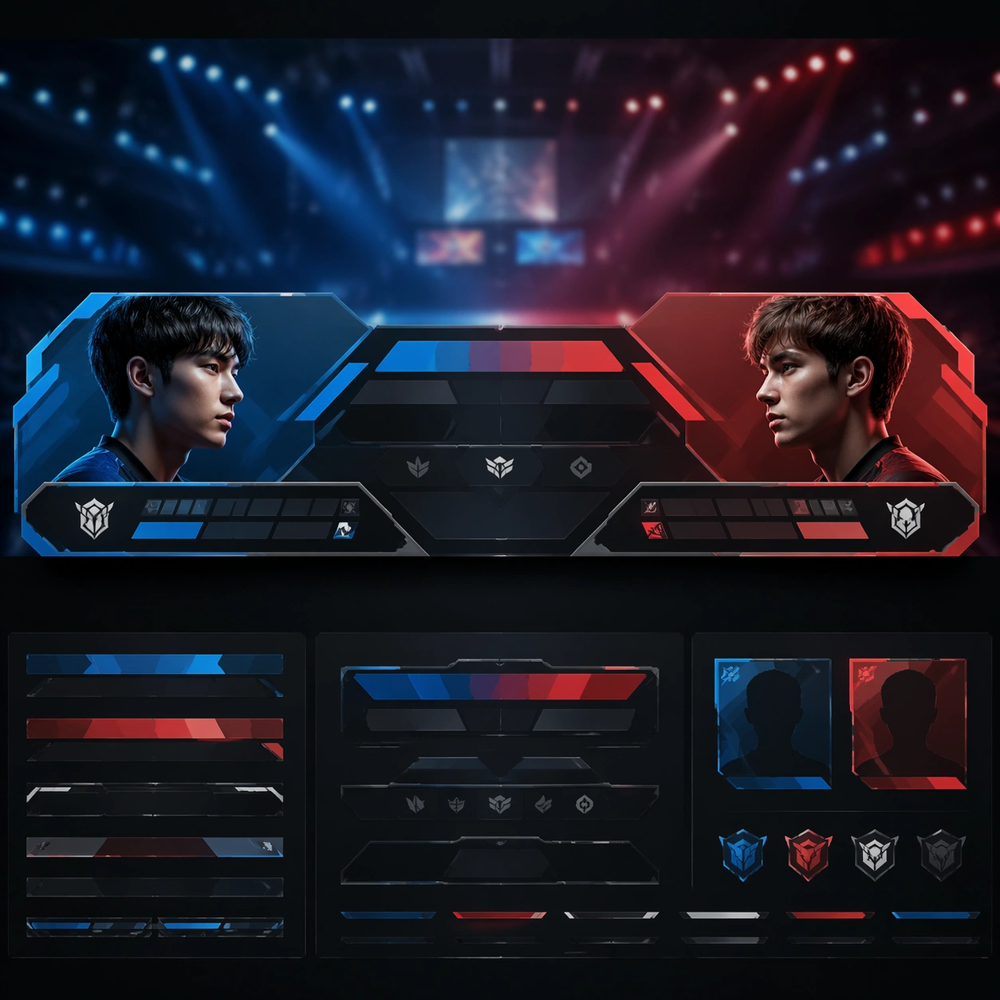

```text
Scene:
A square production-ready image designed for a game-art review wall and a commercial gallery at the same time. Frame a lower-third inspired board showing how portraits and match metadata could lock together with disciplined lighting, clean edge separation, and enough surrounding context to prove how the asset would behave in a real product surface. The camera, crop, and tonal balance should feel intentional rather than generic, with high readability at first glance and convincing material response under closer inspection.

Subject:
Center the study on a lower-third inspired board showing how portraits and match metadata could lock together. Translate the topic into a concrete, shippable visual statement instead of a loose mood board. Build layered object relationships, believable surface finish, and strong silhouette grouping so the image reads immediately as part of Esports Matchday Visual Kit. The subject should feel made for a live game pipeline: useful in store, UI, campaign, or art-review contexts, with visual hierarchy strong enough to survive aggressive cropping.

Important details:
hierarchy should feel broadcast-real even though every text field stays abstract. Keep every supporting element subordinate to the main read, and make category separation obvious through form, color zoning, depth, and material logic rather than words. Where panels, cards, badges, or interface blocks appear, they must look professionally structured but remain unreadable. The visual language should feel premium, original, and coherent across this package, with no filler clutter and no accidental resemblance to a specific shipped game IP.

Use case:
Esports Matchday Visual Kit single study 2/5, focused on broadcast lower third board.

Constraints:
No readable text, no watermark, no logos, preserve exact 1:1 aspect ratio, no readable names, no numerals, no broken hierarchy, no generic stock-photo staging, no accidental UI gibberish.
```

[Pinned source](https://github.com/ChaosRealmsAI/gpt-image-2-gallery/blob/5296db8c996e38776c83a0bc8c64f848dcd512b3/works/topics/esports-matchday-visual-kit/packages/single-matchday-support-assets/images/broadcast-lower-third-board/meta.json) · GPT Image2 · 1254×1254 · No source-declared image dependencies. · ProjectD:pending individual review.

## Post Match Recap Poster · esports-matchday-visual-kit/single-matchday-support-assets/post-match-recap-poster

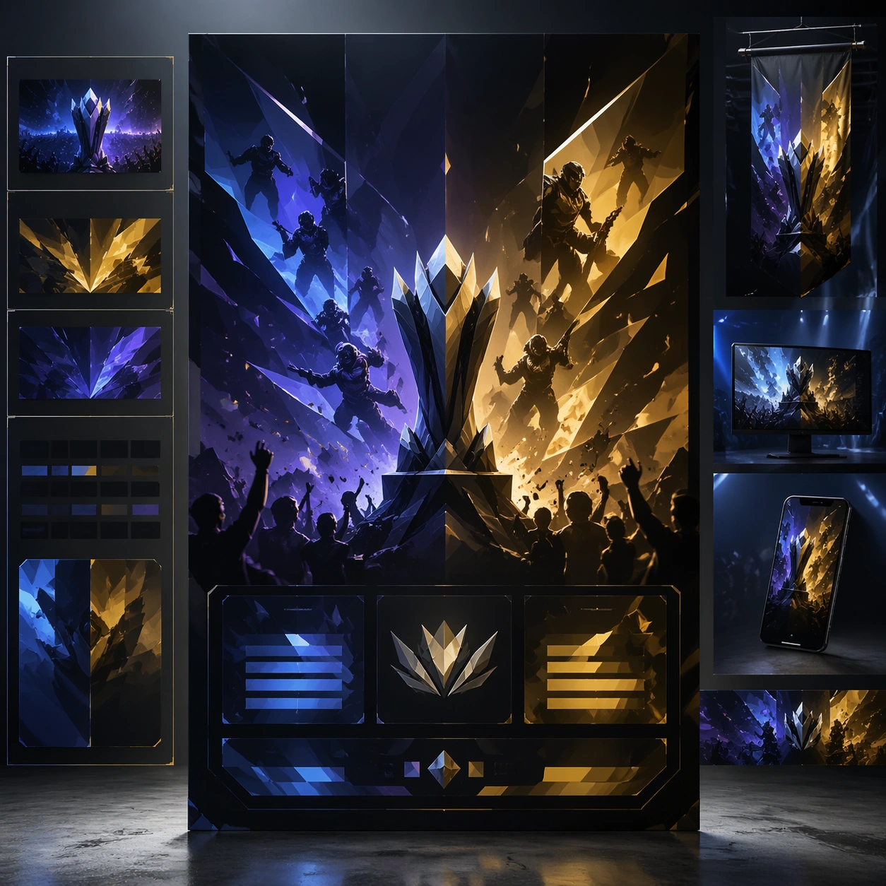

```text
Scene:
A square production-ready image designed for a game-art review wall and a commercial gallery at the same time. Frame a recap poster that turns matchday assets into a finished after-event campaign piece with disciplined lighting, clean edge separation, and enough surrounding context to prove how the asset would behave in a real product surface. The camera, crop, and tonal balance should feel intentional rather than generic, with high readability at first glance and convincing material response under closer inspection.

Subject:
Center the study on a recap poster that turns matchday assets into a finished after-event campaign piece. Translate the topic into a concrete, shippable visual statement instead of a loose mood board. Build layered object relationships, believable surface finish, and strong silhouette grouping so the image reads immediately as part of Esports Matchday Visual Kit. The subject should feel made for a live game pipeline: useful in store, UI, campaign, or art-review contexts, with visual hierarchy strong enough to survive aggressive cropping.

Important details:
the composition should feel decisive, celebratory, and still tied to the same system. Keep every supporting element subordinate to the main read, and make category separation obvious through form, color zoning, depth, and material logic rather than words. Where panels, cards, badges, or interface blocks appear, they must look professionally structured but remain unreadable. The visual language should feel premium, original, and coherent across this package, with no filler clutter and no accidental resemblance to a specific shipped game IP.

Use case:
Esports Matchday Visual Kit single study 3/5, focused on post match recap poster.

Constraints:
No readable text, no watermark, no logos, preserve exact 1:1 aspect ratio, no scores, no logos, no broken hierarchy, no generic stock-photo staging, no accidental UI gibberish.
```

[Pinned source](https://github.com/ChaosRealmsAI/gpt-image-2-gallery/blob/5296db8c996e38776c83a0bc8c64f848dcd512b3/works/topics/esports-matchday-visual-kit/packages/single-matchday-support-assets/images/post-match-recap-poster/meta.json) · GPT Image2 · 1254×1254 · No source-declared image dependencies. · ProjectD:pending individual review.

## Social Highlight Tile · esports-matchday-visual-kit/single-matchday-support-assets/social-highlight-tile

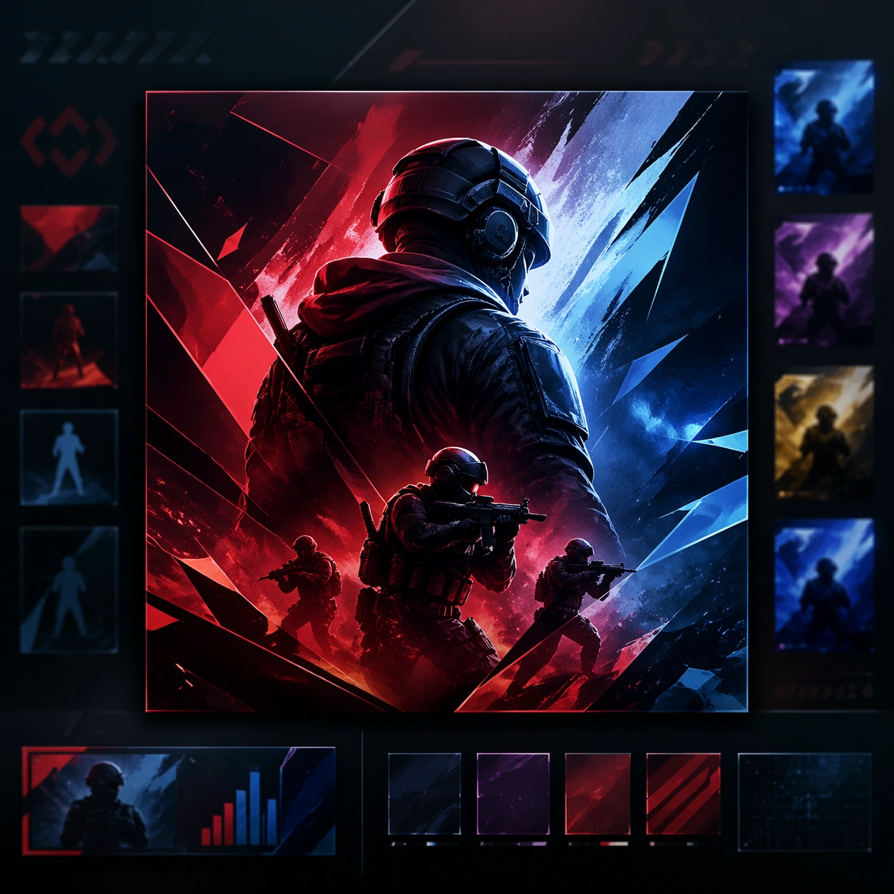

```text
Scene:
A square production-ready image designed for a game-art review wall and a commercial gallery at the same time. Frame a social tile built for rapid highlight posting during or after a match with disciplined lighting, clean edge separation, and enough surrounding context to prove how the asset would behave in a real product surface. The camera, crop, and tonal balance should feel intentional rather than generic, with high readability at first glance and convincing material response under closer inspection.

Subject:
Center the study on a social tile built for rapid highlight posting during or after a match. Translate the topic into a concrete, shippable visual statement instead of a loose mood board. Build layered object relationships, believable surface finish, and strong silhouette grouping so the image reads immediately as part of Esports Matchday Visual Kit. The subject should feel made for a live game pipeline: useful in store, UI, campaign, or art-review contexts, with visual hierarchy strong enough to survive aggressive cropping.

Important details:
compression resilience and strong focal hierarchy matter more than dense detail. Keep every supporting element subordinate to the main read, and make category separation obvious through form, color zoning, depth, and material logic rather than words. Where panels, cards, badges, or interface blocks appear, they must look professionally structured but remain unreadable. The visual language should feel premium, original, and coherent across this package, with no filler clutter and no accidental resemblance to a specific shipped game IP.

Use case:
Esports Matchday Visual Kit single study 4/5, focused on social highlight tile.

Constraints:
No readable text, no watermark, no logos, preserve exact 1:1 aspect ratio, no hashtags, no text, no broken hierarchy, no generic stock-photo staging, no accidental UI gibberish.
```

[Pinned source](https://github.com/ChaosRealmsAI/gpt-image-2-gallery/blob/5296db8c996e38776c83a0bc8c64f848dcd512b3/works/topics/esports-matchday-visual-kit/packages/single-matchday-support-assets/images/social-highlight-tile/meta.json) · GPT Image2 · 1254×1254 · No source-declared image dependencies. · ProjectD:pending individual review.

## Tournament Gallery Sheet · esports-matchday-visual-kit/single-matchday-support-assets/tournament-gallery-sheet

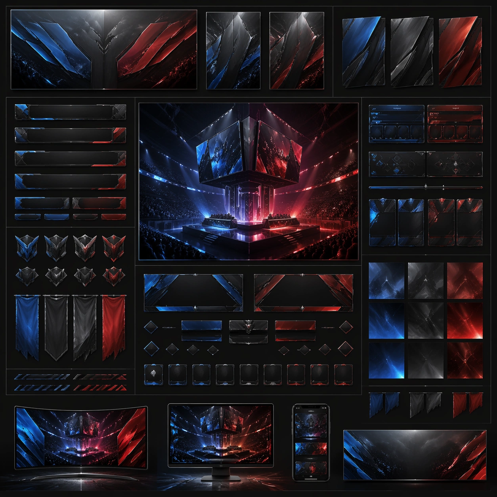

```text
Scene:
A square production-ready image designed for a game-art review wall and a commercial gallery at the same time. Frame a gallery sheet that arranges the matchday asset family into one professional event toolkit overview with disciplined lighting, clean edge separation, and enough surrounding context to prove how the asset would behave in a real product surface. The camera, crop, and tonal balance should feel intentional rather than generic, with high readability at first glance and convincing material response under closer inspection.

Subject:
Center the study on a gallery sheet that arranges the matchday asset family into one professional event toolkit overview. Translate the topic into a concrete, shippable visual statement instead of a loose mood board. Build layered object relationships, believable surface finish, and strong silhouette grouping so the image reads immediately as part of Esports Matchday Visual Kit. The subject should feel made for a live game pipeline: useful in store, UI, campaign, or art-review contexts, with visual hierarchy strong enough to survive aggressive cropping.

Important details:
make the kit feel flexible, fast, and cohesive across broadcast surfaces. Keep every supporting element subordinate to the main read, and make category separation obvious through form, color zoning, depth, and material logic rather than words. Where panels, cards, badges, or interface blocks appear, they must look professionally structured but remain unreadable. The visual language should feel premium, original, and coherent across this package, with no filler clutter and no accidental resemblance to a specific shipped game IP.

Use case:
Esports Matchday Visual Kit single study 5/5, focused on tournament gallery sheet.

Constraints:
No readable text, no watermark, no logos, preserve exact 1:1 aspect ratio, no readable labels, no sponsor grids, no broken hierarchy, no generic stock-photo staging, no accidental UI gibberish.
```

[Pinned source](https://github.com/ChaosRealmsAI/gpt-image-2-gallery/blob/5296db8c996e38776c83a0bc8c64f848dcd512b3/works/topics/esports-matchday-visual-kit/packages/single-matchday-support-assets/images/tournament-gallery-sheet/meta.json) · GPT Image2 · 1254×1254 · No source-declared image dependencies. · ProjectD:pending individual review.

## Reference Anchor · executive-dashboard-premium-system/series-core-system/01-reference-anchor


```text
Scene:
Create a square reference image for Executive Dashboard Premium System. Build a reference anchor establishing the core system with a premium, production-ready finish. Use a polished modular board or campaign surface with clean spacing, premium game-UI finish, and clear focal hierarchy. The composition should feel intentional, clean, and reusable for gallery, research, campaign, or internal handoff contexts. Lighting must support readability first, with the main forms clearly separated from the background and enough breathing room for the system to stay legible at both hero scale and thumbnail scale.

Subject:
Center a coherent original game-art system built for premium production and marketing surfaces. For this image, focus on reference anchor. Keep the same system logic stable across screenshots, cards, banners, and overview boards. This image is the canonical anchor that later series images must follow. The viewer should immediately understand what role this surface plays inside a cohesive game-production asset pack.

Important details:
Lock framing, icon grammar, palette blocking, and surface hierarchy so the kit feels production-ready and consistent. Preserve the core silhouette, framing language, and material logic from the reference image while each variation changes function. Keep materials believable, edge hierarchy disciplined, and the visual language consistent with Exec Dashboard. Use abstract interface blocks or diagram accents when helpful, but avoid any readable language. The final result should feel like a deliberate production asset rather than a random illustration.

Use case:
Executive Dashboard Premium System series study 1/9, designed as reference anchor within a cohesive asset pack.

Constraints:
No readable text, no watermark, no logos, preserve exact 1:1 aspect ratio, no unrelated objects, no broken visual hierarchy, no malformed anatomy or broken perspective, no random decorative clutter.
```

[Pinned source](https://github.com/ChaosRealmsAI/gpt-image-2-gallery/blob/5296db8c996e38776c83a0bc8c64f848dcd512b3/works/topics/executive-dashboard-premium-system/packages/series-core-system/images/01-reference-anchor/meta.json) · GPT Image2 · 1254×1254 · No source-declared image dependencies. · ProjectD:pending individual review.

## Variant One · executive-dashboard-premium-system/series-core-system/02-variant-one

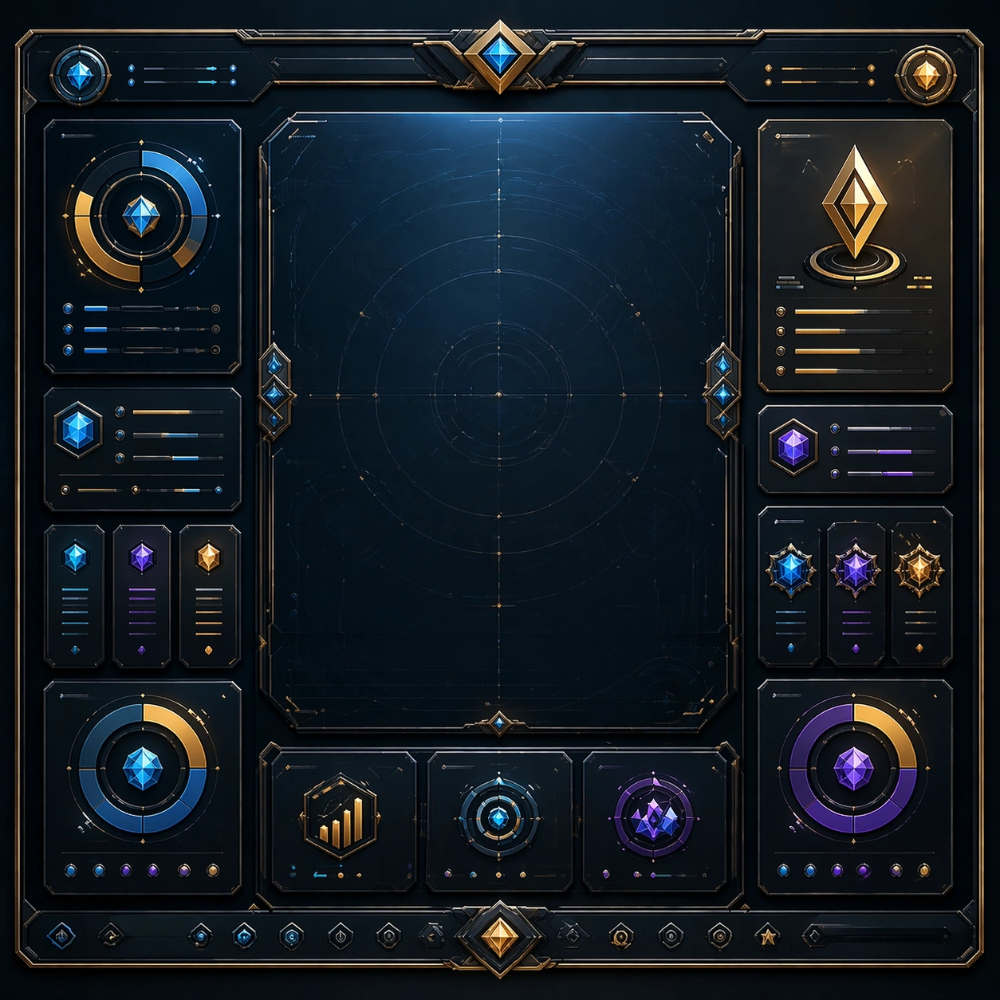

```text
Scene:
Create a square dependent image for Executive Dashboard Premium System. Build a first controlled variation in the same system with a premium, production-ready finish. Use a polished modular board or campaign surface with clean spacing, premium game-UI finish, and clear focal hierarchy. The composition should feel intentional, clean, and reusable for gallery, research, campaign, or internal handoff contexts. Lighting must support readability first, with the main forms clearly separated from the background and enough breathing room for the system to stay legible at both hero scale and thumbnail scale.

Subject:
Center a coherent original game-art system built for premium production and marketing surfaces. For this image, focus on the intended support surface. Keep the same system logic stable across screenshots, cards, banners, and overview boards. Preserve exact identity or system logic from the reference image while changing only the intended variation axis. The viewer should immediately understand what role this surface plays inside a cohesive game-production asset pack.

Important details:
Lock framing, icon grammar, palette blocking, and surface hierarchy so the kit feels production-ready and consistent. Preserve the core silhouette, framing language, and material logic from the reference image while each variation changes function. Keep materials believable, edge hierarchy disciplined, and the visual language consistent with Exec Dashboard. Use abstract interface blocks or diagram accents when helpful, but avoid any readable language. The final result should feel like a deliberate production asset rather than a random illustration.

Use case:
Executive Dashboard Premium System series study 2/9, designed as variant one within a cohesive asset pack.

Constraints:
No readable text, no watermark, no logos, preserve exact 1:1 aspect ratio, no unrelated objects, no broken visual hierarchy, no malformed anatomy or broken perspective, no random decorative clutter.
```

[Pinned source](https://github.com/ChaosRealmsAI/gpt-image-2-gallery/blob/5296db8c996e38776c83a0bc8c64f848dcd512b3/works/topics/executive-dashboard-premium-system/packages/series-core-system/images/02-variant-one/meta.json) · GPT Image2 · 1254×1254 · Reference images required. · ProjectD:pending individual review.

## Variant Two · executive-dashboard-premium-system/series-core-system/03-variant-two

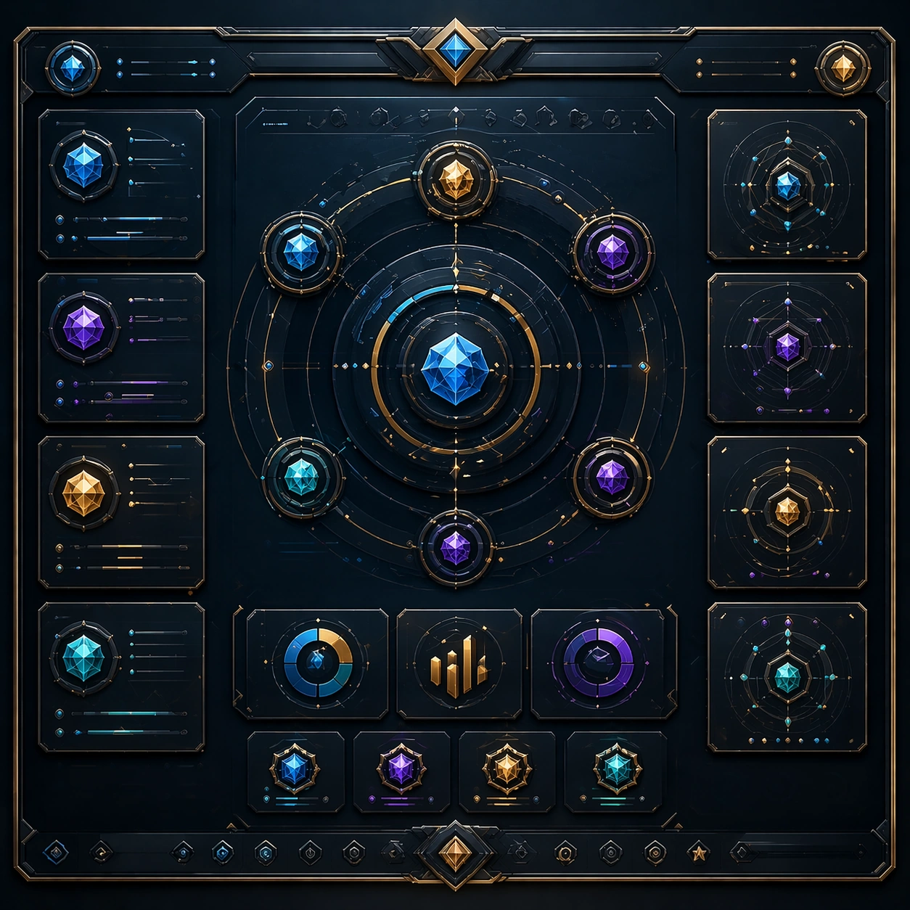

```text
Scene:
Create a square dependent image for Executive Dashboard Premium System. Build a second controlled variation in the same system with a premium, production-ready finish. Use a polished modular board or campaign surface with clean spacing, premium game-UI finish, and clear focal hierarchy. The composition should feel intentional, clean, and reusable for gallery, research, campaign, or internal handoff contexts. Lighting must support readability first, with the main forms clearly separated from the background and enough breathing room for the system to stay legible at both hero scale and thumbnail scale.

Subject:
Center a coherent original game-art system built for premium production and marketing surfaces. For this image, focus on the intended support surface. Keep the same system logic stable across screenshots, cards, banners, and overview boards. Preserve exact identity or system logic from the reference image while changing only the intended variation axis. The viewer should immediately understand what role this surface plays inside a cohesive game-production asset pack.

Important details:
Lock framing, icon grammar, palette blocking, and surface hierarchy so the kit feels production-ready and consistent. Preserve the core silhouette, framing language, and material logic from the reference image while each variation changes function. Keep materials believable, edge hierarchy disciplined, and the visual language consistent with Exec Dashboard. Use abstract interface blocks or diagram accents when helpful, but avoid any readable language. The final result should feel like a deliberate production asset rather than a random illustration.

Use case:
Executive Dashboard Premium System series study 3/9, designed as variant two within a cohesive asset pack.

Constraints:
No readable text, no watermark, no logos, preserve exact 1:1 aspect ratio, no unrelated objects, no broken visual hierarchy, no malformed anatomy or broken perspective, no random decorative clutter.
```

[Pinned source](https://github.com/ChaosRealmsAI/gpt-image-2-gallery/blob/5296db8c996e38776c83a0bc8c64f848dcd512b3/works/topics/executive-dashboard-premium-system/packages/series-core-system/images/03-variant-two/meta.json) · GPT Image2 · 1254×1254 · Reference images required. · ProjectD:pending individual review.

## Variant Three · executive-dashboard-premium-system/series-core-system/04-variant-three

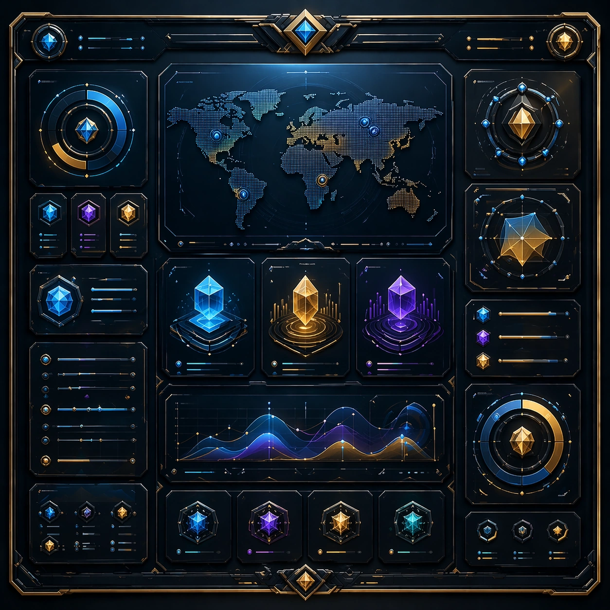

```text
Scene:
Create a square dependent image for Executive Dashboard Premium System. Build a third controlled variation in the same system with a premium, production-ready finish. Use a polished modular board or campaign surface with clean spacing, premium game-UI finish, and clear focal hierarchy. The composition should feel intentional, clean, and reusable for gallery, research, campaign, or internal handoff contexts. Lighting must support readability first, with the main forms clearly separated from the background and enough breathing room for the system to stay legible at both hero scale and thumbnail scale.

Subject:
Center a coherent original game-art system built for premium production and marketing surfaces. For this image, focus on the intended support surface. Keep the same system logic stable across screenshots, cards, banners, and overview boards. Preserve exact identity or system logic from the reference image while changing only the intended variation axis. The viewer should immediately understand what role this surface plays inside a cohesive game-production asset pack.

Important details:
Lock framing, icon grammar, palette blocking, and surface hierarchy so the kit feels production-ready and consistent. Preserve the core silhouette, framing language, and material logic from the reference image while each variation changes function. Keep materials believable, edge hierarchy disciplined, and the visual language consistent with Exec Dashboard. Use abstract interface blocks or diagram accents when helpful, but avoid any readable language. The final result should feel like a deliberate production asset rather than a random illustration.

Use case:
Executive Dashboard Premium System series study 4/9, designed as variant three within a cohesive asset pack.

Constraints:
No readable text, no watermark, no logos, preserve exact 1:1 aspect ratio, no unrelated objects, no broken visual hierarchy, no malformed anatomy or broken perspective, no random decorative clutter.
```

[Pinned source](https://github.com/ChaosRealmsAI/gpt-image-2-gallery/blob/5296db8c996e38776c83a0bc8c64f848dcd512b3/works/topics/executive-dashboard-premium-system/packages/series-core-system/images/04-variant-three/meta.json) · GPT Image2 · 1254×1254 · Reference images required. · ProjectD:pending individual review.

## Support One · executive-dashboard-premium-system/single-support-studies/support-one

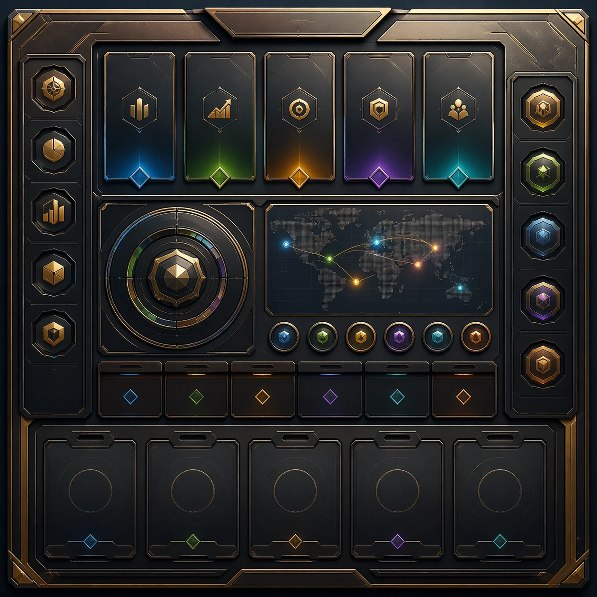

```text
Scene:
Create a square standalone support image for Executive Dashboard Premium System. Build a support-surface study with a clear focal hierarchy and a finished professional surface. Use a polished modular board or campaign surface with clean spacing, premium game-UI finish, and clear focal hierarchy. The frame should feel self-contained and polished, with enough structure to explain the system even without the reference series, yet still obviously belonging to the same theme and production world.

Subject:
Show a coherent original game-art system built for premium production and marketing surfaces in a way that emphasizes the intended support surface. Keep the same system logic stable across screenshots, cards, banners, and overview boards. Even though this image is independent, the viewer should still recognize the same universe, same commercial logic, and same production intent as the core package.

Important details:
Lock framing, icon grammar, palette blocking, and surface hierarchy so the kit feels production-ready and consistent. Preserve the broader theme language through color, framing, material choices, and modular composition. Use clean panel rhythm, premium asset presentation, and believable detail density. The image should work equally well as a gallery study, research reference, and mock production deliverable.

Use case:
Executive Dashboard Premium System single study 5/9, exploring support one as a support surface.

Constraints:
No readable text, no watermark, no logos, preserve exact 1:1 aspect ratio, no unrelated objects, no broken visual hierarchy, no visual noise that obscures the main surface, no accidental brand resemblance.
```

[Pinned source](https://github.com/ChaosRealmsAI/gpt-image-2-gallery/blob/5296db8c996e38776c83a0bc8c64f848dcd512b3/works/topics/executive-dashboard-premium-system/packages/single-support-studies/images/support-one/meta.json) · GPT Image2 · 1254×1254 · No source-declared image dependencies. · ProjectD:pending individual review.

## Support Two · executive-dashboard-premium-system/single-support-studies/support-two

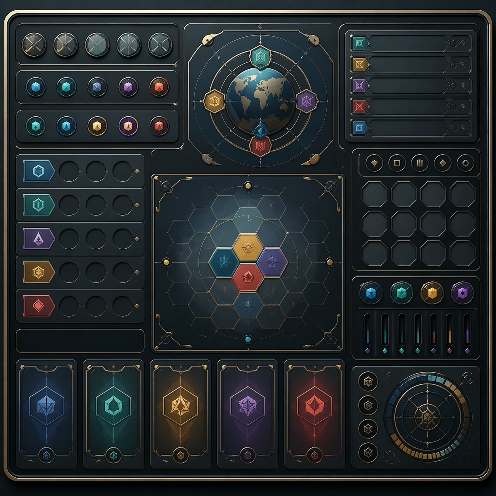

```text
Scene:
Create a square standalone support image for Executive Dashboard Premium System. Build a second support-surface study with a clear focal hierarchy and a finished professional surface. Use a polished modular board or campaign surface with clean spacing, premium game-UI finish, and clear focal hierarchy. The frame should feel self-contained and polished, with enough structure to explain the system even without the reference series, yet still obviously belonging to the same theme and production world.

Subject:
Show a coherent original game-art system built for premium production and marketing surfaces in a way that emphasizes the intended support surface. Keep the same system logic stable across screenshots, cards, banners, and overview boards. Even though this image is independent, the viewer should still recognize the same universe, same commercial logic, and same production intent as the core package.

Important details:
Lock framing, icon grammar, palette blocking, and surface hierarchy so the kit feels production-ready and consistent. Preserve the broader theme language through color, framing, material choices, and modular composition. Use clean panel rhythm, premium asset presentation, and believable detail density. The image should work equally well as a gallery study, research reference, and mock production deliverable.

Use case:
Executive Dashboard Premium System single study 6/9, exploring support two as a support surface.

Constraints:
No readable text, no watermark, no logos, preserve exact 1:1 aspect ratio, no unrelated objects, no broken visual hierarchy, no visual noise that obscures the main surface, no accidental brand resemblance.
```

[Pinned source](https://github.com/ChaosRealmsAI/gpt-image-2-gallery/blob/5296db8c996e38776c83a0bc8c64f848dcd512b3/works/topics/executive-dashboard-premium-system/packages/single-support-studies/images/support-two/meta.json) · GPT Image2 · 1254×1254 · No source-declared image dependencies. · ProjectD:pending individual review.

## Support Three · executive-dashboard-premium-system/single-support-studies/support-three

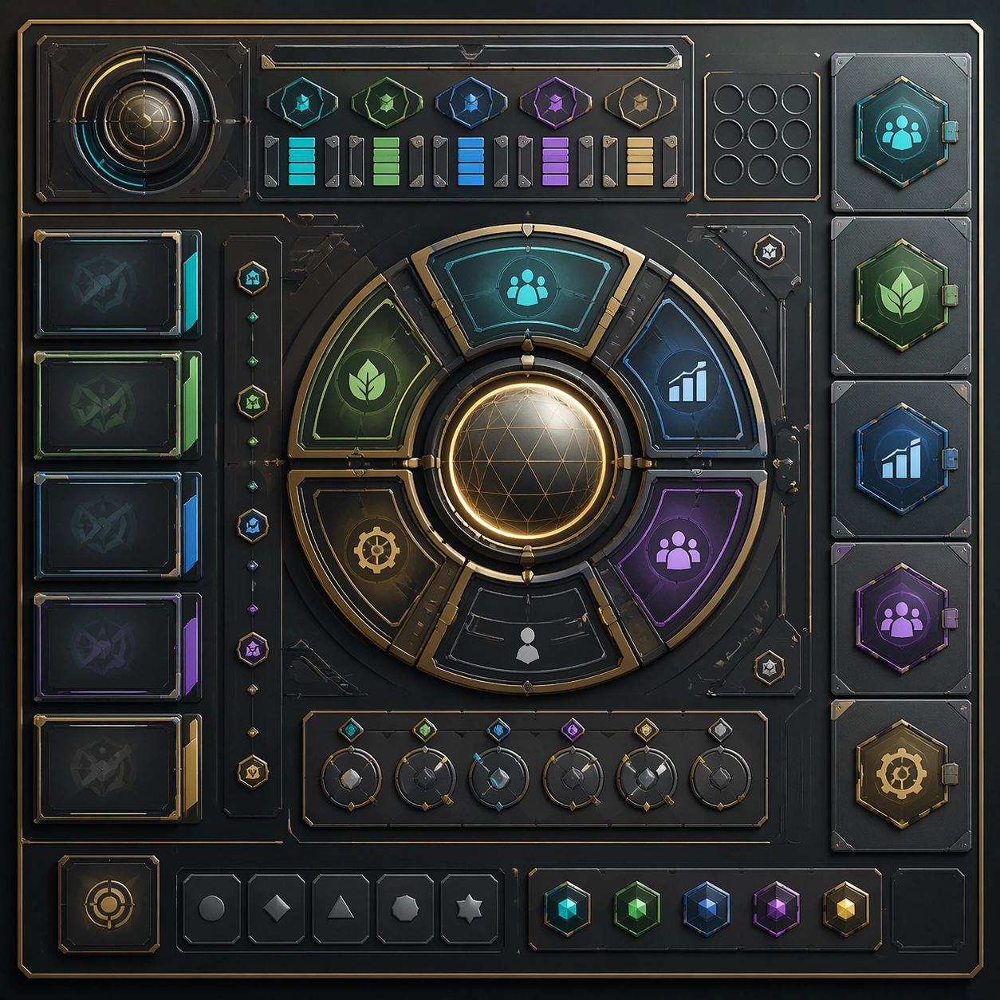

```text
Scene:
Create a square standalone support image for Executive Dashboard Premium System. Build a third support-surface study with a clear focal hierarchy and a finished professional surface. Use a polished modular board or campaign surface with clean spacing, premium game-UI finish, and clear focal hierarchy. The frame should feel self-contained and polished, with enough structure to explain the system even without the reference series, yet still obviously belonging to the same theme and production world.

Subject:
Show a coherent original game-art system built for premium production and marketing surfaces in a way that emphasizes the intended support surface. Keep the same system logic stable across screenshots, cards, banners, and overview boards. Even though this image is independent, the viewer should still recognize the same universe, same commercial logic, and same production intent as the core package.

Important details:
Lock framing, icon grammar, palette blocking, and surface hierarchy so the kit feels production-ready and consistent. Preserve the broader theme language through color, framing, material choices, and modular composition. Use clean panel rhythm, premium asset presentation, and believable detail density. The image should work equally well as a gallery study, research reference, and mock production deliverable.

Use case:
Executive Dashboard Premium System single study 7/9, exploring support three as a support surface.

Constraints:
No readable text, no watermark, no logos, preserve exact 1:1 aspect ratio, no unrelated objects, no broken visual hierarchy, no visual noise that obscures the main surface, no accidental brand resemblance.
```

[Pinned source](https://github.com/ChaosRealmsAI/gpt-image-2-gallery/blob/5296db8c996e38776c83a0bc8c64f848dcd512b3/works/topics/executive-dashboard-premium-system/packages/single-support-studies/images/support-three/meta.json) · GPT Image2 · 1254×1254 · No source-declared image dependencies. · ProjectD:pending individual review.

## Support Four · executive-dashboard-premium-system/single-support-studies/support-four

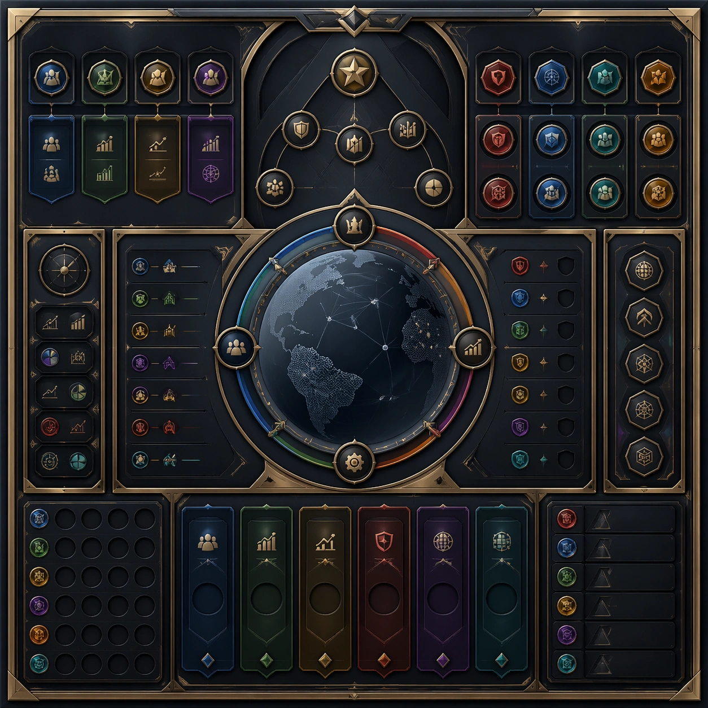

```text
Scene:
Create a square standalone support image for Executive Dashboard Premium System. Build a fourth support-surface study with a clear focal hierarchy and a finished professional surface. Use a polished modular board or campaign surface with clean spacing, premium game-UI finish, and clear focal hierarchy. The frame should feel self-contained and polished, with enough structure to explain the system even without the reference series, yet still obviously belonging to the same theme and production world.

Subject:
Show a coherent original game-art system built for premium production and marketing surfaces in a way that emphasizes the intended support surface. Keep the same system logic stable across screenshots, cards, banners, and overview boards. Even though this image is independent, the viewer should still recognize the same universe, same commercial logic, and same production intent as the core package.

Important details:
Lock framing, icon grammar, palette blocking, and surface hierarchy so the kit feels production-ready and consistent. Preserve the broader theme language through color, framing, material choices, and modular composition. Use clean panel rhythm, premium asset presentation, and believable detail density. The image should work equally well as a gallery study, research reference, and mock production deliverable.

Use case:
Executive Dashboard Premium System single study 8/9, exploring support four as a support surface.

Constraints:
No readable text, no watermark, no logos, preserve exact 1:1 aspect ratio, no unrelated objects, no broken visual hierarchy, no visual noise that obscures the main surface, no accidental brand resemblance.
```

[Pinned source](https://github.com/ChaosRealmsAI/gpt-image-2-gallery/blob/5296db8c996e38776c83a0bc8c64f848dcd512b3/works/topics/executive-dashboard-premium-system/packages/single-support-studies/images/support-four/meta.json) · GPT Image2 · 1254×1254 · No source-declared image dependencies. · ProjectD:pending individual review.

## Support Five · executive-dashboard-premium-system/single-support-studies/support-five

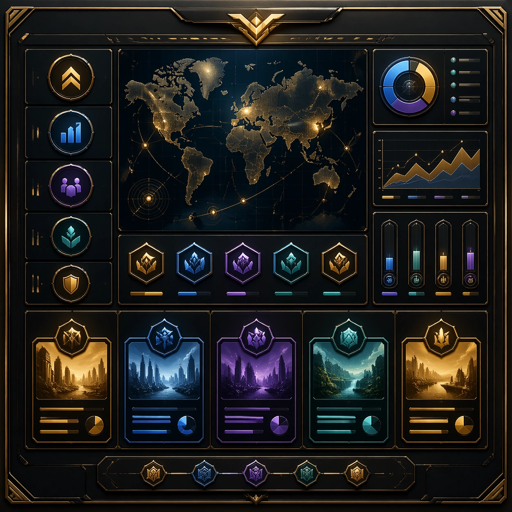

```text
Scene:
Create a square standalone support image for Executive Dashboard Premium System. Build a fifth support-surface study with a clear focal hierarchy and a finished professional surface. Use a polished modular board or campaign surface with clean spacing, premium game-UI finish, and clear focal hierarchy. The frame should feel self-contained and polished, with enough structure to explain the system even without the reference series, yet still obviously belonging to the same theme and production world.

Subject:
Show a coherent original game-art system built for premium production and marketing surfaces in a way that emphasizes the intended support surface. Keep the same system logic stable across screenshots, cards, banners, and overview boards. Even though this image is independent, the viewer should still recognize the same universe, same commercial logic, and same production intent as the core package.

Important details:
Lock framing, icon grammar, palette blocking, and surface hierarchy so the kit feels production-ready and consistent. Preserve the broader theme language through color, framing, material choices, and modular composition. Use clean panel rhythm, premium asset presentation, and believable detail density. The image should work equally well as a gallery study, research reference, and mock production deliverable.

Use case:
Executive Dashboard Premium System single study 9/9, exploring support five as a support surface.

Constraints:
No readable text, no watermark, no logos, preserve exact 1:1 aspect ratio, no unrelated objects, no broken visual hierarchy, no visual noise that obscures the main surface, no accidental brand resemblance.
```

[Pinned source](https://github.com/ChaosRealmsAI/gpt-image-2-gallery/blob/5296db8c996e38776c83a0bc8c64f848dcd512b3/works/topics/executive-dashboard-premium-system/packages/single-support-studies/images/support-five/meta.json) · GPT Image2 · 1254×1254 · No source-declared image dependencies. · ProjectD:pending individual review.

## Root Tendril Rain · exoplanet-floating-forest/single-floating-forest-studies/root-tendril-rain


```text
Scene:
Frame the image from the ground looking upward through a dense curtain of descending root tendrils, with one major canopy island obscured above by distance and haze. The light should be warm and directional, catching droplets, pollen, and dust spiraling in slow updraft columns. Build the frame as a square natural history study with disciplined composition, believable lighting, and enough environmental evidence to explain how this organism or system functions without any caption. Keep the image polished, observational, and suitable for a research gallery rather than pulp fantasy spectacle.

Subject:
Focus on the root system as an active interface: thick anchor cords, filamentary feeder roots, moisture bladders, and tiny climber animals using the hanging network as a vertical highway. Ground plants and stones below should provide scale and show how close the roots come to the surface. Show the anatomy, habitat interaction, and scale cues clearly so the viewer can infer locomotion, feeding, reproduction, or ecological role from the visual alone. Every visible structure should feel evolved for a purpose, with layered foreground, midground, and background information that rewards close inspection.

Important details:
Assume low gravity, persistent updrafts, and buoyant tissues let mature canopy masses hover while root tendrils still harvest minerals and moisture from the ground. Organisms should visibly respond to vertical distance, drifting substrates, and unstable aerial habitat. Treat the roots as living organs adapted for both suspension and nutrient gathering. Tension, branching, and surface texture should suggest constant motion in the air column rather than static hanging vines. Keep the image ecological and tactile. Favor coherent biology over decorative excess: tissues, shells, membranes, spores, tendrils, fins, silica lattices, or atmospheric sacs should all follow one material logic. Preserve a convincing relationship between the environment and the body plan, use restrained color hierarchy, and make the image feel like a serious speculative field record rather than a random monster concept.

Use case:
Exoplanet Floating Forest single study 2/9.

Constraints:
No readable text, no watermark, no logos, preserve exact 1:1 aspect ratio, no jungle-vine cliche, no gravity-free tangle, no human ladders, no fantasy glowing runes, no accidental brand resemblance, no direct copy of known terrestrial species, no cartoon simplification.
```

[Pinned source](https://github.com/ChaosRealmsAI/gpt-image-2-gallery/blob/5296db8c996e38776c83a0bc8c64f848dcd512b3/works/topics/exoplanet-floating-forest/packages/single-floating-forest-studies/images/root-tendril-rain/meta.json) · GPT Image2 · 1024×1024 · No source-declared image dependencies. · ProjectD:pending individual review.

## Glider Herd Bridge · exoplanet-floating-forest/single-floating-forest-studies/glider-herd-bridge

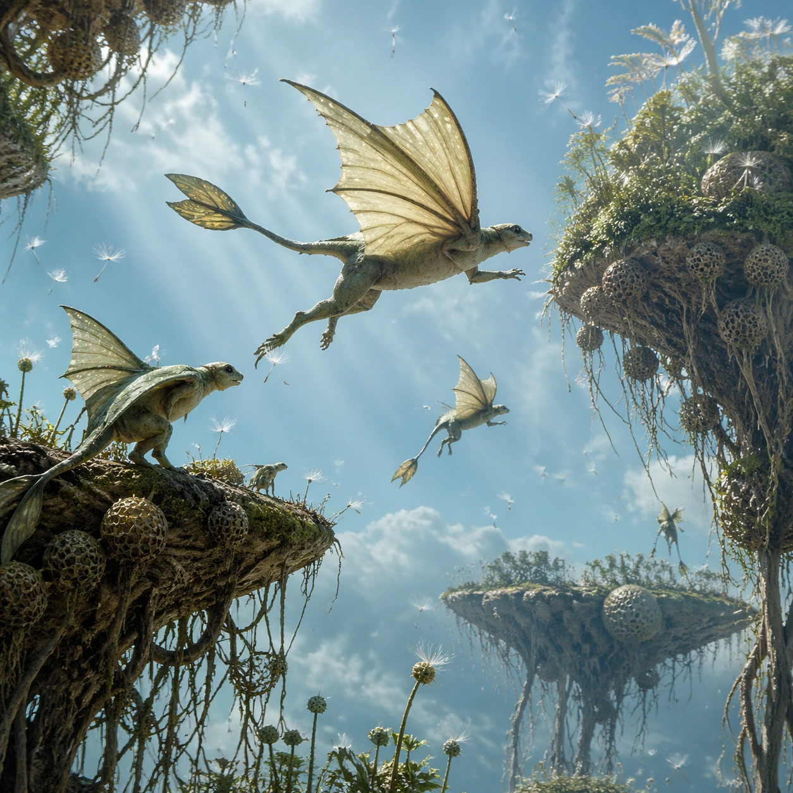

```text
Scene:
Capture a mid-distance crossing between two nearby canopy islands with open sky occupying most of the square. The atmosphere should feel buoyant and calm, with visible depth, suspended seed fluff, and sunlight streaking through the gap between the islands. Build the frame as a square natural history study with disciplined composition, believable lighting, and enough environmental evidence to explain how this organism or system functions without any caption. Keep the image polished, observational, and suitable for a research gallery rather than pulp fantasy spectacle.

Subject:
Show several medium-sized herbivore analogs launching from one root shelf and gliding toward another using membrane sails, steering tails, and grasping hind limbs. Their bodies should look evolved for repeated controlled leaps in low gravity rather than powered bird flight. Show the anatomy, habitat interaction, and scale cues clearly so the viewer can infer locomotion, feeding, reproduction, or ecological role from the visual alone. Every visible structure should feel evolved for a purpose, with layered foreground, midground, and background information that rewards close inspection.

Important details:
Assume low gravity, persistent updrafts, and buoyant tissues let mature canopy masses hover while root tendrils still harvest minerals and moisture from the ground. Organisms should visibly respond to vertical distance, drifting substrates, and unstable aerial habitat. Movement should be believable: stretched membranes, wind orientation, and landing targets must all support the ecology of scattered aerial habitat. The animals should feel native to the floating forest, not like copied bats or flying squirrels. Favor coherent biology over decorative excess: tissues, shells, membranes, spores, tendrils, fins, silica lattices, or atmospheric sacs should all follow one material logic. Preserve a convincing relationship between the environment and the body plan, use restrained color hierarchy, and make the image feel like a serious speculative field record rather than a random monster concept.

Use case:
Exoplanet Floating Forest single study 3/9.

Constraints:
No readable text, no watermark, no logos, preserve exact 1:1 aspect ratio, no bird flock, no dragon anatomy, no superhero pose, no roller-coaster action framing, no accidental brand resemblance, no direct copy of known terrestrial species, no cartoon simplification.
```

[Pinned source](https://github.com/ChaosRealmsAI/gpt-image-2-gallery/blob/5296db8c996e38776c83a0bc8c64f848dcd512b3/works/topics/exoplanet-floating-forest/packages/single-floating-forest-studies/images/glider-herd-bridge/meta.json) · GPT Image2 · 1254×1254 · No source-declared image dependencies. · ProjectD:pending individual review.

## Trunk Pod Pollinators · exoplanet-floating-forest/single-floating-forest-studies/trunk-pod-pollinators

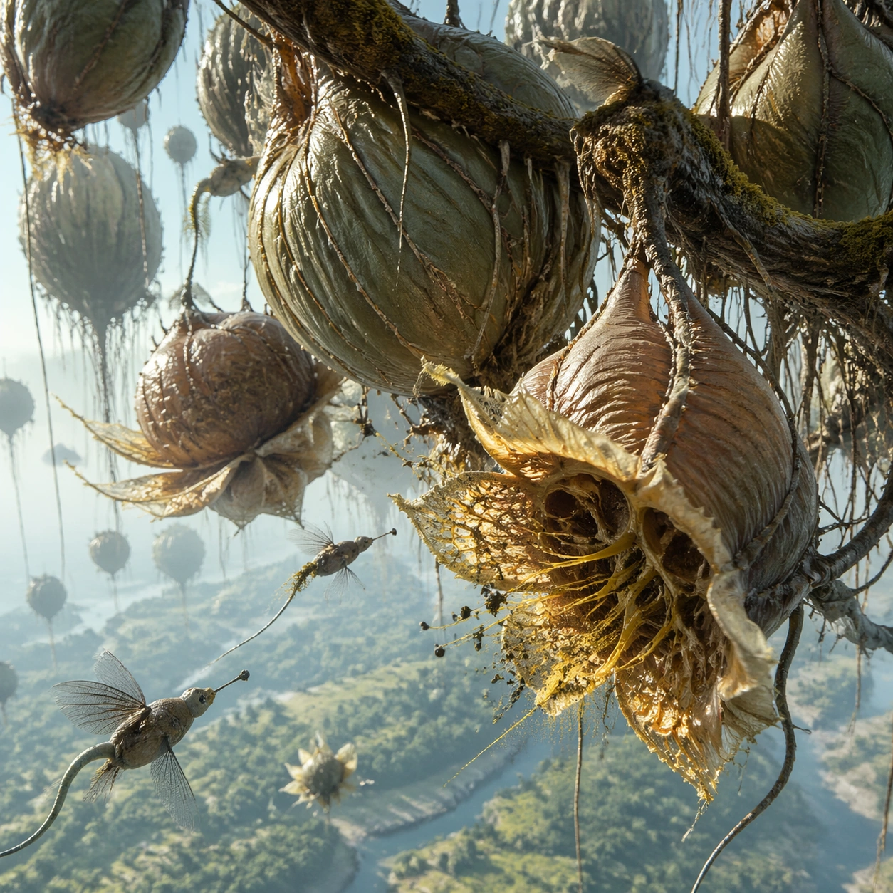

```text
Scene:
Compose an intimate canopy-level study showing several inflated trunk pods and flowering analog structures clustered along a suspended branch mass. The square crop should feel close, sunlit, and airy, with distant ground far below as a soft scale cue. Build the frame as a square natural history study with disciplined composition, believable lighting, and enough environmental evidence to explain how this organism or system functions without any caption. Keep the image polished, observational, and suitable for a research gallery rather than pulp fantasy spectacle.

Subject:
Focus on pod surfaces, pollen vents, and agile pollinator creatures that cling, hover briefly, or swim through the air between structures. The reproductive organs should look adapted to low gravity and intermittent wind shear rather than terrestrial flower logic. Show the anatomy, habitat interaction, and scale cues clearly so the viewer can infer locomotion, feeding, reproduction, or ecological role from the visual alone. Every visible structure should feel evolved for a purpose, with layered foreground, midground, and background information that rewards close inspection.

Important details:
Assume low gravity, persistent updrafts, and buoyant tissues let mature canopy masses hover while root tendrils still harvest minerals and moisture from the ground. Organisms should visibly respond to vertical distance, drifting substrates, and unstable aerial habitat. Keep the visual language botanical but alien: fibrous pod skins, gas-support tissues, and thickened attachment nodes should all feel functional. Pollinator bodies should show clear feeding or carrying adaptations tied to this aerial environment. Favor coherent biology over decorative excess: tissues, shells, membranes, spores, tendrils, fins, silica lattices, or atmospheric sacs should all follow one material logic. Preserve a convincing relationship between the environment and the body plan, use restrained color hierarchy, and make the image feel like a serious speculative field record rather than a random monster concept.

Use case:
Exoplanet Floating Forest single study 4/9.

Constraints:
No readable text, no watermark, no logos, preserve exact 1:1 aspect ratio, no Earth flower copy, no butterfly copy, no decorative fairy aesthetic, no saturated candy palette, no accidental brand resemblance, no direct copy of known terrestrial species, no cartoon simplification.
```

[Pinned source](https://github.com/ChaosRealmsAI/gpt-image-2-gallery/blob/5296db8c996e38776c83a0bc8c64f848dcd512b3/works/topics/exoplanet-floating-forest/packages/single-floating-forest-studies/images/trunk-pod-pollinators/meta.json) · GPT Image2 · 1254×1254 · No source-declared image dependencies. · ProjectD:pending individual review.

## Forest Floor Updraft · exoplanet-floating-forest/single-floating-forest-studies/forest-floor-updraft

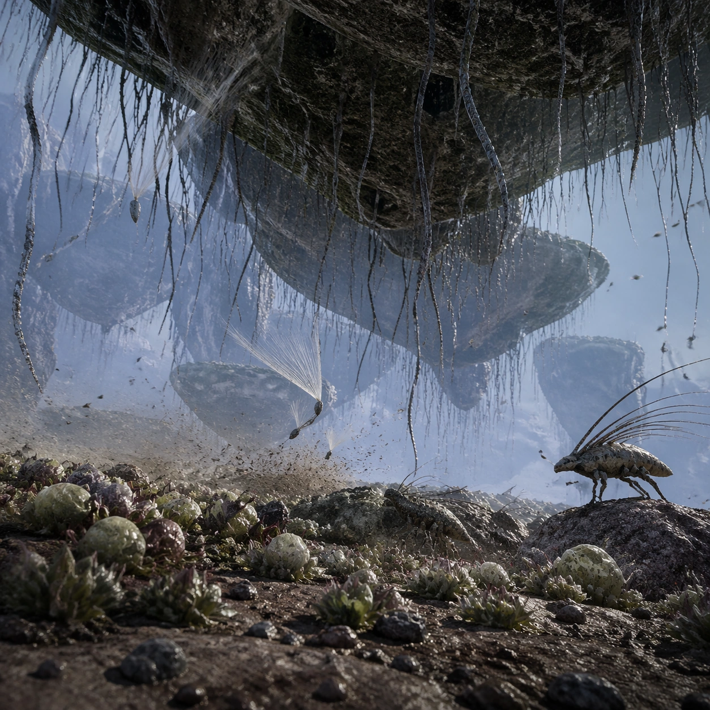

```text
Scene:
Set the viewpoint at ground level beneath a major canopy island, where shifting shade, dust ribbons, and loose seed filaments reveal a constant upward wind. The scene should feel dimmer and cooler than the open sky above, with a strong sense of vertical pull. Build the frame as a square natural history study with disciplined composition, believable lighting, and enough environmental evidence to explain how this organism or system functions without any caption. Keep the image polished, observational, and suitable for a research gallery rather than pulp fantasy spectacle.

Subject:
Show low vegetation hugging stones, root shadows moving overhead, and small scavenger or climber animals timing their movements with gust cycles. One or two seed bodies should begin lifting off the ground, connecting floor ecology to canopy reproduction. Show the anatomy, habitat interaction, and scale cues clearly so the viewer can infer locomotion, feeding, reproduction, or ecological role from the visual alone. Every visible structure should feel evolved for a purpose, with layered foreground, midground, and background information that rewards close inspection.

Important details:
Assume low gravity, persistent updrafts, and buoyant tissues let mature canopy masses hover while root tendrils still harvest minerals and moisture from the ground. Organisms should visibly respond to vertical distance, drifting substrates, and unstable aerial habitat. Explain the low-gravity world through subtle physics rather than spectacle. Soil texture, plant posture, and particle flow should all indicate that air movement is a governing force in this biome. Favor coherent biology over decorative excess: tissues, shells, membranes, spores, tendrils, fins, silica lattices, or atmospheric sacs should all follow one material logic. Preserve a convincing relationship between the environment and the body plan, use restrained color hierarchy, and make the image feel like a serious speculative field record rather than a random monster concept.

Use case:
Exoplanet Floating Forest single study 5/9.

Constraints:
No readable text, no watermark, no logos, preserve exact 1:1 aspect ratio, no tornado, no magic wind spirals, no human campsite, no heavy Earth forest density, no accidental brand resemblance, no direct copy of known terrestrial species, no cartoon simplification.
```

[Pinned source](https://github.com/ChaosRealmsAI/gpt-image-2-gallery/blob/5296db8c996e38776c83a0bc8c64f848dcd512b3/works/topics/exoplanet-floating-forest/packages/single-floating-forest-studies/images/forest-floor-updraft/meta.json) · GPT Image2 · 1254×1254 · No source-declared image dependencies. · ProjectD:pending individual review.

## Floating Seed Nursery · exoplanet-floating-forest/single-floating-forest-studies/floating-seed-nursery

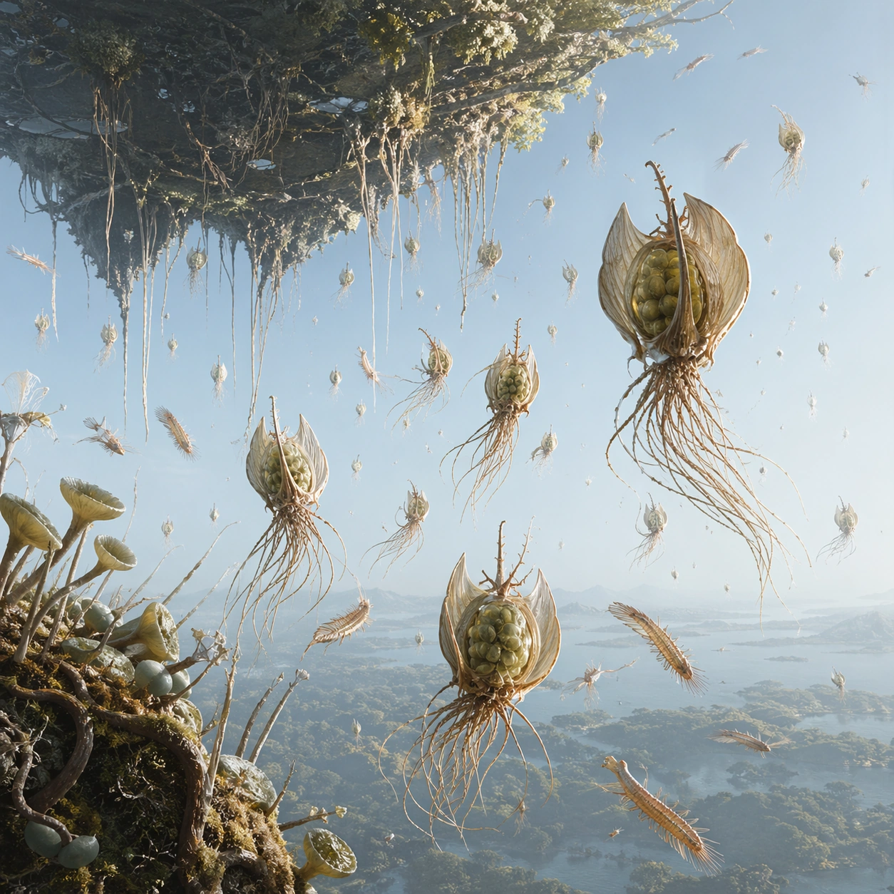

```text
Scene:
Build a square composition around a cloud of juvenile seed pods drifting near an established canopy island. The light should be clean and high, with the nursery cluster suspended in a gentle updraft and distant landscape visible far below. Build the frame as a square natural history study with disciplined composition, believable lighting, and enough environmental evidence to explain how this organism or system functions without any caption. Keep the image polished, observational, and suitable for a research gallery rather than pulp fantasy spectacle.

Subject:
Center on buoyant pods with thin root tassels, translucent nutrient sacs, and protective husk fins that keep the juveniles stable in the air. A few caretaker organisms or symbionts can accompany the nursery cloud, suggesting mutual support or predation pressure. Show the anatomy, habitat interaction, and scale cues clearly so the viewer can infer locomotion, feeding, reproduction, or ecological role from the visual alone. Every visible structure should feel evolved for a purpose, with layered foreground, midground, and background information that rewards close inspection.

Important details:
Assume low gravity, persistent updrafts, and buoyant tissues let mature canopy masses hover while root tendrils still harvest minerals and moisture from the ground. Organisms should visibly respond to vertical distance, drifting substrates, and unstable aerial habitat. The nursery stage should feel like a true developmental adaptation to low gravity. Keep pod surfaces fleshy and fibrous rather than metallic or balloon-like, and show how they might transition from drifting juveniles into anchored canopy builders. Favor coherent biology over decorative excess: tissues, shells, membranes, spores, tendrils, fins, silica lattices, or atmospheric sacs should all follow one material logic. Preserve a convincing relationship between the environment and the body plan, use restrained color hierarchy, and make the image feel like a serious speculative field record rather than a random monster concept.

Use case:
Exoplanet Floating Forest single study 6/9.

Constraints:
No readable text, no watermark, no logos, preserve exact 1:1 aspect ratio, no party-balloon look, no seed fairy tropes, no children-toy forms, no abstract cloud cutout composition, no accidental brand resemblance, no direct copy of known terrestrial species, no cartoon simplification.
```

[Pinned source](https://github.com/ChaosRealmsAI/gpt-image-2-gallery/blob/5296db8c996e38776c83a0bc8c64f848dcd512b3/works/topics/exoplanet-floating-forest/packages/single-floating-forest-studies/images/floating-seed-nursery/meta.json) · GPT Image2 · 1254×1254 · No source-declared image dependencies. · ProjectD:pending individual review.

## Cliffside Observer Station · exoplanet-floating-forest/single-floating-forest-studies/cliffside-observer-station

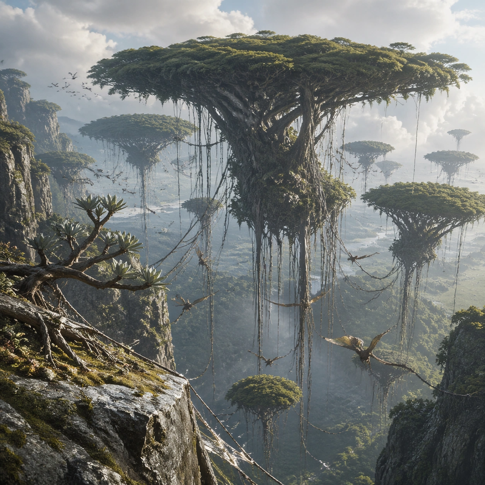

```text
Scene:
Frame the scene from a rocky cliff ledge looking across a valley filled with floating trees at different heights. The square image should feel like a serious expedition photograph with long atmospheric perspective, not a fantasy postcard. Build the frame as a square natural history study with disciplined composition, believable lighting, and enough environmental evidence to explain how this organism or system functions without any caption. Keep the image polished, observational, and suitable for a research gallery rather than pulp fantasy spectacle.

Subject:
Use the lookout to compare scale, showing root lengths, canopy diameters, and the spacing between islands. Include a few native animals moving through the air or across roots so the forest reads as inhabited rather than static landscape sculpture. Show the anatomy, habitat interaction, and scale cues clearly so the viewer can infer locomotion, feeding, reproduction, or ecological role from the visual alone. Every visible structure should feel evolved for a purpose, with layered foreground, midground, and background information that rewards close inspection.

Important details:
Assume low gravity, persistent updrafts, and buoyant tissues let mature canopy masses hover while root tendrils still harvest minerals and moisture from the ground. Organisms should visibly respond to vertical distance, drifting substrates, and unstable aerial habitat. Cliffs, air currents, and plant morphology should tell one integrated story about how terrain influences suspension and colonization. Keep geology and biology equally convincing, with no magical shortcuts in how masses hang or move. Favor coherent biology over decorative excess: tissues, shells, membranes, spores, tendrils, fins, silica lattices, or atmospheric sacs should all follow one material logic. Preserve a convincing relationship between the environment and the body plan, use restrained color hierarchy, and make the image feel like a serious speculative field record rather than a random monster concept.

Use case:
Exoplanet Floating Forest single study 7/9.

Constraints:
No readable text, no watermark, no logos, preserve exact 1:1 aspect ratio, no human architecture, no fantasy temples, no floating boulders without roots, no oversaturated concept-art haze, no accidental brand resemblance, no direct copy of known terrestrial species, no cartoon simplification.
```

[Pinned source](https://github.com/ChaosRealmsAI/gpt-image-2-gallery/blob/5296db8c996e38776c83a0bc8c64f848dcd512b3/works/topics/exoplanet-floating-forest/packages/single-floating-forest-studies/images/cliffside-observer-station/meta.json) · GPT Image2 · 1254×1254 · No source-declared image dependencies. · ProjectD:pending individual review.

## Storm Shear Recovery · exoplanet-floating-forest/single-floating-forest-studies/storm-shear-recovery

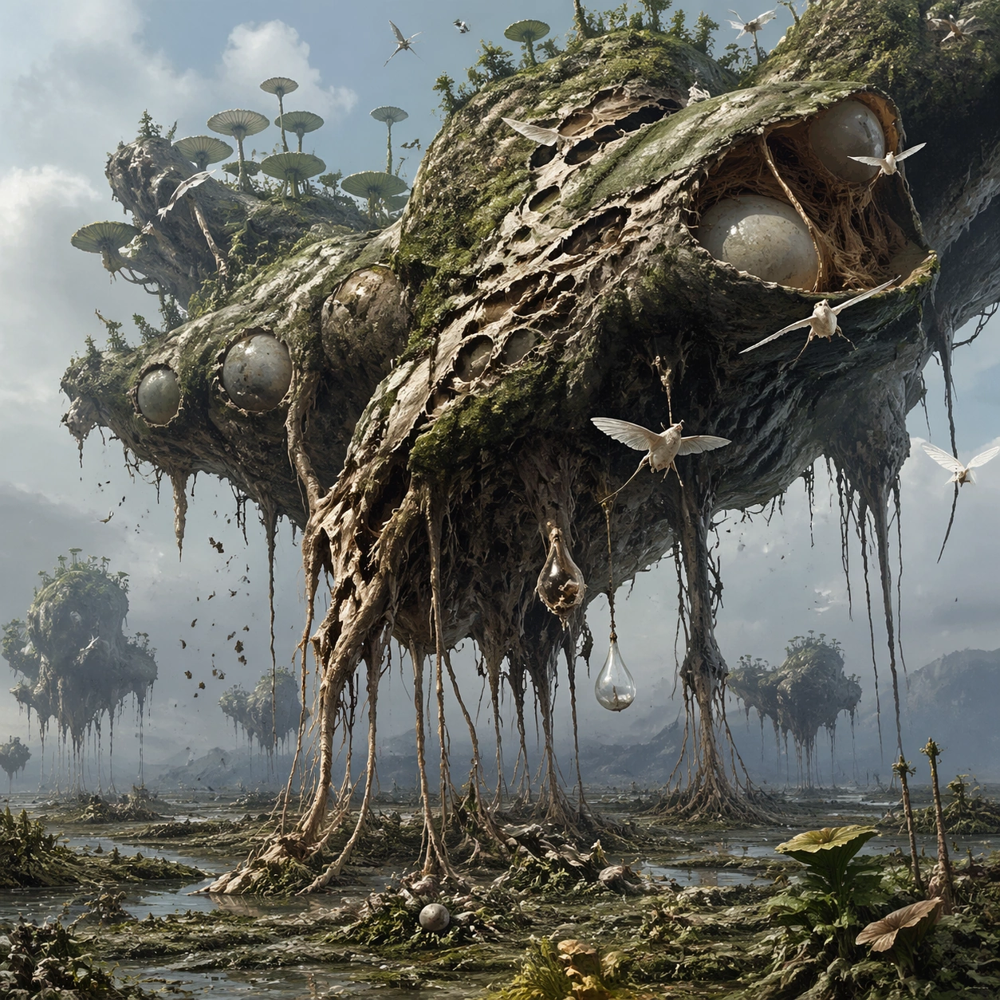

```text
Scene:
Show a recently storm-damaged canopy island in post-event light, with calmer skies but visible torn root bundles, debris drift, and exposed buoyant tissue. The square frame should feel observational and slightly uneasy, like a field note of ecosystem stress. Build the frame as a square natural history study with disciplined composition, believable lighting, and enough environmental evidence to explain how this organism or system functions without any caption. Keep the image polished, observational, and suitable for a research gallery rather than pulp fantasy spectacle.

Subject:
Focus on damaged yet surviving structures: sealed trunk chambers, emergency droop roots reaching groundward, and resident animals adapting to the changed geometry. Regrowth buds and scar tissue should suggest an evolved resilience to wind shear. Show the anatomy, habitat interaction, and scale cues clearly so the viewer can infer locomotion, feeding, reproduction, or ecological role from the visual alone. Every visible structure should feel evolved for a purpose, with layered foreground, midground, and background information that rewards close inspection.

Important details:
Assume low gravity, persistent updrafts, and buoyant tissues let mature canopy masses hover while root tendrils still harvest minerals and moisture from the ground. Organisms should visibly respond to vertical distance, drifting substrates, and unstable aerial habitat. Damage must follow believable material logic. Tears, bends, and weight redistribution should show how a living suspended mass fails and heals under stress, not how a fantasy island breaks for drama. Favor coherent biology over decorative excess: tissues, shells, membranes, spores, tendrils, fins, silica lattices, or atmospheric sacs should all follow one material logic. Preserve a convincing relationship between the environment and the body plan, use restrained color hierarchy, and make the image feel like a serious speculative field record rather than a random monster concept.

Use case:
Exoplanet Floating Forest single study 8/9.

Constraints:
No readable text, no watermark, no logos, preserve exact 1:1 aspect ratio, no disaster-movie explosion, no fire, no falling human vehicles, no magical repair glow, no accidental brand resemblance, no direct copy of known terrestrial species, no cartoon simplification.
```

[Pinned source](https://github.com/ChaosRealmsAI/gpt-image-2-gallery/blob/5296db8c996e38776c83a0bc8c64f848dcd512b3/works/topics/exoplanet-floating-forest/packages/single-floating-forest-studies/images/storm-shear-recovery/meta.json) · GPT Image2 · 1254×1254 · No source-declared image dependencies. · ProjectD:pending individual review.

## Twilight Migration Ribbon · exoplanet-floating-forest/single-floating-forest-studies/twilight-migration-ribbon

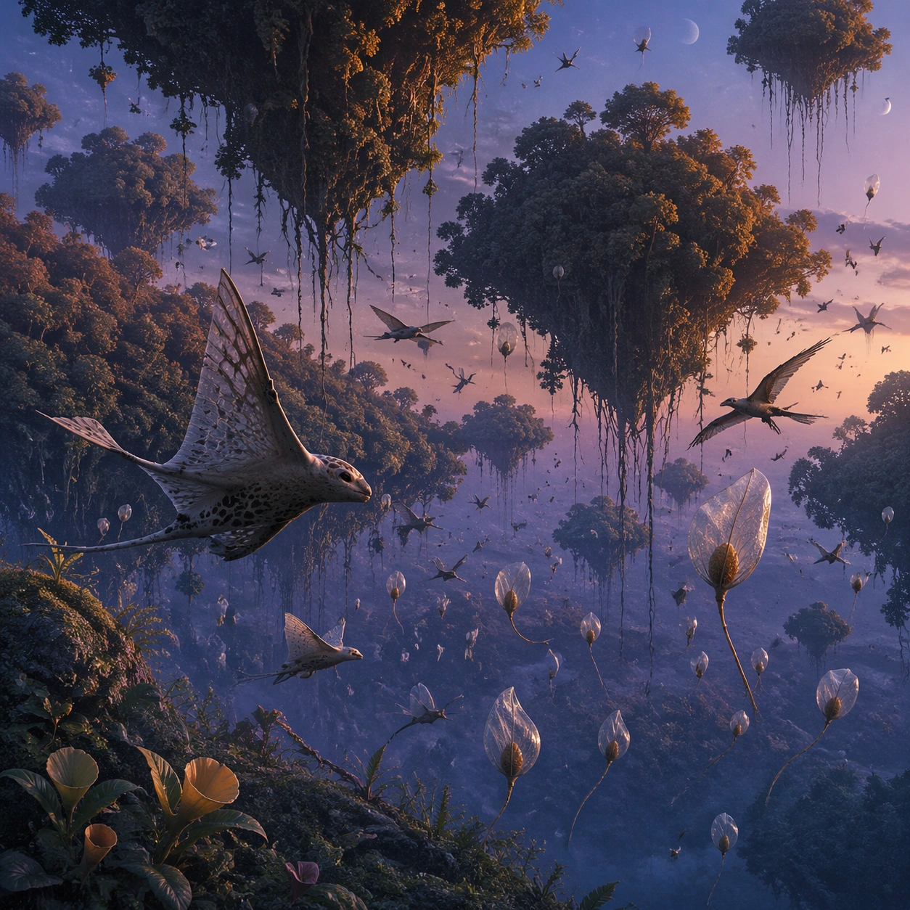

```text
Scene:
Finish with a twilight image where the floating forest becomes a layered corridor of motion under a cooling sky. The square frame should balance fading warm light on canopy tops with cooler shadow below, creating a natural stage for daily migration. Build the frame as a square natural history study with disciplined composition, believable lighting, and enough environmental evidence to explain how this organism or system functions without any caption. Keep the image polished, observational, and suitable for a research gallery rather than pulp fantasy spectacle.

Subject:
Show several species moving at once: gliders between islands, seed pods rising on late updrafts, and small aerial predators tracing the same corridor. The migration should feel patterned and ecological, not chaotic. Show the anatomy, habitat interaction, and scale cues clearly so the viewer can infer locomotion, feeding, reproduction, or ecological role from the visual alone. Every visible structure should feel evolved for a purpose, with layered foreground, midground, and background information that rewards close inspection.

Important details:
Assume low gravity, persistent updrafts, and buoyant tissues let mature canopy masses hover while root tendrils still harvest minerals and moisture from the ground. Organisms should visibly respond to vertical distance, drifting substrates, and unstable aerial habitat. Use rhythm and spacing to explain the ecosystem. Distances between islands, light conditions, and movement routes should all reinforce that these organisms evolved around a repeatable daily window in a low-gravity forest sky. Favor coherent biology over decorative excess: tissues, shells, membranes, spores, tendrils, fins, silica lattices, or atmospheric sacs should all follow one material logic. Preserve a convincing relationship between the environment and the body plan, use restrained color hierarchy, and make the image feel like a serious speculative field record rather than a random monster concept.

Use case:
Exoplanet Floating Forest single study 9/9.

Constraints:
No readable text, no watermark, no logos, preserve exact 1:1 aspect ratio, no city lights, no spaceship traffic, no fantasy dragon parade, no abstract color field, no accidental brand resemblance, no direct copy of known terrestrial species, no cartoon simplification.
```

[Pinned source](https://github.com/ChaosRealmsAI/gpt-image-2-gallery/blob/5296db8c996e38776c83a0bc8c64f848dcd512b3/works/topics/exoplanet-floating-forest/packages/single-floating-forest-studies/images/twilight-migration-ribbon/meta.json) · GPT Image2 · 1254×1254 · No source-declared image dependencies. · ProjectD:pending individual review.

## Reference Anchor · fake-advertisement-product-satire/series-core-system/01-reference-anchor

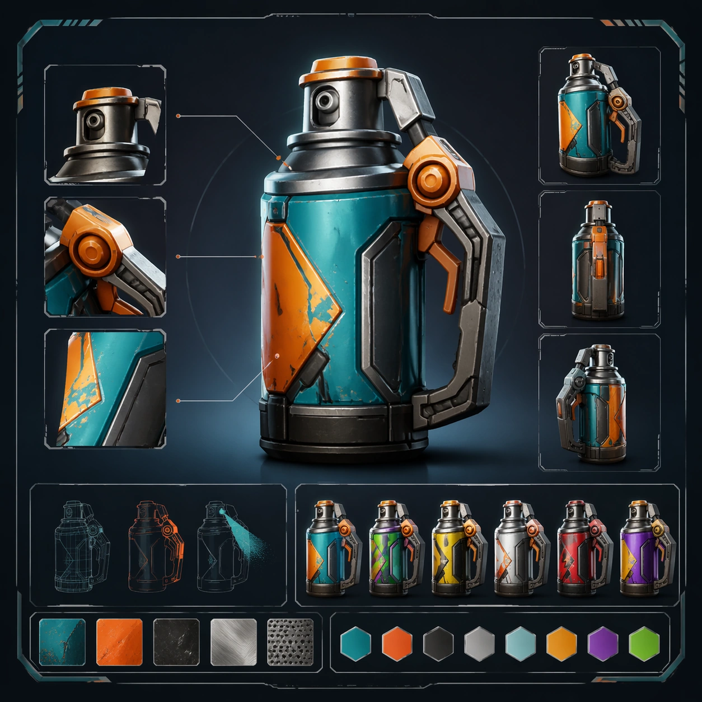

```text
Scene:
Create a square reference image for Fake Advertisement Product Satire. Build a reference anchor establishing the core system with a premium, production-ready finish. Use a polished modular board or campaign surface with clean spacing, premium game-UI finish, and clear focal hierarchy. The composition should feel intentional, clean, and reusable for gallery, research, campaign, or internal handoff contexts. Lighting must support readability first, with the main forms clearly separated from the background and enough breathing room for the system to stay legible at both hero scale and thumbnail scale.

Subject:
Center a coherent original game-art system built for premium production and marketing surfaces. For this image, focus on reference anchor. Keep the same system logic stable across screenshots, cards, banners, and overview boards. This image is the canonical anchor that later series images must follow. The viewer should immediately understand what role this surface plays inside a cohesive game-production asset pack.

Important details:
Lock framing, icon grammar, palette blocking, and surface hierarchy so the kit feels production-ready and consistent. Preserve the core silhouette, framing language, and material logic from the reference image while each variation changes function. Keep materials believable, edge hierarchy disciplined, and the visual language consistent with Fake Ads. Use abstract interface blocks or diagram accents when helpful, but avoid any readable language. The final result should feel like a deliberate production asset rather than a random illustration.

Use case:
Fake Advertisement Product Satire series study 1/9, designed as reference anchor within a cohesive asset pack.

Constraints:
No readable text, no watermark, no logos, preserve exact 1:1 aspect ratio, no unrelated objects, no broken visual hierarchy, no malformed anatomy or broken perspective, no random decorative clutter.
```

[Pinned source](https://github.com/ChaosRealmsAI/gpt-image-2-gallery/blob/5296db8c996e38776c83a0bc8c64f848dcd512b3/works/topics/fake-advertisement-product-satire/packages/series-core-system/images/01-reference-anchor/meta.json) · GPT Image2 · 1254×1254 · No source-declared image dependencies. · ProjectD:pending individual review.

## Variant One · fake-advertisement-product-satire/series-core-system/02-variant-one

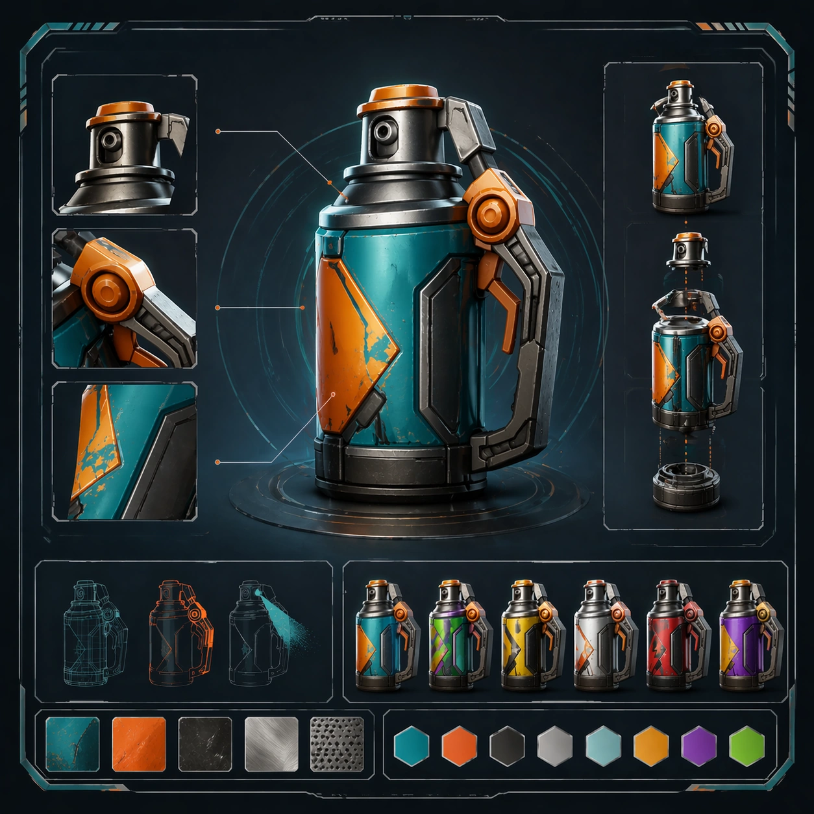

```text
Scene:
Create a square dependent image for Fake Advertisement Product Satire. Build a first controlled variation in the same system with a premium, production-ready finish. Use a polished modular board or campaign surface with clean spacing, premium game-UI finish, and clear focal hierarchy. The composition should feel intentional, clean, and reusable for gallery, research, campaign, or internal handoff contexts. Lighting must support readability first, with the main forms clearly separated from the background and enough breathing room for the system to stay legible at both hero scale and thumbnail scale.

Subject:
Center a coherent original game-art system built for premium production and marketing surfaces. For this image, focus on the intended support surface. Keep the same system logic stable across screenshots, cards, banners, and overview boards. Preserve exact identity or system logic from the reference image while changing only the intended variation axis. The viewer should immediately understand what role this surface plays inside a cohesive game-production asset pack.

Important details:
Lock framing, icon grammar, palette blocking, and surface hierarchy so the kit feels production-ready and consistent. Preserve the core silhouette, framing language, and material logic from the reference image while each variation changes function. Keep materials believable, edge hierarchy disciplined, and the visual language consistent with Fake Ads. Use abstract interface blocks or diagram accents when helpful, but avoid any readable language. The final result should feel like a deliberate production asset rather than a random illustration.

Use case:
Fake Advertisement Product Satire series study 2/9, designed as variant one within a cohesive asset pack.

Constraints:
No readable text, no watermark, no logos, preserve exact 1:1 aspect ratio, no unrelated objects, no broken visual hierarchy, no malformed anatomy or broken perspective, no random decorative clutter.
```

[Pinned source](https://github.com/ChaosRealmsAI/gpt-image-2-gallery/blob/5296db8c996e38776c83a0bc8c64f848dcd512b3/works/topics/fake-advertisement-product-satire/packages/series-core-system/images/02-variant-one/meta.json) · GPT Image2 · 1254×1254 · Reference images required. · ProjectD:pending individual review.

## Variant Two · fake-advertisement-product-satire/series-core-system/03-variant-two

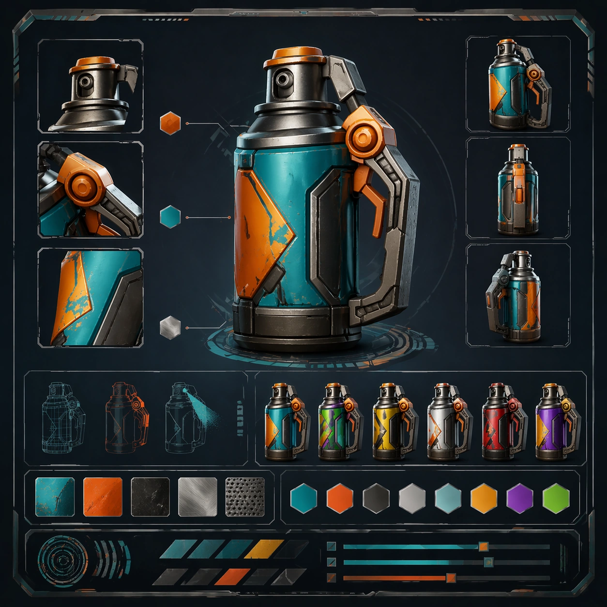

```text
Scene:
Create a square dependent image for Fake Advertisement Product Satire. Build a second controlled variation in the same system with a premium, production-ready finish. Use a polished modular board or campaign surface with clean spacing, premium game-UI finish, and clear focal hierarchy. The composition should feel intentional, clean, and reusable for gallery, research, campaign, or internal handoff contexts. Lighting must support readability first, with the main forms clearly separated from the background and enough breathing room for the system to stay legible at both hero scale and thumbnail scale.

Subject:
Center a coherent original game-art system built for premium production and marketing surfaces. For this image, focus on the intended support surface. Keep the same system logic stable across screenshots, cards, banners, and overview boards. Preserve exact identity or system logic from the reference image while changing only the intended variation axis. The viewer should immediately understand what role this surface plays inside a cohesive game-production asset pack.

Important details:
Lock framing, icon grammar, palette blocking, and surface hierarchy so the kit feels production-ready and consistent. Preserve the core silhouette, framing language, and material logic from the reference image while each variation changes function. Keep materials believable, edge hierarchy disciplined, and the visual language consistent with Fake Ads. Use abstract interface blocks or diagram accents when helpful, but avoid any readable language. The final result should feel like a deliberate production asset rather than a random illustration.

Use case:
Fake Advertisement Product Satire series study 3/9, designed as variant two within a cohesive asset pack.

Constraints:
No readable text, no watermark, no logos, preserve exact 1:1 aspect ratio, no unrelated objects, no broken visual hierarchy, no malformed anatomy or broken perspective, no random decorative clutter.
```

[Pinned source](https://github.com/ChaosRealmsAI/gpt-image-2-gallery/blob/5296db8c996e38776c83a0bc8c64f848dcd512b3/works/topics/fake-advertisement-product-satire/packages/series-core-system/images/03-variant-two/meta.json) · GPT Image2 · 1254×1254 · Reference images required. · ProjectD:pending individual review.

## Support One · fake-advertisement-product-satire/single-support-studies/support-one

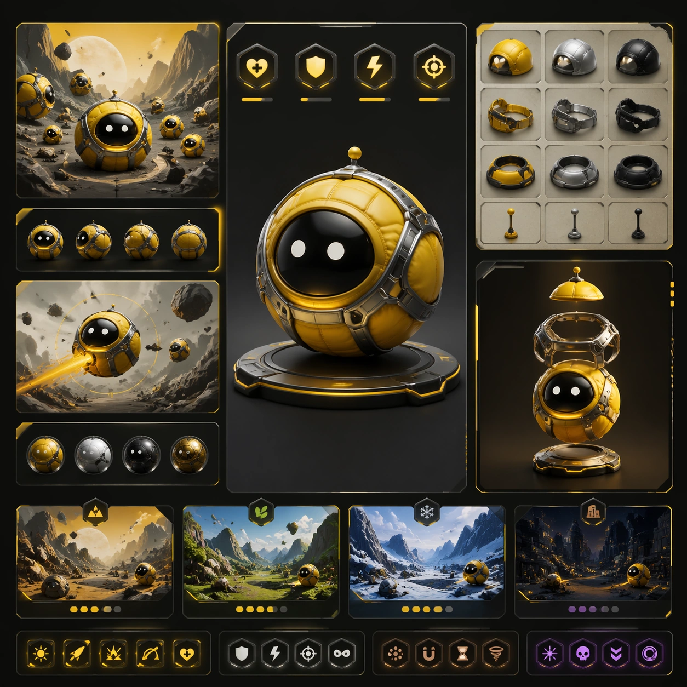

```text
Scene:
Create a square standalone support image for Fake Advertisement Product Satire. Build a support-surface study with a clear focal hierarchy and a finished professional surface. Use a polished modular board or campaign surface with clean spacing, premium game-UI finish, and clear focal hierarchy. The frame should feel self-contained and polished, with enough structure to explain the system even without the reference series, yet still obviously belonging to the same theme and production world.

Subject:
Show a coherent original game-art system built for premium production and marketing surfaces in a way that emphasizes the intended support surface. Keep the same system logic stable across screenshots, cards, banners, and overview boards. Even though this image is independent, the viewer should still recognize the same universe, same commercial logic, and same production intent as the core package.

Important details:
Lock framing, icon grammar, palette blocking, and surface hierarchy so the kit feels production-ready and consistent. Preserve the broader theme language through color, framing, material choices, and modular composition. Use clean panel rhythm, premium asset presentation, and believable detail density. The image should work equally well as a gallery study, research reference, and mock production deliverable.

Use case:
Fake Advertisement Product Satire single study 5/9, exploring support one as a support surface.

Constraints:
No readable text, no watermark, no logos, preserve exact 1:1 aspect ratio, no unrelated objects, no broken visual hierarchy, no visual noise that obscures the main surface, no accidental brand resemblance.
```

[Pinned source](https://github.com/ChaosRealmsAI/gpt-image-2-gallery/blob/5296db8c996e38776c83a0bc8c64f848dcd512b3/works/topics/fake-advertisement-product-satire/packages/single-support-studies/images/support-one/meta.json) · GPT Image2 · 1254×1254 · No source-declared image dependencies. · ProjectD:pending individual review.

## Support Two · fake-advertisement-product-satire/single-support-studies/support-two

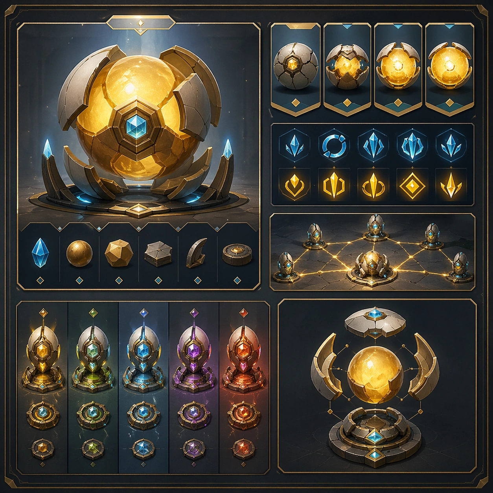

```text
Scene:
Create a square standalone support image for Fake Advertisement Product Satire. Build a second support-surface study with a clear focal hierarchy and a finished professional surface. Use a polished modular board or campaign surface with clean spacing, premium game-UI finish, and clear focal hierarchy. The frame should feel self-contained and polished, with enough structure to explain the system even without the reference series, yet still obviously belonging to the same theme and production world.

Subject:
Show a coherent original game-art system built for premium production and marketing surfaces in a way that emphasizes the intended support surface. Keep the same system logic stable across screenshots, cards, banners, and overview boards. Even though this image is independent, the viewer should still recognize the same universe, same commercial logic, and same production intent as the core package.

Important details:
Lock framing, icon grammar, palette blocking, and surface hierarchy so the kit feels production-ready and consistent. Preserve the broader theme language through color, framing, material choices, and modular composition. Use clean panel rhythm, premium asset presentation, and believable detail density. The image should work equally well as a gallery study, research reference, and mock production deliverable.

Use case:
Fake Advertisement Product Satire single study 6/9, exploring support two as a support surface.

Constraints:
No readable text, no watermark, no logos, preserve exact 1:1 aspect ratio, no unrelated objects, no broken visual hierarchy, no visual noise that obscures the main surface, no accidental brand resemblance.
```

[Pinned source](https://github.com/ChaosRealmsAI/gpt-image-2-gallery/blob/5296db8c996e38776c83a0bc8c64f848dcd512b3/works/topics/fake-advertisement-product-satire/packages/single-support-studies/images/support-two/meta.json) · GPT Image2 · 1254×1254 · No source-declared image dependencies. · ProjectD:pending individual review.

## Support Three · fake-advertisement-product-satire/single-support-studies/support-three

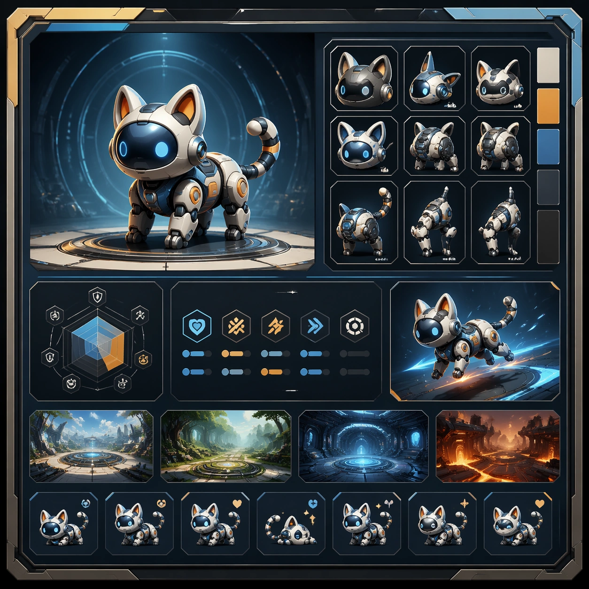

```text
Scene:
Create a square standalone support image for Fake Advertisement Product Satire. Build a third support-surface study with a clear focal hierarchy and a finished professional surface. Use a polished modular board or campaign surface with clean spacing, premium game-UI finish, and clear focal hierarchy. The frame should feel self-contained and polished, with enough structure to explain the system even without the reference series, yet still obviously belonging to the same theme and production world.

Subject:
Show a coherent original game-art system built for premium production and marketing surfaces in a way that emphasizes the intended support surface. Keep the same system logic stable across screenshots, cards, banners, and overview boards. Even though this image is independent, the viewer should still recognize the same universe, same commercial logic, and same production intent as the core package.

Important details:
Lock framing, icon grammar, palette blocking, and surface hierarchy so the kit feels production-ready and consistent. Preserve the broader theme language through color, framing, material choices, and modular composition. Use clean panel rhythm, premium asset presentation, and believable detail density. The image should work equally well as a gallery study, research reference, and mock production deliverable.

Use case:
Fake Advertisement Product Satire single study 7/9, exploring support three as a support surface.

Constraints:
No readable text, no watermark, no logos, preserve exact 1:1 aspect ratio, no unrelated objects, no broken visual hierarchy, no visual noise that obscures the main surface, no accidental brand resemblance.
```

[Pinned source](https://github.com/ChaosRealmsAI/gpt-image-2-gallery/blob/5296db8c996e38776c83a0bc8c64f848dcd512b3/works/topics/fake-advertisement-product-satire/packages/single-support-studies/images/support-three/meta.json) · GPT Image2 · 1254×1254 · No source-declared image dependencies. · ProjectD:pending individual review.

## Support Four · fake-advertisement-product-satire/single-support-studies/support-four

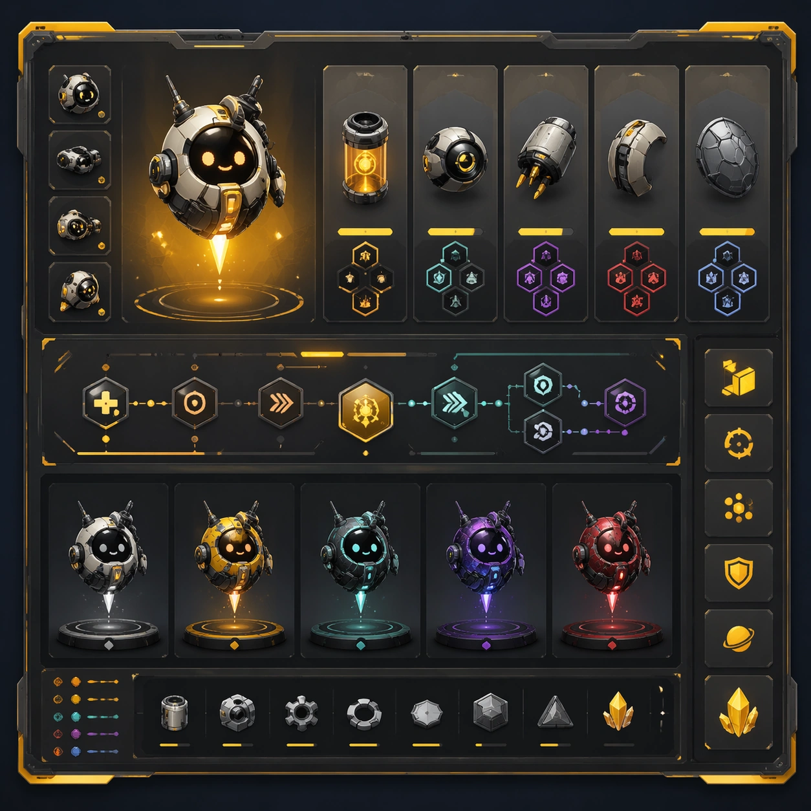

```text
Scene:
Create a square standalone support image for Fake Advertisement Product Satire. Build a fourth support-surface study with a clear focal hierarchy and a finished professional surface. Use a polished modular board or campaign surface with clean spacing, premium game-UI finish, and clear focal hierarchy. The frame should feel self-contained and polished, with enough structure to explain the system even without the reference series, yet still obviously belonging to the same theme and production world.

Subject:
Show a coherent original game-art system built for premium production and marketing surfaces in a way that emphasizes the intended support surface. Keep the same system logic stable across screenshots, cards, banners, and overview boards. Even though this image is independent, the viewer should still recognize the same universe, same commercial logic, and same production intent as the core package.

Important details:
Lock framing, icon grammar, palette blocking, and surface hierarchy so the kit feels production-ready and consistent. Preserve the broader theme language through color, framing, material choices, and modular composition. Use clean panel rhythm, premium asset presentation, and believable detail density. The image should work equally well as a gallery study, research reference, and mock production deliverable.

Use case:
Fake Advertisement Product Satire single study 8/9, exploring support four as a support surface.

Constraints:
No readable text, no watermark, no logos, preserve exact 1:1 aspect ratio, no unrelated objects, no broken visual hierarchy, no visual noise that obscures the main surface, no accidental brand resemblance.
```

[Pinned source](https://github.com/ChaosRealmsAI/gpt-image-2-gallery/blob/5296db8c996e38776c83a0bc8c64f848dcd512b3/works/topics/fake-advertisement-product-satire/packages/single-support-studies/images/support-four/meta.json) · GPT Image2 · 1254×1254 · No source-declared image dependencies. · ProjectD:pending individual review.

## Support Five · fake-advertisement-product-satire/single-support-studies/support-five

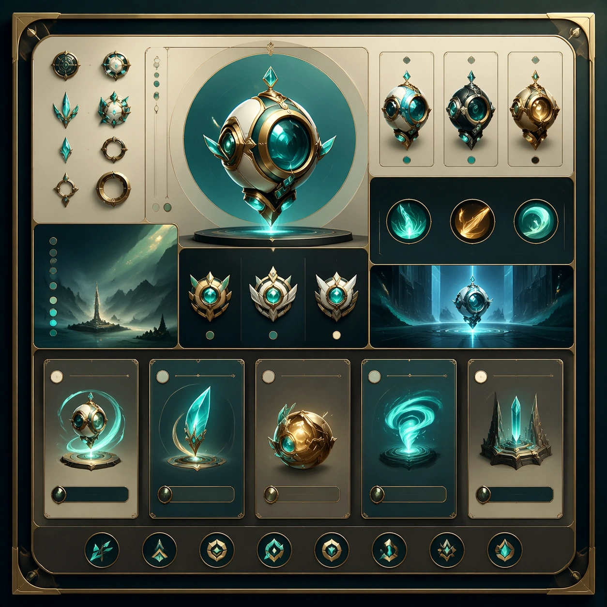

```text
Scene:
Create a square standalone support image for Fake Advertisement Product Satire. Build a fifth support-surface study with a clear focal hierarchy and a finished professional surface. Use a polished modular board or campaign surface with clean spacing, premium game-UI finish, and clear focal hierarchy. The frame should feel self-contained and polished, with enough structure to explain the system even without the reference series, yet still obviously belonging to the same theme and production world.

Subject:
Show a coherent original game-art system built for premium production and marketing surfaces in a way that emphasizes the intended support surface. Keep the same system logic stable across screenshots, cards, banners, and overview boards. Even though this image is independent, the viewer should still recognize the same universe, same commercial logic, and same production intent as the core package.

Important details:
Lock framing, icon grammar, palette blocking, and surface hierarchy so the kit feels production-ready and consistent. Preserve the broader theme language through color, framing, material choices, and modular composition. Use clean panel rhythm, premium asset presentation, and believable detail density. The image should work equally well as a gallery study, research reference, and mock production deliverable.

Use case:
Fake Advertisement Product Satire single study 9/9, exploring support five as a support surface.

Constraints:
No readable text, no watermark, no logos, preserve exact 1:1 aspect ratio, no unrelated objects, no broken visual hierarchy, no visual noise that obscures the main surface, no accidental brand resemblance.
```

[Pinned source](https://github.com/ChaosRealmsAI/gpt-image-2-gallery/blob/5296db8c996e38776c83a0bc8c64f848dcd512b3/works/topics/fake-advertisement-product-satire/packages/single-support-studies/images/support-five/meta.json) · GPT Image2 · 1254×1254 · No source-declared image dependencies. · ProjectD:pending individual review.

## Reference Anchor · fake-news-headline-comedy-graphic/series-core-system/01-reference-anchor


```text
Scene:
Create a square reference image for Fake News Headline Comedy Graphic. Build a reference anchor establishing the core system with a premium, production-ready finish. Use a polished modular board or campaign surface with clean spacing, premium game-UI finish, and clear focal hierarchy. The composition should feel intentional, clean, and reusable for gallery, research, campaign, or internal handoff contexts. Lighting must support readability first, with the main forms clearly separated from the background and enough breathing room for the system to stay legible at both hero scale and thumbnail scale.

Subject:
Center a coherent original game-art system built for premium production and marketing surfaces. For this image, focus on reference anchor. Keep the same system logic stable across screenshots, cards, banners, and overview boards. This image is the canonical anchor that later series images must follow. The viewer should immediately understand what role this surface plays inside a cohesive game-production asset pack.

Important details:
Lock framing, icon grammar, palette blocking, and surface hierarchy so the kit feels production-ready and consistent. Preserve the core silhouette, framing language, and material logic from the reference image while each variation changes function. Keep materials believable, edge hierarchy disciplined, and the visual language consistent with Fake News Comedy. Use abstract interface blocks or diagram accents when helpful, but avoid any readable language. The final result should feel like a deliberate production asset rather than a random illustration.

Use case:
Fake News Headline Comedy Graphic series study 1/9, designed as reference anchor within a cohesive asset pack.

Constraints:
No readable text, no watermark, no logos, preserve exact 1:1 aspect ratio, no unrelated objects, no broken visual hierarchy, no malformed anatomy or broken perspective, no random decorative clutter.
```

[Pinned source](https://github.com/ChaosRealmsAI/gpt-image-2-gallery/blob/5296db8c996e38776c83a0bc8c64f848dcd512b3/works/topics/fake-news-headline-comedy-graphic/packages/series-core-system/images/01-reference-anchor/meta.json) · GPT Image2 · 1254×1254 · No source-declared image dependencies. · ProjectD:pending individual review.

## Variant One · fake-news-headline-comedy-graphic/series-core-system/02-variant-one


```text
Scene:
Create a square dependent image for Fake News Headline Comedy Graphic. Build a first controlled variation in the same system with a premium, production-ready finish. Use a polished modular board or campaign surface with clean spacing, premium game-UI finish, and clear focal hierarchy. The composition should feel intentional, clean, and reusable for gallery, research, campaign, or internal handoff contexts. Lighting must support readability first, with the main forms clearly separated from the background and enough breathing room for the system to stay legible at both hero scale and thumbnail scale.

Subject:
Center a coherent original game-art system built for premium production and marketing surfaces. For this image, focus on the intended support surface. Keep the same system logic stable across screenshots, cards, banners, and overview boards. Preserve exact identity or system logic from the reference image while changing only the intended variation axis. The viewer should immediately understand what role this surface plays inside a cohesive game-production asset pack.

Important details:
Lock framing, icon grammar, palette blocking, and surface hierarchy so the kit feels production-ready and consistent. Preserve the core silhouette, framing language, and material logic from the reference image while each variation changes function. Keep materials believable, edge hierarchy disciplined, and the visual language consistent with Fake News Comedy. Use abstract interface blocks or diagram accents when helpful, but avoid any readable language. The final result should feel like a deliberate production asset rather than a random illustration.

Use case:
Fake News Headline Comedy Graphic series study 2/9, designed as variant one within a cohesive asset pack.

Constraints:
No readable text, no watermark, no logos, preserve exact 1:1 aspect ratio, no unrelated objects, no broken visual hierarchy, no malformed anatomy or broken perspective, no random decorative clutter.
```

[Pinned source](https://github.com/ChaosRealmsAI/gpt-image-2-gallery/blob/5296db8c996e38776c83a0bc8c64f848dcd512b3/works/topics/fake-news-headline-comedy-graphic/packages/series-core-system/images/02-variant-one/meta.json) · GPT Image2 · 1254×1254 · Reference images required. · ProjectD:pending individual review.

## Variant Two · fake-news-headline-comedy-graphic/series-core-system/03-variant-two


```text
Scene:
Create a square dependent image for Fake News Headline Comedy Graphic. Build a second controlled variation in the same system with a premium, production-ready finish. Use a polished modular board or campaign surface with clean spacing, premium game-UI finish, and clear focal hierarchy. The composition should feel intentional, clean, and reusable for gallery, research, campaign, or internal handoff contexts. Lighting must support readability first, with the main forms clearly separated from the background and enough breathing room for the system to stay legible at both hero scale and thumbnail scale.

Subject:
Center a coherent original game-art system built for premium production and marketing surfaces. For this image, focus on the intended support surface. Keep the same system logic stable across screenshots, cards, banners, and overview boards. Preserve exact identity or system logic from the reference image while changing only the intended variation axis. The viewer should immediately understand what role this surface plays inside a cohesive game-production asset pack.

Important details:
Lock framing, icon grammar, palette blocking, and surface hierarchy so the kit feels production-ready and consistent. Preserve the core silhouette, framing language, and material logic from the reference image while each variation changes function. Keep materials believable, edge hierarchy disciplined, and the visual language consistent with Fake News Comedy. Use abstract interface blocks or diagram accents when helpful, but avoid any readable language. The final result should feel like a deliberate production asset rather than a random illustration.

Use case:
Fake News Headline Comedy Graphic series study 3/9, designed as variant two within a cohesive asset pack.

Constraints:
No readable text, no watermark, no logos, preserve exact 1:1 aspect ratio, no unrelated objects, no broken visual hierarchy, no malformed anatomy or broken perspective, no random decorative clutter.
```

[Pinned source](https://github.com/ChaosRealmsAI/gpt-image-2-gallery/blob/5296db8c996e38776c83a0bc8c64f848dcd512b3/works/topics/fake-news-headline-comedy-graphic/packages/series-core-system/images/03-variant-two/meta.json) · GPT Image2 · 1254×1254 · Reference images required. · ProjectD:pending individual review.

## Variant Three · fake-news-headline-comedy-graphic/series-core-system/04-variant-three


```text
Scene:
Create a square dependent image for Fake News Headline Comedy Graphic. Build a third controlled variation in the same system with a premium, production-ready finish. Use a polished modular board or campaign surface with clean spacing, premium game-UI finish, and clear focal hierarchy. The composition should feel intentional, clean, and reusable for gallery, research, campaign, or internal handoff contexts. Lighting must support readability first, with the main forms clearly separated from the background and enough breathing room for the system to stay legible at both hero scale and thumbnail scale.

Subject:
Center a coherent original game-art system built for premium production and marketing surfaces. For this image, focus on the intended support surface. Keep the same system logic stable across screenshots, cards, banners, and overview boards. Preserve exact identity or system logic from the reference image while changing only the intended variation axis. The viewer should immediately understand what role this surface plays inside a cohesive game-production asset pack.

Important details:
Lock framing, icon grammar, palette blocking, and surface hierarchy so the kit feels production-ready and consistent. Preserve the core silhouette, framing language, and material logic from the reference image while each variation changes function. Keep materials believable, edge hierarchy disciplined, and the visual language consistent with Fake News Comedy. Use abstract interface blocks or diagram accents when helpful, but avoid any readable language. The final result should feel like a deliberate production asset rather than a random illustration.

Use case:
Fake News Headline Comedy Graphic series study 4/9, designed as variant three within a cohesive asset pack.

Constraints:
No readable text, no watermark, no logos, preserve exact 1:1 aspect ratio, no unrelated objects, no broken visual hierarchy, no malformed anatomy or broken perspective, no random decorative clutter.
```

[Pinned source](https://github.com/ChaosRealmsAI/gpt-image-2-gallery/blob/5296db8c996e38776c83a0bc8c64f848dcd512b3/works/topics/fake-news-headline-comedy-graphic/packages/series-core-system/images/04-variant-three/meta.json) · GPT Image2 · 1254×1254 · Reference images required. · ProjectD:pending individual review.

## Support One · fake-news-headline-comedy-graphic/single-support-studies/support-one

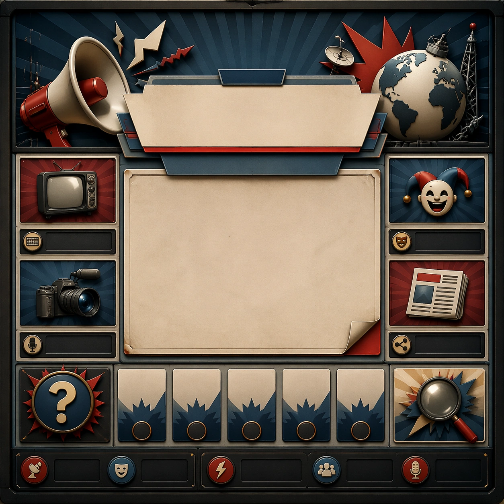

```text
Scene:
Create a square standalone support image for Fake News Headline Comedy Graphic. Build a support-surface study with a clear focal hierarchy and a finished professional surface. Use a polished modular board or campaign surface with clean spacing, premium game-UI finish, and clear focal hierarchy. The frame should feel self-contained and polished, with enough structure to explain the system even without the reference series, yet still obviously belonging to the same theme and production world.

Subject:
Show a coherent original game-art system built for premium production and marketing surfaces in a way that emphasizes the intended support surface. Keep the same system logic stable across screenshots, cards, banners, and overview boards. Even though this image is independent, the viewer should still recognize the same universe, same commercial logic, and same production intent as the core package.

Important details:
Lock framing, icon grammar, palette blocking, and surface hierarchy so the kit feels production-ready and consistent. Preserve the broader theme language through color, framing, material choices, and modular composition. Use clean panel rhythm, premium asset presentation, and believable detail density. The image should work equally well as a gallery study, research reference, and mock production deliverable.

Use case:
Fake News Headline Comedy Graphic single study 5/9, exploring support one as a support surface.

Constraints:
No readable text, no watermark, no logos, preserve exact 1:1 aspect ratio, no unrelated objects, no broken visual hierarchy, no visual noise that obscures the main surface, no accidental brand resemblance.
```

[Pinned source](https://github.com/ChaosRealmsAI/gpt-image-2-gallery/blob/5296db8c996e38776c83a0bc8c64f848dcd512b3/works/topics/fake-news-headline-comedy-graphic/packages/single-support-studies/images/support-one/meta.json) · GPT Image2 · 1254×1254 · No source-declared image dependencies. · ProjectD:pending individual review.

## Support Two · fake-news-headline-comedy-graphic/single-support-studies/support-two

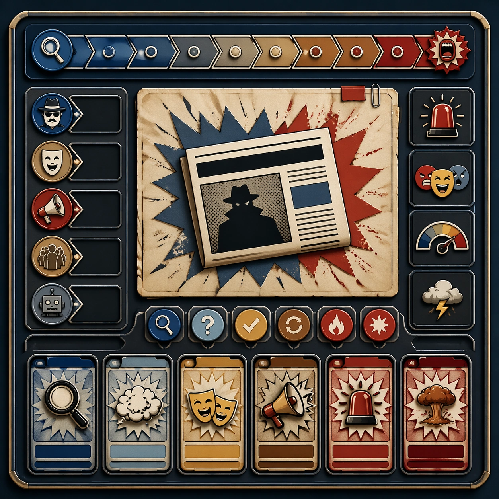

```text
Scene:
Create a square standalone support image for Fake News Headline Comedy Graphic. Build a second support-surface study with a clear focal hierarchy and a finished professional surface. Use a polished modular board or campaign surface with clean spacing, premium game-UI finish, and clear focal hierarchy. The frame should feel self-contained and polished, with enough structure to explain the system even without the reference series, yet still obviously belonging to the same theme and production world.

Subject:
Show a coherent original game-art system built for premium production and marketing surfaces in a way that emphasizes the intended support surface. Keep the same system logic stable across screenshots, cards, banners, and overview boards. Even though this image is independent, the viewer should still recognize the same universe, same commercial logic, and same production intent as the core package.

Important details:
Lock framing, icon grammar, palette blocking, and surface hierarchy so the kit feels production-ready and consistent. Preserve the broader theme language through color, framing, material choices, and modular composition. Use clean panel rhythm, premium asset presentation, and believable detail density. The image should work equally well as a gallery study, research reference, and mock production deliverable.

Use case:
Fake News Headline Comedy Graphic single study 6/9, exploring support two as a support surface.

Constraints:
No readable text, no watermark, no logos, preserve exact 1:1 aspect ratio, no unrelated objects, no broken visual hierarchy, no visual noise that obscures the main surface, no accidental brand resemblance.
```

[Pinned source](https://github.com/ChaosRealmsAI/gpt-image-2-gallery/blob/5296db8c996e38776c83a0bc8c64f848dcd512b3/works/topics/fake-news-headline-comedy-graphic/packages/single-support-studies/images/support-two/meta.json) · GPT Image2 · 1254×1254 · No source-declared image dependencies. · ProjectD:pending individual review.

## Support Three · fake-news-headline-comedy-graphic/single-support-studies/support-three

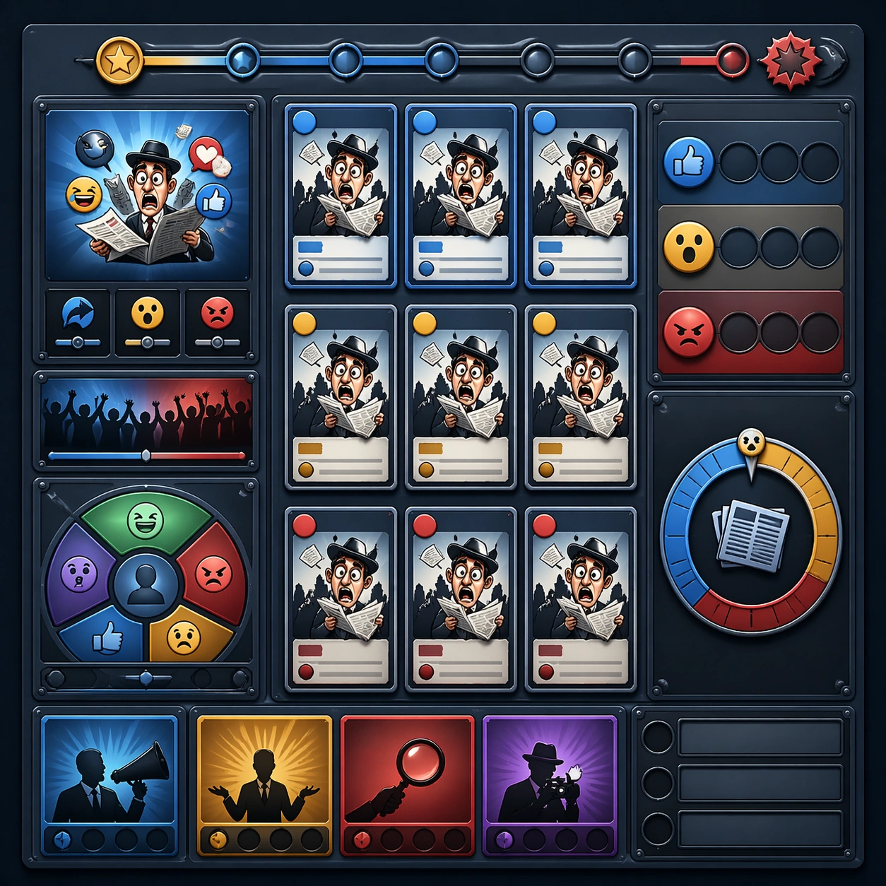

```text
Scene:
Create a square standalone support image for Fake News Headline Comedy Graphic. Build a third support-surface study with a clear focal hierarchy and a finished professional surface. Use a polished modular board or campaign surface with clean spacing, premium game-UI finish, and clear focal hierarchy. The frame should feel self-contained and polished, with enough structure to explain the system even without the reference series, yet still obviously belonging to the same theme and production world.

Subject:
Show a coherent original game-art system built for premium production and marketing surfaces in a way that emphasizes the intended support surface. Keep the same system logic stable across screenshots, cards, banners, and overview boards. Even though this image is independent, the viewer should still recognize the same universe, same commercial logic, and same production intent as the core package.

Important details:
Lock framing, icon grammar, palette blocking, and surface hierarchy so the kit feels production-ready and consistent. Preserve the broader theme language through color, framing, material choices, and modular composition. Use clean panel rhythm, premium asset presentation, and believable detail density. The image should work equally well as a gallery study, research reference, and mock production deliverable.

Use case:
Fake News Headline Comedy Graphic single study 7/9, exploring support three as a support surface.

Constraints:
No readable text, no watermark, no logos, preserve exact 1:1 aspect ratio, no unrelated objects, no broken visual hierarchy, no visual noise that obscures the main surface, no accidental brand resemblance.
```

[Pinned source](https://github.com/ChaosRealmsAI/gpt-image-2-gallery/blob/5296db8c996e38776c83a0bc8c64f848dcd512b3/works/topics/fake-news-headline-comedy-graphic/packages/single-support-studies/images/support-three/meta.json) · GPT Image2 · 1254×1254 · No source-declared image dependencies. · ProjectD:pending individual review.

## Support Four · fake-news-headline-comedy-graphic/single-support-studies/support-four

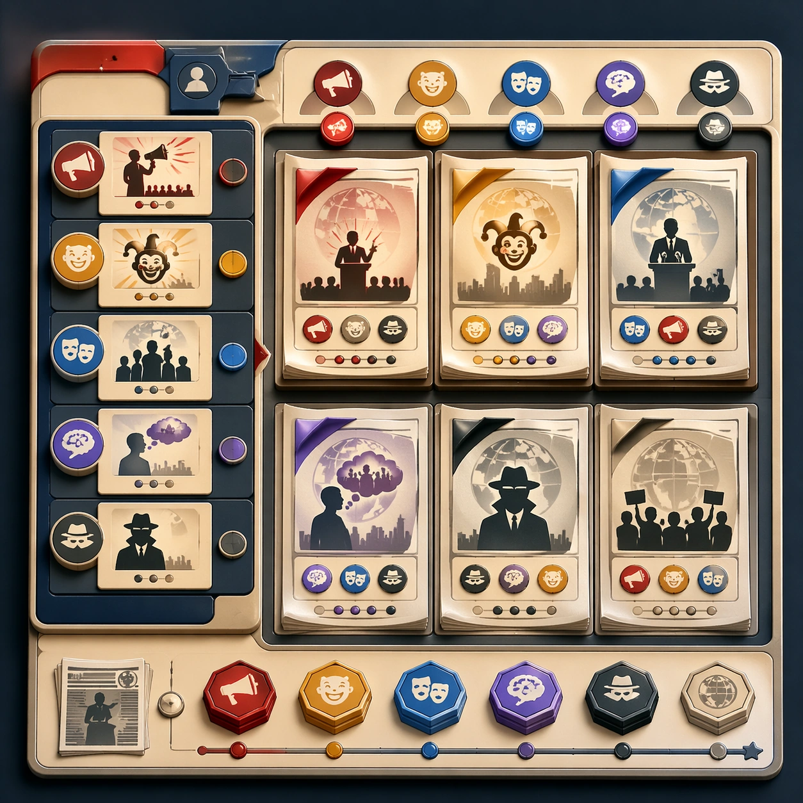

```text
Scene:
Create a square standalone support image for Fake News Headline Comedy Graphic. Build a fourth support-surface study with a clear focal hierarchy and a finished professional surface. Use a polished modular board or campaign surface with clean spacing, premium game-UI finish, and clear focal hierarchy. The frame should feel self-contained and polished, with enough structure to explain the system even without the reference series, yet still obviously belonging to the same theme and production world.

Subject:
Show a coherent original game-art system built for premium production and marketing surfaces in a way that emphasizes the intended support surface. Keep the same system logic stable across screenshots, cards, banners, and overview boards. Even though this image is independent, the viewer should still recognize the same universe, same commercial logic, and same production intent as the core package.

Important details:
Lock framing, icon grammar, palette blocking, and surface hierarchy so the kit feels production-ready and consistent. Preserve the broader theme language through color, framing, material choices, and modular composition. Use clean panel rhythm, premium asset presentation, and believable detail density. The image should work equally well as a gallery study, research reference, and mock production deliverable.

Use case:
Fake News Headline Comedy Graphic single study 8/9, exploring support four as a support surface.

Constraints:
No readable text, no watermark, no logos, preserve exact 1:1 aspect ratio, no unrelated objects, no broken visual hierarchy, no visual noise that obscures the main surface, no accidental brand resemblance.
```

[Pinned source](https://github.com/ChaosRealmsAI/gpt-image-2-gallery/blob/5296db8c996e38776c83a0bc8c64f848dcd512b3/works/topics/fake-news-headline-comedy-graphic/packages/single-support-studies/images/support-four/meta.json) · GPT Image2 · 1254×1254 · No source-declared image dependencies. · ProjectD:pending individual review.

## Support Five · fake-news-headline-comedy-graphic/single-support-studies/support-five

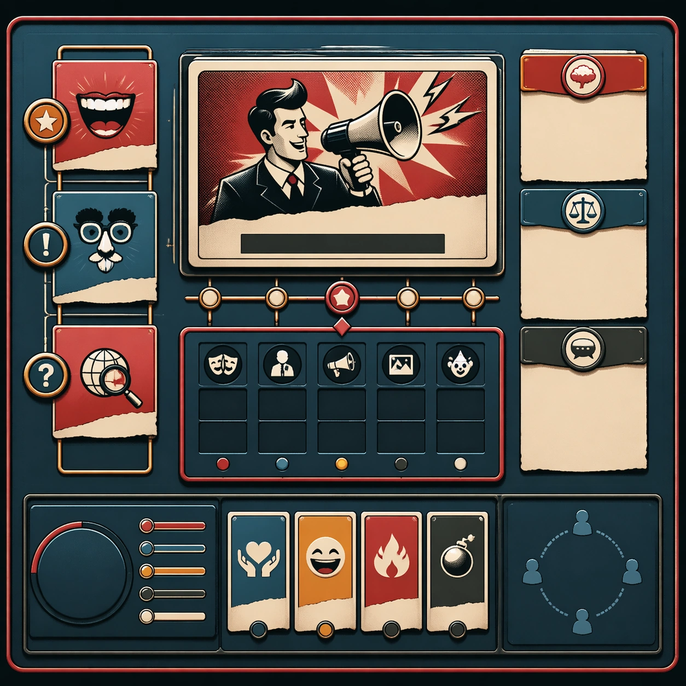

```text
Scene:
Create a square standalone support image for Fake News Headline Comedy Graphic. Build a fifth support-surface study with a clear focal hierarchy and a finished professional surface. Use a polished modular board or campaign surface with clean spacing, premium game-UI finish, and clear focal hierarchy. The frame should feel self-contained and polished, with enough structure to explain the system even without the reference series, yet still obviously belonging to the same theme and production world.

Subject:
Show a coherent original game-art system built for premium production and marketing surfaces in a way that emphasizes the intended support surface. Keep the same system logic stable across screenshots, cards, banners, and overview boards. Even though this image is independent, the viewer should still recognize the same universe, same commercial logic, and same production intent as the core package.

Important details:
Lock framing, icon grammar, palette blocking, and surface hierarchy so the kit feels production-ready and consistent. Preserve the broader theme language through color, framing, material choices, and modular composition. Use clean panel rhythm, premium asset presentation, and believable detail density. The image should work equally well as a gallery study, research reference, and mock production deliverable.

Use case:
Fake News Headline Comedy Graphic single study 9/9, exploring support five as a support surface.

Constraints:
No readable text, no watermark, no logos, preserve exact 1:1 aspect ratio, no unrelated objects, no broken visual hierarchy, no visual noise that obscures the main surface, no accidental brand resemblance.
```

[Pinned source](https://github.com/ChaosRealmsAI/gpt-image-2-gallery/blob/5296db8c996e38776c83a0bc8c64f848dcd512b3/works/topics/fake-news-headline-comedy-graphic/packages/single-support-studies/images/support-five/meta.json) · GPT Image2 · 1254×1254 · No source-declared image dependencies. · ProjectD:pending individual review.

## Reference Anchor · family-groupchat-chaos-visuals/series-core-system/01-reference-anchor


```text
Scene:
Create a square reference image for Family Groupchat Chaos Visuals. Build a reference anchor establishing the core system with a premium, production-ready finish. Use a polished modular board or campaign surface with clean spacing, premium game-UI finish, and clear focal hierarchy. The composition should feel intentional, clean, and reusable for gallery, research, campaign, or internal handoff contexts. Lighting must support readability first, with the main forms clearly separated from the background and enough breathing room for the system to stay legible at both hero scale and thumbnail scale.

Subject:
Center a coherent original game-art system built for premium production and marketing surfaces. For this image, focus on reference anchor. Keep the same system logic stable across screenshots, cards, banners, and overview boards. This image is the canonical anchor that later series images must follow. The viewer should immediately understand what role this surface plays inside a cohesive game-production asset pack.

Important details:
Lock framing, icon grammar, palette blocking, and surface hierarchy so the kit feels production-ready and consistent. Preserve the core silhouette, framing language, and material logic from the reference image while each variation changes function. Keep materials believable, edge hierarchy disciplined, and the visual language consistent with Family Chaos. Use abstract interface blocks or diagram accents when helpful, but avoid any readable language. The final result should feel like a deliberate production asset rather than a random illustration.

Use case:
Family Groupchat Chaos Visuals series study 1/9, designed as reference anchor within a cohesive asset pack.

Constraints:
No readable text, no watermark, no logos, preserve exact 1:1 aspect ratio, no unrelated objects, no broken visual hierarchy, no malformed anatomy or broken perspective, no random decorative clutter.
```

[Pinned source](https://github.com/ChaosRealmsAI/gpt-image-2-gallery/blob/5296db8c996e38776c83a0bc8c64f848dcd512b3/works/topics/family-groupchat-chaos-visuals/packages/series-core-system/images/01-reference-anchor/meta.json) · GPT Image2 · 1254×1254 · No source-declared image dependencies. · ProjectD:pending individual review.

## Variant One · family-groupchat-chaos-visuals/series-core-system/02-variant-one


```text
Scene:
Create a square dependent image for Family Groupchat Chaos Visuals. Build a first controlled variation in the same system with a premium, production-ready finish. Use a polished modular board or campaign surface with clean spacing, premium game-UI finish, and clear focal hierarchy. The composition should feel intentional, clean, and reusable for gallery, research, campaign, or internal handoff contexts. Lighting must support readability first, with the main forms clearly separated from the background and enough breathing room for the system to stay legible at both hero scale and thumbnail scale.

Subject:
Center a coherent original game-art system built for premium production and marketing surfaces. For this image, focus on the intended support surface. Keep the same system logic stable across screenshots, cards, banners, and overview boards. Preserve exact identity or system logic from the reference image while changing only the intended variation axis. The viewer should immediately understand what role this surface plays inside a cohesive game-production asset pack.

Important details:
Lock framing, icon grammar, palette blocking, and surface hierarchy so the kit feels production-ready and consistent. Preserve the core silhouette, framing language, and material logic from the reference image while each variation changes function. Keep materials believable, edge hierarchy disciplined, and the visual language consistent with Family Chaos. Use abstract interface blocks or diagram accents when helpful, but avoid any readable language. The final result should feel like a deliberate production asset rather than a random illustration.

Use case:
Family Groupchat Chaos Visuals series study 2/9, designed as variant one within a cohesive asset pack.

Constraints:
No readable text, no watermark, no logos, preserve exact 1:1 aspect ratio, no unrelated objects, no broken visual hierarchy, no malformed anatomy or broken perspective, no random decorative clutter.
```

[Pinned source](https://github.com/ChaosRealmsAI/gpt-image-2-gallery/blob/5296db8c996e38776c83a0bc8c64f848dcd512b3/works/topics/family-groupchat-chaos-visuals/packages/series-core-system/images/02-variant-one/meta.json) · GPT Image2 · 1254×1254 · Reference images required. · ProjectD:pending individual review.

## Variant Two · family-groupchat-chaos-visuals/series-core-system/03-variant-two


```text
Scene:
Create a square dependent image for Family Groupchat Chaos Visuals. Build a second controlled variation in the same system with a premium, production-ready finish. Use a polished modular board or campaign surface with clean spacing, premium game-UI finish, and clear focal hierarchy. The composition should feel intentional, clean, and reusable for gallery, research, campaign, or internal handoff contexts. Lighting must support readability first, with the main forms clearly separated from the background and enough breathing room for the system to stay legible at both hero scale and thumbnail scale.

Subject:
Center a coherent original game-art system built for premium production and marketing surfaces. For this image, focus on the intended support surface. Keep the same system logic stable across screenshots, cards, banners, and overview boards. Preserve exact identity or system logic from the reference image while changing only the intended variation axis. The viewer should immediately understand what role this surface plays inside a cohesive game-production asset pack.

Important details:
Lock framing, icon grammar, palette blocking, and surface hierarchy so the kit feels production-ready and consistent. Preserve the core silhouette, framing language, and material logic from the reference image while each variation changes function. Keep materials believable, edge hierarchy disciplined, and the visual language consistent with Family Chaos. Use abstract interface blocks or diagram accents when helpful, but avoid any readable language. The final result should feel like a deliberate production asset rather than a random illustration.

Use case:
Family Groupchat Chaos Visuals series study 3/9, designed as variant two within a cohesive asset pack.

Constraints:
No readable text, no watermark, no logos, preserve exact 1:1 aspect ratio, no unrelated objects, no broken visual hierarchy, no malformed anatomy or broken perspective, no random decorative clutter.
```

[Pinned source](https://github.com/ChaosRealmsAI/gpt-image-2-gallery/blob/5296db8c996e38776c83a0bc8c64f848dcd512b3/works/topics/family-groupchat-chaos-visuals/packages/series-core-system/images/03-variant-two/meta.json) · GPT Image2 · 1254×1254 · Reference images required. · ProjectD:pending individual review.

## Variant Three · family-groupchat-chaos-visuals/series-core-system/04-variant-three


```text
Scene:
Create a square dependent image for Family Groupchat Chaos Visuals. Build a third controlled variation in the same system with a premium, production-ready finish. Use a polished modular board or campaign surface with clean spacing, premium game-UI finish, and clear focal hierarchy. The composition should feel intentional, clean, and reusable for gallery, research, campaign, or internal handoff contexts. Lighting must support readability first, with the main forms clearly separated from the background and enough breathing room for the system to stay legible at both hero scale and thumbnail scale.

Subject:
Center a coherent original game-art system built for premium production and marketing surfaces. For this image, focus on the intended support surface. Keep the same system logic stable across screenshots, cards, banners, and overview boards. Preserve exact identity or system logic from the reference image while changing only the intended variation axis. The viewer should immediately understand what role this surface plays inside a cohesive game-production asset pack.

Important details:
Lock framing, icon grammar, palette blocking, and surface hierarchy so the kit feels production-ready and consistent. Preserve the core silhouette, framing language, and material logic from the reference image while each variation changes function. Keep materials believable, edge hierarchy disciplined, and the visual language consistent with Family Chaos. Use abstract interface blocks or diagram accents when helpful, but avoid any readable language. The final result should feel like a deliberate production asset rather than a random illustration.

Use case:
Family Groupchat Chaos Visuals series study 4/9, designed as variant three within a cohesive asset pack.

Constraints:
No readable text, no watermark, no logos, preserve exact 1:1 aspect ratio, no unrelated objects, no broken visual hierarchy, no malformed anatomy or broken perspective, no random decorative clutter.
```

[Pinned source](https://github.com/ChaosRealmsAI/gpt-image-2-gallery/blob/5296db8c996e38776c83a0bc8c64f848dcd512b3/works/topics/family-groupchat-chaos-visuals/packages/series-core-system/images/04-variant-three/meta.json) · GPT Image2 · 1254×1254 · Reference images required. · ProjectD:pending individual review.

## Support One · family-groupchat-chaos-visuals/single-support-studies/support-one


```text
Scene:
Create a square standalone support image for Family Groupchat Chaos Visuals. Build a support-surface study with a clear focal hierarchy and a finished professional surface. Use a polished modular board or campaign surface with clean spacing, premium game-UI finish, and clear focal hierarchy. The frame should feel self-contained and polished, with enough structure to explain the system even without the reference series, yet still obviously belonging to the same theme and production world.

Subject:
Show a coherent original game-art system built for premium production and marketing surfaces in a way that emphasizes the intended support surface. Keep the same system logic stable across screenshots, cards, banners, and overview boards. Even though this image is independent, the viewer should still recognize the same universe, same commercial logic, and same production intent as the core package.

Important details:
Lock framing, icon grammar, palette blocking, and surface hierarchy so the kit feels production-ready and consistent. Preserve the broader theme language through color, framing, material choices, and modular composition. Use clean panel rhythm, premium asset presentation, and believable detail density. The image should work equally well as a gallery study, research reference, and mock production deliverable.

Use case:
Family Groupchat Chaos Visuals single study 5/9, exploring support one as a support surface.

Constraints:
No readable text, no watermark, no logos, preserve exact 1:1 aspect ratio, no unrelated objects, no broken visual hierarchy, no visual noise that obscures the main surface, no accidental brand resemblance.
```

[Pinned source](https://github.com/ChaosRealmsAI/gpt-image-2-gallery/blob/5296db8c996e38776c83a0bc8c64f848dcd512b3/works/topics/family-groupchat-chaos-visuals/packages/single-support-studies/images/support-one/meta.json) · GPT Image2 · 1254×1254 · No source-declared image dependencies. · ProjectD:pending individual review.

## Support Two · family-groupchat-chaos-visuals/single-support-studies/support-two

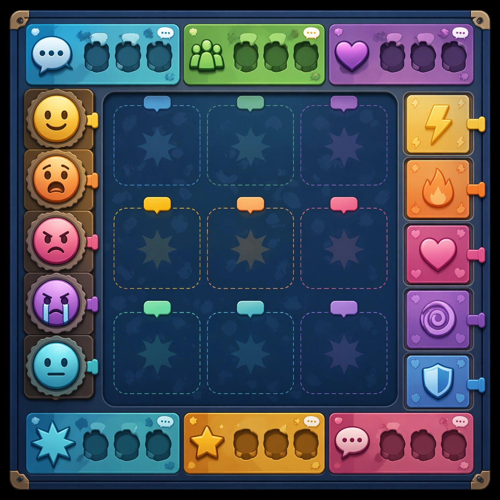

```text
Scene:
Create a square standalone support image for Family Groupchat Chaos Visuals. Build a second support-surface study with a clear focal hierarchy and a finished professional surface. Use a polished modular board or campaign surface with clean spacing, premium game-UI finish, and clear focal hierarchy. The frame should feel self-contained and polished, with enough structure to explain the system even without the reference series, yet still obviously belonging to the same theme and production world.

Subject:
Show a coherent original game-art system built for premium production and marketing surfaces in a way that emphasizes the intended support surface. Keep the same system logic stable across screenshots, cards, banners, and overview boards. Even though this image is independent, the viewer should still recognize the same universe, same commercial logic, and same production intent as the core package.

Important details:
Lock framing, icon grammar, palette blocking, and surface hierarchy so the kit feels production-ready and consistent. Preserve the broader theme language through color, framing, material choices, and modular composition. Use clean panel rhythm, premium asset presentation, and believable detail density. The image should work equally well as a gallery study, research reference, and mock production deliverable.

Use case:
Family Groupchat Chaos Visuals single study 6/9, exploring support two as a support surface.

Constraints:
No readable text, no watermark, no logos, preserve exact 1:1 aspect ratio, no unrelated objects, no broken visual hierarchy, no visual noise that obscures the main surface, no accidental brand resemblance.
```

[Pinned source](https://github.com/ChaosRealmsAI/gpt-image-2-gallery/blob/5296db8c996e38776c83a0bc8c64f848dcd512b3/works/topics/family-groupchat-chaos-visuals/packages/single-support-studies/images/support-two/meta.json) · GPT Image2 · 1254×1254 · No source-declared image dependencies. · ProjectD:pending individual review.

## Support Three · family-groupchat-chaos-visuals/single-support-studies/support-three


```text
Scene:
Create a square standalone support image for Family Groupchat Chaos Visuals. Build a third support-surface study with a clear focal hierarchy and a finished professional surface. Use a polished modular board or campaign surface with clean spacing, premium game-UI finish, and clear focal hierarchy. The frame should feel self-contained and polished, with enough structure to explain the system even without the reference series, yet still obviously belonging to the same theme and production world.

Subject:
Show a coherent original game-art system built for premium production and marketing surfaces in a way that emphasizes the intended support surface. Keep the same system logic stable across screenshots, cards, banners, and overview boards. Even though this image is independent, the viewer should still recognize the same universe, same commercial logic, and same production intent as the core package.

Important details:
Lock framing, icon grammar, palette blocking, and surface hierarchy so the kit feels production-ready and consistent. Preserve the broader theme language through color, framing, material choices, and modular composition. Use clean panel rhythm, premium asset presentation, and believable detail density. The image should work equally well as a gallery study, research reference, and mock production deliverable.

Use case:
Family Groupchat Chaos Visuals single study 7/9, exploring support three as a support surface.

Constraints:
No readable text, no watermark, no logos, preserve exact 1:1 aspect ratio, no unrelated objects, no broken visual hierarchy, no visual noise that obscures the main surface, no accidental brand resemblance.
```

[Pinned source](https://github.com/ChaosRealmsAI/gpt-image-2-gallery/blob/5296db8c996e38776c83a0bc8c64f848dcd512b3/works/topics/family-groupchat-chaos-visuals/packages/single-support-studies/images/support-three/meta.json) · GPT Image2 · 1254×1254 · No source-declared image dependencies. · ProjectD:pending individual review.

## Support Four · family-groupchat-chaos-visuals/single-support-studies/support-four


```text
Scene:
Create a square standalone support image for Family Groupchat Chaos Visuals. Build a fourth support-surface study with a clear focal hierarchy and a finished professional surface. Use a polished modular board or campaign surface with clean spacing, premium game-UI finish, and clear focal hierarchy. The frame should feel self-contained and polished, with enough structure to explain the system even without the reference series, yet still obviously belonging to the same theme and production world.

Subject:
Show a coherent original game-art system built for premium production and marketing surfaces in a way that emphasizes the intended support surface. Keep the same system logic stable across screenshots, cards, banners, and overview boards. Even though this image is independent, the viewer should still recognize the same universe, same commercial logic, and same production intent as the core package.

Important details:
Lock framing, icon grammar, palette blocking, and surface hierarchy so the kit feels production-ready and consistent. Preserve the broader theme language through color, framing, material choices, and modular composition. Use clean panel rhythm, premium asset presentation, and believable detail density. The image should work equally well as a gallery study, research reference, and mock production deliverable.

Use case:
Family Groupchat Chaos Visuals single study 8/9, exploring support four as a support surface.

Constraints:
No readable text, no watermark, no logos, preserve exact 1:1 aspect ratio, no unrelated objects, no broken visual hierarchy, no visual noise that obscures the main surface, no accidental brand resemblance.
```

[Pinned source](https://github.com/ChaosRealmsAI/gpt-image-2-gallery/blob/5296db8c996e38776c83a0bc8c64f848dcd512b3/works/topics/family-groupchat-chaos-visuals/packages/single-support-studies/images/support-four/meta.json) · GPT Image2 · 1254×1254 · No source-declared image dependencies. · ProjectD:pending individual review.

## Support Five · family-groupchat-chaos-visuals/single-support-studies/support-five

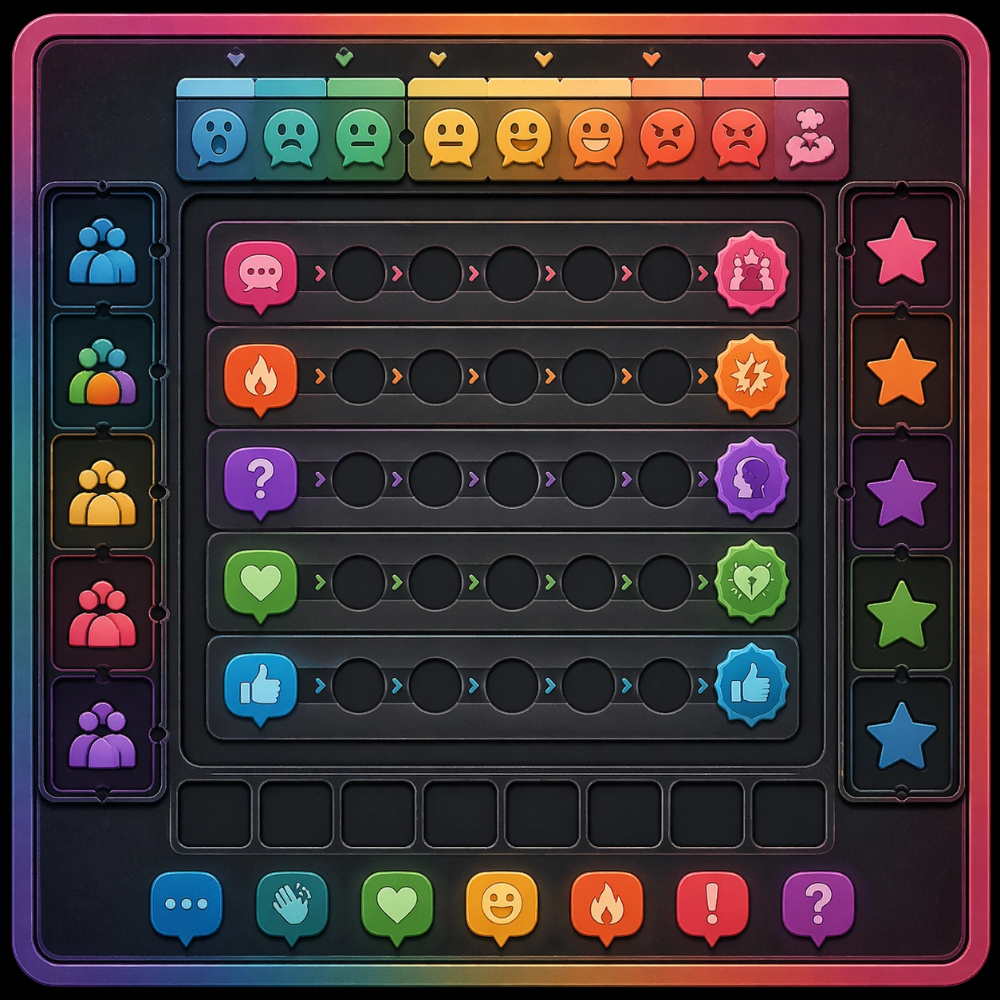

```text
Scene:
Create a square standalone support image for Family Groupchat Chaos Visuals. Build a fifth support-surface study with a clear focal hierarchy and a finished professional surface. Use a polished modular board or campaign surface with clean spacing, premium game-UI finish, and clear focal hierarchy. The frame should feel self-contained and polished, with enough structure to explain the system even without the reference series, yet still obviously belonging to the same theme and production world.

Subject:
Show a coherent original game-art system built for premium production and marketing surfaces in a way that emphasizes the intended support surface. Keep the same system logic stable across screenshots, cards, banners, and overview boards. Even though this image is independent, the viewer should still recognize the same universe, same commercial logic, and same production intent as the core package.

Important details:
Lock framing, icon grammar, palette blocking, and surface hierarchy so the kit feels production-ready and consistent. Preserve the broader theme language through color, framing, material choices, and modular composition. Use clean panel rhythm, premium asset presentation, and believable detail density. The image should work equally well as a gallery study, research reference, and mock production deliverable.

Use case:
Family Groupchat Chaos Visuals single study 9/9, exploring support five as a support surface.

Constraints:
No readable text, no watermark, no logos, preserve exact 1:1 aspect ratio, no unrelated objects, no broken visual hierarchy, no visual noise that obscures the main surface, no accidental brand resemblance.
```

[Pinned source](https://github.com/ChaosRealmsAI/gpt-image-2-gallery/blob/5296db8c996e38776c83a0bc8c64f848dcd512b3/works/topics/family-groupchat-chaos-visuals/packages/single-support-studies/images/support-five/meta.json) · GPT Image2 · 1254×1254 · No source-declared image dependencies. · ProjectD:pending individual review.

## Drip Constellation · fantasy-handdrawn-map/single-fantasy-handdrawn-map-studies/drip-constellation

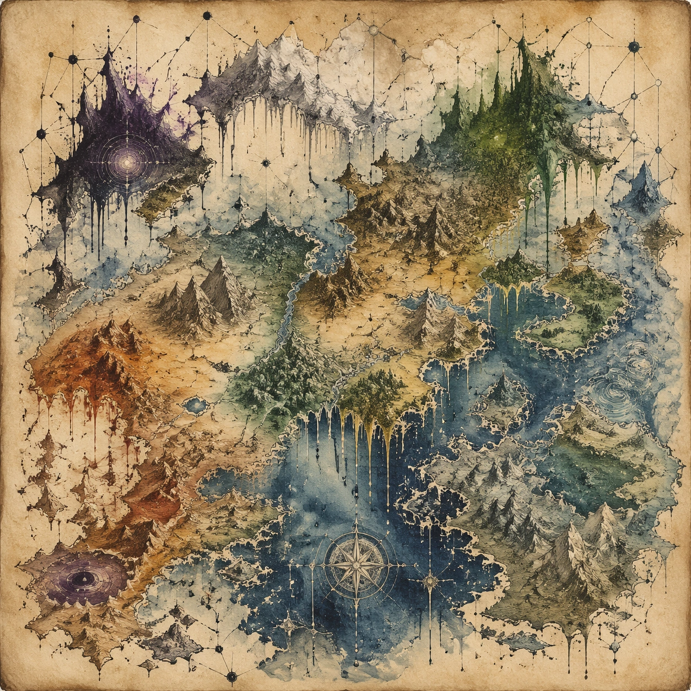

```text
Scene:
A square, gallery-ready composition with painterly surfaces, controlled negative space, and a deliberate fine-art presentation. Build the frame around a dense all-over field of marks that feels suspended between chaos and structure. Keep the lighting, camera distance, and spatial organization tuned for a high-signal research image rather than a casual snapshot. The image belongs to the Fantasy Handdrawn Map theme and should feel immediately legible as a prompt atlas theme for fantasy handdrawn map, testing structured-layout, photorealism, world-knowledge, reasoning-composition with gpt image 2..

Subject:
Center the study on a dense all-over field of marks that feels suspended between chaos and structure. Translate the theme into a concrete visual statement instead of an abstract mood board: the viewer should understand what kind of image this is, what is being tested, and why the composition is difficult. Use the slug idea of fantasy handdrawn map as a literal guide for subject matter, materials, and staging. If helpful, borrow the broad visual cues suggested by Here Be Dragons, but keep the result original and specific to this study.

Important details:
Focus on authored mark-making, hierarchy, rhythm, and a visual idea that reads immediately before the viewer inspects the brushwork. Preserve a disciplined square composition, clear focal hierarchy, and enough secondary information to make the image feel complete rather than underspecified. The image should look polished, novel, and exhibition-ready, with topic-specific credibility coming from the way surfaces, structure, and visual language reinforce Fantasy Handdrawn Map. Avoid generic filler elements that do not serve the main concept.

Use case:
Fantasy Handdrawn Map single study 1/8, testing structured-layout, photorealism, world-knowledge, reasoning-composition through the drip constellation variation.

Constraints:
No readable text, no watermark, no logos, preserve exact 1:1 aspect ratio, no direct copy of a known artwork, no comic speech bubbles, no accidental typography, no low-effort doodle energy, no muddy center, no fake museum label.
```

[Pinned source](https://github.com/ChaosRealmsAI/gpt-image-2-gallery/blob/5296db8c996e38776c83a0bc8c64f848dcd512b3/works/topics/fantasy-handdrawn-map/packages/single-fantasy-handdrawn-map-studies/images/drip-constellation/meta.json) · GPT Image2 · 1254×1254 · No source-declared image dependencies. · ProjectD:pending individual review.

## Color Field Threshold · fantasy-handdrawn-map/single-fantasy-handdrawn-map-studies/color-field-threshold

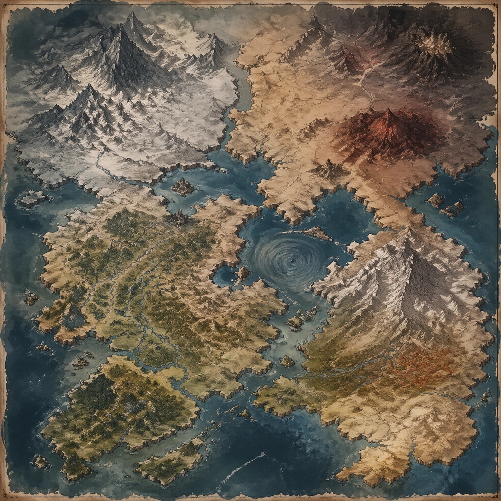

```text
Scene:
A square, gallery-ready composition with painterly surfaces, controlled negative space, and a deliberate fine-art presentation. Build the frame around a few dominant blocks or atmospheres of color with slow transitions and emotional weight. Keep the lighting, camera distance, and spatial organization tuned for a high-signal research image rather than a casual snapshot. The image belongs to the Fantasy Handdrawn Map theme and should feel immediately legible as a prompt atlas theme for fantasy handdrawn map, testing structured-layout, photorealism, world-knowledge, reasoning-composition with gpt image 2..

Subject:
Center the study on a few dominant blocks or atmospheres of color with slow transitions and emotional weight. Translate the theme into a concrete visual statement instead of an abstract mood board: the viewer should understand what kind of image this is, what is being tested, and why the composition is difficult. Use the slug idea of fantasy handdrawn map as a literal guide for subject matter, materials, and staging. If helpful, borrow the broad visual cues suggested by Here Be Dragons, but keep the result original and specific to this study.

Important details:
Focus on authored mark-making, hierarchy, rhythm, and a visual idea that reads immediately before the viewer inspects the brushwork. Preserve a disciplined square composition, clear focal hierarchy, and enough secondary information to make the image feel complete rather than underspecified. The image should look polished, novel, and exhibition-ready, with topic-specific credibility coming from the way surfaces, structure, and visual language reinforce Fantasy Handdrawn Map. Avoid generic filler elements that do not serve the main concept.

Use case:
Fantasy Handdrawn Map single study 2/8, testing structured-layout, photorealism, world-knowledge, reasoning-composition through the color field threshold variation.

Constraints:
No readable text, no watermark, no logos, preserve exact 1:1 aspect ratio, no direct copy of a known artwork, no comic speech bubbles, no accidental typography, no low-effort doodle energy, no muddy center, no fake museum label.
```

[Pinned source](https://github.com/ChaosRealmsAI/gpt-image-2-gallery/blob/5296db8c996e38776c83a0bc8c64f848dcd512b3/works/topics/fantasy-handdrawn-map/packages/single-fantasy-handdrawn-map-studies/images/color-field-threshold/meta.json) · GPT Image2 · 1254×1254 · No source-declared image dependencies. · ProjectD:pending individual review.

## Fractured Figure Surge · fantasy-handdrawn-map/single-fantasy-handdrawn-map-studies/fractured-figure-surge

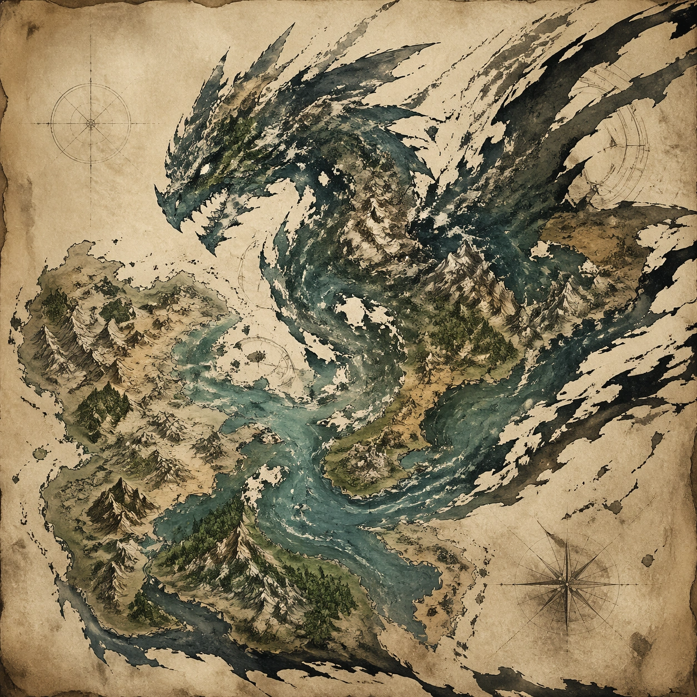

```text
Scene:
A square, gallery-ready composition with painterly surfaces, controlled negative space, and a deliberate fine-art presentation. Build the frame around a figure-like presence that emerges and dissolves through broken strokes and unstable edges. Keep the lighting, camera distance, and spatial organization tuned for a high-signal research image rather than a casual snapshot. The image belongs to the Fantasy Handdrawn Map theme and should feel immediately legible as a prompt atlas theme for fantasy handdrawn map, testing structured-layout, photorealism, world-knowledge, reasoning-composition with gpt image 2..

Subject:
Center the study on a figure-like presence that emerges and dissolves through broken strokes and unstable edges. Translate the theme into a concrete visual statement instead of an abstract mood board: the viewer should understand what kind of image this is, what is being tested, and why the composition is difficult. Use the slug idea of fantasy handdrawn map as a literal guide for subject matter, materials, and staging. If helpful, borrow the broad visual cues suggested by Here Be Dragons, but keep the result original and specific to this study.

Important details:
Focus on authored mark-making, hierarchy, rhythm, and a visual idea that reads immediately before the viewer inspects the brushwork. Preserve a disciplined square composition, clear focal hierarchy, and enough secondary information to make the image feel complete rather than underspecified. The image should look polished, novel, and exhibition-ready, with topic-specific credibility coming from the way surfaces, structure, and visual language reinforce Fantasy Handdrawn Map. Avoid generic filler elements that do not serve the main concept.

Use case:
Fantasy Handdrawn Map single study 3/8, testing structured-layout, photorealism, world-knowledge, reasoning-composition through the fractured figure surge variation.

Constraints:
No readable text, no watermark, no logos, preserve exact 1:1 aspect ratio, no direct copy of a known artwork, no comic speech bubbles, no accidental typography, no low-effort doodle energy, no muddy center, no fake museum label.
```

[Pinned source](https://github.com/ChaosRealmsAI/gpt-image-2-gallery/blob/5296db8c996e38776c83a0bc8c64f848dcd512b3/works/topics/fantasy-handdrawn-map/packages/single-fantasy-handdrawn-map-studies/images/fractured-figure-surge/meta.json) · GPT Image2 · 1254×1254 · No source-declared image dependencies. · ProjectD:pending individual review.

## Black Brush Choir · fantasy-handdrawn-map/single-fantasy-handdrawn-map-studies/black-brush-choir

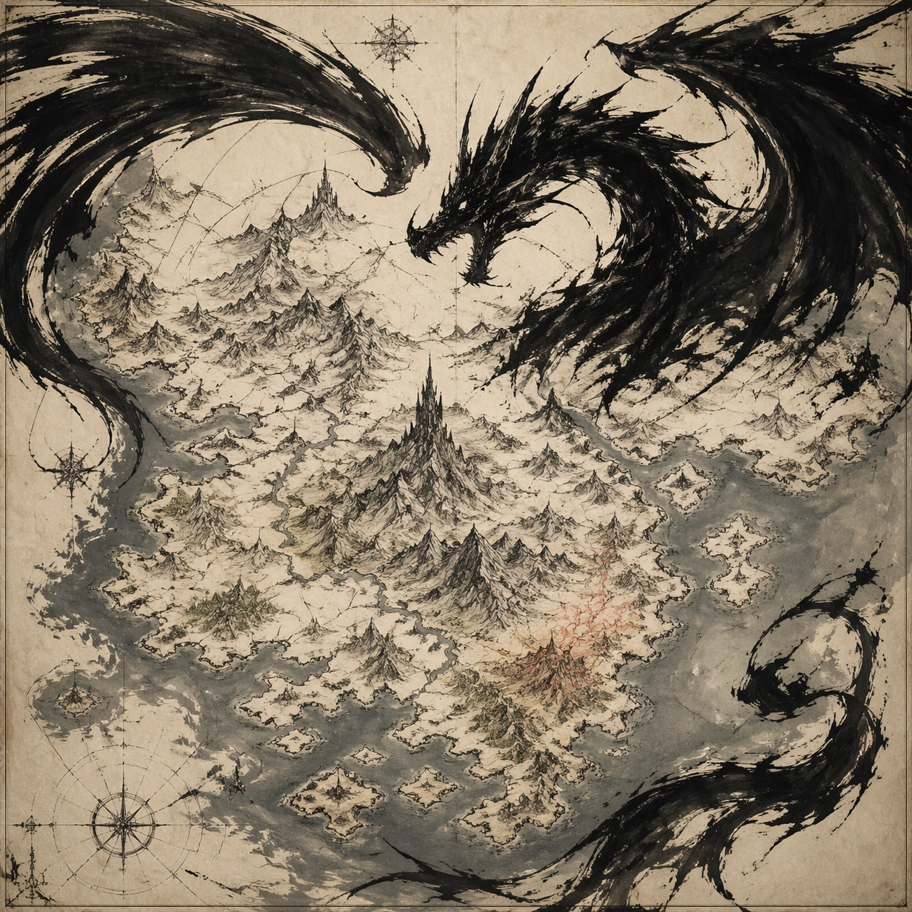

```text
Scene:
A square, gallery-ready composition with painterly surfaces, controlled negative space, and a deliberate fine-art presentation. Build the frame around large decisive black gestures that create rhythm, tension, and architectural pressure. Keep the lighting, camera distance, and spatial organization tuned for a high-signal research image rather than a casual snapshot. The image belongs to the Fantasy Handdrawn Map theme and should feel immediately legible as a prompt atlas theme for fantasy handdrawn map, testing structured-layout, photorealism, world-knowledge, reasoning-composition with gpt image 2..

Subject:
Center the study on large decisive black gestures that create rhythm, tension, and architectural pressure. Translate the theme into a concrete visual statement instead of an abstract mood board: the viewer should understand what kind of image this is, what is being tested, and why the composition is difficult. Use the slug idea of fantasy handdrawn map as a literal guide for subject matter, materials, and staging. If helpful, borrow the broad visual cues suggested by Here Be Dragons, but keep the result original and specific to this study.

Important details:
Focus on authored mark-making, hierarchy, rhythm, and a visual idea that reads immediately before the viewer inspects the brushwork. Preserve a disciplined square composition, clear focal hierarchy, and enough secondary information to make the image feel complete rather than underspecified. The image should look polished, novel, and exhibition-ready, with topic-specific credibility coming from the way surfaces, structure, and visual language reinforce Fantasy Handdrawn Map. Avoid generic filler elements that do not serve the main concept.

Use case:
Fantasy Handdrawn Map single study 4/8, testing structured-layout, photorealism, world-knowledge, reasoning-composition through the black brush choir variation.

Constraints:
No readable text, no watermark, no logos, preserve exact 1:1 aspect ratio, no direct copy of a known artwork, no comic speech bubbles, no accidental typography, no low-effort doodle energy, no muddy center, no fake museum label.
```

[Pinned source](https://github.com/ChaosRealmsAI/gpt-image-2-gallery/blob/5296db8c996e38776c83a0bc8c64f848dcd512b3/works/topics/fantasy-handdrawn-map/packages/single-fantasy-handdrawn-map-studies/images/black-brush-choir/meta.json) · GPT Image2 · 1254×1254 · No source-declared image dependencies. · ProjectD:pending individual review.

## Studio Floor Afterimage · fantasy-handdrawn-map/single-fantasy-handdrawn-map-studies/studio-floor-afterimage

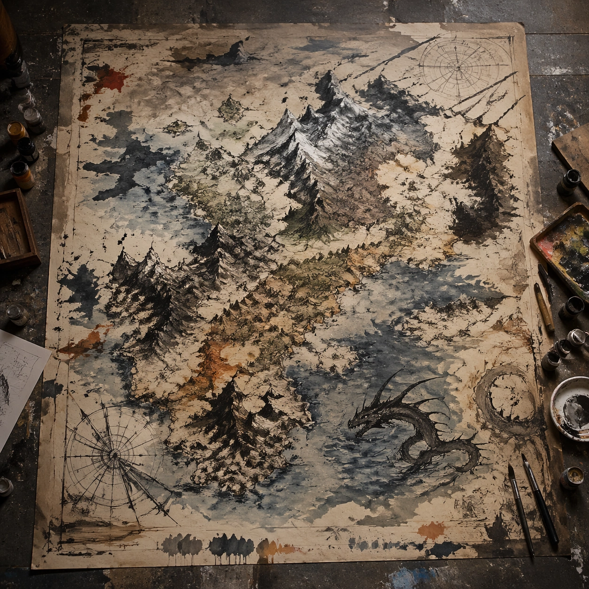

```text
Scene:
A square, gallery-ready composition with painterly surfaces, controlled negative space, and a deliberate fine-art presentation. Build the frame around evidence of process, splatter, drag, and layered correction without becoming documentary clutter. Keep the lighting, camera distance, and spatial organization tuned for a high-signal research image rather than a casual snapshot. The image belongs to the Fantasy Handdrawn Map theme and should feel immediately legible as a prompt atlas theme for fantasy handdrawn map, testing structured-layout, photorealism, world-knowledge, reasoning-composition with gpt image 2..

Subject:
Center the study on evidence of process, splatter, drag, and layered correction without becoming documentary clutter. Translate the theme into a concrete visual statement instead of an abstract mood board: the viewer should understand what kind of image this is, what is being tested, and why the composition is difficult. Use the slug idea of fantasy handdrawn map as a literal guide for subject matter, materials, and staging. If helpful, borrow the broad visual cues suggested by Here Be Dragons, but keep the result original and specific to this study.

Important details:
Focus on authored mark-making, hierarchy, rhythm, and a visual idea that reads immediately before the viewer inspects the brushwork. Preserve a disciplined square composition, clear focal hierarchy, and enough secondary information to make the image feel complete rather than underspecified. The image should look polished, novel, and exhibition-ready, with topic-specific credibility coming from the way surfaces, structure, and visual language reinforce Fantasy Handdrawn Map. Avoid generic filler elements that do not serve the main concept.

Use case:
Fantasy Handdrawn Map single study 5/8, testing structured-layout, photorealism, world-knowledge, reasoning-composition through the studio floor afterimage variation.

Constraints:
No readable text, no watermark, no logos, preserve exact 1:1 aspect ratio, no direct copy of a known artwork, no comic speech bubbles, no accidental typography, no low-effort doodle energy, no muddy center, no fake museum label.
```

[Pinned source](https://github.com/ChaosRealmsAI/gpt-image-2-gallery/blob/5296db8c996e38776c83a0bc8c64f848dcd512b3/works/topics/fantasy-handdrawn-map/packages/single-fantasy-handdrawn-map-studies/images/studio-floor-afterimage/meta.json) · GPT Image2 · 1254×1254 · No source-declared image dependencies. · ProjectD:pending individual review.

## 厚涂天气 · fantasy-handdrawn-map/single-fantasy-handdrawn-map-studies/impasto-weather

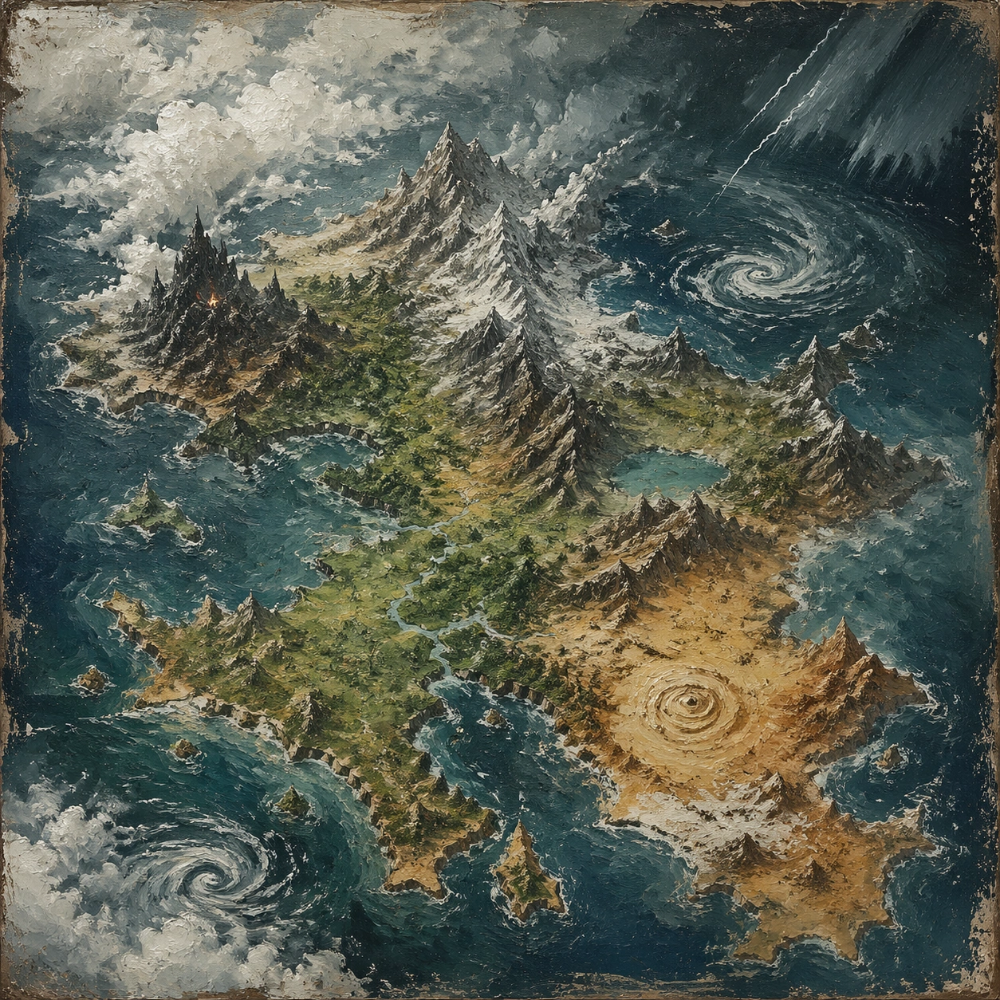

```text
Scene:
A square, gallery-ready composition with painterly surfaces, controlled negative space, and a deliberate fine-art presentation. Build the frame around surface build-up, scrape marks, and thick tactile passages that feel meteorological. Keep the lighting, camera distance, and spatial organization tuned for a high-signal research image rather than a casual snapshot. The image belongs to the Fantasy Handdrawn Map theme and should feel immediately legible as a prompt atlas theme for fantasy handdrawn map, testing structured-layout, photorealism, world-knowledge, reasoning-composition with gpt image 2..

Subject:
Center the study on surface build-up, scrape marks, and thick tactile passages that feel meteorological. Translate the theme into a concrete visual statement instead of an abstract mood board: the viewer should understand what kind of image this is, what is being tested, and why the composition is difficult. Use the slug idea of fantasy handdrawn map as a literal guide for subject matter, materials, and staging. If helpful, borrow the broad visual cues suggested by Here Be Dragons, but keep the result original and specific to this study.

Important details:
Focus on authored mark-making, hierarchy, rhythm, and a visual idea that reads immediately before the viewer inspects the brushwork. Preserve a disciplined square composition, clear focal hierarchy, and enough secondary information to make the image feel complete rather than underspecified. The image should look polished, novel, and exhibition-ready, with topic-specific credibility coming from the way surfaces, structure, and visual language reinforce Fantasy Handdrawn Map. Avoid generic filler elements that do not serve the main concept.

Use case:
Fantasy Handdrawn Map single study 6/8, testing structured-layout, photorealism, world-knowledge, reasoning-composition through the 厚涂天气 variation.

Constraints:
No readable text, no watermark, no logos, preserve exact 1:1 aspect ratio, no direct copy of a known artwork, no comic speech bubbles, no accidental typography, no low-effort doodle energy, no muddy center, no fake museum label.
```

[Pinned source](https://github.com/ChaosRealmsAI/gpt-image-2-gallery/blob/5296db8c996e38776c83a0bc8c64f848dcd512b3/works/topics/fantasy-handdrawn-map/packages/single-fantasy-handdrawn-map-studies/images/impasto-weather/meta.json) · GPT Image2 · 1254×1254 · No source-declared image dependencies. · ProjectD:pending individual review.

## Gesture Architecture · fantasy-handdrawn-map/single-fantasy-handdrawn-map-studies/gesture-architecture

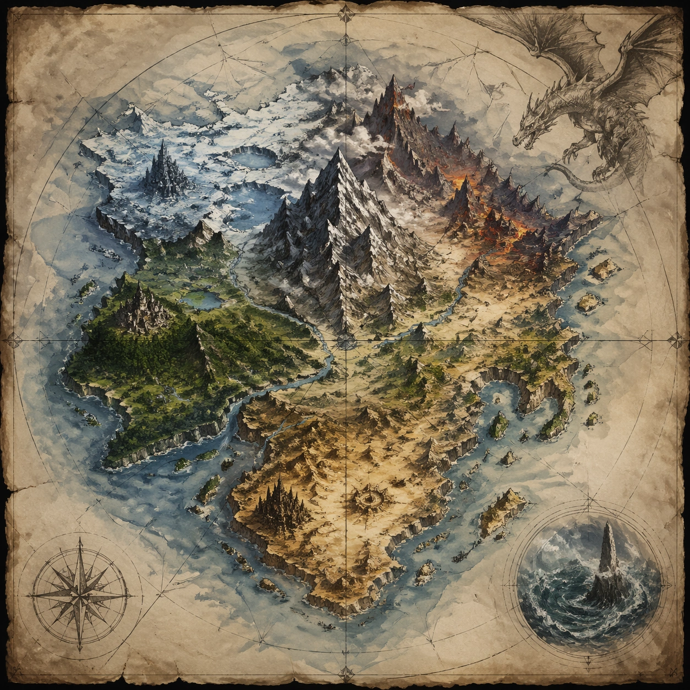

```text
Scene:
A square, gallery-ready composition with painterly surfaces, controlled negative space, and a deliberate fine-art presentation. Build the frame around brush movement that locks into a hidden compositional scaffold rather than random motion. Keep the lighting, camera distance, and spatial organization tuned for a high-signal research image rather than a casual snapshot. The image belongs to the Fantasy Handdrawn Map theme and should feel immediately legible as a prompt atlas theme for fantasy handdrawn map, testing structured-layout, photorealism, world-knowledge, reasoning-composition with gpt image 2..

Subject:
Center the study on brush movement that locks into a hidden compositional scaffold rather than random motion. Translate the theme into a concrete visual statement instead of an abstract mood board: the viewer should understand what kind of image this is, what is being tested, and why the composition is difficult. Use the slug idea of fantasy handdrawn map as a literal guide for subject matter, materials, and staging. If helpful, borrow the broad visual cues suggested by Here Be Dragons, but keep the result original and specific to this study.

Important details:
Focus on authored mark-making, hierarchy, rhythm, and a visual idea that reads immediately before the viewer inspects the brushwork. Preserve a disciplined square composition, clear focal hierarchy, and enough secondary information to make the image feel complete rather than underspecified. The image should look polished, novel, and exhibition-ready, with topic-specific credibility coming from the way surfaces, structure, and visual language reinforce Fantasy Handdrawn Map. Avoid generic filler elements that do not serve the main concept.

Use case:
Fantasy Handdrawn Map single study 7/8, testing structured-layout, photorealism, world-knowledge, reasoning-composition through the gesture architecture variation.

Constraints:
No readable text, no watermark, no logos, preserve exact 1:1 aspect ratio, no direct copy of a known artwork, no comic speech bubbles, no accidental typography, no low-effort doodle energy, no muddy center, no fake museum label.
```

[Pinned source](https://github.com/ChaosRealmsAI/gpt-image-2-gallery/blob/5296db8c996e38776c83a0bc8c64f848dcd512b3/works/topics/fantasy-handdrawn-map/packages/single-fantasy-handdrawn-map-studies/images/gesture-architecture/meta.json) · GPT Image2 · 1254×1254 · No source-declared image dependencies. · ProjectD:pending individual review.

## Museum Wall Hang · fantasy-handdrawn-map/single-fantasy-handdrawn-map-studies/museum-wall-hang

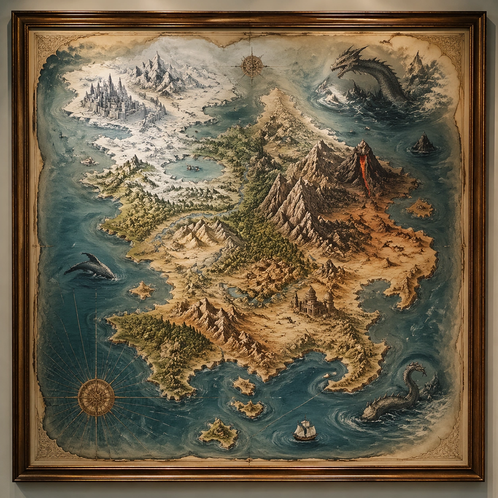

```text
Scene:
A square, gallery-ready composition with painterly surfaces, controlled negative space, and a deliberate fine-art presentation. Build the frame around a resolved exhibition-grade work whose internal balance feels complete and intentional. Keep the lighting, camera distance, and spatial organization tuned for a high-signal research image rather than a casual snapshot. The image belongs to the Fantasy Handdrawn Map theme and should feel immediately legible as a prompt atlas theme for fantasy handdrawn map, testing structured-layout, photorealism, world-knowledge, reasoning-composition with gpt image 2..

Subject:
Center the study on a resolved exhibition-grade work whose internal balance feels complete and intentional. Translate the theme into a concrete visual statement instead of an abstract mood board: the viewer should understand what kind of image this is, what is being tested, and why the composition is difficult. Use the slug idea of fantasy handdrawn map as a literal guide for subject matter, materials, and staging. If helpful, borrow the broad visual cues suggested by Here Be Dragons, but keep the result original and specific to this study.

Important details:
Focus on authored mark-making, hierarchy, rhythm, and a visual idea that reads immediately before the viewer inspects the brushwork. Preserve a disciplined square composition, clear focal hierarchy, and enough secondary information to make the image feel complete rather than underspecified. The image should look polished, novel, and exhibition-ready, with topic-specific credibility coming from the way surfaces, structure, and visual language reinforce Fantasy Handdrawn Map. Avoid generic filler elements that do not serve the main concept.

Use case:
Fantasy Handdrawn Map single study 8/8, testing structured-layout, photorealism, world-knowledge, reasoning-composition through the museum wall hang variation.

Constraints:
No readable text, no watermark, no logos, preserve exact 1:1 aspect ratio, no direct copy of a known artwork, no comic speech bubbles, no accidental typography, no low-effort doodle energy, no muddy center, no fake museum label.
```

[Pinned source](https://github.com/ChaosRealmsAI/gpt-image-2-gallery/blob/5296db8c996e38776c83a0bc8c64f848dcd512b3/works/topics/fantasy-handdrawn-map/packages/single-fantasy-handdrawn-map-studies/images/museum-wall-hang/meta.json) · GPT Image2 · 1254×1254 · No source-declared image dependencies. · ProjectD:pending individual review.

## Reference Character Anchor · fantasy-live-action-character-portraits/series-cinematic-portrait-lock/01-reference-character-anchor

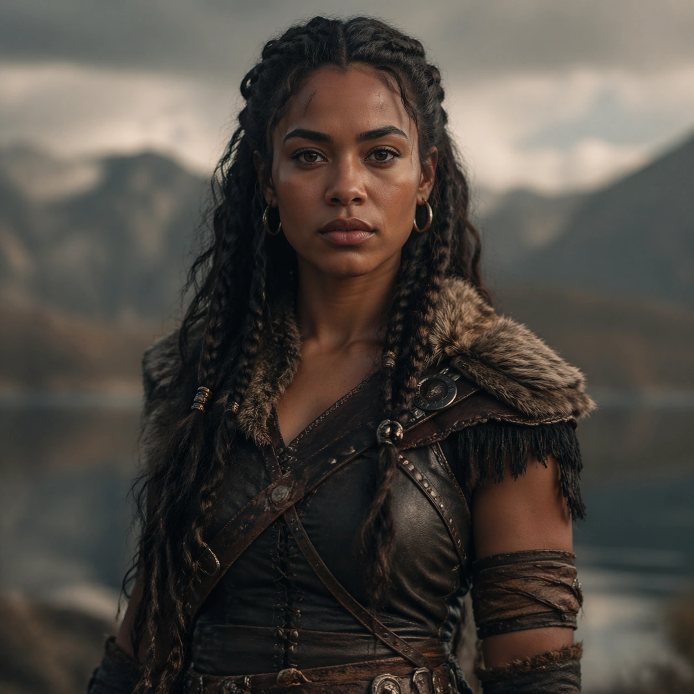

```text
Scene:
Create a square 1:1 portrait image for Fantasy Live-Action Character Portraits. Use a premium story-led portrait setup with calm atmosphere, cinematic light discipline, and enough detail to define the recurring character. The frame should feel like a finished professional deliverable rather than a casual snapshot, with clear lens discipline, believable light falloff, and a palette that directly supports Translate fictional or stylized characters into live-action portrait photography that still feels emotionally grounded and costume-realistic.. Keep enough surrounding space and compositional control for gallery, research, campaign, or approval-board reuse while staying photoreal and human-scaled.

Subject:
Center one live-action fantasy heroine with warm brown skin, long dark braided hair, a faint scar above the left brow, and grounded warrior posture. Establish the exact face, hair base, body proportions, and costume baseline that later story beats must preserve. Use the example direction from the brief as grounding context: Translate fictional or stylized characters into live-action portrait photography that still feels emotionally grounded and costume-realistic.. Wardrobe, lighting, environment, and pose may shift to serve this variation, but the viewer must immediately understand that the same reference identity is still in front of the camera.

Important details:
This backlog line is difficult because Translate fictional or stylized characters into live-action portrait photography that still feels emotionally grounded and costume-realistic.. Preserve skin tone family, bone structure, eye spacing, nose shape, mouth shape, hairline logic, shoulder width, and overall body read across the entire series. preserve exact face / hair base / body proportions from the reference model. This is the anchor portrait for a narrative sequence, so recognition matters more than spectacle. Avoid the common failure described in the brief: ordinary image models often lose likeness once styling, lighting, or layout changes enter the frame. Success should feel like the result should feel professionally usable, coherent, and clearly built around one stable human identity.

Use case:
Fantasy Live-Action Character Portraits series study 1/9, the baseline character portrait.

Constraints:
No readable text, no watermark, no logos, preserve exact 1:1 aspect ratio, preserve exact face / hair base / body proportions from the reference model, no crowd, no unreadable poster text, no genre clutter, no face ambiguity.
```

[Pinned source](https://github.com/ChaosRealmsAI/gpt-image-2-gallery/blob/5296db8c996e38776c83a0bc8c64f848dcd512b3/works/topics/fantasy-live-action-character-portraits/packages/series-cinematic-portrait-lock/images/01-reference-character-anchor/meta.json) · GPT Image2 · 1254×1254 · No source-declared image dependencies. · ProjectD:pending individual review.

## Interior Scene · fantasy-live-action-character-portraits/series-cinematic-portrait-lock/02-interior-scene

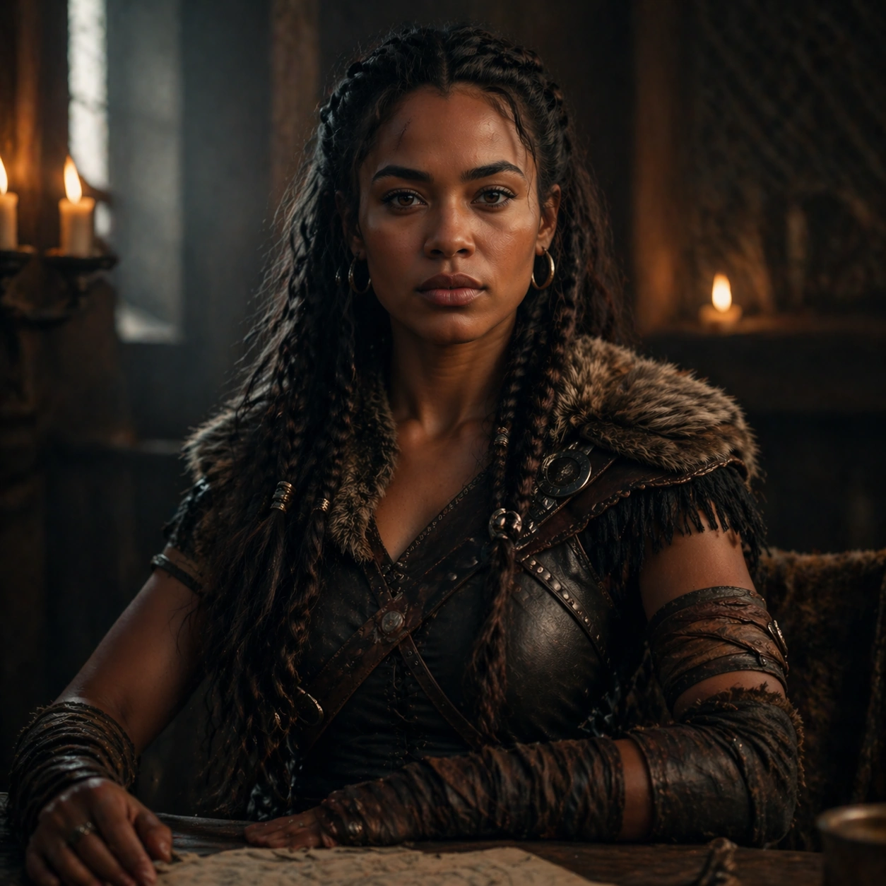

```text
Scene:
Create a square 1:1 portrait image for Fantasy Live-Action Character Portraits. Use a carefully staged room or interior with motivated light, layered depth, and one clear emotional focus. The frame should feel like a finished professional deliverable rather than a casual snapshot, with clear lens discipline, believable light falloff, and a palette that directly supports Translate fictional or stylized characters into live-action portrait photography that still feels emotionally grounded and costume-realistic.. Keep enough surrounding space and compositional control for gallery, research, campaign, or approval-board reuse while staying photoreal and human-scaled.

Subject:
Center one live-action fantasy heroine with warm brown skin, long dark braided hair, a faint scar above the left brow, and grounded warrior posture. Place the same character into a story situation without changing who they are. Preserve the anchor identity even as costume texture or environment becomes richer. Use the example direction from the brief as grounding context: Translate fictional or stylized characters into live-action portrait photography that still feels emotionally grounded and costume-realistic.. Wardrobe, lighting, environment, and pose may shift to serve this variation, but the viewer must immediately understand that the same reference identity is still in front of the camera.

Important details:
This backlog line is difficult because Translate fictional or stylized characters into live-action portrait photography that still feels emotionally grounded and costume-realistic.. Preserve skin tone family, bone structure, eye spacing, nose shape, mouth shape, hairline logic, shoulder width, and overall body read across the entire series. preserve exact face / hair base / body proportions from the reference model. The scene may feel cinematic, but likeness still outranks atmosphere. Avoid the common failure described in the brief: ordinary image models often lose likeness once styling, lighting, or layout changes enter the frame. Success should feel like the result should feel professionally usable, coherent, and clearly built around one stable human identity.

Use case:
Fantasy Live-Action Character Portraits series study 2/9, an interior story beat.

Constraints:
No readable text, no watermark, no logos, preserve exact 1:1 aspect ratio, preserve exact face / hair base / body proportions from the reference model, no extra protagonists, no busy set dressing, no drastic age shift, no unrelated props.
```

[Pinned source](https://github.com/ChaosRealmsAI/gpt-image-2-gallery/blob/5296db8c996e38776c83a0bc8c64f848dcd512b3/works/topics/fantasy-live-action-character-portraits/packages/series-cinematic-portrait-lock/images/02-interior-scene/meta.json) · GPT Image2 · 1254×1254 · Reference images required. · ProjectD:pending individual review.

## Transition Pause · fantasy-live-action-character-portraits/series-cinematic-portrait-lock/03-transition-pause

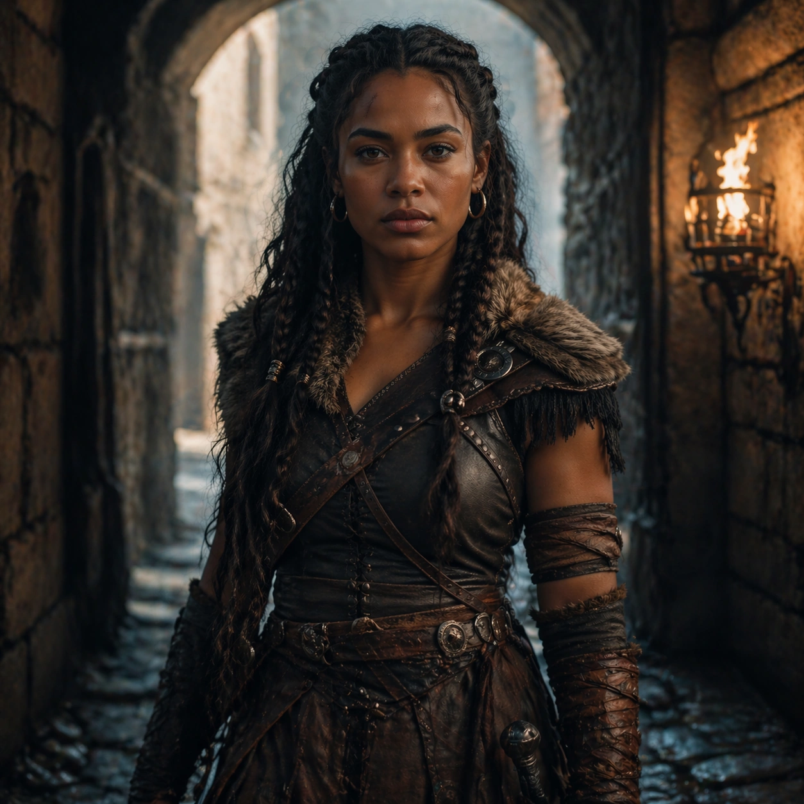

```text
Scene:
Create a square 1:1 portrait image for Fantasy Live-Action Character Portraits. Use a hallway, alley, corridor, or threshold frame with directional light and clean silhouette control. The frame should feel like a finished professional deliverable rather than a casual snapshot, with clear lens discipline, believable light falloff, and a palette that directly supports Translate fictional or stylized characters into live-action portrait photography that still feels emotionally grounded and costume-realistic.. Keep enough surrounding space and compositional control for gallery, research, campaign, or approval-board reuse while staying photoreal and human-scaled.

Subject:
Center one live-action fantasy heroine with warm brown skin, long dark braided hair, a faint scar above the left brow, and grounded warrior posture. Use a transition space to show the same character in motion or pause while preserving exact face / hair base / body proportions from the reference model. Use the example direction from the brief as grounding context: Translate fictional or stylized characters into live-action portrait photography that still feels emotionally grounded and costume-realistic.. Wardrobe, lighting, environment, and pose may shift to serve this variation, but the viewer must immediately understand that the same reference identity is still in front of the camera.

Important details:
This backlog line is difficult because Translate fictional or stylized characters into live-action portrait photography that still feels emotionally grounded and costume-realistic.. Preserve skin tone family, bone structure, eye spacing, nose shape, mouth shape, hairline logic, shoulder width, and overall body read across the entire series. preserve exact face / hair base / body proportions from the reference model. This image should feel like the next shot in one film, not a new casting choice. Avoid the common failure described in the brief: ordinary image models often lose likeness once styling, lighting, or layout changes enter the frame. Success should feel like the result should feel professionally usable, coherent, and clearly built around one stable human identity.

Use case:
Fantasy Live-Action Character Portraits series study 3/9, a transitional pause portrait.

Constraints:
No readable text, no watermark, no logos, preserve exact 1:1 aspect ratio, preserve exact face / hair base / body proportions from the reference model, no hidden face, no body warp, no action blur, no background signage.
```

[Pinned source](https://github.com/ChaosRealmsAI/gpt-image-2-gallery/blob/5296db8c996e38776c83a0bc8c64f848dcd512b3/works/topics/fantasy-live-action-character-portraits/packages/series-cinematic-portrait-lock/images/03-transition-pause/meta.json) · GPT Image2 · 1254×1254 · Reference images required. · ProjectD:pending individual review.

## Close-up Emotion · fantasy-live-action-character-portraits/series-cinematic-portrait-lock/04-closeup-emotion

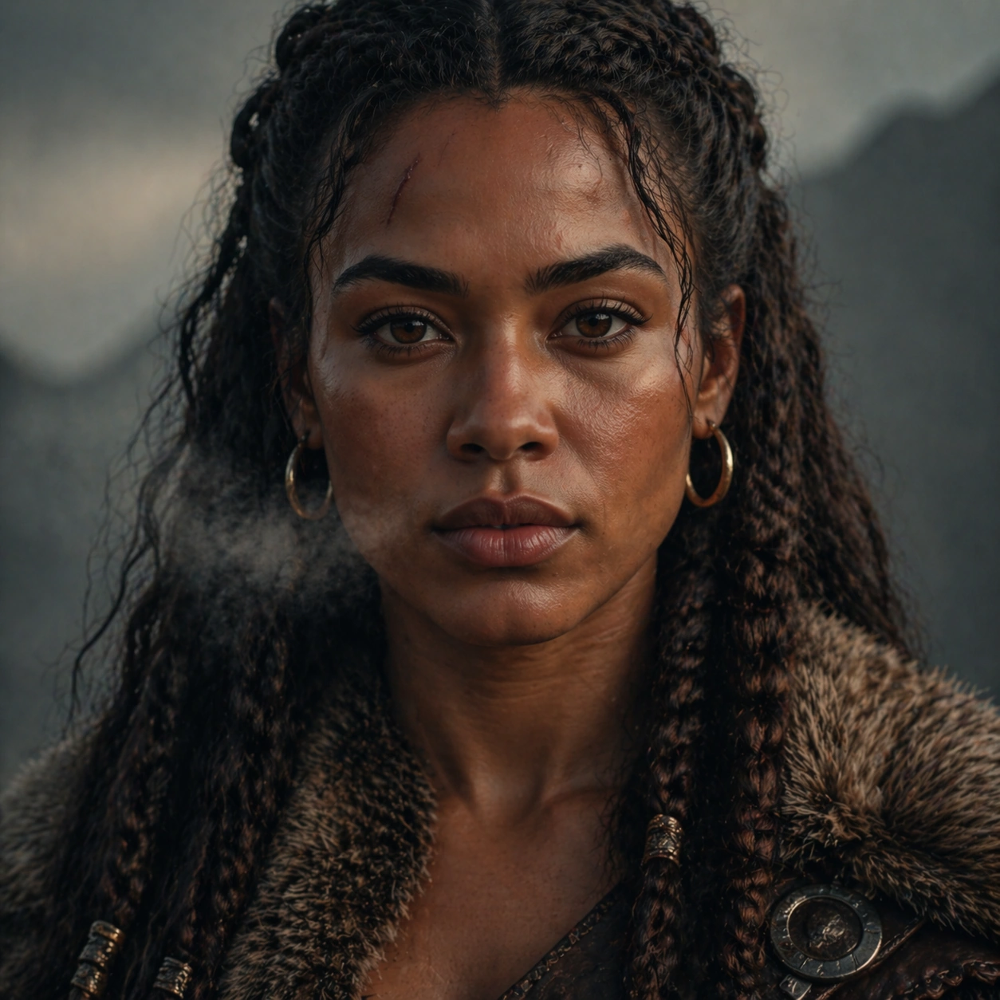

```text
Scene:
Create a square 1:1 portrait image for Fantasy Live-Action Character Portraits. Use a tighter crop with visible skin texture, lashes, breath, and emotional tension controlled by cinematic light. The frame should feel like a finished professional deliverable rather than a casual snapshot, with clear lens discipline, believable light falloff, and a palette that directly supports Translate fictional or stylized characters into live-action portrait photography that still feels emotionally grounded and costume-realistic.. Keep enough surrounding space and compositional control for gallery, research, campaign, or approval-board reuse while staying photoreal and human-scaled.

Subject:
Center one live-action fantasy heroine with warm brown skin, long dark braided hair, a faint scar above the left brow, and grounded warrior posture. Move closer to the same face to test emotional precision without any identity drift. Use the example direction from the brief as grounding context: Translate fictional or stylized characters into live-action portrait photography that still feels emotionally grounded and costume-realistic.. Wardrobe, lighting, environment, and pose may shift to serve this variation, but the viewer must immediately understand that the same reference identity is still in front of the camera.

Important details:
This backlog line is difficult because Translate fictional or stylized characters into live-action portrait photography that still feels emotionally grounded and costume-realistic.. Preserve skin tone family, bone structure, eye spacing, nose shape, mouth shape, hairline logic, shoulder width, and overall body read across the entire series. preserve exact face / hair base / body proportions from the reference model. Every small facial marker should still match the reference anchor. Avoid the common failure described in the brief: ordinary image models often lose likeness once styling, lighting, or layout changes enter the frame. Success should feel like the result should feel professionally usable, coherent, and clearly built around one stable human identity.

Use case:
Fantasy Live-Action Character Portraits series study 4/9, a close emotional portrait.

Constraints:
No readable text, no watermark, no logos, preserve exact 1:1 aspect ratio, preserve exact face / hair base / body proportions from the reference model, no tears that melt features, no face reshaping, no extreme beauty retouching, no second person.
```

[Pinned source](https://github.com/ChaosRealmsAI/gpt-image-2-gallery/blob/5296db8c996e38776c83a0bc8c64f848dcd512b3/works/topics/fantasy-live-action-character-portraits/packages/series-cinematic-portrait-lock/images/04-closeup-emotion/meta.json) · GPT Image2 · 1254×1254 · Reference images required. · ProjectD:pending individual review.

## Exterior Walk · fantasy-live-action-character-portraits/series-cinematic-portrait-lock/05-exterior-walk

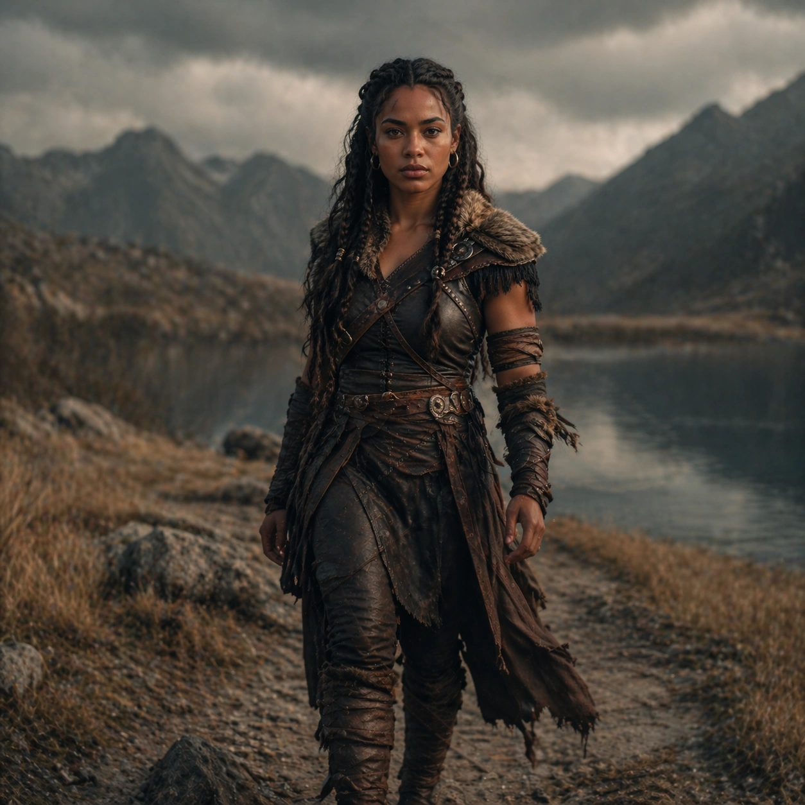

```text
Scene:
Create a square 1:1 portrait image for Fantasy Live-Action Character Portraits. Use a believable outdoor setup with motivated practical light and enough environment to imply story stakes. The frame should feel like a finished professional deliverable rather than a casual snapshot, with clear lens discipline, believable light falloff, and a palette that directly supports Translate fictional or stylized characters into live-action portrait photography that still feels emotionally grounded and costume-realistic.. Keep enough surrounding space and compositional control for gallery, research, campaign, or approval-board reuse while staying photoreal and human-scaled.

Subject:
Center one live-action fantasy heroine with warm brown skin, long dark braided hair, a faint scar above the left brow, and grounded warrior posture. Keep the same character exact while expanding to a wider frame that shows gait, shoulders, and costume silhouette in context. Use the example direction from the brief as grounding context: Translate fictional or stylized characters into live-action portrait photography that still feels emotionally grounded and costume-realistic.. Wardrobe, lighting, environment, and pose may shift to serve this variation, but the viewer must immediately understand that the same reference identity is still in front of the camera.

Important details:
This backlog line is difficult because Translate fictional or stylized characters into live-action portrait photography that still feels emotionally grounded and costume-realistic.. Preserve skin tone family, bone structure, eye spacing, nose shape, mouth shape, hairline logic, shoulder width, and overall body read across the entire series. preserve exact face / hair base / body proportions from the reference model. Body proportions must stay stable even in motion-aware framing. Avoid the common failure described in the brief: ordinary image models often lose likeness once styling, lighting, or layout changes enter the frame. Success should feel like the result should feel professionally usable, coherent, and clearly built around one stable human identity.

Use case:
Fantasy Live-Action Character Portraits series study 5/9, an exterior walk or movement frame.

Constraints:
No readable text, no watermark, no logos, preserve exact 1:1 aspect ratio, preserve exact face / hair base / body proportions from the reference model, no action-movie explosion cliche, no giant environment spectacle, no body elongation, no crowd confusion.
```

[Pinned source](https://github.com/ChaosRealmsAI/gpt-image-2-gallery/blob/5296db8c996e38776c83a0bc8c64f848dcd512b3/works/topics/fantasy-live-action-character-portraits/packages/series-cinematic-portrait-lock/images/05-exterior-walk/meta.json) · GPT Image2 · 1254×1254 · Reference images required. · ProjectD:pending individual review.

## Profile Shadow · fantasy-live-action-character-portraits/series-cinematic-portrait-lock/06-profile-shadow

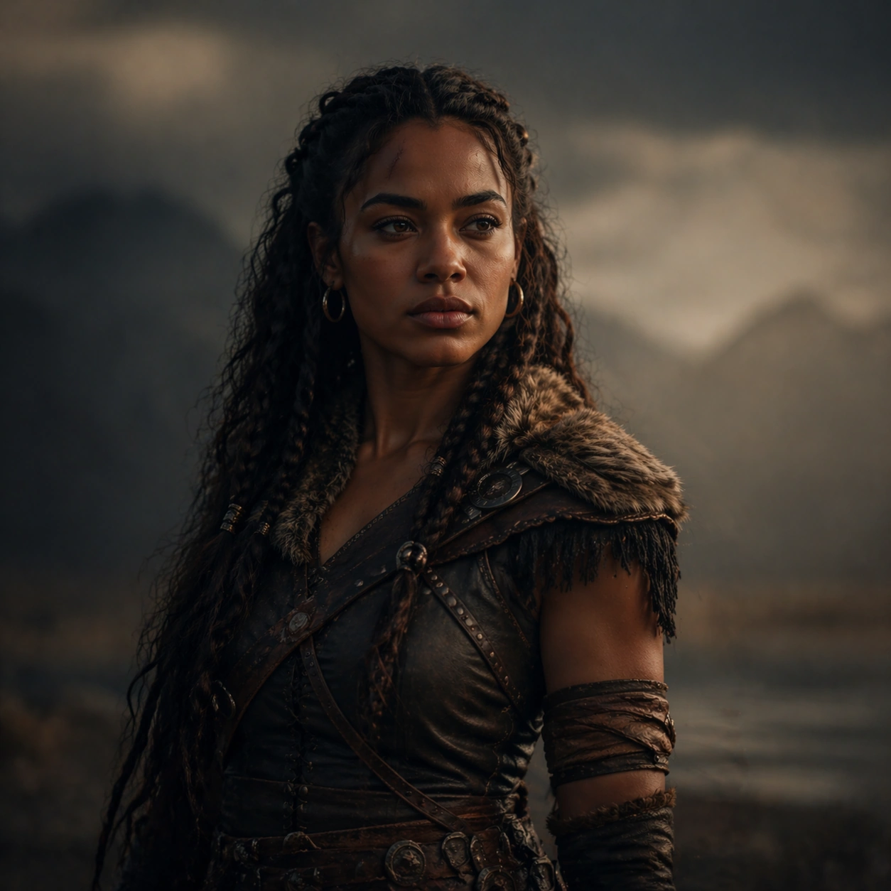

```text
Scene:
Create a square 1:1 portrait image for Fantasy Live-Action Character Portraits. Use a moody side-light frame with rich shadow design, clean negative space, and readable facial geometry. The frame should feel like a finished professional deliverable rather than a casual snapshot, with clear lens discipline, believable light falloff, and a palette that directly supports Translate fictional or stylized characters into live-action portrait photography that still feels emotionally grounded and costume-realistic.. Keep enough surrounding space and compositional control for gallery, research, campaign, or approval-board reuse while staying photoreal and human-scaled.

Subject:
Center one live-action fantasy heroine with warm brown skin, long dark braided hair, a faint scar above the left brow, and grounded warrior posture. Use profile and shadow to deepen mood, but preserve the exact nose bridge, jawline, ear shape, and hair base from the reference. Use the example direction from the brief as grounding context: Translate fictional or stylized characters into live-action portrait photography that still feels emotionally grounded and costume-realistic.. Wardrobe, lighting, environment, and pose may shift to serve this variation, but the viewer must immediately understand that the same reference identity is still in front of the camera.

Important details:
This backlog line is difficult because Translate fictional or stylized characters into live-action portrait photography that still feels emotionally grounded and costume-realistic.. Preserve skin tone family, bone structure, eye spacing, nose shape, mouth shape, hairline logic, shoulder width, and overall body read across the entire series. preserve exact face / hair base / body proportions from the reference model. This should feel psychologically sharper, not visually inconsistent. Avoid the common failure described in the brief: ordinary image models often lose likeness once styling, lighting, or layout changes enter the frame. Success should feel like the result should feel professionally usable, coherent, and clearly built around one stable human identity.

Use case:
Fantasy Live-Action Character Portraits series study 6/9, a profile or shadow-driven portrait.

Constraints:
No readable text, no watermark, no logos, preserve exact 1:1 aspect ratio, preserve exact face / hair base / body proportions from the reference model, no crushed shadow mush, no altered profile, no costume reset, no thriller poster text.
```

[Pinned source](https://github.com/ChaosRealmsAI/gpt-image-2-gallery/blob/5296db8c996e38776c83a0bc8c64f848dcd512b3/works/topics/fantasy-live-action-character-portraits/packages/series-cinematic-portrait-lock/images/06-profile-shadow/meta.json) · GPT Image2 · 1254×1254 · Reference images required. · ProjectD:pending individual review.

## Detail Prop Frame · fantasy-live-action-character-portraits/series-cinematic-portrait-lock/07-detail-prop-frame

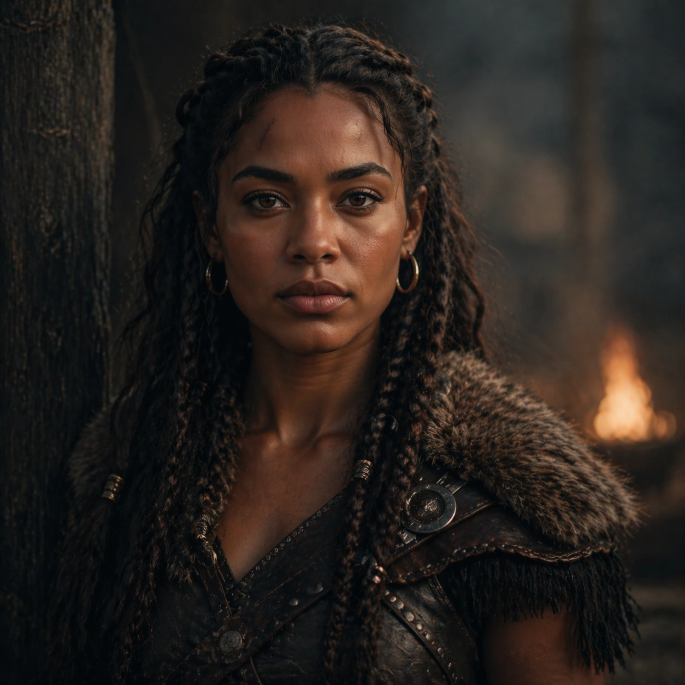

```text
Scene:
Create a square 1:1 portrait image for Fantasy Live-Action Character Portraits. Use a tighter narrative crop that lets one object, garment edge, or environmental clue support the portrait without stealing focus. The frame should feel like a finished professional deliverable rather than a casual snapshot, with clear lens discipline, believable light falloff, and a palette that directly supports Translate fictional or stylized characters into live-action portrait photography that still feels emotionally grounded and costume-realistic.. Keep enough surrounding space and compositional control for gallery, research, campaign, or approval-board reuse while staying photoreal and human-scaled.

Subject:
Center one live-action fantasy heroine with warm brown skin, long dark braided hair, a faint scar above the left brow, and grounded warrior posture. Keep the same character identity dominant while allowing one prop or costume detail to strengthen the story world. Use the example direction from the brief as grounding context: Translate fictional or stylized characters into live-action portrait photography that still feels emotionally grounded and costume-realistic.. Wardrobe, lighting, environment, and pose may shift to serve this variation, but the viewer must immediately understand that the same reference identity is still in front of the camera.

Important details:
This backlog line is difficult because Translate fictional or stylized characters into live-action portrait photography that still feels emotionally grounded and costume-realistic.. Preserve skin tone family, bone structure, eye spacing, nose shape, mouth shape, hairline logic, shoulder width, and overall body read across the entire series. preserve exact face / hair base / body proportions from the reference model. The prop exists to deepen narrative context, not to distract from likeness. Avoid the common failure described in the brief: ordinary image models often lose likeness once styling, lighting, or layout changes enter the frame. Success should feel like the result should feel professionally usable, coherent, and clearly built around one stable human identity.

Use case:
Fantasy Live-Action Character Portraits series study 7/9, a detail frame with one prop or costume clue.

Constraints:
No readable text, no watermark, no logos, preserve exact 1:1 aspect ratio, preserve exact face / hair base / body proportions from the reference model, no branded props, no unreadable newspaper text, no weapon overload, no broken hands.
```

[Pinned source](https://github.com/ChaosRealmsAI/gpt-image-2-gallery/blob/5296db8c996e38776c83a0bc8c64f848dcd512b3/works/topics/fantasy-live-action-character-portraits/packages/series-cinematic-portrait-lock/images/07-detail-prop-frame/meta.json) · GPT Image2 · 1254×1254 · Reference images required. · ProjectD:pending individual review.

## Poster Crop · fantasy-live-action-character-portraits/series-cinematic-portrait-lock/08-poster-crop

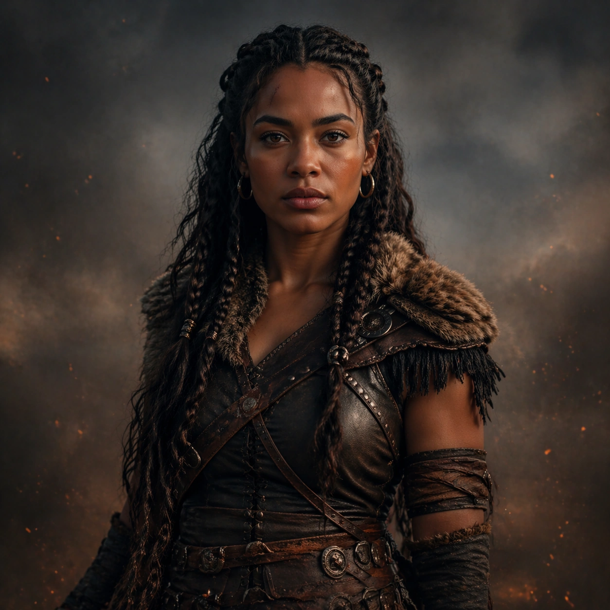

```text
Scene:
Create a square 1:1 portrait image for Fantasy Live-Action Character Portraits. Use a cleaner campaign or one-sheet style portrait with deliberate negative space and clear focal hierarchy. The frame should feel like a finished professional deliverable rather than a casual snapshot, with clear lens discipline, believable light falloff, and a palette that directly supports Translate fictional or stylized characters into live-action portrait photography that still feels emotionally grounded and costume-realistic.. Keep enough surrounding space and compositional control for gallery, research, campaign, or approval-board reuse while staying photoreal and human-scaled.

Subject:
Center one live-action fantasy heroine with warm brown skin, long dark braided hair, a faint scar above the left brow, and grounded warrior posture. Turn the same character into a poster-worthy portrait without readable text or identity drift. Use the example direction from the brief as grounding context: Translate fictional or stylized characters into live-action portrait photography that still feels emotionally grounded and costume-realistic.. Wardrobe, lighting, environment, and pose may shift to serve this variation, but the viewer must immediately understand that the same reference identity is still in front of the camera.

Important details:
This backlog line is difficult because Translate fictional or stylized characters into live-action portrait photography that still feels emotionally grounded and costume-realistic.. Preserve skin tone family, bone structure, eye spacing, nose shape, mouth shape, hairline logic, shoulder width, and overall body read across the entire series. preserve exact face / hair base / body proportions from the reference model. This frame should feel usable for key art while staying true to the reference model. Avoid the common failure described in the brief: ordinary image models often lose likeness once styling, lighting, or layout changes enter the frame. Success should feel like the result should feel professionally usable, coherent, and clearly built around one stable human identity.

Use case:
Fantasy Live-Action Character Portraits series study 8/9, a poster-like hero crop.

Constraints:
No readable text, no watermark, no logos, preserve exact 1:1 aspect ratio, preserve exact face / hair base / body proportions from the reference model, no fake title text, no logo marks, no giant montage collage, no alternate casting.
```

[Pinned source](https://github.com/ChaosRealmsAI/gpt-image-2-gallery/blob/5296db8c996e38776c83a0bc8c64f848dcd512b3/works/topics/fantasy-live-action-character-portraits/packages/series-cinematic-portrait-lock/images/08-poster-crop/meta.json) · GPT Image2 · 1254×1254 · Reference images required. · ProjectD:pending individual review.

## Finale Aftermath · fantasy-live-action-character-portraits/series-cinematic-portrait-lock/09-finale-aftermath


```text
Scene:
Create a square 1:1 portrait image for Fantasy Live-Action Character Portraits. Use a quieter cinematic frame with residue, dusk, or emotional calm, still anchored by precise portrait craft. The frame should feel like a finished professional deliverable rather than a casual snapshot, with clear lens discipline, believable light falloff, and a palette that directly supports Translate fictional or stylized characters into live-action portrait photography that still feels emotionally grounded and costume-realistic.. Keep enough surrounding space and compositional control for gallery, research, campaign, or approval-board reuse while staying photoreal and human-scaled.

Subject:
Center one live-action fantasy heroine with warm brown skin, long dark braided hair, a faint scar above the left brow, and grounded warrior posture. Close the series on the same character, carrying all previous continuity into a final resolved image that still looks like part of the same story arc. Use the example direction from the brief as grounding context: Translate fictional or stylized characters into live-action portrait photography that still feels emotionally grounded and costume-realistic.. Wardrobe, lighting, environment, and pose may shift to serve this variation, but the viewer must immediately understand that the same reference identity is still in front of the camera.

Important details:
This backlog line is difficult because Translate fictional or stylized characters into live-action portrait photography that still feels emotionally grounded and costume-realistic.. Preserve skin tone family, bone structure, eye spacing, nose shape, mouth shape, hairline logic, shoulder width, and overall body read across the entire series. preserve exact face / hair base / body proportions from the reference model. Mood may soften or darken, but the same-person read cannot weaken. Avoid the common failure described in the brief: ordinary image models often lose likeness once styling, lighting, or layout changes enter the frame. Success should feel like the result should feel professionally usable, coherent, and clearly built around one stable human identity.

Use case:
Fantasy Live-Action Character Portraits series study 9/9, a resolved final aftermath portrait.

Constraints:
No readable text, no watermark, no logos, preserve exact 1:1 aspect ratio, preserve exact face / hair base / body proportions from the reference model, no sequel-bait crowd scene, no face drift, no genre jump, no decorative smoke overload.
```

[Pinned source](https://github.com/ChaosRealmsAI/gpt-image-2-gallery/blob/5296db8c996e38776c83a0bc8c64f848dcd512b3/works/topics/fantasy-live-action-character-portraits/packages/series-cinematic-portrait-lock/images/09-finale-aftermath/meta.json) · GPT Image2 · 1254×1254 · Reference images required. · ProjectD:pending individual review.

## Reference Anchor · fantasy-megacity-meets-nature-vistas/series-core-system/01-reference-anchor


```text
Scene:
Create a square reference image for Fantasy Megacity Meets Nature Vistas. Build a reference anchor establishing the core system with a premium, production-ready finish. Use a polished modular board or campaign surface with clean spacing, premium game-UI finish, and clear focal hierarchy. The composition should feel intentional, clean, and reusable for gallery, research, campaign, or internal handoff contexts. Lighting must support readability first, with the main forms clearly separated from the background and enough breathing room for the system to stay legible at both hero scale and thumbnail scale.

Subject:
Center a coherent original game-art system built for premium production and marketing surfaces. For this image, focus on reference anchor. Keep the same system logic stable across screenshots, cards, banners, and overview boards. This image is the canonical anchor that later series images must follow. The viewer should immediately understand what role this surface plays inside a cohesive game-production asset pack.

Important details:
Lock framing, icon grammar, palette blocking, and surface hierarchy so the kit feels production-ready and consistent. Preserve the core silhouette, framing language, and material logic from the reference image while each variation changes function. Keep materials believable, edge hierarchy disciplined, and the visual language consistent with City-Nature Vistas. Use abstract interface blocks or diagram accents when helpful, but avoid any readable language. The final result should feel like a deliberate production asset rather than a random illustration.

Use case:
Fantasy Megacity Meets Nature Vistas series study 1/9, designed as reference anchor within a cohesive asset pack.

Constraints:
No readable text, no watermark, no logos, preserve exact 1:1 aspect ratio, no unrelated objects, no broken visual hierarchy, no malformed anatomy or broken perspective, no random decorative clutter.
```

[Pinned source](https://github.com/ChaosRealmsAI/gpt-image-2-gallery/blob/5296db8c996e38776c83a0bc8c64f848dcd512b3/works/topics/fantasy-megacity-meets-nature-vistas/packages/series-core-system/images/01-reference-anchor/meta.json) · GPT Image2 · 1254×1254 · No source-declared image dependencies. · ProjectD:pending individual review.

## Variant Two · fantasy-megacity-meets-nature-vistas/series-core-system/03-variant-two


```text
Scene:
Create a square dependent image for Fantasy Megacity Meets Nature Vistas. Build a second controlled variation in the same system with a premium, production-ready finish. Use a polished modular board or campaign surface with clean spacing, premium game-UI finish, and clear focal hierarchy. The composition should feel intentional, clean, and reusable for gallery, research, campaign, or internal handoff contexts. Lighting must support readability first, with the main forms clearly separated from the background and enough breathing room for the system to stay legible at both hero scale and thumbnail scale.

Subject:
Center a coherent original game-art system built for premium production and marketing surfaces. For this image, focus on the intended support surface. Keep the same system logic stable across screenshots, cards, banners, and overview boards. Preserve exact identity or system logic from the reference image while changing only the intended variation axis. The viewer should immediately understand what role this surface plays inside a cohesive game-production asset pack.

Important details:
Lock framing, icon grammar, palette blocking, and surface hierarchy so the kit feels production-ready and consistent. Preserve the core silhouette, framing language, and material logic from the reference image while each variation changes function. Keep materials believable, edge hierarchy disciplined, and the visual language consistent with City-Nature Vistas. Use abstract interface blocks or diagram accents when helpful, but avoid any readable language. The final result should feel like a deliberate production asset rather than a random illustration.

Use case:
Fantasy Megacity Meets Nature Vistas series study 3/9, designed as variant two within a cohesive asset pack.

Constraints:
No readable text, no watermark, no logos, preserve exact 1:1 aspect ratio, no unrelated objects, no broken visual hierarchy, no malformed anatomy or broken perspective, no random decorative clutter.
```

[Pinned source](https://github.com/ChaosRealmsAI/gpt-image-2-gallery/blob/5296db8c996e38776c83a0bc8c64f848dcd512b3/works/topics/fantasy-megacity-meets-nature-vistas/packages/series-core-system/images/03-variant-two/meta.json) · GPT Image2 · 1254×1254 · Reference images required. · ProjectD:pending individual review.

## Variant Three · fantasy-megacity-meets-nature-vistas/series-core-system/04-variant-three


```text
Scene:
Create a square dependent image for Fantasy Megacity Meets Nature Vistas. Build a third controlled variation in the same system with a premium, production-ready finish. Use a polished modular board or campaign surface with clean spacing, premium game-UI finish, and clear focal hierarchy. The composition should feel intentional, clean, and reusable for gallery, research, campaign, or internal handoff contexts. Lighting must support readability first, with the main forms clearly separated from the background and enough breathing room for the system to stay legible at both hero scale and thumbnail scale.

Subject:
Center a coherent original game-art system built for premium production and marketing surfaces. For this image, focus on the intended support surface. Keep the same system logic stable across screenshots, cards, banners, and overview boards. Preserve exact identity or system logic from the reference image while changing only the intended variation axis. The viewer should immediately understand what role this surface plays inside a cohesive game-production asset pack.

Important details:
Lock framing, icon grammar, palette blocking, and surface hierarchy so the kit feels production-ready and consistent. Preserve the core silhouette, framing language, and material logic from the reference image while each variation changes function. Keep materials believable, edge hierarchy disciplined, and the visual language consistent with City-Nature Vistas. Use abstract interface blocks or diagram accents when helpful, but avoid any readable language. The final result should feel like a deliberate production asset rather than a random illustration.

Use case:
Fantasy Megacity Meets Nature Vistas series study 4/9, designed as variant three within a cohesive asset pack.

Constraints:
No readable text, no watermark, no logos, preserve exact 1:1 aspect ratio, no unrelated objects, no broken visual hierarchy, no malformed anatomy or broken perspective, no random decorative clutter.
```

[Pinned source](https://github.com/ChaosRealmsAI/gpt-image-2-gallery/blob/5296db8c996e38776c83a0bc8c64f848dcd512b3/works/topics/fantasy-megacity-meets-nature-vistas/packages/series-core-system/images/04-variant-three/meta.json) · GPT Image2 · 1254×1254 · Reference images required. · ProjectD:pending individual review.

## Support One · fantasy-megacity-meets-nature-vistas/single-support-studies/support-one


```text
Scene:
Create a square standalone support image for Fantasy Megacity Meets Nature Vistas. Build a support-surface study with a clear focal hierarchy and a finished professional surface. Use a polished modular board or campaign surface with clean spacing, premium game-UI finish, and clear focal hierarchy. The frame should feel self-contained and polished, with enough structure to explain the system even without the reference series, yet still obviously belonging to the same theme and production world.

Subject:
Show a coherent original game-art system built for premium production and marketing surfaces in a way that emphasizes the intended support surface. Keep the same system logic stable across screenshots, cards, banners, and overview boards. Even though this image is independent, the viewer should still recognize the same universe, same commercial logic, and same production intent as the core package.

Important details:
Lock framing, icon grammar, palette blocking, and surface hierarchy so the kit feels production-ready and consistent. Preserve the broader theme language through color, framing, material choices, and modular composition. Use clean panel rhythm, premium asset presentation, and believable detail density. The image should work equally well as a gallery study, research reference, and mock production deliverable.

Use case:
Fantasy Megacity Meets Nature Vistas single study 5/9, exploring support one as a support surface.

Constraints:
No readable text, no watermark, no logos, preserve exact 1:1 aspect ratio, no unrelated objects, no broken visual hierarchy, no visual noise that obscures the main surface, no accidental brand resemblance.
```

[Pinned source](https://github.com/ChaosRealmsAI/gpt-image-2-gallery/blob/5296db8c996e38776c83a0bc8c64f848dcd512b3/works/topics/fantasy-megacity-meets-nature-vistas/packages/single-support-studies/images/support-one/meta.json) · GPT Image2 · 1254×1254 · No source-declared image dependencies. · ProjectD:pending individual review.

## Support Two · fantasy-megacity-meets-nature-vistas/single-support-studies/support-two


```text
Scene:
Create a square standalone support image for Fantasy Megacity Meets Nature Vistas. Build a second support-surface study with a clear focal hierarchy and a finished professional surface. Use a polished modular board or campaign surface with clean spacing, premium game-UI finish, and clear focal hierarchy. The frame should feel self-contained and polished, with enough structure to explain the system even without the reference series, yet still obviously belonging to the same theme and production world.

Subject:
Show a coherent original game-art system built for premium production and marketing surfaces in a way that emphasizes the intended support surface. Keep the same system logic stable across screenshots, cards, banners, and overview boards. Even though this image is independent, the viewer should still recognize the same universe, same commercial logic, and same production intent as the core package.

Important details:
Lock framing, icon grammar, palette blocking, and surface hierarchy so the kit feels production-ready and consistent. Preserve the broader theme language through color, framing, material choices, and modular composition. Use clean panel rhythm, premium asset presentation, and believable detail density. The image should work equally well as a gallery study, research reference, and mock production deliverable.

Use case:
Fantasy Megacity Meets Nature Vistas single study 6/9, exploring support two as a support surface.

Constraints:
No readable text, no watermark, no logos, preserve exact 1:1 aspect ratio, no unrelated objects, no broken visual hierarchy, no visual noise that obscures the main surface, no accidental brand resemblance.
```

[Pinned source](https://github.com/ChaosRealmsAI/gpt-image-2-gallery/blob/5296db8c996e38776c83a0bc8c64f848dcd512b3/works/topics/fantasy-megacity-meets-nature-vistas/packages/single-support-studies/images/support-two/meta.json) · GPT Image2 · 1254×1254 · No source-declared image dependencies. · ProjectD:pending individual review.

## Support Three · fantasy-megacity-meets-nature-vistas/single-support-studies/support-three


```text
Scene:
Create a square standalone support image for Fantasy Megacity Meets Nature Vistas. Build a third support-surface study with a clear focal hierarchy and a finished professional surface. Use a polished modular board or campaign surface with clean spacing, premium game-UI finish, and clear focal hierarchy. The frame should feel self-contained and polished, with enough structure to explain the system even without the reference series, yet still obviously belonging to the same theme and production world.

Subject:
Show a coherent original game-art system built for premium production and marketing surfaces in a way that emphasizes the intended support surface. Keep the same system logic stable across screenshots, cards, banners, and overview boards. Even though this image is independent, the viewer should still recognize the same universe, same commercial logic, and same production intent as the core package.

Important details:
Lock framing, icon grammar, palette blocking, and surface hierarchy so the kit feels production-ready and consistent. Preserve the broader theme language through color, framing, material choices, and modular composition. Use clean panel rhythm, premium asset presentation, and believable detail density. The image should work equally well as a gallery study, research reference, and mock production deliverable.

Use case:
Fantasy Megacity Meets Nature Vistas single study 7/9, exploring support three as a support surface.

Constraints:
No readable text, no watermark, no logos, preserve exact 1:1 aspect ratio, no unrelated objects, no broken visual hierarchy, no visual noise that obscures the main surface, no accidental brand resemblance.
```

[Pinned source](https://github.com/ChaosRealmsAI/gpt-image-2-gallery/blob/5296db8c996e38776c83a0bc8c64f848dcd512b3/works/topics/fantasy-megacity-meets-nature-vistas/packages/single-support-studies/images/support-three/meta.json) · GPT Image2 · 1254×1254 · No source-declared image dependencies. · ProjectD:pending individual review.

## Support Four · fantasy-megacity-meets-nature-vistas/single-support-studies/support-four


```text
Scene:
Create a square standalone support image for Fantasy Megacity Meets Nature Vistas. Build a fourth support-surface study with a clear focal hierarchy and a finished professional surface. Use a polished modular board or campaign surface with clean spacing, premium game-UI finish, and clear focal hierarchy. The frame should feel self-contained and polished, with enough structure to explain the system even without the reference series, yet still obviously belonging to the same theme and production world.

Subject:
Show a coherent original game-art system built for premium production and marketing surfaces in a way that emphasizes the intended support surface. Keep the same system logic stable across screenshots, cards, banners, and overview boards. Even though this image is independent, the viewer should still recognize the same universe, same commercial logic, and same production intent as the core package.

Important details:
Lock framing, icon grammar, palette blocking, and surface hierarchy so the kit feels production-ready and consistent. Preserve the broader theme language through color, framing, material choices, and modular composition. Use clean panel rhythm, premium asset presentation, and believable detail density. The image should work equally well as a gallery study, research reference, and mock production deliverable.

Use case:
Fantasy Megacity Meets Nature Vistas single study 8/9, exploring support four as a support surface.

Constraints:
No readable text, no watermark, no logos, preserve exact 1:1 aspect ratio, no unrelated objects, no broken visual hierarchy, no visual noise that obscures the main surface, no accidental brand resemblance.
```

[Pinned source](https://github.com/ChaosRealmsAI/gpt-image-2-gallery/blob/5296db8c996e38776c83a0bc8c64f848dcd512b3/works/topics/fantasy-megacity-meets-nature-vistas/packages/single-support-studies/images/support-four/meta.json) · GPT Image2 · 1254×1254 · No source-declared image dependencies. · ProjectD:pending individual review.

## Vitrine Jar Anchor · fermentation-sculpture-atlas/series-core-system/01-vitrine-jar-anchor


```text
Scene:
Create a square museum-vitrine style photograph of fermentation vessels treated as natural-history specimens, with calm raking light, restrained reflections, and an atmosphere of patient observation. Glass, ceramic, cloth covers, and aged labels can appear, but any markings must stay unreadable. The mood should be archival, biological, and sculptural at once. Place one large glass jar on a neutral museum pedestal inside a dim vitrine-like space, using side light that reveals depth through the glass while keeping reflections controlled. The backdrop should stay soft and dark enough to let the jar glow quietly.

Subject:
Fill the jar with layered ferment components such as brine, vegetal matter, sediment, and a floating microbial sheet or cap, creating a rich biological stratigraphy. A small aged specimen card with abstract unreadable marks may rest at the base. The jar should feel venerable, patient, and carefully observed rather than trendy.

Important details:
Micro texture is essential: skins, bubbles, sediment, microbial mats, crusts, folds, and wet surfaces all need distinct tactile logic. The images should respect the beauty of slow transformation without sanitizing it into generic product photography. Fermentation must look alive, layered, and physically specific. This first image establishes the vitrine atmosphere, reflection behavior, pedestal framing, and slow-biological tone for the series. The viewer should immediately sense glass thickness, liquid depth, soft trapped bubbles, and the subtle irregularity of living fermented matter.

Use case:
Fermentation sculpture atlas series study 1/9, defining the anchor jar for the museum-like fermentation atlas.

Constraints:
No readable text, no watermark, no logos, preserve exact 1:1 aspect ratio, no readable dates or species names, no modern supermarket packaging, no laboratory sterility that kills the organic feel, no mold-horror sensationalism, no cartoon colors, no bright kitchen backdrop, no canning-jar branding, no sterile white studio.
```

[Pinned source](https://github.com/ChaosRealmsAI/gpt-image-2-gallery/blob/5296db8c996e38776c83a0bc8c64f848dcd512b3/works/topics/fermentation-sculpture-atlas/packages/series-core-system/images/01-vitrine-jar-anchor/meta.json) · GPT Image2 · 1254×1254 · No source-declared image dependencies. · ProjectD:pending individual review.

## SCOBY Strata · fermentation-sculpture-atlas/series-core-system/02-scoby-strata


```text
Scene:
Create a square museum-vitrine style photograph of fermentation vessels treated as natural-history specimens, with calm raking light, restrained reflections, and an atmosphere of patient observation. Glass, ceramic, cloth covers, and aged labels can appear, but any markings must stay unreadable. The mood should be archival, biological, and sculptural at once. Keep the exact pedestal height, vitrine mood, side-light angle, and reflection restraint from the reference image so the specimen system stays continuous. The background should remain dark and gentle, almost archival.

Subject:
Show a broad glass vessel filled with amber tea ferment and multiple layered microbial sheets suspended near the surface and drifting downward in uneven folds. Tiny bubbles and subtle color gradations should make the liquid feel active. The scene should turn fermentation into geology and biology at once.

Important details:
Micro texture is essential: skins, bubbles, sediment, microbial mats, crusts, folds, and wet surfaces all need distinct tactile logic. The images should respect the beauty of slow transformation without sanitizing it into generic product photography. Fermentation must look alive, layered, and physically specific. Preserve exact pedestal framing, glass behavior, and side-light logic from the reference model while focusing on translucent layered sheets and small bubble trails. The microbial strata should feel wet, elastic, and biologically plausible rather than decorative.

Use case:
Fermentation sculpture atlas series study 2/9, translating the anchor vitrine into layered kombucha strata.

Constraints:
No readable text, no watermark, no logos, preserve exact 1:1 aspect ratio, no readable dates or species names, no modern supermarket packaging, no laboratory sterility that kills the organic feel, no mold-horror sensationalism, no cartoon colors, no trendy wellness-product cues, no readable kombucha label, no cartoon slime look.
```

[Pinned source](https://github.com/ChaosRealmsAI/gpt-image-2-gallery/blob/5296db8c996e38776c83a0bc8c64f848dcd512b3/works/topics/fermentation-sculpture-atlas/packages/series-core-system/images/02-scoby-strata/meta.json) · GPT Image2 · 1254×1254 · Reference images required. · ProjectD:pending individual review.

## Kimchi Sediment Column · fermentation-sculpture-atlas/series-core-system/03-kimchi-sediment-column


```text
Scene:
Create a square museum-vitrine style photograph of fermentation vessels treated as natural-history specimens, with calm raking light, restrained reflections, and an atmosphere of patient observation. Glass, ceramic, cloth covers, and aged labels can appear, but any markings must stay unreadable. The mood should be archival, biological, and sculptural at once. Maintain the exact pedestal framing, vitrine darkness, and side-light behavior from the reference image so the series still reads as one archive display. Reflections should stay minimal and directional.

Subject:
Present a tall jar packed with napa cabbage folds, radish pieces, chili-bright brine, seeds, and fine trapped gas, creating a dense vertical column of fermenting vegetable matter. The compression of the ingredients should feel real, with pressure, weight, and irregular gaps. The vessel should read like a preserved specimen with life still inside it.

Important details:
Micro texture is essential: skins, bubbles, sediment, microbial mats, crusts, folds, and wet surfaces all need distinct tactile logic. The images should respect the beauty of slow transformation without sanitizing it into generic product photography. Fermentation must look alive, layered, and physically specific. Preserve exact display language, glass thickness, and light angle from the reference model while shifting the emphasis toward particulate density, folded leaves, and sediment suspended in brine. The red-orange color should feel organic and not oversaturated.

Use case:
Fermentation sculpture atlas series study 3/9, adapting the anchor vitrine to a dense kimchi sediment column.

Constraints:
No readable text, no watermark, no logos, preserve exact 1:1 aspect ratio, no readable dates or species names, no modern supermarket packaging, no laboratory sterility that kills the organic feel, no mold-horror sensationalism, no cartoon colors, no kitchen countertop context, no branded jar lid, no food-styling glamour gloss.
```

[Pinned source](https://github.com/ChaosRealmsAI/gpt-image-2-gallery/blob/5296db8c996e38776c83a0bc8c64f848dcd512b3/works/topics/fermentation-sculpture-atlas/packages/series-core-system/images/03-kimchi-sediment-column/meta.json) · GPT Image2 · 1254×1254 · Reference images required. · ProjectD:pending individual review.

## Miso Geology Block · fermentation-sculpture-atlas/series-core-system/04-miso-geology-block


```text
Scene:
Create a square museum-vitrine style photograph of fermentation vessels treated as natural-history specimens, with calm raking light, restrained reflections, and an atmosphere of patient observation. Glass, ceramic, cloth covers, and aged labels can appear, but any markings must stay unreadable. The mood should be archival, biological, and sculptural at once. Use the same pedestal, vitrine mood, and raking side light established by the reference image, but let the vessel or cut block become more opaque and sculptural. The background should remain subdued so texture becomes the main event.

Subject:
Show a dense block or vessel section of fermenting soybean paste with fissures, moisture seams, and subtle crust formation, as if documenting a geological sample from a cheese cave or cellar. Small ceramic or wooden containment edges can appear, but the paste body is the hero. The subject should feel ancient, biological, and tactile.

Important details:
Micro texture is essential: skins, bubbles, sediment, microbial mats, crusts, folds, and wet surfaces all need distinct tactile logic. The images should respect the beauty of slow transformation without sanitizing it into generic product photography. Fermentation must look alive, layered, and physically specific. Preserve exact display discipline and lighting family from the reference model while shifting into thicker opaque material with micro cracks and wet seams. The viewer should be able to imagine both aroma and time from the surface texture alone.

Use case:
Fermentation sculpture atlas series study 4/9, concluding the anchor system with a dense miso-geology specimen.

Constraints:
No readable text, no watermark, no logos, preserve exact 1:1 aspect ratio, no readable dates or species names, no modern supermarket packaging, no laboratory sterility that kills the organic feel, no mold-horror sensationalism, no cartoon colors, no modern packaging, no cute artisan-shop styling, no readable labels.
```

[Pinned source](https://github.com/ChaosRealmsAI/gpt-image-2-gallery/blob/5296db8c996e38776c83a0bc8c64f848dcd512b3/works/topics/fermentation-sculpture-atlas/packages/series-core-system/images/04-miso-geology-block/meta.json) · GPT Image2 · 1254×1254 · Reference images required. · ProjectD:pending individual review.

## Sourdough Starter Bloom · fermentation-sculpture-atlas/single-support-studies/sourdough-starter-bloom


```text
Scene:
Create a square museum-vitrine style photograph of fermentation vessels treated as natural-history specimens, with calm raking light, restrained reflections, and an atmosphere of patient observation. Glass, ceramic, cloth covers, and aged labels can appear, but any markings must stay unreadable. The mood should be archival, biological, and sculptural at once. Use a square archival still life on a muted pedestal or shelf with daylight from one side and soft shadow on the other. The glass crock should feel domestic in origin but elevated to specimen status.

Subject:
Show a mature starter risen high inside a thick glass vessel, with bubble columns, a domed top, and traces along the inner walls marking previous expansion. A cloth cover or wooden lid can sit nearby as context. The subject should feel calm yet visibly alive.

Important details:
Micro texture is essential: skins, bubbles, sediment, microbial mats, crusts, folds, and wet surfaces all need distinct tactile logic. The images should respect the beauty of slow transformation without sanitizing it into generic product photography. Fermentation must look alive, layered, and physically specific. Bubble size variation, wet sheen, and the elasticity of the top surface must feel real. The viewer should understand fermentation dynamics from the vessel markings and internal structure alone.

Use case:
Fermentation sculpture atlas single study 6/9, presenting a mature sourdough starter as a live archival object.

Constraints:
No readable text, no watermark, no logos, preserve exact 1:1 aspect ratio, no readable dates or species names, no modern supermarket packaging, no laboratory sterility that kills the organic feel, no mold-horror sensationalism, no cartoon colors, no kitchen counter clutter, no readable measurement marks, no bakery branding.
```

[Pinned source](https://github.com/ChaosRealmsAI/gpt-image-2-gallery/blob/5296db8c996e38776c83a0bc8c64f848dcd512b3/works/topics/fermentation-sculpture-atlas/packages/single-support-studies/images/sourdough-starter-bloom/meta.json) · GPT Image2 · 1254×1254 · No source-declared image dependencies. · ProjectD:pending individual review.

## Pickled Citrus Amber Jar · fermentation-sculpture-atlas/single-support-studies/pickled-citrus-amber-jar


```text
Scene:
Create a square museum-vitrine style photograph of fermentation vessels treated as natural-history specimens, with calm raking light, restrained reflections, and an atmosphere of patient observation. Glass, ceramic, cloth covers, and aged labels can appear, but any markings must stay unreadable. The mood should be archival, biological, and sculptural at once. Create a square museum-style jar portrait with warm side light passing through amber brine and translucent citrus slices. The pedestal and background should remain subdued and dignified.

Subject:
Fill a glass vessel with halved or sliced preserved citrus fruits suspended in deep amber brine, with softened rinds, seeds, and peel layers visible through the liquid. A few sediment traces and glass imperfections should reinforce age. The jar should feel like both pantry artifact and scientific sample.

Important details:
Micro texture is essential: skins, bubbles, sediment, microbial mats, crusts, folds, and wet surfaces all need distinct tactile logic. The images should respect the beauty of slow transformation without sanitizing it into generic product photography. Fermentation must look alive, layered, and physically specific. The beauty lies in translucency and time: make rind thickness, softened pulp, suspended seeds, and aged liquid all distinct. The brine should not look like syrup or juice.

Use case:
Fermentation sculpture atlas single study 7/9, turning preserved citrus into an amber archival specimen.

Constraints:
No readable text, no watermark, no logos, preserve exact 1:1 aspect ratio, no readable dates or species names, no modern supermarket packaging, no laboratory sterility that kills the organic feel, no mold-horror sensationalism, no cartoon colors, no summer-drink styling, no cocktail props, no readable canning label.
```

[Pinned source](https://github.com/ChaosRealmsAI/gpt-image-2-gallery/blob/5296db8c996e38776c83a0bc8c64f848dcd512b3/works/topics/fermentation-sculpture-atlas/packages/single-support-studies/images/pickled-citrus-amber-jar/meta.json) · GPT Image2 · 1254×1254 · No source-declared image dependencies. · ProjectD:pending individual review.

## Koji Rice Topography · fermentation-sculpture-atlas/single-support-studies/koji-rice-topography


```text
Scene:
Create a square museum-vitrine style photograph of fermentation vessels treated as natural-history specimens, with calm raking light, restrained reflections, and an atmosphere of patient observation. Glass, ceramic, cloth covers, and aged labels can appear, but any markings must stay unreadable. The mood should be archival, biological, and sculptural at once. Use a square macro-leaning specimen setup on a dark neutral surface under raking light that turns small grains into a landscape of ridges and shadows. The environment should remain quiet and analytical.

Subject:
Show a shallow tray or mound of inoculated rice covered in fine white growth, subtle moisture, and uneven topography. A scoop mark or cutaway edge can reveal depth and density variation. The subject should feel agricultural, biological, and strangely monumental.

Important details:
Micro texture is essential: skins, bubbles, sediment, microbial mats, crusts, folds, and wet surfaces all need distinct tactile logic. The images should respect the beauty of slow transformation without sanitizing it into generic product photography. Fermentation must look alive, layered, and physically specific. The main challenge is scale transformation: every rice grain, filament, and damp cluster should remain identifiable while the whole surface reads as a terrain. The growth must feel alive, not dusty.

Use case:
Fermentation sculpture atlas single study 8/9, examining inoculated rice as a micro-texture landscape.

Constraints:
No readable text, no watermark, no logos, preserve exact 1:1 aspect ratio, no readable dates or species names, no modern supermarket packaging, no laboratory sterility that kills the organic feel, no mold-horror sensationalism, no cartoon colors, no powdery chalk look, no modern food-packaging context, no readable tags.
```

[Pinned source](https://github.com/ChaosRealmsAI/gpt-image-2-gallery/blob/5296db8c996e38776c83a0bc8c64f848dcd512b3/works/topics/fermentation-sculpture-atlas/packages/single-support-studies/images/koji-rice-topography/meta.json) · GPT Image2 · 1254×1254 · No source-declared image dependencies. · ProjectD:pending individual review.

## Vinegar Mother Medallion · fermentation-sculpture-atlas/single-support-studies/vinegar-mother-medallion


```text
Scene:
Create a square museum-vitrine style photograph of fermentation vessels treated as natural-history specimens, with calm raking light, restrained reflections, and an atmosphere of patient observation. Glass, ceramic, cloth covers, and aged labels can appear, but any markings must stay unreadable. The mood should be archival, biological, and sculptural at once. Create a square vitrine-like close portrait of a clear glass vessel under cool side light, with the background dark enough to make the floating membrane visible. Reflections should remain minimal and museum-like.

Subject:
Show a pale translucent vinegar mother floating or folding within a liquid-filled vessel, with delicate layers, wrinkles, and suspended depth. Tiny bubbles and subtle turbidity can add realism, but the membrane should remain the main sculptural event. The image should feel biological and unexpectedly elegant.

Important details:
Micro texture is essential: skins, bubbles, sediment, microbial mats, crusts, folds, and wet surfaces all need distinct tactile logic. The images should respect the beauty of slow transformation without sanitizing it into generic product photography. Fermentation must look alive, layered, and physically specific. The membrane needs believable translucency, thickness variation, and soft folded geometry, almost like a marine organism. The liquid should support the form without turning cloudy or opaque.

Use case:
Fermentation sculpture atlas single study 9/9, documenting a floating vinegar mother as a translucent living sculpture.

Constraints:
No readable text, no watermark, no logos, preserve exact 1:1 aspect ratio, no readable dates or species names, no modern supermarket packaging, no laboratory sterility that kills the organic feel, no mold-horror sensationalism, no cartoon colors, no wellness-brand styling, no readable bottle marks, no aquarium gimmick.
```

[Pinned source](https://github.com/ChaosRealmsAI/gpt-image-2-gallery/blob/5296db8c996e38776c83a0bc8c64f848dcd512b3/works/topics/fermentation-sculpture-atlas/packages/single-support-studies/images/vinegar-mother-medallion/meta.json) · GPT Image2 · 1254×1254 · No source-declared image dependencies. · ProjectD:pending individual review.

## Support Two · festival-citywide-poster-family/single-support-studies/support-two


```text
Scene:
Create a square standalone support image for Festival Citywide Poster Family. Build a second support-surface study with a clear focal hierarchy and a finished professional surface. Use a polished modular board or campaign surface with clean spacing, premium game-UI finish, and clear focal hierarchy. The frame should feel self-contained and polished, with enough structure to explain the system even without the reference series, yet still obviously belonging to the same theme and production world.

Subject:
Show a coherent original game-art system built for premium production and marketing surfaces in a way that emphasizes the intended support surface. Keep the same system logic stable across screenshots, cards, banners, and overview boards. Even though this image is independent, the viewer should still recognize the same universe, same commercial logic, and same production intent as the core package.

Important details:
Lock framing, icon grammar, palette blocking, and surface hierarchy so the kit feels production-ready and consistent. Preserve the broader theme language through color, framing, material choices, and modular composition. Use clean panel rhythm, premium asset presentation, and believable detail density. The image should work equally well as a gallery study, research reference, and mock production deliverable.

Use case:
Festival Citywide Poster Family single study 6/9, exploring support two as a support surface.

Constraints:
No readable text, no watermark, no logos, preserve exact 1:1 aspect ratio, no unrelated objects, no broken visual hierarchy, no visual noise that obscures the main surface, no accidental brand resemblance.
```

[Pinned source](https://github.com/ChaosRealmsAI/gpt-image-2-gallery/blob/5296db8c996e38776c83a0bc8c64f848dcd512b3/works/topics/festival-citywide-poster-family/packages/single-support-studies/images/support-two/meta.json) · GPT Image2 · 1254×1254 · No source-declared image dependencies. · ProjectD:pending individual review.

## Support Three · festival-citywide-poster-family/single-support-studies/support-three


```text
Scene:
Create a square standalone support image for Festival Citywide Poster Family. Build a third support-surface study with a clear focal hierarchy and a finished professional surface. Use a polished modular board or campaign surface with clean spacing, premium game-UI finish, and clear focal hierarchy. The frame should feel self-contained and polished, with enough structure to explain the system even without the reference series, yet still obviously belonging to the same theme and production world.

Subject:
Show a coherent original game-art system built for premium production and marketing surfaces in a way that emphasizes the intended support surface. Keep the same system logic stable across screenshots, cards, banners, and overview boards. Even though this image is independent, the viewer should still recognize the same universe, same commercial logic, and same production intent as the core package.

Important details:
Lock framing, icon grammar, palette blocking, and surface hierarchy so the kit feels production-ready and consistent. Preserve the broader theme language through color, framing, material choices, and modular composition. Use clean panel rhythm, premium asset presentation, and believable detail density. The image should work equally well as a gallery study, research reference, and mock production deliverable.

Use case:
Festival Citywide Poster Family single study 7/9, exploring support three as a support surface.

Constraints:
No readable text, no watermark, no logos, preserve exact 1:1 aspect ratio, no unrelated objects, no broken visual hierarchy, no visual noise that obscures the main surface, no accidental brand resemblance.
```

[Pinned source](https://github.com/ChaosRealmsAI/gpt-image-2-gallery/blob/5296db8c996e38776c83a0bc8c64f848dcd512b3/works/topics/festival-citywide-poster-family/packages/single-support-studies/images/support-three/meta.json) · GPT Image2 · 1254×1254 · No source-declared image dependencies. · ProjectD:pending individual review.

## Support Four · festival-citywide-poster-family/single-support-studies/support-four


```text
Scene:
Create a square standalone support image for Festival Citywide Poster Family. Build a fourth support-surface study with a clear focal hierarchy and a finished professional surface. Use a polished modular board or campaign surface with clean spacing, premium game-UI finish, and clear focal hierarchy. The frame should feel self-contained and polished, with enough structure to explain the system even without the reference series, yet still obviously belonging to the same theme and production world.

Subject:
Show a coherent original game-art system built for premium production and marketing surfaces in a way that emphasizes the intended support surface. Keep the same system logic stable across screenshots, cards, banners, and overview boards. Even though this image is independent, the viewer should still recognize the same universe, same commercial logic, and same production intent as the core package.

Important details:
Lock framing, icon grammar, palette blocking, and surface hierarchy so the kit feels production-ready and consistent. Preserve the broader theme language through color, framing, material choices, and modular composition. Use clean panel rhythm, premium asset presentation, and believable detail density. The image should work equally well as a gallery study, research reference, and mock production deliverable.

Use case:
Festival Citywide Poster Family single study 8/9, exploring support four as a support surface.

Constraints:
No readable text, no watermark, no logos, preserve exact 1:1 aspect ratio, no unrelated objects, no broken visual hierarchy, no visual noise that obscures the main surface, no accidental brand resemblance.
```

[Pinned source](https://github.com/ChaosRealmsAI/gpt-image-2-gallery/blob/5296db8c996e38776c83a0bc8c64f848dcd512b3/works/topics/festival-citywide-poster-family/packages/single-support-studies/images/support-four/meta.json) · GPT Image2 · 1254×1254 · No source-declared image dependencies. · ProjectD:pending individual review.

## Support Five · festival-citywide-poster-family/single-support-studies/support-five


```text
Scene:
Create a square standalone support image for Festival Citywide Poster Family. Build a fifth support-surface study with a clear focal hierarchy and a finished professional surface. Use a polished modular board or campaign surface with clean spacing, premium game-UI finish, and clear focal hierarchy. The frame should feel self-contained and polished, with enough structure to explain the system even without the reference series, yet still obviously belonging to the same theme and production world.

Subject:
Show a coherent original game-art system built for premium production and marketing surfaces in a way that emphasizes the intended support surface. Keep the same system logic stable across screenshots, cards, banners, and overview boards. Even though this image is independent, the viewer should still recognize the same universe, same commercial logic, and same production intent as the core package.

Important details:
Lock framing, icon grammar, palette blocking, and surface hierarchy so the kit feels production-ready and consistent. Preserve the broader theme language through color, framing, material choices, and modular composition. Use clean panel rhythm, premium asset presentation, and believable detail density. The image should work equally well as a gallery study, research reference, and mock production deliverable.

Use case:
Festival Citywide Poster Family single study 9/9, exploring support five as a support surface.

Constraints:
No readable text, no watermark, no logos, preserve exact 1:1 aspect ratio, no unrelated objects, no broken visual hierarchy, no visual noise that obscures the main surface, no accidental brand resemblance.
```

[Pinned source](https://github.com/ChaosRealmsAI/gpt-image-2-gallery/blob/5296db8c996e38776c83a0bc8c64f848dcd512b3/works/topics/festival-citywide-poster-family/packages/single-support-studies/images/support-five/meta.json) · GPT Image2 · 1254×1254 · No source-declared image dependencies. · ProjectD:pending individual review.

## Reference Lineup Poster · festival-lineup-poster-and-social-kit/series-lineup-rollout/01-reference-lineup-poster


```text
Scene:
A square festival lineup poster with a dramatic dusk-to-night atmosphere, layered haze, and broad stage-light color washing behind a stack of performer silhouettes. The composition should feel like a serious launch poster that can scale into social cutdowns, with clear tiering and modular zones for headliners, mid-tier acts, and support acts rendered as abstract non-readable bands.

Subject:
The subject is the full lineup hierarchy itself: multiple performer silhouettes and portrait fragments arranged in tiers, one strong top line, then progressively smaller supporting layers, all anchored by a believable festival atmosphere. This root image must lock the exact hierarchy logic, color palette, panel spacing, and artist-stack behavior for the rest of the rollout.

Important details:
Treat the festival as contemporary and premium rather than retro poster pastiche. Use layered depth, restrained glow, and subtle crowd-energy implication without showing a literal sea of people. The stacked lineup should feel instantly scannable and social-ready, with enough empty module space to support future day splits and crop changes.

Use case:
Festival Lineup series study 1/9 for the Festival Lineup Poster and Social Kit Prompt Atlas theme.

Constraints:
No readable text, no watermark, no logos, preserve exact 1:1 aspect ratio, no readable artist names, no sponsor logos, no giant beer branding, no literal schedule table, no crowd front row dominating the frame
```

[Pinned source](https://github.com/ChaosRealmsAI/gpt-image-2-gallery/blob/5296db8c996e38776c83a0bc8c64f848dcd512b3/works/topics/festival-lineup-poster-and-social-kit/packages/series-lineup-rollout/images/01-reference-lineup-poster/meta.json) · GPT Image2 · 1254×1254 · No source-declared image dependencies. · ProjectD:pending individual review.

## Square Artist Stack · festival-lineup-poster-and-social-kit/series-lineup-rollout/02-square-artist-stack


```text
Scene:
A square social crop drawn from the same festival poster world, with a tighter frame around the top and middle tiers, richer edge lighting, and more compact stage haze. The image must remain clearly connected to the reference layout system rather than becoming a new poster.

Subject:
Preserve the same lineup stacking logic, silhouette family, panel spacing, and atmosphere from the reference image. The upper artist tiers should remain dominant, while the supporting acts compress into structured bands and portrait fragments suited for social-card use.

Important details:
This is a crop adaptation problem. Keep the same color system, non-readable lineup modules, and stage-energy mood while tightening the hierarchy for square distribution. The result should feel optimized for quick social recognition without losing the premium festival identity locked by the root poster.

Use case:
Festival Lineup series study 2/9 for the Festival Lineup Poster and Social Kit Prompt Atlas theme.

Constraints:
No readable text, no watermark, no logos, preserve exact 1:1 aspect ratio, preserve the reference lineup hierarchy and palette; no readable names, no extra sponsor blocks, no random background fireworks, no crowd field, no flat graphic sticker look
```

[Pinned source](https://github.com/ChaosRealmsAI/gpt-image-2-gallery/blob/5296db8c996e38776c83a0bc8c64f848dcd512b3/works/topics/festival-lineup-poster-and-social-kit/packages/series-lineup-rollout/images/02-square-artist-stack/meta.json) · GPT Image2 · 1254×1254 · Reference images required. · ProjectD:pending individual review.

## Day Split Card · festival-lineup-poster-and-social-kit/series-lineup-rollout/03-day-split-card


```text
Scene:
A square social card in the same festival world, now organized into clearer segmented blocks as if preparing a day split or format split. Atmospheric haze and stage lighting remain in the background, but the hierarchy is redistributed into cleaner compartments for a more structured communication surface.

Subject:
Preserve the same lineup identity, silhouette family, color palette, and non-readable artist-band language from the reference image. The act tiers are regrouped into structured modules that imply a day split without presenting a literal readable timetable.

Important details:
The challenge is to restructure without losing the main festival identity. Keep the same cinematic atmosphere, same performer-stack logic, and same premium social polish while introducing more explicit segmentation. It should feel like the same campaign team produced the root poster and this cutdown card in one coherent rollout.

Use case:
Festival Lineup series study 3/9 for the Festival Lineup Poster and Social Kit Prompt Atlas theme.

Constraints:
No readable text, no watermark, no logos, preserve exact 1:1 aspect ratio, preserve the reference hierarchy cues; no readable day labels, no timetable grid, no sponsor logo strip, no ticket-button UI, no unrelated decorative stickers
```

[Pinned source](https://github.com/ChaosRealmsAI/gpt-image-2-gallery/blob/5296db8c996e38776c83a0bc8c64f848dcd512b3/works/topics/festival-lineup-poster-and-social-kit/packages/series-lineup-rollout/images/03-day-split-card/meta.json) · GPT Image2 · 1254×1254 · Reference images required. · ProjectD:pending individual review.

## Night Headliner Card · festival-lineup-poster-and-social-kit/series-lineup-rollout/04-night-headliner-card


```text
Scene:
A square nighttime social card in the same festival atmosphere, darker and more focused, with denser haze and stronger beam contrast around the upper artist tier. The frame should feel like a headliner spotlight card cut from the same broader lineup launch system.

Subject:
Preserve the same top-tier artist-stack behavior, silhouette family, modular non-readable lineup bands, and color palette from the reference poster. The upper headliner level becomes more dominant while lower tiers recede into subtle supporting strips.

Important details:
This should feel like the premium nighttime emphasis surface inside one festival campaign. Keep continuity absolute in palette and hierarchy logic, but adjust balance toward the top tier and deeper mood. The image must remain instantly linked to the main lineup poster even when focused on a smaller slice of the stack.

Use case:
Festival Lineup series study 4/9 for the Festival Lineup Poster and Social Kit Prompt Atlas theme.

Constraints:
No readable text, no watermark, no logos, preserve exact 1:1 aspect ratio, preserve the reference hierarchy cues; no readable headliner names, no stage sponsor branding, no confetti blizzard, no literal crowd closeup, no unrelated scene change
```

[Pinned source](https://github.com/ChaosRealmsAI/gpt-image-2-gallery/blob/5296db8c996e38776c83a0bc8c64f848dcd512b3/works/topics/festival-lineup-poster-and-social-kit/packages/series-lineup-rollout/images/04-night-headliner-card/meta.json) · GPT Image2 · 1254×1254 · Reference images required. · ProjectD:pending individual review.

## Wristband Promo Flatlay · festival-lineup-poster-and-social-kit/single-festival-cutdowns/wristband-promo-flatlay


```text
Scene:
A square top-down product photograph of woven festival wristbands, laminated passes, and translucent pouches arranged on a dark textured surface with subtle reflected light. The materials should feel tactile and realistic, with weave detail, plastic gloss, and soft shadow.

Subject:
The object family carries an invented festival identity through gradient color bands, stage-light cues, and abstract modular fields where dates or tiers could appear later. It should feel like true festival access collateral, but entirely non-branded and non-verbal.

Important details:
The goal is practical desirability. Use rich material response, disciplined spacing, and a clear campaign palette so the set reads as one event family. Avoid turning it into a generic merch photo; it should still belong to a premium lineup rollout and hint at music energy.

Use case:
Festival Lineup single study 6/9 for the Festival Lineup Poster and Social Kit Prompt Atlas theme.

Constraints:
No readable text, no watermark, no logos, preserve exact 1:1 aspect ratio, no readable barcodes, no sponsor names, no cheap novelty colors, no extra desk clutter, no unrelated apparel items
```

[Pinned source](https://github.com/ChaosRealmsAI/gpt-image-2-gallery/blob/5296db8c996e38776c83a0bc8c64f848dcd512b3/works/topics/festival-lineup-poster-and-social-kit/packages/single-festival-cutdowns/images/wristband-promo-flatlay/meta.json) · GPT Image2 · 1254×1254 · No source-declared image dependencies. · ProjectD:pending individual review.

## Site Map Info Card · festival-lineup-poster-and-social-kit/single-festival-cutdowns/site-map-info-card


```text
Scene:
A square info-card composition with abstract stage nodes, connecting paths, color-coded zones, and a faint atmospheric festival backdrop. The image should feel like a navigation aid transformed into a premium campaign surface rather than a technical diagram or software screenshot.

Subject:
The subject is the navigational system itself: stage icons rendered as abstract nodes, routes as glowing paths, and modular blocks for amenities or schedule information kept fully non-readable. The card should imply festival complexity while staying elegant and poster-like.

Important details:
Use structured layout, soft festival atmosphere, and clear visual hierarchy to make the map intelligible even without words. This is a reasoning-heavy promo asset: it needs to feel useful, ownable, and music-specific at the same time. Avoid dry technical aesthetics.

Use case:
Festival Lineup single study 7/9 for the Festival Lineup Poster and Social Kit Prompt Atlas theme.

Constraints:
No readable text, no watermark, no logos, preserve exact 1:1 aspect ratio, no readable labels, no sponsor map legend, no app UI frame, no literal GPS marker icons, no flat corporate infographic look
```

[Pinned source](https://github.com/ChaosRealmsAI/gpt-image-2-gallery/blob/5296db8c996e38776c83a0bc8c64f848dcd512b3/works/topics/festival-lineup-poster-and-social-kit/packages/single-festival-cutdowns/images/site-map-info-card/meta.json) · GPT Image2 · 1254×1254 · No source-declared image dependencies. · ProjectD:pending individual review.

## Night Billboard Study · festival-lineup-poster-and-social-kit/single-festival-cutdowns/night-billboard-study


```text
Scene:
A square urban night photograph with one large illuminated billboard mounted above a street, glowing against dark buildings and light mist. The billboard should carry a premium festival lineup design language while the surrounding environment stays secondary and quiet.

Subject:
The billboard displays stacked performer silhouettes, atmospheric beam light, and abstract lineup modules rather than readable names. It should feel like the large-scale public face of a festival campaign, translating social-card clarity into city-scale visibility.

Important details:
Use billboard scale, wet air, and controlled city ambience to make the festival identity feel real and valuable. The image should capture both campaign prestige and music energy, but avoid brand clutter or unrelated advertising competition. One strong billboard is enough.

Use case:
Festival Lineup single study 8/9 for the Festival Lineup Poster and Social Kit Prompt Atlas theme.

Constraints:
No readable text, no watermark, no logos, preserve exact 1:1 aspect ratio, no sponsor ads nearby, no readable billboard copy, no heavy traffic focal point, no crowd, no skyline spectacle that overpowers the billboard
```

[Pinned source](https://github.com/ChaosRealmsAI/gpt-image-2-gallery/blob/5296db8c996e38776c83a0bc8c64f848dcd512b3/works/topics/festival-lineup-poster-and-social-kit/packages/single-festival-cutdowns/images/night-billboard-study/meta.json) · GPT Image2 · 1254×1254 · No source-declared image dependencies. · ProjectD:pending individual review.

## Schedule Board Study · festival-lineup-poster-and-social-kit/single-festival-cutdowns/schedule-board-study


```text
Scene:
A square information-board concept with clean vertical columns, stacked horizontal modules, and a subtle atmospheric color field behind the layout. It should feel like a schedule board designed by a festival art team, not a spreadsheet or transit timetable.

Subject:
The subject is a modular board system where artist slots, stage lanes, and time bands are expressed as abstract non-readable blocks. The card should hint at genuine festival complexity while remaining visually inviting and campaign-consistent.

Important details:
Use structure as the hero. Column rhythm, spacing, and color zoning should communicate logic even without words. The result needs to feel like a real operational surface that still belongs to the same glamorous festival identity, bridging utility and brand tone.

Use case:
Festival Lineup single study 9/9 for the Festival Lineup Poster and Social Kit Prompt Atlas theme.

Constraints:
No readable text, no watermark, no logos, preserve exact 1:1 aspect ratio, no readable timetable text, no sponsor strip, no corporate dashboard styling, no mobile app frame, no cluttered icon legend
```

[Pinned source](https://github.com/ChaosRealmsAI/gpt-image-2-gallery/blob/5296db8c996e38776c83a0bc8c64f848dcd512b3/works/topics/festival-lineup-poster-and-social-kit/packages/single-festival-cutdowns/images/schedule-board-study/meta.json) · GPT Image2 · 1254×1254 · No source-declared image dependencies. · ProjectD:pending individual review.

## Velvet Reference · festival-poster-fandom-crossover/series-midnight-jury-selection/01-velvet-reference


```text
Scene:
A square prestige-film poster staged inside a grand old theater lobby just after midnight, with velvet curtains, polished stone floors, deep plum shadows, and a controlled pool of amber light falling from above. The frame should feel like a real awards-season key art image: spacious, symmetrical enough to read as premium packaging, but with subtle asymmetry in pose and eye line. Leave natural zones where a designer could later place title blocks and laurel marks without needing actual readable text.

Subject:
Present an original fictional ensemble of six fandom-coded characters arranged as if they are the cast of a serious competition drama. At center is a tired young heir in a black formal coat; behind him stands a silver-haired strategist; to one side a scarred matriarch in lacquered eveningwear; to the other side a masked bodyguard; below them a school-uniform prodigy seated on the stair edge; and slightly apart, a pearl-dressed witness looking away. Their spacing, height differences, and gaze directions must imply rivalry, loyalty, and hidden alliances rather than simple group portrait symmetry.

Important details:
This is the reference image for the series, so identity clarity and hierarchy matter more than spectacle. Faces, silhouettes, costume accents, and relative positions must be easy to preserve in later variants. The poster should feel festival-premium: restrained palette, expensive textures, faint ghosted laurel shapes, minimal prop count, dramatic negative space, and no fan-art chaos. The visual language must suggest prestige cinema packaging without any readable credits.

Use case:
Festival Poster Fandom Crossover series study 1/9, establishing the cast hierarchy and packaging grammar for a reference-dependent festival poster campaign.

Constraints:
No readable text, no watermark, no logos, preserve exact 1:1 aspect ratio, no comic-book clutter, no floating character collage, no exaggerated action poses, no neon blockbuster lighting, no messy background extras, no duplicated faces, no broken anatomy.
```

[Pinned source](https://github.com/ChaosRealmsAI/gpt-image-2-gallery/blob/5296db8c996e38776c83a0bc8c64f848dcd512b3/works/topics/festival-poster-fandom-crossover/packages/series-midnight-jury-selection/images/01-velvet-reference/meta.json) · GPT Image2 · 1254×1254 · No source-declared image dependencies. · ProjectD:pending individual review.

## Seaside Selection · festival-poster-fandom-crossover/series-midnight-jury-selection/02-seaside-selection


```text
Scene:
A square official-selection-style poster on the terrace of a faded seaside hotel at dawn, with pale mineral light, salt haze, stone balustrades, and a muted palette of sea gray, coral blush, cream, and charcoal. The frame should feel expensive and controlled, like a festival one-sheet photographed for the competition lineup, with enough empty breathing room for invisible branding blocks while remaining visually complete without text.

Subject:
Using the referenced cast as the primary guide, preserve the same six characters, the same front-to-back hierarchy, the same approximate pose directions, and the same alliance tension from image 01. Move them onto the hotel terrace without scrambling their roles: the exhausted heir remains central, the strategist remains elevated, the matriarch and bodyguard still counterbalance each other, the prodigy still anchors the lower edge, and the witness still holds emotional distance. Their wardrobe should shift toward summer formal wear, wind-touched fabrics, and subtle coastal glamour while keeping the same identities.

Important details:
This image tests whether the model can keep commercial poster continuity while changing setting and seasonal mood. The premium festival grammar must stay intact: sparse layout, elegantly implied laurel areas, controlled reflections on stone and glass, disciplined facial continuity, and no crowding. The visual tone should feel like serious European festival packaging rather than beach fashion advertising or fan convention art.

Use case:
Festival Poster Fandom Crossover series study 2/9, preserving the reference cast arrangement while translating it into a pale seaside selection poster.

Constraints:
No readable text, no watermark, no logos, preserve exact 1:1 aspect ratio, no cast reshuffle, no extra characters, no sunny vacation vibe, no broad comedy expressions, no cheap travel-poster colors, no missing central heir, no broken costume continuity.
```

[Pinned source](https://github.com/ChaosRealmsAI/gpt-image-2-gallery/blob/5296db8c996e38776c83a0bc8c64f848dcd512b3/works/topics/festival-poster-fandom-crossover/packages/series-midnight-jury-selection/images/02-seaside-selection/meta.json) · GPT Image2 · 1254×1254 · Reference images required. · ProjectD:pending individual review.

## Winter Pressbook · festival-poster-fandom-crossover/series-midnight-jury-selection/03-winter-pressbook


```text
Scene:
A square winter festival poster photographed outside a historic cinema facade after light snowfall, with cold blue daylight, smoked-glass doors, damp stone steps, and a restrained black, ivory, steel, and muted crimson palette. The composition should feel like a pressbook cover or jury-screening key art: elegant, sparse, heavy with atmosphere, and disciplined enough that blank design zones emerge naturally without any real typography.

Subject:
Using the referenced ensemble as the primary continuity source, preserve the same six characters, their height order, their dominant silhouettes, and their emotional geometry from image 01. Re-dress them in heavier winter layers, wool, leather gloves, dark coats, and one controlled crimson accent, but do not lose character identity. The central heir remains isolated yet important, the strategist still reads as the silent controller, the matriarch and bodyguard still form opposing vertical anchors, the prodigy stays low in frame, and the witness still adds ambiguity through a slight off-axis pose.

Important details:
The difficult part is maintaining cast continuity under a colder, more austere packaging system. Faces and costume signatures must remain recognizable even with winter styling and flatter daylight. Keep the festival-poster language premium and restrained: subtle reflective pavement, a few snow traces, precise negative space, and the feeling of serious awards-circuit marketing rather than fantasy concept art. The image must read as prestigious and human, not action-forward.

Use case:
Festival Poster Fandom Crossover series study 3/9, testing cast continuity and prestige packaging under a cold winter pressbook treatment.

Constraints:
No readable text, no watermark, no logos, preserve exact 1:1 aspect ratio, no action scene energy, no dramatic snowfall storm, no costume redesign that erases identities, no busy city traffic, no broad smiles, no shallow depth blur hiding faces, no posterized comic shading.
```

[Pinned source](https://github.com/ChaosRealmsAI/gpt-image-2-gallery/blob/5296db8c996e38776c83a0bc8c64f848dcd512b3/works/topics/festival-poster-fandom-crossover/packages/series-midnight-jury-selection/images/03-winter-pressbook/meta.json) · GPT Image2 · 1254×1254 · Reference images required. · ProjectD:pending individual review.

## Gala Window · festival-poster-fandom-crossover/series-midnight-jury-selection/04-gala-window


```text
Scene:
A square gala-night poster set inside a modernist hall with towering amber windows, reflective marble, and soft black-tie lighting that mixes warm gold with pockets of deep graphite shadow. The composition should look like a premium closing-night variant from the same festival campaign: polished, spacious, slightly more luminous than the reference, and clearly designed for serious cinema packaging rather than celebrity-event photography.

Subject:
Using the referenced image as the continuity anchor, preserve the same six characters, their hierarchy, silhouette rhythm, and tension map from image 01. They should occupy nearly the same relative positions, but now interact with window reflections and evening formalwear details such as satin lapels, long gloves, lacquered shoes, and dark jewel tones. The tired heir remains centered in emotional focus, the strategist still controls the upper register, the matriarch and bodyguard remain opposing pillars, the prodigy stays close to the lower edge, and the witness keeps her slight separation.

Important details:
This image should prove campaign-level consistency across lighting upgrades. Keep faces, hair shapes, costume motifs, and gaze directions stable enough that all four series posters feel like one awards push. Use reflected window geometry, controlled highlights, and reserved negative space to imply festival prestige. Avoid luxury-brand ad excess; the image should still feel like an austere competition film poster with fandom-coded characters translated into adult cinematic language.

Use case:
Festival Poster Fandom Crossover series study 4/9, testing whether the same ensemble can survive a warmer, more luminous gala-night packaging variant.

Constraints:
No readable text, no watermark, no logos, preserve exact 1:1 aspect ratio, no red-carpet paparazzi chaos, no sparkling confetti, no cast rearrangement, no fashion-editorial flirtiness, no overexposed gold glare, no simplified faces, no blockbuster action props.
```

[Pinned source](https://github.com/ChaosRealmsAI/gpt-image-2-gallery/blob/5296db8c996e38776c83a0bc8c64f848dcd512b3/works/topics/festival-poster-fandom-crossover/packages/series-midnight-jury-selection/images/04-gala-window/meta.json) · GPT Image2 · 1254×1254 · Reference images required. · ProjectD:pending individual review.

## Folklore Detective Selection · festival-poster-fandom-crossover/single-festival-poster-studies/folklore-detective-selection


```text
Scene:
A square official-selection poster set on a damp village bridge at blue hour, with lantern haze, thin mist over black water, weathered timber railings, and desaturated teal, moss, and bone tones. The atmosphere should feel literary and prestigious, not horror pulp. Compose the frame with calm negative space, carefully weighted verticals, and the sense that a restrained festival title block could exist without any readable text being present.

Subject:
Create an original fandom-coded detective crossover centered on a young folklorist investigator in a wool coat, facing a fox-masked local guide across the bridge, while a child carrying a sealed evidence box stands several steps behind. The trio should imply a supernatural mystery rooted in village ritual, but the poster treatment must remain serious and adult. Use body language, distance, and mirrored reflections in the water to suggest suspicion, tenderness, and unresolved truth rather than overt fantasy action.

Important details:
The visual language should mimic a real festival selection one-sheet: sparse, elegant, and emotionally loaded. Keep the lighting soft and naturalistic, with wet wood, wool texture, faint lantern bloom, and careful silhouette clarity. The fandom energy should come from archetype precision and mythic detail, not from loud creature effects. This must read like a premium mystery drama packaged for Cannes or Venice, not a streaming fantasy thumbnail.

Use case:
Festival Poster Fandom Crossover single study 6/9, testing a folklore-detective premise inside restrained official-selection poster grammar.

Constraints:
No readable text, no watermark, no logos, preserve exact 1:1 aspect ratio, no jump-scare monster reveal, no bright anime saturation, no detective-board collage, no action chase, no magical particle overload, no modern city skyline, no exaggerated costume cosplay finish.
```

[Pinned source](https://github.com/ChaosRealmsAI/gpt-image-2-gallery/blob/5296db8c996e38776c83a0bc8c64f848dcd512b3/works/topics/festival-poster-fandom-crossover/packages/single-festival-poster-studies/images/folklore-detective-selection/meta.json) · GPT Image2 · 1254×1254 · No source-declared image dependencies. · ProjectD:pending individual review.

## Arena Sisters Jury Sheet · festival-poster-fandom-crossover/single-festival-poster-studies/arena-sisters-jury-sheet


```text
Scene:
A square jury-award poster set in the empty service corridor beneath a monumental sports arena, with concrete walls, fluorescent spill softened by haze, and a limited palette of chalk white, faded cobalt, bruised burgundy, and asphalt black. The frame should feel controlled and prestigious, turning a high-energy fandom premise into a solemn backstage drama with room for invisible festival laurels and title blocks.

Subject:
Create an original poster about two estranged champion sisters from a combat-sport franchise world. One stands in a satin training robe with taped hands; the other sits on a folding chair in a tailored coat, holding a cracked mouthguard case. They are separated by a narrow corridor gap and an overturned equipment trunk, implying years of rivalry, injury, and shared history. A distant scoreboard glow may exist as abstract light only, never readable numbers. The image should feel like an awards contender about family and sacrifice rather than a hype poster about winning.

Important details:
The hard part is genre translation. Preserve the physical specificity of the arena world through tape, concrete dust, scuffed floor paint, and bruised knuckles, but wrap it in the sparse hierarchy of a jury-sheet poster. Avoid melodrama and spectacle; use posture, distance, and surface detail to carry the emotional charge. The composition should feel deliberate, premium, and painfully human.

Use case:
Festival Poster Fandom Crossover single study 7/9, testing whether a sports-anime-style sibling rivalry can become a serious jury-award poster.

Constraints:
No readable text, no watermark, no logos, preserve exact 1:1 aspect ratio, no ring action scene, no cheering crowd, no championship-belt glamour shot, no comic impact effects, no sweat-spray freeze frame, no propaganda sports branding, no exaggerated victory pose.
```

[Pinned source](https://github.com/ChaosRealmsAI/gpt-image-2-gallery/blob/5296db8c996e38776c83a0bc8c64f848dcd512b3/works/topics/festival-poster-fandom-crossover/packages/single-festival-poster-studies/images/arena-sisters-jury-sheet/meta.json) · GPT Image2 · 1254×1254 · No source-declared image dependencies. · ProjectD:pending individual review.

## Kaiju Family Program Cover · festival-poster-fandom-crossover/single-festival-poster-studies/kaiju-family-program-cover


```text
Scene:
A square program-cover-style poster set on a quiet harbor seawall under overcast afternoon light, with enormous fog-softened silhouettes in the distance, wet concrete textures, gull-gray skies, and a refined palette of slate, rust, pearl, and sea green. The composition should feel like a printed festival program cover for a melancholy family drama, not like a disaster blockbuster. Reserve clean negative space and calm geometry suitable for invisible design treatment without readable text.

Subject:
Create an original poster centered on a father and daughter from a giant-creature franchise world. The father, in a weatherproof municipal coat, stands near the seawall looking outward; the daughter, wearing headphones and carrying a model creature figurine in a paper bag, leans against the railing several feet away. Far behind them, colossal shoreline forms are visible only as distant ambiguous presences through fog. The emotional core is familial estrangement inside a city that has normalized monsters, not attack spectacle.

Important details:
The visual trick is to keep fandom-scale worldbuilding while maintaining festival restraint. The kaiju context should be communicated through scale, civic textures, and distant silhouettes rather than explosions. Human posture, weather realism, damp surfaces, and the awkward space between father and daughter must dominate. The result should feel like a believable Berlinale or Cannes program cover for a humane genre crossover.

Use case:
Festival Poster Fandom Crossover single study 8/9, testing whether a kaiju-family premise can read as restrained festival program packaging.

Constraints:
No readable text, no watermark, no logos, preserve exact 1:1 aspect ratio, no city destruction, no fireballs, no roaring monster close-up, no military vehicles, no comic-book chaos, no neon sci-fi glow, no tourist postcard harbor mood.
```

[Pinned source](https://github.com/ChaosRealmsAI/gpt-image-2-gallery/blob/5296db8c996e38776c83a0bc8c64f848dcd512b3/works/topics/festival-poster-fandom-crossover/packages/single-festival-poster-studies/images/kaiju-family-program-cover/meta.json) · GPT Image2 · 1254×1254 · No source-declared image dependencies. · ProjectD:pending individual review.

## Clockwork Lovers Palme Variant · festival-poster-fandom-crossover/single-festival-poster-studies/clockwork-lovers-palme-variant


```text
Scene:
A square closing-night poster set in a glass-roof conservatory at late golden hour, with faded botanical ironwork, pale apricot sun, long shadows across mosaic tile, and an elegant palette of ivory, oxidized green, black, and muted rose gold. The image should feel like the premium variant poster for a celebrated festival romance: sparse, tactile, and fully composed even though any eventual title or laurel placement would remain invisible and unreadable here.

Subject:
Create an original fandom-coded romance poster featuring two clockwork restorers from a retrofuturist city. One kneels beside an open mechanical bird case, sleeves rolled and hands stained with machine oil; the other stands near the conservatory window holding a dismantled pocket-watch heart on a velvet tray. Their poses should suggest intimacy interrupted by duty and time. Surround them with only a few carefully chosen props: precision tools, shattered enamel fragments, and delicate reflected greenery. The overall impression should be bittersweet, adult, and awards-season refined.

Important details:
The challenge is to make an ornate genre premise feel genuinely prestigious. Keep the material language believable: brass wear, oil sheen, velvet nap, thin glass reflections, and afternoon haze. The romance should come from gesture, distance, and the symbolic clockwork objects rather than melodramatic embrace. The poster must feel like a closing-night festival favorite, not a steampunk fashion shoot or fantasy merch illustration.

Use case:
Festival Poster Fandom Crossover single study 9/9, testing whether retrofuturist lovers can become a restrained closing-night festival poster variant.

Constraints:
No readable text, no watermark, no logos, preserve exact 1:1 aspect ratio, no kiss-poster cliché, no excessive gears everywhere, no cosplay styling, no overlit sunset glamour, no whimsical cartoon tone, no overcrowded prop table, no fantasy castle backdrop.
```

[Pinned source](https://github.com/ChaosRealmsAI/gpt-image-2-gallery/blob/5296db8c996e38776c83a0bc8c64f848dcd512b3/works/topics/festival-poster-fandom-crossover/packages/single-festival-poster-studies/images/clockwork-lovers-palme-variant/meta.json) · GPT Image2 · 1254×1254 · No source-declared image dependencies. · ProjectD:pending individual review.

## Banquet Anchor · festive-feast-and-banquet-campaign-visuals/series-core-system/01-banquet-anchor


```text
Scene:
Compose a square feast or banquet campaign image with abundant but controlled table choreography, rich servingware, and a celebratory atmosphere that feels suitable for hospitality campaigns, seasonal dining promotions, or event editorials. The frame should manage many elements without losing hierarchy, elegance, or appetite appeal. Use a square dining-table crop under warm candlelike and ambient lighting, with layered servingware and enough table depth to feel abundant yet controlled.

Subject:
The food must look substantial and celebratory, with believable multi-dish coordination, serving logic, and table rituals that suggest a real banquet rather than a random buffet pile. Center a major banquet dish such as a roast, braise, or shared platter, supported by several secondary plates, glassware, and festive table details.

Important details:
This topic depends on composition reasoning. Preserve a strong centerpiece, readable secondary dishes, coherent servingware, and lighting that supports depth across the table. Celebration should emerge from abundance, color, and ritual objects, not from gimmicks or branded holiday symbols. Everything must feel premium, coordinated, and logistically plausible. This image establishes the reference system for the series, including camera height, tabletop discipline, prop family, and color control that later images must inherit. This anchor image must establish the banquet system for the series: centerpiece hierarchy, servingware palette, depth, and celebratory atmosphere without chaos.

Use case:
Festive Feast series study 1/9, built for Prompt Atlas coverage of a food and beverage commercial visual system.

Constraints:
No readable text, no watermark, no logos, preserve exact 1:1 aspect ratio, no readable text, no logos, no generic wedding décor, no buffet-chaos clutter, no novelty party props, no copied holiday mascots, no visible faces dominating the frame, no buffet line, no visible branded décor, no giant flower-wall backdrop.
```

[Pinned source](https://github.com/ChaosRealmsAI/gpt-image-2-gallery/blob/5296db8c996e38776c83a0bc8c64f848dcd512b3/works/topics/festive-feast-and-banquet-campaign-visuals/packages/series-core-system/images/01-banquet-anchor/meta.json) · GPT Image2 · 1254×1254 · No source-declared image dependencies. · ProjectD:pending individual review.

## Roast Centerpiece · festive-feast-and-banquet-campaign-visuals/series-core-system/02-roast-centerpiece


```text
Scene:
Compose a square feast or banquet campaign image with abundant but controlled table choreography, rich servingware, and a celebratory atmosphere that feels suitable for hospitality campaigns, seasonal dining promotions, or event editorials. The frame should manage many elements without losing hierarchy, elegance, or appetite appeal. Preserve the same table scale, servingware family, and warm celebration light, but let a roast centerpiece occupy more of the frame.

Subject:
The food must look substantial and celebratory, with believable multi-dish coordination, serving logic, and table rituals that suggest a real banquet rather than a random buffet pile. Show a major roast dish with lacquer, herbs, and serving utensils nearby, supported by just enough side dishes to preserve banquet context.

Important details:
This topic depends on composition reasoning. Preserve a strong centerpiece, readable secondary dishes, coherent servingware, and lighting that supports depth across the table. Celebration should emerge from abundance, color, and ritual objects, not from gimmicks or branded holiday symbols. Everything must feel premium, coordinated, and logistically plausible. Preserve the exact camera height, lens feel, prop family, tabletop scale, palette discipline, and brand logic established by 01-banquet-anchor. The reference system must remain visible through table styling, glassware rhythm, and background dish placement while the roast takes priority.

Use case:
Festive Feast series study 2/9, built for Prompt Atlas coverage of a food and beverage commercial visual system.

Constraints:
No readable text, no watermark, no logos, preserve exact 1:1 aspect ratio, no readable text, no logos, no generic wedding décor, no buffet-chaos clutter, no novelty party props, no copied holiday mascots, no visible faces dominating the frame, no chef carving portrait, no smoke-machine effect, no barbecue pit styling.
```

[Pinned source](https://github.com/ChaosRealmsAI/gpt-image-2-gallery/blob/5296db8c996e38776c83a0bc8c64f848dcd512b3/works/topics/festive-feast-and-banquet-campaign-visuals/packages/series-core-system/images/02-roast-centerpiece/meta.json) · GPT Image2 · 1254×1254 · Reference images required. · ProjectD:pending individual review.

## Seafood Platter Orbit · festive-feast-and-banquet-campaign-visuals/series-core-system/03-seafood-platter-orbit


```text
Scene:
Compose a square feast or banquet campaign image with abundant but controlled table choreography, rich servingware, and a celebratory atmosphere that feels suitable for hospitality campaigns, seasonal dining promotions, or event editorials. The frame should manage many elements without losing hierarchy, elegance, or appetite appeal. Retain the same banquet geometry and celebratory lighting, but cool the palette slightly with silver platters, shell textures, and reflective serving surfaces.

Subject:
The food must look substantial and celebratory, with believable multi-dish coordination, serving logic, and table rituals that suggest a real banquet rather than a random buffet pile. Feature a generous seafood platter surrounded by side dishes, sauces, and glassware in a balanced orbit that still feels premium and organized.

Important details:
This topic depends on composition reasoning. Preserve a strong centerpiece, readable secondary dishes, coherent servingware, and lighting that supports depth across the table. Celebration should emerge from abundance, color, and ritual objects, not from gimmicks or branded holiday symbols. Everything must feel premium, coordinated, and logistically plausible. Preserve the exact camera height, lens feel, prop family, tabletop scale, palette discipline, and brand logic established by 01-banquet-anchor. Keep the anchor banquet language stable through servingware, crop, and abundance logic while making shell moisture, ice restraint, and platter hierarchy believable.

Use case:
Festive Feast series study 3/9, built for Prompt Atlas coverage of a food and beverage commercial visual system.

Constraints:
No readable text, no watermark, no logos, preserve exact 1:1 aspect ratio, no readable text, no logos, no generic wedding décor, no buffet-chaos clutter, no novelty party props, no copied holiday mascots, no visible faces dominating the frame, no seafood-tower excess, no beach-party vibe, no restaurant logo plate.
```

[Pinned source](https://github.com/ChaosRealmsAI/gpt-image-2-gallery/blob/5296db8c996e38776c83a0bc8c64f848dcd512b3/works/topics/festive-feast-and-banquet-campaign-visuals/packages/series-core-system/images/03-seafood-platter-orbit/meta.json) · GPT Image2 · 1254×1254 · Reference images required. · ProjectD:pending individual review.

## Dessert Finale Table · festive-feast-and-banquet-campaign-visuals/series-core-system/04-dessert-finale-table


```text
Scene:
Compose a square feast or banquet campaign image with abundant but controlled table choreography, rich servingware, and a celebratory atmosphere that feels suitable for hospitality campaigns, seasonal dining promotions, or event editorials. The frame should manage many elements without losing hierarchy, elegance, or appetite appeal. Maintain the exact banquet staging and table depth, but shift the mood toward dessert lighting, polished fruit tones, and softer highlights.

Subject:
The food must look substantial and celebratory, with believable multi-dish coordination, serving logic, and table rituals that suggest a real banquet rather than a random buffet pile. Show a dessert-focused feast finale with cakes, fruit platters, pastries, and one hero sweet centerpiece arranged with event-level polish.

Important details:
This topic depends on composition reasoning. Preserve a strong centerpiece, readable secondary dishes, coherent servingware, and lighting that supports depth across the table. Celebration should emerge from abundance, color, and ritual objects, not from gimmicks or branded holiday symbols. Everything must feel premium, coordinated, and logistically plausible. Preserve the exact camera height, lens feel, prop family, tabletop scale, palette discipline, and brand logic established by 01-banquet-anchor. The banquet continuity should remain obvious through tableware, glass rhythm, and abundance structure even as the course moves from savory to sweet.

Use case:
Festive Feast series study 4/9, built for Prompt Atlas coverage of a food and beverage commercial visual system.

Constraints:
No readable text, no watermark, no logos, preserve exact 1:1 aspect ratio, no readable text, no logos, no generic wedding décor, no buffet-chaos clutter, no novelty party props, no copied holiday mascots, no visible faces dominating the frame, no birthday theme, no cartoon candy buffet, no readable celebration signage.
```

[Pinned source](https://github.com/ChaosRealmsAI/gpt-image-2-gallery/blob/5296db8c996e38776c83a0bc8c64f848dcd512b3/works/topics/festive-feast-and-banquet-campaign-visuals/packages/series-core-system/images/04-dessert-finale-table/meta.json) · GPT Image2 · 1254×1254 · Reference images required. · ProjectD:pending individual review.

## Family Toast Wide · festive-feast-and-banquet-campaign-visuals/single-support-studies/family-toast-wide


```text
Scene:
Compose a square feast or banquet campaign image with abundant but controlled table choreography, rich servingware, and a celebratory atmosphere that feels suitable for hospitality campaigns, seasonal dining promotions, or event editorials. The frame should manage many elements without losing hierarchy, elegance, or appetite appeal. Frame a square crop above the table with several hands raising glasses over a richly set meal under warm festive light.

Subject:
The food must look substantial and celebratory, with believable multi-dish coordination, serving logic, and table rituals that suggest a real banquet rather than a random buffet pile. Keep the banquet dishes visible below the glasses so the food and celebration remain equally legible.

Important details:
This topic depends on composition reasoning. Preserve a strong centerpiece, readable secondary dishes, coherent servingware, and lighting that supports depth across the table. Celebration should emerge from abundance, color, and ritual objects, not from gimmicks or branded holiday symbols. Everything must feel premium, coordinated, and logistically plausible. This image should feel fully self-contained while still belonging to the same broader topic and commercial world. The gesture should feel spontaneous but composed. Glass levels, hand positions, and table depth must feel natural, not like staged stock advertising.

Use case:
Festive Feast single study 6/9, built for Prompt Atlas coverage of a food and beverage commercial visual system.

Constraints:
No readable text, no watermark, no logos, preserve exact 1:1 aspect ratio, no readable text, no logos, no generic wedding décor, no buffet-chaos clutter, no novelty party props, no copied holiday mascots, no visible faces dominating the frame, no faces, no branded bottles, no confetti storm.
```

[Pinned source](https://github.com/ChaosRealmsAI/gpt-image-2-gallery/blob/5296db8c996e38776c83a0bc8c64f848dcd512b3/works/topics/festive-feast-and-banquet-campaign-visuals/packages/single-support-studies/images/family-toast-wide/meta.json) · GPT Image2 · 1254×1254 · No source-declared image dependencies. · ProjectD:pending individual review.

## Carving Station Detail · festive-feast-and-banquet-campaign-visuals/single-support-studies/carving-station-detail


```text
Scene:
Compose a square feast or banquet campaign image with abundant but controlled table choreography, rich servingware, and a celebratory atmosphere that feels suitable for hospitality campaigns, seasonal dining promotions, or event editorials. The frame should manage many elements without losing hierarchy, elegance, or appetite appeal. Use a square close crop of a service-side area with warm task light, one carving board or platter, and a disciplined backdrop of banquet context.

Subject:
The food must look substantial and celebratory, with believable multi-dish coordination, serving logic, and table rituals that suggest a real banquet rather than a random buffet pile. Focus on the finished roast or centerpiece and the serving setup, using the station to imply event service rather than a kitchen line.

Important details:
This topic depends on composition reasoning. Preserve a strong centerpiece, readable secondary dishes, coherent servingware, and lighting that supports depth across the table. Celebration should emerge from abundance, color, and ritual objects, not from gimmicks or branded holiday symbols. Everything must feel premium, coordinated, and logistically plausible. This image should feel fully self-contained while still belonging to the same broader topic and commercial world. Juice sheen, carving tool placement, board texture, and side-dish proximity should all feel functional and premium.

Use case:
Festive Feast single study 7/9, built for Prompt Atlas coverage of a food and beverage commercial visual system.

Constraints:
No readable text, no watermark, no logos, preserve exact 1:1 aspect ratio, no readable text, no logos, no generic wedding décor, no buffet-chaos clutter, no novelty party props, no copied holiday mascots, no visible faces dominating the frame, no visible staff faces, no buffet sneeze guard, no rustic barbecue vibe.
```

[Pinned source](https://github.com/ChaosRealmsAI/gpt-image-2-gallery/blob/5296db8c996e38776c83a0bc8c64f848dcd512b3/works/topics/festive-feast-and-banquet-campaign-visuals/packages/single-support-studies/images/carving-station-detail/meta.json) · GPT Image2 · 1024×1024 · No source-declared image dependencies. · ProjectD:pending individual review.

## Sweets Fruit Overhead · festive-feast-and-banquet-campaign-visuals/single-support-studies/sweets-fruit-overhead


```text
Scene:
Compose a square feast or banquet campaign image with abundant but controlled table choreography, rich servingware, and a celebratory atmosphere that feels suitable for hospitality campaigns, seasonal dining promotions, or event editorials. The frame should manage many elements without losing hierarchy, elegance, or appetite appeal. Shoot from overhead on a large table section with dessert plates, fruit platters, and serving tools arranged into a balanced square composition.

Subject:
The food must look substantial and celebratory, with believable multi-dish coordination, serving logic, and table rituals that suggest a real banquet rather than a random buffet pile. Use repeated forms and color grouping to make the spread feel abundant yet controlled and campaign-friendly.

Important details:
This topic depends on composition reasoning. Preserve a strong centerpiece, readable secondary dishes, coherent servingware, and lighting that supports depth across the table. Celebration should emerge from abundance, color, and ritual objects, not from gimmicks or branded holiday symbols. Everything must feel premium, coordinated, and logistically plausible. This image should feel fully self-contained while still belonging to the same broader topic and commercial world. Spacing, platter size, and color rhythm are critical. The scene should feel celebratory, premium, and clear enough to support hospitality promotion.

Use case:
Festive Feast single study 8/9, built for Prompt Atlas coverage of a food and beverage commercial visual system.

Constraints:
No readable text, no watermark, no logos, preserve exact 1:1 aspect ratio, no readable text, no logos, no generic wedding décor, no buffet-chaos clutter, no novelty party props, no copied holiday mascots, no visible faces dominating the frame, no candy-shop chaos, no children’s party props, no readable dessert labels.
```

[Pinned source](https://github.com/ChaosRealmsAI/gpt-image-2-gallery/blob/5296db8c996e38776c83a0bc8c64f848dcd512b3/works/topics/festive-feast-and-banquet-campaign-visuals/packages/single-support-studies/images/sweets-fruit-overhead/meta.json) · GPT Image2 · 1254×1254 · No source-declared image dependencies. · ProjectD:pending individual review.

## Gift Basket Sideboard · festive-feast-and-banquet-campaign-visuals/single-support-studies/gift-basket-sideboard


```text
Scene:
Compose a square feast or banquet campaign image with abundant but controlled table choreography, rich servingware, and a celebratory atmosphere that feels suitable for hospitality campaigns, seasonal dining promotions, or event editorials. The frame should manage many elements without losing hierarchy, elegance, or appetite appeal. Compose a square sideboard or buffet-adjacent scene with baskets, wrapped goods, fruit, and one food hero under warm festive light.

Subject:
The food must look substantial and celebratory, with believable multi-dish coordination, serving logic, and table rituals that suggest a real banquet rather than a random buffet pile. Treat the sideboard as a supporting hospitality surface that extends the banquet world beyond the main table.

Important details:
This topic depends on composition reasoning. Preserve a strong centerpiece, readable secondary dishes, coherent servingware, and lighting that supports depth across the table. Celebration should emerge from abundance, color, and ritual objects, not from gimmicks or branded holiday symbols. Everything must feel premium, coordinated, and logistically plausible. This image should feel fully self-contained while still belonging to the same broader topic and commercial world. Basket weave, wrapping texture, fruit bloom, and tabletop styling should all feel premium and seasonal without depending on branded gift packaging.

Use case:
Festive Feast single study 9/9, built for Prompt Atlas coverage of a food and beverage commercial visual system.

Constraints:
No readable text, no watermark, no logos, preserve exact 1:1 aspect ratio, no readable text, no logos, no generic wedding décor, no buffet-chaos clutter, no novelty party props, no copied holiday mascots, no visible faces dominating the frame, no readable gift cards, no corporate hamper logos, no cluttered hotel buffet line.
```

[Pinned source](https://github.com/ChaosRealmsAI/gpt-image-2-gallery/blob/5296db8c996e38776c83a0bc8c64f848dcd512b3/works/topics/festive-feast-and-banquet-campaign-visuals/packages/single-support-studies/images/gift-basket-sideboard/meta.json) · GPT Image2 · 1254×1254 · No source-declared image dependencies. · ProjectD:pending individual review.

## Tech Founder Skate Stop · fictional-celebrity-snapshot/single-fictional-snapshots/tech-founder-skate-stop


```text
Scene:
A square smartphone snapshot in late afternoon city light, slightly tilted and imperfectly framed as if taken quickly from across a bike lane. The image has natural phone-camera compression, mild motion blur at the edges, realistic asphalt texture, parked scooters, a bus stop shelter, and ordinary pedestrians in soft background focus. The mood should feel plausible and unposed, like a casual social-feed photo, not a studio portrait.

Subject:
A completely fictional young tech-founder celebrity-like person pauses on a skateboard at a crosswalk, wearing a plain charcoal hoodie, cropped trousers, worn sneakers, and round non-branded glasses. They have an invented face that does not resemble any real public figure. One hand holds a paper coffee cup with no readable markings; the other steadies the skateboard. A passerby glances over, suggesting mild recognition without crowd drama.

Important details:
The core test is believable accidental realism: uneven phone exposure, pedestrian scale, natural shadow direction, slight background clutter, and a subject who reads as famous only through confident posture and subtle attention from bystanders. Avoid paparazzi aggression. Make all storefronts and transit signs unreadable or abstract. Keep skin texture, clothing folds, wheels, curb paint, and reflections physically convincing.

Use case:
Fictional Celebrity Snapshot single study 1/8, testing a mundane invented-public-figure phone snapshot without real-person likeness.

Constraints:
No readable text, no watermark, no logos, preserve exact 1:1 aspect ratio, no real celebrity likeness, no real person name, no claimed real event, no brand marks, no news caption, no staged red-carpet lighting, no distorted hands, no unsafe traffic action.
```

[Pinned source](https://github.com/ChaosRealmsAI/gpt-image-2-gallery/blob/5296db8c996e38776c83a0bc8c64f848dcd512b3/works/topics/fictional-celebrity-snapshot/packages/single-fictional-snapshots/images/tech-founder-skate-stop/meta.json) · GPT Image2 · 1254×1254 · No source-declared image dependencies. · ProjectD:pending individual review.

## Design Icon Corner Store · fictional-celebrity-snapshot/single-fictional-snapshots/design-icon-corner-store


```text
Scene:
A square low-light smartphone snapshot inside a small corner store at night, photographed from the snack aisle with imperfect aisle-shelf framing. Fluorescent ceiling light reflects on vinyl floor, coolers glow in the background, and the camera slightly underexposes the subject's face. The composition should feel like a quiet accidental photo taken by a shopper, with realistic phone noise and shallow motion blur.

Subject:
A completely fictional older design-icon celebrity-like person stands near the checkout holding a plain paper carton and a pack of gum with no readable markings. They wear a black turtleneck under a simple gray coat, wire-frame glasses, and worn canvas shoes, but their facial features are invented and not based on any real designer or public figure. The cashier is mostly obscured; a second shopper recognizes the subject with a subtle double take.

Important details:
Use ordinary retail clutter without readable product text: colored blocks, abstract labels, shelf geometry, plastic baskets, taped floor marks, and refrigerator reflections. The subject should feel famous through calm presence and visual contrast against the mundane store, not through any real likeness. Make hands, carton, shelf perspective, fluorescent color cast, and phone-camera artifacts convincing. Avoid sensational or invasive framing.

Use case:
Fictional Celebrity Snapshot single study 2/8, testing a believable invented design-icon corner-store snapshot.

Constraints:
No readable text, no watermark, no logos, preserve exact 1:1 aspect ratio, no real celebrity likeness, no real person name, no claimed real event, no cigarettes, no brand packages, no news photo caption, no staged commercial lighting, no uncanny face.
```

[Pinned source](https://github.com/ChaosRealmsAI/gpt-image-2-gallery/blob/5296db8c996e38776c83a0bc8c64f848dcd512b3/works/topics/fictional-celebrity-snapshot/packages/single-fictional-snapshots/images/design-icon-corner-store/meta.json) · GPT Image2 · 1254×1254 · No source-declared image dependencies. · ProjectD:pending individual review.

## Rocket Heiress Playground · fictional-celebrity-snapshot/single-fictional-snapshots/rocket-heiress-playground


```text
Scene:
A square candid smartphone snapshot at a neighborhood playground during soft winter morning light. The camera is held at adult chest height from behind a fence opening, slightly off-level, with realistic foreground blur from metal bars and a patchy rubber play surface. The scene should be respectful, public, and non-invasive, with ordinary parents, scooters, and trees in the background.

Subject:
A completely fictional aerospace heiress and rocket-company celebrity-like person crouches beside a small child-shaped figure in a puffy coat, helping adjust a toy helmet near a playground rocket climber. The adult has an invented face and does not resemble any real entrepreneur, celebrity, or public figure. Their clothing is casual: olive parka, beanie, plain backpack, and scuffed boots. The child is not identifiable, turned away, and present only as a small contextual silhouette.

Important details:
The composition should imply a mundane public moment rather than a news event. Use realistic smartphone dynamic range, natural breath in cold air, playground wear, mud near the rubber mat, and soft background bokeh. Avoid celebrity spectacle: no crowds, no bodyguards, no press cameras. The subject reads as high-status through posture, expensive but unbranded outerwear, and a passerby quietly noticing them.

Use case:
Fictional Celebrity Snapshot single study 3/8, testing a believable invented aerospace-celebrity family moment without real likeness or private-event claims.

Constraints:
No readable text, no watermark, no logos, preserve exact 1:1 aspect ratio, no real celebrity likeness, no real person name, no claimed real event, no identifiable child face, no paparazzi harassment, no brand marks, no unsafe playground action, no staged family portrait.
```

[Pinned source](https://github.com/ChaosRealmsAI/gpt-image-2-gallery/blob/5296db8c996e38776c83a0bc8c64f848dcd512b3/works/topics/fictional-celebrity-snapshot/packages/single-fictional-snapshots/images/rocket-heiress-playground/meta.json) · GPT Image2 · 1254×1254 · No source-declared image dependencies. · ProjectD:pending individual review.

## Pop Diva Laundromat · fictional-celebrity-snapshot/single-fictional-snapshots/pop-diva-laundromat


```text
Scene:
A square smartphone snapshot inside a neighborhood laundromat on a rainy evening, framed from waist height between rows of washing machines. Fluorescent light mixes with blue window light, wet umbrellas lean near the door, and reflections ripple across stainless steel machine doors. The photo should feel casually captured, with a slightly crooked frame, phone noise, and one foreground machine edge partly blocking the view.

Subject:
A completely fictional pop-diva celebrity-like person sits on a plastic chair folding a bright stage-jacket garment beside a basket of ordinary laundry. They have an invented face, unique hairstyle, and dramatic but unbranded sunglasses pushed onto their head, with no resemblance to any real singer. Their expression is relaxed and slightly amused. Two regular customers nearby pretend not to stare, creating the sense of quiet recognition.

Important details:
The scene should balance glamour and mundanity. Use sequined fabric texture, damp pavement visible through the window, detergent bottles with abstract shapes only, realistic machine reflections, and skin tones under mixed fluorescent light. The subject should look famous through presence, styling, and bystander behavior, not through real identity cues. Keep the snapshot ethically ordinary: no hidden private space, no scandal, no intrusive close-up.

Use case:
Fictional Celebrity Snapshot single study 4/8, testing a mundane invented pop-star laundromat snapshot with strong phone-photo realism.

Constraints:
No readable text, no watermark, no logos, preserve exact 1:1 aspect ratio, no real celebrity likeness, no real person name, no claimed real event, no brand detergent labels, no paparazzi flash, no staged fashion shoot, no distorted washing machines.
```

[Pinned source](https://github.com/ChaosRealmsAI/gpt-image-2-gallery/blob/5296db8c996e38776c83a0bc8c64f848dcd512b3/works/topics/fictional-celebrity-snapshot/packages/single-fictional-snapshots/images/pop-diva-laundromat/meta.json) · GPT Image2 · 1254×1254 · No source-declared image dependencies. · ProjectD:pending individual review.

## Action Star Night Market · fictional-celebrity-snapshot/single-fictional-snapshots/action-star-night-market


```text
Scene:
A square night-market smartphone snapshot with warm steam, mixed LED lighting, crowded depth, and imperfect handheld framing. The camera is positioned behind a food-stall queue, with a shoulder and paper tray blurred in the foreground. Wet pavement reflects colored lights, awnings form layered diagonals, and the subject is caught mid-gesture under realistic low-light phone noise.

Subject:
A completely fictional action-movie celebrity-like person stands at a street food stall, balancing two skewers and a tiny sauce cup while wearing a simple black bomber jacket, faded jeans, and a baseball cap with no logo. Their face is invented and not based on any real actor or martial artist. They look physically charismatic but relaxed, laughing at a small spill on the counter while the vendor gestures with tongs.

Important details:
The image should feel like a lucky candid shot, not a promotional still. Keep the fame signal indirect: a few people in line glance over, one raises eyebrows, but nobody photographs aggressively. Render steam, sauce gloss, paper trays, jacket fabric, low-light skin texture, and wet street reflections convincingly. All menu boards, signs, and packaging should be abstract and unreadable.

Use case:
Fictional Celebrity Snapshot single study 5/8, testing low-light street realism around an invented action-star figure in an ordinary food scene.

Constraints:
No readable text, no watermark, no logos, preserve exact 1:1 aspect ratio, no real celebrity likeness, no real person name, no claimed real event, no brand cap, no fight scene, no weapons, no tabloid framing, no over-sharpened AI face.
```

[Pinned source](https://github.com/ChaosRealmsAI/gpt-image-2-gallery/blob/5296db8c996e38776c83a0bc8c64f848dcd512b3/works/topics/fictional-celebrity-snapshot/packages/single-fictional-snapshots/images/action-star-night-market/meta.json) · GPT Image2 · 1254×1254 · No source-declared image dependencies. · ProjectD:pending individual review.

## Fashion Muse Subway · fictional-celebrity-snapshot/single-fictional-snapshots/fashion-muse-subway


```text
Scene:
A square candid smartphone snapshot on a subway platform during morning commute, with cool fluorescent lighting, tiled walls, motion-blurred train windows, and realistic crowd density. The frame is slightly too close and tilted, as if captured while stepping off a train. Foreground commuters partially obscure the lower frame, and the subject is visible through a gap in the crowd.

Subject:
A completely fictional fashion-muse celebrity-like person waits by a column holding a plain tote bag and a folded newspaper-like sheet with no readable marks. They have an invented face and body language, not resembling any real model, actor, or influencer. Their outfit is distinctive but unbranded: oversized cream coat, cobalt scarf, sculptural earrings, black boots, and silver-gray hair pinned casually. They look calm, absorbed in the commute.

Important details:
The photo should feel socially plausible: no red carpet, no entourage, no professional flash. Fame is implied through refined styling, unusual composure, and two commuters quietly recognizing them. Render subway grime, floor reflections, fabric folds, handrail metal, motion blur, and mixed skin tones naturally. All station signs and ads must be abstract, cropped, or unreadable. Keep the image from feeling like a fashion editorial despite the stylish subject.

Use case:
Fictional Celebrity Snapshot single study 6/8, testing public-transit phone realism with a fully invented fashion-icon subject.

Constraints:
No readable text, no watermark, no logos, preserve exact 1:1 aspect ratio, no real celebrity likeness, no real person name, no claimed real event, no brand clothing marks, no identifiable transit ads, no staged runway pose, no distorted crowd faces.
```

[Pinned source](https://github.com/ChaosRealmsAI/gpt-image-2-gallery/blob/5296db8c996e38776c83a0bc8c64f848dcd512b3/works/topics/fictional-celebrity-snapshot/packages/single-fictional-snapshots/images/fashion-muse-subway/meta.json) · GPT Image2 · 1254×1254 · No source-declared image dependencies. · ProjectD:pending individual review.

## Chef Legend Gas Station · fictional-celebrity-snapshot/single-fictional-snapshots/chef-legend-gas-station


```text
Scene:
A square roadside smartphone snapshot at a gas station after sunset, lit by harsh canopy lights, red-orange taillights, and cooler interior shop glow. The frame is taken from inside a parked car through a slightly dirty windshield, with dashboard reflection at the bottom and mild compression artifacts. The composition should feel mundane, spontaneous, and photorealistic.

Subject:
A completely fictional world-famous chef-like person stands beside a small hatchback, eating instant noodles from a plain cup with chopsticks while leaning against the car door. They wear a weathered navy jacket over kitchen whites with no restaurant logo, and their face is fully invented, not resembling any real chef or television personality. A road-trip cooler and paper grocery bag sit near their feet.

Important details:
The subject reads as famous through confident posture, distinctive chef clothing, and a truck driver in the background doing a subtle double take. Render sodium-vapor lighting, windshield smears, steam from the cup, reflective car paint, realistic hands, and pavement oil stains. All pump labels, shop signs, and packaging must be abstract or unreadable. Avoid making the scene look like an advertisement or scandal.

Use case:
Fictional Celebrity Snapshot single study 7/8, testing an invented chef-celebrity roadside phone snapshot with believable low-light material detail.

Constraints:
No readable text, no watermark, no logos, preserve exact 1:1 aspect ratio, no real celebrity likeness, no real person name, no claimed real event, no gas station brand marks, no alcohol, no unsafe fueling action, no paparazzi flash, no staged food commercial.
```

[Pinned source](https://github.com/ChaosRealmsAI/gpt-image-2-gallery/blob/5296db8c996e38776c83a0bc8c64f848dcd512b3/works/topics/fictional-celebrity-snapshot/packages/single-fictional-snapshots/images/chef-legend-gas-station/meta.json) · GPT Image2 · 1254×1254 · No source-declared image dependencies. · ProjectD:pending individual review.

## Indie Actor Rainy Bus · fictional-celebrity-snapshot/single-fictional-snapshots/indie-actor-rainy-bus


```text
Scene:
A square rainy-night smartphone snapshot at a bus stop, with water droplets on the lens, wet pavement reflections, warm shelter light, and a bus approaching in soft motion blur. The camera is held low from under an umbrella, causing the top edge of the frame to vignette slightly. The image should feel like an ordinary commuter photo captured by chance.

Subject:
A completely fictional acclaimed indie-actor celebrity-like person waits alone on the bench, holding a folded umbrella and a paper bag with no markings. They wear a thrifted corduroy coat, knit cap, scuffed boots, and a calm tired expression. Their face is invented and not based on any real actor. A small group of commuters stands farther back, one person quietly looking over as if recognizing them, but there is no crowd or confrontation.

Important details:
Make the realism depend on weather and phone optics: raindrops, blown highlights, bus headlights, damp fabric, shelter glass, reflections, and mild lens flare. The subject should feel notable but not glamorous, integrated into public transit life. All bus route signs, shelter ads, and paper bag markings must be unreadable. The image should be emotionally cinematic while still reading as a candid phone snapshot.

Use case:
Fictional Celebrity Snapshot single study 8/8, testing rainy low-light phone realism with a fictional indie-actor public-transit moment.

Constraints:
No readable text, no watermark, no logos, preserve exact 1:1 aspect ratio, no real celebrity likeness, no real person name, no claimed real event, no tabloid caption, no brand clothing marks, no unsafe road scene, no staged film still, no uncanny facial detail.
```

[Pinned source](https://github.com/ChaosRealmsAI/gpt-image-2-gallery/blob/5296db8c996e38776c83a0bc8c64f848dcd512b3/works/topics/fictional-celebrity-snapshot/packages/single-fictional-snapshots/images/indie-actor-rainy-bus/meta.json) · GPT Image2 · 1254×1254 · No source-declared image dependencies. · ProjectD:pending individual review.

## Key Art Poster · fictional-ip-poster/series-neon-railway-saga/01-key-art-poster


```text
Scene:
A square release-grade sci-fi anime film poster, photographed as a crisp printed one-sheet on a dark gallery wall with subtle paper texture and cinematic lighting. Use deep indigo sky, magenta neon, rain-slick reflections, and a vertical composition with a large title lockup at the lower third. The poster should look like a real premium theatrical campaign, not a generic concept art image.

Subject:
Create the key art for a fictional IP called NEON RAILWAY. Show a young conductor standing on the roof of a glowing suspended train crossing a city at night, with luminous rails bending into the clouds. The exact readable poster copy must be: NEON RAILWAY, MARA VALE, JUN PIKE, THEO ASH, SUMMER 2027, LUMEN STUDIO. The title should have a custom angular neon font, cast names in a clean top line, release date beneath the title, and a small fictional studio mark near the bottom.

Important details:
This is the reference poster for a campaign series, so title typography, protagonist silhouette, train shape, magenta-blue palette, and fictional studio mark must be memorable and reusable. Keep the text hierarchy professional: cast small, title dominant, release date clear, studio secondary. Make all key text readable and aligned.

Use case:
Fictional IP Poster series study 1/8, establishing the fictional NEON RAILWAY campaign identity.

Constraints:
No readable text except the specified fictional poster copy, no watermark, no real logos, preserve exact 1:1 aspect ratio, no existing franchise references, no misspelled title, no extra cast names, no fake legal credits, no clutter over typography.
```

[Pinned source](https://github.com/ChaosRealmsAI/gpt-image-2-gallery/blob/5296db8c996e38776c83a0bc8c64f848dcd512b3/works/topics/fictional-ip-poster/packages/series-neon-railway-saga/images/01-key-art-poster/meta.json) · GPT Image2 · 1254×1254 · No source-declared image dependencies. · ProjectD:pending individual review.

## Teaser Poster · fictional-ip-poster/series-neon-railway-saga/02-teaser-poster


```text
Scene:
Use the reference NEON RAILWAY key art as the campaign identity source. Create a square minimalist teaser poster photographed as a glossy printed poster in a theater lobby lightbox. Keep the same magenta-blue neon palette, angular title style, glowing suspended rail motif, rain reflections, and fictional LUMEN STUDIO mark, but use more negative space and a stronger mystery mood.

Subject:
Show only the rear silhouette of the same young conductor standing on an empty platform as the neon train approaches from a tunnel of light. The exact readable poster copy must be: NEON RAILWAY, BOARDING BEGINS, SUMMER 2027, LUMEN STUDIO. The title sits low and large in the same custom style as the reference, BOARDING BEGINS appears as a short teaser line above the train lights, and the date plus studio mark are small but readable near the bottom.

Important details:
This must feel like the same fictional IP campaign, not a new movie. Preserve the train silhouette, neon rail geometry, title letterform attitude, color palette, and premium poster hierarchy from image 01. Text should be crisp and sparse. Do not add cast names or billing blocks; this is a teaser release artifact.

Use case:
Fictional IP Poster series study 2/8, creating a teaser variant while preserving the NEON RAILWAY campaign system.

Constraints:
No readable text except the specified fictional poster copy, no watermark, no real logos, preserve exact 1:1 aspect ratio, no existing franchise references, no extra slogans, no misspelled title, no illegible date, no cluttered typography.
```

[Pinned source](https://github.com/ChaosRealmsAI/gpt-image-2-gallery/blob/5296db8c996e38776c83a0bc8c64f848dcd512b3/works/topics/fictional-ip-poster/packages/series-neon-railway-saga/images/02-teaser-poster/meta.json) · GPT Image2 · 1254×1254 · Reference images required. · ProjectD:pending individual review.

## Character One Sheet · fictional-ip-poster/series-neon-railway-saga/03-character-one-sheet


```text
Scene:
Use the reference NEON RAILWAY key art as the source for title style, protagonist, train world, and campaign palette. Create a square character one-sheet poster mounted in a subway station advertising frame, with glass reflections, believable print texture, and strong cinematic portrait lighting. Keep the magenta-blue neon rail atmosphere but make the protagonist the dominant subject.

Subject:
Show the same young conductor from the reference in a three-quarter portrait, wearing a dark raincoat, conductor cap, glowing ticket punch, and wet neon highlights. A spectral train curves behind the shoulders. The exact readable poster copy must be: NEON RAILWAY, MARA VALE AS ELIAN, LAST STOP ABOVE THE CITY, SUMMER 2027, LUMEN STUDIO. The title should match the reference style, the actor-character line should be clear near the top, the tagline sits mid-poster, and date plus studio mark sit near the bottom.

Important details:
This is a character campaign poster, so preserve face, outfit language, title lockup, train icon, and color system from image 01. Text hierarchy must be professional and legible at poster scale. Make the typography feel designed, not randomly placed, and avoid overfilling the frame with fake credits.

Use case:
Fictional IP Poster series study 3/8, creating a character one-sheet for the same fictional campaign.

Constraints:
No readable text except the specified fictional poster copy, no watermark, no real logos, preserve exact 1:1 aspect ratio, no existing franchise references, no extra actor names, no misspelled character name, no generic billing block, no distorted face.
```

[Pinned source](https://github.com/ChaosRealmsAI/gpt-image-2-gallery/blob/5296db8c996e38776c83a0bc8c64f848dcd512b3/works/topics/fictional-ip-poster/packages/series-neon-railway-saga/images/03-character-one-sheet/meta.json) · GPT Image2 · 1254×1254 · Reference images required. · ProjectD:pending individual review.

## Premiere Wall Poster · fictional-ip-poster/series-neon-railway-saga/04-premiere-wall-poster


```text
Scene:
Use the reference NEON RAILWAY key art as the source for fictional IP identity. Create a square photo-realistic scene of three printed campaign posters pasted on a rainy city wall near an elevated track, all for the same fictional film. The main center poster should dominate, with two partial side posters visible, wet paper edges, streetlight glare, and realistic urban texture.

Subject:
The center poster shows the young conductor and glowing train from the reference in a wide heroic composition. The exact readable poster copy on the center poster must be: NEON RAILWAY, MARA VALE, JUN PIKE, THEO ASH, OPENS JULY 18, LUMEN STUDIO. Side posters may show cropped versions of the same title lockup but should not introduce new readable words. The campaign should look like a real outdoor release rollout for a fictional sci-fi anime film.

Important details:
Preserve title style, palette, protagonist identity, train silhouette, and fictional studio mark from image 01. This image tests poster realism and typography under environmental conditions: wet paper, folds, and glare must not make the key copy unreadable. Keep visual hierarchy clear despite street texture and reflections.

Use case:
Fictional IP Poster series study 4/8, showing the fictional campaign as a realistic outdoor premiere wall poster.

Constraints:
No readable text except the specified fictional poster copy, no watermark, no real logos, preserve exact 1:1 aspect ratio, no existing franchise references, no extra release dates, no real city ads, no torn title letters, no illegible cast line.
```

[Pinned source](https://github.com/ChaosRealmsAI/gpt-image-2-gallery/blob/5296db8c996e38776c83a0bc8c64f848dcd512b3/works/topics/fictional-ip-poster/packages/series-neon-railway-saga/images/04-premiere-wall-poster/meta.json) · GPT Image2 · 1254×1254 · Reference images required. · ProjectD:pending individual review.

## Clockwork Harbor Poster · fictional-ip-poster/single-fictional-release-posters/clockwork-harbor-poster


```text
Scene:
A square fictional animated adventure poster, printed like a high-end theatrical campaign piece with warm paper texture and rich illustrated detail. Use golden harbor light, teal water, brass machinery, and whimsical but polished composition. The poster should feel like a real family animation release without copying any existing studio style or character design.

Subject:
Create a poster for a fictional animated film titled CLOCKWORK HARBOR. Show a young inventor standing on a pier beside a giant brass tide machine, with small clockwork boats circling in the water and a lighthouse made of gears in the background. The exact readable poster copy must be: CLOCKWORK HARBOR, LILA MOR, BENN SAGE, AVERY QUILL, SPRING 2029, TIDELAMP ANIMATION. The title is large and playful at the top, cast names in a neat arc above the scene, release date below the character, and fictional studio mark at the bottom.

Important details:
The typography should look custom, dimensional, and integrated with the poster, but every word must be readable. Keep the character original, the world charming, and the fake studio mark simple. This is not a concept sketch; it should look like a finished launch poster with clear hierarchy and polished color grading.

Use case:
Fictional IP Poster single study 6/8, testing readable animated-feature typography and fictional studio branding.

Constraints:
No readable text except the specified fictional poster copy, no watermark, no real logos, preserve exact 1:1 aspect ratio, no existing animation franchise references, no extra tagline, no unreadable cast line, no copied mascot, no fake billing block.
```

[Pinned source](https://github.com/ChaosRealmsAI/gpt-image-2-gallery/blob/5296db8c996e38776c83a0bc8c64f848dcd512b3/works/topics/fictional-ip-poster/packages/single-fictional-release-posters/images/clockwork-harbor-poster/meta.json) · GPT Image2 · 1254×1254 · No source-declared image dependencies. · ProjectD:pending individual review.

## Salt City Noir Poster · fictional-ip-poster/single-fictional-release-posters/salt-city-noir-poster


```text
Scene:
A square neo-noir thriller poster presented as a slightly glossy print under a street kiosk light. Use monochrome salt-white streets, hard black shadows, one red neon accent, rain texture, and a strict vertical poster grid. The composition should feel like a premium fictional crime release with strong typographic hierarchy.

Subject:
Create a poster for a fictional noir film titled SALT CITY NOIR. Show a detective in a pale coat walking through a city street dusted with salt crystals, reflected in a wet sidewalk while a red window glows above. The exact readable poster copy must be: SALT CITY NOIR, RHEA VOSS, MIKA DANE, ORIN CLAY, OCTOBER 2027, BLACK PIER RELEASE. Place cast names in a clean top line, title in bold condensed letters across the center, release date below, and fictional distributor mark at the bottom.

Important details:
This poster is about text discipline as much as mood. Make the title sharp, high contrast, and readable against the noir scene. Keep all names fictional and spelled exactly. Avoid long legal credits, random street signs, or extra slogans. The print should look physically real, with slight glare but no loss of legibility.

Use case:
Fictional IP Poster single study 7/8, testing noir poster typography and photorealistic release design.

Constraints:
No readable text except the specified fictional poster copy, no watermark, no real logos, preserve exact 1:1 aspect ratio, no existing crime franchise references, no weapon focus, no extra city signage, no misspelled names, no unreadable title.
```

[Pinned source](https://github.com/ChaosRealmsAI/gpt-image-2-gallery/blob/5296db8c996e38776c83a0bc8c64f848dcd512b3/works/topics/fictional-ip-poster/packages/single-fictional-release-posters/images/salt-city-noir-poster/meta.json) · GPT Image2 · 1254×1254 · No source-declared image dependencies. · ProjectD:pending individual review.

## Moon Gardeners Poster · fictional-ip-poster/single-fictional-release-posters/moon-gardeners-poster


```text
Scene:
A square family science-fantasy poster printed on a bright theater display, with clean edge lighting and slightly glossy paper. Use lunar silver, leafy green, warm yellow, and deep midnight blue. The layout is optimistic and theatrical: a large title at the top, character group in the center, moon garden environment behind them, and release information at the bottom.

Subject:
Create a poster for a fictional film titled MOON GARDENERS. Show two children and an elderly botanist tending glowing plants in glass domes on the moon, with Earth rising in the background and gentle dust floating in low gravity. The exact readable poster copy must be: MOON GARDENERS, TARA FINCH, LEO MOSS, IDA REN, JULY 2029, GREEN COMET PICTURES. The title should be rounded and luminous, cast names cleanly set above the characters, date below the title or near the bottom, and fictional studio mark small but readable.

Important details:
The poster must feel like a real family release campaign while staying entirely fictional. Keep the title readable against the moon sky, make the cast line orderly, and avoid random extra labels on the domes. The scene can be magical, but the poster layout should remain professional and commercial.

Use case:
Fictional IP Poster single study 8/8, testing readable family science-fantasy poster typography and structured release hierarchy.

Constraints:
No readable text except the specified fictional poster copy, no watermark, no real logos, preserve exact 1:1 aspect ratio, no existing franchise references, no extra tagline, no illegible cast names, no real space agency marks, no cluttered title area.
```

[Pinned source](https://github.com/ChaosRealmsAI/gpt-image-2-gallery/blob/5296db8c996e38776c83a0bc8c64f848dcd512b3/works/topics/fictional-ip-poster/packages/single-fictional-release-posters/images/moon-gardeners-poster/meta.json) · GPT Image2 · 1254×1254 · No source-declared image dependencies. · ProjectD:pending individual review.

## Core Tablet · fictional-symbol-system/series-inscription-grammar/01-core-tablet


```text
Scene:
Square museum conservation photograph, straight-on overhead view, soft raking light from the upper left, warm limestone and soot-black pigment against a quiet charcoal background. The frame is calm and catalog-like, with the tablet centered and enough margin to see chipped corners, dust, and shallow relief. Lighting should reveal carved depth without dramatic shadows.

Subject:
A fictional core inscription tablet for an invented ancient language. The tablet shows a disciplined grid of repeated glyph groups: crescent stems, three-dot radicals, hooked birdlike strokes, square seed marks, and nested spiral terminals. The symbols are not real writing, but they must feel internally consistent, like a recoverable grammar with prefixes, roots, and punctuation marks.

Important details:
Establish a reusable glyph family for the series. Keep line weight consistent, spacing deliberate, and repeated radicals recognizable in several positions. Include a small nonverbal comparison strip made only from glyph variants and icon-like separators, not readable labels. The surface should suggest hand-carved stone with mineral stains, rubbed pigment in grooves, and slight erosion that never destroys the symbol silhouettes.

Use case:
Fictional Symbol System series study 1/8, root reference for a fanout set that preserves the same invented inscription grammar across later artifacts.

Constraints:
No readable text, no watermark, no logos, preserve exact 1:1 aspect ratio, no Latin letters, no real alphabets, no random scribbles, no modern typography, no translation captions, no QR-code patterns, no extra border text.
```

[Pinned source](https://github.com/ChaosRealmsAI/gpt-image-2-gallery/blob/5296db8c996e38776c83a0bc8c64f848dcd512b3/works/topics/fictional-symbol-system/packages/series-inscription-grammar/images/01-core-tablet/meta.json) · GPT Image2 · 1254×1254 · No source-declared image dependencies. · ProjectD:pending individual review.

## Ritual Map · fictional-symbol-system/series-inscription-grammar/02-ritual-map


```text
Scene:
Square overhead photograph of an aged ritual map on dark indigo cloth, with low amber light, worn parchment fibers, oxidized mineral pigments, and fine pin shadows from curled edges. The map fills the frame like a rare prop from a fantasy archive, organized but weathered, with a circular central diagram surrounded by inset panels.

Subject:
A ceremonial route map using the exact same fictional glyph family from the reference tablet. The invented symbols appear as carved-looking ink marks along rivers, gates, mountain rings, and constellation paths. Glyph clusters should reuse crescent stems, three-dot radicals, hooked strokes, square seed marks, and spiral terminals from the reference, but arranged as map annotations, seals, and directional markers rather than plain lines of text.

Important details:
Preserve the reference grammar: consistent stroke weight, repeated radicals, deliberate spacing, and recognizable symbol clusters. The map must communicate linguistic order without real words. Include nonverbal cartographic hierarchy through rings, paths, icons, and divider marks. The visual challenge is to keep the glyph system stable while changing material from stone carving to inked parchment and while embedding it into a complex layout.

Use case:
Fictional Symbol System series study 2/8, applying the reference inscription grammar to a ritual map through dependency-based visual continuity.

Constraints:
No readable text, no watermark, no logos, preserve exact 1:1 aspect ratio, no Latin letters, no real alphabets, no fantasy map place names, no random decorative squiggles, no modern UI labels, no compass words, no translation captions.
```

[Pinned source](https://github.com/ChaosRealmsAI/gpt-image-2-gallery/blob/5296db8c996e38776c83a0bc8c64f848dcd512b3/works/topics/fictional-symbol-system/packages/series-inscription-grammar/images/02-ritual-map/meta.json) · GPT Image2 · 1254×1254 · Reference images required. · ProjectD:pending individual review.

## Jade Seal · fictional-symbol-system/series-inscription-grammar/03-jade-seal


```text
Scene:
Square macro product photograph on deep lacquer red, with a polished black plinth and controlled studio highlights. The image is intimate and tactile, showing translucent green jade, cloudy inclusions, beveled edges, and shallow engraved grooves filled with dark cinnabar residue. The camera looks slightly downward but keeps the seal face readable as an object surface.

Subject:
A ceremonial jade seal carved with the same invented symbol system introduced by the reference tablet. The seal face contains a compact square arrangement of glyph compounds, while the side walls show smaller repeated radicals and divider marks. The symbols must clearly belong to the reference family: crescent stems, three-dot radicals, hooked birdlike strokes, square seed marks, and nested spiral terminals, compressed into a seal-script style without becoming real Chinese characters.

Important details:
Translate the reference glyph grammar into a new material and scale. Strokes should be incised rather than printed, with consistent proportions despite stone refraction and curved bevels. The composition should feel like a believable archaeological or game-cinematic artifact: luxurious, ancient, and precise. Preserve repeated elements so viewers can infer a system, not decoration. Avoid accidental readable characters from any real writing tradition.

Use case:
Fictional Symbol System series study 3/8, preserving the reference inscription grammar on a carved jade seal.

Constraints:
No readable text, no watermark, no logos, preserve exact 1:1 aspect ratio, no Latin letters, no real alphabets, no Chinese characters, no random scratches mistaken for glyphs, no modern branding, no price tag, no museum label.
```

[Pinned source](https://github.com/ChaosRealmsAI/gpt-image-2-gallery/blob/5296db8c996e38776c83a0bc8c64f848dcd512b3/works/topics/fictional-symbol-system/packages/series-inscription-grammar/images/03-jade-seal/meta.json) · GPT Image2 · 1254×1254 · Reference images required. · ProjectD:pending individual review.

## Codex Fragment · fictional-symbol-system/series-inscription-grammar/04-codex-fragment


```text
Scene:
Square archival flat lay of a torn codex fragment, photographed on neutral gray conservation paper under diffuse daylight. The palette uses faded ultramarine, ocher, bone white, and carbon black. Fibers, cracks, wormholes, and repaired seams are visible, but the layout remains crisp enough to study. The fragment should look rare, fragile, and carefully preserved.

Subject:
A painted codex page fragment using the same fictional glyph grammar from the reference tablet. It combines vertical glyph columns, small icon panels, calendrical-looking cycles, and margin marks. Reuse the reference family of crescent stems, three-dot radicals, hooked strokes, square seed marks, and spiral terminals, now brushed with pigment and arranged like a ceremonial manuscript rather than carved stone.

Important details:
Keep the glyphs intentionally systematic: recurring radicals, stable proportions, repeatable spacing, and clear cluster boundaries. The page may include diagrammatic suns, seed pods, gates, and animal silhouettes, but the symbols themselves must remain the primary visual test. Show how an invented language could survive across media from stone to parchment to codex. All marks must be pseudo-script, not real Mayan, Egyptian, Chinese, runic, or Latin writing.

Use case:
Fictional Symbol System series study 4/8, transferring the reference inscription grammar to a painted codex fragment.

Constraints:
No readable text, no watermark, no logos, preserve exact 1:1 aspect ratio, no Latin letters, no real alphabets, no exact historical script copying, no modern captions, no clean digital font look, no page numbers, no translation key.
```

[Pinned source](https://github.com/ChaosRealmsAI/gpt-image-2-gallery/blob/5296db8c996e38776c83a0bc8c64f848dcd512b3/works/topics/fictional-symbol-system/packages/series-inscription-grammar/images/04-codex-fragment/meta.json) · GPT Image2 · 1254×1254 · Reference images required. · ProjectD:pending individual review.

## Mayan Star Disk · fictional-symbol-system/single-decoder-artifacts/mayan-star-disk


```text
Scene:
Square dramatic tabletop photograph of a circular stone disk resting in shallow sand, lit by cool moonlike light with a faint rim glow. The stone is dark basalt with turquoise, cinnabar, and shell inlay. The image should feel like a recovered cosmology device, centered, symmetrical, and highly detailed without becoming a flat infographic.

Subject:
An independent fictional star-disk symbol system, loosely inspired by the visual density of ancient calendar stones but not copying any historical script. The disk contains concentric rings of invented glyph blocks, star nodes, creature profiles, eclipse marks, and directional gates. The glyphs use repeated stepped jaws, paired comet tails, dotted shells, and angular cloud hooks, arranged with strong radial logic.

Important details:
The symbol system must look intentionally designed: repeated elements should recur at different scales, ring spacing should be consistent, and the central emblem should connect to outer glyph bands through visible visual rules. Keep the marks pseudo-linguistic, not merely decorative ornament. The challenge is controlled fake text in a complex circular layout, with no real words, no copied Maya glyphs, and no accidental calendar numbers.

Use case:
Fictional Symbol System single study 6/8, testing an independent circular cosmology artifact with dense invented glyph rings.

Constraints:
No readable text, no watermark, no logos, preserve exact 1:1 aspect ratio, no Latin letters, no real alphabets, no copied Mayan glyphs, no Arabic numerals, no zodiac symbols, no modern museum label, no flat vector chart, no random ornamental filler.
```

[Pinned source](https://github.com/ChaosRealmsAI/gpt-image-2-gallery/blob/5296db8c996e38776c83a0bc8c64f848dcd512b3/works/topics/fictional-symbol-system/packages/single-decoder-artifacts/images/mayan-star-disk/meta.json) · GPT Image2 · 1254×1254 · No source-declared image dependencies. · ProjectD:pending individual review.

## Rune Field Guide · fictional-symbol-system/single-decoder-artifacts/rune-field-guide


```text
Scene:
Square editorial flat lay of a fantasy field-guide spread, viewed from above on a weathered wooden desk with pressed leaves, graphite dust, and small specimen stones. The lighting is cool morning window light with soft shadows. The page design is precise and research-like but contains no readable words, only diagrams and invented symbols.

Subject:
An independent rune-like ecological symbol system for classifying imaginary forest spirits. The page shows four specimen panels, each pairing a creature silhouette, a cluster of invented angular runes, and nonverbal morphology diagrams. The glyphs use forked vertical stems, split diamonds, bark-notch marks, and small moon cuts. They should feel consistent across panels while remaining fictional and distinct from Norse runes.

Important details:
Make the layout behave like a decoder page without actual labels: clear panel borders, repeated glyph radicals, small arrows made from abstract marks, specimen sketches, and a visual taxonomy grid. The symbols should be crisp enough for visual comparison, with repeated forms implying categories. Avoid real-language text entirely, including headings. The result should read as a polished art-department prop for a novel, game, or film.

Use case:
Fictional Symbol System single study 7/8, testing a field-guide decoder layout built only from invented symbols and diagrams.

Constraints:
No readable text, no watermark, no logos, preserve exact 1:1 aspect ratio, no Latin letters, no real alphabets, no Norse rune copying, no handwritten English, no numeric labels, no UI chrome, no messy notebook clutter, no translation captions.
```

[Pinned source](https://github.com/ChaosRealmsAI/gpt-image-2-gallery/blob/5296db8c996e38776c83a0bc8c64f848dcd512b3/works/topics/fictional-symbol-system/packages/single-decoder-artifacts/images/rune-field-guide/meta.json) · GPT Image2 · 1254×1254 · No source-declared image dependencies. · ProjectD:pending individual review.

## Game UI Cipher · fictional-symbol-system/single-decoder-artifacts/game-ui-cipher


```text
Scene:
Square cinematic close-up of a premium game interface artifact projected on smoked glass above a bronze mechanism. The palette is midnight blue, brass, pale cyan, and ember orange. The composition is symmetrical and polished, with shallow depth of field, tiny scratches on glass, and subtle volumetric glow, but it should still look like a physical prop rather than a flat screenshot.

Subject:
An independent fictional cipher interface for unlocking an ancient machine. The display uses invented glyph tiles, radial slots, aligned cipher strips, and three nested rings of pseudo-script. Symbols are built from broken circles, blade-like stems, tiny paired dots, hinge marks, and triangular locks. Repeated glyphs should appear in different interface zones to imply that the machine recognizes a coherent language.

Important details:
This is a text-rendering stress test disguised as game concept art. Keep every mark invented, crisp, and consistently styled, with clear spacing and alignment. The layout should communicate a puzzle decoder through visual structure alone: matching glyph tiles, inactive slots, active glowing clusters, and a central mechanism responding to the cipher. Do not include readable UI labels, numbers, menu words, or real alphabets.

Use case:
Fictional Symbol System single study 8/8, testing invented glyph consistency inside a cinematic game-interface cipher artifact.

Constraints:
No readable text, no watermark, no logos, preserve exact 1:1 aspect ratio, no Latin letters, no real alphabets, no Arabic numerals, no menu labels, no brand marks, no keyboard keys, no QR-code patterns, no generic sci-fi gibberish.
```

[Pinned source](https://github.com/ChaosRealmsAI/gpt-image-2-gallery/blob/5296db8c996e38776c83a0bc8c64f848dcd512b3/works/topics/fictional-symbol-system/packages/single-decoder-artifacts/images/game-ui-cipher/meta.json) · GPT Image2 · 1254×1254 · No source-declared image dependencies. · ProjectD:pending individual review.

## Reference Anchor · fight-scene-keyframe-strip/series-core-system/01-reference-anchor


```text
Scene:
Create a square reference image for Fight Scene Keyframe Strip. Build a reference anchor establishing the core system with a premium, production-ready finish. Use a polished modular board or campaign surface with clean spacing, premium game-UI finish, and clear focal hierarchy. The composition should feel intentional, clean, and reusable for gallery, research, campaign, or internal handoff contexts. Lighting must support readability first, with the main forms clearly separated from the background and enough breathing room for the system to stay legible at both hero scale and thumbnail scale.

Subject:
Center a coherent original game-art system built for premium production and marketing surfaces. For this image, focus on reference anchor. Keep the same system logic stable across screenshots, cards, banners, and overview boards. This image is the canonical anchor that later series images must follow. The viewer should immediately understand what role this surface plays inside a cohesive game-production asset pack.

Important details:
Lock framing, icon grammar, palette blocking, and surface hierarchy so the kit feels production-ready and consistent. Preserve the core silhouette, framing language, and material logic from the reference image while each variation changes function. Keep materials believable, edge hierarchy disciplined, and the visual language consistent with Fight Strip. Use abstract interface blocks or diagram accents when helpful, but avoid any readable language. The final result should feel like a deliberate production asset rather than a random illustration.

Use case:
Fight Scene Keyframe Strip series study 1/9, designed as reference anchor within a cohesive asset pack.

Constraints:
No readable text, no watermark, no logos, preserve exact 1:1 aspect ratio, no unrelated objects, no broken visual hierarchy, no malformed anatomy or broken perspective, no random decorative clutter.
```

[Pinned source](https://github.com/ChaosRealmsAI/gpt-image-2-gallery/blob/5296db8c996e38776c83a0bc8c64f848dcd512b3/works/topics/fight-scene-keyframe-strip/packages/series-core-system/images/01-reference-anchor/meta.json) · GPT Image2 · 1254×1254 · No source-declared image dependencies. · ProjectD:pending individual review.

## Variant One · fight-scene-keyframe-strip/series-core-system/02-variant-one


```text
Scene:
Create a square dependent image for Fight Scene Keyframe Strip. Build a first controlled variation in the same system with a premium, production-ready finish. Use a polished modular board or campaign surface with clean spacing, premium game-UI finish, and clear focal hierarchy. The composition should feel intentional, clean, and reusable for gallery, research, campaign, or internal handoff contexts. Lighting must support readability first, with the main forms clearly separated from the background and enough breathing room for the system to stay legible at both hero scale and thumbnail scale.

Subject:
Center a coherent original game-art system built for premium production and marketing surfaces. For this image, focus on the intended support surface. Keep the same system logic stable across screenshots, cards, banners, and overview boards. Preserve exact identity or system logic from the reference image while changing only the intended variation axis. The viewer should immediately understand what role this surface plays inside a cohesive game-production asset pack.

Important details:
Lock framing, icon grammar, palette blocking, and surface hierarchy so the kit feels production-ready and consistent. Preserve the core silhouette, framing language, and material logic from the reference image while each variation changes function. Keep materials believable, edge hierarchy disciplined, and the visual language consistent with Fight Strip. Use abstract interface blocks or diagram accents when helpful, but avoid any readable language. The final result should feel like a deliberate production asset rather than a random illustration.

Use case:
Fight Scene Keyframe Strip series study 2/9, designed as variant one within a cohesive asset pack.

Constraints:
No readable text, no watermark, no logos, preserve exact 1:1 aspect ratio, no unrelated objects, no broken visual hierarchy, no malformed anatomy or broken perspective, no random decorative clutter.
```

[Pinned source](https://github.com/ChaosRealmsAI/gpt-image-2-gallery/blob/5296db8c996e38776c83a0bc8c64f848dcd512b3/works/topics/fight-scene-keyframe-strip/packages/series-core-system/images/02-variant-one/meta.json) · GPT Image2 · 1254×1254 · Reference images required. · ProjectD:pending individual review.

## Variant Two · fight-scene-keyframe-strip/series-core-system/03-variant-two


```text
Scene:
Create a square dependent image for Fight Scene Keyframe Strip. Build a second controlled variation in the same system with a premium, production-ready finish. Use a polished modular board or campaign surface with clean spacing, premium game-UI finish, and clear focal hierarchy. The composition should feel intentional, clean, and reusable for gallery, research, campaign, or internal handoff contexts. Lighting must support readability first, with the main forms clearly separated from the background and enough breathing room for the system to stay legible at both hero scale and thumbnail scale.

Subject:
Center a coherent original game-art system built for premium production and marketing surfaces. For this image, focus on the intended support surface. Keep the same system logic stable across screenshots, cards, banners, and overview boards. Preserve exact identity or system logic from the reference image while changing only the intended variation axis. The viewer should immediately understand what role this surface plays inside a cohesive game-production asset pack.

Important details:
Lock framing, icon grammar, palette blocking, and surface hierarchy so the kit feels production-ready and consistent. Preserve the core silhouette, framing language, and material logic from the reference image while each variation changes function. Keep materials believable, edge hierarchy disciplined, and the visual language consistent with Fight Strip. Use abstract interface blocks or diagram accents when helpful, but avoid any readable language. The final result should feel like a deliberate production asset rather than a random illustration.

Use case:
Fight Scene Keyframe Strip series study 3/9, designed as variant two within a cohesive asset pack.

Constraints:
No readable text, no watermark, no logos, preserve exact 1:1 aspect ratio, no unrelated objects, no broken visual hierarchy, no malformed anatomy or broken perspective, no random decorative clutter.
```

[Pinned source](https://github.com/ChaosRealmsAI/gpt-image-2-gallery/blob/5296db8c996e38776c83a0bc8c64f848dcd512b3/works/topics/fight-scene-keyframe-strip/packages/series-core-system/images/03-variant-two/meta.json) · GPT Image2 · 1254×1254 · Reference images required. · ProjectD:pending individual review.

## Variant Three · fight-scene-keyframe-strip/series-core-system/04-variant-three


```text
Scene:
Create a square dependent image for Fight Scene Keyframe Strip. Build a third controlled variation in the same system with a premium, production-ready finish. Use a polished modular board or campaign surface with clean spacing, premium game-UI finish, and clear focal hierarchy. The composition should feel intentional, clean, and reusable for gallery, research, campaign, or internal handoff contexts. Lighting must support readability first, with the main forms clearly separated from the background and enough breathing room for the system to stay legible at both hero scale and thumbnail scale.

Subject:
Center a coherent original game-art system built for premium production and marketing surfaces. For this image, focus on the intended support surface. Keep the same system logic stable across screenshots, cards, banners, and overview boards. Preserve exact identity or system logic from the reference image while changing only the intended variation axis. The viewer should immediately understand what role this surface plays inside a cohesive game-production asset pack.

Important details:
Lock framing, icon grammar, palette blocking, and surface hierarchy so the kit feels production-ready and consistent. Preserve the core silhouette, framing language, and material logic from the reference image while each variation changes function. Keep materials believable, edge hierarchy disciplined, and the visual language consistent with Fight Strip. Use abstract interface blocks or diagram accents when helpful, but avoid any readable language. The final result should feel like a deliberate production asset rather than a random illustration.

Use case:
Fight Scene Keyframe Strip series study 4/9, designed as variant three within a cohesive asset pack.

Constraints:
No readable text, no watermark, no logos, preserve exact 1:1 aspect ratio, no unrelated objects, no broken visual hierarchy, no malformed anatomy or broken perspective, no random decorative clutter.
```

[Pinned source](https://github.com/ChaosRealmsAI/gpt-image-2-gallery/blob/5296db8c996e38776c83a0bc8c64f848dcd512b3/works/topics/fight-scene-keyframe-strip/packages/series-core-system/images/04-variant-three/meta.json) · GPT Image2 · 1254×1254 · Reference images required. · ProjectD:pending individual review.

## Support One · fight-scene-keyframe-strip/single-support-studies/support-one


```text
Scene:
Create a square standalone support image for Fight Scene Keyframe Strip. Build a support-surface study with a clear focal hierarchy and a finished professional surface. Use a polished modular board or campaign surface with clean spacing, premium game-UI finish, and clear focal hierarchy. The frame should feel self-contained and polished, with enough structure to explain the system even without the reference series, yet still obviously belonging to the same theme and production world.

Subject:
Show a coherent original game-art system built for premium production and marketing surfaces in a way that emphasizes the intended support surface. Keep the same system logic stable across screenshots, cards, banners, and overview boards. Even though this image is independent, the viewer should still recognize the same universe, same commercial logic, and same production intent as the core package.

Important details:
Lock framing, icon grammar, palette blocking, and surface hierarchy so the kit feels production-ready and consistent. Preserve the broader theme language through color, framing, material choices, and modular composition. Use clean panel rhythm, premium asset presentation, and believable detail density. The image should work equally well as a gallery study, research reference, and mock production deliverable.

Use case:
Fight Scene Keyframe Strip single study 5/9, exploring support one as a support surface.

Constraints:
No readable text, no watermark, no logos, preserve exact 1:1 aspect ratio, no unrelated objects, no broken visual hierarchy, no visual noise that obscures the main surface, no accidental brand resemblance.
```

[Pinned source](https://github.com/ChaosRealmsAI/gpt-image-2-gallery/blob/5296db8c996e38776c83a0bc8c64f848dcd512b3/works/topics/fight-scene-keyframe-strip/packages/single-support-studies/images/support-one/meta.json) · GPT Image2 · 1254×1254 · No source-declared image dependencies. · ProjectD:pending individual review.

## Support Two · fight-scene-keyframe-strip/single-support-studies/support-two


```text
Scene:
Create a square standalone support image for Fight Scene Keyframe Strip. Build a second support-surface study with a clear focal hierarchy and a finished professional surface. Use a polished modular board or campaign surface with clean spacing, premium game-UI finish, and clear focal hierarchy. The frame should feel self-contained and polished, with enough structure to explain the system even without the reference series, yet still obviously belonging to the same theme and production world.

Subject:
Show a coherent original game-art system built for premium production and marketing surfaces in a way that emphasizes the intended support surface. Keep the same system logic stable across screenshots, cards, banners, and overview boards. Even though this image is independent, the viewer should still recognize the same universe, same commercial logic, and same production intent as the core package.

Important details:
Lock framing, icon grammar, palette blocking, and surface hierarchy so the kit feels production-ready and consistent. Preserve the broader theme language through color, framing, material choices, and modular composition. Use clean panel rhythm, premium asset presentation, and believable detail density. The image should work equally well as a gallery study, research reference, and mock production deliverable.

Use case:
Fight Scene Keyframe Strip single study 6/9, exploring support two as a support surface.

Constraints:
No readable text, no watermark, no logos, preserve exact 1:1 aspect ratio, no unrelated objects, no broken visual hierarchy, no visual noise that obscures the main surface, no accidental brand resemblance.
```

[Pinned source](https://github.com/ChaosRealmsAI/gpt-image-2-gallery/blob/5296db8c996e38776c83a0bc8c64f848dcd512b3/works/topics/fight-scene-keyframe-strip/packages/single-support-studies/images/support-two/meta.json) · GPT Image2 · 1254×1254 · No source-declared image dependencies. · ProjectD:pending individual review.

## Support Three · fight-scene-keyframe-strip/single-support-studies/support-three


```text
Scene:
Create a square standalone support image for Fight Scene Keyframe Strip. Build a third support-surface study with a clear focal hierarchy and a finished professional surface. Use a polished modular board or campaign surface with clean spacing, premium game-UI finish, and clear focal hierarchy. The frame should feel self-contained and polished, with enough structure to explain the system even without the reference series, yet still obviously belonging to the same theme and production world.

Subject:
Show a coherent original game-art system built for premium production and marketing surfaces in a way that emphasizes the intended support surface. Keep the same system logic stable across screenshots, cards, banners, and overview boards. Even though this image is independent, the viewer should still recognize the same universe, same commercial logic, and same production intent as the core package.

Important details:
Lock framing, icon grammar, palette blocking, and surface hierarchy so the kit feels production-ready and consistent. Preserve the broader theme language through color, framing, material choices, and modular composition. Use clean panel rhythm, premium asset presentation, and believable detail density. The image should work equally well as a gallery study, research reference, and mock production deliverable.

Use case:
Fight Scene Keyframe Strip single study 7/9, exploring support three as a support surface.

Constraints:
No readable text, no watermark, no logos, preserve exact 1:1 aspect ratio, no unrelated objects, no broken visual hierarchy, no visual noise that obscures the main surface, no accidental brand resemblance.
```

[Pinned source](https://github.com/ChaosRealmsAI/gpt-image-2-gallery/blob/5296db8c996e38776c83a0bc8c64f848dcd512b3/works/topics/fight-scene-keyframe-strip/packages/single-support-studies/images/support-three/meta.json) · GPT Image2 · 1254×1254 · No source-declared image dependencies. · ProjectD:pending individual review.

## Support Four · fight-scene-keyframe-strip/single-support-studies/support-four


```text
Scene:
Create a square standalone support image for Fight Scene Keyframe Strip. Build a fourth support-surface study with a clear focal hierarchy and a finished professional surface. Use a polished modular board or campaign surface with clean spacing, premium game-UI finish, and clear focal hierarchy. The frame should feel self-contained and polished, with enough structure to explain the system even without the reference series, yet still obviously belonging to the same theme and production world.

Subject:
Show a coherent original game-art system built for premium production and marketing surfaces in a way that emphasizes the intended support surface. Keep the same system logic stable across screenshots, cards, banners, and overview boards. Even though this image is independent, the viewer should still recognize the same universe, same commercial logic, and same production intent as the core package.

Important details:
Lock framing, icon grammar, palette blocking, and surface hierarchy so the kit feels production-ready and consistent. Preserve the broader theme language through color, framing, material choices, and modular composition. Use clean panel rhythm, premium asset presentation, and believable detail density. The image should work equally well as a gallery study, research reference, and mock production deliverable.

Use case:
Fight Scene Keyframe Strip single study 8/9, exploring support four as a support surface.

Constraints:
No readable text, no watermark, no logos, preserve exact 1:1 aspect ratio, no unrelated objects, no broken visual hierarchy, no visual noise that obscures the main surface, no accidental brand resemblance.
```

[Pinned source](https://github.com/ChaosRealmsAI/gpt-image-2-gallery/blob/5296db8c996e38776c83a0bc8c64f848dcd512b3/works/topics/fight-scene-keyframe-strip/packages/single-support-studies/images/support-four/meta.json) · GPT Image2 · 1254×1254 · No source-declared image dependencies. · ProjectD:pending individual review.

## Support Five · fight-scene-keyframe-strip/single-support-studies/support-five


```text
Scene:
Create a square standalone support image for Fight Scene Keyframe Strip. Build a fifth support-surface study with a clear focal hierarchy and a finished professional surface. Use a polished modular board or campaign surface with clean spacing, premium game-UI finish, and clear focal hierarchy. The frame should feel self-contained and polished, with enough structure to explain the system even without the reference series, yet still obviously belonging to the same theme and production world.

Subject:
Show a coherent original game-art system built for premium production and marketing surfaces in a way that emphasizes the intended support surface. Keep the same system logic stable across screenshots, cards, banners, and overview boards. Even though this image is independent, the viewer should still recognize the same universe, same commercial logic, and same production intent as the core package.

Important details:
Lock framing, icon grammar, palette blocking, and surface hierarchy so the kit feels production-ready and consistent. Preserve the broader theme language through color, framing, material choices, and modular composition. Use clean panel rhythm, premium asset presentation, and believable detail density. The image should work equally well as a gallery study, research reference, and mock production deliverable.

Use case:
Fight Scene Keyframe Strip single study 9/9, exploring support five as a support surface.

Constraints:
No readable text, no watermark, no logos, preserve exact 1:1 aspect ratio, no unrelated objects, no broken visual hierarchy, no visual noise that obscures the main surface, no accidental brand resemblance.
```

[Pinned source](https://github.com/ChaosRealmsAI/gpt-image-2-gallery/blob/5296db8c996e38776c83a0bc8c64f848dcd512b3/works/topics/fight-scene-keyframe-strip/packages/single-support-studies/images/support-five/meta.json) · GPT Image2 · 1254×1254 · No source-declared image dependencies. · ProjectD:pending individual review.

## Hero Shot · film-photography-style-atlas/single-film-photography-style-studies/hero-shot


```text
Scene:
A square photographic image with intentional lens choice, coherent light, and a subject that feels observed rather than merely decorated. Build the frame around a definitive frame that establishes the subject’s strongest visual identity. Keep the lighting, camera distance, and spatial organization tuned for a high-signal research image rather than a casual snapshot. The image belongs to the Film Photography Style Atlas theme and should feel immediately legible as a prompt atlas theme for film photography style atlas, testing structured-layout, photorealism, style-transfer with gpt image 2..

Subject:
Center the study on a definitive frame that establishes the subject’s strongest visual identity. Translate the theme into a concrete visual statement instead of an abstract mood board: the viewer should understand what kind of image this is, what is being tested, and why the composition is difficult. Use the slug idea of film photography style atlas as a literal guide for subject matter, materials, and staging. If helpful, borrow the broad visual cues suggested by mm, Fujifilm Pro, Kodak Portra, CCD, Polaroid, Cyanotype, but keep the result original and specific to this study.

Important details:
The realism should come from timing, optics, and material response: atmosphere, contrast, depth, motion, and tiny physical cues all need to agree. Preserve a disciplined square composition, clear focal hierarchy, and enough secondary information to make the image feel complete rather than underspecified. The image should look polished, novel, and exhibition-ready, with topic-specific credibility coming from the way surfaces, structure, and visual language reinforce Film Photography Style Atlas. Avoid generic filler elements that do not serve the main concept.

Use case:
Film Photography Style Atlas single study 1/8, testing structured-layout, photorealism, style-transfer through the hero shot variation.

Constraints:
No readable text, no watermark, no logos, preserve exact 1:1 aspect ratio, no watermark, no cheap HDR excess, no unreadable signage, no fake stock-photo posing, no compositing seams, no arbitrary lens flare.
```

[Pinned source](https://github.com/ChaosRealmsAI/gpt-image-2-gallery/blob/5296db8c996e38776c83a0bc8c64f848dcd512b3/works/topics/film-photography-style-atlas/packages/single-film-photography-style-studies/images/hero-shot/meta.json) · GPT Image2 · 1254×1254 · No source-declared image dependencies. · ProjectD:pending individual review.

## Macro Study · film-photography-style-atlas/single-film-photography-style-studies/macro-study


```text
Scene:
A square photographic image with intentional lens choice, coherent light, and a subject that feels observed rather than merely decorated. Build the frame around closer observation that reveals fine structure and optical behavior. Keep the lighting, camera distance, and spatial organization tuned for a high-signal research image rather than a casual snapshot. The image belongs to the Film Photography Style Atlas theme and should feel immediately legible as a prompt atlas theme for film photography style atlas, testing structured-layout, photorealism, style-transfer with gpt image 2..

Subject:
Center the study on closer observation that reveals fine structure and optical behavior. Translate the theme into a concrete visual statement instead of an abstract mood board: the viewer should understand what kind of image this is, what is being tested, and why the composition is difficult. Use the slug idea of film photography style atlas as a literal guide for subject matter, materials, and staging. If helpful, borrow the broad visual cues suggested by mm, Fujifilm Pro, Kodak Portra, CCD, Polaroid, Cyanotype, but keep the result original and specific to this study.

Important details:
The realism should come from timing, optics, and material response: atmosphere, contrast, depth, motion, and tiny physical cues all need to agree. Preserve a disciplined square composition, clear focal hierarchy, and enough secondary information to make the image feel complete rather than underspecified. The image should look polished, novel, and exhibition-ready, with topic-specific credibility coming from the way surfaces, structure, and visual language reinforce Film Photography Style Atlas. Avoid generic filler elements that do not serve the main concept.

Use case:
Film Photography Style Atlas single study 2/8, testing structured-layout, photorealism, style-transfer through the macro study variation.

Constraints:
No readable text, no watermark, no logos, preserve exact 1:1 aspect ratio, no watermark, no cheap HDR excess, no unreadable signage, no fake stock-photo posing, no compositing seams, no arbitrary lens flare.
```

[Pinned source](https://github.com/ChaosRealmsAI/gpt-image-2-gallery/blob/5296db8c996e38776c83a0bc8c64f848dcd512b3/works/topics/film-photography-style-atlas/packages/single-film-photography-style-studies/images/macro-study/meta.json) · GPT Image2 · 1254×1254 · No source-declared image dependencies. · ProjectD:pending individual review.

## Side Light Study · film-photography-style-atlas/single-film-photography-style-studies/side-light-study


```text
Scene:
A square photographic image with intentional lens choice, coherent light, and a subject that feels observed rather than merely decorated. Build the frame around a directional-light treatment that increases form and drama. Keep the lighting, camera distance, and spatial organization tuned for a high-signal research image rather than a casual snapshot. The image belongs to the Film Photography Style Atlas theme and should feel immediately legible as a prompt atlas theme for film photography style atlas, testing structured-layout, photorealism, style-transfer with gpt image 2..

Subject:
Center the study on a directional-light treatment that increases form and drama. Translate the theme into a concrete visual statement instead of an abstract mood board: the viewer should understand what kind of image this is, what is being tested, and why the composition is difficult. Use the slug idea of film photography style atlas as a literal guide for subject matter, materials, and staging. If helpful, borrow the broad visual cues suggested by mm, Fujifilm Pro, Kodak Portra, CCD, Polaroid, Cyanotype, but keep the result original and specific to this study.

Important details:
The realism should come from timing, optics, and material response: atmosphere, contrast, depth, motion, and tiny physical cues all need to agree. Preserve a disciplined square composition, clear focal hierarchy, and enough secondary information to make the image feel complete rather than underspecified. The image should look polished, novel, and exhibition-ready, with topic-specific credibility coming from the way surfaces, structure, and visual language reinforce Film Photography Style Atlas. Avoid generic filler elements that do not serve the main concept.

Use case:
Film Photography Style Atlas single study 3/8, testing structured-layout, photorealism, style-transfer through the side light study variation.

Constraints:
No readable text, no watermark, no logos, preserve exact 1:1 aspect ratio, no watermark, no cheap HDR excess, no unreadable signage, no fake stock-photo posing, no compositing seams, no arbitrary lens flare.
```

[Pinned source](https://github.com/ChaosRealmsAI/gpt-image-2-gallery/blob/5296db8c996e38776c83a0bc8c64f848dcd512b3/works/topics/film-photography-style-atlas/packages/single-film-photography-style-studies/images/side-light-study/meta.json) · GPT Image2 · 1254×1254 · No source-declared image dependencies. · ProjectD:pending individual review.

## Motion Moment · film-photography-style-atlas/single-film-photography-style-studies/motion-moment


```text
Scene:
A square photographic image with intentional lens choice, coherent light, and a subject that feels observed rather than merely decorated. Build the frame around a time-sensitive or kinetic phenomenon captured at the right instant. Keep the lighting, camera distance, and spatial organization tuned for a high-signal research image rather than a casual snapshot. The image belongs to the Film Photography Style Atlas theme and should feel immediately legible as a prompt atlas theme for film photography style atlas, testing structured-layout, photorealism, style-transfer with gpt image 2..

Subject:
Center the study on a time-sensitive or kinetic phenomenon captured at the right instant. Translate the theme into a concrete visual statement instead of an abstract mood board: the viewer should understand what kind of image this is, what is being tested, and why the composition is difficult. Use the slug idea of film photography style atlas as a literal guide for subject matter, materials, and staging. If helpful, borrow the broad visual cues suggested by mm, Fujifilm Pro, Kodak Portra, CCD, Polaroid, Cyanotype, but keep the result original and specific to this study.

Important details:
The realism should come from timing, optics, and material response: atmosphere, contrast, depth, motion, and tiny physical cues all need to agree. Preserve a disciplined square composition, clear focal hierarchy, and enough secondary information to make the image feel complete rather than underspecified. The image should look polished, novel, and exhibition-ready, with topic-specific credibility coming from the way surfaces, structure, and visual language reinforce Film Photography Style Atlas. Avoid generic filler elements that do not serve the main concept.

Use case:
Film Photography Style Atlas single study 4/8, testing structured-layout, photorealism, style-transfer through the motion moment variation.

Constraints:
No readable text, no watermark, no logos, preserve exact 1:1 aspect ratio, no watermark, no cheap HDR excess, no unreadable signage, no fake stock-photo posing, no compositing seams, no arbitrary lens flare.
```

[Pinned source](https://github.com/ChaosRealmsAI/gpt-image-2-gallery/blob/5296db8c996e38776c83a0bc8c64f848dcd512b3/works/topics/film-photography-style-atlas/packages/single-film-photography-style-studies/images/motion-moment/meta.json) · GPT Image2 · 1254×1254 · No source-declared image dependencies. · ProjectD:pending individual review.

## Low-Light Atlas · film-photography-style-atlas/single-film-photography-style-studies/low-light-atlas


```text
Scene:
A square photographic image with intentional lens choice, coherent light, and a subject that feels observed rather than merely decorated. Build the frame around a dusk, night, or low-light frame with disciplined exposure. Keep the lighting, camera distance, and spatial organization tuned for a high-signal research image rather than a casual snapshot. The image belongs to the Film Photography Style Atlas theme and should feel immediately legible as a prompt atlas theme for film photography style atlas, testing structured-layout, photorealism, style-transfer with gpt image 2..

Subject:
Center the study on a dusk, night, or low-light frame with disciplined exposure. Translate the theme into a concrete visual statement instead of an abstract mood board: the viewer should understand what kind of image this is, what is being tested, and why the composition is difficult. Use the slug idea of film photography style atlas as a literal guide for subject matter, materials, and staging. If helpful, borrow the broad visual cues suggested by mm, Fujifilm Pro, Kodak Portra, CCD, Polaroid, Cyanotype, but keep the result original and specific to this study.

Important details:
The realism should come from timing, optics, and material response: atmosphere, contrast, depth, motion, and tiny physical cues all need to agree. Preserve a disciplined square composition, clear focal hierarchy, and enough secondary information to make the image feel complete rather than underspecified. The image should look polished, novel, and exhibition-ready, with topic-specific credibility coming from the way surfaces, structure, and visual language reinforce Film Photography Style Atlas. Avoid generic filler elements that do not serve the main concept.

Use case:
Film Photography Style Atlas single study 5/8, testing structured-layout, photorealism, style-transfer through the low-light atlas variation.

Constraints:
No readable text, no watermark, no logos, preserve exact 1:1 aspect ratio, no watermark, no cheap HDR excess, no unreadable signage, no fake stock-photo posing, no compositing seams, no arbitrary lens flare.
```

[Pinned source](https://github.com/ChaosRealmsAI/gpt-image-2-gallery/blob/5296db8c996e38776c83a0bc8c64f848dcd512b3/works/topics/film-photography-style-atlas/packages/single-film-photography-style-studies/images/low-light-atlas/meta.json) · GPT Image2 · 1254×1254 · No source-declared image dependencies. · ProjectD:pending individual review.

## Specimen Table · film-photography-style-atlas/single-film-photography-style-studies/specimen-table


```text
Scene:
A square photographic image with intentional lens choice, coherent light, and a subject that feels observed rather than merely decorated. Build the frame around a carefully arranged or comparative frame that still feels photographic. Keep the lighting, camera distance, and spatial organization tuned for a high-signal research image rather than a casual snapshot. The image belongs to the Film Photography Style Atlas theme and should feel immediately legible as a prompt atlas theme for film photography style atlas, testing structured-layout, photorealism, style-transfer with gpt image 2..

Subject:
Center the study on a carefully arranged or comparative frame that still feels photographic. Translate the theme into a concrete visual statement instead of an abstract mood board: the viewer should understand what kind of image this is, what is being tested, and why the composition is difficult. Use the slug idea of film photography style atlas as a literal guide for subject matter, materials, and staging. If helpful, borrow the broad visual cues suggested by mm, Fujifilm Pro, Kodak Portra, CCD, Polaroid, Cyanotype, but keep the result original and specific to this study.

Important details:
The realism should come from timing, optics, and material response: atmosphere, contrast, depth, motion, and tiny physical cues all need to agree. Preserve a disciplined square composition, clear focal hierarchy, and enough secondary information to make the image feel complete rather than underspecified. The image should look polished, novel, and exhibition-ready, with topic-specific credibility coming from the way surfaces, structure, and visual language reinforce Film Photography Style Atlas. Avoid generic filler elements that do not serve the main concept.

Use case:
Film Photography Style Atlas single study 6/8, testing structured-layout, photorealism, style-transfer through the specimen table variation.

Constraints:
No readable text, no watermark, no logos, preserve exact 1:1 aspect ratio, no watermark, no cheap HDR excess, no unreadable signage, no fake stock-photo posing, no compositing seams, no arbitrary lens flare.
```

[Pinned source](https://github.com/ChaosRealmsAI/gpt-image-2-gallery/blob/5296db8c996e38776c83a0bc8c64f848dcd512b3/works/topics/film-photography-style-atlas/packages/single-film-photography-style-studies/images/specimen-table/meta.json) · GPT Image2 · 1254×1254 · No source-declared image dependencies. · ProjectD:pending individual review.

## Atmospheric View · film-photography-style-atlas/single-film-photography-style-studies/atmospheric-view


```text
Scene:
A square photographic image with intentional lens choice, coherent light, and a subject that feels observed rather than merely decorated. Build the frame around weather, haze, or volumetric light used to deepen realism. Keep the lighting, camera distance, and spatial organization tuned for a high-signal research image rather than a casual snapshot. The image belongs to the Film Photography Style Atlas theme and should feel immediately legible as a prompt atlas theme for film photography style atlas, testing structured-layout, photorealism, style-transfer with gpt image 2..

Subject:
Center the study on weather, haze, or volumetric light used to deepen realism. Translate the theme into a concrete visual statement instead of an abstract mood board: the viewer should understand what kind of image this is, what is being tested, and why the composition is difficult. Use the slug idea of film photography style atlas as a literal guide for subject matter, materials, and staging. If helpful, borrow the broad visual cues suggested by mm, Fujifilm Pro, Kodak Portra, CCD, Polaroid, Cyanotype, but keep the result original and specific to this study.

Important details:
The realism should come from timing, optics, and material response: atmosphere, contrast, depth, motion, and tiny physical cues all need to agree. Preserve a disciplined square composition, clear focal hierarchy, and enough secondary information to make the image feel complete rather than underspecified. The image should look polished, novel, and exhibition-ready, with topic-specific credibility coming from the way surfaces, structure, and visual language reinforce Film Photography Style Atlas. Avoid generic filler elements that do not serve the main concept.

Use case:
Film Photography Style Atlas single study 7/8, testing structured-layout, photorealism, style-transfer through the atmospheric view variation.

Constraints:
No readable text, no watermark, no logos, preserve exact 1:1 aspect ratio, no watermark, no cheap HDR excess, no unreadable signage, no fake stock-photo posing, no compositing seams, no arbitrary lens flare.
```

[Pinned source](https://github.com/ChaosRealmsAI/gpt-image-2-gallery/blob/5296db8c996e38776c83a0bc8c64f848dcd512b3/works/topics/film-photography-style-atlas/packages/single-film-photography-style-studies/images/atmospheric-view/meta.json) · GPT Image2 · 1254×1254 · No source-declared image dependencies. · ProjectD:pending individual review.

## Signature Frame · film-photography-style-atlas/single-film-photography-style-studies/signature-frame


```text
Scene:
A square photographic image with intentional lens choice, coherent light, and a subject that feels observed rather than merely decorated. Build the frame around the most memorable final image for the topic. Keep the lighting, camera distance, and spatial organization tuned for a high-signal research image rather than a casual snapshot. The image belongs to the Film Photography Style Atlas theme and should feel immediately legible as a prompt atlas theme for film photography style atlas, testing structured-layout, photorealism, style-transfer with gpt image 2..

Subject:
Center the study on the most memorable final image for the topic. Translate the theme into a concrete visual statement instead of an abstract mood board: the viewer should understand what kind of image this is, what is being tested, and why the composition is difficult. Use the slug idea of film photography style atlas as a literal guide for subject matter, materials, and staging. If helpful, borrow the broad visual cues suggested by mm, Fujifilm Pro, Kodak Portra, CCD, Polaroid, Cyanotype, but keep the result original and specific to this study.

Important details:
The realism should come from timing, optics, and material response: atmosphere, contrast, depth, motion, and tiny physical cues all need to agree. Preserve a disciplined square composition, clear focal hierarchy, and enough secondary information to make the image feel complete rather than underspecified. The image should look polished, novel, and exhibition-ready, with topic-specific credibility coming from the way surfaces, structure, and visual language reinforce Film Photography Style Atlas. Avoid generic filler elements that do not serve the main concept.

Use case:
Film Photography Style Atlas single study 8/8, testing structured-layout, photorealism, style-transfer through the signature frame variation.

Constraints:
No readable text, no watermark, no logos, preserve exact 1:1 aspect ratio, no watermark, no cheap HDR excess, no unreadable signage, no fake stock-photo posing, no compositing seams, no arbitrary lens flare.
```

[Pinned source](https://github.com/ChaosRealmsAI/gpt-image-2-gallery/blob/5296db8c996e38776c83a0bc8c64f848dcd512b3/works/topics/film-photography-style-atlas/packages/single-film-photography-style-studies/images/signature-frame/meta.json) · GPT Image2 · 1254×1254 · No source-declared image dependencies. · ProjectD:pending individual review.

## Reference Alley Board · film-storyboard-sequence/series-rain-alley-storyboards/01-reference-alley-board


```text
Scene:
A horizontal 16:9 production storyboard sheet drawn in graphite pencil and light gray marker wash, arranged as six equal cinematic panels in a clean 2 by 3 grid. Each panel has a small header strip with unreadable production scribbles, a lower notes band with abstract timing blocks, and clear camera-movement arrows. The page should look like a director's practical handoff board: paper texture, smudged pencil edges, ruler-straight gutters, and no readable words.

Subject:
A rain-soaked night alley sequence establishes one protagonist: a young courier in a dark hooded coat, messenger bag, wet hair visible under the hood, and a small metal film canister gripped in one hand. Six frames show a coherent beat: wide alley entrance, close-up of boots splashing, over-shoulder glance at a distant silhouette, low-angle sprint past pipes, insert shot of the canister, and final frame where the courier ducks behind a metal door. Rain, reflections, steam, and streetlight halos tie the panels together.

Important details:
This is the reference image for the series. Establish the protagonist, coat shape, messenger bag, canister, rainy alley geometry, pencil style, panel format, arrows, blank speech balloons, and abstract production notation. Arrows should imply pan, dolly, zoom, tilt, and character movement without readable labels. Keep action continuity believable and materials clear: wet pavement, metal door, cloth coat, water spray, and soft pencil hatching.

Use case:
Film Storyboard Sequence series study 1/8, establishing the rain-alley character, prop, and six-panel storyboard language.

Constraints:
No readable text, no watermark, no logos, preserve exact 16:9 horizontal aspect ratio, no printed captions, no legible shot codes, no broken panel grid, no extra main characters, no full-color comic rendering.
```

[Pinned source](https://github.com/ChaosRealmsAI/gpt-image-2-gallery/blob/5296db8c996e38776c83a0bc8c64f848dcd512b3/works/topics/film-storyboard-sequence/packages/series-rain-alley-storyboards/images/01-reference-alley-board/meta.json) · GPT Image2 · 1672×941 · No source-declared image dependencies. · ProjectD:pending individual review.

## Market Pursuit Board · film-storyboard-sequence/series-rain-alley-storyboards/02-market-pursuit-board


```text
Scene:
A horizontal 16:9 pencil-and-gray-marker storyboard sheet using the same six-panel 2 by 3 grid language as the reference image. The page has crisp gutters, paper grain, abstract header scribbles, blank lower notes bands, camera arrows, movement arrows, and a few empty speech balloons. The setting shifts from the alley into a covered night market under rain tarps, but the production-board style must remain identical.

Subject:
Use the reference as the primary guide for the same hooded courier, dark coat, messenger bag, wet hair, and small metal film canister. The six frames continue the pursuit: the courier bursts through plastic strip curtains, slides under a vegetable stall awning, knocks water from hanging tarps, hides the canister under the bag flap, spots the distant silhouette in a mirror, and dives into a narrow service passage. Vendors and shoppers appear only as rough background silhouettes, not new main characters.

Important details:
Preserve the protagonist identity, prop, rain physics, pencil linework, panel structure, arrow style, and unreadable production notation from image 01. The board should show coherent screen direction and camera logic: one panel for tracking movement, one for insert detail, one for reaction, one for overhead blocking, one for obstructed view, and one exit beat. Material behavior matters: wet plastic tarp, puddles, vegetable crates, steam, cloth coat, and metal canister reflections.

Use case:
Film Storyboard Sequence series study 2/8, testing continuity of character, prop, and storyboard language in a market-pursuit extension.

Constraints:
No readable text, no watermark, no logos, preserve exact 16:9 horizontal aspect ratio, no legible labels, no brand signs, no broken six-panel grid, no changed protagonist outfit, no full-color comic style.
```

[Pinned source](https://github.com/ChaosRealmsAI/gpt-image-2-gallery/blob/5296db8c996e38776c83a0bc8c64f848dcd512b3/works/topics/film-storyboard-sequence/packages/series-rain-alley-storyboards/images/02-market-pursuit-board/meta.json) · GPT Image2 · 1672×941 · Reference images required. · ProjectD:pending individual review.

## Rooftop Reveal Board · film-storyboard-sequence/series-rain-alley-storyboards/03-rooftop-reveal-board


```text
Scene:
A horizontal 16:9 graphite storyboard sheet in the same six-panel 2 by 3 grid format as the reference, with ruler-straight gutters, header strips of unreadable pencil marks, blank notes bands, camera arrows, character-path arrows, and paper texture. The setting moves to a wet rooftop above the alley district, with rainwater tanks, antennas, low parapets, and city glow rendered in monochrome pencil wash.

Subject:
Use the reference as the primary guide for the same hooded courier, messenger bag, wet coat silhouette, and metal film canister. Six frames show a reveal sequence: the courier climbs a fire ladder, emerges onto the rooftop, sees the distant silhouette waiting near a water tank, opens the canister in a close insert, discovers a tiny reflective strip inside, and realizes the silhouette is closer in the final over-shoulder panel. The antagonist stays a vague recurring silhouette, never a detailed new protagonist.

Important details:
Preserve visual continuity from image 01: same character design, same pencil storyboard style, same notes bands, same arrow grammar, same rainy material logic. The board should demonstrate professional shot progression: vertical climb, wide establishing rooftop, compressed telephoto reveal, insert of canister, reaction close-up, and suspenseful over-shoulder setup. Rain must behave believably on metal, concrete, cloth, and paper-like pencil shading. Keep notation marks graphic but not readable.

Use case:
Film Storyboard Sequence series study 3/8, testing continuity and suspense blocking in a rooftop reveal board.

Constraints:
No readable text, no watermark, no logos, preserve exact 16:9 horizontal aspect ratio, no legible shot codes, no brand signage, no broken panel layout, no changed courier design, no polished full-color frames.
```

[Pinned source](https://github.com/ChaosRealmsAI/gpt-image-2-gallery/blob/5296db8c996e38776c83a0bc8c64f848dcd512b3/works/topics/film-storyboard-sequence/packages/series-rain-alley-storyboards/images/03-rooftop-reveal-board/meta.json) · GPT Image2 · 1672×941 · Reference images required. · ProjectD:pending individual review.

## Tunnel Escape Board · film-storyboard-sequence/series-rain-alley-storyboards/04-tunnel-escape-board


```text
Scene:
A horizontal 16:9 production storyboard sheet matching the reference image's six-panel 2 by 3 pencil layout, with straight gutters, gray marker wash, header strips of abstract scribbles, lower notes bands, camera arrows, movement arrows, and blank speech balloons. The sequence moves into a service tunnel below the city, lit by dim maintenance lamps and rainwater runoff, still drawn as rough but professional film-prep art.

Subject:
Use the reference as the primary guide for the same hooded courier, messenger bag, wet coat, and metal film canister. Six frames complete the escape beat: low wide view of the tunnel entrance, handheld-feeling run along pipes, insert of water splashing over the canister, silhouette blocking the far end, courier vaulting a low barrier, and final frame where a maintenance door swings open into bright backlight. The recurring antagonist remains a shape and shadow, preserving focus on the courier.

Important details:
Preserve identity, prop, linework, panel sizing, arrow style, and unreadable notes from image 01. The board should clearly communicate camera intent without legible labels: push-in arrow, pan arc, character path, insert frame box, and cutaway emphasis. Material physics should be convincing in pencil: wet concrete, dripping pipes, rubber soles, metal canister, cloth folds, and backlit spray. The six frames must read as one continuous escape, not disconnected illustrations.

Use case:
Film Storyboard Sequence series study 4/8, testing storyboard continuity through a tunnel escape finale.

Constraints:
No readable text, no watermark, no logos, preserve exact 16:9 horizontal aspect ratio, no legible production labels, no extra main characters, no broken gutters, no changed courier outfit, no glossy comic coloring.
```

[Pinned source](https://github.com/ChaosRealmsAI/gpt-image-2-gallery/blob/5296db8c996e38776c83a0bc8c64f848dcd512b3/works/topics/film-storyboard-sequence/packages/series-rain-alley-storyboards/images/04-tunnel-escape-board/meta.json) · GPT Image2 · 1672×941 · Reference images required. · ProjectD:pending individual review.

## Perfume Caustic Mockup · film-storyboard-sequence/single-production-storyboards/02-perfume-caustic-mockup


```text
Scene:
A horizontal 16:9 premium product storyboard sheet in graphite pencil, warm gray marker, and minimal gold wash, arranged as six equal panels with precise gutters. Each cell has camera arrows, lens-framing brackets, blank note bands, and unreadable shorthand marks. The board visualizes a perfume commercial on a dark reflective table with one unbranded glass bottle, hard side light, mist, and optical caustics.

Subject:
Six frames describe the commercial beat: black frame opening to a rim-lit bottle silhouette, macro push toward the cap, hand lifting the bottle, atomizer mist catching light, prism-like caustic patterns moving across the table, and final hero shot of the bottle centered against soft haze. The bottle is elegant but generic: clear rectangular glass, plain cap, no label, no logo, no readable engraving. The hand model appears only where needed for scale.

Important details:
The sheet should read as a commercial-mockup storyboard rather than a finished ad. Keep the six-panel sequence coherent, with consistent bottle proportions, light source direction, table reflection, and camera grammar. Camera movement arrows should imply push-in, rack focus, tilt, and light sweep without readable labels. Material accuracy matters: glass thickness, refraction, specular edges, atomized mist, caustic shapes, and reflection falloff. Preserve pencil hand-drawn texture and production-board hierarchy.

Use case:
Film Storyboard Sequence single study 6/8, an independent product-commercial storyboard testing glass optics and shot planning.

Constraints:
No readable text, no watermark, no logos, preserve exact 16:9 horizontal aspect ratio, no brand label, no legible bottle engraving, no broken panel gutters, no random extra products, no glossy finished poster style.
```

[Pinned source](https://github.com/ChaosRealmsAI/gpt-image-2-gallery/blob/5296db8c996e38776c83a0bc8c64f848dcd512b3/works/topics/film-storyboard-sequence/packages/single-production-storyboards/images/02-perfume-caustic-mockup/meta.json) · GPT Image2 · 1672×941 · No source-declared image dependencies. · ProjectD:pending individual review.

## Rescue Drone Warehouse · film-storyboard-sequence/single-production-storyboards/03-rescue-drone-warehouse


```text
Scene:
A horizontal 16:9 technical storyboard sheet drawn in pencil, blue-gray marker, and faint construction-line overlays. Six equal panels sit in a 2 by 3 grid with clean gutters, blank note bands, unreadable technical shorthand, camera arrows, altitude arrows, and path arcs. The setting is a dim warehouse after a flood, with stacked crates, shallow water, broken skylight beams, and a small rescue drone navigating the space.

Subject:
The six panels plan a rescue-drone sequence: wide warehouse establishing shot, drone lifting from a dry platform, overhead path around hanging cables, low tracking shot above floodwater, camera insert showing a heat-signature-like abstract shape with no readable UI, and final panel where the drone drops a small emergency pouch near a trapped worker silhouette. The drone is compact, unbranded, and mechanically plausible, with four rotors, cage guards, sensor pod, and light payload hook.

Important details:
This board must combine cinematic planning with technical-diagram clarity. Use arrows to show drone movement, camera pan, altitude change, and payload drop, but keep all labels unreadable. Physics and materials matter: rotor wash rippling water, reflected lights, damp cardboard, cable sag, metal shelving, and pouch swing. Maintain consistent drone scale and path logic across all panels. The worker remains a background silhouette; the drone and blocking are the main subject.

Use case:
Film Storyboard Sequence single study 7/8, an independent technical action storyboard for drone blocking and flood materials.

Constraints:
No readable text, no watermark, no logos, preserve exact 16:9 horizontal aspect ratio, no brand marks, no legible UI, no broken six-panel grid, no impossible drone scale, no sci-fi weaponry, no extra rescue vehicles.
```

[Pinned source](https://github.com/ChaosRealmsAI/gpt-image-2-gallery/blob/5296db8c996e38776c83a0bc8c64f848dcd512b3/works/topics/film-storyboard-sequence/packages/single-production-storyboards/images/03-rescue-drone-warehouse/meta.json) · GPT Image2 · 1672×941 · No source-declared image dependencies. · ProjectD:pending individual review.

## Kitchen Dolly Drama · film-storyboard-sequence/single-production-storyboards/04-kitchen-dolly-drama


```text
Scene:
A horizontal 16:9 drama storyboard sheet in soft graphite pencil and warm gray wash, arranged as six equal panels in a strict 2 by 3 grid. Each panel has blank notes bands, unreadable shorthand, camera arrows, focus brackets, and occasional empty dialogue balloons. The setting is a small apartment kitchen at dawn, with window light, tiled backsplash, steam from a kettle, a table, two chairs, and domestic clutter rendered with quiet realism.

Subject:
Two adult characters are staged for a tense conversation without readable dialogue. The six panels show cinematic blocking: wide two-shot across the table, slow dolly toward one character's hands around a mug, reverse close-up of the other character holding back emotion, insert of steam twisting in window light, overhead diagram-like panel showing chair positions and camera path, and final profile two-shot with emotional distance. The characters remain consistent in clothing, posture, and relative position.

Important details:
The board should demonstrate production-ready camera language: dolly path, shot-reverse-shot planning, insert timing, overhead blocking, and final composition. Arrows and focus brackets should be clear but not labeled with readable words. Materials should feel believable in pencil: ceramic mug, steam, condensation on window glass, worn table surface, cotton shirt folds, and soft morning shadows. Keep the grid clean and the emotional storytelling legible without text.

Use case:
Film Storyboard Sequence single study 8/8, an independent kitchen drama board testing shot grammar and restrained production layout.

Constraints:
No readable text, no watermark, no logos, preserve exact 16:9 horizontal aspect ratio, no legible dialogue, no brand objects, no broken grid, no extra characters, no inconsistent kitchen layout, no glossy comic color.
```

[Pinned source](https://github.com/ChaosRealmsAI/gpt-image-2-gallery/blob/5296db8c996e38776c83a0bc8c64f848dcd512b3/works/topics/film-storyboard-sequence/packages/single-production-storyboards/images/04-kitchen-dolly-drama/meta.json) · GPT Image2 · 1672×941 · No source-declared image dependencies. · ProjectD:pending individual review.

## Reference Anchor · finance-app-trust-and-clarity-interfaces/series-core-system/01-reference-anchor


```text
Scene:
Create a square reference image for Finance App Trust and Clarity Interfaces. Build a reference anchor establishing the core system with a premium, production-ready finish. Use a polished modular board or campaign surface with clean spacing, premium game-UI finish, and clear focal hierarchy. The composition should feel intentional, clean, and reusable for gallery, research, campaign, or internal handoff contexts. Lighting must support readability first, with the main forms clearly separated from the background and enough breathing room for the system to stay legible at both hero scale and thumbnail scale.

Subject:
Center a coherent original game-art system built for premium production and marketing surfaces. For this image, focus on reference anchor. Keep the same system logic stable across screenshots, cards, banners, and overview boards. This image is the canonical anchor that later series images must follow. The viewer should immediately understand what role this surface plays inside a cohesive game-production asset pack.

Important details:
Lock framing, icon grammar, palette blocking, and surface hierarchy so the kit feels production-ready and consistent. Preserve the core silhouette, framing language, and material logic from the reference image while each variation changes function. Keep materials believable, edge hierarchy disciplined, and the visual language consistent with Finance UI. Use abstract interface blocks or diagram accents when helpful, but avoid any readable language. The final result should feel like a deliberate production asset rather than a random illustration.

Use case:
Finance App Trust and Clarity Interfaces series study 1/9, designed as reference anchor within a cohesive asset pack.

Constraints:
No readable text, no watermark, no logos, preserve exact 1:1 aspect ratio, no unrelated objects, no broken visual hierarchy, no malformed anatomy or broken perspective, no random decorative clutter.
```

[Pinned source](https://github.com/ChaosRealmsAI/gpt-image-2-gallery/blob/5296db8c996e38776c83a0bc8c64f848dcd512b3/works/topics/finance-app-trust-and-clarity-interfaces/packages/series-core-system/images/01-reference-anchor/meta.json) · GPT Image2 · 1254×1254 · No source-declared image dependencies. · ProjectD:pending individual review.

## Variant One · finance-app-trust-and-clarity-interfaces/series-core-system/02-variant-one


```text
Scene:
Create a square dependent image for Finance App Trust and Clarity Interfaces. Build a first controlled variation in the same system with a premium, production-ready finish. Use a polished modular board or campaign surface with clean spacing, premium game-UI finish, and clear focal hierarchy. The composition should feel intentional, clean, and reusable for gallery, research, campaign, or internal handoff contexts. Lighting must support readability first, with the main forms clearly separated from the background and enough breathing room for the system to stay legible at both hero scale and thumbnail scale.

Subject:
Center a coherent original game-art system built for premium production and marketing surfaces. For this image, focus on the intended support surface. Keep the same system logic stable across screenshots, cards, banners, and overview boards. Preserve exact identity or system logic from the reference image while changing only the intended variation axis. The viewer should immediately understand what role this surface plays inside a cohesive game-production asset pack.

Important details:
Lock framing, icon grammar, palette blocking, and surface hierarchy so the kit feels production-ready and consistent. Preserve the core silhouette, framing language, and material logic from the reference image while each variation changes function. Keep materials believable, edge hierarchy disciplined, and the visual language consistent with Finance UI. Use abstract interface blocks or diagram accents when helpful, but avoid any readable language. The final result should feel like a deliberate production asset rather than a random illustration.

Use case:
Finance App Trust and Clarity Interfaces series study 2/9, designed as variant one within a cohesive asset pack.

Constraints:
No readable text, no watermark, no logos, preserve exact 1:1 aspect ratio, no unrelated objects, no broken visual hierarchy, no malformed anatomy or broken perspective, no random decorative clutter.
```

[Pinned source](https://github.com/ChaosRealmsAI/gpt-image-2-gallery/blob/5296db8c996e38776c83a0bc8c64f848dcd512b3/works/topics/finance-app-trust-and-clarity-interfaces/packages/series-core-system/images/02-variant-one/meta.json) · GPT Image2 · 1254×1254 · Reference images required. · ProjectD:pending individual review.

## Variant Two · finance-app-trust-and-clarity-interfaces/series-core-system/03-variant-two


```text
Scene:
Create a square dependent image for Finance App Trust and Clarity Interfaces. Build a second controlled variation in the same system with a premium, production-ready finish. Use a polished modular board or campaign surface with clean spacing, premium game-UI finish, and clear focal hierarchy. The composition should feel intentional, clean, and reusable for gallery, research, campaign, or internal handoff contexts. Lighting must support readability first, with the main forms clearly separated from the background and enough breathing room for the system to stay legible at both hero scale and thumbnail scale.

Subject:
Center a coherent original game-art system built for premium production and marketing surfaces. For this image, focus on the intended support surface. Keep the same system logic stable across screenshots, cards, banners, and overview boards. Preserve exact identity or system logic from the reference image while changing only the intended variation axis. The viewer should immediately understand what role this surface plays inside a cohesive game-production asset pack.

Important details:
Lock framing, icon grammar, palette blocking, and surface hierarchy so the kit feels production-ready and consistent. Preserve the core silhouette, framing language, and material logic from the reference image while each variation changes function. Keep materials believable, edge hierarchy disciplined, and the visual language consistent with Finance UI. Use abstract interface blocks or diagram accents when helpful, but avoid any readable language. The final result should feel like a deliberate production asset rather than a random illustration.

Use case:
Finance App Trust and Clarity Interfaces series study 3/9, designed as variant two within a cohesive asset pack.

Constraints:
No readable text, no watermark, no logos, preserve exact 1:1 aspect ratio, no unrelated objects, no broken visual hierarchy, no malformed anatomy or broken perspective, no random decorative clutter.
```

[Pinned source](https://github.com/ChaosRealmsAI/gpt-image-2-gallery/blob/5296db8c996e38776c83a0bc8c64f848dcd512b3/works/topics/finance-app-trust-and-clarity-interfaces/packages/series-core-system/images/03-variant-two/meta.json) · GPT Image2 · 1254×1254 · Reference images required. · ProjectD:pending individual review.

## Variant Three · finance-app-trust-and-clarity-interfaces/series-core-system/04-variant-three


```text
Scene:
Create a square dependent image for Finance App Trust and Clarity Interfaces. Build a third controlled variation in the same system with a premium, production-ready finish. Use a polished modular board or campaign surface with clean spacing, premium game-UI finish, and clear focal hierarchy. The composition should feel intentional, clean, and reusable for gallery, research, campaign, or internal handoff contexts. Lighting must support readability first, with the main forms clearly separated from the background and enough breathing room for the system to stay legible at both hero scale and thumbnail scale.

Subject:
Center a coherent original game-art system built for premium production and marketing surfaces. For this image, focus on the intended support surface. Keep the same system logic stable across screenshots, cards, banners, and overview boards. Preserve exact identity or system logic from the reference image while changing only the intended variation axis. The viewer should immediately understand what role this surface plays inside a cohesive game-production asset pack.

Important details:
Lock framing, icon grammar, palette blocking, and surface hierarchy so the kit feels production-ready and consistent. Preserve the core silhouette, framing language, and material logic from the reference image while each variation changes function. Keep materials believable, edge hierarchy disciplined, and the visual language consistent with Finance UI. Use abstract interface blocks or diagram accents when helpful, but avoid any readable language. The final result should feel like a deliberate production asset rather than a random illustration.

Use case:
Finance App Trust and Clarity Interfaces series study 4/9, designed as variant three within a cohesive asset pack.

Constraints:
No readable text, no watermark, no logos, preserve exact 1:1 aspect ratio, no unrelated objects, no broken visual hierarchy, no malformed anatomy or broken perspective, no random decorative clutter.
```

[Pinned source](https://github.com/ChaosRealmsAI/gpt-image-2-gallery/blob/5296db8c996e38776c83a0bc8c64f848dcd512b3/works/topics/finance-app-trust-and-clarity-interfaces/packages/series-core-system/images/04-variant-three/meta.json) · GPT Image2 · 1254×1254 · Reference images required. · ProjectD:pending individual review.

## Support One · finance-app-trust-and-clarity-interfaces/single-support-studies/support-one


```text
Scene:
Create a square standalone support image for Finance App Trust and Clarity Interfaces. Build a support-surface study with a clear focal hierarchy and a finished professional surface. Use a polished modular board or campaign surface with clean spacing, premium game-UI finish, and clear focal hierarchy. The frame should feel self-contained and polished, with enough structure to explain the system even without the reference series, yet still obviously belonging to the same theme and production world.

Subject:
Show a coherent original game-art system built for premium production and marketing surfaces in a way that emphasizes the intended support surface. Keep the same system logic stable across screenshots, cards, banners, and overview boards. Even though this image is independent, the viewer should still recognize the same universe, same commercial logic, and same production intent as the core package.

Important details:
Lock framing, icon grammar, palette blocking, and surface hierarchy so the kit feels production-ready and consistent. Preserve the broader theme language through color, framing, material choices, and modular composition. Use clean panel rhythm, premium asset presentation, and believable detail density. The image should work equally well as a gallery study, research reference, and mock production deliverable.

Use case:
Finance App Trust and Clarity Interfaces single study 5/9, exploring support one as a support surface.

Constraints:
No readable text, no watermark, no logos, preserve exact 1:1 aspect ratio, no unrelated objects, no broken visual hierarchy, no visual noise that obscures the main surface, no accidental brand resemblance.
```

[Pinned source](https://github.com/ChaosRealmsAI/gpt-image-2-gallery/blob/5296db8c996e38776c83a0bc8c64f848dcd512b3/works/topics/finance-app-trust-and-clarity-interfaces/packages/single-support-studies/images/support-one/meta.json) · GPT Image2 · 1254×1254 · No source-declared image dependencies. · ProjectD:pending individual review.

## Support Two · finance-app-trust-and-clarity-interfaces/single-support-studies/support-two


```text
Scene:
Create a square standalone support image for Finance App Trust and Clarity Interfaces. Build a second support-surface study with a clear focal hierarchy and a finished professional surface. Use a polished modular board or campaign surface with clean spacing, premium game-UI finish, and clear focal hierarchy. The frame should feel self-contained and polished, with enough structure to explain the system even without the reference series, yet still obviously belonging to the same theme and production world.

Subject:
Show a coherent original game-art system built for premium production and marketing surfaces in a way that emphasizes the intended support surface. Keep the same system logic stable across screenshots, cards, banners, and overview boards. Even though this image is independent, the viewer should still recognize the same universe, same commercial logic, and same production intent as the core package.

Important details:
Lock framing, icon grammar, palette blocking, and surface hierarchy so the kit feels production-ready and consistent. Preserve the broader theme language through color, framing, material choices, and modular composition. Use clean panel rhythm, premium asset presentation, and believable detail density. The image should work equally well as a gallery study, research reference, and mock production deliverable.

Use case:
Finance App Trust and Clarity Interfaces single study 6/9, exploring support two as a support surface.

Constraints:
No readable text, no watermark, no logos, preserve exact 1:1 aspect ratio, no unrelated objects, no broken visual hierarchy, no visual noise that obscures the main surface, no accidental brand resemblance.
```

[Pinned source](https://github.com/ChaosRealmsAI/gpt-image-2-gallery/blob/5296db8c996e38776c83a0bc8c64f848dcd512b3/works/topics/finance-app-trust-and-clarity-interfaces/packages/single-support-studies/images/support-two/meta.json) · GPT Image2 · 1254×1254 · No source-declared image dependencies. · ProjectD:pending individual review.

## Support Three · finance-app-trust-and-clarity-interfaces/single-support-studies/support-three


```text
Scene:
Create a square standalone support image for Finance App Trust and Clarity Interfaces. Build a third support-surface study with a clear focal hierarchy and a finished professional surface. Use a polished modular board or campaign surface with clean spacing, premium game-UI finish, and clear focal hierarchy. The frame should feel self-contained and polished, with enough structure to explain the system even without the reference series, yet still obviously belonging to the same theme and production world.

Subject:
Show a coherent original game-art system built for premium production and marketing surfaces in a way that emphasizes the intended support surface. Keep the same system logic stable across screenshots, cards, banners, and overview boards. Even though this image is independent, the viewer should still recognize the same universe, same commercial logic, and same production intent as the core package.

Important details:
Lock framing, icon grammar, palette blocking, and surface hierarchy so the kit feels production-ready and consistent. Preserve the broader theme language through color, framing, material choices, and modular composition. Use clean panel rhythm, premium asset presentation, and believable detail density. The image should work equally well as a gallery study, research reference, and mock production deliverable.

Use case:
Finance App Trust and Clarity Interfaces single study 7/9, exploring support three as a support surface.

Constraints:
No readable text, no watermark, no logos, preserve exact 1:1 aspect ratio, no unrelated objects, no broken visual hierarchy, no visual noise that obscures the main surface, no accidental brand resemblance.
```

[Pinned source](https://github.com/ChaosRealmsAI/gpt-image-2-gallery/blob/5296db8c996e38776c83a0bc8c64f848dcd512b3/works/topics/finance-app-trust-and-clarity-interfaces/packages/single-support-studies/images/support-three/meta.json) · GPT Image2 · 1254×1254 · No source-declared image dependencies. · ProjectD:pending individual review.

## Support Four · finance-app-trust-and-clarity-interfaces/single-support-studies/support-four


```text
Scene:
Create a square standalone support image for Finance App Trust and Clarity Interfaces. Build a fourth support-surface study with a clear focal hierarchy and a finished professional surface. Use a polished modular board or campaign surface with clean spacing, premium game-UI finish, and clear focal hierarchy. The frame should feel self-contained and polished, with enough structure to explain the system even without the reference series, yet still obviously belonging to the same theme and production world.

Subject:
Show a coherent original game-art system built for premium production and marketing surfaces in a way that emphasizes the intended support surface. Keep the same system logic stable across screenshots, cards, banners, and overview boards. Even though this image is independent, the viewer should still recognize the same universe, same commercial logic, and same production intent as the core package.

Important details:
Lock framing, icon grammar, palette blocking, and surface hierarchy so the kit feels production-ready and consistent. Preserve the broader theme language through color, framing, material choices, and modular composition. Use clean panel rhythm, premium asset presentation, and believable detail density. The image should work equally well as a gallery study, research reference, and mock production deliverable.

Use case:
Finance App Trust and Clarity Interfaces single study 8/9, exploring support four as a support surface.

Constraints:
No readable text, no watermark, no logos, preserve exact 1:1 aspect ratio, no unrelated objects, no broken visual hierarchy, no visual noise that obscures the main surface, no accidental brand resemblance.
```

[Pinned source](https://github.com/ChaosRealmsAI/gpt-image-2-gallery/blob/5296db8c996e38776c83a0bc8c64f848dcd512b3/works/topics/finance-app-trust-and-clarity-interfaces/packages/single-support-studies/images/support-four/meta.json) · GPT Image2 · 1254×1254 · No source-declared image dependencies. · ProjectD:pending individual review.

## Support Five · finance-app-trust-and-clarity-interfaces/single-support-studies/support-five


```text
Scene:
Create a square standalone support image for Finance App Trust and Clarity Interfaces. Build a fifth support-surface study with a clear focal hierarchy and a finished professional surface. Use a polished modular board or campaign surface with clean spacing, premium game-UI finish, and clear focal hierarchy. The frame should feel self-contained and polished, with enough structure to explain the system even without the reference series, yet still obviously belonging to the same theme and production world.

Subject:
Show a coherent original game-art system built for premium production and marketing surfaces in a way that emphasizes the intended support surface. Keep the same system logic stable across screenshots, cards, banners, and overview boards. Even though this image is independent, the viewer should still recognize the same universe, same commercial logic, and same production intent as the core package.

Important details:
Lock framing, icon grammar, palette blocking, and surface hierarchy so the kit feels production-ready and consistent. Preserve the broader theme language through color, framing, material choices, and modular composition. Use clean panel rhythm, premium asset presentation, and believable detail density. The image should work equally well as a gallery study, research reference, and mock production deliverable.

Use case:
Finance App Trust and Clarity Interfaces single study 9/9, exploring support five as a support surface.

Constraints:
No readable text, no watermark, no logos, preserve exact 1:1 aspect ratio, no unrelated objects, no broken visual hierarchy, no visual noise that obscures the main surface, no accidental brand resemblance.
```

[Pinned source](https://github.com/ChaosRealmsAI/gpt-image-2-gallery/blob/5296db8c996e38776c83a0bc8c64f848dcd512b3/works/topics/finance-app-trust-and-clarity-interfaces/packages/single-support-studies/images/support-five/meta.json) · GPT Image2 · 1254×1254 · No source-declared image dependencies. · ProjectD:pending individual review.

## Reference Coach Hero · fitness-program-launch-campaign/series-program-launch/01-reference-coach-hero


```text
Scene:
Create a square coach-led launch hero for Program Launch, using a clean premium training-studio world with matte blacks, warm whites, one bright accent color, and landing-page polish. The frame should feel commercial, polished, and immediately useful for a real client deliverable rather than a one-off art experiment. Keep the composition readable at thumbnail scale while still rewarding a closer look with layered depth, clean negative space, and strong directional light. Build the image so it clearly supports sports communication, with enough modular structure to imply information architecture without relying on literal words.

Subject:
Center the image on one original coach with a believable athletic build, calm authority, and brandless premium workout apparel, arranged as coach centered in studio. Treat the subject as original and brandless, with believable apparel construction, realistic body proportions, and strong emotional legibility. Surround the subject with supporting environmental cues that reinforce the category but never overpower the main figure. All secondary objects, props, and background elements should strengthen the same professional sports or fitness context.

Important details:
This first image must establish the full reference system for later derivatives: conversion-minded panel layout, progress arcs, and non-readable benefit blocks. The emotional tone should read as trustworthy authority. Make the visual language reusable, disciplined, and commercially credible, with clean edges, coherent light behavior, and obvious hierarchy. Abstract panels, diagram bands, or stat-like modules are welcome, but they must remain non-readable and subordinate to the main visual message. The result should feel original, specific, and ready to anchor a larger package.

Use case:
Program Launch series study 1/9, the reference image for the package.

Constraints:
No readable text, no watermark, no logos, preserve exact 1:1 aspect ratio, no brand marks, no copied famous team or product identity, no generic stock-photo stiffness, no cluttered background noise, no celebrity likenesses.
```

[Pinned source](https://github.com/ChaosRealmsAI/gpt-image-2-gallery/blob/5296db8c996e38776c83a0bc8c64f848dcd512b3/works/topics/fitness-program-launch-campaign/packages/series-program-launch/images/01-reference-coach-hero/meta.json) · GPT Image2 · 1254×1254 · No source-declared image dependencies. · ProjectD:pending individual review.

## Transformation Promise Board · fitness-program-launch-campaign/series-program-launch/02-transformation-promise-board


```text
Scene:
Build a square transformation promise board derived from the reference image for Program Launch. Preserve the exact world established by the reference image, including the same palette family, lighting direction, environmental logic, and surface finish. The new frame should feel like a deliberate extension of one campaign system, not a separate concept. Shift the hierarchy to suit this use case, but keep the overall composition commercial, polished, and ready for real rollout.

Subject:
Use the same original subject identity and anchor cues introduced by the reference image, now organized as same coach with progress motifs. Keep faces, hair logic, body proportions, apparel or product construction, and major supporting forms consistent with the reference. Allow only the layout emphasis, pose, crop, and contextual energy to change so the result clearly belongs to the same package.

Important details:
Continuity is the main challenge. Preserve the exact reference language for color, materials, framing rhythm, and overall brandless campaign grammar while steering the tone toward forward drive. Keep any stat blocks, schedule modules, arrows, badges, or callout panels non-readable. The derivative should prove that the same art direction can handle a different communication task without losing identity or utility. Make it credible for production use, with clean edges, intentional spacing, and no random decorative elements.

Use case:
Program Launch series study 2/9, a derivative surface linked to 01-reference-coach-hero.

Constraints:
No readable text, no watermark, no logos, preserve exact 1:1 aspect ratio, no new subject identity, no brand marks, no palette drift, no unrelated props, no collage chaos, no copied public-figure styling.
```

[Pinned source](https://github.com/ChaosRealmsAI/gpt-image-2-gallery/blob/5296db8c996e38776c83a0bc8c64f848dcd512b3/works/topics/fitness-program-launch-campaign/packages/series-program-launch/images/02-transformation-promise-board/meta.json) · GPT Image2 · 1024×1024 · Reference images required. · ProjectD:pending individual review.

## Weekly Plan Poster · fitness-program-launch-campaign/series-program-launch/03-weekly-plan-poster


```text
Scene:
Build a square weekly plan poster derived from the reference image for Program Launch. Preserve the exact world established by the reference image, including the same palette family, lighting direction, environmental logic, and surface finish. The new frame should feel like a deliberate extension of one campaign system, not a separate concept. Shift the hierarchy to suit this use case, but keep the overall composition commercial, polished, and ready for real rollout.

Subject:
Use the same original subject identity and anchor cues introduced by the reference image, now organized as same coach with schedule modules. Keep faces, hair logic, body proportions, apparel or product construction, and major supporting forms consistent with the reference. Allow only the layout emphasis, pose, crop, and contextual energy to change so the result clearly belongs to the same package.

Important details:
Continuity is the main challenge. Preserve the exact reference language for color, materials, framing rhythm, and overall brandless campaign grammar while steering the tone toward organized discipline. Keep any stat blocks, schedule modules, arrows, badges, or callout panels non-readable. The derivative should prove that the same art direction can handle a different communication task without losing identity or utility. Make it credible for production use, with clean edges, intentional spacing, and no random decorative elements.

Use case:
Program Launch series study 3/9, a derivative surface linked to 01-reference-coach-hero.

Constraints:
No readable text, no watermark, no logos, preserve exact 1:1 aspect ratio, no new subject identity, no brand marks, no palette drift, no unrelated props, no collage chaos, no copied public-figure styling.
```

[Pinned source](https://github.com/ChaosRealmsAI/gpt-image-2-gallery/blob/5296db8c996e38776c83a0bc8c64f848dcd512b3/works/topics/fitness-program-launch-campaign/packages/series-program-launch/images/03-weekly-plan-poster/meta.json) · GPT Image2 · 1024×1024 · Reference images required. · ProjectD:pending individual review.

## Mobile Signup Variant · fitness-program-launch-campaign/series-program-launch/04-mobile-signup-variant


```text
Scene:
Build a square mobile signup variant derived from the reference image for Program Launch. Preserve the exact world established by the reference image, including the same palette family, lighting direction, environmental logic, and surface finish. The new frame should feel like a deliberate extension of one campaign system, not a separate concept. Shift the hierarchy to suit this use case, but keep the overall composition commercial, polished, and ready for real rollout.

Subject:
Use the same original subject identity and anchor cues introduced by the reference image, now organized as same coach close to camera. Keep faces, hair logic, body proportions, apparel or product construction, and major supporting forms consistent with the reference. Allow only the layout emphasis, pose, crop, and contextual energy to change so the result clearly belongs to the same package.

Important details:
Continuity is the main challenge. Preserve the exact reference language for color, materials, framing rhythm, and overall brandless campaign grammar while steering the tone toward compact conversion energy. Keep any stat blocks, schedule modules, arrows, badges, or callout panels non-readable. The derivative should prove that the same art direction can handle a different communication task without losing identity or utility. Make it credible for production use, with clean edges, intentional spacing, and no random decorative elements.

Use case:
Program Launch series study 4/9, a derivative surface linked to 01-reference-coach-hero.

Constraints:
No readable text, no watermark, no logos, preserve exact 1:1 aspect ratio, no new subject identity, no brand marks, no palette drift, no unrelated props, no collage chaos, no copied public-figure styling.
```

[Pinned source](https://github.com/ChaosRealmsAI/gpt-image-2-gallery/blob/5296db8c996e38776c83a0bc8c64f848dcd512b3/works/topics/fitness-program-launch-campaign/packages/series-program-launch/images/04-mobile-signup-variant/meta.json) · GPT Image2 · 1024×1024 · Reference images required. · ProjectD:pending individual review.

## Mobility Reset Card · fitness-program-launch-campaign/single-support-studies/mobility-reset-card


```text
Scene:
Create a square mobility reset card for Program Launch, using conversion-friendly fitness marketing with premium training imagery, structured layouts, and trustworthy coaching tone. The composition should read as a practical, production-ready sports or fitness surface with a clear hierarchy, premium lighting, and obvious commercial intent. Keep the environment specific enough to feel real, but leave enough control in the layout for non-readable information modules, campaign blocks, or visualized metrics. Aim for a finish that works for a brand, club, app, academy, or event operator.

Subject:
Build the image around athlete in precise stretch. The subject should be original, believable, and free of any real-brand or celebrity cues. Use realistic apparel, safe body mechanics when movement is visible, and environmental props that support the category without clutter. The subject must stay visually dominant so the design still works as a communication asset rather than a pure scene study.

Important details:
The mood should read as balanced calm. Treat layout, light, and supporting graphic structure as part of one polished delivery surface. Any schedule blocks, metric panels, quote zones, badges, or path diagrams must stay abstract and non-readable. Prioritize usefulness, clarity, and category truth over spectacle. The image should feel distinct from the series package while still belonging naturally to the same topic and business use case.

Use case:
Program Launch single study 6/9, an independent rollout surface for the topic.

Constraints:
No readable text, no watermark, no logos, preserve exact 1:1 aspect ratio, no brand marks, no public-figure resemblance, no generic stock layout, no cluttered UI imitation, no accidental copyrighted insignia.
```

[Pinned source](https://github.com/ChaosRealmsAI/gpt-image-2-gallery/blob/5296db8c996e38776c83a0bc8c64f848dcd512b3/works/topics/fitness-program-launch-campaign/packages/single-support-studies/images/mobility-reset-card/meta.json) · GPT Image2 · 1254×1254 · No source-declared image dependencies. · ProjectD:pending individual review.

## Endurance Block Cover · fitness-program-launch-campaign/single-support-studies/endurance-block-cover


```text
Scene:
Create a square endurance block cover for Program Launch, using conversion-friendly fitness marketing with premium training imagery, structured layouts, and trustworthy coaching tone. The composition should read as a practical, production-ready sports or fitness surface with a clear hierarchy, premium lighting, and obvious commercial intent. Keep the environment specific enough to feel real, but leave enough control in the layout for non-readable information modules, campaign blocks, or visualized metrics. Aim for a finish that works for a brand, club, app, academy, or event operator.

Subject:
Build the image around runner in training context. The subject should be original, believable, and free of any real-brand or celebrity cues. Use realistic apparel, safe body mechanics when movement is visible, and environmental props that support the category without clutter. The subject must stay visually dominant so the design still works as a communication asset rather than a pure scene study.

Important details:
The mood should read as controlled motion. Treat layout, light, and supporting graphic structure as part of one polished delivery surface. Any schedule blocks, metric panels, quote zones, badges, or path diagrams must stay abstract and non-readable. Prioritize usefulness, clarity, and category truth over spectacle. The image should feel distinct from the series package while still belonging naturally to the same topic and business use case.

Use case:
Program Launch single study 7/9, an independent rollout surface for the topic.

Constraints:
No readable text, no watermark, no logos, preserve exact 1:1 aspect ratio, no brand marks, no public-figure resemblance, no generic stock layout, no cluttered UI imitation, no accidental copyrighted insignia.
```

[Pinned source](https://github.com/ChaosRealmsAI/gpt-image-2-gallery/blob/5296db8c996e38776c83a0bc8c64f848dcd512b3/works/topics/fitness-program-launch-campaign/packages/single-support-studies/images/endurance-block-cover/meta.json) · GPT Image2 · 1254×1254 · No source-declared image dependencies. · ProjectD:pending individual review.

## Nutrition Rhythm Board · fitness-program-launch-campaign/single-support-studies/nutrition-rhythm-board


```text
Scene:
Create a square nutrition rhythm board for Program Launch, using conversion-friendly fitness marketing with premium training imagery, structured layouts, and trustworthy coaching tone. The composition should read as a practical, production-ready sports or fitness surface with a clear hierarchy, premium lighting, and obvious commercial intent. Keep the environment specific enough to feel real, but leave enough control in the layout for non-readable information modules, campaign blocks, or visualized metrics. Aim for a finish that works for a brand, club, app, academy, or event operator.

Subject:
Build the image around coach or athlete near clean prep counter. The subject should be original, believable, and free of any real-brand or celebrity cues. Use realistic apparel, safe body mechanics when movement is visible, and environmental props that support the category without clutter. The subject must stay visually dominant so the design still works as a communication asset rather than a pure scene study.

Important details:
The mood should read as holistic support. Treat layout, light, and supporting graphic structure as part of one polished delivery surface. Any schedule blocks, metric panels, quote zones, badges, or path diagrams must stay abstract and non-readable. Prioritize usefulness, clarity, and category truth over spectacle. The image should feel distinct from the series package while still belonging naturally to the same topic and business use case.

Use case:
Program Launch single study 8/9, an independent rollout surface for the topic.

Constraints:
No readable text, no watermark, no logos, preserve exact 1:1 aspect ratio, no brand marks, no public-figure resemblance, no generic stock layout, no cluttered UI imitation, no accidental copyrighted insignia.
```

[Pinned source](https://github.com/ChaosRealmsAI/gpt-image-2-gallery/blob/5296db8c996e38776c83a0bc8c64f848dcd512b3/works/topics/fitness-program-launch-campaign/packages/single-support-studies/images/nutrition-rhythm-board/meta.json) · GPT Image2 · 1024×1024 · No source-declared image dependencies. · ProjectD:pending individual review.

## Testimonial Energy Layout · fitness-program-launch-campaign/single-support-studies/testimonial-energy-layout


```text
Scene:
Create a square testimonial-style support layout for Program Launch, using conversion-friendly fitness marketing with premium training imagery, structured layouts, and trustworthy coaching tone. The composition should read as a practical, production-ready sports or fitness surface with a clear hierarchy, premium lighting, and obvious commercial intent. Keep the environment specific enough to feel real, but leave enough control in the layout for non-readable information modules, campaign blocks, or visualized metrics. Aim for a finish that works for a brand, club, app, academy, or event operator.

Subject:
Build the image around participant portrait with proof modules. The subject should be original, believable, and free of any real-brand or celebrity cues. Use realistic apparel, safe body mechanics when movement is visible, and environmental props that support the category without clutter. The subject must stay visually dominant so the design still works as a communication asset rather than a pure scene study.

Important details:
The mood should read as trust and momentum. Treat layout, light, and supporting graphic structure as part of one polished delivery surface. Any schedule blocks, metric panels, quote zones, badges, or path diagrams must stay abstract and non-readable. Prioritize usefulness, clarity, and category truth over spectacle. The image should feel distinct from the series package while still belonging naturally to the same topic and business use case.

Use case:
Program Launch single study 9/9, an independent rollout surface for the topic.

Constraints:
No readable text, no watermark, no logos, preserve exact 1:1 aspect ratio, no brand marks, no public-figure resemblance, no generic stock layout, no cluttered UI imitation, no accidental copyrighted insignia.
```

[Pinned source](https://github.com/ChaosRealmsAI/gpt-image-2-gallery/blob/5296db8c996e38776c83a0bc8c64f848dcd512b3/works/topics/fitness-program-launch-campaign/packages/single-support-studies/images/testimonial-energy-layout/meta.json) · GPT Image2 · 1024×1024 · No source-declared image dependencies. · ProjectD:pending individual review.

## Reference Fashion Anchor · fitness-wellness-brand-portraits/series-fashion-campaign-sequence/01-reference-fashion-anchor


```text
Scene:
A square portrait reference for Fitness Wellness Brand Portraits. Build a premium studio-fashion setup with neutral background, elegant lens perspective, and clean full-body-to-three-quarter readability The image should feel like a real high-end commissioned portrait session, with clean camera discipline, believable lens perspective, and enough tonal control that the face, hair texture, and clothing surfaces all read clearly. Keep the background simple, premium, and non-distracting.

Subject:
Show one believable wellness founder-model in the early thirties with golden olive skin, dark brown eyes, high cheekbones, and long dark hair pulled into a polished low ponytail, wearing a minimal black active-luxe set with clean skin, healthy texture, and poised athletic posture. This first frame should establish the exact identity, age read, haircut base, and body-scale impression that the whole series will depend on. Pose the subject in a calm, commercially usable way so the image can anchor all later variations without ambiguity.

Important details:
This is the identity anchor for the full series. Preserve the face shape, body proportions, shoulder width, leg length impression, hair base, and skin-tone family while the wardrobe and mood shift. Include realistic pores, stray hairs, fabric texture, and subtle under-eye detail. The result should feel specific, expensive, and usable, not like a generic stock portrait. Later images must preserve exact face / hair base / body proportions from the reference model.

Use case:
Fitness Wellness Brand Portraits series study 1/9, establishing the identity reference for all later portrait variations.

Constraints:
No readable text, no watermark, no logos, preserve exact 1:1 aspect ratio, no runway chaos, no giant props, no beauty-filter skin, no duplicate people, no extra limbs, no warped facial symmetry, no plastic skin, no generic stock-photo blandness.
```

[Pinned source](https://github.com/ChaosRealmsAI/gpt-image-2-gallery/blob/5296db8c996e38776c83a0bc8c64f848dcd512b3/works/topics/fitness-wellness-brand-portraits/packages/series-fashion-campaign-sequence/images/01-reference-fashion-anchor/meta.json) · GPT Image2 · 1254×1254 · No source-declared image dependencies. · ProjectD:pending individual review.

## Campaign Hero Look · fitness-wellness-brand-portraits/series-fashion-campaign-sequence/02-campaign-hero-look


```text
Scene:
Use the reference image as the identity source for Fitness Wellness Brand Portraits. Build a flagship fashion-campaign setup with polished studio light and confident negative space Keep the camera logic commercially believable, with stable perspective, square-crop discipline, and light that supports facial recognition before style. The image should feel finished enough for client review, media rollout, or research comparison rather than like an unfinished test frame.

Subject:
Show the same fashion model as the reference, now wearing a premium wellness-brand hero look with sculpted activewear, confident posture, and polished campaign energy. Preserve the exact recognisable face, haircut base, body read, and age impression from the anchor image while allowing the requested lighting, wardrobe, pose, or environment change to do the storytelling. The variation should clearly connect to the topic brief Produce athletic and wellness-driven portrait campaigns with realistic body proportions, clean skin texture, and premium studio-commercial lighting..

Important details:
Preserve exact face / hair base / body proportions from the reference model. Preserve the face shape, body proportions, shoulder width, leg length impression, hair base, and skin-tone family while the wardrobe and mood shift. Keep the skin, hair, garment, and background rendering realistic and production-ready. This frame should feel like a true commissioned variation within one coherent portrait package, not like a new person or a disconnected mood board.

Use case:
Fitness Wellness Brand Portraits series study 2/9, hero fashion variation using the reference identity.

Constraints:
No readable text, no watermark, no logos, preserve exact 1:1 aspect ratio, no costume-catalogue stiffness, no face drift, no flattening of garment structure, no duplicate people, no extra fingers, no broken anatomy, no face drift, no oversmoothed skin, no unrelated props.
```

[Pinned source](https://github.com/ChaosRealmsAI/gpt-image-2-gallery/blob/5296db8c996e38776c83a0bc8c64f848dcd512b3/works/topics/fitness-wellness-brand-portraits/packages/series-fashion-campaign-sequence/images/02-campaign-hero-look/meta.json) · GPT Image2 · 1254×1254 · Reference images required. · ProjectD:pending individual review.

## Tailored Three-Quarter · fitness-wellness-brand-portraits/series-fashion-campaign-sequence/03-tailored-three-quarter


```text
Scene:
Use the reference image as the identity source for Fitness Wellness Brand Portraits. Build a controlled three-quarter fashion portrait with space to read cut, lapel, and upper-body layering Keep the camera logic commercially believable, with stable perspective, square-crop discipline, and light that supports facial recognition before style. The image should feel finished enough for client review, media rollout, or research comparison rather than like an unfinished test frame.

Subject:
Show the same fashion model as the reference, now wearing a sharply tailored or styled second look with a confident three-quarter pose. Preserve the exact recognisable face, haircut base, body read, and age impression from the anchor image while allowing the requested lighting, wardrobe, pose, or environment change to do the storytelling. The variation should clearly connect to the topic brief Produce athletic and wellness-driven portrait campaigns with realistic body proportions, clean skin texture, and premium studio-commercial lighting..

Important details:
Preserve exact face / hair base / body proportions from the reference model. Preserve the face shape, body proportions, shoulder width, leg length impression, hair base, and skin-tone family while the wardrobe and mood shift. Keep the skin, hair, garment, and background rendering realistic and production-ready. This frame should feel like a true commissioned variation within one coherent portrait package, not like a new person or a disconnected mood board.

Use case:
Fitness Wellness Brand Portraits series study 3/9, tailored portrait variation using the reference identity.

Constraints:
No readable text, no watermark, no logos, preserve exact 1:1 aspect ratio, no awkward elbows, no garment collapse, no cheap e-commerce vibe, no duplicate people, no extra fingers, no broken anatomy, no face drift, no oversmoothed skin, no unrelated props.
```

[Pinned source](https://github.com/ChaosRealmsAI/gpt-image-2-gallery/blob/5296db8c996e38776c83a0bc8c64f848dcd512b3/works/topics/fitness-wellness-brand-portraits/packages/series-fashion-campaign-sequence/images/03-tailored-three-quarter/meta.json) · GPT Image2 · 1254×1254 · Reference images required. · ProjectD:pending individual review.

## Full-Body Runway · fitness-wellness-brand-portraits/series-fashion-campaign-sequence/04-full-body-runway


```text
Scene:
Use the reference image as the identity source for Fitness Wellness Brand Portraits. Build a square setup that still allows a convincing full-body fashion read without losing face identity Keep the camera logic commercially believable, with stable perspective, square-crop discipline, and light that supports facial recognition before style. The image should feel finished enough for client review, media rollout, or research comparison rather than like an unfinished test frame.

Subject:
Show the same fashion model as the reference, now wearing a full look with shoes, hemline, and body silhouette clearly legible. Preserve the exact recognisable face, haircut base, body read, and age impression from the anchor image while allowing the requested lighting, wardrobe, pose, or environment change to do the storytelling. The variation should clearly connect to the topic brief Produce athletic and wellness-driven portrait campaigns with realistic body proportions, clean skin texture, and premium studio-commercial lighting..

Important details:
Preserve exact face / hair base / body proportions from the reference model. Preserve the face shape, body proportions, shoulder width, leg length impression, hair base, and skin-tone family while the wardrobe and mood shift. Keep the skin, hair, garment, and background rendering realistic and production-ready. This frame should feel like a true commissioned variation within one coherent portrait package, not like a new person or a disconnected mood board.

Use case:
Fitness Wellness Brand Portraits series study 4/9, full-body fashion variation using the reference identity.

Constraints:
No readable text, no watermark, no logos, preserve exact 1:1 aspect ratio, no tiny face, no broken limbs, no cropped feet by accident, no duplicate people, no extra fingers, no broken anatomy, no face drift, no oversmoothed skin, no unrelated props.
```

[Pinned source](https://github.com/ChaosRealmsAI/gpt-image-2-gallery/blob/5296db8c996e38776c83a0bc8c64f848dcd512b3/works/topics/fitness-wellness-brand-portraits/packages/series-fashion-campaign-sequence/images/04-full-body-runway/meta.json) · GPT Image2 · 1254×1254 · Reference images required. · ProjectD:pending individual review.

## Seated Lookbook Crop · fitness-wellness-brand-portraits/series-fashion-campaign-sequence/05-seated-lookbook-crop


```text
Scene:
Use the reference image as the identity source for Fitness Wellness Brand Portraits. Build a premium seated fashion frame with clean furniture or platform support and readable fabric tension Keep the camera logic commercially believable, with stable perspective, square-crop discipline, and light that supports facial recognition before style. The image should feel finished enough for client review, media rollout, or research comparison rather than like an unfinished test frame.

Subject:
Show the same fashion model as the reference, now wearing another wardrobe direction that feels lookbook-ready and styled for editorial commerce. Preserve the exact recognisable face, haircut base, body read, and age impression from the anchor image while allowing the requested lighting, wardrobe, pose, or environment change to do the storytelling. The variation should clearly connect to the topic brief Produce athletic and wellness-driven portrait campaigns with realistic body proportions, clean skin texture, and premium studio-commercial lighting..

Important details:
Preserve exact face / hair base / body proportions from the reference model. Preserve the face shape, body proportions, shoulder width, leg length impression, hair base, and skin-tone family while the wardrobe and mood shift. Keep the skin, hair, garment, and background rendering realistic and production-ready. This frame should feel like a true commissioned variation within one coherent portrait package, not like a new person or a disconnected mood board.

Use case:
Fitness Wellness Brand Portraits series study 5/9, seated lookbook variation using the reference identity.

Constraints:
No readable text, no watermark, no logos, preserve exact 1:1 aspect ratio, no lounge-room clutter, no slouching, no lookbook text, no duplicate people, no extra fingers, no broken anatomy, no face drift, no oversmoothed skin, no unrelated props.
```

[Pinned source](https://github.com/ChaosRealmsAI/gpt-image-2-gallery/blob/5296db8c996e38776c83a0bc8c64f848dcd512b3/works/topics/fitness-wellness-brand-portraits/packages/series-fashion-campaign-sequence/images/05-seated-lookbook-crop/meta.json) · GPT Image2 · 1254×1254 · Reference images required. · ProjectD:pending individual review.

## Movement Editorial · fitness-wellness-brand-portraits/series-fashion-campaign-sequence/06-movement-editorial


```text
Scene:
Use the reference image as the identity source for Fitness Wellness Brand Portraits. Build a dynamic but controlled fashion setup where slight motion gives life to the outfit and hair Keep the camera logic commercially believable, with stable perspective, square-crop discipline, and light that supports facial recognition before style. The image should feel finished enough for client review, media rollout, or research comparison rather than like an unfinished test frame.

Subject:
Show the same fashion model as the reference, now wearing a look that benefits from movement, such as coat swing, veil flow, train movement, or athletic energy. Preserve the exact recognisable face, haircut base, body read, and age impression from the anchor image while allowing the requested lighting, wardrobe, pose, or environment change to do the storytelling. The variation should clearly connect to the topic brief Produce athletic and wellness-driven portrait campaigns with realistic body proportions, clean skin texture, and premium studio-commercial lighting..

Important details:
Preserve exact face / hair base / body proportions from the reference model. Preserve the face shape, body proportions, shoulder width, leg length impression, hair base, and skin-tone family while the wardrobe and mood shift. Keep the skin, hair, garment, and background rendering realistic and production-ready. This frame should feel like a true commissioned variation within one coherent portrait package, not like a new person or a disconnected mood board.

Use case:
Fitness Wellness Brand Portraits series study 6/9, movement-editorial variation using the reference identity.

Constraints:
No readable text, no watermark, no logos, preserve exact 1:1 aspect ratio, no motion blur chaos, no fabric melting, no new body proportions, no duplicate people, no extra fingers, no broken anatomy, no face drift, no oversmoothed skin, no unrelated props.
```

[Pinned source](https://github.com/ChaosRealmsAI/gpt-image-2-gallery/blob/5296db8c996e38776c83a0bc8c64f848dcd512b3/works/topics/fitness-wellness-brand-portraits/packages/series-fashion-campaign-sequence/images/06-movement-editorial/meta.json) · GPT Image2 · 1254×1254 · Reference images required. · ProjectD:pending individual review.

## Close-Up Fabric Beauty · fitness-wellness-brand-portraits/series-fashion-campaign-sequence/07-closeup-fabric-beauty


```text
Scene:
Use the reference image as the identity source for Fitness Wellness Brand Portraits. Build a closer crop that still preserves identity while revealing fabric texture, makeup finish, and styling detail Keep the camera logic commercially believable, with stable perspective, square-crop discipline, and light that supports facial recognition before style. The image should feel finished enough for client review, media rollout, or research comparison rather than like an unfinished test frame.

Subject:
Show the same fashion model as the reference, now wearing the same wardrobe family with more intimate emphasis on face, neckline, and textile texture. Preserve the exact recognisable face, haircut base, body read, and age impression from the anchor image while allowing the requested lighting, wardrobe, pose, or environment change to do the storytelling. The variation should clearly connect to the topic brief Produce athletic and wellness-driven portrait campaigns with realistic body proportions, clean skin texture, and premium studio-commercial lighting..

Important details:
Preserve exact face / hair base / body proportions from the reference model. Preserve the face shape, body proportions, shoulder width, leg length impression, hair base, and skin-tone family while the wardrobe and mood shift. Keep the skin, hair, garment, and background rendering realistic and production-ready. This frame should feel like a true commissioned variation within one coherent portrait package, not like a new person or a disconnected mood board.

Use case:
Fitness Wellness Brand Portraits series study 7/9, close-detail fashion variation using the reference identity.

Constraints:
No readable text, no watermark, no logos, preserve exact 1:1 aspect ratio, no abstract fabric macro, no beauty-only crop, no hairline drift, no duplicate people, no extra fingers, no broken anatomy, no face drift, no oversmoothed skin, no unrelated props.
```

[Pinned source](https://github.com/ChaosRealmsAI/gpt-image-2-gallery/blob/5296db8c996e38776c83a0bc8c64f848dcd512b3/works/topics/fitness-wellness-brand-portraits/packages/series-fashion-campaign-sequence/images/07-closeup-fabric-beauty/meta.json) · GPT Image2 · 1254×1254 · Reference images required. · ProjectD:pending individual review.

## Lighting Shift Portrait · fitness-wellness-brand-portraits/series-fashion-campaign-sequence/08-lighting-shift-portrait


```text
Scene:
Use the reference image as the identity source for Fitness Wellness Brand Portraits. Build a stronger mood-lighting portrait that tests the outfit under a second lighting logic Keep the camera logic commercially believable, with stable perspective, square-crop discipline, and light that supports facial recognition before style. The image should feel finished enough for client review, media rollout, or research comparison rather than like an unfinished test frame.

Subject:
Show the same fashion model as the reference, now wearing a dramatic but still commercial look under duskier, contrast-rich or spotlight-oriented light. Preserve the exact recognisable face, haircut base, body read, and age impression from the anchor image while allowing the requested lighting, wardrobe, pose, or environment change to do the storytelling. The variation should clearly connect to the topic brief Produce athletic and wellness-driven portrait campaigns with realistic body proportions, clean skin texture, and premium studio-commercial lighting..

Important details:
Preserve exact face / hair base / body proportions from the reference model. Preserve the face shape, body proportions, shoulder width, leg length impression, hair base, and skin-tone family while the wardrobe and mood shift. Keep the skin, hair, garment, and background rendering realistic and production-ready. This frame should feel like a true commissioned variation within one coherent portrait package, not like a new person or a disconnected mood board.

Use case:
Fitness Wellness Brand Portraits series study 8/9, lighting-shift fashion variation using the reference identity.

Constraints:
No readable text, no watermark, no logos, preserve exact 1:1 aspect ratio, no nightclub cliché, no crushed detail, no fashion-week chaos, no duplicate people, no extra fingers, no broken anatomy, no face drift, no oversmoothed skin, no unrelated props.
```

[Pinned source](https://github.com/ChaosRealmsAI/gpt-image-2-gallery/blob/5296db8c996e38776c83a0bc8c64f848dcd512b3/works/topics/fitness-wellness-brand-portraits/packages/series-fashion-campaign-sequence/images/08-lighting-shift-portrait/meta.json) · GPT Image2 · 1254×1254 · Reference images required. · ProjectD:pending individual review.

## Finale Cover Portrait · fitness-wellness-brand-portraits/series-fashion-campaign-sequence/09-finale-cover-portrait


```text
Scene:
Use the reference image as the identity source for Fitness Wellness Brand Portraits. Build a cover-worthy finale balancing strong styling, readable face, and campaign flexibility Keep the camera logic commercially believable, with stable perspective, square-crop discipline, and light that supports facial recognition before style. The image should feel finished enough for client review, media rollout, or research comparison rather than like an unfinished test frame.

Subject:
Show the same fashion model as the reference, now wearing the strongest final look with unmistakable identity and publication-ready polish. Preserve the exact recognisable face, haircut base, body read, and age impression from the anchor image while allowing the requested lighting, wardrobe, pose, or environment change to do the storytelling. The variation should clearly connect to the topic brief Produce athletic and wellness-driven portrait campaigns with realistic body proportions, clean skin texture, and premium studio-commercial lighting..

Important details:
Preserve exact face / hair base / body proportions from the reference model. Preserve the face shape, body proportions, shoulder width, leg length impression, hair base, and skin-tone family while the wardrobe and mood shift. Keep the skin, hair, garment, and background rendering realistic and production-ready. This frame should feel like a true commissioned variation within one coherent portrait package, not like a new person or a disconnected mood board.

Use case:
Fitness Wellness Brand Portraits series study 9/9, finale fashion-cover variation using the reference identity.

Constraints:
No readable text, no watermark, no logos, preserve exact 1:1 aspect ratio, no random text space, no overstyled couture fantasy unless topic requires it, no face drift, no duplicate people, no extra fingers, no broken anatomy, no face drift, no oversmoothed skin, no unrelated props.
```

[Pinned source](https://github.com/ChaosRealmsAI/gpt-image-2-gallery/blob/5296db8c996e38776c83a0bc8c64f848dcd512b3/works/topics/fitness-wellness-brand-portraits/packages/series-fashion-campaign-sequence/images/09-finale-cover-portrait/meta.json) · GPT Image2 · 1254×1254 · Reference images required. · ProjectD:pending individual review.

## Foreground Path · fjord-norway-deep-cut/single-landscape-studies/02-foreground-path


```text
Scene:
Create a square, photoreal landscape study of norwegian fjord deep cut. Compose it as a ground-level entry path that pulls the viewer into the terrain, using a lower vantage with a strong foreground element such as a ridge line, shoreline, stream, boot track, or wet surface leading inward. Let the foreground remain tactile and detailed while the distance opens gradually Keep the frame cinematic but disciplined, with a clear foreground, middle distance, and far mass so the viewer can measure real depth. The image should feel like a field photograph made with patience, precision, and sublime restraint rather than a fantasy matte painting.

Subject:
Show a Norwegian fjord in afternoon light, with thousand-meter cliffs dropping into mirror-still dark water, waterfall ribbons descending the rock faces, and a small fishing boat leaving a white wake. This variation should emphasize foreground-led composition. The main landform must dominate the composition, but secondary elements should quietly explain how the place works: water paths, sediment lines, snow bands, surf, ash, wind streaks, stars, or human traces where appropriate. Everything in the image should support the same idea of scale and climate, so the scene reads as one coherent environment rather than a stack of spectacular details.

Important details:
Preserve sheer vertical drop, dark reflective water, wet rock detail, mist from waterfalls, and the sensation of glacial erosion cutting a deep, precise corridor through the mountains. The image should reward close looking through layered depth cues rather than pure spectacle alone. Keep geology, weather, and atmosphere physically believable. Use subtle micro-texture, tonal separation, and air perspective to reinforce distance. If a human, vehicle, tent, caravan, bird, or boat appears, it must remain tiny and subordinate to the landscape, functioning only as a scale witness. The composition should feel original, severe, and elegant, with no decorative filler and no imitation of any copyrighted visual property.

Use case:
Norwegian Fjord Deep Cut single study 2/9, exploring the foreground-led composition variation.

Constraints:
No readable text, no watermark, no logos, preserve exact 1:1 aspect ratio, no cruise ship, no town skyline, no suspension bridge, no tropical water color, no blocked foreground, no random props, no awkward dead zone in the lower third, no kitsch color grading, no artificial border, no split-panel treatment.
```

[Pinned source](https://github.com/ChaosRealmsAI/gpt-image-2-gallery/blob/5296db8c996e38776c83a0bc8c64f848dcd512b3/works/topics/fjord-norway-deep-cut/packages/single-landscape-studies/images/02-foreground-path/meta.json) · GPT Image2 · 1254×1254 · No source-declared image dependencies. · ProjectD:pending individual review.

## Aerial Geometry · fjord-norway-deep-cut/single-landscape-studies/03-aerial-geometry


```text
Scene:
Create a square, photoreal landscape study of norwegian fjord deep cut. Compose it as the planform geometry and overall shape logic of the landscape, using an elevated oblique aerial view that still preserves believable scale and natural topography. Let light reveal contour, fracture, and pattern instead of flattening the terrain Keep the frame cinematic but disciplined, with a clear foreground, middle distance, and far mass so the viewer can measure real depth. The image should feel like a field photograph made with patience, precision, and sublime restraint rather than a fantasy matte painting.

Subject:
Show a Norwegian fjord in afternoon light, with thousand-meter cliffs dropping into mirror-still dark water, waterfall ribbons descending the rock faces, and a small fishing boat leaving a white wake. This variation should emphasize aerial scale read. The main landform must dominate the composition, but secondary elements should quietly explain how the place works: water paths, sediment lines, snow bands, surf, ash, wind streaks, stars, or human traces where appropriate. Everything in the image should support the same idea of scale and climate, so the scene reads as one coherent environment rather than a stack of spectacular details.

Important details:
Preserve sheer vertical drop, dark reflective water, wet rock detail, mist from waterfalls, and the sensation of glacial erosion cutting a deep, precise corridor through the mountains. Emphasize rhythm, repetition, and large-form geometry without losing physical realism. Keep geology, weather, and atmosphere physically believable. Use subtle micro-texture, tonal separation, and air perspective to reinforce distance. If a human, vehicle, tent, caravan, bird, or boat appears, it must remain tiny and subordinate to the landscape, functioning only as a scale witness. The composition should feel original, severe, and elegant, with no decorative filler and no imitation of any copyrighted visual property.

Use case:
Norwegian Fjord Deep Cut single study 3/9, exploring the aerial scale read variation.

Constraints:
No readable text, no watermark, no logos, preserve exact 1:1 aspect ratio, no cruise ship, no town skyline, no suspension bridge, no tropical water color, no map labels, no diagram arrows, no satellite-interface graphics, no kitsch color grading, no artificial border, no split-panel treatment.
```

[Pinned source](https://github.com/ChaosRealmsAI/gpt-image-2-gallery/blob/5296db8c996e38776c83a0bc8c64f848dcd512b3/works/topics/fjord-norway-deep-cut/packages/single-landscape-studies/images/03-aerial-geometry/meta.json) · GPT Image2 · 1254×1254 · No source-declared image dependencies. · ProjectD:pending individual review.

## Atmosphere Event · fjord-norway-deep-cut/single-landscape-studies/04-atmosphere-event


```text
Scene:
Create a square, photoreal landscape study of norwegian fjord deep cut. Compose it as the moment when weather, particles, or moving air become the main dramatic agent, using a stable documentary framing that lets the environmental event stay legible. Let the air itself carry visible density through haze, spray, ash, dust, snow, or storm structure Keep the frame cinematic but disciplined, with a clear foreground, middle distance, and far mass so the viewer can measure real depth. The image should feel like a field photograph made with patience, precision, and sublime restraint rather than a fantasy matte painting.

Subject:
Show a Norwegian fjord in afternoon light, with thousand-meter cliffs dropping into mirror-still dark water, waterfall ribbons descending the rock faces, and a small fishing boat leaving a white wake. This variation should emphasize weather-driven study. The main landform must dominate the composition, but secondary elements should quietly explain how the place works: water paths, sediment lines, snow bands, surf, ash, wind streaks, stars, or human traces where appropriate. Everything in the image should support the same idea of scale and climate, so the scene reads as one coherent environment rather than a stack of spectacular details.

Important details:
Preserve sheer vertical drop, dark reflective water, wet rock detail, mist from waterfalls, and the sensation of glacial erosion cutting a deep, precise corridor through the mountains. The atmosphere must feel physically plausible and tied to terrain, wind direction, temperature, and moisture. Keep geology, weather, and atmosphere physically believable. Use subtle micro-texture, tonal separation, and air perspective to reinforce distance. If a human, vehicle, tent, caravan, bird, or boat appears, it must remain tiny and subordinate to the landscape, functioning only as a scale witness. The composition should feel original, severe, and elegant, with no decorative filler and no imitation of any copyrighted visual property.

Use case:
Norwegian Fjord Deep Cut single study 4/9, exploring the weather-driven study variation.

Constraints:
No readable text, no watermark, no logos, preserve exact 1:1 aspect ratio, no cruise ship, no town skyline, no suspension bridge, no tropical water color, no disaster-movie excess, no impossible lightning clutter, no synthetic smoke plumes, no kitsch color grading, no artificial border, no split-panel treatment.
```

[Pinned source](https://github.com/ChaosRealmsAI/gpt-image-2-gallery/blob/5296db8c996e38776c83a0bc8c64f848dcd512b3/works/topics/fjord-norway-deep-cut/packages/single-landscape-studies/images/04-atmosphere-event/meta.json) · GPT Image2 · 1254×1254 · No source-declared image dependencies. · ProjectD:pending individual review.

## Light Contrast · fjord-norway-deep-cut/single-landscape-studies/05-light-contrast


```text
Scene:
Create a square, photoreal landscape study of norwegian fjord deep cut. Compose it as directional light carving sharp separation between illuminated and shadowed forms, using a composition built around light falloff, shadow shape, and reflective control rather than camera gimmicks. Let one strong light source create crisp hierarchy and believable color temperature shifts Keep the frame cinematic but disciplined, with a clear foreground, middle distance, and far mass so the viewer can measure real depth. The image should feel like a field photograph made with patience, precision, and sublime restraint rather than a fantasy matte painting.

Subject:
Show a Norwegian fjord in afternoon light, with thousand-meter cliffs dropping into mirror-still dark water, waterfall ribbons descending the rock faces, and a small fishing boat leaving a white wake. This variation should emphasize light-structure study. The main landform must dominate the composition, but secondary elements should quietly explain how the place works: water paths, sediment lines, snow bands, surf, ash, wind streaks, stars, or human traces where appropriate. Everything in the image should support the same idea of scale and climate, so the scene reads as one coherent environment rather than a stack of spectacular details.

Important details:
Preserve sheer vertical drop, dark reflective water, wet rock detail, mist from waterfalls, and the sensation of glacial erosion cutting a deep, precise corridor through the mountains. Surface brightness, shadow depth, and reflected light should all agree with the material and weather conditions. Keep geology, weather, and atmosphere physically believable. Use subtle micro-texture, tonal separation, and air perspective to reinforce distance. If a human, vehicle, tent, caravan, bird, or boat appears, it must remain tiny and subordinate to the landscape, functioning only as a scale witness. The composition should feel original, severe, and elegant, with no decorative filler and no imitation of any copyrighted visual property.

Use case:
Norwegian Fjord Deep Cut single study 5/9, exploring the light-structure study variation.

Constraints:
No readable text, no watermark, no logos, preserve exact 1:1 aspect ratio, no cruise ship, no town skyline, no suspension bridge, no tropical water color, no blown highlights, no muddy blacks, no theatrical stage lighting, no kitsch color grading, no artificial border, no split-panel treatment.
```

[Pinned source](https://github.com/ChaosRealmsAI/gpt-image-2-gallery/blob/5296db8c996e38776c83a0bc8c64f848dcd512b3/works/topics/fjord-norway-deep-cut/packages/single-landscape-studies/images/05-light-contrast/meta.json) · GPT Image2 · 1254×1254 · No source-declared image dependencies. · ProjectD:pending individual review.

## Material Close · fjord-norway-deep-cut/single-landscape-studies/06-material-close


```text
Scene:
Create a square, photoreal landscape study of norwegian fjord deep cut. Compose it as surface texture and material transitions while still keeping the full environment recognizable, using a tighter medium-wide crop that gives more area to texture, fracture, grain, water, ice, lava, salt, or stone. Let texture remain readable without making the scene feel like a macro shot Keep the frame cinematic but disciplined, with a clear foreground, middle distance, and far mass so the viewer can measure real depth. The image should feel like a field photograph made with patience, precision, and sublime restraint rather than a fantasy matte painting.

Subject:
Show a Norwegian fjord in afternoon light, with thousand-meter cliffs dropping into mirror-still dark water, waterfall ribbons descending the rock faces, and a small fishing boat leaving a white wake. This variation should emphasize material realism check. The main landform must dominate the composition, but secondary elements should quietly explain how the place works: water paths, sediment lines, snow bands, surf, ash, wind streaks, stars, or human traces where appropriate. Everything in the image should support the same idea of scale and climate, so the scene reads as one coherent environment rather than a stack of spectacular details.

Important details:
Preserve sheer vertical drop, dark reflective water, wet rock detail, mist from waterfalls, and the sensation of glacial erosion cutting a deep, precise corridor through the mountains. Micro-texture, edge wear, wetness, frost, dust, foam, or sediment should deepen realism rather than distract from scale. Keep geology, weather, and atmosphere physically believable. Use subtle micro-texture, tonal separation, and air perspective to reinforce distance. If a human, vehicle, tent, caravan, bird, or boat appears, it must remain tiny and subordinate to the landscape, functioning only as a scale witness. The composition should feel original, severe, and elegant, with no decorative filler and no imitation of any copyrighted visual property.

Use case:
Norwegian Fjord Deep Cut single study 6/9, exploring the material realism check variation.

Constraints:
No readable text, no watermark, no logos, preserve exact 1:1 aspect ratio, no cruise ship, no town skyline, no suspension bridge, no tropical water color, no extreme macro abstraction, no plastic-looking surfaces, no shallow depth-of-field blur, no kitsch color grading, no artificial border, no split-panel treatment.
```

[Pinned source](https://github.com/ChaosRealmsAI/gpt-image-2-gallery/blob/5296db8c996e38776c83a0bc8c64f848dcd512b3/works/topics/fjord-norway-deep-cut/packages/single-landscape-studies/images/06-material-close/meta.json) · GPT Image2 · 1254×1254 · No source-declared image dependencies. · ProjectD:pending individual review.

## Scale Witness · fjord-norway-deep-cut/single-landscape-studies/07-scale-witness


```text
Scene:
Create a square, photoreal landscape study of norwegian fjord deep cut. Compose it as a tiny human, animal, tent, vehicle, or craft that reveals the vastness of the environment, using a balanced frame where the witness remains small but unmistakable. Let the scale marker stay visible without becoming the true subject Keep the frame cinematic but disciplined, with a clear foreground, middle distance, and far mass so the viewer can measure real depth. The image should feel like a field photograph made with patience, precision, and sublime restraint rather than a fantasy matte painting.

Subject:
Show a Norwegian fjord in afternoon light, with thousand-meter cliffs dropping into mirror-still dark water, waterfall ribbons descending the rock faces, and a small fishing boat leaving a white wake. This variation should emphasize scale comparison. The main landform must dominate the composition, but secondary elements should quietly explain how the place works: water paths, sediment lines, snow bands, surf, ash, wind streaks, stars, or human traces where appropriate. Everything in the image should support the same idea of scale and climate, so the scene reads as one coherent environment rather than a stack of spectacular details.

Important details:
Preserve sheer vertical drop, dark reflective water, wet rock detail, mist from waterfalls, and the sensation of glacial erosion cutting a deep, precise corridor through the mountains. The viewer should understand the environment first and the witness second, with clean spatial separation between them. Keep geology, weather, and atmosphere physically believable. Use subtle micro-texture, tonal separation, and air perspective to reinforce distance. If a human, vehicle, tent, caravan, bird, or boat appears, it must remain tiny and subordinate to the landscape, functioning only as a scale witness. The composition should feel original, severe, and elegant, with no decorative filler and no imitation of any copyrighted visual property.

Use case:
Norwegian Fjord Deep Cut single study 7/9, exploring the scale comparison variation.

Constraints:
No readable text, no watermark, no logos, preserve exact 1:1 aspect ratio, no cruise ship, no town skyline, no suspension bridge, no tropical water color, no crowd scenes, no heroic close-up character framing, no busy gear pile, no kitsch color grading, no artificial border, no split-panel treatment.
```

[Pinned source](https://github.com/ChaosRealmsAI/gpt-image-2-gallery/blob/5296db8c996e38776c83a0bc8c64f848dcd512b3/works/topics/fjord-norway-deep-cut/packages/single-landscape-studies/images/07-scale-witness/meta.json) · GPT Image2 · 1254×1254 · No source-declared image dependencies. · ProjectD:pending individual review.

## Abstract Rhythm · fjord-norway-deep-cut/single-landscape-studies/08-abstract-rhythm


```text
Scene:
Create a square, photoreal landscape study of norwegian fjord deep cut. Compose it as the near-abstract rhythm of repeated natural forms, lines, and tonal bands, using a disciplined crop that approaches abstraction while remaining unmistakably a real place. Let shape and tonal cadence dominate before small narrative details Keep the frame cinematic but disciplined, with a clear foreground, middle distance, and far mass so the viewer can measure real depth. The image should feel like a field photograph made with patience, precision, and sublime restraint rather than a fantasy matte painting.

Subject:
Show a Norwegian fjord in afternoon light, with thousand-meter cliffs dropping into mirror-still dark water, waterfall ribbons descending the rock faces, and a small fishing boat leaving a white wake. This variation should emphasize formal composition study. The main landform must dominate the composition, but secondary elements should quietly explain how the place works: water paths, sediment lines, snow bands, surf, ash, wind streaks, stars, or human traces where appropriate. Everything in the image should support the same idea of scale and climate, so the scene reads as one coherent environment rather than a stack of spectacular details.

Important details:
Preserve sheer vertical drop, dark reflective water, wet rock detail, mist from waterfalls, and the sensation of glacial erosion cutting a deep, precise corridor through the mountains. Pattern, repetition, and negative space should feel discovered in nature, not graphically imposed. Keep geology, weather, and atmosphere physically believable. Use subtle micro-texture, tonal separation, and air perspective to reinforce distance. If a human, vehicle, tent, caravan, bird, or boat appears, it must remain tiny and subordinate to the landscape, functioning only as a scale witness. The composition should feel original, severe, and elegant, with no decorative filler and no imitation of any copyrighted visual property.

Use case:
Norwegian Fjord Deep Cut single study 8/9, exploring the formal composition study variation.

Constraints:
No readable text, no watermark, no logos, preserve exact 1:1 aspect ratio, no cruise ship, no town skyline, no suspension bridge, no tropical water color, no graphic overlays, no surreal floating elements, no ornamental symmetry cheats, no kitsch color grading, no artificial border, no split-panel treatment.
```

[Pinned source](https://github.com/ChaosRealmsAI/gpt-image-2-gallery/blob/5296db8c996e38776c83a0bc8c64f848dcd512b3/works/topics/fjord-norway-deep-cut/packages/single-landscape-studies/images/08-abstract-rhythm/meta.json) · GPT Image2 · 1254×1254 · No source-declared image dependencies. · ProjectD:pending individual review.

## Final Iconic · fjord-norway-deep-cut/single-landscape-studies/09-final-iconic


```text
Scene:
Create a square, photoreal landscape study of norwegian fjord deep cut. Compose it as the cleanest, most iconic summary of the whole landscape idea, using a distilled composition with one unforgettable silhouette or mass relationship and generous breathing room. Let the scene resolve into a memorable final image with strong legibility at thumbnail size Keep the frame cinematic but disciplined, with a clear foreground, middle distance, and far mass so the viewer can measure real depth. The image should feel like a field photograph made with patience, precision, and sublime restraint rather than a fantasy matte painting.

Subject:
Show a Norwegian fjord in afternoon light, with thousand-meter cliffs dropping into mirror-still dark water, waterfall ribbons descending the rock faces, and a small fishing boat leaving a white wake. This variation should emphasize iconic final plate. The main landform must dominate the composition, but secondary elements should quietly explain how the place works: water paths, sediment lines, snow bands, surf, ash, wind streaks, stars, or human traces where appropriate. Everything in the image should support the same idea of scale and climate, so the scene reads as one coherent environment rather than a stack of spectacular details.

Important details:
Preserve sheer vertical drop, dark reflective water, wet rock detail, mist from waterfalls, and the sensation of glacial erosion cutting a deep, precise corridor through the mountains. Keep the frame spare, confident, and monumental, with every element earning its place. Keep geology, weather, and atmosphere physically believable. Use subtle micro-texture, tonal separation, and air perspective to reinforce distance. If a human, vehicle, tent, caravan, bird, or boat appears, it must remain tiny and subordinate to the landscape, functioning only as a scale witness. The composition should feel original, severe, and elegant, with no decorative filler and no imitation of any copyrighted visual property.

Use case:
Norwegian Fjord Deep Cut single study 9/9, exploring the iconic final plate variation.

Constraints:
No readable text, no watermark, no logos, preserve exact 1:1 aspect ratio, no cruise ship, no town skyline, no suspension bridge, no tropical water color, no cluttered edges, no competing focal points, no visual noise in empty space, no kitsch color grading, no artificial border, no split-panel treatment.
```

[Pinned source](https://github.com/ChaosRealmsAI/gpt-image-2-gallery/blob/5296db8c996e38776c83a0bc8c64f848dcd512b3/works/topics/fjord-norway-deep-cut/packages/single-landscape-studies/images/09-final-iconic/meta.json) · GPT Image2 · 1254×1254 · No source-declared image dependencies. · ProjectD:pending individual review.

## Reference Anchor · flavor-family-packaging-line/series-core-system/01-reference-anchor


```text
Scene:
Create a square reference image for Flavor Family Packaging Line. Build a reference anchor establishing the core system with a premium, production-ready finish. Use a polished modular board or campaign surface with clean spacing, premium game-UI finish, and clear focal hierarchy. The composition should feel intentional, clean, and reusable for gallery, research, campaign, or internal handoff contexts. Lighting must support readability first, with the main forms clearly separated from the background and enough breathing room for the system to stay legible at both hero scale and thumbnail scale.

Subject:
Center a coherent original game-art system built for premium production and marketing surfaces. For this image, focus on reference anchor. Keep the same system logic stable across screenshots, cards, banners, and overview boards. This image is the canonical anchor that later series images must follow. The viewer should immediately understand what role this surface plays inside a cohesive game-production asset pack.

Important details:
Lock framing, icon grammar, palette blocking, and surface hierarchy so the kit feels production-ready and consistent. Preserve the core silhouette, framing language, and material logic from the reference image while each variation changes function. Keep materials believable, edge hierarchy disciplined, and the visual language consistent with Flavor Line. Use abstract interface blocks or diagram accents when helpful, but avoid any readable language. The final result should feel like a deliberate production asset rather than a random illustration.

Use case:
Flavor Family Packaging Line series study 1/9, designed as reference anchor within a cohesive asset pack.

Constraints:
No readable text, no watermark, no logos, preserve exact 1:1 aspect ratio, no unrelated objects, no broken visual hierarchy, no malformed anatomy or broken perspective, no random decorative clutter.
```

[Pinned source](https://github.com/ChaosRealmsAI/gpt-image-2-gallery/blob/5296db8c996e38776c83a0bc8c64f848dcd512b3/works/topics/flavor-family-packaging-line/packages/series-core-system/images/01-reference-anchor/meta.json) · GPT Image2 · 1254×1254 · No source-declared image dependencies. · ProjectD:pending individual review.

## Variant One · flavor-family-packaging-line/series-core-system/02-variant-one


```text
Scene:
Create a square dependent image for Flavor Family Packaging Line. Build a first controlled variation in the same system with a premium, production-ready finish. Use a polished modular board or campaign surface with clean spacing, premium game-UI finish, and clear focal hierarchy. The composition should feel intentional, clean, and reusable for gallery, research, campaign, or internal handoff contexts. Lighting must support readability first, with the main forms clearly separated from the background and enough breathing room for the system to stay legible at both hero scale and thumbnail scale.

Subject:
Center a coherent original game-art system built for premium production and marketing surfaces. For this image, focus on the intended support surface. Keep the same system logic stable across screenshots, cards, banners, and overview boards. Preserve exact identity or system logic from the reference image while changing only the intended variation axis. The viewer should immediately understand what role this surface plays inside a cohesive game-production asset pack.

Important details:
Lock framing, icon grammar, palette blocking, and surface hierarchy so the kit feels production-ready and consistent. Preserve the core silhouette, framing language, and material logic from the reference image while each variation changes function. Keep materials believable, edge hierarchy disciplined, and the visual language consistent with Flavor Line. Use abstract interface blocks or diagram accents when helpful, but avoid any readable language. The final result should feel like a deliberate production asset rather than a random illustration.

Use case:
Flavor Family Packaging Line series study 2/9, designed as variant one within a cohesive asset pack.

Constraints:
No readable text, no watermark, no logos, preserve exact 1:1 aspect ratio, no unrelated objects, no broken visual hierarchy, no malformed anatomy or broken perspective, no random decorative clutter.
```

[Pinned source](https://github.com/ChaosRealmsAI/gpt-image-2-gallery/blob/5296db8c996e38776c83a0bc8c64f848dcd512b3/works/topics/flavor-family-packaging-line/packages/series-core-system/images/02-variant-one/meta.json) · GPT Image2 · 1254×1254 · Reference images required. · ProjectD:pending individual review.

## Variant Two · flavor-family-packaging-line/series-core-system/03-variant-two


```text
Scene:
Create a square dependent image for Flavor Family Packaging Line. Build a second controlled variation in the same system with a premium, production-ready finish. Use a polished modular board or campaign surface with clean spacing, premium game-UI finish, and clear focal hierarchy. The composition should feel intentional, clean, and reusable for gallery, research, campaign, or internal handoff contexts. Lighting must support readability first, with the main forms clearly separated from the background and enough breathing room for the system to stay legible at both hero scale and thumbnail scale.

Subject:
Center a coherent original game-art system built for premium production and marketing surfaces. For this image, focus on the intended support surface. Keep the same system logic stable across screenshots, cards, banners, and overview boards. Preserve exact identity or system logic from the reference image while changing only the intended variation axis. The viewer should immediately understand what role this surface plays inside a cohesive game-production asset pack.

Important details:
Lock framing, icon grammar, palette blocking, and surface hierarchy so the kit feels production-ready and consistent. Preserve the core silhouette, framing language, and material logic from the reference image while each variation changes function. Keep materials believable, edge hierarchy disciplined, and the visual language consistent with Flavor Line. Use abstract interface blocks or diagram accents when helpful, but avoid any readable language. The final result should feel like a deliberate production asset rather than a random illustration.

Use case:
Flavor Family Packaging Line series study 3/9, designed as variant two within a cohesive asset pack.

Constraints:
No readable text, no watermark, no logos, preserve exact 1:1 aspect ratio, no unrelated objects, no broken visual hierarchy, no malformed anatomy or broken perspective, no random decorative clutter.
```

[Pinned source](https://github.com/ChaosRealmsAI/gpt-image-2-gallery/blob/5296db8c996e38776c83a0bc8c64f848dcd512b3/works/topics/flavor-family-packaging-line/packages/series-core-system/images/03-variant-two/meta.json) · GPT Image2 · 1254×1254 · Reference images required. · ProjectD:pending individual review.

## Variant Three · flavor-family-packaging-line/series-core-system/04-variant-three


```text
Scene:
Create a square dependent image for Flavor Family Packaging Line. Build a third controlled variation in the same system with a premium, production-ready finish. Use a polished modular board or campaign surface with clean spacing, premium game-UI finish, and clear focal hierarchy. The composition should feel intentional, clean, and reusable for gallery, research, campaign, or internal handoff contexts. Lighting must support readability first, with the main forms clearly separated from the background and enough breathing room for the system to stay legible at both hero scale and thumbnail scale.

Subject:
Center a coherent original game-art system built for premium production and marketing surfaces. For this image, focus on the intended support surface. Keep the same system logic stable across screenshots, cards, banners, and overview boards. Preserve exact identity or system logic from the reference image while changing only the intended variation axis. The viewer should immediately understand what role this surface plays inside a cohesive game-production asset pack.

Important details:
Lock framing, icon grammar, palette blocking, and surface hierarchy so the kit feels production-ready and consistent. Preserve the core silhouette, framing language, and material logic from the reference image while each variation changes function. Keep materials believable, edge hierarchy disciplined, and the visual language consistent with Flavor Line. Use abstract interface blocks or diagram accents when helpful, but avoid any readable language. The final result should feel like a deliberate production asset rather than a random illustration.

Use case:
Flavor Family Packaging Line series study 4/9, designed as variant three within a cohesive asset pack.

Constraints:
No readable text, no watermark, no logos, preserve exact 1:1 aspect ratio, no unrelated objects, no broken visual hierarchy, no malformed anatomy or broken perspective, no random decorative clutter.
```

[Pinned source](https://github.com/ChaosRealmsAI/gpt-image-2-gallery/blob/5296db8c996e38776c83a0bc8c64f848dcd512b3/works/topics/flavor-family-packaging-line/packages/series-core-system/images/04-variant-three/meta.json) · GPT Image2 · 1254×1254 · Reference images required. · ProjectD:pending individual review.

## Support One · flavor-family-packaging-line/single-support-studies/support-one


```text
Scene:
Create a square standalone support image for Flavor Family Packaging Line. Build a support-surface study with a clear focal hierarchy and a finished professional surface. Use a polished modular board or campaign surface with clean spacing, premium game-UI finish, and clear focal hierarchy. The frame should feel self-contained and polished, with enough structure to explain the system even without the reference series, yet still obviously belonging to the same theme and production world.

Subject:
Show a coherent original game-art system built for premium production and marketing surfaces in a way that emphasizes the intended support surface. Keep the same system logic stable across screenshots, cards, banners, and overview boards. Even though this image is independent, the viewer should still recognize the same universe, same commercial logic, and same production intent as the core package.

Important details:
Lock framing, icon grammar, palette blocking, and surface hierarchy so the kit feels production-ready and consistent. Preserve the broader theme language through color, framing, material choices, and modular composition. Use clean panel rhythm, premium asset presentation, and believable detail density. The image should work equally well as a gallery study, research reference, and mock production deliverable.

Use case:
Flavor Family Packaging Line single study 5/9, exploring support one as a support surface.

Constraints:
No readable text, no watermark, no logos, preserve exact 1:1 aspect ratio, no unrelated objects, no broken visual hierarchy, no visual noise that obscures the main surface, no accidental brand resemblance.
```

[Pinned source](https://github.com/ChaosRealmsAI/gpt-image-2-gallery/blob/5296db8c996e38776c83a0bc8c64f848dcd512b3/works/topics/flavor-family-packaging-line/packages/single-support-studies/images/support-one/meta.json) · GPT Image2 · 1254×1254 · No source-declared image dependencies. · ProjectD:pending individual review.

## Support Two · flavor-family-packaging-line/single-support-studies/support-two


```text
Scene:
Create a square standalone support image for Flavor Family Packaging Line. Build a second support-surface study with a clear focal hierarchy and a finished professional surface. Use a polished modular board or campaign surface with clean spacing, premium game-UI finish, and clear focal hierarchy. The frame should feel self-contained and polished, with enough structure to explain the system even without the reference series, yet still obviously belonging to the same theme and production world.

Subject:
Show a coherent original game-art system built for premium production and marketing surfaces in a way that emphasizes the intended support surface. Keep the same system logic stable across screenshots, cards, banners, and overview boards. Even though this image is independent, the viewer should still recognize the same universe, same commercial logic, and same production intent as the core package.

Important details:
Lock framing, icon grammar, palette blocking, and surface hierarchy so the kit feels production-ready and consistent. Preserve the broader theme language through color, framing, material choices, and modular composition. Use clean panel rhythm, premium asset presentation, and believable detail density. The image should work equally well as a gallery study, research reference, and mock production deliverable.

Use case:
Flavor Family Packaging Line single study 6/9, exploring support two as a support surface.

Constraints:
No readable text, no watermark, no logos, preserve exact 1:1 aspect ratio, no unrelated objects, no broken visual hierarchy, no visual noise that obscures the main surface, no accidental brand resemblance.
```

[Pinned source](https://github.com/ChaosRealmsAI/gpt-image-2-gallery/blob/5296db8c996e38776c83a0bc8c64f848dcd512b3/works/topics/flavor-family-packaging-line/packages/single-support-studies/images/support-two/meta.json) · GPT Image2 · 1254×1254 · No source-declared image dependencies. · ProjectD:pending individual review.

## Support Three · flavor-family-packaging-line/single-support-studies/support-three


```text
Scene:
Create a square standalone support image for Flavor Family Packaging Line. Build a third support-surface study with a clear focal hierarchy and a finished professional surface. Use a polished modular board or campaign surface with clean spacing, premium game-UI finish, and clear focal hierarchy. The frame should feel self-contained and polished, with enough structure to explain the system even without the reference series, yet still obviously belonging to the same theme and production world.

Subject:
Show a coherent original game-art system built for premium production and marketing surfaces in a way that emphasizes the intended support surface. Keep the same system logic stable across screenshots, cards, banners, and overview boards. Even though this image is independent, the viewer should still recognize the same universe, same commercial logic, and same production intent as the core package.

Important details:
Lock framing, icon grammar, palette blocking, and surface hierarchy so the kit feels production-ready and consistent. Preserve the broader theme language through color, framing, material choices, and modular composition. Use clean panel rhythm, premium asset presentation, and believable detail density. The image should work equally well as a gallery study, research reference, and mock production deliverable.

Use case:
Flavor Family Packaging Line single study 7/9, exploring support three as a support surface.

Constraints:
No readable text, no watermark, no logos, preserve exact 1:1 aspect ratio, no unrelated objects, no broken visual hierarchy, no visual noise that obscures the main surface, no accidental brand resemblance.
```

[Pinned source](https://github.com/ChaosRealmsAI/gpt-image-2-gallery/blob/5296db8c996e38776c83a0bc8c64f848dcd512b3/works/topics/flavor-family-packaging-line/packages/single-support-studies/images/support-three/meta.json) · GPT Image2 · 1254×1254 · No source-declared image dependencies. · ProjectD:pending individual review.

## Support Four · flavor-family-packaging-line/single-support-studies/support-four


```text
Scene:
Create a square standalone support image for Flavor Family Packaging Line. Build a fourth support-surface study with a clear focal hierarchy and a finished professional surface. Use a polished modular board or campaign surface with clean spacing, premium game-UI finish, and clear focal hierarchy. The frame should feel self-contained and polished, with enough structure to explain the system even without the reference series, yet still obviously belonging to the same theme and production world.

Subject:
Show a coherent original game-art system built for premium production and marketing surfaces in a way that emphasizes the intended support surface. Keep the same system logic stable across screenshots, cards, banners, and overview boards. Even though this image is independent, the viewer should still recognize the same universe, same commercial logic, and same production intent as the core package.

Important details:
Lock framing, icon grammar, palette blocking, and surface hierarchy so the kit feels production-ready and consistent. Preserve the broader theme language through color, framing, material choices, and modular composition. Use clean panel rhythm, premium asset presentation, and believable detail density. The image should work equally well as a gallery study, research reference, and mock production deliverable.

Use case:
Flavor Family Packaging Line single study 8/9, exploring support four as a support surface.

Constraints:
No readable text, no watermark, no logos, preserve exact 1:1 aspect ratio, no unrelated objects, no broken visual hierarchy, no visual noise that obscures the main surface, no accidental brand resemblance.
```

[Pinned source](https://github.com/ChaosRealmsAI/gpt-image-2-gallery/blob/5296db8c996e38776c83a0bc8c64f848dcd512b3/works/topics/flavor-family-packaging-line/packages/single-support-studies/images/support-four/meta.json) · GPT Image2 · 1254×1254 · No source-declared image dependencies. · ProjectD:pending individual review.

## Support Five · flavor-family-packaging-line/single-support-studies/support-five


```text
Scene:
Create a square standalone support image for Flavor Family Packaging Line. Build a fifth support-surface study with a clear focal hierarchy and a finished professional surface. Use a polished modular board or campaign surface with clean spacing, premium game-UI finish, and clear focal hierarchy. The frame should feel self-contained and polished, with enough structure to explain the system even without the reference series, yet still obviously belonging to the same theme and production world.

Subject:
Show a coherent original game-art system built for premium production and marketing surfaces in a way that emphasizes the intended support surface. Keep the same system logic stable across screenshots, cards, banners, and overview boards. Even though this image is independent, the viewer should still recognize the same universe, same commercial logic, and same production intent as the core package.

Important details:
Lock framing, icon grammar, palette blocking, and surface hierarchy so the kit feels production-ready and consistent. Preserve the broader theme language through color, framing, material choices, and modular composition. Use clean panel rhythm, premium asset presentation, and believable detail density. The image should work equally well as a gallery study, research reference, and mock production deliverable.

Use case:
Flavor Family Packaging Line single study 9/9, exploring support five as a support surface.

Constraints:
No readable text, no watermark, no logos, preserve exact 1:1 aspect ratio, no unrelated objects, no broken visual hierarchy, no visual noise that obscures the main surface, no accidental brand resemblance.
```

[Pinned source](https://github.com/ChaosRealmsAI/gpt-image-2-gallery/blob/5296db8c996e38776c83a0bc8c64f848dcd512b3/works/topics/flavor-family-packaging-line/packages/single-support-studies/images/support-five/meta.json) · GPT Image2 · 1254×1254 · No source-declared image dependencies. · ProjectD:pending individual review.

## Goldline Foundation · flower-of-life-quantum-field/single-quantum-flower-studies/01-goldline-foundation


```text
Scene:
Create a square art-science plate that feels as if a sacred geometry diagram and a physics visualization were designed by the same meticulous hand. Keep the camera straight on, the layout centered, and the lighting or surface treatment chosen to preserve circle precision, waveform clarity, and the tension between symbolic elegance and laboratory rigor. Present it like a premium scientific print on matte black stock with disciplined metallic line work. Keep the square crop exact, the camera flat, and the tonal design disciplined enough that structure stays clear at poster scale and under close inspection.

Subject:
Use the Flower of Life as the primary scaffold, with exact circle overlap, stable center alignment, and clear petal intersections. Around and through that scaffold, weave particle trails, interference bands, resonance ripples, field lines, and pseudo-instrument markings so the image reads as one integrated cosmological system rather than separate layers pasted together. Focus this variation on a black-and-gold master plate where the Flower of Life is fused with orderly particle orbits and thin field contours. The composition should feel complete and singular, as though one finished artifact has been resolved with full conviction rather than one fragment pulled from a larger sheet.

Important details:
The circles must remain mathematically clean even when the composition becomes dense. Wave behavior should feel measured, not decorative. Keep contrast restrained, reserve the brightest accents for important intersections, and let secondary marks reinforce scale, rhythm, and implied physics without becoming literal textbook diagrams. Keep the circle intersections immaculate and let the particle tracks echo the flower geometry instead of fighting it. Preserve crisp edge behavior, stable hierarchy, and enough fine information that the image rewards slow viewing without losing the main read from a distance.

Use case:
Quantum Flower of Life single study 1/9, designed as a self-contained sacred-geometry image with a distinct material and compositional emphasis.

Constraints:
No readable text, no watermark, no logos, preserve exact 1:1 aspect ratio, no misaligned circle centers, no random waveform doodles, no classroom infographic style, no accidental graph labels, no broken overlap geometry, no generic tech UI panels, no sloppy concentric circles, no crowded margins, no cheap astrology aesthetic.
```

[Pinned source](https://github.com/ChaosRealmsAI/gpt-image-2-gallery/blob/5296db8c996e38776c83a0bc8c64f848dcd512b3/works/topics/flower-of-life-quantum-field/packages/single-quantum-flower-studies/images/01-goldline-foundation/meta.json) · GPT Image2 · 1254×1254 · No source-declared image dependencies. · ProjectD:pending individual review.

## Cyan Interference Chamber · flower-of-life-quantum-field/single-quantum-flower-studies/02-cyan-interference-chamber


```text
Scene:
Create a square art-science plate that feels as if a sacred geometry diagram and a physics visualization were designed by the same meticulous hand. Keep the camera straight on, the layout centered, and the lighting or surface treatment chosen to preserve circle precision, waveform clarity, and the tension between symbolic elegance and laboratory rigor. Use deep navy and cyan light, as if the geometry were suspended inside a silent measurement chamber. Keep the square crop exact, the camera flat, and the tonal design disciplined enough that structure stays clear at poster scale and under close inspection.

Subject:
Use the Flower of Life as the primary scaffold, with exact circle overlap, stable center alignment, and clear petal intersections. Around and through that scaffold, weave particle trails, interference bands, resonance ripples, field lines, and pseudo-instrument markings so the image reads as one integrated cosmological system rather than separate layers pasted together. Focus this variation on a cooler chamber-like image where cyan wave bands pass through the floral lattice and reveal interference nodes. The composition should feel complete and singular, as though one finished artifact has been resolved with full conviction rather than one fragment pulled from a larger sheet.

Important details:
The circles must remain mathematically clean even when the composition becomes dense. Wave behavior should feel measured, not decorative. Keep contrast restrained, reserve the brightest accents for important intersections, and let secondary marks reinforce scale, rhythm, and implied physics without becoming literal textbook diagrams. Make the bright nodes appear exactly where circles and waves cross, and keep the spacing disciplined across the full square. Preserve crisp edge behavior, stable hierarchy, and enough fine information that the image rewards slow viewing without losing the main read from a distance.

Use case:
Quantum Flower of Life single study 2/9, designed as a self-contained sacred-geometry image with a distinct material and compositional emphasis.

Constraints:
No readable text, no watermark, no logos, preserve exact 1:1 aspect ratio, no misaligned circle centers, no random waveform doodles, no classroom infographic style, no accidental graph labels, no broken overlap geometry, no generic tech UI panels, no soft vapor clouds, no irregular wave spacing, no glowing edges detached from the grid.
```

[Pinned source](https://github.com/ChaosRealmsAI/gpt-image-2-gallery/blob/5296db8c996e38776c83a0bc8c64f848dcd512b3/works/topics/flower-of-life-quantum-field/packages/single-quantum-flower-studies/images/02-cyan-interference-chamber/meta.json) · GPT Image2 · 1254×1254 · No source-declared image dependencies. · ProjectD:pending individual review.

## Blackboard Energy Map · flower-of-life-quantum-field/single-quantum-flower-studies/03-blackboard-energy-map


```text
Scene:
Create a square art-science plate that feels as if a sacred geometry diagram and a physics visualization were designed by the same meticulous hand. Keep the camera straight on, the layout centered, and the lighting or surface treatment chosen to preserve circle precision, waveform clarity, and the tension between symbolic elegance and laboratory rigor. Stage it like a pristine blackboard or slate plate photographed head on under even light. Keep the square crop exact, the camera flat, and the tonal design disciplined enough that structure stays clear at poster scale and under close inspection.

Subject:
Use the Flower of Life as the primary scaffold, with exact circle overlap, stable center alignment, and clear petal intersections. Around and through that scaffold, weave particle trails, interference bands, resonance ripples, field lines, and pseudo-instrument markings so the image reads as one integrated cosmological system rather than separate layers pasted together. Focus this variation on a chalky graphite interpretation that merges exact circles with precise energy traces and ratio marks. The composition should feel complete and singular, as though one finished artifact has been resolved with full conviction rather than one fragment pulled from a larger sheet.

Important details:
The circles must remain mathematically clean even when the composition becomes dense. Wave behavior should feel measured, not decorative. Keep contrast restrained, reserve the brightest accents for important intersections, and let secondary marks reinforce scale, rhythm, and implied physics without becoming literal textbook diagrams. Use pale chalk, brass accents, and faint dust only where it enhances structure; the geometry should still feel exact, not hand-wobbly. Preserve crisp edge behavior, stable hierarchy, and enough fine information that the image rewards slow viewing without losing the main read from a distance.

Use case:
Quantum Flower of Life single study 3/9, designed as a self-contained sacred-geometry image with a distinct material and compositional emphasis.

Constraints:
No readable text, no watermark, no logos, preserve exact 1:1 aspect ratio, no misaligned circle centers, no random waveform doodles, no classroom infographic style, no accidental graph labels, no broken overlap geometry, no generic tech UI panels, no classroom mess, no readable equations, no erased smudges obscuring intersections.
```

[Pinned source](https://github.com/ChaosRealmsAI/gpt-image-2-gallery/blob/5296db8c996e38776c83a0bc8c64f848dcd512b3/works/topics/flower-of-life-quantum-field/packages/single-quantum-flower-studies/images/03-blackboard-energy-map/meta.json) · GPT Image2 · 1254×1254 · No source-declared image dependencies. · ProjectD:pending individual review.

## Glass Hologram Lab · flower-of-life-quantum-field/single-quantum-flower-studies/04-glass-hologram-lab


```text
Scene:
Create a square art-science plate that feels as if a sacred geometry diagram and a physics visualization were designed by the same meticulous hand. Keep the camera straight on, the layout centered, and the lighting or surface treatment chosen to preserve circle precision, waveform clarity, and the tension between symbolic elegance and laboratory rigor. Keep the image frontal and symmetrical, like a research artifact displayed inside a glass case. Keep the square crop exact, the camera flat, and the tonal design disciplined enough that structure stays clear at poster scale and under close inspection.

Subject:
Use the Flower of Life as the primary scaffold, with exact circle overlap, stable center alignment, and clear petal intersections. Around and through that scaffold, weave particle trails, interference bands, resonance ripples, field lines, and pseudo-instrument markings so the image reads as one integrated cosmological system rather than separate layers pasted together. Focus this variation on a translucent glass interpretation with nested circles floating through layered field planes and refracted particle arcs. The composition should feel complete and singular, as though one finished artifact has been resolved with full conviction rather than one fragment pulled from a larger sheet.

Important details:
The circles must remain mathematically clean even when the composition becomes dense. Wave behavior should feel measured, not decorative. Keep contrast restrained, reserve the brightest accents for important intersections, and let secondary marks reinforce scale, rhythm, and implied physics without becoming literal textbook diagrams. Use subtle refraction and edge lighting to separate planes while preserving the exact overlap of every circle and petal. Preserve crisp edge behavior, stable hierarchy, and enough fine information that the image rewards slow viewing without losing the main read from a distance.

Use case:
Quantum Flower of Life single study 4/9, designed as a self-contained sacred-geometry image with a distinct material and compositional emphasis.

Constraints:
No readable text, no watermark, no logos, preserve exact 1:1 aspect ratio, no misaligned circle centers, no random waveform doodles, no classroom infographic style, no accidental graph labels, no broken overlap geometry, no generic tech UI panels, no perspective tilt, no hologram UI clutter, no rainbow glare chaos.
```

[Pinned source](https://github.com/ChaosRealmsAI/gpt-image-2-gallery/blob/5296db8c996e38776c83a0bc8c64f848dcd512b3/works/topics/flower-of-life-quantum-field/packages/single-quantum-flower-studies/images/04-glass-hologram-lab/meta.json) · GPT Image2 · 1254×1254 · No source-declared image dependencies. · ProjectD:pending individual review.
