# ChaosRealmsAI GPT Image2 — source archive 7

**All items individually reviewed.** Current publication and held outcomes are recorded per item below; [complete review ledger](data/chaos-editorial-review-progress-2026-11-06.json). Full source prompts, model evidence, native dimensions, reference requirements and unchanged author-published2400px renditions are retained. These are GPT Image2, not2.6. Raw generation PNGs are absent from this source tree.

MIT · copyright2026 GPT Image2 Hub / ChaosRealmsAI. [Full source license](sources/chaos-gpt-image-2/LICENSE). Original external rights retained.

## Aurora Oscillation Disc · flower-of-life-quantum-field/single-quantum-flower-studies/05-aurora-oscillation-disc


```text
Scene:
Create a square art-science plate that feels as if a sacred geometry diagram and a physics visualization were designed by the same meticulous hand. Keep the camera straight on, the layout centered, and the lighting or surface treatment chosen to preserve circle precision, waveform clarity, and the tension between symbolic elegance and laboratory rigor. Treat it as a luminous night plate with cold atmospheric depth but no loss of geometric rigor. Keep the square crop exact, the camera flat, and the tonal design disciplined enough that structure stays clear at poster scale and under close inspection.

Subject:
Use the Flower of Life as the primary scaffold, with exact circle overlap, stable center alignment, and clear petal intersections. Around and through that scaffold, weave particle trails, interference bands, resonance ripples, field lines, and pseudo-instrument markings so the image reads as one integrated cosmological system rather than separate layers pasted together. Focus this variation on a nocturnal disc of green-blue oscillation waves wrapped around the flower geometry with measured pulse spacing. The composition should feel complete and singular, as though one finished artifact has been resolved with full conviction rather than one fragment pulled from a larger sheet.

Important details:
The circles must remain mathematically clean even when the composition becomes dense. Wave behavior should feel measured, not decorative. Keep contrast restrained, reserve the brightest accents for important intersections, and let secondary marks reinforce scale, rhythm, and implied physics without becoming literal textbook diagrams. The oscillation bands should feel periodic and physically plausible, and the flower scaffold must remain the governing geometry. Preserve crisp edge behavior, stable hierarchy, and enough fine information that the image rewards slow viewing without losing the main read from a distance.

Use case:
Quantum Flower of Life single study 5/9, designed as a self-contained sacred-geometry image with a distinct material and compositional emphasis.

Constraints:
No readable text, no watermark, no logos, preserve exact 1:1 aspect ratio, no misaligned circle centers, no random waveform doodles, no classroom infographic style, no accidental graph labels, no broken overlap geometry, no generic tech UI panels, no random aurora curtains, no blurry light leaks, no off-center pulses.
```

[Pinned source](https://github.com/ChaosRealmsAI/gpt-image-2-gallery/blob/5296db8c996e38776c83a0bc8c64f848dcd512b3/works/topics/flower-of-life-quantum-field/packages/single-quantum-flower-studies/images/05-aurora-oscillation-disc/meta.json) · GPT Image2 · 1254×1254 · No source-declared image dependencies. · ProjectD:[published and publicly accepted](https://aitoolsradar.com/en/prompts/684ea87043d885)

## Copper Engraving Plate · flower-of-life-quantum-field/single-quantum-flower-studies/06-copper-engraving-plate


```text
Scene:
Create a square art-science plate that feels as if a sacred geometry diagram and a physics visualization were designed by the same meticulous hand. Keep the camera straight on, the layout centered, and the lighting or surface treatment chosen to preserve circle precision, waveform clarity, and the tension between symbolic elegance and laboratory rigor. Render it like an antique scientific plate viewed directly from above with crisp etched shadows. Keep the square crop exact, the camera flat, and the tonal design disciplined enough that structure stays clear at poster scale and under close inspection.

Subject:
Use the Flower of Life as the primary scaffold, with exact circle overlap, stable center alignment, and clear petal intersections. Around and through that scaffold, weave particle trails, interference bands, resonance ripples, field lines, and pseudo-instrument markings so the image reads as one integrated cosmological system rather than separate layers pasted together. Focus this variation on a warm copper etching where the field logic becomes engraved channels, dotted energies, and precise circular cuts. The composition should feel complete and singular, as though one finished artifact has been resolved with full conviction rather than one fragment pulled from a larger sheet.

Important details:
The circles must remain mathematically clean even when the composition becomes dense. Wave behavior should feel measured, not decorative. Keep contrast restrained, reserve the brightest accents for important intersections, and let secondary marks reinforce scale, rhythm, and implied physics without becoming literal textbook diagrams. Use engraved depth, measured stippling, and careful wear at edges while preserving clean circle registration throughout. Preserve crisp edge behavior, stable hierarchy, and enough fine information that the image rewards slow viewing without losing the main read from a distance.

Use case:
Quantum Flower of Life single study 6/9, designed as a self-contained sacred-geometry image with a distinct material and compositional emphasis.

Constraints:
No readable text, no watermark, no logos, preserve exact 1:1 aspect ratio, no misaligned circle centers, no random waveform doodles, no classroom infographic style, no accidental graph labels, no broken overlap geometry, no generic tech UI panels, no rust damage, no steampunk clutter, no loose sketch lines.
```

[Pinned source](https://github.com/ChaosRealmsAI/gpt-image-2-gallery/blob/5296db8c996e38776c83a0bc8c64f848dcd512b3/works/topics/flower-of-life-quantum-field/packages/single-quantum-flower-studies/images/06-copper-engraving-plate/meta.json) · GPT Image2 · 1024×1024 · No source-declared image dependencies. · ProjectD:[published and publicly accepted](https://aitoolsradar.com/en/prompts/437b5d48afe547)

## Darkroom Particle Orbit · flower-of-life-quantum-field/single-quantum-flower-studies/07-darkroom-particle-orbit

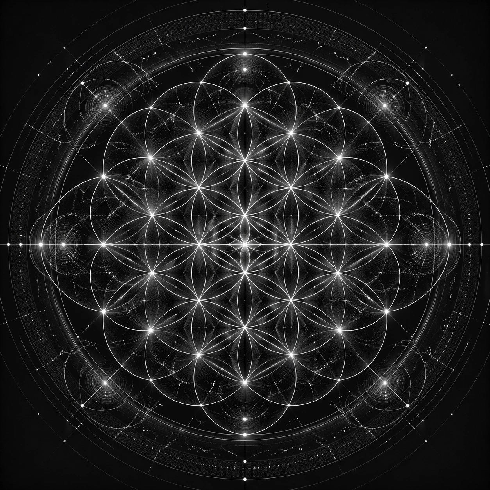

```text
Scene:
Create a square art-science plate that feels as if a sacred geometry diagram and a physics visualization were designed by the same meticulous hand. Keep the camera straight on, the layout centered, and the lighting or surface treatment chosen to preserve circle precision, waveform clarity, and the tension between symbolic elegance and laboratory rigor. Keep the mood quiet and technical, as if observed in a precision optics lab with no camera distortion. Keep the square crop exact, the camera flat, and the tonal design disciplined enough that structure stays clear at poster scale and under close inspection.

Subject:
Use the Flower of Life as the primary scaffold, with exact circle overlap, stable center alignment, and clear petal intersections. Around and through that scaffold, weave particle trails, interference bands, resonance ripples, field lines, and pseudo-instrument markings so the image reads as one integrated cosmological system rather than separate layers pasted together. Focus this variation on a dark photographic plate where tiny white particle traces and diffraction bands animate the flower lattice. The composition should feel complete and singular, as though one finished artifact has been resolved with full conviction rather than one fragment pulled from a larger sheet.

Important details:
The circles must remain mathematically clean even when the composition becomes dense. Wave behavior should feel measured, not decorative. Keep contrast restrained, reserve the brightest accents for important intersections, and let secondary marks reinforce scale, rhythm, and implied physics without becoming literal textbook diagrams. Make the particle trails crisp and purposeful, and reserve highlights for exact nodal crossings and ring intersections. Preserve crisp edge behavior, stable hierarchy, and enough fine information that the image rewards slow viewing without losing the main read from a distance.

Use case:
Quantum Flower of Life single study 7/9, designed as a self-contained sacred-geometry image with a distinct material and compositional emphasis.

Constraints:
No readable text, no watermark, no logos, preserve exact 1:1 aspect ratio, no misaligned circle centers, no random waveform doodles, no classroom infographic style, no accidental graph labels, no broken overlap geometry, no generic tech UI panels, no starfield randomness, no lens flare, no smoky long-exposure mess.
```

[Pinned source](https://github.com/ChaosRealmsAI/gpt-image-2-gallery/blob/5296db8c996e38776c83a0bc8c64f848dcd512b3/works/topics/flower-of-life-quantum-field/packages/single-quantum-flower-studies/images/07-darkroom-particle-orbit/meta.json) · GPT Image2 · 1254×1254 · No source-declared image dependencies. · ProjectD:[published and publicly accepted](https://aitoolsradar.com/en/prompts/5f33069e801cbc)

## Parchment Ratio Study · flower-of-life-quantum-field/single-quantum-flower-studies/08-parchment-ratio-study


```text
Scene:
Create a square art-science plate that feels as if a sacred geometry diagram and a physics visualization were designed by the same meticulous hand. Keep the camera straight on, the layout centered, and the lighting or surface treatment chosen to preserve circle precision, waveform clarity, and the tension between symbolic elegance and laboratory rigor. Present it as a historical scientific folio with soft paper grain and disciplined sepia contrast. Keep the square crop exact, the camera flat, and the tonal design disciplined enough that structure stays clear at poster scale and under close inspection.

Subject:
Use the Flower of Life as the primary scaffold, with exact circle overlap, stable center alignment, and clear petal intersections. Around and through that scaffold, weave particle trails, interference bands, resonance ripples, field lines, and pseudo-instrument markings so the image reads as one integrated cosmological system rather than separate layers pasted together. Focus this variation on an archival parchment version combining sacred circles, pseudo-annotation bands, and phi-inspired spacing cues. The composition should feel complete and singular, as though one finished artifact has been resolved with full conviction rather than one fragment pulled from a larger sheet.

Important details:
The circles must remain mathematically clean even when the composition becomes dense. Wave behavior should feel measured, not decorative. Keep contrast restrained, reserve the brightest accents for important intersections, and let secondary marks reinforce scale, rhythm, and implied physics without becoming literal textbook diagrams. Keep all annotation-like bands abstract and non-readable, and let the paper texture support rather than soften the geometry. Preserve crisp edge behavior, stable hierarchy, and enough fine information that the image rewards slow viewing without losing the main read from a distance.

Use case:
Quantum Flower of Life single study 8/9, designed as a self-contained sacred-geometry image with a distinct material and compositional emphasis.

Constraints:
No readable text, no watermark, no logos, preserve exact 1:1 aspect ratio, no misaligned circle centers, no random waveform doodles, no classroom infographic style, no accidental graph labels, no broken overlap geometry, no generic tech UI panels, no readable notes, no torn edges dominating the frame, no medieval cartooning.
```

[Pinned source](https://github.com/ChaosRealmsAI/gpt-image-2-gallery/blob/5296db8c996e38776c83a0bc8c64f848dcd512b3/works/topics/flower-of-life-quantum-field/packages/single-quantum-flower-studies/images/08-parchment-ratio-study/meta.json) · GPT Image2 · 1254×1254 · No source-declared image dependencies. · ProjectD:[published and publicly accepted](https://aitoolsradar.com/en/prompts/5065a8cbc42a7d)

## Deep Ocean Field · flower-of-life-quantum-field/single-quantum-flower-studies/09-deep-ocean-field


```text
Scene:
Create a square art-science plate that feels as if a sacred geometry diagram and a physics visualization were designed by the same meticulous hand. Keep the camera straight on, the layout centered, and the lighting or surface treatment chosen to preserve circle precision, waveform clarity, and the tension between symbolic elegance and laboratory rigor. Use dark teal depth and sparse luminous accents, keeping the overall image measured and contemplative. Keep the square crop exact, the camera flat, and the tonal design disciplined enough that structure stays clear at poster scale and under close inspection.

Subject:
Use the Flower of Life as the primary scaffold, with exact circle overlap, stable center alignment, and clear petal intersections. Around and through that scaffold, weave particle trails, interference bands, resonance ripples, field lines, and pseudo-instrument markings so the image reads as one integrated cosmological system rather than separate layers pasted together. Focus this variation on a marine-toned study where pressure waves, bioluminescent points, and the flower lattice merge into one serene field diagram. The composition should feel complete and singular, as though one finished artifact has been resolved with full conviction rather than one fragment pulled from a larger sheet.

Important details:
The circles must remain mathematically clean even when the composition becomes dense. Wave behavior should feel measured, not decorative. Keep contrast restrained, reserve the brightest accents for important intersections, and let secondary marks reinforce scale, rhythm, and implied physics without becoming literal textbook diagrams. The wavefronts should curve with elegant discipline, and the flower intersections must remain exact even inside the atmospheric color field. Preserve crisp edge behavior, stable hierarchy, and enough fine information that the image rewards slow viewing without losing the main read from a distance.

Use case:
Quantum Flower of Life single study 9/9, designed as a self-contained sacred-geometry image with a distinct material and compositional emphasis.

Constraints:
No readable text, no watermark, no logos, preserve exact 1:1 aspect ratio, no misaligned circle centers, no random waveform doodles, no classroom infographic style, no accidental graph labels, no broken overlap geometry, no generic tech UI panels, no coral illustration, no fish imagery, no soft underwater haze hiding the geometry.
```

[Pinned source](https://github.com/ChaosRealmsAI/gpt-image-2-gallery/blob/5296db8c996e38776c83a0bc8c64f848dcd512b3/works/topics/flower-of-life-quantum-field/packages/single-quantum-flower-studies/images/09-deep-ocean-field/meta.json) · GPT Image2 · 1254×1254 · No source-declared image dependencies. · ProjectD:[published and publicly accepted](https://aitoolsradar.com/en/prompts/9431be8c138bf1)

## Macro Study · fluid-smoke-explosion/single-fluid-smoke-explosion-studies/macro-study


```text
Scene:
A square photographic image with intentional lens choice, coherent light, and a subject that feels observed rather than merely decorated. Build the frame around closer observation that reveals fine structure and optical behavior. Keep the lighting, camera distance, and spatial organization tuned for a high-signal research image rather than a casual snapshot. The image belongs to the Fluid Smoke Explosion theme and should feel immediately legible as a prompt atlas theme for fluid smoke explosion, testing physics-materials, commercial-mockup with gpt image 2..

Subject:
Center the study on closer observation that reveals fine structure and optical behavior. Translate the theme into a concrete visual statement instead of an abstract mood board: the viewer should understand what kind of image this is, what is being tested, and why the composition is difficult. Use the slug idea of fluid smoke explosion as a literal guide for subject matter, materials, and staging.

Important details:
The realism should come from timing, optics, and material response: atmosphere, contrast, depth, motion, and tiny physical cues all need to agree. Preserve a disciplined square composition, clear focal hierarchy, and enough secondary information to make the image feel complete rather than underspecified. The image should look polished, novel, and exhibition-ready, with topic-specific credibility coming from the way surfaces, structure, and visual language reinforce Fluid Smoke Explosion. Avoid generic filler elements that do not serve the main concept.

Use case:
Fluid Smoke Explosion single study 2/8, testing physics-materials, commercial-mockup through the macro study variation.

Constraints:
No readable text, no watermark, no logos, preserve exact 1:1 aspect ratio, no watermark, no cheap HDR excess, no unreadable signage, no fake stock-photo posing, no compositing seams, no arbitrary lens flare.
```

[Pinned source](https://github.com/ChaosRealmsAI/gpt-image-2-gallery/blob/5296db8c996e38776c83a0bc8c64f848dcd512b3/works/topics/fluid-smoke-explosion/packages/single-fluid-smoke-explosion-studies/images/macro-study/meta.json) · GPT Image2 · 1254×1254 · No source-declared image dependencies. · ProjectD:[published and publicly accepted](https://aitoolsradar.com/en/prompts/f23d75be1d03fe)

## Side Light Study · fluid-smoke-explosion/single-fluid-smoke-explosion-studies/side-light-study

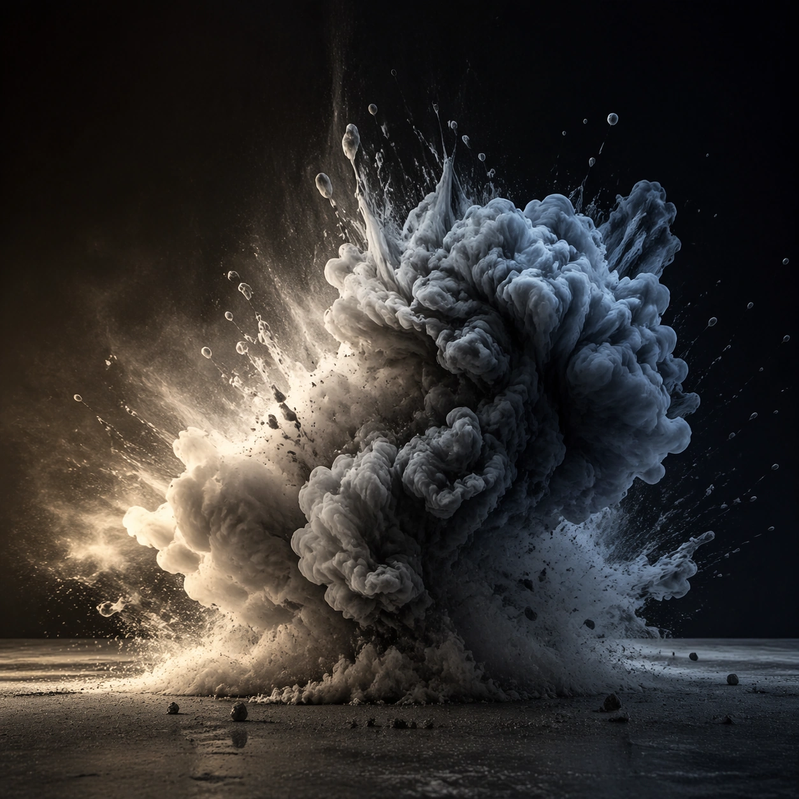

```text
Scene:
A square photographic image with intentional lens choice, coherent light, and a subject that feels observed rather than merely decorated. Build the frame around a directional-light treatment that increases form and drama. Keep the lighting, camera distance, and spatial organization tuned for a high-signal research image rather than a casual snapshot. The image belongs to the Fluid Smoke Explosion theme and should feel immediately legible as a prompt atlas theme for fluid smoke explosion, testing physics-materials, commercial-mockup with gpt image 2..

Subject:
Center the study on a directional-light treatment that increases form and drama. Translate the theme into a concrete visual statement instead of an abstract mood board: the viewer should understand what kind of image this is, what is being tested, and why the composition is difficult. Use the slug idea of fluid smoke explosion as a literal guide for subject matter, materials, and staging.

Important details:
The realism should come from timing, optics, and material response: atmosphere, contrast, depth, motion, and tiny physical cues all need to agree. Preserve a disciplined square composition, clear focal hierarchy, and enough secondary information to make the image feel complete rather than underspecified. The image should look polished, novel, and exhibition-ready, with topic-specific credibility coming from the way surfaces, structure, and visual language reinforce Fluid Smoke Explosion. Avoid generic filler elements that do not serve the main concept.

Use case:
Fluid Smoke Explosion single study 3/8, testing physics-materials, commercial-mockup through the side light study variation.

Constraints:
No readable text, no watermark, no logos, preserve exact 1:1 aspect ratio, no watermark, no cheap HDR excess, no unreadable signage, no fake stock-photo posing, no compositing seams, no arbitrary lens flare.
```

[Pinned source](https://github.com/ChaosRealmsAI/gpt-image-2-gallery/blob/5296db8c996e38776c83a0bc8c64f848dcd512b3/works/topics/fluid-smoke-explosion/packages/single-fluid-smoke-explosion-studies/images/side-light-study/meta.json) · GPT Image2 · 1254×1254 · No source-declared image dependencies. · ProjectD:[published and publicly accepted](https://aitoolsradar.com/en/prompts/18a9e3e5cad4dd)

## Motion Moment · fluid-smoke-explosion/single-fluid-smoke-explosion-studies/motion-moment


```text
Scene:
A square photographic image with intentional lens choice, coherent light, and a subject that feels observed rather than merely decorated. Build the frame around a time-sensitive or kinetic phenomenon captured at the right instant. Keep the lighting, camera distance, and spatial organization tuned for a high-signal research image rather than a casual snapshot. The image belongs to the Fluid Smoke Explosion theme and should feel immediately legible as a prompt atlas theme for fluid smoke explosion, testing physics-materials, commercial-mockup with gpt image 2..

Subject:
Center the study on a time-sensitive or kinetic phenomenon captured at the right instant. Translate the theme into a concrete visual statement instead of an abstract mood board: the viewer should understand what kind of image this is, what is being tested, and why the composition is difficult. Use the slug idea of fluid smoke explosion as a literal guide for subject matter, materials, and staging.

Important details:
The realism should come from timing, optics, and material response: atmosphere, contrast, depth, motion, and tiny physical cues all need to agree. Preserve a disciplined square composition, clear focal hierarchy, and enough secondary information to make the image feel complete rather than underspecified. The image should look polished, novel, and exhibition-ready, with topic-specific credibility coming from the way surfaces, structure, and visual language reinforce Fluid Smoke Explosion. Avoid generic filler elements that do not serve the main concept.

Use case:
Fluid Smoke Explosion single study 4/8, testing physics-materials, commercial-mockup through the motion moment variation.

Constraints:
No readable text, no watermark, no logos, preserve exact 1:1 aspect ratio, no watermark, no cheap HDR excess, no unreadable signage, no fake stock-photo posing, no compositing seams, no arbitrary lens flare.
```

[Pinned source](https://github.com/ChaosRealmsAI/gpt-image-2-gallery/blob/5296db8c996e38776c83a0bc8c64f848dcd512b3/works/topics/fluid-smoke-explosion/packages/single-fluid-smoke-explosion-studies/images/motion-moment/meta.json) · GPT Image2 · 1254×1254 · No source-declared image dependencies. · ProjectD:[published and publicly accepted](https://aitoolsradar.com/en/prompts/8799f3e4fe2ba8)

## Low-Light Atlas · fluid-smoke-explosion/single-fluid-smoke-explosion-studies/low-light-atlas


```text
Scene:
A square photographic image with intentional lens choice, coherent light, and a subject that feels observed rather than merely decorated. Build the frame around a dusk, night, or low-light frame with disciplined exposure. Keep the lighting, camera distance, and spatial organization tuned for a high-signal research image rather than a casual snapshot. The image belongs to the Fluid Smoke Explosion theme and should feel immediately legible as a prompt atlas theme for fluid smoke explosion, testing physics-materials, commercial-mockup with gpt image 2..

Subject:
Center the study on a dusk, night, or low-light frame with disciplined exposure. Translate the theme into a concrete visual statement instead of an abstract mood board: the viewer should understand what kind of image this is, what is being tested, and why the composition is difficult. Use the slug idea of fluid smoke explosion as a literal guide for subject matter, materials, and staging.

Important details:
The realism should come from timing, optics, and material response: atmosphere, contrast, depth, motion, and tiny physical cues all need to agree. Preserve a disciplined square composition, clear focal hierarchy, and enough secondary information to make the image feel complete rather than underspecified. The image should look polished, novel, and exhibition-ready, with topic-specific credibility coming from the way surfaces, structure, and visual language reinforce Fluid Smoke Explosion. Avoid generic filler elements that do not serve the main concept.

Use case:
Fluid Smoke Explosion single study 5/8, testing physics-materials, commercial-mockup through the low-light atlas variation.

Constraints:
No readable text, no watermark, no logos, preserve exact 1:1 aspect ratio, no watermark, no cheap HDR excess, no unreadable signage, no fake stock-photo posing, no compositing seams, no arbitrary lens flare.
```

[Pinned source](https://github.com/ChaosRealmsAI/gpt-image-2-gallery/blob/5296db8c996e38776c83a0bc8c64f848dcd512b3/works/topics/fluid-smoke-explosion/packages/single-fluid-smoke-explosion-studies/images/low-light-atlas/meta.json) · GPT Image2 · 1254×1254 · No source-declared image dependencies. · ProjectD:[published and publicly accepted](https://aitoolsradar.com/en/prompts/2dfff1bf4c1f6f)

## Specimen Table · fluid-smoke-explosion/single-fluid-smoke-explosion-studies/specimen-table

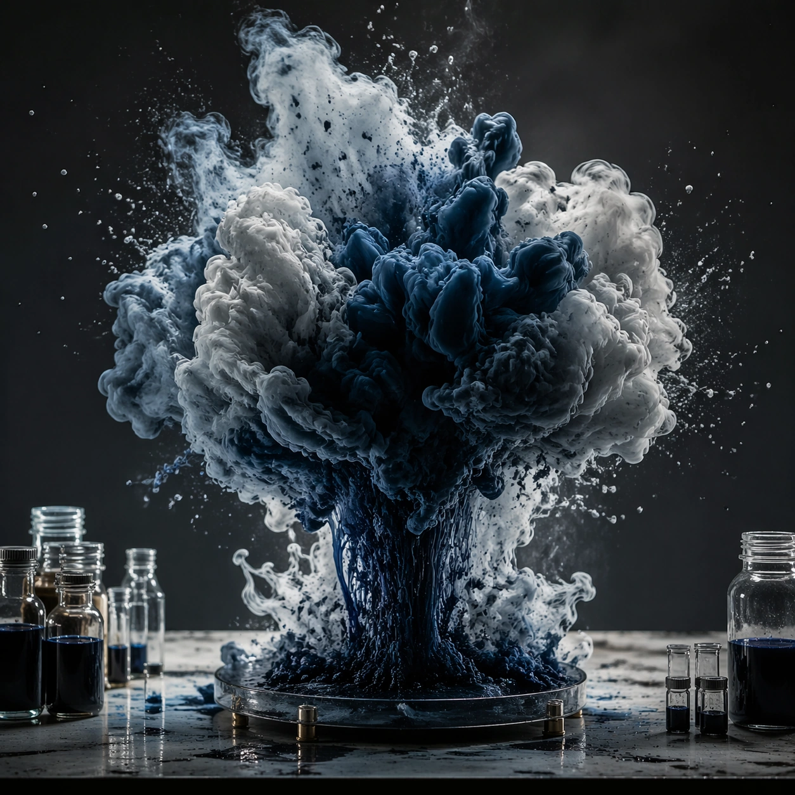

```text
Scene:
A square photographic image with intentional lens choice, coherent light, and a subject that feels observed rather than merely decorated. Build the frame around a carefully arranged or comparative frame that still feels photographic. Keep the lighting, camera distance, and spatial organization tuned for a high-signal research image rather than a casual snapshot. The image belongs to the Fluid Smoke Explosion theme and should feel immediately legible as a prompt atlas theme for fluid smoke explosion, testing physics-materials, commercial-mockup with gpt image 2..

Subject:
Center the study on a carefully arranged or comparative frame that still feels photographic. Translate the theme into a concrete visual statement instead of an abstract mood board: the viewer should understand what kind of image this is, what is being tested, and why the composition is difficult. Use the slug idea of fluid smoke explosion as a literal guide for subject matter, materials, and staging.

Important details:
The realism should come from timing, optics, and material response: atmosphere, contrast, depth, motion, and tiny physical cues all need to agree. Preserve a disciplined square composition, clear focal hierarchy, and enough secondary information to make the image feel complete rather than underspecified. The image should look polished, novel, and exhibition-ready, with topic-specific credibility coming from the way surfaces, structure, and visual language reinforce Fluid Smoke Explosion. Avoid generic filler elements that do not serve the main concept.

Use case:
Fluid Smoke Explosion single study 6/8, testing physics-materials, commercial-mockup through the specimen table variation.

Constraints:
No readable text, no watermark, no logos, preserve exact 1:1 aspect ratio, no watermark, no cheap HDR excess, no unreadable signage, no fake stock-photo posing, no compositing seams, no arbitrary lens flare.
```

[Pinned source](https://github.com/ChaosRealmsAI/gpt-image-2-gallery/blob/5296db8c996e38776c83a0bc8c64f848dcd512b3/works/topics/fluid-smoke-explosion/packages/single-fluid-smoke-explosion-studies/images/specimen-table/meta.json) · GPT Image2 · 1254×1254 · No source-declared image dependencies. · ProjectD:[published and publicly accepted](https://aitoolsradar.com/en/prompts/923d43590494fe)

## Atmospheric View · fluid-smoke-explosion/single-fluid-smoke-explosion-studies/atmospheric-view


```text
Scene:
A square photographic image with intentional lens choice, coherent light, and a subject that feels observed rather than merely decorated. Build the frame around weather, haze, or volumetric light used to deepen realism. Keep the lighting, camera distance, and spatial organization tuned for a high-signal research image rather than a casual snapshot. The image belongs to the Fluid Smoke Explosion theme and should feel immediately legible as a prompt atlas theme for fluid smoke explosion, testing physics-materials, commercial-mockup with gpt image 2..

Subject:
Center the study on weather, haze, or volumetric light used to deepen realism. Translate the theme into a concrete visual statement instead of an abstract mood board: the viewer should understand what kind of image this is, what is being tested, and why the composition is difficult. Use the slug idea of fluid smoke explosion as a literal guide for subject matter, materials, and staging.

Important details:
The realism should come from timing, optics, and material response: atmosphere, contrast, depth, motion, and tiny physical cues all need to agree. Preserve a disciplined square composition, clear focal hierarchy, and enough secondary information to make the image feel complete rather than underspecified. The image should look polished, novel, and exhibition-ready, with topic-specific credibility coming from the way surfaces, structure, and visual language reinforce Fluid Smoke Explosion. Avoid generic filler elements that do not serve the main concept.

Use case:
Fluid Smoke Explosion single study 7/8, testing physics-materials, commercial-mockup through the atmospheric view variation.

Constraints:
No readable text, no watermark, no logos, preserve exact 1:1 aspect ratio, no watermark, no cheap HDR excess, no unreadable signage, no fake stock-photo posing, no compositing seams, no arbitrary lens flare.
```

[Pinned source](https://github.com/ChaosRealmsAI/gpt-image-2-gallery/blob/5296db8c996e38776c83a0bc8c64f848dcd512b3/works/topics/fluid-smoke-explosion/packages/single-fluid-smoke-explosion-studies/images/atmospheric-view/meta.json) · GPT Image2 · 1254×1254 · No source-declared image dependencies. · ProjectD:[published and publicly accepted](https://aitoolsradar.com/en/prompts/22ae119329832c)

## Signature Frame · fluid-smoke-explosion/single-fluid-smoke-explosion-studies/signature-frame


```text
Scene:
A square photographic image with intentional lens choice, coherent light, and a subject that feels observed rather than merely decorated. Build the frame around the most memorable final image for the topic. Keep the lighting, camera distance, and spatial organization tuned for a high-signal research image rather than a casual snapshot. The image belongs to the Fluid Smoke Explosion theme and should feel immediately legible as a prompt atlas theme for fluid smoke explosion, testing physics-materials, commercial-mockup with gpt image 2..

Subject:
Center the study on the most memorable final image for the topic. Translate the theme into a concrete visual statement instead of an abstract mood board: the viewer should understand what kind of image this is, what is being tested, and why the composition is difficult. Use the slug idea of fluid smoke explosion as a literal guide for subject matter, materials, and staging.

Important details:
The realism should come from timing, optics, and material response: atmosphere, contrast, depth, motion, and tiny physical cues all need to agree. Preserve a disciplined square composition, clear focal hierarchy, and enough secondary information to make the image feel complete rather than underspecified. The image should look polished, novel, and exhibition-ready, with topic-specific credibility coming from the way surfaces, structure, and visual language reinforce Fluid Smoke Explosion. Avoid generic filler elements that do not serve the main concept.

Use case:
Fluid Smoke Explosion single study 8/8, testing physics-materials, commercial-mockup through the signature frame variation.

Constraints:
No readable text, no watermark, no logos, preserve exact 1:1 aspect ratio, no watermark, no cheap HDR excess, no unreadable signage, no fake stock-photo posing, no compositing seams, no arbitrary lens flare.
```

[Pinned source](https://github.com/ChaosRealmsAI/gpt-image-2-gallery/blob/5296db8c996e38776c83a0bc8c64f848dcd512b3/works/topics/fluid-smoke-explosion/packages/single-fluid-smoke-explosion-studies/images/signature-frame/meta.json) · GPT Image2 · 1254×1254 · No source-declared image dependencies. · ProjectD:[published and publicly accepted](https://aitoolsradar.com/en/prompts/abaa7de75cfb7e)

## Macro Study · food-cross-section-atlas/single-food-cross-section-studies/macro-study

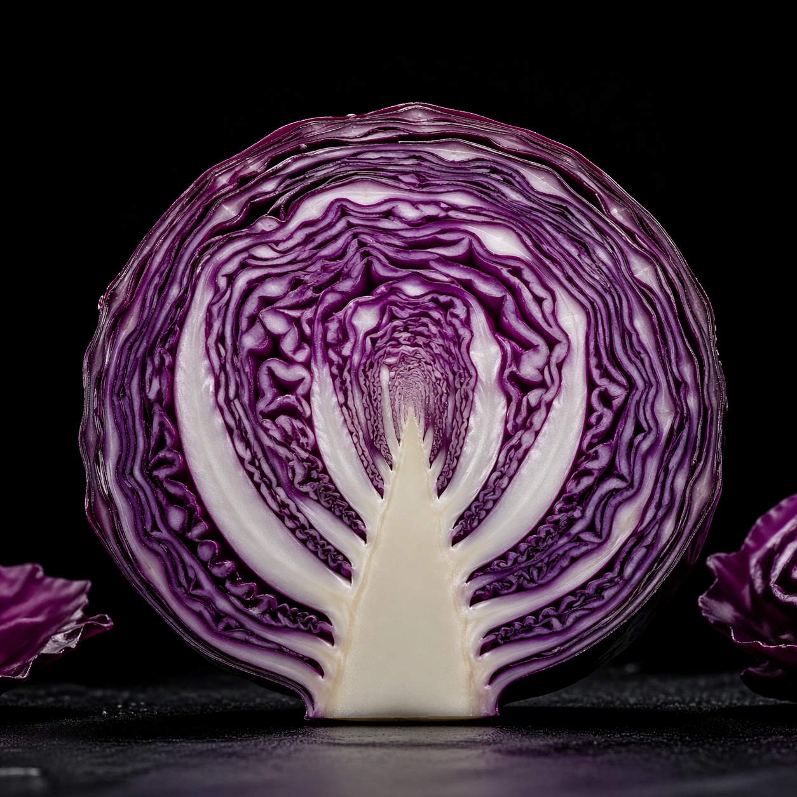

```text
Scene:
A square photographic image with intentional lens choice, coherent light, and a subject that feels observed rather than merely decorated. Build the frame around closer observation that reveals fine structure and optical behavior. Keep the lighting, camera distance, and spatial organization tuned for a high-signal research image rather than a casual snapshot. The image belongs to the Food Cross-Section Atlas theme and should feel immediately legible as a prompt atlas theme for food cross-section atlas, testing structured-layout, photorealism, technical-diagram, commercial-mockup with gpt image 2..

Subject:
Center the study on closer observation that reveals fine structure and optical behavior. Translate the theme into a concrete visual statement instead of an abstract mood board: the viewer should understand what kind of image this is, what is being tested, and why the composition is difficult. Use the slug idea of food cross section atlas as a literal guide for subject matter, materials, and staging.

Important details:
The realism should come from timing, optics, and material response: atmosphere, contrast, depth, motion, and tiny physical cues all need to agree. Preserve a disciplined square composition, clear focal hierarchy, and enough secondary information to make the image feel complete rather than underspecified. The image should look polished, novel, and exhibition-ready, with topic-specific credibility coming from the way surfaces, structure, and visual language reinforce Food Cross-Section Atlas. Avoid generic filler elements that do not serve the main concept.

Use case:
Food Cross-Section Atlas single study 2/8, testing structured-layout, photorealism, technical-diagram, commercial-mockup through the macro study variation.

Constraints:
No readable text, no watermark, no logos, preserve exact 1:1 aspect ratio, no watermark, no cheap HDR excess, no unreadable signage, no fake stock-photo posing, no compositing seams, no arbitrary lens flare.
```

[Pinned source](https://github.com/ChaosRealmsAI/gpt-image-2-gallery/blob/5296db8c996e38776c83a0bc8c64f848dcd512b3/works/topics/food-cross-section-atlas/packages/single-food-cross-section-studies/images/macro-study/meta.json) · GPT Image2 · 1254×1254 · No source-declared image dependencies. · ProjectD:[published and publicly accepted](https://aitoolsradar.com/en/prompts/726448edda6d76)

## Side Light Study · food-cross-section-atlas/single-food-cross-section-studies/side-light-study

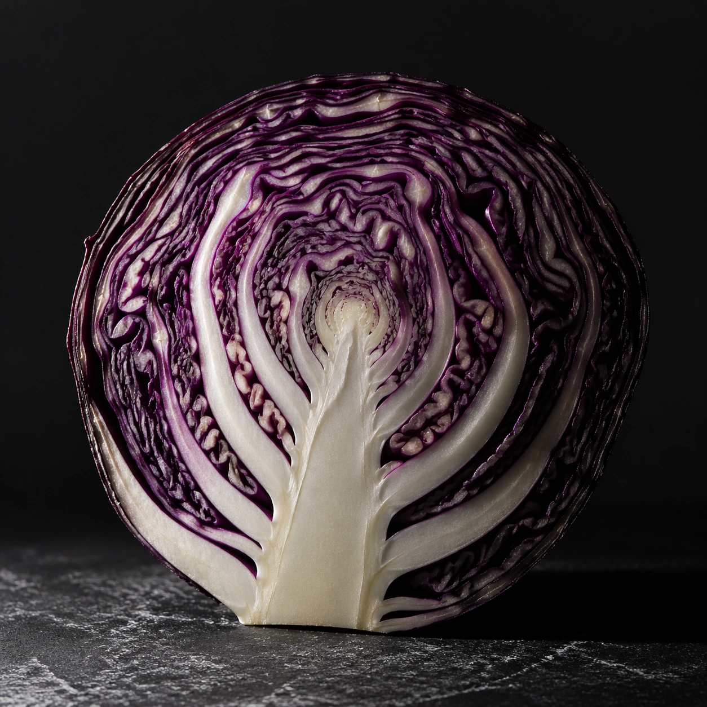

```text
Scene:
A square photographic image with intentional lens choice, coherent light, and a subject that feels observed rather than merely decorated. Build the frame around a directional-light treatment that increases form and drama. Keep the lighting, camera distance, and spatial organization tuned for a high-signal research image rather than a casual snapshot. The image belongs to the Food Cross-Section Atlas theme and should feel immediately legible as a prompt atlas theme for food cross-section atlas, testing structured-layout, photorealism, technical-diagram, commercial-mockup with gpt image 2..

Subject:
Center the study on a directional-light treatment that increases form and drama. Translate the theme into a concrete visual statement instead of an abstract mood board: the viewer should understand what kind of image this is, what is being tested, and why the composition is difficult. Use the slug idea of food cross section atlas as a literal guide for subject matter, materials, and staging.

Important details:
The realism should come from timing, optics, and material response: atmosphere, contrast, depth, motion, and tiny physical cues all need to agree. Preserve a disciplined square composition, clear focal hierarchy, and enough secondary information to make the image feel complete rather than underspecified. The image should look polished, novel, and exhibition-ready, with topic-specific credibility coming from the way surfaces, structure, and visual language reinforce Food Cross-Section Atlas. Avoid generic filler elements that do not serve the main concept.

Use case:
Food Cross-Section Atlas single study 3/8, testing structured-layout, photorealism, technical-diagram, commercial-mockup through the side light study variation.

Constraints:
No readable text, no watermark, no logos, preserve exact 1:1 aspect ratio, no watermark, no cheap HDR excess, no unreadable signage, no fake stock-photo posing, no compositing seams, no arbitrary lens flare.
```

[Pinned source](https://github.com/ChaosRealmsAI/gpt-image-2-gallery/blob/5296db8c996e38776c83a0bc8c64f848dcd512b3/works/topics/food-cross-section-atlas/packages/single-food-cross-section-studies/images/side-light-study/meta.json) · GPT Image2 · 1254×1254 · No source-declared image dependencies. · ProjectD:[published and publicly accepted](https://aitoolsradar.com/en/prompts/08aec535310f97)

## Motion Moment · food-cross-section-atlas/single-food-cross-section-studies/motion-moment

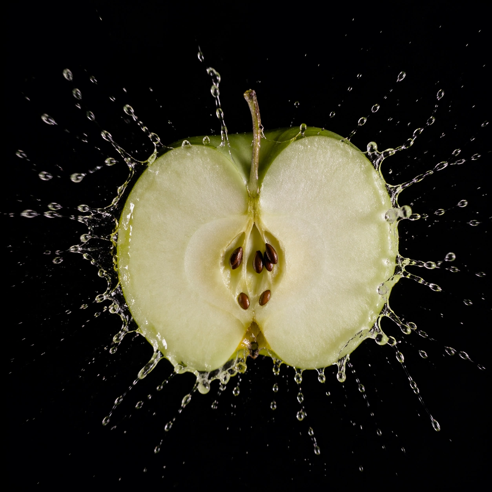

```text
Scene:
A square photographic image with intentional lens choice, coherent light, and a subject that feels observed rather than merely decorated. Build the frame around a time-sensitive or kinetic phenomenon captured at the right instant. Keep the lighting, camera distance, and spatial organization tuned for a high-signal research image rather than a casual snapshot. The image belongs to the Food Cross-Section Atlas theme and should feel immediately legible as a prompt atlas theme for food cross-section atlas, testing structured-layout, photorealism, technical-diagram, commercial-mockup with gpt image 2..

Subject:
Center the study on a time-sensitive or kinetic phenomenon captured at the right instant. Translate the theme into a concrete visual statement instead of an abstract mood board: the viewer should understand what kind of image this is, what is being tested, and why the composition is difficult. Use the slug idea of food cross section atlas as a literal guide for subject matter, materials, and staging.

Important details:
The realism should come from timing, optics, and material response: atmosphere, contrast, depth, motion, and tiny physical cues all need to agree. Preserve a disciplined square composition, clear focal hierarchy, and enough secondary information to make the image feel complete rather than underspecified. The image should look polished, novel, and exhibition-ready, with topic-specific credibility coming from the way surfaces, structure, and visual language reinforce Food Cross-Section Atlas. Avoid generic filler elements that do not serve the main concept.

Use case:
Food Cross-Section Atlas single study 4/8, testing structured-layout, photorealism, technical-diagram, commercial-mockup through the motion moment variation.

Constraints:
No readable text, no watermark, no logos, preserve exact 1:1 aspect ratio, no watermark, no cheap HDR excess, no unreadable signage, no fake stock-photo posing, no compositing seams, no arbitrary lens flare.
```

[Pinned source](https://github.com/ChaosRealmsAI/gpt-image-2-gallery/blob/5296db8c996e38776c83a0bc8c64f848dcd512b3/works/topics/food-cross-section-atlas/packages/single-food-cross-section-studies/images/motion-moment/meta.json) · GPT Image2 · 1254×1254 · No source-declared image dependencies. · ProjectD:[published and publicly accepted](https://aitoolsradar.com/en/prompts/ea971687562c8f)

## Low-Light Atlas · food-cross-section-atlas/single-food-cross-section-studies/low-light-atlas


```text
Scene:
A square photographic image with intentional lens choice, coherent light, and a subject that feels observed rather than merely decorated. Build the frame around a dusk, night, or low-light frame with disciplined exposure. Keep the lighting, camera distance, and spatial organization tuned for a high-signal research image rather than a casual snapshot. The image belongs to the Food Cross-Section Atlas theme and should feel immediately legible as a prompt atlas theme for food cross-section atlas, testing structured-layout, photorealism, technical-diagram, commercial-mockup with gpt image 2..

Subject:
Center the study on a dusk, night, or low-light frame with disciplined exposure. Translate the theme into a concrete visual statement instead of an abstract mood board: the viewer should understand what kind of image this is, what is being tested, and why the composition is difficult. Use the slug idea of food cross section atlas as a literal guide for subject matter, materials, and staging.

Important details:
The realism should come from timing, optics, and material response: atmosphere, contrast, depth, motion, and tiny physical cues all need to agree. Preserve a disciplined square composition, clear focal hierarchy, and enough secondary information to make the image feel complete rather than underspecified. The image should look polished, novel, and exhibition-ready, with topic-specific credibility coming from the way surfaces, structure, and visual language reinforce Food Cross-Section Atlas. Avoid generic filler elements that do not serve the main concept.

Use case:
Food Cross-Section Atlas single study 5/8, testing structured-layout, photorealism, technical-diagram, commercial-mockup through the low-light atlas variation.

Constraints:
No readable text, no watermark, no logos, preserve exact 1:1 aspect ratio, no watermark, no cheap HDR excess, no unreadable signage, no fake stock-photo posing, no compositing seams, no arbitrary lens flare.
```

[Pinned source](https://github.com/ChaosRealmsAI/gpt-image-2-gallery/blob/5296db8c996e38776c83a0bc8c64f848dcd512b3/works/topics/food-cross-section-atlas/packages/single-food-cross-section-studies/images/low-light-atlas/meta.json) · GPT Image2 · 1254×1254 · No source-declared image dependencies. · ProjectD:[published and publicly accepted](https://aitoolsradar.com/en/prompts/a1a5f4bbd07df7)

## Specimen Table · food-cross-section-atlas/single-food-cross-section-studies/specimen-table

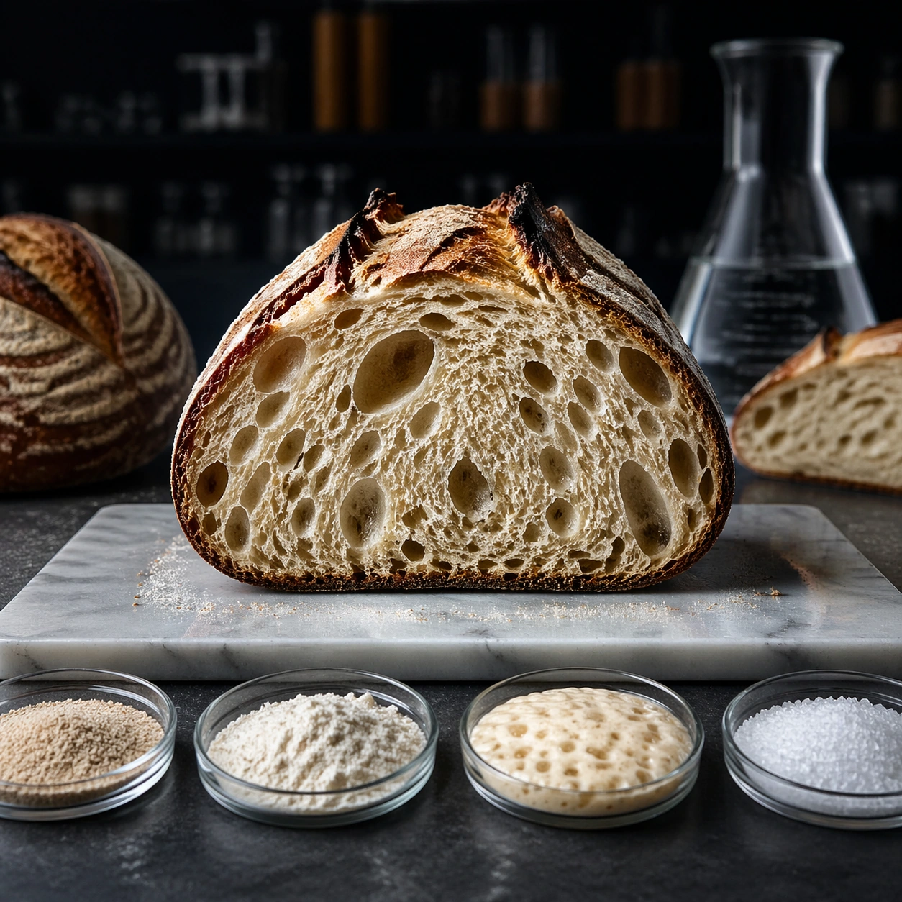

```text
Scene:
A square photographic image with intentional lens choice, coherent light, and a subject that feels observed rather than merely decorated. Build the frame around a carefully arranged or comparative frame that still feels photographic. Keep the lighting, camera distance, and spatial organization tuned for a high-signal research image rather than a casual snapshot. The image belongs to the Food Cross-Section Atlas theme and should feel immediately legible as a prompt atlas theme for food cross-section atlas, testing structured-layout, photorealism, technical-diagram, commercial-mockup with gpt image 2..

Subject:
Center the study on a carefully arranged or comparative frame that still feels photographic. Translate the theme into a concrete visual statement instead of an abstract mood board: the viewer should understand what kind of image this is, what is being tested, and why the composition is difficult. Use the slug idea of food cross section atlas as a literal guide for subject matter, materials, and staging.

Important details:
The realism should come from timing, optics, and material response: atmosphere, contrast, depth, motion, and tiny physical cues all need to agree. Preserve a disciplined square composition, clear focal hierarchy, and enough secondary information to make the image feel complete rather than underspecified. The image should look polished, novel, and exhibition-ready, with topic-specific credibility coming from the way surfaces, structure, and visual language reinforce Food Cross-Section Atlas. Avoid generic filler elements that do not serve the main concept.

Use case:
Food Cross-Section Atlas single study 6/8, testing structured-layout, photorealism, technical-diagram, commercial-mockup through the specimen table variation.

Constraints:
No readable text, no watermark, no logos, preserve exact 1:1 aspect ratio, no watermark, no cheap HDR excess, no unreadable signage, no fake stock-photo posing, no compositing seams, no arbitrary lens flare.
```

[Pinned source](https://github.com/ChaosRealmsAI/gpt-image-2-gallery/blob/5296db8c996e38776c83a0bc8c64f848dcd512b3/works/topics/food-cross-section-atlas/packages/single-food-cross-section-studies/images/specimen-table/meta.json) · GPT Image2 · 1254×1254 · No source-declared image dependencies. · ProjectD:[published and publicly accepted](https://aitoolsradar.com/en/prompts/cd22de93d7a6f1)

## Atmospheric View · food-cross-section-atlas/single-food-cross-section-studies/atmospheric-view


```text
Scene:
A square photographic image with intentional lens choice, coherent light, and a subject that feels observed rather than merely decorated. Build the frame around weather, haze, or volumetric light used to deepen realism. Keep the lighting, camera distance, and spatial organization tuned for a high-signal research image rather than a casual snapshot. The image belongs to the Food Cross-Section Atlas theme and should feel immediately legible as a prompt atlas theme for food cross-section atlas, testing structured-layout, photorealism, technical-diagram, commercial-mockup with gpt image 2..

Subject:
Center the study on weather, haze, or volumetric light used to deepen realism. Translate the theme into a concrete visual statement instead of an abstract mood board: the viewer should understand what kind of image this is, what is being tested, and why the composition is difficult. Use the slug idea of food cross section atlas as a literal guide for subject matter, materials, and staging.

Important details:
The realism should come from timing, optics, and material response: atmosphere, contrast, depth, motion, and tiny physical cues all need to agree. Preserve a disciplined square composition, clear focal hierarchy, and enough secondary information to make the image feel complete rather than underspecified. The image should look polished, novel, and exhibition-ready, with topic-specific credibility coming from the way surfaces, structure, and visual language reinforce Food Cross-Section Atlas. Avoid generic filler elements that do not serve the main concept.

Use case:
Food Cross-Section Atlas single study 7/8, testing structured-layout, photorealism, technical-diagram, commercial-mockup through the atmospheric view variation.

Constraints:
No readable text, no watermark, no logos, preserve exact 1:1 aspect ratio, no watermark, no cheap HDR excess, no unreadable signage, no fake stock-photo posing, no compositing seams, no arbitrary lens flare.
```

[Pinned source](https://github.com/ChaosRealmsAI/gpt-image-2-gallery/blob/5296db8c996e38776c83a0bc8c64f848dcd512b3/works/topics/food-cross-section-atlas/packages/single-food-cross-section-studies/images/atmospheric-view/meta.json) · GPT Image2 · 1254×1254 · No source-declared image dependencies. · ProjectD:[published and publicly accepted](https://aitoolsradar.com/en/prompts/7095a6b10834dc)

## Signature Frame · food-cross-section-atlas/single-food-cross-section-studies/signature-frame

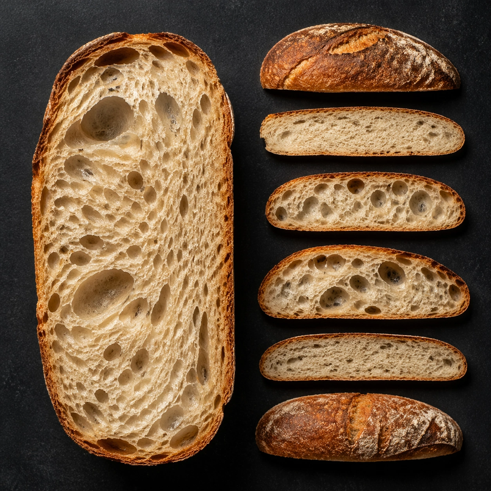

```text
Scene:
A square photographic image with intentional lens choice, coherent light, and a subject that feels observed rather than merely decorated. Build the frame around the most memorable final image for the topic. Keep the lighting, camera distance, and spatial organization tuned for a high-signal research image rather than a casual snapshot. The image belongs to the Food Cross-Section Atlas theme and should feel immediately legible as a prompt atlas theme for food cross-section atlas, testing structured-layout, photorealism, technical-diagram, commercial-mockup with gpt image 2..

Subject:
Center the study on the most memorable final image for the topic. Translate the theme into a concrete visual statement instead of an abstract mood board: the viewer should understand what kind of image this is, what is being tested, and why the composition is difficult. Use the slug idea of food cross section atlas as a literal guide for subject matter, materials, and staging.

Important details:
The realism should come from timing, optics, and material response: atmosphere, contrast, depth, motion, and tiny physical cues all need to agree. Preserve a disciplined square composition, clear focal hierarchy, and enough secondary information to make the image feel complete rather than underspecified. The image should look polished, novel, and exhibition-ready, with topic-specific credibility coming from the way surfaces, structure, and visual language reinforce Food Cross-Section Atlas. Avoid generic filler elements that do not serve the main concept.

Use case:
Food Cross-Section Atlas single study 8/8, testing structured-layout, photorealism, technical-diagram, commercial-mockup through the signature frame variation.

Constraints:
No readable text, no watermark, no logos, preserve exact 1:1 aspect ratio, no watermark, no cheap HDR excess, no unreadable signage, no fake stock-photo posing, no compositing seams, no arbitrary lens flare.
```

[Pinned source](https://github.com/ChaosRealmsAI/gpt-image-2-gallery/blob/5296db8c996e38776c83a0bc8c64f848dcd512b3/works/topics/food-cross-section-atlas/packages/single-food-cross-section-studies/images/signature-frame/meta.json) · GPT Image2 · 1254×1254 · No source-declared image dependencies. · ProjectD:[published and publicly accepted](https://aitoolsradar.com/en/prompts/6a1f2fe2eafeb1)

## Scene Overview · forensic-scene-reconstruction/single-forensic-scene-reconstruction-studies/scene-overview

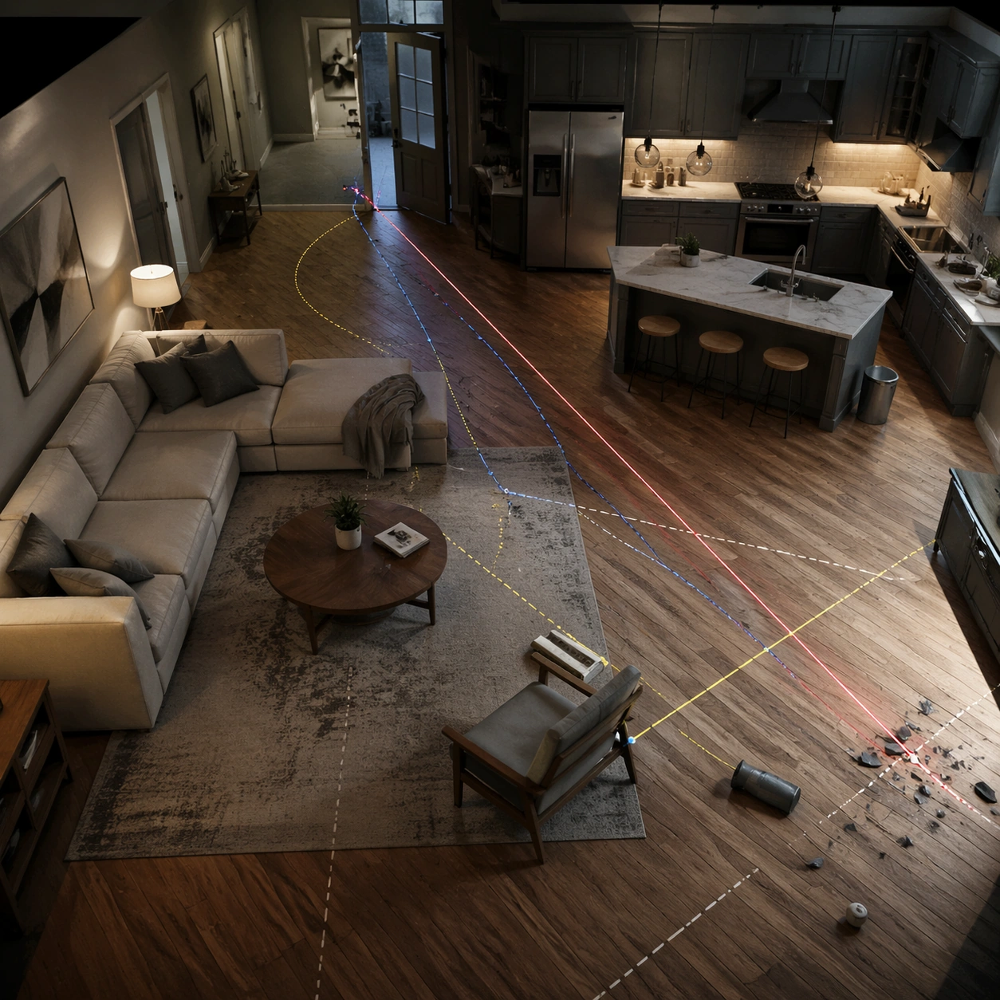

```text
Scene:
A square reconstruction image that feels evidence-based, spatially coherent, and controlled enough for analytical review. Build the frame around a complete spatial read of the reconstructed environment. Keep the lighting, camera distance, and spatial organization tuned for a high-signal research image rather than a casual snapshot. The image belongs to the Forensic Scene Reconstruction theme and should feel immediately legible as a prompt atlas theme for forensic scene reconstruction, testing physics-materials, reasoning-composition, style-transfer with gpt image 2..

Subject:
Center the study on a complete spatial read of the reconstructed environment. Translate the theme into a concrete visual statement instead of an abstract mood board: the viewer should understand what kind of image this is, what is being tested, and why the composition is difficult. Use the slug idea of forensic scene reconstruction as a literal guide for subject matter, materials, and staging.

Important details:
The image should communicate inference and real-world knowledge through placement, materials, object relationships, and disciplined visual hierarchy. Preserve a disciplined square composition, clear focal hierarchy, and enough secondary information to make the image feel complete rather than underspecified. The image should look polished, novel, and exhibition-ready, with topic-specific credibility coming from the way surfaces, structure, and visual language reinforce Forensic Scene Reconstruction. Avoid generic filler elements that do not serve the main concept.

Use case:
Forensic Scene Reconstruction single study 1/8, testing physics-materials, reasoning-composition, style-transfer through the scene overview variation.

Constraints:
No readable text, no watermark, no logos, preserve exact 1:1 aspect ratio, no readable evidence tags, no police logos, no gore, no sensational crime-drama theatrics, no broken spatial logic, no arbitrary clutter.
```

[Pinned source](https://github.com/ChaosRealmsAI/gpt-image-2-gallery/blob/5296db8c996e38776c83a0bc8c64f848dcd512b3/works/topics/forensic-scene-reconstruction/packages/single-forensic-scene-reconstruction-studies/images/scene-overview/meta.json) · GPT Image2 · 1254×1254 · No source-declared image dependencies. · ProjectD:[published and publicly accepted](https://aitoolsradar.com/en/prompts/ba249dbabfb10b)

## Object Cluster · forensic-scene-reconstruction/single-forensic-scene-reconstruction-studies/object-cluster

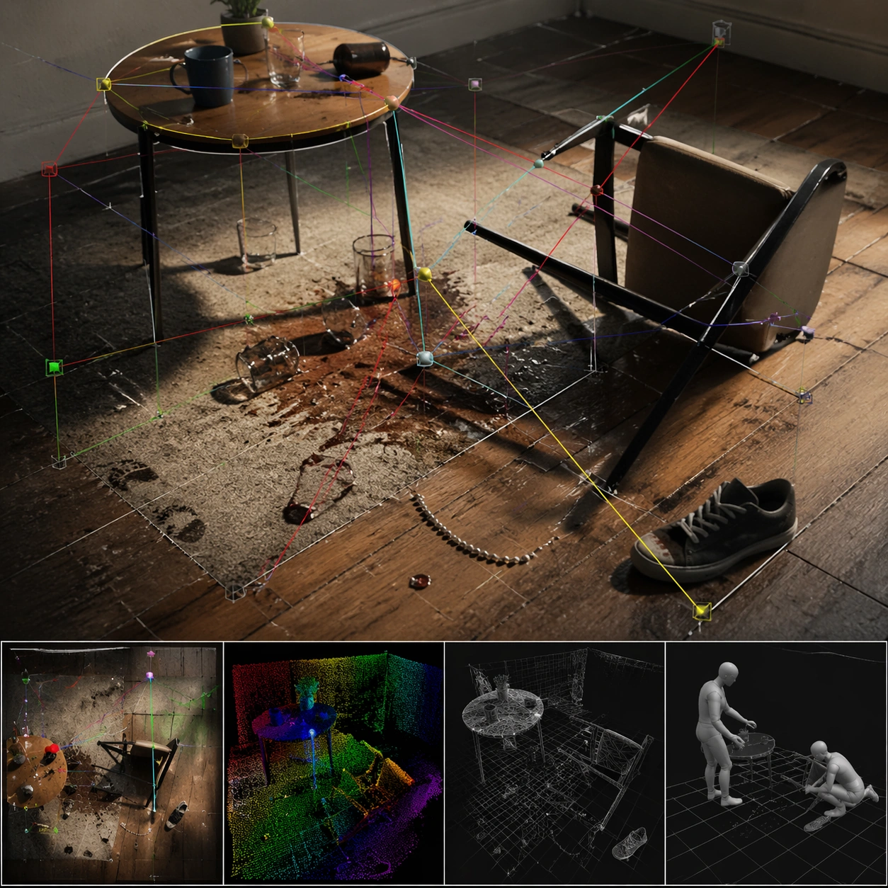

```text
Scene:
A square reconstruction image that feels evidence-based, spatially coherent, and controlled enough for analytical review. Build the frame around a tighter study of meaningful objects and their relationships. Keep the lighting, camera distance, and spatial organization tuned for a high-signal research image rather than a casual snapshot. The image belongs to the Forensic Scene Reconstruction theme and should feel immediately legible as a prompt atlas theme for forensic scene reconstruction, testing physics-materials, reasoning-composition, style-transfer with gpt image 2..

Subject:
Center the study on a tighter study of meaningful objects and their relationships. Translate the theme into a concrete visual statement instead of an abstract mood board: the viewer should understand what kind of image this is, what is being tested, and why the composition is difficult. Use the slug idea of forensic scene reconstruction as a literal guide for subject matter, materials, and staging.

Important details:
The image should communicate inference and real-world knowledge through placement, materials, object relationships, and disciplined visual hierarchy. Preserve a disciplined square composition, clear focal hierarchy, and enough secondary information to make the image feel complete rather than underspecified. The image should look polished, novel, and exhibition-ready, with topic-specific credibility coming from the way surfaces, structure, and visual language reinforce Forensic Scene Reconstruction. Avoid generic filler elements that do not serve the main concept.

Use case:
Forensic Scene Reconstruction single study 2/8, testing physics-materials, reasoning-composition, style-transfer through the object cluster variation.

Constraints:
No readable text, no watermark, no logos, preserve exact 1:1 aspect ratio, no readable evidence tags, no police logos, no gore, no sensational crime-drama theatrics, no broken spatial logic, no arbitrary clutter.
```

[Pinned source](https://github.com/ChaosRealmsAI/gpt-image-2-gallery/blob/5296db8c996e38776c83a0bc8c64f848dcd512b3/works/topics/forensic-scene-reconstruction/packages/single-forensic-scene-reconstruction-studies/images/object-cluster/meta.json) · GPT Image2 · 1254×1254 · No source-declared image dependencies. · ProjectD:[published and publicly accepted](https://aitoolsradar.com/en/prompts/a9a01dd9fcd2c4)

## Timeline Board · forensic-scene-reconstruction/single-forensic-scene-reconstruction-studies/timeline-board

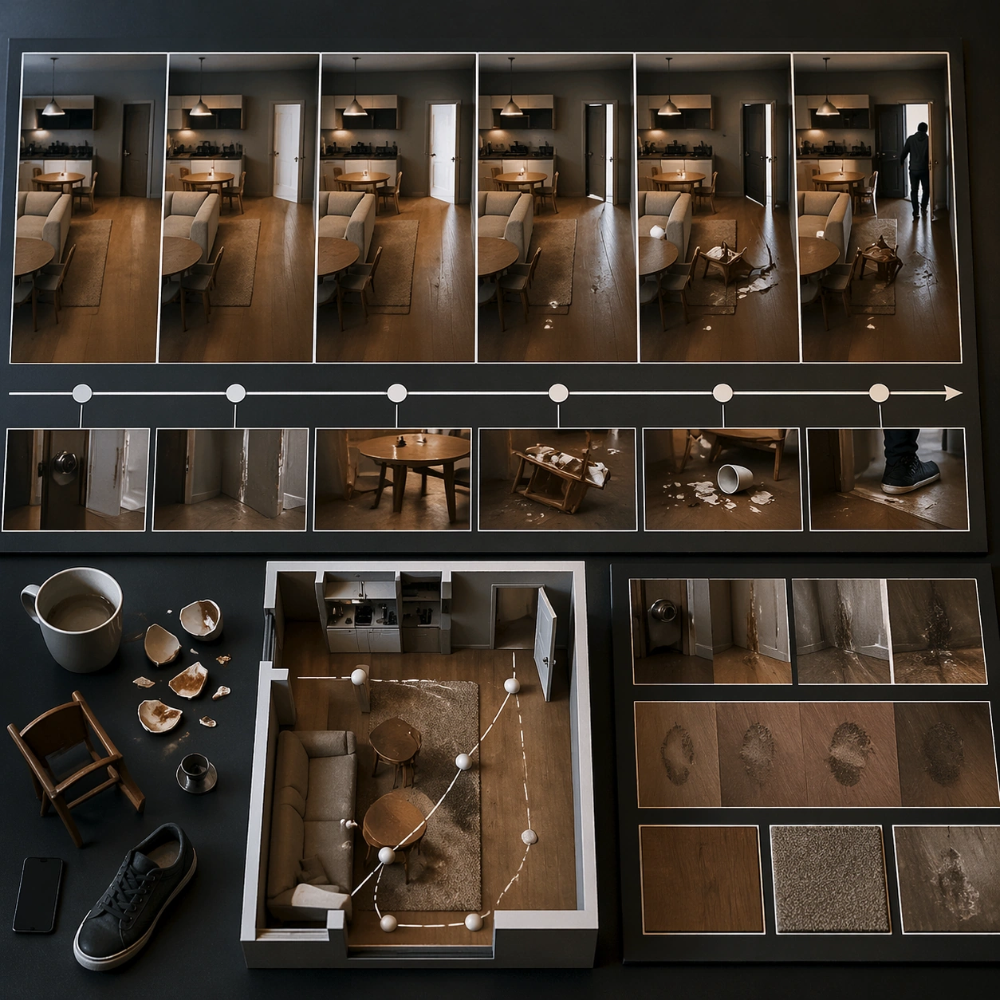

```text
Scene:
A square reconstruction image that feels evidence-based, spatially coherent, and controlled enough for analytical review. Build the frame around visual sequencing or causality expressed through spatial arrangement. Keep the lighting, camera distance, and spatial organization tuned for a high-signal research image rather than a casual snapshot. The image belongs to the Forensic Scene Reconstruction theme and should feel immediately legible as a prompt atlas theme for forensic scene reconstruction, testing physics-materials, reasoning-composition, style-transfer with gpt image 2..

Subject:
Center the study on visual sequencing or causality expressed through spatial arrangement. Translate the theme into a concrete visual statement instead of an abstract mood board: the viewer should understand what kind of image this is, what is being tested, and why the composition is difficult. Use the slug idea of forensic scene reconstruction as a literal guide for subject matter, materials, and staging.

Important details:
The image should communicate inference and real-world knowledge through placement, materials, object relationships, and disciplined visual hierarchy. Preserve a disciplined square composition, clear focal hierarchy, and enough secondary information to make the image feel complete rather than underspecified. The image should look polished, novel, and exhibition-ready, with topic-specific credibility coming from the way surfaces, structure, and visual language reinforce Forensic Scene Reconstruction. Avoid generic filler elements that do not serve the main concept.

Use case:
Forensic Scene Reconstruction single study 3/8, testing physics-materials, reasoning-composition, style-transfer through the timeline board variation.

Constraints:
No readable text, no watermark, no logos, preserve exact 1:1 aspect ratio, no readable evidence tags, no police logos, no gore, no sensational crime-drama theatrics, no broken spatial logic, no arbitrary clutter.
```

[Pinned source](https://github.com/ChaosRealmsAI/gpt-image-2-gallery/blob/5296db8c996e38776c83a0bc8c64f848dcd512b3/works/topics/forensic-scene-reconstruction/packages/single-forensic-scene-reconstruction-studies/images/timeline-board/meta.json) · GPT Image2 · 1254×1254 · No source-declared image dependencies. · ProjectD:[published and publicly accepted](https://aitoolsradar.com/en/prompts/88d18767b45a99)

## Entry Angle · forensic-scene-reconstruction/single-forensic-scene-reconstruction-studies/entry-angle

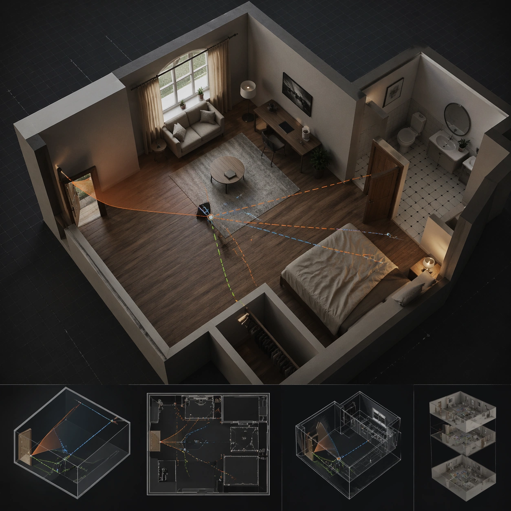

```text
Scene:
A square reconstruction image that feels evidence-based, spatially coherent, and controlled enough for analytical review. Build the frame around a viewpoint that clarifies access, flow, and scene geometry. Keep the lighting, camera distance, and spatial organization tuned for a high-signal research image rather than a casual snapshot. The image belongs to the Forensic Scene Reconstruction theme and should feel immediately legible as a prompt atlas theme for forensic scene reconstruction, testing physics-materials, reasoning-composition, style-transfer with gpt image 2..

Subject:
Center the study on a viewpoint that clarifies access, flow, and scene geometry. Translate the theme into a concrete visual statement instead of an abstract mood board: the viewer should understand what kind of image this is, what is being tested, and why the composition is difficult. Use the slug idea of forensic scene reconstruction as a literal guide for subject matter, materials, and staging.

Important details:
The image should communicate inference and real-world knowledge through placement, materials, object relationships, and disciplined visual hierarchy. Preserve a disciplined square composition, clear focal hierarchy, and enough secondary information to make the image feel complete rather than underspecified. The image should look polished, novel, and exhibition-ready, with topic-specific credibility coming from the way surfaces, structure, and visual language reinforce Forensic Scene Reconstruction. Avoid generic filler elements that do not serve the main concept.

Use case:
Forensic Scene Reconstruction single study 4/8, testing physics-materials, reasoning-composition, style-transfer through the entry angle variation.

Constraints:
No readable text, no watermark, no logos, preserve exact 1:1 aspect ratio, no readable evidence tags, no police logos, no gore, no sensational crime-drama theatrics, no broken spatial logic, no arbitrary clutter.
```

[Pinned source](https://github.com/ChaosRealmsAI/gpt-image-2-gallery/blob/5296db8c996e38776c83a0bc8c64f848dcd512b3/works/topics/forensic-scene-reconstruction/packages/single-forensic-scene-reconstruction-studies/images/entry-angle/meta.json) · GPT Image2 · 1254×1254 · No source-declared image dependencies. · ProjectD:[published and publicly accepted](https://aitoolsradar.com/en/prompts/de5883714a43be)

## Evidence Table · forensic-scene-reconstruction/single-forensic-scene-reconstruction-studies/evidence-table

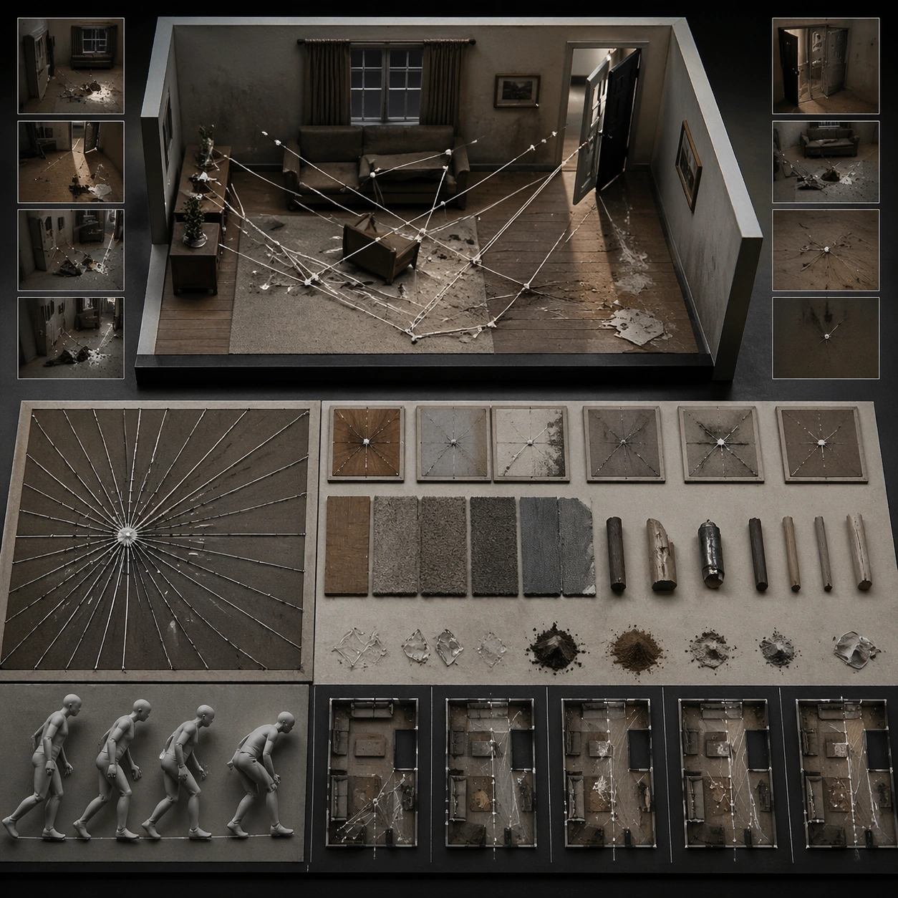

```text
Scene:
A square reconstruction image that feels evidence-based, spatially coherent, and controlled enough for analytical review. Build the frame around organized comparative presentation without readable labels. Keep the lighting, camera distance, and spatial organization tuned for a high-signal research image rather than a casual snapshot. The image belongs to the Forensic Scene Reconstruction theme and should feel immediately legible as a prompt atlas theme for forensic scene reconstruction, testing physics-materials, reasoning-composition, style-transfer with gpt image 2..

Subject:
Center the study on organized comparative presentation without readable labels. Translate the theme into a concrete visual statement instead of an abstract mood board: the viewer should understand what kind of image this is, what is being tested, and why the composition is difficult. Use the slug idea of forensic scene reconstruction as a literal guide for subject matter, materials, and staging.

Important details:
The image should communicate inference and real-world knowledge through placement, materials, object relationships, and disciplined visual hierarchy. Preserve a disciplined square composition, clear focal hierarchy, and enough secondary information to make the image feel complete rather than underspecified. The image should look polished, novel, and exhibition-ready, with topic-specific credibility coming from the way surfaces, structure, and visual language reinforce Forensic Scene Reconstruction. Avoid generic filler elements that do not serve the main concept.

Use case:
Forensic Scene Reconstruction single study 5/8, testing physics-materials, reasoning-composition, style-transfer through the evidence table variation.

Constraints:
No readable text, no watermark, no logos, preserve exact 1:1 aspect ratio, no readable evidence tags, no police logos, no gore, no sensational crime-drama theatrics, no broken spatial logic, no arbitrary clutter.
```

[Pinned source](https://github.com/ChaosRealmsAI/gpt-image-2-gallery/blob/5296db8c996e38776c83a0bc8c64f848dcd512b3/works/topics/forensic-scene-reconstruction/packages/single-forensic-scene-reconstruction-studies/images/evidence-table/meta.json) · GPT Image2 · 1254×1254 · No source-declared image dependencies. · ProjectD:[published and publicly accepted](https://aitoolsradar.com/en/prompts/053951fb1b0f61)

## Detail Callout · forensic-scene-reconstruction/single-forensic-scene-reconstruction-studies/detail-callout

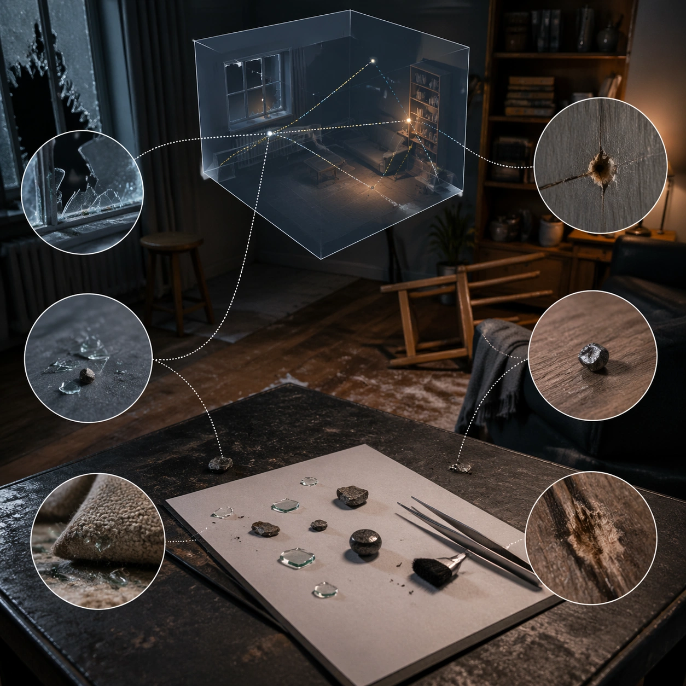

```text
Scene:
A square reconstruction image that feels evidence-based, spatially coherent, and controlled enough for analytical review. Build the frame around small but decisive material evidence foregrounded clearly. Keep the lighting, camera distance, and spatial organization tuned for a high-signal research image rather than a casual snapshot. The image belongs to the Forensic Scene Reconstruction theme and should feel immediately legible as a prompt atlas theme for forensic scene reconstruction, testing physics-materials, reasoning-composition, style-transfer with gpt image 2..

Subject:
Center the study on small but decisive material evidence foregrounded clearly. Translate the theme into a concrete visual statement instead of an abstract mood board: the viewer should understand what kind of image this is, what is being tested, and why the composition is difficult. Use the slug idea of forensic scene reconstruction as a literal guide for subject matter, materials, and staging.

Important details:
The image should communicate inference and real-world knowledge through placement, materials, object relationships, and disciplined visual hierarchy. Preserve a disciplined square composition, clear focal hierarchy, and enough secondary information to make the image feel complete rather than underspecified. The image should look polished, novel, and exhibition-ready, with topic-specific credibility coming from the way surfaces, structure, and visual language reinforce Forensic Scene Reconstruction. Avoid generic filler elements that do not serve the main concept.

Use case:
Forensic Scene Reconstruction single study 6/8, testing physics-materials, reasoning-composition, style-transfer through the detail callout variation.

Constraints:
No readable text, no watermark, no logos, preserve exact 1:1 aspect ratio, no readable evidence tags, no police logos, no gore, no sensational crime-drama theatrics, no broken spatial logic, no arbitrary clutter.
```

[Pinned source](https://github.com/ChaosRealmsAI/gpt-image-2-gallery/blob/5296db8c996e38776c83a0bc8c64f848dcd512b3/works/topics/forensic-scene-reconstruction/packages/single-forensic-scene-reconstruction-studies/images/detail-callout/meta.json) · GPT Image2 · 1254×1254 · No source-declared image dependencies. · ProjectD:[published and publicly accepted](https://aitoolsradar.com/en/prompts/b9ed1a4235e4bc)

## Spatial Model · forensic-scene-reconstruction/single-forensic-scene-reconstruction-studies/spatial-model

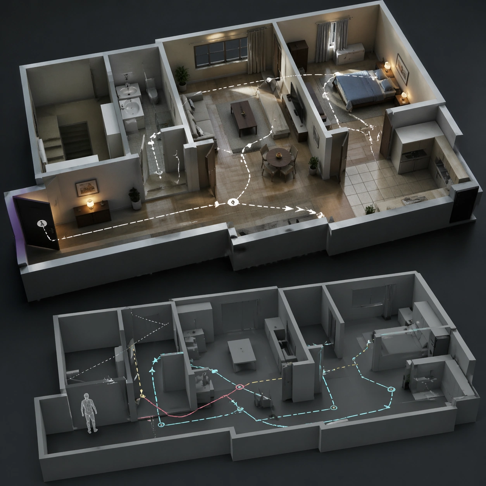

```text
Scene:
A square reconstruction image that feels evidence-based, spatially coherent, and controlled enough for analytical review. Build the frame around the scene reduced into a legible structural map or reconstruction view. Keep the lighting, camera distance, and spatial organization tuned for a high-signal research image rather than a casual snapshot. The image belongs to the Forensic Scene Reconstruction theme and should feel immediately legible as a prompt atlas theme for forensic scene reconstruction, testing physics-materials, reasoning-composition, style-transfer with gpt image 2..

Subject:
Center the study on the scene reduced into a legible structural map or reconstruction view. Translate the theme into a concrete visual statement instead of an abstract mood board: the viewer should understand what kind of image this is, what is being tested, and why the composition is difficult. Use the slug idea of forensic scene reconstruction as a literal guide for subject matter, materials, and staging.

Important details:
The image should communicate inference and real-world knowledge through placement, materials, object relationships, and disciplined visual hierarchy. Preserve a disciplined square composition, clear focal hierarchy, and enough secondary information to make the image feel complete rather than underspecified. The image should look polished, novel, and exhibition-ready, with topic-specific credibility coming from the way surfaces, structure, and visual language reinforce Forensic Scene Reconstruction. Avoid generic filler elements that do not serve the main concept.

Use case:
Forensic Scene Reconstruction single study 7/8, testing physics-materials, reasoning-composition, style-transfer through the spatial model variation.

Constraints:
No readable text, no watermark, no logos, preserve exact 1:1 aspect ratio, no readable evidence tags, no police logos, no gore, no sensational crime-drama theatrics, no broken spatial logic, no arbitrary clutter.
```

[Pinned source](https://github.com/ChaosRealmsAI/gpt-image-2-gallery/blob/5296db8c996e38776c83a0bc8c64f848dcd512b3/works/topics/forensic-scene-reconstruction/packages/single-forensic-scene-reconstruction-studies/images/spatial-model/meta.json) · GPT Image2 · 1254×1254 · No source-declared image dependencies. · ProjectD:[published and publicly accepted](https://aitoolsradar.com/en/prompts/0a600e972e39d5)

## Final Reconstruction · forensic-scene-reconstruction/single-forensic-scene-reconstruction-studies/final-reconstruction

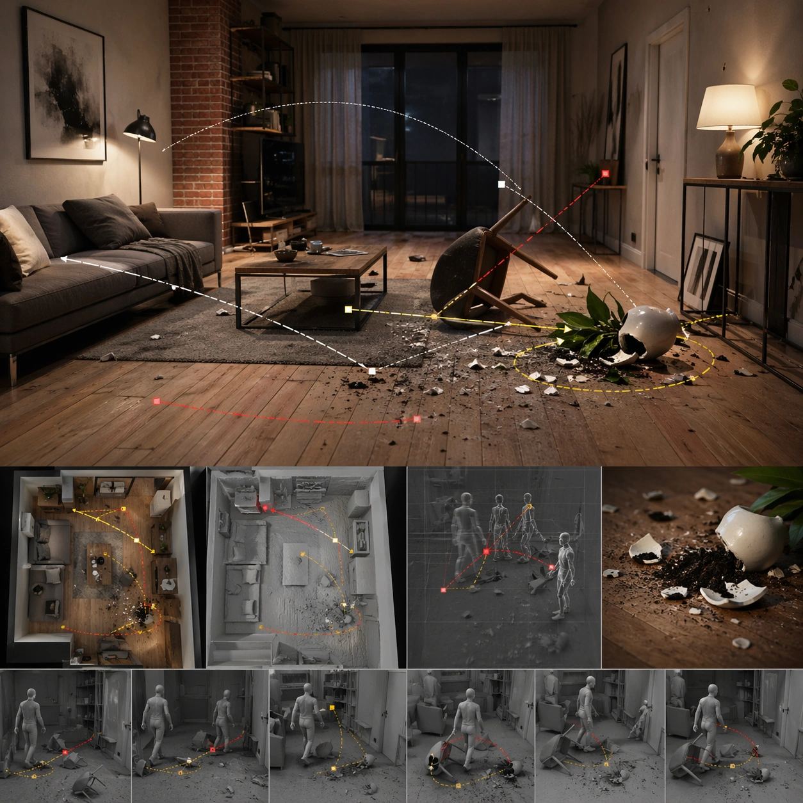

```text
Scene:
A square reconstruction image that feels evidence-based, spatially coherent, and controlled enough for analytical review. Build the frame around the strongest final analytical reconstruction frame. Keep the lighting, camera distance, and spatial organization tuned for a high-signal research image rather than a casual snapshot. The image belongs to the Forensic Scene Reconstruction theme and should feel immediately legible as a prompt atlas theme for forensic scene reconstruction, testing physics-materials, reasoning-composition, style-transfer with gpt image 2..

Subject:
Center the study on the strongest final analytical reconstruction frame. Translate the theme into a concrete visual statement instead of an abstract mood board: the viewer should understand what kind of image this is, what is being tested, and why the composition is difficult. Use the slug idea of forensic scene reconstruction as a literal guide for subject matter, materials, and staging.

Important details:
The image should communicate inference and real-world knowledge through placement, materials, object relationships, and disciplined visual hierarchy. Preserve a disciplined square composition, clear focal hierarchy, and enough secondary information to make the image feel complete rather than underspecified. The image should look polished, novel, and exhibition-ready, with topic-specific credibility coming from the way surfaces, structure, and visual language reinforce Forensic Scene Reconstruction. Avoid generic filler elements that do not serve the main concept.

Use case:
Forensic Scene Reconstruction single study 8/8, testing physics-materials, reasoning-composition, style-transfer through the final reconstruction variation.

Constraints:
No readable text, no watermark, no logos, preserve exact 1:1 aspect ratio, no readable evidence tags, no police logos, no gore, no sensational crime-drama theatrics, no broken spatial logic, no arbitrary clutter.
```

[Pinned source](https://github.com/ChaosRealmsAI/gpt-image-2-gallery/blob/5296db8c996e38776c83a0bc8c64f848dcd512b3/works/topics/forensic-scene-reconstruction/packages/single-forensic-scene-reconstruction-studies/images/final-reconstruction/meta.json) · GPT Image2 · 1254×1254 · No source-declared image dependencies. · ProjectD:[published and publicly accepted](https://aitoolsradar.com/en/prompts/f5b3c3abd12434)

## Reference Anchor · forest-fog-morning-reverie/series-core-system/01-reference-anchor

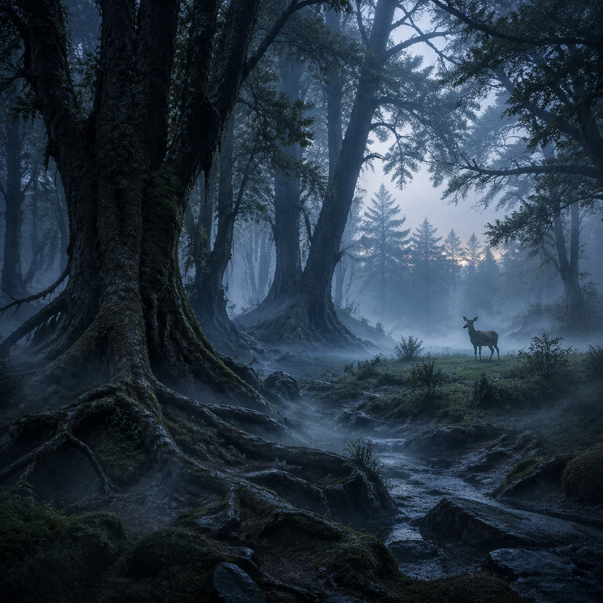

```text
Scene:
Create a square cinematic still for Forest Fog Morning Reverie. Use production-grade photoreal lighting, disciplined lens behavior, and a composition that feels like a finished key frame from an original film rather than a casual snapshot. A primeval forest before sunrise is layered with cold ground fog that drifts between roots and trunks, with the nearest trees dark and tactile, middle-ground branches softened by mist, and the distance fading into pale blue-gray air. Keep the camera in a disciplined anchor position so the full lighting event and the main spatial structure are immediately legible from edge to edge.

Subject:
Build a coherent original scene whose emotional center comes from atmosphere, light physics, and spatial clarity. Avoid relying on celebrity likeness, franchise iconography, or stylized illustration shortcuts. Ancient bark, moss-dark trunks, a still deer near a clearing edge, and damp earth should anchor the scene, but the composition should remain spacious enough that atmosphere and depth become the dominant emotional read. This frame should lock the canonical arrangement, scale relationship, and emotional tone that the later dependent images inherit.

Important details:
Preserve a believable physical world with strong depth layering, careful color separation, and premium image discipline. Focus on subtle depth cues, with three or more distinct fog densities, soft moisture on surfaces, and a quiet ecological realism that feels observed in the field instead of staged for fantasy illustration. Use this image to establish the authoritative direction of light, atmospheric density, and structural silhouette for the package.

Use case:
Forest Fog series study 1/9.

Constraints:
No readable text, no watermark, no logos, preserve exact 1:1 aspect ratio, no fairy creatures, no glowing magic particles, no readable signs, no oversized moon, no campfire.
```

[Pinned source](https://github.com/ChaosRealmsAI/gpt-image-2-gallery/blob/5296db8c996e38776c83a0bc8c64f848dcd512b3/works/topics/forest-fog-morning-reverie/packages/series-core-system/images/01-reference-anchor/meta.json) · GPT Image2 · 1254×1254 · No source-declared image dependencies. · ProjectD:[published and publicly accepted](https://aitoolsradar.com/en/prompts/edf5a40bce3eda)

## Closer Frame · forest-fog-morning-reverie/series-core-system/02-closer-frame

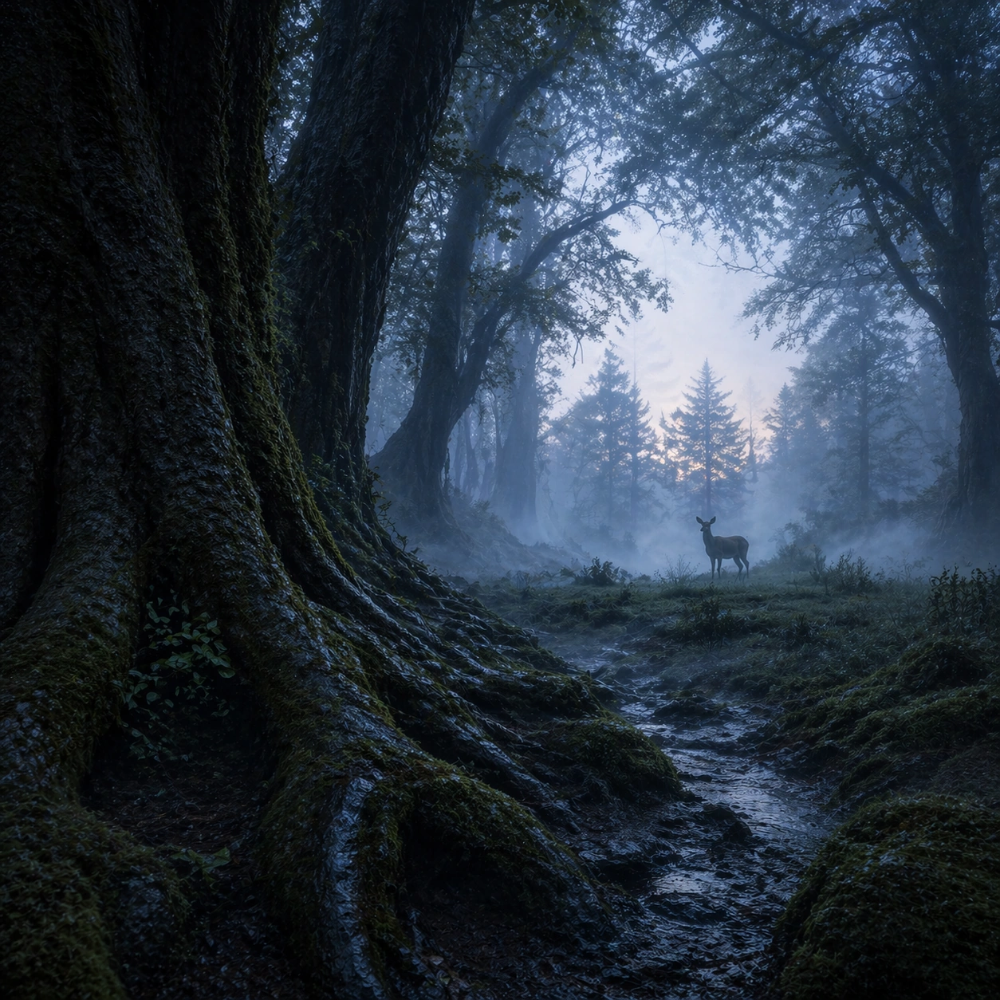

```text
Scene:
Create a square cinematic still for Forest Fog Morning Reverie. Use production-grade photoreal lighting, disciplined lens behavior, and a composition that feels like a finished key frame from an original film rather than a casual snapshot. A primeval forest before sunrise is layered with cold ground fog that drifts between roots and trunks, with the nearest trees dark and tactile, middle-ground branches softened by mist, and the distance fading into pale blue-gray air. Move the camera closer or lower so the viewer feels more embedded inside the atmosphere while the same light direction and environment remain intact.

Subject:
Build a coherent original scene whose emotional center comes from atmosphere, light physics, and spatial clarity. Avoid relying on celebrity likeness, franchise iconography, or stylized illustration shortcuts. Ancient bark, moss-dark trunks, a still deer near a clearing edge, and damp earth should anchor the scene, but the composition should remain spacious enough that atmosphere and depth become the dominant emotional read. Preserve the same world logic from the reference and let one human-scale or material-scale element become more prominent without stealing focus from the atmosphere.

Important details:
Preserve a believable physical world with strong depth layering, careful color separation, and premium image discipline. Focus on subtle depth cues, with three or more distinct fog densities, soft moisture on surfaces, and a quiet ecological realism that feels observed in the field instead of staged for fantasy illustration. Keep the palette family, structural read, and light behavior from image 01 while increasing immediacy and tactile presence.

Use case:
Forest Fog series study 2/9.

Constraints:
No readable text, no watermark, no logos, preserve exact 1:1 aspect ratio, no fairy creatures, no glowing magic particles, no readable signs, no oversized moon, no campfire.
```

[Pinned source](https://github.com/ChaosRealmsAI/gpt-image-2-gallery/blob/5296db8c996e38776c83a0bc8c64f848dcd512b3/works/topics/forest-fog-morning-reverie/packages/series-core-system/images/02-closer-frame/meta.json) · GPT Image2 · 1254×1254 · Reference images required. · ProjectD:[published and publicly accepted](https://aitoolsradar.com/en/prompts/59b6476968318c)

## Spatial Counterpoint · forest-fog-morning-reverie/series-core-system/03-spatial-counterpoint

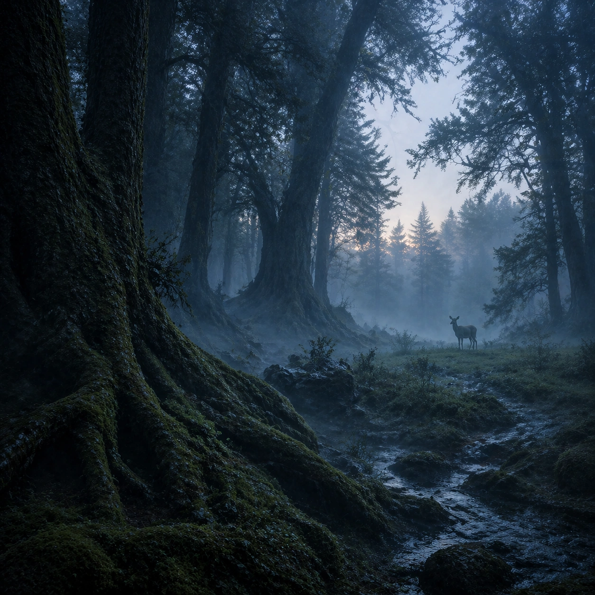

```text
Scene:
Create a square cinematic still for Forest Fog Morning Reverie. Use production-grade photoreal lighting, disciplined lens behavior, and a composition that feels like a finished key frame from an original film rather than a casual snapshot. A primeval forest before sunrise is layered with cold ground fog that drifts between roots and trunks, with the nearest trees dark and tactile, middle-ground branches softened by mist, and the distance fading into pale blue-gray air. Shift to an oblique or lateral point of view that reveals different depth layers while staying inside the same place and the same atmospheric event.

Subject:
Build a coherent original scene whose emotional center comes from atmosphere, light physics, and spatial clarity. Avoid relying on celebrity likeness, franchise iconography, or stylized illustration shortcuts. Ancient bark, moss-dark trunks, a still deer near a clearing edge, and damp earth should anchor the scene, but the composition should remain spacious enough that atmosphere and depth become the dominant emotional read. Hold the reference structure, but use the new angle to show secondary planes, foreground interruption, or a changed distance relationship.

Important details:
Preserve a believable physical world with strong depth layering, careful color separation, and premium image discipline. Focus on subtle depth cues, with three or more distinct fog densities, soft moisture on surfaces, and a quiet ecological realism that feels observed in the field instead of staged for fantasy illustration. The success condition is continuity with the reference plus a richer sense of depth, not a new location or a new lighting system.

Use case:
Forest Fog series study 3/9.

Constraints:
No readable text, no watermark, no logos, preserve exact 1:1 aspect ratio, no fairy creatures, no glowing magic particles, no readable signs, no oversized moon, no campfire.
```

[Pinned source](https://github.com/ChaosRealmsAI/gpt-image-2-gallery/blob/5296db8c996e38776c83a0bc8c64f848dcd512b3/works/topics/forest-fog-morning-reverie/packages/series-core-system/images/03-spatial-counterpoint/meta.json) · GPT Image2 · 1254×1254 · Reference images required. · ProjectD:[published and publicly accepted](https://aitoolsradar.com/en/prompts/9db0646b44bc80)

## Climax Frame · forest-fog-morning-reverie/series-core-system/04-climax-frame

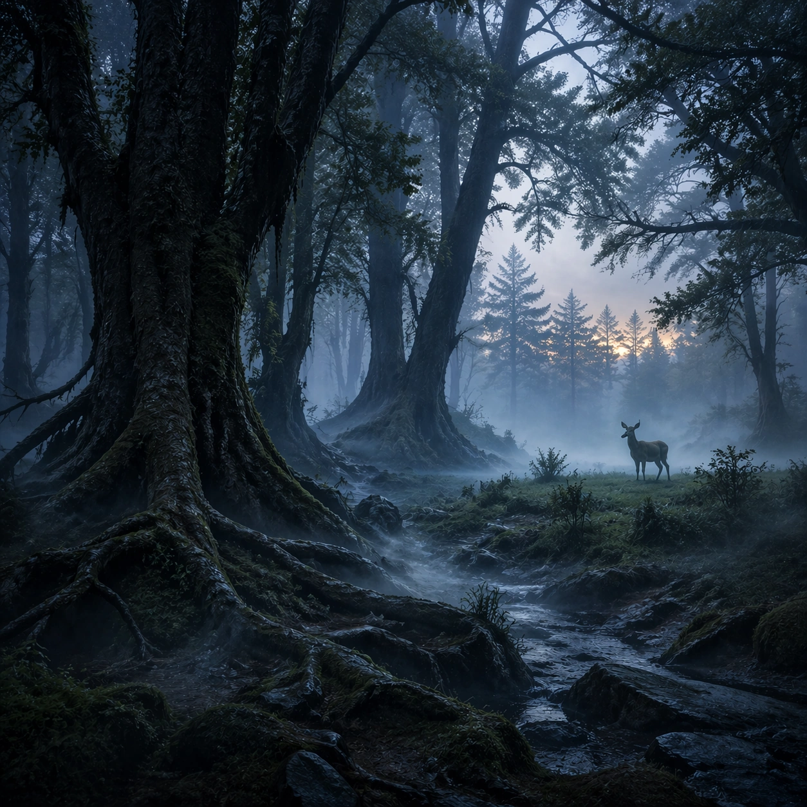

```text
Scene:
Create a square cinematic still for Forest Fog Morning Reverie. Use production-grade photoreal lighting, disciplined lens behavior, and a composition that feels like a finished key frame from an original film rather than a casual snapshot. A primeval forest before sunrise is layered with cold ground fog that drifts between roots and trunks, with the nearest trees dark and tactile, middle-ground branches softened by mist, and the distance fading into pale blue-gray air. Push the composition toward the emotional peak of the same setup, with the most dramatic balance of brightness, shadow, or atmospheric density inside the established world.

Subject:
Build a coherent original scene whose emotional center comes from atmosphere, light physics, and spatial clarity. Avoid relying on celebrity likeness, franchise iconography, or stylized illustration shortcuts. Ancient bark, moss-dark trunks, a still deer near a clearing edge, and damp earth should anchor the scene, but the composition should remain spacious enough that atmosphere and depth become the dominant emotional read. Everything should still read as the same location and same event, but framed for maximum narrative force and visual closure.

Important details:
Preserve a believable physical world with strong depth layering, careful color separation, and premium image discipline. Focus on subtle depth cues, with three or more distinct fog densities, soft moisture on surfaces, and a quiet ecological realism that feels observed in the field instead of staged for fantasy illustration. Make it feel like the strongest hero frame of the sequence without breaking continuity or introducing a new design language.

Use case:
Forest Fog series study 4/9.

Constraints:
No readable text, no watermark, no logos, preserve exact 1:1 aspect ratio, no fairy creatures, no glowing magic particles, no readable signs, no oversized moon, no campfire.
```

[Pinned source](https://github.com/ChaosRealmsAI/gpt-image-2-gallery/blob/5296db8c996e38776c83a0bc8c64f848dcd512b3/works/topics/forest-fog-morning-reverie/packages/series-core-system/images/04-climax-frame/meta.json) · GPT Image2 · 1254×1254 · Reference images required. · ProjectD:[published and publicly accepted](https://aitoolsradar.com/en/prompts/2489139d429b9a)

## Surface Study · forest-fog-morning-reverie/single-support-studies/surface-study

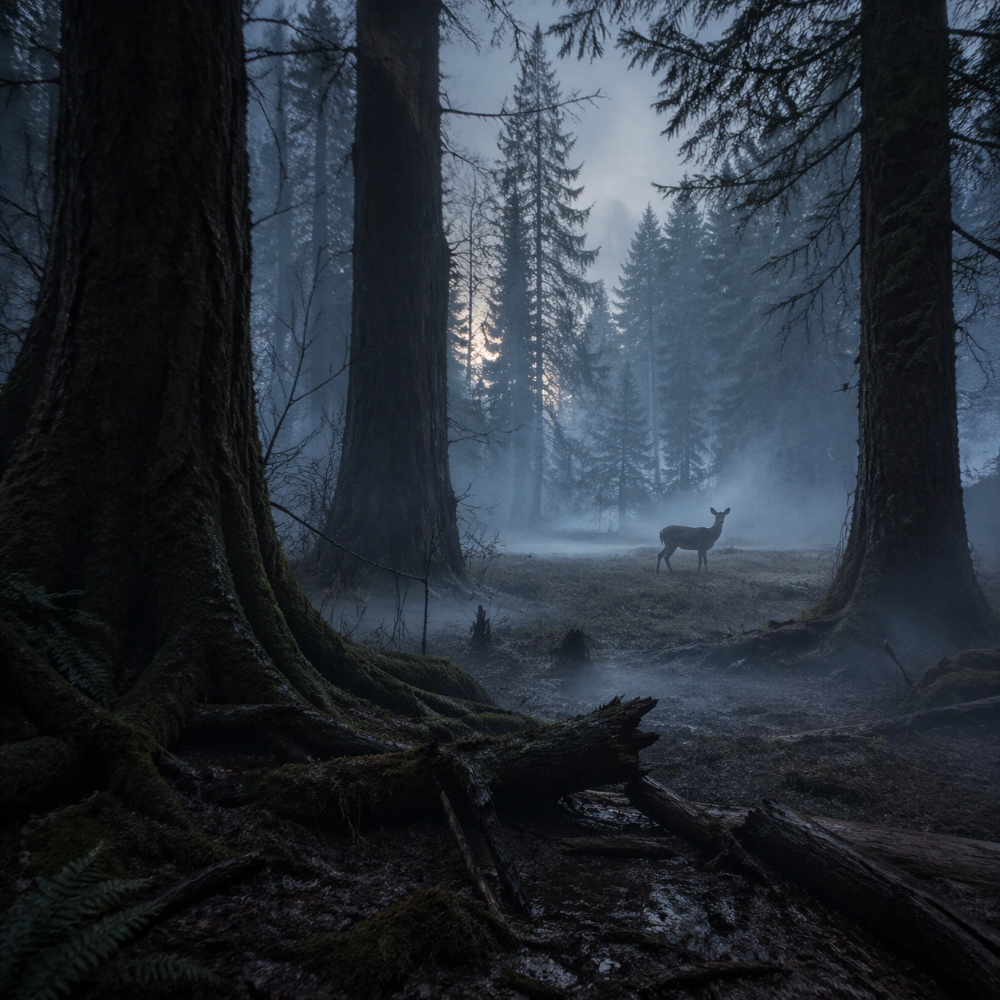

```text
Scene:
Create a square cinematic still for Forest Fog Morning Reverie. Use production-grade photoreal lighting, disciplined lens behavior, and a composition that feels like a finished key frame from an original film rather than a casual snapshot. A primeval forest before sunrise is layered with cold ground fog that drifts between roots and trunks, with the nearest trees dark and tactile, middle-ground branches softened by mist, and the distance fading into pale blue-gray air. Build an independent square study around the way atmosphere interacts with surfaces, keeping enough environmental context for the image to feel finished rather than cropped at random.

Subject:
Build a coherent original scene whose emotional center comes from atmosphere, light physics, and spatial clarity. Avoid relying on celebrity likeness, franchise iconography, or stylized illustration shortcuts. Ancient bark, moss-dark trunks, a still deer near a clearing edge, and damp earth should anchor the scene, but the composition should remain spacious enough that atmosphere and depth become the dominant emotional read. Let textures, reflections, residue, moisture, dust, or particulate response become primary, while the broader setting remains clearly implied.

Important details:
Preserve a believable physical world with strong depth layering, careful color separation, and premium image discipline. Focus on subtle depth cues, with three or more distinct fog densities, soft moisture on surfaces, and a quiet ecological realism that feels observed in the field instead of staged for fantasy illustration. The key is material credibility under dramatic light, with micro-contrast and controlled mood supporting the theme.

Use case:
Forest Fog single study 5/9.

Constraints:
No readable text, no watermark, no logos, preserve exact 1:1 aspect ratio, no fairy creatures, no glowing magic particles, no readable signs, no oversized moon, no campfire.
```

[Pinned source](https://github.com/ChaosRealmsAI/gpt-image-2-gallery/blob/5296db8c996e38776c83a0bc8c64f848dcd512b3/works/topics/forest-fog-morning-reverie/packages/single-support-studies/images/surface-study/meta.json) · GPT Image2 · 1254×1254 · No source-declared image dependencies. · ProjectD:[published and publicly accepted](https://aitoolsradar.com/en/prompts/8fbbfb76f1c88f)

## Silhouette Study · forest-fog-morning-reverie/single-support-studies/silhouette-study

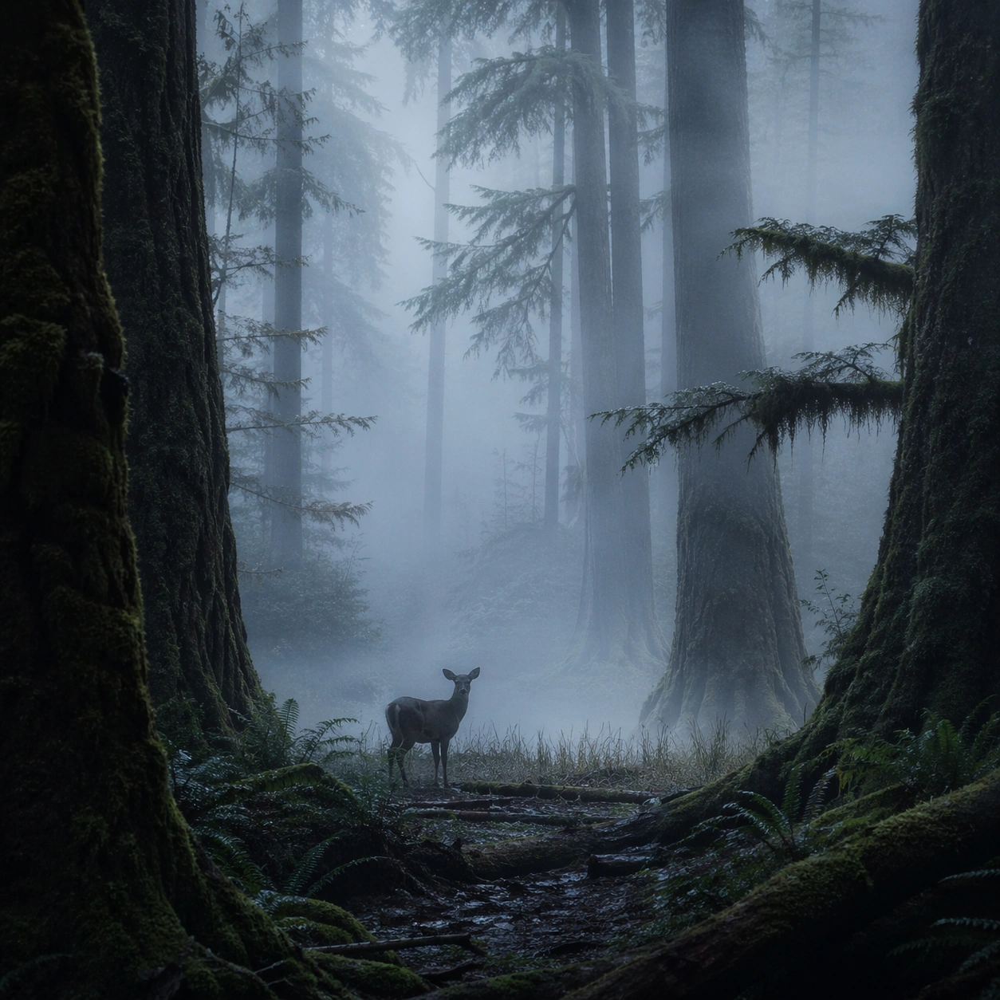

```text
Scene:
Create a square cinematic still for Forest Fog Morning Reverie. Use production-grade photoreal lighting, disciplined lens behavior, and a composition that feels like a finished key frame from an original film rather than a casual snapshot. A primeval forest before sunrise is layered with cold ground fog that drifts between roots and trunks, with the nearest trees dark and tactile, middle-ground branches softened by mist, and the distance fading into pale blue-gray air. Compose an independent frame where one human, animal, or object silhouette negotiates with the atmospheric light event in a clean, readable way.

Subject:
Build a coherent original scene whose emotional center comes from atmosphere, light physics, and spatial clarity. Avoid relying on celebrity likeness, franchise iconography, or stylized illustration shortcuts. Ancient bark, moss-dark trunks, a still deer near a clearing edge, and damp earth should anchor the scene, but the composition should remain spacious enough that atmosphere and depth become the dominant emotional read. The silhouette should supply scale and emotional orientation, but the environment still needs to carry most of the storytelling weight.

Important details:
Preserve a believable physical world with strong depth layering, careful color separation, and premium image discipline. Focus on subtle depth cues, with three or more distinct fog densities, soft moisture on surfaces, and a quiet ecological realism that feels observed in the field instead of staged for fantasy illustration. Keep the silhouette simple and believable, avoiding poster-like graphic flattening while preserving strong contrast.

Use case:
Forest Fog single study 6/9.

Constraints:
No readable text, no watermark, no logos, preserve exact 1:1 aspect ratio, no fairy creatures, no glowing magic particles, no readable signs, no oversized moon, no campfire.
```

[Pinned source](https://github.com/ChaosRealmsAI/gpt-image-2-gallery/blob/5296db8c996e38776c83a0bc8c64f848dcd512b3/works/topics/forest-fog-morning-reverie/packages/single-support-studies/images/silhouette-study/meta.json) · GPT Image2 · 1254×1254 · No source-declared image dependencies. · ProjectD:[published and publicly accepted](https://aitoolsradar.com/en/prompts/38425d8816982c)

## Transition Study · forest-fog-morning-reverie/single-support-studies/transition-study

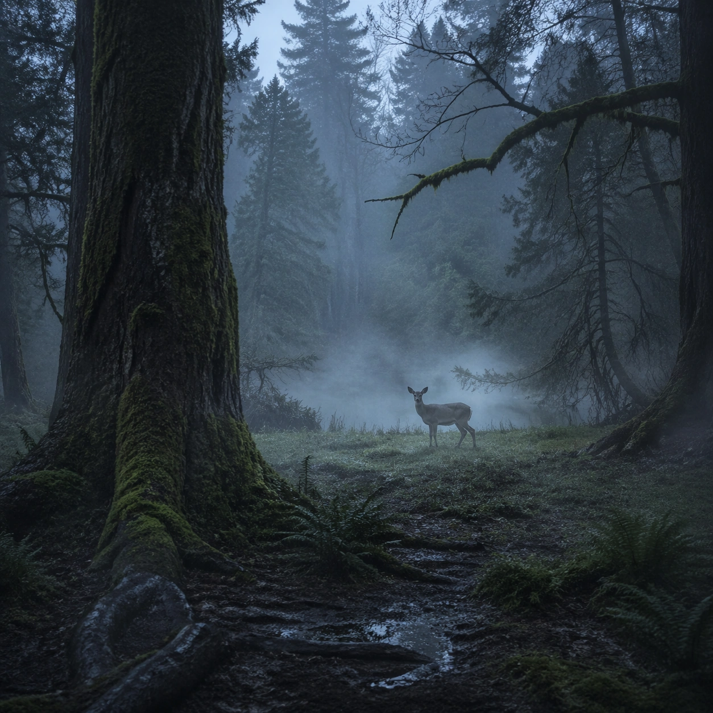

```text
Scene:
Create a square cinematic still for Forest Fog Morning Reverie. Use production-grade photoreal lighting, disciplined lens behavior, and a composition that feels like a finished key frame from an original film rather than a casual snapshot. A primeval forest before sunrise is layered with cold ground fog that drifts between roots and trunks, with the nearest trees dark and tactile, middle-ground branches softened by mist, and the distance fading into pale blue-gray air. Treat this as an adjacent moment before or after the main event, preserving the same topic language while letting the atmosphere shift slightly in intensity or position.

Subject:
Build a coherent original scene whose emotional center comes from atmosphere, light physics, and spatial clarity. Avoid relying on celebrity likeness, franchise iconography, or stylized illustration shortcuts. Ancient bark, moss-dark trunks, a still deer near a clearing edge, and damp earth should anchor the scene, but the composition should remain spacious enough that atmosphere and depth become the dominant emotional read. Show the environment in transition, with clear evidence of recent motion, changing weather, or fading light, but without turning it into action spectacle.

Important details:
Preserve a believable physical world with strong depth layering, careful color separation, and premium image discipline. Focus on subtle depth cues, with three or more distinct fog densities, soft moisture on surfaces, and a quiet ecological realism that feels observed in the field instead of staged for fantasy illustration. Subtle temporal storytelling matters here more than maximal drama, so let traces, gradients, and environmental residue do the work.

Use case:
Forest Fog single study 7/9.

Constraints:
No readable text, no watermark, no logos, preserve exact 1:1 aspect ratio, no fairy creatures, no glowing magic particles, no readable signs, no oversized moon, no campfire.
```

[Pinned source](https://github.com/ChaosRealmsAI/gpt-image-2-gallery/blob/5296db8c996e38776c83a0bc8c64f848dcd512b3/works/topics/forest-fog-morning-reverie/packages/single-support-studies/images/transition-study/meta.json) · GPT Image2 · 1254×1254 · No source-declared image dependencies. · ProjectD:[published and publicly accepted](https://aitoolsradar.com/en/prompts/e2a5b2cef3e6d3)

## Wide Study · forest-fog-morning-reverie/single-support-studies/wide-study

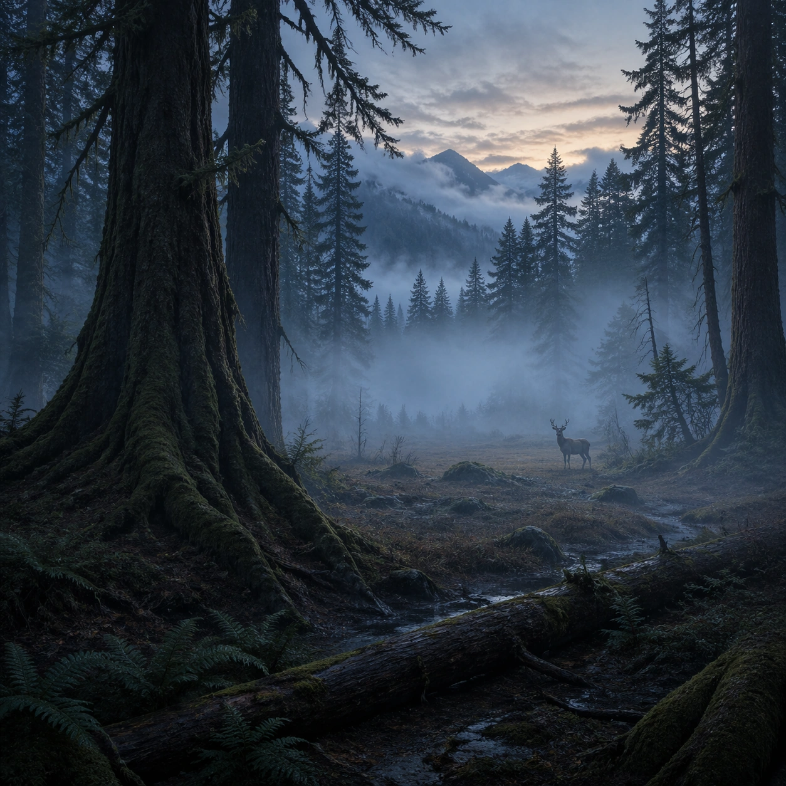

```text
Scene:
Create a square cinematic still for Forest Fog Morning Reverie. Use production-grade photoreal lighting, disciplined lens behavior, and a composition that feels like a finished key frame from an original film rather than a casual snapshot. A primeval forest before sunrise is layered with cold ground fog that drifts between roots and trunks, with the nearest trees dark and tactile, middle-ground branches softened by mist, and the distance fading into pale blue-gray air. Pull back enough to explain the broader geography or architectural envelope while keeping the square crop intentional and balanced.

Subject:
Build a coherent original scene whose emotional center comes from atmosphere, light physics, and spatial clarity. Avoid relying on celebrity likeness, franchise iconography, or stylized illustration shortcuts. Ancient bark, moss-dark trunks, a still deer near a clearing edge, and damp earth should anchor the scene, but the composition should remain spacious enough that atmosphere and depth become the dominant emotional read. The wider frame should reveal how the main light or weather phenomenon organizes the surrounding world and not just the immediate subject.

Important details:
Preserve a believable physical world with strong depth layering, careful color separation, and premium image discipline. Focus on subtle depth cues, with three or more distinct fog densities, soft moisture on surfaces, and a quiet ecological realism that feels observed in the field instead of staged for fantasy illustration. Make scale legible through spacing, horizon control, and foreground-to-background separation rather than through extra props.

Use case:
Forest Fog single study 8/9.

Constraints:
No readable text, no watermark, no logos, preserve exact 1:1 aspect ratio, no fairy creatures, no glowing magic particles, no readable signs, no oversized moon, no campfire.
```

[Pinned source](https://github.com/ChaosRealmsAI/gpt-image-2-gallery/blob/5296db8c996e38776c83a0bc8c64f848dcd512b3/works/topics/forest-fog-morning-reverie/packages/single-support-studies/images/wide-study/meta.json) · GPT Image2 · 1254×1254 · No source-declared image dependencies. · ProjectD:[published and publicly accepted](https://aitoolsradar.com/en/prompts/14f330097652f5)

## Afterglow Study · forest-fog-morning-reverie/single-support-studies/afterglow-study

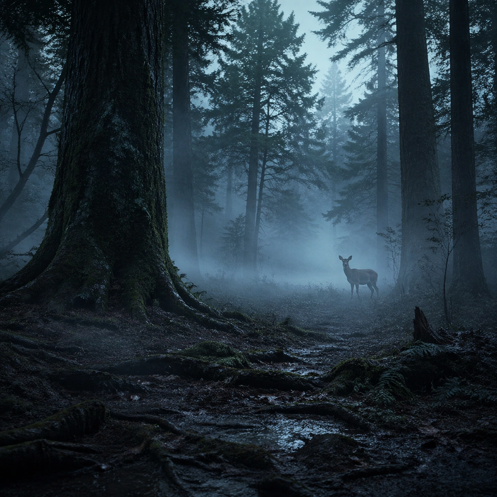

```text
Scene:
Create a square cinematic still for Forest Fog Morning Reverie. Use production-grade photoreal lighting, disciplined lens behavior, and a composition that feels like a finished key frame from an original film rather than a casual snapshot. A primeval forest before sunrise is layered with cold ground fog that drifts between roots and trunks, with the nearest trees dark and tactile, middle-ground branches softened by mist, and the distance fading into pale blue-gray air. End on a quieter independent image that holds the residue of the topic atmosphere after its loudest moment has passed, while still feeling complete and exhibition-ready.

Subject:
Build a coherent original scene whose emotional center comes from atmosphere, light physics, and spatial clarity. Avoid relying on celebrity likeness, franchise iconography, or stylized illustration shortcuts. Ancient bark, moss-dark trunks, a still deer near a clearing edge, and damp earth should anchor the scene, but the composition should remain spacious enough that atmosphere and depth become the dominant emotional read. The frame should suggest memory, aftermath, or lingering presence through environment first and only secondarily through any figure or object.

Important details:
Preserve a believable physical world with strong depth layering, careful color separation, and premium image discipline. Focus on subtle depth cues, with three or more distinct fog densities, soft moisture on surfaces, and a quiet ecological realism that feels observed in the field instead of staged for fantasy illustration. Favor restraint, believable light decay, and subtle narrative closure over spectacle or decorative excess.

Use case:
Forest Fog single study 9/9.

Constraints:
No readable text, no watermark, no logos, preserve exact 1:1 aspect ratio, no fairy creatures, no glowing magic particles, no readable signs, no oversized moon, no campfire.
```

[Pinned source](https://github.com/ChaosRealmsAI/gpt-image-2-gallery/blob/5296db8c996e38776c83a0bc8c64f848dcd512b3/works/topics/forest-fog-morning-reverie/packages/single-support-studies/images/afterglow-study/meta.json) · GPT Image2 · 1254×1254 · No source-declared image dependencies. · ProjectD:[published and publicly accepted](https://aitoolsradar.com/en/prompts/1624477b673a9a)

## Identity Reference · founder-headshot-lighting-matrix/series-identity-lock/01-identity-reference

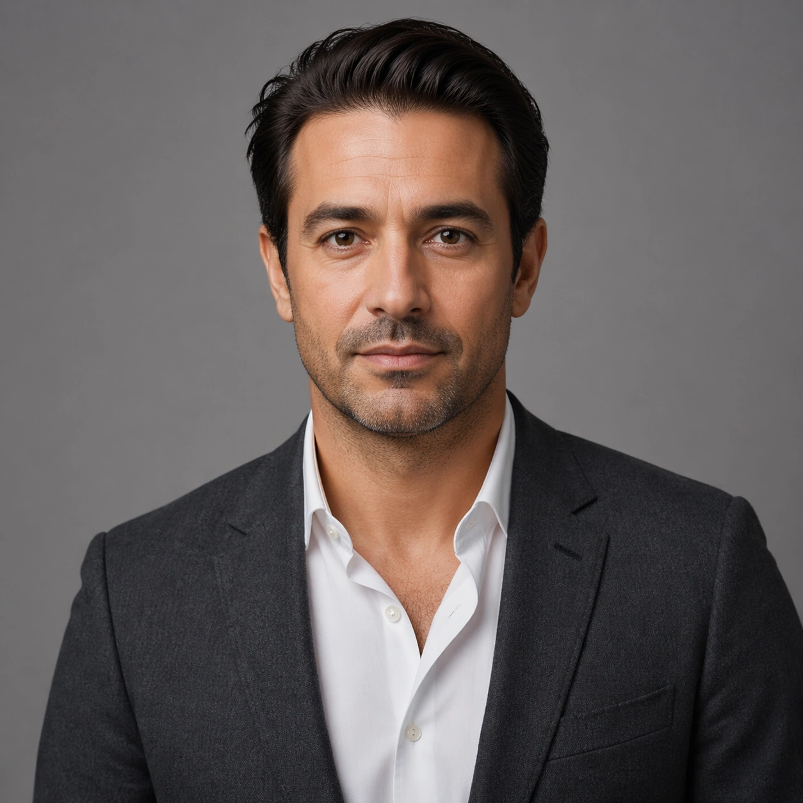

```text
Scene:
A square premium portrait photograph for Founder Headshot Lighting Matrix. Place the subject in a restrained medium-gray studio with soft frontal key light, subtle fill, and a clean square crop. Use a medium close portrait framing with believable lens behavior, clean depth separation, natural skin rendering, and controlled tonal range. The light should feel physically plausible rather than synthetic, with enough negative space and environmental context to read like a finished editorial or commercial delivery. Keep the palette, contrast, and production styling aligned with premium executive portrait photography with real studio craft and restrained retouching.

Subject:
Photograph one credible tech founder in the late thirties, with intelligent eyes, medium olive skin, dark brown hair brushed back from a natural hairline, and an understated executive presence. Wardrobe direction: a charcoal blazer over an open-collar white shirt. Pose and expression: standing square to camera with relaxed shoulders and a direct, thoughtful gaze. The emotional register should feel grounded, calm, and highly credible. This frame establishes the reference model. Later images must preserve exact face / hair base / body proportions from the reference model. Preserve the recognizable brow line, eye spacing, nose bridge, mouth shape, jaw rhythm, and body proportions from image 01 while making this frame clearly distinct through scene, lighting, styling, and posture.

Important details:
Business credibility matters more than glamour. Preserve natural skin pore detail, believable tailoring, and real lighting falloff that a photographer could actually build on set. This should feel like the master reference from a professional headshot session, with no gimmick and no branding clutter. The topic dimension is 企业肖像 + 棚拍打光 + 系列一致性. Use the example direction of 同一位 founder 输出 clean white studio、dark tech rim light、warm hospitality portrait 和 editorial black backdrop 四套头像。. The core challenge is 不是普通职业照，而是让不同品牌气质和真实打光都成立，同时保证像同一个人。. Capabilities under test: photorealism, studio-lighting, identity-preservation, commercial-mockup. Success should read as 一眼像真实企业或创始人 headshot 交付; 不同光位之间气质差异清楚，但仍像同一个人; 皮肤、发丝和西装材质自然，不像 AI 磨皮. Address the model gap described as 普通模型容易把商务头像做得过度磨皮、脸型漂移、光位不真实。. Skin texture, fabric texture, hair texture, and catchlight behavior must stay realistic, high-end, and non-plastic.

Use case:
Founder Headshot Lighting Matrix series study 1/9.

Constraints:
No readable text, no watermark, no logos, preserve exact 1:1 aspect ratio, preserve exact face / hair base / body proportions from the reference model, no face drift, no skin-tone drift, no duplicate person, no extra limbs, no AI beauty blur, no warped hands, no accidental collage layout, no dramatic props, no startup cliché neon, no extreme smile, no harsh shadow breakup.
```

[Pinned source](https://github.com/ChaosRealmsAI/gpt-image-2-gallery/blob/5296db8c996e38776c83a0bc8c64f848dcd512b3/works/topics/founder-headshot-lighting-matrix/packages/series-identity-lock/images/01-identity-reference/meta.json) · GPT Image2 · 1254×1254 · No source-declared image dependencies. · ProjectD:[published and publicly accepted](https://aitoolsradar.com/en/prompts/28dcc0d25d27d7)

## Clean White Studio · founder-headshot-lighting-matrix/series-identity-lock/02-clean-white-studio


```text
Scene:
A square premium portrait photograph for Founder Headshot Lighting Matrix. Use a clean white cyclorama with high-key studio light, gentle edge separation, and polished but realistic exposure control. Use a tight head-and-shoulders portrait with believable lens behavior, clean depth separation, natural skin rendering, and controlled tonal range. The light should feel physically plausible rather than synthetic, with enough negative space and environmental context to read like a finished editorial or commercial delivery. Keep the palette, contrast, and production styling aligned with premium executive portrait photography with real studio craft and restrained retouching.

Subject:
Photograph one credible tech founder in the late thirties, with intelligent eyes, medium olive skin, dark brown hair brushed back from a natural hairline, and an understated executive presence. Wardrobe direction: a navy blazer with a pale blue shirt and no tie. Pose and expression: slightly angled torso, chin lifted a touch, hands out of frame. The emotional register should feel confident, efficient, and approachable. Preserve exact face / hair base / body proportions from the reference model. Keep the same skin tone family, hairline, age read, and calm underlying temperament even while the styling changes. Preserve the recognizable brow line, eye spacing, nose bridge, mouth shape, jaw rhythm, and body proportions from image 01 while making this frame clearly distinct through scene, lighting, styling, and posture.

Important details:
Business credibility matters more than glamour. Preserve natural skin pore detail, believable tailoring, and real lighting falloff that a photographer could actually build on set. The white set should still preserve contour in the face and jacket instead of washing the subject out. The topic dimension is 企业肖像 + 棚拍打光 + 系列一致性. Use the example direction of 同一位 founder 输出 clean white studio、dark tech rim light、warm hospitality portrait 和 editorial black backdrop 四套头像。. The core challenge is 不是普通职业照，而是让不同品牌气质和真实打光都成立，同时保证像同一个人。. Capabilities under test: photorealism, studio-lighting, identity-preservation, commercial-mockup. Success should read as 一眼像真实企业或创始人 headshot 交付; 不同光位之间气质差异清楚，但仍像同一个人; 皮肤、发丝和西装材质自然，不像 AI 磨皮. Address the model gap described as 普通模型容易把商务头像做得过度磨皮、脸型漂移、光位不真实。. Skin texture, fabric texture, hair texture, and catchlight behavior must stay realistic, high-end, and non-plastic.

Use case:
Founder Headshot Lighting Matrix series study 2/9.

Constraints:
No readable text, no watermark, no logos, preserve exact 1:1 aspect ratio, preserve exact face / hair base / body proportions from the reference model, no face drift, no skin-tone drift, no duplicate person, no extra limbs, no AI beauty blur, no warped hands, no accidental collage layout, no clipping in the shirt, no beauty-editorial makeup, no floating shoulders, no fake background gradient.
```

[Pinned source](https://github.com/ChaosRealmsAI/gpt-image-2-gallery/blob/5296db8c996e38776c83a0bc8c64f848dcd512b3/works/topics/founder-headshot-lighting-matrix/packages/series-identity-lock/images/02-clean-white-studio/meta.json) · GPT Image2 · 1254×1254 · Reference images required. · ProjectD:[published and publicly accepted](https://aitoolsradar.com/en/prompts/637e4a9b25d439)

## Dark Tech Rim Light · founder-headshot-lighting-matrix/series-identity-lock/03-dark-tech-rim-light

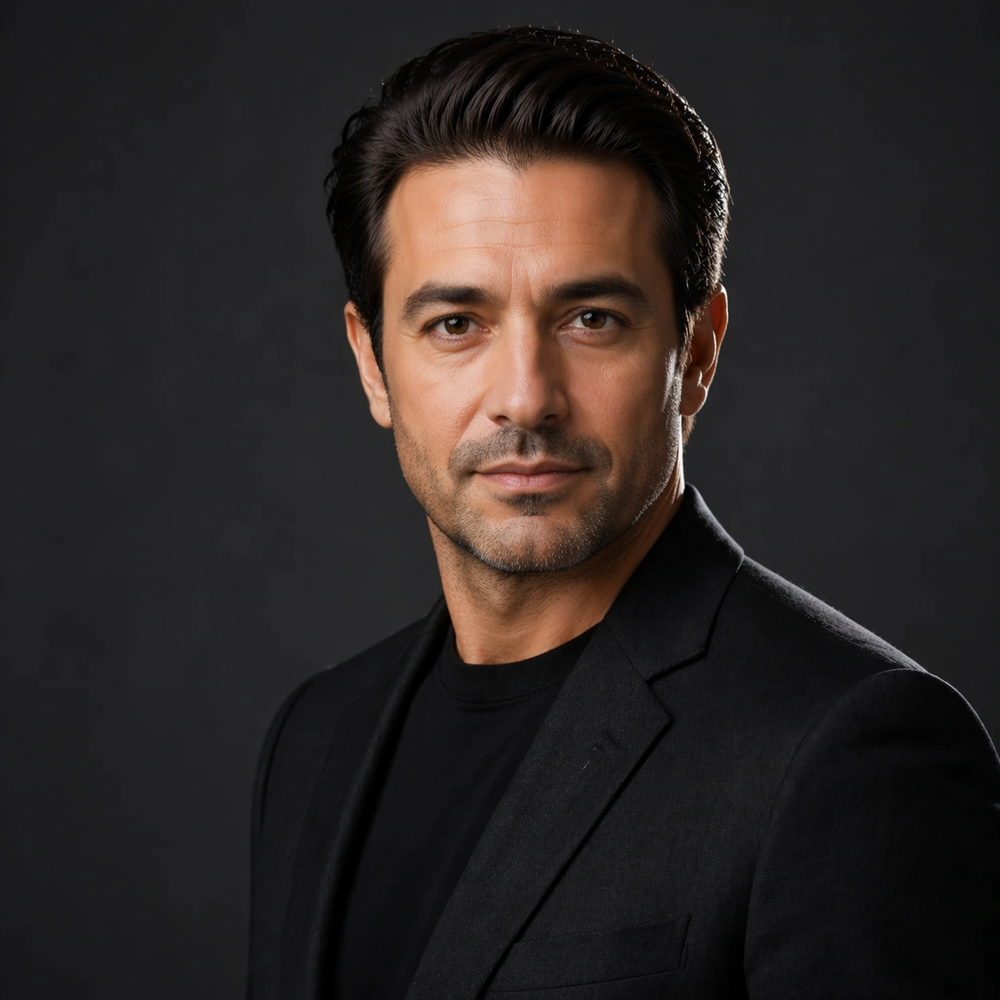

```text
Scene:
A square premium portrait photograph for Founder Headshot Lighting Matrix. Stage the portrait against a matte graphite backdrop with crisp side rim light, low-key fill, and controlled specular highlights. Use a close portrait with slight three-quarter angle with believable lens behavior, clean depth separation, natural skin rendering, and controlled tonal range. The light should feel physically plausible rather than synthetic, with enough negative space and environmental context to read like a finished editorial or commercial delivery. Keep the palette, contrast, and production styling aligned with premium executive portrait photography with real studio craft and restrained retouching.

Subject:
Photograph one credible tech founder in the late thirties, with intelligent eyes, medium olive skin, dark brown hair brushed back from a natural hairline, and an understated executive presence. Wardrobe direction: a black knit crewneck under a dark tailored jacket. Pose and expression: body turned slightly away from camera, eyes back to lens. The emotional register should feel focused, future-facing, and quietly intense. Preserve exact face / hair base / body proportions from the reference model. Keep the same skin tone family, hairline, age read, and calm underlying temperament even while the styling changes. Preserve the recognizable brow line, eye spacing, nose bridge, mouth shape, jaw rhythm, and body proportions from image 01 while making this frame clearly distinct through scene, lighting, styling, and posture.

Important details:
Business credibility matters more than glamour. Preserve natural skin pore detail, believable tailoring, and real lighting falloff that a photographer could actually build on set. Keep the lighting premium and engineered, not cinematic chaos. The eyes must stay readable inside the darker lighting scheme. The topic dimension is 企业肖像 + 棚拍打光 + 系列一致性. Use the example direction of 同一位 founder 输出 clean white studio、dark tech rim light、warm hospitality portrait 和 editorial black backdrop 四套头像。. The core challenge is 不是普通职业照，而是让不同品牌气质和真实打光都成立，同时保证像同一个人。. Capabilities under test: photorealism, studio-lighting, identity-preservation, commercial-mockup. Success should read as 一眼像真实企业或创始人 headshot 交付; 不同光位之间气质差异清楚，但仍像同一个人; 皮肤、发丝和西装材质自然，不像 AI 磨皮. Address the model gap described as 普通模型容易把商务头像做得过度磨皮、脸型漂移、光位不真实。. Skin texture, fabric texture, hair texture, and catchlight behavior must stay realistic, high-end, and non-plastic.

Use case:
Founder Headshot Lighting Matrix series study 3/9.

Constraints:
No readable text, no watermark, no logos, preserve exact 1:1 aspect ratio, preserve exact face / hair base / body proportions from the reference model, no face drift, no skin-tone drift, no duplicate person, no extra limbs, no AI beauty blur, no warped hands, no accidental collage layout, no hacker cliché screens, no colored LED overload, no crushed blacks, no sci-fi costume feeling.
```

[Pinned source](https://github.com/ChaosRealmsAI/gpt-image-2-gallery/blob/5296db8c996e38776c83a0bc8c64f848dcd512b3/works/topics/founder-headshot-lighting-matrix/packages/series-identity-lock/images/03-dark-tech-rim-light/meta.json) · GPT Image2 · 1254×1254 · Reference images required. · ProjectD:[published and publicly accepted](https://aitoolsradar.com/en/prompts/a2167f6c4c6aec)

## Warm Hospitality Portrait · founder-headshot-lighting-matrix/series-identity-lock/04-warm-hospitality-portrait


```text
Scene:
A square premium portrait photograph for Founder Headshot Lighting Matrix. Photograph the subject in a softly lit warm-toned studio corner with creamy beige backdrop, bounced key light, and gentle practical warmth. Use a medium portrait with space around the shoulders with believable lens behavior, clean depth separation, natural skin rendering, and controlled tonal range. The light should feel physically plausible rather than synthetic, with enough negative space and environmental context to read like a finished editorial or commercial delivery. Keep the palette, contrast, and production styling aligned with premium executive portrait photography with real studio craft and restrained retouching.

Subject:
Photograph one credible tech founder in the late thirties, with intelligent eyes, medium olive skin, dark brown hair brushed back from a natural hairline, and an understated executive presence. Wardrobe direction: a soft brown jacket over a fine-knit off-white polo. Pose and expression: slight lean forward with a welcoming half smile. The emotional register should feel open, human, and reassuring. Preserve exact face / hair base / body proportions from the reference model. Keep the same skin tone family, hairline, age read, and calm underlying temperament even while the styling changes. Preserve the recognizable brow line, eye spacing, nose bridge, mouth shape, jaw rhythm, and body proportions from image 01 while making this frame clearly distinct through scene, lighting, styling, and posture.

Important details:
Business credibility matters more than glamour. Preserve natural skin pore detail, believable tailoring, and real lighting falloff that a photographer could actually build on set. The warmth should come from the light and palette, not from orange skin. Keep the founder believable and modern. The topic dimension is 企业肖像 + 棚拍打光 + 系列一致性. Use the example direction of 同一位 founder 输出 clean white studio、dark tech rim light、warm hospitality portrait 和 editorial black backdrop 四套头像。. The core challenge is 不是普通职业照，而是让不同品牌气质和真实打光都成立，同时保证像同一个人。. Capabilities under test: photorealism, studio-lighting, identity-preservation, commercial-mockup. Success should read as 一眼像真实企业或创始人 headshot 交付; 不同光位之间气质差异清楚，但仍像同一个人; 皮肤、发丝和西装材质自然，不像 AI 磨皮. Address the model gap described as 普通模型容易把商务头像做得过度磨皮、脸型漂移、光位不真实。. Skin texture, fabric texture, hair texture, and catchlight behavior must stay realistic, high-end, and non-plastic.

Use case:
Founder Headshot Lighting Matrix series study 4/9.

Constraints:
No readable text, no watermark, no logos, preserve exact 1:1 aspect ratio, preserve exact face / hair base / body proportions from the reference model, no face drift, no skin-tone drift, no duplicate person, no extra limbs, no AI beauty blur, no warped hands, no accidental collage layout, no hotel-lobby clichés, no over-yellow white balance, no exaggerated grin, no lifestyle ad props.
```

[Pinned source](https://github.com/ChaosRealmsAI/gpt-image-2-gallery/blob/5296db8c996e38776c83a0bc8c64f848dcd512b3/works/topics/founder-headshot-lighting-matrix/packages/series-identity-lock/images/04-warm-hospitality-portrait/meta.json) · GPT Image2 · 1254×1254 · Reference images required. · ProjectD:[published and publicly accepted](https://aitoolsradar.com/en/prompts/4c39f1d3dcffd5)

## Editorial Black Backdrop · founder-headshot-lighting-matrix/series-identity-lock/05-editorial-black-backdrop

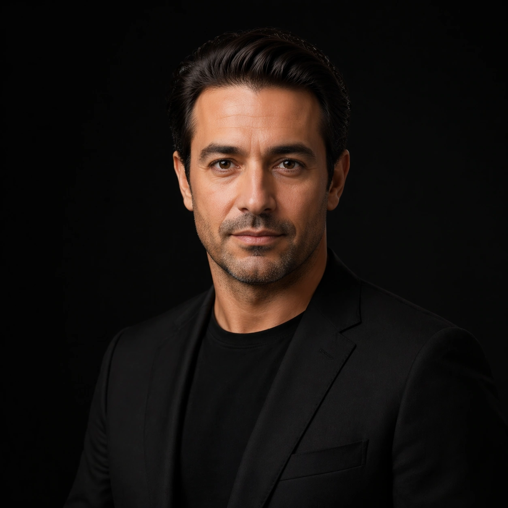

```text
Scene:
A square premium portrait photograph for Founder Headshot Lighting Matrix. Use a seamless black backdrop with sculpted key light, minimal fill, and elegant falloff into darkness. Use a close portrait with vertical energy inside the square with believable lens behavior, clean depth separation, natural skin rendering, and controlled tonal range. The light should feel physically plausible rather than synthetic, with enough negative space and environmental context to read like a finished editorial or commercial delivery. Keep the palette, contrast, and production styling aligned with premium executive portrait photography with real studio craft and restrained retouching.

Subject:
Photograph one credible tech founder in the late thirties, with intelligent eyes, medium olive skin, dark brown hair brushed back from a natural hairline, and an understated executive presence. Wardrobe direction: a black suit jacket with a fine black crewneck. Pose and expression: upright posture, head slightly tilted, one shoulder closer to camera. The emotional register should feel authoritative, modern, and media-ready. Preserve exact face / hair base / body proportions from the reference model. Keep the same skin tone family, hairline, age read, and calm underlying temperament even while the styling changes. Preserve the recognizable brow line, eye spacing, nose bridge, mouth shape, jaw rhythm, and body proportions from image 01 while making this frame clearly distinct through scene, lighting, styling, and posture.

Important details:
Business credibility matters more than glamour. Preserve natural skin pore detail, believable tailoring, and real lighting falloff that a photographer could actually build on set. The face must remain fully legible and natural even against the dark styling. Keep the portrait expensive rather than theatrical. The topic dimension is 企业肖像 + 棚拍打光 + 系列一致性. Use the example direction of 同一位 founder 输出 clean white studio、dark tech rim light、warm hospitality portrait 和 editorial black backdrop 四套头像。. The core challenge is 不是普通职业照，而是让不同品牌气质和真实打光都成立，同时保证像同一个人。. Capabilities under test: photorealism, studio-lighting, identity-preservation, commercial-mockup. Success should read as 一眼像真实企业或创始人 headshot 交付; 不同光位之间气质差异清楚，但仍像同一个人; 皮肤、发丝和西装材质自然，不像 AI 磨皮. Address the model gap described as 普通模型容易把商务头像做得过度磨皮、脸型漂移、光位不真实。. Skin texture, fabric texture, hair texture, and catchlight behavior must stay realistic, high-end, and non-plastic.

Use case:
Founder Headshot Lighting Matrix series study 5/9.

Constraints:
No readable text, no watermark, no logos, preserve exact 1:1 aspect ratio, preserve exact face / hair base / body proportions from the reference model, no face drift, no skin-tone drift, no duplicate person, no extra limbs, no AI beauty blur, no warped hands, no accidental collage layout, no noir exaggeration, no hatched shadows across the face, no glossy fashion makeup, no floating collar.
```

[Pinned source](https://github.com/ChaosRealmsAI/gpt-image-2-gallery/blob/5296db8c996e38776c83a0bc8c64f848dcd512b3/works/topics/founder-headshot-lighting-matrix/packages/series-identity-lock/images/05-editorial-black-backdrop/meta.json) · GPT Image2 · 1254×1254 · Reference images required. · ProjectD:[published and publicly accepted](https://aitoolsradar.com/en/prompts/2ef6f33c110439)

## Soft Window Office · founder-headshot-lighting-matrix/series-identity-lock/06-soft-window-office

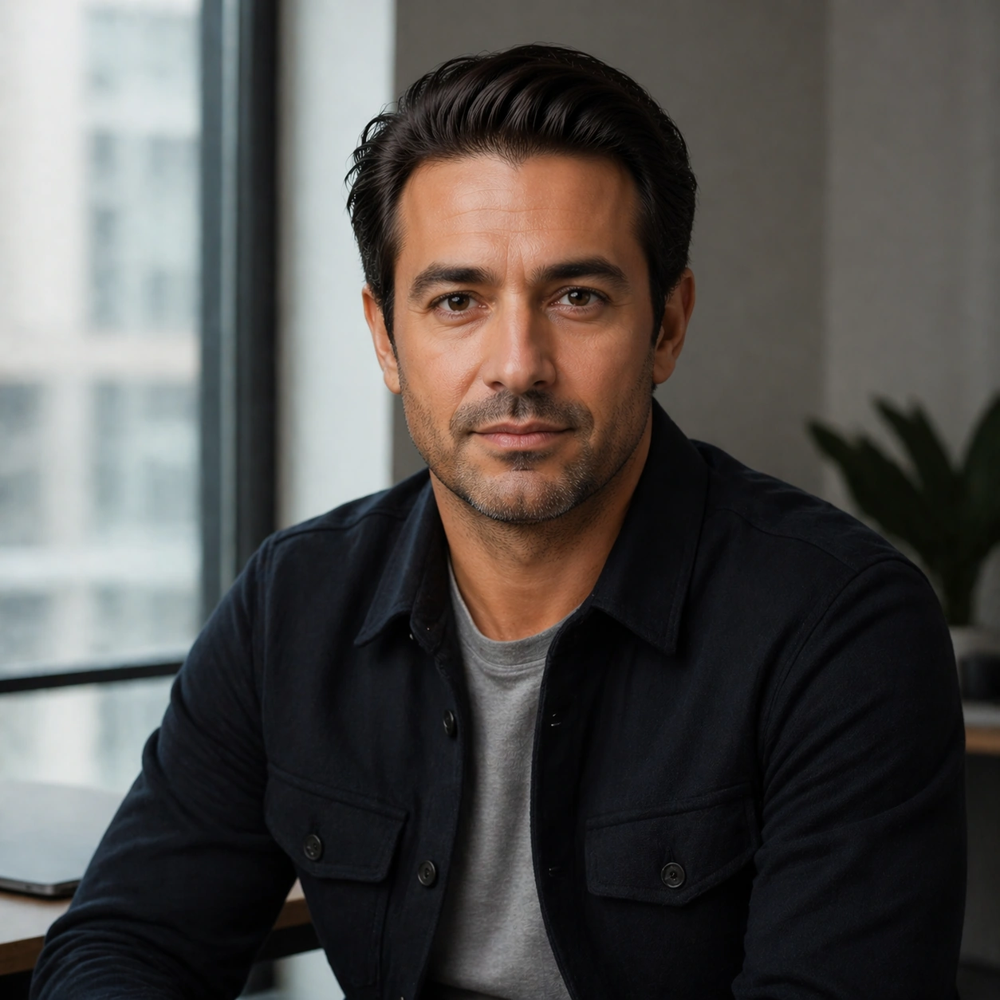

```text
Scene:
A square premium portrait photograph for Founder Headshot Lighting Matrix. Place the subject near a large office window with soft overcast daylight, blurred architectural background, and subtle desk-edge context. Use a medium close documentary-style portrait with believable lens behavior, clean depth separation, natural skin rendering, and controlled tonal range. The light should feel physically plausible rather than synthetic, with enough negative space and environmental context to read like a finished editorial or commercial delivery. Keep the palette, contrast, and production styling aligned with premium executive portrait photography with real studio craft and restrained retouching.

Subject:
Photograph one credible tech founder in the late thirties, with intelligent eyes, medium olive skin, dark brown hair brushed back from a natural hairline, and an understated executive presence. Wardrobe direction: a tailored dark overshirt over a fine gray tee. Pose and expression: seated at an angle with hands loosely together below frame line. The emotional register should feel reflective, articulate, and composed. Preserve exact face / hair base / body proportions from the reference model. Keep the same skin tone family, hairline, age read, and calm underlying temperament even while the styling changes. Preserve the recognizable brow line, eye spacing, nose bridge, mouth shape, jaw rhythm, and body proportions from image 01 while making this frame clearly distinct through scene, lighting, styling, and posture.

Important details:
Business credibility matters more than glamour. Preserve natural skin pore detail, believable tailoring, and real lighting falloff that a photographer could actually build on set. The office environment should support credibility without turning into a set-dressed startup cliché. Keep the light realistic and flattering. The topic dimension is 企业肖像 + 棚拍打光 + 系列一致性. Use the example direction of 同一位 founder 输出 clean white studio、dark tech rim light、warm hospitality portrait 和 editorial black backdrop 四套头像。. The core challenge is 不是普通职业照，而是让不同品牌气质和真实打光都成立，同时保证像同一个人。. Capabilities under test: photorealism, studio-lighting, identity-preservation, commercial-mockup. Success should read as 一眼像真实企业或创始人 headshot 交付; 不同光位之间气质差异清楚，但仍像同一个人; 皮肤、发丝和西装材质自然，不像 AI 磨皮. Address the model gap described as 普通模型容易把商务头像做得过度磨皮、脸型漂移、光位不真实。. Skin texture, fabric texture, hair texture, and catchlight behavior must stay realistic, high-end, and non-plastic.

Use case:
Founder Headshot Lighting Matrix series study 6/9.

Constraints:
No readable text, no watermark, no logos, preserve exact 1:1 aspect ratio, preserve exact face / hair base / body proportions from the reference model, no face drift, no skin-tone drift, no duplicate person, no extra limbs, no AI beauty blur, no warped hands, no accidental collage layout, no readable screens, no visible company logo, no coworker silhouettes, no fake lens flare.
```

[Pinned source](https://github.com/ChaosRealmsAI/gpt-image-2-gallery/blob/5296db8c996e38776c83a0bc8c64f848dcd512b3/works/topics/founder-headshot-lighting-matrix/packages/series-identity-lock/images/06-soft-window-office/meta.json) · GPT Image2 · 1254×1254 · Reference images required. · ProjectD:[published and publicly accepted](https://aitoolsradar.com/en/prompts/bae1632d51794b)

## Seated Thought Leader · founder-headshot-lighting-matrix/series-identity-lock/07-seated-thought-leader

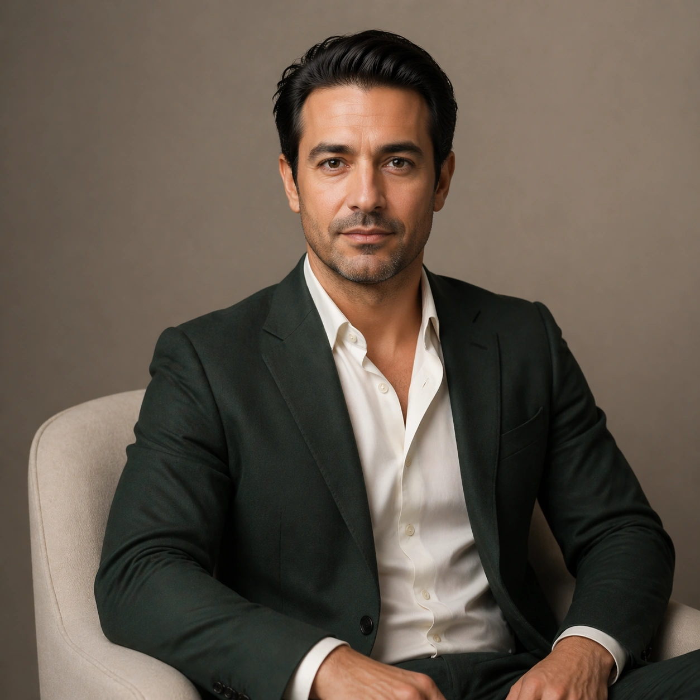

```text
Scene:
A square premium portrait photograph for Founder Headshot Lighting Matrix. Use a studio setup with a simple upholstered chair, soft key light from camera left, and a muted taupe background. Use a waist-up portrait with seated composition with believable lens behavior, clean depth separation, natural skin rendering, and controlled tonal range. The light should feel physically plausible rather than synthetic, with enough negative space and environmental context to read like a finished editorial or commercial delivery. Keep the palette, contrast, and production styling aligned with premium executive portrait photography with real studio craft and restrained retouching.

Subject:
Photograph one credible tech founder in the late thirties, with intelligent eyes, medium olive skin, dark brown hair brushed back from a natural hairline, and an understated executive presence. Wardrobe direction: a dark green suit with an open-neck ivory shirt. Pose and expression: seated upright, one arm resting lightly, shoulders relaxed. The emotional register should feel assured, analytical, and mature. Preserve exact face / hair base / body proportions from the reference model. Keep the same skin tone family, hairline, age read, and calm underlying temperament even while the styling changes. Preserve the recognizable brow line, eye spacing, nose bridge, mouth shape, jaw rhythm, and body proportions from image 01 while making this frame clearly distinct through scene, lighting, styling, and posture.

Important details:
Business credibility matters more than glamour. Preserve natural skin pore detail, believable tailoring, and real lighting falloff that a photographer could actually build on set. The chair is compositional support only. The image must stay portrait-led and not feel like furniture advertising. The topic dimension is 企业肖像 + 棚拍打光 + 系列一致性. Use the example direction of 同一位 founder 输出 clean white studio、dark tech rim light、warm hospitality portrait 和 editorial black backdrop 四套头像。. The core challenge is 不是普通职业照，而是让不同品牌气质和真实打光都成立，同时保证像同一个人。. Capabilities under test: photorealism, studio-lighting, identity-preservation, commercial-mockup. Success should read as 一眼像真实企业或创始人 headshot 交付; 不同光位之间气质差异清楚，但仍像同一个人; 皮肤、发丝和西装材质自然，不像 AI 磨皮. Address the model gap described as 普通模型容易把商务头像做得过度磨皮、脸型漂移、光位不真实。. Skin texture, fabric texture, hair texture, and catchlight behavior must stay realistic, high-end, and non-plastic.

Use case:
Founder Headshot Lighting Matrix series study 7/9.

Constraints:
No readable text, no watermark, no logos, preserve exact 1:1 aspect ratio, preserve exact face / hair base / body proportions from the reference model, no face drift, no skin-tone drift, no duplicate person, no extra limbs, no AI beauty blur, no warped hands, no accidental collage layout, no oversized chair, no crossed-arm stiffness, no power-pose parody, no awkward hand crops.
```

[Pinned source](https://github.com/ChaosRealmsAI/gpt-image-2-gallery/blob/5296db8c996e38776c83a0bc8c64f848dcd512b3/works/topics/founder-headshot-lighting-matrix/packages/series-identity-lock/images/07-seated-thought-leader/meta.json) · GPT Image2 · 1254×1254 · Reference images required. · ProjectD:[published and publicly accepted](https://aitoolsradar.com/en/prompts/cdbfc5c17c34d0)

## Profile Confidence · founder-headshot-lighting-matrix/series-identity-lock/08-profile-confidence

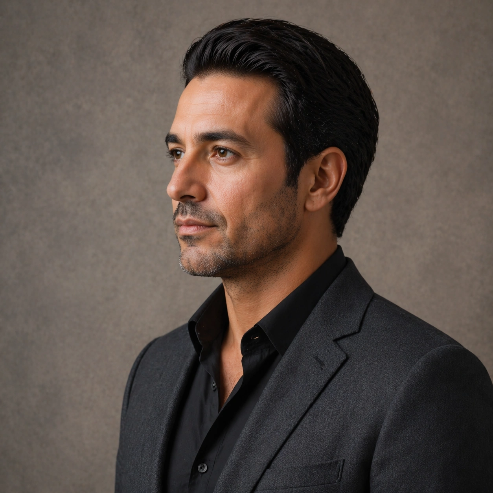

```text
Scene:
A square premium portrait photograph for Founder Headshot Lighting Matrix. Build a neutral studio profile portrait with crisp side key light, subtle fill, and a textured gray-beige backdrop. Use a profile portrait from chest up with believable lens behavior, clean depth separation, natural skin rendering, and controlled tonal range. The light should feel physically plausible rather than synthetic, with enough negative space and environmental context to read like a finished editorial or commercial delivery. Keep the palette, contrast, and production styling aligned with premium executive portrait photography with real studio craft and restrained retouching.

Subject:
Photograph one credible tech founder in the late thirties, with intelligent eyes, medium olive skin, dark brown hair brushed back from a natural hairline, and an understated executive presence. Wardrobe direction: a slate blazer with a black open-neck shirt. Pose and expression: clean side profile with relaxed jaw and poised neck line. The emotional register should feel decisive, self-possessed, and elegant. Preserve exact face / hair base / body proportions from the reference model. Keep the same skin tone family, hairline, age read, and calm underlying temperament even while the styling changes. Preserve the recognizable brow line, eye spacing, nose bridge, mouth shape, jaw rhythm, and body proportions from image 01 while making this frame clearly distinct through scene, lighting, styling, and posture.

Important details:
Business credibility matters more than glamour. Preserve natural skin pore detail, believable tailoring, and real lighting falloff that a photographer could actually build on set. The profile must still unmistakably match the reference identity. Hairline, ear shape, nose bridge, and jaw rhythm need consistency. The topic dimension is 企业肖像 + 棚拍打光 + 系列一致性. Use the example direction of 同一位 founder 输出 clean white studio、dark tech rim light、warm hospitality portrait 和 editorial black backdrop 四套头像。. The core challenge is 不是普通职业照，而是让不同品牌气质和真实打光都成立，同时保证像同一个人。. Capabilities under test: photorealism, studio-lighting, identity-preservation, commercial-mockup. Success should read as 一眼像真实企业或创始人 headshot 交付; 不同光位之间气质差异清楚，但仍像同一个人; 皮肤、发丝和西装材质自然，不像 AI 磨皮. Address the model gap described as 普通模型容易把商务头像做得过度磨皮、脸型漂移、光位不真实。. Skin texture, fabric texture, hair texture, and catchlight behavior must stay realistic, high-end, and non-plastic.

Use case:
Founder Headshot Lighting Matrix series study 8/9.

Constraints:
No readable text, no watermark, no logos, preserve exact 1:1 aspect ratio, preserve exact face / hair base / body proportions from the reference model, no face drift, no skin-tone drift, no duplicate person, no extra limbs, no AI beauty blur, no warped hands, no accidental collage layout, no caricature profile, no exaggerated nose bridge, no over-sharpened hair edges, no empty mannequin feeling.
```

[Pinned source](https://github.com/ChaosRealmsAI/gpt-image-2-gallery/blob/5296db8c996e38776c83a0bc8c64f848dcd512b3/works/topics/founder-headshot-lighting-matrix/packages/series-identity-lock/images/08-profile-confidence/meta.json) · GPT Image2 · 1254×1254 · Reference images required. · ProjectD:[published and publicly accepted](https://aitoolsradar.com/en/prompts/bb7e1feff56f3e)

## Founder Casual Finish · founder-headshot-lighting-matrix/series-identity-lock/09-founder-casual-finish

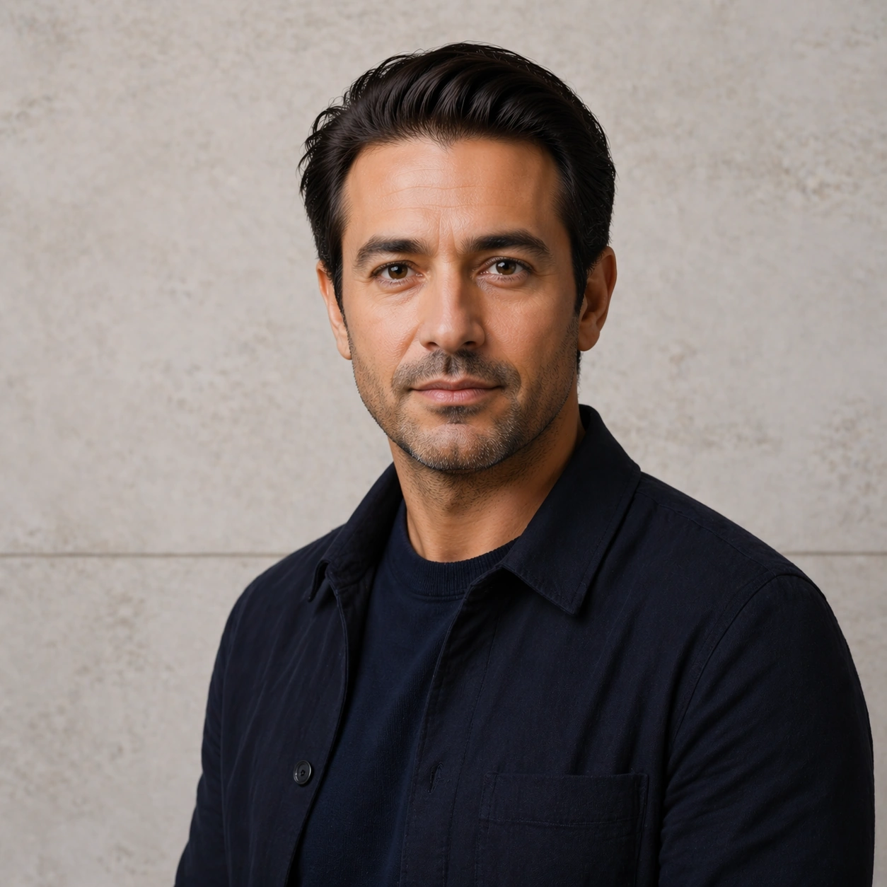

```text
Scene:
A square premium portrait photograph for Founder Headshot Lighting Matrix. Photograph the subject against a pale stone backdrop with broad soft light, gentle shadow wrap, and natural color contrast. Use a relaxed medium close crop with believable lens behavior, clean depth separation, natural skin rendering, and controlled tonal range. The light should feel physically plausible rather than synthetic, with enough negative space and environmental context to read like a finished editorial or commercial delivery. Keep the palette, contrast, and production styling aligned with premium executive portrait photography with real studio craft and restrained retouching.

Subject:
Photograph one credible tech founder in the late thirties, with intelligent eyes, medium olive skin, dark brown hair brushed back from a natural hairline, and an understated executive presence. Wardrobe direction: a dark merino crewneck layered under a lightweight navy overshirt. Pose and expression: easy posture with a subtle smile and slight body turn. The emotional register should feel smart, warm, and quietly charismatic. Preserve exact face / hair base / body proportions from the reference model. Keep the same skin tone family, hairline, age read, and calm underlying temperament even while the styling changes. Preserve the recognizable brow line, eye spacing, nose bridge, mouth shape, jaw rhythm, and body proportions from image 01 while making this frame clearly distinct through scene, lighting, styling, and posture.

Important details:
Business credibility matters more than glamour. Preserve natural skin pore detail, believable tailoring, and real lighting falloff that a photographer could actually build on set. This image should feel most human and least corporate while still belonging to the same premium portrait session. The topic dimension is 企业肖像 + 棚拍打光 + 系列一致性. Use the example direction of 同一位 founder 输出 clean white studio、dark tech rim light、warm hospitality portrait 和 editorial black backdrop 四套头像。. The core challenge is 不是普通职业照，而是让不同品牌气质和真实打光都成立，同时保证像同一个人。. Capabilities under test: photorealism, studio-lighting, identity-preservation, commercial-mockup. Success should read as 一眼像真实企业或创始人 headshot 交付; 不同光位之间气质差异清楚，但仍像同一个人; 皮肤、发丝和西装材质自然，不像 AI 磨皮. Address the model gap described as 普通模型容易把商务头像做得过度磨皮、脸型漂移、光位不真实。. Skin texture, fabric texture, hair texture, and catchlight behavior must stay realistic, high-end, and non-plastic.

Use case:
Founder Headshot Lighting Matrix series study 9/9.

Constraints:
No readable text, no watermark, no logos, preserve exact 1:1 aspect ratio, preserve exact face / hair base / body proportions from the reference model, no face drift, no skin-tone drift, no duplicate person, no extra limbs, no AI beauty blur, no warped hands, no accidental collage layout, no hoodie startup cliché, no lifestyle chaos, no loud props, no influencer selfie energy.
```

[Pinned source](https://github.com/ChaosRealmsAI/gpt-image-2-gallery/blob/5296db8c996e38776c83a0bc8c64f848dcd512b3/works/topics/founder-headshot-lighting-matrix/packages/series-identity-lock/images/09-founder-casual-finish/meta.json) · GPT Image2 · 1254×1254 · Reference images required. · ProjectD:[published and publicly accepted](https://aitoolsradar.com/en/prompts/7d4a19ec06b5d4)

## Reference Anchor · four-panel-gag-sequence/series-core-system/01-reference-anchor

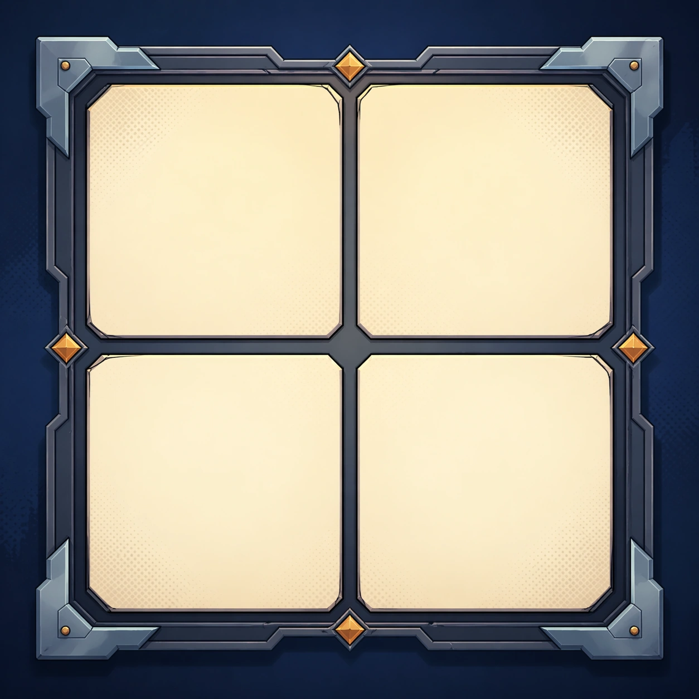

```text
Scene:
Create a square reference image for Four-Panel Gag Sequence. Build a reference anchor establishing the core system with a premium, production-ready finish. Use a polished modular board or campaign surface with clean spacing, premium game-UI finish, and clear focal hierarchy. The composition should feel intentional, clean, and reusable for gallery, research, campaign, or internal handoff contexts. Lighting must support readability first, with the main forms clearly separated from the background and enough breathing room for the system to stay legible at both hero scale and thumbnail scale.

Subject:
Center a coherent original game-art system built for premium production and marketing surfaces. For this image, focus on reference anchor. Keep the same system logic stable across screenshots, cards, banners, and overview boards. This image is the canonical anchor that later series images must follow. The viewer should immediately understand what role this surface plays inside a cohesive game-production asset pack.

Important details:
Lock framing, icon grammar, palette blocking, and surface hierarchy so the kit feels production-ready and consistent. Preserve the core silhouette, framing language, and material logic from the reference image while each variation changes function. Keep materials believable, edge hierarchy disciplined, and the visual language consistent with 4-Panel Gag. Use abstract interface blocks or diagram accents when helpful, but avoid any readable language. The final result should feel like a deliberate production asset rather than a random illustration.

Use case:
Four-Panel Gag Sequence series study 1/9, designed as reference anchor within a cohesive asset pack.

Constraints:
No readable text, no watermark, no logos, preserve exact 1:1 aspect ratio, no unrelated objects, no broken visual hierarchy, no malformed anatomy or broken perspective, no random decorative clutter.
```

[Pinned source](https://github.com/ChaosRealmsAI/gpt-image-2-gallery/blob/5296db8c996e38776c83a0bc8c64f848dcd512b3/works/topics/four-panel-gag-sequence/packages/series-core-system/images/01-reference-anchor/meta.json) · GPT Image2 · 1254×1254 · No source-declared image dependencies. · ProjectD:[published and publicly accepted](https://aitoolsradar.com/en/prompts/98bd8136631511)

## Variant One · four-panel-gag-sequence/series-core-system/02-variant-one


```text
Scene:
Create a square dependent image for Four-Panel Gag Sequence. Build a first controlled variation in the same system with a premium, production-ready finish. Use a polished modular board or campaign surface with clean spacing, premium game-UI finish, and clear focal hierarchy. The composition should feel intentional, clean, and reusable for gallery, research, campaign, or internal handoff contexts. Lighting must support readability first, with the main forms clearly separated from the background and enough breathing room for the system to stay legible at both hero scale and thumbnail scale.

Subject:
Center a coherent original game-art system built for premium production and marketing surfaces. For this image, focus on the intended support surface. Keep the same system logic stable across screenshots, cards, banners, and overview boards. Preserve exact identity or system logic from the reference image while changing only the intended variation axis. The viewer should immediately understand what role this surface plays inside a cohesive game-production asset pack.

Important details:
Lock framing, icon grammar, palette blocking, and surface hierarchy so the kit feels production-ready and consistent. Preserve the core silhouette, framing language, and material logic from the reference image while each variation changes function. Keep materials believable, edge hierarchy disciplined, and the visual language consistent with 4-Panel Gag. Use abstract interface blocks or diagram accents when helpful, but avoid any readable language. The final result should feel like a deliberate production asset rather than a random illustration.

Use case:
Four-Panel Gag Sequence series study 2/9, designed as variant one within a cohesive asset pack.

Constraints:
No readable text, no watermark, no logos, preserve exact 1:1 aspect ratio, no unrelated objects, no broken visual hierarchy, no malformed anatomy or broken perspective, no random decorative clutter.
```

[Pinned source](https://github.com/ChaosRealmsAI/gpt-image-2-gallery/blob/5296db8c996e38776c83a0bc8c64f848dcd512b3/works/topics/four-panel-gag-sequence/packages/series-core-system/images/02-variant-one/meta.json) · GPT Image2 · 1254×1254 · Reference images required. · ProjectD:[published and publicly accepted](https://aitoolsradar.com/en/prompts/dbec6821aaf71e)

## Variant Two · four-panel-gag-sequence/series-core-system/03-variant-two


```text
Scene:
Create a square dependent image for Four-Panel Gag Sequence. Build a second controlled variation in the same system with a premium, production-ready finish. Use a polished modular board or campaign surface with clean spacing, premium game-UI finish, and clear focal hierarchy. The composition should feel intentional, clean, and reusable for gallery, research, campaign, or internal handoff contexts. Lighting must support readability first, with the main forms clearly separated from the background and enough breathing room for the system to stay legible at both hero scale and thumbnail scale.

Subject:
Center a coherent original game-art system built for premium production and marketing surfaces. For this image, focus on the intended support surface. Keep the same system logic stable across screenshots, cards, banners, and overview boards. Preserve exact identity or system logic from the reference image while changing only the intended variation axis. The viewer should immediately understand what role this surface plays inside a cohesive game-production asset pack.

Important details:
Lock framing, icon grammar, palette blocking, and surface hierarchy so the kit feels production-ready and consistent. Preserve the core silhouette, framing language, and material logic from the reference image while each variation changes function. Keep materials believable, edge hierarchy disciplined, and the visual language consistent with 4-Panel Gag. Use abstract interface blocks or diagram accents when helpful, but avoid any readable language. The final result should feel like a deliberate production asset rather than a random illustration.

Use case:
Four-Panel Gag Sequence series study 3/9, designed as variant two within a cohesive asset pack.

Constraints:
No readable text, no watermark, no logos, preserve exact 1:1 aspect ratio, no unrelated objects, no broken visual hierarchy, no malformed anatomy or broken perspective, no random decorative clutter.
```

[Pinned source](https://github.com/ChaosRealmsAI/gpt-image-2-gallery/blob/5296db8c996e38776c83a0bc8c64f848dcd512b3/works/topics/four-panel-gag-sequence/packages/series-core-system/images/03-variant-two/meta.json) · GPT Image2 · 1254×1254 · Reference images required. · ProjectD:[published and publicly accepted](https://aitoolsradar.com/en/prompts/f9f76dd14bea92)

## Variant Three · four-panel-gag-sequence/series-core-system/04-variant-three


```text
Scene:
Create a square dependent image for Four-Panel Gag Sequence. Build a third controlled variation in the same system with a premium, production-ready finish. Use a polished modular board or campaign surface with clean spacing, premium game-UI finish, and clear focal hierarchy. The composition should feel intentional, clean, and reusable for gallery, research, campaign, or internal handoff contexts. Lighting must support readability first, with the main forms clearly separated from the background and enough breathing room for the system to stay legible at both hero scale and thumbnail scale.

Subject:
Center a coherent original game-art system built for premium production and marketing surfaces. For this image, focus on the intended support surface. Keep the same system logic stable across screenshots, cards, banners, and overview boards. Preserve exact identity or system logic from the reference image while changing only the intended variation axis. The viewer should immediately understand what role this surface plays inside a cohesive game-production asset pack.

Important details:
Lock framing, icon grammar, palette blocking, and surface hierarchy so the kit feels production-ready and consistent. Preserve the core silhouette, framing language, and material logic from the reference image while each variation changes function. Keep materials believable, edge hierarchy disciplined, and the visual language consistent with 4-Panel Gag. Use abstract interface blocks or diagram accents when helpful, but avoid any readable language. The final result should feel like a deliberate production asset rather than a random illustration.

Use case:
Four-Panel Gag Sequence series study 4/9, designed as variant three within a cohesive asset pack.

Constraints:
No readable text, no watermark, no logos, preserve exact 1:1 aspect ratio, no unrelated objects, no broken visual hierarchy, no malformed anatomy or broken perspective, no random decorative clutter.
```

[Pinned source](https://github.com/ChaosRealmsAI/gpt-image-2-gallery/blob/5296db8c996e38776c83a0bc8c64f848dcd512b3/works/topics/four-panel-gag-sequence/packages/series-core-system/images/04-variant-three/meta.json) · GPT Image2 · 1254×1254 · Reference images required. · ProjectD:[published and publicly accepted](https://aitoolsradar.com/en/prompts/186fdf13991c17)

## Support One · four-panel-gag-sequence/single-support-studies/support-one

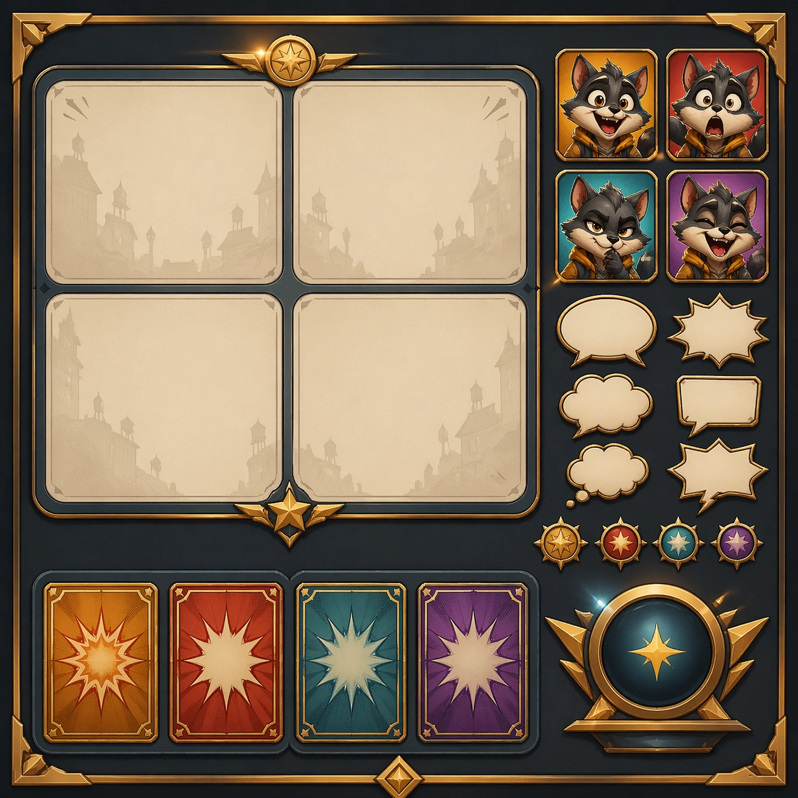

```text
Scene:
Create a square standalone support image for Four-Panel Gag Sequence. Build a support-surface study with a clear focal hierarchy and a finished professional surface. Use a polished modular board or campaign surface with clean spacing, premium game-UI finish, and clear focal hierarchy. The frame should feel self-contained and polished, with enough structure to explain the system even without the reference series, yet still obviously belonging to the same theme and production world.

Subject:
Show a coherent original game-art system built for premium production and marketing surfaces in a way that emphasizes the intended support surface. Keep the same system logic stable across screenshots, cards, banners, and overview boards. Even though this image is independent, the viewer should still recognize the same universe, same commercial logic, and same production intent as the core package.

Important details:
Lock framing, icon grammar, palette blocking, and surface hierarchy so the kit feels production-ready and consistent. Preserve the broader theme language through color, framing, material choices, and modular composition. Use clean panel rhythm, premium asset presentation, and believable detail density. The image should work equally well as a gallery study, research reference, and mock production deliverable.

Use case:
Four-Panel Gag Sequence single study 5/9, exploring support one as a support surface.

Constraints:
No readable text, no watermark, no logos, preserve exact 1:1 aspect ratio, no unrelated objects, no broken visual hierarchy, no visual noise that obscures the main surface, no accidental brand resemblance.
```

[Pinned source](https://github.com/ChaosRealmsAI/gpt-image-2-gallery/blob/5296db8c996e38776c83a0bc8c64f848dcd512b3/works/topics/four-panel-gag-sequence/packages/single-support-studies/images/support-one/meta.json) · GPT Image2 · 1254×1254 · No source-declared image dependencies. · ProjectD:[published and publicly accepted](https://aitoolsradar.com/en/prompts/816d706d18d266)

## Support Two · four-panel-gag-sequence/single-support-studies/support-two

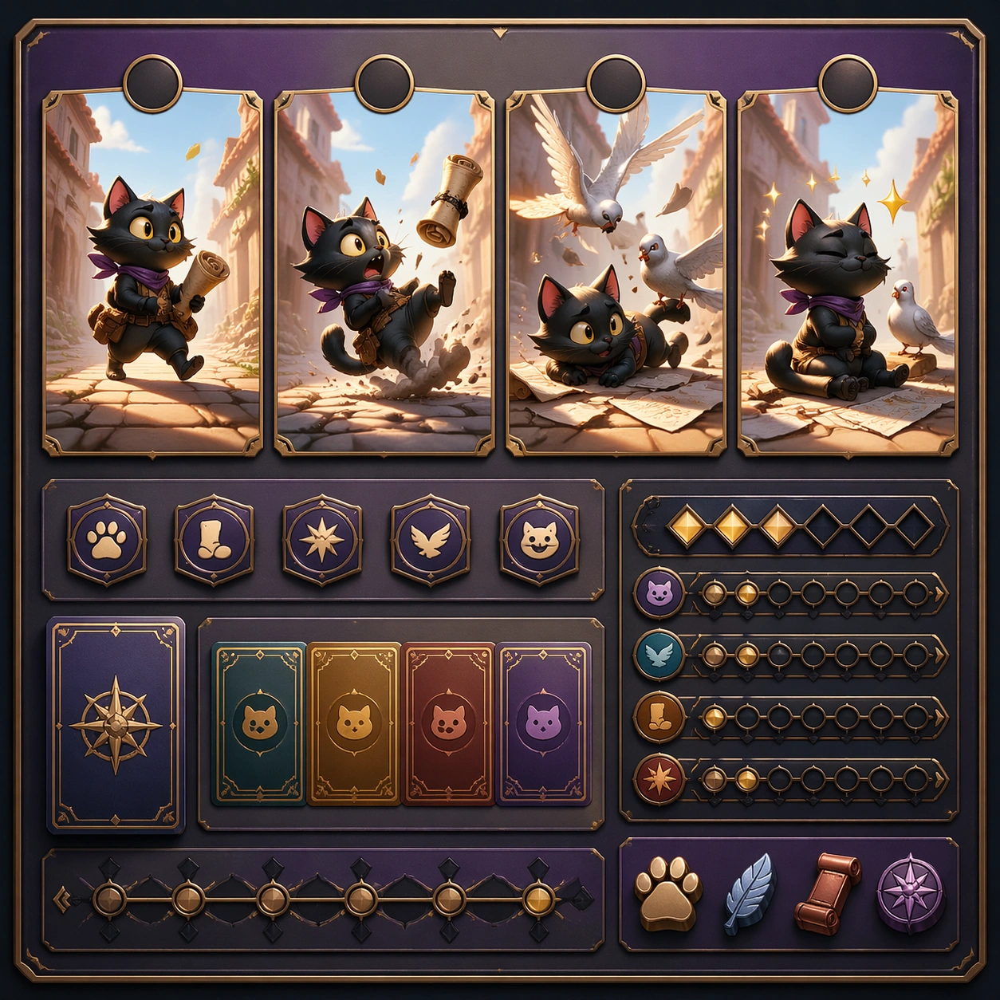

```text
Scene:
Create a square standalone support image for Four-Panel Gag Sequence. Build a second support-surface study with a clear focal hierarchy and a finished professional surface. Use a polished modular board or campaign surface with clean spacing, premium game-UI finish, and clear focal hierarchy. The frame should feel self-contained and polished, with enough structure to explain the system even without the reference series, yet still obviously belonging to the same theme and production world.

Subject:
Show a coherent original game-art system built for premium production and marketing surfaces in a way that emphasizes the intended support surface. Keep the same system logic stable across screenshots, cards, banners, and overview boards. Even though this image is independent, the viewer should still recognize the same universe, same commercial logic, and same production intent as the core package.

Important details:
Lock framing, icon grammar, palette blocking, and surface hierarchy so the kit feels production-ready and consistent. Preserve the broader theme language through color, framing, material choices, and modular composition. Use clean panel rhythm, premium asset presentation, and believable detail density. The image should work equally well as a gallery study, research reference, and mock production deliverable.

Use case:
Four-Panel Gag Sequence single study 6/9, exploring support two as a support surface.

Constraints:
No readable text, no watermark, no logos, preserve exact 1:1 aspect ratio, no unrelated objects, no broken visual hierarchy, no visual noise that obscures the main surface, no accidental brand resemblance.
```

[Pinned source](https://github.com/ChaosRealmsAI/gpt-image-2-gallery/blob/5296db8c996e38776c83a0bc8c64f848dcd512b3/works/topics/four-panel-gag-sequence/packages/single-support-studies/images/support-two/meta.json) · GPT Image2 · 1254×1254 · No source-declared image dependencies. · ProjectD:[published and publicly accepted](https://aitoolsradar.com/en/prompts/3008cfc3a84df1)

## Support Three · four-panel-gag-sequence/single-support-studies/support-three

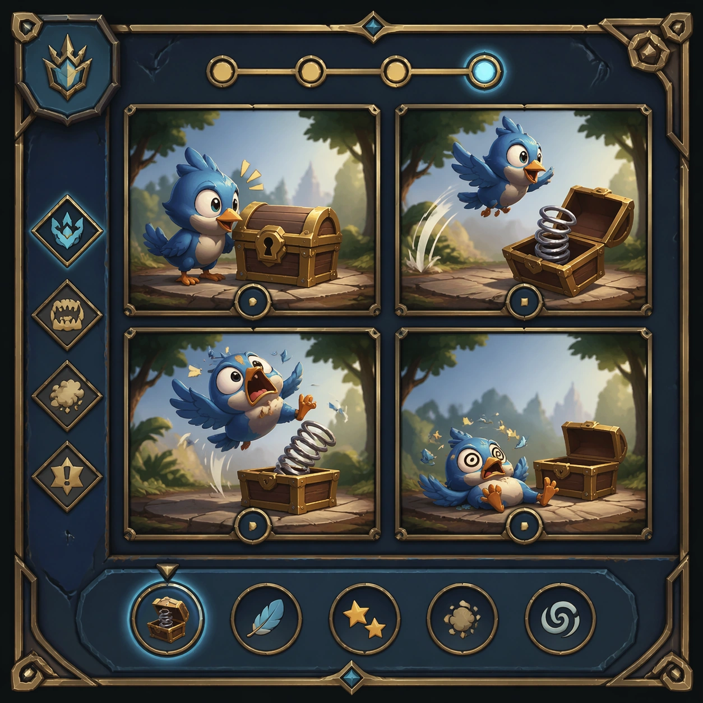

```text
Scene:
Create a square standalone support image for Four-Panel Gag Sequence. Build a third support-surface study with a clear focal hierarchy and a finished professional surface. Use a polished modular board or campaign surface with clean spacing, premium game-UI finish, and clear focal hierarchy. The frame should feel self-contained and polished, with enough structure to explain the system even without the reference series, yet still obviously belonging to the same theme and production world.

Subject:
Show a coherent original game-art system built for premium production and marketing surfaces in a way that emphasizes the intended support surface. Keep the same system logic stable across screenshots, cards, banners, and overview boards. Even though this image is independent, the viewer should still recognize the same universe, same commercial logic, and same production intent as the core package.

Important details:
Lock framing, icon grammar, palette blocking, and surface hierarchy so the kit feels production-ready and consistent. Preserve the broader theme language through color, framing, material choices, and modular composition. Use clean panel rhythm, premium asset presentation, and believable detail density. The image should work equally well as a gallery study, research reference, and mock production deliverable.

Use case:
Four-Panel Gag Sequence single study 7/9, exploring support three as a support surface.

Constraints:
No readable text, no watermark, no logos, preserve exact 1:1 aspect ratio, no unrelated objects, no broken visual hierarchy, no visual noise that obscures the main surface, no accidental brand resemblance.
```

[Pinned source](https://github.com/ChaosRealmsAI/gpt-image-2-gallery/blob/5296db8c996e38776c83a0bc8c64f848dcd512b3/works/topics/four-panel-gag-sequence/packages/single-support-studies/images/support-three/meta.json) · GPT Image2 · 1254×1254 · No source-declared image dependencies. · ProjectD:[published and publicly accepted](https://aitoolsradar.com/en/prompts/d74814cdaaa2f8)

## Support Four · four-panel-gag-sequence/single-support-studies/support-four

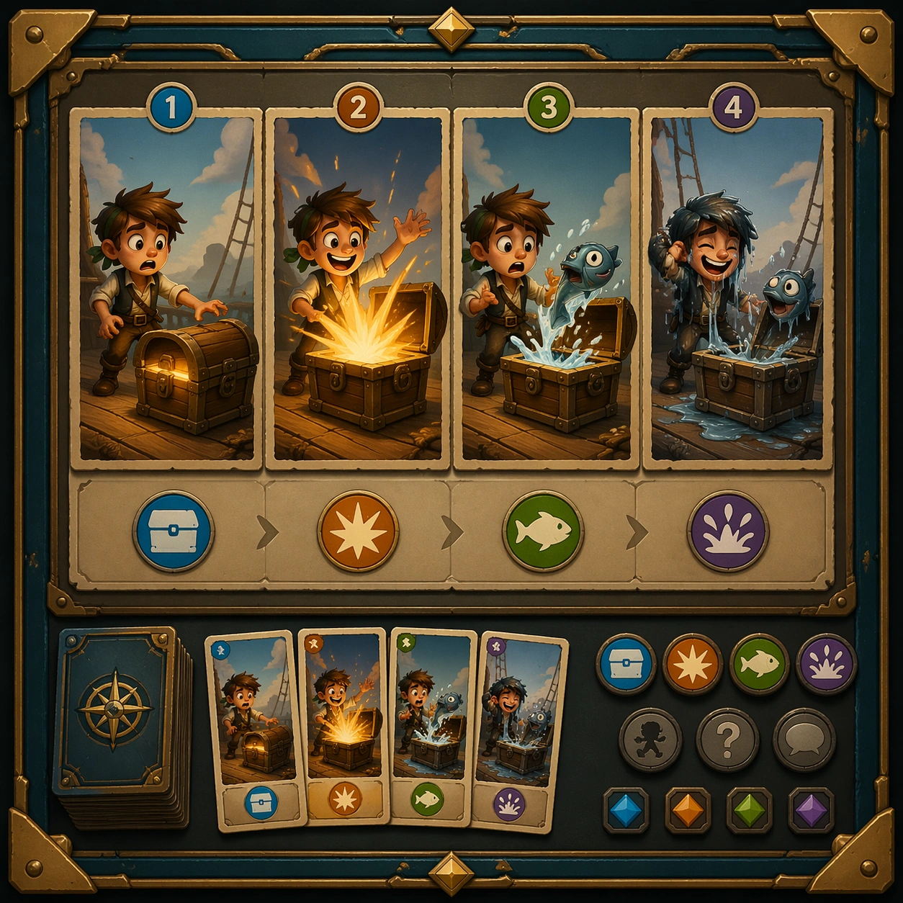

```text
Scene:
Create a square standalone support image for Four-Panel Gag Sequence. Build a fourth support-surface study with a clear focal hierarchy and a finished professional surface. Use a polished modular board or campaign surface with clean spacing, premium game-UI finish, and clear focal hierarchy. The frame should feel self-contained and polished, with enough structure to explain the system even without the reference series, yet still obviously belonging to the same theme and production world.

Subject:
Show a coherent original game-art system built for premium production and marketing surfaces in a way that emphasizes the intended support surface. Keep the same system logic stable across screenshots, cards, banners, and overview boards. Even though this image is independent, the viewer should still recognize the same universe, same commercial logic, and same production intent as the core package.

Important details:
Lock framing, icon grammar, palette blocking, and surface hierarchy so the kit feels production-ready and consistent. Preserve the broader theme language through color, framing, material choices, and modular composition. Use clean panel rhythm, premium asset presentation, and believable detail density. The image should work equally well as a gallery study, research reference, and mock production deliverable.

Use case:
Four-Panel Gag Sequence single study 8/9, exploring support four as a support surface.

Constraints:
No readable text, no watermark, no logos, preserve exact 1:1 aspect ratio, no unrelated objects, no broken visual hierarchy, no visual noise that obscures the main surface, no accidental brand resemblance.
```

[Pinned source](https://github.com/ChaosRealmsAI/gpt-image-2-gallery/blob/5296db8c996e38776c83a0bc8c64f848dcd512b3/works/topics/four-panel-gag-sequence/packages/single-support-studies/images/support-four/meta.json) · GPT Image2 · 1254×1254 · No source-declared image dependencies. · ProjectD:[published and publicly accepted](https://aitoolsradar.com/en/prompts/40e0d800a71251)

## Support Five · four-panel-gag-sequence/single-support-studies/support-five

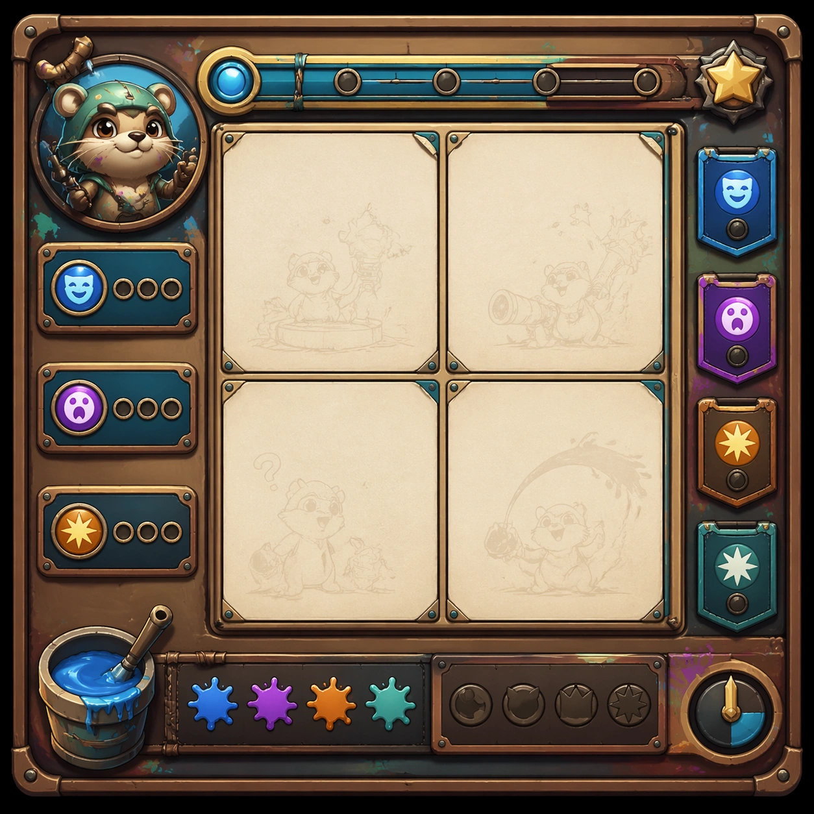

```text
Scene:
Create a square standalone support image for Four-Panel Gag Sequence. Build a fifth support-surface study with a clear focal hierarchy and a finished professional surface. Use a polished modular board or campaign surface with clean spacing, premium game-UI finish, and clear focal hierarchy. The frame should feel self-contained and polished, with enough structure to explain the system even without the reference series, yet still obviously belonging to the same theme and production world.

Subject:
Show a coherent original game-art system built for premium production and marketing surfaces in a way that emphasizes the intended support surface. Keep the same system logic stable across screenshots, cards, banners, and overview boards. Even though this image is independent, the viewer should still recognize the same universe, same commercial logic, and same production intent as the core package.

Important details:
Lock framing, icon grammar, palette blocking, and surface hierarchy so the kit feels production-ready and consistent. Preserve the broader theme language through color, framing, material choices, and modular composition. Use clean panel rhythm, premium asset presentation, and believable detail density. The image should work equally well as a gallery study, research reference, and mock production deliverable.

Use case:
Four-Panel Gag Sequence single study 9/9, exploring support five as a support surface.

Constraints:
No readable text, no watermark, no logos, preserve exact 1:1 aspect ratio, no unrelated objects, no broken visual hierarchy, no visual noise that obscures the main surface, no accidental brand resemblance.
```

[Pinned source](https://github.com/ChaosRealmsAI/gpt-image-2-gallery/blob/5296db8c996e38776c83a0bc8c64f848dcd512b3/works/topics/four-panel-gag-sequence/packages/single-support-studies/images/support-five/meta.json) · GPT Image2 · 1254×1254 · No source-declared image dependencies. · ProjectD:[published and publicly accepted](https://aitoolsradar.com/en/prompts/4d03567936e37c)

## Hero Study · fractal-generative-art/single-fractal-generative-art-studies/hero-study


```text
Scene:
A square, exhibition-ready image with disciplined composition, coherent lighting, and an immediately readable central idea. Build the frame around the clearest possible statement of the topic. Keep the lighting, camera distance, and spatial organization tuned for a high-signal research image rather than a casual snapshot. The image belongs to the Fractal Generative Art theme and should feel immediately legible as a prompt atlas theme for fractal generative art, testing frontier-creative-composition with gpt image 2..

Subject:
Center the study on the clearest possible statement of the topic. Translate the theme into a concrete visual statement instead of an abstract mood board: the viewer should understand what kind of image this is, what is being tested, and why the composition is difficult. Use the slug idea of fractal generative art as a literal guide for subject matter, materials, and staging. If helpful, borrow the broad visual cues suggested by Mandelbrot, Voronoi, Flow field, Reaction-diffusion, L-system, but keep the result original and specific to this study.

Important details:
The result should look intentional and technically difficult, with enough structure and material clarity to hold up under close inspection. Preserve a disciplined square composition, clear focal hierarchy, and enough secondary information to make the image feel complete rather than underspecified. The image should look polished, novel, and exhibition-ready, with topic-specific credibility coming from the way surfaces, structure, and visual language reinforce Fractal Generative Art. Avoid generic filler elements that do not serve the main concept.

Use case:
Fractal Generative Art single study 1/8, testing frontier-creative-composition through the hero study variation.

Constraints:
No readable text, no watermark, no logos, preserve exact 1:1 aspect ratio, no readable text, no watermark, no logos, no generic stock-photo staging, no broken composition, no muddy subject hierarchy.
```

[Pinned source](https://github.com/ChaosRealmsAI/gpt-image-2-gallery/blob/5296db8c996e38776c83a0bc8c64f848dcd512b3/works/topics/fractal-generative-art/packages/single-fractal-generative-art-studies/images/hero-study/meta.json) · GPT Image2 · 1254×1254 · No source-declared image dependencies. · ProjectD:[published and publicly accepted](https://aitoolsradar.com/en/prompts/2f7013a4ccfe53)

## Variant Study · fractal-generative-art/single-fractal-generative-art-studies/variant-study

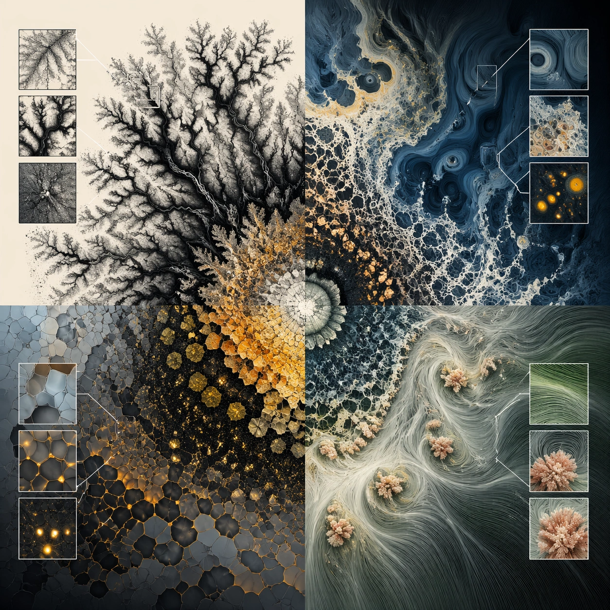

```text
Scene:
A square, exhibition-ready image with disciplined composition, coherent lighting, and an immediately readable central idea. Build the frame around a second angle that tests the idea under different conditions. Keep the lighting, camera distance, and spatial organization tuned for a high-signal research image rather than a casual snapshot. The image belongs to the Fractal Generative Art theme and should feel immediately legible as a prompt atlas theme for fractal generative art, testing frontier-creative-composition with gpt image 2..

Subject:
Center the study on a second angle that tests the idea under different conditions. Translate the theme into a concrete visual statement instead of an abstract mood board: the viewer should understand what kind of image this is, what is being tested, and why the composition is difficult. Use the slug idea of fractal generative art as a literal guide for subject matter, materials, and staging. If helpful, borrow the broad visual cues suggested by Mandelbrot, Voronoi, Flow field, Reaction-diffusion, L-system, but keep the result original and specific to this study.

Important details:
The result should look intentional and technically difficult, with enough structure and material clarity to hold up under close inspection. Preserve a disciplined square composition, clear focal hierarchy, and enough secondary information to make the image feel complete rather than underspecified. The image should look polished, novel, and exhibition-ready, with topic-specific credibility coming from the way surfaces, structure, and visual language reinforce Fractal Generative Art. Avoid generic filler elements that do not serve the main concept.

Use case:
Fractal Generative Art single study 2/8, testing frontier-creative-composition through the variant study variation.

Constraints:
No readable text, no watermark, no logos, preserve exact 1:1 aspect ratio, no readable text, no watermark, no logos, no generic stock-photo staging, no broken composition, no muddy subject hierarchy.
```

[Pinned source](https://github.com/ChaosRealmsAI/gpt-image-2-gallery/blob/5296db8c996e38776c83a0bc8c64f848dcd512b3/works/topics/fractal-generative-art/packages/single-fractal-generative-art-studies/images/variant-study/meta.json) · GPT Image2 · 1254×1254 · No source-declared image dependencies. · ProjectD:[published and publicly accepted](https://aitoolsradar.com/en/prompts/d226fa243c9cea)

## Process Study · fractal-generative-art/single-fractal-generative-art-studies/process-study

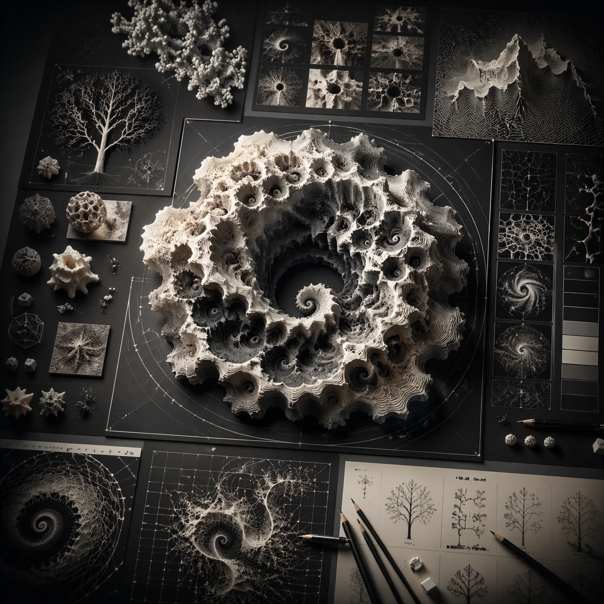

```text
Scene:
A square, exhibition-ready image with disciplined composition, coherent lighting, and an immediately readable central idea. Build the frame around visible traces of making, transformation, or staging. Keep the lighting, camera distance, and spatial organization tuned for a high-signal research image rather than a casual snapshot. The image belongs to the Fractal Generative Art theme and should feel immediately legible as a prompt atlas theme for fractal generative art, testing frontier-creative-composition with gpt image 2..

Subject:
Center the study on visible traces of making, transformation, or staging. Translate the theme into a concrete visual statement instead of an abstract mood board: the viewer should understand what kind of image this is, what is being tested, and why the composition is difficult. Use the slug idea of fractal generative art as a literal guide for subject matter, materials, and staging. If helpful, borrow the broad visual cues suggested by Mandelbrot, Voronoi, Flow field, Reaction-diffusion, L-system, but keep the result original and specific to this study.

Important details:
The result should look intentional and technically difficult, with enough structure and material clarity to hold up under close inspection. Preserve a disciplined square composition, clear focal hierarchy, and enough secondary information to make the image feel complete rather than underspecified. The image should look polished, novel, and exhibition-ready, with topic-specific credibility coming from the way surfaces, structure, and visual language reinforce Fractal Generative Art. Avoid generic filler elements that do not serve the main concept.

Use case:
Fractal Generative Art single study 3/8, testing frontier-creative-composition through the process study variation.

Constraints:
No readable text, no watermark, no logos, preserve exact 1:1 aspect ratio, no readable text, no watermark, no logos, no generic stock-photo staging, no broken composition, no muddy subject hierarchy.
```

[Pinned source](https://github.com/ChaosRealmsAI/gpt-image-2-gallery/blob/5296db8c996e38776c83a0bc8c64f848dcd512b3/works/topics/fractal-generative-art/packages/single-fractal-generative-art-studies/images/process-study/meta.json) · GPT Image2 · 1254×1254 · No source-declared image dependencies. · ProjectD:[published and publicly accepted](https://aitoolsradar.com/en/prompts/003f172a0a4a8a)

## Detail Study · fractal-generative-art/single-fractal-generative-art-studies/detail-study


```text
Scene:
A square, exhibition-ready image with disciplined composition, coherent lighting, and an immediately readable central idea. Build the frame around close attention to one crucial part of the visual system. Keep the lighting, camera distance, and spatial organization tuned for a high-signal research image rather than a casual snapshot. The image belongs to the Fractal Generative Art theme and should feel immediately legible as a prompt atlas theme for fractal generative art, testing frontier-creative-composition with gpt image 2..

Subject:
Center the study on close attention to one crucial part of the visual system. Translate the theme into a concrete visual statement instead of an abstract mood board: the viewer should understand what kind of image this is, what is being tested, and why the composition is difficult. Use the slug idea of fractal generative art as a literal guide for subject matter, materials, and staging. If helpful, borrow the broad visual cues suggested by Mandelbrot, Voronoi, Flow field, Reaction-diffusion, L-system, but keep the result original and specific to this study.

Important details:
The result should look intentional and technically difficult, with enough structure and material clarity to hold up under close inspection. Preserve a disciplined square composition, clear focal hierarchy, and enough secondary information to make the image feel complete rather than underspecified. The image should look polished, novel, and exhibition-ready, with topic-specific credibility coming from the way surfaces, structure, and visual language reinforce Fractal Generative Art. Avoid generic filler elements that do not serve the main concept.

Use case:
Fractal Generative Art single study 4/8, testing frontier-creative-composition through the detail study variation.

Constraints:
No readable text, no watermark, no logos, preserve exact 1:1 aspect ratio, no readable text, no watermark, no logos, no generic stock-photo staging, no broken composition, no muddy subject hierarchy.
```

[Pinned source](https://github.com/ChaosRealmsAI/gpt-image-2-gallery/blob/5296db8c996e38776c83a0bc8c64f848dcd512b3/works/topics/fractal-generative-art/packages/single-fractal-generative-art-studies/images/detail-study/meta.json) · GPT Image2 · 1254×1254 · No source-declared image dependencies. · ProjectD:[published and publicly accepted](https://aitoolsradar.com/en/prompts/85f00ce956f836)

## Environment Study · fractal-generative-art/single-fractal-generative-art-studies/environment-study

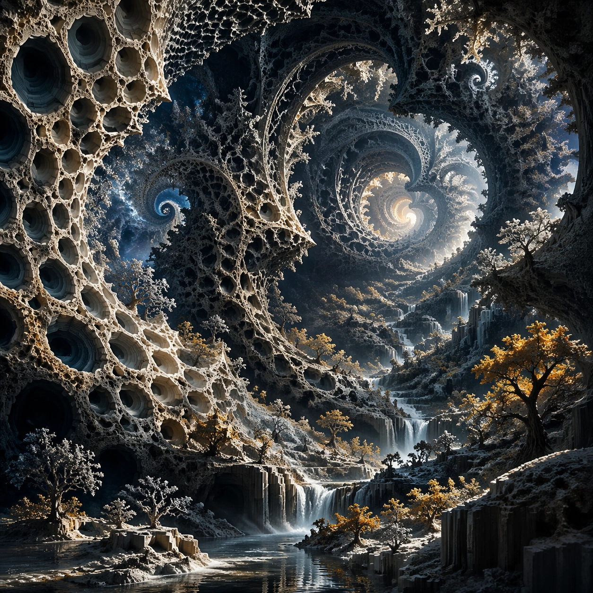

```text
Scene:
A square, exhibition-ready image with disciplined composition, coherent lighting, and an immediately readable central idea. Build the frame around the topic placed into a broader believable context. Keep the lighting, camera distance, and spatial organization tuned for a high-signal research image rather than a casual snapshot. The image belongs to the Fractal Generative Art theme and should feel immediately legible as a prompt atlas theme for fractal generative art, testing frontier-creative-composition with gpt image 2..

Subject:
Center the study on the topic placed into a broader believable context. Translate the theme into a concrete visual statement instead of an abstract mood board: the viewer should understand what kind of image this is, what is being tested, and why the composition is difficult. Use the slug idea of fractal generative art as a literal guide for subject matter, materials, and staging. If helpful, borrow the broad visual cues suggested by Mandelbrot, Voronoi, Flow field, Reaction-diffusion, L-system, but keep the result original and specific to this study.

Important details:
The result should look intentional and technically difficult, with enough structure and material clarity to hold up under close inspection. Preserve a disciplined square composition, clear focal hierarchy, and enough secondary information to make the image feel complete rather than underspecified. The image should look polished, novel, and exhibition-ready, with topic-specific credibility coming from the way surfaces, structure, and visual language reinforce Fractal Generative Art. Avoid generic filler elements that do not serve the main concept.

Use case:
Fractal Generative Art single study 5/8, testing frontier-creative-composition through the environment study variation.

Constraints:
No readable text, no watermark, no logos, preserve exact 1:1 aspect ratio, no readable text, no watermark, no logos, no generic stock-photo staging, no broken composition, no muddy subject hierarchy.
```

[Pinned source](https://github.com/ChaosRealmsAI/gpt-image-2-gallery/blob/5296db8c996e38776c83a0bc8c64f848dcd512b3/works/topics/fractal-generative-art/packages/single-fractal-generative-art-studies/images/environment-study/meta.json) · GPT Image2 · 1254×1254 · No source-declared image dependencies. · ProjectD:[published and publicly accepted](https://aitoolsradar.com/en/prompts/4cb3d230149bc5)

## Comparison Study · fractal-generative-art/single-fractal-generative-art-studies/comparison-study

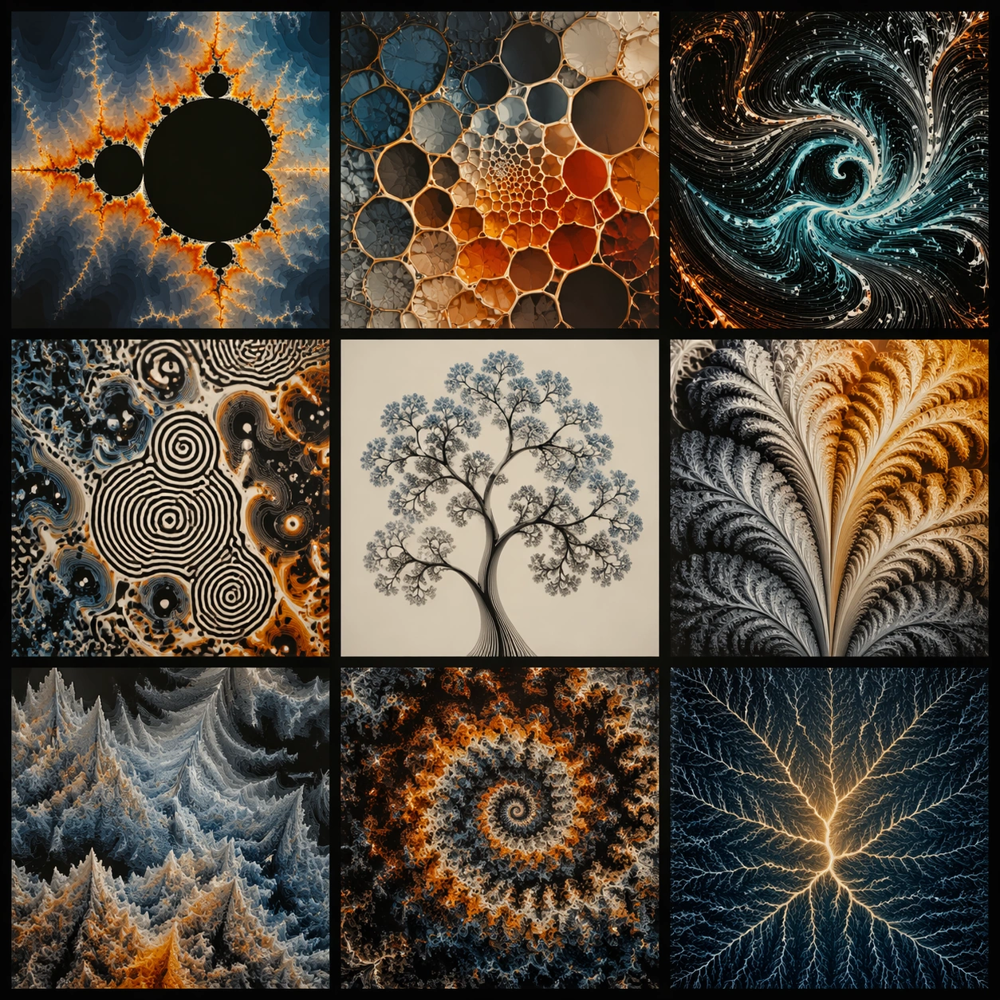

```text
Scene:
A square, exhibition-ready image with disciplined composition, coherent lighting, and an immediately readable central idea. Build the frame around related elements organized into one comparative frame. Keep the lighting, camera distance, and spatial organization tuned for a high-signal research image rather than a casual snapshot. The image belongs to the Fractal Generative Art theme and should feel immediately legible as a prompt atlas theme for fractal generative art, testing frontier-creative-composition with gpt image 2..

Subject:
Center the study on related elements organized into one comparative frame. Translate the theme into a concrete visual statement instead of an abstract mood board: the viewer should understand what kind of image this is, what is being tested, and why the composition is difficult. Use the slug idea of fractal generative art as a literal guide for subject matter, materials, and staging. If helpful, borrow the broad visual cues suggested by Mandelbrot, Voronoi, Flow field, Reaction-diffusion, L-system, but keep the result original and specific to this study.

Important details:
The result should look intentional and technically difficult, with enough structure and material clarity to hold up under close inspection. Preserve a disciplined square composition, clear focal hierarchy, and enough secondary information to make the image feel complete rather than underspecified. The image should look polished, novel, and exhibition-ready, with topic-specific credibility coming from the way surfaces, structure, and visual language reinforce Fractal Generative Art. Avoid generic filler elements that do not serve the main concept.

Use case:
Fractal Generative Art single study 6/8, testing frontier-creative-composition through the comparison study variation.

Constraints:
No readable text, no watermark, no logos, preserve exact 1:1 aspect ratio, no readable text, no watermark, no logos, no generic stock-photo staging, no broken composition, no muddy subject hierarchy.
```

[Pinned source](https://github.com/ChaosRealmsAI/gpt-image-2-gallery/blob/5296db8c996e38776c83a0bc8c64f848dcd512b3/works/topics/fractal-generative-art/packages/single-fractal-generative-art-studies/images/comparison-study/meta.json) · GPT Image2 · 1254×1254 · No source-declared image dependencies. · ProjectD:[published and publicly accepted](https://aitoolsradar.com/en/prompts/9cd6d75050e54f)

## System Study · fractal-generative-art/single-fractal-generative-art-studies/system-study

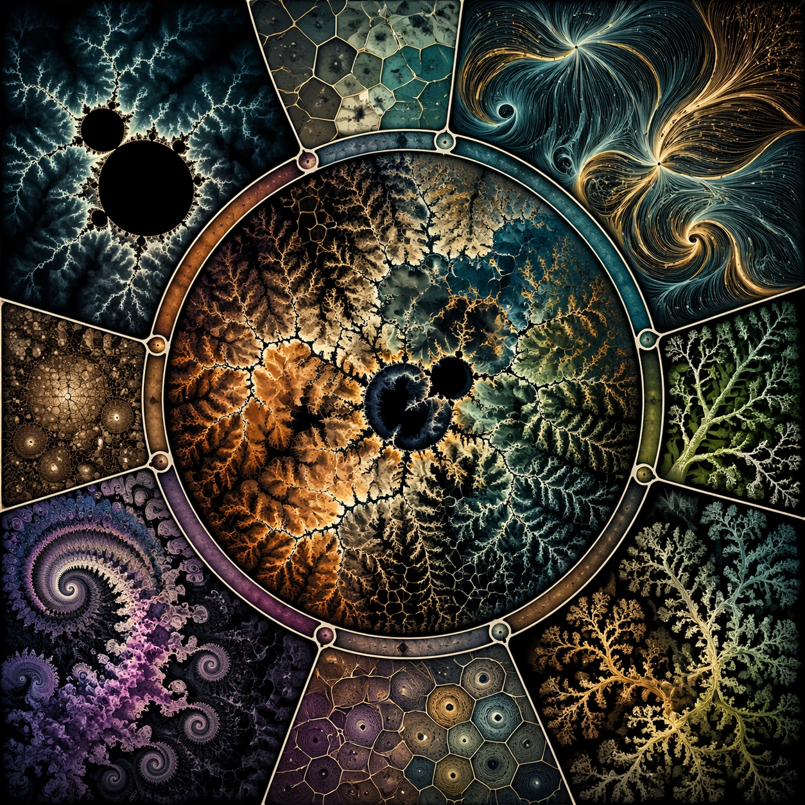

```text
Scene:
A square, exhibition-ready image with disciplined composition, coherent lighting, and an immediately readable central idea. Build the frame around the topic shown as a coherent set rather than a single isolated element. Keep the lighting, camera distance, and spatial organization tuned for a high-signal research image rather than a casual snapshot. The image belongs to the Fractal Generative Art theme and should feel immediately legible as a prompt atlas theme for fractal generative art, testing frontier-creative-composition with gpt image 2..

Subject:
Center the study on the topic shown as a coherent set rather than a single isolated element. Translate the theme into a concrete visual statement instead of an abstract mood board: the viewer should understand what kind of image this is, what is being tested, and why the composition is difficult. Use the slug idea of fractal generative art as a literal guide for subject matter, materials, and staging. If helpful, borrow the broad visual cues suggested by Mandelbrot, Voronoi, Flow field, Reaction-diffusion, L-system, but keep the result original and specific to this study.

Important details:
The result should look intentional and technically difficult, with enough structure and material clarity to hold up under close inspection. Preserve a disciplined square composition, clear focal hierarchy, and enough secondary information to make the image feel complete rather than underspecified. The image should look polished, novel, and exhibition-ready, with topic-specific credibility coming from the way surfaces, structure, and visual language reinforce Fractal Generative Art. Avoid generic filler elements that do not serve the main concept.

Use case:
Fractal Generative Art single study 7/8, testing frontier-creative-composition through the system study variation.

Constraints:
No readable text, no watermark, no logos, preserve exact 1:1 aspect ratio, no readable text, no watermark, no logos, no generic stock-photo staging, no broken composition, no muddy subject hierarchy.
```

[Pinned source](https://github.com/ChaosRealmsAI/gpt-image-2-gallery/blob/5296db8c996e38776c83a0bc8c64f848dcd512b3/works/topics/fractal-generative-art/packages/single-fractal-generative-art-studies/images/system-study/meta.json) · GPT Image2 · 1254×1254 · No source-declared image dependencies. · ProjectD:[published and publicly accepted](https://aitoolsradar.com/en/prompts/b5d42eccfaa0dd)

## Signature Study · fractal-generative-art/single-fractal-generative-art-studies/signature-study


```text
Scene:
A square, exhibition-ready image with disciplined composition, coherent lighting, and an immediately readable central idea. Build the frame around the strongest final articulation of the theme. Keep the lighting, camera distance, and spatial organization tuned for a high-signal research image rather than a casual snapshot. The image belongs to the Fractal Generative Art theme and should feel immediately legible as a prompt atlas theme for fractal generative art, testing frontier-creative-composition with gpt image 2..

Subject:
Center the study on the strongest final articulation of the theme. Translate the theme into a concrete visual statement instead of an abstract mood board: the viewer should understand what kind of image this is, what is being tested, and why the composition is difficult. Use the slug idea of fractal generative art as a literal guide for subject matter, materials, and staging. If helpful, borrow the broad visual cues suggested by Mandelbrot, Voronoi, Flow field, Reaction-diffusion, L-system, but keep the result original and specific to this study.

Important details:
The result should look intentional and technically difficult, with enough structure and material clarity to hold up under close inspection. Preserve a disciplined square composition, clear focal hierarchy, and enough secondary information to make the image feel complete rather than underspecified. The image should look polished, novel, and exhibition-ready, with topic-specific credibility coming from the way surfaces, structure, and visual language reinforce Fractal Generative Art. Avoid generic filler elements that do not serve the main concept.

Use case:
Fractal Generative Art single study 8/8, testing frontier-creative-composition through the signature study variation.

Constraints:
No readable text, no watermark, no logos, preserve exact 1:1 aspect ratio, no readable text, no watermark, no logos, no generic stock-photo staging, no broken composition, no muddy subject hierarchy.
```

[Pinned source](https://github.com/ChaosRealmsAI/gpt-image-2-gallery/blob/5296db8c996e38776c83a0bc8c64f848dcd512b3/works/topics/fractal-generative-art/packages/single-fractal-generative-art-studies/images/signature-study/meta.json) · GPT Image2 · 1254×1254 · No source-declared image dependencies. · ProjectD:[published and publicly accepted](https://aitoolsradar.com/en/prompts/902dccfeccc696)

## Illuminated Core Folio · fractal-mandelbrot-manuscript/single-fractal-manuscript-studies/01-illuminated-core-folio

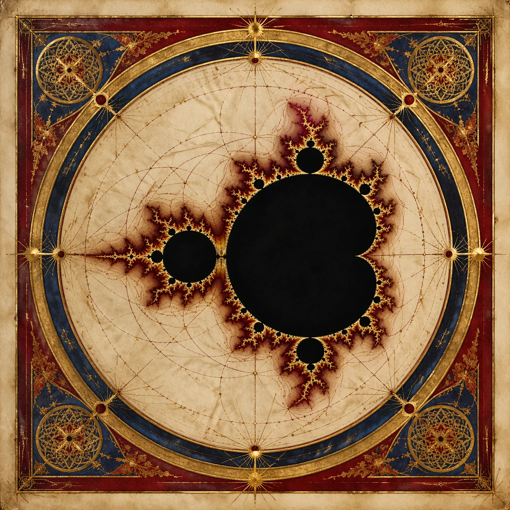

```text
Scene:
Create a square image that feels like a rare manuscript folio, archive plate, or sacred study sheet viewed head on under conservation lighting. The surface should show believable vellum, paper, pigment, or metal behavior, while the central fractal structure remains sharp enough to suggest true recursive depth rather than ornamental swirling. Present it as a conserved folio under soft archival light, absolutely flat to the viewer. Keep the square crop exact, the camera flat, and the tonal design disciplined enough that structure stays clear at poster scale and under close inspection.

Subject:
Use a Mandelbrot-like fractal form as the main visual intelligence of the piece, preserving nested bulb logic, recursive echo, and progressive detail bands. Surround it with borders, illumination, heraldic framing, or scholarly layout devices only when they support the sense that the fractal is being reverently studied as a sacred visual phenomenon. Focus this variation on a parchment master page centered on a richly illuminated fractal with gold accents and strict recursive clarity. The composition should feel complete and singular, as though one finished artifact has been resolved with full conviction rather than one fragment pulled from a larger sheet.

Important details:
Recursive structure must stay convincing at multiple scales. The image can feel historical, but it should not become naive fantasy illustration. Use gold accents, cochineal reds, lapis blues, smoke shadows, and parchment wear with restraint so the mathematical body of the fractal remains the hero of the composition. Use gold leaf points, cochineal red borders, and steady shadow only to frame the recursion rather than compete with it. Preserve crisp edge behavior, stable hierarchy, and enough fine information that the image rewards slow viewing without losing the main read from a distance.

Use case:
Mandelbrot Manuscript single study 1/9, designed as a self-contained sacred-geometry image with a distinct material and compositional emphasis.

Constraints:
No readable text, no watermark, no logos, preserve exact 1:1 aspect ratio, no readable script, no random fantasy monsters, no muddy fractal edge, no cheap clip-art border, no torn parchment dominating the frame, no ornamental clutter that hides recursion, no soft decorative blur, no loose calligraphy, no off-center page block.
```

[Pinned source](https://github.com/ChaosRealmsAI/gpt-image-2-gallery/blob/5296db8c996e38776c83a0bc8c64f848dcd512b3/works/topics/fractal-mandelbrot-manuscript/packages/single-fractal-manuscript-studies/images/01-illuminated-core-folio/meta.json) · GPT Image2 · 1254×1254 · No source-declared image dependencies. · ProjectD:[published and publicly accepted](https://aitoolsradar.com/en/prompts/111a5140132fe5)

## Seahorse Marginalia · fractal-mandelbrot-manuscript/single-fractal-manuscript-studies/02-seahorse-marginalia

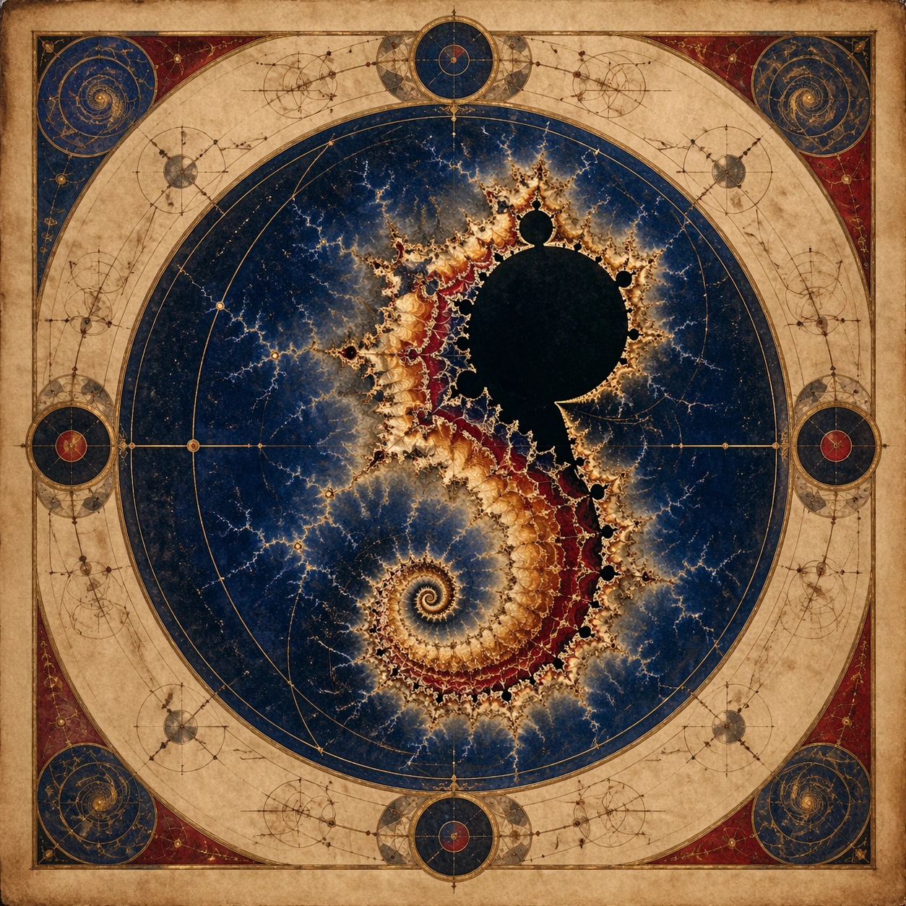

```text
Scene:
Create a square image that feels like a rare manuscript folio, archive plate, or sacred study sheet viewed head on under conservation lighting. The surface should show believable vellum, paper, pigment, or metal behavior, while the central fractal structure remains sharp enough to suggest true recursive depth rather than ornamental swirling. Keep the page symmetrical enough to feel curated, with warm vellum and cool shadow balance. Keep the square crop exact, the camera flat, and the tonal design disciplined enough that structure stays clear at poster scale and under close inspection.

Subject:
Use a Mandelbrot-like fractal form as the main visual intelligence of the piece, preserving nested bulb logic, recursive echo, and progressive detail bands. Surround it with borders, illumination, heraldic framing, or scholarly layout devices only when they support the sense that the fractal is being reverently studied as a sacred visual phenomenon. Focus this variation on a page focused on one famous seahorse-like recursive bay, surrounded by abstract illuminated marginal systems. The composition should feel complete and singular, as though one finished artifact has been resolved with full conviction rather than one fragment pulled from a larger sheet.

Important details:
Recursive structure must stay convincing at multiple scales. The image can feel historical, but it should not become naive fantasy illustration. Use gold accents, cochineal reds, lapis blues, smoke shadows, and parchment wear with restraint so the mathematical body of the fractal remains the hero of the composition. The margin devices should stay non-readable and secondary, while the recursive coastline remains sharply articulated. Preserve crisp edge behavior, stable hierarchy, and enough fine information that the image rewards slow viewing without losing the main read from a distance.

Use case:
Mandelbrot Manuscript single study 2/9, designed as a self-contained sacred-geometry image with a distinct material and compositional emphasis.

Constraints:
No readable text, no watermark, no logos, preserve exact 1:1 aspect ratio, no readable script, no random fantasy monsters, no muddy fractal edge, no cheap clip-art border, no torn parchment dominating the frame, no ornamental clutter that hides recursion, no readable notes, no cartoon sea imagery, no warped page perspective.
```

[Pinned source](https://github.com/ChaosRealmsAI/gpt-image-2-gallery/blob/5296db8c996e38776c83a0bc8c64f848dcd512b3/works/topics/fractal-mandelbrot-manuscript/packages/single-fractal-manuscript-studies/images/02-seahorse-marginalia/meta.json) · GPT Image2 · 1254×1254 · No source-declared image dependencies. · ProjectD:[published and publicly accepted](https://aitoolsradar.com/en/prompts/b96f54bd4f7e24)

## Gilded Border Recursion · fractal-mandelbrot-manuscript/single-fractal-manuscript-studies/03-gilded-border-recursion

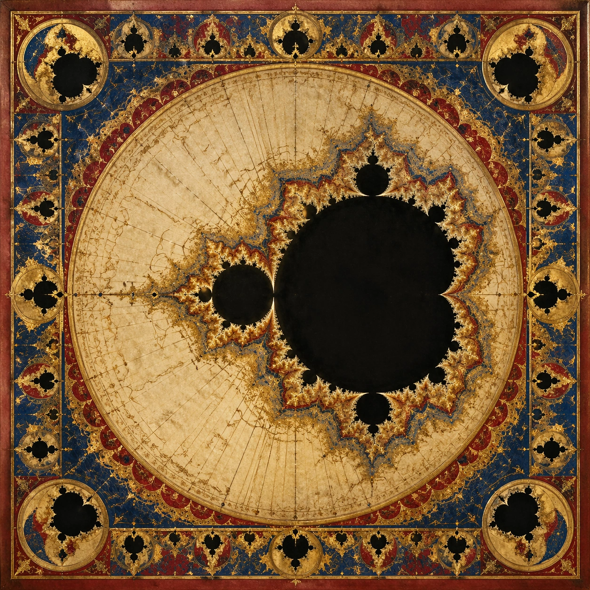

```text
Scene:
Create a square image that feels like a rare manuscript folio, archive plate, or sacred study sheet viewed head on under conservation lighting. The surface should show believable vellum, paper, pigment, or metal behavior, while the central fractal structure remains sharp enough to suggest true recursive depth rather than ornamental swirling. Treat the image as a luxury manuscript leaf with disciplined gilding and stable frontal presentation. Keep the square crop exact, the camera flat, and the tonal design disciplined enough that structure stays clear at poster scale and under close inspection.

Subject:
Use a Mandelbrot-like fractal form as the main visual intelligence of the piece, preserving nested bulb logic, recursive echo, and progressive detail bands. Surround it with borders, illumination, heraldic framing, or scholarly layout devices only when they support the sense that the fractal is being reverently studied as a sacred visual phenomenon. Focus this variation on a more decorative plate where the page border echoes the fractal logic in miniature repeating illuminations. The composition should feel complete and singular, as though one finished artifact has been resolved with full conviction rather than one fragment pulled from a larger sheet.

Important details:
Recursive structure must stay convincing at multiple scales. The image can feel historical, but it should not become naive fantasy illustration. Use gold accents, cochineal reds, lapis blues, smoke shadows, and parchment wear with restraint so the mathematical body of the fractal remains the hero of the composition. Make the border mirror the recursion intelligently, and avoid letting the frame overpower the central mathematical form. Preserve crisp edge behavior, stable hierarchy, and enough fine information that the image rewards slow viewing without losing the main read from a distance.

Use case:
Mandelbrot Manuscript single study 3/9, designed as a self-contained sacred-geometry image with a distinct material and compositional emphasis.

Constraints:
No readable text, no watermark, no logos, preserve exact 1:1 aspect ratio, no readable script, no random fantasy monsters, no muddy fractal edge, no cheap clip-art border, no torn parchment dominating the frame, no ornamental clutter that hides recursion, no repetitive wallpaper border, no cheap fantasy ornament, no unstable center.
```

[Pinned source](https://github.com/ChaosRealmsAI/gpt-image-2-gallery/blob/5296db8c996e38776c83a0bc8c64f848dcd512b3/works/topics/fractal-mandelbrot-manuscript/packages/single-fractal-manuscript-studies/images/03-gilded-border-recursion/meta.json) · GPT Image2 · 1254×1254 · No source-declared image dependencies. · ProjectD:[published and publicly accepted](https://aitoolsradar.com/en/prompts/6a92c62f4932c9)

## Ink Bloom Zoom · fractal-mandelbrot-manuscript/single-fractal-manuscript-studies/04-ink-bloom-zoom

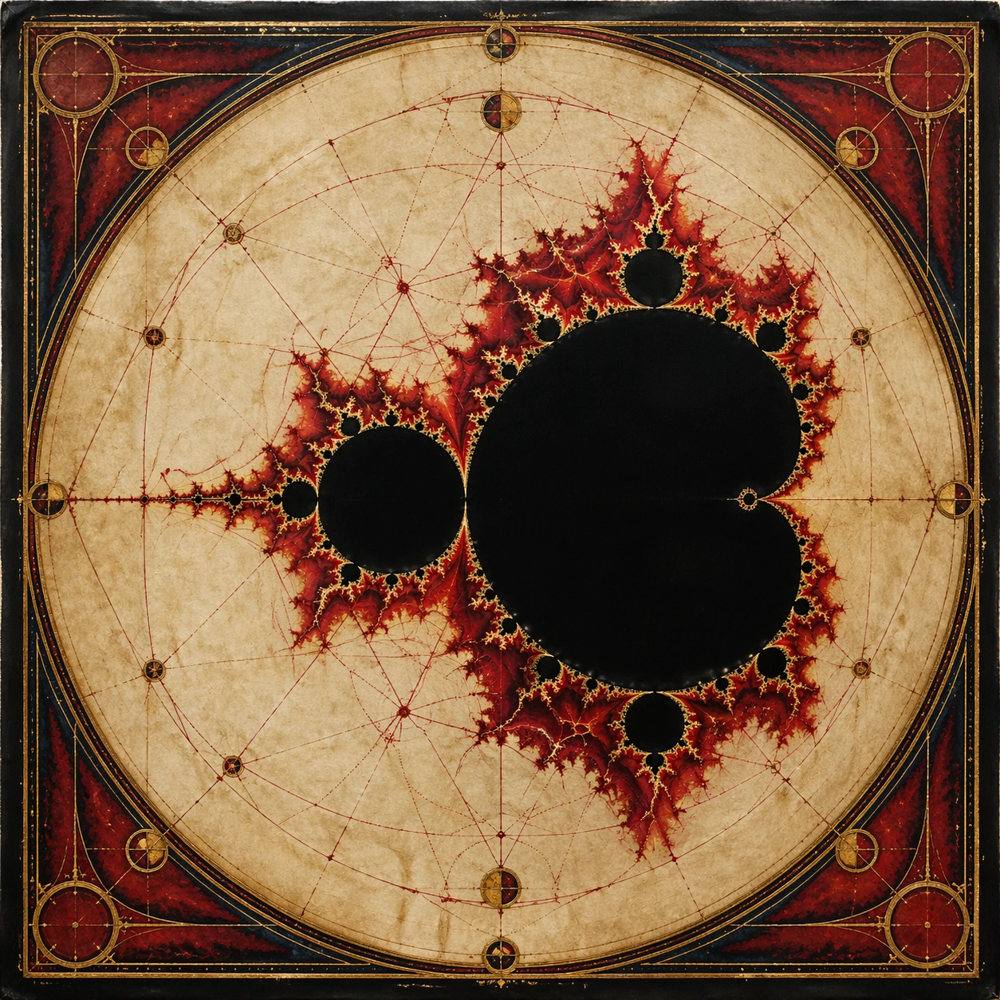

```text
Scene:
Create a square image that feels like a rare manuscript folio, archive plate, or sacred study sheet viewed head on under conservation lighting. The surface should show believable vellum, paper, pigment, or metal behavior, while the central fractal structure remains sharp enough to suggest true recursive depth rather than ornamental swirling. Render it like a scholarly close study on vellum with deep blacks, dried crimson washes, and careful spotlighting. Keep the square crop exact, the camera flat, and the tonal design disciplined enough that structure stays clear at poster scale and under close inspection.

Subject:
Use a Mandelbrot-like fractal form as the main visual intelligence of the piece, preserving nested bulb logic, recursive echo, and progressive detail bands. Surround it with borders, illumination, heraldic framing, or scholarly layout devices only when they support the sense that the fractal is being reverently studied as a sacred visual phenomenon. Focus this variation on a close-study page emphasizing black-red ink transitions and the recursive bloom of the central set. The composition should feel complete and singular, as though one finished artifact has been resolved with full conviction rather than one fragment pulled from a larger sheet.

Important details:
Recursive structure must stay convincing at multiple scales. The image can feel historical, but it should not become naive fantasy illustration. Use gold accents, cochineal reds, lapis blues, smoke shadows, and parchment wear with restraint so the mathematical body of the fractal remains the hero of the composition. The zoomed region should still retain recognizable self-similar logic, with edge precision stronger than painterly texture. Preserve crisp edge behavior, stable hierarchy, and enough fine information that the image rewards slow viewing without losing the main read from a distance.

Use case:
Mandelbrot Manuscript single study 4/9, designed as a self-contained sacred-geometry image with a distinct material and compositional emphasis.

Constraints:
No readable text, no watermark, no logos, preserve exact 1:1 aspect ratio, no readable script, no random fantasy monsters, no muddy fractal edge, no cheap clip-art border, no torn parchment dominating the frame, no ornamental clutter that hides recursion, no watercolor mush, no abstract stain without structure, no unreadable center.
```

[Pinned source](https://github.com/ChaosRealmsAI/gpt-image-2-gallery/blob/5296db8c996e38776c83a0bc8c64f848dcd512b3/works/topics/fractal-mandelbrot-manuscript/packages/single-fractal-manuscript-studies/images/04-ink-bloom-zoom/meta.json) · GPT Image2 · 1254×1254 · No source-declared image dependencies. · ProjectD:[published and publicly accepted](https://aitoolsradar.com/en/prompts/c578343578494a)

## Astronomical Scriptorium · fractal-mandelbrot-manuscript/single-fractal-manuscript-studies/05-astronomical-scriptorium

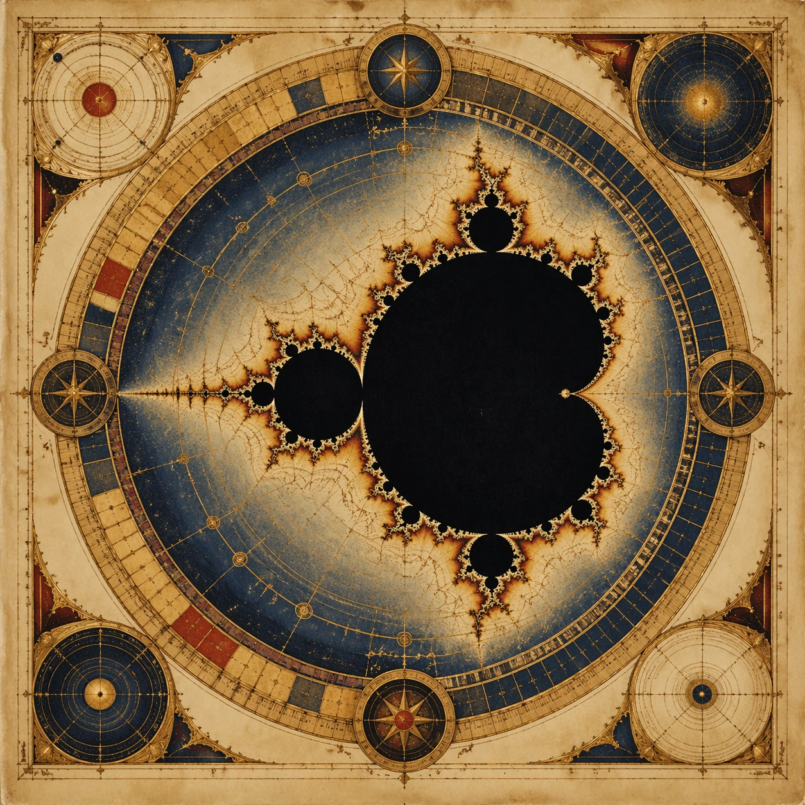

```text
Scene:
Create a square image that feels like a rare manuscript folio, archive plate, or sacred study sheet viewed head on under conservation lighting. The surface should show believable vellum, paper, pigment, or metal behavior, while the central fractal structure remains sharp enough to suggest true recursive depth rather than ornamental swirling. Keep the layout stately and archival, as if a scholar had integrated cosmic observation with recursive study. Keep the square crop exact, the camera flat, and the tonal design disciplined enough that structure stays clear at poster scale and under close inspection.

Subject:
Use a Mandelbrot-like fractal form as the main visual intelligence of the piece, preserving nested bulb logic, recursive echo, and progressive detail bands. Surround it with borders, illumination, heraldic framing, or scholarly layout devices only when they support the sense that the fractal is being reverently studied as a sacred visual phenomenon. Focus this variation on a manuscript plate that links the fractal to celestial diagrams, compass rings, and pseudo-observational motifs. The composition should feel complete and singular, as though one finished artifact has been resolved with full conviction rather than one fragment pulled from a larger sheet.

Important details:
Recursive structure must stay convincing at multiple scales. The image can feel historical, but it should not become naive fantasy illustration. Use gold accents, cochineal reds, lapis blues, smoke shadows, and parchment wear with restraint so the mathematical body of the fractal remains the hero of the composition. Any auxiliary circles or stars must reinforce scale and wonder without undermining the recognizable fractal body. Preserve crisp edge behavior, stable hierarchy, and enough fine information that the image rewards slow viewing without losing the main read from a distance.

Use case:
Mandelbrot Manuscript single study 5/9, designed as a self-contained sacred-geometry image with a distinct material and compositional emphasis.

Constraints:
No readable text, no watermark, no logos, preserve exact 1:1 aspect ratio, no readable script, no random fantasy monsters, no muddy fractal edge, no cheap clip-art border, no torn parchment dominating the frame, no ornamental clutter that hides recursion, no random horoscope wheel, no star clutter, no literal telescope scene.
```

[Pinned source](https://github.com/ChaosRealmsAI/gpt-image-2-gallery/blob/5296db8c996e38776c83a0bc8c64f848dcd512b3/works/topics/fractal-mandelbrot-manuscript/packages/single-fractal-manuscript-studies/images/05-astronomical-scriptorium/meta.json) · GPT Image2 · 1254×1254 · No source-declared image dependencies. · ProjectD:[published and publicly accepted](https://aitoolsradar.com/en/prompts/35ef10009054ef)

## Lapis Initial Page · fractal-mandelbrot-manuscript/single-fractal-manuscript-studies/06-lapis-initial-page

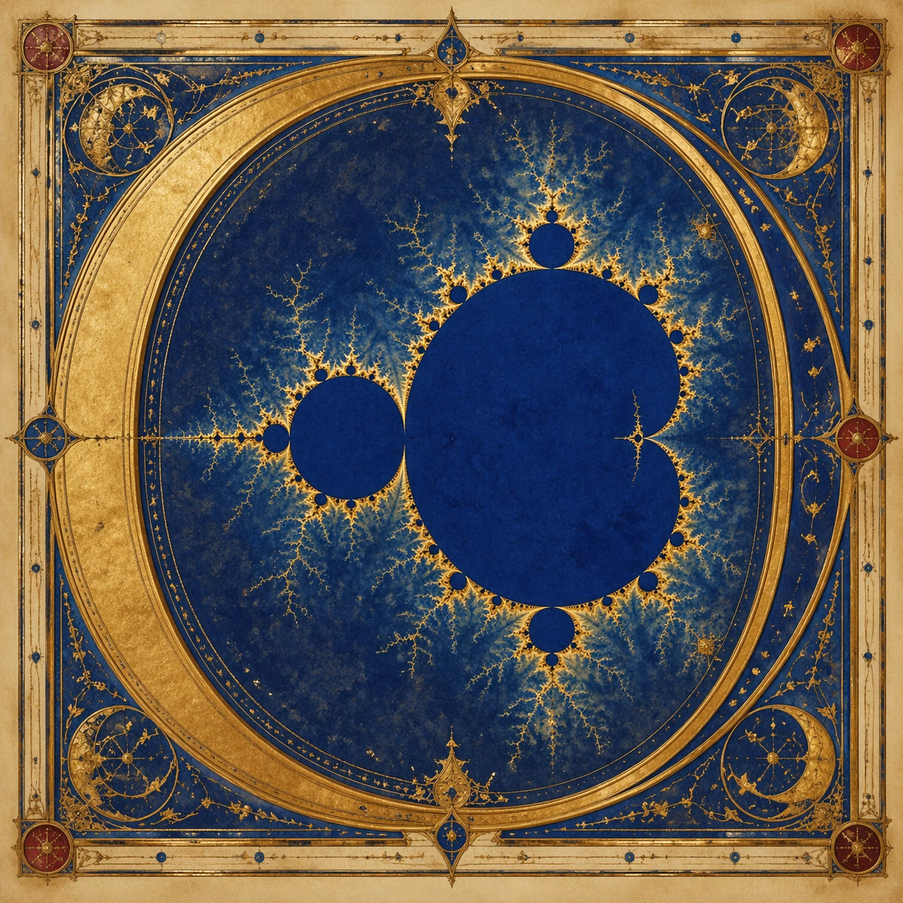

```text
Scene:
Create a square image that feels like a rare manuscript folio, archive plate, or sacred study sheet viewed head on under conservation lighting. The surface should show believable vellum, paper, pigment, or metal behavior, while the central fractal structure remains sharp enough to suggest true recursive depth rather than ornamental swirling. Use lapis, ivory, and gold with gentle page grain and a calm, front-facing conservation view. Keep the square crop exact, the camera flat, and the tonal design disciplined enough that structure stays clear at poster scale and under close inspection.

Subject:
Use a Mandelbrot-like fractal form as the main visual intelligence of the piece, preserving nested bulb logic, recursive echo, and progressive detail bands. Surround it with borders, illumination, heraldic framing, or scholarly layout devices only when they support the sense that the fractal is being reverently studied as a sacred visual phenomenon. Focus this variation on a blue-and-gold page where the fractal sits inside an illuminated initial-like cartouche without readable lettering. The composition should feel complete and singular, as though one finished artifact has been resolved with full conviction rather than one fragment pulled from a larger sheet.

Important details:
Recursive structure must stay convincing at multiple scales. The image can feel historical, but it should not become naive fantasy illustration. Use gold accents, cochineal reds, lapis blues, smoke shadows, and parchment wear with restraint so the mathematical body of the fractal remains the hero of the composition. Let the cartouche behave as framing architecture only; the recursive silhouette must remain the unmistakable protagonist. Preserve crisp edge behavior, stable hierarchy, and enough fine information that the image rewards slow viewing without losing the main read from a distance.

Use case:
Mandelbrot Manuscript single study 6/9, designed as a self-contained sacred-geometry image with a distinct material and compositional emphasis.

Constraints:
No readable text, no watermark, no logos, preserve exact 1:1 aspect ratio, no readable script, no random fantasy monsters, no muddy fractal edge, no cheap clip-art border, no torn parchment dominating the frame, no ornamental clutter that hides recursion, no readable initials, no medieval parody, no oversized ornament swallowing the fractal.
```

[Pinned source](https://github.com/ChaosRealmsAI/gpt-image-2-gallery/blob/5296db8c996e38776c83a0bc8c64f848dcd512b3/works/topics/fractal-mandelbrot-manuscript/packages/single-fractal-manuscript-studies/images/06-lapis-initial-page/meta.json) · GPT Image2 · 1254×1254 · No source-declared image dependencies. · ProjectD:[published and publicly accepted](https://aitoolsradar.com/en/prompts/3b6b45df7f914f)

## Candle Smoke Archive · fractal-mandelbrot-manuscript/single-fractal-manuscript-studies/07-candle-smoke-archive

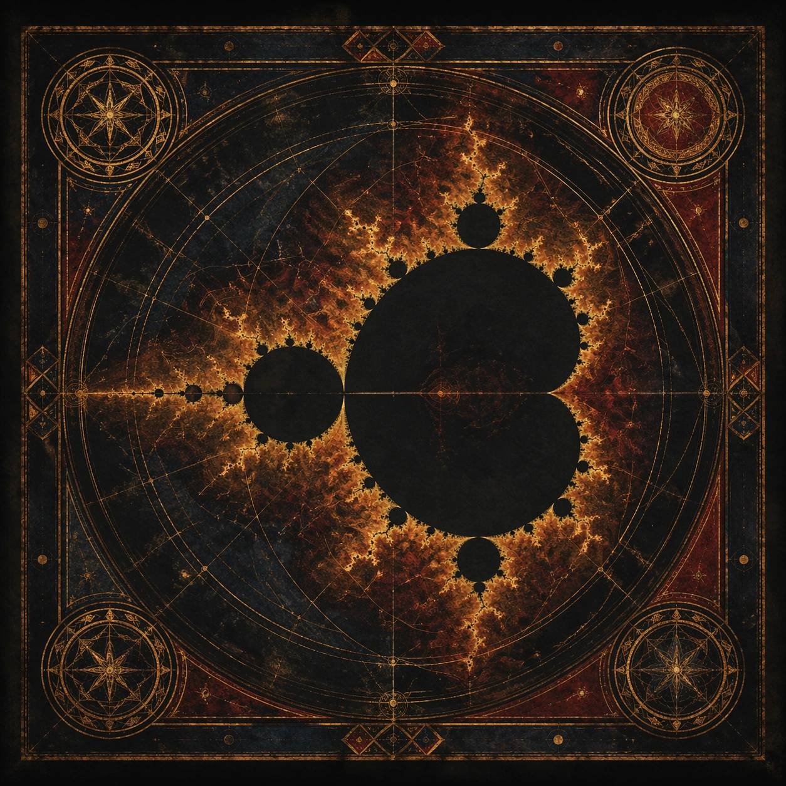

```text
Scene:
Create a square image that feels like a rare manuscript folio, archive plate, or sacred study sheet viewed head on under conservation lighting. The surface should show believable vellum, paper, pigment, or metal behavior, while the central fractal structure remains sharp enough to suggest true recursive depth rather than ornamental swirling. Maintain stillness and exact recursion even though the mood is dim and aged. Keep the square crop exact, the camera flat, and the tonal design disciplined enough that structure stays clear at poster scale and under close inspection.

Subject:
Use a Mandelbrot-like fractal form as the main visual intelligence of the piece, preserving nested bulb logic, recursive echo, and progressive detail bands. Surround it with borders, illumination, heraldic framing, or scholarly layout devices only when they support the sense that the fractal is being reverently studied as a sacred visual phenomenon. Focus this variation on a darker archive sheet with soot-tinted edges and a warm central fractal illuminated by sparse candlelike light. The composition should feel complete and singular, as though one finished artifact has been resolved with full conviction rather than one fragment pulled from a larger sheet.

Important details:
Recursive structure must stay convincing at multiple scales. The image can feel historical, but it should not become naive fantasy illustration. Use gold accents, cochineal reds, lapis blues, smoke shadows, and parchment wear with restraint so the mathematical body of the fractal remains the hero of the composition. Smoke tint and edge wear should be subtle, while the fractal remains crisp enough to reward close inspection. Preserve crisp edge behavior, stable hierarchy, and enough fine information that the image rewards slow viewing without losing the main read from a distance.

Use case:
Mandelbrot Manuscript single study 7/9, designed as a self-contained sacred-geometry image with a distinct material and compositional emphasis.

Constraints:
No readable text, no watermark, no logos, preserve exact 1:1 aspect ratio, no readable script, no random fantasy monsters, no muddy fractal edge, no cheap clip-art border, no torn parchment dominating the frame, no ornamental clutter that hides recursion, no burnt holes, no dramatic fire, no murky center.
```

[Pinned source](https://github.com/ChaosRealmsAI/gpt-image-2-gallery/blob/5296db8c996e38776c83a0bc8c64f848dcd512b3/works/topics/fractal-mandelbrot-manuscript/packages/single-fractal-manuscript-studies/images/07-candle-smoke-archive/meta.json) · GPT Image2 · 1254×1254 · No source-declared image dependencies. · ProjectD:[published and publicly accepted](https://aitoolsradar.com/en/prompts/e687ab05952d45)

## Red Black Diagram · fractal-mandelbrot-manuscript/single-fractal-manuscript-studies/08-red-black-diagram


```text
Scene:
Create a square image that feels like a rare manuscript folio, archive plate, or sacred study sheet viewed head on under conservation lighting. The surface should show believable vellum, paper, pigment, or metal behavior, while the central fractal structure remains sharp enough to suggest true recursive depth rather than ornamental swirling. Present it as an austere archive diagram with strong contrast and almost no extraneous decoration. Keep the square crop exact, the camera flat, and the tonal design disciplined enough that structure stays clear at poster scale and under close inspection.

Subject:
Use a Mandelbrot-like fractal form as the main visual intelligence of the piece, preserving nested bulb logic, recursive echo, and progressive detail bands. Surround it with borders, illumination, heraldic framing, or scholarly layout devices only when they support the sense that the fractal is being reverently studied as a sacred visual phenomenon. Focus this variation on a severe two-tone study where black ink recursion and red guiding bands create a scholarly sacred plate. The composition should feel complete and singular, as though one finished artifact has been resolved with full conviction rather than one fragment pulled from a larger sheet.

Important details:
Recursive structure must stay convincing at multiple scales. The image can feel historical, but it should not become naive fantasy illustration. Use gold accents, cochineal reds, lapis blues, smoke shadows, and parchment wear with restraint so the mathematical body of the fractal remains the hero of the composition. Use the red only to guide hierarchy and framing, never to replace the underlying recursive logic. Preserve crisp edge behavior, stable hierarchy, and enough fine information that the image rewards slow viewing without losing the main read from a distance.

Use case:
Mandelbrot Manuscript single study 8/9, designed as a self-contained sacred-geometry image with a distinct material and compositional emphasis.

Constraints:
No readable text, no watermark, no logos, preserve exact 1:1 aspect ratio, no readable script, no random fantasy monsters, no muddy fractal edge, no cheap clip-art border, no torn parchment dominating the frame, no ornamental clutter that hides recursion, no propaganda poster feel, no readable rubrication, no accidental modern graph style.
```

[Pinned source](https://github.com/ChaosRealmsAI/gpt-image-2-gallery/blob/5296db8c996e38776c83a0bc8c64f848dcd512b3/works/topics/fractal-mandelbrot-manuscript/packages/single-fractal-manuscript-studies/images/08-red-black-diagram/meta.json) · GPT Image2 · 1254×1254 · No source-declared image dependencies. · ProjectD:[published and publicly accepted](https://aitoolsradar.com/en/prompts/d100ae3417ef01)

## Velvet Frontispiece · fractal-mandelbrot-manuscript/single-fractal-manuscript-studies/09-velvet-frontispiece


```text
Scene:
Create a square image that feels like a rare manuscript folio, archive plate, or sacred study sheet viewed head on under conservation lighting. The surface should show believable vellum, paper, pigment, or metal behavior, while the central fractal structure remains sharp enough to suggest true recursive depth rather than ornamental swirling. Keep the framing ceremonial and frontal, with dense darkness surrounding a carefully lit sacred image panel. Keep the square crop exact, the camera flat, and the tonal design disciplined enough that structure stays clear at poster scale and under close inspection.

Subject:
Use a Mandelbrot-like fractal form as the main visual intelligence of the piece, preserving nested bulb logic, recursive echo, and progressive detail bands. Surround it with borders, illumination, heraldic framing, or scholarly layout devices only when they support the sense that the fractal is being reverently studied as a sacred visual phenomenon. Focus this variation on a luxurious frontispiece interpretation where the fractal glows against velvet-like darkness and precious illumination. The composition should feel complete and singular, as though one finished artifact has been resolved with full conviction rather than one fragment pulled from a larger sheet.

Important details:
Recursive structure must stay convincing at multiple scales. The image can feel historical, but it should not become naive fantasy illustration. Use gold accents, cochineal reds, lapis blues, smoke shadows, and parchment wear with restraint so the mathematical body of the fractal remains the hero of the composition. The luxury mood should never erase self-similarity; each nested bulb and spiral echo must remain believable. Preserve crisp edge behavior, stable hierarchy, and enough fine information that the image rewards slow viewing without losing the main read from a distance.

Use case:
Mandelbrot Manuscript single study 9/9, designed as a self-contained sacred-geometry image with a distinct material and compositional emphasis.

Constraints:
No readable text, no watermark, no logos, preserve exact 1:1 aspect ratio, no readable script, no random fantasy monsters, no muddy fractal edge, no cheap clip-art border, no torn parchment dominating the frame, no ornamental clutter that hides recursion, no jewelry product shot styling, no random crown motifs, no blurred recursion.
```

[Pinned source](https://github.com/ChaosRealmsAI/gpt-image-2-gallery/blob/5296db8c996e38776c83a0bc8c64f848dcd512b3/works/topics/fractal-mandelbrot-manuscript/packages/single-fractal-manuscript-studies/images/09-velvet-frontispiece/meta.json) · GPT Image2 · 1254×1254 · No source-declared image dependencies. · ProjectD:[published and publicly accepted](https://aitoolsradar.com/en/prompts/f64b6e0f142c6b)

## Reference Anchor · french-bistro-print-and-table-culture/series-core-system/01-reference-anchor


```text
Scene:
Create a square reference image for French Bistro Print and Table Culture. Build a reference anchor establishing the core system with a premium, production-ready finish. Use a polished modular board or campaign surface with clean spacing, premium game-UI finish, and clear focal hierarchy. The composition should feel intentional, clean, and reusable for gallery, research, campaign, or internal handoff contexts. Lighting must support readability first, with the main forms clearly separated from the background and enough breathing room for the system to stay legible at both hero scale and thumbnail scale.

Subject:
Center a coherent original game-art system built for premium production and marketing surfaces. For this image, focus on reference anchor. Keep the same system logic stable across screenshots, cards, banners, and overview boards. This image is the canonical anchor that later series images must follow. The viewer should immediately understand what role this surface plays inside a cohesive game-production asset pack.

Important details:
Lock framing, icon grammar, palette blocking, and surface hierarchy so the kit feels production-ready and consistent. Preserve the core silhouette, framing language, and material logic from the reference image while each variation changes function. Keep materials believable, edge hierarchy disciplined, and the visual language consistent with French Bistro. Use abstract interface blocks or diagram accents when helpful, but avoid any readable language. The final result should feel like a deliberate production asset rather than a random illustration.

Use case:
French Bistro Print and Table Culture series study 1/9, designed as reference anchor within a cohesive asset pack.

Constraints:
No readable text, no watermark, no logos, preserve exact 1:1 aspect ratio, no unrelated objects, no broken visual hierarchy, no malformed anatomy or broken perspective, no random decorative clutter.
```

[Pinned source](https://github.com/ChaosRealmsAI/gpt-image-2-gallery/blob/5296db8c996e38776c83a0bc8c64f848dcd512b3/works/topics/french-bistro-print-and-table-culture/packages/series-core-system/images/01-reference-anchor/meta.json) · GPT Image2 · 1254×1254 · No source-declared image dependencies. · ProjectD:[published and publicly accepted](https://aitoolsradar.com/en/prompts/89639fcb423077)

## Variant One · french-bistro-print-and-table-culture/series-core-system/02-variant-one


```text
Scene:
Create a square dependent image for French Bistro Print and Table Culture. Build a first controlled variation in the same system with a premium, production-ready finish. Use a polished modular board or campaign surface with clean spacing, premium game-UI finish, and clear focal hierarchy. The composition should feel intentional, clean, and reusable for gallery, research, campaign, or internal handoff contexts. Lighting must support readability first, with the main forms clearly separated from the background and enough breathing room for the system to stay legible at both hero scale and thumbnail scale.

Subject:
Center a coherent original game-art system built for premium production and marketing surfaces. For this image, focus on the intended support surface. Keep the same system logic stable across screenshots, cards, banners, and overview boards. Preserve exact identity or system logic from the reference image while changing only the intended variation axis. The viewer should immediately understand what role this surface plays inside a cohesive game-production asset pack.

Important details:
Lock framing, icon grammar, palette blocking, and surface hierarchy so the kit feels production-ready and consistent. Preserve the core silhouette, framing language, and material logic from the reference image while each variation changes function. Keep materials believable, edge hierarchy disciplined, and the visual language consistent with French Bistro. Use abstract interface blocks or diagram accents when helpful, but avoid any readable language. The final result should feel like a deliberate production asset rather than a random illustration.

Use case:
French Bistro Print and Table Culture series study 2/9, designed as variant one within a cohesive asset pack.

Constraints:
No readable text, no watermark, no logos, preserve exact 1:1 aspect ratio, no unrelated objects, no broken visual hierarchy, no malformed anatomy or broken perspective, no random decorative clutter.
```

[Pinned source](https://github.com/ChaosRealmsAI/gpt-image-2-gallery/blob/5296db8c996e38776c83a0bc8c64f848dcd512b3/works/topics/french-bistro-print-and-table-culture/packages/series-core-system/images/02-variant-one/meta.json) · GPT Image2 · 1254×1254 · Reference images required. · ProjectD:[published and publicly accepted](https://aitoolsradar.com/en/prompts/048ae23f9d1438)

## Variant Two · french-bistro-print-and-table-culture/series-core-system/03-variant-two


```text
Scene:
Create a square dependent image for French Bistro Print and Table Culture. Build a second controlled variation in the same system with a premium, production-ready finish. Use a polished modular board or campaign surface with clean spacing, premium game-UI finish, and clear focal hierarchy. The composition should feel intentional, clean, and reusable for gallery, research, campaign, or internal handoff contexts. Lighting must support readability first, with the main forms clearly separated from the background and enough breathing room for the system to stay legible at both hero scale and thumbnail scale.

Subject:
Center a coherent original game-art system built for premium production and marketing surfaces. For this image, focus on the intended support surface. Keep the same system logic stable across screenshots, cards, banners, and overview boards. Preserve exact identity or system logic from the reference image while changing only the intended variation axis. The viewer should immediately understand what role this surface plays inside a cohesive game-production asset pack.

Important details:
Lock framing, icon grammar, palette blocking, and surface hierarchy so the kit feels production-ready and consistent. Preserve the core silhouette, framing language, and material logic from the reference image while each variation changes function. Keep materials believable, edge hierarchy disciplined, and the visual language consistent with French Bistro. Use abstract interface blocks or diagram accents when helpful, but avoid any readable language. The final result should feel like a deliberate production asset rather than a random illustration.

Use case:
French Bistro Print and Table Culture series study 3/9, designed as variant two within a cohesive asset pack.

Constraints:
No readable text, no watermark, no logos, preserve exact 1:1 aspect ratio, no unrelated objects, no broken visual hierarchy, no malformed anatomy or broken perspective, no random decorative clutter.
```

[Pinned source](https://github.com/ChaosRealmsAI/gpt-image-2-gallery/blob/5296db8c996e38776c83a0bc8c64f848dcd512b3/works/topics/french-bistro-print-and-table-culture/packages/series-core-system/images/03-variant-two/meta.json) · GPT Image2 · 1254×1254 · Reference images required. · ProjectD:[published and publicly accepted](https://aitoolsradar.com/en/prompts/fa8f577852dcaa)

## Variant Three · french-bistro-print-and-table-culture/series-core-system/04-variant-three


```text
Scene:
Create a square dependent image for French Bistro Print and Table Culture. Build a third controlled variation in the same system with a premium, production-ready finish. Use a polished modular board or campaign surface with clean spacing, premium game-UI finish, and clear focal hierarchy. The composition should feel intentional, clean, and reusable for gallery, research, campaign, or internal handoff contexts. Lighting must support readability first, with the main forms clearly separated from the background and enough breathing room for the system to stay legible at both hero scale and thumbnail scale.

Subject:
Center a coherent original game-art system built for premium production and marketing surfaces. For this image, focus on the intended support surface. Keep the same system logic stable across screenshots, cards, banners, and overview boards. Preserve exact identity or system logic from the reference image while changing only the intended variation axis. The viewer should immediately understand what role this surface plays inside a cohesive game-production asset pack.

Important details:
Lock framing, icon grammar, palette blocking, and surface hierarchy so the kit feels production-ready and consistent. Preserve the core silhouette, framing language, and material logic from the reference image while each variation changes function. Keep materials believable, edge hierarchy disciplined, and the visual language consistent with French Bistro. Use abstract interface blocks or diagram accents when helpful, but avoid any readable language. The final result should feel like a deliberate production asset rather than a random illustration.

Use case:
French Bistro Print and Table Culture series study 4/9, designed as variant three within a cohesive asset pack.

Constraints:
No readable text, no watermark, no logos, preserve exact 1:1 aspect ratio, no unrelated objects, no broken visual hierarchy, no malformed anatomy or broken perspective, no random decorative clutter.
```

[Pinned source](https://github.com/ChaosRealmsAI/gpt-image-2-gallery/blob/5296db8c996e38776c83a0bc8c64f848dcd512b3/works/topics/french-bistro-print-and-table-culture/packages/series-core-system/images/04-variant-three/meta.json) · GPT Image2 · 1254×1254 · Reference images required. · ProjectD:[published and publicly accepted](https://aitoolsradar.com/en/prompts/713260793e7847)

## Support One · french-bistro-print-and-table-culture/single-support-studies/support-one


```text
Scene:
Create a square standalone support image for French Bistro Print and Table Culture. Build a support-surface study with a clear focal hierarchy and a finished professional surface. Use a polished modular board or campaign surface with clean spacing, premium game-UI finish, and clear focal hierarchy. The frame should feel self-contained and polished, with enough structure to explain the system even without the reference series, yet still obviously belonging to the same theme and production world.

Subject:
Show a coherent original game-art system built for premium production and marketing surfaces in a way that emphasizes the intended support surface. Keep the same system logic stable across screenshots, cards, banners, and overview boards. Even though this image is independent, the viewer should still recognize the same universe, same commercial logic, and same production intent as the core package.

Important details:
Lock framing, icon grammar, palette blocking, and surface hierarchy so the kit feels production-ready and consistent. Preserve the broader theme language through color, framing, material choices, and modular composition. Use clean panel rhythm, premium asset presentation, and believable detail density. The image should work equally well as a gallery study, research reference, and mock production deliverable.

Use case:
French Bistro Print and Table Culture single study 5/9, exploring support one as a support surface.

Constraints:
No readable text, no watermark, no logos, preserve exact 1:1 aspect ratio, no unrelated objects, no broken visual hierarchy, no visual noise that obscures the main surface, no accidental brand resemblance.
```

[Pinned source](https://github.com/ChaosRealmsAI/gpt-image-2-gallery/blob/5296db8c996e38776c83a0bc8c64f848dcd512b3/works/topics/french-bistro-print-and-table-culture/packages/single-support-studies/images/support-one/meta.json) · GPT Image2 · 1254×1254 · No source-declared image dependencies. · ProjectD:[published and publicly accepted](https://aitoolsradar.com/en/prompts/6f162e32857c15)

## Support Two · french-bistro-print-and-table-culture/single-support-studies/support-two


```text
Scene:
Create a square standalone support image for French Bistro Print and Table Culture. Build a second support-surface study with a clear focal hierarchy and a finished professional surface. Use a polished modular board or campaign surface with clean spacing, premium game-UI finish, and clear focal hierarchy. The frame should feel self-contained and polished, with enough structure to explain the system even without the reference series, yet still obviously belonging to the same theme and production world.

Subject:
Show a coherent original game-art system built for premium production and marketing surfaces in a way that emphasizes the intended support surface. Keep the same system logic stable across screenshots, cards, banners, and overview boards. Even though this image is independent, the viewer should still recognize the same universe, same commercial logic, and same production intent as the core package.

Important details:
Lock framing, icon grammar, palette blocking, and surface hierarchy so the kit feels production-ready and consistent. Preserve the broader theme language through color, framing, material choices, and modular composition. Use clean panel rhythm, premium asset presentation, and believable detail density. The image should work equally well as a gallery study, research reference, and mock production deliverable.

Use case:
French Bistro Print and Table Culture single study 6/9, exploring support two as a support surface.

Constraints:
No readable text, no watermark, no logos, preserve exact 1:1 aspect ratio, no unrelated objects, no broken visual hierarchy, no visual noise that obscures the main surface, no accidental brand resemblance.
```

[Pinned source](https://github.com/ChaosRealmsAI/gpt-image-2-gallery/blob/5296db8c996e38776c83a0bc8c64f848dcd512b3/works/topics/french-bistro-print-and-table-culture/packages/single-support-studies/images/support-two/meta.json) · GPT Image2 · 1254×1254 · No source-declared image dependencies. · ProjectD:[published and publicly accepted](https://aitoolsradar.com/en/prompts/440718f58ba6d1)

## Support Three · french-bistro-print-and-table-culture/single-support-studies/support-three


```text
Scene:
Create a square standalone support image for French Bistro Print and Table Culture. Build a third support-surface study with a clear focal hierarchy and a finished professional surface. Use a polished modular board or campaign surface with clean spacing, premium game-UI finish, and clear focal hierarchy. The frame should feel self-contained and polished, with enough structure to explain the system even without the reference series, yet still obviously belonging to the same theme and production world.

Subject:
Show a coherent original game-art system built for premium production and marketing surfaces in a way that emphasizes the intended support surface. Keep the same system logic stable across screenshots, cards, banners, and overview boards. Even though this image is independent, the viewer should still recognize the same universe, same commercial logic, and same production intent as the core package.

Important details:
Lock framing, icon grammar, palette blocking, and surface hierarchy so the kit feels production-ready and consistent. Preserve the broader theme language through color, framing, material choices, and modular composition. Use clean panel rhythm, premium asset presentation, and believable detail density. The image should work equally well as a gallery study, research reference, and mock production deliverable.

Use case:
French Bistro Print and Table Culture single study 7/9, exploring support three as a support surface.

Constraints:
No readable text, no watermark, no logos, preserve exact 1:1 aspect ratio, no unrelated objects, no broken visual hierarchy, no visual noise that obscures the main surface, no accidental brand resemblance.
```

[Pinned source](https://github.com/ChaosRealmsAI/gpt-image-2-gallery/blob/5296db8c996e38776c83a0bc8c64f848dcd512b3/works/topics/french-bistro-print-and-table-culture/packages/single-support-studies/images/support-three/meta.json) · GPT Image2 · 1254×1254 · No source-declared image dependencies. · ProjectD:[published and publicly accepted](https://aitoolsradar.com/en/prompts/25c271fb494851)

## Support Four · french-bistro-print-and-table-culture/single-support-studies/support-four


```text
Scene:
Create a square standalone support image for French Bistro Print and Table Culture. Build a fourth support-surface study with a clear focal hierarchy and a finished professional surface. Use a polished modular board or campaign surface with clean spacing, premium game-UI finish, and clear focal hierarchy. The frame should feel self-contained and polished, with enough structure to explain the system even without the reference series, yet still obviously belonging to the same theme and production world.

Subject:
Show a coherent original game-art system built for premium production and marketing surfaces in a way that emphasizes the intended support surface. Keep the same system logic stable across screenshots, cards, banners, and overview boards. Even though this image is independent, the viewer should still recognize the same universe, same commercial logic, and same production intent as the core package.

Important details:
Lock framing, icon grammar, palette blocking, and surface hierarchy so the kit feels production-ready and consistent. Preserve the broader theme language through color, framing, material choices, and modular composition. Use clean panel rhythm, premium asset presentation, and believable detail density. The image should work equally well as a gallery study, research reference, and mock production deliverable.

Use case:
French Bistro Print and Table Culture single study 8/9, exploring support four as a support surface.

Constraints:
No readable text, no watermark, no logos, preserve exact 1:1 aspect ratio, no unrelated objects, no broken visual hierarchy, no visual noise that obscures the main surface, no accidental brand resemblance.
```

[Pinned source](https://github.com/ChaosRealmsAI/gpt-image-2-gallery/blob/5296db8c996e38776c83a0bc8c64f848dcd512b3/works/topics/french-bistro-print-and-table-culture/packages/single-support-studies/images/support-four/meta.json) · GPT Image2 · 1254×1254 · No source-declared image dependencies. · ProjectD:[published and publicly accepted](https://aitoolsradar.com/en/prompts/33d59c949ed414)

## Support Five · french-bistro-print-and-table-culture/single-support-studies/support-five


```text
Scene:
Create a square standalone support image for French Bistro Print and Table Culture. Build a fifth support-surface study with a clear focal hierarchy and a finished professional surface. Use a polished modular board or campaign surface with clean spacing, premium game-UI finish, and clear focal hierarchy. The frame should feel self-contained and polished, with enough structure to explain the system even without the reference series, yet still obviously belonging to the same theme and production world.

Subject:
Show a coherent original game-art system built for premium production and marketing surfaces in a way that emphasizes the intended support surface. Keep the same system logic stable across screenshots, cards, banners, and overview boards. Even though this image is independent, the viewer should still recognize the same universe, same commercial logic, and same production intent as the core package.

Important details:
Lock framing, icon grammar, palette blocking, and surface hierarchy so the kit feels production-ready and consistent. Preserve the broader theme language through color, framing, material choices, and modular composition. Use clean panel rhythm, premium asset presentation, and believable detail density. The image should work equally well as a gallery study, research reference, and mock production deliverable.

Use case:
French Bistro Print and Table Culture single study 9/9, exploring support five as a support surface.

Constraints:
No readable text, no watermark, no logos, preserve exact 1:1 aspect ratio, no unrelated objects, no broken visual hierarchy, no visual noise that obscures the main surface, no accidental brand resemblance.
```

[Pinned source](https://github.com/ChaosRealmsAI/gpt-image-2-gallery/blob/5296db8c996e38776c83a0bc8c64f848dcd512b3/works/topics/french-bistro-print-and-table-culture/packages/single-support-studies/images/support-five/meta.json) · GPT Image2 · 1254×1254 · No source-declared image dependencies. · ProjectD:[published and publicly accepted](https://aitoolsradar.com/en/prompts/7d02b6cb49497f)

## Beetle Path Overview · fungal-kingdom-microcosm/single-fungal-microcosm-studies/beetle-path-overview


```text
Scene:
Place the camera at beetle height on a damp forest-floor path just after rain, with leaf litter, bark splinters, and pebbles reading as large terrain. The square frame should feel crowded with dozens of mushroom species rising overhead in soft cool light filtered through unseen canopy shadow. Build the frame as a square natural history study with disciplined composition, believable lighting, and enough environmental evidence to explain how this organism or system functions without any caption. Keep the image polished, observational, and suitable for a research gallery rather than pulp fantasy spectacle.

Subject:
Feature varied fungal architectures: translucent lantern caps, ribbed towers, cup forms storing dew, mesh fungi bridging twigs, and broad mycelial mats stitching soil islands together. Tiny beetle-like animals should navigate the scene as farmers, grazers, or pollinators of spores. Show the anatomy, habitat interaction, and scale cues clearly so the viewer can infer locomotion, feeding, reproduction, or ecological role from the visual alone. Every visible structure should feel evolved for a purpose, with layered foreground, midground, and background information that rewards close inspection.

Important details:
Treat the forest floor as a dense biological city where moisture, decay, and spore traffic drive form. Caps, gills, stalks, hyphal mats, and insect partnerships should all look evolved to manage shade, humidity, nutrient exchange, and reproduction. Texture is critical: wet cuticle, velvety cap bloom, threadlike hyphae, and mineral-rich mud must feel touchable. Keep species distinct yet ecologically related, with each form suggesting a niche in moisture retention, light capture, spore dispersal, or symbiosis. Favor coherent biology over decorative excess: tissues, shells, membranes, spores, tendrils, fins, silica lattices, or atmospheric sacs should all follow one material logic. Preserve a convincing relationship between the environment and the body plan, use restrained color hierarchy, and make the image feel like a serious speculative field record rather than a random monster concept.

Use case:
Fungal Kingdom Microcosm single study 1/9.

Constraints:
No readable text, no watermark, no logos, preserve exact 1:1 aspect ratio, no fairy-house cliches, no cartoon gnomes, no oversized human objects, no bright fantasy magic glow, no accidental brand resemblance, no direct copy of known terrestrial species, no cartoon simplification.
```

[Pinned source](https://github.com/ChaosRealmsAI/gpt-image-2-gallery/blob/5296db8c996e38776c83a0bc8c64f848dcd512b3/works/topics/fungal-kingdom-microcosm/packages/single-fungal-microcosm-studies/images/beetle-path-overview/meta.json) · GPT Image2 · 1024×1024 · No source-declared image dependencies. · ProjectD:[published and publicly accepted](https://aitoolsradar.com/en/prompts/035f7420736a80)

## Translucent Spore Cathedral · fungal-kingdom-microcosm/single-fungal-microcosm-studies/translucent-spore-cathedral


```text
Scene:
Create a low-angle view beneath a cluster of towering translucent caps whose undersides turn the forest floor into a pale amber and ivory chamber. Moist air, thin spores, and dew threads should give the square frame a humid sacred stillness without becoming fantasy architecture. Build the frame as a square natural history study with disciplined composition, believable lighting, and enough environmental evidence to explain how this organism or system functions without any caption. Keep the image polished, observational, and suitable for a research gallery rather than pulp fantasy spectacle.

Subject:
Focus on the canopy effect created by layered caps, semi-transparent ribs, and dangling condensation organs that release spores in slow pulses. Smaller understory fungi and cautious insects should occupy the shadow zone beneath the caps, demonstrating how one species engineers habitat for others. Show the anatomy, habitat interaction, and scale cues clearly so the viewer can infer locomotion, feeding, reproduction, or ecological role from the visual alone. Every visible structure should feel evolved for a purpose, with layered foreground, midground, and background information that rewards close inspection.

Important details:
Treat the forest floor as a dense biological city where moisture, decay, and spore traffic drive form. Caps, gills, stalks, hyphal mats, and insect partnerships should all look evolved to manage shade, humidity, nutrient exchange, and reproduction. Keep the anatomy fungal rather than floral: membrane veining, gill branching, and support stalk tension should all feel mechanically plausible. The beauty of the image should come from structure, moisture, and filtered light, not from arbitrary ornament. Favor coherent biology over decorative excess: tissues, shells, membranes, spores, tendrils, fins, silica lattices, or atmospheric sacs should all follow one material logic. Preserve a convincing relationship between the environment and the body plan, use restrained color hierarchy, and make the image feel like a serious speculative field record rather than a random monster concept.

Use case:
Fungal Kingdom Microcosm single study 2/9.

Constraints:
No readable text, no watermark, no logos, preserve exact 1:1 aspect ratio, no church windows, no human candles, no fantasy runes, no plastic-looking translucency, no accidental brand resemblance, no direct copy of known terrestrial species, no cartoon simplification.
```

[Pinned source](https://github.com/ChaosRealmsAI/gpt-image-2-gallery/blob/5296db8c996e38776c83a0bc8c64f848dcd512b3/works/topics/fungal-kingdom-microcosm/packages/single-fungal-microcosm-studies/images/translucent-spore-cathedral/meta.json) · GPT Image2 · 1024×1024 · No source-declared image dependencies. · ProjectD:[published and publicly accepted](https://aitoolsradar.com/en/prompts/a85e24754582b6)

## Mycelial Highway Crossing · fungal-kingdom-microcosm/single-fungal-microcosm-studies/mycelial-highway-crossing


```text
Scene:
Compose a square macro landscape where bright mycelial cords cross damp soil like elevated highways, weaving beneath leaves and over fallen bark. The light should be overcast and cool, with tiny reflective droplets tracing the routes and revealing traffic density. Build the frame as a square natural history study with disciplined composition, believable lighting, and enough environmental evidence to explain how this organism or system functions without any caption. Keep the image polished, observational, and suitable for a research gallery rather than pulp fantasy spectacle.

Subject:
Show thick transport bundles, feeder rootlets, exchange nodules, and small arthropod analogs using the hyphal roads as protected corridors. Nearby fungi should plug into the network at different scales, some as mature fruiting towers and others as low nutrient stations. Show the anatomy, habitat interaction, and scale cues clearly so the viewer can infer locomotion, feeding, reproduction, or ecological role from the visual alone. Every visible structure should feel evolved for a purpose, with layered foreground, midground, and background information that rewards close inspection.

Important details:
Treat the forest floor as a dense biological city where moisture, decay, and spore traffic drive form. Caps, gills, stalks, hyphal mats, and insect partnerships should all look evolved to manage shade, humidity, nutrient exchange, and reproduction. Treat the mycelium as infrastructure rather than decoration. Thickness, branching logic, and contact points should imply nutrient movement, moisture buffering, and communication across the substrate. Keep the frame biologically busy but visually ordered so the road system reads clearly. Favor coherent biology over decorative excess: tissues, shells, membranes, spores, tendrils, fins, silica lattices, or atmospheric sacs should all follow one material logic. Preserve a convincing relationship between the environment and the body plan, use restrained color hierarchy, and make the image feel like a serious speculative field record rather than a random monster concept.

Use case:
Fungal Kingdom Microcosm single study 3/9.

Constraints:
No readable text, no watermark, no logos, preserve exact 1:1 aspect ratio, no human road markings, no sci-fi circuitry, no neon cyberpunk palette, no sterile studio background, no accidental brand resemblance, no direct copy of known terrestrial species, no cartoon simplification.
```

[Pinned source](https://github.com/ChaosRealmsAI/gpt-image-2-gallery/blob/5296db8c996e38776c83a0bc8c64f848dcd512b3/works/topics/fungal-kingdom-microcosm/packages/single-fungal-microcosm-studies/images/mycelial-highway-crossing/meta.json) · GPT Image2 · 1024×1024 · No source-declared image dependencies. · ProjectD:[published and publicly accepted](https://aitoolsradar.com/en/prompts/82a7356ac76f16)

## Dew Cap Broadcast · fungal-kingdom-microcosm/single-fungal-microcosm-studies/dew-cap-broadcast


```text
Scene:
Build an intimate close study of one broad cap at dawn-like forest light, with large dew droplets hanging from its rim and reflecting the miniature world around it. The square crop should feel near enough to study individual gills, spore dust, and insect footprints. Build the frame as a square natural history study with disciplined composition, believable lighting, and enough environmental evidence to explain how this organism or system functions without any caption. Keep the image polished, observational, and suitable for a research gallery rather than pulp fantasy spectacle.

Subject:
Center on the cap and its spore-release mechanism: taut gill combs, moisture channels, and a slight tremor pattern that shakes loaded droplets loose to carry spores farther than dry release alone. Include one or two small insects responding to the moisture but do not let them dominate the frame. Show the anatomy, habitat interaction, and scale cues clearly so the viewer can infer locomotion, feeding, reproduction, or ecological role from the visual alone. Every visible structure should feel evolved for a purpose, with layered foreground, midground, and background information that rewards close inspection.

Important details:
Treat the forest floor as a dense biological city where moisture, decay, and spore traffic drive form. Caps, gills, stalks, hyphal mats, and insect partnerships should all look evolved to manage shade, humidity, nutrient exchange, and reproduction. The image should teach a function through form. Show where water collects, how tension is managed, and why the cap geometry supports that behavior. Surfaces must read as organic and perishable, with exquisite micro-texture rather than glossy product polish. Favor coherent biology over decorative excess: tissues, shells, membranes, spores, tendrils, fins, silica lattices, or atmospheric sacs should all follow one material logic. Preserve a convincing relationship between the environment and the body plan, use restrained color hierarchy, and make the image feel like a serious speculative field record rather than a random monster concept.

Use case:
Fungal Kingdom Microcosm single study 4/9.

Constraints:
No readable text, no watermark, no logos, preserve exact 1:1 aspect ratio, no flower petals, no gem-like crystals, no artificial symmetry, no oversized insects blocking the mechanism, no accidental brand resemblance, no direct copy of known terrestrial species, no cartoon simplification.
```

[Pinned source](https://github.com/ChaosRealmsAI/gpt-image-2-gallery/blob/5296db8c996e38776c83a0bc8c64f848dcd512b3/works/topics/fungal-kingdom-microcosm/packages/single-fungal-microcosm-studies/images/dew-cap-broadcast/meta.json) · GPT Image2 · 1024×1024 · No source-declared image dependencies. · ProjectD:[published and publicly accepted](https://aitoolsradar.com/en/prompts/1277d8b08b1aea)

## Spore Farmer Nest · fungal-kingdom-microcosm/single-fungal-microcosm-studies/spore-farmer-nest


```text
Scene:
Cut into a hidden cavity beneath bark and leaf litter where a small colony of forest-floor arthropods farms fungi under controlled humidity. The square frame should feel like a discovered biological workshop lit by soft reflected glow from pale spore beds and filtered daylight leaking through cracks. Build the frame as a square natural history study with disciplined composition, believable lighting, and enough environmental evidence to explain how this organism or system functions without any caption. Keep the image polished, observational, and suitable for a research gallery rather than pulp fantasy spectacle.

Subject:
Show nursery combs of cultivated fungus, pellet storage, grooming behavior, and guarded pathways between brood chamber, refuse pile, and fresh substrate. The fungal strains should look deliberately selected by the animals for texture, nutrition, or spore timing. Show the anatomy, habitat interaction, and scale cues clearly so the viewer can infer locomotion, feeding, reproduction, or ecological role from the visual alone. Every visible structure should feel evolved for a purpose, with layered foreground, midground, and background information that rewards close inspection.

Important details:
Treat the forest floor as a dense biological city where moisture, decay, and spore traffic drive form. Caps, gills, stalks, hyphal mats, and insect partnerships should all look evolved to manage shade, humidity, nutrient exchange, and reproduction. Keep the nest believable and ecological, not anthropomorphic. Chamber walls should be packed soil and fiber, the insects should look specialized for grooming and transport, and the fungal crop should show multiple growth stages tied to colony behavior. Favor coherent biology over decorative excess: tissues, shells, membranes, spores, tendrils, fins, silica lattices, or atmospheric sacs should all follow one material logic. Preserve a convincing relationship between the environment and the body plan, use restrained color hierarchy, and make the image feel like a serious speculative field record rather than a random monster concept.

Use case:
Fungal Kingdom Microcosm single study 5/9.

Constraints:
No readable text, no watermark, no logos, preserve exact 1:1 aspect ratio, no human tools, no ant-farm plastic look, no cute cartoon colony faces, no readable symbols, no accidental brand resemblance, no direct copy of known terrestrial species, no cartoon simplification.
```

[Pinned source](https://github.com/ChaosRealmsAI/gpt-image-2-gallery/blob/5296db8c996e38776c83a0bc8c64f848dcd512b3/works/topics/fungal-kingdom-microcosm/packages/single-fungal-microcosm-studies/images/spore-farmer-nest/meta.json) · GPT Image2 · 1024×1024 · No source-declared image dependencies. · ProjectD:[published and publicly accepted](https://aitoolsradar.com/en/prompts/5a94b430e8c41c)

## Glow Gill Underside · fungal-kingdom-microcosm/single-fungal-microcosm-studies/glow-gill-underside


```text
Scene:
Use an extreme low-angle macro view from directly beneath a luminous fungal cap, letting the gill structure fill most of the frame like a vaulted radial ceiling. The ambient forest should recede into blur while cool blue-white light from the cap reveals moisture and airborne spores. Build the frame as a square natural history study with disciplined composition, believable lighting, and enough environmental evidence to explain how this organism or system functions without any caption. Keep the image polished, observational, and suitable for a research gallery rather than pulp fantasy spectacle.

Subject:
Focus on the gill architecture, nutrient channels, and tiny feeding insects carefully navigating between rib lines. The cap should feel large and alive, with soft translucency at the edges and denser structural tissue near the stalk attachment point. Show the anatomy, habitat interaction, and scale cues clearly so the viewer can infer locomotion, feeding, reproduction, or ecological role from the visual alone. Every visible structure should feel evolved for a purpose, with layered foreground, midground, and background information that rewards close inspection.

Important details:
Treat the forest floor as a dense biological city where moisture, decay, and spore traffic drive form. Caps, gills, stalks, hyphal mats, and insect partnerships should all look evolved to manage shade, humidity, nutrient exchange, and reproduction. Prioritize believable fungal engineering: repeating rib geometry, spore loading density, and subtle damage from grazing should all be visible. Light must be emitted by tissue with internal depth, not by a generic glowing outline. Favor coherent biology over decorative excess: tissues, shells, membranes, spores, tendrils, fins, silica lattices, or atmospheric sacs should all follow one material logic. Preserve a convincing relationship between the environment and the body plan, use restrained color hierarchy, and make the image feel like a serious speculative field record rather than a random monster concept.

Use case:
Fungal Kingdom Microcosm single study 6/9.

Constraints:
No readable text, no watermark, no logos, preserve exact 1:1 aspect ratio, no abstract kaleidoscope look, no perfect radial symmetry, no LED-like glow strips, no harsh flash photography, no accidental brand resemblance, no direct copy of known terrestrial species, no cartoon simplification.
```

[Pinned source](https://github.com/ChaosRealmsAI/gpt-image-2-gallery/blob/5296db8c996e38776c83a0bc8c64f848dcd512b3/works/topics/fungal-kingdom-microcosm/packages/single-fungal-microcosm-studies/images/glow-gill-underside/meta.json) · GPT Image2 · 1024×1024 · No source-declared image dependencies. · ProjectD:[published and publicly accepted](https://aitoolsradar.com/en/prompts/1f571a944b2ea9)

## Rot Log Crownscape · fungal-kingdom-microcosm/single-fungal-microcosm-studies/rot-log-crownscape


```text
Scene:
Set the scene on top of a decaying log whose surface reads like a mountain ridge at insect scale. Across the square frame, layered shelf fungi, stalk towers, slime films, and spore plumes should build a crownscape under cool forest shade and beads of recent rain. Build the frame as a square natural history study with disciplined composition, believable lighting, and enough environmental evidence to explain how this organism or system functions without any caption. Keep the image polished, observational, and suitable for a research gallery rather than pulp fantasy spectacle.

Subject:
Show succession on rot: pioneer fuzzes, mature fruiting bodies, and late-stage recyclers all sharing the same substrate. A few beetle-like decomposers should tunnel or graze at the margins, making the log feel inhabited and dynamic. Show the anatomy, habitat interaction, and scale cues clearly so the viewer can infer locomotion, feeding, reproduction, or ecological role from the visual alone. Every visible structure should feel evolved for a purpose, with layered foreground, midground, and background information that rewards close inspection.

Important details:
Treat the forest floor as a dense biological city where moisture, decay, and spore traffic drive form. Caps, gills, stalks, hyphal mats, and insect partnerships should all look evolved to manage shade, humidity, nutrient exchange, and reproduction. Wood grain, rot softness, and fungal colonization patterns must feel chemically and mechanically linked. Keep colors earthy with occasional restrained luminescent accents, and make the image read as a living decomposition engine rather than a fantasy mushroom garden. Favor coherent biology over decorative excess: tissues, shells, membranes, spores, tendrils, fins, silica lattices, or atmospheric sacs should all follow one material logic. Preserve a convincing relationship between the environment and the body plan, use restrained color hierarchy, and make the image feel like a serious speculative field record rather than a random monster concept.

Use case:
Fungal Kingdom Microcosm single study 7/9.

Constraints:
No readable text, no watermark, no logos, preserve exact 1:1 aspect ratio, no fairy circle tropes, no bright candy colors, no polished wood furniture look, no decorative sparkles, no accidental brand resemblance, no direct copy of known terrestrial species, no cartoon simplification.
```

[Pinned source](https://github.com/ChaosRealmsAI/gpt-image-2-gallery/blob/5296db8c996e38776c83a0bc8c64f848dcd512b3/works/topics/fungal-kingdom-microcosm/packages/single-fungal-microcosm-studies/images/rot-log-crownscape/meta.json) · GPT Image2 · 1024×1024 · No source-declared image dependencies. · ProjectD:[published and publicly accepted](https://aitoolsradar.com/en/prompts/5fea2505360d60)

## Root Vault Symbiosis · fungal-kingdom-microcosm/single-fungal-microcosm-studies/root-vault-symbiosis


```text
Scene:
Create a partially exposed under-litter vault where plant roots descend into a fungal chamber packed with moisture and nutrient exchange nodules. The square composition should balance earthy darkness with pale biotic surfaces and a few warm hints of decomposing organic matter. Build the frame as a square natural history study with disciplined composition, believable lighting, and enough environmental evidence to explain how this organism or system functions without any caption. Keep the image polished, observational, and suitable for a research gallery rather than pulp fantasy spectacle.

Subject:
Feature intertwined roots, sheath fungi, nutrient bulbs, and microfauna threading through the spaces between them. The interaction should feel mutualistic and competitive at once, with some structures clearly benefiting both partners while others look parasitic or contested. Show the anatomy, habitat interaction, and scale cues clearly so the viewer can infer locomotion, feeding, reproduction, or ecological role from the visual alone. Every visible structure should feel evolved for a purpose, with layered foreground, midground, and background information that rewards close inspection.

Important details:
Treat the forest floor as a dense biological city where moisture, decay, and spore traffic drive form. Caps, gills, stalks, hyphal mats, and insect partnerships should all look evolved to manage shade, humidity, nutrient exchange, and reproduction. Use material contrast to tell the story: fibrous roots, velvety fungal skins, gelatinous junctions, and mineral-stained soil. Everything should feel below ground, humid, and slightly pressurized by surrounding earth, not like an open cave display. Favor coherent biology over decorative excess: tissues, shells, membranes, spores, tendrils, fins, silica lattices, or atmospheric sacs should all follow one material logic. Preserve a convincing relationship between the environment and the body plan, use restrained color hierarchy, and make the image feel like a serious speculative field record rather than a random monster concept.

Use case:
Fungal Kingdom Microcosm single study 8/9.

Constraints:
No readable text, no watermark, no logos, preserve exact 1:1 aspect ratio, no clean botanical textbook cross section, no synthetic tubes, no gemstone cave aesthetics, no glowing fantasy roots, no accidental brand resemblance, no direct copy of known terrestrial species, no cartoon simplification.
```

[Pinned source](https://github.com/ChaosRealmsAI/gpt-image-2-gallery/blob/5296db8c996e38776c83a0bc8c64f848dcd512b3/works/topics/fungal-kingdom-microcosm/packages/single-fungal-microcosm-studies/images/root-vault-symbiosis/meta.json) · GPT Image2 · 1024×1024 · No source-declared image dependencies. · ProjectD:[published and publicly accepted](https://aitoolsradar.com/en/prompts/8739a69ee89eb7)

## Field Guide Overview · fungal-kingdom-microcosm/single-fungal-microcosm-studies/field-guide-overview


```text
Scene:
Compose a finished field-guide overview of the forest-floor biome, keeping the environment continuous rather than flattening it into icons. The square frame should feel like one exceptionally rich patch of habitat containing representative cap forms, shelf forms, mycelial roads, and spore activity. Build the frame as a square natural history study with disciplined composition, believable lighting, and enough environmental evidence to explain how this organism or system functions without any caption. Keep the image polished, observational, and suitable for a research gallery rather than pulp fantasy spectacle.

Subject:
Arrange multiple fungal species so the viewer can compare height, texture, and ecological role at a glance. Include a few tiny animals for scale and interaction, but let the fungi remain the undisputed protagonists of the scene. Show the anatomy, habitat interaction, and scale cues clearly so the viewer can infer locomotion, feeding, reproduction, or ecological role from the visual alone. Every visible structure should feel evolved for a purpose, with layered foreground, midground, and background information that rewards close inspection.

Important details:
Treat the forest floor as a dense biological city where moisture, decay, and spore traffic drive form. Caps, gills, stalks, hyphal mats, and insect partnerships should all look evolved to manage shade, humidity, nutrient exchange, and reproduction. This synthesis image should be clear, richly textured, and ecologically coherent. Maintain believable moisture gradients, decomposition stages, and spore pathways so the microcosm reads as a functioning system rather than a random collection of pretty mushrooms. Favor coherent biology over decorative excess: tissues, shells, membranes, spores, tendrils, fins, silica lattices, or atmospheric sacs should all follow one material logic. Preserve a convincing relationship between the environment and the body plan, use restrained color hierarchy, and make the image feel like a serious speculative field record rather than a random monster concept.

Use case:
Fungal Kingdom Microcosm single study 9/9.

Constraints:
No readable text, no watermark, no logos, preserve exact 1:1 aspect ratio, no specimen cutout collage, no flat poster background, no text labels, no fantasy castle silhouettes, no accidental brand resemblance, no direct copy of known terrestrial species, no cartoon simplification.
```

[Pinned source](https://github.com/ChaosRealmsAI/gpt-image-2-gallery/blob/5296db8c996e38776c83a0bc8c64f848dcd512b3/works/topics/fungal-kingdom-microcosm/packages/single-fungal-microcosm-studies/images/field-guide-overview/meta.json) · GPT Image2 · 1024×1024 · No source-declared image dependencies. · ProjectD:[published and publicly accepted](https://aitoolsradar.com/en/prompts/1f5f8dd60e4c00)

## Transit Stack Anchor · future-city-layered-transport-world/series-core-system/01-transit-stack-anchor


```text
Scene:
Create a square future-city key visual where transport layers, housing density, and skyline depth are all legible in one controlled composition. The camera should sit at mid-to-high elevation so the viewer can read arterial rails, pedestrian decks, service lanes, and the inhabited mass of the city at once. Favor rainy or hazy atmospheric perspective that enhances depth without hiding structural logic. Frame several transport levels at once: a fast rail cutting across mid-frame, pedestrian decks below, and dense housing towers rising behind in damp morning light.

Subject:
Center the image on a dense but coherent urban stack: rail viaducts, skybridges, delivery lanes, tower podiums, residential blocks, and public circulation surfaces all working together. The city should feel designed around movement, commerce, and real occupancy rather than as a pile of disconnected towers. Establish the reference city language with one primary transit viaduct, one secondary skywalk web, mixed residential density, and compact commercial podiums.

Important details:
Hierarchy is critical. Distinguish fast transit, local walking, freight access, and private shelter zones through lighting, material changes, and depth organization. Use disciplined steel, concrete, glass, and muted light accents so the city feels like a credible urban product surface rather than generic cyberpunk spectacle. The first image must lock the proportions between transit infrastructure and housing mass so later variants can preserve the same urban DNA. Resolve the anchor rules that later reference-dependent variants must inherit, especially the stacked transit decks, bridge proportions, mixed residential density, and cool rain-surface lighting.

Use case:
Future City series study 1/4, designed as a reusable core-system image for this topic.

Constraints:
No readable text, no watermark, no logos, preserve exact 1:1 aspect ratio, no empty streets, no retro cars, no generic neon gibberish billboards, no impossible lane geometry, no giant hologram clutter.
```

[Pinned source](https://github.com/ChaosRealmsAI/gpt-image-2-gallery/blob/5296db8c996e38776c83a0bc8c64f848dcd512b3/works/topics/future-city-layered-transport-world/packages/series-core-system/images/01-transit-stack-anchor/meta.json) · GPT Image2 · 1024×1024 · No source-declared image dependencies. · ProjectD:[published and publicly accepted](https://aitoolsradar.com/en/prompts/983e06a60e6cb7)

## Rain Commuter Deck · future-city-layered-transport-world/series-core-system/02-rain-commuter-deck


```text
Scene:
Create a square future-city key visual where transport layers, housing density, and skyline depth are all legible in one controlled composition. The camera should sit at mid-to-high elevation so the viewer can read arterial rails, pedestrian decks, service lanes, and the inhabited mass of the city at once. Favor rainy or hazy atmospheric perspective that enhances depth without hiding structural logic. Move closer to a rain-slick commuter deck with layered trains and sheltered walkways crossing beneath the same tower cluster from the reference.

Subject:
Center the image on a dense but coherent urban stack: rail viaducts, skybridges, delivery lanes, tower podiums, residential blocks, and public circulation surfaces all working together. The city should feel designed around movement, commerce, and real occupancy rather than as a pile of disconnected towers. Show umbrellas, transit queues, elevator cores, and illuminated transfer points while preserving the reference bridge spans, residential density, and platform language.

Important details:
Hierarchy is critical. Distinguish fast transit, local walking, freight access, and private shelter zones through lighting, material changes, and depth organization. Use disciplined steel, concrete, glass, and muted light accents so the city feels like a credible urban product surface rather than generic cyberpunk spectacle. Use rain reflections and soft mist to deepen atmosphere, but keep traffic logic and urban structure clearer than mood alone. Preserve the exact structural language established by the reference image, especially the stacked transit decks, bridge proportions, mixed residential density, and cool rain-surface lighting.

Use case:
Future City series study 2/4, designed as a reusable core-system image for this topic.

Constraints:
No readable text, no watermark, no logos, preserve exact 1:1 aspect ratio, no empty streets, no retro cars, no generic neon gibberish billboards, no impossible lane geometry, no traffic jam chaos, no private flying car swarm.
```

[Pinned source](https://github.com/ChaosRealmsAI/gpt-image-2-gallery/blob/5296db8c996e38776c83a0bc8c64f848dcd512b3/works/topics/future-city-layered-transport-world/packages/series-core-system/images/02-rain-commuter-deck/meta.json) · GPT Image2 · 1024×1024 · Reference images required. · ProjectD:[published and publicly accepted](https://aitoolsradar.com/en/prompts/043dd9f53f2633)

## Market Transfer Stack · future-city-layered-transport-world/series-core-system/03-market-transfer-stack


```text
Scene:
Create a square future-city key visual where transport layers, housing density, and skyline depth are all legible in one controlled composition. The camera should sit at mid-to-high elevation so the viewer can read arterial rails, pedestrian decks, service lanes, and the inhabited mass of the city at once. Favor rainy or hazy atmospheric perspective that enhances depth without hiding structural logic. Stage the same city family around a busy transfer market where escalated walkways, food kiosks, and rail platforms overlap in an orderly vertical knot.

Subject:
Center the image on a dense but coherent urban stack: rail viaducts, skybridges, delivery lanes, tower podiums, residential blocks, and public circulation surfaces all working together. The city should feel designed around movement, commerce, and real occupancy rather than as a pile of disconnected towers. The same transit skeleton must remain recognizable while the emphasis shifts toward mixed-use commerce, platform interfaces, and short-distance circulation.

Important details:
Hierarchy is critical. Distinguish fast transit, local walking, freight access, and private shelter zones through lighting, material changes, and depth organization. Use disciplined steel, concrete, glass, and muted light accents so the city feels like a credible urban product surface rather than generic cyberpunk spectacle. Crowd energy should feel dense but organized, using repeated canopies, rails, and platform lighting to clarify hierarchy rather than create noise. Preserve the exact structural language established by the reference image, especially the stacked transit decks, bridge proportions, mixed residential density, and cool rain-surface lighting.

Use case:
Future City series study 3/4, designed as a reusable core-system image for this topic.

Constraints:
No readable text, no watermark, no logos, preserve exact 1:1 aspect ratio, no empty streets, no retro cars, no generic neon gibberish billboards, no impossible lane geometry, no carnival styling, no giant ad billboards.
```

[Pinned source](https://github.com/ChaosRealmsAI/gpt-image-2-gallery/blob/5296db8c996e38776c83a0bc8c64f848dcd512b3/works/topics/future-city-layered-transport-world/packages/series-core-system/images/03-market-transfer-stack/meta.json) · GPT Image2 · 1024×1024 · Reference images required. · ProjectD:[published and publicly accepted](https://aitoolsradar.com/en/prompts/f8a6bfdf37176d)

## Night Emergency Lane · future-city-layered-transport-world/series-core-system/04-night-emergency-lane


```text
Scene:
Create a square future-city key visual where transport layers, housing density, and skyline depth are all legible in one controlled composition. The camera should sit at mid-to-high elevation so the viewer can read arterial rails, pedestrian decks, service lanes, and the inhabited mass of the city at once. Favor rainy or hazy atmospheric perspective that enhances depth without hiding structural logic. Render the district at night after rain with one elevated emergency lane lit sharply as it threads through the same transport stack and tower base network.

Subject:
Center the image on a dense but coherent urban stack: rail viaducts, skybridges, delivery lanes, tower podiums, residential blocks, and public circulation surfaces all working together. The city should feel designed around movement, commerce, and real occupancy rather than as a pile of disconnected towers. Keep the anchor skyline and transit deck geometry intact while highlighting emergency routing, service bays, and safe public circulation under stress.

Important details:
Hierarchy is critical. Distinguish fast transit, local walking, freight access, and private shelter zones through lighting, material changes, and depth organization. Use disciplined steel, concrete, glass, and muted light accents so the city feels like a credible urban product surface rather than generic cyberpunk spectacle. This should feel resilient and civic, not apocalyptic, using selective blue-white lighting and disciplined wet-surface reflections to reveal infrastructure logic. Preserve the exact structural language established by the reference image, especially the stacked transit decks, bridge proportions, mixed residential density, and cool rain-surface lighting.

Use case:
Future City series study 4/4, designed as a reusable core-system image for this topic.

Constraints:
No readable text, no watermark, no logos, preserve exact 1:1 aspect ratio, no empty streets, no retro cars, no generic neon gibberish billboards, no impossible lane geometry, no riots, no fireballs, no collapse imagery.
```

[Pinned source](https://github.com/ChaosRealmsAI/gpt-image-2-gallery/blob/5296db8c996e38776c83a0bc8c64f848dcd512b3/works/topics/future-city-layered-transport-world/packages/series-core-system/images/04-night-emergency-lane/meta.json) · GPT Image2 · 1024×1024 · Reference images required. · ProjectD:[published and publicly accepted](https://aitoolsradar.com/en/prompts/4fe947ef95b610)

## Waterfront Ferry Tower · future-city-layered-transport-world/single-support-studies/02-waterfront-ferry-tower


```text
Scene:
Design a square urban concept image that sells one future-city mobility idea clearly enough for an editorial spread, launch visual, or worldbuilding board. The framing should always reveal at least two transport layers and one strong lived-in density cue. Compose a square view over a humid waterfront with ferry piers below, tower bases above, and an aerial mobility line crossing the harbor edge.

Subject:
Show a complete district-scale mobility ecosystem with believable housing, transit, commerce, and utility access. Human presence can appear as tiny commuters, riders, or maintenance workers, but the main protagonist is the city system itself. Focus on intermodal exchange between water, land, and elevated movement while keeping residential life visibly integrated into the same district.

Important details:
Use depth layering, disciplined architecture families, and just enough weather or atmosphere to create mood without erasing the logic of roads, bridges, lines, and occupancy. The result should feel specific to a place and function, not like an all-purpose neon metropolis. Let humidity, reflective water, and dense shoreline infrastructure create atmosphere without turning the scene into a luxury postcard. Preserve credible circulation between transport levels so every district reads as somewhere people could actually move through and inhabit.

Use case:
Future City single study 2/5, designed as a self-contained support image for this topic.

Constraints:
No readable text, no watermark, no logos, preserve exact 1:1 aspect ratio, no superhero chase scenes, no floating random platforms without support, no unreadable giant signage, no sterile empty plazas, no cruise-ship tourism fantasy.
```

[Pinned source](https://github.com/ChaosRealmsAI/gpt-image-2-gallery/blob/5296db8c996e38776c83a0bc8c64f848dcd512b3/works/topics/future-city-layered-transport-world/packages/single-support-studies/images/02-waterfront-ferry-tower/meta.json) · GPT Image2 · 1024×1024 · No source-declared image dependencies. · ProjectD:[published and publicly accepted](https://aitoolsradar.com/en/prompts/501b9d7be0efc5)

## Desert Shade Mobility Core · future-city-layered-transport-world/single-support-studies/03-desert-shade-mobility-core


```text
Scene:
Design a square urban concept image that sells one future-city mobility idea clearly enough for an editorial spread, launch visual, or worldbuilding board. The framing should always reveal at least two transport layers and one strong lived-in density cue. Show a sun-blasted city center protected by canopied transit decks, deep arcades, and wind-tempered circulation routes.

Subject:
Show a complete district-scale mobility ecosystem with believable housing, transit, commerce, and utility access. Human presence can appear as tiny commuters, riders, or maintenance workers, but the main protagonist is the city system itself. The district should read as climate-responsive, with cooling shade, cargo lanes, pedestrian cover, and housing density all integrated into one system.

Important details:
Use depth layering, disciplined architecture families, and just enough weather or atmosphere to create mood without erasing the logic of roads, bridges, lines, and occupancy. The result should feel specific to a place and function, not like an all-purpose neon metropolis. Favor dusty neutrals, pale metals, and deep shadows while keeping the movement hierarchy extremely clear. Preserve credible circulation between transport levels so every district reads as somewhere people could actually move through and inhabit.

Use case:
Future City single study 3/5, designed as a self-contained support image for this topic.

Constraints:
No readable text, no watermark, no logos, preserve exact 1:1 aspect ratio, no superhero chase scenes, no floating random platforms without support, no unreadable giant signage, no sterile empty plazas, no shiny utopian emptiness.
```

[Pinned source](https://github.com/ChaosRealmsAI/gpt-image-2-gallery/blob/5296db8c996e38776c83a0bc8c64f848dcd512b3/works/topics/future-city-layered-transport-world/packages/single-support-studies/images/03-desert-shade-mobility-core/meta.json) · GPT Image2 · 1024×1024 · No source-declared image dependencies. · ProjectD:[published and publicly accepted](https://aitoolsradar.com/en/prompts/4078da09d8d2e2)

## Arctic Enclosed Skyway · future-city-layered-transport-world/single-support-studies/04-arctic-enclosed-skyway


```text
Scene:
Design a square urban concept image that sells one future-city mobility idea clearly enough for an editorial spread, launch visual, or worldbuilding board. The framing should always reveal at least two transport layers and one strong lived-in density cue. Design a snow-bright district where enclosed skyways stitch together housing blocks, transit tubes, and sheltered market courts.

Subject:
Show a complete district-scale mobility ecosystem with believable housing, transit, commerce, and utility access. Human presence can appear as tiny commuters, riders, or maintenance workers, but the main protagonist is the city system itself. Make cold-climate survival and movement the protagonists through enclosed circulation, thermal airlocks, and visible utility routing.

Important details:
Use depth layering, disciplined architecture families, and just enough weather or atmosphere to create mood without erasing the logic of roads, bridges, lines, and occupancy. The result should feel specific to a place and function, not like an all-purpose neon metropolis. The image should feel inhabited and practical, not sterile, with enough warmth in windows and public rooms to suggest daily life. Preserve credible circulation between transport levels so every district reads as somewhere people could actually move through and inhabit.

Use case:
Future City single study 4/5, designed as a self-contained support image for this topic.

Constraints:
No readable text, no watermark, no logos, preserve exact 1:1 aspect ratio, no superhero chase scenes, no floating random platforms without support, no unreadable giant signage, no sterile empty plazas, no polar fantasy research dome clichés.
```

[Pinned source](https://github.com/ChaosRealmsAI/gpt-image-2-gallery/blob/5296db8c996e38776c83a0bc8c64f848dcd512b3/works/topics/future-city-layered-transport-world/packages/single-support-studies/images/04-arctic-enclosed-skyway/meta.json) · GPT Image2 · 1024×1024 · No source-declared image dependencies. · ProjectD:[published and publicly accepted](https://aitoolsradar.com/en/prompts/26ce6a4fbedba0)

## Civic Green Loop · future-city-layered-transport-world/single-support-studies/05-civic-green-loop


```text
Scene:
Design a square urban concept image that sells one future-city mobility idea clearly enough for an editorial spread, launch visual, or worldbuilding board. The framing should always reveal at least two transport layers and one strong lived-in density cue. Compose a neighborhood from above where a green mobility loop threads through midrise housing, tram stops, and civic terraces.

Subject:
Show a complete district-scale mobility ecosystem with believable housing, transit, commerce, and utility access. Human presence can appear as tiny commuters, riders, or maintenance workers, but the main protagonist is the city system itself. Show how transit, public planting, and everyday amenities coexist without surrendering density or efficiency.

Important details:
Use depth layering, disciplined architecture families, and just enough weather or atmosphere to create mood without erasing the logic of roads, bridges, lines, and occupancy. The result should feel specific to a place and function, not like an all-purpose neon metropolis. The district should feel plausible for a real planning board, with readable circulation, believable public space, and minimal decorative excess. Preserve credible circulation between transport levels so every district reads as somewhere people could actually move through and inhabit.

Use case:
Future City single study 5/5, designed as a self-contained support image for this topic.

Constraints:
No readable text, no watermark, no logos, preserve exact 1:1 aspect ratio, no superhero chase scenes, no floating random platforms without support, no unreadable giant signage, no sterile empty plazas, no suburban emptiness, no giant sculptural gimmicks.
```

[Pinned source](https://github.com/ChaosRealmsAI/gpt-image-2-gallery/blob/5296db8c996e38776c83a0bc8c64f848dcd512b3/works/topics/future-city-layered-transport-world/packages/single-support-studies/images/05-civic-green-loop/meta.json) · GPT Image2 · 1024×1024 · No source-declared image dependencies. · ProjectD:[published and publicly accepted](https://aitoolsradar.com/en/prompts/8b95f3cd6ef177)

## Domestic Habitat Anchor · future-domestic-life-environment-visions/series-core-system/01-domestic-habitat-anchor


```text
Scene:
Create a square near-future domestic interior that feels photographed for an editorial concept spread rather than a sterile showroom. Light should feel natural and inhabitable, with enough softness to imply routine use while preserving product and spatial clarity. The framing should reveal both room layout and the material relationship between furniture, appliances, storage, and circulation. Frame a combined kitchen and living zone with morning light, adaptable counters, soft seating, and an organized entry shelf visible in the same square composition.

Subject:
Center the image on a believable domestic system where appliances, furnishings, utilities, and personal habits have evolved slightly into the future without losing everyday realism. The space should feel occupied by real people with routines, maintenance, and storage needs, even if those people are only implied through objects and traces. Establish the reference domestic language through one coherent appliance family, modular cabinetry, quiet robotics, and everyday traces such as cups, produce, and folded textiles.

Important details:
Prioritize near-future plausibility over flashy gimmicks. Small workflow clues, quiet automation, adaptable surfaces, and durable materials should explain how the room supports daily life. Use refined but grounded color, tactile surfaces, and careful object hierarchy so the results remain useful for brand inspiration and editorial concept work. The anchor image should define the palette, spatial density, and degree of futurism so later variants can stay within the same believable household world. Resolve the anchor rules that later reference-dependent variants must inherit, especially the cabinetry geometry, appliance language, soft material palette, and lived-in storage logic.

Use case:
Future Domestic series study 1/4, designed as a reusable core-system image for this topic.

Constraints:
No readable text, no watermark, no logos, preserve exact 1:1 aspect ratio, no luxury showroom emptiness, no perfect sterile sci-fi lab look, no floating hologram clutter, no unreadable brand marks, no empty luxury penthouse feel.
```

[Pinned source](https://github.com/ChaosRealmsAI/gpt-image-2-gallery/blob/5296db8c996e38776c83a0bc8c64f848dcd512b3/works/topics/future-domestic-life-environment-visions/packages/series-core-system/images/01-domestic-habitat-anchor/meta.json) · GPT Image2 · 1024×1024 · No source-declared image dependencies. · ProjectD:[published and publicly accepted](https://aitoolsradar.com/en/prompts/2af93d3c2386fd)

## Breakfast Cleanup Routine · future-domestic-life-environment-visions/series-core-system/02-breakfast-cleanup-routine


```text
Scene:
Create a square near-future domestic interior that feels photographed for an editorial concept spread rather than a sterile showroom. Light should feel natural and inhabitable, with enough softness to imply routine use while preserving product and spatial clarity. The framing should reveal both room layout and the material relationship between furniture, appliances, storage, and circulation. Keep the same room family but shift the moment to post-breakfast with soft daylight, half-cleared surfaces, and a compact cleaning device active near the sink.

Subject:
Center the image on a believable domestic system where appliances, furnishings, utilities, and personal habits have evolved slightly into the future without losing everyday realism. The space should feel occupied by real people with routines, maintenance, and storage needs, even if those people are only implied through objects and traces. Preserve the reference cabinetry, appliance shapes, and seating logic while foregrounding dish flow, food storage, and cleanup choreography.

Important details:
Prioritize near-future plausibility over flashy gimmicks. Small workflow clues, quiet automation, adaptable surfaces, and durable materials should explain how the room supports daily life. Use refined but grounded color, tactile surfaces, and careful object hierarchy so the results remain useful for brand inspiration and editorial concept work. The image should feel organized and human, using routine traces rather than clutter to show that the space is actively used. Preserve the exact structural language established by the reference image, especially the cabinetry geometry, appliance language, soft material palette, and lived-in storage logic.

Use case:
Future Domestic series study 2/4, designed as a reusable core-system image for this topic.

Constraints:
No readable text, no watermark, no logos, preserve exact 1:1 aspect ratio, no luxury showroom emptiness, no perfect sterile sci-fi lab look, no floating hologram clutter, no unreadable brand marks, no messy chaos, no robotic spectacle.
```

[Pinned source](https://github.com/ChaosRealmsAI/gpt-image-2-gallery/blob/5296db8c996e38776c83a0bc8c64f848dcd512b3/works/topics/future-domestic-life-environment-visions/packages/series-core-system/images/02-breakfast-cleanup-routine/meta.json) · GPT Image2 · 1024×1024 · Reference images required. · ProjectD:[published and publicly accepted](https://aitoolsradar.com/en/prompts/92f64ab08ec5e3)

## Evening Remote Care Nook · future-domestic-life-environment-visions/series-core-system/03-evening-remote-care-nook


```text
Scene:
Create a square near-future domestic interior that feels photographed for an editorial concept spread rather than a sterile showroom. Light should feel natural and inhabitable, with enough softness to imply routine use while preserving product and spatial clarity. The framing should reveal both room layout and the material relationship between furniture, appliances, storage, and circulation. Render the same material family in an evening setting where a quiet care nook, warm side lighting, and integrated communication surfaces sit beside the living zone.

Subject:
Center the image on a believable domestic system where appliances, furnishings, utilities, and personal habits have evolved slightly into the future without losing everyday realism. The space should feel occupied by real people with routines, maintenance, and storage needs, even if those people are only implied through objects and traces. Keep the reference furniture and cabinetry language intact while highlighting remote-care tools, medication storage, and comfortable seating for longer use.

Important details:
Prioritize near-future plausibility over flashy gimmicks. Small workflow clues, quiet automation, adaptable surfaces, and durable materials should explain how the room supports daily life. Use refined but grounded color, tactile surfaces, and careful object hierarchy so the results remain useful for brand inspiration and editorial concept work. This should read as domestic support infrastructure, not futuristic medical theater, with care routines embedded gently into the home. Preserve the exact structural language established by the reference image, especially the cabinetry geometry, appliance language, soft material palette, and lived-in storage logic.

Use case:
Future Domestic series study 3/4, designed as a reusable core-system image for this topic.

Constraints:
No readable text, no watermark, no logos, preserve exact 1:1 aspect ratio, no luxury showroom emptiness, no perfect sterile sci-fi lab look, no floating hologram clutter, no unreadable brand marks, no hospital aesthetic, no glowing sci-fi panels.
```

[Pinned source](https://github.com/ChaosRealmsAI/gpt-image-2-gallery/blob/5296db8c996e38776c83a0bc8c64f848dcd512b3/works/topics/future-domestic-life-environment-visions/packages/series-core-system/images/03-evening-remote-care-nook/meta.json) · GPT Image2 · 1024×1024 · Reference images required. · ProjectD:[published and publicly accepted](https://aitoolsradar.com/en/prompts/886d90e04f731c)

## Micro Mobility Entry Bay · future-domestic-life-environment-visions/series-core-system/04-micro-mobility-entry-bay


```text
Scene:
Create a square near-future domestic interior that feels photographed for an editorial concept spread rather than a sterile showroom. Light should feel natural and inhabitable, with enough softness to imply routine use while preserving product and spatial clarity. The framing should reveal both room layout and the material relationship between furniture, appliances, storage, and circulation. Shift the view toward an entry-adjacent storage bay where folded micro-mobility devices, shoe care, package intake, and charging surfaces sit beside the same home core.

Subject:
Center the image on a believable domestic system where appliances, furnishings, utilities, and personal habits have evolved slightly into the future without losing everyday realism. The space should feel occupied by real people with routines, maintenance, and storage needs, even if those people are only implied through objects and traces. Preserve the anchor material palette and cabinetry family while making circulation, arrival rituals, and charging logic more prominent.

Important details:
Prioritize near-future plausibility over flashy gimmicks. Small workflow clues, quiet automation, adaptable surfaces, and durable materials should explain how the room supports daily life. Use refined but grounded color, tactile surfaces, and careful object hierarchy so the results remain useful for brand inspiration and editorial concept work. The scene should feel urban and practical, showing how future domestic life extends from the doorway inward through believable routines. Preserve the exact structural language established by the reference image, especially the cabinetry geometry, appliance language, soft material palette, and lived-in storage logic.

Use case:
Future Domestic series study 4/4, designed as a reusable core-system image for this topic.

Constraints:
No readable text, no watermark, no logos, preserve exact 1:1 aspect ratio, no luxury showroom emptiness, no perfect sterile sci-fi lab look, no floating hologram clutter, no unreadable brand marks, no gadget showroom piles.
```

[Pinned source](https://github.com/ChaosRealmsAI/gpt-image-2-gallery/blob/5296db8c996e38776c83a0bc8c64f848dcd512b3/works/topics/future-domestic-life-environment-visions/packages/series-core-system/images/04-micro-mobility-entry-bay/meta.json) · GPT Image2 · 1024×1024 · Reference images required. · ProjectD:[published and publicly accepted](https://aitoolsradar.com/en/prompts/3455e34562f7c5)

## Elder Care Bathroom · future-domestic-life-environment-visions/single-support-studies/02-elder-care-bathroom


```text
Scene:
Design a square near-future living environment study that feels immediately usable as a brand-inspiration image or speculative editorial visual. The scene should show one complete routine surface, not just decorative furniture styling. Design a warm, barrier-conscious bathroom with soft anti-slip materials, integrated supports, seated washing options, and clear night-light guidance.

Subject:
Focus on a believable room or shared domestic node where human habits, object placement, and light all imply how the space is used every day. Technology should feel embedded in materials, fixtures, and workflows instead of floating as abstract holograms. Focus on dignity and usability through fixture placement, gentle automation, and materials that support care without feeling clinical.

Important details:
Keep the design humane, tactile, and slightly imperfect so it reads as lived-in. Surfaces, storage, and appliance behavior should all support a credible near-future domestic routine. The room should look premium but ordinary enough to feel buildable in a real housing context. Preserve habitual realism in object placement, cleaning, storage, and circulation so every room feels actually inhabited.

Use case:
Future Domestic single study 2/5, designed as a self-contained support image for this topic.

Constraints:
No readable text, no watermark, no logos, preserve exact 1:1 aspect ratio, no generic smart-home wallpaper, no unrealistic levitating furniture, no fashion-shoot posing, no readable packaging copy, no hospital whitebox look.
```

[Pinned source](https://github.com/ChaosRealmsAI/gpt-image-2-gallery/blob/5296db8c996e38776c83a0bc8c64f848dcd512b3/works/topics/future-domestic-life-environment-visions/packages/single-support-studies/images/02-elder-care-bathroom/meta.json) · GPT Image2 · 1024×1024 · No source-declared image dependencies. · ProjectD:[published and publicly accepted](https://aitoolsradar.com/en/prompts/dc704a69a8c95b)

## Child Study Bedroom · future-domestic-life-environment-visions/single-support-studies/03-child-study-bedroom


```text
Scene:
Design a square near-future living environment study that feels immediately usable as a brand-inspiration image or speculative editorial visual. The scene should show one complete routine surface, not just decorative furniture styling. Show a compact bedroom with transformable study surfaces, tucked-away storage, warm reading light, and quiet acoustic treatment.

Subject:
Focus on a believable room or shared domestic node where human habits, object placement, and light all imply how the space is used every day. Technology should feel embedded in materials, fixtures, and workflows instead of floating as abstract holograms. The room should support school, play, and sleep through furniture logic and object placement rather than novelty gadgets.

Important details:
Keep the design humane, tactile, and slightly imperfect so it reads as lived-in. Surfaces, storage, and appliance behavior should all support a credible near-future domestic routine. Let scale, safety, and routine flexibility define the space so it feels relevant to real families. Preserve habitual realism in object placement, cleaning, storage, and circulation so every room feels actually inhabited.

Use case:
Future Domestic single study 3/5, designed as a self-contained support image for this topic.

Constraints:
No readable text, no watermark, no logos, preserve exact 1:1 aspect ratio, no generic smart-home wallpaper, no unrealistic levitating furniture, no fashion-shoot posing, no readable packaging copy, no toy-store overload.
```

[Pinned source](https://github.com/ChaosRealmsAI/gpt-image-2-gallery/blob/5296db8c996e38776c83a0bc8c64f848dcd512b3/works/topics/future-domestic-life-environment-visions/packages/single-support-studies/images/03-child-study-bedroom/meta.json) · GPT Image2 · 1024×1024 · No source-declared image dependencies. · ProjectD:[published and publicly accepted](https://aitoolsradar.com/en/prompts/18f47f07d05612)

## Community Rooftop Greenhouse · future-domestic-life-environment-visions/single-support-studies/04-community-rooftop-greenhouse


```text
Scene:
Design a square near-future living environment study that feels immediately usable as a brand-inspiration image or speculative editorial visual. The scene should show one complete routine surface, not just decorative furniture styling. Compose a sheltered rooftop greenhouse with planting benches, storage lockers, irrigation surfaces, and a view back toward surrounding homes.

Subject:
Focus on a believable room or shared domestic node where human habits, object placement, and light all imply how the space is used every day. Technology should feel embedded in materials, fixtures, and workflows instead of floating as abstract holograms. Treat the greenhouse as part of everyday domestic life, with harvest prep, seating, and tool care integrated into the same environment.

Important details:
Keep the design humane, tactile, and slightly imperfect so it reads as lived-in. Surfaces, storage, and appliance behavior should all support a credible near-future domestic routine. The image should feel communal, productive, and realistic rather than utopian or rustic. Preserve habitual realism in object placement, cleaning, storage, and circulation so every room feels actually inhabited.

Use case:
Future Domestic single study 4/5, designed as a self-contained support image for this topic.

Constraints:
No readable text, no watermark, no logos, preserve exact 1:1 aspect ratio, no generic smart-home wallpaper, no unrealistic levitating furniture, no fashion-shoot posing, no readable packaging copy, no pastoral farmhouse styling.
```

[Pinned source](https://github.com/ChaosRealmsAI/gpt-image-2-gallery/blob/5296db8c996e38776c83a0bc8c64f848dcd512b3/works/topics/future-domestic-life-environment-visions/packages/single-support-studies/images/04-community-rooftop-greenhouse/meta.json) · GPT Image2 · 1024×1024 · No source-declared image dependencies. · ProjectD:[published and publicly accepted](https://aitoolsradar.com/en/prompts/1f0bd1ce409182)

## Transit Linked Lobby · future-domestic-life-environment-visions/single-support-studies/05-transit-linked-lobby


```text
Scene:
Design a square near-future living environment study that feels immediately usable as a brand-inspiration image or speculative editorial visual. The scene should show one complete routine surface, not just decorative furniture styling. Show a midrise residential lobby connected directly to a transit node, with lockers, seating, stroller parking, and digital access surfaces embedded cleanly into the architecture.

Subject:
Focus on a believable room or shared domestic node where human habits, object placement, and light all imply how the space is used every day. Technology should feel embedded in materials, fixtures, and workflows instead of floating as abstract holograms. The space should feel like the first domestic room of the building, balancing security, movement, waiting, and casual neighbor contact.

Important details:
Keep the design humane, tactile, and slightly imperfect so it reads as lived-in. Surfaces, storage, and appliance behavior should all support a credible near-future domestic routine. Keep the environment calm and plausible, with material durability and daily flow carrying more weight than flashy interfaces. Preserve habitual realism in object placement, cleaning, storage, and circulation so every room feels actually inhabited.

Use case:
Future Domestic single study 5/5, designed as a self-contained support image for this topic.

Constraints:
No readable text, no watermark, no logos, preserve exact 1:1 aspect ratio, no generic smart-home wallpaper, no unrealistic levitating furniture, no fashion-shoot posing, no readable packaging copy, no corporate office lobby feel.
```

[Pinned source](https://github.com/ChaosRealmsAI/gpt-image-2-gallery/blob/5296db8c996e38776c83a0bc8c64f848dcd512b3/works/topics/future-domestic-life-environment-visions/packages/single-support-studies/images/05-transit-linked-lobby/meta.json) · GPT Image2 · 1024×1024 · No source-declared image dependencies. · ProjectD:[published and publicly accepted](https://aitoolsradar.com/en/prompts/3a43dcc85d1985)

## Suitline Anchor · future-equipment-and-suitline-system/series-core-system/01-suitline-anchor


```text
Scene:
Create a square product-board image for a future wearable system, balancing full-body presentation, material close-ups, and family-level design coherence. The lighting should feel commercial and physical, revealing fabric, shell, seals, and hardware clearly without flattening the subject. Use a controlled studio or minimal contextual environment that supports readability. Present a neutral full-body wearer centered in the square with detail windows for helmet, glove, boot, and utility harness against a clean product-board background.

Subject:
Center the image on one coherent suitline: helmet, torso shell, seam system, gloves, boots, harness points, and modular attachments should all read as parts of one product family. The wearer can appear neutral and upright, but the real protagonist is the design system and its task identity. Establish the reference family through one core suit, one compact accessory rail, one chest interface zone, and clearly matched fasteners across all components.

Important details:
Treat the board as a commercial concept surface. Materials, fastening logic, body protection, comfort cues, and accessory placement must all feel intentional. The suite should look ready for campaign imagery, product family boards, or advanced apparel concept work rather than as a costume illustration. The first image should lock silhouette, material palette, seam rhythm, and attachment strategy so later variants preserve the same family identity. Resolve the anchor rules that later reference-dependent variants must inherit, especially the helmet profile, seam architecture, fastening language, and modular accessory family.

Use case:
Suitline System series study 1/4, designed as a reusable core-system image for this topic.

Constraints:
No readable text, no watermark, no logos, preserve exact 1:1 aspect ratio, no superhero spandex cues, no military insignia, no readable labels, no impossible body proportions, no dramatic action pose.
```

[Pinned source](https://github.com/ChaosRealmsAI/gpt-image-2-gallery/blob/5296db8c996e38776c83a0bc8c64f848dcd512b3/works/topics/future-equipment-and-suitline-system/packages/series-core-system/images/01-suitline-anchor/meta.json) · GPT Image2 · 1024×1024 · No source-declared image dependencies. · ProjectD:[published and publicly accepted](https://aitoolsradar.com/en/prompts/7c980c4820ee58)

## Extravehicular Engineering Variant · future-equipment-and-suitline-system/series-core-system/02-extravehicular-engineering-variant


```text
Scene:
Create a square product-board image for a future wearable system, balancing full-body presentation, material close-ups, and family-level design coherence. The lighting should feel commercial and physical, revealing fabric, shell, seals, and hardware clearly without flattening the subject. Use a controlled studio or minimal contextual environment that supports readability. Keep the same body and board language but add reinforced joint covers, external tool mounts, and exposure-ready sealing in a cool technical lighting setup.

Subject:
Center the image on one coherent suitline: helmet, torso shell, seam system, gloves, boots, harness points, and modular attachments should all read as parts of one product family. The wearer can appear neutral and upright, but the real protagonist is the design system and its task identity. Preserve the reference helmet shape, seam architecture, and hardware family while shifting the configuration toward field engineering durability.

Important details:
Treat the board as a commercial concept surface. Materials, fastening logic, body protection, comfort cues, and accessory placement must all feel intentional. The suite should look ready for campaign imagery, product family boards, or advanced apparel concept work rather than as a costume illustration. The variant should feel like a product extension rather than a different brand, with clear continuity in every fastening and shell decision. Preserve the exact structural language established by the reference image, especially the helmet profile, seam architecture, fastening language, and modular accessory family.

Use case:
Suitline System series study 2/4, designed as a reusable core-system image for this topic.

Constraints:
No readable text, no watermark, no logos, preserve exact 1:1 aspect ratio, no superhero spandex cues, no military insignia, no readable labels, no impossible body proportions, no bulky astronaut parody.
```

[Pinned source](https://github.com/ChaosRealmsAI/gpt-image-2-gallery/blob/5296db8c996e38776c83a0bc8c64f848dcd512b3/works/topics/future-equipment-and-suitline-system/packages/series-core-system/images/02-extravehicular-engineering-variant/meta.json) · GPT Image2 · 1024×1024 · Reference images required. · ProjectD:[published and publicly accepted](https://aitoolsradar.com/en/prompts/301411bb86f0ba)

## Hazard Response Variant · future-equipment-and-suitline-system/series-core-system/03-hazard-response-variant


```text
Scene:
Create a square product-board image for a future wearable system, balancing full-body presentation, material close-ups, and family-level design coherence. The lighting should feel commercial and physical, revealing fabric, shell, seals, and hardware clearly without flattening the subject. Use a controlled studio or minimal contextual environment that supports readability. Retain the same presentation style while introducing filter modules, quick-release harnessing, and contamination-management details under crisp commercial light.

Subject:
Center the image on one coherent suitline: helmet, torso shell, seam system, gloves, boots, harness points, and modular attachments should all read as parts of one product family. The wearer can appear neutral and upright, but the real protagonist is the design system and its task identity. Keep the base helmet and seam family intact while emphasizing emergency function, visibility accents, and rapid-deploy accessories.

Important details:
Treat the board as a commercial concept surface. Materials, fastening logic, body protection, comfort cues, and accessory placement must all feel intentional. The suite should look ready for campaign imagery, product family boards, or advanced apparel concept work rather than as a costume illustration. Hazard readiness must feel credible and product-like, not militarized or theatrical. Preserve the exact structural language established by the reference image, especially the helmet profile, seam architecture, fastening language, and modular accessory family.

Use case:
Suitline System series study 3/4, designed as a reusable core-system image for this topic.

Constraints:
No readable text, no watermark, no logos, preserve exact 1:1 aspect ratio, no superhero spandex cues, no military insignia, no readable labels, no impossible body proportions, no tactical commando styling.
```

[Pinned source](https://github.com/ChaosRealmsAI/gpt-image-2-gallery/blob/5296db8c996e38776c83a0bc8c64f848dcd512b3/works/topics/future-equipment-and-suitline-system/packages/series-core-system/images/03-hazard-response-variant/meta.json) · GPT Image2 · 1024×1024 · Reference images required. · ProjectD:[published and publicly accepted](https://aitoolsradar.com/en/prompts/4c3619393ad3cb)

## Civilian Cargo Variant · future-equipment-and-suitline-system/series-core-system/04-civilian-cargo-variant


```text
Scene:
Create a square product-board image for a future wearable system, balancing full-body presentation, material close-ups, and family-level design coherence. The lighting should feel commercial and physical, revealing fabric, shell, seals, and hardware clearly without flattening the subject. Use a controlled studio or minimal contextual environment that supports readability. Show the familiar suitline on a neutral wearer with cargo-support frames, package interface points, and comfort-driven material adjustments.

Subject:
Center the image on one coherent suitline: helmet, torso shell, seam system, gloves, boots, harness points, and modular attachments should all read as parts of one product family. The wearer can appear neutral and upright, but the real protagonist is the design system and its task identity. Preserve the anchor silhouette and hardware grammar while making the system feel suited to everyday industrial or transit labor rather than danger.

Important details:
Treat the board as a commercial concept surface. Materials, fastening logic, body protection, comfort cues, and accessory placement must all feel intentional. The suite should look ready for campaign imagery, product family boards, or advanced apparel concept work rather than as a costume illustration. The result should feel market-ready and humane, proving the family can span serious work categories without losing identity. Preserve the exact structural language established by the reference image, especially the helmet profile, seam architecture, fastening language, and modular accessory family.

Use case:
Suitline System series study 4/4, designed as a reusable core-system image for this topic.

Constraints:
No readable text, no watermark, no logos, preserve exact 1:1 aspect ratio, no superhero spandex cues, no military insignia, no readable labels, no impossible body proportions, no battle armor cues.
```

[Pinned source](https://github.com/ChaosRealmsAI/gpt-image-2-gallery/blob/5296db8c996e38776c83a0bc8c64f848dcd512b3/works/topics/future-equipment-and-suitline-system/packages/series-core-system/images/04-civilian-cargo-variant/meta.json) · GPT Image2 · 1024×1024 · Reference images required. · ProjectD:[published and publicly accepted](https://aitoolsradar.com/en/prompts/853bfb301091aa)

## Urban Rescue Suit · future-equipment-and-suitline-system/single-support-studies/02-urban-rescue-suit


```text
Scene:
Design a square equipment concept board for one wearable product family or suit configuration, keeping silhouette clarity and material realism at the center. The board may use a full-body subject, cropped details, or organized accessories as long as the system stays legible. Show a commercial board with one standing rescuer configuration, rapid-access attachments, and detail panels for gloves, knee protection, and comms collar.

Subject:
Show a complete gear identity with clear task cues such as rescue, survey, reef work, cargo handling, agriculture, or courier transit. The suit should feel worn and usable, not merely styled. The suit should communicate trust, speed, and robustness without becoming militarized.

Important details:
Favor seam logic, hardware placement, and believable material transitions over surface decoration. Each image should feel like part of a wider product ecosystem even when it stands alone. Visibility accents and tool access should be integrated cleanly into the family design rather than pasted on as emergency clichés. Preserve ergonomic realism so weight, protection, mobility, and access all make sense on the body.

Use case:
Suitline System single study 2/5, designed as a self-contained support image for this topic.

Constraints:
No readable text, no watermark, no logos, preserve exact 1:1 aspect ratio, no cosplay costume styling, no giant weapons, no fashion runway theatrics, no real-world brand marks, no firefighter stereotype costume.
```

[Pinned source](https://github.com/ChaosRealmsAI/gpt-image-2-gallery/blob/5296db8c996e38776c83a0bc8c64f848dcd512b3/works/topics/future-equipment-and-suitline-system/packages/single-support-studies/images/02-urban-rescue-suit/meta.json) · GPT Image2 · 1024×1024 · No source-declared image dependencies. · ProjectD:[published and publicly accepted](https://aitoolsradar.com/en/prompts/dfbbd9be6ea28f)

## Reef Maintenance Exoshell · future-equipment-and-suitline-system/single-support-studies/03-reef-maintenance-exoshell


```text
Scene:
Design a square equipment concept board for one wearable product family or suit configuration, keeping silhouette clarity and material realism at the center. The board may use a full-body subject, cropped details, or organized accessories as long as the system stays legible. Design a board with a water-ready suit, modular buoyancy shells, glove fins, and corrosion-resistant hardware presented with calm studio clarity.

Subject:
Show a complete gear identity with clear task cues such as rescue, survey, reef work, cargo handling, agriculture, or courier transit. The suit should feel worn and usable, not merely styled. The gear should balance aquatic movement, tool use, and body protection in a coherent marine product language.

Important details:
Favor seam logic, hardware placement, and believable material transitions over surface decoration. Each image should feel like part of a wider product ecosystem even when it stands alone. Keep the suit elegant and practical, avoiding both diving nostalgia and superhero wetsuit styling. Preserve ergonomic realism so weight, protection, mobility, and access all make sense on the body.

Use case:
Suitline System single study 3/5, designed as a self-contained support image for this topic.

Constraints:
No readable text, no watermark, no logos, preserve exact 1:1 aspect ratio, no cosplay costume styling, no giant weapons, no fashion runway theatrics, no real-world brand marks, no fantasy scuba aesthetic.
```

[Pinned source](https://github.com/ChaosRealmsAI/gpt-image-2-gallery/blob/5296db8c996e38776c83a0bc8c64f848dcd512b3/works/topics/future-equipment-and-suitline-system/packages/single-support-studies/images/03-reef-maintenance-exoshell/meta.json) · GPT Image2 · 1024×1024 · No source-declared image dependencies. · ProjectD:[published and publicly accepted](https://aitoolsradar.com/en/prompts/f4638e8b76397d)

## Agricultural Dusk Gear · future-equipment-and-suitline-system/single-support-studies/04-agricultural-dusk-gear


```text
Scene:
Design a square equipment concept board for one wearable product family or suit configuration, keeping silhouette clarity and material realism at the center. The board may use a full-body subject, cropped details, or organized accessories as long as the system stays legible. Compose a wearable board with dust-resistant fabrics, tool aprons, flexible knee systems, and soft evening light that reveals texture and practicality.

Subject:
Show a complete gear identity with clear task cues such as rescue, survey, reef work, cargo handling, agriculture, or courier transit. The suit should feel worn and usable, not merely styled. The suit should read as everyday advanced labor gear with modularity, comfort, and durability at the center.

Important details:
Favor seam logic, hardware placement, and believable material transitions over surface decoration. Each image should feel like part of a wider product ecosystem even when it stands alone. This is a product family for real work, so posture, materials, and utility should feel grounded and repeatable. Preserve ergonomic realism so weight, protection, mobility, and access all make sense on the body.

Use case:
Suitline System single study 4/5, designed as a self-contained support image for this topic.

Constraints:
No readable text, no watermark, no logos, preserve exact 1:1 aspect ratio, no cosplay costume styling, no giant weapons, no fashion runway theatrics, no real-world brand marks, no pastoral costume romance.
```

[Pinned source](https://github.com/ChaosRealmsAI/gpt-image-2-gallery/blob/5296db8c996e38776c83a0bc8c64f848dcd512b3/works/topics/future-equipment-and-suitline-system/packages/single-support-studies/images/04-agricultural-dusk-gear/meta.json) · GPT Image2 · 1024×1024 · No source-declared image dependencies. · ProjectD:[published and publicly accepted](https://aitoolsradar.com/en/prompts/c4a1ed244e3e2d)

## Lunar Courier Kit · future-equipment-and-suitline-system/single-support-studies/05-lunar-courier-kit


```text
Scene:
Design a square equipment concept board for one wearable product family or suit configuration, keeping silhouette clarity and material realism at the center. The board may use a full-body subject, cropped details, or organized accessories as long as the system stays legible. Present a streamlined suit with compact helmet, parcel harness, glove docking, and boot traction studies arranged on a clean product-board layout.

Subject:
Show a complete gear identity with clear task cues such as rescue, survey, reef work, cargo handling, agriculture, or courier transit. The suit should feel worn and usable, not merely styled. The gear should feel optimized for speed, repeat use, and comfort while staying recognizably part of a disciplined product family.

Important details:
Favor seam logic, hardware placement, and believable material transitions over surface decoration. Each image should feel like part of a wider product ecosystem even when it stands alone. Favor clear hardware logic and body balance over spectacle so the kit feels commercially plausible. Preserve ergonomic realism so weight, protection, mobility, and access all make sense on the body.

Use case:
Suitline System single study 5/5, designed as a self-contained support image for this topic.

Constraints:
No readable text, no watermark, no logos, preserve exact 1:1 aspect ratio, no cosplay costume styling, no giant weapons, no fashion runway theatrics, no real-world brand marks, no superhero messenger vibe.
```

[Pinned source](https://github.com/ChaosRealmsAI/gpt-image-2-gallery/blob/5296db8c996e38776c83a0bc8c64f848dcd512b3/works/topics/future-equipment-and-suitline-system/packages/single-support-studies/images/05-lunar-courier-kit/meta.json) · GPT Image2 · 1024×1024 · No source-declared image dependencies. · ProjectD:[published and publicly accepted](https://aitoolsradar.com/en/prompts/ce26a3ef23a52c)

## Reference Pod · future-mobility-concept-surface-set/series-core-system/01-reference-anchor


```text
Scene:
A square clean future-street setting at soft morning light with reflective pavement, calm civic geometry, and restrained environmental detail. Compose the frame as a square key visual with disciplined camera placement, premium lighting control, and believable real-world scale. The tonal range should feel polished and intentional, with enough atmosphere to create depth without obscuring form. Keep contrast calibrated for launch, catalog, or research presentation use rather than casual snapshot aesthetics.

Subject:
Center an original compact autonomous urban mobility pod with panoramic glass corners, sliding side access, concealed sensors, soft-edge body surfacing, and modular seating visible through the cabin. Make the subject feel original, production-aware, and clearly grounded in Future Mobility Concept Surface Set. For this series image, preserve exact core subject identity, proportions, base geometry, and material language from the reference image whenever continuity matters. The focal hierarchy should be immediate: primary form first, then material behavior, then supporting environmental cues that clarify use context and difficulty.

Important details:
Show the full pod clearly, including cabin, access door, wheel treatment, and lighting signature. The image should feel visionary yet practical enough for industrial discussion. Preserve exact pod silhouette, glazing proportions, door strategy, wheel enclosure logic, and lighting signature across the series. The concept should feel forward-looking but manufacturable within a plausible near-future city. Use believable materials, engineering logic, and professional composition discipline. Reflections, shadows, edge breaks, texture scale, interface density, and small physical joints must all support realism. Avoid filler props, vague mood-board clutter, or any element that weakens the sense of a purpose-built industrial or automotive image.

Use case:
Mobility Concept series study 1/9 for Future Mobility Concept Surface Set, built as image 01-reference-anchor.

Constraints:
No readable text, no watermark, no logos, preserve exact 1:1 aspect ratio, no logos, no cyberpunk clutter, no hologram overload, no flying parts, no dystopian debris, no weaponized cues.
```

[Pinned source](https://github.com/ChaosRealmsAI/gpt-image-2-gallery/blob/5296db8c996e38776c83a0bc8c64f848dcd512b3/works/topics/future-mobility-concept-surface-set/packages/series-core-system/images/01-reference-anchor/meta.json) · GPT Image2 · 1024×1024 · No source-declared image dependencies. · ProjectD:[published and publicly accepted](https://aitoolsradar.com/en/prompts/31fb1c79eb29a3)

## Station Arrival · future-mobility-concept-surface-set/series-core-system/02-context-shift


```text
Scene:
A square intermodal curbside station with clean canopies, muted daylight, generous circulation space, and civic material restraint. Compose the frame as a square key visual with disciplined camera placement, premium lighting control, and believable real-world scale. The tonal range should feel polished and intentional, with enough atmosphere to create depth without obscuring form. Keep contrast calibrated for launch, catalog, or research presentation use rather than casual snapshot aesthetics.

Subject:
Center an original compact autonomous urban mobility pod with panoramic glass corners, sliding side access, concealed sensors, soft-edge body surfacing, and modular seating visible through the cabin. Make the subject feel original, production-aware, and clearly grounded in Future Mobility Concept Surface Set. For this series image, preserve exact core subject identity, proportions, base geometry, and material language from the reference image whenever continuity matters. The focal hierarchy should be immediate: primary form first, then material behavior, then supporting environmental cues that clarify use context and difficulty.

Important details:
Keep the exact pod identity while stressing door access, curb alignment, boarding usability, and a trustworthy sense of shared-transport service design. Preserve exact pod silhouette, glazing proportions, door strategy, wheel enclosure logic, and lighting signature across the series. The concept should feel forward-looking but manufacturable within a plausible near-future city. Use believable materials, engineering logic, and professional composition discipline. Reflections, shadows, edge breaks, texture scale, interface density, and small physical joints must all support realism. Avoid filler props, vague mood-board clutter, or any element that weakens the sense of a purpose-built industrial or automotive image.

Use case:
Mobility Concept series study 2/9 for Future Mobility Concept Surface Set, built as image 02-context-shift.

Constraints:
No readable text, no watermark, no logos, preserve exact 1:1 aspect ratio, no logos, no cyberpunk clutter, no hologram overload, no flying parts, no dystopian debris, no weaponized cues.
```

[Pinned source](https://github.com/ChaosRealmsAI/gpt-image-2-gallery/blob/5296db8c996e38776c83a0bc8c64f848dcd512b3/works/topics/future-mobility-concept-surface-set/packages/series-core-system/images/02-context-shift/meta.json) · GPT Image2 · 1024×1024 · Reference images required. · ProjectD:[published and publicly accepted](https://aitoolsradar.com/en/prompts/2c4b146b7e57bd)

## Night Safety Loop · future-mobility-concept-surface-set/series-core-system/03-surface-study


```text
Scene:
A square evening mobility corridor with soft rain residue, clear lane lights, warm-cool contrast, and welcoming urban scale. Compose the frame as a square key visual with disciplined camera placement, premium lighting control, and believable real-world scale. The tonal range should feel polished and intentional, with enough atmosphere to create depth without obscuring form. Keep contrast calibrated for launch, catalog, or research presentation use rather than casual snapshot aesthetics.

Subject:
Center an original compact autonomous urban mobility pod with panoramic glass corners, sliding side access, concealed sensors, soft-edge body surfacing, and modular seating visible through the cabin. Make the subject feel original, production-aware, and clearly grounded in Future Mobility Concept Surface Set. For this series image, preserve exact core subject identity, proportions, base geometry, and material language from the reference image whenever continuity matters. The focal hierarchy should be immediate: primary form first, then material behavior, then supporting environmental cues that clarify use context and difficulty.

Important details:
Emphasize lighting behavior, glazing transparency, and reassuring atmosphere instead of futuristic aggression. The pod should look safe, calm, and productively integrated into the city. Preserve exact pod silhouette, glazing proportions, door strategy, wheel enclosure logic, and lighting signature across the series. The concept should feel forward-looking but manufacturable within a plausible near-future city. Use believable materials, engineering logic, and professional composition discipline. Reflections, shadows, edge breaks, texture scale, interface density, and small physical joints must all support realism. Avoid filler props, vague mood-board clutter, or any element that weakens the sense of a purpose-built industrial or automotive image.

Use case:
Mobility Concept series study 3/9 for Future Mobility Concept Surface Set, built as image 03-surface-study.

Constraints:
No readable text, no watermark, no logos, preserve exact 1:1 aspect ratio, no logos, no cyberpunk clutter, no hologram overload, no flying parts, no dystopian debris, no weaponized cues.
```

[Pinned source](https://github.com/ChaosRealmsAI/gpt-image-2-gallery/blob/5296db8c996e38776c83a0bc8c64f848dcd512b3/works/topics/future-mobility-concept-surface-set/packages/series-core-system/images/03-surface-study/meta.json) · GPT Image2 · 1024×1024 · Reference images required. · ProjectD:[published and publicly accepted](https://aitoolsradar.com/en/prompts/956e344889a1fb)

## Service Dock View · future-mobility-concept-surface-set/series-core-system/04-presentation-master


```text
Scene:
A square mobility-service dock with bright overcast light, minimal staff presence, clean charging infrastructure, and precise ground markings. Compose the frame as a square key visual with disciplined camera placement, premium lighting control, and believable real-world scale. The tonal range should feel polished and intentional, with enough atmosphere to create depth without obscuring form. Keep contrast calibrated for launch, catalog, or research presentation use rather than casual snapshot aesthetics.

Subject:
Center an original compact autonomous urban mobility pod with panoramic glass corners, sliding side access, concealed sensors, soft-edge body surfacing, and modular seating visible through the cabin. Make the subject feel original, production-aware, and clearly grounded in Future Mobility Concept Surface Set. For this series image, preserve exact core subject identity, proportions, base geometry, and material language from the reference image whenever continuity matters. The focal hierarchy should be immediate: primary form first, then material behavior, then supporting environmental cues that clarify use context and difficulty.

Important details:
Use the environment to show maintenance readiness and system maturity while preserving the pod as the same recognizable product family with consistent geometry and finish behavior. Preserve exact pod silhouette, glazing proportions, door strategy, wheel enclosure logic, and lighting signature across the series. The concept should feel forward-looking but manufacturable within a plausible near-future city. Use believable materials, engineering logic, and professional composition discipline. Reflections, shadows, edge breaks, texture scale, interface density, and small physical joints must all support realism. Avoid filler props, vague mood-board clutter, or any element that weakens the sense of a purpose-built industrial or automotive image.

Use case:
Mobility Concept series study 4/9 for Future Mobility Concept Surface Set, built as image 04-presentation-master.

Constraints:
No readable text, no watermark, no logos, preserve exact 1:1 aspect ratio, no logos, no cyberpunk clutter, no hologram overload, no flying parts, no dystopian debris, no weaponized cues.
```

[Pinned source](https://github.com/ChaosRealmsAI/gpt-image-2-gallery/blob/5296db8c996e38776c83a0bc8c64f848dcd512b3/works/topics/future-mobility-concept-surface-set/packages/series-core-system/images/04-presentation-master/meta.json) · GPT Image2 · 1024×1024 · Reference images required. · ProjectD:[published and publicly accepted](https://aitoolsradar.com/en/prompts/1902fbc1b80128)

## Interior Module Board · future-mobility-concept-surface-set/single-support-studies/support-two


```text
Scene:
A square industrial-design board with top-down clarity, soft shadows, and refined arrangement over a neutral technical ground. Compose the frame as a square key visual with disciplined camera placement, premium lighting control, and believable real-world scale. The tonal range should feel polished and intentional, with enough atmosphere to create depth without obscuring form. Keep contrast calibrated for launch, catalog, or research presentation use rather than casual snapshot aesthetics.

Subject:
Center original shared-mobility seating, accessibility, and interface modules laid out as a coherent concept system. Make the subject feel original, production-aware, and clearly grounded in Future Mobility Concept Surface Set. Treat this as an independent study that must feel complete and coherent without relying on any external reference image. The focal hierarchy should be immediate: primary form first, then material behavior, then supporting environmental cues that clarify use context and difficulty.

Important details:
Use non-readable diagrams, believable joinery, and careful hardware relationships. The board should feel fit for a concept review with industrial and transport teams. The visual language should still feel native to Future Mobility Concept Surface Set, using disciplined industrial or campaign composition instead of generic stock photography. Use believable materials, engineering logic, and professional composition discipline. Reflections, shadows, edge breaks, texture scale, interface density, and small physical joints must all support realism. Avoid filler props, vague mood-board clutter, or any element that weakens the sense of a purpose-built industrial or automotive image.

Use case:
Mobility Concept single study 6/9 for Future Mobility Concept Surface Set, built as image support-two.

Constraints:
No readable text, no watermark, no logos, preserve exact 1:1 aspect ratio, no readable text, no logos, no cyberpunk clutter, no impossible mechanics, no fantasy weaponry, no dystopian grime.
```

[Pinned source](https://github.com/ChaosRealmsAI/gpt-image-2-gallery/blob/5296db8c996e38776c83a0bc8c64f848dcd512b3/works/topics/future-mobility-concept-surface-set/packages/single-support-studies/images/support-two/meta.json) · GPT Image2 · 1024×1024 · No source-declared image dependencies. · ProjectD:[published and publicly accepted](https://aitoolsradar.com/en/prompts/7af97778593165)

## Urban Network Kiosk · future-mobility-concept-surface-set/single-support-studies/support-three


```text
Scene:
A square streetside kiosk environment at dusk with integrated lighting, clean civic materials, and subtle rain sheen on the ground. Compose the frame as a square key visual with disciplined camera placement, premium lighting control, and believable real-world scale. The tonal range should feel polished and intentional, with enough atmosphere to create depth without obscuring form. Keep contrast calibrated for launch, catalog, or research presentation use rather than casual snapshot aesthetics.

Subject:
Center an original mobility-service kiosk with docking cues, route abstractions, ambient light, and premium public-infrastructure detailing. Make the subject feel original, production-aware, and clearly grounded in Future Mobility Concept Surface Set. Treat this as an independent study that must feel complete and coherent without relying on any external reference image. The focal hierarchy should be immediate: primary form first, then material behavior, then supporting environmental cues that clarify use context and difficulty.

Important details:
Keep the system plausible, legible, and logo-free. The kiosk should feel like part of a real mobility network, not a generic smart-city prop. The visual language should still feel native to Future Mobility Concept Surface Set, using disciplined industrial or campaign composition instead of generic stock photography. Use believable materials, engineering logic, and professional composition discipline. Reflections, shadows, edge breaks, texture scale, interface density, and small physical joints must all support realism. Avoid filler props, vague mood-board clutter, or any element that weakens the sense of a purpose-built industrial or automotive image.

Use case:
Mobility Concept single study 7/9 for Future Mobility Concept Surface Set, built as image support-three.

Constraints:
No readable text, no watermark, no logos, preserve exact 1:1 aspect ratio, no readable text, no logos, no cyberpunk clutter, no impossible mechanics, no fantasy weaponry, no dystopian grime.
```

[Pinned source](https://github.com/ChaosRealmsAI/gpt-image-2-gallery/blob/5296db8c996e38776c83a0bc8c64f848dcd512b3/works/topics/future-mobility-concept-surface-set/packages/single-support-studies/images/support-three/meta.json) · GPT Image2 · 1024×1024 · No source-declared image dependencies. · ProjectD:[published and publicly accepted](https://aitoolsradar.com/en/prompts/5456092530fb9a)

## Charging Ritual · future-mobility-concept-surface-set/single-support-studies/support-four


```text
Scene:
A square sheltered curbside charging bay with warm evening light, clean paving, and minimal weather texture. Compose the frame as a square key visual with disciplined camera placement, premium lighting control, and believable real-world scale. The tonal range should feel polished and intentional, with enough atmosphere to create depth without obscuring form. Keep contrast calibrated for launch, catalog, or research presentation use rather than casual snapshot aesthetics.

Subject:
Center an original mobility pod or compact vehicle interacting with a simple, believable charging interface. Make the subject feel original, production-aware, and clearly grounded in Future Mobility Concept Surface Set. Treat this as an independent study that must feel complete and coherent without relying on any external reference image. The focal hierarchy should be immediate: primary form first, then material behavior, then supporting environmental cues that clarify use context and difficulty.

Important details:
Sell trust, cleanliness, and product maturity instead of techno-fetish spectacle. The scene should show ownership confidence and urban integration. The visual language should still feel native to Future Mobility Concept Surface Set, using disciplined industrial or campaign composition instead of generic stock photography. Use believable materials, engineering logic, and professional composition discipline. Reflections, shadows, edge breaks, texture scale, interface density, and small physical joints must all support realism. Avoid filler props, vague mood-board clutter, or any element that weakens the sense of a purpose-built industrial or automotive image.

Use case:
Mobility Concept single study 8/9 for Future Mobility Concept Surface Set, built as image support-four.

Constraints:
No readable text, no watermark, no logos, preserve exact 1:1 aspect ratio, no readable text, no logos, no cyberpunk clutter, no impossible mechanics, no fantasy weaponry, no dystopian grime.
```

[Pinned source](https://github.com/ChaosRealmsAI/gpt-image-2-gallery/blob/5296db8c996e38776c83a0bc8c64f848dcd512b3/works/topics/future-mobility-concept-surface-set/packages/single-support-studies/images/support-four/meta.json) · GPT Image2 · 1024×1024 · No source-declared image dependencies. · ProjectD:[published and publicly accepted](https://aitoolsradar.com/en/prompts/10b5c983a82a34)

## Innovation Exhibit Mockup · future-mobility-concept-surface-set/single-support-studies/support-five


```text
Scene:
A square exhibition corner with one large lightbox, clean plinths, diffuse ambient glow, and carefully controlled visitor-scale space. Compose the frame as a square key visual with disciplined camera placement, premium lighting control, and believable real-world scale. The tonal range should feel polished and intentional, with enough atmosphere to create depth without obscuring form. Keep contrast calibrated for launch, catalog, or research presentation use rather than casual snapshot aesthetics.

Subject:
Center original future-mobility visuals presented across a premium exhibit environment with physical display structure. Make the subject feel original, production-aware, and clearly grounded in Future Mobility Concept Surface Set. Treat this as an independent study that must feel complete and coherent without relying on any external reference image. The focal hierarchy should be immediate: primary form first, then material behavior, then supporting environmental cues that clarify use context and difficulty.

Important details:
Keep exhibit graphics abstract and non-readable while the physical installation feels completely plausible. The result should communicate credibility and ambition together. The visual language should still feel native to Future Mobility Concept Surface Set, using disciplined industrial or campaign composition instead of generic stock photography. Use believable materials, engineering logic, and professional composition discipline. Reflections, shadows, edge breaks, texture scale, interface density, and small physical joints must all support realism. Avoid filler props, vague mood-board clutter, or any element that weakens the sense of a purpose-built industrial or automotive image.

Use case:
Mobility Concept single study 9/9 for Future Mobility Concept Surface Set, built as image support-five.

Constraints:
No readable text, no watermark, no logos, preserve exact 1:1 aspect ratio, no readable text, no logos, no cyberpunk clutter, no impossible mechanics, no fantasy weaponry, no dystopian grime.
```

[Pinned source](https://github.com/ChaosRealmsAI/gpt-image-2-gallery/blob/5296db8c996e38776c83a0bc8c64f848dcd512b3/works/topics/future-mobility-concept-surface-set/packages/single-support-studies/images/support-five/meta.json) · GPT Image2 · 1024×1024 · No source-declared image dependencies. · ProjectD:[published and publicly accepted](https://aitoolsradar.com/en/prompts/fffd8a8215bbdc)

## Threshold Room Anchor · gallery-exhibition-spatial-sequence/series-spatial-language-lock/01-threshold-room-anchor


```text
Scene:
Create a square architectural reference still for Gallery Exhibition Spatial Sequence. Use a square entry view into the first exhibition room with one major work and caption zones and treat the frame like a premium interior or architecture editorial photograph with disciplined perspective, readable depth from foreground to background, and enough negative space for the spatial hierarchy to breathe. Light the scene so spatial pacing, wall-label logic, and non-generic exhibition atmosphere feel immediate, using chalk white, charcoal gray, pale concrete, soft shadow black, and controlled spotlight warmth as the governing tonal range. The composition must read as a high-end commercial image that could sit inside museum campaigns, exhibition proposals, cultural editorials, and spatial storytelling decks.

Subject:
Show a gallery and exhibition environment with disciplined white and charcoal volumes, precise spotlighting, plinths, archival display furniture, abstract wall-label zones, and carefully paced emptiness. Center the exhibition’s threshold pacing, light gradient, and curatorial calm. This is the canonical reference image for the package, so the major proportions, material transitions, fixture families, and circulation logic must feel highly specific and internally coherent rather than generic luxury styling. Let the viewer understand how the space is organized within a single glance, with foreground anchors, a clear middle zone, and a resolved background termination.

Important details:
Lock the wall-label rhythm, plinth geometry, spotlight language, floor material, and slow exhibition pacing. Surfaces should feel tactile and believable: stone veining must stay plausible, metals should have disciplined reflectance, fabrics should show natural weight, and concealed lighting should shape the volume instead of flattening it. Use abstract signage, menu, label, or caption zones only as unreadable graphic hints. The image should feel practical for downstream design reviews and polished enough for public-facing campaign use.

Use case:
Gallery Exhibition Spatial Sequence series study 1/9, establishing the canonical sequence identity for the package.

Constraints:
No readable text, no watermark, no logos, preserve exact 1:1 aspect ratio, no crowds, no readable wall text, no security barriers, no colorful trade-show clutter, no random gifts-shop products, no readable title wall.
```

[Pinned source](https://github.com/ChaosRealmsAI/gpt-image-2-gallery/blob/5296db8c996e38776c83a0bc8c64f848dcd512b3/works/topics/gallery-exhibition-spatial-sequence/packages/series-spatial-language-lock/images/01-threshold-room-anchor/meta.json) · GPT Image2 · 1024×1024 · No source-declared image dependencies. · ProjectD:[published and publicly accepted](https://aitoolsradar.com/en/prompts/510371df2c6f10)

## Main Hall Sequence · gallery-exhibition-spatial-sequence/series-spatial-language-lock/02-main-hall-sequence


```text
Scene:
Create a square reference-dependent architecture still for Gallery Exhibition Spatial Sequence. Use a deeper view through the main hall showing multiple sightline beats and framed works while keeping the same lens discipline, editorial polish, and material believability established by the reference image. The lighting can shift to support the intended mood, but the space must still feel like the same authored project with a stable viewpoint logic, convincing depth separation, and clean commercial-photography finish. Keep chalk white, charcoal gray, pale concrete, soft shadow black, and controlled spotlight warmth as the governing tonal range even when the emphasis changes.

Subject:
Show a gallery and exhibition environment with disciplined white and charcoal volumes, precise spotlighting, plinths, archival display furniture, abstract wall-label zones, and carefully paced emptiness. Focus on the exact same exhibition from the reference image, now emphasizing procession, spacing, and visual rhythm. Preserve exact architectural identity, plan logic, material palette, fixture family, and circulation cues from the reference image while changing only the intended emphasis described here. The viewer should immediately recognize the same project, not a loose cousin, with matching silhouette logic, aligned detailing, and consistent brand atmosphere.

Important details:
Preserve the wall-label rhythm, plinth geometry, spotlight language, floor material, and slow exhibition pacing. Any abstract wayfinding, menu, wall-label, or packaging zones must stay unreadable and subordinate to the spatial image. Joinery, edges, reflections, and lighting should remain realistic enough for an operator or design team to treat the image as a credible reference. The variation should feel deliberate and commercially useful, proving that one locked spatial language can flex across multiple campaign or editorial surfaces.

Use case:
Gallery Exhibition Spatial Sequence series study 2/9, extending the central pacing logic while preserving the same exhibition identity.

Constraints:
No readable text, no watermark, no logos, preserve exact 1:1 aspect ratio, preserve exact architectural identity from the reference image, no crowds, no readable wall text, no security barriers, no colorful trade-show clutter, no random gifts-shop products, no crowd barriers.
```

[Pinned source](https://github.com/ChaosRealmsAI/gpt-image-2-gallery/blob/5296db8c996e38776c83a0bc8c64f848dcd512b3/works/topics/gallery-exhibition-spatial-sequence/packages/series-spatial-language-lock/images/02-main-hall-sequence/meta.json) · GPT Image2 · 1024×1024 · Reference images required. · ProjectD:[published and publicly accepted](https://aitoolsradar.com/en/prompts/b20a582e2cb3e9)

## Side Gallery Intimacy · gallery-exhibition-spatial-sequence/series-spatial-language-lock/03-side-gallery-intimacy


```text
Scene:
Create a square reference-dependent architecture still for Gallery Exhibition Spatial Sequence. Use a quieter side-gallery composition with a bench and lower light level while keeping the same lens discipline, editorial polish, and material believability established by the reference image. The lighting can shift to support the intended mood, but the space must still feel like the same authored project with a stable viewpoint logic, convincing depth separation, and clean commercial-photography finish. Keep chalk white, charcoal gray, pale concrete, soft shadow black, and controlled spotlight warmth as the governing tonal range even when the emphasis changes.

Subject:
Show a gallery and exhibition environment with disciplined white and charcoal volumes, precise spotlighting, plinths, archival display furniture, abstract wall-label zones, and carefully paced emptiness. Focus on the exact same exhibition from the reference image, now emphasizing intimacy, pause, and smaller-format display moments. Preserve exact architectural identity, plan logic, material palette, fixture family, and circulation cues from the reference image while changing only the intended emphasis described here. The viewer should immediately recognize the same project, not a loose cousin, with matching silhouette logic, aligned detailing, and consistent brand atmosphere.

Important details:
Preserve the wall-label rhythm, plinth geometry, spotlight language, floor material, and slow exhibition pacing. Any abstract wayfinding, menu, wall-label, or packaging zones must stay unreadable and subordinate to the spatial image. Joinery, edges, reflections, and lighting should remain realistic enough for an operator or design team to treat the image as a credible reference. The variation should feel deliberate and commercially useful, proving that one locked spatial language can flex across multiple campaign or editorial surfaces.

Use case:
Gallery Exhibition Spatial Sequence series study 3/9, extending the contemplative side chamber within the same curatorial system.

Constraints:
No readable text, no watermark, no logos, preserve exact 1:1 aspect ratio, preserve exact architectural identity from the reference image, no crowds, no readable wall text, no security barriers, no colorful trade-show clutter, no random gifts-shop products, no readable captions.
```

[Pinned source](https://github.com/ChaosRealmsAI/gpt-image-2-gallery/blob/5296db8c996e38776c83a0bc8c64f848dcd512b3/works/topics/gallery-exhibition-spatial-sequence/packages/series-spatial-language-lock/images/03-side-gallery-intimacy/meta.json) · GPT Image2 · 1024×1024 · Reference images required. · ProjectD:[published and publicly accepted](https://aitoolsradar.com/en/prompts/c537411100f02c)

## Exit Reflection Chamber · gallery-exhibition-spatial-sequence/series-spatial-language-lock/04-exit-reflection-chamber


```text
Scene:
Create a square reference-dependent architecture still for Gallery Exhibition Spatial Sequence. Use a final-room composition with reflective surfaces and one seating element near the exit while keeping the same lens discipline, editorial polish, and material believability established by the reference image. The lighting can shift to support the intended mood, but the space must still feel like the same authored project with a stable viewpoint logic, convincing depth separation, and clean commercial-photography finish. Keep chalk white, charcoal gray, pale concrete, soft shadow black, and controlled spotlight warmth as the governing tonal range even when the emphasis changes.

Subject:
Show a gallery and exhibition environment with disciplined white and charcoal volumes, precise spotlighting, plinths, archival display furniture, abstract wall-label zones, and carefully paced emptiness. Focus on the exact same exhibition from the reference image, now emphasizing decompression and end-of-route mood. Preserve exact architectural identity, plan logic, material palette, fixture family, and circulation cues from the reference image while changing only the intended emphasis described here. The viewer should immediately recognize the same project, not a loose cousin, with matching silhouette logic, aligned detailing, and consistent brand atmosphere.

Important details:
Preserve the wall-label rhythm, plinth geometry, spotlight language, floor material, and slow exhibition pacing. Any abstract wayfinding, menu, wall-label, or packaging zones must stay unreadable and subordinate to the spatial image. Joinery, edges, reflections, and lighting should remain realistic enough for an operator or design team to treat the image as a credible reference. The variation should feel deliberate and commercially useful, proving that one locked spatial language can flex across multiple campaign or editorial surfaces.

Use case:
Gallery Exhibition Spatial Sequence series study 4/9, extending the closing spatial beat inside the same exhibition identity.

Constraints:
No readable text, no watermark, no logos, preserve exact 1:1 aspect ratio, preserve exact architectural identity from the reference image, no crowds, no readable wall text, no security barriers, no colorful trade-show clutter, no random gifts-shop products, no gift shop merchandise.
```

[Pinned source](https://github.com/ChaosRealmsAI/gpt-image-2-gallery/blob/5296db8c996e38776c83a0bc8c64f848dcd512b3/works/topics/gallery-exhibition-spatial-sequence/packages/series-spatial-language-lock/images/04-exit-reflection-chamber/meta.json) · GPT Image2 · 1024×1024 · Reference images required. · ProjectD:[published and publicly accepted](https://aitoolsradar.com/en/prompts/7640e86fc28d51)

## Archival Display Table · gallery-exhibition-spatial-sequence/single-support-studies/02-archival-display-table


```text
Scene:
Create a square standalone support study for Gallery Exhibition Spatial Sequence. Use an overhead-oblique view of an archival display table with abstract documents and objects and frame it like a premium commercial still or design-editorial crop with clear focal hierarchy, disciplined perspective, and enough breathing room for the materials and objects to read at both thumbnail and full size. Keep chalk white, charcoal gray, pale concrete, soft shadow black, and controlled spotlight warmth as the tonal guide so the image still belongs to the same theme family, and light the scene in a controlled way that emphasizes texture, edge quality, and authored atmosphere over spectacle.

Subject:
Show a gallery and exhibition environment with disciplined white and charcoal volumes, precise spotlighting, plinths, archival display furniture, abstract wall-label zones, and carefully paced emptiness. In this support study, focus on museum-grade table framing, glass reflections, and curatorial order. The image should work independently, yet it must still feel like it belongs to the same broader world of Gallery Sequence. Make the space, props, and detailing useful for real campaign, editorial, or design-review contexts rather than moodboard abstraction.

Important details:
Carry forward the broader language of the wall-label rhythm, plinth geometry, spotlight language, floor material, and slow exhibition pacing, but let this image prove a new support surface or secondary deliverable. Material realism is essential: wood grain, metal sheen, glass edges, textiles, and stone should feel physically plausible and carefully art directed. Any graphic panels, labels, menus, packaging, or captions must stay abstract and unreadable. The overall result should feel reusable for museum campaigns, exhibition proposals, cultural editorials, and spatial storytelling decks, with enough structure that a creative or operations team could build on it.

Use case:
Gallery Exhibition Spatial Sequence single study 6/9, exploring support image for archive-display planning.

Constraints:
No readable text, no watermark, no logos, preserve exact 1:1 aspect ratio, no crowds, no readable wall text, no security barriers, no colorful trade-show clutter, no random gifts-shop products, no legible documents.
```

[Pinned source](https://github.com/ChaosRealmsAI/gpt-image-2-gallery/blob/5296db8c996e38776c83a0bc8c64f848dcd512b3/works/topics/gallery-exhibition-spatial-sequence/packages/single-support-studies/images/02-archival-display-table/meta.json) · GPT Image2 · 1024×1024 · No source-declared image dependencies. · ProjectD:[published and publicly accepted](https://aitoolsradar.com/en/prompts/55a768614dcd64)

## Projection Chamber · gallery-exhibition-spatial-sequence/single-support-studies/03-projection-chamber


```text
Scene:
Create a square standalone support study for Gallery Exhibition Spatial Sequence. Use a dark projection room with bench seating and soft image glow on walls and frame it like a premium commercial still or design-editorial crop with clear focal hierarchy, disciplined perspective, and enough breathing room for the materials and objects to read at both thumbnail and full size. Keep chalk white, charcoal gray, pale concrete, soft shadow black, and controlled spotlight warmth as the tonal guide so the image still belongs to the same theme family, and light the scene in a controlled way that emphasizes texture, edge quality, and authored atmosphere over spectacle.

Subject:
Show a gallery and exhibition environment with disciplined white and charcoal volumes, precise spotlighting, plinths, archival display furniture, abstract wall-label zones, and carefully paced emptiness. In this support study, focus on light spill, acoustic darkness, and immersive sequencing. The image should work independently, yet it must still feel like it belongs to the same broader world of Gallery Sequence. Make the space, props, and detailing useful for real campaign, editorial, or design-review contexts rather than moodboard abstraction.

Important details:
Carry forward the broader language of the wall-label rhythm, plinth geometry, spotlight language, floor material, and slow exhibition pacing, but let this image prove a new support surface or secondary deliverable. Material realism is essential: wood grain, metal sheen, glass edges, textiles, and stone should feel physically plausible and carefully art directed. Any graphic panels, labels, menus, packaging, or captions must stay abstract and unreadable. The overall result should feel reusable for museum campaigns, exhibition proposals, cultural editorials, and spatial storytelling decks, with enough structure that a creative or operations team could build on it.

Use case:
Gallery Exhibition Spatial Sequence single study 7/9, exploring support still for media-room planning in exhibitions.

Constraints:
No readable text, no watermark, no logos, preserve exact 1:1 aspect ratio, no crowds, no readable wall text, no security barriers, no colorful trade-show clutter, no random gifts-shop products, no recognizable movie frames.
```

[Pinned source](https://github.com/ChaosRealmsAI/gpt-image-2-gallery/blob/5296db8c996e38776c83a0bc8c64f848dcd512b3/works/topics/gallery-exhibition-spatial-sequence/packages/single-support-studies/images/03-projection-chamber/meta.json) · GPT Image2 · 1024×1024 · No source-declared image dependencies. · ProjectD:[published and publicly accepted](https://aitoolsradar.com/en/prompts/ca89004fece471)

## Sculpture Shadow Wall · gallery-exhibition-spatial-sequence/single-support-studies/04-sculpture-shadow-wall


```text
Scene:
Create a square standalone support study for Gallery Exhibition Spatial Sequence. Use a sculpture silhouette casting a long shadow against a textured wall and frame it like a premium commercial still or design-editorial crop with clear focal hierarchy, disciplined perspective, and enough breathing room for the materials and objects to read at both thumbnail and full size. Keep chalk white, charcoal gray, pale concrete, soft shadow black, and controlled spotlight warmth as the tonal guide so the image still belongs to the same theme family, and light the scene in a controlled way that emphasizes texture, edge quality, and authored atmosphere over spectacle.

Subject:
Show a gallery and exhibition environment with disciplined white and charcoal volumes, precise spotlighting, plinths, archival display furniture, abstract wall-label zones, and carefully paced emptiness. In this support study, focus on light-to-object relation, negative space, and gallery drama. The image should work independently, yet it must still feel like it belongs to the same broader world of Gallery Sequence. Make the space, props, and detailing useful for real campaign, editorial, or design-review contexts rather than moodboard abstraction.

Important details:
Carry forward the broader language of the wall-label rhythm, plinth geometry, spotlight language, floor material, and slow exhibition pacing, but let this image prove a new support surface or secondary deliverable. Material realism is essential: wood grain, metal sheen, glass edges, textiles, and stone should feel physically plausible and carefully art directed. Any graphic panels, labels, menus, packaging, or captions must stay abstract and unreadable. The overall result should feel reusable for museum campaigns, exhibition proposals, cultural editorials, and spatial storytelling decks, with enough structure that a creative or operations team could build on it.

Use case:
Gallery Exhibition Spatial Sequence single study 8/9, exploring support image for art-direction mood within exhibitions.

Constraints:
No readable text, no watermark, no logos, preserve exact 1:1 aspect ratio, no crowds, no readable wall text, no security barriers, no colorful trade-show clutter, no random gifts-shop products, no dramatic crowd silhouettes.
```

[Pinned source](https://github.com/ChaosRealmsAI/gpt-image-2-gallery/blob/5296db8c996e38776c83a0bc8c64f848dcd512b3/works/topics/gallery-exhibition-spatial-sequence/packages/single-support-studies/images/04-sculpture-shadow-wall/meta.json) · GPT Image2 · 1024×1024 · No source-declared image dependencies. · ProjectD:[published and publicly accepted](https://aitoolsradar.com/en/prompts/97477a05212300)

## Installation Seating Bay · gallery-exhibition-spatial-sequence/single-support-studies/05-installation-seating-bay


```text
Scene:
Create a square standalone support study for Gallery Exhibition Spatial Sequence. Use a seating bay integrated beside a large installation volume and frame it like a premium commercial still or design-editorial crop with clear focal hierarchy, disciplined perspective, and enough breathing room for the materials and objects to read at both thumbnail and full size. Keep chalk white, charcoal gray, pale concrete, soft shadow black, and controlled spotlight warmth as the tonal guide so the image still belongs to the same theme family, and light the scene in a controlled way that emphasizes texture, edge quality, and authored atmosphere over spectacle.

Subject:
Show a gallery and exhibition environment with disciplined white and charcoal volumes, precise spotlighting, plinths, archival display furniture, abstract wall-label zones, and carefully paced emptiness. In this support study, focus on visitor pause logic, bench design, and safe circulation clarity. The image should work independently, yet it must still feel like it belongs to the same broader world of Gallery Sequence. Make the space, props, and detailing useful for real campaign, editorial, or design-review contexts rather than moodboard abstraction.

Important details:
Carry forward the broader language of the wall-label rhythm, plinth geometry, spotlight language, floor material, and slow exhibition pacing, but let this image prove a new support surface or secondary deliverable. Material realism is essential: wood grain, metal sheen, glass edges, textiles, and stone should feel physically plausible and carefully art directed. Any graphic panels, labels, menus, packaging, or captions must stay abstract and unreadable. The overall result should feel reusable for museum campaigns, exhibition proposals, cultural editorials, and spatial storytelling decks, with enough structure that a creative or operations team could build on it.

Use case:
Gallery Exhibition Spatial Sequence single study 9/9, exploring support still for audience-experience planning.

Constraints:
No readable text, no watermark, no logos, preserve exact 1:1 aspect ratio, no crowds, no readable wall text, no security barriers, no colorful trade-show clutter, no random gifts-shop products, no readable directional text.
```

[Pinned source](https://github.com/ChaosRealmsAI/gpt-image-2-gallery/blob/5296db8c996e38776c83a0bc8c64f848dcd512b3/works/topics/gallery-exhibition-spatial-sequence/packages/single-support-studies/images/05-installation-seating-bay/meta.json) · GPT Image2 · 1024×1024 · No source-declared image dependencies. · ProjectD:[published and publicly accepted](https://aitoolsradar.com/en/prompts/6258c0b309f313)

## Canonical One-Sheet · ghanaian-movie-poster-raw/single-poster-studies/01-canonical-one-sheet


```text
Scene:
A square straight-on studio view of a pristine poster mounted on a matte wall with even museum lighting, crisp corners, and enough breathing room around the sheet for the full composition to read as an intentional object. The poster should express raw market-poster painting on rough cloth or board with fearless scale distortion and thick visible brushwork, using saturated red, yellow, green, blue, black, and sun-faded cloth neutrals and a tactile surface appropriate to the medium.

Subject:
Build the flagship poster statement for this style, with the strongest hierarchy, the clearest subject silhouette, and the most disciplined balance between image field, pseudo-typography, and empty space. Use giant eyes, action poses, storm skies, spirit masks, blades, creatures, flames, and hand-painted borders as the main visual ingredients, and organize them with brush-painted pseudo-titles and framing bands kept emphatic but unreadable. For the contemporary-subject axis, thread in a night bus station, generator glow, and urban hustle translated into a bold hand-painted thriller advertisement. The poster must feel like an original design object rather than a reproduction of any known work.

Important details:
Treat this as the cleanest thesis image in the set: the paper should look fresh, the inks or paint should feel deliberate, and every formal rule of the style should be easy to study at a glance. Preserve oversized portrait dominance, uneven brush edges, hand-mixed paint, energetic anatomy distortion, and local-market immediacy. Keep every letterform abstract and non-readable, as if it were a typographic texture rather than language. Make the style unmistakable through composition, palette, surface behavior, and symbolic compression. no smooth digital airbrush, no clean vector geometry, no subtle luxury minimalism, no photographic polish.

Use case:
Ghana Hand-Painted single study 1/9, establishing the cleanest museum-grade poster reading.

Constraints:
No readable text, no watermark, no logos, preserve exact 1:1 aspect ratio, no copyrighted characters, no real brand marks, no QR codes, no interface chrome, no accidental gibberish lettering.
```

[Pinned source](https://github.com/ChaosRealmsAI/gpt-image-2-gallery/blob/5296db8c996e38776c83a0bc8c64f848dcd512b3/works/topics/ghanaian-movie-poster-raw/packages/single-poster-studies/images/01-canonical-one-sheet/meta.json) · GPT Image2 · 1254×1254 · No source-declared image dependencies. · ProjectD:[published and publicly accepted](https://aitoolsradar.com/en/prompts/18157b82bc8420)

## Print Proof Flatlay · ghanaian-movie-poster-raw/single-poster-studies/02-print-proof-flatlay


```text
Scene:
A square overhead tabletop photograph of a fresh poster proof on neutral worktable paper, lit by cool daylight, with crop marks, tape tabs, and slight paper bow visible around the sheet. The poster should express raw market-poster painting on rough cloth or board with fearless scale distortion and thick visible brushwork, using saturated red, yellow, green, blue, black, and sun-faded cloth neutrals and a tactile surface appropriate to the medium.

Subject:
Design the poster as a print-shop proof, preserving the same poster language while allowing production clues such as edge trims, registration targets, and process marks to frame the composition. Use giant eyes, action poses, storm skies, spirit masks, blades, creatures, flames, and hand-painted borders as the main visual ingredients, and organize them with brush-painted pseudo-titles and framing bands kept emphatic but unreadable. For the contemporary-subject axis, thread in a night bus station, generator glow, and urban hustle translated into a bold hand-painted thriller advertisement. The poster must feel like an original design object rather than a reproduction of any known work.

Important details:
The image must still read as a finished poster concept, but it should carry believable print-process evidence and material tactility instead of gallery-wall perfection. Preserve oversized portrait dominance, uneven brush edges, hand-mixed paint, energetic anatomy distortion, and local-market immediacy. Keep every letterform abstract and non-readable, as if it were a typographic texture rather than language. Make the style unmistakable through composition, palette, surface behavior, and symbolic compression. no smooth digital airbrush, no clean vector geometry, no subtle luxury minimalism, no photographic polish.

Use case:
Ghana Hand-Painted single study 2/9, testing production realism and process evidence.

Constraints:
No readable text, no watermark, no logos, preserve exact 1:1 aspect ratio, no copyrighted characters, no real brand marks, no QR codes, no interface chrome, no accidental gibberish lettering.
```

[Pinned source](https://github.com/ChaosRealmsAI/gpt-image-2-gallery/blob/5296db8c996e38776c83a0bc8c64f848dcd512b3/works/topics/ghanaian-movie-poster-raw/packages/single-poster-studies/images/02-print-proof-flatlay/meta.json) · GPT Image2 · 1254×1254 · No source-declared image dependencies. · ProjectD:[published and publicly accepted](https://aitoolsradar.com/en/prompts/40c52d0f53c3c2)

## Transit Lightbox · ghanaian-movie-poster-raw/single-poster-studies/03-transit-lightbox


```text
Scene:
A square dusk street photograph of a backlit transit poster glowing inside glass, with faint rain reflections, soft city blur in the distance, and the poster remaining fully legible as a composition. The poster should express raw market-poster painting on rough cloth or board with fearless scale distortion and thick visible brushwork, using saturated red, yellow, green, blue, black, and sun-faded cloth neutrals and a tactile surface appropriate to the medium.

Subject:
Adapt the poster into a public-facing lightbox version that still honors the original style grammar while feeling bold enough to stop a passerby from several meters away. Use giant eyes, action poses, storm skies, spirit masks, blades, creatures, flames, and hand-painted borders as the main visual ingredients, and organize them with brush-painted pseudo-titles and framing bands kept emphatic but unreadable. For the contemporary-subject axis, thread in a night bus station, generator glow, and urban hustle translated into a bold hand-painted thriller advertisement. The poster must feel like an original design object rather than a reproduction of any known work.

Important details:
Let the style survive the illumination test: color blocking, silhouette contrast, and abstract lettering should stay controlled under bright internal light and reflective glass. Preserve oversized portrait dominance, uneven brush edges, hand-mixed paint, energetic anatomy distortion, and local-market immediacy. Keep every letterform abstract and non-readable, as if it were a typographic texture rather than language. Make the style unmistakable through composition, palette, surface behavior, and symbolic compression. no smooth digital airbrush, no clean vector geometry, no subtle luxury minimalism, no photographic polish.

Use case:
Ghana Hand-Painted single study 3/9, testing distance readability in public display.

Constraints:
No readable text, no watermark, no logos, preserve exact 1:1 aspect ratio, no copyrighted characters, no real brand marks, no QR codes, no interface chrome, no accidental gibberish lettering.
```

[Pinned source](https://github.com/ChaosRealmsAI/gpt-image-2-gallery/blob/5296db8c996e38776c83a0bc8c64f848dcd512b3/works/topics/ghanaian-movie-poster-raw/packages/single-poster-studies/images/03-transit-lightbox/meta.json) · GPT Image2 · 1254×1254 · No source-declared image dependencies. · ProjectD:[published and publicly accepted](https://aitoolsradar.com/en/prompts/e6e3b9303f26aa)

## Wheatpaste Wall Layer · ghanaian-movie-poster-raw/single-poster-studies/04-wheatpaste-wall


```text
Scene:
A square urban wall study with the poster pasted onto rough plaster among torn edges and older paper remnants, photographed in soft overcast light so texture, glue bubbles, and surface scars stay visible. The poster should express raw market-poster painting on rough cloth or board with fearless scale distortion and thick visible brushwork, using saturated red, yellow, green, blue, black, and sun-faded cloth neutrals and a tactile surface appropriate to the medium.

Subject:
Create a version that feels made for the street, with the poster carrying enough formal force to survive abrasion, layering, and imperfect placement without losing its visual identity. Use giant eyes, action poses, storm skies, spirit masks, blades, creatures, flames, and hand-painted borders as the main visual ingredients, and organize them with brush-painted pseudo-titles and framing bands kept emphatic but unreadable. For the contemporary-subject axis, thread in a night bus station, generator glow, and urban hustle translated into a bold hand-painted thriller advertisement. The poster must feel like an original design object rather than a reproduction of any known work.

Important details:
Keep the main design intact but let the environment add grit: lifted corners, tiny tears, wrinkled paper, and older color fragments around the perimeter should amplify the style rather than dilute it. Preserve oversized portrait dominance, uneven brush edges, hand-mixed paint, energetic anatomy distortion, and local-market immediacy. Keep every letterform abstract and non-readable, as if it were a typographic texture rather than language. Make the style unmistakable through composition, palette, surface behavior, and symbolic compression. no smooth digital airbrush, no clean vector geometry, no subtle luxury minimalism, no photographic polish.

Use case:
Ghana Hand-Painted single study 4/9, testing street-life durability and layered context.

Constraints:
No readable text, no watermark, no logos, preserve exact 1:1 aspect ratio, no copyrighted characters, no real brand marks, no QR codes, no interface chrome, no accidental gibberish lettering.
```

[Pinned source](https://github.com/ChaosRealmsAI/gpt-image-2-gallery/blob/5296db8c996e38776c83a0bc8c64f848dcd512b3/works/topics/ghanaian-movie-poster-raw/packages/single-poster-studies/images/04-wheatpaste-wall/meta.json) · GPT Image2 · 1254×1254 · No source-declared image dependencies. · ProjectD:[published and publicly accepted](https://aitoolsradar.com/en/prompts/22a1b95bd9ae13)

## Folded Archive Copy · ghanaian-movie-poster-raw/single-poster-studies/05-folded-archive-copy


```text
Scene:
A square conservation-table view of a vintage poster laid on gray felt under raking light, with visible fold lines, softened corners, and subtle aging that still preserves the integrity of the image. The poster should express raw market-poster painting on rough cloth or board with fearless scale distortion and thick visible brushwork, using saturated red, yellow, green, blue, black, and sun-faded cloth neutrals and a tactile surface appropriate to the medium.

Subject:
Present the poster as an archive copy that has been stored, unfolded, and carefully documented, letting age and handling reveal how the design holds up across time. Use giant eyes, action poses, storm skies, spirit masks, blades, creatures, flames, and hand-painted borders as the main visual ingredients, and organize them with brush-painted pseudo-titles and framing bands kept emphatic but unreadable. For the contemporary-subject axis, thread in a night bus station, generator glow, and urban hustle translated into a bold hand-painted thriller advertisement. The poster must feel like an original design object rather than a reproduction of any known work.

Important details:
Aging must stay believable rather than theatrical: slight yellowing, fold memory, edge wear, and pigment variation should support the historical or crafted feeling of the style. Preserve oversized portrait dominance, uneven brush edges, hand-mixed paint, energetic anatomy distortion, and local-market immediacy. Keep every letterform abstract and non-readable, as if it were a typographic texture rather than language. Make the style unmistakable through composition, palette, surface behavior, and symbolic compression. no smooth digital airbrush, no clean vector geometry, no subtle luxury minimalism, no photographic polish.

Use case:
Ghana Hand-Painted single study 5/9, testing archival endurance and age character.

Constraints:
No readable text, no watermark, no logos, preserve exact 1:1 aspect ratio, no copyrighted characters, no real brand marks, no QR codes, no interface chrome, no accidental gibberish lettering.
```

[Pinned source](https://github.com/ChaosRealmsAI/gpt-image-2-gallery/blob/5296db8c996e38776c83a0bc8c64f848dcd512b3/works/topics/ghanaian-movie-poster-raw/packages/single-poster-studies/images/05-folded-archive-copy/meta.json) · GPT Image2 · 1254×1254 · No source-declared image dependencies. · ProjectD:[published and publicly accepted](https://aitoolsradar.com/en/prompts/dbb05d1eab5d22)

## Twin Poster Diptych · ghanaian-movie-poster-raw/single-poster-studies/06-twin-poster-diptych


```text
Scene:
A square white-wall installation showing two companion posters hung side by side with equal spacing, photographed frontally so the pair reads as a designed conversation rather than two unrelated sheets. The poster should express raw market-poster painting on rough cloth or board with fearless scale distortion and thick visible brushwork, using saturated red, yellow, green, blue, black, and sun-faded cloth neutrals and a tactile surface appropriate to the medium.

Subject:
Compose a matched diptych: two posters sharing one style system while splitting the narrative across paired motifs, mirrored masses, or complementary color emphasis. Use giant eyes, action poses, storm skies, spirit masks, blades, creatures, flames, and hand-painted borders as the main visual ingredients, and organize them with brush-painted pseudo-titles and framing bands kept emphatic but unreadable. For the contemporary-subject axis, thread in a night bus station, generator glow, and urban hustle translated into a bold hand-painted thriller advertisement. The poster must feel like an original design object rather than a reproduction of any known work.

Important details:
Both halves should feel distinct yet inseparable. Preserve one coherent visual language, but let each sheet carry its own focal symbol and rhythm without readable wording. Preserve oversized portrait dominance, uneven brush edges, hand-mixed paint, energetic anatomy distortion, and local-market immediacy. Keep every letterform abstract and non-readable, as if it were a typographic texture rather than language. Make the style unmistakable through composition, palette, surface behavior, and symbolic compression. no smooth digital airbrush, no clean vector geometry, no subtle luxury minimalism, no photographic polish.

Use case:
Ghana Hand-Painted single study 6/9, testing system flexibility across a paired set.

Constraints:
No readable text, no watermark, no logos, preserve exact 1:1 aspect ratio, no copyrighted characters, no real brand marks, no QR codes, no interface chrome, no accidental gibberish lettering.
```

[Pinned source](https://github.com/ChaosRealmsAI/gpt-image-2-gallery/blob/5296db8c996e38776c83a0bc8c64f848dcd512b3/works/topics/ghanaian-movie-poster-raw/packages/single-poster-studies/images/06-twin-poster-diptych/meta.json) · GPT Image2 · 1254×1254 · No source-declared image dependencies. · ProjectD:[published and publicly accepted](https://aitoolsradar.com/en/prompts/0e5bd991cd3d22)

## Stacked Print Bundle · ghanaian-movie-poster-raw/single-poster-studies/07-stacked-print-bundle


```text
Scene:
A square tabletop shot of several poster prints stacked and slightly fanned, with curled corners, offset edges, and soft directional light revealing paper thickness and ink behavior. The poster should express raw market-poster painting on rough cloth or board with fearless scale distortion and thick visible brushwork, using saturated red, yellow, green, blue, black, and sun-faded cloth neutrals and a tactile surface appropriate to the medium.

Subject:
Design the top poster to dominate while nearby duplicate sheets echo the same composition, creating a tactile print-run scene rather than a single isolated sheet. Use giant eyes, action poses, storm skies, spirit masks, blades, creatures, flames, and hand-painted borders as the main visual ingredients, and organize them with brush-painted pseudo-titles and framing bands kept emphatic but unreadable. For the contemporary-subject axis, thread in a night bus station, generator glow, and urban hustle translated into a bold hand-painted thriller advertisement. The poster must feel like an original design object rather than a reproduction of any known work.

Important details:
Use the stack to emphasize production character: edge shadows, repeated motifs peeking from beneath, and subtle misalignment should enrich the material reading without changing the core design. Preserve oversized portrait dominance, uneven brush edges, hand-mixed paint, energetic anatomy distortion, and local-market immediacy. Keep every letterform abstract and non-readable, as if it were a typographic texture rather than language. Make the style unmistakable through composition, palette, surface behavior, and symbolic compression. no smooth digital airbrush, no clean vector geometry, no subtle luxury minimalism, no photographic polish.

Use case:
Ghana Hand-Painted single study 7/9, testing print-run tactility and repeat presence.

Constraints:
No readable text, no watermark, no logos, preserve exact 1:1 aspect ratio, no copyrighted characters, no real brand marks, no QR codes, no interface chrome, no accidental gibberish lettering.
```

[Pinned source](https://github.com/ChaosRealmsAI/gpt-image-2-gallery/blob/5296db8c996e38776c83a0bc8c64f848dcd512b3/works/topics/ghanaian-movie-poster-raw/packages/single-poster-studies/images/07-stacked-print-bundle/meta.json) · GPT Image2 · 1254×1254 · No source-declared image dependencies. · ProjectD:[published and publicly accepted](https://aitoolsradar.com/en/prompts/8cc0390209173e)

## Kiosk Night Glow · ghanaian-movie-poster-raw/single-poster-studies/08-kiosk-night-glow


```text
Scene:
A square nighttime city view with the poster wrapping part of a cylindrical kiosk, wet pavement reflecting nearby light, and the composition holding together under moody urban illumination. The poster should express raw market-poster painting on rough cloth or board with fearless scale distortion and thick visible brushwork, using saturated red, yellow, green, blue, black, and sun-faded cloth neutrals and a tactile surface appropriate to the medium.

Subject:
Reframe the design for a dramatic street-placement context, where the poster has to project style and mood through reflection, curvature, and surrounding darkness. Use giant eyes, action poses, storm skies, spirit masks, blades, creatures, flames, and hand-painted borders as the main visual ingredients, and organize them with brush-painted pseudo-titles and framing bands kept emphatic but unreadable. For the contemporary-subject axis, thread in a night bus station, generator glow, and urban hustle translated into a bold hand-painted thriller advertisement. The poster must feel like an original design object rather than a reproduction of any known work.

Important details:
The design should remain instantly recognizable despite the cylindrical wrap. Preserve major blocks, symbolic shapes, and abstract title forms so the style still feels authoritative at night. Preserve oversized portrait dominance, uneven brush edges, hand-mixed paint, energetic anatomy distortion, and local-market immediacy. Keep every letterform abstract and non-readable, as if it were a typographic texture rather than language. Make the style unmistakable through composition, palette, surface behavior, and symbolic compression. no smooth digital airbrush, no clean vector geometry, no subtle luxury minimalism, no photographic polish.

Use case:
Ghana Hand-Painted single study 8/9, testing atmospheric display under rain and glow.

Constraints:
No readable text, no watermark, no logos, preserve exact 1:1 aspect ratio, no copyrighted characters, no real brand marks, no QR codes, no interface chrome, no accidental gibberish lettering.
```

[Pinned source](https://github.com/ChaosRealmsAI/gpt-image-2-gallery/blob/5296db8c996e38776c83a0bc8c64f848dcd512b3/works/topics/ghanaian-movie-poster-raw/packages/single-poster-studies/images/08-kiosk-night-glow/meta.json) · GPT Image2 · 1254×1254 · No source-declared image dependencies. · ProjectD:[published and publicly accepted](https://aitoolsradar.com/en/prompts/d5d366dd4d35eb)

## Contemporary Remix · ghanaian-movie-poster-raw/single-poster-studies/09-contemporary-remix


```text
Scene:
A square front-facing poster presentation on a clean neutral wall, lit like a premium print test, with crisp edges and a polished but still tactile finish appropriate to the style. The poster should express raw market-poster painting on rough cloth or board with fearless scale distortion and thick visible brushwork, using saturated red, yellow, green, blue, black, and sun-faded cloth neutrals and a tactile surface appropriate to the medium.

Subject:
Apply the historical poster language to a contemporary urban subject so the old visual grammar proves it can carry present-day themes without losing authenticity or formal discipline. Use giant eyes, action poses, storm skies, spirit masks, blades, creatures, flames, and hand-painted borders as the main visual ingredients, and organize them with brush-painted pseudo-titles and framing bands kept emphatic but unreadable. For the contemporary-subject axis, thread in a night bus station, generator glow, and urban hustle translated into a bold hand-painted thriller advertisement. The poster must feel like an original design object rather than a reproduction of any known work.

Important details:
This is not parody. The contemporary subject should feel genuinely absorbed into the style through palette, composition, symbolic compression, and non-readable lettering treatment. Preserve oversized portrait dominance, uneven brush edges, hand-mixed paint, energetic anatomy distortion, and local-market immediacy. Keep every letterform abstract and non-readable, as if it were a typographic texture rather than language. Make the style unmistakable through composition, palette, surface behavior, and symbolic compression. no smooth digital airbrush, no clean vector geometry, no subtle luxury minimalism, no photographic polish.

Use case:
Ghana Hand-Painted single study 9/9, testing historical grammar on a present-day subject.

Constraints:
No readable text, no watermark, no logos, preserve exact 1:1 aspect ratio, no copyrighted characters, no real brand marks, no QR codes, no interface chrome, no accidental gibberish lettering.
```

[Pinned source](https://github.com/ChaosRealmsAI/gpt-image-2-gallery/blob/5296db8c996e38776c83a0bc8c64f848dcd512b3/works/topics/ghanaian-movie-poster-raw/packages/single-poster-studies/images/09-contemporary-remix/meta.json) · GPT Image2 · 1254×1254 · No source-declared image dependencies. · ProjectD:[published and publicly accepted](https://aitoolsradar.com/en/prompts/52021bc1a6b1a4)

## Reference Rocket Garden · ghibli-countergenre/series-launch-lullaby/01-reference-rocket-garden


```text
Scene:
A square storybook frame looking across a coastal launch valley at early dawn, with a tall white orbital rocket and service gantry centered slightly left, green terraced hills in the foreground, shallow mist around the pad, and a luminous peach-blue sky painted with soft watercolor gradation. The camera is at hilltop eye level, far enough back to show the full vehicle, the pad deck, a reflective water channel, and tiny maintenance carts, while still feeling intimate and calm.

Subject:
The main subject is a real launch complex translated into a tender hand-painted animated-film world. The rocket should read as technically plausible, cylindrical, and heavy-lift capable, with frost on the lower tank, soot-streaked engine skirt, venting vapor, latticework umbilicals, and grounded piping. Around it, the facility feels lived in rather than militarized: paper lantern work lights, mossy concrete, small utility sheds with patched roofs, a bicycle leaning near a fence, and birds circling the gantry. No people need to dominate, but hints of human care should be visible in the tools, catwalks, and weathered paint.

Important details:
Preserve a soft watercolor-and-cel aesthetic, warm pastoral mood, clean rocket proportions, and legible launch hardware. The countergenre effect depends on keeping the engineering believable while the emotional tone stays gentle and domestic. Smoke vents must feel cool and low-pressure, not explosive. Colors should stay muted sage, cream, rust, pale sky blue, and warm amber. Every object should feel hand-painted, but not childish or simplified into a toy.

Use case:
Ghibli Countergenre series study 1/8, establishing the reference rocket, pad, valley, and camera logic for later dependent shots.

Constraints:
No readable text, no watermark, no logos, preserve exact 1:1 aspect ratio, no exaggerated anime eyes, no giant robots, no fantasy castle silhouettes, no glossy sci-fi chrome, no launch viewed from space, no extra rockets.
```

[Pinned source](https://github.com/ChaosRealmsAI/gpt-image-2-gallery/blob/5296db8c996e38776c83a0bc8c64f848dcd512b3/works/topics/ghibli-countergenre/packages/series-launch-lullaby/images/01-reference-rocket-garden/meta.json) · GPT Image2 · 1254×1254 · No source-declared image dependencies. · ProjectD:[published and publicly accepted](https://aitoolsradar.com/en/prompts/f791ef839f6097)

## Fueling Lantern Hour · ghibli-countergenre/series-launch-lullaby/02-fueling-lantern-hour


```text
Scene:
A square frame from the same hillside viewpoint and distance as the reference image, now set in blue hour just after sunset. The launch valley is dimmer, lanterns and sodium work lights glow softly through mist, and the rocket stands in the same position beside the same gantry, reflected in wet concrete and narrow irrigation channels. Low clouds hang over the hills, and the scene should feel hushed rather than dramatic.

Subject:
Show the same orbital rocket during cryogenic fueling. White vapor spills slowly around the lower tank and pad deck, the umbilical arm is connected in the same place, frost bands build on the body, and a few tiny technicians in rain capes move near tool carts and hoses. The facility must remain the same one established in the reference: same tower silhouette, same service buildings, same ridge lines, same drainage canal, same patched stair railings. The emotional twist is that a technically intense fueling operation reads like an evening village ritual, with lanterns, puddles, and patient preparation.

Important details:
Preserve identity continuity from image 01: same rocket diameter, nose shape, engine skirt, gantry spacing, camera angle, and valley layout. The style should remain hand-painted and tactile, with watercolor skies, soft edge control, and subtle cel shading, but the hardware cannot become vague. Use cool indigo, moss green, cream, and warm amber accents. Keep the fueling vapor dense and believable near the ground, not stylized into magical clouds.

Use case:
Ghibli Countergenre series study 2/8, testing whether a realistic fueling scene can retain reference identity inside a soft animated-film atmosphere.

Constraints:
No readable text, no watermark, no logos, preserve exact 1:1 aspect ratio, no second launch vehicle, no fireworks, no military spectacle, no fantasy creatures, no cockpit close-up, no hard-edged neon cyberpunk lighting.
```

[Pinned source](https://github.com/ChaosRealmsAI/gpt-image-2-gallery/blob/5296db8c996e38776c83a0bc8c64f848dcd512b3/works/topics/ghibli-countergenre/packages/series-launch-lullaby/images/02-fueling-lantern-hour/meta.json) · GPT Image2 · 1254×1254 · Reference images required. · ProjectD:[published and publicly accepted](https://aitoolsradar.com/en/prompts/99866969138620)

## Ignition Under Paper Sky · ghibli-countergenre/series-launch-lullaby/03-ignition-under-paper-sky


```text
Scene:
A square composition from the same hill-facing camera position as the first two images, now at first light during ignition. The sky is pale cream and dusty rose, layered like thin paper wash, while the valley grasses bend away from the pad. The rocket and gantry keep the same framing and scale, with the pad still fully visible and the hills wrapping around the launch site.

Subject:
Show the same rocket at the instant engines have started but before the vehicle has cleared the tower. Dense exhaust expands across the trench and spills over the concrete like rolling storm surf, with orange-white engine glow under the base and water deluge bursting upward. Small service buildings, railings, pipes, and the irrigation channel should still be recognizable through the haze. The contrast of the theme is essential: the scene must depict true launch power and heavy machinery, yet the overall feeling should still be humane, lyrical, and painterly, as if a dangerous industrial ritual has been translated into a compassionate animated world.

Important details:
Preserve the exact identity from image 01: same rocket proportions, same tower geometry, same pad layout, same hillside silhouette, same camera height. The exhaust should feel physical and weighty, not abstract cotton. Keep the palette controlled: warm cream flame, soot gray, pale coral sky, muted green hills, and amber highlights in windows and lantern remnants. The image must remain readable as a launch pad, not a fantasy bonfire or volcanic eruption.

Use case:
Ghibli Countergenre series study 3/8, testing continuity through the hardest phase change: ignition without losing either engineering clarity or the tender visual language.

Constraints:
No readable text, no watermark, no logos, preserve exact 1:1 aspect ratio, no multiple towers, no mushroom-cloud apocalypse, no spacecraft in orbit, no stylized magical aura, no giant human figure in the foreground.
```

[Pinned source](https://github.com/ChaosRealmsAI/gpt-image-2-gallery/blob/5296db8c996e38776c83a0bc8c64f848dcd512b3/works/topics/ghibli-countergenre/packages/series-launch-lullaby/images/03-ignition-under-paper-sky/meta.json) · GPT Image2 · 1254×1254 · Reference images required. · ProjectD:[published and publicly accepted](https://aitoolsradar.com/en/prompts/2e4c0683dfb102)

## Ascent Over Rice Clouds · ghibli-countergenre/series-launch-lullaby/04-ascent-over-rice-clouds


```text
Scene:
A square frame from the same valley overlook and approximate camera height as the earlier series images, now moments after liftoff. The rocket has risen above the tower but remains centered in the composition, with the pad, gantry, canal, terraces, and far hills still visible below. Morning clouds sit low and puffy across the valley like rice-steam layers, catching warm sunlight in pale gold and cream.

Subject:
Depict the same rocket climbing cleanly, with a bright but controlled exhaust column descending into the launch trench and a widening cloud field rolling across the ground. The gantry should remain recognizable below, confirming that this is the same site and not a generic ascent painting. The rocket body needs to match the reference identity exactly: same tank segmentation, nose profile, interstage placement, engine spacing, and weathered coloration. The countergenre payoff is that the violent physics of ascent are rendered with extraordinary gentleness in the surrounding world: terraced hills, reeds bending by the canal, distant houses, and birds scattering at the edge of the smoke.

Important details:
Keep the animated-film treatment soft and lyrical but do not romanticize away the mechanics. Exhaust must read as hot and forceful, with clear directional thrust and ground interaction. Avoid dramatic fisheye distortion. Use a bright morning palette of cream, celadon, pale blue, rust, and soft charcoal. Preserve the same composition family and environment memory from image 01 so the series reads as one continuous event sequence.

Use case:
Ghibli Countergenre series study 4/8, completing the continuity arc with a liftoff image that still feels intimate, pastoral, and technically anchored.

Constraints:
No readable text, no watermark, no logos, preserve exact 1:1 aspect ratio, no orbital view, no extra spacecraft, no military jets, no stylized starfield, no city skyline swap, no comedic caricature proportions.
```

[Pinned source](https://github.com/ChaosRealmsAI/gpt-image-2-gallery/blob/5296db8c996e38776c83a0bc8c64f848dcd512b3/works/topics/ghibli-countergenre/packages/series-launch-lullaby/images/04-ascent-over-rice-clouds/meta.json) · GPT Image2 · 1254×1254 · Reference images required. · ProjectD:[published and publicly accepted](https://aitoolsradar.com/en/prompts/6c09cf6dd3638b)

## Ruin Bathhouse District · ghibli-countergenre/single-countergenre-studies/01-ruin-bathhouse-district


```text
Scene:
A square composition looking down a wide street in a collapsed bathhouse district after years of abandonment, under late-afternoon light filtered through dust and climbing vines. Broken tram tracks run through puddles, tiled roofs sag inward, and warm shafts of sun push through hanging laundry lines, torn banners, and drifting seed fluff. The palette is muted gold, moss green, terracotta, and faded teal, with a storybook sense of atmosphere instead of horror gloom.

Subject:
The image should translate a hard post-apocalyptic ruin into a compassionate hand-painted animated-film scene. The central structure is a grand bathhouse-like civic building with cracked ceramic ornament, shattered windows, and plants overtaking balconies. Around it sit collapsed vending kiosks, a rusted bus stop, bicycles swallowed by ivy, and a small improvised vegetable patch growing from old concrete. There may be one or two tiny figures for scale, but the emphasis is on environmental storytelling and the strange peace of the ruins. The district must still feel urban and specific, not a generic fantasy village or romantic countryside.

Important details:
The countergenre rule is crucial: keep the evidence of collapse real and layered, yet let the mood stay tender, breathable, and visually inviting. Avoid gore, militarized destruction, and bleak monochrome decay. Surfaces should have tactile watercolor texture and careful linework, with chipped tile patterns, moss, puddle reflections, and weathered plaster. The bathhouse architecture should anchor the frame as a recognizable civic landmark rather than a castle or temple.

Use case:
Ghibli Countergenre single study 5/8, testing whether post-apocalyptic urban ruin can feel humane, painterly, and immediately legible.

Constraints:
No readable text, no watermark, no logos, preserve exact 1:1 aspect ratio, no zombies, no guns, no firestorms, no armored vehicles, no dystopian neon signage, no photoreal live-action grading.
```

[Pinned source](https://github.com/ChaosRealmsAI/gpt-image-2-gallery/blob/5296db8c996e38776c83a0bc8c64f848dcd512b3/works/topics/ghibli-countergenre/packages/single-countergenre-studies/images/01-ruin-bathhouse-district/meta.json) · GPT Image2 · 1254×1254 · No source-declared image dependencies. · ProjectD:[published and publicly accepted](https://aitoolsradar.com/en/prompts/44f3bf4e5a0169)

## Cyberpunk Crosswalk Messenger · ghibli-countergenre/single-countergenre-studies/02-cyberpunk-crosswalk-messenger


```text
Scene:
A square street-level frame at a dense downtown crosswalk on a rainy night, where elevated rails, layered billboards without readable text, noodle stalls, maintenance ducts, and apartment balconies stack upward into a deep canyon of city life. Reflections in the wet asphalt glow with peach, jade, and cobalt light, but the whole scene is softened by painterly edges and breathable mist instead of harsh synthetic glare.

Subject:
The main subject is a bicycle messenger weaving through a cyberpunk district, carrying insulated parcels and wearing a practical rain cape with patched seams and reflective trim. Around the rider are delivery drones docked like swallows on wires, tiny workshop windows, old tram signal boxes, steam from ramen carts, and pedestrians holding umbrellas of many handmade textures. The city must remain unmistakably cyberpunk in density, cabling, electronics, and vertical layering, yet the emotional register should be curious, human, and almost cozy. The rider is not a lone antihero; the district feels inhabited, communal, and improvised.

Important details:
The key visual rule is countergenre balance: maintain cyberpunk complexity, stacked infrastructure, and wet-night luminosity, but replace aggression and sterile futurism with hand-painted warmth, tactile clutter, and everyday kindness. Keep forms readable. Avoid chrome fetishism, black leather clichés, or nightclub menace. Use cel-shaded silhouettes, watercolor haze, and detailed props such as baskets, toolboxes, hanging plants, and patched awnings.

Use case:
Ghibli Countergenre single study 6/8, testing whether a cyberpunk megacity can feel welcoming and handcrafted without losing genre density.

Constraints:
No readable text, no watermark, no logos, preserve exact 1:1 aspect ratio, no guns, no nightclub posing, no giant hologram face, no empty street, no hyper-gloss CGI finish, no dystopian police raid.
```

[Pinned source](https://github.com/ChaosRealmsAI/gpt-image-2-gallery/blob/5296db8c996e38776c83a0bc8c64f848dcd512b3/works/topics/ghibli-countergenre/packages/single-countergenre-studies/images/02-cyberpunk-crosswalk-messenger/meta.json) · GPT Image2 · 1254×1254 · No source-declared image dependencies. · ProjectD:[published and publicly accepted](https://aitoolsradar.com/en/prompts/653f7490dd32a2)

## Wall Street Tea Break · ghibli-countergenre/single-countergenre-studies/03-wall-street-tea-break


```text
Scene:
A square interior view inside a major financial trading floor during a quiet pause between market surges. The room is broad and bright, with concentric desk islands, hanging monitors turned at many angles, glass walls catching warm afternoon light, and layered depth that shows stair rails, mezzanines, cables, coffee trays, and windows to neighboring towers. The color palette should shift the usual steel-blue corporate chill into honey light, cedar brown, cream, muted green, and charcoal accents.

Subject:
The subject is a bustling Wall Street-style trading floor interpreted through a gentle animated-film sensibility. Traders in rolled-up sleeves and practical vests are scattered through the room, some comparing charts on paper, some carrying tea kettles and ceramic cups, some leaning over terminals with tired but human expressions. The financial infrastructure must remain accurate enough to read instantly: clustered market screens, badge gates, headsets, data displays, rolling chairs, shared desks, and tiered oversight platforms. Yet the scene should feel like a communal workshop rather than a cold temple of money. Plants on ledges, worn floor mats, jackets over chair backs, and hand-labeled lunch tins add warmth.

Important details:
The countergenre tension is between institutional finance and domestic tenderness. Keep the architecture, equipment density, and world knowledge of a trading floor intact, but replace the usual aggressive visual language with painterly light, soft facial acting, and everyday rituals. Avoid satire, caricature, or cartoon greed. No one should be yelling theatrically; the life comes from subtle motion, layered props, and believable collaborative work.

Use case:
Ghibli Countergenre single study 7/8, testing whether a Wall Street trading floor can become visually warm without losing its recognizable operational structure.

Constraints:
No readable text, no watermark, no logos, preserve exact 1:1 aspect ratio, no stock ticker text, no money raining through the air, no villain posing, no empty desks, no futuristic spaceship bridge design.
```

[Pinned source](https://github.com/ChaosRealmsAI/gpt-image-2-gallery/blob/5296db8c996e38776c83a0bc8c64f848dcd512b3/works/topics/ghibli-countergenre/packages/single-countergenre-studies/images/03-wall-street-tea-break/meta.json) · GPT Image2 · 1254×1254 · No source-declared image dependencies. · ProjectD:[published and publicly accepted](https://aitoolsradar.com/en/prompts/b489d86b118a23)

## Orbital Mission Control Meadow · ghibli-countergenre/single-countergenre-studies/04-orbital-mission-control-meadow


```text
Scene:
A square interior looking across a mission control room built with tiered consoles facing a giant window wall of screens, during a calm orbital operations shift near sunrise. The room is softly backlit by pale morning light from clerestory windows, with long shadows across wood-and-metal consoles, instrument racks, paper checklists, plants near the edges, and a distant suggestion of antennas outside. The palette is cream, pale blue, olive, brass, and warm gray.

Subject:
The scene should portray a serious orbital mission control center, but translated into a restorative, meadow-like emotional register. Engineers and flight controllers sit in clusters at their stations, each with headsets, notebooks, binders, mugs, and carefully arranged tools. Overhead screens show abstract orbital tracks and telemetry shapes without readable text. The room layout must feel credible: front flight director row, raised back rows, side support stations, timing displays, cable trays, and equipment cabinets. Yet instead of sterile severity, the space carries the atmosphere of a quiet greenhouse workshop. Potted grasses by the windows, sunlight catching dust motes, and hand-maintained details on the desks make the room feel lived in and patient.

Important details:
Keep the operational grammar of real mission control intact so the subject reads instantly as orbital oversight, not a generic office. The countergenre move is tonal, not informational: realism in console density, headset posture, and screen choreography, with hand-painted softness, humane scale, and near-pastoral calm layered over it. Avoid retro toy aesthetics and avoid glossy sci-fi command bridge clichés.

Use case:
Ghibli Countergenre single study 8/8, testing whether mission control can hold genuine aerospace credibility while feeling quiet, hopeful, and handcrafted.

Constraints:
No readable text, no watermark, no logos, preserve exact 1:1 aspect ratio, no astronauts floating in the room, no starship cockpit, no emergency red alarm lighting, no giant holograms, no empty control center.
```

[Pinned source](https://github.com/ChaosRealmsAI/gpt-image-2-gallery/blob/5296db8c996e38776c83a0bc8c64f848dcd512b3/works/topics/ghibli-countergenre/packages/single-countergenre-studies/images/04-orbital-mission-control-meadow/meta.json) · GPT Image2 · 1254×1254 · No source-declared image dependencies. · ProjectD:[published and publicly accepted](https://aitoolsradar.com/en/prompts/b0911f1edee7aa)

## Reference Anchor · gift-box-seasonal-retail-kit/series-core-system/01-reference-anchor


```text
Scene:
Create a square reference image for Gift Box Seasonal Retail Kit. Build a reference anchor establishing the core system with a premium, production-ready finish. Use a polished modular board or campaign surface with clean spacing, premium game-UI finish, and clear focal hierarchy. The composition should feel intentional, clean, and reusable for gallery, research, campaign, or internal handoff contexts. Lighting must support readability first, with the main forms clearly separated from the background and enough breathing room for the system to stay legible at both hero scale and thumbnail scale.

Subject:
Center a coherent original game-art system built for premium production and marketing surfaces. For this image, focus on reference anchor. Keep the same system logic stable across screenshots, cards, banners, and overview boards. This image is the canonical anchor that later series images must follow. The viewer should immediately understand what role this surface plays inside a cohesive game-production asset pack.

Important details:
Lock framing, icon grammar, palette blocking, and surface hierarchy so the kit feels production-ready and consistent. Preserve the core silhouette, framing language, and material logic from the reference image while each variation changes function. Keep materials believable, edge hierarchy disciplined, and the visual language consistent with Gift Box Kit. Use abstract interface blocks or diagram accents when helpful, but avoid any readable language. The final result should feel like a deliberate production asset rather than a random illustration.

Use case:
Gift Box Seasonal Retail Kit series study 1/9, designed as reference anchor within a cohesive asset pack.

Constraints:
No readable text, no watermark, no logos, preserve exact 1:1 aspect ratio, no unrelated objects, no broken visual hierarchy, no malformed anatomy or broken perspective, no random decorative clutter.
```

[Pinned source](https://github.com/ChaosRealmsAI/gpt-image-2-gallery/blob/5296db8c996e38776c83a0bc8c64f848dcd512b3/works/topics/gift-box-seasonal-retail-kit/packages/series-core-system/images/01-reference-anchor/meta.json) · GPT Image2 · 1254×1254 · No source-declared image dependencies. · ProjectD:[published and publicly accepted](https://aitoolsradar.com/en/prompts/e2e6753c59fba0)

## Variant One · gift-box-seasonal-retail-kit/series-core-system/02-variant-one


```text
Scene:
Create a square dependent image for Gift Box Seasonal Retail Kit. Build a first controlled variation in the same system with a premium, production-ready finish. Use a polished modular board or campaign surface with clean spacing, premium game-UI finish, and clear focal hierarchy. The composition should feel intentional, clean, and reusable for gallery, research, campaign, or internal handoff contexts. Lighting must support readability first, with the main forms clearly separated from the background and enough breathing room for the system to stay legible at both hero scale and thumbnail scale.

Subject:
Center a coherent original game-art system built for premium production and marketing surfaces. For this image, focus on the intended support surface. Keep the same system logic stable across screenshots, cards, banners, and overview boards. Preserve exact identity or system logic from the reference image while changing only the intended variation axis. The viewer should immediately understand what role this surface plays inside a cohesive game-production asset pack.

Important details:
Lock framing, icon grammar, palette blocking, and surface hierarchy so the kit feels production-ready and consistent. Preserve the core silhouette, framing language, and material logic from the reference image while each variation changes function. Keep materials believable, edge hierarchy disciplined, and the visual language consistent with Gift Box Kit. Use abstract interface blocks or diagram accents when helpful, but avoid any readable language. The final result should feel like a deliberate production asset rather than a random illustration.

Use case:
Gift Box Seasonal Retail Kit series study 2/9, designed as variant one within a cohesive asset pack.

Constraints:
No readable text, no watermark, no logos, preserve exact 1:1 aspect ratio, no unrelated objects, no broken visual hierarchy, no malformed anatomy or broken perspective, no random decorative clutter.
```

[Pinned source](https://github.com/ChaosRealmsAI/gpt-image-2-gallery/blob/5296db8c996e38776c83a0bc8c64f848dcd512b3/works/topics/gift-box-seasonal-retail-kit/packages/series-core-system/images/02-variant-one/meta.json) · GPT Image2 · 1254×1254 · Reference images required. · ProjectD:[published and publicly accepted](https://aitoolsradar.com/en/prompts/5e3307734e6c59)

## Variant Two · gift-box-seasonal-retail-kit/series-core-system/03-variant-two


```text
Scene:
Create a square dependent image for Gift Box Seasonal Retail Kit. Build a second controlled variation in the same system with a premium, production-ready finish. Use a polished modular board or campaign surface with clean spacing, premium game-UI finish, and clear focal hierarchy. The composition should feel intentional, clean, and reusable for gallery, research, campaign, or internal handoff contexts. Lighting must support readability first, with the main forms clearly separated from the background and enough breathing room for the system to stay legible at both hero scale and thumbnail scale.

Subject:
Center a coherent original game-art system built for premium production and marketing surfaces. For this image, focus on the intended support surface. Keep the same system logic stable across screenshots, cards, banners, and overview boards. Preserve exact identity or system logic from the reference image while changing only the intended variation axis. The viewer should immediately understand what role this surface plays inside a cohesive game-production asset pack.

Important details:
Lock framing, icon grammar, palette blocking, and surface hierarchy so the kit feels production-ready and consistent. Preserve the core silhouette, framing language, and material logic from the reference image while each variation changes function. Keep materials believable, edge hierarchy disciplined, and the visual language consistent with Gift Box Kit. Use abstract interface blocks or diagram accents when helpful, but avoid any readable language. The final result should feel like a deliberate production asset rather than a random illustration.

Use case:
Gift Box Seasonal Retail Kit series study 3/9, designed as variant two within a cohesive asset pack.

Constraints:
No readable text, no watermark, no logos, preserve exact 1:1 aspect ratio, no unrelated objects, no broken visual hierarchy, no malformed anatomy or broken perspective, no random decorative clutter.
```

[Pinned source](https://github.com/ChaosRealmsAI/gpt-image-2-gallery/blob/5296db8c996e38776c83a0bc8c64f848dcd512b3/works/topics/gift-box-seasonal-retail-kit/packages/series-core-system/images/03-variant-two/meta.json) · GPT Image2 · 1254×1254 · Reference images required. · ProjectD:[published and publicly accepted](https://aitoolsradar.com/en/prompts/02937b76289182)

## Variant Three · gift-box-seasonal-retail-kit/series-core-system/04-variant-three


```text
Scene:
Create a square dependent image for Gift Box Seasonal Retail Kit. Build a third controlled variation in the same system with a premium, production-ready finish. Use a polished modular board or campaign surface with clean spacing, premium game-UI finish, and clear focal hierarchy. The composition should feel intentional, clean, and reusable for gallery, research, campaign, or internal handoff contexts. Lighting must support readability first, with the main forms clearly separated from the background and enough breathing room for the system to stay legible at both hero scale and thumbnail scale.

Subject:
Center a coherent original game-art system built for premium production and marketing surfaces. For this image, focus on the intended support surface. Keep the same system logic stable across screenshots, cards, banners, and overview boards. Preserve exact identity or system logic from the reference image while changing only the intended variation axis. The viewer should immediately understand what role this surface plays inside a cohesive game-production asset pack.

Important details:
Lock framing, icon grammar, palette blocking, and surface hierarchy so the kit feels production-ready and consistent. Preserve the core silhouette, framing language, and material logic from the reference image while each variation changes function. Keep materials believable, edge hierarchy disciplined, and the visual language consistent with Gift Box Kit. Use abstract interface blocks or diagram accents when helpful, but avoid any readable language. The final result should feel like a deliberate production asset rather than a random illustration.

Use case:
Gift Box Seasonal Retail Kit series study 4/9, designed as variant three within a cohesive asset pack.

Constraints:
No readable text, no watermark, no logos, preserve exact 1:1 aspect ratio, no unrelated objects, no broken visual hierarchy, no malformed anatomy or broken perspective, no random decorative clutter.
```

[Pinned source](https://github.com/ChaosRealmsAI/gpt-image-2-gallery/blob/5296db8c996e38776c83a0bc8c64f848dcd512b3/works/topics/gift-box-seasonal-retail-kit/packages/series-core-system/images/04-variant-three/meta.json) · GPT Image2 · 1254×1254 · Reference images required. · ProjectD:[published and publicly accepted](https://aitoolsradar.com/en/prompts/7ccd02a2f05c21)

## Support One · gift-box-seasonal-retail-kit/single-support-studies/support-one


```text
Scene:
Create a square standalone support image for Gift Box Seasonal Retail Kit. Build a support-surface study with a clear focal hierarchy and a finished professional surface. Use a polished modular board or campaign surface with clean spacing, premium game-UI finish, and clear focal hierarchy. The frame should feel self-contained and polished, with enough structure to explain the system even without the reference series, yet still obviously belonging to the same theme and production world.

Subject:
Show a coherent original game-art system built for premium production and marketing surfaces in a way that emphasizes the intended support surface. Keep the same system logic stable across screenshots, cards, banners, and overview boards. Even though this image is independent, the viewer should still recognize the same universe, same commercial logic, and same production intent as the core package.

Important details:
Lock framing, icon grammar, palette blocking, and surface hierarchy so the kit feels production-ready and consistent. Preserve the broader theme language through color, framing, material choices, and modular composition. Use clean panel rhythm, premium asset presentation, and believable detail density. The image should work equally well as a gallery study, research reference, and mock production deliverable.

Use case:
Gift Box Seasonal Retail Kit single study 5/9, exploring support one as a support surface.

Constraints:
No readable text, no watermark, no logos, preserve exact 1:1 aspect ratio, no unrelated objects, no broken visual hierarchy, no visual noise that obscures the main surface, no accidental brand resemblance.
```

[Pinned source](https://github.com/ChaosRealmsAI/gpt-image-2-gallery/blob/5296db8c996e38776c83a0bc8c64f848dcd512b3/works/topics/gift-box-seasonal-retail-kit/packages/single-support-studies/images/support-one/meta.json) · GPT Image2 · 1254×1254 · No source-declared image dependencies. · ProjectD:[published and publicly accepted](https://aitoolsradar.com/en/prompts/611fb7cb5bb37c)

## Support Two · gift-box-seasonal-retail-kit/single-support-studies/support-two


```text
Scene:
Create a square standalone support image for Gift Box Seasonal Retail Kit. Build a second support-surface study with a clear focal hierarchy and a finished professional surface. Use a polished modular board or campaign surface with clean spacing, premium game-UI finish, and clear focal hierarchy. The frame should feel self-contained and polished, with enough structure to explain the system even without the reference series, yet still obviously belonging to the same theme and production world.

Subject:
Show a coherent original game-art system built for premium production and marketing surfaces in a way that emphasizes the intended support surface. Keep the same system logic stable across screenshots, cards, banners, and overview boards. Even though this image is independent, the viewer should still recognize the same universe, same commercial logic, and same production intent as the core package.

Important details:
Lock framing, icon grammar, palette blocking, and surface hierarchy so the kit feels production-ready and consistent. Preserve the broader theme language through color, framing, material choices, and modular composition. Use clean panel rhythm, premium asset presentation, and believable detail density. The image should work equally well as a gallery study, research reference, and mock production deliverable.

Use case:
Gift Box Seasonal Retail Kit single study 6/9, exploring support two as a support surface.

Constraints:
No readable text, no watermark, no logos, preserve exact 1:1 aspect ratio, no unrelated objects, no broken visual hierarchy, no visual noise that obscures the main surface, no accidental brand resemblance.
```

[Pinned source](https://github.com/ChaosRealmsAI/gpt-image-2-gallery/blob/5296db8c996e38776c83a0bc8c64f848dcd512b3/works/topics/gift-box-seasonal-retail-kit/packages/single-support-studies/images/support-two/meta.json) · GPT Image2 · 1254×1254 · No source-declared image dependencies. · ProjectD:[published and publicly accepted](https://aitoolsradar.com/en/prompts/01e0a22eb5c414)

## Support Three · gift-box-seasonal-retail-kit/single-support-studies/support-three


```text
Scene:
Create a square standalone support image for Gift Box Seasonal Retail Kit. Build a third support-surface study with a clear focal hierarchy and a finished professional surface. Use a polished modular board or campaign surface with clean spacing, premium game-UI finish, and clear focal hierarchy. The frame should feel self-contained and polished, with enough structure to explain the system even without the reference series, yet still obviously belonging to the same theme and production world.

Subject:
Show a coherent original game-art system built for premium production and marketing surfaces in a way that emphasizes the intended support surface. Keep the same system logic stable across screenshots, cards, banners, and overview boards. Even though this image is independent, the viewer should still recognize the same universe, same commercial logic, and same production intent as the core package.

Important details:
Lock framing, icon grammar, palette blocking, and surface hierarchy so the kit feels production-ready and consistent. Preserve the broader theme language through color, framing, material choices, and modular composition. Use clean panel rhythm, premium asset presentation, and believable detail density. The image should work equally well as a gallery study, research reference, and mock production deliverable.

Use case:
Gift Box Seasonal Retail Kit single study 7/9, exploring support three as a support surface.

Constraints:
No readable text, no watermark, no logos, preserve exact 1:1 aspect ratio, no unrelated objects, no broken visual hierarchy, no visual noise that obscures the main surface, no accidental brand resemblance.
```

[Pinned source](https://github.com/ChaosRealmsAI/gpt-image-2-gallery/blob/5296db8c996e38776c83a0bc8c64f848dcd512b3/works/topics/gift-box-seasonal-retail-kit/packages/single-support-studies/images/support-three/meta.json) · GPT Image2 · 1254×1254 · No source-declared image dependencies. · ProjectD:[published and publicly accepted](https://aitoolsradar.com/en/prompts/b2e321f4310965)

## Support Four · gift-box-seasonal-retail-kit/single-support-studies/support-four


```text
Scene:
Create a square standalone support image for Gift Box Seasonal Retail Kit. Build a fourth support-surface study with a clear focal hierarchy and a finished professional surface. Use a polished modular board or campaign surface with clean spacing, premium game-UI finish, and clear focal hierarchy. The frame should feel self-contained and polished, with enough structure to explain the system even without the reference series, yet still obviously belonging to the same theme and production world.

Subject:
Show a coherent original game-art system built for premium production and marketing surfaces in a way that emphasizes the intended support surface. Keep the same system logic stable across screenshots, cards, banners, and overview boards. Even though this image is independent, the viewer should still recognize the same universe, same commercial logic, and same production intent as the core package.

Important details:
Lock framing, icon grammar, palette blocking, and surface hierarchy so the kit feels production-ready and consistent. Preserve the broader theme language through color, framing, material choices, and modular composition. Use clean panel rhythm, premium asset presentation, and believable detail density. The image should work equally well as a gallery study, research reference, and mock production deliverable.

Use case:
Gift Box Seasonal Retail Kit single study 8/9, exploring support four as a support surface.

Constraints:
No readable text, no watermark, no logos, preserve exact 1:1 aspect ratio, no unrelated objects, no broken visual hierarchy, no visual noise that obscures the main surface, no accidental brand resemblance.
```

[Pinned source](https://github.com/ChaosRealmsAI/gpt-image-2-gallery/blob/5296db8c996e38776c83a0bc8c64f848dcd512b3/works/topics/gift-box-seasonal-retail-kit/packages/single-support-studies/images/support-four/meta.json) · GPT Image2 · 1254×1254 · No source-declared image dependencies. · ProjectD:[published and publicly accepted](https://aitoolsradar.com/en/prompts/3b648c2b15c1d8)

## Support Five · gift-box-seasonal-retail-kit/single-support-studies/support-five


```text
Scene:
Create a square standalone support image for Gift Box Seasonal Retail Kit. Build a fifth support-surface study with a clear focal hierarchy and a finished professional surface. Use a polished modular board or campaign surface with clean spacing, premium game-UI finish, and clear focal hierarchy. The frame should feel self-contained and polished, with enough structure to explain the system even without the reference series, yet still obviously belonging to the same theme and production world.

Subject:
Show a coherent original game-art system built for premium production and marketing surfaces in a way that emphasizes the intended support surface. Keep the same system logic stable across screenshots, cards, banners, and overview boards. Even though this image is independent, the viewer should still recognize the same universe, same commercial logic, and same production intent as the core package.

Important details:
Lock framing, icon grammar, palette blocking, and surface hierarchy so the kit feels production-ready and consistent. Preserve the broader theme language through color, framing, material choices, and modular composition. Use clean panel rhythm, premium asset presentation, and believable detail density. The image should work equally well as a gallery study, research reference, and mock production deliverable.

Use case:
Gift Box Seasonal Retail Kit single study 9/9, exploring support five as a support surface.

Constraints:
No readable text, no watermark, no logos, preserve exact 1:1 aspect ratio, no unrelated objects, no broken visual hierarchy, no visual noise that obscures the main surface, no accidental brand resemblance.
```

[Pinned source](https://github.com/ChaosRealmsAI/gpt-image-2-gallery/blob/5296db8c996e38776c83a0bc8c64f848dcd512b3/works/topics/gift-box-seasonal-retail-kit/packages/single-support-studies/images/support-five/meta.json) · GPT Image2 · 1254×1254 · No source-declared image dependencies. · ProjectD:[published and publicly accepted](https://aitoolsradar.com/en/prompts/aad1bcf8ef8bbe)

## Foreground Path · glacier-cathedral-ice-blue/single-landscape-studies/02-foreground-path


```text
Scene:
Create a square, photoreal landscape study of glacier cathedral in ice blue. Compose it as a ground-level entry path that pulls the viewer into the terrain, using a lower vantage with a strong foreground element such as a ridge line, shoreline, stream, boot track, or wet surface leading inward. Let the foreground remain tactile and detailed while the distance opens gradually Keep the frame cinematic but disciplined, with a clear foreground, middle distance, and far mass so the viewer can measure real depth. The image should feel like a field photograph made with patience, precision, and sublime restraint rather than a fantasy matte painting.

Subject:
Show a colossal glacier cavern with vaulted translucent blue ice walls, a narrow meltwater stream carved through the floor, and a tiny explorer in muted red outerwear near the far entrance for scale. This variation should emphasize foreground-led composition. The main landform must dominate the composition, but secondary elements should quietly explain how the place works: water paths, sediment lines, snow bands, surf, ash, wind streaks, stars, or human traces where appropriate. Everything in the image should support the same idea of scale and climate, so the scene reads as one coherent environment rather than a stack of spectacular details.

Important details:
Preserve cathedral-like vertical volume, convincing ice translucency, cold volumetric light entering from the opening, layered cyan-to-azure color in the ice, and a real sense of frozen density rather than decorative crystals. The image should reward close looking through layered depth cues rather than pure spectacle alone. Keep geology, weather, and atmosphere physically believable. Use subtle micro-texture, tonal separation, and air perspective to reinforce distance. If a human, vehicle, tent, caravan, bird, or boat appears, it must remain tiny and subordinate to the landscape, functioning only as a scale witness. The composition should feel original, severe, and elegant, with no decorative filler and no imitation of any copyrighted visual property.

Use case:
Glacier Cathedral in Ice Blue single study 2/9, exploring the foreground-led composition variation.

Constraints:
No readable text, no watermark, no logos, preserve exact 1:1 aspect ratio, no fantasy crystals, no neon glow, no carved masonry, no aurora inside the cave, no blocked foreground, no random props, no awkward dead zone in the lower third, no kitsch color grading, no artificial border, no split-panel treatment.
```

[Pinned source](https://github.com/ChaosRealmsAI/gpt-image-2-gallery/blob/5296db8c996e38776c83a0bc8c64f848dcd512b3/works/topics/glacier-cathedral-ice-blue/packages/single-landscape-studies/images/02-foreground-path/meta.json) · GPT Image2 · 1254×1254 · No source-declared image dependencies. · ProjectD:[published and publicly accepted](https://aitoolsradar.com/en/prompts/cf14a76f75b180)

## Aerial Geometry · glacier-cathedral-ice-blue/single-landscape-studies/03-aerial-geometry


```text
Scene:
Create a square, photoreal landscape study of glacier cathedral in ice blue. Compose it as the planform geometry and overall shape logic of the landscape, using an elevated oblique aerial view that still preserves believable scale and natural topography. Let light reveal contour, fracture, and pattern instead of flattening the terrain Keep the frame cinematic but disciplined, with a clear foreground, middle distance, and far mass so the viewer can measure real depth. The image should feel like a field photograph made with patience, precision, and sublime restraint rather than a fantasy matte painting.

Subject:
Show a colossal glacier cavern with vaulted translucent blue ice walls, a narrow meltwater stream carved through the floor, and a tiny explorer in muted red outerwear near the far entrance for scale. This variation should emphasize aerial scale read. The main landform must dominate the composition, but secondary elements should quietly explain how the place works: water paths, sediment lines, snow bands, surf, ash, wind streaks, stars, or human traces where appropriate. Everything in the image should support the same idea of scale and climate, so the scene reads as one coherent environment rather than a stack of spectacular details.

Important details:
Preserve cathedral-like vertical volume, convincing ice translucency, cold volumetric light entering from the opening, layered cyan-to-azure color in the ice, and a real sense of frozen density rather than decorative crystals. Emphasize rhythm, repetition, and large-form geometry without losing physical realism. Keep geology, weather, and atmosphere physically believable. Use subtle micro-texture, tonal separation, and air perspective to reinforce distance. If a human, vehicle, tent, caravan, bird, or boat appears, it must remain tiny and subordinate to the landscape, functioning only as a scale witness. The composition should feel original, severe, and elegant, with no decorative filler and no imitation of any copyrighted visual property.

Use case:
Glacier Cathedral in Ice Blue single study 3/9, exploring the aerial scale read variation.

Constraints:
No readable text, no watermark, no logos, preserve exact 1:1 aspect ratio, no fantasy crystals, no neon glow, no carved masonry, no aurora inside the cave, no map labels, no diagram arrows, no satellite-interface graphics, no kitsch color grading, no artificial border, no split-panel treatment.
```

[Pinned source](https://github.com/ChaosRealmsAI/gpt-image-2-gallery/blob/5296db8c996e38776c83a0bc8c64f848dcd512b3/works/topics/glacier-cathedral-ice-blue/packages/single-landscape-studies/images/03-aerial-geometry/meta.json) · GPT Image2 · 1254×1254 · No source-declared image dependencies. · ProjectD:[published and publicly accepted](https://aitoolsradar.com/en/prompts/031105d7d7cb60)

## Atmosphere Event · glacier-cathedral-ice-blue/single-landscape-studies/04-atmosphere-event


```text
Scene:
Create a square, photoreal landscape study of glacier cathedral in ice blue. Compose it as the moment when weather, particles, or moving air become the main dramatic agent, using a stable documentary framing that lets the environmental event stay legible. Let the air itself carry visible density through haze, spray, ash, dust, snow, or storm structure Keep the frame cinematic but disciplined, with a clear foreground, middle distance, and far mass so the viewer can measure real depth. The image should feel like a field photograph made with patience, precision, and sublime restraint rather than a fantasy matte painting.

Subject:
Show a colossal glacier cavern with vaulted translucent blue ice walls, a narrow meltwater stream carved through the floor, and a tiny explorer in muted red outerwear near the far entrance for scale. This variation should emphasize weather-driven study. The main landform must dominate the composition, but secondary elements should quietly explain how the place works: water paths, sediment lines, snow bands, surf, ash, wind streaks, stars, or human traces where appropriate. Everything in the image should support the same idea of scale and climate, so the scene reads as one coherent environment rather than a stack of spectacular details.

Important details:
Preserve cathedral-like vertical volume, convincing ice translucency, cold volumetric light entering from the opening, layered cyan-to-azure color in the ice, and a real sense of frozen density rather than decorative crystals. The atmosphere must feel physically plausible and tied to terrain, wind direction, temperature, and moisture. Keep geology, weather, and atmosphere physically believable. Use subtle micro-texture, tonal separation, and air perspective to reinforce distance. If a human, vehicle, tent, caravan, bird, or boat appears, it must remain tiny and subordinate to the landscape, functioning only as a scale witness. The composition should feel original, severe, and elegant, with no decorative filler and no imitation of any copyrighted visual property.

Use case:
Glacier Cathedral in Ice Blue single study 4/9, exploring the weather-driven study variation.

Constraints:
No readable text, no watermark, no logos, preserve exact 1:1 aspect ratio, no fantasy crystals, no neon glow, no carved masonry, no aurora inside the cave, no disaster-movie excess, no impossible lightning clutter, no synthetic smoke plumes, no kitsch color grading, no artificial border, no split-panel treatment.
```

[Pinned source](https://github.com/ChaosRealmsAI/gpt-image-2-gallery/blob/5296db8c996e38776c83a0bc8c64f848dcd512b3/works/topics/glacier-cathedral-ice-blue/packages/single-landscape-studies/images/04-atmosphere-event/meta.json) · GPT Image2 · 1254×1254 · No source-declared image dependencies. · ProjectD:[published and publicly accepted](https://aitoolsradar.com/en/prompts/43dd52d2d97901)

## Light Contrast · glacier-cathedral-ice-blue/single-landscape-studies/05-light-contrast


```text
Scene:
Create a square, photoreal landscape study of glacier cathedral in ice blue. Compose it as directional light carving sharp separation between illuminated and shadowed forms, using a composition built around light falloff, shadow shape, and reflective control rather than camera gimmicks. Let one strong light source create crisp hierarchy and believable color temperature shifts Keep the frame cinematic but disciplined, with a clear foreground, middle distance, and far mass so the viewer can measure real depth. The image should feel like a field photograph made with patience, precision, and sublime restraint rather than a fantasy matte painting.

Subject:
Show a colossal glacier cavern with vaulted translucent blue ice walls, a narrow meltwater stream carved through the floor, and a tiny explorer in muted red outerwear near the far entrance for scale. This variation should emphasize light-structure study. The main landform must dominate the composition, but secondary elements should quietly explain how the place works: water paths, sediment lines, snow bands, surf, ash, wind streaks, stars, or human traces where appropriate. Everything in the image should support the same idea of scale and climate, so the scene reads as one coherent environment rather than a stack of spectacular details.

Important details:
Preserve cathedral-like vertical volume, convincing ice translucency, cold volumetric light entering from the opening, layered cyan-to-azure color in the ice, and a real sense of frozen density rather than decorative crystals. Surface brightness, shadow depth, and reflected light should all agree with the material and weather conditions. Keep geology, weather, and atmosphere physically believable. Use subtle micro-texture, tonal separation, and air perspective to reinforce distance. If a human, vehicle, tent, caravan, bird, or boat appears, it must remain tiny and subordinate to the landscape, functioning only as a scale witness. The composition should feel original, severe, and elegant, with no decorative filler and no imitation of any copyrighted visual property.

Use case:
Glacier Cathedral in Ice Blue single study 5/9, exploring the light-structure study variation.

Constraints:
No readable text, no watermark, no logos, preserve exact 1:1 aspect ratio, no fantasy crystals, no neon glow, no carved masonry, no aurora inside the cave, no blown highlights, no muddy blacks, no theatrical stage lighting, no kitsch color grading, no artificial border, no split-panel treatment.
```

[Pinned source](https://github.com/ChaosRealmsAI/gpt-image-2-gallery/blob/5296db8c996e38776c83a0bc8c64f848dcd512b3/works/topics/glacier-cathedral-ice-blue/packages/single-landscape-studies/images/05-light-contrast/meta.json) · GPT Image2 · 1254×1254 · No source-declared image dependencies. · ProjectD:[published and publicly accepted](https://aitoolsradar.com/en/prompts/5ebd4b415dcd38)

## Material Close · glacier-cathedral-ice-blue/single-landscape-studies/06-material-close


```text
Scene:
Create a square, photoreal landscape study of glacier cathedral in ice blue. Compose it as surface texture and material transitions while still keeping the full environment recognizable, using a tighter medium-wide crop that gives more area to texture, fracture, grain, water, ice, lava, salt, or stone. Let texture remain readable without making the scene feel like a macro shot Keep the frame cinematic but disciplined, with a clear foreground, middle distance, and far mass so the viewer can measure real depth. The image should feel like a field photograph made with patience, precision, and sublime restraint rather than a fantasy matte painting.

Subject:
Show a colossal glacier cavern with vaulted translucent blue ice walls, a narrow meltwater stream carved through the floor, and a tiny explorer in muted red outerwear near the far entrance for scale. This variation should emphasize material realism check. The main landform must dominate the composition, but secondary elements should quietly explain how the place works: water paths, sediment lines, snow bands, surf, ash, wind streaks, stars, or human traces where appropriate. Everything in the image should support the same idea of scale and climate, so the scene reads as one coherent environment rather than a stack of spectacular details.

Important details:
Preserve cathedral-like vertical volume, convincing ice translucency, cold volumetric light entering from the opening, layered cyan-to-azure color in the ice, and a real sense of frozen density rather than decorative crystals. Micro-texture, edge wear, wetness, frost, dust, foam, or sediment should deepen realism rather than distract from scale. Keep geology, weather, and atmosphere physically believable. Use subtle micro-texture, tonal separation, and air perspective to reinforce distance. If a human, vehicle, tent, caravan, bird, or boat appears, it must remain tiny and subordinate to the landscape, functioning only as a scale witness. The composition should feel original, severe, and elegant, with no decorative filler and no imitation of any copyrighted visual property.

Use case:
Glacier Cathedral in Ice Blue single study 6/9, exploring the material realism check variation.

Constraints:
No readable text, no watermark, no logos, preserve exact 1:1 aspect ratio, no fantasy crystals, no neon glow, no carved masonry, no aurora inside the cave, no extreme macro abstraction, no plastic-looking surfaces, no shallow depth-of-field blur, no kitsch color grading, no artificial border, no split-panel treatment.
```

[Pinned source](https://github.com/ChaosRealmsAI/gpt-image-2-gallery/blob/5296db8c996e38776c83a0bc8c64f848dcd512b3/works/topics/glacier-cathedral-ice-blue/packages/single-landscape-studies/images/06-material-close/meta.json) · GPT Image2 · 1254×1254 · No source-declared image dependencies. · ProjectD:[published and publicly accepted](https://aitoolsradar.com/en/prompts/57f9f8e9432af5)

## Scale Witness · glacier-cathedral-ice-blue/single-landscape-studies/07-scale-witness


```text
Scene:
Create a square, photoreal landscape study of glacier cathedral in ice blue. Compose it as a tiny human, animal, tent, vehicle, or craft that reveals the vastness of the environment, using a balanced frame where the witness remains small but unmistakable. Let the scale marker stay visible without becoming the true subject Keep the frame cinematic but disciplined, with a clear foreground, middle distance, and far mass so the viewer can measure real depth. The image should feel like a field photograph made with patience, precision, and sublime restraint rather than a fantasy matte painting.

Subject:
Show a colossal glacier cavern with vaulted translucent blue ice walls, a narrow meltwater stream carved through the floor, and a tiny explorer in muted red outerwear near the far entrance for scale. This variation should emphasize scale comparison. The main landform must dominate the composition, but secondary elements should quietly explain how the place works: water paths, sediment lines, snow bands, surf, ash, wind streaks, stars, or human traces where appropriate. Everything in the image should support the same idea of scale and climate, so the scene reads as one coherent environment rather than a stack of spectacular details.

Important details:
Preserve cathedral-like vertical volume, convincing ice translucency, cold volumetric light entering from the opening, layered cyan-to-azure color in the ice, and a real sense of frozen density rather than decorative crystals. The viewer should understand the environment first and the witness second, with clean spatial separation between them. Keep geology, weather, and atmosphere physically believable. Use subtle micro-texture, tonal separation, and air perspective to reinforce distance. If a human, vehicle, tent, caravan, bird, or boat appears, it must remain tiny and subordinate to the landscape, functioning only as a scale witness. The composition should feel original, severe, and elegant, with no decorative filler and no imitation of any copyrighted visual property.

Use case:
Glacier Cathedral in Ice Blue single study 7/9, exploring the scale comparison variation.

Constraints:
No readable text, no watermark, no logos, preserve exact 1:1 aspect ratio, no fantasy crystals, no neon glow, no carved masonry, no aurora inside the cave, no crowd scenes, no heroic close-up character framing, no busy gear pile, no kitsch color grading, no artificial border, no split-panel treatment.
```

[Pinned source](https://github.com/ChaosRealmsAI/gpt-image-2-gallery/blob/5296db8c996e38776c83a0bc8c64f848dcd512b3/works/topics/glacier-cathedral-ice-blue/packages/single-landscape-studies/images/07-scale-witness/meta.json) · GPT Image2 · 1254×1254 · No source-declared image dependencies. · ProjectD:[published and publicly accepted](https://aitoolsradar.com/en/prompts/82fa0ed5a5f1fe)

## Abstract Rhythm · glacier-cathedral-ice-blue/single-landscape-studies/08-abstract-rhythm


```text
Scene:
Create a square, photoreal landscape study of glacier cathedral in ice blue. Compose it as the near-abstract rhythm of repeated natural forms, lines, and tonal bands, using a disciplined crop that approaches abstraction while remaining unmistakably a real place. Let shape and tonal cadence dominate before small narrative details Keep the frame cinematic but disciplined, with a clear foreground, middle distance, and far mass so the viewer can measure real depth. The image should feel like a field photograph made with patience, precision, and sublime restraint rather than a fantasy matte painting.

Subject:
Show a colossal glacier cavern with vaulted translucent blue ice walls, a narrow meltwater stream carved through the floor, and a tiny explorer in muted red outerwear near the far entrance for scale. This variation should emphasize formal composition study. The main landform must dominate the composition, but secondary elements should quietly explain how the place works: water paths, sediment lines, snow bands, surf, ash, wind streaks, stars, or human traces where appropriate. Everything in the image should support the same idea of scale and climate, so the scene reads as one coherent environment rather than a stack of spectacular details.

Important details:
Preserve cathedral-like vertical volume, convincing ice translucency, cold volumetric light entering from the opening, layered cyan-to-azure color in the ice, and a real sense of frozen density rather than decorative crystals. Pattern, repetition, and negative space should feel discovered in nature, not graphically imposed. Keep geology, weather, and atmosphere physically believable. Use subtle micro-texture, tonal separation, and air perspective to reinforce distance. If a human, vehicle, tent, caravan, bird, or boat appears, it must remain tiny and subordinate to the landscape, functioning only as a scale witness. The composition should feel original, severe, and elegant, with no decorative filler and no imitation of any copyrighted visual property.

Use case:
Glacier Cathedral in Ice Blue single study 8/9, exploring the formal composition study variation.

Constraints:
No readable text, no watermark, no logos, preserve exact 1:1 aspect ratio, no fantasy crystals, no neon glow, no carved masonry, no aurora inside the cave, no graphic overlays, no surreal floating elements, no ornamental symmetry cheats, no kitsch color grading, no artificial border, no split-panel treatment.
```

[Pinned source](https://github.com/ChaosRealmsAI/gpt-image-2-gallery/blob/5296db8c996e38776c83a0bc8c64f848dcd512b3/works/topics/glacier-cathedral-ice-blue/packages/single-landscape-studies/images/08-abstract-rhythm/meta.json) · GPT Image2 · 1254×1254 · No source-declared image dependencies. · ProjectD:[published and publicly accepted](https://aitoolsradar.com/en/prompts/c271d5b34dbc74)

## Final Iconic · glacier-cathedral-ice-blue/single-landscape-studies/09-final-iconic


```text
Scene:
Create a square, photoreal landscape study of glacier cathedral in ice blue. Compose it as the cleanest, most iconic summary of the whole landscape idea, using a distilled composition with one unforgettable silhouette or mass relationship and generous breathing room. Let the scene resolve into a memorable final image with strong legibility at thumbnail size Keep the frame cinematic but disciplined, with a clear foreground, middle distance, and far mass so the viewer can measure real depth. The image should feel like a field photograph made with patience, precision, and sublime restraint rather than a fantasy matte painting.

Subject:
Show a colossal glacier cavern with vaulted translucent blue ice walls, a narrow meltwater stream carved through the floor, and a tiny explorer in muted red outerwear near the far entrance for scale. This variation should emphasize iconic final plate. The main landform must dominate the composition, but secondary elements should quietly explain how the place works: water paths, sediment lines, snow bands, surf, ash, wind streaks, stars, or human traces where appropriate. Everything in the image should support the same idea of scale and climate, so the scene reads as one coherent environment rather than a stack of spectacular details.

Important details:
Preserve cathedral-like vertical volume, convincing ice translucency, cold volumetric light entering from the opening, layered cyan-to-azure color in the ice, and a real sense of frozen density rather than decorative crystals. Keep the frame spare, confident, and monumental, with every element earning its place. Keep geology, weather, and atmosphere physically believable. Use subtle micro-texture, tonal separation, and air perspective to reinforce distance. If a human, vehicle, tent, caravan, bird, or boat appears, it must remain tiny and subordinate to the landscape, functioning only as a scale witness. The composition should feel original, severe, and elegant, with no decorative filler and no imitation of any copyrighted visual property.

Use case:
Glacier Cathedral in Ice Blue single study 9/9, exploring the iconic final plate variation.

Constraints:
No readable text, no watermark, no logos, preserve exact 1:1 aspect ratio, no fantasy crystals, no neon glow, no carved masonry, no aurora inside the cave, no cluttered edges, no competing focal points, no visual noise in empty space, no kitsch color grading, no artificial border, no split-panel treatment.
```

[Pinned source](https://github.com/ChaosRealmsAI/gpt-image-2-gallery/blob/5296db8c996e38776c83a0bc8c64f848dcd512b3/works/topics/glacier-cathedral-ice-blue/packages/single-landscape-studies/images/09-final-iconic/meta.json) · GPT Image2 · 1254×1254 · No source-declared image dependencies. · ProjectD:[published and publicly accepted](https://aitoolsradar.com/en/prompts/268a3caa6ccb13)

## Reference Anchor · glassmorphism-premium-product-interface/series-core-system/01-reference-anchor


```text
Scene:
Create a square reference image for Glassmorphism Premium Product Interface. Build a reference anchor establishing the core system with a premium, production-ready finish. Use a polished modular board or campaign surface with clean spacing, premium game-UI finish, and clear focal hierarchy. The composition should feel intentional, clean, and reusable for gallery, research, campaign, or internal handoff contexts. Lighting must support readability first, with the main forms clearly separated from the background and enough breathing room for the system to stay legible at both hero scale and thumbnail scale.

Subject:
Center a coherent original game-art system built for premium production and marketing surfaces. For this image, focus on reference anchor. Keep the same system logic stable across screenshots, cards, banners, and overview boards. This image is the canonical anchor that later series images must follow. The viewer should immediately understand what role this surface plays inside a cohesive game-production asset pack.

Important details:
Lock framing, icon grammar, palette blocking, and surface hierarchy so the kit feels production-ready and consistent. Preserve the core silhouette, framing language, and material logic from the reference image while each variation changes function. Keep materials believable, edge hierarchy disciplined, and the visual language consistent with Glass UI. Use abstract interface blocks or diagram accents when helpful, but avoid any readable language. The final result should feel like a deliberate production asset rather than a random illustration.

Use case:
Glassmorphism Premium Product Interface series study 1/9, designed as reference anchor within a cohesive asset pack.

Constraints:
No readable text, no watermark, no logos, preserve exact 1:1 aspect ratio, no unrelated objects, no broken visual hierarchy, no malformed anatomy or broken perspective, no random decorative clutter.
```

[Pinned source](https://github.com/ChaosRealmsAI/gpt-image-2-gallery/blob/5296db8c996e38776c83a0bc8c64f848dcd512b3/works/topics/glassmorphism-premium-product-interface/packages/series-core-system/images/01-reference-anchor/meta.json) · GPT Image2 · 1254×1254 · No source-declared image dependencies. · ProjectD:[published and publicly accepted](https://aitoolsradar.com/en/prompts/025e274e77c1c6)

## Variant One · glassmorphism-premium-product-interface/series-core-system/02-variant-one


```text
Scene:
Create a square dependent image for Glassmorphism Premium Product Interface. Build a first controlled variation in the same system with a premium, production-ready finish. Use a polished modular board or campaign surface with clean spacing, premium game-UI finish, and clear focal hierarchy. The composition should feel intentional, clean, and reusable for gallery, research, campaign, or internal handoff contexts. Lighting must support readability first, with the main forms clearly separated from the background and enough breathing room for the system to stay legible at both hero scale and thumbnail scale.

Subject:
Center a coherent original game-art system built for premium production and marketing surfaces. For this image, focus on the intended support surface. Keep the same system logic stable across screenshots, cards, banners, and overview boards. Preserve exact identity or system logic from the reference image while changing only the intended variation axis. The viewer should immediately understand what role this surface plays inside a cohesive game-production asset pack.

Important details:
Lock framing, icon grammar, palette blocking, and surface hierarchy so the kit feels production-ready and consistent. Preserve the core silhouette, framing language, and material logic from the reference image while each variation changes function. Keep materials believable, edge hierarchy disciplined, and the visual language consistent with Glass UI. Use abstract interface blocks or diagram accents when helpful, but avoid any readable language. The final result should feel like a deliberate production asset rather than a random illustration.

Use case:
Glassmorphism Premium Product Interface series study 2/9, designed as variant one within a cohesive asset pack.

Constraints:
No readable text, no watermark, no logos, preserve exact 1:1 aspect ratio, no unrelated objects, no broken visual hierarchy, no malformed anatomy or broken perspective, no random decorative clutter.
```

[Pinned source](https://github.com/ChaosRealmsAI/gpt-image-2-gallery/blob/5296db8c996e38776c83a0bc8c64f848dcd512b3/works/topics/glassmorphism-premium-product-interface/packages/series-core-system/images/02-variant-one/meta.json) · GPT Image2 · 1254×1254 · Reference images required. · ProjectD:[published and publicly accepted](https://aitoolsradar.com/en/prompts/d638d837aaafaa)

## Variant Two · glassmorphism-premium-product-interface/series-core-system/03-variant-two


```text
Scene:
Create a square dependent image for Glassmorphism Premium Product Interface. Build a second controlled variation in the same system with a premium, production-ready finish. Use a polished modular board or campaign surface with clean spacing, premium game-UI finish, and clear focal hierarchy. The composition should feel intentional, clean, and reusable for gallery, research, campaign, or internal handoff contexts. Lighting must support readability first, with the main forms clearly separated from the background and enough breathing room for the system to stay legible at both hero scale and thumbnail scale.

Subject:
Center a coherent original game-art system built for premium production and marketing surfaces. For this image, focus on the intended support surface. Keep the same system logic stable across screenshots, cards, banners, and overview boards. Preserve exact identity or system logic from the reference image while changing only the intended variation axis. The viewer should immediately understand what role this surface plays inside a cohesive game-production asset pack.

Important details:
Lock framing, icon grammar, palette blocking, and surface hierarchy so the kit feels production-ready and consistent. Preserve the core silhouette, framing language, and material logic from the reference image while each variation changes function. Keep materials believable, edge hierarchy disciplined, and the visual language consistent with Glass UI. Use abstract interface blocks or diagram accents when helpful, but avoid any readable language. The final result should feel like a deliberate production asset rather than a random illustration.

Use case:
Glassmorphism Premium Product Interface series study 3/9, designed as variant two within a cohesive asset pack.

Constraints:
No readable text, no watermark, no logos, preserve exact 1:1 aspect ratio, no unrelated objects, no broken visual hierarchy, no malformed anatomy or broken perspective, no random decorative clutter.
```

[Pinned source](https://github.com/ChaosRealmsAI/gpt-image-2-gallery/blob/5296db8c996e38776c83a0bc8c64f848dcd512b3/works/topics/glassmorphism-premium-product-interface/packages/series-core-system/images/03-variant-two/meta.json) · GPT Image2 · 1254×1254 · Reference images required. · ProjectD:[published and publicly accepted](https://aitoolsradar.com/en/prompts/82a03f5cf80b18)

## Variant Three · glassmorphism-premium-product-interface/series-core-system/04-variant-three


```text
Scene:
Create a square dependent image for Glassmorphism Premium Product Interface. Build a third controlled variation in the same system with a premium, production-ready finish. Use a polished modular board or campaign surface with clean spacing, premium game-UI finish, and clear focal hierarchy. The composition should feel intentional, clean, and reusable for gallery, research, campaign, or internal handoff contexts. Lighting must support readability first, with the main forms clearly separated from the background and enough breathing room for the system to stay legible at both hero scale and thumbnail scale.

Subject:
Center a coherent original game-art system built for premium production and marketing surfaces. For this image, focus on the intended support surface. Keep the same system logic stable across screenshots, cards, banners, and overview boards. Preserve exact identity or system logic from the reference image while changing only the intended variation axis. The viewer should immediately understand what role this surface plays inside a cohesive game-production asset pack.

Important details:
Lock framing, icon grammar, palette blocking, and surface hierarchy so the kit feels production-ready and consistent. Preserve the core silhouette, framing language, and material logic from the reference image while each variation changes function. Keep materials believable, edge hierarchy disciplined, and the visual language consistent with Glass UI. Use abstract interface blocks or diagram accents when helpful, but avoid any readable language. The final result should feel like a deliberate production asset rather than a random illustration.

Use case:
Glassmorphism Premium Product Interface series study 4/9, designed as variant three within a cohesive asset pack.

Constraints:
No readable text, no watermark, no logos, preserve exact 1:1 aspect ratio, no unrelated objects, no broken visual hierarchy, no malformed anatomy or broken perspective, no random decorative clutter.
```

[Pinned source](https://github.com/ChaosRealmsAI/gpt-image-2-gallery/blob/5296db8c996e38776c83a0bc8c64f848dcd512b3/works/topics/glassmorphism-premium-product-interface/packages/series-core-system/images/04-variant-three/meta.json) · GPT Image2 · 1254×1254 · Reference images required. · ProjectD:[published and publicly accepted](https://aitoolsradar.com/en/prompts/29409c0c47b998)

## Support One · glassmorphism-premium-product-interface/single-support-studies/support-one


```text
Scene:
Create a square standalone support image for Glassmorphism Premium Product Interface. Build a support-surface study with a clear focal hierarchy and a finished professional surface. Use a polished modular board or campaign surface with clean spacing, premium game-UI finish, and clear focal hierarchy. The frame should feel self-contained and polished, with enough structure to explain the system even without the reference series, yet still obviously belonging to the same theme and production world.

Subject:
Show a coherent original game-art system built for premium production and marketing surfaces in a way that emphasizes the intended support surface. Keep the same system logic stable across screenshots, cards, banners, and overview boards. Even though this image is independent, the viewer should still recognize the same universe, same commercial logic, and same production intent as the core package.

Important details:
Lock framing, icon grammar, palette blocking, and surface hierarchy so the kit feels production-ready and consistent. Preserve the broader theme language through color, framing, material choices, and modular composition. Use clean panel rhythm, premium asset presentation, and believable detail density. The image should work equally well as a gallery study, research reference, and mock production deliverable.

Use case:
Glassmorphism Premium Product Interface single study 5/9, exploring support one as a support surface.

Constraints:
No readable text, no watermark, no logos, preserve exact 1:1 aspect ratio, no unrelated objects, no broken visual hierarchy, no visual noise that obscures the main surface, no accidental brand resemblance.
```

[Pinned source](https://github.com/ChaosRealmsAI/gpt-image-2-gallery/blob/5296db8c996e38776c83a0bc8c64f848dcd512b3/works/topics/glassmorphism-premium-product-interface/packages/single-support-studies/images/support-one/meta.json) · GPT Image2 · 1254×1254 · No source-declared image dependencies. · ProjectD:[published and publicly accepted](https://aitoolsradar.com/en/prompts/3e80469a6eecfa)

## Support Two · glassmorphism-premium-product-interface/single-support-studies/support-two


```text
Scene:
Create a square standalone support image for Glassmorphism Premium Product Interface. Build a second support-surface study with a clear focal hierarchy and a finished professional surface. Use a polished modular board or campaign surface with clean spacing, premium game-UI finish, and clear focal hierarchy. The frame should feel self-contained and polished, with enough structure to explain the system even without the reference series, yet still obviously belonging to the same theme and production world.

Subject:
Show a coherent original game-art system built for premium production and marketing surfaces in a way that emphasizes the intended support surface. Keep the same system logic stable across screenshots, cards, banners, and overview boards. Even though this image is independent, the viewer should still recognize the same universe, same commercial logic, and same production intent as the core package.

Important details:
Lock framing, icon grammar, palette blocking, and surface hierarchy so the kit feels production-ready and consistent. Preserve the broader theme language through color, framing, material choices, and modular composition. Use clean panel rhythm, premium asset presentation, and believable detail density. The image should work equally well as a gallery study, research reference, and mock production deliverable.

Use case:
Glassmorphism Premium Product Interface single study 6/9, exploring support two as a support surface.

Constraints:
No readable text, no watermark, no logos, preserve exact 1:1 aspect ratio, no unrelated objects, no broken visual hierarchy, no visual noise that obscures the main surface, no accidental brand resemblance.
```

[Pinned source](https://github.com/ChaosRealmsAI/gpt-image-2-gallery/blob/5296db8c996e38776c83a0bc8c64f848dcd512b3/works/topics/glassmorphism-premium-product-interface/packages/single-support-studies/images/support-two/meta.json) · GPT Image2 · 1254×1254 · No source-declared image dependencies. · ProjectD:[published and publicly accepted](https://aitoolsradar.com/en/prompts/c3a4f20aa470e4)

## Support Three · glassmorphism-premium-product-interface/single-support-studies/support-three


```text
Scene:
Create a square standalone support image for Glassmorphism Premium Product Interface. Build a third support-surface study with a clear focal hierarchy and a finished professional surface. Use a polished modular board or campaign surface with clean spacing, premium game-UI finish, and clear focal hierarchy. The frame should feel self-contained and polished, with enough structure to explain the system even without the reference series, yet still obviously belonging to the same theme and production world.

Subject:
Show a coherent original game-art system built for premium production and marketing surfaces in a way that emphasizes the intended support surface. Keep the same system logic stable across screenshots, cards, banners, and overview boards. Even though this image is independent, the viewer should still recognize the same universe, same commercial logic, and same production intent as the core package.

Important details:
Lock framing, icon grammar, palette blocking, and surface hierarchy so the kit feels production-ready and consistent. Preserve the broader theme language through color, framing, material choices, and modular composition. Use clean panel rhythm, premium asset presentation, and believable detail density. The image should work equally well as a gallery study, research reference, and mock production deliverable.

Use case:
Glassmorphism Premium Product Interface single study 7/9, exploring support three as a support surface.

Constraints:
No readable text, no watermark, no logos, preserve exact 1:1 aspect ratio, no unrelated objects, no broken visual hierarchy, no visual noise that obscures the main surface, no accidental brand resemblance.
```

[Pinned source](https://github.com/ChaosRealmsAI/gpt-image-2-gallery/blob/5296db8c996e38776c83a0bc8c64f848dcd512b3/works/topics/glassmorphism-premium-product-interface/packages/single-support-studies/images/support-three/meta.json) · GPT Image2 · 1254×1254 · No source-declared image dependencies. · ProjectD:[published and publicly accepted](https://aitoolsradar.com/en/prompts/47f7fe262b660e)

## Support Four · glassmorphism-premium-product-interface/single-support-studies/support-four


```text
Scene:
Create a square standalone support image for Glassmorphism Premium Product Interface. Build a fourth support-surface study with a clear focal hierarchy and a finished professional surface. Use a polished modular board or campaign surface with clean spacing, premium game-UI finish, and clear focal hierarchy. The frame should feel self-contained and polished, with enough structure to explain the system even without the reference series, yet still obviously belonging to the same theme and production world.

Subject:
Show a coherent original game-art system built for premium production and marketing surfaces in a way that emphasizes the intended support surface. Keep the same system logic stable across screenshots, cards, banners, and overview boards. Even though this image is independent, the viewer should still recognize the same universe, same commercial logic, and same production intent as the core package.

Important details:
Lock framing, icon grammar, palette blocking, and surface hierarchy so the kit feels production-ready and consistent. Preserve the broader theme language through color, framing, material choices, and modular composition. Use clean panel rhythm, premium asset presentation, and believable detail density. The image should work equally well as a gallery study, research reference, and mock production deliverable.

Use case:
Glassmorphism Premium Product Interface single study 8/9, exploring support four as a support surface.

Constraints:
No readable text, no watermark, no logos, preserve exact 1:1 aspect ratio, no unrelated objects, no broken visual hierarchy, no visual noise that obscures the main surface, no accidental brand resemblance.
```

[Pinned source](https://github.com/ChaosRealmsAI/gpt-image-2-gallery/blob/5296db8c996e38776c83a0bc8c64f848dcd512b3/works/topics/glassmorphism-premium-product-interface/packages/single-support-studies/images/support-four/meta.json) · GPT Image2 · 1254×1254 · No source-declared image dependencies. · ProjectD:[published and publicly accepted](https://aitoolsradar.com/en/prompts/8ae72f6a2ee0fa)

## Support Five · glassmorphism-premium-product-interface/single-support-studies/support-five


```text
Scene:
Create a square standalone support image for Glassmorphism Premium Product Interface. Build a fifth support-surface study with a clear focal hierarchy and a finished professional surface. Use a polished modular board or campaign surface with clean spacing, premium game-UI finish, and clear focal hierarchy. The frame should feel self-contained and polished, with enough structure to explain the system even without the reference series, yet still obviously belonging to the same theme and production world.

Subject:
Show a coherent original game-art system built for premium production and marketing surfaces in a way that emphasizes the intended support surface. Keep the same system logic stable across screenshots, cards, banners, and overview boards. Even though this image is independent, the viewer should still recognize the same universe, same commercial logic, and same production intent as the core package.

Important details:
Lock framing, icon grammar, palette blocking, and surface hierarchy so the kit feels production-ready and consistent. Preserve the broader theme language through color, framing, material choices, and modular composition. Use clean panel rhythm, premium asset presentation, and believable detail density. The image should work equally well as a gallery study, research reference, and mock production deliverable.

Use case:
Glassmorphism Premium Product Interface single study 9/9, exploring support five as a support surface.

Constraints:
No readable text, no watermark, no logos, preserve exact 1:1 aspect ratio, no unrelated objects, no broken visual hierarchy, no visual noise that obscures the main surface, no accidental brand resemblance.
```

[Pinned source](https://github.com/ChaosRealmsAI/gpt-image-2-gallery/blob/5296db8c996e38776c83a0bc8c64f848dcd512b3/works/topics/glassmorphism-premium-product-interface/packages/single-support-studies/images/support-five/meta.json) · GPT Image2 · 1254×1254 · No source-declared image dependencies. · ProjectD:[published and publicly accepted](https://aitoolsradar.com/en/prompts/bb963b37bbd95a)

## Runner Cardio Overlay · glowing-anatomy-overlay/single-performance-overlays/01-runner-cardio-overlay


```text
Scene:
A square photoreal sports-advertising image of a runner moving through a city street at blue hour, captured with a sharp side profile and subtle motion blur in the background. The lighting is cinematic but realistic: cool ambient street light, warm rim highlights, wet pavement reflections, and a dark uncluttered backdrop that leaves room for glowing technical overlays.

Subject:
An athletic adult runner in neutral unbranded gear, mid-stride, with transparent neon anatomy layers precisely aligned to the body. Show a red pulsing heart and arterial rhythm path, cyan breath-flow arcs from nose through lungs, green muscle activation on calves, hamstrings, quadriceps, and core, and orange joint-stress rings at ankle, knee, and hip. Add small abstract data ticks, pulse curves, and vector callout lines without readable text.

Important details:
The overlay must feel professionally composited, not painted on the surface. Anatomical elements should sit inside the body volume with correct perspective and opacity. The red, cyan, green, and orange systems must remain visually separate while sharing one clean hierarchy. Keep callout lines thin, luminous, and disciplined. The runner's pose should make biomechanical sense, with foot strike, knee angle, and hip drive readable at a glance.

Use case:
Glowing Anatomy Overlay single study 1/8, testing a runner performance image with heart-rate, breath, muscle, and joint-stress layers.

Constraints:
No readable text, no watermark, no logos, preserve exact 1:1 aspect ratio, no brand marks, no medical diagnosis labels, no exposed gore, no inaccurate floating organs, no random sci-fi armor, no overlay crossing outside the body without purpose.
```

[Pinned source](https://github.com/ChaosRealmsAI/gpt-image-2-gallery/blob/5296db8c996e38776c83a0bc8c64f848dcd512b3/works/topics/glowing-anatomy-overlay/packages/single-performance-overlays/images/01-runner-cardio-overlay/meta.json) · GPT Image2 · 1254×1254 · No source-declared image dependencies. · ProjectD:**Held:** Held for specialist anatomy/biomechanics review: the full brief requires precisely aligned organs, activation and joint-load/force relationships with educational scope; the viewed neon overlay does not establish anatomical or biomechanical correctness. Preserve native art and original prompt in GitHub without educational accuracy claims.

## Cyclist Power Overlay · glowing-anatomy-overlay/single-performance-overlays/02-cyclist-power-overlay


```text
Scene:
A square photoreal image of a road cyclist climbing a dark mountain road at sunrise, shot from a low front three-quarter angle. Use crisp commercial lighting, light mist, reflective asphalt, and a deep background that keeps the athlete and bicycle cleanly separated. The scene should feel like a premium sports-tech campaign without any visible brand identity.

Subject:
A focused adult cyclist in plain black kit on an unbranded bike, hands on the bars and legs under load. Overlay translucent neon anatomy and performance graphics: red cardiovascular pulse through chest and thighs, cyan breathing volume around ribs and diaphragm, green muscle activation across quadriceps, glutes, calves, forearms, and neck stabilizers, and orange stress vectors at knees, hips, wrists, and lower back. Add abstract cadence rings around the crank, force arrows through the pedals, and small unreadable metric bars.

Important details:
The overlay must obey perspective around the cyclist and bike geometry. Muscle glow should wrap around the visible limbs instead of flattening into stickers. Joint-stress indicators should be anchored exactly at anatomical pivots. Data elements should look like a clean heads-up technical layer, with consistent stroke weights and no clutter. Preserve the realism of skin, fabric, bike frame, chain, tires, and road spray.

Use case:
Glowing Anatomy Overlay single study 2/8, testing a cyclist power image with muscular activation, breathing, cardiovascular, and pedal-force overlays.

Constraints:
No readable text, no watermark, no logos, preserve exact 1:1 aspect ratio, no team marks, no race numbers, no medical warning labels, no broken bicycle anatomy, no floating organs outside the body, no excessive sci-fi interface panels, no impossible leg position.
```

[Pinned source](https://github.com/ChaosRealmsAI/gpt-image-2-gallery/blob/5296db8c996e38776c83a0bc8c64f848dcd512b3/works/topics/glowing-anatomy-overlay/packages/single-performance-overlays/images/02-cyclist-power-overlay/meta.json) · GPT Image2 · 1254×1254 · No source-declared image dependencies. · ProjectD:**Held:** Held for specialist anatomy/biomechanics review: the full brief requires precisely aligned organs, activation and joint-load/force relationships with educational scope; the viewed neon overlay does not establish anatomical or biomechanical correctness. Preserve native art and original prompt in GitHub without educational accuracy claims.

## Swimmer Breath Overlay · glowing-anatomy-overlay/single-performance-overlays/03-swimmer-breath-overlay


```text
Scene:
A square photoreal image of a swimmer cutting through a dark indoor pool lane, captured just as one arm exits the water and the face turns to breathe. Use dramatic overhead pool lighting, crisp water droplets, deep blue reflections, and a clean advertising composition with no visible lane text or sponsor marks. The body should be readable through spray and surface distortion.

Subject:
An adult freestyle swimmer wearing a plain cap and goggles, mid-stroke. Overlay glowing anatomical systems that interact with the water: cyan airflow arcs entering the mouth and filling the lungs, red heart and vascular rhythm through chest and shoulders, green muscle activation across deltoids, lats, core, hip flexors, and kicking legs, and orange stress arcs at shoulder, elbow, spine, and ankle. Add thin hydrodynamic streamlines, pulse waveforms, and abstract data nodes suspended above the water.

Important details:
The overlay must preserve both anatomy and water physics. Lines should refract subtly where they pass behind splashes or under the surface. Shoulder mechanics should look plausible for freestyle, with force direction traveling from torso rotation into the pulling arm. Keep the glowing systems separated by color and opacity. The image should feel like a sports-science commercial, not an x-ray horror image.

Use case:
Glowing Anatomy Overlay single study 3/8, testing a swimmer breath-cycle image with water-aware respiratory, muscular, cardiovascular, and joint overlays.

Constraints:
No readable text, no watermark, no logos, preserve exact 1:1 aspect ratio, no lane labels, no team insignia, no medical gore, no impossible transparent skeleton, no random hologram panels, no overlay ignoring water refraction, no distorted swimmer anatomy.
```

[Pinned source](https://github.com/ChaosRealmsAI/gpt-image-2-gallery/blob/5296db8c996e38776c83a0bc8c64f848dcd512b3/works/topics/glowing-anatomy-overlay/packages/single-performance-overlays/images/03-swimmer-breath-overlay/meta.json) · GPT Image2 · 1254×1254 · No source-declared image dependencies. · ProjectD:**Held:** Held for specialist anatomy/biomechanics review: the full brief requires precisely aligned organs, activation and joint-load/force relationships with educational scope; the viewed neon overlay does not establish anatomical or biomechanical correctness. Preserve native art and original prompt in GitHub without educational accuracy claims.

## Basketball Jump Overlay · glowing-anatomy-overlay/single-performance-overlays/04-basketball-jump-overlay


```text
Scene:
A square photoreal sports image of a basketball player exploding upward for a jump in an empty indoor court. The lighting is high contrast with warm hardwood reflections, rim light along the athlete, and a dark background that keeps the glowing overlay readable. Use a frozen action moment with dust and sweat particles visible but controlled.

Subject:
An adult athlete in plain unbranded training clothes, suspended near peak jump with knees bent and one arm reaching upward. Overlay a red pulse core at the heart and major blood-flow paths, cyan breath pressure around ribs and throat, green muscle activation in calves, quadriceps, glutes, abdominals, shoulders, and forearm, and orange joint-load halos around ankles, knees, hips, spine, shoulder, elbow, and wrist. Add vertical force arrows from the floor, a translucent jump arc, and small abstract data markers around the body.

Important details:
The biomechanics must be convincing: force begins at the planted foot, travels through ankle, knee, hip, core, shoulder, and hand. Overlay lines should follow body contours and court perspective. Keep the ball plain and unbranded if present. The glowing anatomy should be educational and premium, with precise thin strokes, restrained bloom, and no clutter over the face or hands.

Use case:
Glowing Anatomy Overlay single study 4/8, testing an explosive jump image with kinetic-chain, muscle activation, heart, breath, and joint-load overlays.

Constraints:
No readable text, no watermark, no logos, preserve exact 1:1 aspect ratio, no team uniforms, no arena signage, no jersey numbers, no medical gore, no impossible skeleton, no random holographic boxes, no disconnected force arrows, no broken limb proportions.
```

[Pinned source](https://github.com/ChaosRealmsAI/gpt-image-2-gallery/blob/5296db8c996e38776c83a0bc8c64f848dcd512b3/works/topics/glowing-anatomy-overlay/packages/single-performance-overlays/images/04-basketball-jump-overlay/meta.json) · GPT Image2 · 1254×1254 · No source-declared image dependencies. · ProjectD:**Held:** Held for specialist anatomy/biomechanics review: the full brief requires precisely aligned organs, activation and joint-load/force relationships with educational scope; the viewed neon overlay does not establish anatomical or biomechanical correctness. Preserve native art and original prompt in GitHub without educational accuracy claims.

## Yoga Alignment Overlay · glowing-anatomy-overlay/single-performance-overlays/05-yoga-alignment-overlay


```text
Scene:
A square photoreal wellness campaign image in a quiet studio with soft morning light, warm wood floor, pale wall, and clean negative space. The camera is straight-on at low height, showing a yoga practitioner holding a balanced standing pose. The scene should feel calm, precise, and premium, with no visible brand props or text.

Subject:
An adult practitioner in neutral unbranded clothing holding a warrior-like balance posture on a simple mat. Overlay glowing anatomical and alignment systems: cyan breath expansion around ribs and abdomen, red heart rhythm in the chest, green muscle engagement across feet, calves, thighs, glutes, core, shoulders, and neck, and orange joint-stability rings at ankles, knees, hips, spine, shoulders, and wrists. Add thin balance-axis lines, center-of-mass halo, pressure heat map under the supporting foot, and small abstract data ticks.

Important details:
This study should be quieter than the explosive sports images while still technical. The overlay must follow anatomy accurately and respect the pose's symmetry, weight distribution, and joint stacking. Alignment lines should be clean, minimal, and anchored to the body instead of floating decoratively. Preserve realistic skin, fabric folds, mat texture, and studio shadows. The result should feel like a wellness-tech product visual and a biomechanical teaching diagram.

Use case:
Glowing Anatomy Overlay single study 5/8, testing a yoga alignment image with breath, balance, muscle engagement, and joint-stability overlays.

Constraints:
No readable text, no watermark, no logos, preserve exact 1:1 aspect ratio, no studio branding, no Sanskrit labels, no medical diagnosis marks, no transparent full skeleton, no impossible balance pose, no cluttered interface panels, no overlay hiding the face.
```

[Pinned source](https://github.com/ChaosRealmsAI/gpt-image-2-gallery/blob/5296db8c996e38776c83a0bc8c64f848dcd512b3/works/topics/glowing-anatomy-overlay/packages/single-performance-overlays/images/05-yoga-alignment-overlay/meta.json) · GPT Image2 · 1254×1254 · No source-declared image dependencies. · ProjectD:**Held:** Held for specialist anatomy/biomechanics review. Source explicitly requires accurate joint alignment, staged muscle activation or force/load paths for teaching; the viewed neon overlay does not establish those relationships. Preserve whole source pair in GitHub.

## Tennis Serve Overlay · glowing-anatomy-overlay/single-performance-overlays/06-tennis-serve-overlay


```text
Scene:
A square photoreal action image of a tennis player at the instant before striking a serve, photographed on a dark practice court under clean stadium lights. Use a slightly low camera angle, crisp subject focus, and controlled motion trails on the racket and ball. The background should be minimal and free of signage so the anatomy overlay can dominate.

Subject:
An adult tennis player in plain training clothes, arched upward with racket overhead and weight transferring through the rear leg. Overlay red cardiovascular pulse through chest, shoulder, and forearm, cyan breath expansion around rib cage, green muscle activation across calves, glutes, core obliques, back, rotator cuff, triceps, and wrist flexors, and orange stress arcs at ankle, knee, hip, spine, shoulder, elbow, and wrist. Add a clean serve trajectory arc, torque spiral around the torso, and small abstract metric glyphs without readable text.

Important details:
The serve is a kinetic-chain test. The overlay must show force rising from ground contact through hips, torso rotation, shoulder external rotation, elbow extension, wrist snap, and racket path. Keep anatomy aligned to the visible pose and avoid generic body glow. The racket, ball, fabric, and skin should remain photoreal. Data graphics should be precise, thin, and commercial-grade, with clear color coding and no clutter.

Use case:
Glowing Anatomy Overlay single study 6/8, testing a tennis serve image with torque, muscle activation, cardiovascular, breath, and joint-stress overlays.

Constraints:
No readable text, no watermark, no logos, preserve exact 1:1 aspect ratio, no tournament branding, no court sponsor marks, no player name, no medical gore, no impossible shoulder rotation, no random interface boxes, no detached racket trail, no overlay hiding the ball.
```

[Pinned source](https://github.com/ChaosRealmsAI/gpt-image-2-gallery/blob/5296db8c996e38776c83a0bc8c64f848dcd512b3/works/topics/glowing-anatomy-overlay/packages/single-performance-overlays/images/06-tennis-serve-overlay/meta.json) · GPT Image2 · 1254×1254 · No source-declared image dependencies. · ProjectD:**Held:** Held for specialist anatomy/biomechanics review. Source explicitly requires accurate joint alignment, staged muscle activation or force/load paths for teaching; the viewed neon overlay does not establish those relationships. Preserve whole source pair in GitHub.

## Rower Chain Overlay · glowing-anatomy-overlay/single-performance-overlays/07-rower-chain-overlay


```text
Scene:
A square photoreal image of an indoor rower training on a rowing machine in a dark performance lab. Use dramatic side lighting, subtle floor reflections, and a clean black background with no readable displays. The camera is positioned at a three-quarter side angle so the full body, handle, rail, seat, and foot stretchers are visible.

Subject:
An adult athlete at the powerful drive phase of a rowing stroke, wearing plain unbranded training gear. Overlay red heart and vascular rhythm in the torso and legs, cyan breath-flow volume around ribs and diaphragm, green activation through calves, quadriceps, glutes, spinal erectors, lats, biceps, and grip muscles, and orange load rings at ankle, knee, hip, lower back, shoulder, elbow, and wrist. Add a clean force path from foot plate to handle, a seat-track motion trace, and small abstract data bars beside the athlete.

Important details:
The overlay must communicate rowing sequence: legs drive first, hips open, back stabilizes, arms finish. Do not show all muscles glowing equally; emphasize staged activation along the kinetic chain. The machine geometry should remain realistic, with the chain and handle aligned. Data lines should be thin and disciplined, not a busy sci-fi dashboard. Keep the athlete's posture strong and anatomically plausible.

Use case:
Glowing Anatomy Overlay single study 7/8, testing a rowing drive image with staged kinetic-chain, breath, cardiovascular, and joint-load overlays.

Constraints:
No readable text, no watermark, no logos, preserve exact 1:1 aspect ratio, no machine brand names, no screen numbers, no medical labels, no gore, no impossible spine curve, no detached handle cable, no random neon grid, no overlay hiding limb positions.
```

[Pinned source](https://github.com/ChaosRealmsAI/gpt-image-2-gallery/blob/5296db8c996e38776c83a0bc8c64f848dcd512b3/works/topics/glowing-anatomy-overlay/packages/single-performance-overlays/images/07-rower-chain-overlay/meta.json) · GPT Image2 · 1254×1254 · No source-declared image dependencies. · ProjectD:**Held:** Held for specialist anatomy/biomechanics review. Source explicitly requires accurate joint alignment, staged muscle activation or force/load paths for teaching; the viewed neon overlay does not establish those relationships. Preserve whole source pair in GitHub.

## Sprinter Start Overlay · glowing-anatomy-overlay/single-performance-overlays/08-sprinter-start-overlay


```text
Scene:
A square photoreal high-speed image of a sprinter launching from starting blocks on a dark track under clean stadium side light. The camera is low and close, looking along the lane with sharp focus on the athlete and blocks. Use a dramatic but uncluttered background, track texture, dust particles, and no visible lane numbers or event branding.

Subject:
An adult sprinter in plain unbranded kit at the first explosive push, body angled forward, rear leg extending, front foot driving from the block, arms counterbalancing. Overlay red heart pulse and vascular paths through chest and legs, cyan breath pressure around throat and rib cage, green muscle activation in calves, hamstrings, quadriceps, glutes, core, shoulders, and forearms, and orange stress rings at toes, ankles, knees, hips, spine, shoulders, elbows, and wrists. Add ground-reaction force arrows, acceleration streaks, and small abstract performance ticks.

Important details:
The overlay must make the start mechanics clear: pressure into blocks, force through feet, extension through legs, forward torso angle, and arm drive. Ground-reaction arrows should originate exactly at contact points. Muscle glow should emphasize posterior chain and explosive extension, not a uniform body outline. Keep the starting blocks, shoe soles, track granules, sweat, and fabric photorealistic beneath the luminous technical layer.

Use case:
Glowing Anatomy Overlay single study 8/8, testing a sprint-start image with ground reaction, acceleration, muscle activation, breath, heart, and joint-stress overlays.

Constraints:
No readable text, no watermark, no logos, preserve exact 1:1 aspect ratio, no lane numbers, no sponsor signage, no jersey text, no medical gore, no impossible starting pose, no detached force vectors, no excessive sci-fi panels, no overlay obscuring foot contact.
```

[Pinned source](https://github.com/ChaosRealmsAI/gpt-image-2-gallery/blob/5296db8c996e38776c83a0bc8c64f848dcd512b3/works/topics/glowing-anatomy-overlay/packages/single-performance-overlays/images/08-sprinter-start-overlay/meta.json) · GPT Image2 · 1254×1254 · No source-declared image dependencies. · ProjectD:**Held:** Held for specialist anatomy/biomechanics review. Source explicitly requires accurate joint alignment, staged muscle activation or force/load paths for teaching; the viewed neon overlay does not establish those relationships. Preserve whole source pair in GitHub.

## Hilltop Arrival · gothic-fable-spiral-town/single-gothic-fable-spiral-town/01-hilltop-arrival


```text
Scene:
A square moonlit storybook world built from crooked fences, leaning roofs, spiraled trees, pointed hills, and glowing orange windows against blue-violet night. The image should feel handcrafted and whimsical but also melancholic, with strong silhouettes and a theatrical sense of depth. Show the town from a low hill path, with one lantern gate centered below a cluster of bent houses and spiral trees climbing the slope.

Subject:
Include one central wanderer or small resident figure whose oversized eyes, slight body, and clear silhouette anchor the scene. The town itself should seem alive with curl, tilt, and delicate unease, as if every branch and roofline was bent by the same strange lullaby. A small cloaked traveler stands at the gate, eyes bright against the dark, hesitating before entering the town.

Important details:
The visual law is gothic playfulness through spirals, cut-paper silhouettes, and warm-cool contrast. Preserve curling trunks, scalloped clouds, crooked pickets, and glowing window rectangles without referencing any existing characters or properties. Avoid cute modern merchandising polish or generic fantasy clutter. Let the roofs lean at slightly different angles while the windows glow like scattered coals under a clean crescent moon.

Use case:
Gothic Fable Spiral Town single study 1/9.

Constraints:
No readable text, no watermark, no logos, preserve exact 1:1 aspect ratio, no readable signs, no branded mascots, no realistic suburban details, no photoreal human anatomy, no daytime sunlight, no broken anatomy, no low-detail background, no accidental text fragments.
```

[Pinned source](https://github.com/ChaosRealmsAI/gpt-image-2-gallery/blob/5296db8c996e38776c83a0bc8c64f848dcd512b3/works/topics/gothic-fable-spiral-town/packages/single-gothic-fable-spiral-town/images/01-hilltop-arrival/meta.json) · GPT Image2 · 1254×1254 · No source-declared image dependencies. · ProjectD:[published and publicly accepted](https://aitoolsradar.com/en/prompts/696eb74e09fdaf)

## Moon Bridge · gothic-fable-spiral-town/single-gothic-fable-spiral-town/02-moon-bridge


```text
Scene:
A square moonlit storybook world built from crooked fences, leaning roofs, spiraled trees, pointed hills, and glowing orange windows against blue-violet night. The image should feel handcrafted and whimsical but also melancholic, with strong silhouettes and a theatrical sense of depth. Use a narrow arched bridge over dark water, with twisted reeds, reflected orange windows, and houses climbing both banks in zigzag tiers.

Subject:
Include one central wanderer or small resident figure whose oversized eyes, slight body, and clear silhouette anchor the scene. The town itself should seem alive with curl, tilt, and delicate unease, as if every branch and roofline was bent by the same strange lullaby. A wide-eyed child figure pauses at the bridge crest carrying a stitched satchel beneath a thin blue moon.

Important details:
The visual law is gothic playfulness through spirals, cut-paper silhouettes, and warm-cool contrast. Preserve curling trunks, scalloped clouds, crooked pickets, and glowing window rectangles without referencing any existing characters or properties. Avoid cute modern merchandising polish or generic fantasy clutter. Keep the water glossy and simple so the bridge curve and window reflections dominate the design.

Use case:
Gothic Fable Spiral Town single study 2/9.

Constraints:
No readable text, no watermark, no logos, preserve exact 1:1 aspect ratio, no readable signs, no branded mascots, no realistic suburban details, no photoreal human anatomy, no daytime sunlight, no broken anatomy, no low-detail background, no accidental text fragments.
```

[Pinned source](https://github.com/ChaosRealmsAI/gpt-image-2-gallery/blob/5296db8c996e38776c83a0bc8c64f848dcd512b3/works/topics/gothic-fable-spiral-town/packages/single-gothic-fable-spiral-town/images/02-moon-bridge/meta.json) · GPT Image2 · 1254×1254 · No source-declared image dependencies. · ProjectD:[published and publicly accepted](https://aitoolsradar.com/en/prompts/ede2beddfcb41c)

## Lantern Square · gothic-fable-spiral-town/single-gothic-fable-spiral-town/03-lantern-square


```text
Scene:
A square moonlit storybook world built from crooked fences, leaning roofs, spiraled trees, pointed hills, and glowing orange windows against blue-violet night. The image should feel handcrafted and whimsical but also melancholic, with strong silhouettes and a theatrical sense of depth. Stage a tilted village square with spiral lampposts, warped paving stones, and clustered market stalls now closed for the night.

Subject:
Include one central wanderer or small resident figure whose oversized eyes, slight body, and clear silhouette anchor the scene. The town itself should seem alive with curl, tilt, and delicate unease, as if every branch and roofline was bent by the same strange lullaby. One resident with exaggerated eyes stands in the center holding a lantern that echoes the warm windows surrounding the plaza.

Important details:
The visual law is gothic playfulness through spirals, cut-paper silhouettes, and warm-cool contrast. Preserve curling trunks, scalloped clouds, crooked pickets, and glowing window rectangles without referencing any existing characters or properties. Avoid cute modern merchandising polish or generic fantasy clutter. The square should feel quiet rather than busy, with each stall and post warped just enough to feel enchanted.

Use case:
Gothic Fable Spiral Town single study 3/9.

Constraints:
No readable text, no watermark, no logos, preserve exact 1:1 aspect ratio, no readable signs, no branded mascots, no realistic suburban details, no photoreal human anatomy, no daytime sunlight, no broken anatomy, no low-detail background, no accidental text fragments.
```

[Pinned source](https://github.com/ChaosRealmsAI/gpt-image-2-gallery/blob/5296db8c996e38776c83a0bc8c64f848dcd512b3/works/topics/gothic-fable-spiral-town/packages/single-gothic-fable-spiral-town/images/03-lantern-square/meta.json) · GPT Image2 · 1254×1254 · No source-declared image dependencies. · ProjectD:[published and publicly accepted](https://aitoolsradar.com/en/prompts/0f90d256de4d17)

## Crooked Chapel Slope · gothic-fable-spiral-town/single-gothic-fable-spiral-town/04-crooked-chapel-slope


```text
Scene:
A square moonlit storybook world built from crooked fences, leaning roofs, spiraled trees, pointed hills, and glowing orange windows against blue-violet night. The image should feel handcrafted and whimsical but also melancholic, with strong silhouettes and a theatrical sense of depth. Place a tiny chapel-like hall on a steep slope above town, reached by thin steps and surrounded by corkscrew cypress shapes.

Subject:
Include one central wanderer or small resident figure whose oversized eyes, slight body, and clear silhouette anchor the scene. The town itself should seem alive with curl, tilt, and delicate unease, as if every branch and roofline was bent by the same strange lullaby. A solitary figure stands on the steps with cloak lifting in the night breeze, turned toward the glowing doorway.

Important details:
The visual law is gothic playfulness through spirals, cut-paper silhouettes, and warm-cool contrast. Preserve curling trunks, scalloped clouds, crooked pickets, and glowing window rectangles without referencing any existing characters or properties. Avoid cute modern merchandising polish or generic fantasy clutter. Keep the building humble and storybook-like rather than realistic, with elegant silhouette logic driving the mood.

Use case:
Gothic Fable Spiral Town single study 4/9.

Constraints:
No readable text, no watermark, no logos, preserve exact 1:1 aspect ratio, no readable signs, no branded mascots, no realistic suburban details, no photoreal human anatomy, no daytime sunlight, no broken anatomy, no low-detail background, no accidental text fragments.
```

[Pinned source](https://github.com/ChaosRealmsAI/gpt-image-2-gallery/blob/5296db8c996e38776c83a0bc8c64f848dcd512b3/works/topics/gothic-fable-spiral-town/packages/single-gothic-fable-spiral-town/images/04-crooked-chapel-slope/meta.json) · GPT Image2 · 1254×1254 · No source-declared image dependencies. · ProjectD:[published and publicly accepted](https://aitoolsradar.com/en/prompts/295aff78584449)

## Spiral Orchard · gothic-fable-spiral-town/single-gothic-fable-spiral-town/05-spiral-orchard


```text
Scene:
A square moonlit storybook world built from crooked fences, leaning roofs, spiraled trees, pointed hills, and glowing orange windows against blue-violet night. The image should feel handcrafted and whimsical but also melancholic, with strong silhouettes and a theatrical sense of depth. Use an orchard of black spiral trees bearing pale fruit, with a crooked fence and distant windows scattered beyond the trunks.

Subject:
Include one central wanderer or small resident figure whose oversized eyes, slight body, and clear silhouette anchor the scene. The town itself should seem alive with curl, tilt, and delicate unease, as if every branch and roofline was bent by the same strange lullaby. A child-sized figure in striped clothes reaches toward one glowing fruit while glancing back toward the town lights.

Important details:
The visual law is gothic playfulness through spirals, cut-paper silhouettes, and warm-cool contrast. Preserve curling trunks, scalloped clouds, crooked pickets, and glowing window rectangles without referencing any existing characters or properties. Avoid cute modern merchandising polish or generic fantasy clutter. The fruit should act as small moons within the branches, creating a delicate rhythm across the composition.

Use case:
Gothic Fable Spiral Town single study 5/9.

Constraints:
No readable text, no watermark, no logos, preserve exact 1:1 aspect ratio, no readable signs, no branded mascots, no realistic suburban details, no photoreal human anatomy, no daytime sunlight, no broken anatomy, no low-detail background, no accidental text fragments.
```

[Pinned source](https://github.com/ChaosRealmsAI/gpt-image-2-gallery/blob/5296db8c996e38776c83a0bc8c64f848dcd512b3/works/topics/gothic-fable-spiral-town/packages/single-gothic-fable-spiral-town/images/05-spiral-orchard/meta.json) · GPT Image2 · 1254×1254 · No source-declared image dependencies. · ProjectD:[published and publicly accepted](https://aitoolsradar.com/en/prompts/76ef571963babd)

## Graveyard Gate · gothic-fable-spiral-town/single-gothic-fable-spiral-town/06-graveyard-gate


```text
Scene:
A square moonlit storybook world built from crooked fences, leaning roofs, spiraled trees, pointed hills, and glowing orange windows against blue-violet night. The image should feel handcrafted and whimsical but also melancholic, with strong silhouettes and a theatrical sense of depth. Frame a small hillside graveyard through a twisted iron gate, with leaning stones and warm house windows flickering in the valley below.

Subject:
Include one central wanderer or small resident figure whose oversized eyes, slight body, and clear silhouette anchor the scene. The town itself should seem alive with curl, tilt, and delicate unease, as if every branch and roofline was bent by the same strange lullaby. One gravekeeper-like figure with outsized eyes holds a broom and looks directly toward the viewer.

Important details:
The visual law is gothic playfulness through spirals, cut-paper silhouettes, and warm-cool contrast. Preserve curling trunks, scalloped clouds, crooked pickets, and glowing window rectangles without referencing any existing characters or properties. Avoid cute modern merchandising polish or generic fantasy clutter. Keep the mood wistful and playful rather than horrifying, using silhouette and orange light to soften the eerie setting.

Use case:
Gothic Fable Spiral Town single study 6/9.

Constraints:
No readable text, no watermark, no logos, preserve exact 1:1 aspect ratio, no readable signs, no branded mascots, no realistic suburban details, no photoreal human anatomy, no daytime sunlight, no broken anatomy, no low-detail background, no accidental text fragments.
```

[Pinned source](https://github.com/ChaosRealmsAI/gpt-image-2-gallery/blob/5296db8c996e38776c83a0bc8c64f848dcd512b3/works/topics/gothic-fable-spiral-town/packages/single-gothic-fable-spiral-town/images/06-graveyard-gate/meta.json) · GPT Image2 · 1254×1254 · No source-declared image dependencies. · ProjectD:[published and publicly accepted](https://aitoolsradar.com/en/prompts/03b8c4093dcfb0)

## Clocktower Slope · gothic-fable-spiral-town/single-gothic-fable-spiral-town/07-clocktower-slope


```text
Scene:
A square moonlit storybook world built from crooked fences, leaning roofs, spiraled trees, pointed hills, and glowing orange windows against blue-violet night. The image should feel handcrafted and whimsical but also melancholic, with strong silhouettes and a theatrical sense of depth. Show a narrow clocktower leaning over steep rooftops, its face glowing pale while spiral trees and chimneys crowd the hillside.

Subject:
Include one central wanderer or small resident figure whose oversized eyes, slight body, and clear silhouette anchor the scene. The town itself should seem alive with curl, tilt, and delicate unease, as if every branch and roofline was bent by the same strange lullaby. A messenger figure climbs the stair path below with a satchel and scarf trailing in the wind.

Important details:
The visual law is gothic playfulness through spirals, cut-paper silhouettes, and warm-cool contrast. Preserve curling trunks, scalloped clouds, crooked pickets, and glowing window rectangles without referencing any existing characters or properties. Avoid cute modern merchandising polish or generic fantasy clutter. The tower should feel elegant but unstable, with each roofline supporting the overall curling rhythm.

Use case:
Gothic Fable Spiral Town single study 7/9.

Constraints:
No readable text, no watermark, no logos, preserve exact 1:1 aspect ratio, no readable signs, no branded mascots, no realistic suburban details, no photoreal human anatomy, no daytime sunlight, no broken anatomy, no low-detail background, no accidental text fragments.
```

[Pinned source](https://github.com/ChaosRealmsAI/gpt-image-2-gallery/blob/5296db8c996e38776c83a0bc8c64f848dcd512b3/works/topics/gothic-fable-spiral-town/packages/single-gothic-fable-spiral-town/images/07-clocktower-slope/meta.json) · GPT Image2 · 1024×1024 · No source-declared image dependencies. · ProjectD:[published and publicly accepted](https://aitoolsradar.com/en/prompts/6659bd8313a800)

## Pumpkin Market · gothic-fable-spiral-town/single-gothic-fable-spiral-town/08-pumpkin-market


```text
Scene:
A square moonlit storybook world built from crooked fences, leaning roofs, spiraled trees, pointed hills, and glowing orange windows against blue-violet night. The image should feel handcrafted and whimsical but also melancholic, with strong silhouettes and a theatrical sense of depth. Create a moonlit market lane lined with carved pumpkins, tilted awnings, and strings of dim lanterns between crooked houses.

Subject:
Include one central wanderer or small resident figure whose oversized eyes, slight body, and clear silhouette anchor the scene. The town itself should seem alive with curl, tilt, and delicate unease, as if every branch and roofline was bent by the same strange lullaby. A child figure in a stitched coat stands amid the pumpkins, face lit from below by one glowing lantern gourd.

Important details:
The visual law is gothic playfulness through spirals, cut-paper silhouettes, and warm-cool contrast. Preserve curling trunks, scalloped clouds, crooked pickets, and glowing window rectangles without referencing any existing characters or properties. Avoid cute modern merchandising polish or generic fantasy clutter. Use orange glows as punctuation in a blue-black world, keeping the market sparse and theatrical rather than festive crowd chaos.

Use case:
Gothic Fable Spiral Town single study 8/9.

Constraints:
No readable text, no watermark, no logos, preserve exact 1:1 aspect ratio, no readable signs, no branded mascots, no realistic suburban details, no photoreal human anatomy, no daytime sunlight, no broken anatomy, no low-detail background, no accidental text fragments.
```

[Pinned source](https://github.com/ChaosRealmsAI/gpt-image-2-gallery/blob/5296db8c996e38776c83a0bc8c64f848dcd512b3/works/topics/gothic-fable-spiral-town/packages/single-gothic-fable-spiral-town/images/08-pumpkin-market/meta.json) · GPT Image2 · 1254×1254 · No source-declared image dependencies. · ProjectD:[published and publicly accepted](https://aitoolsradar.com/en/prompts/127c74fe851654)

## Snowy Cemetery Lane · gothic-fable-spiral-town/single-gothic-fable-spiral-town/09-snowy-cemetery-lane


```text
Scene:
A square moonlit storybook world built from crooked fences, leaning roofs, spiraled trees, pointed hills, and glowing orange windows against blue-violet night. The image should feel handcrafted and whimsical but also melancholic, with strong silhouettes and a theatrical sense of depth. End on a thin lane dusted with snow, running between bent fences toward clustered hill houses with ember-like windows.

Subject:
Include one central wanderer or small resident figure whose oversized eyes, slight body, and clear silhouette anchor the scene. The town itself should seem alive with curl, tilt, and delicate unease, as if every branch and roofline was bent by the same strange lullaby. A small figure with umbrella walks alone down the lane while spiral bare trees twist overhead.

Important details:
The visual law is gothic playfulness through spirals, cut-paper silhouettes, and warm-cool contrast. Preserve curling trunks, scalloped clouds, crooked pickets, and glowing window rectangles without referencing any existing characters or properties. Avoid cute modern merchandising polish or generic fantasy clutter. The snow should remain graphic and light, preserving the clean silhouette language of the town.

Use case:
Gothic Fable Spiral Town single study 9/9.

Constraints:
No readable text, no watermark, no logos, preserve exact 1:1 aspect ratio, no readable signs, no branded mascots, no realistic suburban details, no photoreal human anatomy, no daytime sunlight, no broken anatomy, no low-detail background, no accidental text fragments.
```

[Pinned source](https://github.com/ChaosRealmsAI/gpt-image-2-gallery/blob/5296db8c996e38776c83a0bc8c64f848dcd512b3/works/topics/gothic-fable-spiral-town/packages/single-gothic-fable-spiral-town/images/09-snowy-cemetery-lane/meta.json) · GPT Image2 · 1254×1254 · No source-declared image dependencies. · ProjectD:[published and publicly accepted](https://aitoolsradar.com/en/prompts/204062d44736ce)

## Reference Anchor · gulf-architectural-luxury-minimalism/series-core-system/01-reference-anchor


```text
Scene:
Create a square reference image for Gulf Architectural Luxury Minimalism. Build a reference anchor establishing the core system with a premium, production-ready finish. Use a polished modular board or campaign surface with clean spacing, premium game-UI finish, and clear focal hierarchy. The composition should feel intentional, clean, and reusable for gallery, research, campaign, or internal handoff contexts. Lighting must support readability first, with the main forms clearly separated from the background and enough breathing room for the system to stay legible at both hero scale and thumbnail scale.

Subject:
Center a coherent original game-art system built for premium production and marketing surfaces. For this image, focus on reference anchor. Keep the same system logic stable across screenshots, cards, banners, and overview boards. This image is the canonical anchor that later series images must follow. The viewer should immediately understand what role this surface plays inside a cohesive game-production asset pack.

Important details:
Lock framing, icon grammar, palette blocking, and surface hierarchy so the kit feels production-ready and consistent. Preserve the core silhouette, framing language, and material logic from the reference image while each variation changes function. Keep materials believable, edge hierarchy disciplined, and the visual language consistent with Gulf Luxury. Use abstract interface blocks or diagram accents when helpful, but avoid any readable language. The final result should feel like a deliberate production asset rather than a random illustration.

Use case:
Gulf Architectural Luxury Minimalism series study 1/9, designed as reference anchor within a cohesive asset pack.

Constraints:
No readable text, no watermark, no logos, preserve exact 1:1 aspect ratio, no unrelated objects, no broken visual hierarchy, no malformed anatomy or broken perspective, no random decorative clutter.
```

[Pinned source](https://github.com/ChaosRealmsAI/gpt-image-2-gallery/blob/5296db8c996e38776c83a0bc8c64f848dcd512b3/works/topics/gulf-architectural-luxury-minimalism/packages/series-core-system/images/01-reference-anchor/meta.json) · GPT Image2 · 1254×1254 · No source-declared image dependencies. · ProjectD:[published and publicly accepted](https://aitoolsradar.com/en/prompts/b67d8bc3eb7867)

## Variant One · gulf-architectural-luxury-minimalism/series-core-system/02-variant-one


```text
Scene:
Create a square dependent image for Gulf Architectural Luxury Minimalism. Build a first controlled variation in the same system with a premium, production-ready finish. Use a polished modular board or campaign surface with clean spacing, premium game-UI finish, and clear focal hierarchy. The composition should feel intentional, clean, and reusable for gallery, research, campaign, or internal handoff contexts. Lighting must support readability first, with the main forms clearly separated from the background and enough breathing room for the system to stay legible at both hero scale and thumbnail scale.

Subject:
Center a coherent original game-art system built for premium production and marketing surfaces. For this image, focus on the intended support surface. Keep the same system logic stable across screenshots, cards, banners, and overview boards. Preserve exact identity or system logic from the reference image while changing only the intended variation axis. The viewer should immediately understand what role this surface plays inside a cohesive game-production asset pack.

Important details:
Lock framing, icon grammar, palette blocking, and surface hierarchy so the kit feels production-ready and consistent. Preserve the core silhouette, framing language, and material logic from the reference image while each variation changes function. Keep materials believable, edge hierarchy disciplined, and the visual language consistent with Gulf Luxury. Use abstract interface blocks or diagram accents when helpful, but avoid any readable language. The final result should feel like a deliberate production asset rather than a random illustration.

Use case:
Gulf Architectural Luxury Minimalism series study 2/9, designed as variant one within a cohesive asset pack.

Constraints:
No readable text, no watermark, no logos, preserve exact 1:1 aspect ratio, no unrelated objects, no broken visual hierarchy, no malformed anatomy or broken perspective, no random decorative clutter.
```

[Pinned source](https://github.com/ChaosRealmsAI/gpt-image-2-gallery/blob/5296db8c996e38776c83a0bc8c64f848dcd512b3/works/topics/gulf-architectural-luxury-minimalism/packages/series-core-system/images/02-variant-one/meta.json) · GPT Image2 · 1254×1254 · Reference images required. · ProjectD:[published and publicly accepted](https://aitoolsradar.com/en/prompts/8e6a0b07cea72c)

## Variant Two · gulf-architectural-luxury-minimalism/series-core-system/03-variant-two


```text
Scene:
Create a square dependent image for Gulf Architectural Luxury Minimalism. Build a second controlled variation in the same system with a premium, production-ready finish. Use a polished modular board or campaign surface with clean spacing, premium game-UI finish, and clear focal hierarchy. The composition should feel intentional, clean, and reusable for gallery, research, campaign, or internal handoff contexts. Lighting must support readability first, with the main forms clearly separated from the background and enough breathing room for the system to stay legible at both hero scale and thumbnail scale.

Subject:
Center a coherent original game-art system built for premium production and marketing surfaces. For this image, focus on the intended support surface. Keep the same system logic stable across screenshots, cards, banners, and overview boards. Preserve exact identity or system logic from the reference image while changing only the intended variation axis. The viewer should immediately understand what role this surface plays inside a cohesive game-production asset pack.

Important details:
Lock framing, icon grammar, palette blocking, and surface hierarchy so the kit feels production-ready and consistent. Preserve the core silhouette, framing language, and material logic from the reference image while each variation changes function. Keep materials believable, edge hierarchy disciplined, and the visual language consistent with Gulf Luxury. Use abstract interface blocks or diagram accents when helpful, but avoid any readable language. The final result should feel like a deliberate production asset rather than a random illustration.

Use case:
Gulf Architectural Luxury Minimalism series study 3/9, designed as variant two within a cohesive asset pack.

Constraints:
No readable text, no watermark, no logos, preserve exact 1:1 aspect ratio, no unrelated objects, no broken visual hierarchy, no malformed anatomy or broken perspective, no random decorative clutter.
```

[Pinned source](https://github.com/ChaosRealmsAI/gpt-image-2-gallery/blob/5296db8c996e38776c83a0bc8c64f848dcd512b3/works/topics/gulf-architectural-luxury-minimalism/packages/series-core-system/images/03-variant-two/meta.json) · GPT Image2 · 1254×1254 · Reference images required. · ProjectD:[published and publicly accepted](https://aitoolsradar.com/en/prompts/6eb9249e7b20c0)

## Variant Three · gulf-architectural-luxury-minimalism/series-core-system/04-variant-three


```text
Scene:
Create a square dependent image for Gulf Architectural Luxury Minimalism. Build a third controlled variation in the same system with a premium, production-ready finish. Use a polished modular board or campaign surface with clean spacing, premium game-UI finish, and clear focal hierarchy. The composition should feel intentional, clean, and reusable for gallery, research, campaign, or internal handoff contexts. Lighting must support readability first, with the main forms clearly separated from the background and enough breathing room for the system to stay legible at both hero scale and thumbnail scale.

Subject:
Center a coherent original game-art system built for premium production and marketing surfaces. For this image, focus on the intended support surface. Keep the same system logic stable across screenshots, cards, banners, and overview boards. Preserve exact identity or system logic from the reference image while changing only the intended variation axis. The viewer should immediately understand what role this surface plays inside a cohesive game-production asset pack.

Important details:
Lock framing, icon grammar, palette blocking, and surface hierarchy so the kit feels production-ready and consistent. Preserve the core silhouette, framing language, and material logic from the reference image while each variation changes function. Keep materials believable, edge hierarchy disciplined, and the visual language consistent with Gulf Luxury. Use abstract interface blocks or diagram accents when helpful, but avoid any readable language. The final result should feel like a deliberate production asset rather than a random illustration.

Use case:
Gulf Architectural Luxury Minimalism series study 4/9, designed as variant three within a cohesive asset pack.

Constraints:
No readable text, no watermark, no logos, preserve exact 1:1 aspect ratio, no unrelated objects, no broken visual hierarchy, no malformed anatomy or broken perspective, no random decorative clutter.
```

[Pinned source](https://github.com/ChaosRealmsAI/gpt-image-2-gallery/blob/5296db8c996e38776c83a0bc8c64f848dcd512b3/works/topics/gulf-architectural-luxury-minimalism/packages/series-core-system/images/04-variant-three/meta.json) · GPT Image2 · 1254×1254 · Reference images required. · ProjectD:[published and publicly accepted](https://aitoolsradar.com/en/prompts/d1164fa777d50a)

## Support One · gulf-architectural-luxury-minimalism/single-support-studies/support-one


```text
Scene:
Create a square standalone support image for Gulf Architectural Luxury Minimalism. Build a support-surface study with a clear focal hierarchy and a finished professional surface. Use a polished modular board or campaign surface with clean spacing, premium game-UI finish, and clear focal hierarchy. The frame should feel self-contained and polished, with enough structure to explain the system even without the reference series, yet still obviously belonging to the same theme and production world.

Subject:
Show a coherent original game-art system built for premium production and marketing surfaces in a way that emphasizes the intended support surface. Keep the same system logic stable across screenshots, cards, banners, and overview boards. Even though this image is independent, the viewer should still recognize the same universe, same commercial logic, and same production intent as the core package.

Important details:
Lock framing, icon grammar, palette blocking, and surface hierarchy so the kit feels production-ready and consistent. Preserve the broader theme language through color, framing, material choices, and modular composition. Use clean panel rhythm, premium asset presentation, and believable detail density. The image should work equally well as a gallery study, research reference, and mock production deliverable.

Use case:
Gulf Architectural Luxury Minimalism single study 5/9, exploring support one as a support surface.

Constraints:
No readable text, no watermark, no logos, preserve exact 1:1 aspect ratio, no unrelated objects, no broken visual hierarchy, no visual noise that obscures the main surface, no accidental brand resemblance.
```

[Pinned source](https://github.com/ChaosRealmsAI/gpt-image-2-gallery/blob/5296db8c996e38776c83a0bc8c64f848dcd512b3/works/topics/gulf-architectural-luxury-minimalism/packages/single-support-studies/images/support-one/meta.json) · GPT Image2 · 1254×1254 · No source-declared image dependencies. · ProjectD:[published and publicly accepted](https://aitoolsradar.com/en/prompts/952727f28a379c)

## Support Two · gulf-architectural-luxury-minimalism/single-support-studies/support-two


```text
Scene:
Create a square standalone support image for Gulf Architectural Luxury Minimalism. Build a second support-surface study with a clear focal hierarchy and a finished professional surface. Use a polished modular board or campaign surface with clean spacing, premium game-UI finish, and clear focal hierarchy. The frame should feel self-contained and polished, with enough structure to explain the system even without the reference series, yet still obviously belonging to the same theme and production world.

Subject:
Show a coherent original game-art system built for premium production and marketing surfaces in a way that emphasizes the intended support surface. Keep the same system logic stable across screenshots, cards, banners, and overview boards. Even though this image is independent, the viewer should still recognize the same universe, same commercial logic, and same production intent as the core package.

Important details:
Lock framing, icon grammar, palette blocking, and surface hierarchy so the kit feels production-ready and consistent. Preserve the broader theme language through color, framing, material choices, and modular composition. Use clean panel rhythm, premium asset presentation, and believable detail density. The image should work equally well as a gallery study, research reference, and mock production deliverable.

Use case:
Gulf Architectural Luxury Minimalism single study 6/9, exploring support two as a support surface.

Constraints:
No readable text, no watermark, no logos, preserve exact 1:1 aspect ratio, no unrelated objects, no broken visual hierarchy, no visual noise that obscures the main surface, no accidental brand resemblance.
```

[Pinned source](https://github.com/ChaosRealmsAI/gpt-image-2-gallery/blob/5296db8c996e38776c83a0bc8c64f848dcd512b3/works/topics/gulf-architectural-luxury-minimalism/packages/single-support-studies/images/support-two/meta.json) · GPT Image2 · 1254×1254 · No source-declared image dependencies. · ProjectD:[published and publicly accepted](https://aitoolsradar.com/en/prompts/2b2ea8aae403b7)

## Support Three · gulf-architectural-luxury-minimalism/single-support-studies/support-three


```text
Scene:
Create a square standalone support image for Gulf Architectural Luxury Minimalism. Build a third support-surface study with a clear focal hierarchy and a finished professional surface. Use a polished modular board or campaign surface with clean spacing, premium game-UI finish, and clear focal hierarchy. The frame should feel self-contained and polished, with enough structure to explain the system even without the reference series, yet still obviously belonging to the same theme and production world.

Subject:
Show a coherent original game-art system built for premium production and marketing surfaces in a way that emphasizes the intended support surface. Keep the same system logic stable across screenshots, cards, banners, and overview boards. Even though this image is independent, the viewer should still recognize the same universe, same commercial logic, and same production intent as the core package.

Important details:
Lock framing, icon grammar, palette blocking, and surface hierarchy so the kit feels production-ready and consistent. Preserve the broader theme language through color, framing, material choices, and modular composition. Use clean panel rhythm, premium asset presentation, and believable detail density. The image should work equally well as a gallery study, research reference, and mock production deliverable.

Use case:
Gulf Architectural Luxury Minimalism single study 7/9, exploring support three as a support surface.

Constraints:
No readable text, no watermark, no logos, preserve exact 1:1 aspect ratio, no unrelated objects, no broken visual hierarchy, no visual noise that obscures the main surface, no accidental brand resemblance.
```

[Pinned source](https://github.com/ChaosRealmsAI/gpt-image-2-gallery/blob/5296db8c996e38776c83a0bc8c64f848dcd512b3/works/topics/gulf-architectural-luxury-minimalism/packages/single-support-studies/images/support-three/meta.json) · GPT Image2 · 1254×1254 · No source-declared image dependencies. · ProjectD:[published and publicly accepted](https://aitoolsradar.com/en/prompts/5537c994f094cd)

## Support Four · gulf-architectural-luxury-minimalism/single-support-studies/support-four


```text
Scene:
Create a square standalone support image for Gulf Architectural Luxury Minimalism. Build a fourth support-surface study with a clear focal hierarchy and a finished professional surface. Use a polished modular board or campaign surface with clean spacing, premium game-UI finish, and clear focal hierarchy. The frame should feel self-contained and polished, with enough structure to explain the system even without the reference series, yet still obviously belonging to the same theme and production world.

Subject:
Show a coherent original game-art system built for premium production and marketing surfaces in a way that emphasizes the intended support surface. Keep the same system logic stable across screenshots, cards, banners, and overview boards. Even though this image is independent, the viewer should still recognize the same universe, same commercial logic, and same production intent as the core package.

Important details:
Lock framing, icon grammar, palette blocking, and surface hierarchy so the kit feels production-ready and consistent. Preserve the broader theme language through color, framing, material choices, and modular composition. Use clean panel rhythm, premium asset presentation, and believable detail density. The image should work equally well as a gallery study, research reference, and mock production deliverable.

Use case:
Gulf Architectural Luxury Minimalism single study 8/9, exploring support four as a support surface.

Constraints:
No readable text, no watermark, no logos, preserve exact 1:1 aspect ratio, no unrelated objects, no broken visual hierarchy, no visual noise that obscures the main surface, no accidental brand resemblance.
```

[Pinned source](https://github.com/ChaosRealmsAI/gpt-image-2-gallery/blob/5296db8c996e38776c83a0bc8c64f848dcd512b3/works/topics/gulf-architectural-luxury-minimalism/packages/single-support-studies/images/support-four/meta.json) · GPT Image2 · 1254×1254 · No source-declared image dependencies. · ProjectD:[published and publicly accepted](https://aitoolsradar.com/en/prompts/d1d4b02c905af6)

## Support Five · gulf-architectural-luxury-minimalism/single-support-studies/support-five


```text
Scene:
Create a square standalone support image for Gulf Architectural Luxury Minimalism. Build a fifth support-surface study with a clear focal hierarchy and a finished professional surface. Use a polished modular board or campaign surface with clean spacing, premium game-UI finish, and clear focal hierarchy. The frame should feel self-contained and polished, with enough structure to explain the system even without the reference series, yet still obviously belonging to the same theme and production world.

Subject:
Show a coherent original game-art system built for premium production and marketing surfaces in a way that emphasizes the intended support surface. Keep the same system logic stable across screenshots, cards, banners, and overview boards. Even though this image is independent, the viewer should still recognize the same universe, same commercial logic, and same production intent as the core package.

Important details:
Lock framing, icon grammar, palette blocking, and surface hierarchy so the kit feels production-ready and consistent. Preserve the broader theme language through color, framing, material choices, and modular composition. Use clean panel rhythm, premium asset presentation, and believable detail density. The image should work equally well as a gallery study, research reference, and mock production deliverable.

Use case:
Gulf Architectural Luxury Minimalism single study 9/9, exploring support five as a support surface.

Constraints:
No readable text, no watermark, no logos, preserve exact 1:1 aspect ratio, no unrelated objects, no broken visual hierarchy, no visual noise that obscures the main surface, no accidental brand resemblance.
```

[Pinned source](https://github.com/ChaosRealmsAI/gpt-image-2-gallery/blob/5296db8c996e38776c83a0bc8c64f848dcd512b3/works/topics/gulf-architectural-luxury-minimalism/packages/single-support-studies/images/support-five/meta.json) · GPT Image2 · 1254×1254 · No source-declared image dependencies. · ProjectD:[published and publicly accepted](https://aitoolsradar.com/en/prompts/9ac9763a49c1ff)

## Reference Gym Brand Anchor · gym-brand-poster-and-membership-system/series-membership-system/01-reference-gym-brand-anchor


```text
Scene:
Create a square gym brand hero poster for Gym Brand, using a fictional high-end gym interior with crisp architectural lines, mirrored depth, and urban premium lighting. The frame should feel commercial, polished, and immediately useful for a real client deliverable rather than a one-off art experiment. Keep the composition readable at thumbnail scale while still rewarding a closer look with layered depth, clean negative space, and strong directional light. Build the image so it clearly supports sports communication, with enough modular structure to imply information architecture without relying on literal words.

Subject:
Center the image on one original gym member or trainer with confident posture, brandless apparel, and strong spatial connection to the facility, arranged as member in premium facility. Treat the subject as original and brandless, with believable apparel construction, realistic body proportions, and strong emotional legibility. Surround the subject with supporting environmental cues that reinforce the category but never overpower the main figure. All secondary objects, props, and background elements should strengthen the same professional sports or fitness context.

Important details:
This first image must establish the full reference system for later derivatives: membership-ready poster geometry, badge-like modules, and environmental graphic rhythm. The emotional tone should read as aspirational confidence. Make the visual language reusable, disciplined, and commercially credible, with clean edges, coherent light behavior, and obvious hierarchy. Abstract panels, diagram bands, or stat-like modules are welcome, but they must remain non-readable and subordinate to the main visual message. The result should feel original, specific, and ready to anchor a larger package.

Use case:
Gym Brand series study 1/9, the reference image for the package.

Constraints:
No readable text, no watermark, no logos, preserve exact 1:1 aspect ratio, no brand marks, no copied famous team or product identity, no generic stock-photo stiffness, no cluttered background noise, no celebrity likenesses.
```

[Pinned source](https://github.com/ChaosRealmsAI/gpt-image-2-gallery/blob/5296db8c996e38776c83a0bc8c64f848dcd512b3/works/topics/gym-brand-poster-and-membership-system/packages/series-membership-system/images/01-reference-gym-brand-anchor/meta.json) · GPT Image2 · 1024×1024 · No source-declared image dependencies. · ProjectD:[published and publicly accepted](https://aitoolsradar.com/en/prompts/be6ade6092556f)

## Membership Tier Poster · gym-brand-poster-and-membership-system/series-membership-system/02-membership-tier-poster


```text
Scene:
Build a square membership tier poster derived from the reference image for Gym Brand. Preserve the exact world established by the reference image, including the same palette family, lighting direction, environmental logic, and surface finish. The new frame should feel like a deliberate extension of one campaign system, not a separate concept. Shift the hierarchy to suit this use case, but keep the overall composition commercial, polished, and ready for real rollout.

Subject:
Use the same original subject identity and anchor cues introduced by the reference image, now organized as same member near access zone. Keep faces, hair logic, body proportions, apparel or product construction, and major supporting forms consistent with the reference. Allow only the layout emphasis, pose, crop, and contextual energy to change so the result clearly belongs to the same package.

Important details:
Continuity is the main challenge. Preserve the exact reference language for color, materials, framing rhythm, and overall brandless campaign grammar while steering the tone toward welcoming structure. Keep any stat blocks, schedule modules, arrows, badges, or callout panels non-readable. The derivative should prove that the same art direction can handle a different communication task without losing identity or utility. Make it credible for production use, with clean edges, intentional spacing, and no random decorative elements.

Use case:
Gym Brand series study 2/9, a derivative surface linked to 01-reference-gym-brand-anchor.

Constraints:
No readable text, no watermark, no logos, preserve exact 1:1 aspect ratio, no new subject identity, no brand marks, no palette drift, no unrelated props, no collage chaos, no copied public-figure styling.
```

[Pinned source](https://github.com/ChaosRealmsAI/gpt-image-2-gallery/blob/5296db8c996e38776c83a0bc8c64f848dcd512b3/works/topics/gym-brand-poster-and-membership-system/packages/series-membership-system/images/02-membership-tier-poster/meta.json) · GPT Image2 · 1024×1024 · Reference images required. · ProjectD:[published and publicly accepted](https://aitoolsradar.com/en/prompts/daea42e479c0f4)
