# ChaosRealmsAI GPT Image2 — source archive 8

**Source-paired archive; all items here await individual ProjectD editorial review.** Full source prompts, model evidence, native dimensions, reference requirements and unchanged author-published2400px renditions are retained. These are GPT Image2, not2.6. Raw generation PNGs are absent from this source tree.

MIT · copyright2026 GPT Image2 Hub / ChaosRealmsAI. [Full source license](sources/chaos-gpt-image-2/LICENSE). Original external rights retained.

## Wall Mural Visual · gym-brand-poster-and-membership-system/series-membership-system/03-wall-mural-visual

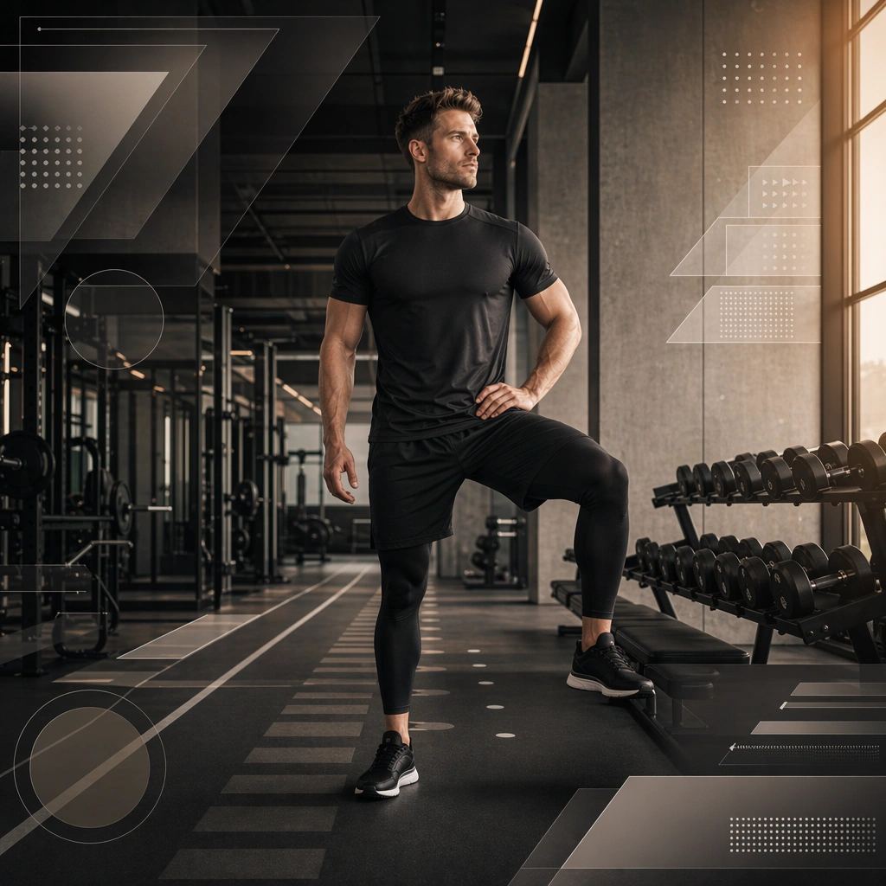

```text
Scene:
Build a square wall mural visual derived from the reference image for Gym Brand. Preserve the exact world established by the reference image, including the same palette family, lighting direction, environmental logic, and surface finish. The new frame should feel like a deliberate extension of one campaign system, not a separate concept. Shift the hierarchy to suit this use case, but keep the overall composition commercial, polished, and ready for real rollout.

Subject:
Use the same original subject identity and anchor cues introduced by the reference image, now organized as same member integrated with interior lines. Keep faces, hair logic, body proportions, apparel or product construction, and major supporting forms consistent with the reference. Allow only the layout emphasis, pose, crop, and contextual energy to change so the result clearly belongs to the same package.

Important details:
Continuity is the main challenge. Preserve the exact reference language for color, materials, framing rhythm, and overall brandless campaign grammar while steering the tone toward architectural scale. Keep any stat blocks, schedule modules, arrows, badges, or callout panels non-readable. The derivative should prove that the same art direction can handle a different communication task without losing identity or utility. Make it credible for production use, with clean edges, intentional spacing, and no random decorative elements.

Use case:
Gym Brand series study 3/9, a derivative surface linked to 01-reference-gym-brand-anchor.

Constraints:
No readable text, no watermark, no logos, preserve exact 1:1 aspect ratio, no new subject identity, no brand marks, no palette drift, no unrelated props, no collage chaos, no copied public-figure styling.
```

[Pinned source](https://github.com/ChaosRealmsAI/gpt-image-2-gallery/blob/5296db8c996e38776c83a0bc8c64f848dcd512b3/works/topics/gym-brand-poster-and-membership-system/packages/series-membership-system/images/03-wall-mural-visual/meta.json) · GPT Image2 · 1024×1024 · Reference images required. · ProjectD:pending individual review.

## Challenge Week Variant · gym-brand-poster-and-membership-system/series-membership-system/04-challenge-week-variant

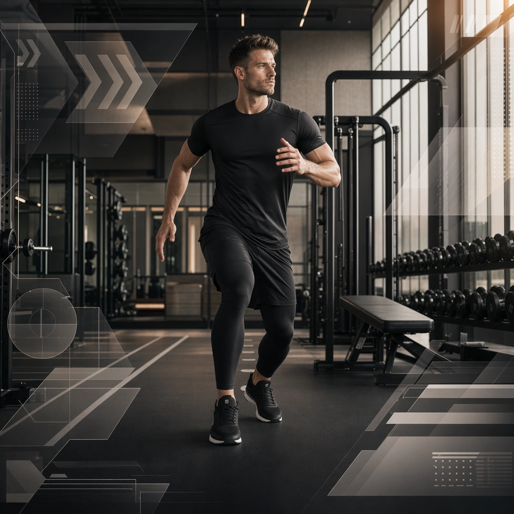

```text
Scene:
Build a square challenge-week variant derived from the reference image for Gym Brand. Preserve the exact world established by the reference image, including the same palette family, lighting direction, environmental logic, and surface finish. The new frame should feel like a deliberate extension of one campaign system, not a separate concept. Shift the hierarchy to suit this use case, but keep the overall composition commercial, polished, and ready for real rollout.

Subject:
Use the same original subject identity and anchor cues introduced by the reference image, now organized as same member in active stance. Keep faces, hair logic, body proportions, apparel or product construction, and major supporting forms consistent with the reference. Allow only the layout emphasis, pose, crop, and contextual energy to change so the result clearly belongs to the same package.

Important details:
Continuity is the main challenge. Preserve the exact reference language for color, materials, framing rhythm, and overall brandless campaign grammar while steering the tone toward motivating urgency. Keep any stat blocks, schedule modules, arrows, badges, or callout panels non-readable. The derivative should prove that the same art direction can handle a different communication task without losing identity or utility. Make it credible for production use, with clean edges, intentional spacing, and no random decorative elements.

Use case:
Gym Brand series study 4/9, a derivative surface linked to 01-reference-gym-brand-anchor.

Constraints:
No readable text, no watermark, no logos, preserve exact 1:1 aspect ratio, no new subject identity, no brand marks, no palette drift, no unrelated props, no collage chaos, no copied public-figure styling.
```

[Pinned source](https://github.com/ChaosRealmsAI/gpt-image-2-gallery/blob/5296db8c996e38776c83a0bc8c64f848dcd512b3/works/topics/gym-brand-poster-and-membership-system/packages/series-membership-system/images/04-challenge-week-variant/meta.json) · GPT Image2 · 1024×1024 · Reference images required. · ProjectD:pending individual review.

## Recovery Zone Promo · gym-brand-poster-and-membership-system/single-support-studies/recovery-zone-promo

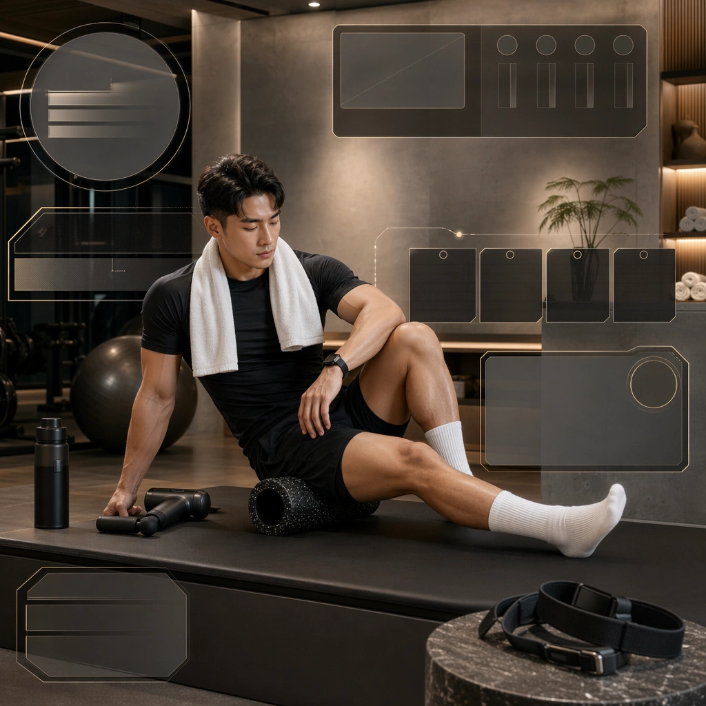

```text
Scene:
Create a square recovery zone promo for Gym Brand, using gym-brand communication with clean architecture, membership-friendly structure, and premium local-acquisition polish. The composition should read as a practical, production-ready sports or fitness surface with a clear hierarchy, premium lighting, and obvious commercial intent. Keep the environment specific enough to feel real, but leave enough control in the layout for non-readable information modules, campaign blocks, or visualized metrics. Aim for a finish that works for a brand, club, app, academy, or event operator.

Subject:
Build the image around member in recovery area. The subject should be original, believable, and free of any real-brand or celebrity cues. Use realistic apparel, safe body mechanics when movement is visible, and environmental props that support the category without clutter. The subject must stay visually dominant so the design still works as a communication asset rather than a pure scene study.

Important details:
The mood should read as calm premium comfort. Treat layout, light, and supporting graphic structure as part of one polished delivery surface. Any schedule blocks, metric panels, quote zones, badges, or path diagrams must stay abstract and non-readable. Prioritize usefulness, clarity, and category truth over spectacle. The image should feel distinct from the series package while still belonging naturally to the same topic and business use case.

Use case:
Gym Brand single study 6/9, an independent rollout surface for the topic.

Constraints:
No readable text, no watermark, no logos, preserve exact 1:1 aspect ratio, no brand marks, no public-figure resemblance, no generic stock layout, no cluttered UI imitation, no accidental copyrighted insignia.
```

[Pinned source](https://github.com/ChaosRealmsAI/gpt-image-2-gallery/blob/5296db8c996e38776c83a0bc8c64f848dcd512b3/works/topics/gym-brand-poster-and-membership-system/packages/single-support-studies/images/recovery-zone-promo/meta.json) · GPT Image2 · 1024×1024 · No source-declared image dependencies. · ProjectD:pending individual review.

## Boxing Night Gym Card · gym-brand-poster-and-membership-system/single-support-studies/boxing-night-gym-card

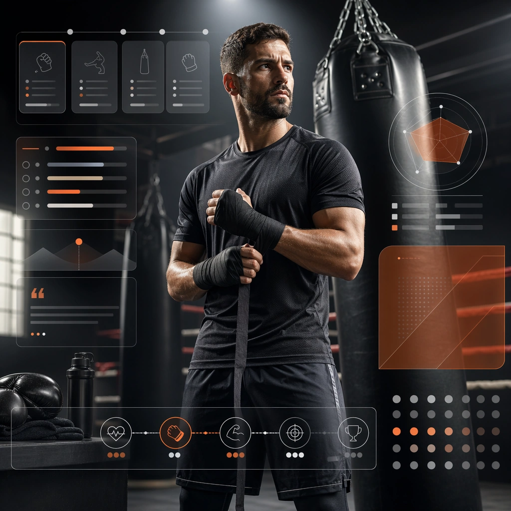

```text
Scene:
Create a square boxing-class support card for Gym Brand, using gym-brand communication with clean architecture, membership-friendly structure, and premium local-acquisition polish. The composition should read as a practical, production-ready sports or fitness surface with a clear hierarchy, premium lighting, and obvious commercial intent. Keep the environment specific enough to feel real, but leave enough control in the layout for non-readable information modules, campaign blocks, or visualized metrics. Aim for a finish that works for a brand, club, app, academy, or event operator.

Subject:
Build the image around trainer near heavy bags. The subject should be original, believable, and free of any real-brand or celebrity cues. Use realistic apparel, safe body mechanics when movement is visible, and environmental props that support the category without clutter. The subject must stay visually dominant so the design still works as a communication asset rather than a pure scene study.

Important details:
The mood should read as contained intensity. Treat layout, light, and supporting graphic structure as part of one polished delivery surface. Any schedule blocks, metric panels, quote zones, badges, or path diagrams must stay abstract and non-readable. Prioritize usefulness, clarity, and category truth over spectacle. The image should feel distinct from the series package while still belonging naturally to the same topic and business use case.

Use case:
Gym Brand single study 7/9, an independent rollout surface for the topic.

Constraints:
No readable text, no watermark, no logos, preserve exact 1:1 aspect ratio, no brand marks, no public-figure resemblance, no generic stock layout, no cluttered UI imitation, no accidental copyrighted insignia.
```

[Pinned source](https://github.com/ChaosRealmsAI/gpt-image-2-gallery/blob/5296db8c996e38776c83a0bc8c64f848dcd512b3/works/topics/gym-brand-poster-and-membership-system/packages/single-support-studies/images/boxing-night-gym-card/meta.json) · GPT Image2 · 1024×1024 · No source-declared image dependencies. · ProjectD:pending individual review.

## Member Welcome Pack · gym-brand-poster-and-membership-system/single-support-studies/member-welcome-pack

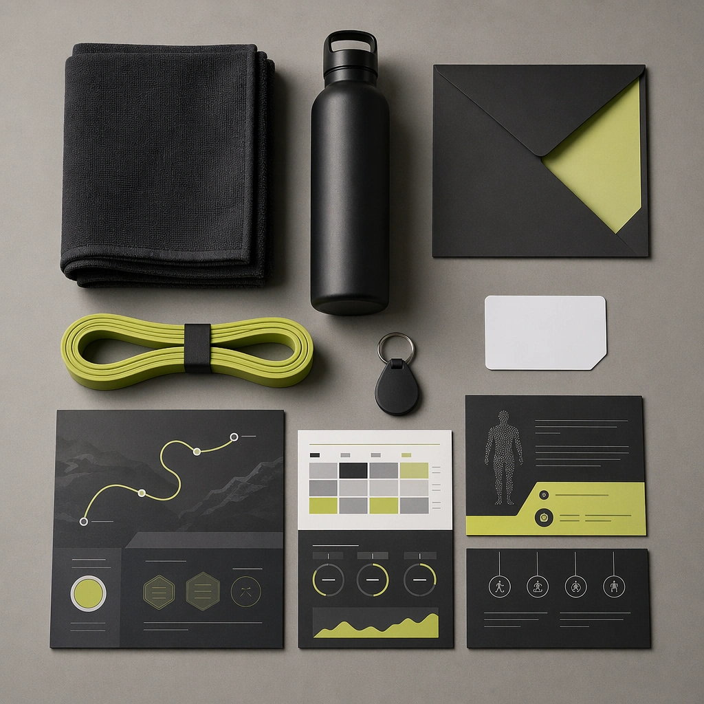

```text
Scene:
Create a square member welcome-pack board for Gym Brand, using gym-brand communication with clean architecture, membership-friendly structure, and premium local-acquisition polish. The composition should read as a practical, production-ready sports or fitness surface with a clear hierarchy, premium lighting, and obvious commercial intent. Keep the environment specific enough to feel real, but leave enough control in the layout for non-readable information modules, campaign blocks, or visualized metrics. Aim for a finish that works for a brand, club, app, academy, or event operator.

Subject:
Build the image around flat-lay onboarding objects. The subject should be original, believable, and free of any real-brand or celebrity cues. Use realistic apparel, safe body mechanics when movement is visible, and environmental props that support the category without clutter. The subject must stay visually dominant so the design still works as a communication asset rather than a pure scene study.

Important details:
The mood should read as operational polish. Treat layout, light, and supporting graphic structure as part of one polished delivery surface. Any schedule blocks, metric panels, quote zones, badges, or path diagrams must stay abstract and non-readable. Prioritize usefulness, clarity, and category truth over spectacle. The image should feel distinct from the series package while still belonging naturally to the same topic and business use case.

Use case:
Gym Brand single study 8/9, an independent rollout surface for the topic.

Constraints:
No readable text, no watermark, no logos, preserve exact 1:1 aspect ratio, no brand marks, no public-figure resemblance, no generic stock layout, no cluttered UI imitation, no accidental copyrighted insignia.
```

[Pinned source](https://github.com/ChaosRealmsAI/gpt-image-2-gallery/blob/5296db8c996e38776c83a0bc8c64f848dcd512b3/works/topics/gym-brand-poster-and-membership-system/packages/single-support-studies/images/member-welcome-pack/meta.json) · GPT Image2 · 1024×1024 · No source-declared image dependencies. · ProjectD:pending individual review.

## Storefront Window Poster · gym-brand-poster-and-membership-system/single-support-studies/storefront-window-poster

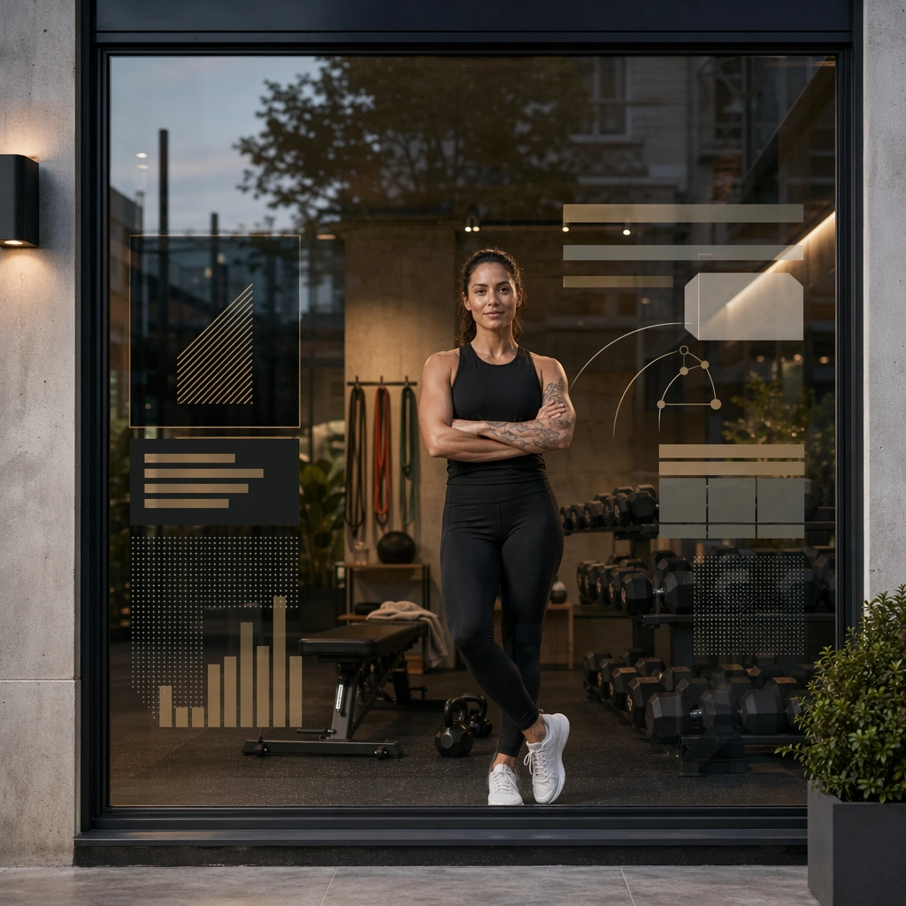

```text
Scene:
Create a square storefront window poster for Gym Brand, using gym-brand communication with clean architecture, membership-friendly structure, and premium local-acquisition polish. The composition should read as a practical, production-ready sports or fitness surface with a clear hierarchy, premium lighting, and obvious commercial intent. Keep the environment specific enough to feel real, but leave enough control in the layout for non-readable information modules, campaign blocks, or visualized metrics. Aim for a finish that works for a brand, club, app, academy, or event operator.

Subject:
Build the image around coach or member behind glass facade. The subject should be original, believable, and free of any real-brand or celebrity cues. Use realistic apparel, safe body mechanics when movement is visible, and environmental props that support the category without clutter. The subject must stay visually dominant so the design still works as a communication asset rather than a pure scene study.

Important details:
The mood should read as local acquisition clarity. Treat layout, light, and supporting graphic structure as part of one polished delivery surface. Any schedule blocks, metric panels, quote zones, badges, or path diagrams must stay abstract and non-readable. Prioritize usefulness, clarity, and category truth over spectacle. The image should feel distinct from the series package while still belonging naturally to the same topic and business use case.

Use case:
Gym Brand single study 9/9, an independent rollout surface for the topic.

Constraints:
No readable text, no watermark, no logos, preserve exact 1:1 aspect ratio, no brand marks, no public-figure resemblance, no generic stock layout, no cluttered UI imitation, no accidental copyrighted insignia.
```

[Pinned source](https://github.com/ChaosRealmsAI/gpt-image-2-gallery/blob/5296db8c996e38776c83a0bc8c64f848dcd512b3/works/topics/gym-brand-poster-and-membership-system/packages/single-support-studies/images/storefront-window-poster/meta.json) · GPT Image2 · 1024×1024 · No source-declared image dependencies. · ProjectD:pending individual review.

## Midnight Entry Anchor · halloween-night-event-promo-set/series-night-promo-system/01-midnight-entry-anchor

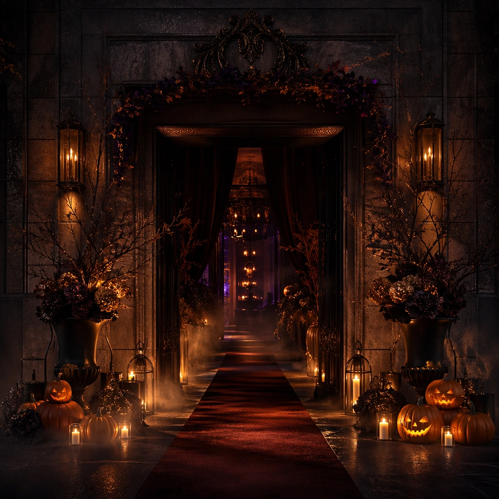

```text
Scene:
Create a square premium Halloween event campaign image at night with deep charcoal shadows, ember-orange highlights, restrained purple-black undertones, and theatrical spot lighting. The environment should feel like a high-end nightlife or immersive event venue rather than a haunted-house cliché. Build suspense through thresholds, smoke traces, and layered set dressing, with enough realism that the scene could advertise a real event, hotel activation, or entertainment launch.

Subject:
Center an event-entry composition with carved pumpkins used sparingly, candle or lantern glow, textured stone or metal, atmospheric props, and an implied invitation into a night experience. The set dressing should feel elegant and slightly dangerous, balancing fun with premium polish. Keep the subject original and commercially usable, with no copyrighted monsters or generic party-store clutter.

Important details:
Lock the Halloween grammar here: darkness with controlled light, premium materials, ember accents, subtle fog, and a feeling of suspenseful access. The image must feel event-ready and upscale, suitable for posters, social teasers, or hospitality promotions. Avoid campy costume-shop styling. Make every object and light source contribute to one coherent atmosphere of playful threat and night-time excitement.

Use case:
Halloween Promo series study 1/9.

Constraints:
No readable text, no watermark, no logos, preserve exact 1:1 aspect ratio, no readable event text, no gore, no horror-film character references, no cheap plastic skeleton overload, no logo signage, no cartoon bats everywhere, no fake blood, no carnival mess.
```

[Pinned source](https://github.com/ChaosRealmsAI/gpt-image-2-gallery/blob/5296db8c996e38776c83a0bc8c64f848dcd512b3/works/topics/halloween-night-event-promo-set/packages/series-night-promo-system/images/01-midnight-entry-anchor/meta.json) · GPT Image2 · 1024×1024 · No source-declared image dependencies. · ProjectD:pending individual review.

## Rooftop Party Variation · halloween-night-event-promo-set/series-night-promo-system/02-rooftop-party-variation

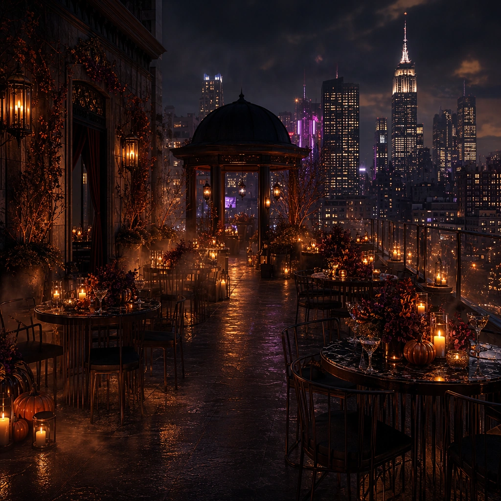

```text
Scene:
Create a square dependent event image in the exact same Halloween night world, preserving the same ember lighting, charcoal depth, restrained fog, and premium suspense from the reference image, but open the scene toward a rooftop party environment. The frame should still feel like the same campaign family, with continuity obvious in light, materials, and threat level, while shifting into a more social nightlife surface.

Subject:
Feature a rooftop setup with candlelit tables, elegant drinks, pumpkins or seasonal props used with restraint, and city-night depth in the background. Preserve exact campaign identity from the reference model while changing the venue emphasis toward elevated nightlife. The scene should feel polished, seductive, and event-promotional, never comedic or bargain-party themed.

Important details:
Keep the same premium Halloween grammar: controlled menace, sharp pools of light, dark surfaces, and one coherent invitation to the night. The rooftop setting should add exclusivity, not spectacle overload. Glass, metal, smoke, and weather cues should all feel real. The result should work as a hero asset for rooftop events, hospitality activations, or nightlife campaign rollout.

Use case:
Halloween Promo series study 2/9.

Constraints:
No readable text, no watermark, no logos, preserve exact 1:1 aspect ratio, preserve exact campaign identity from the reference image, no readable menu signs, no costume crowd, no gore, no giant spider-web cliché, no logo glassware, no fireworks, no cheesy neon, no copyrighted creatures.
```

[Pinned source](https://github.com/ChaosRealmsAI/gpt-image-2-gallery/blob/5296db8c996e38776c83a0bc8c64f848dcd512b3/works/topics/halloween-night-event-promo-set/packages/series-night-promo-system/images/02-rooftop-party-variation/meta.json) · GPT Image2 · 1024×1024 · Reference images required. · ProjectD:pending individual review.

## Haunted Hotel Variation · halloween-night-event-promo-set/series-night-promo-system/03-haunted-hotel-variation

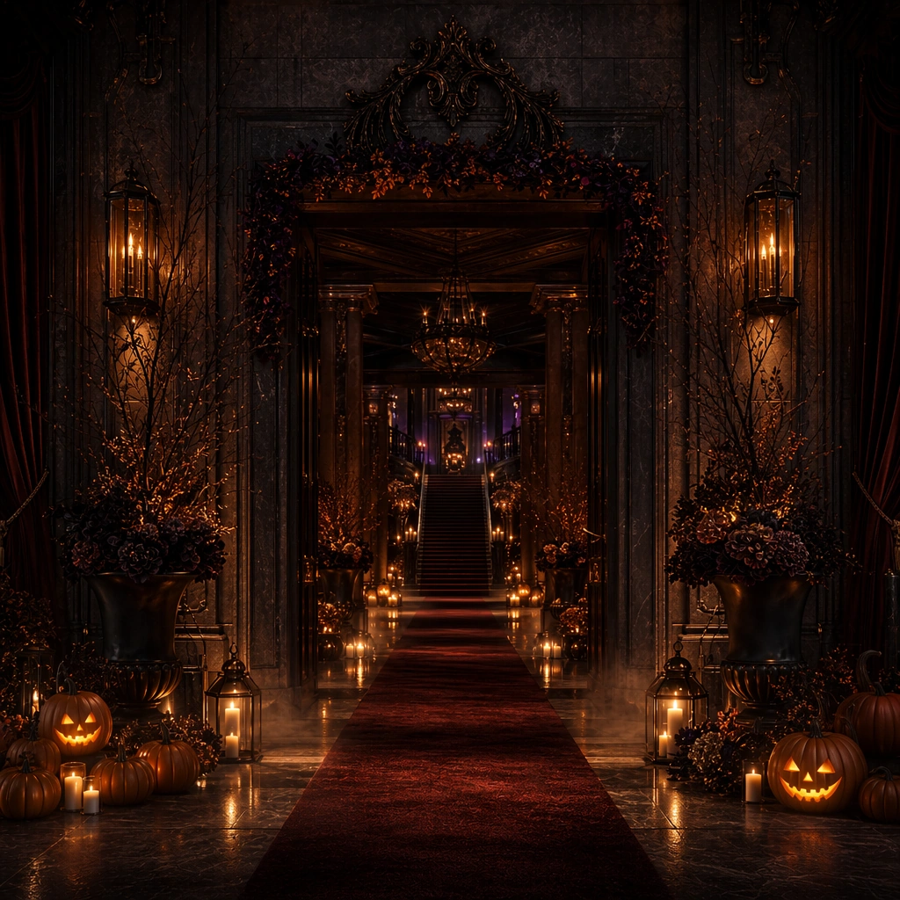

```text
Scene:
Create a square dependent campaign image in the same Halloween world, with the identical charcoal shadow, ember glow, and polished threat from the reference image, but shift the setting into a dramatic hotel corridor or lobby threshold. Preserve the same light behavior and material identity while increasing spatial mystery and hospitality cues, as though the same campaign has expanded into a haunted-luxury venue activation.

Subject:
Show an elegant corridor or lobby with moody lamps, shadows, controlled fog, a few carefully placed seasonal props, and an implied invitation deeper into the space. Preserve exact campaign identity from the reference model while making the hospitality environment central. The scene should feel cinematic and event-ready, but still physically plausible and premium.

Important details:
Continuity must remain exact. Keep the same color discipline, same suspense level, and same upscale production value. Let the haunted quality come from architecture, light falloff, and silence rather than from monsters or gore. The final image should fit hotel activations, event venues, or premium Halloween poster systems.

Use case:
Halloween Promo series study 3/9.

Constraints:
No readable text, no watermark, no logos, preserve exact 1:1 aspect ratio, preserve exact campaign identity from the reference image, no readable room numbers, no gore, no ghost cliché, no logo signage, no cheap cobweb decor, no zombie references, no bright carnival colors, no jump-scare figure.
```

[Pinned source](https://github.com/ChaosRealmsAI/gpt-image-2-gallery/blob/5296db8c996e38776c83a0bc8c64f848dcd512b3/works/topics/halloween-night-event-promo-set/packages/series-night-promo-system/images/03-haunted-hotel-variation/meta.json) · GPT Image2 · 1024×1024 · Reference images required. · ProjectD:pending individual review.

## Carnival Gate Variation · halloween-night-event-promo-set/series-night-promo-system/04-carnival-gate-variation

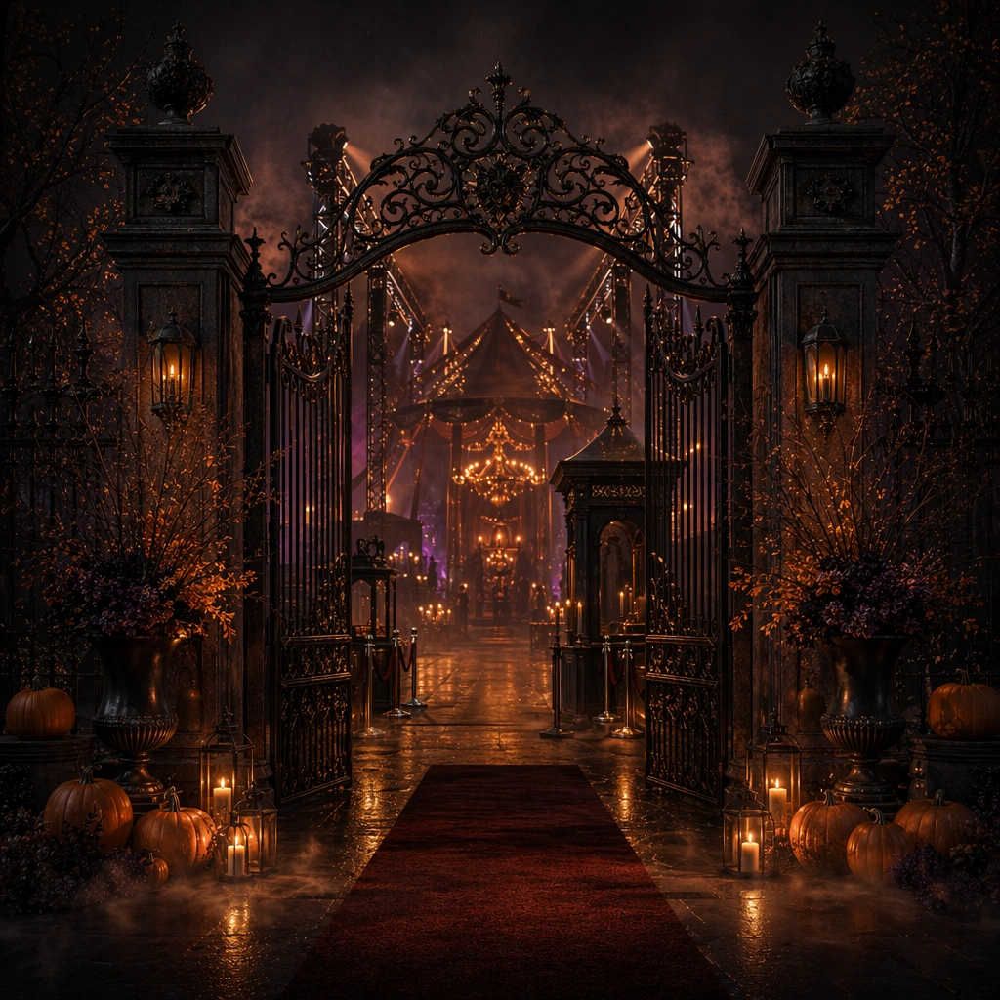

```text
Scene:
Create a square dependent Halloween campaign image inside the same moody event world, preserving the exact ember-orange highlights, charcoal depth, and refined sense of danger from the reference image, but orient the composition toward an entertainment-gate or fairground entry. The scene should remain premium and suspenseful rather than childish, with clear continuity to the anchor image.

Subject:
Feature a stylized gate, ticketing threshold without readable text, lantern light, sculptural props, and controlled seasonal detail that suggests a premium Halloween carnival or immersive event. Preserve exact campaign identity from the reference model while changing the venue emphasis. The subject must feel original, promotional, and suitable for nightlife or entertainment rollout.

Important details:
Keep the same high-end Halloween language: suspense first, novelty second. Metalwork, wood, haze, and lighting rigs should all feel believable. The gate should imply event access and anticipation, not a theme-park parody. The final image should work as campaign key art for entertainment venues and seasonal event promotions.

Use case:
Halloween Promo series study 4/9.

Constraints:
No readable text, no watermark, no logos, preserve exact 1:1 aspect ratio, preserve exact campaign identity from the reference image, no readable ticket text, no gore, no clown-horror cliché, no logo banners, no theme-park mascots, no circus overload, no rainbow carnival lights, no crowd crush.
```

[Pinned source](https://github.com/ChaosRealmsAI/gpt-image-2-gallery/blob/5296db8c996e38776c83a0bc8c64f848dcd512b3/works/topics/halloween-night-event-promo-set/packages/series-night-promo-system/images/04-carnival-gate-variation/meta.json) · GPT Image2 · 1024×1024 · Reference images required. · ProjectD:pending individual review.

## Candy Bar Still Life · halloween-night-event-promo-set/single-atmosphere-studies/candy-bar-still-life

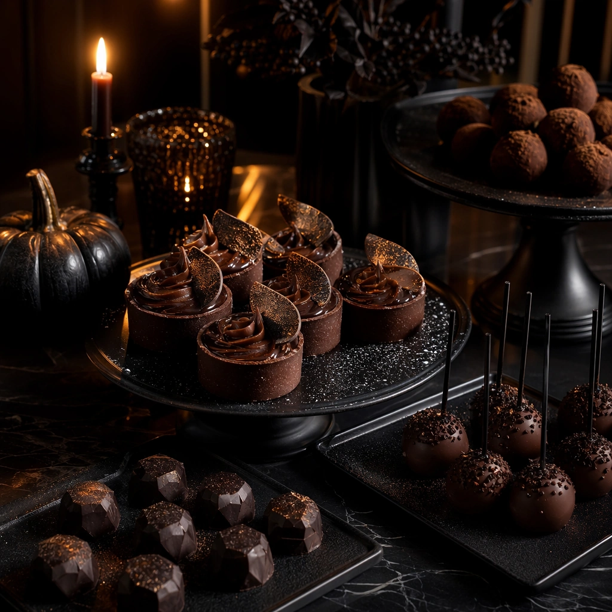

```text
Scene:
Create a square tabletop confectionery image at night with low warm light, charcoal shadows, and controlled orange highlights. The scene should feel like a premium event dessert station rather than a children's candy spread. Keep the composition art-directed, atmospheric, and commercially clear, with enough depth and texture that it could support hospitality, nightlife, or event-promo use.

Subject:
Show crafted sweets, dark chocolate tones, matte-black serving pieces, candle glow, and one or two restrained seasonal props integrated into a Halloween dessert setup. The subject should communicate indulgence, mystery, and nightlife sophistication without drifting into gore or cartoon party-store energy. Focus on plating, material finish, and mood.

Important details:
Keep the palette tight and premium. Chocolate sheen, sugar dust, ceramic texture, wax glow, and dark shadows should all feel real. The image should behave like a hospitality support asset for October promotions, cocktail bars, or event venues. It needs to feel desirable and eerie at once, with no cheap novelty cues.

Use case:
Halloween Promo single study 5/9.

Constraints:
No readable text, no watermark, no logos, preserve exact 1:1 aspect ratio, no readable menu labels, no fake blood desserts, no cartoon candy wrappers, no logos, no child-party props, no rainbow colors, no horror-movie references, no cluttered buffet.
```

[Pinned source](https://github.com/ChaosRealmsAI/gpt-image-2-gallery/blob/5296db8c996e38776c83a0bc8c64f848dcd512b3/works/topics/halloween-night-event-promo-set/packages/single-atmosphere-studies/images/candy-bar-still-life/meta.json) · GPT Image2 · 1024×1024 · No source-declared image dependencies. · ProjectD:pending individual review.

## Makeup Mirror Prep · halloween-night-event-promo-set/single-atmosphere-studies/makeup-mirror-prep

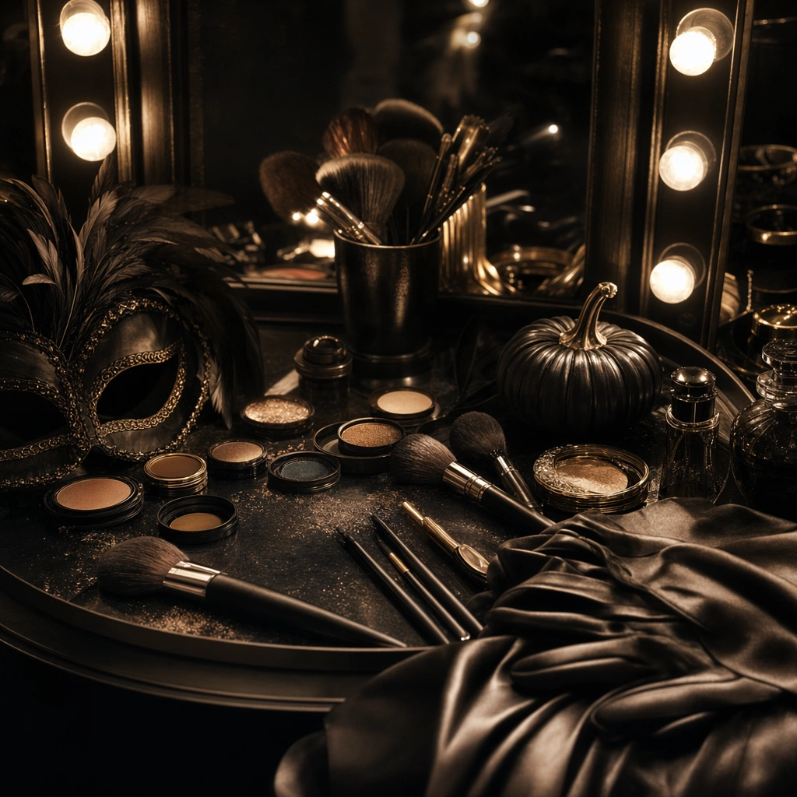

```text
Scene:
Create a square backstage vanity image with warm mirror bulbs, dark surrounding space, and an atmosphere of elegant transformation. The scene should feel like part of a premium event campaign rather than beauty content. Use reflective surfaces, arranged tools, and controlled shadow to suggest pre-night anticipation without needing a central face or readable packaging.

Subject:
Show a vanity setup with brushes, compact-like forms, pigment pans without readable marks, gloves or fabric, and one or two seasonal accessories hinting at costume or transformation. Keep the subject centered on preparation, ritual, and suspense. The composition should feel polished and campaign-ready, suitable for nightlife, entertainment, or hospitality promotion.

Important details:
Texture and light are the focus: mirror glow, brushed metal, powder residue, leather or satin detail, and the quiet tension before an event begins. Avoid beauty-brand cliché and avoid exaggerated gore or theatrical prosthetics. The result should feel atmospheric, premium, and narratively suggestive while staying commercially usable.

Use case:
Halloween Promo single study 6/9.

Constraints:
No readable text, no watermark, no logos, preserve exact 1:1 aspect ratio, no readable labels, no visible celebrity face, no fake blood, no horror character references, no cheap costume clutter, no logos, no neon overload, no crowded dressing room.
```

[Pinned source](https://github.com/ChaosRealmsAI/gpt-image-2-gallery/blob/5296db8c996e38776c83a0bc8c64f848dcd512b3/works/topics/halloween-night-event-promo-set/packages/single-atmosphere-studies/images/makeup-mirror-prep/meta.json) · GPT Image2 · 1024×1024 · No source-declared image dependencies. · ProjectD:pending individual review.

## Masquerade Drinks Table · halloween-night-event-promo-set/single-atmosphere-studies/masquerade-drinks-table

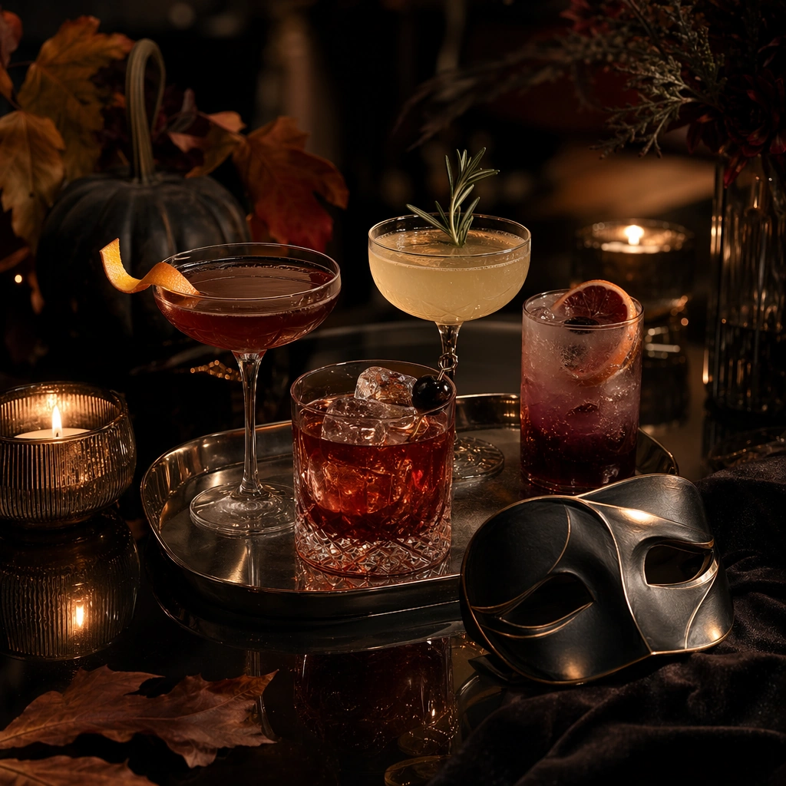

```text
Scene:
Create a square drinks-table campaign image at night with low amber light, dark glass reflections, and velvet-shadow atmosphere. The frame should feel like a premium hospitality or bar campaign for Halloween, not a casual party snapshot. Use strong styling, clean spacing, and enough visual hierarchy that the drinks, tableware, and seasonal cues read immediately.

Subject:
Show crafted cocktails or mocktails, glassware, a mask-like object or accessory, candlelight, and restrained seasonal props arranged into an elegant Halloween hospitality scene. The subject should communicate social intrigue and event readiness rather than horror or costume comedy. Keep the objects tactile, polished, and original.

Important details:
Let menace remain playful and upscale. Glass refraction, ice, garnish, velvet cloth, metal trays, and candlelight should all feel believable. The final image should support bar, hotel, or event promotions during Halloween. Avoid generic nightclub clutter or gaudy mixology theatrics. This is about polished suspense and selective seasonal coding. Keep the frame precise enough for gallery, research, and campaign reuse, with believable materials and a strong thumbnail read.

Use case:
Halloween Promo single study 7/9.

Constraints:
No readable text, no watermark, no logos, preserve exact 1:1 aspect ratio, no readable drink menu, no branded bottles, no gore, no cartoon skull cups, no cigarette clutter, no rainbow LEDs, no crowd, no movie-character masks.
```

[Pinned source](https://github.com/ChaosRealmsAI/gpt-image-2-gallery/blob/5296db8c996e38776c83a0bc8c64f848dcd512b3/works/topics/halloween-night-event-promo-set/packages/single-atmosphere-studies/images/masquerade-drinks-table/meta.json) · GPT Image2 · 1024×1024 · No source-declared image dependencies. · ProjectD:pending individual review.

## Foggy Alley Teaser · halloween-night-event-promo-set/single-atmosphere-studies/foggy-alley-teaser

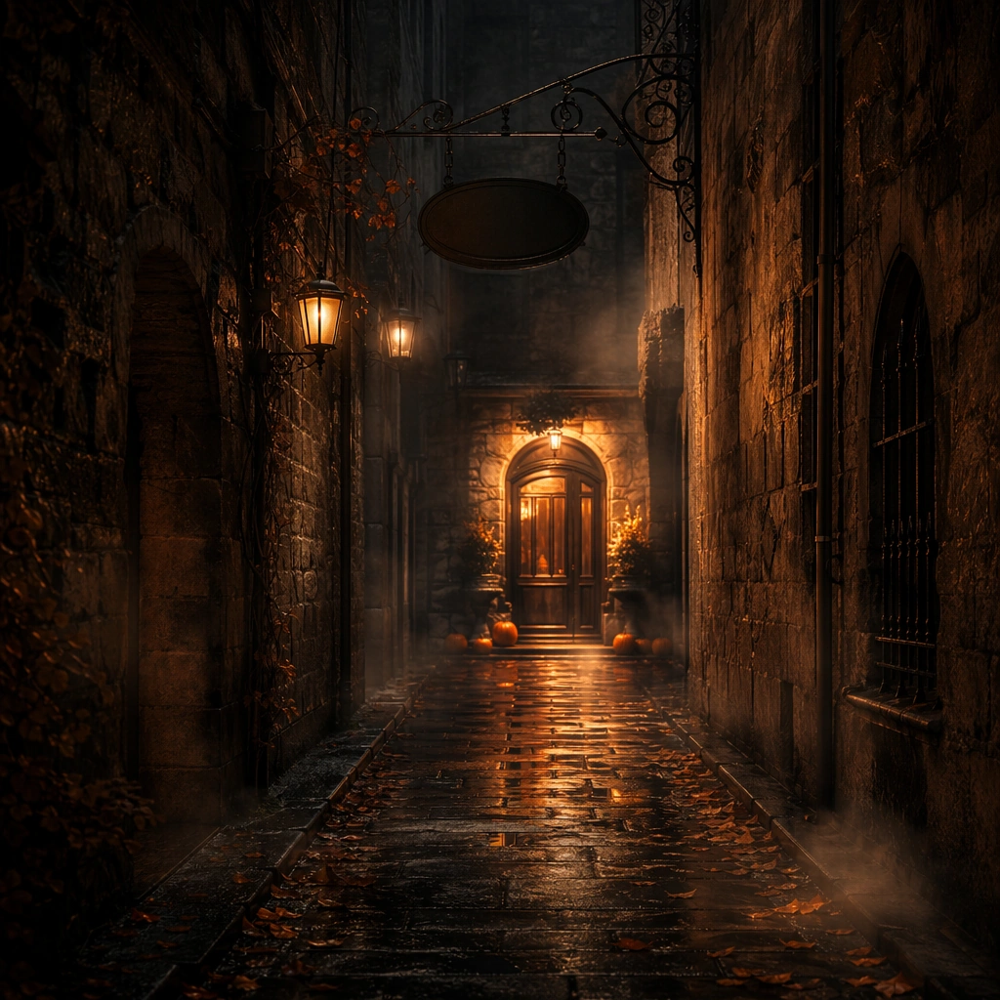

```text
Scene:
Create a square urban alley image at night with pockets of amber light, drifting fog, damp stone, and deep shadow. The frame should feel like a campaign teaser for an event or venue, not a crime scene or a horror still. Use strong perspective, controlled mystery, and a premium sense of atmosphere so the image can function as suspenseful promotional art.

Subject:
Show an empty or nearly empty alley with one strong destination cue such as a lit doorway, sign shape without readable text, or glowing threshold, plus restrained seasonal details that suggest Halloween night. The subject should communicate invitation, danger, and curiosity through environment rather than through monsters or graphic scare tactics.

Important details:
Atmosphere carries the image. Fog density, wet reflections, masonry texture, and light falloff should all be convincing. Keep the palette narrow and the composition elegant. The final asset should feel suitable for nightlife or entertainment teaser campaigns that want suspense without losing premium credibility.

Use case:
Halloween Promo single study 8/9.

Constraints:
No readable text, no watermark, no logos, preserve exact 1:1 aspect ratio, no readable signs, no gore, no horror-film villain silhouette, no police lights, no trash clutter, no graffiti text, no logo posters, no jump-scare figure.
```

[Pinned source](https://github.com/ChaosRealmsAI/gpt-image-2-gallery/blob/5296db8c996e38776c83a0bc8c64f848dcd512b3/works/topics/halloween-night-event-promo-set/packages/single-atmosphere-studies/images/foggy-alley-teaser/meta.json) · GPT Image2 · 1024×1024 · No source-declared image dependencies. · ProjectD:pending individual review.

## Amusement Gate Silhouette · halloween-night-event-promo-set/single-atmosphere-studies/amusement-gate-silhouette


```text
Scene:
Create a square event-gate image at night with smoke layers, warm backlight, and a strong silhouetted structure. The composition should feel like a promotional support asset for a premium Halloween entertainment venue. Keep the frame dramatic and readable, with controlled contrast and enough surrounding atmosphere that the gate feels like a destination instead of an isolated prop.

Subject:
Show a stylized gate, subtle lighting hardware, sculptural seasonal details, and a clear path inward that suggests anticipation. The subject should communicate premium event access and atmospheric thrill without readable text or overtly childish decoration. Build the image around shape language, smoke, and light more than on prop quantity.

Important details:
Silhouette clarity and material realism matter equally. Wood, metal, fog, and stone should all feel grounded. The gate should be iconic without borrowing from any known theme park or horror franchise. The final image should support posters, countdown tiles, and venue-promo campaigns for Halloween night events.

Use case:
Halloween Promo single study 9/9.

Constraints:
No readable text, no watermark, no logos, preserve exact 1:1 aspect ratio, no readable ticket text, no gore, no clown-horror cliché, no logo banners, no mascot costumes, no rainbow funfair lights, no crowding, no movie-franchise references.
```

[Pinned source](https://github.com/ChaosRealmsAI/gpt-image-2-gallery/blob/5296db8c996e38776c83a0bc8c64f848dcd512b3/works/topics/halloween-night-event-promo-set/packages/single-atmosphere-studies/images/amusement-gate-silhouette/meta.json) · GPT Image2 · 1024×1024 · No source-declared image dependencies. · ProjectD:pending individual review.

## Reference Anchor · hardware-software-companion-ui-hero/series-core-system/01-reference-anchor

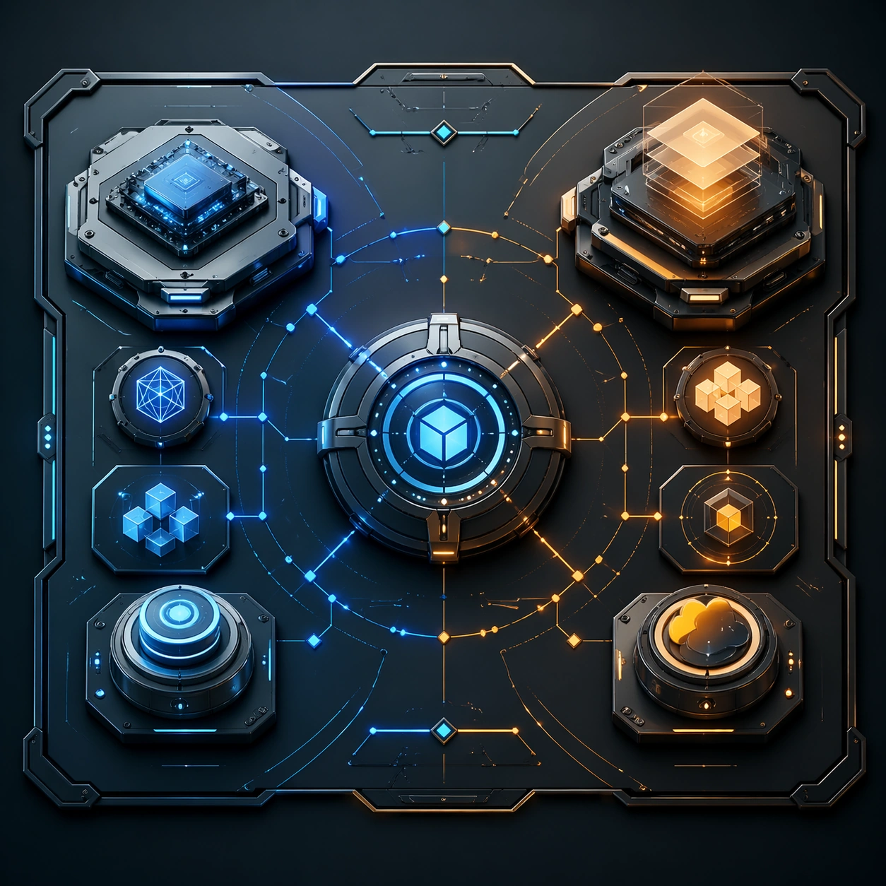

```text
Scene:
Create a square reference image for Hardware Software Companion UI Hero. Build a reference anchor establishing the core system with a premium, production-ready finish. Use a polished modular board or campaign surface with clean spacing, premium game-UI finish, and clear focal hierarchy. The composition should feel intentional, clean, and reusable for gallery, research, campaign, or internal handoff contexts. Lighting must support readability first, with the main forms clearly separated from the background and enough breathing room for the system to stay legible at both hero scale and thumbnail scale.

Subject:
Center a coherent original game-art system built for premium production and marketing surfaces. For this image, focus on reference anchor. Keep the same system logic stable across screenshots, cards, banners, and overview boards. This image is the canonical anchor that later series images must follow. The viewer should immediately understand what role this surface plays inside a cohesive game-production asset pack.

Important details:
Lock framing, icon grammar, palette blocking, and surface hierarchy so the kit feels production-ready and consistent. Preserve the core silhouette, framing language, and material logic from the reference image while each variation changes function. Keep materials believable, edge hierarchy disciplined, and the visual language consistent with Companion UI. Use abstract interface blocks or diagram accents when helpful, but avoid any readable language. The final result should feel like a deliberate production asset rather than a random illustration.

Use case:
Hardware Software Companion UI Hero series study 1/9, designed as reference anchor within a cohesive asset pack.

Constraints:
No readable text, no watermark, no logos, preserve exact 1:1 aspect ratio, no unrelated objects, no broken visual hierarchy, no malformed anatomy or broken perspective, no random decorative clutter.
```

[Pinned source](https://github.com/ChaosRealmsAI/gpt-image-2-gallery/blob/5296db8c996e38776c83a0bc8c64f848dcd512b3/works/topics/hardware-software-companion-ui-hero/packages/series-core-system/images/01-reference-anchor/meta.json) · GPT Image2 · 1254×1254 · No source-declared image dependencies. · ProjectD:pending individual review.

## Variant One · hardware-software-companion-ui-hero/series-core-system/02-variant-one


```text
Scene:
Create a square dependent image for Hardware Software Companion UI Hero. Build a first controlled variation in the same system with a premium, production-ready finish. Use a polished modular board or campaign surface with clean spacing, premium game-UI finish, and clear focal hierarchy. The composition should feel intentional, clean, and reusable for gallery, research, campaign, or internal handoff contexts. Lighting must support readability first, with the main forms clearly separated from the background and enough breathing room for the system to stay legible at both hero scale and thumbnail scale.

Subject:
Center a coherent original game-art system built for premium production and marketing surfaces. For this image, focus on the intended support surface. Keep the same system logic stable across screenshots, cards, banners, and overview boards. Preserve exact identity or system logic from the reference image while changing only the intended variation axis. The viewer should immediately understand what role this surface plays inside a cohesive game-production asset pack.

Important details:
Lock framing, icon grammar, palette blocking, and surface hierarchy so the kit feels production-ready and consistent. Preserve the core silhouette, framing language, and material logic from the reference image while each variation changes function. Keep materials believable, edge hierarchy disciplined, and the visual language consistent with Companion UI. Use abstract interface blocks or diagram accents when helpful, but avoid any readable language. The final result should feel like a deliberate production asset rather than a random illustration.

Use case:
Hardware Software Companion UI Hero series study 2/9, designed as variant one within a cohesive asset pack.

Constraints:
No readable text, no watermark, no logos, preserve exact 1:1 aspect ratio, no unrelated objects, no broken visual hierarchy, no malformed anatomy or broken perspective, no random decorative clutter.
```

[Pinned source](https://github.com/ChaosRealmsAI/gpt-image-2-gallery/blob/5296db8c996e38776c83a0bc8c64f848dcd512b3/works/topics/hardware-software-companion-ui-hero/packages/series-core-system/images/02-variant-one/meta.json) · GPT Image2 · 1254×1254 · Reference images required. · ProjectD:pending individual review.

## Variant Two · hardware-software-companion-ui-hero/series-core-system/03-variant-two

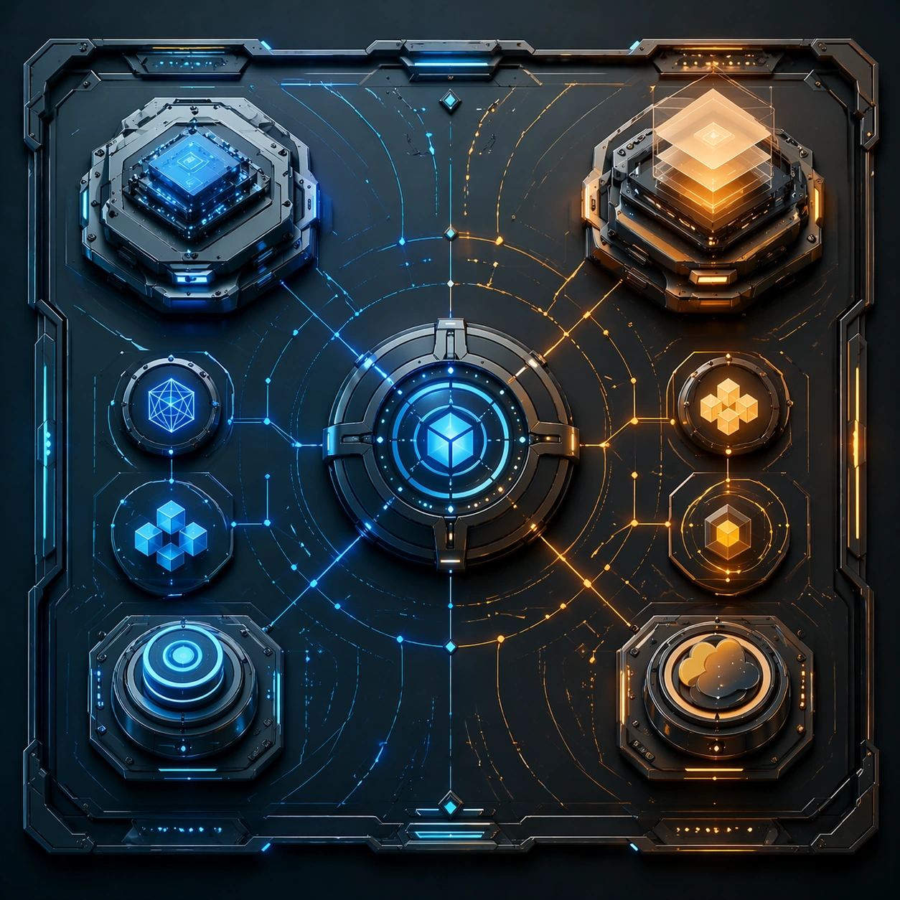

```text
Scene:
Create a square dependent image for Hardware Software Companion UI Hero. Build a second controlled variation in the same system with a premium, production-ready finish. Use a polished modular board or campaign surface with clean spacing, premium game-UI finish, and clear focal hierarchy. The composition should feel intentional, clean, and reusable for gallery, research, campaign, or internal handoff contexts. Lighting must support readability first, with the main forms clearly separated from the background and enough breathing room for the system to stay legible at both hero scale and thumbnail scale.

Subject:
Center a coherent original game-art system built for premium production and marketing surfaces. For this image, focus on the intended support surface. Keep the same system logic stable across screenshots, cards, banners, and overview boards. Preserve exact identity or system logic from the reference image while changing only the intended variation axis. The viewer should immediately understand what role this surface plays inside a cohesive game-production asset pack.

Important details:
Lock framing, icon grammar, palette blocking, and surface hierarchy so the kit feels production-ready and consistent. Preserve the core silhouette, framing language, and material logic from the reference image while each variation changes function. Keep materials believable, edge hierarchy disciplined, and the visual language consistent with Companion UI. Use abstract interface blocks or diagram accents when helpful, but avoid any readable language. The final result should feel like a deliberate production asset rather than a random illustration.

Use case:
Hardware Software Companion UI Hero series study 3/9, designed as variant two within a cohesive asset pack.

Constraints:
No readable text, no watermark, no logos, preserve exact 1:1 aspect ratio, no unrelated objects, no broken visual hierarchy, no malformed anatomy or broken perspective, no random decorative clutter.
```

[Pinned source](https://github.com/ChaosRealmsAI/gpt-image-2-gallery/blob/5296db8c996e38776c83a0bc8c64f848dcd512b3/works/topics/hardware-software-companion-ui-hero/packages/series-core-system/images/03-variant-two/meta.json) · GPT Image2 · 1254×1254 · Reference images required. · ProjectD:pending individual review.

## Variant Three · hardware-software-companion-ui-hero/series-core-system/04-variant-three

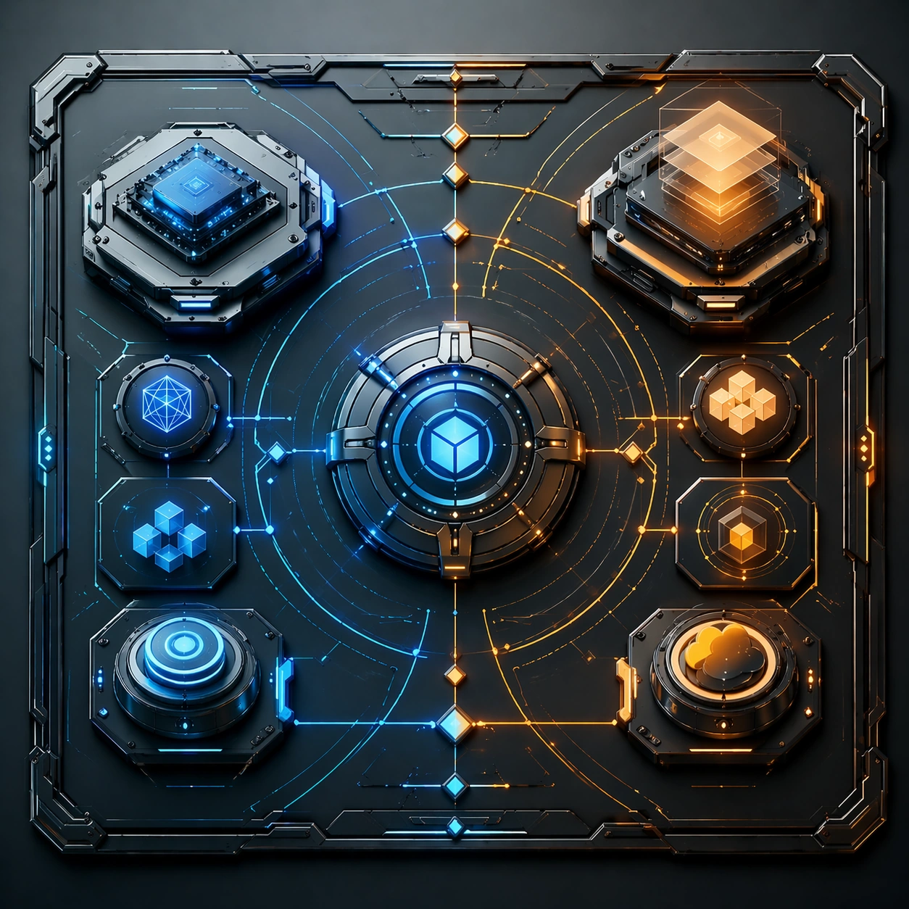

```text
Scene:
Create a square dependent image for Hardware Software Companion UI Hero. Build a third controlled variation in the same system with a premium, production-ready finish. Use a polished modular board or campaign surface with clean spacing, premium game-UI finish, and clear focal hierarchy. The composition should feel intentional, clean, and reusable for gallery, research, campaign, or internal handoff contexts. Lighting must support readability first, with the main forms clearly separated from the background and enough breathing room for the system to stay legible at both hero scale and thumbnail scale.

Subject:
Center a coherent original game-art system built for premium production and marketing surfaces. For this image, focus on the intended support surface. Keep the same system logic stable across screenshots, cards, banners, and overview boards. Preserve exact identity or system logic from the reference image while changing only the intended variation axis. The viewer should immediately understand what role this surface plays inside a cohesive game-production asset pack.

Important details:
Lock framing, icon grammar, palette blocking, and surface hierarchy so the kit feels production-ready and consistent. Preserve the core silhouette, framing language, and material logic from the reference image while each variation changes function. Keep materials believable, edge hierarchy disciplined, and the visual language consistent with Companion UI. Use abstract interface blocks or diagram accents when helpful, but avoid any readable language. The final result should feel like a deliberate production asset rather than a random illustration.

Use case:
Hardware Software Companion UI Hero series study 4/9, designed as variant three within a cohesive asset pack.

Constraints:
No readable text, no watermark, no logos, preserve exact 1:1 aspect ratio, no unrelated objects, no broken visual hierarchy, no malformed anatomy or broken perspective, no random decorative clutter.
```

[Pinned source](https://github.com/ChaosRealmsAI/gpt-image-2-gallery/blob/5296db8c996e38776c83a0bc8c64f848dcd512b3/works/topics/hardware-software-companion-ui-hero/packages/series-core-system/images/04-variant-three/meta.json) · GPT Image2 · 1254×1254 · Reference images required. · ProjectD:pending individual review.

## Support One · hardware-software-companion-ui-hero/single-support-studies/support-one

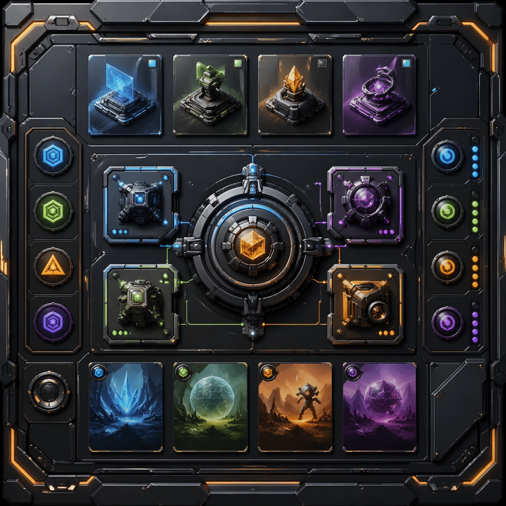

```text
Scene:
Create a square standalone support image for Hardware Software Companion UI Hero. Build a support-surface study with a clear focal hierarchy and a finished professional surface. Use a polished modular board or campaign surface with clean spacing, premium game-UI finish, and clear focal hierarchy. The frame should feel self-contained and polished, with enough structure to explain the system even without the reference series, yet still obviously belonging to the same theme and production world.

Subject:
Show a coherent original game-art system built for premium production and marketing surfaces in a way that emphasizes the intended support surface. Keep the same system logic stable across screenshots, cards, banners, and overview boards. Even though this image is independent, the viewer should still recognize the same universe, same commercial logic, and same production intent as the core package.

Important details:
Lock framing, icon grammar, palette blocking, and surface hierarchy so the kit feels production-ready and consistent. Preserve the broader theme language through color, framing, material choices, and modular composition. Use clean panel rhythm, premium asset presentation, and believable detail density. The image should work equally well as a gallery study, research reference, and mock production deliverable.

Use case:
Hardware Software Companion UI Hero single study 5/9, exploring support one as a support surface.

Constraints:
No readable text, no watermark, no logos, preserve exact 1:1 aspect ratio, no unrelated objects, no broken visual hierarchy, no visual noise that obscures the main surface, no accidental brand resemblance.
```

[Pinned source](https://github.com/ChaosRealmsAI/gpt-image-2-gallery/blob/5296db8c996e38776c83a0bc8c64f848dcd512b3/works/topics/hardware-software-companion-ui-hero/packages/single-support-studies/images/support-one/meta.json) · GPT Image2 · 1254×1254 · No source-declared image dependencies. · ProjectD:pending individual review.

## Support Two · hardware-software-companion-ui-hero/single-support-studies/support-two

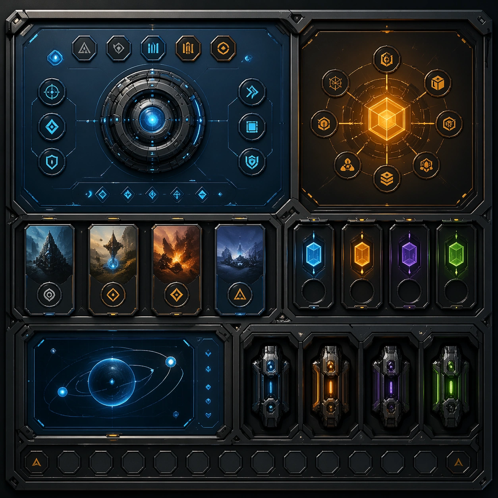

```text
Scene:
Create a square standalone support image for Hardware Software Companion UI Hero. Build a second support-surface study with a clear focal hierarchy and a finished professional surface. Use a polished modular board or campaign surface with clean spacing, premium game-UI finish, and clear focal hierarchy. The frame should feel self-contained and polished, with enough structure to explain the system even without the reference series, yet still obviously belonging to the same theme and production world.

Subject:
Show a coherent original game-art system built for premium production and marketing surfaces in a way that emphasizes the intended support surface. Keep the same system logic stable across screenshots, cards, banners, and overview boards. Even though this image is independent, the viewer should still recognize the same universe, same commercial logic, and same production intent as the core package.

Important details:
Lock framing, icon grammar, palette blocking, and surface hierarchy so the kit feels production-ready and consistent. Preserve the broader theme language through color, framing, material choices, and modular composition. Use clean panel rhythm, premium asset presentation, and believable detail density. The image should work equally well as a gallery study, research reference, and mock production deliverable.

Use case:
Hardware Software Companion UI Hero single study 6/9, exploring support two as a support surface.

Constraints:
No readable text, no watermark, no logos, preserve exact 1:1 aspect ratio, no unrelated objects, no broken visual hierarchy, no visual noise that obscures the main surface, no accidental brand resemblance.
```

[Pinned source](https://github.com/ChaosRealmsAI/gpt-image-2-gallery/blob/5296db8c996e38776c83a0bc8c64f848dcd512b3/works/topics/hardware-software-companion-ui-hero/packages/single-support-studies/images/support-two/meta.json) · GPT Image2 · 1254×1254 · No source-declared image dependencies. · ProjectD:pending individual review.

## Support Three · hardware-software-companion-ui-hero/single-support-studies/support-three

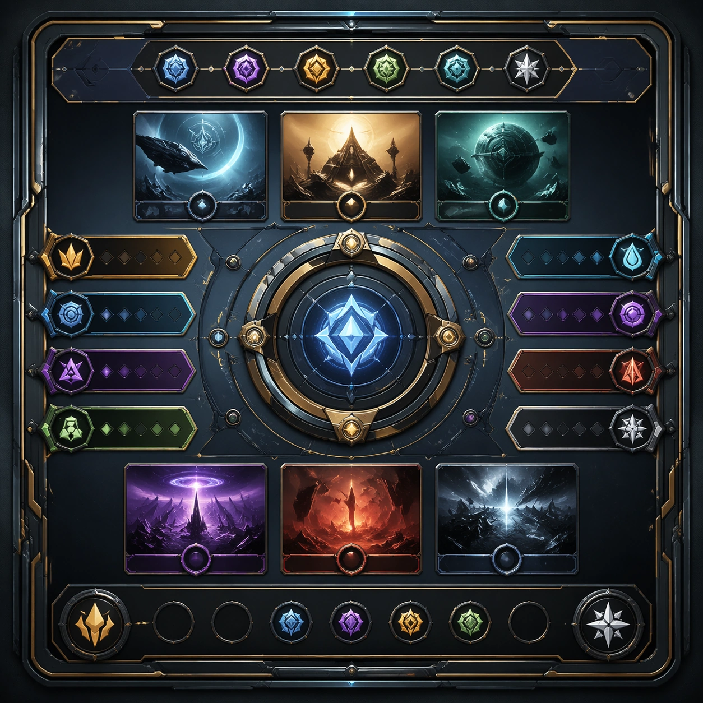

```text
Scene:
Create a square standalone support image for Hardware Software Companion UI Hero. Build a third support-surface study with a clear focal hierarchy and a finished professional surface. Use a polished modular board or campaign surface with clean spacing, premium game-UI finish, and clear focal hierarchy. The frame should feel self-contained and polished, with enough structure to explain the system even without the reference series, yet still obviously belonging to the same theme and production world.

Subject:
Show a coherent original game-art system built for premium production and marketing surfaces in a way that emphasizes the intended support surface. Keep the same system logic stable across screenshots, cards, banners, and overview boards. Even though this image is independent, the viewer should still recognize the same universe, same commercial logic, and same production intent as the core package.

Important details:
Lock framing, icon grammar, palette blocking, and surface hierarchy so the kit feels production-ready and consistent. Preserve the broader theme language through color, framing, material choices, and modular composition. Use clean panel rhythm, premium asset presentation, and believable detail density. The image should work equally well as a gallery study, research reference, and mock production deliverable.

Use case:
Hardware Software Companion UI Hero single study 7/9, exploring support three as a support surface.

Constraints:
No readable text, no watermark, no logos, preserve exact 1:1 aspect ratio, no unrelated objects, no broken visual hierarchy, no visual noise that obscures the main surface, no accidental brand resemblance.
```

[Pinned source](https://github.com/ChaosRealmsAI/gpt-image-2-gallery/blob/5296db8c996e38776c83a0bc8c64f848dcd512b3/works/topics/hardware-software-companion-ui-hero/packages/single-support-studies/images/support-three/meta.json) · GPT Image2 · 1254×1254 · No source-declared image dependencies. · ProjectD:pending individual review.

## Support Four · hardware-software-companion-ui-hero/single-support-studies/support-four

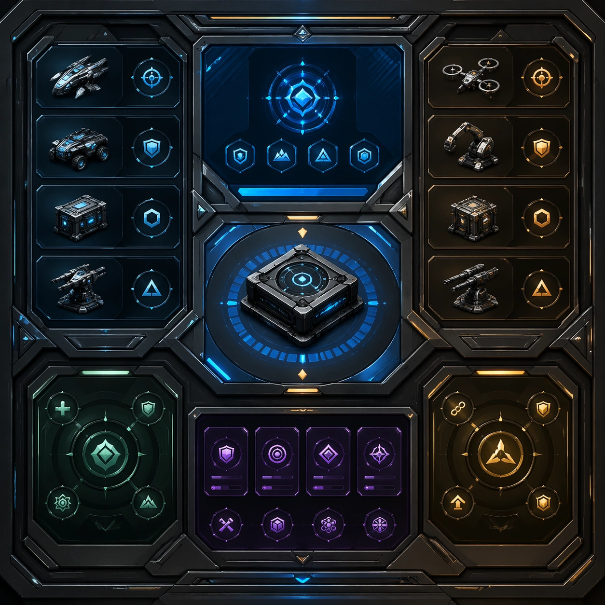

```text
Scene:
Create a square standalone support image for Hardware Software Companion UI Hero. Build a fourth support-surface study with a clear focal hierarchy and a finished professional surface. Use a polished modular board or campaign surface with clean spacing, premium game-UI finish, and clear focal hierarchy. The frame should feel self-contained and polished, with enough structure to explain the system even without the reference series, yet still obviously belonging to the same theme and production world.

Subject:
Show a coherent original game-art system built for premium production and marketing surfaces in a way that emphasizes the intended support surface. Keep the same system logic stable across screenshots, cards, banners, and overview boards. Even though this image is independent, the viewer should still recognize the same universe, same commercial logic, and same production intent as the core package.

Important details:
Lock framing, icon grammar, palette blocking, and surface hierarchy so the kit feels production-ready and consistent. Preserve the broader theme language through color, framing, material choices, and modular composition. Use clean panel rhythm, premium asset presentation, and believable detail density. The image should work equally well as a gallery study, research reference, and mock production deliverable.

Use case:
Hardware Software Companion UI Hero single study 8/9, exploring support four as a support surface.

Constraints:
No readable text, no watermark, no logos, preserve exact 1:1 aspect ratio, no unrelated objects, no broken visual hierarchy, no visual noise that obscures the main surface, no accidental brand resemblance.
```

[Pinned source](https://github.com/ChaosRealmsAI/gpt-image-2-gallery/blob/5296db8c996e38776c83a0bc8c64f848dcd512b3/works/topics/hardware-software-companion-ui-hero/packages/single-support-studies/images/support-four/meta.json) · GPT Image2 · 1254×1254 · No source-declared image dependencies. · ProjectD:pending individual review.

## Support Five · hardware-software-companion-ui-hero/single-support-studies/support-five

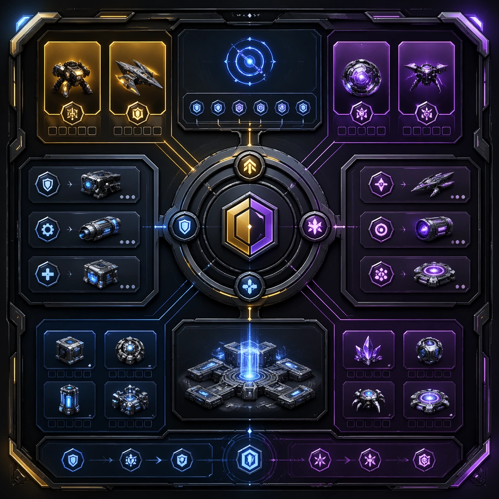

```text
Scene:
Create a square standalone support image for Hardware Software Companion UI Hero. Build a fifth support-surface study with a clear focal hierarchy and a finished professional surface. Use a polished modular board or campaign surface with clean spacing, premium game-UI finish, and clear focal hierarchy. The frame should feel self-contained and polished, with enough structure to explain the system even without the reference series, yet still obviously belonging to the same theme and production world.

Subject:
Show a coherent original game-art system built for premium production and marketing surfaces in a way that emphasizes the intended support surface. Keep the same system logic stable across screenshots, cards, banners, and overview boards. Even though this image is independent, the viewer should still recognize the same universe, same commercial logic, and same production intent as the core package.

Important details:
Lock framing, icon grammar, palette blocking, and surface hierarchy so the kit feels production-ready and consistent. Preserve the broader theme language through color, framing, material choices, and modular composition. Use clean panel rhythm, premium asset presentation, and believable detail density. The image should work equally well as a gallery study, research reference, and mock production deliverable.

Use case:
Hardware Software Companion UI Hero single study 9/9, exploring support five as a support surface.

Constraints:
No readable text, no watermark, no logos, preserve exact 1:1 aspect ratio, no unrelated objects, no broken visual hierarchy, no visual noise that obscures the main surface, no accidental brand resemblance.
```

[Pinned source](https://github.com/ChaosRealmsAI/gpt-image-2-gallery/blob/5296db8c996e38776c83a0bc8c64f848dcd512b3/works/topics/hardware-software-companion-ui-hero/packages/single-support-studies/images/support-five/meta.json) · GPT Image2 · 1254×1254 · No source-declared image dependencies. · ProjectD:pending individual review.

## Reference Hero Anchor · hero-reveal-turnaround-pack/series-hero-launch-system/01-reference-hero-anchor

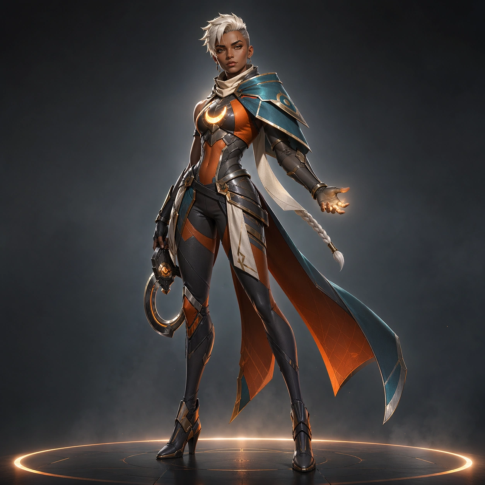

```text
Scene:
Create a polished square hero-introduction frame with a controlled studio-cinematic hybrid setup. The camera sits at a three-quarter full-body distance, slightly below eye level so the figure feels playable and aspirational without becoming exaggerated poster fantasy. Use a soft storm-gray gradient background, a faint illuminated floor ring, and crisp rim light that separates the character silhouette from the backdrop. Brightness should be concentrated on the face, chest reactor, and shoulder mantle, while the corners stay quiet and clean for downstream marketing reuse. The overall image must feel like a finished launch anchor that can guide later references across poster, bust crop, banner, and production-sheet outputs.

Subject:
Center an original playable heroine with warm umber skin, an angular heart-shaped face, high cheekbones, a slim slash scar through the left eyebrow, alert amber-brown eyes, and short ivory-white hair cut into an undercut with one long braided tail. Preserve athletic dancer-sprinter build with long legs, narrow waist, and confident upright posture. Her costume language is fixed: asymmetrical teal shoulder mantle, ember-orange bodysuit, graphite segmented armor, ivory scarf tabs, crescent chest reactor, slim ring-blade sidearm, and split cape panels. Keep the body turned slightly off-axis with one foot forward, one hand relaxed near the ring-blade holster, and the other hand open in a calm charge-ready gesture. The expression should be focused, composed, and unmistakably heroic rather than aggressive. The face must be highly legible and repeatable, with the same eyebrow scar, hairline, braid length, cheekbone shape, nose bridge, lip shape, and eye spacing that all later images will preserve.

Important details:
The visual language must balance promo polish with production clarity. Lock the faction palette to teal, ember orange, gunmetal, and soft ivory, keep armor seams believable, and let the chest reactor read as a crescent motif that can recur in every asset. Do not overfill the background. The silhouette should stay readable from thumbnail distance: angular shoulder mantle on one side, narrow waist, long legs, and split cape panels. Materials should feel like premium stylized game rendering, with matte armor, satin fabric, soft skin texture, and controlled emissive accents.

Use case:
Hero Reveal Turnaround Pack series study 1/9, establishing the canonical hero identity for all launch and turnaround assets.

Constraints:
No readable text, no watermark, no logos, preserve exact 1:1 aspect ratio, no extra characters, no oversized weapon swing, no chaotic background scenery, no costume redesign, no face drift, no inaccurate anatomy.
```

[Pinned source](https://github.com/ChaosRealmsAI/gpt-image-2-gallery/blob/5296db8c996e38776c83a0bc8c64f848dcd512b3/works/topics/hero-reveal-turnaround-pack/packages/series-hero-launch-system/images/01-reference-hero-anchor/meta.json) · GPT Image2 · 1254×1254 · No source-declared image dependencies. · ProjectD:pending individual review.

## Splash Launch Poster · hero-reveal-turnaround-pack/series-hero-launch-system/02-splash-launch-poster

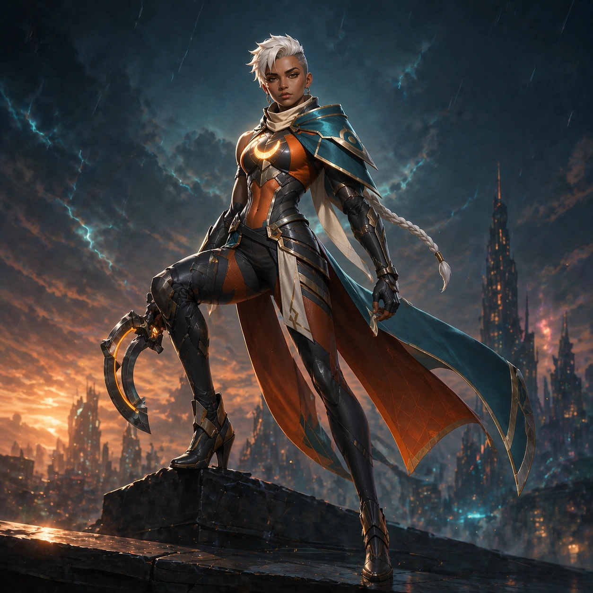

```text
Scene:
Build a square splash-art poster scene on a wind-cut rooftop above a futuristic city at dusk. The camera is wider and lower than the reference image, pushing the heroine into a launch-ready stance against layered clouds, distant towers, and streaks of teal electrical atmosphere. Keep the background simplified enough for a poster surface, with light concentrated around the figure and the skyline falling into soft depth haze. Motion should come from cape panels, sparks, and angled rain trails rather than from clutter. The frame should feel premium, commercial, and immediately legible as a hero reveal asset.

Subject:
Use the exact same heroine from the reference model: an original playable heroine with warm umber skin, an angular heart-shaped face, high cheekbones, a slim slash scar through the left eyebrow, alert amber-brown eyes, and short ivory-white hair cut into an undercut with one long braided tail, athletic dancer-sprinter build with long legs, narrow waist, and confident upright posture, and the same fixed costume system of asymmetrical teal shoulder mantle, ember-orange bodysuit, graphite segmented armor, ivory scarf tabs, crescent chest reactor, slim ring-blade sidearm, and split cape panels. She stands on a rooftop ledge with one knee bent and the ring-blade partially unfolded, not fully swung. Her expression remains composed and strategic. Preserve exact face, hair base, body proportions, armor placement, and palette from the reference model while shifting only the scene energy and pose intensity. The viewer must instantly recognize that the poster and the anchor image feature the same playable hero.

Important details:
Keep the chest reactor, eyebrow scar, undercut braid, asymmetrical mantle, and split cape panels visibly consistent. The poster can amplify atmosphere with electric arcs and rain glow, but it must not mutate the costume or body plan. Use bold negative space around the upper body so the image can later support title-safe crops. Materials should stay within stylized premium game-art rendering: satin cloth, brushed gunmetal, subtle skin texture, and disciplined emissive cyan highlights.

Use case:
Hero Reveal Turnaround Pack series study 2/9, testing locked-identity splash poster execution for launch marketing.

Constraints:
No readable text, no watermark, no logos, preserve exact 1:1 aspect ratio, preserve exact face and costume logic from the reference model, no flying debris wall, no extra squad members, no impossible weapon scale, no off-palette VFX.
```

[Pinned source](https://github.com/ChaosRealmsAI/gpt-image-2-gallery/blob/5296db8c996e38776c83a0bc8c64f848dcd512b3/works/topics/hero-reveal-turnaround-pack/packages/series-hero-launch-system/images/02-splash-launch-poster/meta.json) · GPT Image2 · 1254×1254 · Reference images required. · ProjectD:pending individual review.

## Character Select Bust · hero-reveal-turnaround-pack/series-hero-launch-system/03-character-select-bust

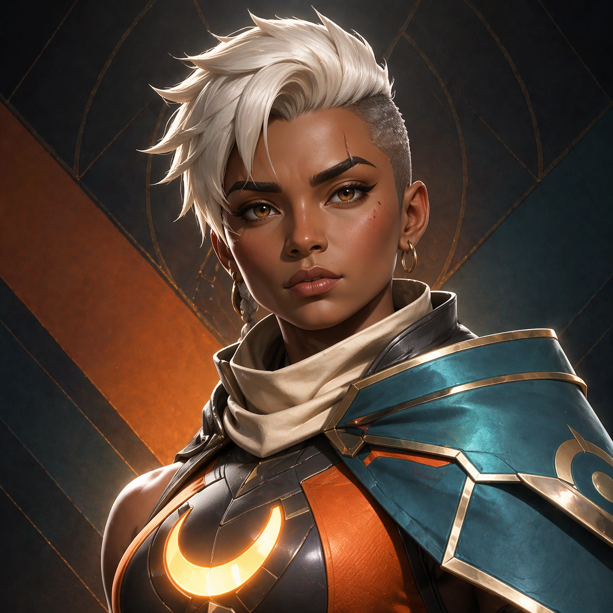

```text
Scene:
Create a square bust-focused crop designed like a premium character-select portrait. The camera should frame from upper chest to just above the head, with slight three-quarter rotation, controlled studio lighting, and a background made of layered color blocks, subtle faction geometry, and soft atmospheric glow. Brightness needs to favor the eyes, cheekbones, reactor edge, and shoulder mantle so the face remains readable at small UI sizes. The composition should be clean, centered, and compact, leaving enough breathing room around the silhouette for future card-frame use.

Subject:
Show the exact same heroine from the reference model with no face drift: an original playable heroine with warm umber skin, an angular heart-shaped face, high cheekbones, a slim slash scar through the left eyebrow, alert amber-brown eyes, and short ivory-white hair cut into an undercut with one long braided tail. Preserve the undercut, braided tail origin, eyebrow scar, cheekbone structure, nose bridge, lip shape, neck length, and athletic upper-body read. Keep only the upper costume zones visible, especially the teal mantle, ember-orange underlayer, crescent reactor, and graphite collar hardware. The expression should be calm, alert, slightly challenging, and suitable for a player selection screen rather than a cinematic battle scream.

Important details:
This image must optimize identity recognition at smaller scale. Eye direction, facial landmarks, palette blocking, and edge lighting should all support instant recognition. Avoid dramatic depth blur that would soften the face. Keep the background abstract and non-narrative, using restrained geometric layering instead of scenery. Skin texture should stay believable, hair fibers should remain stylized but not waxy, and costume material separation must still be clear even in the tighter crop.

Use case:
Hero Reveal Turnaround Pack series study 3/9, building a locked-identity bust crop for select-card and profile surfaces.

Constraints:
No readable text, no watermark, no logos, preserve exact 1:1 aspect ratio, preserve exact face and hair base from the reference model, no extreme lens distortion, no screaming expression, no cropped-off chin, no random UI text blocks.
```

[Pinned source](https://github.com/ChaosRealmsAI/gpt-image-2-gallery/blob/5296db8c996e38776c83a0bc8c64f848dcd512b3/works/topics/hero-reveal-turnaround-pack/packages/series-hero-launch-system/images/03-character-select-bust/meta.json) · GPT Image2 · 1254×1254 · Reference images required. · ProjectD:pending individual review.

## Victory Banner Pose · hero-reveal-turnaround-pack/series-hero-launch-system/04-victory-banner-pose

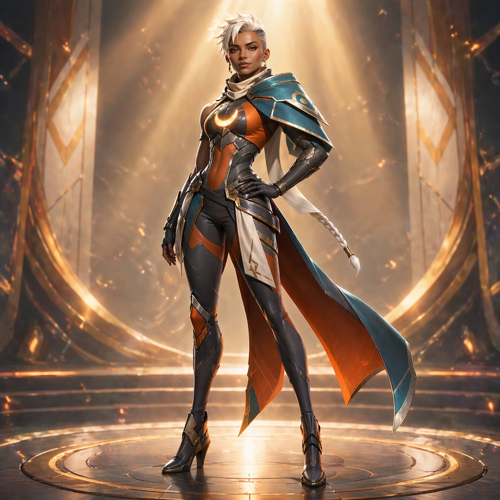

```text
Scene:
Compose a square banner-style hero shot intended for victory screens and campaign surfaces. Use a bright, polished environment with angled spotlight beams, floating embers, and a simplified arena backdrop that fades into soft depth. The camera should sit at mid-to-full body distance with a slightly elevated framing that feels triumphant without losing the body silhouette. The lighting is cleaner and more celebratory than the launch poster: crisp highlights, subtle bloom, and a controlled glow that makes the hero feel premium and collectible.

Subject:
Present the same heroine from the reference model, preserving exact face, hair base, body proportions, and costume logic. She shifts into a confident post-match pose: one hip relaxed, shoulders squared, ring-blade folded, chin slightly raised, and a restrained victorious smile. Keep the eyebrow scar, amber-brown eyes, ivory undercut braid, chest reactor, teal mantle, ember-orange suit panels, and graphite armor placement unchanged. The image should read as the identical hero after a successful match, not as a redesigned variant.

Important details:
Focus on strong silhouette readability and celebratory polish. The split cape panels may flare slightly, but their shape must remain consistent. Emissive accents should stay elegant and limited to reactor and subtle edge lighting. Use a premium game-banner finish with clean gradients and material clarity rather than noisy battle effects. The costume seams, holster placement, boot structure, and shoulder asymmetry must remain locked for downstream marketing coherence.

Use case:
Hero Reveal Turnaround Pack series study 4/9, testing a victory-banner crop that still preserves the canonical launch identity.

Constraints:
No readable text, no watermark, no logos, preserve exact 1:1 aspect ratio, preserve exact face and body proportions from the reference model, no trophy props, no crowd, no confetti overload, no costume recolor, no exaggerated grin.
```

[Pinned source](https://github.com/ChaosRealmsAI/gpt-image-2-gallery/blob/5296db8c996e38776c83a0bc8c64f848dcd512b3/works/topics/hero-reveal-turnaround-pack/packages/series-hero-launch-system/images/04-victory-banner-pose/meta.json) · GPT Image2 · 1254×1254 · Reference images required. · ProjectD:pending individual review.

## Ability Showcase Triptych · hero-reveal-turnaround-pack/series-hero-launch-system/05-ability-showcase-triptych

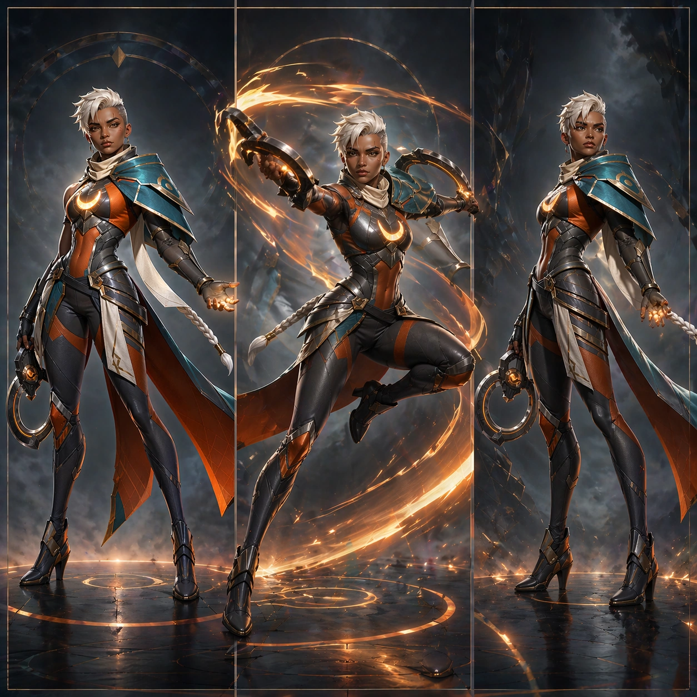

```text
Scene:
Design a square triptych-style promotional board divided into three vertical action windows within one coherent composition. Each panel should feel like a different beat of the same ability showcase, using a restrained storm-tech environment, soft atmospheric haze, and clean panel spacing. Keep the overall board bright and premium, with controlled motion streaks and energy arcs that guide the eye from left to right. Even though three moments appear in one image, the board should stay organized, readable, and market-ready rather than chaotic.

Subject:
In all three windows, depict the exact same heroine from the reference model: an original playable heroine with warm umber skin, an angular heart-shaped face, high cheekbones, a slim slash scar through the left eyebrow, alert amber-brown eyes, and short ivory-white hair cut into an undercut with one long braided tail, athletic dancer-sprinter build with long legs, narrow waist, and confident upright posture, and the fixed costume system of asymmetrical teal shoulder mantle, ember-orange bodysuit, graphite segmented armor, ivory scarf tabs, crescent chest reactor, slim ring-blade sidearm, and split cape panels. Panel one can show a ready stance, panel two a mid-cast energy sweep, and panel three a settled recovery pose, but every panel must preserve the same face, hair base, body proportions, and costume logic. The chest reactor and ring-blade should visually connect the sequence, making the board read as one coherent hero ability showcase rather than three different characters.

Important details:
The critical challenge is continuity across multiple poses inside one image. Keep facial features stable even when the head angle changes. Preserve mantle shape, braid length, boot height, armor segmentation, and faction palette. Use motion and energy only to emphasize the ability rhythm, not to hide design inconsistency. The background geometry should remain abstract and supportive, with enough structure to feel like a commercial campaign board.

Use case:
Hero Reveal Turnaround Pack series study 5/9, testing multi-pose ability marketing while keeping the heroine identity locked.

Constraints:
No readable text, no watermark, no logos, preserve exact 1:1 aspect ratio, preserve exact face and costume logic from the reference model, no extra ally or enemy characters, no panel text labels, no random color swaps, no broken anatomy in motion.
```

[Pinned source](https://github.com/ChaosRealmsAI/gpt-image-2-gallery/blob/5296db8c996e38776c83a0bc8c64f848dcd512b3/works/topics/hero-reveal-turnaround-pack/packages/series-hero-launch-system/images/05-ability-showcase-triptych/meta.json) · GPT Image2 · 1254×1254 · Reference images required. · ProjectD:pending individual review.

## Reference Turnaround Sheet · hero-reveal-turnaround-pack/series-production-turnaround-system/01-reference-turnaround-sheet

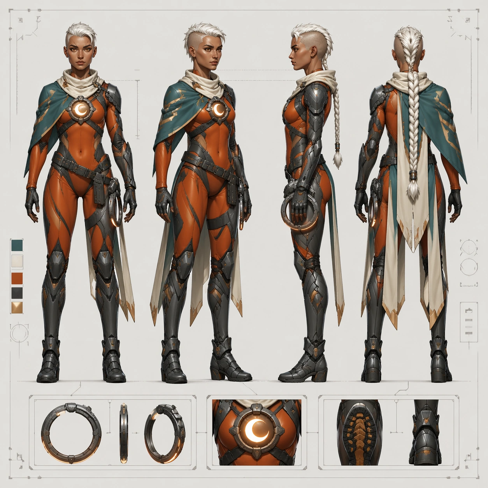

```text
Scene:
Create a square concept-art turnaround sheet presented like a polished internal production document. The sheet sits perfectly front-facing on a pale neutral background with soft overhead lighting, precise margins, faint alignment guides, and enough breathing room for four body views plus a few accessory insets. The image must feel technical and studio-ready rather than cinematic, with a measured rhythm of negative space and controlled contrast. Keep the brightness even across the sheet so costume seams, silhouette breaks, and material transitions remain readable at a glance.

Subject:
Render the same heroine established in the launch package: an original playable heroine with warm umber skin, an angular heart-shaped face, high cheekbones, a slim slash scar through the left eyebrow, alert amber-brown eyes, and short ivory-white hair cut into an undercut with one long braided tail, athletic dancer-sprinter build with long legs, narrow waist, and confident upright posture, and the exact costume system of asymmetrical teal shoulder mantle, ember-orange bodysuit, graphite segmented armor, ivory scarf tabs, crescent chest reactor, slim ring-blade sidearm, and split cape panels. Show her in four aligned full-body views on one sheet: front, three-quarter, ninety-degree side, and back. Each view must preserve the same head size, body proportions, facial structure, braid origin, eyebrow scar placement, chest reactor position, shoulder mantle asymmetry, holster placement, cape split, boot height, and armor segmentation. Include a few small accessory insets for the ring-blade, reactor motif, and boot sole tread, but keep the main figure views dominant.

Important details:
Treat this as industrial character design. Keep line hierarchy clean, materials believable, and layout structure intentional. Use thin abstract callout boxes and measurement ticks without readable language. The sheet should clearly translate the promo hero into a production-ready deliverable without inventing new costume parts. All four figures must feel like the exact same person viewed from different angles, not like siblings or skin variants.

Use case:
Hero Reveal Turnaround Pack series study 6/9, establishing the technical turnaround grammar for the same launch heroine.

Constraints:
No readable text, no watermark, no logos, preserve exact 1:1 aspect ratio, no extra fifth view, no dramatic action pose, no scenery background, no costume redesign, no facial inconsistency between views, no malformed hands.
```

[Pinned source](https://github.com/ChaosRealmsAI/gpt-image-2-gallery/blob/5296db8c996e38776c83a0bc8c64f848dcd512b3/works/topics/hero-reveal-turnaround-pack/packages/series-production-turnaround-system/images/01-reference-turnaround-sheet/meta.json) · GPT Image2 · 1254×1254 · No source-declared image dependencies. · ProjectD:pending individual review.

## Front Side Back Sheet · hero-reveal-turnaround-pack/series-production-turnaround-system/02-front-side-back-sheet

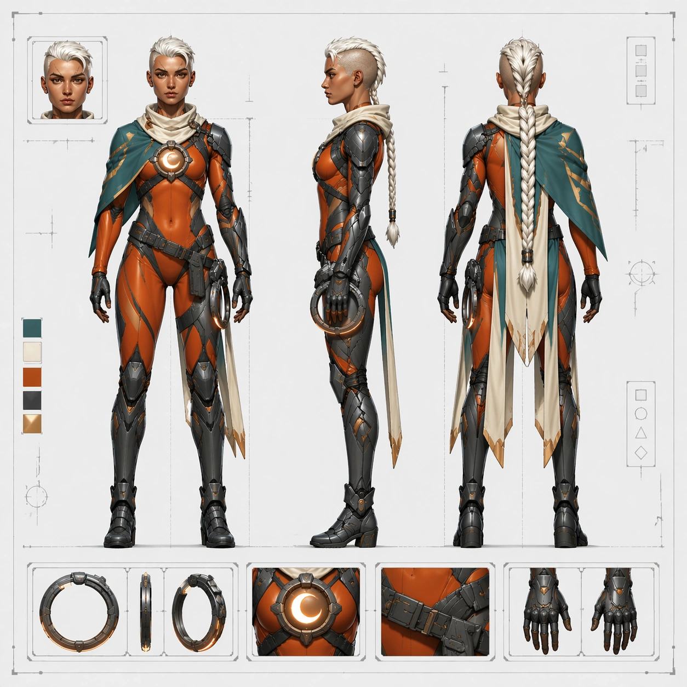

```text
Scene:
Produce a square orthographic character-sheet image with a bright neutral board, strict spacing, and an even more diagrammatic tone than the reference sheet. The page should emphasize clarity over spectacle, using front, side, and back placements with clean vertical alignment, a faint floor baseline, restrained crop marks, and discreet shape blocks that imply production annotations without readable text. Keep the overall lighting flat enough for technical evaluation while preserving enough material separation to distinguish cloth, armor, and emissive parts.

Subject:
Use the exact same heroine from the turnaround reference model. Preserve exact face, hair base, body proportions, eyebrow scar, braid length, chest reactor, asymmetrical shoulder mantle, bodysuit seam map, belt and holster logic, cape split, glove shapes, and boot construction. Show front, side, and back views as the dominant content, with one tiny head close-up inset if needed for face clarity. The image should read like a reliable orthographic handoff for modeling or wiki documentation, not like a new concept.

Important details:
Consistency is the whole point. Do not beautify away the production logic. Keep silhouette breakpoints measurable and aligned, especially shoulder width, knee height, cape length, and reactor placement. Use a restrained palette of teal, ember orange, gunmetal, and ivory exactly as established in the reference model. Small inset blocks may show belt buckle or gauntlet details, but the main layout must remain clean and orthographic.

Use case:
Hero Reveal Turnaround Pack series study 7/9, translating the same heroine into a stricter front-side-back production sheet.

Constraints:
No readable text, no watermark, no logos, preserve exact 1:1 aspect ratio, preserve exact face and body proportions from the reference model, no dramatic perspective, no extra prop clutter, no colorway change, no anatomy drift, no floating UI panels.
```

[Pinned source](https://github.com/ChaosRealmsAI/gpt-image-2-gallery/blob/5296db8c996e38776c83a0bc8c64f848dcd512b3/works/topics/hero-reveal-turnaround-pack/packages/series-production-turnaround-system/images/02-front-side-back-sheet/meta.json) · GPT Image2 · 1254×1254 · Reference images required. · ProjectD:pending individual review.

## Equipment Callout Sheet · hero-reveal-turnaround-pack/series-production-turnaround-system/03-equipment-callout-sheet

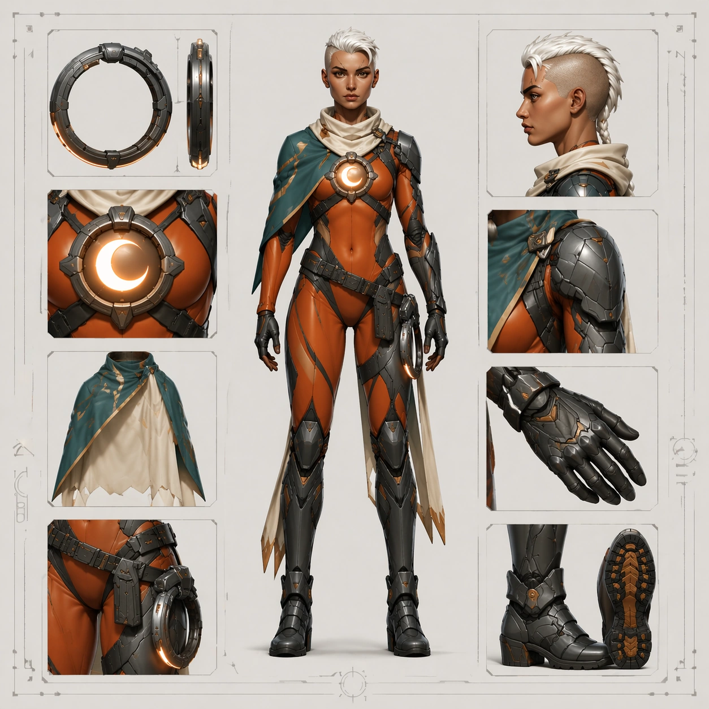

```text
Scene:
Compose a square equipment-callout board that mixes one full-body hero view with organized detail insets on a pale production background. The layout should feel like a studio approval sheet: one dominant standing figure slightly off center, surrounded by smaller callout windows for the ring-blade, chest reactor motif, mantle interior, belt hardware, glove surface, and boot tread. Use soft overhead light, crisp edge definition, and enough spacing so every inset remains readable without any text. The board must feel orderly, technical, and ready for wiki or team review use.

Subject:
Feature the exact same heroine from the turnaround reference model with no identity drift. Preserve face, hair base, body proportions, eyebrow scar, and the full costume architecture of asymmetrical teal shoulder mantle, ember-orange bodysuit, graphite segmented armor, ivory scarf tabs, crescent chest reactor, slim ring-blade sidearm, and split cape panels. The standing figure can be front-facing or slight three-quarter, but the callout insets must match the same materials and geometry seen on the body. Each inset should reinforce the costume logic rather than invent alternate details. The ring-blade must keep the same crescent language, and the reactor should echo the same motif seen on the chest.

Important details:
This sheet should make production logic legible. Separate matte armor, satin fabric, brushed metal, and soft emissive surfaces clearly. Maintain the same palette and edge hierarchy established earlier. Abstract panel frames and alignment marks are welcome, but there should be no readable labels. The goal is to prove that the hero can survive transition from splash-art charisma into practical asset breakdown without losing recognizability.

Use case:
Hero Reveal Turnaround Pack series study 8/9, testing equipment and material callouts for the same locked-identity heroine.

Constraints:
No readable text, no watermark, no logos, preserve exact 1:1 aspect ratio, preserve exact face and costume logic from the reference model, no extra costume variants, no exploded parts floating chaotically, no heavy shadows hiding details, no unrelated props.
```

[Pinned source](https://github.com/ChaosRealmsAI/gpt-image-2-gallery/blob/5296db8c996e38776c83a0bc8c64f848dcd512b3/works/topics/hero-reveal-turnaround-pack/packages/series-production-turnaround-system/images/03-equipment-callout-sheet/meta.json) · GPT Image2 · 1254×1254 · Reference images required. · ProjectD:pending individual review.

## Wiki Approval Layout · hero-reveal-turnaround-pack/series-production-turnaround-system/04-wiki-approval-layout

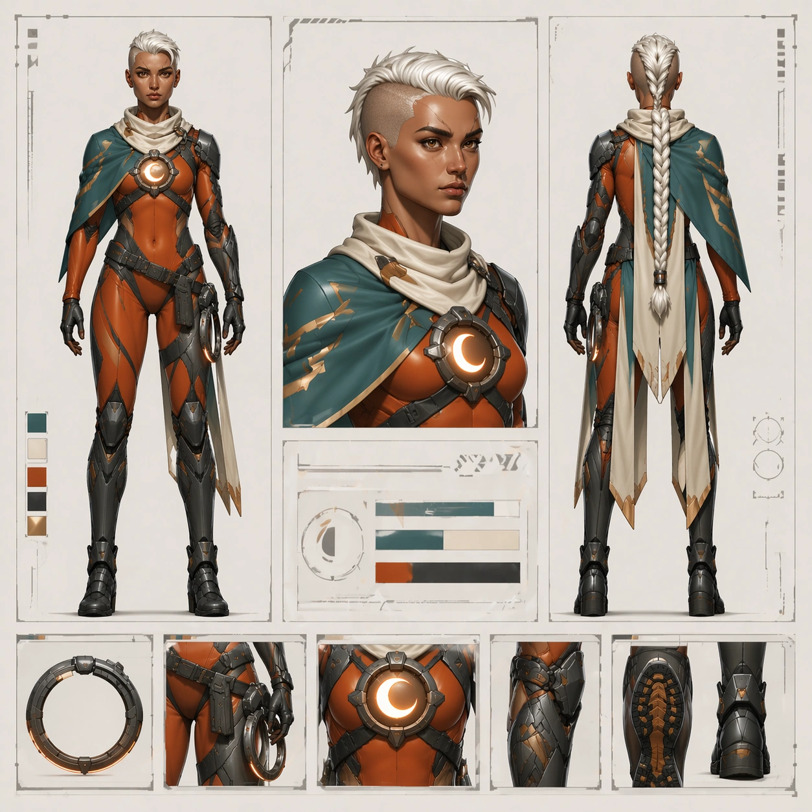

```text
Scene:
Design a square approval-board layout that feels halfway between a production sheet and a polished wiki deliverable. Use a clean off-white page, modular panel divisions, one prominent full-body figure, one bust crop, one back view, and a row of small costume-detail tiles arranged with precise spacing. Lighting should remain neutral and clear, but the page can feel slightly more polished than a raw turnaround sheet, suitable for publishing to a character encyclopedia or internal presentation deck. Keep the composition balanced, with confident white space and strong grid discipline.

Subject:
Adapt the exact same heroine from the turnaround reference model into this modular approval layout. Preserve exact face, hair base, body proportions, eyebrow scar, chest reactor, shoulder mantle asymmetry, suit seam logic, holster placement, cape split, glove shapes, and boot structure. Every panel must read as the same person and the same costume family, even though the crop scale varies across full-body, bust, and detail tiles. The bust crop should echo the launch assets while the full-body and back view keep the production clarity.

Important details:
The success condition is coherence across publication and production surfaces. Keep panel spacing orderly, geometry simple, and material rendering believable. Use abstract non-readable bars, ticks, and diagram blocks instead of language. The page should feel ready for a game wiki, approval deck, or internal style guide. Do not let the polished layout introduce new styling drift or decorative clutter.

Use case:
Hero Reveal Turnaround Pack series study 9/9, merging launch polish and production clarity in one wiki-ready approval layout.

Constraints:
No readable text, no watermark, no logos, preserve exact 1:1 aspect ratio, preserve exact face and body proportions from the reference model, no off-model bust crop, no random new accessories, no noisy background pattern, no perspective distortion in the sheet.
```

[Pinned source](https://github.com/ChaosRealmsAI/gpt-image-2-gallery/blob/5296db8c996e38776c83a0bc8c64f848dcd512b3/works/topics/hero-reveal-turnaround-pack/packages/series-production-turnaround-system/images/04-wiki-approval-layout/meta.json) · GPT Image2 · 1254×1254 · Reference images required. · ProjectD:pending individual review.

## Living Dining Anchor · high-end-residential-showflat-system/series-spatial-language-lock/01-living-dining-anchor

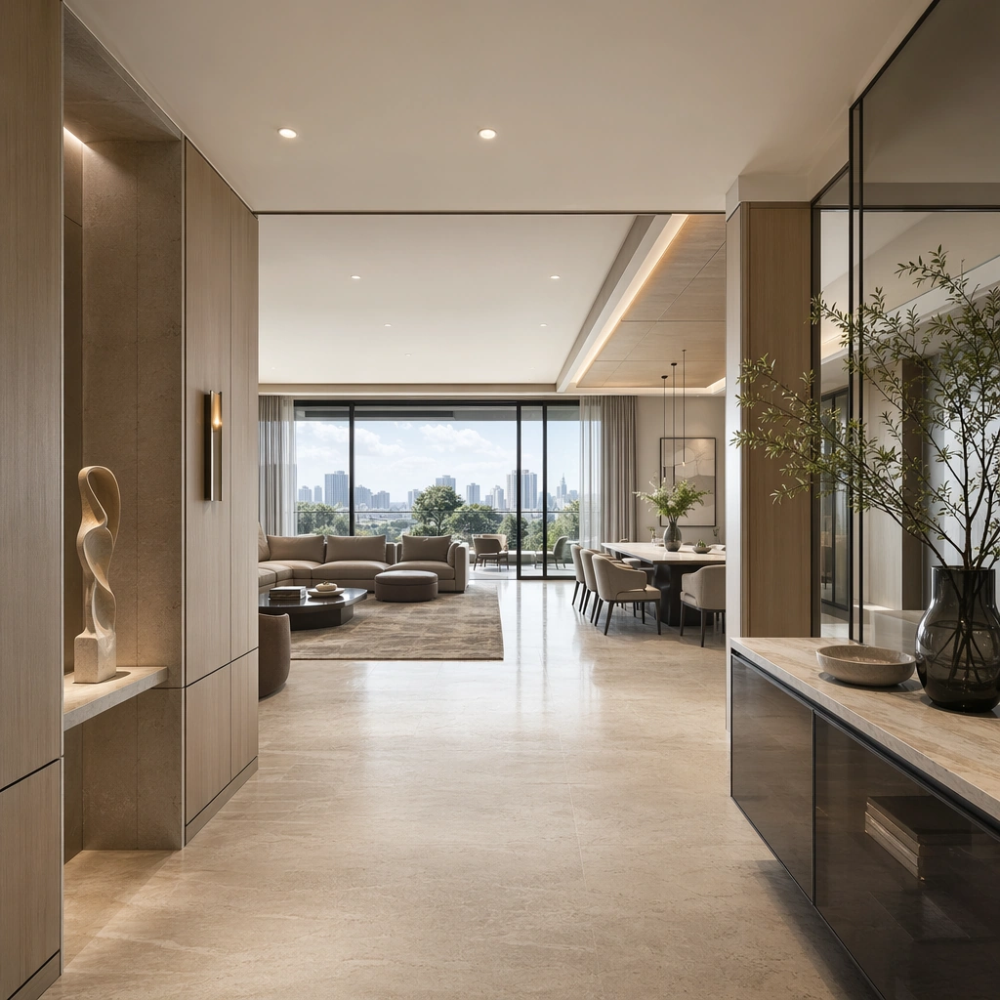

```text
Scene:
Create a square architectural reference still for High-End Residential Showflat System. Use a wide hero view from the foyer into the living and dining zone and treat the frame like a premium interior or architecture editorial photograph with disciplined perspective, readable depth from foreground to background, and enough negative space for the spatial hierarchy to breathe. Light the scene so residential aspiration, furniture harmony, and sales-gallery polish feel immediate, using pale oak, soft taupe, creamy travertine, smoke gray glass, and gentle daylight silver as the governing tonal range. The composition must read as a high-end commercial image that could sit inside property launches, brochure stills, sales-gallery walls, and premium listing presentations.

Subject:
Show a high-end residential showflat with full-height glazing, pale oak wall panels, creamy stone flooring, sculptural furniture, restrained art objects, and polished property-marketing clarity. Center the full showflat composition with glazing, sofa grouping, dining table, and soft daylight flow. This is the canonical reference image for the package, so the major proportions, material transitions, fixture families, and circulation logic must feel highly specific and internally coherent rather than generic luxury styling. Let the viewer understand how the space is organized within a single glance, with foreground anchors, a clear middle zone, and a resolved background termination.

Important details:
Lock the glazing rhythm, oak panel detailing, stone floor tone, furniture silhouettes, softly styled decor, and real-estate presentation polish. Surfaces should feel tactile and believable: stone veining must stay plausible, metals should have disciplined reflectance, fabrics should show natural weight, and concealed lighting should shape the volume instead of flattening it. Use abstract signage, menu, label, or caption zones only as unreadable graphic hints. The image should feel practical for downstream design reviews and polished enough for public-facing campaign use.

Use case:
High-End Residential Showflat System series study 1/9, establishing the canonical living-dining identity for the package.

Constraints:
No readable text, no watermark, no logos, preserve exact 1:1 aspect ratio, no family photos, no clutter, no toy-like decor, no messy cables, no cheap staging tricks, no giant TV glare.
```

[Pinned source](https://github.com/ChaosRealmsAI/gpt-image-2-gallery/blob/5296db8c996e38776c83a0bc8c64f848dcd512b3/works/topics/high-end-residential-showflat-system/packages/series-spatial-language-lock/images/01-living-dining-anchor/meta.json) · GPT Image2 · 1024×1024 · No source-declared image dependencies. · ProjectD:pending individual review.

## Kitchen Island View · high-end-residential-showflat-system/series-spatial-language-lock/02-kitchen-island-view

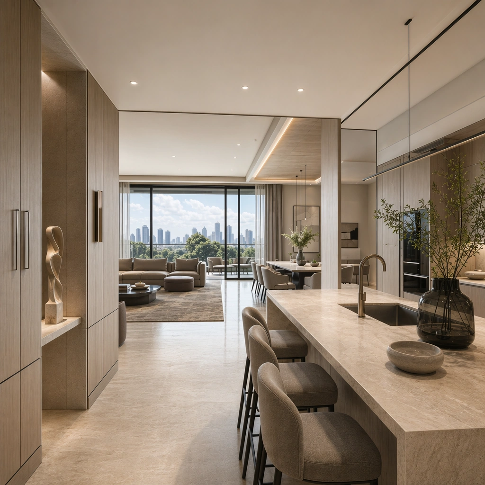

```text
Scene:
Create a square reference-dependent architecture still for High-End Residential Showflat System. Use a camera angle pivoted toward the stone island and tall storage wall while keeping the same lens discipline, editorial polish, and material believability established by the reference image. The lighting can shift to support the intended mood, but the space must still feel like the same authored project with a stable viewpoint logic, convincing depth separation, and clean commercial-photography finish. Keep pale oak, soft taupe, creamy travertine, smoke gray glass, and gentle daylight silver as the governing tonal range even when the emphasis changes.

Subject:
Show a high-end residential showflat with full-height glazing, pale oak wall panels, creamy stone flooring, sculptural furniture, restrained art objects, and polished property-marketing clarity. Focus on the exact same showflat from the reference image, now emphasizing the kitchen material language and apartment planning logic. Preserve exact architectural identity, plan logic, material palette, fixture family, and circulation cues from the reference image while changing only the intended emphasis described here. The viewer should immediately recognize the same project, not a loose cousin, with matching silhouette logic, aligned detailing, and consistent brand atmosphere.

Important details:
Preserve the glazing rhythm, oak panel detailing, stone floor tone, furniture silhouettes, softly styled decor, and real-estate presentation polish. Any abstract wayfinding, menu, wall-label, or packaging zones must stay unreadable and subordinate to the spatial image. Joinery, edges, reflections, and lighting should remain realistic enough for an operator or design team to treat the image as a credible reference. The variation should feel deliberate and commercially useful, proving that one locked spatial language can flex across multiple campaign or editorial surfaces.

Use case:
High-End Residential Showflat System series study 2/9, extending kitchen polish while preserving the same home identity.

Constraints:
No readable text, no watermark, no logos, preserve exact 1:1 aspect ratio, preserve exact architectural identity from the reference image, no family photos, no clutter, no toy-like decor, no messy cables, no cheap staging tricks, no visible appliances clutter.
```

[Pinned source](https://github.com/ChaosRealmsAI/gpt-image-2-gallery/blob/5296db8c996e38776c83a0bc8c64f848dcd512b3/works/topics/high-end-residential-showflat-system/packages/series-spatial-language-lock/images/02-kitchen-island-view/meta.json) · GPT Image2 · 1024×1024 · Reference images required. · ProjectD:pending individual review.

## Primary Bedroom Suite · high-end-residential-showflat-system/series-spatial-language-lock/03-primary-bedroom-suite

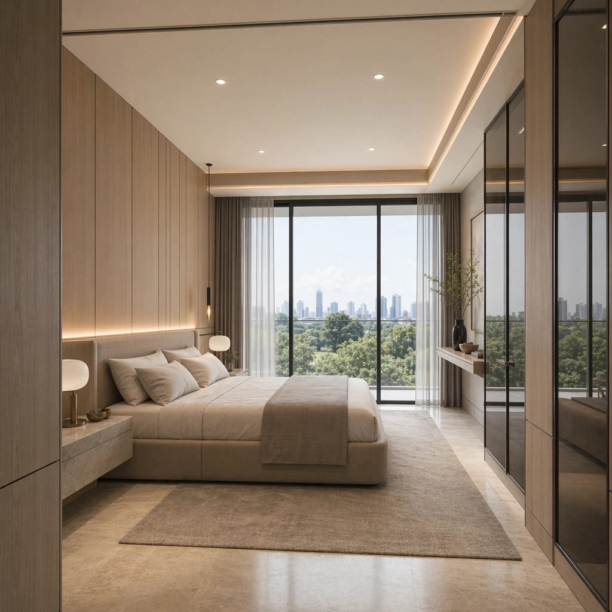

```text
Scene:
Create a square reference-dependent architecture still for High-End Residential Showflat System. Use a calm angle from the bedroom threshold toward the bed wall and glazing while keeping the same lens discipline, editorial polish, and material believability established by the reference image. The lighting can shift to support the intended mood, but the space must still feel like the same authored project with a stable viewpoint logic, convincing depth separation, and clean commercial-photography finish. Keep pale oak, soft taupe, creamy travertine, smoke gray glass, and gentle daylight silver as the governing tonal range even when the emphasis changes.

Subject:
Show a high-end residential showflat with full-height glazing, pale oak wall panels, creamy stone flooring, sculptural furniture, restrained art objects, and polished property-marketing clarity. Focus on the exact same showflat from the reference image, now emphasizing the bedroom palette, soft textiles, and continuity with the main living areas. Preserve exact architectural identity, plan logic, material palette, fixture family, and circulation cues from the reference image while changing only the intended emphasis described here. The viewer should immediately recognize the same project, not a loose cousin, with matching silhouette logic, aligned detailing, and consistent brand atmosphere.

Important details:
Preserve the glazing rhythm, oak panel detailing, stone floor tone, furniture silhouettes, softly styled decor, and real-estate presentation polish. Any abstract wayfinding, menu, wall-label, or packaging zones must stay unreadable and subordinate to the spatial image. Joinery, edges, reflections, and lighting should remain realistic enough for an operator or design team to treat the image as a credible reference. The variation should feel deliberate and commercially useful, proving that one locked spatial language can flex across multiple campaign or editorial surfaces.

Use case:
High-End Residential Showflat System series study 3/9, extending the private suite while keeping the same development language.

Constraints:
No readable text, no watermark, no logos, preserve exact 1:1 aspect ratio, preserve exact architectural identity from the reference image, no family photos, no clutter, no toy-like decor, no messy cables, no cheap staging tricks, no personal photos.
```

[Pinned source](https://github.com/ChaosRealmsAI/gpt-image-2-gallery/blob/5296db8c996e38776c83a0bc8c64f848dcd512b3/works/topics/high-end-residential-showflat-system/packages/series-spatial-language-lock/images/03-primary-bedroom-suite/meta.json) · GPT Image2 · 1024×1024 · Reference images required. · ProjectD:pending individual review.

## Terrace Lounge Extension · high-end-residential-showflat-system/series-spatial-language-lock/04-terrace-lounge-extension

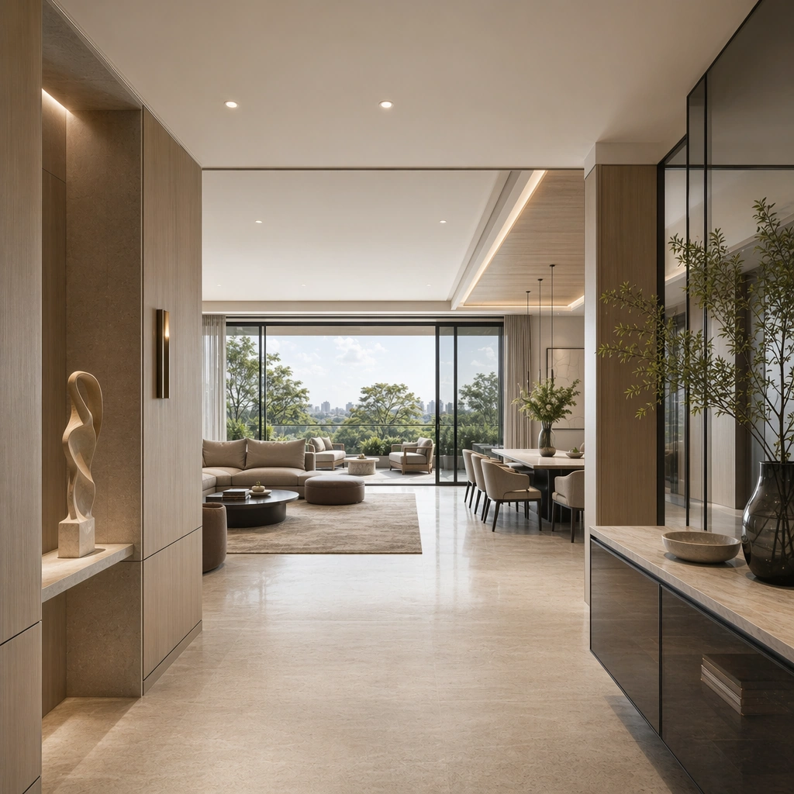

```text
Scene:
Create a square reference-dependent architecture still for High-End Residential Showflat System. Use a square composition that links the interior lounge to the outdoor terrace seating while keeping the same lens discipline, editorial polish, and material believability established by the reference image. The lighting can shift to support the intended mood, but the space must still feel like the same authored project with a stable viewpoint logic, convincing depth separation, and clean commercial-photography finish. Keep pale oak, soft taupe, creamy travertine, smoke gray glass, and gentle daylight silver as the governing tonal range even when the emphasis changes.

Subject:
Show a high-end residential showflat with full-height glazing, pale oak wall panels, creamy stone flooring, sculptural furniture, restrained art objects, and polished property-marketing clarity. Focus on the exact same showflat from the reference image, now emphasizing indoor-outdoor marketing appeal and facade framing. Preserve exact architectural identity, plan logic, material palette, fixture family, and circulation cues from the reference image while changing only the intended emphasis described here. The viewer should immediately recognize the same project, not a loose cousin, with matching silhouette logic, aligned detailing, and consistent brand atmosphere.

Important details:
Preserve the glazing rhythm, oak panel detailing, stone floor tone, furniture silhouettes, softly styled decor, and real-estate presentation polish. Any abstract wayfinding, menu, wall-label, or packaging zones must stay unreadable and subordinate to the spatial image. Joinery, edges, reflections, and lighting should remain realistic enough for an operator or design team to treat the image as a credible reference. The variation should feel deliberate and commercially useful, proving that one locked spatial language can flex across multiple campaign or editorial surfaces.

Use case:
High-End Residential Showflat System series study 4/9, extending lifestyle extension of the same residential system.

Constraints:
No readable text, no watermark, no logos, preserve exact 1:1 aspect ratio, preserve exact architectural identity from the reference image, no family photos, no clutter, no toy-like decor, no messy cables, no cheap staging tricks, no skyline overload.
```

[Pinned source](https://github.com/ChaosRealmsAI/gpt-image-2-gallery/blob/5296db8c996e38776c83a0bc8c64f848dcd512b3/works/topics/high-end-residential-showflat-system/packages/series-spatial-language-lock/images/04-terrace-lounge-extension/meta.json) · GPT Image2 · 1024×1024 · Reference images required. · ProjectD:pending individual review.

## Media Wall Composition · high-end-residential-showflat-system/single-support-studies/02-media-wall-composition

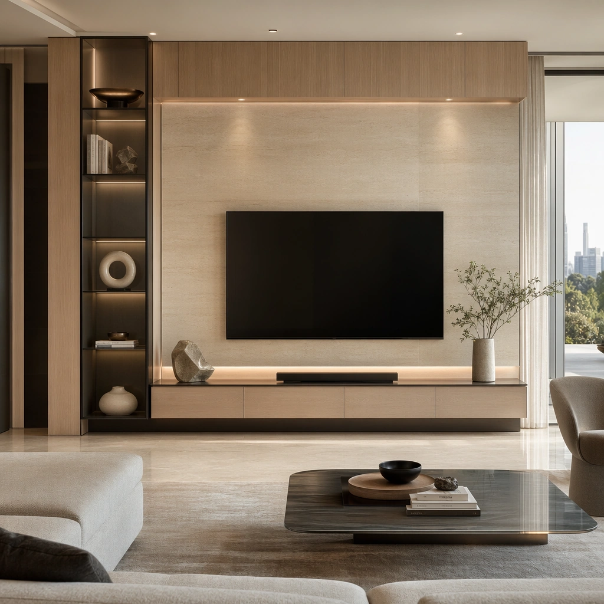

```text
Scene:
Create a square standalone support study for High-End Residential Showflat System. Use a composed media wall still with low cabinet, stone backdrop, and sculptural decor and frame it like a premium commercial still or design-editorial crop with clear focal hierarchy, disciplined perspective, and enough breathing room for the materials and objects to read at both thumbnail and full size. Keep pale oak, soft taupe, creamy travertine, smoke gray glass, and gentle daylight silver as the tonal guide so the image still belongs to the same theme family, and light the scene in a controlled way that emphasizes texture, edge quality, and authored atmosphere over spectacle.

Subject:
Show a high-end residential showflat with full-height glazing, pale oak wall panels, creamy stone flooring, sculptural furniture, restrained art objects, and polished property-marketing clarity. In this support study, focus on cabinet detailing, shadow gaps, and refined residential tech integration. The image should work independently, yet it must still feel like it belongs to the same broader world of Showflat System. Make the space, props, and detailing useful for real campaign, editorial, or design-review contexts rather than moodboard abstraction.

Important details:
Carry forward the broader language of the glazing rhythm, oak panel detailing, stone floor tone, furniture silhouettes, softly styled decor, and real-estate presentation polish, but let this image prove a new support surface or secondary deliverable. Material realism is essential: wood grain, metal sheen, glass edges, textiles, and stone should feel physically plausible and carefully art directed. Any graphic panels, labels, menus, packaging, or captions must stay abstract and unreadable. The overall result should feel reusable for property launches, brochure stills, sales-gallery walls, and premium listing presentations, with enough structure that a creative or operations team could build on it.

Use case:
High-End Residential Showflat System single study 6/9, exploring support imagery for living-room specification boards.

Constraints:
No readable text, no watermark, no logos, preserve exact 1:1 aspect ratio, no family photos, no clutter, no toy-like decor, no messy cables, no cheap staging tricks, no readable screen content.
```

[Pinned source](https://github.com/ChaosRealmsAI/gpt-image-2-gallery/blob/5296db8c996e38776c83a0bc8c64f848dcd512b3/works/topics/high-end-residential-showflat-system/packages/single-support-studies/images/02-media-wall-composition/meta.json) · GPT Image2 · 1024×1024 · No source-declared image dependencies. · ProjectD:pending individual review.

## Dining Table Styling · high-end-residential-showflat-system/single-support-studies/03-dining-table-styling

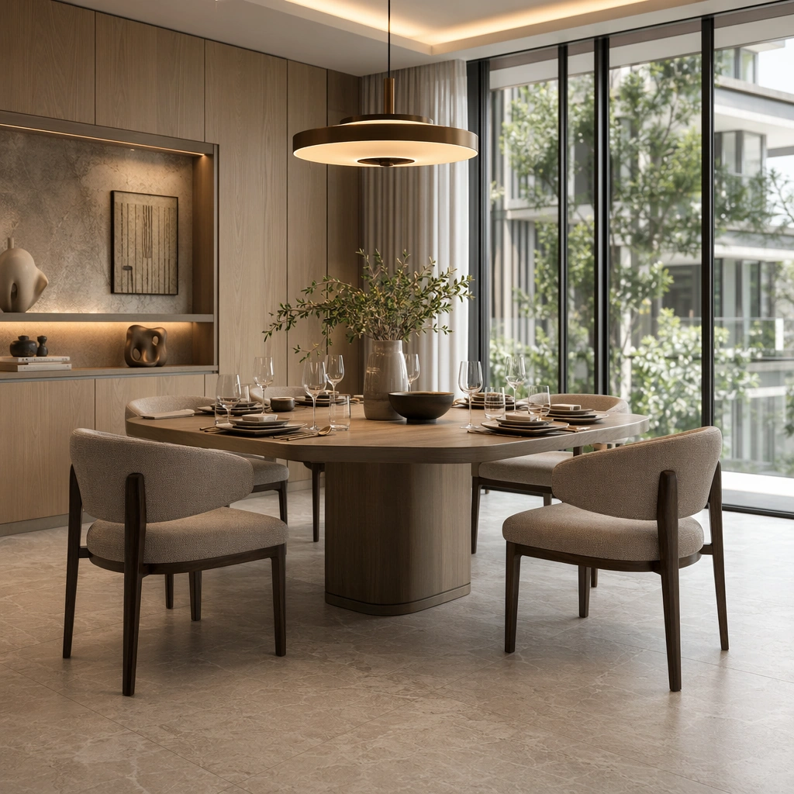

```text
Scene:
Create a square standalone support study for High-End Residential Showflat System. Use a square dining-table still with tableware, pendant glow, and nearby glazing and frame it like a premium commercial still or design-editorial crop with clear focal hierarchy, disciplined perspective, and enough breathing room for the materials and objects to read at both thumbnail and full size. Keep pale oak, soft taupe, creamy travertine, smoke gray glass, and gentle daylight silver as the tonal guide so the image still belongs to the same theme family, and light the scene in a controlled way that emphasizes texture, edge quality, and authored atmosphere over spectacle.

Subject:
Show a high-end residential showflat with full-height glazing, pale oak wall panels, creamy stone flooring, sculptural furniture, restrained art objects, and polished property-marketing clarity. In this support study, focus on table proportions, chair silhouettes, and premium entertaining mood. The image should work independently, yet it must still feel like it belongs to the same broader world of Showflat System. Make the space, props, and detailing useful for real campaign, editorial, or design-review contexts rather than moodboard abstraction.

Important details:
Carry forward the broader language of the glazing rhythm, oak panel detailing, stone floor tone, furniture silhouettes, softly styled decor, and real-estate presentation polish, but let this image prove a new support surface or secondary deliverable. Material realism is essential: wood grain, metal sheen, glass edges, textiles, and stone should feel physically plausible and carefully art directed. Any graphic panels, labels, menus, packaging, or captions must stay abstract and unreadable. The overall result should feel reusable for property launches, brochure stills, sales-gallery walls, and premium listing presentations, with enough structure that a creative or operations team could build on it.

Use case:
High-End Residential Showflat System single study 7/9, exploring brochure support image for dining experience.

Constraints:
No readable text, no watermark, no logos, preserve exact 1:1 aspect ratio, no family photos, no clutter, no toy-like decor, no messy cables, no cheap staging tricks, no food brand packaging.
```

[Pinned source](https://github.com/ChaosRealmsAI/gpt-image-2-gallery/blob/5296db8c996e38776c83a0bc8c64f848dcd512b3/works/topics/high-end-residential-showflat-system/packages/single-support-studies/images/03-dining-table-styling/meta.json) · GPT Image2 · 1024×1024 · No source-declared image dependencies. · ProjectD:pending individual review.

## Bathroom Mirror Suite · high-end-residential-showflat-system/single-support-studies/04-bathroom-mirror-suite

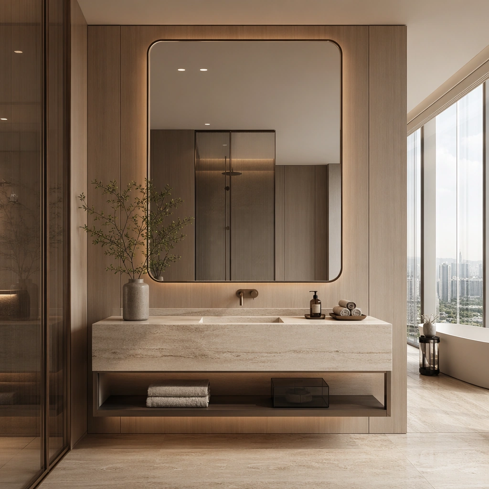

```text
Scene:
Create a square standalone support study for High-End Residential Showflat System. Use a bathroom vanity composition with large mirror, stone basin, and ambient side light and frame it like a premium commercial still or design-editorial crop with clear focal hierarchy, disciplined perspective, and enough breathing room for the materials and objects to read at both thumbnail and full size. Keep pale oak, soft taupe, creamy travertine, smoke gray glass, and gentle daylight silver as the tonal guide so the image still belongs to the same theme family, and light the scene in a controlled way that emphasizes texture, edge quality, and authored atmosphere over spectacle.

Subject:
Show a high-end residential showflat with full-height glazing, pale oak wall panels, creamy stone flooring, sculptural furniture, restrained art objects, and polished property-marketing clarity. In this support study, focus on mirror edge detail, stone veining, hardware finish, and hotel-grade cleanliness. The image should work independently, yet it must still feel like it belongs to the same broader world of Showflat System. Make the space, props, and detailing useful for real campaign, editorial, or design-review contexts rather than moodboard abstraction.

Important details:
Carry forward the broader language of the glazing rhythm, oak panel detailing, stone floor tone, furniture silhouettes, softly styled decor, and real-estate presentation polish, but let this image prove a new support surface or secondary deliverable. Material realism is essential: wood grain, metal sheen, glass edges, textiles, and stone should feel physically plausible and carefully art directed. Any graphic panels, labels, menus, packaging, or captions must stay abstract and unreadable. The overall result should feel reusable for property launches, brochure stills, sales-gallery walls, and premium listing presentations, with enough structure that a creative or operations team could build on it.

Use case:
High-End Residential Showflat System single study 8/9, exploring bathroom support still for sales materials.

Constraints:
No readable text, no watermark, no logos, preserve exact 1:1 aspect ratio, no family photos, no clutter, no toy-like decor, no messy cables, no cheap staging tricks, no readable product labels.
```

[Pinned source](https://github.com/ChaosRealmsAI/gpt-image-2-gallery/blob/5296db8c996e38776c83a0bc8c64f848dcd512b3/works/topics/high-end-residential-showflat-system/packages/single-support-studies/images/04-bathroom-mirror-suite/meta.json) · GPT Image2 · 1024×1024 · No source-declared image dependencies. · ProjectD:pending individual review.

## Scale Model Corner · high-end-residential-showflat-system/single-support-studies/05-scale-model-corner

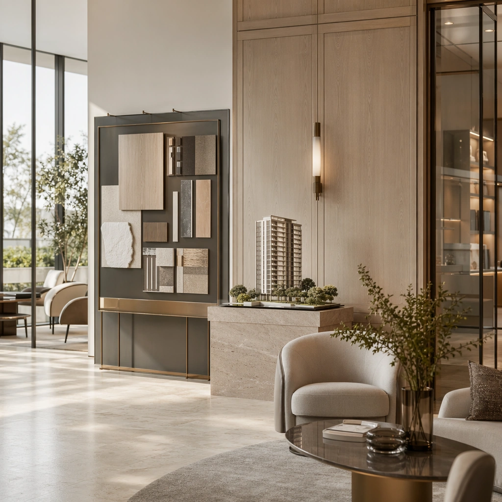

```text
Scene:
Create a square standalone support study for High-End Residential Showflat System. Use a sales-gallery corner where a material board and abstract architectural massing model sit near lounge seating and frame it like a premium commercial still or design-editorial crop with clear focal hierarchy, disciplined perspective, and enough breathing room for the materials and objects to read at both thumbnail and full size. Keep pale oak, soft taupe, creamy travertine, smoke gray glass, and gentle daylight silver as the tonal guide so the image still belongs to the same theme family, and light the scene in a controlled way that emphasizes texture, edge quality, and authored atmosphere over spectacle.

Subject:
Show a high-end residential showflat with full-height glazing, pale oak wall panels, creamy stone flooring, sculptural furniture, restrained art objects, and polished property-marketing clarity. In this support study, focus on developer presentation atmosphere, model craftsmanship, and interior-brand continuity. The image should work independently, yet it must still feel like it belongs to the same broader world of Showflat System. Make the space, props, and detailing useful for real campaign, editorial, or design-review contexts rather than moodboard abstraction.

Important details:
Carry forward the broader language of the glazing rhythm, oak panel detailing, stone floor tone, furniture silhouettes, softly styled decor, and real-estate presentation polish, but let this image prove a new support surface or secondary deliverable. Material realism is essential: wood grain, metal sheen, glass edges, textiles, and stone should feel physically plausible and carefully art directed. Any graphic panels, labels, menus, packaging, or captions must stay abstract and unreadable. The overall result should feel reusable for property launches, brochure stills, sales-gallery walls, and premium listing presentations, with enough structure that a creative or operations team could build on it.

Use case:
High-End Residential Showflat System single study 9/9, exploring cross-over support surface between sales gallery and showflat language.

Constraints:
No readable text, no watermark, no logos, preserve exact 1:1 aspect ratio, no family photos, no clutter, no toy-like decor, no messy cables, no cheap staging tricks, no readable floorplan text.
```

[Pinned source](https://github.com/ChaosRealmsAI/gpt-image-2-gallery/blob/5296db8c996e38776c83a0bc8c64f848dcd512b3/works/topics/high-end-residential-showflat-system/packages/single-support-studies/images/05-scale-model-corner/meta.json) · GPT Image2 · 1024×1024 · No source-declared image dependencies. · ProjectD:pending individual review.

## Reference Look Anchor · high-fashion-lookbook-grid/series-lookbook-identity-lock/01-reference-look-anchor

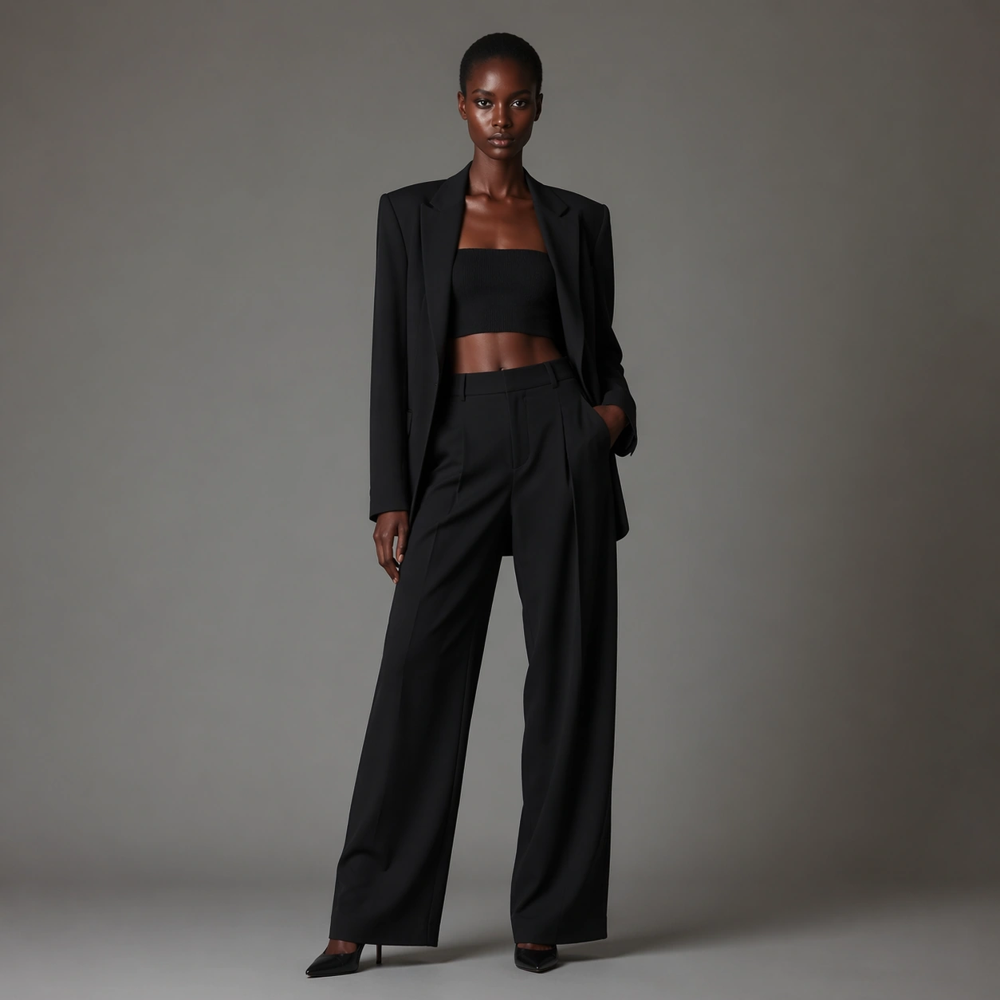

```text
Scene:
Create a square 1:1 portrait image for High Fashion Lookbook Grid. Use a clean lookbook studio with seamless backdrop, even fashion light, and enough room to read full proportions. The frame should feel like a finished professional deliverable rather than a casual snapshot, with clear lens discipline, believable light falloff, and a palette that directly supports Build editorial lookbook grids that keep the same model identity stable across multiple outfits, poses, and page compositions.. Keep enough surrounding space and compositional control for gallery, research, campaign, or approval-board reuse while staying photoreal and human-scaled.

Subject:
Center one high-fashion model with deep espresso skin, sharp editorial bone structure, long neck, stable lean proportions, and an unwavering runway stare. Establish the exact face, body read, and one anchor look that all later styling changes must preserve across the same model. Use the example direction from the brief as grounding context: Build editorial lookbook grids that keep the same model identity stable across multiple outfits, poses, and page compositions.. Wardrobe, lighting, environment, and pose may shift to serve this variation, but the viewer must immediately understand that the same reference identity is still in front of the camera.

Important details:
This backlog line is difficult because Build editorial lookbook grids that keep the same model identity stable across multiple outfits, poses, and page compositions.. Preserve skin tone family, bone structure, eye spacing, nose shape, mouth shape, hairline logic, shoulder width, and overall body read across the entire series. preserve exact face / hair base / body proportions from the reference model. This image defines the model identity before wardrobe fanout begins. Avoid the common failure described in the brief: ordinary image models often lose likeness once styling, lighting, or layout changes enter the frame. Success should feel like the result should feel professionally usable, coherent, and clearly built around one stable human identity.

Use case:
High Fashion Lookbook Grid series study 1/9, the baseline fashion look.

Constraints:
No readable text, no watermark, no logos, preserve exact 1:1 aspect ratio, preserve exact face / hair base / body proportions from the reference model, no body reshaping, no runway crowd, no logos, no distorted hands.
```

[Pinned source](https://github.com/ChaosRealmsAI/gpt-image-2-gallery/blob/5296db8c996e38776c83a0bc8c64f848dcd512b3/works/topics/high-fashion-lookbook-grid/packages/series-lookbook-identity-lock/images/01-reference-look-anchor/meta.json) · GPT Image2 · 1254×1254 · No source-declared image dependencies. · ProjectD:pending individual review.

## Tailored Look One · high-fashion-lookbook-grid/series-lookbook-identity-lock/02-tailored-look-one

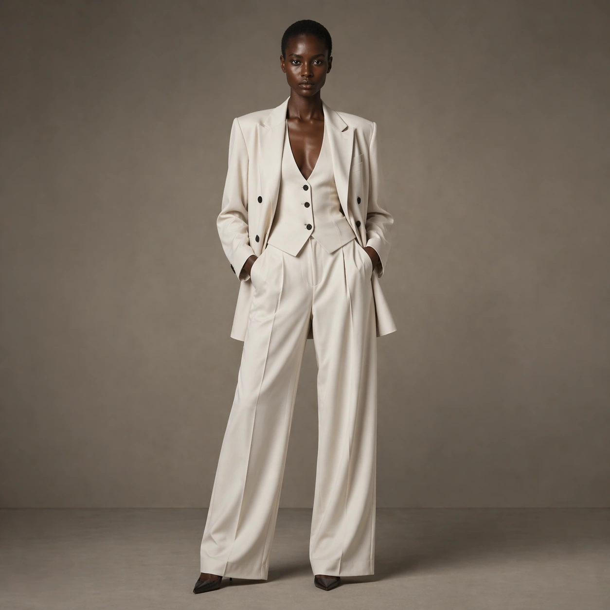

```text
Scene:
Create a square 1:1 portrait image for High Fashion Lookbook Grid. Use a premium lookbook frame with crisp textiles, measured contrast, and full-length readability. The frame should feel like a finished professional deliverable rather than a casual snapshot, with clear lens discipline, believable light falloff, and a palette that directly supports Build editorial lookbook grids that keep the same model identity stable across multiple outfits, poses, and page compositions.. Keep enough surrounding space and compositional control for gallery, research, campaign, or approval-board reuse while staying photoreal and human-scaled.

Subject:
Center one high-fashion model with deep espresso skin, sharp editorial bone structure, long neck, stable lean proportions, and an unwavering runway stare. Change the outfit decisively while preserving exact face, hair base, and body proportions from the reference model. Use the example direction from the brief as grounding context: Build editorial lookbook grids that keep the same model identity stable across multiple outfits, poses, and page compositions.. Wardrobe, lighting, environment, and pose may shift to serve this variation, but the viewer must immediately understand that the same reference identity is still in front of the camera.

Important details:
This backlog line is difficult because Build editorial lookbook grids that keep the same model identity stable across multiple outfits, poses, and page compositions.. Preserve skin tone family, bone structure, eye spacing, nose shape, mouth shape, hairline logic, shoulder width, and overall body read across the entire series. preserve exact face / hair base / body proportions from the reference model. The garment can change a lot; the person cannot. Avoid the common failure described in the brief: ordinary image models often lose likeness once styling, lighting, or layout changes enter the frame. Success should feel like the result should feel professionally usable, coherent, and clearly built around one stable human identity.

Use case:
High Fashion Lookbook Grid series study 2/9, a sharply tailored fashion look.

Constraints:
No readable text, no watermark, no logos, preserve exact 1:1 aspect ratio, preserve exact face / hair base / body proportions from the reference model, no altered height, no new face, no giant accessories, no broken seams.
```

[Pinned source](https://github.com/ChaosRealmsAI/gpt-image-2-gallery/blob/5296db8c996e38776c83a0bc8c64f848dcd512b3/works/topics/high-fashion-lookbook-grid/packages/series-lookbook-identity-lock/images/02-tailored-look-one/meta.json) · GPT Image2 · 1254×1254 · Reference images required. · ProjectD:pending individual review.

## Sculptural Look Two · high-fashion-lookbook-grid/series-lookbook-identity-lock/03-sculptural-look-two

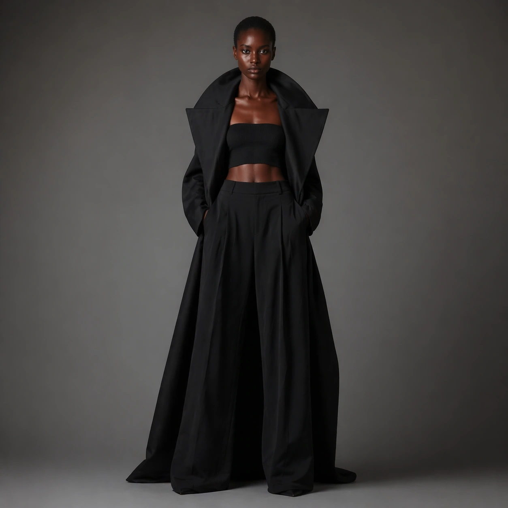

```text
Scene:
Create a square 1:1 portrait image for High Fashion Lookbook Grid. Use a studio fashion composition that emphasizes silhouette, fabric volume, and strong negative space. The frame should feel like a finished professional deliverable rather than a casual snapshot, with clear lens discipline, believable light falloff, and a palette that directly supports Build editorial lookbook grids that keep the same model identity stable across multiple outfits, poses, and page compositions.. Keep enough surrounding space and compositional control for gallery, research, campaign, or approval-board reuse while staying photoreal and human-scaled.

Subject:
Center one high-fashion model with deep espresso skin, sharp editorial bone structure, long neck, stable lean proportions, and an unwavering runway stare. Keep the same model and same recognizability while leaning into a more dramatic garment architecture. Use the example direction from the brief as grounding context: Build editorial lookbook grids that keep the same model identity stable across multiple outfits, poses, and page compositions.. Wardrobe, lighting, environment, and pose may shift to serve this variation, but the viewer must immediately understand that the same reference identity is still in front of the camera.

Important details:
This backlog line is difficult because Build editorial lookbook grids that keep the same model identity stable across multiple outfits, poses, and page compositions.. Preserve skin tone family, bone structure, eye spacing, nose shape, mouth shape, hairline logic, shoulder width, and overall body read across the entire series. preserve exact face / hair base / body proportions from the reference model. The silhouette should challenge styling, not identity consistency. Avoid the common failure described in the brief: ordinary image models often lose likeness once styling, lighting, or layout changes enter the frame. Success should feel like the result should feel professionally usable, coherent, and clearly built around one stable human identity.

Use case:
High Fashion Lookbook Grid series study 3/9, a sculptural editorial look.

Constraints:
No readable text, no watermark, no logos, preserve exact 1:1 aspect ratio, preserve exact face / hair base / body proportions from the reference model, no costume drift into fantasy, no warped limbs, no hidden face, no prop overload.
```

[Pinned source](https://github.com/ChaosRealmsAI/gpt-image-2-gallery/blob/5296db8c996e38776c83a0bc8c64f848dcd512b3/works/topics/high-fashion-lookbook-grid/packages/series-lookbook-identity-lock/images/03-sculptural-look-two/meta.json) · GPT Image2 · 1254×1254 · Reference images required. · ProjectD:pending individual review.

## Monochrome Look Three · high-fashion-lookbook-grid/series-lookbook-identity-lock/04-monochrome-look-three

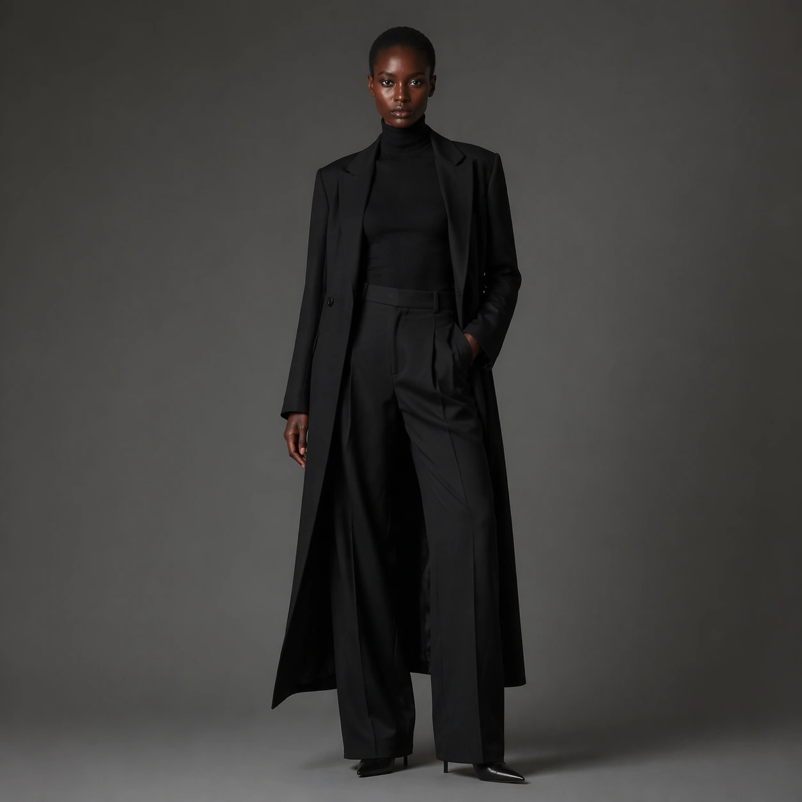

```text
Scene:
Create a square 1:1 portrait image for High Fashion Lookbook Grid. Use a quiet fashion set with disciplined tonal range and restrained editorial polish. The frame should feel like a finished professional deliverable rather than a casual snapshot, with clear lens discipline, believable light falloff, and a palette that directly supports Build editorial lookbook grids that keep the same model identity stable across multiple outfits, poses, and page compositions.. Keep enough surrounding space and compositional control for gallery, research, campaign, or approval-board reuse while staying photoreal and human-scaled.

Subject:
Center one high-fashion model with deep espresso skin, sharp editorial bone structure, long neck, stable lean proportions, and an unwavering runway stare. Present the same model in a monochrome outfit family that changes styling direction but not the person. Use the example direction from the brief as grounding context: Build editorial lookbook grids that keep the same model identity stable across multiple outfits, poses, and page compositions.. Wardrobe, lighting, environment, and pose may shift to serve this variation, but the viewer must immediately understand that the same reference identity is still in front of the camera.

Important details:
This backlog line is difficult because Build editorial lookbook grids that keep the same model identity stable across multiple outfits, poses, and page compositions.. Preserve skin tone family, bone structure, eye spacing, nose shape, mouth shape, hairline logic, shoulder width, and overall body read across the entire series. preserve exact face / hair base / body proportions from the reference model. Hair base, posture family, and body proportions must remain exact. Avoid the common failure described in the brief: ordinary image models often lose likeness once styling, lighting, or layout changes enter the frame. Success should feel like the result should feel professionally usable, coherent, and clearly built around one stable human identity.

Use case:
High Fashion Lookbook Grid series study 4/9, a monochrome styling direction.

Constraints:
No readable text, no watermark, no logos, preserve exact 1:1 aspect ratio, preserve exact face / hair base / body proportions from the reference model, no washed-out textiles, no changed haircut, no different body mass, no retail catalog clutter.
```

[Pinned source](https://github.com/ChaosRealmsAI/gpt-image-2-gallery/blob/5296db8c996e38776c83a0bc8c64f848dcd512b3/works/topics/high-fashion-lookbook-grid/packages/series-lookbook-identity-lock/images/04-monochrome-look-three/meta.json) · GPT Image2 · 1254×1254 · Reference images required. · ProjectD:pending individual review.

## Metallic Look Four · high-fashion-lookbook-grid/series-lookbook-identity-lock/05-metallic-look-four

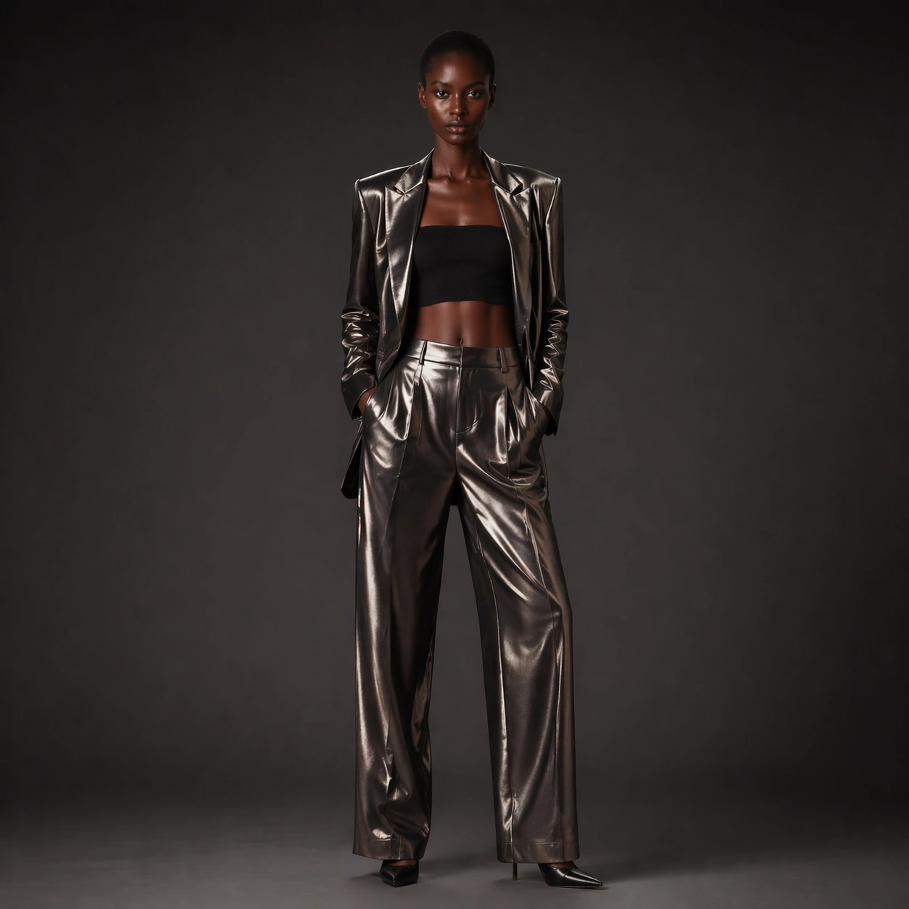

```text
Scene:
Create a square 1:1 portrait image for High Fashion Lookbook Grid. Use a fashion light plan that reveals reflective fabric without blowing detail. The frame should feel like a finished professional deliverable rather than a casual snapshot, with clear lens discipline, believable light falloff, and a palette that directly supports Build editorial lookbook grids that keep the same model identity stable across multiple outfits, poses, and page compositions.. Keep enough surrounding space and compositional control for gallery, research, campaign, or approval-board reuse while staying photoreal and human-scaled.

Subject:
Center one high-fashion model with deep espresso skin, sharp editorial bone structure, long neck, stable lean proportions, and an unwavering runway stare. Hold the same identity while introducing stronger surface drama through metallic or high-sheen material. Use the example direction from the brief as grounding context: Build editorial lookbook grids that keep the same model identity stable across multiple outfits, poses, and page compositions.. Wardrobe, lighting, environment, and pose may shift to serve this variation, but the viewer must immediately understand that the same reference identity is still in front of the camera.

Important details:
This backlog line is difficult because Build editorial lookbook grids that keep the same model identity stable across multiple outfits, poses, and page compositions.. Preserve skin tone family, bone structure, eye spacing, nose shape, mouth shape, hairline logic, shoulder width, and overall body read across the entire series. preserve exact face / hair base / body proportions from the reference model. The model should still read instantly despite more aggressive garment finish. Avoid the common failure described in the brief: ordinary image models often lose likeness once styling, lighting, or layout changes enter the frame. Success should feel like the result should feel professionally usable, coherent, and clearly built around one stable human identity.

Use case:
High Fashion Lookbook Grid series study 5/9, a metallic or sheen-driven look.

Constraints:
No readable text, no watermark, no logos, preserve exact 1:1 aspect ratio, preserve exact face / hair base / body proportions from the reference model, no chrome costume fantasy, no hard clipping highlights, no makeup drift, no extra models.
```

[Pinned source](https://github.com/ChaosRealmsAI/gpt-image-2-gallery/blob/5296db8c996e38776c83a0bc8c64f848dcd512b3/works/topics/high-fashion-lookbook-grid/packages/series-lookbook-identity-lock/images/05-metallic-look-four/meta.json) · GPT Image2 · 1254×1254 · Reference images required. · ProjectD:pending individual review.

## Resort Look Five · high-fashion-lookbook-grid/series-lookbook-identity-lock/06-resort-look-five

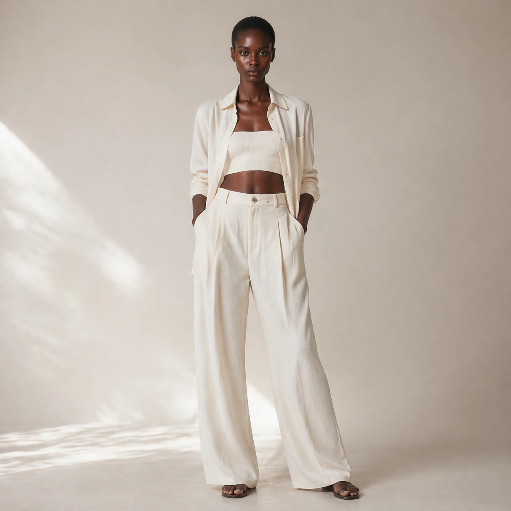

```text
Scene:
Create a square 1:1 portrait image for High Fashion Lookbook Grid. Use a lighter editorial frame with airy color and relaxed but precise fashion posture. The frame should feel like a finished professional deliverable rather than a casual snapshot, with clear lens discipline, believable light falloff, and a palette that directly supports Build editorial lookbook grids that keep the same model identity stable across multiple outfits, poses, and page compositions.. Keep enough surrounding space and compositional control for gallery, research, campaign, or approval-board reuse while staying photoreal and human-scaled.

Subject:
Center one high-fashion model with deep espresso skin, sharp editorial bone structure, long neck, stable lean proportions, and an unwavering runway stare. Shift the wardrobe into resort or soft tailoring while preserving the same face, shoulders, and leg proportions. Use the example direction from the brief as grounding context: Build editorial lookbook grids that keep the same model identity stable across multiple outfits, poses, and page compositions.. Wardrobe, lighting, environment, and pose may shift to serve this variation, but the viewer must immediately understand that the same reference identity is still in front of the camera.

Important details:
This backlog line is difficult because Build editorial lookbook grids that keep the same model identity stable across multiple outfits, poses, and page compositions.. Preserve skin tone family, bone structure, eye spacing, nose shape, mouth shape, hairline logic, shoulder width, and overall body read across the entire series. preserve exact face / hair base / body proportions from the reference model. The point is range across outfits with one stable human subject. Avoid the common failure described in the brief: ordinary image models often lose likeness once styling, lighting, or layout changes enter the frame. Success should feel like the result should feel professionally usable, coherent, and clearly built around one stable human identity.

Use case:
High Fashion Lookbook Grid series study 6/9, a resort-inspired look.

Constraints:
No readable text, no watermark, no logos, preserve exact 1:1 aspect ratio, preserve exact face / hair base / body proportions from the reference model, no beach vacation cliches, no hair volume jump, no body shape drift, no unrelated scenery.
```

[Pinned source](https://github.com/ChaosRealmsAI/gpt-image-2-gallery/blob/5296db8c996e38776c83a0bc8c64f848dcd512b3/works/topics/high-fashion-lookbook-grid/packages/series-lookbook-identity-lock/images/06-resort-look-five/meta.json) · GPT Image2 · 1254×1254 · Reference images required. · ProjectD:pending individual review.

## Knit Look Six · high-fashion-lookbook-grid/series-lookbook-identity-lock/07-knit-look-six

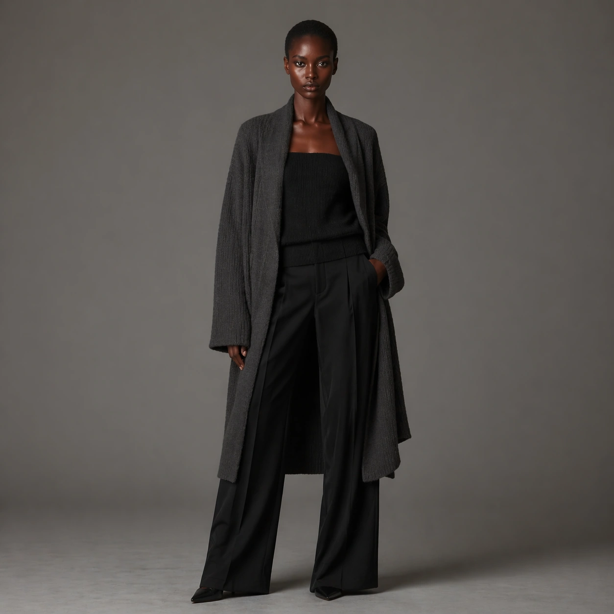

```text
Scene:
Create a square 1:1 portrait image for High Fashion Lookbook Grid. Use a tactile fashion portrait with visible weave, folds, and tactile garment depth. The frame should feel like a finished professional deliverable rather than a casual snapshot, with clear lens discipline, believable light falloff, and a palette that directly supports Build editorial lookbook grids that keep the same model identity stable across multiple outfits, poses, and page compositions.. Keep enough surrounding space and compositional control for gallery, research, campaign, or approval-board reuse while staying photoreal and human-scaled.

Subject:
Center one high-fashion model with deep espresso skin, sharp editorial bone structure, long neck, stable lean proportions, and an unwavering runway stare. Bring in knit or layered texture while keeping the same exact model identity and believable fabric fall. Use the example direction from the brief as grounding context: Build editorial lookbook grids that keep the same model identity stable across multiple outfits, poses, and page compositions.. Wardrobe, lighting, environment, and pose may shift to serve this variation, but the viewer must immediately understand that the same reference identity is still in front of the camera.

Important details:
This backlog line is difficult because Build editorial lookbook grids that keep the same model identity stable across multiple outfits, poses, and page compositions.. Preserve skin tone family, bone structure, eye spacing, nose shape, mouth shape, hairline logic, shoulder width, and overall body read across the entire series. preserve exact face / hair base / body proportions from the reference model. Material richness must not overpower the stability of the same-person read. Avoid the common failure described in the brief: ordinary image models often lose likeness once styling, lighting, or layout changes enter the frame. Success should feel like the result should feel professionally usable, coherent, and clearly built around one stable human identity.

Use case:
High Fashion Lookbook Grid series study 7/9, a textured knit or layered look.

Constraints:
No readable text, no watermark, no logos, preserve exact 1:1 aspect ratio, preserve exact face / hair base / body proportions from the reference model, no chunky costume overload, no swollen proportions, no duplicated sleeves, no logo patterns.
```

[Pinned source](https://github.com/ChaosRealmsAI/gpt-image-2-gallery/blob/5296db8c996e38776c83a0bc8c64f848dcd512b3/works/topics/high-fashion-lookbook-grid/packages/series-lookbook-identity-lock/images/07-knit-look-six/meta.json) · GPT Image2 · 1254×1254 · Reference images required. · ProjectD:pending individual review.

## Outerwear Look Seven · high-fashion-lookbook-grid/series-lookbook-identity-lock/08-outerwear-look-seven

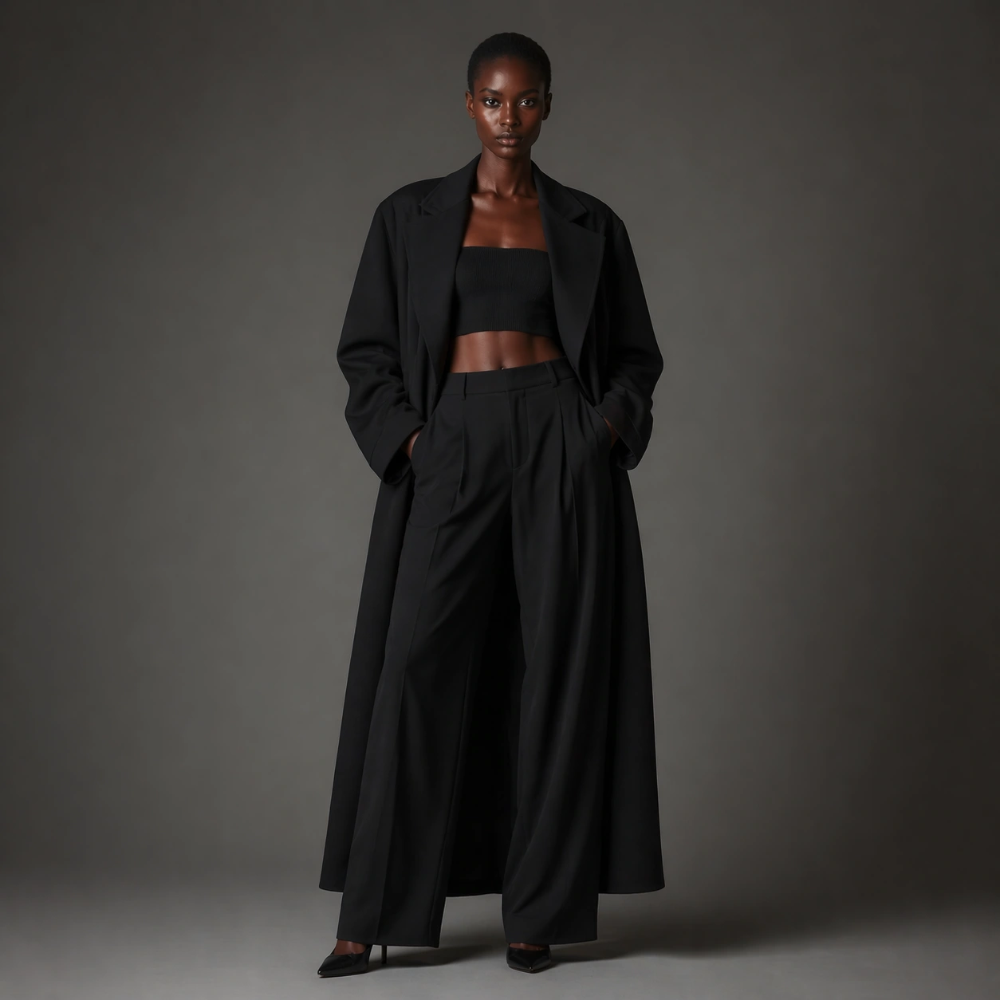

```text
Scene:
Create a square 1:1 portrait image for High Fashion Lookbook Grid. Use a lookbook composition with clear stance, full-body silhouette, and fashion-week-grade restraint. The frame should feel like a finished professional deliverable rather than a casual snapshot, with clear lens discipline, believable light falloff, and a palette that directly supports Build editorial lookbook grids that keep the same model identity stable across multiple outfits, poses, and page compositions.. Keep enough surrounding space and compositional control for gallery, research, campaign, or approval-board reuse while staying photoreal and human-scaled.

Subject:
Center one high-fashion model with deep espresso skin, sharp editorial bone structure, long neck, stable lean proportions, and an unwavering runway stare. Preserve the same subject through a heavier outerwear styling direction with stable body proportions and facial recognition. Use the example direction from the brief as grounding context: Build editorial lookbook grids that keep the same model identity stable across multiple outfits, poses, and page compositions.. Wardrobe, lighting, environment, and pose may shift to serve this variation, but the viewer must immediately understand that the same reference identity is still in front of the camera.

Important details:
This backlog line is difficult because Build editorial lookbook grids that keep the same model identity stable across multiple outfits, poses, and page compositions.. Preserve skin tone family, bone structure, eye spacing, nose shape, mouth shape, hairline logic, shoulder width, and overall body read across the entire series. preserve exact face / hair base / body proportions from the reference model. Even when the outfit becomes bulkier, the model must remain unquestionably the same. Avoid the common failure described in the brief: ordinary image models often lose likeness once styling, lighting, or layout changes enter the frame. Success should feel like the result should feel professionally usable, coherent, and clearly built around one stable human identity.

Use case:
High Fashion Lookbook Grid series study 8/9, a stronger outerwear or statement layer look.

Constraints:
No readable text, no watermark, no logos, preserve exact 1:1 aspect ratio, preserve exact face / hair base / body proportions from the reference model, no inflated body size, no hidden neck, no hat that changes identity, no second model.
```

[Pinned source](https://github.com/ChaosRealmsAI/gpt-image-2-gallery/blob/5296db8c996e38776c83a0bc8c64f848dcd512b3/works/topics/high-fashion-lookbook-grid/packages/series-lookbook-identity-lock/images/08-outerwear-look-seven/meta.json) · GPT Image2 · 1254×1254 · Reference images required. · ProjectD:pending individual review.

## Two-Page Lookbook Grid · high-fashion-lookbook-grid/series-lookbook-identity-lock/09-two-page-lookbook-grid

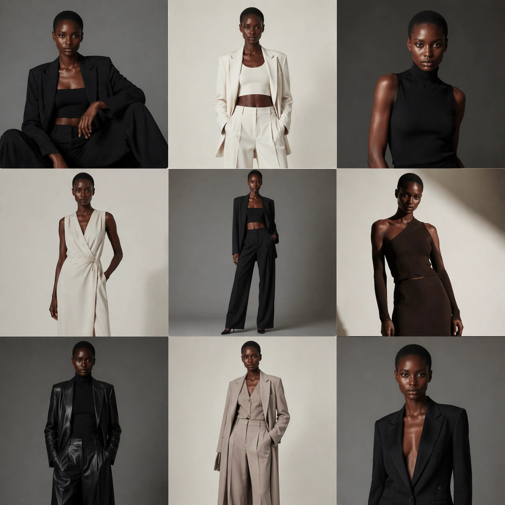

```text
Scene:
Create a square 1:1 portrait image for High Fashion Lookbook Grid. Use a square composition that implies a two-page spread or collage board while remaining clean, editorial, and non-textual. The frame should feel like a finished professional deliverable rather than a casual snapshot, with clear lens discipline, believable light falloff, and a palette that directly supports Build editorial lookbook grids that keep the same model identity stable across multiple outfits, poses, and page compositions.. Keep enough surrounding space and compositional control for gallery, research, campaign, or approval-board reuse while staying photoreal and human-scaled.

Subject:
Center one high-fashion model with deep espresso skin, sharp editorial bone structure, long neck, stable lean proportions, and an unwavering runway stare. Resolve the same identity into a finished lookbook-style grid or spread that showcases outfit range without losing the anchor likeness. Use the example direction from the brief as grounding context: Build editorial lookbook grids that keep the same model identity stable across multiple outfits, poses, and page compositions.. Wardrobe, lighting, environment, and pose may shift to serve this variation, but the viewer must immediately understand that the same reference identity is still in front of the camera.

Important details:
This backlog line is difficult because Build editorial lookbook grids that keep the same model identity stable across multiple outfits, poses, and page compositions.. Preserve skin tone family, bone structure, eye spacing, nose shape, mouth shape, hairline logic, shoulder width, and overall body read across the entire series. preserve exact face / hair base / body proportions from the reference model. Structured layout matters here, but every panel must still preserve exact face / hair base / body proportions from the reference model. Avoid the common failure described in the brief: ordinary image models often lose likeness once styling, lighting, or layout changes enter the frame. Success should feel like the result should feel professionally usable, coherent, and clearly built around one stable human identity.

Use case:
High Fashion Lookbook Grid series study 9/9, a final lookbook-grid finish.

Constraints:
No readable text, no watermark, no logos, preserve exact 1:1 aspect ratio, preserve exact face / hair base / body proportions from the reference model, no readable captions, no magazine masthead, no broken spread alignment, no random collage chaos.
```

[Pinned source](https://github.com/ChaosRealmsAI/gpt-image-2-gallery/blob/5296db8c996e38776c83a0bc8c64f848dcd512b3/works/topics/high-fashion-lookbook-grid/packages/series-lookbook-identity-lock/images/09-two-page-lookbook-grid/meta.json) · GPT Image2 · 1254×1254 · Reference images required. · ProjectD:pending individual review.

## Citrus Burst · high-speed-freeze/single-impact-studies/citrus-burst

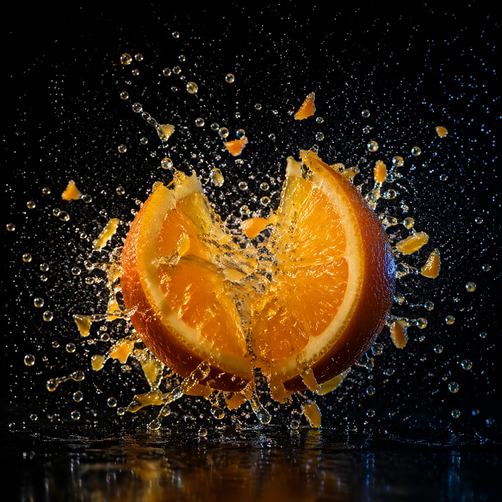

```text
Scene:
A controlled black studio macro setup, pure black background, glossy black reflective tray, invisible electronic flash, cool blue rim light from back right and clean white key flash from front left.

Subject:
a bright orange wedge bursting into juice mist and peel fragments, centered in a square frame at the exact peak moment of impact. The main event fills about 62% of the image width with particles suspended around it.

Important details:
Photorealistic high-speed photography, millionth-of-a-second freeze, macro lens, translucent pulp, orange droplets, peel shards, no gore, realistic physics, deep black negative space, crop-safe composition.

Use case:
Independent image in a Prompt Atlas high-speed theme. Square 1:1 gallery card and detail modal asset.

Constraints:
No text, no watermark, no logo, no human hands, no visible weapon or launcher, no blood, no animals, no cartoon style, no CGI look, preserve exact 1:1 aspect ratio.
```

[Pinned source](https://github.com/ChaosRealmsAI/gpt-image-2-gallery/blob/5296db8c996e38776c83a0bc8c64f848dcd512b3/works/topics/high-speed-freeze/packages/single-impact-studies/images/citrus-burst/meta.json) · GPT Image2 · 1254×1254 · No source-declared image dependencies. · ProjectD:pending individual review.

## Powder Ring · high-speed-freeze/single-impact-studies/powder-ring

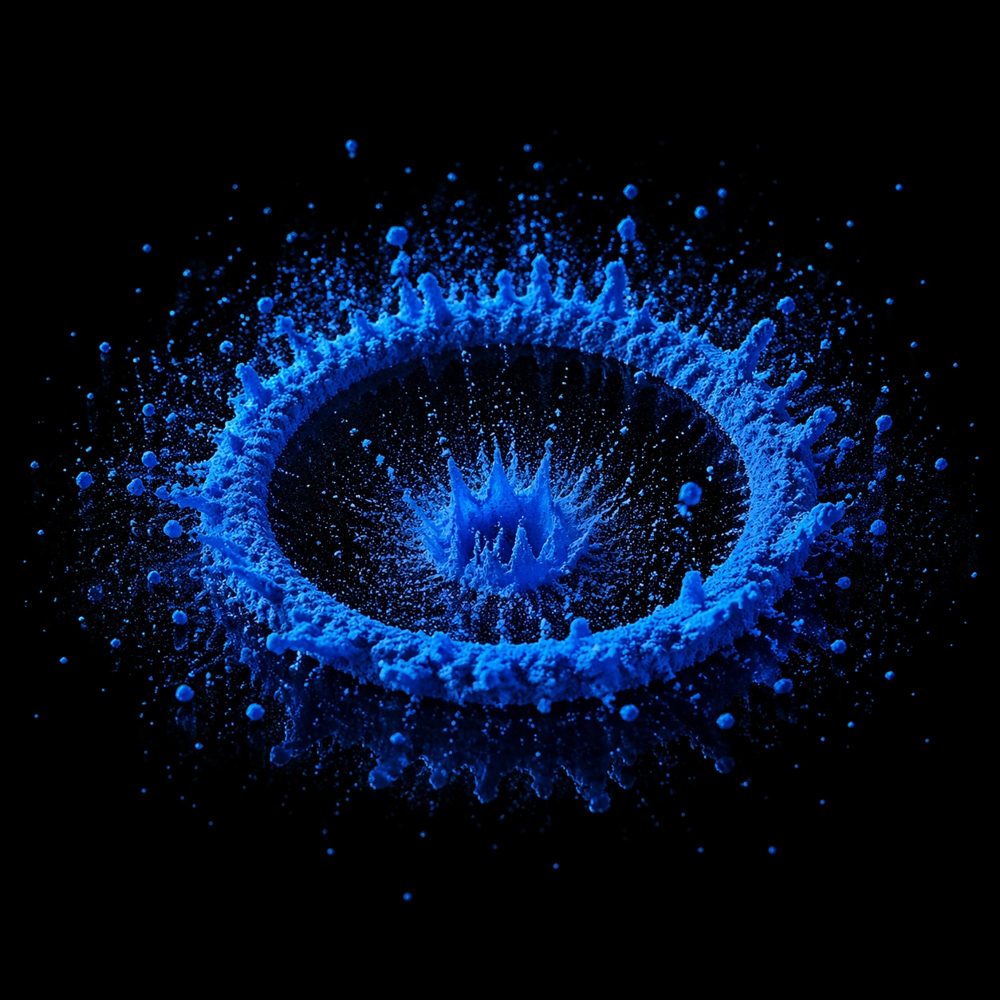

```text
Scene:
A controlled black studio macro setup, pure black background, glossy black reflective tray, invisible electronic flash, cool blue rim light from back right and clean white key flash from front left.

Subject:
a blue pigment powder ring expanding outward from a central impact, centered in a square frame at the exact peak moment of impact. The main event fills about 62% of the image width with particles suspended around it.

Important details:
Photorealistic high-speed photography, millionth-of-a-second freeze, macro lens, fine granular dust, radial symmetry, crisp blue particles, realistic physics, deep black negative space, crop-safe composition.

Use case:
Independent image in a Prompt Atlas high-speed theme. Square 1:1 gallery card and detail modal asset.

Constraints:
No text, no watermark, no logo, no human hands, no visible weapon or launcher, no blood, no animals, no cartoon style, no CGI look, preserve exact 1:1 aspect ratio.
```

[Pinned source](https://github.com/ChaosRealmsAI/gpt-image-2-gallery/blob/5296db8c996e38776c83a0bc8c64f848dcd512b3/works/topics/high-speed-freeze/packages/single-impact-studies/images/powder-ring/meta.json) · GPT Image2 · 1254×1254 · No source-declared image dependencies. · ProjectD:pending individual review.

## Foreground Path · himalayan-base-camp-night/single-landscape-studies/02-foreground-path


```text
Scene:
Create a square, photoreal landscape study of himalayan base camp starscape. Compose it as a ground-level entry path that pulls the viewer into the terrain, using a lower vantage with a strong foreground element such as a ridge line, shoreline, stream, boot track, or wet surface leading inward. Let the foreground remain tactile and detailed while the distance opens gradually Keep the frame cinematic but disciplined, with a clear foreground, middle distance, and far mass so the viewer can measure real depth. The image should feel like a field photograph made with patience, precision, and sublime restraint rather than a fantasy matte painting.

Subject:
Show a high Himalayan base camp at night beneath the world's highest summit, with the Milky Way arching overhead, warm tent lights in the foreground, and black snow ridges cutting into a clear star field. This variation should emphasize foreground-led composition. The main landform must dominate the composition, but secondary elements should quietly explain how the place works: water paths, sediment lines, snow bands, surf, ash, wind streaks, stars, or human traces where appropriate. Everything in the image should support the same idea of scale and climate, so the scene reads as one coherent environment rather than a stack of spectacular details.

Important details:
Preserve thin high-altitude air, disciplined astrophotography realism, crisp stars without cartoon exaggeration, warm-versus-cold color contrast, and believable tent scale against the mountain mass. The image should reward close looking through layered depth cues rather than pure spectacle alone. Keep geology, weather, and atmosphere physically believable. Use subtle micro-texture, tonal separation, and air perspective to reinforce distance. If a human, vehicle, tent, caravan, bird, or boat appears, it must remain tiny and subordinate to the landscape, functioning only as a scale witness. The composition should feel original, severe, and elegant, with no decorative filler and no imitation of any copyrighted visual property.

Use case:
Himalayan Base Camp Starscape single study 2/9, exploring the foreground-led composition variation.

Constraints:
No readable text, no watermark, no logos, preserve exact 1:1 aspect ratio, no satellite trails, no fireworks, no oversized moon, no city glow on the horizon, no blocked foreground, no random props, no awkward dead zone in the lower third, no kitsch color grading, no artificial border, no split-panel treatment.
```

[Pinned source](https://github.com/ChaosRealmsAI/gpt-image-2-gallery/blob/5296db8c996e38776c83a0bc8c64f848dcd512b3/works/topics/himalayan-base-camp-night/packages/single-landscape-studies/images/02-foreground-path/meta.json) · GPT Image2 · 1254×1254 · No source-declared image dependencies. · ProjectD:pending individual review.

## Aerial Geometry · himalayan-base-camp-night/single-landscape-studies/03-aerial-geometry


```text
Scene:
Create a square, photoreal landscape study of himalayan base camp starscape. Compose it as the planform geometry and overall shape logic of the landscape, using an elevated oblique aerial view that still preserves believable scale and natural topography. Let light reveal contour, fracture, and pattern instead of flattening the terrain Keep the frame cinematic but disciplined, with a clear foreground, middle distance, and far mass so the viewer can measure real depth. The image should feel like a field photograph made with patience, precision, and sublime restraint rather than a fantasy matte painting.

Subject:
Show a high Himalayan base camp at night beneath the world's highest summit, with the Milky Way arching overhead, warm tent lights in the foreground, and black snow ridges cutting into a clear star field. This variation should emphasize aerial scale read. The main landform must dominate the composition, but secondary elements should quietly explain how the place works: water paths, sediment lines, snow bands, surf, ash, wind streaks, stars, or human traces where appropriate. Everything in the image should support the same idea of scale and climate, so the scene reads as one coherent environment rather than a stack of spectacular details.

Important details:
Preserve thin high-altitude air, disciplined astrophotography realism, crisp stars without cartoon exaggeration, warm-versus-cold color contrast, and believable tent scale against the mountain mass. Emphasize rhythm, repetition, and large-form geometry without losing physical realism. Keep geology, weather, and atmosphere physically believable. Use subtle micro-texture, tonal separation, and air perspective to reinforce distance. If a human, vehicle, tent, caravan, bird, or boat appears, it must remain tiny and subordinate to the landscape, functioning only as a scale witness. The composition should feel original, severe, and elegant, with no decorative filler and no imitation of any copyrighted visual property.

Use case:
Himalayan Base Camp Starscape single study 3/9, exploring the aerial scale read variation.

Constraints:
No readable text, no watermark, no logos, preserve exact 1:1 aspect ratio, no satellite trails, no fireworks, no oversized moon, no city glow on the horizon, no map labels, no diagram arrows, no satellite-interface graphics, no kitsch color grading, no artificial border, no split-panel treatment.
```

[Pinned source](https://github.com/ChaosRealmsAI/gpt-image-2-gallery/blob/5296db8c996e38776c83a0bc8c64f848dcd512b3/works/topics/himalayan-base-camp-night/packages/single-landscape-studies/images/03-aerial-geometry/meta.json) · GPT Image2 · 1254×1254 · No source-declared image dependencies. · ProjectD:pending individual review.

## Atmosphere Event · himalayan-base-camp-night/single-landscape-studies/04-atmosphere-event


```text
Scene:
Create a square, photoreal landscape study of himalayan base camp starscape. Compose it as the moment when weather, particles, or moving air become the main dramatic agent, using a stable documentary framing that lets the environmental event stay legible. Let the air itself carry visible density through haze, spray, ash, dust, snow, or storm structure Keep the frame cinematic but disciplined, with a clear foreground, middle distance, and far mass so the viewer can measure real depth. The image should feel like a field photograph made with patience, precision, and sublime restraint rather than a fantasy matte painting.

Subject:
Show a high Himalayan base camp at night beneath the world's highest summit, with the Milky Way arching overhead, warm tent lights in the foreground, and black snow ridges cutting into a clear star field. This variation should emphasize weather-driven study. The main landform must dominate the composition, but secondary elements should quietly explain how the place works: water paths, sediment lines, snow bands, surf, ash, wind streaks, stars, or human traces where appropriate. Everything in the image should support the same idea of scale and climate, so the scene reads as one coherent environment rather than a stack of spectacular details.

Important details:
Preserve thin high-altitude air, disciplined astrophotography realism, crisp stars without cartoon exaggeration, warm-versus-cold color contrast, and believable tent scale against the mountain mass. The atmosphere must feel physically plausible and tied to terrain, wind direction, temperature, and moisture. Keep geology, weather, and atmosphere physically believable. Use subtle micro-texture, tonal separation, and air perspective to reinforce distance. If a human, vehicle, tent, caravan, bird, or boat appears, it must remain tiny and subordinate to the landscape, functioning only as a scale witness. The composition should feel original, severe, and elegant, with no decorative filler and no imitation of any copyrighted visual property.

Use case:
Himalayan Base Camp Starscape single study 4/9, exploring the weather-driven study variation.

Constraints:
No readable text, no watermark, no logos, preserve exact 1:1 aspect ratio, no satellite trails, no fireworks, no oversized moon, no city glow on the horizon, no disaster-movie excess, no impossible lightning clutter, no synthetic smoke plumes, no kitsch color grading, no artificial border, no split-panel treatment.
```

[Pinned source](https://github.com/ChaosRealmsAI/gpt-image-2-gallery/blob/5296db8c996e38776c83a0bc8c64f848dcd512b3/works/topics/himalayan-base-camp-night/packages/single-landscape-studies/images/04-atmosphere-event/meta.json) · GPT Image2 · 1254×1254 · No source-declared image dependencies. · ProjectD:pending individual review.

## Light Contrast · himalayan-base-camp-night/single-landscape-studies/05-light-contrast


```text
Scene:
Create a square, photoreal landscape study of himalayan base camp starscape. Compose it as directional light carving sharp separation between illuminated and shadowed forms, using a composition built around light falloff, shadow shape, and reflective control rather than camera gimmicks. Let one strong light source create crisp hierarchy and believable color temperature shifts Keep the frame cinematic but disciplined, with a clear foreground, middle distance, and far mass so the viewer can measure real depth. The image should feel like a field photograph made with patience, precision, and sublime restraint rather than a fantasy matte painting.

Subject:
Show a high Himalayan base camp at night beneath the world's highest summit, with the Milky Way arching overhead, warm tent lights in the foreground, and black snow ridges cutting into a clear star field. This variation should emphasize light-structure study. The main landform must dominate the composition, but secondary elements should quietly explain how the place works: water paths, sediment lines, snow bands, surf, ash, wind streaks, stars, or human traces where appropriate. Everything in the image should support the same idea of scale and climate, so the scene reads as one coherent environment rather than a stack of spectacular details.

Important details:
Preserve thin high-altitude air, disciplined astrophotography realism, crisp stars without cartoon exaggeration, warm-versus-cold color contrast, and believable tent scale against the mountain mass. Surface brightness, shadow depth, and reflected light should all agree with the material and weather conditions. Keep geology, weather, and atmosphere physically believable. Use subtle micro-texture, tonal separation, and air perspective to reinforce distance. If a human, vehicle, tent, caravan, bird, or boat appears, it must remain tiny and subordinate to the landscape, functioning only as a scale witness. The composition should feel original, severe, and elegant, with no decorative filler and no imitation of any copyrighted visual property.

Use case:
Himalayan Base Camp Starscape single study 5/9, exploring the light-structure study variation.

Constraints:
No readable text, no watermark, no logos, preserve exact 1:1 aspect ratio, no satellite trails, no fireworks, no oversized moon, no city glow on the horizon, no blown highlights, no muddy blacks, no theatrical stage lighting, no kitsch color grading, no artificial border, no split-panel treatment.
```

[Pinned source](https://github.com/ChaosRealmsAI/gpt-image-2-gallery/blob/5296db8c996e38776c83a0bc8c64f848dcd512b3/works/topics/himalayan-base-camp-night/packages/single-landscape-studies/images/05-light-contrast/meta.json) · GPT Image2 · 1254×1254 · No source-declared image dependencies. · ProjectD:pending individual review.

## Material Close · himalayan-base-camp-night/single-landscape-studies/06-material-close


```text
Scene:
Create a square, photoreal landscape study of himalayan base camp starscape. Compose it as surface texture and material transitions while still keeping the full environment recognizable, using a tighter medium-wide crop that gives more area to texture, fracture, grain, water, ice, lava, salt, or stone. Let texture remain readable without making the scene feel like a macro shot Keep the frame cinematic but disciplined, with a clear foreground, middle distance, and far mass so the viewer can measure real depth. The image should feel like a field photograph made with patience, precision, and sublime restraint rather than a fantasy matte painting.

Subject:
Show a high Himalayan base camp at night beneath the world's highest summit, with the Milky Way arching overhead, warm tent lights in the foreground, and black snow ridges cutting into a clear star field. This variation should emphasize material realism check. The main landform must dominate the composition, but secondary elements should quietly explain how the place works: water paths, sediment lines, snow bands, surf, ash, wind streaks, stars, or human traces where appropriate. Everything in the image should support the same idea of scale and climate, so the scene reads as one coherent environment rather than a stack of spectacular details.

Important details:
Preserve thin high-altitude air, disciplined astrophotography realism, crisp stars without cartoon exaggeration, warm-versus-cold color contrast, and believable tent scale against the mountain mass. Micro-texture, edge wear, wetness, frost, dust, foam, or sediment should deepen realism rather than distract from scale. Keep geology, weather, and atmosphere physically believable. Use subtle micro-texture, tonal separation, and air perspective to reinforce distance. If a human, vehicle, tent, caravan, bird, or boat appears, it must remain tiny and subordinate to the landscape, functioning only as a scale witness. The composition should feel original, severe, and elegant, with no decorative filler and no imitation of any copyrighted visual property.

Use case:
Himalayan Base Camp Starscape single study 6/9, exploring the material realism check variation.

Constraints:
No readable text, no watermark, no logos, preserve exact 1:1 aspect ratio, no satellite trails, no fireworks, no oversized moon, no city glow on the horizon, no extreme macro abstraction, no plastic-looking surfaces, no shallow depth-of-field blur, no kitsch color grading, no artificial border, no split-panel treatment.
```

[Pinned source](https://github.com/ChaosRealmsAI/gpt-image-2-gallery/blob/5296db8c996e38776c83a0bc8c64f848dcd512b3/works/topics/himalayan-base-camp-night/packages/single-landscape-studies/images/06-material-close/meta.json) · GPT Image2 · 1024×1024 · No source-declared image dependencies. · ProjectD:pending individual review.

## Scale Witness · himalayan-base-camp-night/single-landscape-studies/07-scale-witness


```text
Scene:
Create a square, photoreal landscape study of himalayan base camp starscape. Compose it as a tiny human, animal, tent, vehicle, or craft that reveals the vastness of the environment, using a balanced frame where the witness remains small but unmistakable. Let the scale marker stay visible without becoming the true subject Keep the frame cinematic but disciplined, with a clear foreground, middle distance, and far mass so the viewer can measure real depth. The image should feel like a field photograph made with patience, precision, and sublime restraint rather than a fantasy matte painting.

Subject:
Show a high Himalayan base camp at night beneath the world's highest summit, with the Milky Way arching overhead, warm tent lights in the foreground, and black snow ridges cutting into a clear star field. This variation should emphasize scale comparison. The main landform must dominate the composition, but secondary elements should quietly explain how the place works: water paths, sediment lines, snow bands, surf, ash, wind streaks, stars, or human traces where appropriate. Everything in the image should support the same idea of scale and climate, so the scene reads as one coherent environment rather than a stack of spectacular details.

Important details:
Preserve thin high-altitude air, disciplined astrophotography realism, crisp stars without cartoon exaggeration, warm-versus-cold color contrast, and believable tent scale against the mountain mass. The viewer should understand the environment first and the witness second, with clean spatial separation between them. Keep geology, weather, and atmosphere physically believable. Use subtle micro-texture, tonal separation, and air perspective to reinforce distance. If a human, vehicle, tent, caravan, bird, or boat appears, it must remain tiny and subordinate to the landscape, functioning only as a scale witness. The composition should feel original, severe, and elegant, with no decorative filler and no imitation of any copyrighted visual property.

Use case:
Himalayan Base Camp Starscape single study 7/9, exploring the scale comparison variation.

Constraints:
No readable text, no watermark, no logos, preserve exact 1:1 aspect ratio, no satellite trails, no fireworks, no oversized moon, no city glow on the horizon, no crowd scenes, no heroic close-up character framing, no busy gear pile, no kitsch color grading, no artificial border, no split-panel treatment.
```

[Pinned source](https://github.com/ChaosRealmsAI/gpt-image-2-gallery/blob/5296db8c996e38776c83a0bc8c64f848dcd512b3/works/topics/himalayan-base-camp-night/packages/single-landscape-studies/images/07-scale-witness/meta.json) · GPT Image2 · 1254×1254 · No source-declared image dependencies. · ProjectD:pending individual review.

## Abstract Rhythm · himalayan-base-camp-night/single-landscape-studies/08-abstract-rhythm


```text
Scene:
Create a square, photoreal landscape study of himalayan base camp starscape. Compose it as the near-abstract rhythm of repeated natural forms, lines, and tonal bands, using a disciplined crop that approaches abstraction while remaining unmistakably a real place. Let shape and tonal cadence dominate before small narrative details Keep the frame cinematic but disciplined, with a clear foreground, middle distance, and far mass so the viewer can measure real depth. The image should feel like a field photograph made with patience, precision, and sublime restraint rather than a fantasy matte painting.

Subject:
Show a high Himalayan base camp at night beneath the world's highest summit, with the Milky Way arching overhead, warm tent lights in the foreground, and black snow ridges cutting into a clear star field. This variation should emphasize formal composition study. The main landform must dominate the composition, but secondary elements should quietly explain how the place works: water paths, sediment lines, snow bands, surf, ash, wind streaks, stars, or human traces where appropriate. Everything in the image should support the same idea of scale and climate, so the scene reads as one coherent environment rather than a stack of spectacular details.

Important details:
Preserve thin high-altitude air, disciplined astrophotography realism, crisp stars without cartoon exaggeration, warm-versus-cold color contrast, and believable tent scale against the mountain mass. Pattern, repetition, and negative space should feel discovered in nature, not graphically imposed. Keep geology, weather, and atmosphere physically believable. Use subtle micro-texture, tonal separation, and air perspective to reinforce distance. If a human, vehicle, tent, caravan, bird, or boat appears, it must remain tiny and subordinate to the landscape, functioning only as a scale witness. The composition should feel original, severe, and elegant, with no decorative filler and no imitation of any copyrighted visual property.

Use case:
Himalayan Base Camp Starscape single study 8/9, exploring the formal composition study variation.

Constraints:
No readable text, no watermark, no logos, preserve exact 1:1 aspect ratio, no satellite trails, no fireworks, no oversized moon, no city glow on the horizon, no graphic overlays, no surreal floating elements, no ornamental symmetry cheats, no kitsch color grading, no artificial border, no split-panel treatment.
```

[Pinned source](https://github.com/ChaosRealmsAI/gpt-image-2-gallery/blob/5296db8c996e38776c83a0bc8c64f848dcd512b3/works/topics/himalayan-base-camp-night/packages/single-landscape-studies/images/08-abstract-rhythm/meta.json) · GPT Image2 · 1254×1254 · No source-declared image dependencies. · ProjectD:pending individual review.

## Final Iconic · himalayan-base-camp-night/single-landscape-studies/09-final-iconic


```text
Scene:
Create a square, photoreal landscape study of himalayan base camp starscape. Compose it as the cleanest, most iconic summary of the whole landscape idea, using a distilled composition with one unforgettable silhouette or mass relationship and generous breathing room. Let the scene resolve into a memorable final image with strong legibility at thumbnail size Keep the frame cinematic but disciplined, with a clear foreground, middle distance, and far mass so the viewer can measure real depth. The image should feel like a field photograph made with patience, precision, and sublime restraint rather than a fantasy matte painting.

Subject:
Show a high Himalayan base camp at night beneath the world's highest summit, with the Milky Way arching overhead, warm tent lights in the foreground, and black snow ridges cutting into a clear star field. This variation should emphasize iconic final plate. The main landform must dominate the composition, but secondary elements should quietly explain how the place works: water paths, sediment lines, snow bands, surf, ash, wind streaks, stars, or human traces where appropriate. Everything in the image should support the same idea of scale and climate, so the scene reads as one coherent environment rather than a stack of spectacular details.

Important details:
Preserve thin high-altitude air, disciplined astrophotography realism, crisp stars without cartoon exaggeration, warm-versus-cold color contrast, and believable tent scale against the mountain mass. Keep the frame spare, confident, and monumental, with every element earning its place. Keep geology, weather, and atmosphere physically believable. Use subtle micro-texture, tonal separation, and air perspective to reinforce distance. If a human, vehicle, tent, caravan, bird, or boat appears, it must remain tiny and subordinate to the landscape, functioning only as a scale witness. The composition should feel original, severe, and elegant, with no decorative filler and no imitation of any copyrighted visual property.

Use case:
Himalayan Base Camp Starscape single study 9/9, exploring the iconic final plate variation.

Constraints:
No readable text, no watermark, no logos, preserve exact 1:1 aspect ratio, no satellite trails, no fireworks, no oversized moon, no city glow on the horizon, no cluttered edges, no competing focal points, no visual noise in empty space, no kitsch color grading, no artificial border, no split-panel treatment.
```

[Pinned source](https://github.com/ChaosRealmsAI/gpt-image-2-gallery/blob/5296db8c996e38776c83a0bc8c64f848dcd512b3/works/topics/himalayan-base-camp-night/packages/single-landscape-studies/images/09-final-iconic/meta.json) · GPT Image2 · 1254×1254 · No source-declared image dependencies. · ProjectD:pending individual review.

## Goldleaf Master Plate · hindu-yantra-ultra-precision/single-yantra-precision-studies/01-goldleaf-master-plate


```text
Scene:
Render a square, front-facing sacred diagram with the calm authority of a museum print or ceremonial object photography. The composition should be centered, still, and precise, with lighting chosen to reveal line accuracy, material finish, and the relationship between the central bindu and the surrounding triangle, lotus, and boundary systems. Treat the image as a premium ceremonial print photographed head on under soft museum light. Keep the square crop exact, the camera flat, and the tonal design disciplined enough that structure stays clear at poster scale and under close inspection.

Subject:
Use a yantra structure driven by exact intersecting triangles, disciplined rings, lotus petals, and square boundary logic. The geometry should feel measured and intentional, with no uncertain overlaps and no decorative material distracting from the mathematical clarity of the primary form. Focus this variation on a disciplined gold-on-crimson master yantra with razor-clean intersections and a luminous central bindu. The composition should feel complete and singular, as though one finished artifact has been resolved with full conviction rather than one fragment pulled from a larger sheet.

Important details:
Intersection accuracy is the main challenge. Keep the bindu fixed at the true center, preserve clean point-to-point contacts, and let petals, borders, and subsidiary rings reinforce the core structure instead of competing with it. Material richness should support legibility, never soften it. Use gold leaf edges, deep crimson ground, and tiny shadow relief only where they make the geometry easier to inspect. Preserve crisp edge behavior, stable hierarchy, and enough fine information that the image rewards slow viewing without losing the main read from a distance.

Use case:
Yantra Precision single study 1/9, designed as a self-contained sacred-geometry image with a distinct material and compositional emphasis.

Constraints:
No readable text, no watermark, no logos, preserve exact 1:1 aspect ratio, no misregistered triangle intersections, no off-center bindu, no cartoon mysticism, no incense smoke covering geometry, no readable script, no ornamental clutter outside the main order, no wrinkled foil chaos, no textured blur, no wandering center.
```

[Pinned source](https://github.com/ChaosRealmsAI/gpt-image-2-gallery/blob/5296db8c996e38776c83a0bc8c64f848dcd512b3/works/topics/hindu-yantra-ultra-precision/packages/single-yantra-precision-studies/images/01-goldleaf-master-plate/meta.json) · GPT Image2 · 1254×1254 · No source-declared image dependencies. · ProjectD:pending individual review.

## Vermillion Silk Altar · hindu-yantra-ultra-precision/single-yantra-precision-studies/02-vermillion-silk-altar


```text
Scene:
Render a square, front-facing sacred diagram with the calm authority of a museum print or ceremonial object photography. The composition should be centered, still, and precise, with lighting chosen to reveal line accuracy, material finish, and the relationship between the central bindu and the surrounding triangle, lotus, and boundary systems. Keep the textile subordinate to the geometry, using gentle folds that never distort the front-facing diagram. Keep the square crop exact, the camera flat, and the tonal design disciplined enough that structure stays clear at poster scale and under close inspection.

Subject:
Use a yantra structure driven by exact intersecting triangles, disciplined rings, lotus petals, and square boundary logic. The geometry should feel measured and intentional, with no uncertain overlaps and no decorative material distracting from the mathematical clarity of the primary form. Focus this variation on a textile-rich version where the yantra sits above dark vermillion silk yet remains mathematically rigid. The composition should feel complete and singular, as though one finished artifact has been resolved with full conviction rather than one fragment pulled from a larger sheet.

Important details:
Intersection accuracy is the main challenge. Keep the bindu fixed at the true center, preserve clean point-to-point contacts, and let petals, borders, and subsidiary rings reinforce the core structure instead of competing with it. Material richness should support legibility, never soften it. The silk can add richness at the margins, but every triangle edge and lotus ring must stay crisp and exactly aligned. Preserve crisp edge behavior, stable hierarchy, and enough fine information that the image rewards slow viewing without losing the main read from a distance.

Use case:
Yantra Precision single study 2/9, designed as a self-contained sacred-geometry image with a distinct material and compositional emphasis.

Constraints:
No readable text, no watermark, no logos, preserve exact 1:1 aspect ratio, no misregistered triangle intersections, no off-center bindu, no cartoon mysticism, no incense smoke covering geometry, no readable script, no ornamental clutter outside the main order, no fabric perspective warp, no soft focus, no decorative objects.
```

[Pinned source](https://github.com/ChaosRealmsAI/gpt-image-2-gallery/blob/5296db8c996e38776c83a0bc8c64f848dcd512b3/works/topics/hindu-yantra-ultra-precision/packages/single-yantra-precision-studies/images/02-vermillion-silk-altar/meta.json) · GPT Image2 · 1254×1254 · No source-declared image dependencies. · ProjectD:pending individual review.

## Obsidian Engraved Disc · hindu-yantra-ultra-precision/single-yantra-precision-studies/03-obsidian-engraved-disc


```text
Scene:
Render a square, front-facing sacred diagram with the calm authority of a museum print or ceremonial object photography. The composition should be centered, still, and precise, with lighting chosen to reveal line accuracy, material finish, and the relationship between the central bindu and the surrounding triangle, lotus, and boundary systems. Light it like a luxury artifact shot, with grazing reflections revealing incision depth but not changing the frontal geometry. Keep the square crop exact, the camera flat, and the tonal design disciplined enough that structure stays clear at poster scale and under close inspection.

Subject:
Use a yantra structure driven by exact intersecting triangles, disciplined rings, lotus petals, and square boundary logic. The geometry should feel measured and intentional, with no uncertain overlaps and no decorative material distracting from the mathematical clarity of the primary form. Focus this variation on a black stone interpretation with incised gold channels and a bright bindu set inside deep polished darkness. The composition should feel complete and singular, as though one finished artifact has been resolved with full conviction rather than one fragment pulled from a larger sheet.

Important details:
Intersection accuracy is the main challenge. Keep the bindu fixed at the true center, preserve clean point-to-point contacts, and let petals, borders, and subsidiary rings reinforce the core structure instead of competing with it. Material richness should support legibility, never soften it. Preserve immaculate engraving paths, sharp triangle tips, and clean contrast between polished planes and etched recesses. Preserve crisp edge behavior, stable hierarchy, and enough fine information that the image rewards slow viewing without losing the main read from a distance.

Use case:
Yantra Precision single study 3/9, designed as a self-contained sacred-geometry image with a distinct material and compositional emphasis.

Constraints:
No readable text, no watermark, no logos, preserve exact 1:1 aspect ratio, no misregistered triangle intersections, no off-center bindu, no cartoon mysticism, no incense smoke covering geometry, no readable script, no ornamental clutter outside the main order, no gemstone jewelry styling, no chipped stone, no mirrored glare hiding lines.
```

[Pinned source](https://github.com/ChaosRealmsAI/gpt-image-2-gallery/blob/5296db8c996e38776c83a0bc8c64f848dcd512b3/works/topics/hindu-yantra-ultra-precision/packages/single-yantra-precision-studies/images/03-obsidian-engraved-disc/meta.json) · GPT Image2 · 1254×1254 · No source-declared image dependencies. · ProjectD:pending individual review.

## Pearl Powder Miniature · hindu-yantra-ultra-precision/single-yantra-precision-studies/04-pearl-powder-miniature


```text
Scene:
Render a square, front-facing sacred diagram with the calm authority of a museum print or ceremonial object photography. The composition should be centered, still, and precise, with lighting chosen to reveal line accuracy, material finish, and the relationship between the central bindu and the surrounding triangle, lotus, and boundary systems. Present it like a rare manuscript plate seen from directly above under controlled archival light. Keep the square crop exact, the camera flat, and the tonal design disciplined enough that structure stays clear at poster scale and under close inspection.

Subject:
Use a yantra structure driven by exact intersecting triangles, disciplined rings, lotus petals, and square boundary logic. The geometry should feel measured and intentional, with no uncertain overlaps and no decorative material distracting from the mathematical clarity of the primary form. Focus this variation on a pale ivory miniature with pearl dust, soft mineral reds, and extremely fine intersection discipline. The composition should feel complete and singular, as though one finished artifact has been resolved with full conviction rather than one fragment pulled from a larger sheet.

Important details:
Intersection accuracy is the main challenge. Keep the bindu fixed at the true center, preserve clean point-to-point contacts, and let petals, borders, and subsidiary rings reinforce the core structure instead of competing with it. Material richness should support legibility, never soften it. The palette should be gentle, but the overlaps must remain countable and exact; do not let delicacy become vagueness. Preserve crisp edge behavior, stable hierarchy, and enough fine information that the image rewards slow viewing without losing the main read from a distance.

Use case:
Yantra Precision single study 4/9, designed as a self-contained sacred-geometry image with a distinct material and compositional emphasis.

Constraints:
No readable text, no watermark, no logos, preserve exact 1:1 aspect ratio, no misregistered triangle intersections, no off-center bindu, no cartoon mysticism, no incense smoke covering geometry, no readable script, no ornamental clutter outside the main order, no faded illegibility, no torn paper drama, no decorative border crowding the form.
```

[Pinned source](https://github.com/ChaosRealmsAI/gpt-image-2-gallery/blob/5296db8c996e38776c83a0bc8c64f848dcd512b3/works/topics/hindu-yantra-ultra-precision/packages/single-yantra-precision-studies/images/04-pearl-powder-miniature/meta.json) · GPT Image2 · 1254×1254 · No source-declared image dependencies. · ProjectD:pending individual review.

## Lapis Geometry Field · hindu-yantra-ultra-precision/single-yantra-precision-studies/05-lapis-geometry-field


```text
Scene:
Render a square, front-facing sacred diagram with the calm authority of a museum print or ceremonial object photography. The composition should be centered, still, and precise, with lighting chosen to reveal line accuracy, material finish, and the relationship between the central bindu and the surrounding triangle, lotus, and boundary systems. Use rich mineral blue, restrained gold, and a stable frontal presentation that feels both sacred and engineered. Keep the square crop exact, the camera flat, and the tonal design disciplined enough that structure stays clear at poster scale and under close inspection.

Subject:
Use a yantra structure driven by exact intersecting triangles, disciplined rings, lotus petals, and square boundary logic. The geometry should feel measured and intentional, with no uncertain overlaps and no decorative material distracting from the mathematical clarity of the primary form. Focus this variation on a blue-and-gold version where lapis tonality heightens the triangle weave and ring hierarchy. The composition should feel complete and singular, as though one finished artifact has been resolved with full conviction rather than one fragment pulled from a larger sheet.

Important details:
Intersection accuracy is the main challenge. Keep the bindu fixed at the true center, preserve clean point-to-point contacts, and let petals, borders, and subsidiary rings reinforce the core structure instead of competing with it. Material richness should support legibility, never soften it. Keep the color transitions quiet and let geometry, not texture, define the ranking of the rings and petals. Preserve crisp edge behavior, stable hierarchy, and enough fine information that the image rewards slow viewing without losing the main read from a distance.

Use case:
Yantra Precision single study 5/9, designed as a self-contained sacred-geometry image with a distinct material and compositional emphasis.

Constraints:
No readable text, no watermark, no logos, preserve exact 1:1 aspect ratio, no misregistered triangle intersections, no off-center bindu, no cartoon mysticism, no incense smoke covering geometry, no readable script, no ornamental clutter outside the main order, no marbled noise overpowering lines, no cosmic background, no asymmetric glow.
```

[Pinned source](https://github.com/ChaosRealmsAI/gpt-image-2-gallery/blob/5296db8c996e38776c83a0bc8c64f848dcd512b3/works/topics/hindu-yantra-ultra-precision/packages/single-yantra-precision-studies/images/05-lapis-geometry-field/meta.json) · GPT Image2 · 1254×1254 · No source-declared image dependencies. · ProjectD:pending individual review.

## Ritual Sand Diagram · hindu-yantra-ultra-precision/single-yantra-precision-studies/06-ritual-sand-diagram


```text
Scene:
Render a square, front-facing sacred diagram with the calm authority of a museum print or ceremonial object photography. The composition should be centered, still, and precise, with lighting chosen to reveal line accuracy, material finish, and the relationship between the central bindu and the surrounding triangle, lotus, and boundary systems. Stage it as a pristine top-down ceremonial surface with careful shadows and no surrounding props. Keep the square crop exact, the camera flat, and the tonal design disciplined enough that structure stays clear at poster scale and under close inspection.

Subject:
Use a yantra structure driven by exact intersecting triangles, disciplined rings, lotus petals, and square boundary logic. The geometry should feel measured and intentional, with no uncertain overlaps and no decorative material distracting from the mathematical clarity of the primary form. Focus this variation on a granular powder interpretation where colored sand follows exact yantra boundaries without any collapse of form. The composition should feel complete and singular, as though one finished artifact has been resolved with full conviction rather than one fragment pulled from a larger sheet.

Important details:
Intersection accuracy is the main challenge. Keep the bindu fixed at the true center, preserve clean point-to-point contacts, and let petals, borders, and subsidiary rings reinforce the core structure instead of competing with it. Material richness should support legibility, never soften it. Granular texture may be visible, but every edge must stay hard enough to prove the pattern was placed with intent and discipline. Preserve crisp edge behavior, stable hierarchy, and enough fine information that the image rewards slow viewing without losing the main read from a distance.

Use case:
Yantra Precision single study 6/9, designed as a self-contained sacred-geometry image with a distinct material and compositional emphasis.

Constraints:
No readable text, no watermark, no logos, preserve exact 1:1 aspect ratio, no misregistered triangle intersections, no off-center bindu, no cartoon mysticism, no incense smoke covering geometry, no readable script, no ornamental clutter outside the main order, no spilled sand, no handprints, no casual tabletop mess.
```

[Pinned source](https://github.com/ChaosRealmsAI/gpt-image-2-gallery/blob/5296db8c996e38776c83a0bc8c64f848dcd512b3/works/topics/hindu-yantra-ultra-precision/packages/single-yantra-precision-studies/images/06-ritual-sand-diagram/meta.json) · GPT Image2 · 1254×1254 · No source-declared image dependencies. · ProjectD:pending individual review.

## Copper Etching Study · hindu-yantra-ultra-precision/single-yantra-precision-studies/07-copper-etching-study


```text
Scene:
Render a square, front-facing sacred diagram with the calm authority of a museum print or ceremonial object photography. The composition should be centered, still, and precise, with lighting chosen to reveal line accuracy, material finish, and the relationship between the central bindu and the surrounding triangle, lotus, and boundary systems. Render it like a conserved sacred object under even raking light, still viewed from the front. Keep the square crop exact, the camera flat, and the tonal design disciplined enough that structure stays clear at poster scale and under close inspection.

Subject:
Use a yantra structure driven by exact intersecting triangles, disciplined rings, lotus petals, and square boundary logic. The geometry should feel measured and intentional, with no uncertain overlaps and no decorative material distracting from the mathematical clarity of the primary form. Focus this variation on a warm metal plate where etched copper lines and dark patina make the yantra feel archival and exact. The composition should feel complete and singular, as though one finished artifact has been resolved with full conviction rather than one fragment pulled from a larger sheet.

Important details:
Intersection accuracy is the main challenge. Keep the bindu fixed at the true center, preserve clean point-to-point contacts, and let petals, borders, and subsidiary rings reinforce the core structure instead of competing with it. Material richness should support legibility, never soften it. Use patina selectively to reveal hierarchy, and preserve point intersections as crisp cuts rather than soft decorative scratches. Preserve crisp edge behavior, stable hierarchy, and enough fine information that the image rewards slow viewing without losing the main read from a distance.

Use case:
Yantra Precision single study 7/9, designed as a self-contained sacred-geometry image with a distinct material and compositional emphasis.

Constraints:
No readable text, no watermark, no logos, preserve exact 1:1 aspect ratio, no misregistered triangle intersections, no off-center bindu, no cartoon mysticism, no incense smoke covering geometry, no readable script, no ornamental clutter outside the main order, no corrosion damage, no steampunk mechanisms, no uncontrolled shine.
```

[Pinned source](https://github.com/ChaosRealmsAI/gpt-image-2-gallery/blob/5296db8c996e38776c83a0bc8c64f848dcd512b3/works/topics/hindu-yantra-ultra-precision/packages/single-yantra-precision-studies/images/07-copper-etching-study/meta.json) · GPT Image2 · 1254×1254 · No source-declared image dependencies. · ProjectD:pending individual review.

## Moonlit Paper Shrine · hindu-yantra-ultra-precision/single-yantra-precision-studies/08-moonlit-paper-shrine


```text
Scene:
Render a square, front-facing sacred diagram with the calm authority of a museum print or ceremonial object photography. The composition should be centered, still, and precise, with lighting chosen to reveal line accuracy, material finish, and the relationship between the central bindu and the surrounding triangle, lotus, and boundary systems. Keep the mood meditative and sparse, using very soft light but never compromising exact line placement. Keep the square crop exact, the camera flat, and the tonal design disciplined enough that structure stays clear at poster scale and under close inspection.

Subject:
Use a yantra structure driven by exact intersecting triangles, disciplined rings, lotus petals, and square boundary logic. The geometry should feel measured and intentional, with no uncertain overlaps and no decorative material distracting from the mathematical clarity of the primary form. Focus this variation on a quiet grey-white paper interpretation with subtle silver highlight and immaculate central balance. The composition should feel complete and singular, as though one finished artifact has been resolved with full conviction rather than one fragment pulled from a larger sheet.

Important details:
Intersection accuracy is the main challenge. Keep the bindu fixed at the true center, preserve clean point-to-point contacts, and let petals, borders, and subsidiary rings reinforce the core structure instead of competing with it. Material richness should support legibility, never soften it. Negative space should frame the yantra with dignity, and every triangle crossing should remain unmistakably intentional. Preserve crisp edge behavior, stable hierarchy, and enough fine information that the image rewards slow viewing without losing the main read from a distance.

Use case:
Yantra Precision single study 8/9, designed as a self-contained sacred-geometry image with a distinct material and compositional emphasis.

Constraints:
No readable text, no watermark, no logos, preserve exact 1:1 aspect ratio, no misregistered triangle intersections, no off-center bindu, no cartoon mysticism, no incense smoke covering geometry, no readable script, no ornamental clutter outside the main order, no empty weak composition, no blurred paper grain, no poetic brush disorder.
```

[Pinned source](https://github.com/ChaosRealmsAI/gpt-image-2-gallery/blob/5296db8c996e38776c83a0bc8c64f848dcd512b3/works/topics/hindu-yantra-ultra-precision/packages/single-yantra-precision-studies/images/08-moonlit-paper-shrine/meta.json) · GPT Image2 · 1254×1254 · No source-declared image dependencies. · ProjectD:pending individual review.

## Temple Floor Inlay · hindu-yantra-ultra-precision/single-yantra-precision-studies/09-temple-floor-inlay


```text
Scene:
Render a square, front-facing sacred diagram with the calm authority of a museum print or ceremonial object photography. The composition should be centered, still, and precise, with lighting chosen to reveal line accuracy, material finish, and the relationship between the central bindu and the surrounding triangle, lotus, and boundary systems. Present it straight on like an architectural sample, with subtle directional light revealing joints and polish. Keep the square crop exact, the camera flat, and the tonal design disciplined enough that structure stays clear at poster scale and under close inspection.

Subject:
Use a yantra structure driven by exact intersecting triangles, disciplined rings, lotus petals, and square boundary logic. The geometry should feel measured and intentional, with no uncertain overlaps and no decorative material distracting from the mathematical clarity of the primary form. Focus this variation on a stone inlay interpretation where polished minerals form the yantra as a square sacred floor panel. The composition should feel complete and singular, as though one finished artifact has been resolved with full conviction rather than one fragment pulled from a larger sheet.

Important details:
Intersection accuracy is the main challenge. Keep the bindu fixed at the true center, preserve clean point-to-point contacts, and let petals, borders, and subsidiary rings reinforce the core structure instead of competing with it. Material richness should support legibility, never soften it. Joints must trace the geometry exactly, the bindu must stay perfectly centered, and the panel border must feel structural rather than decorative. Preserve crisp edge behavior, stable hierarchy, and enough fine information that the image rewards slow viewing without losing the main read from a distance.

Use case:
Yantra Precision single study 9/9, designed as a self-contained sacred-geometry image with a distinct material and compositional emphasis.

Constraints:
No readable text, no watermark, no logos, preserve exact 1:1 aspect ratio, no misregistered triangle intersections, no off-center bindu, no cartoon mysticism, no incense smoke covering geometry, no readable script, no ornamental clutter outside the main order, no perspective tilt, no cracked tiles, no surrounding architecture stealing focus.
```

[Pinned source](https://github.com/ChaosRealmsAI/gpt-image-2-gallery/blob/5296db8c996e38776c83a0bc8c64f848dcd512b3/works/topics/hindu-yantra-ultra-precision/packages/single-yantra-precision-studies/images/09-temple-floor-inlay/meta.json) · GPT Image2 · 1254×1254 · No source-declared image dependencies. · ProjectD:pending individual review.

## Reference Office Floor · hitman-office-level/series-corporate-stealth-map/01-reference-office-floor


```text
Scene:
A square top-down isometric cutaway of a modern corporate office floor, presented like a polished stealth-game level map. The viewpoint is high enough to read the whole floorplan: reception, open desks, glass meeting rooms, executive corner office, server closet, pantry, storage room, restroom corridor, elevator lobby, stairwell, and security desk. Use cool office lighting, muted blue-gray carpet, glass partitions, white desks, and subtle cinematic shadows.

Subject:
The main subject is the office as a playable level. Add clean game UI overlays: thin colored patrol routes, cone-shaped vision fields, objective marker diamonds, locked-door icons, small NPC dots, and one compact HUD strip in the lower right with a non-firing suppressed pistol icon. The exact readable objective text should be "STEAL GPT-6" inside a mission box. Keep the map readable as architecture first and UI second.

Important details:
This reference image establishes the layout for the series. Room boundaries, door positions, desk clusters, corridors, cameras, vents, stairwell, elevator, and server closet must be clear enough for later images to preserve. The tone should reference a premium stealth-game planning screen without copying any real game interface or logo. No violence is occurring; it is a strategic map view with patrol logic and objective hierarchy.

Use case:
Hitman Office Level series study 1/8, establishing the reference office level layout, patrol system, and objective HUD.

Constraints:
No readable text except "STEAL GPT-6", no watermark, no logos, preserve exact 1:1 aspect ratio, no real game brand, no blood, no active shooting, no dead bodies, no clutter hiding rooms, no impossible floorplan, no broken UI alignment.
```

[Pinned source](https://github.com/ChaosRealmsAI/gpt-image-2-gallery/blob/5296db8c996e38776c83a0bc8c64f848dcd512b3/works/topics/hitman-office-level/packages/series-corporate-stealth-map/images/01-reference-office-floor/meta.json) · GPT Image2 · 1254×1254 · No source-declared image dependencies. · ProjectD:pending individual review.

## Server Vault Route · hitman-office-level/series-corporate-stealth-map/02-server-vault-route


```text
Scene:
Use the reference office floor as the locked map layout. Keep the same square top-down isometric cutaway, same reception, open desk field, glass meeting rooms, executive office, server closet, pantry, storage room, elevator lobby, stairwell, and security desk positions. The lighting is slightly cooler and more tactical, as if the player has opened a route-planning overlay.

Subject:
Show a server-vault route variant on the same floor. The exact readable objective text should be "STEAL GPT-6" in the mission box. Highlight the path from elevator lobby to server closet through a cyan route line, with alternate vent path shown as a dashed line. Add security camera arcs, locked door icons, keypad markers as unreadable symbols, two guard patrol loops, and one distraction marker in the pantry. Keep the compact lower-right HUD with the non-firing suppressed pistol icon, inventory slots, and alert meter.

Important details:
Preserve the reference map geometry and room positions. The change is the tactical overlay: server closet becomes the primary target, patrol routes shift around corridors, and restricted zones are tinted with transparent red. The scene must read as a playable stealth level with logic: cameras cover chokepoints, guards loop around valuable rooms, and alternate routes avoid vision cones. Avoid gore or action scenes; this is a clean strategic UI state.

Use case:
Hitman Office Level series study 2/8, using the reference office map to test preserved layout with a server-route mission overlay.

Constraints:
Use the reference image as layout source. No readable text except "STEAL GPT-6", no watermark, no logos, preserve exact 1:1 aspect ratio, no real game brand, no blood, no active shooting, no dead bodies, no moved rooms, no broken patrol paths, no UI clutter covering the floorplan.
```

[Pinned source](https://github.com/ChaosRealmsAI/gpt-image-2-gallery/blob/5296db8c996e38776c83a0bc8c64f848dcd512b3/works/topics/hitman-office-level/packages/series-corporate-stealth-map/images/02-server-vault-route/meta.json) · GPT Image2 · 1254×1254 · Reference images required. · ProjectD:pending individual review.

## Boardroom Social Stealth · hitman-office-level/series-corporate-stealth-map/03-boardroom-social-stealth


```text
Scene:
Use the reference office floor as the locked map layout. Keep the same square top-down isometric cutaway and preserve every major room location from the reference: reception, open desks, meeting rooms, executive office, server closet, pantry, storage, elevator lobby, stairwell, and security desk. This version feels like a social-stealth mission briefing during business hours, brighter and busier than the server route variant.

Subject:
Show a boardroom infiltration state on the same floor. The exact readable objective text should be "STEAL GPT-6" in the mission panel. The boardroom and executive office are highlighted as objective zones; NPC dots cluster around conference tables, reception, coffee point, and printer station. Add colored social suspicion rings, calendar-event blocks as unreadable rectangles, safe conversation bubbles as icon-only markers, and patrol paths for office managers rather than guards. The lower-right HUD keeps the same non-firing suppressed pistol icon but emphasizes disguise, access card, and suspicion meter slots.

Important details:
Preserve the reference geometry while changing the design logic from restricted-route planning to social infiltration. The map should show how office routines create stealth opportunities: coffee breaks open paths, meeting crowds obscure sightlines, and reception checks control access. Keep UI layers clean and separated from furniture. No violence is happening; this is about readable game systems and office behavior.

Use case:
Hitman Office Level series study 3/8, testing preserved office layout with social-stealth UI and NPC routine overlays.

Constraints:
Use the reference image as layout source. No readable text except "STEAL GPT-6", no watermark, no logos, preserve exact 1:1 aspect ratio, no real game brand, no blood, no active shooting, no dead bodies, no moved room grid, no unreadable crowd clutter, no corporate logos.
```

[Pinned source](https://github.com/ChaosRealmsAI/gpt-image-2-gallery/blob/5296db8c996e38776c83a0bc8c64f848dcd512b3/works/topics/hitman-office-level/packages/series-corporate-stealth-map/images/03-boardroom-social-stealth/meta.json) · GPT Image2 · 1254×1254 · Reference images required. · ProjectD:pending individual review.

## Afterhours Extraction · hitman-office-level/series-corporate-stealth-map/04-afterhours-extraction


```text
Scene:
Use the reference office floor as the locked map layout. Keep the same square top-down isometric cutaway and preserve the office architecture exactly: reception, open workstations, glass meeting rooms, executive office, server closet, pantry, storage, elevator lobby, stairwell, and security desk. The mood is after-hours, with dim emergency lighting, blue monitor glow, and stronger UI contrast.

Subject:
Show a late-night extraction state after the objective has been collected. The exact readable objective text should still be "STEAL GPT-6" in the mission box, now paired with an icon-only completion tick. Add a bright green extraction route from server closet to stairwell, amber search cones moving through corridors, security drones as small icon dots, locked elevator marker, and a timer bar represented by unreadable segments. The lower-right HUD keeps the same non-firing suppressed pistol icon and adds a data-drive inventory icon.

Important details:
Preserve the reference floorplan and UI style while making the mission state visibly different: fewer office workers, more security sweeps, darker lighting, and a clear exit path. The route must be spatially plausible through connected corridors and doors. Keep all overlays transparent enough to inspect desks and rooms. This is a strategic map screenshot, not a violent scene.

Use case:
Hitman Office Level series study 4/8, testing preserved office layout with after-hours extraction route and alert-state UI.

Constraints:
Use the reference image as layout source. No readable text except "STEAL GPT-6", no watermark, no logos, preserve exact 1:1 aspect ratio, no real game brand, no blood, no active shooting, no dead bodies, no changed office geometry, no impossible extraction route, no full-screen UI blocking the map.
```

[Pinned source](https://github.com/ChaosRealmsAI/gpt-image-2-gallery/blob/5296db8c996e38776c83a0bc8c64f848dcd512b3/works/topics/hitman-office-level/packages/series-corporate-stealth-map/images/04-afterhours-extraction/meta.json) · GPT Image2 · 1254×1254 · Reference images required. · ProjectD:pending individual review.

## Executive Floor Objective · hitman-office-level/single-office-level-studies/executive-floor-objective


```text
Scene:
A square top-down premium game screenshot of an executive office floor turned into a stealth mission board. The camera looks down through a clean architectural cutaway: marble elevator lobby, private reception, two glass offices, a boardroom, assistant desks, copy room, restroom corridor, and a secure records archive. The palette is corporate charcoal, ivory, brass, and tactical cyan UI.

Subject:
The mission overlay shows one player start marker, NPC patrol loops, camera cones, keycard doors, and objective icons layered over the floorplan. The exact readable objective text should be "STEAL GPT-6" in a compact upper-left objective panel. A lower-right HUD includes icon-only inventory slots, a non-firing suppressed pistol silhouette, access card icon, and suspicion meter. The image should feel like a level designer's finished screenshot, with strong hierarchy between architecture and UI.

Important details:
The office logic must be playable: reception controls entry, assistants watch the corridor, the boardroom blocks line of sight, archive access requires a keycard, and the elevator lobby is exposed. Keep patrol lines connected, vision cones aligned to character dots, and restricted areas tinted consistently. The mood can borrow stealth-game language, but avoid real game branding and avoid showing harm. The spectacle is the precise fusion of corporate office plan and game systems.

Use case:
Hitman Office Level single study 5/8, testing an independent executive-floor stealth layout with objective UI and readable patrol logic.

Constraints:
No readable text except "STEAL GPT-6", no watermark, no logos, preserve exact 1:1 aspect ratio, no real game brand, no blood, no active shooting, no dead bodies, no impossible door connections, no cluttered UI covering the route logic.
```

[Pinned source](https://github.com/ChaosRealmsAI/gpt-image-2-gallery/blob/5296db8c996e38776c83a0bc8c64f848dcd512b3/works/topics/hitman-office-level/packages/single-office-level-studies/images/executive-floor-objective/meta.json) · GPT Image2 · 1254×1254 · No source-declared image dependencies. · ProjectD:pending individual review.

## Coworking Patrol Puzzle · hitman-office-level/single-office-level-studies/coworking-patrol-puzzle


```text
Scene:
A square colorful top-down cutaway of a coworking space transformed into a stealth puzzle map. The office includes hot desks, phone booths, lounge sofas, coffee bar, shared conference pods, printer alcove, lockers, plant dividers, glass entrance, and a rooftop terrace door. Use bright startup-office colors under a semi-transparent tactical overlay.

Subject:
The playable map shows NPC patrol routines as curved colored paths between coffee, phone booths, printers, and meeting pods. The exact readable objective text should be "STEAL GPT-6" in a small objective card. A player marker begins near lockers; target data is shown in a conference pod as a glowing icon, not a person. HUD elements include disguise icon, access badge, silent inventory silhouette, and suspicion meter. Use small dots and cones rather than detailed violence or action.

Important details:
This image tests reasoning composition inside a busy open-plan office. The map must remain legible despite furniture density: routes avoid desks, sightlines are blocked by phone booths and plant dividers, and staff routines create timed openings. Keep UI overlays clean with different colors for patrol, objective, restricted zones, and safe route. The space should feel like a real coworking office with plausible amenities, not a generic maze.

Use case:
Hitman Office Level single study 6/8, testing independent coworking-office patrol puzzle composition and UI hierarchy.

Constraints:
No readable text except "STEAL GPT-6", no watermark, no logos, preserve exact 1:1 aspect ratio, no real coworking brand, no blood, no active shooting, no dead bodies, no random furniture maze, no unreadable patrol spaghetti, no UI labels beyond the objective.
```

[Pinned source](https://github.com/ChaosRealmsAI/gpt-image-2-gallery/blob/5296db8c996e38776c83a0bc8c64f848dcd512b3/works/topics/hitman-office-level/packages/single-office-level-studies/images/coworking-patrol-puzzle/meta.json) · GPT Image2 · 1254×1254 · No source-declared image dependencies. · ProjectD:pending individual review.

## Datacenter Heist HUD · hitman-office-level/single-office-level-studies/datacenter-heist-hud


```text
Scene:
A square top-down hybrid of corporate office and internal datacenter, shown as a polished tactical game map. The floorplan combines badge entry, help desk, glass operations room, server aisles, cable trays, loading dock, backup power room, and a small office bullpen. Lighting alternates between cool server glow and neutral office panels.

Subject:
The exact readable objective text should be "STEAL GPT-6" in the HUD mission tracker. The objective icon sits inside a secure server cage. Add heat-like security zones, camera cones along aisles, badge-reader locks, moving technician patrol dots, and a safe route that threads through blind spots. A lower HUD strip shows icon-only inventory: access card, data drive, compact tool, and non-firing suppressed pistol silhouette. The map is dense but should remain auditably organized.

Important details:
This is a structured-layout challenge: server aisles must align in rows, corridors must connect logically, and UI overlays must clarify rather than confuse. Keep the target as data extraction, not physical harm. Use believable datacenter details: raised floor tiles, cable trays, cold aisle/hot aisle rhythm, equipment racks, security cage, and operations monitors rendered without readable text. Avoid fantasy hacking screens or branded cloud logos.

Use case:
Hitman Office Level single study 7/8, testing datacenter-office heist composition with HUD, security geometry, and objective readability.

Constraints:
No readable text except "STEAL GPT-6", no watermark, no logos, preserve exact 1:1 aspect ratio, no real tech brand, no blood, no active shooting, no dead bodies, no impossible server maze, no random neon hacker text, no UI blocking the server cage.
```

[Pinned source](https://github.com/ChaosRealmsAI/gpt-image-2-gallery/blob/5296db8c996e38776c83a0bc8c64f848dcd512b3/works/topics/hitman-office-level/packages/single-office-level-studies/images/datacenter-heist-hud/meta.json) · GPT Image2 · 1254×1254 · No source-declared image dependencies. · ProjectD:pending individual review.

## Open Office Briefing Map · hitman-office-level/single-office-level-studies/open-office-briefing-map


```text
Scene:
A square mission-briefing board style image showing an open-plan office level as if printed on a tactical glass table. The map is top-down, clean, and semi-photoreal: rows of desks, meeting booths, kitchenette, manager office, storage closet, printer island, elevators, fire stairs, and a central collaboration zone. The interface floats above the table with restrained cyan, amber, and red overlays.

Subject:
The exact readable objective text should be "STEAL GPT-6" in a transparent mission panel. Add route arrows, camera cones, patrol loops, sound radius rings around printers and coffee machine, and interactive object markers rendered as simple icons. The HUD includes a small silent-tool silhouette, access badge, and objective progress slots. The image should feel like a high-concept office game level briefing for a corporate meme campaign, not a realistic crime instruction.

Important details:
The layout must be easy to parse at a glance. Keep desks in clean rows, corridors navigable, doors aligned, and each overlay color assigned a clear role. The collaboration zone should create a central risk area, while storage and kitchenette form alternate routes. Avoid overloading the image with pseudo-code or unreadable panels. No one is harmed; the focus is route planning, UI hierarchy, and office-space game design.

Use case:
Hitman Office Level single study 8/8, testing independent briefing-map composition with office layout, UI overlays, and objective hierarchy.

Constraints:
No readable text except "STEAL GPT-6", no watermark, no logos, preserve exact 1:1 aspect ratio, no real game brand, no blood, no active shooting, no dead bodies, no weapon aiming at people, no route arrows leaving the floorplan, no cluttered briefing UI.
```

[Pinned source](https://github.com/ChaosRealmsAI/gpt-image-2-gallery/blob/5296db8c996e38776c83a0bc8c64f848dcd512b3/works/topics/hitman-office-level/packages/single-office-level-studies/images/open-office-briefing-map/meta.json) · GPT Image2 · 1254×1254 · No source-declared image dependencies. · ProjectD:pending individual review.

## Planetary Cutaway Overview · hollow-world-cross-section/single-hollow-world-atlas/planetary-cutaway-overview


```text
Scene:
Create a square atlas-style planetary cutaway viewed straight on, with the shell thickness, inner cavity, and luminous central body all clearly legible. The image should feel like a polished museum diagram rather than a rough concept sketch. Build the frame as a square natural history study with disciplined composition, believable lighting, and enough environmental evidence to explain how this organism or system functions without any caption. Keep the image polished, observational, and suitable for a research gallery rather than pulp fantasy spectacle.

Subject:
Show both outer crust and inverted inner continents, with oceans clinging to the interior shell, atmospheric layers curving around the cavity, and one central light source providing illumination. Keep the whole system readable at a glance. Show the anatomy, habitat interaction, and scale cues clearly so the viewer can infer locomotion, feeding, reproduction, or ecological role from the visual alone. Every visible structure should feel evolved for a purpose, with layered foreground, midground, and background information that rewards close inspection.

Important details:
Assume the planet is a stable shell world with an inner luminous core, inverted continental surfaces, and atmospheric circulation that equalizes pressure across interior and exterior environments. Diagrams should explain how landscapes and ecosystems remain coherent inside the shell. Clarity and plausibility matter most. Use restrained cross-sectional color coding, believable geology, and clean hierarchy so the viewer can infer how a shell world might physically organize itself. Avoid clutter and avoid pure fantasy spectacle. Favor coherent biology over decorative excess: tissues, shells, membranes, spores, tendrils, fins, silica lattices, or atmospheric sacs should all follow one material logic. Preserve a convincing relationship between the environment and the body plan, use restrained color hierarchy, and make the image feel like a serious speculative field record rather than a random monster concept.

Use case:
Hollow World Cross Section single study 1/9.

Constraints:
No readable text, no watermark, no logos, preserve exact 1:1 aspect ratio, no readable labels, no comic-book explosion cutaway, no cluttered UI overlays, no magical glow fog everywhere, no accidental brand resemblance, no direct copy of known terrestrial species, no cartoon simplification.
```

[Pinned source](https://github.com/ChaosRealmsAI/gpt-image-2-gallery/blob/5296db8c996e38776c83a0bc8c64f848dcd512b3/works/topics/hollow-world-cross-section/packages/single-hollow-world-atlas/images/planetary-cutaway-overview/meta.json) · GPT Image2 · 1024×1024 · No source-declared image dependencies. · ProjectD:pending individual review.

## Inner Sun Climate Band · hollow-world-cross-section/single-hollow-world-atlas/inner-sun-climate-band


```text
Scene:
Design a clean sectional diagram that zooms closer on the inner cavity, with the central light source offset enough to show the distribution of illumination and heat across the shell interior. The square composition should feel explanatory and elegant, with layered atmosphere and terrain belts. Build the frame as a square natural history study with disciplined composition, believable lighting, and enough environmental evidence to explain how this organism or system functions without any caption. Keep the image polished, observational, and suitable for a research gallery rather than pulp fantasy spectacle.

Subject:
Focus on climate zones, cloud circulation, and the way light intensity creates distinct inner biomes around the shell. Include enough land and water detail to make the climate consequences visible rather than abstract. Show the anatomy, habitat interaction, and scale cues clearly so the viewer can infer locomotion, feeding, reproduction, or ecological role from the visual alone. Every visible structure should feel evolved for a purpose, with layered foreground, midground, and background information that rewards close inspection.

Important details:
Assume the planet is a stable shell world with an inner luminous core, inverted continental surfaces, and atmospheric circulation that equalizes pressure across interior and exterior environments. Diagrams should explain how landscapes and ecosystems remain coherent inside the shell. Use diagram discipline instead of labels: graded color, clear air layers, and consistent terrain forms should communicate climate structure. This should feel like a scientific thought experiment presented with conviction. Favor coherent biology over decorative excess: tissues, shells, membranes, spores, tendrils, fins, silica lattices, or atmospheric sacs should all follow one material logic. Preserve a convincing relationship between the environment and the body plan, use restrained color hierarchy, and make the image feel like a serious speculative field record rather than a random monster concept.

Use case:
Hollow World Cross Section single study 2/9.

Constraints:
No readable text, no watermark, no logos, preserve exact 1:1 aspect ratio, no readable arrows, no dashboard UI, no fantasy aurora overload, no posterized gradient shortcuts, no accidental brand resemblance, no direct copy of known terrestrial species, no cartoon simplification.
```

[Pinned source](https://github.com/ChaosRealmsAI/gpt-image-2-gallery/blob/5296db8c996e38776c83a0bc8c64f848dcd512b3/works/topics/hollow-world-cross-section/packages/single-hollow-world-atlas/images/inner-sun-climate-band/meta.json) · GPT Image2 · 1024×1024 · No source-declared image dependencies. · ProjectD:pending individual review.

## Inverted Continent Ocean · hollow-world-cross-section/single-hollow-world-atlas/inverted-continent-ocean


```text
Scene:
Frame a closer sectional landscape of one interior region where continent, coastline, and ocean all curve overhead along the shell. The square image should feel both diagrammatic and environmental, with enough detail to understand scale and habitability. Build the frame as a square natural history study with disciplined composition, believable lighting, and enough environmental evidence to explain how this organism or system functions without any caption. Keep the image polished, observational, and suitable for a research gallery rather than pulp fantasy spectacle.

Subject:
Show mountains hanging inward, coastal shelves wrapping along the shell, and water bodies held against the interior surface by the world’s overall gravity model. The scene should make the inversion intuitive rather than confusing. Show the anatomy, habitat interaction, and scale cues clearly so the viewer can infer locomotion, feeding, reproduction, or ecological role from the visual alone. Every visible structure should feel evolved for a purpose, with layered foreground, midground, and background information that rewards close inspection.

Important details:
Assume the planet is a stable shell world with an inner luminous core, inverted continental surfaces, and atmospheric circulation that equalizes pressure across interior and exterior environments. Diagrams should explain how landscapes and ecosystems remain coherent inside the shell. Blend explanation with atmosphere. Terrain textures, cloud placement, and water behavior should all reinforce the unusual geometry without sacrificing readability. Favor coherent biology over decorative excess: tissues, shells, membranes, spores, tendrils, fins, silica lattices, or atmospheric sacs should all follow one material logic. Preserve a convincing relationship between the environment and the body plan, use restrained color hierarchy, and make the image feel like a serious speculative field record rather than a random monster concept.

Use case:
Hollow World Cross Section single study 3/9.

Constraints:
No readable text, no watermark, no logos, preserve exact 1:1 aspect ratio, no upside-down gimmick lettering, no surreal collage look, no floating water blobs, no human city skyline, no accidental brand resemblance, no direct copy of known terrestrial species, no cartoon simplification.
```

[Pinned source](https://github.com/ChaosRealmsAI/gpt-image-2-gallery/blob/5296db8c996e38776c83a0bc8c64f848dcd512b3/works/topics/hollow-world-cross-section/packages/single-hollow-world-atlas/images/inverted-continent-ocean/meta.json) · GPT Image2 · 1024×1024 · No source-declared image dependencies. · ProjectD:pending individual review.

## Atmosphere Recirculation Diagram · hollow-world-cross-section/single-hollow-world-atlas/atmosphere-recirculation-diagram


```text
Scene:
Create a square sectional board focused on atmospheric recirculation, using layered flow ribbons, cloud strata, and shell geometry to explain movement without readable arrows. The design should be highly ordered and technically elegant. Build the frame as a square natural history study with disciplined composition, believable lighting, and enough environmental evidence to explain how this organism or system functions without any caption. Keep the image polished, observational, and suitable for a research gallery rather than pulp fantasy spectacle.

Subject:
Center on the interaction between the inner light source, shell curvature, and pressure gradients. Cloud belts, storm lanes, and calm zones should all be visible as consequences of the geometry rather than decorative motifs. Show the anatomy, habitat interaction, and scale cues clearly so the viewer can infer locomotion, feeding, reproduction, or ecological role from the visual alone. Every visible structure should feel evolved for a purpose, with layered foreground, midground, and background information that rewards close inspection.

Important details:
Assume the planet is a stable shell world with an inner luminous core, inverted continental surfaces, and atmospheric circulation that equalizes pressure across interior and exterior environments. Diagrams should explain how landscapes and ecosystems remain coherent inside the shell. This is a reasoning image, so hierarchy matters. Use composition, repeated forms, and careful value contrast to guide the eye through the circulation system while keeping the world visually believable. Favor coherent biology over decorative excess: tissues, shells, membranes, spores, tendrils, fins, silica lattices, or atmospheric sacs should all follow one material logic. Preserve a convincing relationship between the environment and the body plan, use restrained color hierarchy, and make the image feel like a serious speculative field record rather than a random monster concept.

Use case:
Hollow World Cross Section single study 4/9.

Constraints:
No readable text, no watermark, no logos, preserve exact 1:1 aspect ratio, no readable symbols, no software-dashboard aesthetics, no chaotic streamlines, no abstract data-art palette, no accidental brand resemblance, no direct copy of known terrestrial species, no cartoon simplification.
```

[Pinned source](https://github.com/ChaosRealmsAI/gpt-image-2-gallery/blob/5296db8c996e38776c83a0bc8c64f848dcd512b3/works/topics/hollow-world-cross-section/packages/single-hollow-world-atlas/images/atmosphere-recirculation-diagram/meta.json) · GPT Image2 · 1024×1024 · No source-declared image dependencies. · ProjectD:pending individual review.

## Polar Access Shaft · hollow-world-cross-section/single-hollow-world-atlas/polar-access-shaft


```text
Scene:
Build a vertical cutaway focused on a polar region where an access shaft, open throat, or transitional geological zone connects outer and inner environments. The square composition should emphasize depth, shell thickness, and changing atmosphere. Build the frame as a square natural history study with disciplined composition, believable lighting, and enough environmental evidence to explain how this organism or system functions without any caption. Keep the image polished, observational, and suitable for a research gallery rather than pulp fantasy spectacle.

Subject:
Show the shaft walls, climate transition layers, and traces of ecology or weather shifting from outer surface to interior surface. Keep the geological structure more important than any narrative of travel or machinery. Show the anatomy, habitat interaction, and scale cues clearly so the viewer can infer locomotion, feeding, reproduction, or ecological role from the visual alone. Every visible structure should feel evolved for a purpose, with layered foreground, midground, and background information that rewards close inspection.

Important details:
Assume the planet is a stable shell world with an inner luminous core, inverted continental surfaces, and atmospheric circulation that equalizes pressure across interior and exterior environments. Diagrams should explain how landscapes and ecosystems remain coherent inside the shell. The section should feel engineered by geology, not by fantasy architecture. Material strata, pressure transitions, and light changes should all explain why this route is exceptional and difficult. Favor coherent biology over decorative excess: tissues, shells, membranes, spores, tendrils, fins, silica lattices, or atmospheric sacs should all follow one material logic. Preserve a convincing relationship between the environment and the body plan, use restrained color hierarchy, and make the image feel like a serious speculative field record rather than a random monster concept.

Use case:
Hollow World Cross Section single study 5/9.

Constraints:
No readable text, no watermark, no logos, preserve exact 1:1 aspect ratio, no sci-fi elevator shaft, no spaceship hangar, no readable labels, no temple-like masonry, no accidental brand resemblance, no direct copy of known terrestrial species, no cartoon simplification.
```

[Pinned source](https://github.com/ChaosRealmsAI/gpt-image-2-gallery/blob/5296db8c996e38776c83a0bc8c64f848dcd512b3/works/topics/hollow-world-cross-section/packages/single-hollow-world-atlas/images/polar-access-shaft/meta.json) · GPT Image2 · 1024×1024 · No source-declared image dependencies. · ProjectD:pending individual review.

## Mirrored Forest Biome · hollow-world-cross-section/single-hollow-world-atlas/mirrored-forest-biome


```text
Scene:
Compose a sectional environmental plate showing an interior forest growing along the inward-facing shell under soft light from the central body. The square should combine explanatory curvature with enough ecological texture to feel inhabited and real. Build the frame as a square natural history study with disciplined composition, believable lighting, and enough environmental evidence to explain how this organism or system functions without any caption. Keep the image polished, observational, and suitable for a research gallery rather than pulp fantasy spectacle.

Subject:
Focus on tree analogs, water flow, atmosphere, and ground layers oriented to the shell interior. The forest should appear stable and fully adapted to this unusual geometry rather than transplanted from Earth. Show the anatomy, habitat interaction, and scale cues clearly so the viewer can infer locomotion, feeding, reproduction, or ecological role from the visual alone. Every visible structure should feel evolved for a purpose, with layered foreground, midground, and background information that rewards close inspection.

Important details:
Assume the planet is a stable shell world with an inner luminous core, inverted continental surfaces, and atmospheric circulation that equalizes pressure across interior and exterior environments. Diagrams should explain how landscapes and ecosystems remain coherent inside the shell. Make the inverted orientation legible through canopy angle, shadows, and the location of the central light source. The biome should feel like a true consequence of the world model, not a visual trick. Favor coherent biology over decorative excess: tissues, shells, membranes, spores, tendrils, fins, silica lattices, or atmospheric sacs should all follow one material logic. Preserve a convincing relationship between the environment and the body plan, use restrained color hierarchy, and make the image feel like a serious speculative field record rather than a random monster concept.

Use case:
Hollow World Cross Section single study 6/9.

Constraints:
No readable text, no watermark, no logos, preserve exact 1:1 aspect ratio, no upside-down novelty gag, no fantasy glowing trees, no readable labels, no flat infographic simplification, no accidental brand resemblance, no direct copy of known terrestrial species, no cartoon simplification.
```

[Pinned source](https://github.com/ChaosRealmsAI/gpt-image-2-gallery/blob/5296db8c996e38776c83a0bc8c64f848dcd512b3/works/topics/hollow-world-cross-section/packages/single-hollow-world-atlas/images/mirrored-forest-biome/meta.json) · GPT Image2 · 1024×1024 · No source-declared image dependencies. · ProjectD:pending individual review.

## Civil Settlement Section · hollow-world-cross-section/single-hollow-world-atlas/civil-settlement-section


```text
Scene:
Design a square atlas plate showing a modest civil settlement integrated into interior terrain, with shell curvature and environmental context clearly visible. The emphasis should stay on geographic adaptation rather than on urban spectacle. Build the frame as a square natural history study with disciplined composition, believable lighting, and enough environmental evidence to explain how this organism or system functions without any caption. Keep the image polished, observational, and suitable for a research gallery rather than pulp fantasy spectacle.

Subject:
Show how structures, paths, agriculture, or water management might respond to the inward-facing landscape and central light. Settlement details should remain small enough not to overwhelm the worldbuilding logic. Show the anatomy, habitat interaction, and scale cues clearly so the viewer can infer locomotion, feeding, reproduction, or ecological role from the visual alone. Every visible structure should feel evolved for a purpose, with layered foreground, midground, and background information that rewards close inspection.

Important details:
Assume the planet is a stable shell world with an inner luminous core, inverted continental surfaces, and atmospheric circulation that equalizes pressure across interior and exterior environments. Diagrams should explain how landscapes and ecosystems remain coherent inside the shell. This is a reasoning exercise, so the placement of habitation must feel defensible. Use terrain, climate, and resource logic to justify where people or other sapient inhabitants would build inside the shell. Favor coherent biology over decorative excess: tissues, shells, membranes, spores, tendrils, fins, silica lattices, or atmospheric sacs should all follow one material logic. Preserve a convincing relationship between the environment and the body plan, use restrained color hierarchy, and make the image feel like a serious speculative field record rather than a random monster concept.

Use case:
Hollow World Cross Section single study 7/9.

Constraints:
No readable text, no watermark, no logos, preserve exact 1:1 aspect ratio, no megacity skyline, no cyberpunk glow, no readable signage, no war-scene framing, no accidental brand resemblance, no direct copy of known terrestrial species, no cartoon simplification.
```

[Pinned source](https://github.com/ChaosRealmsAI/gpt-image-2-gallery/blob/5296db8c996e38776c83a0bc8c64f848dcd512b3/works/topics/hollow-world-cross-section/packages/single-hollow-world-atlas/images/civil-settlement-section/meta.json) · GPT Image2 · 1024×1024 · No source-declared image dependencies. · ProjectD:pending individual review.

## Tectonic Shell Study · hollow-world-cross-section/single-hollow-world-atlas/tectonic-shell-study


```text
Scene:
Build a technical square plate focused on shell structure, using layered cutaway geology and stress-zone color logic with restrained elegance. The image should feel closer and more analytical than the broader world plates. Build the frame as a square natural history study with disciplined composition, believable lighting, and enough environmental evidence to explain how this organism or system functions without any caption. Keep the image polished, observational, and suitable for a research gallery rather than pulp fantasy spectacle.

Subject:
Show crust, mantle-like layers, reinforcement zones, cavities, and fault behaviors needed to support a hollow shell. Visual emphasis should fall on structural coherence rather than on surface scenery. Show the anatomy, habitat interaction, and scale cues clearly so the viewer can infer locomotion, feeding, reproduction, or ecological role from the visual alone. Every visible structure should feel evolved for a purpose, with layered foreground, midground, and background information that rewards close inspection.

Important details:
Assume the planet is a stable shell world with an inner luminous core, inverted continental surfaces, and atmospheric circulation that equalizes pressure across interior and exterior environments. Diagrams should explain how landscapes and ecosystems remain coherent inside the shell. Keep the geology crisp and explanatory, with clean sectional edges and believable material transitions. This plate should support the rest of the atlas by explaining how the world does not collapse under its own unusual architecture. Favor coherent biology over decorative excess: tissues, shells, membranes, spores, tendrils, fins, silica lattices, or atmospheric sacs should all follow one material logic. Preserve a convincing relationship between the environment and the body plan, use restrained color hierarchy, and make the image feel like a serious speculative field record rather than a random monster concept.

Use case:
Hollow World Cross Section single study 8/9.

Constraints:
No readable text, no watermark, no logos, preserve exact 1:1 aspect ratio, no readable equations, no engineering UI boxes, no abstract geological wallpaper, no molten-core Earth cliché, no accidental brand resemblance, no direct copy of known terrestrial species, no cartoon simplification.
```

[Pinned source](https://github.com/ChaosRealmsAI/gpt-image-2-gallery/blob/5296db8c996e38776c83a0bc8c64f848dcd512b3/works/topics/hollow-world-cross-section/packages/single-hollow-world-atlas/images/tectonic-shell-study/meta.json) · GPT Image2 · 1024×1024 · No source-declared image dependencies. · ProjectD:pending individual review.

## Museum Wall Plate · hollow-world-cross-section/single-hollow-world-atlas/museum-wall-plate


```text
Scene:
Finish with a museum-wall style synthesis plate on a clean archival background, combining one major cutaway with smaller supportive sectional views. The square composition should feel authoritative, polished, and ready for exhibition. Build the frame as a square natural history study with disciplined composition, believable lighting, and enough environmental evidence to explain how this organism or system functions without any caption. Keep the image polished, observational, and suitable for a research gallery rather than pulp fantasy spectacle.

Subject:
Integrate the central hollow-world cutaway, climate logic, interior surface, and one or two focused subdiagrams into one coherent explanatory image. The design should summarize the world clearly without depending on readable text. Show the anatomy, habitat interaction, and scale cues clearly so the viewer can infer locomotion, feeding, reproduction, or ecological role from the visual alone. Every visible structure should feel evolved for a purpose, with layered foreground, midground, and background information that rewards close inspection.

Important details:
Assume the planet is a stable shell world with an inner luminous core, inverted continental surfaces, and atmospheric circulation that equalizes pressure across interior and exterior environments. Diagrams should explain how landscapes and ecosystems remain coherent inside the shell. Balance beauty and reasoning. Clean hierarchy, restrained palette, and disciplined section work should make the final plate feel like the capstone image of a speculative planetary atlas. Favor coherent biology over decorative excess: tissues, shells, membranes, spores, tendrils, fins, silica lattices, or atmospheric sacs should all follow one material logic. Preserve a convincing relationship between the environment and the body plan, use restrained color hierarchy, and make the image feel like a serious speculative field record rather than a random monster concept.

Use case:
Hollow World Cross Section single study 9/9.

Constraints:
No readable text, no watermark, no logos, preserve exact 1:1 aspect ratio, no readable title blocks, no infographic clutter, no fantasy cover-art spectacle, no collage of unrelated assets, no accidental brand resemblance, no direct copy of known terrestrial species, no cartoon simplification.
```

[Pinned source](https://github.com/ChaosRealmsAI/gpt-image-2-gallery/blob/5296db8c996e38776c83a0bc8c64f848dcd512b3/works/topics/hollow-world-cross-section/packages/single-hollow-world-atlas/images/museum-wall-plate/meta.json) · GPT Image2 · 1024×1024 · No source-declared image dependencies. · ProjectD:pending individual review.

## Reference Anchor · hong-kong-neon-vernacular-noir/series-core-system/01-reference-anchor


```text
Scene:
Create a square reference image for Hong Kong Neon Vernacular Noir. Build a reference anchor establishing the core system with a premium, production-ready finish. Use a polished modular board or campaign surface with clean spacing, premium game-UI finish, and clear focal hierarchy. The composition should feel intentional, clean, and reusable for gallery, research, campaign, or internal handoff contexts. Lighting must support readability first, with the main forms clearly separated from the background and enough breathing room for the system to stay legible at both hero scale and thumbnail scale.

Subject:
Center a coherent original game-art system built for premium production and marketing surfaces. For this image, focus on reference anchor. Keep the same system logic stable across screenshots, cards, banners, and overview boards. This image is the canonical anchor that later series images must follow. The viewer should immediately understand what role this surface plays inside a cohesive game-production asset pack.

Important details:
Lock framing, icon grammar, palette blocking, and surface hierarchy so the kit feels production-ready and consistent. Preserve the core silhouette, framing language, and material logic from the reference image while each variation changes function. Keep materials believable, edge hierarchy disciplined, and the visual language consistent with HK Neon Noir. Use abstract interface blocks or diagram accents when helpful, but avoid any readable language. The final result should feel like a deliberate production asset rather than a random illustration.

Use case:
Hong Kong Neon Vernacular Noir series study 1/9, designed as reference anchor within a cohesive asset pack.

Constraints:
No readable text, no watermark, no logos, preserve exact 1:1 aspect ratio, no unrelated objects, no broken visual hierarchy, no malformed anatomy or broken perspective, no random decorative clutter.
```

[Pinned source](https://github.com/ChaosRealmsAI/gpt-image-2-gallery/blob/5296db8c996e38776c83a0bc8c64f848dcd512b3/works/topics/hong-kong-neon-vernacular-noir/packages/series-core-system/images/01-reference-anchor/meta.json) · GPT Image2 · 1254×1254 · No source-declared image dependencies. · ProjectD:pending individual review.

## Variant One · hong-kong-neon-vernacular-noir/series-core-system/02-variant-one


```text
Scene:
Create a square dependent image for Hong Kong Neon Vernacular Noir. Build a first controlled variation in the same system with a premium, production-ready finish. Use a polished modular board or campaign surface with clean spacing, premium game-UI finish, and clear focal hierarchy. The composition should feel intentional, clean, and reusable for gallery, research, campaign, or internal handoff contexts. Lighting must support readability first, with the main forms clearly separated from the background and enough breathing room for the system to stay legible at both hero scale and thumbnail scale.

Subject:
Center a coherent original game-art system built for premium production and marketing surfaces. For this image, focus on the intended support surface. Keep the same system logic stable across screenshots, cards, banners, and overview boards. Preserve exact identity or system logic from the reference image while changing only the intended variation axis. The viewer should immediately understand what role this surface plays inside a cohesive game-production asset pack.

Important details:
Lock framing, icon grammar, palette blocking, and surface hierarchy so the kit feels production-ready and consistent. Preserve the core silhouette, framing language, and material logic from the reference image while each variation changes function. Keep materials believable, edge hierarchy disciplined, and the visual language consistent with HK Neon Noir. Use abstract interface blocks or diagram accents when helpful, but avoid any readable language. The final result should feel like a deliberate production asset rather than a random illustration.

Use case:
Hong Kong Neon Vernacular Noir series study 2/9, designed as variant one within a cohesive asset pack.

Constraints:
No readable text, no watermark, no logos, preserve exact 1:1 aspect ratio, no unrelated objects, no broken visual hierarchy, no malformed anatomy or broken perspective, no random decorative clutter.
```

[Pinned source](https://github.com/ChaosRealmsAI/gpt-image-2-gallery/blob/5296db8c996e38776c83a0bc8c64f848dcd512b3/works/topics/hong-kong-neon-vernacular-noir/packages/series-core-system/images/02-variant-one/meta.json) · GPT Image2 · 1254×1254 · Reference images required. · ProjectD:pending individual review.

## Variant Two · hong-kong-neon-vernacular-noir/series-core-system/03-variant-two


```text
Scene:
Create a square dependent image for Hong Kong Neon Vernacular Noir. Build a second controlled variation in the same system with a premium, production-ready finish. Use a polished modular board or campaign surface with clean spacing, premium game-UI finish, and clear focal hierarchy. The composition should feel intentional, clean, and reusable for gallery, research, campaign, or internal handoff contexts. Lighting must support readability first, with the main forms clearly separated from the background and enough breathing room for the system to stay legible at both hero scale and thumbnail scale.

Subject:
Center a coherent original game-art system built for premium production and marketing surfaces. For this image, focus on the intended support surface. Keep the same system logic stable across screenshots, cards, banners, and overview boards. Preserve exact identity or system logic from the reference image while changing only the intended variation axis. The viewer should immediately understand what role this surface plays inside a cohesive game-production asset pack.

Important details:
Lock framing, icon grammar, palette blocking, and surface hierarchy so the kit feels production-ready and consistent. Preserve the core silhouette, framing language, and material logic from the reference image while each variation changes function. Keep materials believable, edge hierarchy disciplined, and the visual language consistent with HK Neon Noir. Use abstract interface blocks or diagram accents when helpful, but avoid any readable language. The final result should feel like a deliberate production asset rather than a random illustration.

Use case:
Hong Kong Neon Vernacular Noir series study 3/9, designed as variant two within a cohesive asset pack.

Constraints:
No readable text, no watermark, no logos, preserve exact 1:1 aspect ratio, no unrelated objects, no broken visual hierarchy, no malformed anatomy or broken perspective, no random decorative clutter.
```

[Pinned source](https://github.com/ChaosRealmsAI/gpt-image-2-gallery/blob/5296db8c996e38776c83a0bc8c64f848dcd512b3/works/topics/hong-kong-neon-vernacular-noir/packages/series-core-system/images/03-variant-two/meta.json) · GPT Image2 · 1254×1254 · Reference images required. · ProjectD:pending individual review.

## Variant Three · hong-kong-neon-vernacular-noir/series-core-system/04-variant-three


```text
Scene:
Create a square dependent image for Hong Kong Neon Vernacular Noir. Build a third controlled variation in the same system with a premium, production-ready finish. Use a polished modular board or campaign surface with clean spacing, premium game-UI finish, and clear focal hierarchy. The composition should feel intentional, clean, and reusable for gallery, research, campaign, or internal handoff contexts. Lighting must support readability first, with the main forms clearly separated from the background and enough breathing room for the system to stay legible at both hero scale and thumbnail scale.

Subject:
Center a coherent original game-art system built for premium production and marketing surfaces. For this image, focus on the intended support surface. Keep the same system logic stable across screenshots, cards, banners, and overview boards. Preserve exact identity or system logic from the reference image while changing only the intended variation axis. The viewer should immediately understand what role this surface plays inside a cohesive game-production asset pack.

Important details:
Lock framing, icon grammar, palette blocking, and surface hierarchy so the kit feels production-ready and consistent. Preserve the core silhouette, framing language, and material logic from the reference image while each variation changes function. Keep materials believable, edge hierarchy disciplined, and the visual language consistent with HK Neon Noir. Use abstract interface blocks or diagram accents when helpful, but avoid any readable language. The final result should feel like a deliberate production asset rather than a random illustration.

Use case:
Hong Kong Neon Vernacular Noir series study 4/9, designed as variant three within a cohesive asset pack.

Constraints:
No readable text, no watermark, no logos, preserve exact 1:1 aspect ratio, no unrelated objects, no broken visual hierarchy, no malformed anatomy or broken perspective, no random decorative clutter.
```

[Pinned source](https://github.com/ChaosRealmsAI/gpt-image-2-gallery/blob/5296db8c996e38776c83a0bc8c64f848dcd512b3/works/topics/hong-kong-neon-vernacular-noir/packages/series-core-system/images/04-variant-three/meta.json) · GPT Image2 · 1254×1254 · Reference images required. · ProjectD:pending individual review.

## Support One · hong-kong-neon-vernacular-noir/single-support-studies/support-one


```text
Scene:
Create a square standalone support image for Hong Kong Neon Vernacular Noir. Build a support-surface study with a clear focal hierarchy and a finished professional surface. Use a polished modular board or campaign surface with clean spacing, premium game-UI finish, and clear focal hierarchy. The frame should feel self-contained and polished, with enough structure to explain the system even without the reference series, yet still obviously belonging to the same theme and production world.

Subject:
Show a coherent original game-art system built for premium production and marketing surfaces in a way that emphasizes the intended support surface. Keep the same system logic stable across screenshots, cards, banners, and overview boards. Even though this image is independent, the viewer should still recognize the same universe, same commercial logic, and same production intent as the core package.

Important details:
Lock framing, icon grammar, palette blocking, and surface hierarchy so the kit feels production-ready and consistent. Preserve the broader theme language through color, framing, material choices, and modular composition. Use clean panel rhythm, premium asset presentation, and believable detail density. The image should work equally well as a gallery study, research reference, and mock production deliverable.

Use case:
Hong Kong Neon Vernacular Noir single study 5/9, exploring support one as a support surface.

Constraints:
No readable text, no watermark, no logos, preserve exact 1:1 aspect ratio, no unrelated objects, no broken visual hierarchy, no visual noise that obscures the main surface, no accidental brand resemblance.
```

[Pinned source](https://github.com/ChaosRealmsAI/gpt-image-2-gallery/blob/5296db8c996e38776c83a0bc8c64f848dcd512b3/works/topics/hong-kong-neon-vernacular-noir/packages/single-support-studies/images/support-one/meta.json) · GPT Image2 · 1254×1254 · No source-declared image dependencies. · ProjectD:pending individual review.

## Support Two · hong-kong-neon-vernacular-noir/single-support-studies/support-two


```text
Scene:
Create a square standalone support image for Hong Kong Neon Vernacular Noir. Build a second support-surface study with a clear focal hierarchy and a finished professional surface. Use a polished modular board or campaign surface with clean spacing, premium game-UI finish, and clear focal hierarchy. The frame should feel self-contained and polished, with enough structure to explain the system even without the reference series, yet still obviously belonging to the same theme and production world.

Subject:
Show a coherent original game-art system built for premium production and marketing surfaces in a way that emphasizes the intended support surface. Keep the same system logic stable across screenshots, cards, banners, and overview boards. Even though this image is independent, the viewer should still recognize the same universe, same commercial logic, and same production intent as the core package.

Important details:
Lock framing, icon grammar, palette blocking, and surface hierarchy so the kit feels production-ready and consistent. Preserve the broader theme language through color, framing, material choices, and modular composition. Use clean panel rhythm, premium asset presentation, and believable detail density. The image should work equally well as a gallery study, research reference, and mock production deliverable.

Use case:
Hong Kong Neon Vernacular Noir single study 6/9, exploring support two as a support surface.

Constraints:
No readable text, no watermark, no logos, preserve exact 1:1 aspect ratio, no unrelated objects, no broken visual hierarchy, no visual noise that obscures the main surface, no accidental brand resemblance.
```

[Pinned source](https://github.com/ChaosRealmsAI/gpt-image-2-gallery/blob/5296db8c996e38776c83a0bc8c64f848dcd512b3/works/topics/hong-kong-neon-vernacular-noir/packages/single-support-studies/images/support-two/meta.json) · GPT Image2 · 1254×1254 · No source-declared image dependencies. · ProjectD:pending individual review.

## Support Three · hong-kong-neon-vernacular-noir/single-support-studies/support-three


```text
Scene:
Create a square standalone support image for Hong Kong Neon Vernacular Noir. Build a third support-surface study with a clear focal hierarchy and a finished professional surface. Use a polished modular board or campaign surface with clean spacing, premium game-UI finish, and clear focal hierarchy. The frame should feel self-contained and polished, with enough structure to explain the system even without the reference series, yet still obviously belonging to the same theme and production world.

Subject:
Show a coherent original game-art system built for premium production and marketing surfaces in a way that emphasizes the intended support surface. Keep the same system logic stable across screenshots, cards, banners, and overview boards. Even though this image is independent, the viewer should still recognize the same universe, same commercial logic, and same production intent as the core package.

Important details:
Lock framing, icon grammar, palette blocking, and surface hierarchy so the kit feels production-ready and consistent. Preserve the broader theme language through color, framing, material choices, and modular composition. Use clean panel rhythm, premium asset presentation, and believable detail density. The image should work equally well as a gallery study, research reference, and mock production deliverable.

Use case:
Hong Kong Neon Vernacular Noir single study 7/9, exploring support three as a support surface.

Constraints:
No readable text, no watermark, no logos, preserve exact 1:1 aspect ratio, no unrelated objects, no broken visual hierarchy, no visual noise that obscures the main surface, no accidental brand resemblance.
```

[Pinned source](https://github.com/ChaosRealmsAI/gpt-image-2-gallery/blob/5296db8c996e38776c83a0bc8c64f848dcd512b3/works/topics/hong-kong-neon-vernacular-noir/packages/single-support-studies/images/support-three/meta.json) · GPT Image2 · 1254×1254 · No source-declared image dependencies. · ProjectD:pending individual review.

## Support Four · hong-kong-neon-vernacular-noir/single-support-studies/support-four


```text
Scene:
Create a square standalone support image for Hong Kong Neon Vernacular Noir. Build a fourth support-surface study with a clear focal hierarchy and a finished professional surface. Use a polished modular board or campaign surface with clean spacing, premium game-UI finish, and clear focal hierarchy. The frame should feel self-contained and polished, with enough structure to explain the system even without the reference series, yet still obviously belonging to the same theme and production world.

Subject:
Show a coherent original game-art system built for premium production and marketing surfaces in a way that emphasizes the intended support surface. Keep the same system logic stable across screenshots, cards, banners, and overview boards. Even though this image is independent, the viewer should still recognize the same universe, same commercial logic, and same production intent as the core package.

Important details:
Lock framing, icon grammar, palette blocking, and surface hierarchy so the kit feels production-ready and consistent. Preserve the broader theme language through color, framing, material choices, and modular composition. Use clean panel rhythm, premium asset presentation, and believable detail density. The image should work equally well as a gallery study, research reference, and mock production deliverable.

Use case:
Hong Kong Neon Vernacular Noir single study 8/9, exploring support four as a support surface.

Constraints:
No readable text, no watermark, no logos, preserve exact 1:1 aspect ratio, no unrelated objects, no broken visual hierarchy, no visual noise that obscures the main surface, no accidental brand resemblance.
```

[Pinned source](https://github.com/ChaosRealmsAI/gpt-image-2-gallery/blob/5296db8c996e38776c83a0bc8c64f848dcd512b3/works/topics/hong-kong-neon-vernacular-noir/packages/single-support-studies/images/support-four/meta.json) · GPT Image2 · 1254×1254 · No source-declared image dependencies. · ProjectD:pending individual review.

## Support Five · hong-kong-neon-vernacular-noir/single-support-studies/support-five


```text
Scene:
Create a square standalone support image for Hong Kong Neon Vernacular Noir. Build a fifth support-surface study with a clear focal hierarchy and a finished professional surface. Use a polished modular board or campaign surface with clean spacing, premium game-UI finish, and clear focal hierarchy. The frame should feel self-contained and polished, with enough structure to explain the system even without the reference series, yet still obviously belonging to the same theme and production world.

Subject:
Show a coherent original game-art system built for premium production and marketing surfaces in a way that emphasizes the intended support surface. Keep the same system logic stable across screenshots, cards, banners, and overview boards. Even though this image is independent, the viewer should still recognize the same universe, same commercial logic, and same production intent as the core package.

Important details:
Lock framing, icon grammar, palette blocking, and surface hierarchy so the kit feels production-ready and consistent. Preserve the broader theme language through color, framing, material choices, and modular composition. Use clean panel rhythm, premium asset presentation, and believable detail density. The image should work equally well as a gallery study, research reference, and mock production deliverable.

Use case:
Hong Kong Neon Vernacular Noir single study 9/9, exploring support five as a support surface.

Constraints:
No readable text, no watermark, no logos, preserve exact 1:1 aspect ratio, no unrelated objects, no broken visual hierarchy, no visual noise that obscures the main surface, no accidental brand resemblance.
```

[Pinned source](https://github.com/ChaosRealmsAI/gpt-image-2-gallery/blob/5296db8c996e38776c83a0bc8c64f848dcd512b3/works/topics/hong-kong-neon-vernacular-noir/packages/single-support-studies/images/support-five/meta.json) · GPT Image2 · 1254×1254 · No source-declared image dependencies. · ProjectD:pending individual review.

## Maternity Care Poster · hospital-department-promo-visuals/single-department-promo-studies/maternity-care-poster


```text
Scene:
A square maternity department poster board for Hospital Department Promo Visuals. Compose it as a polished square poster mockup with one soft human anchor and supportive service modules. Use a palette of hospital white, powder blue, eucalyptus green, slate gray, and warm daylight neutrals, bright soft institutional lighting balanced with gentle natural highlights, and a mood of public trust, clarity, and inclusive reassurance. The frame should feel like a real healthcare communication asset art-directed for professional delivery, not a stock photo, speculative concept render, or generic corporate template. Keep the camera distance, negative space, and depth cues disciplined so the image reads immediately even at thumbnail size.

Subject:
Center on a maternity-care communication piece featuring a calm expectant parent silhouette, ward imagery, prenatal service icons, and room overview crops. Show enough surrounding context that the viewer understands the intended service surface, user situation, and institutional setting. Every object, person, diagram, device crop, or spatial cue should support clarity, trust, and practical use. If people appear, keep them anonymous, natural, privacy-safe, and grounded in believable body language rather than promotional posing.

Important details:
Maintain department-level promotion expressed through clear service scope, accessible hierarchy, calm human presence, and institutionally grounded visual discipline. Balance warmth and institutional competence so the piece feels public-service oriented rather than lifestyle advertising. Use abstract icon shapes, color blocks, chart bars, interface modules, or non-legible placeholder microcopy whenever information structure is needed, but never readable text. Materials, spacing, lighting, and hierarchy should feel production-ready and healthcare-specific. Avoid generic lifestyle filler, decorative noise, or design gestures that do not reinforce the communication goal.

Use case:
Department Promo single study 1/9 for a maternity department campaign poster.

Constraints:
No readable text, no watermark, no logos, preserve exact 1:1 aspect ratio, no emergency panic, no sensational disease imagery, no overdesigned advertising theatrics, no cluttered waiting crowds, no baby-product branding, no sentimental overload.
```

[Pinned source](https://github.com/ChaosRealmsAI/gpt-image-2-gallery/blob/5296db8c996e38776c83a0bc8c64f848dcd512b3/works/topics/hospital-department-promo-visuals/packages/single-department-promo-studies/images/maternity-care-poster/meta.json) · GPT Image2 · 1024×1024 · No source-declared image dependencies. · ProjectD:pending individual review.

## Pediatrics Service Banner · hospital-department-promo-visuals/single-department-promo-studies/pediatrics-service-banner


```text
Scene:
A square pediatrics service banner study for Hospital Department Promo Visuals. Compose it with a child-friendly but orderly layout using soft shapes, waiting-room cues, and a clear hero image. Use a palette of hospital white, powder blue, eucalyptus green, slate gray, and warm daylight neutrals, bright soft institutional lighting balanced with gentle natural highlights, and a mood of public trust, clarity, and inclusive reassurance. The frame should feel like a real healthcare communication asset art-directed for professional delivery, not a stock photo, speculative concept render, or generic corporate template. Keep the camera distance, negative space, and depth cues disciplined so the image reads immediately even at thumbnail size.

Subject:
Center on a pediatric department communication surface with playful geometry, family-friendly exam room imagery, and service-module tiles. Show enough surrounding context that the viewer understands the intended service surface, user situation, and institutional setting. Every object, person, diagram, device crop, or spatial cue should support clarity, trust, and practical use. If people appear, keep them anonymous, natural, privacy-safe, and grounded in believable body language rather than promotional posing.

Important details:
Maintain department-level promotion expressed through clear service scope, accessible hierarchy, calm human presence, and institutionally grounded visual discipline. Keep it cheerful without becoming childish or cartoonish, and preserve hospital-grade cleanliness and trust. Use abstract icon shapes, color blocks, chart bars, interface modules, or non-legible placeholder microcopy whenever information structure is needed, but never readable text. Materials, spacing, lighting, and hierarchy should feel production-ready and healthcare-specific. Avoid generic lifestyle filler, decorative noise, or design gestures that do not reinforce the communication goal.

Use case:
Department Promo single study 2/9 for a pediatrics department landing banner.

Constraints:
No readable text, no watermark, no logos, preserve exact 1:1 aspect ratio, no emergency panic, no sensational disease imagery, no overdesigned advertising theatrics, no cluttered waiting crowds, no mascots, no amusement-park palette explosion.
```

[Pinned source](https://github.com/ChaosRealmsAI/gpt-image-2-gallery/blob/5296db8c996e38776c83a0bc8c64f848dcd512b3/works/topics/hospital-department-promo-visuals/packages/single-department-promo-studies/images/pediatrics-service-banner/meta.json) · GPT Image2 · 1024×1024 · No source-declared image dependencies. · ProjectD:pending individual review.

## Orthopedics Clinic Brochure · hospital-department-promo-visuals/single-department-promo-studies/orthopedics-clinic-brochure


```text
Scene:
A square orthopedics brochure mockup for Hospital Department Promo Visuals. Compose it as a layered print presentation with front cover, inside panels, and supporting environment crops. Use a palette of hospital white, powder blue, eucalyptus green, slate gray, and warm daylight neutrals, bright soft institutional lighting balanced with gentle natural highlights, and a mood of public trust, clarity, and inclusive reassurance. The frame should feel like a real healthcare communication asset art-directed for professional delivery, not a stock photo, speculative concept render, or generic corporate template. Keep the camera distance, negative space, and depth cues disciplined so the image reads immediately even at thumbnail size.

Subject:
Center on orthopedic service visuals featuring rehabilitation space, joint-motion diagrams, clinician interaction, and mobility-oriented lifestyle moments. Show enough surrounding context that the viewer understands the intended service surface, user situation, and institutional setting. Every object, person, diagram, device crop, or spatial cue should support clarity, trust, and practical use. If people appear, keep them anonymous, natural, privacy-safe, and grounded in believable body language rather than promotional posing.

Important details:
Maintain department-level promotion expressed through clear service scope, accessible hierarchy, calm human presence, and institutionally grounded visual discipline. Signal technical capability and recovery support together, using real physical therapy cues rather than surgery spectacle. Use abstract icon shapes, color blocks, chart bars, interface modules, or non-legible placeholder microcopy whenever information structure is needed, but never readable text. Materials, spacing, lighting, and hierarchy should feel production-ready and healthcare-specific. Avoid generic lifestyle filler, decorative noise, or design gestures that do not reinforce the communication goal.

Use case:
Department Promo single study 3/9 for an orthopedics brochure preview.

Constraints:
No readable text, no watermark, no logos, preserve exact 1:1 aspect ratio, no emergency panic, no sensational disease imagery, no overdesigned advertising theatrics, no cluttered waiting crowds, no graphic injuries, no sports-ad cliches.
```

[Pinned source](https://github.com/ChaosRealmsAI/gpt-image-2-gallery/blob/5296db8c996e38776c83a0bc8c64f848dcd512b3/works/topics/hospital-department-promo-visuals/packages/single-department-promo-studies/images/orthopedics-clinic-brochure/meta.json) · GPT Image2 · 1024×1024 · No source-declared image dependencies. · ProjectD:pending individual review.

## Preventive Checkup Display · hospital-department-promo-visuals/single-department-promo-studies/preventive-checkup-display


```text
Scene:
A square annual checkup display board for Hospital Department Promo Visuals. Compose it as a neat square system with timeline tiles, exam-room imagery, and public-health icon blocks. Use a palette of hospital white, powder blue, eucalyptus green, slate gray, and warm daylight neutrals, bright soft institutional lighting balanced with gentle natural highlights, and a mood of public trust, clarity, and inclusive reassurance. The frame should feel like a real healthcare communication asset art-directed for professional delivery, not a stock photo, speculative concept render, or generic corporate template. Keep the camera distance, negative space, and depth cues disciplined so the image reads immediately even at thumbnail size.

Subject:
Center on a preventive medicine department promotion showing check-in, imaging, lab touchpoints, and wellness review stages. Show enough surrounding context that the viewer understands the intended service surface, user situation, and institutional setting. Every object, person, diagram, device crop, or spatial cue should support clarity, trust, and practical use. If people appear, keep them anonymous, natural, privacy-safe, and grounded in believable body language rather than promotional posing.

Important details:
Maintain department-level promotion expressed through clear service scope, accessible hierarchy, calm human presence, and institutionally grounded visual discipline. Emphasize order, convenience, and preventive care literacy instead of fear or urgency. Use abstract icon shapes, color blocks, chart bars, interface modules, or non-legible placeholder microcopy whenever information structure is needed, but never readable text. Materials, spacing, lighting, and hierarchy should feel production-ready and healthcare-specific. Avoid generic lifestyle filler, decorative noise, or design gestures that do not reinforce the communication goal.

Use case:
Department Promo single study 4/9 for a preventive care campaign board.

Constraints:
No readable text, no watermark, no logos, preserve exact 1:1 aspect ratio, no emergency panic, no sensational disease imagery, no overdesigned advertising theatrics, no cluttered waiting crowds, no fear marketing, no dense unreadable charts.
```

[Pinned source](https://github.com/ChaosRealmsAI/gpt-image-2-gallery/blob/5296db8c996e38776c83a0bc8c64f848dcd512b3/works/topics/hospital-department-promo-visuals/packages/single-department-promo-studies/images/preventive-checkup-display/meta.json) · GPT Image2 · 1024×1024 · No source-declared image dependencies. · ProjectD:pending individual review.

## Cardiology Screen Loop · hospital-department-promo-visuals/single-department-promo-studies/cardiology-screen-loop


```text
Scene:
A square cardiology information screen adapted to a square board for Hospital Department Promo Visuals. Compose it with a monitor crop, department photography, and modular information tiles arranged in a calm rhythm. Use a palette of hospital white, powder blue, eucalyptus green, slate gray, and warm daylight neutrals, bright soft institutional lighting balanced with gentle natural highlights, and a mood of public trust, clarity, and inclusive reassurance. The frame should feel like a real healthcare communication asset art-directed for professional delivery, not a stock photo, speculative concept render, or generic corporate template. Keep the camera distance, negative space, and depth cues disciplined so the image reads immediately even at thumbnail size.

Subject:
Center on a cardiology department loop asset with waiting-area screen visuals, heartbeat-inspired shapes, clinician portrait cues, and non-graphic heart diagrams. Show enough surrounding context that the viewer understands the intended service surface, user situation, and institutional setting. Every object, person, diagram, device crop, or spatial cue should support clarity, trust, and practical use. If people appear, keep them anonymous, natural, privacy-safe, and grounded in believable body language rather than promotional posing.

Important details:
Maintain department-level promotion expressed through clear service scope, accessible hierarchy, calm human presence, and institutionally grounded visual discipline. Keep the clinical references subtle and approachable so the asset can live in public spaces without raising anxiety. Use abstract icon shapes, color blocks, chart bars, interface modules, or non-legible placeholder microcopy whenever information structure is needed, but never readable text. Materials, spacing, lighting, and hierarchy should feel production-ready and healthcare-specific. Avoid generic lifestyle filler, decorative noise, or design gestures that do not reinforce the communication goal.

Use case:
Department Promo single study 5/9 for a cardiology department lobby screen asset.

Constraints:
No readable text, no watermark, no logos, preserve exact 1:1 aspect ratio, no emergency panic, no sensational disease imagery, no overdesigned advertising theatrics, no cluttered waiting crowds, no alarming ECG drama, no dark high-contrast thriller tone.
```

[Pinned source](https://github.com/ChaosRealmsAI/gpt-image-2-gallery/blob/5296db8c996e38776c83a0bc8c64f848dcd512b3/works/topics/hospital-department-promo-visuals/packages/single-department-promo-studies/images/cardiology-screen-loop/meta.json) · GPT Image2 · 1024×1024 · No source-declared image dependencies. · ProjectD:pending individual review.

## Oncology Support Page · hospital-department-promo-visuals/single-department-promo-studies/oncology-support-page


```text
Scene:
A square oncology support communication board for Hospital Department Promo Visuals. Compose it as a web-page-like square with one human image, navigation hierarchy, and supportive service modules. Use a palette of hospital white, powder blue, eucalyptus green, slate gray, and warm daylight neutrals, bright soft institutional lighting balanced with gentle natural highlights, and a mood of public trust, clarity, and inclusive reassurance. The frame should feel like a real healthcare communication asset art-directed for professional delivery, not a stock photo, speculative concept render, or generic corporate template. Keep the camera distance, negative space, and depth cues disciplined so the image reads immediately even at thumbnail size.

Subject:
Center on department visuals focused on counseling, infusion lounge comfort, navigation clarity, and family-support resources rather than treatment machinery. Show enough surrounding context that the viewer understands the intended service surface, user situation, and institutional setting. Every object, person, diagram, device crop, or spatial cue should support clarity, trust, and practical use. If people appear, keep them anonymous, natural, privacy-safe, and grounded in believable body language rather than promotional posing.

Important details:
Maintain department-level promotion expressed through clear service scope, accessible hierarchy, calm human presence, and institutionally grounded visual discipline. The communication should feel gentle, serious, and service-oriented, never sensational or bleak. Use abstract icon shapes, color blocks, chart bars, interface modules, or non-legible placeholder microcopy whenever information structure is needed, but never readable text. Materials, spacing, lighting, and hierarchy should feel production-ready and healthcare-specific. Avoid generic lifestyle filler, decorative noise, or design gestures that do not reinforce the communication goal.

Use case:
Department Promo single study 6/9 for an oncology support page concept.

Constraints:
No readable text, no watermark, no logos, preserve exact 1:1 aspect ratio, no emergency panic, no sensational disease imagery, no overdesigned advertising theatrics, no cluttered waiting crowds, no graphic treatment scenes, no despair-heavy imagery.
```

[Pinned source](https://github.com/ChaosRealmsAI/gpt-image-2-gallery/blob/5296db8c996e38776c83a0bc8c64f848dcd512b3/works/topics/hospital-department-promo-visuals/packages/single-department-promo-studies/images/oncology-support-page/meta.json) · GPT Image2 · 1024×1024 · No source-declared image dependencies. · ProjectD:pending individual review.

## Rehab Center Wayfinding · hospital-department-promo-visuals/single-department-promo-studies/rehab-center-wayfinding


```text
Scene:
A square rehabilitation center spatial promo for Hospital Department Promo Visuals. Compose it from an interior angle that shows movement flow, signage, and therapy zones together. Use a palette of hospital white, powder blue, eucalyptus green, slate gray, and warm daylight neutrals, bright soft institutional lighting balanced with gentle natural highlights, and a mood of public trust, clarity, and inclusive reassurance. The frame should feel like a real healthcare communication asset art-directed for professional delivery, not a stock photo, speculative concept render, or generic corporate template. Keep the camera distance, negative space, and depth cues disciplined so the image reads immediately even at thumbnail size.

Subject:
Center on a rehabilitation department corridor and therapy zone with directional markings, equipment crops, therapist presence, and bright recovery-minded finishes. Show enough surrounding context that the viewer understands the intended service surface, user situation, and institutional setting. Every object, person, diagram, device crop, or spatial cue should support clarity, trust, and practical use. If people appear, keep them anonymous, natural, privacy-safe, and grounded in believable body language rather than promotional posing.

Important details:
Maintain department-level promotion expressed through clear service scope, accessible hierarchy, calm human presence, and institutionally grounded visual discipline. Show how promo imagery and wayfinding can reinforce one another inside a real department environment. Use abstract icon shapes, color blocks, chart bars, interface modules, or non-legible placeholder microcopy whenever information structure is needed, but never readable text. Materials, spacing, lighting, and hierarchy should feel production-ready and healthcare-specific. Avoid generic lifestyle filler, decorative noise, or design gestures that do not reinforce the communication goal.

Use case:
Department Promo single study 7/9 for a rehab department orientation board.

Constraints:
No readable text, no watermark, no logos, preserve exact 1:1 aspect ratio, no emergency panic, no sensational disease imagery, no overdesigned advertising theatrics, no cluttered waiting crowds, no gym-commercial vibe, no aggressive athletic branding.
```

[Pinned source](https://github.com/ChaosRealmsAI/gpt-image-2-gallery/blob/5296db8c996e38776c83a0bc8c64f848dcd512b3/works/topics/hospital-department-promo-visuals/packages/single-department-promo-studies/images/rehab-center-wayfinding/meta.json) · GPT Image2 · 1024×1024 · No source-declared image dependencies. · ProjectD:pending individual review.

## Imaging Department Intro · hospital-department-promo-visuals/single-department-promo-studies/imaging-department-intro


```text
Scene:
A square diagnostic imaging intro board for Hospital Department Promo Visuals. Compose it as a structured presentation combining room photography, process tiles, and machine-detail crops. Use a palette of hospital white, powder blue, eucalyptus green, slate gray, and warm daylight neutrals, bright soft institutional lighting balanced with gentle natural highlights, and a mood of public trust, clarity, and inclusive reassurance. The frame should feel like a real healthcare communication asset art-directed for professional delivery, not a stock photo, speculative concept render, or generic corporate template. Keep the camera distance, negative space, and depth cues disciplined so the image reads immediately even at thumbnail size.

Subject:
Center on a radiology or imaging department board with scanner-room architecture, prep guidance, and calm lighting that demystifies the space. Show enough surrounding context that the viewer understands the intended service surface, user situation, and institutional setting. Every object, person, diagram, device crop, or spatial cue should support clarity, trust, and practical use. If people appear, keep them anonymous, natural, privacy-safe, and grounded in believable body language rather than promotional posing.

Important details:
Maintain department-level promotion expressed through clear service scope, accessible hierarchy, calm human presence, and institutionally grounded visual discipline. Demonstrate technical sophistication without making the equipment look threatening or futuristic. Use abstract icon shapes, color blocks, chart bars, interface modules, or non-legible placeholder microcopy whenever information structure is needed, but never readable text. Materials, spacing, lighting, and hierarchy should feel production-ready and healthcare-specific. Avoid generic lifestyle filler, decorative noise, or design gestures that do not reinforce the communication goal.

Use case:
Department Promo single study 8/9 for an imaging department introduction page.

Constraints:
No readable text, no watermark, no logos, preserve exact 1:1 aspect ratio, no emergency panic, no sensational disease imagery, no overdesigned advertising theatrics, no cluttered waiting crowds, no sci-fi glow, no intimidating machine closeups.
```

[Pinned source](https://github.com/ChaosRealmsAI/gpt-image-2-gallery/blob/5296db8c996e38776c83a0bc8c64f848dcd512b3/works/topics/hospital-department-promo-visuals/packages/single-department-promo-studies/images/imaging-department-intro/meta.json) · GPT Image2 · 1024×1024 · No source-declared image dependencies. · ProjectD:pending individual review.

## Department Campaign Board · hospital-department-promo-visuals/single-department-promo-studies/department-campaign-board


```text
Scene:
A square cross-department campaign summary board for Hospital Department Promo Visuals. Compose it as a square presentation grid of posters, pages, signage, and screen crops from one hospital promo system. Use a palette of hospital white, powder blue, eucalyptus green, slate gray, and warm daylight neutrals, bright soft institutional lighting balanced with gentle natural highlights, and a mood of public trust, clarity, and inclusive reassurance. The frame should feel like a real healthcare communication asset art-directed for professional delivery, not a stock photo, speculative concept render, or generic corporate template. Keep the camera distance, negative space, and depth cues disciplined so the image reads immediately even at thumbnail size.

Subject:
Center on multiple department communication assets unified by one institutional identity, showing flexible imagery and repeated structural rules. Show enough surrounding context that the viewer understands the intended service surface, user situation, and institutional setting. Every object, person, diagram, device crop, or spatial cue should support clarity, trust, and practical use. If people appear, keep them anonymous, natural, privacy-safe, and grounded in believable body language rather than promotional posing.

Important details:
Maintain department-level promotion expressed through clear service scope, accessible hierarchy, calm human presence, and institutionally grounded visual discipline. The board should clearly prove that the hospital can scale department promotion without losing trust or consistency. Use abstract icon shapes, color blocks, chart bars, interface modules, or non-legible placeholder microcopy whenever information structure is needed, but never readable text. Materials, spacing, lighting, and hierarchy should feel production-ready and healthcare-specific. Avoid generic lifestyle filler, decorative noise, or design gestures that do not reinforce the communication goal.

Use case:
Department Promo single study 9/9 for a hospital-wide department promo system board.

Constraints:
No readable text, no watermark, no logos, preserve exact 1:1 aspect ratio, no emergency panic, no sensational disease imagery, no overdesigned advertising theatrics, no cluttered waiting crowds, no inconsistent styles, no random marketing collage.
```

[Pinned source](https://github.com/ChaosRealmsAI/gpt-image-2-gallery/blob/5296db8c996e38776c83a0bc8c64f848dcd512b3/works/topics/hospital-department-promo-visuals/packages/single-department-promo-studies/images/department-campaign-board/meta.json) · GPT Image2 · 1024×1024 · No source-declared image dependencies. · ProjectD:pending individual review.

## Rainforest Canopy Core · hyperreal-diorama-cube/single-diorama-cube-studies/02-rainforest-canopy-core


```text
Scene:
A square hyperreal product photograph of a rainforest diorama cube on a black velvet display base. Use humid atmospheric light, tiny water droplets, and a clean three-quarter angle that reveals the top canopy and three strong side faces. The background is dark green-gray and softly blurred, making the cube look like a rare scientific collectible.

Subject:
The top face shows a dense rainforest canopy with giant leaves, bromeliads, small flowering vines, and a winding boardwalk barely visible between trees. The cube sides reveal stacked ecological systems: dark leaf litter, red clay soil, pale fungal threads, thick buttress roots, termite tunnels, a buried stream, mineral seams, and a hidden limestone cave with clear water. Include tiny insects, seed pods, root hairs, and moisture beads where they belong, all at believable scale.

Important details:
The visual rule is continuous ecology across every visible face. Roots must start from real trunks on the top and continue down into the soil layers. Water should pool in low cavities and glisten along clay seams. The side faces need crisp material transitions rather than random brown bands. The cube should have sharp cut edges, detailed micro-texture, and an understandable vertical hierarchy from canopy to cave.

Use case:
Hyperreal Diorama Cube single study 2/8, testing a rainforest ecosystem compressed into a collectible cube with coherent roots, soil, tunnels, and groundwater.

Constraints:
No readable text, no watermark, no logos, preserve exact 1:1 aspect ratio, no floating labels, no fantasy plants, no giant insects, no muddy texture soup, no disconnected root fragments, no flat wallpaper side faces, no cropped top canopy.
```

[Pinned source](https://github.com/ChaosRealmsAI/gpt-image-2-gallery/blob/5296db8c996e38776c83a0bc8c64f848dcd512b3/works/topics/hyperreal-diorama-cube/packages/single-diorama-cube-studies/images/02-rainforest-canopy-core/meta.json) · GPT Image2 · 1254×1254 · No source-declared image dependencies. · ProjectD:pending individual review.

## Arctic Research Core · hyperreal-diorama-cube/single-diorama-cube-studies/03-arctic-research-core


```text
Scene:
A square high-resolution studio render of an arctic diorama cube sitting on a frosted acrylic plinth. The lighting is cold, bright, and clean, with pale blue reflections and fine crystalline sparkle. Show the cube from a slightly elevated three-quarter view so the snow-covered top and the transparent ice-rich side faces are equally readable.

Subject:
The top face contains a tiny polar research camp with two dome tents, snow tracks, wind-carved drifts, a frozen melt pond, and low scientific instruments without visible labels. The cutaway sides reveal compacted snow, blue glacier ice, trapped air bubbles, dark permafrost soil, fossilized plant matter, an old mammoth bone fragment, brine channels, and a narrow subglacial stream. Include delicate frost crystals and sediment bands along the edges.

Important details:
The structure must show cold-region science rather than generic ice fantasy. Snow, firn, glacier ice, permafrost, organic matter, and buried bone should have distinct textures and plausible vertical ordering. The research camp should sit physically on the top surface, with stakes and tracks pressing into snow. Blue ice should be translucent but not opaque enough to hide the layers. Keep all four cube faces aligned and the cut edges sharp.

Use case:
Hyperreal Diorama Cube single study 3/8, testing an arctic research scene with transparent ice, permafrost stratigraphy, fossils, and subglacial water.

Constraints:
No readable text, no watermark, no logos, preserve exact 1:1 aspect ratio, no polar bear mascot, no flags, no labels, no floating instruments, no melted cube edges, no impossible glowing ice, no random bone piles, no cropped side faces.
```

[Pinned source](https://github.com/ChaosRealmsAI/gpt-image-2-gallery/blob/5296db8c996e38776c83a0bc8c64f848dcd512b3/works/topics/hyperreal-diorama-cube/packages/single-diorama-cube-studies/images/03-arctic-research-core/meta.json) · GPT Image2 · 1254×1254 · No source-declared image dependencies. · ProjectD:pending individual review.

## Mars Habitat Core · hyperreal-diorama-cube/single-diorama-cube-studies/04-mars-habitat-core


```text
Scene:
A square cinematic studio photograph of a Mars habitat diorama cube under warm directional light. The cube rests on a minimal black base, with a rust-red dust haze and a dark neutral background. Use a sharp three-quarter view that shows the top habitat surface and multiple cutaway sides with clean, physically convincing edges.

Subject:
The top face shows a tiny modular Mars research outpost: pressurized domes, solar arrays, rover tracks, dust-covered equipment, regolith berms, and a small greenhouse bubble. The vertical cut faces expose layered red regolith, basalt fragments, buried ice lenses, cable trenches, habitat foundation pylons, a sealed lava tube chamber, and older impact breccia. Include fine dust, compacted tire marks, small rocks, and realistic scale cues.

Important details:
The cube should feel like a future planetary science exhibit. All infrastructure must connect logically: cables should run from the surface into trenches, foundations should enter the regolith, and the greenhouse should sit on a stable pad. Subsurface ice must appear as pale translucent seams, not blue fantasy crystal. The lava tube should be a dark hollow space below the habitat, with rough basalt walls and no magical glow.

Use case:
Hyperreal Diorama Cube single study 4/8, testing a Mars habitat surface with regolith structure, buried ice, infrastructure, and a lava-tube void.

Constraints:
No readable text, no watermark, no logos, preserve exact 1:1 aspect ratio, no real space agency marks, no astronauts posing, no flags, no floating labels, no oversized rover, no glowing alien artifacts, no disconnected underground cables, no blurry side strata.
```

[Pinned source](https://github.com/ChaosRealmsAI/gpt-image-2-gallery/blob/5296db8c996e38776c83a0bc8c64f848dcd512b3/works/topics/hyperreal-diorama-cube/packages/single-diorama-cube-studies/images/04-mars-habitat-core/meta.json) · GPT Image2 · 1254×1254 · No source-declared image dependencies. · ProjectD:pending individual review.

## Coral Atoll Core · hyperreal-diorama-cube/single-diorama-cube-studies/05-coral-atoll-core


```text
Scene:
A square hyperreal diorama cube photographed like a luxury natural-history specimen. The cube sits partly on a shallow reflective water surface, with bright tropical light from above and soft caustic patterns on the sides. The view is three-quarter and slightly elevated, revealing the turquoise top lagoon and the vertical coral-limestone cross sections.

Subject:
The top face is a miniature coral atoll with a ring of white sand, shallow lagoon water, branching coral heads, seagrass patches, and tiny wavelets. The cutaway sides reveal living coral growth, older dead coral skeleton, porous limestone, sand channels, freshwater lens, saltwater intrusion, small reef fish in cavities, and a deeper volcanic seamount base. Include shells, algae films, sponge pockets, and suspended grains where the water meets the cut face.

Important details:
The image must show a clear relationship between surface reef and subsurface geology. The freshwater lens should be a subtle clear layer floating above denser blue saltwater, not a random stripe. Coral heads must attach to real substrate. Limestone pores, reef rubble, and volcanic base should have different materials. Keep water transparent enough to reveal depth while preserving realistic reflections and refraction.

Use case:
Hyperreal Diorama Cube single study 5/8, testing a coral atoll cube with reef ecology, porous limestone, water lenses, and volcanic foundation layers.

Constraints:
No readable text, no watermark, no logos, preserve exact 1:1 aspect ratio, no cartoon fish, no fantasy coral colors, no disconnected water layer, no plastic aquarium look, no cloudy side faces, no impossible wave scale, no cropped lagoon rim.
```

[Pinned source](https://github.com/ChaosRealmsAI/gpt-image-2-gallery/blob/5296db8c996e38776c83a0bc8c64f848dcd512b3/works/topics/hyperreal-diorama-cube/packages/single-diorama-cube-studies/images/05-coral-atoll-core/meta.json) · GPT Image2 · 1254×1254 · No source-declared image dependencies. · ProjectD:pending individual review.

## Megacity Subway Core · hyperreal-diorama-cube/single-diorama-cube-studies/06-megacity-subway-core


```text
Scene:
A square hyperreal cutaway cube displayed under clean architectural model lighting. The cube floats above a white plinth in a quiet design studio, with a three-quarter view and strong edge definition. Use cool concrete grays, asphalt black, signal yellow accents, and warm underground station light. The top and side faces must all be visible and sharply detailed.

Subject:
The top face shows a miniature dense city block with towers, sidewalks, trees, rooftop equipment, crosswalks without readable markings, and small cars at realistic scale. The side faces reveal basement levels, utility conduits, storm drains, subway tunnels, platforms, escalator shafts, bedrock, groundwater seepage, and older buried foundations. Include train cars inside one tunnel, pipe bundles, cable trays, retaining walls, and soil nails that connect logically to surface structures.

Important details:
The cube is a structured urban x-ray, not a chaotic city collage. Each layer should have a distinct purpose: street surface, building foundations, service corridors, transit tube, drainage, bedrock, and water. Vertical shafts must connect from street entrances down to platforms. Keep architectural scale consistent and avoid impossible overlaps. The cutaway faces should feel like a physical model made from concrete, soil, metal, glass, and stone.

Use case:
Hyperreal Diorama Cube single study 6/8, testing a megacity block cube with surface urban detail and organized underground infrastructure.

Constraints:
No readable text, no watermark, no logos, preserve exact 1:1 aspect ratio, no brand signs, no route maps, no station names, no floating labels, no impossible tunnel intersections, no toy-like cars, no muddy utility spaghetti, no cropped cube edges.
```

[Pinned source](https://github.com/ChaosRealmsAI/gpt-image-2-gallery/blob/5296db8c996e38776c83a0bc8c64f848dcd512b3/works/topics/hyperreal-diorama-cube/packages/single-diorama-cube-studies/images/06-megacity-subway-core/meta.json) · GPT Image2 · 1254×1254 · No source-declared image dependencies. · ProjectD:pending individual review.

## Volcanic Vineyard Core · hyperreal-diorama-cube/single-diorama-cube-studies/07-volcanic-vineyard-core


```text
Scene:
A square fine-art product photograph of a volcanic vineyard diorama cube on a dark stone pedestal. Use golden-hour side light, sharp macro detail, and a warm earthy palette of vine green, black basalt, ochre soil, and ember red. The view should show the top vineyard rows and the cutaway side faces as one continuous specimen.

Subject:
The top face shows terraced grape vines on a volcanic slope, with dry stone walls, small irrigation channels, dark gravel mulch, and a tiny farmhouse without signage. The cube sides reveal vine roots penetrating ash-rich soil, basalt fragments, pumice layers, mineral veins, an underground water pocket, old lava flow bands, and a glowing but deep magma chamber far below. Include root hairs, cracked scoria, moisture stains, and tiny pebbles along the cut edges.

Important details:
The challenge is material realism and continuity. Vine rows must align with visible root systems, terrace walls must continue into foundations, and volcanic layers must remain ordered rather than random stripes. The magma chamber should provide subtle warm light from below without turning the cube into fantasy. Soil, pumice, basalt, roots, and water all need distinct textures. The result should feel like a scientific luxury object and a landscape miniature at once.

Use case:
Hyperreal Diorama Cube single study 7/8, testing a volcanic vineyard cube with agricultural surface detail, roots, minerals, aquifer pockets, and lava layers.

Constraints:
No readable text, no watermark, no logos, preserve exact 1:1 aspect ratio, no wine labels, no branded farmhouse, no floating labels, no fantasy lava fountains, no giant grapes, no disconnected root systems, no smeared basalt texture, no cropped terrace walls.
```

[Pinned source](https://github.com/ChaosRealmsAI/gpt-image-2-gallery/blob/5296db8c996e38776c83a0bc8c64f848dcd512b3/works/topics/hyperreal-diorama-cube/packages/single-diorama-cube-studies/images/07-volcanic-vineyard-core/meta.json) · GPT Image2 · 1254×1254 · No source-declared image dependencies. · ProjectD:pending individual review.

## Desert Oasis Core · hyperreal-diorama-cube/single-diorama-cube-studies/08-desert-oasis-core


```text
Scene:
A square hyperreal museum-display photograph of a desert oasis diorama cube on a pale limestone base. Use high, dry sunlight with crisp shadows, a clean cream background, and a three-quarter camera angle that shows the palm-covered top surface and exposed sides. The cube should feel tactile, dusty, and precisely cut.

Subject:
The top face shows a small oasis with date palms, a shallow turquoise pool, reed patches, wind ripples in sand, camel tracks without animals, and a few mudbrick walls without signage. The cutaway sides reveal dune cross-bedding, compacted ancient lakebed clay, palm roots, a freshwater lens, salt crust, buried pottery fragments, beetle burrows, and a deeper fractured sandstone aquifer. Include capillary moisture gradients, root hairs touching wet sand, and mineral rings around the pool.

Important details:
The whole object must communicate how an oasis works. Surface water should connect visibly to groundwater, palm roots should reach toward the wet lens, and sand layers should show wind-driven structure. Pottery fragments and burrows should be sparse and embedded, not scattered decoration. Keep the cube edges sharp, the materials dry except at the wet zones, and the top oasis small enough to preserve the sense of a specimen block.

Use case:
Hyperreal Diorama Cube single study 8/8, testing a desert oasis cube with groundwater logic, dune stratigraphy, roots, salt, artifacts, and aquifer layers.

Constraints:
No readable text, no watermark, no logos, preserve exact 1:1 aspect ratio, no floating labels, no fantasy temple ruins, no oversized animals, no random treasure, no muddy blue water stripe, no disconnected pool, no soft rounded cube edges, no cropped palm crowns.
```

[Pinned source](https://github.com/ChaosRealmsAI/gpt-image-2-gallery/blob/5296db8c996e38776c83a0bc8c64f848dcd512b3/works/topics/hyperreal-diorama-cube/packages/single-diorama-cube-studies/images/08-desert-oasis-core/meta.json) · GPT Image2 · 1254×1254 · No source-declared image dependencies. · ProjectD:pending individual review.

## Red Noir Suitcase · iconic-poster-cast-remix/single-iconic-poster-remix-studies/01-red-noir-suitcase


```text
Scene:
A square campaign poster built around a bold red-and-black crime palette, photographed and lit like a premium printed one-sheet pinned to a gallery wall. The frame should feel flat and graphic rather than cinematic realism, with a strong central rectangle of empty negative space reserved for an abstract title block. Use crisp directional light, lacquered highlights, and smoky shadows to make the composition feel expensive and instantly legible from a distance.

Subject:
Remix the famous grammar of a rebellious ensemble poster into a new cast drawn from unrelated fictional worlds: a composed anime swordswoman in a black suit reclining diagonally across the lower half, a retro arcade pilot leaning against the frame edge, a masked lounge singer with a chrome microphone, and a tiny robot courier guarding an open glowing briefcase on a diner table. The briefcase becomes the brightest object in the composition and drives the eye upward toward a band of supporting faces, weapon silhouettes, and diner props hovering in carefully ranked layers.

Important details:
The poster must read as an iconic cast remix, not a collage. Preserve ad-poster hierarchy with one dominant figure, one anchor prop, and a stepped pyramid of secondary characters above. Use exacting negative space, controlled crop lines, and believable print-finish polish. Include abstract zones for cast names, tagline, and credits as graphic bars or ornamental glyph textures only, never readable lettering. The image should feel like a pitch-ready entertainment campaign that clearly borrows legendary poster logic while fully replacing the characters and world.

Use case:
Iconic Poster Cast Remix single study 1/9, testing whether GPT Image 2 can preserve a legendary crime-poster composition while swapping the entire cast and object language.

Constraints:
No readable text, no watermark, no logos, preserve exact 1:1 aspect ratio, no celebrity likenesses, no direct costume copies from known films, no face-swap look, no messy collage seams, no tiny illegible fake billing block, no extra props outside the main hierarchy.
```

[Pinned source](https://github.com/ChaosRealmsAI/gpt-image-2-gallery/blob/5296db8c996e38776c83a0bc8c64f848dcd512b3/works/topics/iconic-poster-cast-remix/packages/single-iconic-poster-remix-studies/images/01-red-noir-suitcase/meta.json) · GPT Image2 · 1254×1254 · No source-declared image dependencies. · ProjectD:pending individual review.

## Sepia Dynasty Altar · iconic-poster-cast-remix/single-iconic-poster-remix-studies/02-sepia-dynasty-altar


```text
Scene:
A square sepia-and-olive prestige poster, lit like aged varnished paper with soft falloff, deep shadows, and a solemn museum-grade finish. The composition should be almost architectural: a central seated figure near the bottom, large areas of quiet negative space above, and a disciplined arrangement of supporting portraits and ceremonial objects around the edges. Keep the palette restrained, tactile, and formal, like a legacy family empire advertisement.

Subject:
Create a cast-remix poster built on the grammar of a revered dynasty drama one-sheet. Replace the expected crime family with an entirely different ensemble: a stern cyberpunk matriarch seated beside an ancestral altar, a pale-haired fantasy tactician standing behind her, a river-merchant daughter in embroidered silk, a scarred mecha veteran holding prayer beads, and a child prodigy with a glowing mechanical dove. Around them, arrange incense smoke, folded fans, lacquered fruit, chess pieces, and a dim wedding banquet corridor. The matriarch must dominate the lower center while all other figures orbit in descending visual importance.

Important details:
The image needs to feel unmistakably poster-authored, with heirloom gravity and classic ad spacing. Preserve the iconic hierarchy of a single seated ruler, surrounding heirs, and ceremonial emptiness above for an abstract title field. Use painterly sepia depth, subtle paper grain, and disciplined symmetry without becoming static. Indicate actor-name bands, critic quotes, and billing-space as elegant horizontal ornaments, carved shapes, or muted plaques that do not resolve into text. The cast swap should feel seamless and intentional, as if a major franchise was reinterpreted by a new studio art department.

Use case:
Iconic Poster Cast Remix single study 2/9, testing whether a classic dynasty-poster composition remains recognizable after a total character-world replacement.

Constraints:
No readable text, no watermark, no logos, preserve exact 1:1 aspect ratio, no direct imitation of any real actor portrait, no modern neon clutter, no comedic tone, no random extra faces, no sloppy montage edges, no visible real-world trademarks.
```

[Pinned source](https://github.com/ChaosRealmsAI/gpt-image-2-gallery/blob/5296db8c996e38776c83a0bc8c64f848dcd512b3/works/topics/iconic-poster-cast-remix/packages/single-iconic-poster-remix-studies/images/02-sepia-dynasty-altar/meta.json) · GPT Image2 · 1254×1254 · No source-declared image dependencies. · ProjectD:pending individual review.

## Iceberg Romance Recast · iconic-poster-cast-remix/single-iconic-poster-remix-studies/03-iceberg-romance-recast


```text
Scene:
A square romantic disaster poster with icy blue, charcoal, and moonlit silver tones, designed like a glossy theatrical campaign print. The composition should rise vertically from intimate foreground figures to an overwhelming environmental backdrop, with fog, ocean mist, and star-diffused light blending into soft painterly gradients. Keep the atmosphere grand, sentimental, and immaculate, as if meant for a multiplex lobby display.

Subject:
Remix the grammar of a legendary doomed-romance poster using a completely new pair of leads: a young cloud-cartographer in a navy expedition coat and a fire magician in a copper gown standing back-to-back above a fractured glacier ship. Beneath them, show a small lower register of supporting characters including a child violinist, an elderly captain with a brass compass, and a pair of deck workers holding lanterns. The giant vessel should angle upward through the center of the image while the romantic leads remain the largest human forms, suspended in a dreamy montage above the disaster.

Important details:
This must read as a recognizable prestige-romance one-sheet structure: oversized lovers, a tilted vessel, and a sentimental fade from close portraiture to catastrophic scale. Preserve the eye path from the couple to the ship to the icy horizon. Let the supporting cast occupy a narrower strip near the bottom so the title zone can sit between the romance and the deck without becoming literal text. Use abstract ornamental shapes where a title, actor names, and release line would normally sit. The cast replacement should feel elegant and inevitable, never like a parody or fan edit.

Use case:
Iconic Poster Cast Remix single study 3/9, testing whether an instantly known romance-disaster poster hierarchy survives a complete fantasy-cast replacement.

Constraints:
No readable text, no watermark, no logos, preserve exact 1:1 aspect ratio, no direct ship recreation from any known film, no photobashed faces, no modern typography, no extra floating heads beyond the planned hierarchy, no muddy background clutter, no obvious parody expression.
```

[Pinned source](https://github.com/ChaosRealmsAI/gpt-image-2-gallery/blob/5296db8c996e38776c83a0bc8c64f848dcd512b3/works/topics/iconic-poster-cast-remix/packages/single-iconic-poster-remix-studies/images/03-iceberg-romance-recast/meta.json) · GPT Image2 · 1254×1254 · No source-declared image dependencies. · ProjectD:pending individual review.

## Arcane Ring Ensemble · iconic-poster-cast-remix/single-iconic-poster-remix-studies/04-arcane-ring-ensemble


```text
Scene:
A square fantasy adventure ensemble poster with stormy bronze, moss green, candle gold, and volcanic ember accents. The frame should feel dense but carefully organized, like a high-budget quest-film one-sheet packed with narrative promise. Use mist, map-like texture, and a halo of circular light around the center so the composition reads as mythic and collectible rather than chaotic.

Subject:
Build a cast-remix poster from the grammar of a beloved epic quest ensemble. At the center, place an unassuming courier holding a luminous ring-shaped relic; surrounding the courier in a circular orbit are a wolf-armored archer, a scholar-mage carrying scrolls, a stone-skinned giant with cracked runes, a stealthy thief in red silk, a swamp alchemist with jars, and a hawk rider banking across the top edge. The lower band should show a long caravan crossing a cliff path, while the upper corners hold towering mountain silhouettes and a distant dark citadel.

Important details:
The poster must preserve the unmistakable structure of a mythic ensemble campaign: one innocent focal character, concentric supporting faces and figures, and a journey landscape compressed into the lower strip. Keep each character visually distinct yet unified by the same lighting and art direction. The central circular glow should suggest where a title medallion would live, but render it as an abstract emblem or weathered metal form rather than legible typography. Use empty atmospheric pockets for cast lines and release area while maintaining premium adventure-poster balance. The viewer should instantly sense iconic franchise-poster logic despite the entirely original cast.

Use case:
Iconic Poster Cast Remix single study 4/9, testing whether an epic fantasy ensemble poster can keep its recognizable hierarchy after a full cast and world redesign.

Constraints:
No readable text, no watermark, no logos, preserve exact 1:1 aspect ratio, no direct costume duplication from known fantasy films, no overloaded face montage, no modern weapons, no goofy expressions, no flat collage stacking, no title lettering hidden in the ring glow.
```

[Pinned source](https://github.com/ChaosRealmsAI/gpt-image-2-gallery/blob/5296db8c996e38776c83a0bc8c64f848dcd512b3/works/topics/iconic-poster-cast-remix/packages/single-iconic-poster-remix-studies/images/04-arcane-ring-ensemble/meta.json) · GPT Image2 · 1254×1254 · No source-declared image dependencies. · ProjectD:pending individual review.

## Neon Hacker Corridor · iconic-poster-cast-remix/single-iconic-poster-remix-studies/05-neon-hacker-corridor


```text
Scene:
A square sci-fi action poster soaked in cyan, magenta, black, and chrome, with a glossy wall-poster finish and razor-clean geometric lighting. The image should feel like a premium urban-thriller campaign: highly graphic, high contrast, and arranged around a strong central vanishing corridor. Let reflective surfaces, rain mist, and monitor glow carve hard shapes through the darkness.

Subject:
Create a cast-remix poster using the grammar of an iconic cyber-action one-sheet. In the center stands a sleeveless hacker monk wearing luminous prayer-cables, flanked by a white-coated android diplomat and a skater courier balancing on a levitating board. Slightly behind them, stack a bald engineer with transparent interface lenses, a woman with mirrored braids holding a katana, and twin child coders seated cross-legged inside open server racks. The corridor behind the cast recedes into impossible depth, filled with vertical light panels and drifting data shards. Near the bottom, place a cracked concrete floor and a narrow space where a title slab would normally sit.

Important details:
The poster must preserve the clean, iconic grammar of a lineup-in-a-corridor campaign: central hero, flanking allies, vertically ranked antagonistic silhouettes, and a disciplined neon path pulling the eye inward. Avoid random clutter; every prop should reinforce the ad composition. Use abstract rectangular forms, barcode-like ornaments, or glowing geometric seals where taglines and billing areas would live, but keep them nonverbal. The cast should look fully reimagined, as if an entirely new franchise inherited the compositional DNA of a legendary cyber poster without borrowing any exact costume or face.

Use case:
Iconic Poster Cast Remix single study 5/9, testing whether a famous cyber-action poster structure can survive total cast replacement while retaining its instantly legible corridor hierarchy.

Constraints:
No readable text, no watermark, no logos, preserve exact 1:1 aspect ratio, no direct imitation of known cyberpunk characters, no guns dominating the frame, no incoherent neon graffiti, no duplicated faces, no random city skyline outside the corridor logic, no typography hidden in the light panels.
```

[Pinned source](https://github.com/ChaosRealmsAI/gpt-image-2-gallery/blob/5296db8c996e38776c83a0bc8c64f848dcd512b3/works/topics/iconic-poster-cast-remix/packages/single-iconic-poster-remix-studies/images/05-neon-hacker-corridor/meta.json) · GPT Image2 · 1254×1254 · No source-declared image dependencies. · ProjectD:pending individual review.

## Desert Prophecy Procession · iconic-poster-cast-remix/single-iconic-poster-remix-studies/06-desert-prophecy-procession


```text
Scene:
A square desert epic poster with ochre, bronze, moon-ivory, and shadow-black tones, presented like an ultra-premium theatrical key art print. The composition should feel monumental and solemn, with windblown sand, colossal scale, and carefully shaped emptiness. Use side lighting that sculpts robes, dunes, and metallic surfaces while leaving deep central shadows for ad-poster gravity.

Subject:
Remix the grammar of a celebrated desert prophecy poster into a new cast. At the center, place a youthful astronomer wrapped in layered linen and carrying a star compass, slightly forward from two opposing power figures: a masked desert empress in obsidian silk and a rebel mechanic with a weathered exoskeleton sleeve. Behind them, arrange a procession of nomad fighters, a veiled oracle, and a pale synthetic prince riding long-legged sand beasts across the midground. Above the ensemble, show a huge crescent-shaped eclipse and distant fortress towers partially swallowed by dust. The bottom edge should compress into a narrow landscape strip, like a campaign poster preparing space for a title monolith.

Important details:
Preserve the instantly recognizable epic-poster hierarchy of central prophet figure, flanking rivals, and an immense celestial symbol dominating the sky. The image must look art-directed, not like random fantasy illustration. Keep the cast placement disciplined, the palette restrained, and the environmental scale overpowering. Indicate title, actor names, and billing as monumental stone slabs, embossed bands, or sand-carved rectangles that remain entirely unreadable. The sense of classical poster authorship matters more than literal references; the viewer should feel the memory of an iconic desert saga without any direct duplication.

Use case:
Iconic Poster Cast Remix single study 6/9, testing whether epic prophetic-poster composition can remain recognizable after a complete recast into a different sci-fantasy world.

Constraints:
No readable text, no watermark, no logos, preserve exact 1:1 aspect ratio, no direct sandworm imitation, no copied costumes from known franchises, no extra spaceships crowding the sky, no parody expressions, no soft shapeless montage, no hidden letters in dunes or eclipse.
```

[Pinned source](https://github.com/ChaosRealmsAI/gpt-image-2-gallery/blob/5296db8c996e38776c83a0bc8c64f848dcd512b3/works/topics/iconic-poster-cast-remix/packages/single-iconic-poster-remix-studies/images/06-desert-prophecy-procession/meta.json) · GPT Image2 · 1254×1254 · No source-declared image dependencies. · ProjectD:pending individual review.

## Rain Vigilante Profile · iconic-poster-cast-remix/single-iconic-poster-remix-studies/07-rain-vigilante-profile


```text
Scene:
A square night-action poster in graphite, sodium gold, and wet cobalt, rendered like a premium offset print with rain streaks and subtle paper tooth. The frame should be dominated by one giant shadowy profile or torso silhouette, leaving sculpted empty space across the top and one side. Urban haze, lens bloom, and reflected streetlight should create a moody metropolitan atmosphere without overwhelming the clean poster read.

Subject:
Remix the grammar of an iconic brooding vigilante poster with an entirely different hero. Show a masked rooftop archivist wearing a long weatherproof coat and carrying illuminated evidence capsules, framed in three-quarter profile so the body becomes the main graphic shape. Inside and around that silhouette, layer a narrow alley chase, a motorcycle spray turn, a red flare held by an undercover drummer, and a stern municipal investigator standing under an umbrella. Let a towering art-deco skyline rise behind the archivist, with one searchlight beam cutting diagonally across the composition and a puddled street running along the bottom.

Important details:
The poster must preserve the classic one-hero dominance, rain-soaked melancholy, and clean ad spacing of a prestige vigilante campaign. The supporting story beats should remain secondary, almost embedded into the giant silhouette rather than competing with it. Use abstract metallic slabs, embossed rectangles, and moody light bands where title, cast names, and studio marks would normally live, but keep every mark unreadable. The composition should feel serious, sleek, and instantly marketable, with a fully reimagined protagonist instead of a familiar bat-eared figure.

Use case:
Iconic Poster Cast Remix single study 7/9, testing whether a brooding vigilante-poster silhouette can retain iconic readability after total hero and narrative replacement.

Constraints:
No readable text, no watermark, no logos, preserve exact 1:1 aspect ratio, no bat symbols, no copied superhero suits, no comic-panel fragmentation, no excessive lightning effects, no cluttered crowd scenes, no hidden letters in the searchlight beam.
```

[Pinned source](https://github.com/ChaosRealmsAI/gpt-image-2-gallery/blob/5296db8c996e38776c83a0bc8c64f848dcd512b3/works/topics/iconic-poster-cast-remix/packages/single-iconic-poster-remix-studies/images/07-rain-vigilante-profile/meta.json) · GPT Image2 · 1254×1254 · No source-declared image dependencies. · ProjectD:pending individual review.

## Jungle Relic Expedition · iconic-poster-cast-remix/single-iconic-poster-remix-studies/08-jungle-relic-expedition


```text
Scene:
A square adventure poster with tropical emerald, sandstone, brass, and torch-gold tones, finished like glossy theatrical key art. The composition should feel energetic and readable, with one dominant explorer in the foreground, supporting companions arranged on diagonals, and an exotic ruin opening toward the viewer. Use warm directional light, drifting dust, and leafy silhouettes that frame rather than clutter the scene.

Subject:
Create a cast-remix poster based on the grammar of a beloved relic-hunt action one-sheet. The lead is a one-eyed museum conservator wearing climbing gear and carrying a rolled star map; beside and behind them place a sarcastic jungle botanist, a teenage parkour messenger, an armored river guide with a jade spear, and a monkey-like clockwork companion holding a gemstone idol. The background should feature a collapsing vine-covered arch, a waterfall cave, rope bridges, and an approaching storm. The lead explorer remains the largest figure, stepping slightly toward the viewer while the ensemble cascades outward in clear descending importance.

Important details:
The image must preserve the breezy, iconic hierarchy of an expedition poster: charismatic lead, adventurous secondary cast, relic at the center of desire, and an environment promising traps and motion. Keep the ad composition tight, with obvious space for an abstract title block near the lower center and ornamental strips for cast names higher up. Use shape language, carved plaques, or painted banner blocks instead of actual words. The overall feeling should be polished and theatrical, never like a random fantasy scene or a literal recreation of any fedora-wearing archaeologist brand.

Use case:
Iconic Poster Cast Remix single study 8/9, testing whether expedition-poster composition stays instantly legible when its characters and relic mythology are fully replaced.

Constraints:
No readable text, no watermark, no logos, preserve exact 1:1 aspect ratio, no fedora iconography, no copied whip pose, no chaotic overpopulation, no fake map labels, no direct franchise costume echoes, no hidden letters in vines or stone carvings.
```

[Pinned source](https://github.com/ChaosRealmsAI/gpt-image-2-gallery/blob/5296db8c996e38776c83a0bc8c64f848dcd512b3/works/topics/iconic-poster-cast-remix/packages/single-iconic-poster-remix-studies/images/08-jungle-relic-expedition/meta.json) · GPT Image2 · 1254×1254 · No source-declared image dependencies. · ProjectD:pending individual review.

## Rebel Skyline Uprising · iconic-poster-cast-remix/single-iconic-poster-remix-studies/09-rebel-skyline-uprising


```text
Scene:
A square space-opera rebellion poster with midnight blue, engine white, rust red, and amber flare colors, finished like a collector's one-sheet with luminous ink and subtle paper grain. The composition should rise from a grounded lower strip of machinery and troops to an open heroic sky, maintaining strong diagonal movement and clean negative space for campaign elements. Let smoke, sparks, and star haze create drama without obscuring the structure.

Subject:
Remix the grammar of a legendary uprising poster into a new cast of original characters. The central hero is a young signal engineer lifting a radiant antenna staff toward the sky. Behind and around the hero, arrange a silver-haired star smuggler, a broad-shouldered android defector, a masked pilot with a cracked visor, and a grandmother tactician gripping folded battle maps. Near the bottom, show a narrow line of insurgent bikes and a grounded shuttle bursting through smoke. Above them, place two colossal moons and the silhouette of a floating citadel, with one bright diagonal beam connecting the raised staff to the upper sky.

Important details:
The poster must preserve the instantly readable uprising hierarchy of one raised heroic gesture, ranked companions, vehicle strip at the bottom, and celestial backdrop above. Use deliberate campaign spacing so the eye travels from the staff to the cast to the lower action band. Replace title, cast names, and studio marks with abstract illuminated panels, embossed metal plates, or painted blocks that suggest ad layout without resolving into words. The image should feel like a sincere blockbuster key art remix, not satire, with an entirely original cast inhabiting the composition of an unforgettable rebellion poster.

Use case:
Iconic Poster Cast Remix single study 9/9, testing whether a classic uprising-poster silhouette can stay recognizable after the cast, props, and world mythology are completely rebuilt.

Constraints:
No readable text, no watermark, no logos, preserve exact 1:1 aspect ratio, no lightsabers, no stormtrooper analogs, no copied spaceship designs from known franchises, no overcrowded dogfight sky, no comic-book exaggeration, no letters hidden in smoke or moon glow.
```

[Pinned source](https://github.com/ChaosRealmsAI/gpt-image-2-gallery/blob/5296db8c996e38776c83a0bc8c64f848dcd512b3/works/topics/iconic-poster-cast-remix/packages/single-iconic-poster-remix-studies/images/09-rebel-skyline-uprising/meta.json) · GPT Image2 · 1254×1254 · No source-declared image dependencies. · ProjectD:pending individual review.

## Anchor Portrait · identity-locked-hair-swap-series/series-identity-lock/01-anchor-portrait


```text
Scene:
A square commercial beauty-or-fashion image designed like a polished campaign proof for Identity-Locked Hair Swap Series. Keep the camera discipline clear and believable: portrait-oriented within the square, premium studio light, controlled tonal contrast, and enough surrounding negative space to feel like an ad layout without relying on readable typography. The image should look production-ready, with realistic skin, hair, fabric, and makeup rendering that supports identity locking instead of distracting from it.

Subject:
Build the frame around one clearly recognizable person. Anchor Portrait should feel like a specific transformation step that defines the exact face, camera angle, skin texture, and model identity that later images must preserve. The face structure, age, body proportions, and general camera position must stay consistent with the same-person premise of Keep one person's identity stable while cycling through highly varied hairstyles, lengths, textures, and color treatments for salon, beauty, and fashion campaigns.. Styling, wardrobe, grooming, makeup, hair, or pose can evolve, but the viewer must believe it is unquestionably the same subject across the whole theme. Use a premium editorial-commercial tone rather than a casual portrait session.

Important details:
The visual test is identity consistency under change. Preserve stable bone structure, eye spacing, nose shape, lip volume, skin tone family, and believable texture response. Let the transformation be visible through styling choices instead of facial drift. This theme studies multi-image-reference, editing-workflow, photorealism, commercial-mockup through a production-ready visual system. Make the composition clean enough for client review, with professional grooming fidelity and enough detail for salon, beauty, or fashion decision-making. Aim for clear hierarchy, polished craft, and immediately usable campaign logic.

Use case:
Identity-Locked Hair Swap Series series study 1/4.

Constraints:
No readable text, no watermark, no logos, preserve exact 1:1 aspect ratio, no face drift, no inconsistent age shift, no extra limbs, no duplicate person, no asymmetric eye placement, no beauty-editorial chaos.
```

[Pinned source](https://github.com/ChaosRealmsAI/gpt-image-2-gallery/blob/5296db8c996e38776c83a0bc8c64f848dcd512b3/works/topics/identity-locked-hair-swap-series/packages/series-identity-lock/images/01-anchor-portrait/meta.json) · GPT Image2 · 1254×1254 · No source-declared image dependencies. · ProjectD:pending individual review.

## First Switch · identity-locked-hair-swap-series/series-identity-lock/02-first-switch


```text
Scene:
A square commercial beauty-or-fashion image designed like a polished campaign proof for Identity-Locked Hair Swap Series. Keep the camera discipline clear and believable: portrait-oriented within the square, premium studio light, controlled tonal contrast, and enough surrounding negative space to feel like an ad layout without relying on readable typography. The image should look production-ready, with realistic skin, hair, fabric, and makeup rendering that supports identity locking instead of distracting from it.

Subject:
Build the frame around one clearly recognizable person. First Switch should feel like a specific transformation step that keeps the same identity but changes the styling direction in a clear and controlled way. The face structure, age, body proportions, and general camera position must stay consistent with the same-person premise of Keep one person's identity stable while cycling through highly varied hairstyles, lengths, textures, and color treatments for salon, beauty, and fashion campaigns.. Styling, wardrobe, grooming, makeup, hair, or pose can evolve, but the viewer must believe it is unquestionably the same subject across the whole theme. Use a premium editorial-commercial tone rather than a casual portrait session.

Important details:
The visual test is identity consistency under change. Preserve stable bone structure, eye spacing, nose shape, lip volume, skin tone family, and believable texture response. Let the transformation be visible through styling choices instead of facial drift. This theme studies multi-image-reference, editing-workflow, photorealism, commercial-mockup through a production-ready visual system. Make the composition clean enough for client review, with professional grooming fidelity and enough detail for salon, beauty, or fashion decision-making. Aim for clear hierarchy, polished craft, and immediately usable campaign logic.

Use case:
Identity-Locked Hair Swap Series series study 2/4.

Constraints:
No readable text, no watermark, no logos, preserve exact 1:1 aspect ratio, no face drift, no inconsistent age shift, no extra limbs, no duplicate person, no asymmetric eye placement, no beauty-editorial chaos.
```

[Pinned source](https://github.com/ChaosRealmsAI/gpt-image-2-gallery/blob/5296db8c996e38776c83a0bc8c64f848dcd512b3/works/topics/identity-locked-hair-swap-series/packages/series-identity-lock/images/02-first-switch/meta.json) · GPT Image2 · 1254×1254 · Reference images required. · ProjectD:pending individual review.

## Second Switch · identity-locked-hair-swap-series/series-identity-lock/03-second-switch


```text
Scene:
A square commercial beauty-or-fashion image designed like a polished campaign proof for Identity-Locked Hair Swap Series. Keep the camera discipline clear and believable: portrait-oriented within the square, premium studio light, controlled tonal contrast, and enough surrounding negative space to feel like an ad layout without relying on readable typography. The image should look production-ready, with realistic skin, hair, fabric, and makeup rendering that supports identity locking instead of distracting from it.

Subject:
Build the frame around one clearly recognizable person. Second Switch should feel like a specific transformation step that pushes the same identity into a more dramatic transformation without face drift. The face structure, age, body proportions, and general camera position must stay consistent with the same-person premise of Keep one person's identity stable while cycling through highly varied hairstyles, lengths, textures, and color treatments for salon, beauty, and fashion campaigns.. Styling, wardrobe, grooming, makeup, hair, or pose can evolve, but the viewer must believe it is unquestionably the same subject across the whole theme. Use a premium editorial-commercial tone rather than a casual portrait session.

Important details:
The visual test is identity consistency under change. Preserve stable bone structure, eye spacing, nose shape, lip volume, skin tone family, and believable texture response. Let the transformation be visible through styling choices instead of facial drift. This theme studies multi-image-reference, editing-workflow, photorealism, commercial-mockup through a production-ready visual system. Make the composition clean enough for client review, with professional grooming fidelity and enough detail for salon, beauty, or fashion decision-making. Aim for clear hierarchy, polished craft, and immediately usable campaign logic.

Use case:
Identity-Locked Hair Swap Series series study 3/4.

Constraints:
No readable text, no watermark, no logos, preserve exact 1:1 aspect ratio, no face drift, no inconsistent age shift, no extra limbs, no duplicate person, no asymmetric eye placement, no beauty-editorial chaos.
```

[Pinned source](https://github.com/ChaosRealmsAI/gpt-image-2-gallery/blob/5296db8c996e38776c83a0bc8c64f848dcd512b3/works/topics/identity-locked-hair-swap-series/packages/series-identity-lock/images/03-second-switch/meta.json) · GPT Image2 · 1254×1254 · Reference images required. · ProjectD:pending individual review.

## Campaign Finish · identity-locked-hair-swap-series/series-identity-lock/04-campaign-finish


```text
Scene:
A square commercial beauty-or-fashion image designed like a polished campaign proof for Identity-Locked Hair Swap Series. Keep the camera discipline clear and believable: portrait-oriented within the square, premium studio light, controlled tonal contrast, and enough surrounding negative space to feel like an ad layout without relying on readable typography. The image should look production-ready, with realistic skin, hair, fabric, and makeup rendering that supports identity locking instead of distracting from it.

Subject:
Build the frame around one clearly recognizable person. Campaign Finish should feel like a specific transformation step that turns the locked identity into a polished campaign-ready hero frame. The face structure, age, body proportions, and general camera position must stay consistent with the same-person premise of Keep one person's identity stable while cycling through highly varied hairstyles, lengths, textures, and color treatments for salon, beauty, and fashion campaigns.. Styling, wardrobe, grooming, makeup, hair, or pose can evolve, but the viewer must believe it is unquestionably the same subject across the whole theme. Use a premium editorial-commercial tone rather than a casual portrait session.

Important details:
The visual test is identity consistency under change. Preserve stable bone structure, eye spacing, nose shape, lip volume, skin tone family, and believable texture response. Let the transformation be visible through styling choices instead of facial drift. This theme studies multi-image-reference, editing-workflow, photorealism, commercial-mockup through a production-ready visual system. Make the composition clean enough for client review, with professional grooming fidelity and enough detail for salon, beauty, or fashion decision-making. Aim for clear hierarchy, polished craft, and immediately usable campaign logic.

Use case:
Identity-Locked Hair Swap Series series study 4/4.

Constraints:
No readable text, no watermark, no logos, preserve exact 1:1 aspect ratio, no face drift, no inconsistent age shift, no extra limbs, no duplicate person, no asymmetric eye placement, no beauty-editorial chaos.
```

[Pinned source](https://github.com/ChaosRealmsAI/gpt-image-2-gallery/blob/5296db8c996e38776c83a0bc8c64f848dcd512b3/works/topics/identity-locked-hair-swap-series/packages/series-identity-lock/images/04-campaign-finish/meta.json) · GPT Image2 · 1254×1254 · Reference images required. · ProjectD:pending individual review.

## Before After Board · identity-locked-hair-swap-series/single-editorial-support/before-after-board


```text
Scene:
A square commercial beauty-or-fashion image designed like a polished campaign proof for Identity-Locked Hair Swap Series. Keep the camera discipline clear and believable: portrait-oriented within the square, premium studio light, controlled tonal contrast, and enough surrounding negative space to feel like an ad layout without relying on readable typography. The image should look production-ready, with realistic skin, hair, fabric, and makeup rendering that supports identity locking instead of distracting from it.

Subject:
Build the frame around one clearly recognizable person. Before After Board should feel like a specific transformation step that a disciplined comparison layout making transformation logic instantly legible. The face structure, age, body proportions, and general camera position must stay consistent with the same-person premise of Keep one person's identity stable while cycling through highly varied hairstyles, lengths, textures, and color treatments for salon, beauty, and fashion campaigns.. Styling, wardrobe, grooming, makeup, hair, or pose can evolve, but the viewer must believe it is unquestionably the same subject across the whole theme. Use a premium editorial-commercial tone rather than a casual portrait session.

Important details:
The visual test is identity consistency under change. Preserve stable bone structure, eye spacing, nose shape, lip volume, skin tone family, and believable texture response. Let the transformation be visible through styling choices instead of facial drift. This theme studies multi-image-reference, editing-workflow, photorealism, commercial-mockup through a production-ready visual system. Make the composition clean enough for client review, with professional grooming fidelity and enough detail for salon, beauty, or fashion decision-making. Aim for clear hierarchy, polished craft, and immediately usable campaign logic.

Use case:
Identity-Locked Hair Swap Series single study 1/5.

Constraints:
No readable text, no watermark, no logos, preserve exact 1:1 aspect ratio, no face drift, no inconsistent age shift, no extra limbs, no duplicate person, no asymmetric eye placement, no beauty-editorial chaos.
```

[Pinned source](https://github.com/ChaosRealmsAI/gpt-image-2-gallery/blob/5296db8c996e38776c83a0bc8c64f848dcd512b3/works/topics/identity-locked-hair-swap-series/packages/single-editorial-support/images/before-after-board/meta.json) · GPT Image2 · 1254×1254 · No source-declared image dependencies. · ProjectD:pending individual review.

## Lookbook Sheet · identity-locked-hair-swap-series/single-editorial-support/lookbook-sheet


```text
Scene:
A square commercial beauty-or-fashion image designed like a polished campaign proof for Identity-Locked Hair Swap Series. Keep the camera discipline clear and believable: portrait-oriented within the square, premium studio light, controlled tonal contrast, and enough surrounding negative space to feel like an ad layout without relying on readable typography. The image should look production-ready, with realistic skin, hair, fabric, and makeup rendering that supports identity locking instead of distracting from it.

Subject:
Build the frame around one clearly recognizable person. Lookbook Sheet should feel like a specific transformation step that a fashion or salon lookbook page using one consistent identity across multiple panels. The face structure, age, body proportions, and general camera position must stay consistent with the same-person premise of Keep one person's identity stable while cycling through highly varied hairstyles, lengths, textures, and color treatments for salon, beauty, and fashion campaigns.. Styling, wardrobe, grooming, makeup, hair, or pose can evolve, but the viewer must believe it is unquestionably the same subject across the whole theme. Use a premium editorial-commercial tone rather than a casual portrait session.

Important details:
The visual test is identity consistency under change. Preserve stable bone structure, eye spacing, nose shape, lip volume, skin tone family, and believable texture response. Let the transformation be visible through styling choices instead of facial drift. This theme studies multi-image-reference, editing-workflow, photorealism, commercial-mockup through a production-ready visual system. Make the composition clean enough for client review, with professional grooming fidelity and enough detail for salon, beauty, or fashion decision-making. Aim for clear hierarchy, polished craft, and immediately usable campaign logic.

Use case:
Identity-Locked Hair Swap Series single study 2/5.

Constraints:
No readable text, no watermark, no logos, preserve exact 1:1 aspect ratio, no face drift, no inconsistent age shift, no extra limbs, no duplicate person, no asymmetric eye placement, no beauty-editorial chaos.
```

[Pinned source](https://github.com/ChaosRealmsAI/gpt-image-2-gallery/blob/5296db8c996e38776c83a0bc8c64f848dcd512b3/works/topics/identity-locked-hair-swap-series/packages/single-editorial-support/images/lookbook-sheet/meta.json) · GPT Image2 · 1254×1254 · No source-declared image dependencies. · ProjectD:pending individual review.

## Detail Close-up · identity-locked-hair-swap-series/single-editorial-support/detail-closeup


```text
Scene:
A square commercial beauty-or-fashion image designed like a polished campaign proof for Identity-Locked Hair Swap Series. Keep the camera discipline clear and believable: portrait-oriented within the square, premium studio light, controlled tonal contrast, and enough surrounding negative space to feel like an ad layout without relying on readable typography. The image should look production-ready, with realistic skin, hair, fabric, and makeup rendering that supports identity locking instead of distracting from it.

Subject:
Build the frame around one clearly recognizable person. Detail Close-up should feel like a specific transformation step that a close-up study focusing on texture, finish, and precise beauty or garment details. The face structure, age, body proportions, and general camera position must stay consistent with the same-person premise of Keep one person's identity stable while cycling through highly varied hairstyles, lengths, textures, and color treatments for salon, beauty, and fashion campaigns.. Styling, wardrobe, grooming, makeup, hair, or pose can evolve, but the viewer must believe it is unquestionably the same subject across the whole theme. Use a premium editorial-commercial tone rather than a casual portrait session.

Important details:
The visual test is identity consistency under change. Preserve stable bone structure, eye spacing, nose shape, lip volume, skin tone family, and believable texture response. Let the transformation be visible through styling choices instead of facial drift. This theme studies multi-image-reference, editing-workflow, photorealism, commercial-mockup through a production-ready visual system. Make the composition clean enough for client review, with professional grooming fidelity and enough detail for salon, beauty, or fashion decision-making. Aim for clear hierarchy, polished craft, and immediately usable campaign logic.

Use case:
Identity-Locked Hair Swap Series single study 3/5.

Constraints:
No readable text, no watermark, no logos, preserve exact 1:1 aspect ratio, no face drift, no inconsistent age shift, no extra limbs, no duplicate person, no asymmetric eye placement, no beauty-editorial chaos.
```

[Pinned source](https://github.com/ChaosRealmsAI/gpt-image-2-gallery/blob/5296db8c996e38776c83a0bc8c64f848dcd512b3/works/topics/identity-locked-hair-swap-series/packages/single-editorial-support/images/detail-closeup/meta.json) · GPT Image2 · 1254×1254 · No source-declared image dependencies. · ProjectD:pending individual review.

## Promo Poster · identity-locked-hair-swap-series/single-editorial-support/promo-poster


```text
Scene:
A square commercial beauty-or-fashion image designed like a polished campaign proof for Identity-Locked Hair Swap Series. Keep the camera discipline clear and believable: portrait-oriented within the square, premium studio light, controlled tonal contrast, and enough surrounding negative space to feel like an ad layout without relying on readable typography. The image should look production-ready, with realistic skin, hair, fabric, and makeup rendering that supports identity locking instead of distracting from it.

Subject:
Build the frame around one clearly recognizable person. Promo Poster should feel like a specific transformation step that a polished advertisement frame turning the same identity into a finished commercial visual. The face structure, age, body proportions, and general camera position must stay consistent with the same-person premise of Keep one person's identity stable while cycling through highly varied hairstyles, lengths, textures, and color treatments for salon, beauty, and fashion campaigns.. Styling, wardrobe, grooming, makeup, hair, or pose can evolve, but the viewer must believe it is unquestionably the same subject across the whole theme. Use a premium editorial-commercial tone rather than a casual portrait session.

Important details:
The visual test is identity consistency under change. Preserve stable bone structure, eye spacing, nose shape, lip volume, skin tone family, and believable texture response. Let the transformation be visible through styling choices instead of facial drift. This theme studies multi-image-reference, editing-workflow, photorealism, commercial-mockup through a production-ready visual system. Make the composition clean enough for client review, with professional grooming fidelity and enough detail for salon, beauty, or fashion decision-making. Aim for clear hierarchy, polished craft, and immediately usable campaign logic.

Use case:
Identity-Locked Hair Swap Series single study 4/5.

Constraints:
No readable text, no watermark, no logos, preserve exact 1:1 aspect ratio, no face drift, no inconsistent age shift, no extra limbs, no duplicate person, no asymmetric eye placement, no beauty-editorial chaos.
```

[Pinned source](https://github.com/ChaosRealmsAI/gpt-image-2-gallery/blob/5296db8c996e38776c83a0bc8c64f848dcd512b3/works/topics/identity-locked-hair-swap-series/packages/single-editorial-support/images/promo-poster/meta.json) · GPT Image2 · 1254×1254 · No source-declared image dependencies. · ProjectD:pending individual review.

## Campaign Grid · identity-locked-hair-swap-series/single-editorial-support/campaign-grid


```text
Scene:
A square commercial beauty-or-fashion image designed like a polished campaign proof for Identity-Locked Hair Swap Series. Keep the camera discipline clear and believable: portrait-oriented within the square, premium studio light, controlled tonal contrast, and enough surrounding negative space to feel like an ad layout without relying on readable typography. The image should look production-ready, with realistic skin, hair, fabric, and makeup rendering that supports identity locking instead of distracting from it.

Subject:
Build the frame around one clearly recognizable person. Campaign Grid should feel like a specific transformation step that a multi-panel rollout board proving catalog depth and consistent recognition. The face structure, age, body proportions, and general camera position must stay consistent with the same-person premise of Keep one person's identity stable while cycling through highly varied hairstyles, lengths, textures, and color treatments for salon, beauty, and fashion campaigns.. Styling, wardrobe, grooming, makeup, hair, or pose can evolve, but the viewer must believe it is unquestionably the same subject across the whole theme. Use a premium editorial-commercial tone rather than a casual portrait session.

Important details:
The visual test is identity consistency under change. Preserve stable bone structure, eye spacing, nose shape, lip volume, skin tone family, and believable texture response. Let the transformation be visible through styling choices instead of facial drift. This theme studies multi-image-reference, editing-workflow, photorealism, commercial-mockup through a production-ready visual system. Make the composition clean enough for client review, with professional grooming fidelity and enough detail for salon, beauty, or fashion decision-making. Aim for clear hierarchy, polished craft, and immediately usable campaign logic.

Use case:
Identity-Locked Hair Swap Series single study 5/5.

Constraints:
No readable text, no watermark, no logos, preserve exact 1:1 aspect ratio, no face drift, no inconsistent age shift, no extra limbs, no duplicate person, no asymmetric eye placement, no beauty-editorial chaos.
```

[Pinned source](https://github.com/ChaosRealmsAI/gpt-image-2-gallery/blob/5296db8c996e38776c83a0bc8c64f848dcd512b3/works/topics/identity-locked-hair-swap-series/packages/single-editorial-support/images/campaign-grid/meta.json) · GPT Image2 · 1254×1254 · No source-declared image dependencies. · ProjectD:pending individual review.

## Reference Natural Base · identity-locked-hairstyle-switchboard/series-identity-switchboard/01-reference-natural-base


```text
Scene:
Create a square 1:1 portrait image for Identity-Locked Hairstyle Switchboard. Use a clean approval-style studio portrait with neutral light, simple wardrobe, and enough facial visibility to lock identity perfectly. The frame should feel like a finished professional deliverable rather than a casual snapshot, with clear lens discipline, believable light falloff, and a palette that directly supports Keep one face locked while exploring a broad hairstyle board across length, texture, color, and styling direction with salon-grade clarity.. Keep enough surrounding space and compositional control for gallery, research, campaign, or approval-board reuse while staying photoreal and human-scaled.

Subject:
Center one face-locked model with neutral tan skin, almond eyes, high cheekbones, and a clean hairline that can support dramatic restyling. Establish the exact same face, hair base, skin tone family, and body proportions that every transformation image must preserve. Use the example direction from the brief as grounding context: Keep one face locked while exploring a broad hairstyle board across length, texture, color, and styling direction with salon-grade clarity.. Wardrobe, lighting, environment, and pose may shift to serve this variation, but the viewer must immediately understand that the same reference identity is still in front of the camera.

Important details:
This backlog line is difficult because Keep one face locked while exploring a broad hairstyle board across length, texture, color, and styling direction with salon-grade clarity.. Preserve skin tone family, bone structure, eye spacing, nose shape, mouth shape, hairline logic, shoulder width, and overall body read across the entire series. preserve exact face / hair base / body proportions from the reference model. This baseline must read like the trustworthy approval frame before switching anything. Avoid the common failure described in the brief: ordinary image models often lose likeness once styling, lighting, or layout changes enter the frame. Success should feel like the result should feel professionally usable, coherent, and clearly built around one stable human identity.

Use case:
Identity-Locked Hairstyle Switchboard series study 1/9, the natural baseline look.

Constraints:
No readable text, no watermark, no logos, preserve exact 1:1 aspect ratio, preserve exact face / hair base / body proportions from the reference model, no heavy styling, no logo wardrobe, no beauty filter, no extra subjects.
```

[Pinned source](https://github.com/ChaosRealmsAI/gpt-image-2-gallery/blob/5296db8c996e38776c83a0bc8c64f848dcd512b3/works/topics/identity-locked-hairstyle-switchboard/packages/series-identity-switchboard/images/01-reference-natural-base/meta.json) · GPT Image2 · 1254×1254 · No source-declared image dependencies. · ProjectD:pending individual review.

## Look Switch One · identity-locked-hairstyle-switchboard/series-identity-switchboard/02-look-switch-one


```text
Scene:
Create a square 1:1 portrait image for Identity-Locked Hairstyle Switchboard. Use a premium portrait frame with one clear change direction and enough negative space to judge styling cleanly. The frame should feel like a finished professional deliverable rather than a casual snapshot, with clear lens discipline, believable light falloff, and a palette that directly supports Keep one face locked while exploring a broad hairstyle board across length, texture, color, and styling direction with salon-grade clarity.. Keep enough surrounding space and compositional control for gallery, research, campaign, or approval-board reuse while staying photoreal and human-scaled.

Subject:
Center one face-locked model with neutral tan skin, almond eyes, high cheekbones, and a clean hairline that can support dramatic restyling. Keep the exact same person from the reference while executing the first major change requested by the topic, whether hair, makeup, wardrobe, grooming, or professional read. Use the example direction from the brief as grounding context: Keep one face locked while exploring a broad hairstyle board across length, texture, color, and styling direction with salon-grade clarity.. Wardrobe, lighting, environment, and pose may shift to serve this variation, but the viewer must immediately understand that the same reference identity is still in front of the camera.

Important details:
This backlog line is difficult because Keep one face locked while exploring a broad hairstyle board across length, texture, color, and styling direction with salon-grade clarity.. Preserve skin tone family, bone structure, eye spacing, nose shape, mouth shape, hairline logic, shoulder width, and overall body read across the entire series. preserve exact face / hair base / body proportions from the reference model. The switch must be obvious, but the identity must remain stronger than the styling change. Avoid the common failure described in the brief: ordinary image models often lose likeness once styling, lighting, or layout changes enter the frame. Success should feel like the result should feel professionally usable, coherent, and clearly built around one stable human identity.

Use case:
Identity-Locked Hairstyle Switchboard series study 2/9, the first controlled transformation.

Constraints:
No readable text, no watermark, no logos, preserve exact 1:1 aspect ratio, preserve exact face / hair base / body proportions from the reference model, no face redraw, no changed age unless explicitly asked, no costume-party exaggeration, no new body shape.
```

[Pinned source](https://github.com/ChaosRealmsAI/gpt-image-2-gallery/blob/5296db8c996e38776c83a0bc8c64f848dcd512b3/works/topics/identity-locked-hairstyle-switchboard/packages/series-identity-switchboard/images/02-look-switch-one/meta.json) · GPT Image2 · 1254×1254 · Reference images required. · ProjectD:pending individual review.

## Look Switch Two · identity-locked-hairstyle-switchboard/series-identity-switchboard/03-look-switch-two


```text
Scene:
Create a square 1:1 portrait image for Identity-Locked Hairstyle Switchboard. Use a square commercial portrait proof with similar camera logic and controlled light. The frame should feel like a finished professional deliverable rather than a casual snapshot, with clear lens discipline, believable light falloff, and a palette that directly supports Keep one face locked while exploring a broad hairstyle board across length, texture, color, and styling direction with salon-grade clarity.. Keep enough surrounding space and compositional control for gallery, research, campaign, or approval-board reuse while staying photoreal and human-scaled.

Subject:
Center one face-locked model with neutral tan skin, almond eyes, high cheekbones, and a clean hairline that can support dramatic restyling. Preserve the same face and body while moving to a second transformation state that still feels plausible for the same person. Use the example direction from the brief as grounding context: Keep one face locked while exploring a broad hairstyle board across length, texture, color, and styling direction with salon-grade clarity.. Wardrobe, lighting, environment, and pose may shift to serve this variation, but the viewer must immediately understand that the same reference identity is still in front of the camera.

Important details:
This backlog line is difficult because Keep one face locked while exploring a broad hairstyle board across length, texture, color, and styling direction with salon-grade clarity.. Preserve skin tone family, bone structure, eye spacing, nose shape, mouth shape, hairline logic, shoulder width, and overall body read across the entire series. preserve exact face / hair base / body proportions from the reference model. Hairline logic, eye spacing, lip shape, and shoulder width must remain exact. Avoid the common failure described in the brief: ordinary image models often lose likeness once styling, lighting, or layout changes enter the frame. Success should feel like the result should feel professionally usable, coherent, and clearly built around one stable human identity.

Use case:
Identity-Locked Hairstyle Switchboard series study 3/9, the second controlled transformation.

Constraints:
No readable text, no watermark, no logos, preserve exact 1:1 aspect ratio, preserve exact face / hair base / body proportions from the reference model, no hairstyle that changes skull shape, no enlarged eyes, no body morphing, no logo props.
```

[Pinned source](https://github.com/ChaosRealmsAI/gpt-image-2-gallery/blob/5296db8c996e38776c83a0bc8c64f848dcd512b3/works/topics/identity-locked-hairstyle-switchboard/packages/series-identity-switchboard/images/03-look-switch-two/meta.json) · GPT Image2 · 1254×1254 · Reference images required. · ProjectD:pending individual review.

## Look Switch Three · identity-locked-hairstyle-switchboard/series-identity-switchboard/04-look-switch-three


```text
Scene:
Create a square 1:1 portrait image for Identity-Locked Hairstyle Switchboard. Use a slightly bolder campaign-like frame with disciplined crop and clean light falloff. The frame should feel like a finished professional deliverable rather than a casual snapshot, with clear lens discipline, believable light falloff, and a palette that directly supports Keep one face locked while exploring a broad hairstyle board across length, texture, color, and styling direction with salon-grade clarity.. Keep enough surrounding space and compositional control for gallery, research, campaign, or approval-board reuse while staying photoreal and human-scaled.

Subject:
Center one face-locked model with neutral tan skin, almond eyes, high cheekbones, and a clean hairline that can support dramatic restyling. Apply a third styling direction while holding the same reference identity with no drift in age, ethnicity, or face structure. Use the example direction from the brief as grounding context: Keep one face locked while exploring a broad hairstyle board across length, texture, color, and styling direction with salon-grade clarity.. Wardrobe, lighting, environment, and pose may shift to serve this variation, but the viewer must immediately understand that the same reference identity is still in front of the camera.

Important details:
This backlog line is difficult because Keep one face locked while exploring a broad hairstyle board across length, texture, color, and styling direction with salon-grade clarity.. Preserve skin tone family, bone structure, eye spacing, nose shape, mouth shape, hairline logic, shoulder width, and overall body read across the entire series. preserve exact face / hair base / body proportions from the reference model. The image should prove range under control rather than spectacle for spectacle alone. Avoid the common failure described in the brief: ordinary image models often lose likeness once styling, lighting, or layout changes enter the frame. Success should feel like the result should feel professionally usable, coherent, and clearly built around one stable human identity.

Use case:
Identity-Locked Hairstyle Switchboard series study 4/9, the third controlled transformation.

Constraints:
No readable text, no watermark, no logos, preserve exact 1:1 aspect ratio, preserve exact face / hair base / body proportions from the reference model, no gimmick costume, no false lashes that change eye shape, no surreal hair physics, no second person.
```

[Pinned source](https://github.com/ChaosRealmsAI/gpt-image-2-gallery/blob/5296db8c996e38776c83a0bc8c64f848dcd512b3/works/topics/identity-locked-hairstyle-switchboard/packages/series-identity-switchboard/images/04-look-switch-three/meta.json) · GPT Image2 · 1254×1254 · Reference images required. · ProjectD:pending individual review.

## Look Switch Four · identity-locked-hairstyle-switchboard/series-identity-switchboard/05-look-switch-four


```text
Scene:
Create a square 1:1 portrait image for Identity-Locked Hairstyle Switchboard. Use a close or mid-shot portrait that privileges detail and approval clarity over background storytelling. The frame should feel like a finished professional deliverable rather than a casual snapshot, with clear lens discipline, believable light falloff, and a palette that directly supports Keep one face locked while exploring a broad hairstyle board across length, texture, color, and styling direction with salon-grade clarity.. Keep enough surrounding space and compositional control for gallery, research, campaign, or approval-board reuse while staying photoreal and human-scaled.

Subject:
Center one face-locked model with neutral tan skin, almond eyes, high cheekbones, and a clean hairline that can support dramatic restyling. Keep the same exact subject while introducing another visible shift in style language, finish, or mood tied directly to the topic brief. Use the example direction from the brief as grounding context: Keep one face locked while exploring a broad hairstyle board across length, texture, color, and styling direction with salon-grade clarity.. Wardrobe, lighting, environment, and pose may shift to serve this variation, but the viewer must immediately understand that the same reference identity is still in front of the camera.

Important details:
This backlog line is difficult because Keep one face locked while exploring a broad hairstyle board across length, texture, color, and styling direction with salon-grade clarity.. Preserve skin tone family, bone structure, eye spacing, nose shape, mouth shape, hairline logic, shoulder width, and overall body read across the entire series. preserve exact face / hair base / body proportions from the reference model. Micro-details may change, but likeness, skin tone family, and body read cannot. Avoid the common failure described in the brief: ordinary image models often lose likeness once styling, lighting, or layout changes enter the frame. Success should feel like the result should feel professionally usable, coherent, and clearly built around one stable human identity.

Use case:
Identity-Locked Hairstyle Switchboard series study 5/9, the fourth controlled transformation.

Constraints:
No readable text, no watermark, no logos, preserve exact 1:1 aspect ratio, preserve exact face / hair base / body proportions from the reference model, no retouch blur, no facial asymmetry drift, no extra accessories noise, no unreadable product text.
```

[Pinned source](https://github.com/ChaosRealmsAI/gpt-image-2-gallery/blob/5296db8c996e38776c83a0bc8c64f848dcd512b3/works/topics/identity-locked-hairstyle-switchboard/packages/series-identity-switchboard/images/05-look-switch-four/meta.json) · GPT Image2 · 1254×1254 · Reference images required. · ProjectD:pending individual review.

## Look Switch Five · identity-locked-hairstyle-switchboard/series-identity-switchboard/06-look-switch-five


```text
Scene:
Create a square 1:1 portrait image for Identity-Locked Hairstyle Switchboard. Use a square portrait with polished commercial finish and enough room to see styling structure clearly. The frame should feel like a finished professional deliverable rather than a casual snapshot, with clear lens discipline, believable light falloff, and a palette that directly supports Keep one face locked while exploring a broad hairstyle board across length, texture, color, and styling direction with salon-grade clarity.. Keep enough surrounding space and compositional control for gallery, research, campaign, or approval-board reuse while staying photoreal and human-scaled.

Subject:
Center one face-locked model with neutral tan skin, almond eyes, high cheekbones, and a clean hairline that can support dramatic restyling. Push to a fifth variation while preserving exact face / hair base / body proportions from the reference model. This should still feel like one person being art-directed, not re-generated from scratch. Use the example direction from the brief as grounding context: Keep one face locked while exploring a broad hairstyle board across length, texture, color, and styling direction with salon-grade clarity.. Wardrobe, lighting, environment, and pose may shift to serve this variation, but the viewer must immediately understand that the same reference identity is still in front of the camera.

Important details:
This backlog line is difficult because Keep one face locked while exploring a broad hairstyle board across length, texture, color, and styling direction with salon-grade clarity.. Preserve skin tone family, bone structure, eye spacing, nose shape, mouth shape, hairline logic, shoulder width, and overall body read across the entire series. preserve exact face / hair base / body proportions from the reference model. Keep continuity stronger than novelty. Avoid the common failure described in the brief: ordinary image models often lose likeness once styling, lighting, or layout changes enter the frame. Success should feel like the result should feel professionally usable, coherent, and clearly built around one stable human identity.

Use case:
Identity-Locked Hairstyle Switchboard series study 6/9, the fifth controlled transformation.

Constraints:
No readable text, no watermark, no logos, preserve exact 1:1 aspect ratio, preserve exact face / hair base / body proportions from the reference model, no gender drift unless explicitly relevant, no unrelated props, no costume confusion, no body-scale jump.
```

[Pinned source](https://github.com/ChaosRealmsAI/gpt-image-2-gallery/blob/5296db8c996e38776c83a0bc8c64f848dcd512b3/works/topics/identity-locked-hairstyle-switchboard/packages/series-identity-switchboard/images/06-look-switch-five/meta.json) · GPT Image2 · 1254×1254 · Reference images required. · ProjectD:pending individual review.

## Look Switch Six · identity-locked-hairstyle-switchboard/series-identity-switchboard/07-look-switch-six


```text
Scene:
Create a square 1:1 portrait image for Identity-Locked Hairstyle Switchboard. Use a final single-look variation with confident but restrained campaign polish. The frame should feel like a finished professional deliverable rather than a casual snapshot, with clear lens discipline, believable light falloff, and a palette that directly supports Keep one face locked while exploring a broad hairstyle board across length, texture, color, and styling direction with salon-grade clarity.. Keep enough surrounding space and compositional control for gallery, research, campaign, or approval-board reuse while staying photoreal and human-scaled.

Subject:
Center one face-locked model with neutral tan skin, almond eyes, high cheekbones, and a clean hairline that can support dramatic restyling. Use the same person again in a sixth styling state, making sure recognition is instant before the viewer notices what changed. Use the example direction from the brief as grounding context: Keep one face locked while exploring a broad hairstyle board across length, texture, color, and styling direction with salon-grade clarity.. Wardrobe, lighting, environment, and pose may shift to serve this variation, but the viewer must immediately understand that the same reference identity is still in front of the camera.

Important details:
This backlog line is difficult because Keep one face locked while exploring a broad hairstyle board across length, texture, color, and styling direction with salon-grade clarity.. Preserve skin tone family, bone structure, eye spacing, nose shape, mouth shape, hairline logic, shoulder width, and overall body read across the entire series. preserve exact face / hair base / body proportions from the reference model. The transformation should feel deliberate, premium, and usable in a real salon, beauty, fashion, or casting workflow. Avoid the common failure described in the brief: ordinary image models often lose likeness once styling, lighting, or layout changes enter the frame. Success should feel like the result should feel professionally usable, coherent, and clearly built around one stable human identity.

Use case:
Identity-Locked Hairstyle Switchboard series study 7/9, the sixth controlled transformation.

Constraints:
No readable text, no watermark, no logos, preserve exact 1:1 aspect ratio, preserve exact face / hair base / body proportions from the reference model, no hidden face, no perspective warp, no dramatic environment change, no AI-gloss artifacts.
```

[Pinned source](https://github.com/ChaosRealmsAI/gpt-image-2-gallery/blob/5296db8c996e38776c83a0bc8c64f848dcd512b3/works/topics/identity-locked-hairstyle-switchboard/packages/series-identity-switchboard/images/07-look-switch-six/meta.json) · GPT Image2 · 1254×1254 · Reference images required. · ProjectD:pending individual review.

## Detail Proof Board · identity-locked-hairstyle-switchboard/series-identity-switchboard/08-detail-proof-board


```text
Scene:
Create a square 1:1 portrait image for Identity-Locked Hairstyle Switchboard. Use a square composition that can include multiple tight crops or one richer close-up, but still reads as one coherent portrait asset. The frame should feel like a finished professional deliverable rather than a casual snapshot, with clear lens discipline, believable light falloff, and a palette that directly supports Keep one face locked while exploring a broad hairstyle board across length, texture, color, and styling direction with salon-grade clarity.. Keep enough surrounding space and compositional control for gallery, research, campaign, or approval-board reuse while staying photoreal and human-scaled.

Subject:
Center one face-locked model with neutral tan skin, almond eyes, high cheekbones, and a clean hairline that can support dramatic restyling. Stay locked to the same identity while emphasizing the evidence of the switch: hair texture, makeup finish, beard line, garment detail, or aging cues depending on the topic. Use the example direction from the brief as grounding context: Keep one face locked while exploring a broad hairstyle board across length, texture, color, and styling direction with salon-grade clarity.. Wardrobe, lighting, environment, and pose may shift to serve this variation, but the viewer must immediately understand that the same reference identity is still in front of the camera.

Important details:
This backlog line is difficult because Keep one face locked while exploring a broad hairstyle board across length, texture, color, and styling direction with salon-grade clarity.. Preserve skin tone family, bone structure, eye spacing, nose shape, mouth shape, hairline logic, shoulder width, and overall body read across the entire series. preserve exact face / hair base / body proportions from the reference model. This frame should support professional review and decision making without readable text. Avoid the common failure described in the brief: ordinary image models often lose likeness once styling, lighting, or layout changes enter the frame. Success should feel like the result should feel professionally usable, coherent, and clearly built around one stable human identity.

Use case:
Identity-Locked Hairstyle Switchboard series study 8/9, a detail-proof or comparison board.

Constraints:
No readable text, no watermark, no logos, preserve exact 1:1 aspect ratio, preserve exact face / hair base / body proportions from the reference model, no readable labels, no broken panel alignment, no detached close-up fragments, no face drift.
```

[Pinned source](https://github.com/ChaosRealmsAI/gpt-image-2-gallery/blob/5296db8c996e38776c83a0bc8c64f848dcd512b3/works/topics/identity-locked-hairstyle-switchboard/packages/series-identity-switchboard/images/08-detail-proof-board/meta.json) · GPT Image2 · 1254×1254 · Reference images required. · ProjectD:pending individual review.

## Campaign Finale · identity-locked-hairstyle-switchboard/series-identity-switchboard/09-campaign-finale


```text
Scene:
Create a square 1:1 portrait image for Identity-Locked Hairstyle Switchboard. Use a square commercial finish with strong portrait presence, premium negative space, and final-asset confidence. The frame should feel like a finished professional deliverable rather than a casual snapshot, with clear lens discipline, believable light falloff, and a palette that directly supports Keep one face locked while exploring a broad hairstyle board across length, texture, color, and styling direction with salon-grade clarity.. Keep enough surrounding space and compositional control for gallery, research, campaign, or approval-board reuse while staying photoreal and human-scaled.

Subject:
Center one face-locked model with neutral tan skin, almond eyes, high cheekbones, and a clean hairline that can support dramatic restyling. Resolve the same identity into a final hero image that proves the transformation line can ship as a real campaign, promo board, or salon approval visual. Use the example direction from the brief as grounding context: Keep one face locked while exploring a broad hairstyle board across length, texture, color, and styling direction with salon-grade clarity.. Wardrobe, lighting, environment, and pose may shift to serve this variation, but the viewer must immediately understand that the same reference identity is still in front of the camera.

Important details:
This backlog line is difficult because Keep one face locked while exploring a broad hairstyle board across length, texture, color, and styling direction with salon-grade clarity.. Preserve skin tone family, bone structure, eye spacing, nose shape, mouth shape, hairline logic, shoulder width, and overall body read across the entire series. preserve exact face / hair base / body proportions from the reference model. The final degree of polish cannot erase the exact same-person read established in image 01. Avoid the common failure described in the brief: ordinary image models often lose likeness once styling, lighting, or layout changes enter the frame. Success should feel like the result should feel professionally usable, coherent, and clearly built around one stable human identity.

Use case:
Identity-Locked Hairstyle Switchboard series study 9/9, a polished campaign finale.

Constraints:
No readable text, no watermark, no logos, preserve exact 1:1 aspect ratio, preserve exact face / hair base / body proportions from the reference model, no readable copy, no logos, no poster clutter, no identity reset.
```

[Pinned source](https://github.com/ChaosRealmsAI/gpt-image-2-gallery/blob/5296db8c996e38776c83a0bc8c64f848dcd512b3/works/topics/identity-locked-hairstyle-switchboard/packages/series-identity-switchboard/images/09-campaign-finale/meta.json) · GPT Image2 · 1254×1254 · Reference images required. · ProjectD:pending individual review.

## Assemble a Life · ikea-instruction-world/single-manual-worlds/assemble-a-life


```text
Scene:
A square flat-pack instruction manual page on clean white paper, viewed straight-on like a commercial product insert. The style is precise black vector-like technical line art with sparse blue and yellow accent blocks, thin gray construction lines, and generous margins. The page is divided into a clear cover band, a parts inventory, and six diagram panels, but all labels are blank blocks or pseudo marks rather than readable words.

Subject:
An imaginary kit for assembling a human life across fifty years. The parts inventory shows a crib panel, school desk, bicycle wheel, apartment key, work lamp, travel suitcase, family table, medical chart shape, rocking chair, memory boxes, and many tiny connector pegs. Small faceless instruction figures use hex keys, arrows, and puzzled expressions to assemble these parts into a winding timeline shelf. The final panel shows the life structure standing like a modular bookcase with rooms, doors, and keepsakes.

Important details:
The humor must come from treating life milestones as furniture hardware. Use exploded diagrams, numbered-looking step circles without readable numerals, warning icons with expressive little figures, twist arrows, check marks, X marks, and one oversized hex key. Keep the layout professionally balanced: every panel should be legible, aligned, and clean enough to pass as a real assembly sheet.

Use case:
IKEA Instruction World single study 1/8, translating a fifty-year life into a flat-pack technical instruction diagram.

Constraints:
No readable text, no watermark, no logos, preserve exact 1:1 aspect ratio, no real brand marks, no actual product names, no messy comic page, no photorealistic furniture showroom, no dense illegible labels, no broken arrows.
```

[Pinned source](https://github.com/ChaosRealmsAI/gpt-image-2-gallery/blob/5296db8c996e38776c83a0bc8c64f848dcd512b3/works/topics/ikea-instruction-world/packages/single-manual-worlds/images/assemble-a-life/meta.json) · GPT Image2 · 1254×1254 · No source-declared image dependencies. · ProjectD:pending individual review.

## Relationship Flat-Pack · ikea-instruction-world/single-manual-worlds/relationship-flat-pack


```text
Scene:
A square instruction leaflet laid out on white paper, straight-on, with crisp black technical drawing, sparse blue-yellow accents, gray fold marks, and a disciplined grid. The page has a parts list on the left, a caution strip at the top, and four large assembly panels in a two-by-two arrangement. Use blank label bars and symbolic glyphs only, so the design reads as a manual without readable language.

Subject:
A flat-pack kit for assembling a relationship. The parts include two chair-like heart brackets, trust dowels, tiny conversation hinges, calendar pegs, apology washers, shared-blanket panels, boundary spacers, and a fragile glass patience shelf. Two simple instruction figures work together: one holds an oversized hex key, the other steadies a wobbling emotional frame. The final assembly is a small two-seat bench-house hybrid with balanced legs, cushions, shelves, and open windows.

Important details:
Show the relationship as a technical system that fails if parts are forced: one panel shows crossed-out over-tightening, another shows alignment arrows between two separate panels, another shows missing washer chaos, and the final panel shows a clean check-marked structure. Keep the humor dry and diagrammatic. The layout must be orderly, with consistent stroke weight, no crowded labels, and clear visual hierarchy from inventory to steps to final object.

Use case:
IKEA Instruction World single study 2/8, turning a relationship into a structured flat-pack assembly diagram.

Constraints:
No readable text, no watermark, no logos, preserve exact 1:1 aspect ratio, no real brand identity, no romance-card lettering, no photorealism, no cluttered scrapbook, no actual numbered text, no broken panel grid.
```

[Pinned source](https://github.com/ChaosRealmsAI/gpt-image-2-gallery/blob/5296db8c996e38776c83a0bc8c64f848dcd512b3/works/topics/ikea-instruction-world/packages/single-manual-worlds/images/relationship-flat-pack/meta.json) · GPT Image2 · 1254×1254 · No source-declared image dependencies. · ProjectD:pending individual review.

## Hot Sour Soup Kit · ikea-instruction-world/single-manual-worlds/hot-sour-soup-kit


```text
Scene:
A square flat-pack food instruction sheet in the language of furniture assembly: white background, black technical line art, clean grid, small blue and yellow accent shapes, and precise exploded diagrams. The page is viewed perfectly straight-on. It includes a large bowl assembly diagram, ingredient hardware inventory, directional arrows, and warning icons, but every label area is blank or filled with non-readable pseudo strokes.

Subject:
A kit for assembling a bowl of hot and sour soup as if it were a modular cabinet. The parts inventory includes tofu cubes as shelf blocks, wood ear mushrooms as curved brackets, bamboo shoots as slats, egg ribbons as flexible straps, pepper dots as tiny screws, vinegar droplets as connector caps, scallions as trim rails, and broth as a transparent bowl shell. Small instruction figures use a hex key, ladle, and alignment arrows to insert ingredients in the correct order.

Important details:
Make the soup visually delicious while preserving the absurd manual logic. Show an exploded bowl cross-section, one panel with crossed-out incorrect layering, one panel where the broth shell lowers over the ingredients, and one final assembled bowl with steam drawn as technical airflow lines. Keep the linework clean and the parts identifiable. The humor should be instantly clear without readable captions.

Use case:
IKEA Instruction World single study 3/8, converting a bowl of hot and sour soup into a technical flat-pack assembly sheet.

Constraints:
No readable text, no watermark, no logos, preserve exact 1:1 aspect ratio, no real restaurant branding, no messy recipe typography, no photorealistic food photo, no illegible dense labels, no extra decorative border, no actual product codes.
```

[Pinned source](https://github.com/ChaosRealmsAI/gpt-image-2-gallery/blob/5296db8c996e38776c83a0bc8c64f848dcd512b3/works/topics/ikea-instruction-world/packages/single-manual-worlds/images/hot-sour-soup-kit/meta.json) · GPT Image2 · 1254×1254 · No source-declared image dependencies. · ProjectD:pending individual review.

## Rainy Day Mood Kit · ikea-instruction-world/single-manual-worlds/rainy-day-mood-kit


```text
Scene:
A square commercial instruction manual page with clean white space, black technical linework, pale gray panel dividers, and restrained blue-yellow accent symbols. The viewpoint is straight-on and flat, like a scanned product insert. The layout contains a top safety row, a central exploded diagram, and three lower step panels. All text zones are reduced to blank blocks or unreadable miniature strokes.

Subject:
A rainy-day mood kit assembled from emotional and domestic parts. The inventory shows a cloud canopy, umbrella ribs, blanket panel, mug cylinder, window frame, lamp cone, music-note-shaped silent glyphs, tiny raindrop fasteners, and a couch base. A small instruction figure wearing socks uses a hex key to attach comfort brackets to a gloomy cloud while another figure tests the completed cozy corner. The final object is a compact shelter: cloud outside, warm lamp inside, blanket shelf, mug holder, and rain neatly diverted into a side gutter.

Important details:
The manual should clearly explain mood repair through assembly logic. Include arrows showing rain routed away, a crossed-out panel where the figure sits under an unsupported cloud, and a check-mark panel where the lamp, blanket, and mug align correctly. Keep the figure expressions simple and iconic. The diagram must look functional and polished, not like a loose cartoon.

Use case:
IKEA Instruction World single study 4/8, making a rainy-day emotional state into a clean flat-pack comfort system.

Constraints:
No readable text, no watermark, no logos, preserve exact 1:1 aspect ratio, no real brand design, no readable step numbers, no cluttered cozy illustration, no photorealistic room, no chaotic weather, no broken instruction arrows.
```

[Pinned source](https://github.com/ChaosRealmsAI/gpt-image-2-gallery/blob/5296db8c996e38776c83a0bc8c64f848dcd512b3/works/topics/ikea-instruction-world/packages/single-manual-worlds/images/rainy-day-mood-kit/meta.json) · GPT Image2 · 1254×1254 · No source-declared image dependencies. · ProjectD:pending individual review.

## Apartment Move Cart · ikea-instruction-world/single-manual-worlds/apartment-move-cart


```text
Scene:
A square flat-pack moving manual on a bright white page, laid out with strict information-design hierarchy, black technical line art, small blue and yellow accents, and light gray registration marks. The page looks like a folded instruction insert for a modular cart system. It has a large exploded diagram in the center, a parts checklist at the side, and four small step panels around it with blank label strips only.

Subject:
A kit for moving into a new apartment. The parts inventory shows sofa panels, bed slats, bookshelf boards, plant pots, lamp shades, cardboard boxes, door keys, elevator buttons as abstract icons, tape rolls, wheels, and a small emotional-support snack tray. Tiny instruction figures push, lift, rotate, and align the pieces into a single impossible moving cart that unfolds into a furnished studio apartment.

Important details:
The main visual joke is that the entire stressful move is treated as one furniture assembly. Show correct and incorrect lifting posture icons, arrows that rotate a sofa through a doorway, caster wheels attaching to a cardboard box stack, and a final check panel where the apartment locks into place. Keep the diagrams plausible, clean, and mechanically satisfying. Avoid real labels; rely on icons and silhouettes for meaning.

Use case:
IKEA Instruction World single study 5/8, turning an apartment move into a modular assembly-cart instruction sheet.

Constraints:
No readable text, no watermark, no logos, preserve exact 1:1 aspect ratio, no real store branding, no actual street address, no cluttered moving-photo scene, no unreadable typography, no chaotic piles hiding the diagram, no broken technical perspective.
```

[Pinned source](https://github.com/ChaosRealmsAI/gpt-image-2-gallery/blob/5296db8c996e38776c83a0bc8c64f848dcd512b3/works/topics/ikea-instruction-world/packages/single-manual-worlds/images/apartment-move-cart/meta.json) · GPT Image2 · 1254×1254 · No source-declared image dependencies. · ProjectD:pending individual review.

## Creative Burnout Repair · ikea-instruction-world/single-manual-worlds/creative-burnout-repair


```text
Scene:
A square repair instruction page in a minimal flat-pack manual style, straight-on on white paper. The drawing language is black technical line art with thin gray alignment guides, blue safety arrows, yellow caution shapes, and tidy modular panels. The layout includes a diagnosis strip, an exploded repair diagram, and three lower reassembly steps. All labels are non-readable pseudo marks or empty bars.

Subject:
A kit for repairing creative burnout as if it were a malfunctioning desk lamp and workbench. The inventory contains a dim idea bulb, tangled cable, empty battery pack, calendar pressure plate, coffee mug cylinder, rest cushion, walk-outside wheel, sketchbook panel, and small patience screws. A tired instruction figure removes the overloaded pressure plate with a hex key, replaces it with a rest spacer, untangles the cable, and reattaches the idea bulb.

Important details:
Keep the diagram funny but precise. One panel should show a crossed-out setup where the calendar plate crushes the bulb. Another should show correct spacing between work, sleep, and play modules. The final panel shows a clean glowing workbench with the figure standing calmly. Use assembly arrows, dashed alignment paths, warning triangles, and check marks, but no readable instructions. Make the emotional metaphor readable through objects alone.

Use case:
IKEA Instruction World single study 6/8, presenting creative burnout recovery as a flat-pack repair procedure.

Constraints:
No readable text, no watermark, no logos, preserve exact 1:1 aspect ratio, no real brand marks, no therapy poster lettering, no messy notebook collage, no photorealistic office, no doom mood, no illegible instruction clutter.
```

[Pinned source](https://github.com/ChaosRealmsAI/gpt-image-2-gallery/blob/5296db8c996e38776c83a0bc8c64f848dcd512b3/works/topics/ikea-instruction-world/packages/single-manual-worlds/images/creative-burnout-repair/meta.json) · GPT Image2 · 1254×1254 · No source-declared image dependencies. · ProjectD:pending individual review.

## Friendship Shelf System · ikea-instruction-world/single-manual-worlds/friendship-shelf-system


```text
Scene:
A square modular instruction manual page on white paper, with crisp black technical drawing, pale gray panel gutters, and small blue-yellow accent symbols. The page is organized like a real flat-pack shelf assembly sheet: hardware inventory at top, exploded structure in the middle, and final-use icons along the bottom. All written zones are blank blocks or pseudo strokes, with no readable language.

Subject:
A friendship shelf system assembled from shared-memory boards, message pegs, time brackets, listening hinges, joke drawers, tea cups, spare chairs, and repair patches. Two small instruction figures cooperate from opposite sides of the shelf: one holds a board steady, one tightens a hex bolt, and a third tiny figure arrives later with an extra connector. The final shelf is asymmetrical but balanced, holding keepsakes, plants, mugs, and open space for future parts.

Important details:
The instruction logic should show friendship as maintenance, not instant assembly. Include one panel with crossed-out overloading, one panel showing equal tightening from both sides, one panel with a replacement patch for a cracked board, and one panel showing optional expansion modules. Keep all arrows clear, all parts separated in exploded view, and all figure expressions simple. The manual should feel commercial and technical while carrying a warm conceptual joke.

Use case:
IKEA Instruction World single study 7/8, turning friendship into a modular shelf assembly and maintenance diagram.

Constraints:
No readable text, no watermark, no logos, preserve exact 1:1 aspect ratio, no real brand marks, no sentimental typography, no cluttered gift collage, no photorealistic shelf photo, no hard-to-follow arrows, no actual numbered labels.
```

[Pinned source](https://github.com/ChaosRealmsAI/gpt-image-2-gallery/blob/5296db8c996e38776c83a0bc8c64f848dcd512b3/works/topics/ikea-instruction-world/packages/single-manual-worlds/images/friendship-shelf-system/meta.json) · GPT Image2 · 1254×1254 · No source-declared image dependencies. · ProjectD:pending individual review.

## Weekend Camping Module · ikea-instruction-world/single-manual-worlds/weekend-camping-module


```text
Scene:
A square flat-pack outdoor instruction sheet with clean white background, black technical line art, light gray layout grid, and restrained blue-yellow accent marks. The page is viewed straight-on and divided into a parts inventory, a large exploded campsite diagram, and four compact step panels. Text areas are deliberately blank or filled with unreadable pseudo marks so the image relies on diagram structure.

Subject:
A weekend camping module treated like a furniture kit. The parts include tent panels, sleeping bag rolls, camp stove cylinder, lantern cone, pine-tree brackets, river strip, folding chair slats, marshmallow pegs, cloud cover panel, and a tiny crescent moon hook. Small instruction figures use a hex key and mallet to attach nature to a portable base platform, then unfold a complete campsite with tent, fire ring, chairs, and weather shield.

Important details:
Show the landscape as assembled hardware: trees slot into base holes, the river strip snaps around the platform edge, the tent frame folds up from numbered-looking but unreadable icons, and a warning panel shows crossed-out campfire too close to the tent. The final panel should be charming but still technical. Maintain precise alignment, consistent stroke weight, clean arrows, and strong separation between inventory, process, and finished module.

Use case:
IKEA Instruction World single study 8/8, converting a weekend camping trip into a modular outdoor assembly manual.

Constraints:
No readable text, no watermark, no logos, preserve exact 1:1 aspect ratio, no real outdoor brand names, no photorealistic campsite, no cluttered travel poster, no actual step numbers, no unsafe fire detail, no broken grid layout.
```

[Pinned source](https://github.com/ChaosRealmsAI/gpt-image-2-gallery/blob/5296db8c996e38776c83a0bc8c64f848dcd512b3/works/topics/ikea-instruction-world/packages/single-manual-worlds/images/weekend-camping-module/meta.json) · GPT Image2 · 1254×1254 · No source-declared image dependencies. · ProjectD:pending individual review.

## Sugar Cathedral Anchor · impossible-candy-architecture/series-core-system/01-sugar-cathedral-anchor


```text
Scene:
Create a square architectural photograph of an edible miniature city built from sugar and chocolate, lit like a serious built-environment hero shot rather than a whimsical craft display. The composition should imply scale through streets, openings, and tiny pathways while keeping the material identity unmistakably confectionary. Light must reveal translucency, lacework, caramel tension, and crystal sparkle without flattening the forms. Frame the city like a serious twilight architectural photograph, with the hero structure occupying the central skyline and secondary streets receding around it. Warm internal glow should pass through translucent sugar walls and rose-window-like crystal geometry, while the surrounding ground plane remains dark and dignified.

Subject:
Construct a miniature cathedral from blown sugar buttresses, spun-sugar tracery, and rock-candy window insets, all rising above tiny confectionary streets. Bridges of pulled caramel may connect adjacent annexes, and dark chocolate paving can define the plaza below. The city should feel majestic and meticulously engineered, not merely decorative.

Important details:
Treat the city as structurally plausible even when the materials are fantastical. Blown sugar should refract like fragile glass, pulled caramel should show tension and stretch, and dark chocolate should carry matte-to-satin variation where appropriate. The image should balance wonder with discipline, as if photographed for an architecture journal about impossible edible construction. This first image establishes the architectural camera height, dusk atmosphere, and edible-material logic for the series, so scale cues, skyline rhythm, and glow behavior must feel stable and repeatable. Sugar translucency should read as fragile yet structural, and no single element should betray gravity entirely.

Use case:
Candy architecture series study 1/9, establishing the skyline anchor for the edible city.

Constraints:
No readable text, no watermark, no logos, preserve exact 1:1 aspect ratio, no candy wrappers, no toy-town props, no gingerbread-house cliches, no cartoon palette overload, no readable signage, no gingerbread ornaments, no rainbow candy canes, no fantasy text banners.
```

[Pinned source](https://github.com/ChaosRealmsAI/gpt-image-2-gallery/blob/5296db8c996e38776c83a0bc8c64f848dcd512b3/works/topics/impossible-candy-architecture/packages/series-core-system/images/01-sugar-cathedral-anchor/meta.json) · GPT Image2 · 1254×1254 · No source-declared image dependencies. · ProjectD:pending individual review.

## Caramel Bridge Quarter · impossible-candy-architecture/series-core-system/02-caramel-bridge-quarter


```text
Scene:
Create a square architectural photograph of an edible miniature city built from sugar and chocolate, lit like a serious built-environment hero shot rather than a whimsical craft display. The composition should imply scale through streets, openings, and tiny pathways while keeping the material identity unmistakably confectionary. Light must reveal translucency, lacework, caramel tension, and crystal sparkle without flattening the forms. Keep the exact camera height, twilight mood, and city-scale framing from the reference image so the edible metropolis still feels like one coherent place. The light should rake across stretched caramel members and make them glow amber against the darker urban base.

Subject:
Feature a district dominated by elegant pulled-caramel suspension bridges spanning dark chocolate canals, with sugar towers and crystal pylons anchoring the structure. Small confectionary streets and glazed courtyards should support the bridge network without stealing focus. The whole quarter should feel plausible enough to imagine walking through, despite the impossible materials.

Important details:
Treat the city as structurally plausible even when the materials are fantastical. Blown sugar should refract like fragile glass, pulled caramel should show tension and stretch, and dark chocolate should carry matte-to-satin variation where appropriate. The image should balance wonder with discipline, as if photographed for an architecture journal about impossible edible construction. Preserve exact skyline rhythm, camera logic, and dusk lighting family from the reference model while shifting the structural emphasis toward tension members and span design. Caramel should look stretched, glossy, and load-bearing, with believable thickness changes near anchor points.

Use case:
Candy architecture series study 2/9, translating the anchor skyline into a bridge-heavy caramel quarter.

Constraints:
No readable text, no watermark, no logos, preserve exact 1:1 aspect ratio, no candy wrappers, no toy-town props, no gingerbread-house cliches, no cartoon palette overload, no readable signage, no gummy-bear motifs, no carnival lighting, no random candy sprinkles.
```

[Pinned source](https://github.com/ChaosRealmsAI/gpt-image-2-gallery/blob/5296db8c996e38776c83a0bc8c64f848dcd512b3/works/topics/impossible-candy-architecture/packages/series-core-system/images/02-caramel-bridge-quarter/meta.json) · GPT Image2 · 1254×1254 · Reference images required. · ProjectD:pending individual review.

## Chocolate Lace Hotel · impossible-candy-architecture/series-core-system/03-chocolate-lace-hotel


```text
Scene:
Create a square architectural photograph of an edible miniature city built from sugar and chocolate, lit like a serious built-environment hero shot rather than a whimsical craft display. The composition should imply scale through streets, openings, and tiny pathways while keeping the material identity unmistakably confectionary. Light must reveal translucency, lacework, caramel tension, and crystal sparkle without flattening the forms. Maintain the same architectural camera height, dusk exposure, and disciplined urban framing from the reference image so the district reads as part of the same city. Let the light skim across intricate chocolate lace facades and reveal hollow depth behind the pattern.

Subject:
Show a grand hotel block built from dark and milk chocolate lattice panels, supported by glossy ganache columns and sugar-glass atrium roofs. Fine chocolate filigree balconies, edible-metallic trim, and crystalline awnings can add richness, but the building must remain structurally legible. The district should feel luxurious and slightly surreal, not whimsical.

Important details:
Treat the city as structurally plausible even when the materials are fantastical. Blown sugar should refract like fragile glass, pulled caramel should show tension and stretch, and dark chocolate should carry matte-to-satin variation where appropriate. The image should balance wonder with discipline, as if photographed for an architecture journal about impossible edible construction. Preserve exact skyline discipline, twilight color family, and street-scale logic from the reference model while shifting the hero material toward chocolate lace and ganache surfaces. The lacework needs enough thickness and support points to feel believable even in fantasy.

Use case:
Candy architecture series study 3/9, adapting the anchor metropolis into a chocolate-lace hotel district.

Constraints:
No readable text, no watermark, no logos, preserve exact 1:1 aspect ratio, no candy wrappers, no toy-town props, no gingerbread-house cliches, no cartoon palette overload, no readable signage, no molded candy figurines, no pastry-shop display tray vibe, no readable marquee.
```

[Pinned source](https://github.com/ChaosRealmsAI/gpt-image-2-gallery/blob/5296db8c996e38776c83a0bc8c64f848dcd512b3/works/topics/impossible-candy-architecture/packages/series-core-system/images/03-chocolate-lace-hotel/meta.json) · GPT Image2 · 1254×1254 · Reference images required. · ProjectD:pending individual review.

## Rock Candy Transit Hall · impossible-candy-architecture/series-core-system/04-rock-candy-transit-hall


```text
Scene:
Create a square architectural photograph of an edible miniature city built from sugar and chocolate, lit like a serious built-environment hero shot rather than a whimsical craft display. The composition should imply scale through streets, openings, and tiny pathways while keeping the material identity unmistakably confectionary. Light must reveal translucency, lacework, caramel tension, and crystal sparkle without flattening the forms. Use the same city-scale viewpoint, dusk lighting, and urban framing established by the reference image, but center the composition around a broad station-like hall and converging edible streets. The atmosphere should remain cinematic and architectural rather than playful.

Subject:
Build a transit hall from sugar-glass vaults, rock-candy columns, and dark chocolate platforms linked by caramel canopies. The hall should feel like a public infrastructure node within the edible city, with clear circulation paths, layered entrances, and believable roof spans. Tiny glowing interiors can hint at life without introducing figures.

Important details:
Treat the city as structurally plausible even when the materials are fantastical. Blown sugar should refract like fragile glass, pulled caramel should show tension and stretch, and dark chocolate should carry matte-to-satin variation where appropriate. The image should balance wonder with discipline, as if photographed for an architecture journal about impossible edible construction. Preserve exact city perspective, skyline rhythm, and dusk material behavior from the reference model while moving the focus toward circulation space and crystalline interiors. Rock-candy columns should sparkle with faceted realism, and the roof spans must feel engineered, not arbitrary.

Use case:
Candy architecture series study 4/9, completing the anchor city with a crystal transit hall district.

Constraints:
No readable text, no watermark, no logos, preserve exact 1:1 aspect ratio, no candy wrappers, no toy-town props, no gingerbread-house cliches, no cartoon palette overload, no readable signage, no toy train props, no fairground mood, no signage text.
```

[Pinned source](https://github.com/ChaosRealmsAI/gpt-image-2-gallery/blob/5296db8c996e38776c83a0bc8c64f848dcd512b3/works/topics/impossible-candy-architecture/packages/series-core-system/images/04-rock-candy-transit-hall/meta.json) · GPT Image2 · 1254×1254 · Reference images required. · ProjectD:pending individual review.

## Atrium Cross-Section · impossible-candy-architecture/single-support-studies/atrium-cross-section


```text
Scene:
Create a square architectural photograph of an edible miniature city built from sugar and chocolate, lit like a serious built-environment hero shot rather than a whimsical craft display. The composition should imply scale through streets, openings, and tiny pathways while keeping the material identity unmistakably confectionary. Light must reveal translucency, lacework, caramel tension, and crystal sparkle without flattening the forms. Use a square frontal architectural cutaway view against a dark background, with enough lighting to reveal both outer facade and inner atrium depth. The scene should feel analytical and luxurious at the same time.

Subject:
Slice through a grand hotel built from chocolate lattice, sugar-glass skylights, and caramel stairways so the viewer can see lobby voids, balcony tiers, and inner circulation. Interior spaces should glow warmly through translucent sugar surfaces, while darker chocolate structure frames the void. The cutaway should feel plausible as architecture despite the impossible materials.

Important details:
Treat the city as structurally plausible even when the materials are fantastical. Blown sugar should refract like fragile glass, pulled caramel should show tension and stretch, and dark chocolate should carry matte-to-satin variation where appropriate. The image should balance wonder with discipline, as if photographed for an architecture journal about impossible edible construction. Balance section clarity with material realism: every beam, stair, and facade skin needs structural logic, while the confection textures remain unmistakable. The image should read like a serious architectural section plate made from dessert materials.

Use case:
Candy architecture single study 6/9, examining edible structure through a grand atrium cutaway.

Constraints:
No readable text, no watermark, no logos, preserve exact 1:1 aspect ratio, no candy wrappers, no toy-town props, no gingerbread-house cliches, no cartoon palette overload, no readable signage, no toy miniatures, no readable room labels, no collapsed section edges.
```

[Pinned source](https://github.com/ChaosRealmsAI/gpt-image-2-gallery/blob/5296db8c996e38776c83a0bc8c64f848dcd512b3/works/topics/impossible-candy-architecture/packages/single-support-studies/images/atrium-cross-section/meta.json) · GPT Image2 · 1254×1254 · No source-declared image dependencies. · ProjectD:pending individual review.

## Night Rain Street · impossible-candy-architecture/single-support-studies/night-rain-street


```text
Scene:
Create a square architectural photograph of an edible miniature city built from sugar and chocolate, lit like a serious built-environment hero shot rather than a whimsical craft display. The composition should imply scale through streets, openings, and tiny pathways while keeping the material identity unmistakably confectionary. Light must reveal translucency, lacework, caramel tension, and crystal sparkle without flattening the forms. Create a square street-level night photograph in the edible city after rain, with reflections stretching along dark chocolate pavement and glowing through translucent sugar facades. The camera should feel close enough to the street that the city briefly reads as full scale.

Subject:
Show a narrow avenue lined with sugar towers, caramel awnings, and chocolate storefront-like masses, all rendered without any readable signage. Wet reflections, crystal-lit windows, and a few tiny puddles should amplify the realism of the impossible materials. The city should feel moody, quiet, and architectural rather than cute.

Important details:
Treat the city as structurally plausible even when the materials are fantastical. Blown sugar should refract like fragile glass, pulled caramel should show tension and stretch, and dark chocolate should carry matte-to-satin variation where appropriate. The image should balance wonder with discipline, as if photographed for an architecture journal about impossible edible construction. Make the wet-surface physics convincing: glossy chocolate pavement, amber caramel reflections, and diffused light through sugar windows should all behave differently. The scene should prove the edible city can survive a cinematic street-level close-up.

Use case:
Candy architecture single study 7/9, testing the edible metropolis under night rain and reflections.

Constraints:
No readable text, no watermark, no logos, preserve exact 1:1 aspect ratio, no candy wrappers, no toy-town props, no gingerbread-house cliches, no cartoon palette overload, no readable signage, no umbrellas or people, no neon brand signs, no toy-car scale gags.
```

[Pinned source](https://github.com/ChaosRealmsAI/gpt-image-2-gallery/blob/5296db8c996e38776c83a0bc8c64f848dcd512b3/works/topics/impossible-candy-architecture/packages/single-support-studies/images/night-rain-street/meta.json) · GPT Image2 · 1254×1254 · No source-declared image dependencies. · ProjectD:pending individual review.

## Sunrise Skyline · impossible-candy-architecture/single-support-studies/sunrise-skyline


```text
Scene:
Create a square architectural photograph of an edible miniature city built from sugar and chocolate, lit like a serious built-environment hero shot rather than a whimsical craft display. The composition should imply scale through streets, openings, and tiny pathways while keeping the material identity unmistakably confectionary. Light must reveal translucency, lacework, caramel tension, and crystal sparkle without flattening the forms. Use a square panoramic-feeling skyline composition at sunrise, with low warm light passing through sugar towers and catching the edges of chocolate masses. The frame should feel serene, monumental, and professionally photographed.

Subject:
Present a layered skyline of cathedral spires, crystalline halls, caramel bridges, and darker chocolate blocks receding into atmospheric haze. The materials should remain clearly edible, but the city silhouette must read as coherent urban design rather than novelty sculpture. The sunrise should feel calm and expensive, not fantastical in a cartoon way.

Important details:
Treat the city as structurally plausible even when the materials are fantastical. Blown sugar should refract like fragile glass, pulled caramel should show tension and stretch, and dark chocolate should carry matte-to-satin variation where appropriate. The image should balance wonder with discipline, as if photographed for an architecture journal about impossible edible construction. The key is silhouette discipline: each edible tower and span needs a readable role in the skyline. Warm light through sugar and cool shadow on chocolate should create believable material contrast across the city.

Use case:
Candy architecture single study 8/9, turning the edible metropolis into a sunrise skyline photograph.

Constraints:
No readable text, no watermark, no logos, preserve exact 1:1 aspect ratio, no candy wrappers, no toy-town props, no gingerbread-house cliches, no cartoon palette overload, no readable signage, no flying candy pieces, no fireworks, no theme-park mood.
```

[Pinned source](https://github.com/ChaosRealmsAI/gpt-image-2-gallery/blob/5296db8c996e38776c83a0bc8c64f848dcd512b3/works/topics/impossible-candy-architecture/packages/single-support-studies/images/sunrise-skyline/meta.json) · GPT Image2 · 1254×1254 · No source-declared image dependencies. · ProjectD:pending individual review.

## Structural Maquette Table · impossible-candy-architecture/single-support-studies/structural-maquette-table


```text
Scene:
Create a square architectural photograph of an edible miniature city built from sugar and chocolate, lit like a serious built-environment hero shot rather than a whimsical craft display. The composition should imply scale through streets, openings, and tiny pathways while keeping the material identity unmistakably confectionary. Light must reveal translucency, lacework, caramel tension, and crystal sparkle without flattening the forms. Create a square tabletop studio image inside a quiet model workshop, using neutral light and a dark worktable that makes the confection structures feel precious. The framing should resemble an architect documenting maquettes before presentation.

Subject:
Show several edible structural models arranged across the table: one sugar vault, one caramel truss, one chocolate lattice wall, one crystal column cluster, and a partially assembled bridge segment. The pieces should feel like serious studies of span, enclosure, and material behavior rather than dessert decorations. Small metal drafting tools may appear as quiet context.

Important details:
Treat the city as structurally plausible even when the materials are fantastical. Blown sugar should refract like fragile glass, pulled caramel should show tension and stretch, and dark chocolate should carry matte-to-satin variation where appropriate. The image should balance wonder with discipline, as if photographed for an architecture journal about impossible edible construction. Highlight differences in material purpose: sugar for enclosure and glow, caramel for tension, chocolate for frame and skin. The image should communicate iterative design thinking inside the same impossible culinary architecture world.

Use case:
Candy architecture single study 9/9, reducing the edible city to a table of structural maquettes.

Constraints:
No readable text, no watermark, no logos, preserve exact 1:1 aspect ratio, no candy wrappers, no toy-town props, no gingerbread-house cliches, no cartoon palette overload, no readable signage, no blueprint text, no pastry shop trays, no random candy scatter.
```

[Pinned source](https://github.com/ChaosRealmsAI/gpt-image-2-gallery/blob/5296db8c996e38776c83a0bc8c64f848dcd512b3/works/topics/impossible-candy-architecture/packages/single-support-studies/images/structural-maquette-table/meta.json) · GPT Image2 · 1254×1254 · No source-declared image dependencies. · ProjectD:pending individual review.

## English Source Poster · in-image-translation/series-poster-localization/01-english-source-poster


```text
Scene:
A square product-design infographic poster, straight-on like a finished localization proof on a light gray studio wall. Use a calm modern palette of white, graphite, fresh blue, soft green, and warm yellow. The lighting is even and bright so every text block is legible. The poster has a precise modular grid with a large headline at top, four rounded schedule cards in the middle, and one small footer strip at bottom.

Subject:
Create the English source artwork for a hydration routine poster. The exact readable English text must be: headline Daily Water Plan; card labels Wake Up, Breakfast, Commute, Lunch, Evening; footer Refill before bed. Each label sits inside a designed text box beside a simple line icon: sunrise, bowl, train, plate, moon, and bottle. Typography is clean sans serif, consistent weight, with generous spacing.

Important details:
This is the reference for later in-image translation, so the layout must be unusually stable and measurable. Keep all text boxes aligned to the same grid, icons locked to the left of their labels, equal card heights, consistent corner radius, and no extra decorative copy. Leave enough room in every box for translated strings while still looking like a polished English poster.

Use case:
In-Image Translation series study 1/8, establishing the English source layout for multilingual poster localization.

Constraints:
No readable text except the specified English strings, no watermark, no logos, preserve exact 1:1 aspect ratio, no misspellings, no extra labels, no skewed perspective, no fake brand marks, no tiny unreadable typography.
```

[Pinned source](https://github.com/ChaosRealmsAI/gpt-image-2-gallery/blob/5296db8c996e38776c83a0bc8c64f848dcd512b3/works/topics/in-image-translation/packages/series-poster-localization/images/01-english-source-poster/meta.json) · GPT Image2 · 1254×1254 · No source-declared image dependencies. · ProjectD:pending individual review.

## Japanese Localized Poster · in-image-translation/series-poster-localization/02-japanese-localized-poster


```text
Scene:
Use the reference image as the locked source poster. Keep the same square crop, same straight-on wall presentation, same color palette, same modular grid, same line icons, same card sizes, and same footer position. The image should look like the same design file after a professional Japanese localization pass, not like a new poster or a loose remake.

Subject:
Replace only the English text with Japanese while preserving the typography hierarchy and approximate visual weight. The exact readable Japanese text must be: headline 毎日の水分プラン; card labels 起床, 朝食, 通勤, 昼食, 夜; footer 就寝前に補充. Keep the headline in the same top area, each card label beside its original icon, and the footer inside the same bottom strip. The translated characters should be crisp, balanced, and naturally typeset.

Important details:
The core test is in-image translation with typography preservation. Do not move icons, resize cards, change colors, add new ornaments, or redesign the schedule. Japanese strings may be slightly wider or narrower than English, but they must stay centered in the same boxes and retain the original label rhythm. Preserve line spacing, corner radius, margins, icon scale, and overall visual identity from image 01.

Use case:
In-Image Translation series study 2/8, translating the source poster into Japanese while keeping the visual system fixed.

Constraints:
No readable text except the specified Japanese strings, no watermark, no logos, preserve exact 1:1 aspect ratio, no English leftovers, no random kana, no broken characters, no shifted icons, no changed poster structure.
```

[Pinned source](https://github.com/ChaosRealmsAI/gpt-image-2-gallery/blob/5296db8c996e38776c83a0bc8c64f848dcd512b3/works/topics/in-image-translation/packages/series-poster-localization/images/02-japanese-localized-poster/meta.json) · GPT Image2 · 1254×1254 · Reference images required. · ProjectD:pending individual review.

## Korean Localized Poster · in-image-translation/series-poster-localization/03-korean-localized-poster


```text
Scene:
Use the reference image as the locked source poster. Maintain the same square, front-facing poster proof, neutral studio wall, bright even lighting, white card surfaces, graphite typography color, blue and green accent blocks, and warm yellow highlights. The finished result must feel like a Korean language export from the same design system.

Subject:
Replace only the English text with Korean. The exact readable Korean text must be: headline 매일 물 마시기 계획; card labels 기상, 아침 식사, 출근, 점심, 저녁; footer 잠들기 전에 채우기. Keep every phrase inside the same original text zone: the headline at the top, five schedule labels in the middle cards, and the footer in the bottom strip. Characters should be crisp Hangul, visually centered, and typeset with a clean sans serif rhythm.

Important details:
The challenge is to preserve typography and layout while the language changes length and density. Do not change the poster's card order, icon locations, container sizes, margin grid, background color, or visual hierarchy. The Korean text can use natural spacing, but it must keep the same baseline feeling and not collide with icons. Make the result inspectable as a before-and-after localization artifact.

Use case:
In-Image Translation series study 3/8, translating the source poster into Korean while preserving text boxes and composition.

Constraints:
No readable text except the specified Korean strings, no watermark, no logos, preserve exact 1:1 aspect ratio, no English leftovers, no garbled Hangul, no duplicate labels, no altered icons, no redesigned layout.
```

[Pinned source](https://github.com/ChaosRealmsAI/gpt-image-2-gallery/blob/5296db8c996e38776c83a0bc8c64f848dcd512b3/works/topics/in-image-translation/packages/series-poster-localization/images/03-korean-localized-poster/meta.json) · GPT Image2 · 1254×1254 · Reference images required. · ProjectD:pending individual review.

## Arabic Localized Poster · in-image-translation/series-poster-localization/04-arabic-localized-poster


```text
Scene:
Use the reference image as the locked source poster, but localize it for Arabic while keeping the square gallery crop and professional design proof quality. Preserve the same card grid, same soft gray wall, same white poster surface, same icon style, same blue, green, yellow, and graphite palette. The output should show a careful right-to-left localization pass without becoming a different poster.

Subject:
Replace only the English text with Arabic. The exact readable Arabic text must be: headline خطة الماء اليومية; card labels استيقاظ, فطور, تنقل, غداء, مساء; footer املأ قبل النوم. Keep every translated phrase in the equivalent text box, with right-to-left shaping, correct connected Arabic forms, and balanced weight. Icons may remain in their original locations from the reference, but each label must align naturally within its card and stay visually matched to the source hierarchy.

Important details:
This study tests whether in-image translation can handle script direction, shaping, and layout preservation together. Do not mirror the entire poster unless needed for the text flow; preserve the original visual identity, colors, card sizes, icon scale, footer strip, and headline prominence. Arabic text must look intentionally typeset, not pasted or distorted.

Use case:
In-Image Translation series study 4/8, translating the source poster into Arabic while preserving the original poster design.

Constraints:
No readable text except the specified Arabic strings, no watermark, no logos, preserve exact 1:1 aspect ratio, no English leftovers, no broken Arabic joining, no random marks, no shifted cards, no changed color system.
```

[Pinned source](https://github.com/ChaosRealmsAI/gpt-image-2-gallery/blob/5296db8c996e38776c83a0bc8c64f848dcd512b3/works/topics/in-image-translation/packages/series-poster-localization/images/04-arabic-localized-poster/meta.json) · GPT Image2 · 1254×1254 · Reference images required. · ProjectD:pending individual review.

## Ingredient Label Sheet · in-image-translation/single-translation-surfaces/ingredient-label-sheet


```text
Scene:
A square studio photograph style image of a premium tea pouch lying flat beside a magnified label proof sheet. The background is warm off-white paper, lit from the upper left with soft shadows. The design language is commercial packaging: clean black text, sage green blocks, small line dividers, and a precise nutrition-label-like grid. The label fills most of the frame and must be easy to inspect.

Subject:
Create a Spanish localization of a compact ingredient and brewing label. The exact readable Spanish text must be: Té verde, Ingredientes, hojas de té, arroz tostado, Preparación, 80 C, 2 min, Sin azúcar. Arrange these strings in a realistic package label with the same visual role that English text would occupy: product name at top, section headings, ingredient rows, brewing settings, and a small claim badge. Keep the packaging generic with no brand name.

Important details:
This tests translation in a dense commercial mockup where text must fit small containers. Preserve a strict grid, sharp label borders, consistent numeral style, even padding, and readable accents. The Spanish text should look naturally typeset, not randomly scattered. Make the surface tactile and plausible, but prioritize clear text and localization discipline over decorative packaging noise.

Use case:
In-Image Translation single study 6/8, testing localized packaging text inside a compact ingredient label layout.

Constraints:
No readable text except the specified Spanish strings, no watermark, no logos, preserve exact 1:1 aspect ratio, no real brand, no random certification marks, no misspelled accents, no unreadable microtext, no cluttered label grid.
```

[Pinned source](https://github.com/ChaosRealmsAI/gpt-image-2-gallery/blob/5296db8c996e38776c83a0bc8c64f848dcd512b3/works/topics/in-image-translation/packages/single-translation-surfaces/images/ingredient-label-sheet/meta.json) · GPT Image2 · 1254×1254 · No source-declared image dependencies. · ProjectD:pending individual review.

## Transit Safety Panel · in-image-translation/single-translation-surfaces/transit-safety-panel


```text
Scene:
A square crop of a transit safety panel inside a clean metro carriage, photographed straight-on with stainless steel edges and soft overhead light. The panel is a finished public-information graphic with four pictogram boxes, a headline band, and a lower instruction strip. Use high contrast safety colors: white, black, signal yellow, muted blue, and a small red accent.

Subject:
Show a French localization of a transit safety instruction panel. The exact readable French text must be: Restez derriere la ligne, Tenez la rampe, Laissez sortir, Gardez vos sacs pres de vous, Sortie. Place the main warning in the headline band, three instructions under pictograms in the middle boxes, and the exit label beside a clean arrow in the lower strip. Typography should be sober, transit-grade, and readable, with no brand system or route names.

Important details:
The challenge is maintaining a public-safety layout while translating the text. Keep pictograms aligned, box borders crisp, icon scale consistent, and the baseline grid stable. French accents should render correctly where used, and the text must not spill outside boxes. The panel should look like a professionally localized safety graphic, not an improvised poster.

Use case:
In-Image Translation single study 7/8, testing translated safety instructions with pictogram alignment and strict readability.

Constraints:
No readable text except the specified French strings, no watermark, no logos, preserve exact 1:1 aspect ratio, no metro brand, no route numbers, no extra warnings, no garbled accents, no angled unreadable panel.
```

[Pinned source](https://github.com/ChaosRealmsAI/gpt-image-2-gallery/blob/5296db8c996e38776c83a0bc8c64f848dcd512b3/works/topics/in-image-translation/packages/single-translation-surfaces/images/transit-safety-panel/meta.json) · GPT Image2 · 1254×1254 · No source-declared image dependencies. · ProjectD:pending individual review.

## App Onboarding Board · in-image-translation/single-translation-surfaces/app-onboarding-board


```text
Scene:
A square product mockup showing four mobile app onboarding screens laid out on a white design board. The board is viewed straight-on with subtle paper grain, soft shadows under each phone frame, and a restrained digital palette of black, white, teal, coral, and pale lavender. Each screen has an illustration area, a headline, a short body line, and one pill-shaped button.

Subject:
Create a German localization of a calm finance app onboarding sequence. The exact readable German text must be: Budget planen, Ausgaben sehen, Ziele setzen, Sicher starten, Weiter. Use Budget planen, Ausgaben sehen, Ziele setzen, Sicher starten as the four screen headlines, and Weiter as the button label repeated once per screen. Body text should be represented by non-readable gray placeholder lines only, not real words. The phones should look like a polished UI handoff, with identical layout between screens.

Important details:
The translation task is to keep UI hierarchy stable despite longer German compounds. Headlines must fit their existing containers without squeezing awkwardly, buttons must keep the same width and radius, and screen spacing must stay even. Preserve all icon and illustration areas, maintain consistent font weight, and keep the localized text crisp enough to audit.

Use case:
In-Image Translation single study 8/8, testing app UI localization where translated strings must fit repeated screen templates.

Constraints:
No readable text except the specified German strings, no watermark, no logos, preserve exact 1:1 aspect ratio, no app brand, no real currency symbols, no extra UI copy, no misspelled German, no overlapping labels.
```

[Pinned source](https://github.com/ChaosRealmsAI/gpt-image-2-gallery/blob/5296db8c996e38776c83a0bc8c64f848dcd512b3/works/topics/in-image-translation/packages/single-translation-surfaces/images/app-onboarding-board/meta.json) · GPT Image2 · 1254×1254 · No source-declared image dependencies. · ProjectD:pending individual review.

## Reference Anchor · inca-machu-picchu-condor-view/series-core-discovery/01-reference-anchor


```text
Scene:
A square documentary image composed like a premium archaeology magazine feature. Use cool Andean dawn blue, pale cloud white, wet stone gray, and muted terrace green. Frame Machu Picchu seen from a condor-height perspective, with terraces, temples, and steep ridges emerging through early valley mist with crisp depth layering, restrained contrast, and subtle atmospheric depth so the scene feels excavated, observed, and historically grounded rather than theatrical or game-like. Keep the light directional but believable, as if captured during a careful field visit.

Subject:
Center the image on Machu Picchu seen from a condor-height perspective, with terraces, temples, and steep ridges emerging through early valley mist. Include culturally accurate surface logic, region-specific setting, and believable human-scale cues in stairs, doorways, cut blocks, relief edges, or water depth. Shapes, carvings, masonry joints, and site wear should feel studied from real archaeology, with no generic ancient-world mashup and no ornamental filler borrowed from another civilization.

Important details:
Keep the site unmistakably Inca, with exact terrace cadence, dry-stone precision, mountain topography, and sacred urban ordering that follows the ridge instead of flattening into a generic hilltop ruin. Emphasize precision-fitted Inca stone, terraced grass, mountain fog, wet granite edges, and sharp ridge silhouettes. Keep inscriptions, painted registers, symbolic motifs, or carved bands visually plausible but not readable. Preserve a museum-grade balance between beauty and evidence: light should reveal relief depth, edge wear, repairs, sediment traces, and excavation context without turning the site into fantasy spectacle. The composition should feel like a definitive reference frame that later variations can inherit exactly.

Use case:
Inca Machu Picchu Condor View series study 1/9.

Constraints:
No readable text, no watermark, no logos, preserve exact 1:1 aspect ratio, no fantasy floating islands, no helicopters, no modern handrails, no sci-fi structures, no tourists, no anachronistic props, no collage layout, no exaggerated fantasy lighting.
```

[Pinned source](https://github.com/ChaosRealmsAI/gpt-image-2-gallery/blob/5296db8c996e38776c83a0bc8c64f848dcd512b3/works/topics/inca-machu-picchu-condor-view/packages/series-core-discovery/images/01-reference-anchor/meta.json) · GPT Image2 · 1254×1254 · No source-declared image dependencies. · ProjectD:pending individual review.

## Human Scale Reveal · inca-machu-picchu-condor-view/series-core-discovery/02-human-scale-reveal


```text
Scene:
A square follow-up field image from the same site, slightly closer and lower than the reference anchor, with careful documentary framing and the same material palette. The camera should feel physically present inside the archaeological space, using natural light, soft depth separation, and one clear human figure to explain scale without turning the image into lifestyle photography.

Subject:
Show the same site identity established in the reference anchor, now with an archaeologist, conservator, or field researcher moving through the scene in practical neutral clothing. The person should be small relative to the monument and clearly secondary to the architecture, water, or painted wall system. Keep the main forms, structural rhythm, and civilizational markers unchanged.

Important details:
Preserve the exact site identity, base geometry, material behavior, and cultural signatures from the reference model. Only vary vantage, gesture, and scale cues. Keep the site unmistakably Inca, with exact terrace cadence, dry-stone precision, mountain topography, and sacred urban ordering that follows the ridge instead of flattening into a generic hilltop ruin. Human presence should clarify stair height, wall size, carving depth, or spatial compression while respecting conservation protocol and historical seriousness. Keep any tools understated and generic, with no readable labels. The image must still look like a rigorous archaeological record first and a dramatic scene second.

Use case:
Inca Machu Picchu Condor View series study 2/9.

Constraints:
No readable text, no watermark, no logos, preserve exact 1:1 aspect ratio, preserve exact site identity from the reference image, no fantasy floating islands, no helicopters, no modern handrails, no sci-fi structures, no fashion editorial styling, no crowd, no cinematic props.
```

[Pinned source](https://github.com/ChaosRealmsAI/gpt-image-2-gallery/blob/5296db8c996e38776c83a0bc8c64f848dcd512b3/works/topics/inca-machu-picchu-condor-view/packages/series-core-discovery/images/02-human-scale-reveal/meta.json) · GPT Image2 · 1254×1254 · Reference images required. · ProjectD:pending individual review.

## Surface Close Study · inca-machu-picchu-condor-view/series-core-discovery/03-surface-close-study


```text
Scene:
A square close study framed within the same site established by the reference anchor. Use a tight crop, shallow but believable depth of field, and raking light that reveals tactile evidence in surface relief, pigment, tool marks, moisture, or marine wear. The image should feel like a museum conservation photograph elevated to gallery quality.

Subject:
Focus on a materially rich portion of the same site: carved edges, painted plaster, fitted stone, root-wrapped masonry, submerged paving, or quarry-cut facial planes depending on the civilization. The composition should remain anchored to the original location and show enough surrounding context that viewers still recognize the parent site rather than mistaking it for an unrelated artifact.

Important details:
Preserve the exact site identity from the reference model while shifting emphasis to forensic surface evidence. Keep the site unmistakably Inca, with exact terrace cadence, dry-stone precision, mountain topography, and sacred urban ordering that follows the ridge instead of flattening into a generic hilltop ruin. Make micro-texture, fracture lines, pigment retention, water wear, plant interaction, dust, or chisel traces visually persuasive. Avoid decorative clutter. Every mark should feel like evidence of making, weathering, excavation, or conservation. Keep any symbolic marks non-legible and historically appropriate, and make the light reveal depth without flattening the material richness.

Use case:
Inca Machu Picchu Condor View series study 3/9.

Constraints:
No readable text, no watermark, no logos, preserve exact 1:1 aspect ratio, preserve exact site identity from the reference image, no fantasy floating islands, no helicopters, no modern handrails, no sci-fi structures, no isolated floating artifact, no studio backdrop, no fake macro abstraction.
```

[Pinned source](https://github.com/ChaosRealmsAI/gpt-image-2-gallery/blob/5296db8c996e38776c83a0bc8c64f848dcd512b3/works/topics/inca-machu-picchu-condor-view/packages/series-core-discovery/images/03-surface-close-study/meta.json) · GPT Image2 · 1254×1254 · Reference images required. · ProjectD:pending individual review.

## Atmospheric Wide Reveal · inca-machu-picchu-condor-view/series-core-discovery/04-atmospheric-wide-reveal


```text
Scene:
A square wide reveal of the same site under a slightly different environmental condition, with more surrounding geography or architecture visible while keeping the anchor landmark dominant. Use disciplined composition, atmospheric perspective, and natural light behavior so the image feels like a patient field photograph captured after the reference shot rather than a different fantasy set.

Subject:
Show the same site identity with broader context: approaches, terraces, ring walls, canyon slot, canopy volume, quarry slope, or chamber boundaries depending on the location. The anchor structure must remain instantly recognizable. Environmental scale should deepen understanding of why the site is placed here and how people, water, topography, or vegetation shape the experience of the monument.

Important details:
Preserve the exact landmark, materials, and civilizational cues from the reference model while allowing wider framing and a different atmospheric emphasis. Keep the site unmistakably Inca, with exact terrace cadence, dry-stone precision, mountain topography, and sacred urban ordering that follows the ridge instead of flattening into a generic hilltop ruin. Use geography and environmental systems to add meaning: drainage, mist, current, valley depth, roots, irrigation, or enclosure logic. The image should feel both beautiful and evidentiary, with no compositional tricks that break continuity with the established site.

Use case:
Inca Machu Picchu Condor View series study 4/9.

Constraints:
No readable text, no watermark, no logos, preserve exact 1:1 aspect ratio, preserve exact site identity from the reference image, no fantasy floating islands, no helicopters, no modern handrails, no sci-fi structures, no unrelated landmarks, no speculative mashup architecture, no posterized grading.
```

[Pinned source](https://github.com/ChaosRealmsAI/gpt-image-2-gallery/blob/5296db8c996e38776c83a0bc8c64f848dcd512b3/works/topics/inca-machu-picchu-condor-view/packages/series-core-discovery/images/04-atmospheric-wide-reveal/meta.json) · GPT Image2 · 1254×1254 · Reference images required. · ProjectD:pending individual review.

## Excavation Overview · inca-machu-picchu-condor-view/single-context-studies/excavation-overview


```text
Scene:
A square independent archaeology study composed from a slightly elevated fieldwork viewpoint. Use balanced natural light, crisp evidence hierarchy, and practical site organization so the image feels publishable in a museum report and still visually strong enough for a gallery wall. The frame should explain where excavation is happening without relying on readable markers or diagrams.

Subject:
Show a high terrace fieldwork view with measured stone sectors, path edges, and researchers recording agricultural and ceremonial relationships across the site. Include grounded human traces such as ladders, trays, brushes, baskets, light rigs, or measuring tools only when they support archaeological realism and remain visually secondary. The site should stay culturally specific, with architecture, surface treatment, sediment, and environmental context all belonging to the correct civilization rather than a generic dig.

Important details:
Keep the site unmistakably Inca, with exact terrace cadence, dry-stone precision, mountain topography, and sacred urban ordering that follows the ridge instead of flattening into a generic hilltop ruin. Prioritize evidence relationships: exposed layers, cleaned edges, protected surfaces, loose fragments, and transitions between buried and revealed material. Let color, wear, and composition explain what has just been uncovered. The image must feel methodical rather than adventurous. Keep any site tags, notes, or markers abstract and unreadable. Avoid sensational treasure imagery and keep the atmosphere scholarly, patient, and materially convincing.

Use case:
Inca Machu Picchu Condor View single study 5/9.

Constraints:
No readable text, no watermark, no logos, preserve exact 1:1 aspect ratio, no fantasy floating islands, no helicopters, no modern handrails, no sci-fi structures, no treasure-chest clichés, no action-movie posing, no arbitrary props, no infographic overlay.
```

[Pinned source](https://github.com/ChaosRealmsAI/gpt-image-2-gallery/blob/5296db8c996e38776c83a0bc8c64f848dcd512b3/works/topics/inca-machu-picchu-condor-view/packages/single-context-studies/images/excavation-overview/meta.json) · GPT Image2 · 1254×1254 · No source-declared image dependencies. · ProjectD:pending individual review.

## Artifact Tableau · inca-machu-picchu-condor-view/single-context-studies/artifact-tableau


```text
Scene:
A square artifact and material study arranged like a high-end conservation photograph. Use soft directional light, controlled shadow falloff, and a neutral work surface so every fragment reads clearly. The image should feel intimate and scientific, but still rich enough to communicate the broader civilization through craft, wear, and material vocabulary alone.

Subject:
Present worked stone samples, textile fragments, ceramic pieces, tupu pins, and rope measurement tools arranged for close study. Arrange the pieces with disciplined spacing and believable conservation handling. Include enough variation in scale, finish, and damage state to suggest excavation reality rather than a perfectly staged luxury still life. Nothing should look modern or decorative for its own sake; every object must feel like evidence tied to the same cultural world as the main topic.

Important details:
Emphasize tactile surfaces, honest aging, and historically grounded material behavior. Keep the site unmistakably Inca, with exact terrace cadence, dry-stone precision, mountain topography, and sacred urban ordering that follows the ridge instead of flattening into a generic hilltop ruin. Show abrasion, dust, corrosion, cracks, mineral bloom, pigment retention, or edge polish where appropriate. Keep the arrangement orderly but not sterile, as if prepared for a serious cataloging session. No readable labels, no museum placards, and no visual shortcuts that turn the study into product photography detached from archaeology.

Use case:
Inca Machu Picchu Condor View single study 6/9.

Constraints:
No readable text, no watermark, no logos, preserve exact 1:1 aspect ratio, no fantasy floating islands, no helicopters, no modern handrails, no sci-fi structures, no luxury advertising gloss, no floating objects, no velvet jewelry styling, no unrelated tools.
```

[Pinned source](https://github.com/ChaosRealmsAI/gpt-image-2-gallery/blob/5296db8c996e38776c83a0bc8c64f848dcd512b3/works/topics/inca-machu-picchu-condor-view/packages/single-context-studies/images/artifact-tableau/meta.json) · GPT Image2 · 1254×1254 · No source-declared image dependencies. · ProjectD:pending individual review.

## Light Shift Study · inca-machu-picchu-condor-view/single-context-studies/light-shift-study


```text
Scene:
A square mood variation from the same civilization theme, built around clear post-rain mountain light with faster cloud motion, stronger ridge contrast, and reflective wet stone across the same landscape. The image should stay grounded in field realism while testing how different illumination changes material reading, atmosphere, and emotional register. Keep the frame self-contained and coherent, as if photographed during a second visit under altered conditions.

Subject:
Show a culturally accurate site or interior connected to the same world as the main topic, but not as a direct dependency on the series reference. The focus should be on how light transforms relief, color, moisture, water, dust, or vegetation while preserving archaeological credibility. Architectural forms, objects, and setting must still belong to the same civilization with no cross-cultural contamination.

Important details:
Keep the site unmistakably Inca, with exact terrace cadence, dry-stone precision, mountain topography, and sacred urban ordering that follows the ridge instead of flattening into a generic hilltop ruin. Use the shift in light to reveal different evidence than the other studies: pigment glow, root sheen, caustics, wet stone, canyon shadow, marine haze, terrace depth, or quarry moisture. Keep the result serious and observational rather than romanticized. Non-readable motifs are acceptable, but there should be no signs, captions, or modern display devices. The image should feel like a rigorous visual experiment in historical atmosphere.

Use case:
Inca Machu Picchu Condor View single study 7/9.

Constraints:
No readable text, no watermark, no logos, preserve exact 1:1 aspect ratio, no fantasy floating islands, no helicopters, no modern handrails, no sci-fi structures, no theatrical color filters, no supernatural effects, no montage composition, no glossy concept-art exaggeration.
```

[Pinned source](https://github.com/ChaosRealmsAI/gpt-image-2-gallery/blob/5296db8c996e38776c83a0bc8c64f848dcd512b3/works/topics/inca-machu-picchu-condor-view/packages/single-context-studies/images/light-shift-study/meta.json) · GPT Image2 · 1254×1254 · No source-declared image dependencies. · ProjectD:pending individual review.

## Survey Perspective · inca-machu-picchu-condor-view/single-context-studies/survey-perspective


```text
Scene:
A square survey-oriented image that explains spatial logic with the clarity of an expert field overview while still reading as a finished artwork. Use a stable elevated vantage, clean depth layering, and enough visible terrain or architecture to make relationships legible without turning the frame into a literal map. The scene should feel analytical and cinematic at the same time.

Subject:
Show a disciplined aerial survey perspective that explains terrace sequences, sacred precincts, path networks, and the drop into the Urubamba valley. Organize the composition so paths, terraces, walls, courtyards, chambers, canals, root systems, or quarry clusters can be read as a coherent system. The image should reveal how the civilization used land, water, elevation, enclosure, or monumentality. Keep all architecture, materials, and environmental details consistent with the correct place and period.

Important details:
Keep the site unmistakably Inca, with exact terrace cadence, dry-stone precision, mountain topography, and sacred urban ordering that follows the ridge instead of flattening into a generic hilltop ruin. This image should reward close looking by showing infrastructural logic: how stone courses align, how water moves, how rooms connect, how carved masses sit inside geology, or how vegetation interacts with built form. Avoid explicit annotation. Let composition, light, and scale cues do the explanatory work. Keep any measuring elements generic and unreadable, and make the image feel like serious research made visually elegant.

Use case:
Inca Machu Picchu Condor View single study 8/9.

Constraints:
No readable text, no watermark, no logos, preserve exact 1:1 aspect ratio, no fantasy floating islands, no helicopters, no modern handrails, no sci-fi structures, no infographic arrows, no split-screen layout, no impossible aerial geometry, no unrelated settlements.
```

[Pinned source](https://github.com/ChaosRealmsAI/gpt-image-2-gallery/blob/5296db8c996e38776c83a0bc8c64f848dcd512b3/works/topics/inca-machu-picchu-condor-view/packages/single-context-studies/images/survey-perspective/meta.json) · GPT Image2 · 1254×1254 · No source-declared image dependencies. · ProjectD:pending individual review.

## Editorial Reconstruction · inca-machu-picchu-condor-view/single-context-studies/editorial-reconstruction


```text
Scene:
A square hero image designed for a museum wall graphic or flagship magazine cover, but without any actual typography. Use strong focal hierarchy, refined contrast, and a polished finish that still feels rooted in archaeological evidence. The frame should look complete on its own and communicate why this civilization remains visually unforgettable.

Subject:
Build the image around a premium editorial reconstruction that prioritizes geographic precision, condor-scale grandeur, and quiet archaeological awe. Present architecture, artifacts, environment, and atmosphere as one coherent statement. The composition can be more distilled than a field snapshot, but it must remain culturally specific, materially persuasive, and free of fantasy shorthand. Nothing should feel like a movie poster or commercial franchise imitation.

Important details:
Keep the site unmistakably Inca, with exact terrace cadence, dry-stone precision, mountain topography, and sacred urban ordering that follows the ridge instead of flattening into a generic hilltop ruin. Distill the site or cultural world into one decisive visual argument: place, craft, weathering, engineering, and memory. Use the strongest material signatures from this civilization and let them sit in a believable environment with controlled dramatic weight. Keep any carved or painted symbols non-readable. The result should look like responsible high-end visual storytelling for research and public interpretation, not a spectacle-first matte painting.

Use case:
Inca Machu Picchu Condor View single study 9/9.

Constraints:
No readable text, no watermark, no logos, preserve exact 1:1 aspect ratio, no fantasy floating islands, no helicopters, no modern handrails, no sci-fi structures, no movie-poster tropes, no overdesigned framing devices, no collage layout, no brand-like iconography.
```

[Pinned source](https://github.com/ChaosRealmsAI/gpt-image-2-gallery/blob/5296db8c996e38776c83a0bc8c64f848dcd512b3/works/topics/inca-machu-picchu-condor-view/packages/single-context-studies/images/editorial-reconstruction/meta.json) · GPT Image2 · 1254×1254 · No source-declared image dependencies. · ProjectD:pending individual review.

## Reference Anchor · indian-wedding-ceremonial-maximalism/series-core-system/01-reference-anchor


```text
Scene:
Create a square reference image for Indian Wedding Ceremonial Maximalism. Build a reference anchor establishing the core system with a premium, production-ready finish. Use a polished modular board or campaign surface with clean spacing, premium game-UI finish, and clear focal hierarchy. The composition should feel intentional, clean, and reusable for gallery, research, campaign, or internal handoff contexts. Lighting must support readability first, with the main forms clearly separated from the background and enough breathing room for the system to stay legible at both hero scale and thumbnail scale.

Subject:
Center a coherent original game-art system built for premium production and marketing surfaces. For this image, focus on reference anchor. Keep the same system logic stable across screenshots, cards, banners, and overview boards. This image is the canonical anchor that later series images must follow. The viewer should immediately understand what role this surface plays inside a cohesive game-production asset pack.

Important details:
Lock framing, icon grammar, palette blocking, and surface hierarchy so the kit feels production-ready and consistent. Preserve the core silhouette, framing language, and material logic from the reference image while each variation changes function. Keep materials believable, edge hierarchy disciplined, and the visual language consistent with Indian Wedding. Use abstract interface blocks or diagram accents when helpful, but avoid any readable language. The final result should feel like a deliberate production asset rather than a random illustration.

Use case:
Indian Wedding Ceremonial Maximalism series study 1/9, designed as reference anchor within a cohesive asset pack.

Constraints:
No readable text, no watermark, no logos, preserve exact 1:1 aspect ratio, no unrelated objects, no broken visual hierarchy, no malformed anatomy or broken perspective, no random decorative clutter.
```

[Pinned source](https://github.com/ChaosRealmsAI/gpt-image-2-gallery/blob/5296db8c996e38776c83a0bc8c64f848dcd512b3/works/topics/indian-wedding-ceremonial-maximalism/packages/series-core-system/images/01-reference-anchor/meta.json) · GPT Image2 · 1254×1254 · No source-declared image dependencies. · ProjectD:pending individual review.

## Variant One · indian-wedding-ceremonial-maximalism/series-core-system/02-variant-one


```text
Scene:
Create a square dependent image for Indian Wedding Ceremonial Maximalism. Build a first controlled variation in the same system with a premium, production-ready finish. Use a polished modular board or campaign surface with clean spacing, premium game-UI finish, and clear focal hierarchy. The composition should feel intentional, clean, and reusable for gallery, research, campaign, or internal handoff contexts. Lighting must support readability first, with the main forms clearly separated from the background and enough breathing room for the system to stay legible at both hero scale and thumbnail scale.

Subject:
Center a coherent original game-art system built for premium production and marketing surfaces. For this image, focus on the intended support surface. Keep the same system logic stable across screenshots, cards, banners, and overview boards. Preserve exact identity or system logic from the reference image while changing only the intended variation axis. The viewer should immediately understand what role this surface plays inside a cohesive game-production asset pack.

Important details:
Lock framing, icon grammar, palette blocking, and surface hierarchy so the kit feels production-ready and consistent. Preserve the core silhouette, framing language, and material logic from the reference image while each variation changes function. Keep materials believable, edge hierarchy disciplined, and the visual language consistent with Indian Wedding. Use abstract interface blocks or diagram accents when helpful, but avoid any readable language. The final result should feel like a deliberate production asset rather than a random illustration.

Use case:
Indian Wedding Ceremonial Maximalism series study 2/9, designed as variant one within a cohesive asset pack.

Constraints:
No readable text, no watermark, no logos, preserve exact 1:1 aspect ratio, no unrelated objects, no broken visual hierarchy, no malformed anatomy or broken perspective, no random decorative clutter.
```

[Pinned source](https://github.com/ChaosRealmsAI/gpt-image-2-gallery/blob/5296db8c996e38776c83a0bc8c64f848dcd512b3/works/topics/indian-wedding-ceremonial-maximalism/packages/series-core-system/images/02-variant-one/meta.json) · GPT Image2 · 1254×1254 · Reference images required. · ProjectD:pending individual review.

## Variant Two · indian-wedding-ceremonial-maximalism/series-core-system/03-variant-two


```text
Scene:
Create a square dependent image for Indian Wedding Ceremonial Maximalism. Build a second controlled variation in the same system with a premium, production-ready finish. Use a polished modular board or campaign surface with clean spacing, premium game-UI finish, and clear focal hierarchy. The composition should feel intentional, clean, and reusable for gallery, research, campaign, or internal handoff contexts. Lighting must support readability first, with the main forms clearly separated from the background and enough breathing room for the system to stay legible at both hero scale and thumbnail scale.

Subject:
Center a coherent original game-art system built for premium production and marketing surfaces. For this image, focus on the intended support surface. Keep the same system logic stable across screenshots, cards, banners, and overview boards. Preserve exact identity or system logic from the reference image while changing only the intended variation axis. The viewer should immediately understand what role this surface plays inside a cohesive game-production asset pack.

Important details:
Lock framing, icon grammar, palette blocking, and surface hierarchy so the kit feels production-ready and consistent. Preserve the core silhouette, framing language, and material logic from the reference image while each variation changes function. Keep materials believable, edge hierarchy disciplined, and the visual language consistent with Indian Wedding. Use abstract interface blocks or diagram accents when helpful, but avoid any readable language. The final result should feel like a deliberate production asset rather than a random illustration.

Use case:
Indian Wedding Ceremonial Maximalism series study 3/9, designed as variant two within a cohesive asset pack.

Constraints:
No readable text, no watermark, no logos, preserve exact 1:1 aspect ratio, no unrelated objects, no broken visual hierarchy, no malformed anatomy or broken perspective, no random decorative clutter.
```

[Pinned source](https://github.com/ChaosRealmsAI/gpt-image-2-gallery/blob/5296db8c996e38776c83a0bc8c64f848dcd512b3/works/topics/indian-wedding-ceremonial-maximalism/packages/series-core-system/images/03-variant-two/meta.json) · GPT Image2 · 1254×1254 · Reference images required. · ProjectD:pending individual review.

## Variant Three · indian-wedding-ceremonial-maximalism/series-core-system/04-variant-three


```text
Scene:
Create a square dependent image for Indian Wedding Ceremonial Maximalism. Build a third controlled variation in the same system with a premium, production-ready finish. Use a polished modular board or campaign surface with clean spacing, premium game-UI finish, and clear focal hierarchy. The composition should feel intentional, clean, and reusable for gallery, research, campaign, or internal handoff contexts. Lighting must support readability first, with the main forms clearly separated from the background and enough breathing room for the system to stay legible at both hero scale and thumbnail scale.

Subject:
Center a coherent original game-art system built for premium production and marketing surfaces. For this image, focus on the intended support surface. Keep the same system logic stable across screenshots, cards, banners, and overview boards. Preserve exact identity or system logic from the reference image while changing only the intended variation axis. The viewer should immediately understand what role this surface plays inside a cohesive game-production asset pack.

Important details:
Lock framing, icon grammar, palette blocking, and surface hierarchy so the kit feels production-ready and consistent. Preserve the core silhouette, framing language, and material logic from the reference image while each variation changes function. Keep materials believable, edge hierarchy disciplined, and the visual language consistent with Indian Wedding. Use abstract interface blocks or diagram accents when helpful, but avoid any readable language. The final result should feel like a deliberate production asset rather than a random illustration.

Use case:
Indian Wedding Ceremonial Maximalism series study 4/9, designed as variant three within a cohesive asset pack.

Constraints:
No readable text, no watermark, no logos, preserve exact 1:1 aspect ratio, no unrelated objects, no broken visual hierarchy, no malformed anatomy or broken perspective, no random decorative clutter.
```

[Pinned source](https://github.com/ChaosRealmsAI/gpt-image-2-gallery/blob/5296db8c996e38776c83a0bc8c64f848dcd512b3/works/topics/indian-wedding-ceremonial-maximalism/packages/series-core-system/images/04-variant-three/meta.json) · GPT Image2 · 1254×1254 · Reference images required. · ProjectD:pending individual review.

## Support One · indian-wedding-ceremonial-maximalism/single-support-studies/support-one


```text
Scene:
Create a square standalone support image for Indian Wedding Ceremonial Maximalism. Build a support-surface study with a clear focal hierarchy and a finished professional surface. Use a polished modular board or campaign surface with clean spacing, premium game-UI finish, and clear focal hierarchy. The frame should feel self-contained and polished, with enough structure to explain the system even without the reference series, yet still obviously belonging to the same theme and production world.

Subject:
Show a coherent original game-art system built for premium production and marketing surfaces in a way that emphasizes the intended support surface. Keep the same system logic stable across screenshots, cards, banners, and overview boards. Even though this image is independent, the viewer should still recognize the same universe, same commercial logic, and same production intent as the core package.

Important details:
Lock framing, icon grammar, palette blocking, and surface hierarchy so the kit feels production-ready and consistent. Preserve the broader theme language through color, framing, material choices, and modular composition. Use clean panel rhythm, premium asset presentation, and believable detail density. The image should work equally well as a gallery study, research reference, and mock production deliverable.

Use case:
Indian Wedding Ceremonial Maximalism single study 5/9, exploring support one as a support surface.

Constraints:
No readable text, no watermark, no logos, preserve exact 1:1 aspect ratio, no unrelated objects, no broken visual hierarchy, no visual noise that obscures the main surface, no accidental brand resemblance.
```

[Pinned source](https://github.com/ChaosRealmsAI/gpt-image-2-gallery/blob/5296db8c996e38776c83a0bc8c64f848dcd512b3/works/topics/indian-wedding-ceremonial-maximalism/packages/single-support-studies/images/support-one/meta.json) · GPT Image2 · 1254×1254 · No source-declared image dependencies. · ProjectD:pending individual review.

## Support Two · indian-wedding-ceremonial-maximalism/single-support-studies/support-two


```text
Scene:
Create a square standalone support image for Indian Wedding Ceremonial Maximalism. Build a second support-surface study with a clear focal hierarchy and a finished professional surface. Use a polished modular board or campaign surface with clean spacing, premium game-UI finish, and clear focal hierarchy. The frame should feel self-contained and polished, with enough structure to explain the system even without the reference series, yet still obviously belonging to the same theme and production world.

Subject:
Show a coherent original game-art system built for premium production and marketing surfaces in a way that emphasizes the intended support surface. Keep the same system logic stable across screenshots, cards, banners, and overview boards. Even though this image is independent, the viewer should still recognize the same universe, same commercial logic, and same production intent as the core package.

Important details:
Lock framing, icon grammar, palette blocking, and surface hierarchy so the kit feels production-ready and consistent. Preserve the broader theme language through color, framing, material choices, and modular composition. Use clean panel rhythm, premium asset presentation, and believable detail density. The image should work equally well as a gallery study, research reference, and mock production deliverable.

Use case:
Indian Wedding Ceremonial Maximalism single study 6/9, exploring support two as a support surface.

Constraints:
No readable text, no watermark, no logos, preserve exact 1:1 aspect ratio, no unrelated objects, no broken visual hierarchy, no visual noise that obscures the main surface, no accidental brand resemblance.
```

[Pinned source](https://github.com/ChaosRealmsAI/gpt-image-2-gallery/blob/5296db8c996e38776c83a0bc8c64f848dcd512b3/works/topics/indian-wedding-ceremonial-maximalism/packages/single-support-studies/images/support-two/meta.json) · GPT Image2 · 1254×1254 · No source-declared image dependencies. · ProjectD:pending individual review.

## Support Three · indian-wedding-ceremonial-maximalism/single-support-studies/support-three


```text
Scene:
Create a square standalone support image for Indian Wedding Ceremonial Maximalism. Build a third support-surface study with a clear focal hierarchy and a finished professional surface. Use a polished modular board or campaign surface with clean spacing, premium game-UI finish, and clear focal hierarchy. The frame should feel self-contained and polished, with enough structure to explain the system even without the reference series, yet still obviously belonging to the same theme and production world.

Subject:
Show a coherent original game-art system built for premium production and marketing surfaces in a way that emphasizes the intended support surface. Keep the same system logic stable across screenshots, cards, banners, and overview boards. Even though this image is independent, the viewer should still recognize the same universe, same commercial logic, and same production intent as the core package.

Important details:
Lock framing, icon grammar, palette blocking, and surface hierarchy so the kit feels production-ready and consistent. Preserve the broader theme language through color, framing, material choices, and modular composition. Use clean panel rhythm, premium asset presentation, and believable detail density. The image should work equally well as a gallery study, research reference, and mock production deliverable.

Use case:
Indian Wedding Ceremonial Maximalism single study 7/9, exploring support three as a support surface.

Constraints:
No readable text, no watermark, no logos, preserve exact 1:1 aspect ratio, no unrelated objects, no broken visual hierarchy, no visual noise that obscures the main surface, no accidental brand resemblance.
```

[Pinned source](https://github.com/ChaosRealmsAI/gpt-image-2-gallery/blob/5296db8c996e38776c83a0bc8c64f848dcd512b3/works/topics/indian-wedding-ceremonial-maximalism/packages/single-support-studies/images/support-three/meta.json) · GPT Image2 · 1254×1254 · No source-declared image dependencies. · ProjectD:pending individual review.

## Support Four · indian-wedding-ceremonial-maximalism/single-support-studies/support-four


```text
Scene:
Create a square standalone support image for Indian Wedding Ceremonial Maximalism. Build a fourth support-surface study with a clear focal hierarchy and a finished professional surface. Use a polished modular board or campaign surface with clean spacing, premium game-UI finish, and clear focal hierarchy. The frame should feel self-contained and polished, with enough structure to explain the system even without the reference series, yet still obviously belonging to the same theme and production world.

Subject:
Show a coherent original game-art system built for premium production and marketing surfaces in a way that emphasizes the intended support surface. Keep the same system logic stable across screenshots, cards, banners, and overview boards. Even though this image is independent, the viewer should still recognize the same universe, same commercial logic, and same production intent as the core package.

Important details:
Lock framing, icon grammar, palette blocking, and surface hierarchy so the kit feels production-ready and consistent. Preserve the broader theme language through color, framing, material choices, and modular composition. Use clean panel rhythm, premium asset presentation, and believable detail density. The image should work equally well as a gallery study, research reference, and mock production deliverable.

Use case:
Indian Wedding Ceremonial Maximalism single study 8/9, exploring support four as a support surface.

Constraints:
No readable text, no watermark, no logos, preserve exact 1:1 aspect ratio, no unrelated objects, no broken visual hierarchy, no visual noise that obscures the main surface, no accidental brand resemblance.
```

[Pinned source](https://github.com/ChaosRealmsAI/gpt-image-2-gallery/blob/5296db8c996e38776c83a0bc8c64f848dcd512b3/works/topics/indian-wedding-ceremonial-maximalism/packages/single-support-studies/images/support-four/meta.json) · GPT Image2 · 1254×1254 · No source-declared image dependencies. · ProjectD:pending individual review.

## Support Five · indian-wedding-ceremonial-maximalism/single-support-studies/support-five


```text
Scene:
Create a square standalone support image for Indian Wedding Ceremonial Maximalism. Build a fifth support-surface study with a clear focal hierarchy and a finished professional surface. Use a polished modular board or campaign surface with clean spacing, premium game-UI finish, and clear focal hierarchy. The frame should feel self-contained and polished, with enough structure to explain the system even without the reference series, yet still obviously belonging to the same theme and production world.

Subject:
Show a coherent original game-art system built for premium production and marketing surfaces in a way that emphasizes the intended support surface. Keep the same system logic stable across screenshots, cards, banners, and overview boards. Even though this image is independent, the viewer should still recognize the same universe, same commercial logic, and same production intent as the core package.

Important details:
Lock framing, icon grammar, palette blocking, and surface hierarchy so the kit feels production-ready and consistent. Preserve the broader theme language through color, framing, material choices, and modular composition. Use clean panel rhythm, premium asset presentation, and believable detail density. The image should work equally well as a gallery study, research reference, and mock production deliverable.

Use case:
Indian Wedding Ceremonial Maximalism single study 9/9, exploring support five as a support surface.

Constraints:
No readable text, no watermark, no logos, preserve exact 1:1 aspect ratio, no unrelated objects, no broken visual hierarchy, no visual noise that obscures the main surface, no accidental brand resemblance.
```

[Pinned source](https://github.com/ChaosRealmsAI/gpt-image-2-gallery/blob/5296db8c996e38776c83a0bc8c64f848dcd512b3/works/topics/indian-wedding-ceremonial-maximalism/packages/single-support-studies/images/support-five/meta.json) · GPT Image2 · 1254×1254 · No source-declared image dependencies. · ProjectD:pending individual review.

## Reference Cover · industrial-catalog-cover-and-spread-system/series-core-system/01-reference-anchor


```text
Scene:
A square cover mockup held almost straight-on with soft studio light, premium paper texture, and carefully controlled edge shadows. Compose the frame as a square key visual with disciplined camera placement, premium lighting control, and believable real-world scale. The tonal range should feel polished and intentional, with enough atmosphere to create depth without obscuring form. Keep contrast calibrated for launch, catalog, or research presentation use rather than casual snapshot aesthetics.

Subject:
Center an original industrial equipment family consisting of compact pumps, valve modules, and control boxes with consistent material language and premium hard-surface detailing. Make the subject feel original, production-aware, and clearly grounded in Industrial Catalog Cover and Spread System. For this series image, preserve exact core subject identity, proportions, base geometry, and material language from the reference image whenever continuity matters. The focal hierarchy should be immediate: primary form first, then material behavior, then supporting environmental cues that clarify use context and difficulty.

Important details:
Show one hero product-family arrangement with disciplined negative space, editorial confidence, and strong cover composition fit for industrial publishing. Preserve exact product-family language, material palette, industrial category, and editorial hierarchy across the series. Layouts must feel catalog-realistic while containing no readable text. Use believable materials, engineering logic, and professional composition discipline. Reflections, shadows, edge breaks, texture scale, interface density, and small physical joints must all support realism. Avoid filler props, vague mood-board clutter, or any element that weakens the sense of a purpose-built industrial or automotive image.

Use case:
Catalog System series study 1/9 for Industrial Catalog Cover and Spread System, built as image 01-reference-anchor.

Constraints:
No readable text, no watermark, no logos, preserve exact 1:1 aspect ratio, no readable text, no logos, no lorem ipsum, no cheap stock props, no unrelated products, no fake brand typography.
```

[Pinned source](https://github.com/ChaosRealmsAI/gpt-image-2-gallery/blob/5296db8c996e38776c83a0bc8c64f848dcd512b3/works/topics/industrial-catalog-cover-and-spread-system/packages/series-core-system/images/01-reference-anchor/meta.json) · GPT Image2 · 1024×1024 · No source-declared image dependencies. · ProjectD:pending individual review.

## Hero Spread · industrial-catalog-cover-and-spread-system/series-core-system/02-context-shift


```text
Scene:
A square open-spread editorial mockup with clean fold, bright neutral light, and structured zones across both pages. Compose the frame as a square key visual with disciplined camera placement, premium lighting control, and believable real-world scale. The tonal range should feel polished and intentional, with enough atmosphere to create depth without obscuring form. Keep contrast calibrated for launch, catalog, or research presentation use rather than casual snapshot aesthetics.

Subject:
Center an original industrial equipment family consisting of compact pumps, valve modules, and control boxes with consistent material language and premium hard-surface detailing. Make the subject feel original, production-aware, and clearly grounded in Industrial Catalog Cover and Spread System. For this series image, preserve exact core subject identity, proportions, base geometry, and material language from the reference image whenever continuity matters. The focal hierarchy should be immediate: primary form first, then material behavior, then supporting environmental cues that clarify use context and difficulty.

Important details:
Preserve the exact product family while showing one large hero image and supporting detail modules. The spread should feel premium and legible without using copy. Preserve exact product-family language, material palette, industrial category, and editorial hierarchy across the series. Layouts must feel catalog-realistic while containing no readable text. Use believable materials, engineering logic, and professional composition discipline. Reflections, shadows, edge breaks, texture scale, interface density, and small physical joints must all support realism. Avoid filler props, vague mood-board clutter, or any element that weakens the sense of a purpose-built industrial or automotive image.

Use case:
Catalog System series study 2/9 for Industrial Catalog Cover and Spread System, built as image 02-context-shift.

Constraints:
No readable text, no watermark, no logos, preserve exact 1:1 aspect ratio, no readable text, no logos, no lorem ipsum, no cheap stock props, no unrelated products, no fake brand typography.
```

[Pinned source](https://github.com/ChaosRealmsAI/gpt-image-2-gallery/blob/5296db8c996e38776c83a0bc8c64f848dcd512b3/works/topics/industrial-catalog-cover-and-spread-system/packages/series-core-system/images/02-context-shift/meta.json) · GPT Image2 · 1024×1024 · Reference images required. · ProjectD:pending individual review.

## Lineup Spread · industrial-catalog-cover-and-spread-system/series-core-system/03-surface-study


```text
Scene:
A square editorial spread with disciplined grid, even lighting, and premium product cutouts arranged in clear hierarchy. Compose the frame as a square key visual with disciplined camera placement, premium lighting control, and believable real-world scale. The tonal range should feel polished and intentional, with enough atmosphere to create depth without obscuring form. Keep contrast calibrated for launch, catalog, or research presentation use rather than casual snapshot aesthetics.

Subject:
Center an original industrial equipment family consisting of compact pumps, valve modules, and control boxes with consistent material language and premium hard-surface detailing. Make the subject feel original, production-aware, and clearly grounded in Industrial Catalog Cover and Spread System. For this series image, preserve exact core subject identity, proportions, base geometry, and material language from the reference image whenever continuity matters. The focal hierarchy should be immediate: primary form first, then material behavior, then supporting environmental cues that clarify use context and difficulty.

Important details:
Use layout order and product variation logic as the main storytelling device. The page should feel like real industrial editorial design, not a mood board. Preserve exact product-family language, material palette, industrial category, and editorial hierarchy across the series. Layouts must feel catalog-realistic while containing no readable text. Use believable materials, engineering logic, and professional composition discipline. Reflections, shadows, edge breaks, texture scale, interface density, and small physical joints must all support realism. Avoid filler props, vague mood-board clutter, or any element that weakens the sense of a purpose-built industrial or automotive image.

Use case:
Catalog System series study 3/9 for Industrial Catalog Cover and Spread System, built as image 03-surface-study.

Constraints:
No readable text, no watermark, no logos, preserve exact 1:1 aspect ratio, no readable text, no logos, no lorem ipsum, no cheap stock props, no unrelated products, no fake brand typography.
```

[Pinned source](https://github.com/ChaosRealmsAI/gpt-image-2-gallery/blob/5296db8c996e38776c83a0bc8c64f848dcd512b3/works/topics/industrial-catalog-cover-and-spread-system/packages/series-core-system/images/03-surface-study/meta.json) · GPT Image2 · 1024×1024 · Reference images required. · ProjectD:pending individual review.

## Feature Page · industrial-catalog-cover-and-spread-system/series-core-system/04-presentation-master


```text
Scene:
A square feature-page board with one dominant product crop, multiple detail windows, and premium editorial lighting over a neutral paper ground. Compose the frame as a square key visual with disciplined camera placement, premium lighting control, and believable real-world scale. The tonal range should feel polished and intentional, with enough atmosphere to create depth without obscuring form. Keep contrast calibrated for launch, catalog, or research presentation use rather than casual snapshot aesthetics.

Subject:
Center an original industrial equipment family consisting of compact pumps, valve modules, and control boxes with consistent material language and premium hard-surface detailing. Make the subject feel original, production-aware, and clearly grounded in Industrial Catalog Cover and Spread System. For this series image, preserve exact core subject identity, proportions, base geometry, and material language from the reference image whenever continuity matters. The focal hierarchy should be immediate: primary form first, then material behavior, then supporting environmental cues that clarify use context and difficulty.

Important details:
Preserve the exact same product family and turn the layout into a sellable, non-readable, feature-driven catalog communication surface. Preserve exact product-family language, material palette, industrial category, and editorial hierarchy across the series. Layouts must feel catalog-realistic while containing no readable text. Use believable materials, engineering logic, and professional composition discipline. Reflections, shadows, edge breaks, texture scale, interface density, and small physical joints must all support realism. Avoid filler props, vague mood-board clutter, or any element that weakens the sense of a purpose-built industrial or automotive image.

Use case:
Catalog System series study 4/9 for Industrial Catalog Cover and Spread System, built as image 04-presentation-master.

Constraints:
No readable text, no watermark, no logos, preserve exact 1:1 aspect ratio, no readable text, no logos, no lorem ipsum, no cheap stock props, no unrelated products, no fake brand typography.
```

[Pinned source](https://github.com/ChaosRealmsAI/gpt-image-2-gallery/blob/5296db8c996e38776c83a0bc8c64f848dcd512b3/works/topics/industrial-catalog-cover-and-spread-system/packages/series-core-system/images/04-presentation-master/meta.json) · GPT Image2 · 1024×1024 · Reference images required. · ProjectD:pending individual review.

## Detail Page Board · industrial-catalog-cover-and-spread-system/single-support-studies/support-two


```text
Scene:
A square editorial board with image windows, product fragments, soft studio light, and consistent page-development structure. Compose the frame as a square key visual with disciplined camera placement, premium lighting control, and believable real-world scale. The tonal range should feel polished and intentional, with enough atmosphere to create depth without obscuring form. Keep contrast calibrated for launch, catalog, or research presentation use rather than casual snapshot aesthetics.

Subject:
Center original industrial detail photography arranged into a persuasive page-development board with no readable copy. Make the subject feel original, production-aware, and clearly grounded in Industrial Catalog Cover and Spread System. Treat this as an independent study that must feel complete and coherent without relying on any external reference image. The focal hierarchy should be immediate: primary form first, then material behavior, then supporting environmental cues that clarify use context and difficulty.

Important details:
Keep every block intentional and non-readable. The board should feel like a real working surface used to refine catalog hierarchy and emphasis. The visual language should still feel native to Industrial Catalog Cover and Spread System, using disciplined industrial or campaign composition instead of generic stock photography. Use believable materials, engineering logic, and professional composition discipline. Reflections, shadows, edge breaks, texture scale, interface density, and small physical joints must all support realism. Avoid filler props, vague mood-board clutter, or any element that weakens the sense of a purpose-built industrial or automotive image.

Use case:
Catalog System single study 6/9 for Industrial Catalog Cover and Spread System, built as image support-two.

Constraints:
No readable text, no watermark, no logos, preserve exact 1:1 aspect ratio, no readable text, no logos, no lorem ipsum, no random office clutter, no unrelated consumer props, no fake brand marks.
```

[Pinned source](https://github.com/ChaosRealmsAI/gpt-image-2-gallery/blob/5296db8c996e38776c83a0bc8c64f848dcd512b3/works/topics/industrial-catalog-cover-and-spread-system/packages/single-support-studies/images/support-two/meta.json) · GPT Image2 · 1024×1024 · No source-declared image dependencies. · ProjectD:pending individual review.

## Trade Show Wall · industrial-catalog-cover-and-spread-system/single-support-studies/support-three


```text
Scene:
A square booth-corner environment with one printed wall panel, controlled fair lighting, and believable modular construction. Compose the frame as a square key visual with disciplined camera placement, premium lighting control, and believable real-world scale. The tonal range should feel polished and intentional, with enough atmosphere to create depth without obscuring form. Keep contrast calibrated for launch, catalog, or research presentation use rather than casual snapshot aesthetics.

Subject:
Center original industrial product visuals shown across a premium booth wall in a logo-free exhibition context. Make the subject feel original, production-aware, and clearly grounded in Industrial Catalog Cover and Spread System. Treat this as an independent study that must feel complete and coherent without relying on any external reference image. The focal hierarchy should be immediate: primary form first, then material behavior, then supporting environmental cues that clarify use context and difficulty.

Important details:
Graphics must stay abstract and text-free while the booth feels real and commercially useful. The wall should read as exhibition-ready, not as a speculative concept drawing. The visual language should still feel native to Industrial Catalog Cover and Spread System, using disciplined industrial or campaign composition instead of generic stock photography. Use believable materials, engineering logic, and professional composition discipline. Reflections, shadows, edge breaks, texture scale, interface density, and small physical joints must all support realism. Avoid filler props, vague mood-board clutter, or any element that weakens the sense of a purpose-built industrial or automotive image.

Use case:
Catalog System single study 7/9 for Industrial Catalog Cover and Spread System, built as image support-three.

Constraints:
No readable text, no watermark, no logos, preserve exact 1:1 aspect ratio, no readable text, no logos, no lorem ipsum, no random office clutter, no unrelated consumer props, no fake brand marks.
```

[Pinned source](https://github.com/ChaosRealmsAI/gpt-image-2-gallery/blob/5296db8c996e38776c83a0bc8c64f848dcd512b3/works/topics/industrial-catalog-cover-and-spread-system/packages/single-support-studies/images/support-three/meta.json) · GPT Image2 · 1024×1024 · No source-declared image dependencies. · ProjectD:pending individual review.

## Product Card Grid · industrial-catalog-cover-and-spread-system/single-support-studies/support-four


```text
Scene:
A square grid board with multiple card-sized zones, crisp even light, and strict spacing across repeated product layouts. Compose the frame as a square key visual with disciplined camera placement, premium lighting control, and believable real-world scale. The tonal range should feel polished and intentional, with enough atmosphere to create depth without obscuring form. Keep contrast calibrated for launch, catalog, or research presentation use rather than casual snapshot aesthetics.

Subject:
Center original industrial products repeated across card formats with varying crop strategies and hierarchy treatments. Make the subject feel original, production-aware, and clearly grounded in Industrial Catalog Cover and Spread System. Treat this as an independent study that must feel complete and coherent without relying on any external reference image. The focal hierarchy should be immediate: primary form first, then material behavior, then supporting environmental cues that clarify use context and difficulty.

Important details:
Keep the hierarchy obvious without readable copy. The value should come from disciplined editing rhythm, product clarity, and print-minded composition. The visual language should still feel native to Industrial Catalog Cover and Spread System, using disciplined industrial or campaign composition instead of generic stock photography. Use believable materials, engineering logic, and professional composition discipline. Reflections, shadows, edge breaks, texture scale, interface density, and small physical joints must all support realism. Avoid filler props, vague mood-board clutter, or any element that weakens the sense of a purpose-built industrial or automotive image.

Use case:
Catalog System single study 8/9 for Industrial Catalog Cover and Spread System, built as image support-four.

Constraints:
No readable text, no watermark, no logos, preserve exact 1:1 aspect ratio, no readable text, no logos, no lorem ipsum, no random office clutter, no unrelated consumer props, no fake brand marks.
```

[Pinned source](https://github.com/ChaosRealmsAI/gpt-image-2-gallery/blob/5296db8c996e38776c83a0bc8c64f848dcd512b3/works/topics/industrial-catalog-cover-and-spread-system/packages/single-support-studies/images/support-four/meta.json) · GPT Image2 · 1024×1024 · No source-declared image dependencies. · ProjectD:pending individual review.

## Sample Book Spread · industrial-catalog-cover-and-spread-system/single-support-studies/support-five


```text
Scene:
A square open sample-book shot with tactile paper, binding shadow, and premium natural light over a physical printed object. Compose the frame as a square key visual with disciplined camera placement, premium lighting control, and believable real-world scale. The tonal range should feel polished and intentional, with enough atmosphere to create depth without obscuring form. Keep contrast calibrated for launch, catalog, or research presentation use rather than casual snapshot aesthetics.

Subject:
Center original industrial product imagery arranged into a polished sample spread with editorial rhythm and no readable typography. Make the subject feel original, production-aware, and clearly grounded in Industrial Catalog Cover and Spread System. Treat this as an independent study that must feel complete and coherent without relying on any external reference image. The focal hierarchy should be immediate: primary form first, then material behavior, then supporting environmental cues that clarify use context and difficulty.

Important details:
Emphasize print-object realism and editorial composition. The spread should feel approved, expensive, and ready for client-facing review. The visual language should still feel native to Industrial Catalog Cover and Spread System, using disciplined industrial or campaign composition instead of generic stock photography. Use believable materials, engineering logic, and professional composition discipline. Reflections, shadows, edge breaks, texture scale, interface density, and small physical joints must all support realism. Avoid filler props, vague mood-board clutter, or any element that weakens the sense of a purpose-built industrial or automotive image.

Use case:
Catalog System single study 9/9 for Industrial Catalog Cover and Spread System, built as image support-five.

Constraints:
No readable text, no watermark, no logos, preserve exact 1:1 aspect ratio, no readable text, no logos, no lorem ipsum, no random office clutter, no unrelated consumer props, no fake brand marks.
```

[Pinned source](https://github.com/ChaosRealmsAI/gpt-image-2-gallery/blob/5296db8c996e38776c83a0bc8c64f848dcd512b3/works/topics/industrial-catalog-cover-and-spread-system/packages/single-support-studies/images/support-five/meta.json) · GPT Image2 · 1024×1024 · No source-declared image dependencies. · ProjectD:pending individual review.

## Reference Finish Board · industrial-material-finish-study-board/series-core-system/01-reference-anchor


```text
Scene:
A square material board photographed straight-on with soft studio light, neutral ground, and carefully controlled shadow depth. Compose the frame as a square key visual with disciplined camera placement, premium lighting control, and believable real-world scale. The tonal range should feel polished and intentional, with enough atmosphere to create depth without obscuring form. Keep contrast calibrated for launch, catalog, or research presentation use rather than casual snapshot aesthetics.

Subject:
Center an original industrial product finish family featuring anodized aluminum, bead-blasted magnesium, textured polymer, molded rubber, and satin ceramic coating applied to one coherent device platform. Make the subject feel original, production-aware, and clearly grounded in Industrial Material Finish Study Board. For this series image, preserve exact core subject identity, proportions, base geometry, and material language from the reference image whenever continuity matters. The focal hierarchy should be immediate: primary form first, then material behavior, then supporting environmental cues that clarify use context and difficulty.

Important details:
Show multiple finish zones, product fragments, material chips, and one anchor object crop with disciplined spacing. The board should feel premium, technical, and genuinely useful. Preserve exact finish palette, substrate relationships, edge treatments, and micro-texture logic across the series. The work should feel like an industrial-design materials deck, not a random mood board. Use believable materials, engineering logic, and professional composition discipline. Reflections, shadows, edge breaks, texture scale, interface density, and small physical joints must all support realism. Avoid filler props, vague mood-board clutter, or any element that weakens the sense of a purpose-built industrial or automotive image.

Use case:
Material Study series study 1/9 for Industrial Material Finish Study Board, built as image 01-reference-anchor.

Constraints:
No readable text, no watermark, no logos, preserve exact 1:1 aspect ratio, no readable labels, no logos, no paint drips, no decorative clutter, no fabric swatches, no unrealistic CGI glow.
```

[Pinned source](https://github.com/ChaosRealmsAI/gpt-image-2-gallery/blob/5296db8c996e38776c83a0bc8c64f848dcd512b3/works/topics/industrial-material-finish-study-board/packages/series-core-system/images/01-reference-anchor/meta.json) · GPT Image2 · 1024×1024 · No source-declared image dependencies. · ProjectD:pending individual review.

## Macro Metal Study · industrial-material-finish-study-board/series-core-system/02-context-shift


```text
Scene:
A square macro board with grazing light, tight crop, and highly controlled reflections across metallic surfaces. Compose the frame as a square key visual with disciplined camera placement, premium lighting control, and believable real-world scale. The tonal range should feel polished and intentional, with enough atmosphere to create depth without obscuring form. Keep contrast calibrated for launch, catalog, or research presentation use rather than casual snapshot aesthetics.

Subject:
Center an original industrial product finish family featuring anodized aluminum, bead-blasted magnesium, textured polymer, molded rubber, and satin ceramic coating applied to one coherent device platform. Make the subject feel original, production-aware, and clearly grounded in Industrial Material Finish Study Board. For this series image, preserve exact core subject identity, proportions, base geometry, and material language from the reference image whenever continuity matters. The focal hierarchy should be immediate: primary form first, then material behavior, then supporting environmental cues that clarify use context and difficulty.

Important details:
Preserve the same finish family while highlighting brushed grain, pore structure, chamfers, coating consistency, and precise edge quality. Keep the result analytical, not abstract. Preserve exact finish palette, substrate relationships, edge treatments, and micro-texture logic across the series. The work should feel like an industrial-design materials deck, not a random mood board. Use believable materials, engineering logic, and professional composition discipline. Reflections, shadows, edge breaks, texture scale, interface density, and small physical joints must all support realism. Avoid filler props, vague mood-board clutter, or any element that weakens the sense of a purpose-built industrial or automotive image.

Use case:
Material Study series study 2/9 for Industrial Material Finish Study Board, built as image 02-context-shift.

Constraints:
No readable text, no watermark, no logos, preserve exact 1:1 aspect ratio, no readable labels, no logos, no paint drips, no decorative clutter, no fabric swatches, no unrealistic CGI glow.
```

[Pinned source](https://github.com/ChaosRealmsAI/gpt-image-2-gallery/blob/5296db8c996e38776c83a0bc8c64f848dcd512b3/works/topics/industrial-material-finish-study-board/packages/series-core-system/images/02-context-shift/meta.json) · GPT Image2 · 1024×1024 · Reference images required. · ProjectD:pending individual review.

## Polymer Rubber Comparison · industrial-material-finish-study-board/series-core-system/03-surface-study


```text
Scene:
A square close comparison board with even light, clean sample separation, and subtle shadow depth under multiple material fragments. Compose the frame as a square key visual with disciplined camera placement, premium lighting control, and believable real-world scale. The tonal range should feel polished and intentional, with enough atmosphere to create depth without obscuring form. Keep contrast calibrated for launch, catalog, or research presentation use rather than casual snapshot aesthetics.

Subject:
Center an original industrial product finish family featuring anodized aluminum, bead-blasted magnesium, textured polymer, molded rubber, and satin ceramic coating applied to one coherent device platform. Make the subject feel original, production-aware, and clearly grounded in Industrial Material Finish Study Board. For this series image, preserve exact core subject identity, proportions, base geometry, and material language from the reference image whenever continuity matters. The focal hierarchy should be immediate: primary form first, then material behavior, then supporting environmental cues that clarify use context and difficulty.

Important details:
Emphasize tactile contrast, edge precision, substrate honesty, and assembly realism. The board should feel rooted in real industrial CMF decision-making. Preserve exact finish palette, substrate relationships, edge treatments, and micro-texture logic across the series. The work should feel like an industrial-design materials deck, not a random mood board. Use believable materials, engineering logic, and professional composition discipline. Reflections, shadows, edge breaks, texture scale, interface density, and small physical joints must all support realism. Avoid filler props, vague mood-board clutter, or any element that weakens the sense of a purpose-built industrial or automotive image.

Use case:
Material Study series study 3/9 for Industrial Material Finish Study Board, built as image 03-surface-study.

Constraints:
No readable text, no watermark, no logos, preserve exact 1:1 aspect ratio, no readable labels, no logos, no paint drips, no decorative clutter, no fabric swatches, no unrealistic CGI glow.
```

[Pinned source](https://github.com/ChaosRealmsAI/gpt-image-2-gallery/blob/5296db8c996e38776c83a0bc8c64f848dcd512b3/works/topics/industrial-material-finish-study-board/packages/series-core-system/images/03-surface-study/meta.json) · GPT Image2 · 1024×1024 · Reference images required. · ProjectD:pending individual review.

## Composite Review Board · industrial-material-finish-study-board/series-core-system/04-presentation-master


```text
Scene:
A square composite presentation board with one larger hero fragment, supporting detail windows, and refined design-review contrast. Compose the frame as a square key visual with disciplined camera placement, premium lighting control, and believable real-world scale. The tonal range should feel polished and intentional, with enough atmosphere to create depth without obscuring form. Keep contrast calibrated for launch, catalog, or research presentation use rather than casual snapshot aesthetics.

Subject:
Center an original industrial product finish family featuring anodized aluminum, bead-blasted magnesium, textured polymer, molded rubber, and satin ceramic coating applied to one coherent device platform. Make the subject feel original, production-aware, and clearly grounded in Industrial Material Finish Study Board. For this series image, preserve exact core subject identity, proportions, base geometry, and material language from the reference image whenever continuity matters. The focal hierarchy should be immediate: primary form first, then material behavior, then supporting environmental cues that clarify use context and difficulty.

Important details:
Turn the same finish language into a persuasive review artifact with strong hierarchy, product relevance, and tactile credibility across every crop. Preserve exact finish palette, substrate relationships, edge treatments, and micro-texture logic across the series. The work should feel like an industrial-design materials deck, not a random mood board. Use believable materials, engineering logic, and professional composition discipline. Reflections, shadows, edge breaks, texture scale, interface density, and small physical joints must all support realism. Avoid filler props, vague mood-board clutter, or any element that weakens the sense of a purpose-built industrial or automotive image.

Use case:
Material Study series study 4/9 for Industrial Material Finish Study Board, built as image 04-presentation-master.

Constraints:
No readable text, no watermark, no logos, preserve exact 1:1 aspect ratio, no readable labels, no logos, no paint drips, no decorative clutter, no fabric swatches, no unrealistic CGI glow.
```

[Pinned source](https://github.com/ChaosRealmsAI/gpt-image-2-gallery/blob/5296db8c996e38776c83a0bc8c64f848dcd512b3/works/topics/industrial-material-finish-study-board/packages/series-core-system/images/04-presentation-master/meta.json) · GPT Image2 · 1024×1024 · Reference images required. · ProjectD:pending individual review.

## Micro Scratch Control · industrial-material-finish-study-board/single-support-studies/support-two


```text
Scene:
A square macro setup with controlled specular light, ultra-clean crop, and premium restraint over metallic and coated surfaces. Compose the frame as a square key visual with disciplined camera placement, premium lighting control, and believable real-world scale. The tonal range should feel polished and intentional, with enough atmosphere to create depth without obscuring form. Keep contrast calibrated for launch, catalog, or research presentation use rather than casual snapshot aesthetics.

Subject:
Center original finish zones showing subtle realistic micro marks without grime, damage, or distress. Make the subject feel original, production-aware, and clearly grounded in Industrial Material Finish Study Board. Treat this as an independent study that must feel complete and coherent without relying on any external reference image. The focal hierarchy should be immediate: primary form first, then material behavior, then supporting environmental cues that clarify use context and difficulty.

Important details:
Keep the surface premium and production-ready. This should read as quality-control and material-behavior study, not as patina fetish or weathering art. The visual language should still feel native to Industrial Material Finish Study Board, using disciplined industrial or campaign composition instead of generic stock photography. Use believable materials, engineering logic, and professional composition discipline. Reflections, shadows, edge breaks, texture scale, interface density, and small physical joints must all support realism. Avoid filler props, vague mood-board clutter, or any element that weakens the sense of a purpose-built industrial or automotive image.

Use case:
Material Study single study 6/9 for Industrial Material Finish Study Board, built as image support-two.

Constraints:
No readable text, no watermark, no logos, preserve exact 1:1 aspect ratio, no readable labels, no logos, no decorative lifestyle props, no fantasy texture, no chaotic palettes, no distressed damage.
```

[Pinned source](https://github.com/ChaosRealmsAI/gpt-image-2-gallery/blob/5296db8c996e38776c83a0bc8c64f848dcd512b3/works/topics/industrial-material-finish-study-board/packages/single-support-studies/images/support-two/meta.json) · GPT Image2 · 1024×1024 · No source-declared image dependencies. · ProjectD:pending individual review.

## Grip Texture Macro · industrial-material-finish-study-board/single-support-studies/support-three


```text
Scene:
A square grazing-light closeup with strong shadow relief over textured surfaces and carefully controlled depth of field. Compose the frame as a square key visual with disciplined camera placement, premium lighting control, and believable real-world scale. The tonal range should feel polished and intentional, with enough atmosphere to create depth without obscuring form. Keep contrast calibrated for launch, catalog, or research presentation use rather than casual snapshot aesthetics.

Subject:
Center original grip zones with knurling, stipple, ribbing, chamfers, and crisp edge transitions. Make the subject feel original, production-aware, and clearly grounded in Industrial Material Finish Study Board. Treat this as an independent study that must feel complete and coherent without relying on any external reference image. The focal hierarchy should be immediate: primary form first, then material behavior, then supporting environmental cues that clarify use context and difficulty.

Important details:
The pattern should feel engineered for comfort and control rather than decorative ornament. Every micro feature needs a functional reason to exist. The visual language should still feel native to Industrial Material Finish Study Board, using disciplined industrial or campaign composition instead of generic stock photography. Use believable materials, engineering logic, and professional composition discipline. Reflections, shadows, edge breaks, texture scale, interface density, and small physical joints must all support realism. Avoid filler props, vague mood-board clutter, or any element that weakens the sense of a purpose-built industrial or automotive image.

Use case:
Material Study single study 7/9 for Industrial Material Finish Study Board, built as image support-three.

Constraints:
No readable text, no watermark, no logos, preserve exact 1:1 aspect ratio, no readable labels, no logos, no decorative lifestyle props, no fantasy texture, no chaotic palettes, no distressed damage.
```

[Pinned source](https://github.com/ChaosRealmsAI/gpt-image-2-gallery/blob/5296db8c996e38776c83a0bc8c64f848dcd512b3/works/topics/industrial-material-finish-study-board/packages/single-support-studies/images/support-three/meta.json) · GPT Image2 · 1024×1024 · No source-declared image dependencies. · ProjectD:pending individual review.

## Finish Comparison Pillar · industrial-material-finish-study-board/single-support-studies/support-four


```text
Scene:
A square comparison setup with repeated product fragments under identical light and strict alignment across finish variants. Compose the frame as a square key visual with disciplined camera placement, premium lighting control, and believable real-world scale. The tonal range should feel polished and intentional, with enough atmosphere to create depth without obscuring form. Keep contrast calibrated for launch, catalog, or research presentation use rather than casual snapshot aesthetics.

Subject:
Center one original industrial form repeated in several finish executions with disciplined color and reflectance differences. Make the subject feel original, production-aware, and clearly grounded in Industrial Material Finish Study Board. Treat this as an independent study that must feel complete and coherent without relying on any external reference image. The focal hierarchy should be immediate: primary form first, then material behavior, then supporting environmental cues that clarify use context and difficulty.

Important details:
Use comparison logic, not spectacle. The interest should come from subtle but meaningful changes in finish behavior and tactile implication. The visual language should still feel native to Industrial Material Finish Study Board, using disciplined industrial or campaign composition instead of generic stock photography. Use believable materials, engineering logic, and professional composition discipline. Reflections, shadows, edge breaks, texture scale, interface density, and small physical joints must all support realism. Avoid filler props, vague mood-board clutter, or any element that weakens the sense of a purpose-built industrial or automotive image.

Use case:
Material Study single study 8/9 for Industrial Material Finish Study Board, built as image support-four.

Constraints:
No readable text, no watermark, no logos, preserve exact 1:1 aspect ratio, no readable labels, no logos, no decorative lifestyle props, no fantasy texture, no chaotic palettes, no distressed damage.
```

[Pinned source](https://github.com/ChaosRealmsAI/gpt-image-2-gallery/blob/5296db8c996e38776c83a0bc8c64f848dcd512b3/works/topics/industrial-material-finish-study-board/packages/single-support-studies/images/support-four/meta.json) · GPT Image2 · 1024×1024 · No source-declared image dependencies. · ProjectD:pending individual review.

## Design Review Sheet · industrial-material-finish-study-board/single-support-studies/support-five


```text
Scene:
A square presentation sheet with clean zoning, refined board aesthetics, and premium studio illumination across every fragment. Compose the frame as a square key visual with disciplined camera placement, premium lighting control, and believable real-world scale. The tonal range should feel polished and intentional, with enough atmosphere to create depth without obscuring form. Keep contrast calibrated for launch, catalog, or research presentation use rather than casual snapshot aesthetics.

Subject:
Center original industrial finish assets organized into a persuasive review-ready layout with no readable copy. Make the subject feel original, production-aware, and clearly grounded in Industrial Material Finish Study Board. Treat this as an independent study that must feel complete and coherent without relying on any external reference image. The focal hierarchy should be immediate: primary form first, then material behavior, then supporting environmental cues that clarify use context and difficulty.

Important details:
Keep the sheet non-readable but highly convincing as a design-review artifact. The hierarchy should feel mature, persuasive, and grounded in real CMF workflows. The visual language should still feel native to Industrial Material Finish Study Board, using disciplined industrial or campaign composition instead of generic stock photography. Use believable materials, engineering logic, and professional composition discipline. Reflections, shadows, edge breaks, texture scale, interface density, and small physical joints must all support realism. Avoid filler props, vague mood-board clutter, or any element that weakens the sense of a purpose-built industrial or automotive image.

Use case:
Material Study single study 9/9 for Industrial Material Finish Study Board, built as image support-five.

Constraints:
No readable text, no watermark, no logos, preserve exact 1:1 aspect ratio, no readable labels, no logos, no decorative lifestyle props, no fantasy texture, no chaotic palettes, no distressed damage.
```

[Pinned source](https://github.com/ChaosRealmsAI/gpt-image-2-gallery/blob/5296db8c996e38776c83a0bc8c64f848dcd512b3/works/topics/industrial-material-finish-study-board/packages/single-support-studies/images/support-five/meta.json) · GPT Image2 · 1024×1024 · No source-declared image dependencies. · ProjectD:pending individual review.

## Device Hero · industrial-product-exploded-view-suite/series-core-system/01-reference-anchor


```text
Scene:
A square product pedestal scene with soft directional studio light, neutral background, and precise material rendering. Compose the frame as a square key visual with disciplined camera placement, premium lighting control, and believable real-world scale. The tonal range should feel polished and intentional, with enough atmosphere to create depth without obscuring form. Keep contrast calibrated for launch, catalog, or research presentation use rather than casual snapshot aesthetics.

Subject:
Center an original industrial handheld measurement device with magnesium shell, rubberized grips, gasket seams, vent slots, internal battery bay, and dense but plausible fastener logic. Make the subject feel original, production-aware, and clearly grounded in Industrial Product Exploded View Suite. For this series image, preserve exact core subject identity, proportions, base geometry, and material language from the reference image whenever continuity matters. The focal hierarchy should be immediate: primary form first, then material behavior, then supporting environmental cues that clarify use context and difficulty.

Important details:
Show the complete device clearly with believable grip geometry, vents, seams, interfaces, and a sense of premium industrial precision suitable for professional documentation. Preserve exact external form, part hierarchy, material palette, and engineering plausibility across the series. Separation distances must stay clean and readable. Internal parts should feel manufacturable rather than ornamental. Use believable materials, engineering logic, and professional composition discipline. Reflections, shadows, edge breaks, texture scale, interface density, and small physical joints must all support realism. Avoid filler props, vague mood-board clutter, or any element that weakens the sense of a purpose-built industrial or automotive image.

Use case:
Exploded Views series study 1/9 for Industrial Product Exploded View Suite, built as image 01-reference-anchor.

Constraints:
No readable text, no watermark, no logos, preserve exact 1:1 aspect ratio, no readable labels, no logos, no impossible levitation clutter, no magic components, no random colorful wires, no messy arrows.
```

[Pinned source](https://github.com/ChaosRealmsAI/gpt-image-2-gallery/blob/5296db8c996e38776c83a0bc8c64f848dcd512b3/works/topics/industrial-product-exploded-view-suite/packages/series-core-system/images/01-reference-anchor/meta.json) · GPT Image2 · 1024×1024 · No source-declared image dependencies. · ProjectD:pending individual review.

## Primary Explosion · industrial-product-exploded-view-suite/series-core-system/02-context-shift


```text
Scene:
A square straight-on technical plate with neutral light, crisp spacing, and strong part hierarchy over a clean background. Compose the frame as a square key visual with disciplined camera placement, premium lighting control, and believable real-world scale. The tonal range should feel polished and intentional, with enough atmosphere to create depth without obscuring form. Keep contrast calibrated for launch, catalog, or research presentation use rather than casual snapshot aesthetics.

Subject:
Center an original industrial handheld measurement device with magnesium shell, rubberized grips, gasket seams, vent slots, internal battery bay, and dense but plausible fastener logic. Make the subject feel original, production-aware, and clearly grounded in Industrial Product Exploded View Suite. For this series image, preserve exact core subject identity, proportions, base geometry, and material language from the reference image whenever continuity matters. The focal hierarchy should be immediate: primary form first, then material behavior, then supporting environmental cues that clarify use context and difficulty.

Important details:
Preserve the exact device identity while separating shell, battery door, display module, and core housing in a disciplined engineering rhythm that is easy to scan. Preserve exact external form, part hierarchy, material palette, and engineering plausibility across the series. Separation distances must stay clean and readable. Internal parts should feel manufacturable rather than ornamental. Use believable materials, engineering logic, and professional composition discipline. Reflections, shadows, edge breaks, texture scale, interface density, and small physical joints must all support realism. Avoid filler props, vague mood-board clutter, or any element that weakens the sense of a purpose-built industrial or automotive image.

Use case:
Exploded Views series study 2/9 for Industrial Product Exploded View Suite, built as image 02-context-shift.

Constraints:
No readable text, no watermark, no logos, preserve exact 1:1 aspect ratio, no readable labels, no logos, no impossible levitation clutter, no magic components, no random colorful wires, no messy arrows.
```

[Pinned source](https://github.com/ChaosRealmsAI/gpt-image-2-gallery/blob/5296db8c996e38776c83a0bc8c64f848dcd512b3/works/topics/industrial-product-exploded-view-suite/packages/series-core-system/images/02-context-shift/meta.json) · GPT Image2 · 1024×1024 · Reference images required. · ProjectD:pending individual review.

## Subsystem Cut · industrial-product-exploded-view-suite/series-core-system/03-surface-study


```text
Scene:
A square technical board with disciplined spacing, soft top light, and subtle cast shadows adding depth to separated components. Compose the frame as a square key visual with disciplined camera placement, premium lighting control, and believable real-world scale. The tonal range should feel polished and intentional, with enough atmosphere to create depth without obscuring form. Keep contrast calibrated for launch, catalog, or research presentation use rather than casual snapshot aesthetics.

Subject:
Center an original industrial handheld measurement device with magnesium shell, rubberized grips, gasket seams, vent slots, internal battery bay, and dense but plausible fastener logic. Make the subject feel original, production-aware, and clearly grounded in Industrial Product Exploded View Suite. For this series image, preserve exact core subject identity, proportions, base geometry, and material language from the reference image whenever continuity matters. The focal hierarchy should be immediate: primary form first, then material behavior, then supporting environmental cues that clarify use context and difficulty.

Important details:
Reveal PCB, battery, seals, structural ribs, and sensor block while keeping the same device recognizable. The logic should feel like something a real engineering team could build. Preserve exact external form, part hierarchy, material palette, and engineering plausibility across the series. Separation distances must stay clean and readable. Internal parts should feel manufacturable rather than ornamental. Use believable materials, engineering logic, and professional composition discipline. Reflections, shadows, edge breaks, texture scale, interface density, and small physical joints must all support realism. Avoid filler props, vague mood-board clutter, or any element that weakens the sense of a purpose-built industrial or automotive image.

Use case:
Exploded Views series study 3/9 for Industrial Product Exploded View Suite, built as image 03-surface-study.

Constraints:
No readable text, no watermark, no logos, preserve exact 1:1 aspect ratio, no readable labels, no logos, no impossible levitation clutter, no magic components, no random colorful wires, no messy arrows.
```

[Pinned source](https://github.com/ChaosRealmsAI/gpt-image-2-gallery/blob/5296db8c996e38776c83a0bc8c64f848dcd512b3/works/topics/industrial-product-exploded-view-suite/packages/series-core-system/images/03-surface-study/meta.json) · GPT Image2 · 1024×1024 · Reference images required. · ProjectD:pending individual review.

## Poster Resolution · industrial-product-exploded-view-suite/series-core-system/04-presentation-master


```text
Scene:
A square premium poster plate with dramatic but controlled contrast, one hero angle, and surrounding exploded sub-parts organized with clean geometry. Compose the frame as a square key visual with disciplined camera placement, premium lighting control, and believable real-world scale. The tonal range should feel polished and intentional, with enough atmosphere to create depth without obscuring form. Keep contrast calibrated for launch, catalog, or research presentation use rather than casual snapshot aesthetics.

Subject:
Center an original industrial handheld measurement device with magnesium shell, rubberized grips, gasket seams, vent slots, internal battery bay, and dense but plausible fastener logic. Make the subject feel original, production-aware, and clearly grounded in Industrial Product Exploded View Suite. For this series image, preserve exact core subject identity, proportions, base geometry, and material language from the reference image whenever continuity matters. The focal hierarchy should be immediate: primary form first, then material behavior, then supporting environmental cues that clarify use context and difficulty.

Important details:
Balance exhibition polish with technical clarity so the image feels both aspirational and genuinely useful for industrial storytelling. Preserve exact external form, part hierarchy, material palette, and engineering plausibility across the series. Separation distances must stay clean and readable. Internal parts should feel manufacturable rather than ornamental. Use believable materials, engineering logic, and professional composition discipline. Reflections, shadows, edge breaks, texture scale, interface density, and small physical joints must all support realism. Avoid filler props, vague mood-board clutter, or any element that weakens the sense of a purpose-built industrial or automotive image.

Use case:
Exploded Views series study 4/9 for Industrial Product Exploded View Suite, built as image 04-presentation-master.

Constraints:
No readable text, no watermark, no logos, preserve exact 1:1 aspect ratio, no readable labels, no logos, no impossible levitation clutter, no magic components, no random colorful wires, no messy arrows.
```

[Pinned source](https://github.com/ChaosRealmsAI/gpt-image-2-gallery/blob/5296db8c996e38776c83a0bc8c64f848dcd512b3/works/topics/industrial-product-exploded-view-suite/packages/series-core-system/images/04-presentation-master/meta.json) · GPT Image2 · 1024×1024 · Reference images required. · ProjectD:pending individual review.

## Sectioned Housing · industrial-product-exploded-view-suite/single-support-studies/support-two


```text
Scene:
A square close technical composition with an angled cut plane, crisp neutral lighting, and dark-free material honesty. Compose the frame as a square key visual with disciplined camera placement, premium lighting control, and believable real-world scale. The tonal range should feel polished and intentional, with enough atmosphere to create depth without obscuring form. Keep contrast calibrated for launch, catalog, or research presentation use rather than casual snapshot aesthetics.

Subject:
Center an original industrial housing split open to reveal ribs, mounts, seals, and internal volume organization. Make the subject feel original, production-aware, and clearly grounded in Industrial Product Exploded View Suite. Treat this as an independent study that must feel complete and coherent without relying on any external reference image. The focal hierarchy should be immediate: primary form first, then material behavior, then supporting environmental cues that clarify use context and difficulty.

Important details:
The cut plane should feel engineered and exact, not torn or decorative. Structural decisions must read as plausible and purposeful. The visual language should still feel native to Industrial Product Exploded View Suite, using disciplined industrial or campaign composition instead of generic stock photography. Use believable materials, engineering logic, and professional composition discipline. Reflections, shadows, edge breaks, texture scale, interface density, and small physical joints must all support realism. Avoid filler props, vague mood-board clutter, or any element that weakens the sense of a purpose-built industrial or automotive image.

Use case:
Exploded Views single study 6/9 for Industrial Product Exploded View Suite, built as image support-two.

Constraints:
No readable text, no watermark, no logos, preserve exact 1:1 aspect ratio, no readable labels, no logos, no fantasy glowing cores, no chaotic wire nests, no meaningless arrows, no decorative clutter.
```

[Pinned source](https://github.com/ChaosRealmsAI/gpt-image-2-gallery/blob/5296db8c996e38776c83a0bc8c64f848dcd512b3/works/topics/industrial-product-exploded-view-suite/packages/single-support-studies/images/support-two/meta.json) · GPT Image2 · 1024×1024 · No source-declared image dependencies. · ProjectD:pending individual review.
