# ChaosRealmsAI GPT Image2 — source archive 9

**All items individually reviewed.** Current publication and held outcomes are recorded per item below; [complete review ledger](data/chaos-editorial-review-progress-2026-11-06.json). Full source prompts, model evidence, native dimensions, reference requirements and unchanged author-published2400px renditions are retained. These are GPT Image2, not2.6. Raw generation PNGs are absent from this source tree.

MIT · copyright2026 GPT Image2 Hub / ChaosRealmsAI. [Full source license](sources/chaos-gpt-image-2/LICENSE). Original external rights retained.

## Assembly Sequence · industrial-product-exploded-view-suite/single-support-studies/support-three

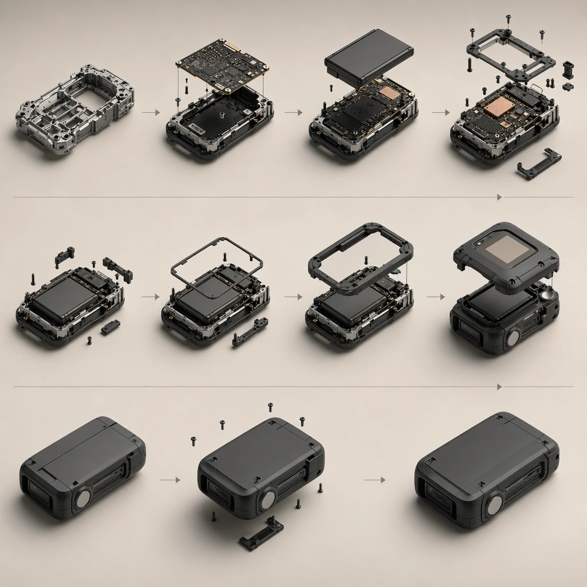

```text
Scene:
A square sequence board with repeated product states, subtle arrows, even lighting, and carefully staged hierarchy. Compose the frame as a square key visual with disciplined camera placement, premium lighting control, and believable real-world scale. The tonal range should feel polished and intentional, with enough atmosphere to create depth without obscuring form. Keep contrast calibrated for launch, catalog, or research presentation use rather than casual snapshot aesthetics.

Subject:
Center original device states progressing from frame to electronics to shell closure in a coherent assembly order. Make the subject feel original, production-aware, and clearly grounded in Industrial Product Exploded View Suite. Treat this as an independent study that must feel complete and coherent without relying on any external reference image. The focal hierarchy should be immediate: primary form first, then material behavior, then supporting environmental cues that clarify use context and difficulty.

Important details:
Keep graphics abstract and non-readable while the process order remains obvious. The board should feel like an approved manufacturing communication aid. The visual language should still feel native to Industrial Product Exploded View Suite, using disciplined industrial or campaign composition instead of generic stock photography. Use believable materials, engineering logic, and professional composition discipline. Reflections, shadows, edge breaks, texture scale, interface density, and small physical joints must all support realism. Avoid filler props, vague mood-board clutter, or any element that weakens the sense of a purpose-built industrial or automotive image.

Use case:
Exploded Views single study 7/9 for Industrial Product Exploded View Suite, built as image support-three.

Constraints:
No readable text, no watermark, no logos, preserve exact 1:1 aspect ratio, no readable labels, no logos, no fantasy glowing cores, no chaotic wire nests, no meaningless arrows, no decorative clutter.
```

[Pinned source](https://github.com/ChaosRealmsAI/gpt-image-2-gallery/blob/5296db8c996e38776c83a0bc8c64f848dcd512b3/works/topics/industrial-product-exploded-view-suite/packages/single-support-studies/images/support-three/meta.json) · GPT Image2 · 1024×1024 · No source-declared image dependencies. · ProjectD:[published and publicly accepted](https://aitoolsradar.com/en/prompts/f917e6cd90740b)

## Material Fastener Macro · industrial-product-exploded-view-suite/single-support-studies/support-four

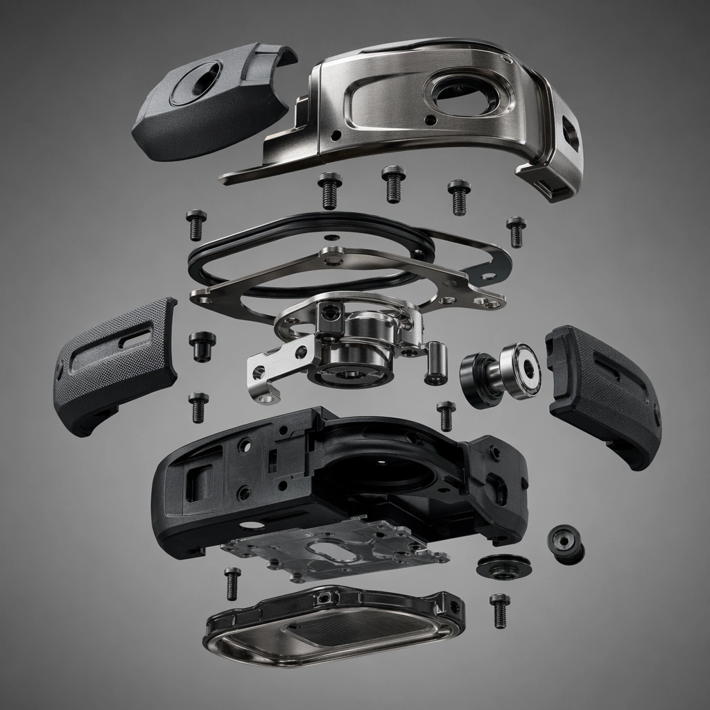

```text
Scene:
A square macro setup with grazing light and strong texture contrast over metal, polymer, and rubber surfaces. Compose the frame as a square key visual with disciplined camera placement, premium lighting control, and believable real-world scale. The tonal range should feel polished and intentional, with enough atmosphere to create depth without obscuring form. Keep contrast calibrated for launch, catalog, or research presentation use rather than casual snapshot aesthetics.

Subject:
Center original fasteners, gasket edges, metal shell fragments, and rubber overmold zones viewed at close range. Make the subject feel original, production-aware, and clearly grounded in Industrial Product Exploded View Suite. Treat this as an independent study that must feel complete and coherent without relying on any external reference image. The focal hierarchy should be immediate: primary form first, then material behavior, then supporting environmental cues that clarify use context and difficulty.

Important details:
Stress believable tolerances, production finish, and purposeful engineering contact points instead of dramatic cinematic stylization. The visual language should still feel native to Industrial Product Exploded View Suite, using disciplined industrial or campaign composition instead of generic stock photography. Use believable materials, engineering logic, and professional composition discipline. Reflections, shadows, edge breaks, texture scale, interface density, and small physical joints must all support realism. Avoid filler props, vague mood-board clutter, or any element that weakens the sense of a purpose-built industrial or automotive image.

Use case:
Exploded Views single study 8/9 for Industrial Product Exploded View Suite, built as image support-four.

Constraints:
No readable text, no watermark, no logos, preserve exact 1:1 aspect ratio, no readable labels, no logos, no fantasy glowing cores, no chaotic wire nests, no meaningless arrows, no decorative clutter.
```

[Pinned source](https://github.com/ChaosRealmsAI/gpt-image-2-gallery/blob/5296db8c996e38776c83a0bc8c64f848dcd512b3/works/topics/industrial-product-exploded-view-suite/packages/single-support-studies/images/support-four/meta.json) · GPT Image2 · 1024×1024 · No source-declared image dependencies. · ProjectD:[published and publicly accepted](https://aitoolsradar.com/en/prompts/d4769c4a18c1f8)

## Catalog Hero Sheet · industrial-product-exploded-view-suite/single-support-studies/support-five

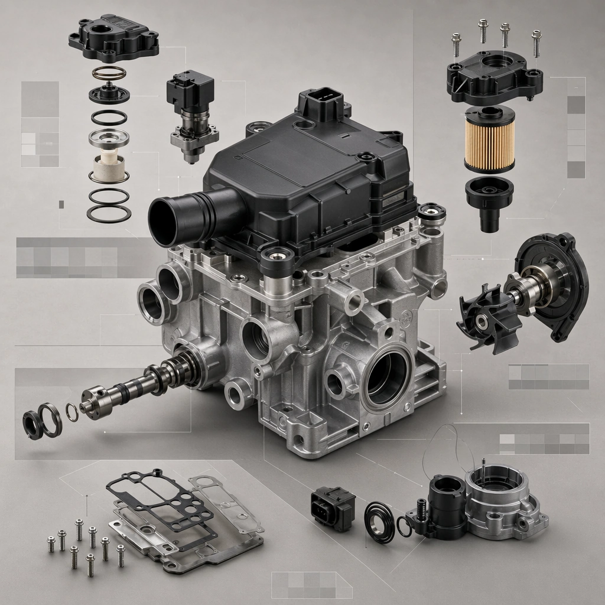

```text
Scene:
A square catalog board with clear zoning, premium lighting, and one hero product angle supported by smaller technical fragments. Compose the frame as a square key visual with disciplined camera placement, premium lighting control, and believable real-world scale. The tonal range should feel polished and intentional, with enough atmosphere to create depth without obscuring form. Keep contrast calibrated for launch, catalog, or research presentation use rather than casual snapshot aesthetics.

Subject:
Center an original industrial product system presented as if for a professional catalog spread with no readable copy. Make the subject feel original, production-aware, and clearly grounded in Industrial Product Exploded View Suite. Treat this as an independent study that must feel complete and coherent without relying on any external reference image. The focal hierarchy should be immediate: primary form first, then material behavior, then supporting environmental cues that clarify use context and difficulty.

Important details:
Keep all graphic areas abstract and text-free while the overall page feels sellable, technical, and completely intentional. The visual language should still feel native to Industrial Product Exploded View Suite, using disciplined industrial or campaign composition instead of generic stock photography. Use believable materials, engineering logic, and professional composition discipline. Reflections, shadows, edge breaks, texture scale, interface density, and small physical joints must all support realism. Avoid filler props, vague mood-board clutter, or any element that weakens the sense of a purpose-built industrial or automotive image.

Use case:
Exploded Views single study 9/9 for Industrial Product Exploded View Suite, built as image support-five.

Constraints:
No readable text, no watermark, no logos, preserve exact 1:1 aspect ratio, no readable labels, no logos, no fantasy glowing cores, no chaotic wire nests, no meaningless arrows, no decorative clutter.
```

[Pinned source](https://github.com/ChaosRealmsAI/gpt-image-2-gallery/blob/5296db8c996e38776c83a0bc8c64f848dcd512b3/works/topics/industrial-product-exploded-view-suite/packages/single-support-studies/images/support-five/meta.json) · GPT Image2 · 1024×1024 · No source-declared image dependencies. · ProjectD:[published and publicly accepted](https://aitoolsradar.com/en/prompts/9c2a77d7cd0913)

## Anchor Visual · interactive-web-campaign-mockup/series-core-campaign-system/01-anchor-visual

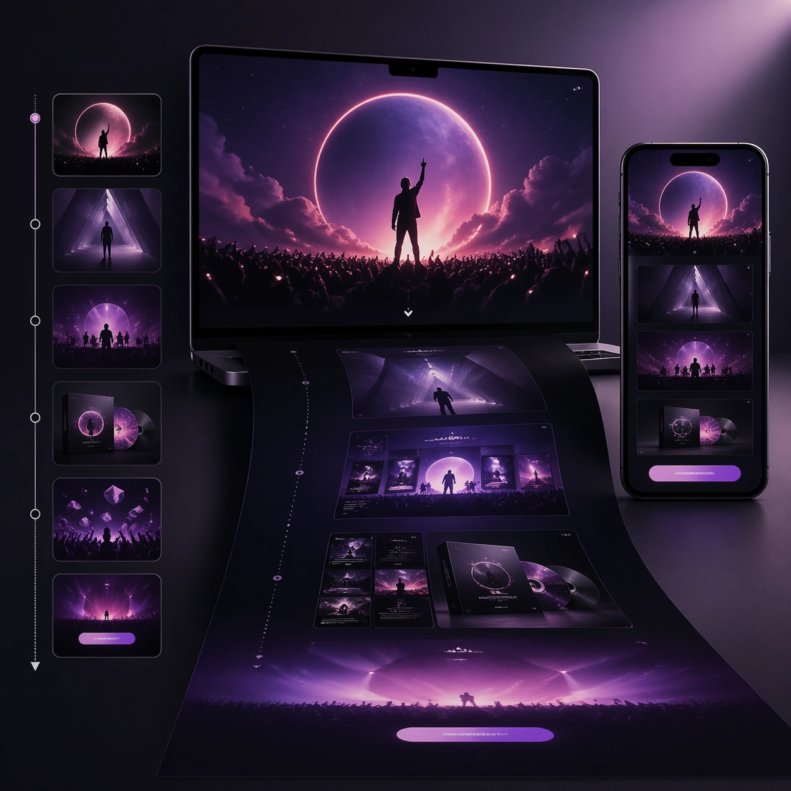

```text
Scene:
A square premium campaign composition with strong negative space, crisp hierarchy, and a polished presentation surface appropriate for Interactive Web Campaign Mockup. The image should feel like a proposal-ready marketing asset rather than a casual mockup, with deliberate pacing across foreground, midground, and background. Build the frame around 多设备 mockup + 滚动叙事 + 转化区, using lighting, device or media framing, and environment cues that suggest a real rollout system. Reference the spirit of 品牌联名、限定发售、演唱会巡演或电影宣发活动页的多屏宣传网页提案。 while keeping the result original and commercially plausible.

Subject:
Create the anchor asset that establishes the campaign hierarchy, pacing, and premium surface logic. for the Interactive Web Campaign Mockup theme. The central visual system should read immediately, with a clear lead element, credible secondary support, and enough structural discipline to feel ready for a pitch deck, landing page, platform slot, poster wall, or social rollout. Use scale, spacing, and controlled perspective to imply a complete campaign logic instead of a single disconnected image. Where multiple surfaces or modules appear, keep them unified through one visual language.

Important details:
This topic is specifically about 多设备 mockup + 滚动叙事 + 转化区. 不仅要像静态网页，还要让人感觉得到滚动、悬停、切换等交互节奏。 更适合在一张图里表达多设备系统和网页叙事节奏。. Keep the composition believable as commercial art: premium lighting, consistent styling, modular hierarchy, and clear narrative emphasis. Success should align with these criteria: 桌面端和移动端在视觉语言上统一; 能感受到页面是有滚动层次和交互暗示的; hero、内容区、CTA 区不打架; 适合直接放进客户 pitch deck 或案例页. Capabilities in scope include structured-layout, commercial-mockup, text-rendering, world-knowledge. The image must feel designed for downstream rollout across formats even though it remains a single square study.

Use case:
Interactive Web Campaign Mockup series study 1/9.

Constraints:
No readable text, no watermark, no logos, preserve exact 1:1 aspect ratio, no random collage chaos, no broken perspective between surfaces, no muddy hierarchy, no generic template look, no low-resolution screen artifacts, no extraneous props.
```

[Pinned source](https://github.com/ChaosRealmsAI/gpt-image-2-gallery/blob/5296db8c996e38776c83a0bc8c64f848dcd512b3/works/topics/interactive-web-campaign-mockup/packages/series-core-campaign-system/images/01-anchor-visual/meta.json) · GPT Image2 · 1254×1254 · No source-declared image dependencies. · ProjectD:[published and publicly accepted](https://aitoolsradar.com/en/prompts/d901e647616e11)

## Tight Hierarchy · interactive-web-campaign-mockup/series-core-campaign-system/02-tight-hierarchy

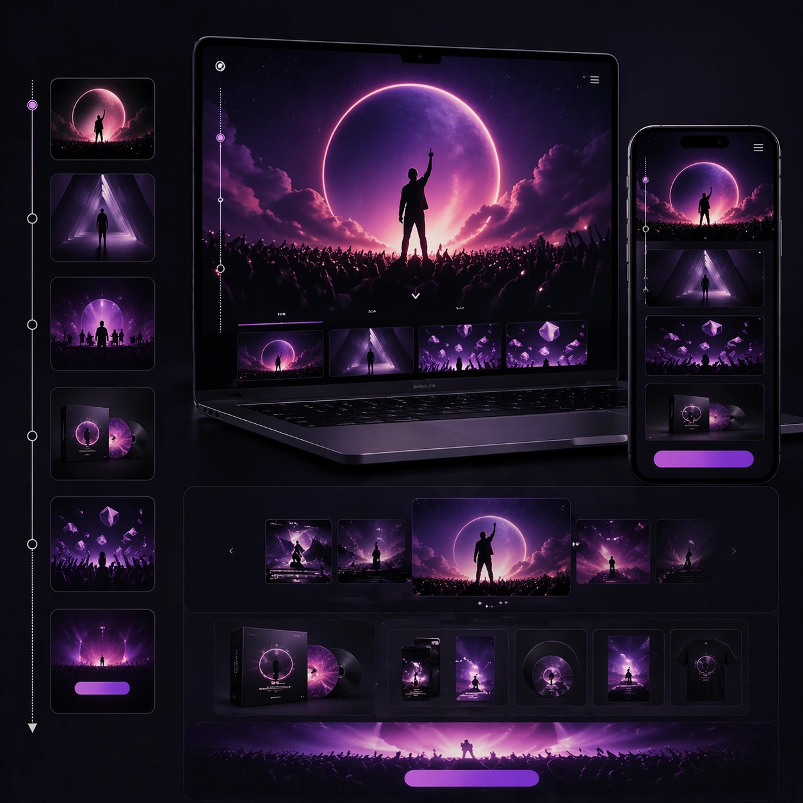

```text
Scene:
A square premium campaign composition with strong negative space, crisp hierarchy, and a polished presentation surface appropriate for Interactive Web Campaign Mockup. The image should feel like a proposal-ready marketing asset rather than a casual mockup, with deliberate pacing across foreground, midground, and background. Build the frame around 多设备 mockup + 滚动叙事 + 转化区, using lighting, device or media framing, and environment cues that suggest a real rollout system. Reference the spirit of 品牌联名、限定发售、演唱会巡演或电影宣发活动页的多屏宣传网页提案。 while keeping the result original and commercially plausible.

Subject:
Create a tighter adaptation that preserves hierarchy while changing crop and emphasis. for the Interactive Web Campaign Mockup theme. The central visual system should read immediately, with a clear lead element, credible secondary support, and enough structural discipline to feel ready for a pitch deck, landing page, platform slot, poster wall, or social rollout. Use scale, spacing, and controlled perspective to imply a complete campaign logic instead of a single disconnected image. Where multiple surfaces or modules appear, keep them unified through one visual language.

Important details:
This topic is specifically about 多设备 mockup + 滚动叙事 + 转化区. 不仅要像静态网页，还要让人感觉得到滚动、悬停、切换等交互节奏。 更适合在一张图里表达多设备系统和网页叙事节奏。. Keep the composition believable as commercial art: premium lighting, consistent styling, modular hierarchy, and clear narrative emphasis. Success should align with these criteria: 桌面端和移动端在视觉语言上统一; 能感受到页面是有滚动层次和交互暗示的; hero、内容区、CTA 区不打架; 适合直接放进客户 pitch deck 或案例页. Capabilities in scope include structured-layout, commercial-mockup, text-rendering, world-knowledge. The image must feel designed for downstream rollout across formats even though it remains a single square study.

Use case:
Interactive Web Campaign Mockup series study 2/9.

Constraints:
No readable text, no watermark, no logos, preserve exact 1:1 aspect ratio, no random collage chaos, no broken perspective between surfaces, no muddy hierarchy, no generic template look, no low-resolution screen artifacts, no extraneous props.
```

[Pinned source](https://github.com/ChaosRealmsAI/gpt-image-2-gallery/blob/5296db8c996e38776c83a0bc8c64f848dcd512b3/works/topics/interactive-web-campaign-mockup/packages/series-core-campaign-system/images/02-tight-hierarchy/meta.json) · GPT Image2 · 1254×1254 · Reference images required. · ProjectD:[published and publicly accepted](https://aitoolsradar.com/en/prompts/700bbb24632c14)

## Environment Rollout · interactive-web-campaign-mockup/series-core-campaign-system/03-environment-rollout

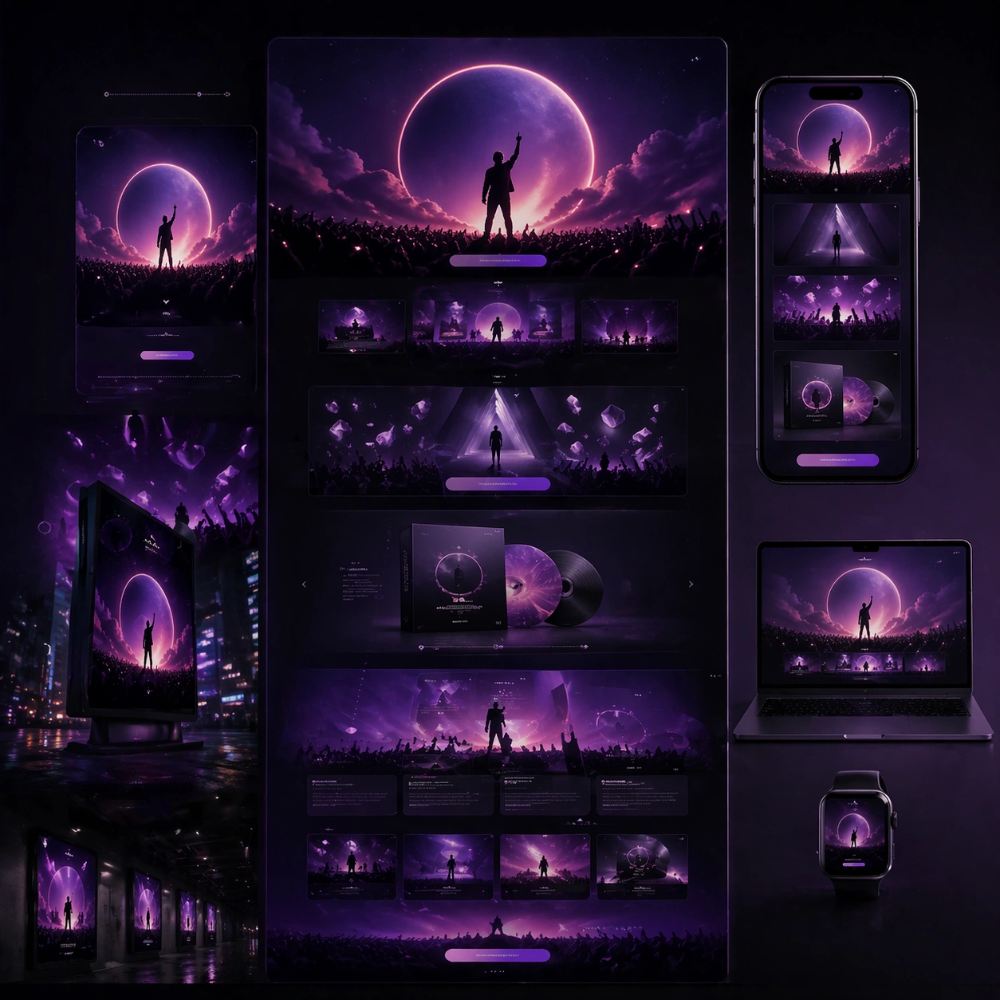

```text
Scene:
A square premium campaign composition with strong negative space, crisp hierarchy, and a polished presentation surface appropriate for Interactive Web Campaign Mockup. The image should feel like a proposal-ready marketing asset rather than a casual mockup, with deliberate pacing across foreground, midground, and background. Build the frame around 多设备 mockup + 滚动叙事 + 转化区, using lighting, device or media framing, and environment cues that suggest a real rollout system. Reference the spirit of 品牌联名、限定发售、演唱会巡演或电影宣发活动页的多屏宣传网页提案。 while keeping the result original and commercially plausible.

Subject:
Create the same campaign language deployed into a broader environmental rollout context. for the Interactive Web Campaign Mockup theme. The central visual system should read immediately, with a clear lead element, credible secondary support, and enough structural discipline to feel ready for a pitch deck, landing page, platform slot, poster wall, or social rollout. Use scale, spacing, and controlled perspective to imply a complete campaign logic instead of a single disconnected image. Where multiple surfaces or modules appear, keep them unified through one visual language.

Important details:
This topic is specifically about 多设备 mockup + 滚动叙事 + 转化区. 不仅要像静态网页，还要让人感觉得到滚动、悬停、切换等交互节奏。 更适合在一张图里表达多设备系统和网页叙事节奏。. Keep the composition believable as commercial art: premium lighting, consistent styling, modular hierarchy, and clear narrative emphasis. Success should align with these criteria: 桌面端和移动端在视觉语言上统一; 能感受到页面是有滚动层次和交互暗示的; hero、内容区、CTA 区不打架; 适合直接放进客户 pitch deck 或案例页. Capabilities in scope include structured-layout, commercial-mockup, text-rendering, world-knowledge. The image must feel designed for downstream rollout across formats even though it remains a single square study.

Use case:
Interactive Web Campaign Mockup series study 3/9.

Constraints:
No readable text, no watermark, no logos, preserve exact 1:1 aspect ratio, no random collage chaos, no broken perspective between surfaces, no muddy hierarchy, no generic template look, no low-resolution screen artifacts, no extraneous props.
```

[Pinned source](https://github.com/ChaosRealmsAI/gpt-image-2-gallery/blob/5296db8c996e38776c83a0bc8c64f848dcd512b3/works/topics/interactive-web-campaign-mockup/packages/series-core-campaign-system/images/03-environment-rollout/meta.json) · GPT Image2 · 1254×1254 · Reference images required. · ProjectD:[published and publicly accepted](https://aitoolsradar.com/en/prompts/7b30bfecca366c)

## Mood Shift Variant · interactive-web-campaign-mockup/series-core-campaign-system/04-mood-shift-variant

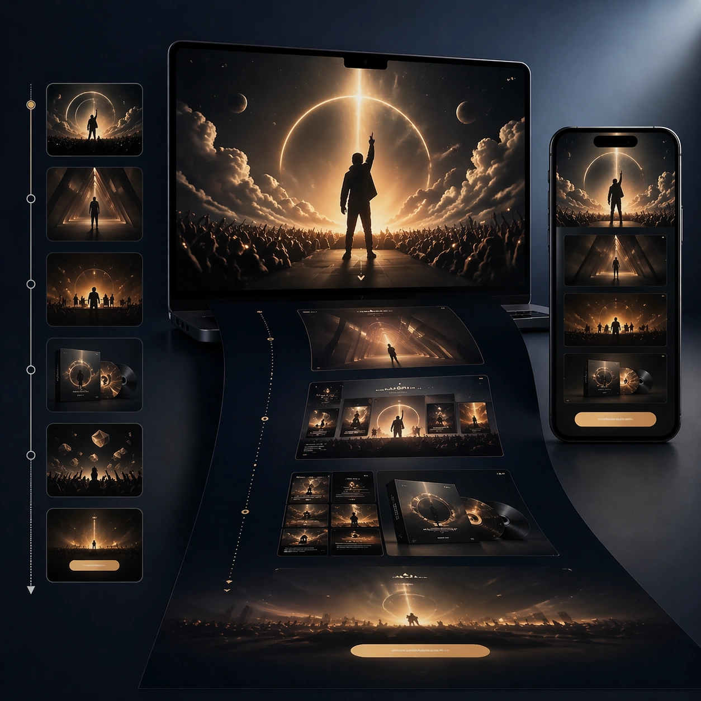

```text
Scene:
A square premium campaign composition with strong negative space, crisp hierarchy, and a polished presentation surface appropriate for Interactive Web Campaign Mockup. The image should feel like a proposal-ready marketing asset rather than a casual mockup, with deliberate pacing across foreground, midground, and background. Build the frame around 多设备 mockup + 滚动叙事 + 转化区, using lighting, device or media framing, and environment cues that suggest a real rollout system. Reference the spirit of 品牌联名、限定发售、演唱会巡演或电影宣发活动页的多屏宣传网页提案。 while keeping the result original and commercially plausible.

Subject:
Create a final variant that preserves the system but shifts color temperature and emotional tone. for the Interactive Web Campaign Mockup theme. The central visual system should read immediately, with a clear lead element, credible secondary support, and enough structural discipline to feel ready for a pitch deck, landing page, platform slot, poster wall, or social rollout. Use scale, spacing, and controlled perspective to imply a complete campaign logic instead of a single disconnected image. Where multiple surfaces or modules appear, keep them unified through one visual language.

Important details:
This topic is specifically about 多设备 mockup + 滚动叙事 + 转化区. 不仅要像静态网页，还要让人感觉得到滚动、悬停、切换等交互节奏。 更适合在一张图里表达多设备系统和网页叙事节奏。. Keep the composition believable as commercial art: premium lighting, consistent styling, modular hierarchy, and clear narrative emphasis. Success should align with these criteria: 桌面端和移动端在视觉语言上统一; 能感受到页面是有滚动层次和交互暗示的; hero、内容区、CTA 区不打架; 适合直接放进客户 pitch deck 或案例页. Capabilities in scope include structured-layout, commercial-mockup, text-rendering, world-knowledge. The image must feel designed for downstream rollout across formats even though it remains a single square study.

Use case:
Interactive Web Campaign Mockup series study 4/9.

Constraints:
No readable text, no watermark, no logos, preserve exact 1:1 aspect ratio, no random collage chaos, no broken perspective between surfaces, no muddy hierarchy, no generic template look, no low-resolution screen artifacts, no extraneous props.
```

[Pinned source](https://github.com/ChaosRealmsAI/gpt-image-2-gallery/blob/5296db8c996e38776c83a0bc8c64f848dcd512b3/works/topics/interactive-web-campaign-mockup/packages/series-core-campaign-system/images/04-mood-shift-variant/meta.json) · GPT Image2 · 1254×1254 · Reference images required. · ProjectD:[published and publicly accepted](https://aitoolsradar.com/en/prompts/75ecdba2dcdea6)

## Ensemble Study · interactive-web-campaign-mockup/single-independent-surface-studies/ensemble-study

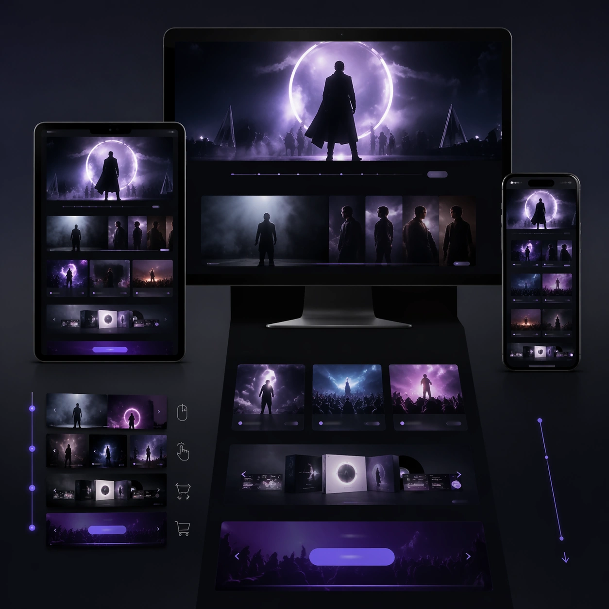

```text
Scene:
A square premium campaign composition with strong negative space, crisp hierarchy, and a polished presentation surface appropriate for Interactive Web Campaign Mockup. The image should feel like a proposal-ready marketing asset rather than a casual mockup, with deliberate pacing across foreground, midground, and background. Build the frame around 多设备 mockup + 滚动叙事 + 转化区, using lighting, device or media framing, and environment cues that suggest a real rollout system. Reference the spirit of 品牌联名、限定发售、演唱会巡演或电影宣发活动页的多屏宣传网页提案。 while keeping the result original and commercially plausible.

Subject:
Create a multi-element or ensemble study with controlled spacing and narrative grouping. for the Interactive Web Campaign Mockup theme. The central visual system should read immediately, with a clear lead element, credible secondary support, and enough structural discipline to feel ready for a pitch deck, landing page, platform slot, poster wall, or social rollout. Use scale, spacing, and controlled perspective to imply a complete campaign logic instead of a single disconnected image. Where multiple surfaces or modules appear, keep them unified through one visual language.

Important details:
This topic is specifically about 多设备 mockup + 滚动叙事 + 转化区. 不仅要像静态网页，还要让人感觉得到滚动、悬停、切换等交互节奏。 更适合在一张图里表达多设备系统和网页叙事节奏。. Keep the composition believable as commercial art: premium lighting, consistent styling, modular hierarchy, and clear narrative emphasis. Success should align with these criteria: 桌面端和移动端在视觉语言上统一; 能感受到页面是有滚动层次和交互暗示的; hero、内容区、CTA 区不打架; 适合直接放进客户 pitch deck 或案例页. Capabilities in scope include structured-layout, commercial-mockup, text-rendering, world-knowledge. The image must feel designed for downstream rollout across formats even though it remains a single square study.

Use case:
Interactive Web Campaign Mockup single study 6/9.

Constraints:
No readable text, no watermark, no logos, preserve exact 1:1 aspect ratio, no random collage chaos, no broken perspective between surfaces, no muddy hierarchy, no generic template look, no low-resolution screen artifacts, no extraneous props.
```

[Pinned source](https://github.com/ChaosRealmsAI/gpt-image-2-gallery/blob/5296db8c996e38776c83a0bc8c64f848dcd512b3/works/topics/interactive-web-campaign-mockup/packages/single-independent-surface-studies/images/ensemble-study/meta.json) · GPT Image2 · 1254×1254 · No source-declared image dependencies. · ProjectD:[published and publicly accepted](https://aitoolsradar.com/en/prompts/50531384de5a22)

## Product Study · interactive-web-campaign-mockup/single-independent-surface-studies/product-study

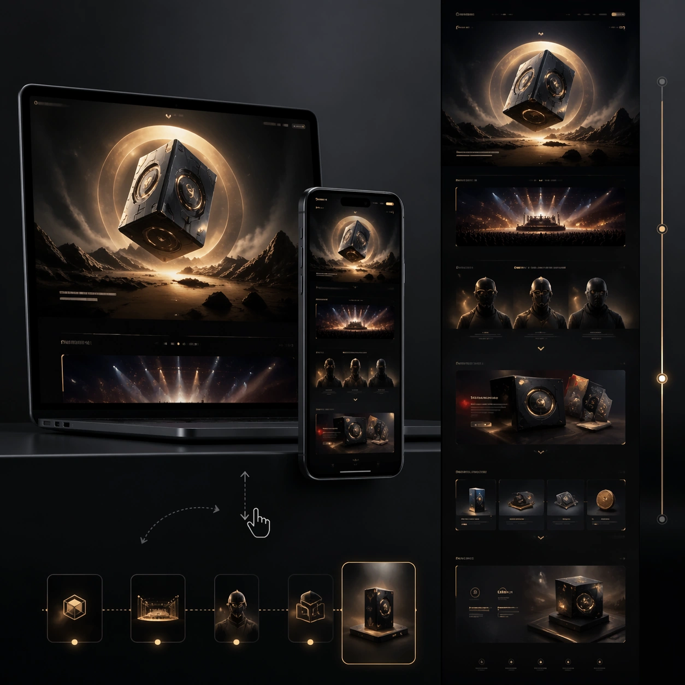

```text
Scene:
A square premium campaign composition with strong negative space, crisp hierarchy, and a polished presentation surface appropriate for Interactive Web Campaign Mockup. The image should feel like a proposal-ready marketing asset rather than a casual mockup, with deliberate pacing across foreground, midground, and background. Build the frame around 多设备 mockup + 滚动叙事 + 转化区, using lighting, device or media framing, and environment cues that suggest a real rollout system. Reference the spirit of 品牌联名、限定发售、演唱会巡演或电影宣发活动页的多屏宣传网页提案。 while keeping the result original and commercially plausible.

Subject:
Create a product or object-led study with premium presentation logic. for the Interactive Web Campaign Mockup theme. The central visual system should read immediately, with a clear lead element, credible secondary support, and enough structural discipline to feel ready for a pitch deck, landing page, platform slot, poster wall, or social rollout. Use scale, spacing, and controlled perspective to imply a complete campaign logic instead of a single disconnected image. Where multiple surfaces or modules appear, keep them unified through one visual language.

Important details:
This topic is specifically about 多设备 mockup + 滚动叙事 + 转化区. 不仅要像静态网页，还要让人感觉得到滚动、悬停、切换等交互节奏。 更适合在一张图里表达多设备系统和网页叙事节奏。. Keep the composition believable as commercial art: premium lighting, consistent styling, modular hierarchy, and clear narrative emphasis. Success should align with these criteria: 桌面端和移动端在视觉语言上统一; 能感受到页面是有滚动层次和交互暗示的; hero、内容区、CTA 区不打架; 适合直接放进客户 pitch deck 或案例页. Capabilities in scope include structured-layout, commercial-mockup, text-rendering, world-knowledge. The image must feel designed for downstream rollout across formats even though it remains a single square study.

Use case:
Interactive Web Campaign Mockup single study 7/9.

Constraints:
No readable text, no watermark, no logos, preserve exact 1:1 aspect ratio, no random collage chaos, no broken perspective between surfaces, no muddy hierarchy, no generic template look, no low-resolution screen artifacts, no extraneous props.
```

[Pinned source](https://github.com/ChaosRealmsAI/gpt-image-2-gallery/blob/5296db8c996e38776c83a0bc8c64f848dcd512b3/works/topics/interactive-web-campaign-mockup/packages/single-independent-surface-studies/images/product-study/meta.json) · GPT Image2 · 1254×1254 · No source-declared image dependencies. · ProjectD:[published and publicly accepted](https://aitoolsradar.com/en/prompts/70f4b7f841f5d0)

## Narrative Study · interactive-web-campaign-mockup/single-independent-surface-studies/narrative-study

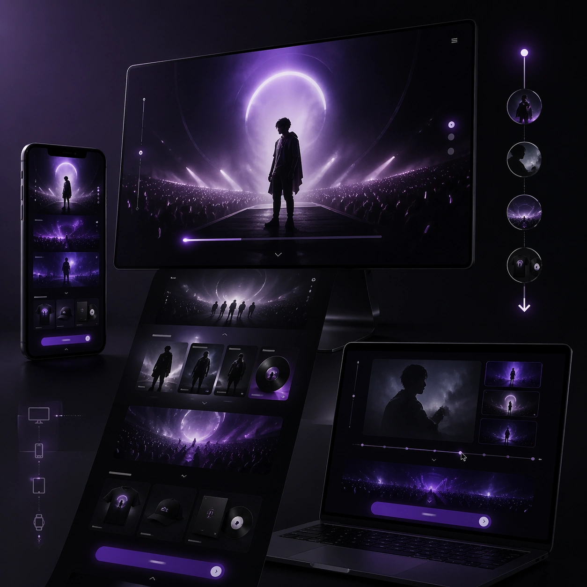

```text
Scene:
A square premium campaign composition with strong negative space, crisp hierarchy, and a polished presentation surface appropriate for Interactive Web Campaign Mockup. The image should feel like a proposal-ready marketing asset rather than a casual mockup, with deliberate pacing across foreground, midground, and background. Build the frame around 多设备 mockup + 滚动叙事 + 转化区, using lighting, device or media framing, and environment cues that suggest a real rollout system. Reference the spirit of 品牌联名、限定发售、演唱会巡演或电影宣发活动页的多屏宣传网页提案。 while keeping the result original and commercially plausible.

Subject:
Create a more atmospheric narrative study that still reads as campaign art rather than concept art. for the Interactive Web Campaign Mockup theme. The central visual system should read immediately, with a clear lead element, credible secondary support, and enough structural discipline to feel ready for a pitch deck, landing page, platform slot, poster wall, or social rollout. Use scale, spacing, and controlled perspective to imply a complete campaign logic instead of a single disconnected image. Where multiple surfaces or modules appear, keep them unified through one visual language.

Important details:
This topic is specifically about 多设备 mockup + 滚动叙事 + 转化区. 不仅要像静态网页，还要让人感觉得到滚动、悬停、切换等交互节奏。 更适合在一张图里表达多设备系统和网页叙事节奏。. Keep the composition believable as commercial art: premium lighting, consistent styling, modular hierarchy, and clear narrative emphasis. Success should align with these criteria: 桌面端和移动端在视觉语言上统一; 能感受到页面是有滚动层次和交互暗示的; hero、内容区、CTA 区不打架; 适合直接放进客户 pitch deck 或案例页. Capabilities in scope include structured-layout, commercial-mockup, text-rendering, world-knowledge. The image must feel designed for downstream rollout across formats even though it remains a single square study.

Use case:
Interactive Web Campaign Mockup single study 8/9.

Constraints:
No readable text, no watermark, no logos, preserve exact 1:1 aspect ratio, no random collage chaos, no broken perspective between surfaces, no muddy hierarchy, no generic template look, no low-resolution screen artifacts, no extraneous props.
```

[Pinned source](https://github.com/ChaosRealmsAI/gpt-image-2-gallery/blob/5296db8c996e38776c83a0bc8c64f848dcd512b3/works/topics/interactive-web-campaign-mockup/packages/single-independent-surface-studies/images/narrative-study/meta.json) · GPT Image2 · 1254×1254 · No source-declared image dependencies. · ProjectD:[published and publicly accepted](https://aitoolsradar.com/en/prompts/28069443cd7402)

## Conversion Study · interactive-web-campaign-mockup/single-independent-surface-studies/conversion-study

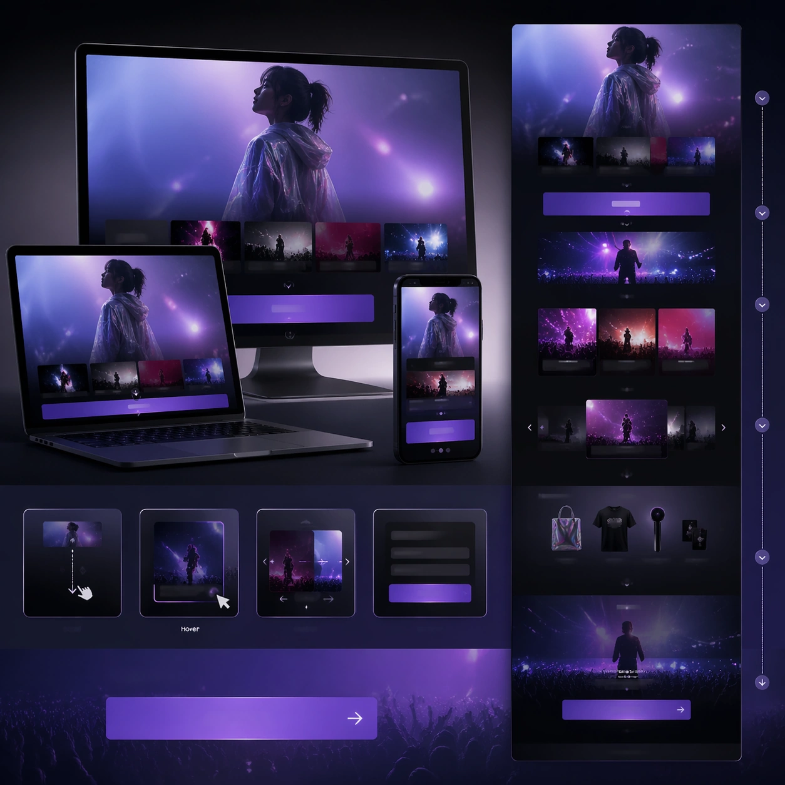

```text
Scene:
A square premium campaign composition with strong negative space, crisp hierarchy, and a polished presentation surface appropriate for Interactive Web Campaign Mockup. The image should feel like a proposal-ready marketing asset rather than a casual mockup, with deliberate pacing across foreground, midground, and background. Build the frame around 多设备 mockup + 滚动叙事 + 转化区, using lighting, device or media framing, and environment cues that suggest a real rollout system. Reference the spirit of 品牌联名、限定发售、演唱会巡演或电影宣发活动页的多屏宣传网页提案。 while keeping the result original and commercially plausible.

Subject:
Create a polished layout study built around clarity, pacing, and conversion-ready focus. for the Interactive Web Campaign Mockup theme. The central visual system should read immediately, with a clear lead element, credible secondary support, and enough structural discipline to feel ready for a pitch deck, landing page, platform slot, poster wall, or social rollout. Use scale, spacing, and controlled perspective to imply a complete campaign logic instead of a single disconnected image. Where multiple surfaces or modules appear, keep them unified through one visual language.

Important details:
This topic is specifically about 多设备 mockup + 滚动叙事 + 转化区. 不仅要像静态网页，还要让人感觉得到滚动、悬停、切换等交互节奏。 更适合在一张图里表达多设备系统和网页叙事节奏。. Keep the composition believable as commercial art: premium lighting, consistent styling, modular hierarchy, and clear narrative emphasis. Success should align with these criteria: 桌面端和移动端在视觉语言上统一; 能感受到页面是有滚动层次和交互暗示的; hero、内容区、CTA 区不打架; 适合直接放进客户 pitch deck 或案例页. Capabilities in scope include structured-layout, commercial-mockup, text-rendering, world-knowledge. The image must feel designed for downstream rollout across formats even though it remains a single square study.

Use case:
Interactive Web Campaign Mockup single study 9/9.

Constraints:
No readable text, no watermark, no logos, preserve exact 1:1 aspect ratio, no random collage chaos, no broken perspective between surfaces, no muddy hierarchy, no generic template look, no low-resolution screen artifacts, no extraneous props.
```

[Pinned source](https://github.com/ChaosRealmsAI/gpt-image-2-gallery/blob/5296db8c996e38776c83a0bc8c64f848dcd512b3/works/topics/interactive-web-campaign-mockup/packages/single-independent-surface-studies/images/conversion-study/meta.json) · GPT Image2 · 1254×1254 · No source-declared image dependencies. · ProjectD:[published and publicly accepted](https://aitoolsradar.com/en/prompts/92eef16309c9fc)

## Set Bonus Card · inventory-tooltip-comparison-board/single-inventory-tooltip-studies/set-bonus-card

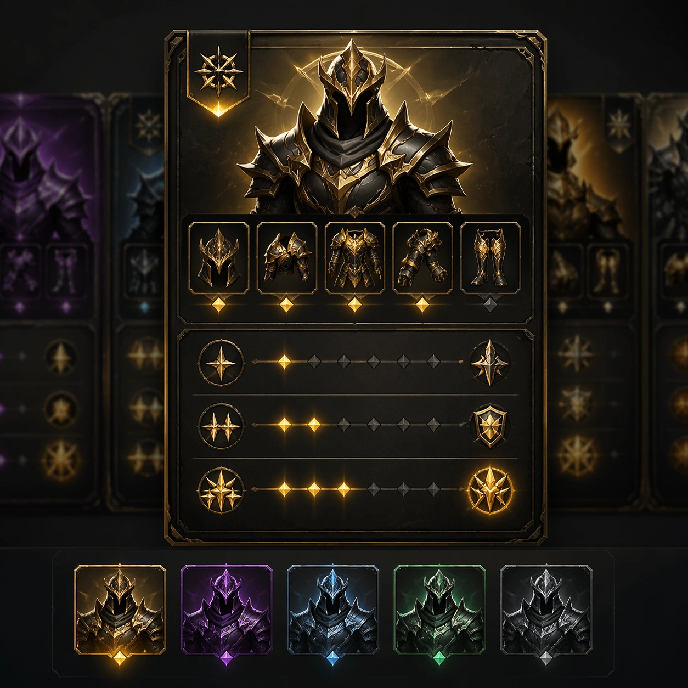

```text
Scene:
A square production-ready image designed for a game-art review wall and a commercial gallery at the same time. Frame a set bonus card visualizing a multi-piece equipment set and its layered payoff with disciplined lighting, clean edge separation, and enough surrounding context to prove how the asset would behave in a real product surface. The camera, crop, and tonal balance should feel intentional rather than generic, with high readability at first glance and convincing material response under closer inspection.

Subject:
Center the study on a set bonus card visualizing a multi-piece equipment set and its layered payoff. Translate the topic into a concrete, shippable visual statement instead of a loose mood board. Build layered object relationships, believable surface finish, and strong silhouette grouping so the image reads immediately as part of Inventory Tooltip Comparison Board. The subject should feel made for a live game pipeline: useful in store, UI, campaign, or art-review contexts, with visual hierarchy strong enough to survive aggressive cropping.

Important details:
treat the set as a coherent product family with distinct tier cues. Keep every supporting element subordinate to the main read, and make category separation obvious through form, color zoning, depth, and material logic rather than words. Where panels, cards, badges, or interface blocks appear, they must look professionally structured but remain unreadable. The visual language should feel premium, original, and coherent across this package, with no filler clutter and no accidental resemblance to a specific shipped game IP.

Use case:
Inventory Tooltip Comparison Board single study 2/9, focused on set bonus card.

Constraints:
No readable text, no watermark, no logos, preserve exact 1:1 aspect ratio, no readable set names, no bullet text, no broken hierarchy, no generic stock-photo staging, no accidental UI gibberish.
```

[Pinned source](https://github.com/ChaosRealmsAI/gpt-image-2-gallery/blob/5296db8c996e38776c83a0bc8c64f848dcd512b3/works/topics/inventory-tooltip-comparison-board/packages/single-inventory-tooltip-studies/images/set-bonus-card/meta.json) · GPT Image2 · 1254×1254 · No source-declared image dependencies. · ProjectD:[published and publicly accepted](https://aitoolsradar.com/en/prompts/8870154670424b)

## Rarity Badge Study · inventory-tooltip-comparison-board/single-inventory-tooltip-studies/rarity-badge-study

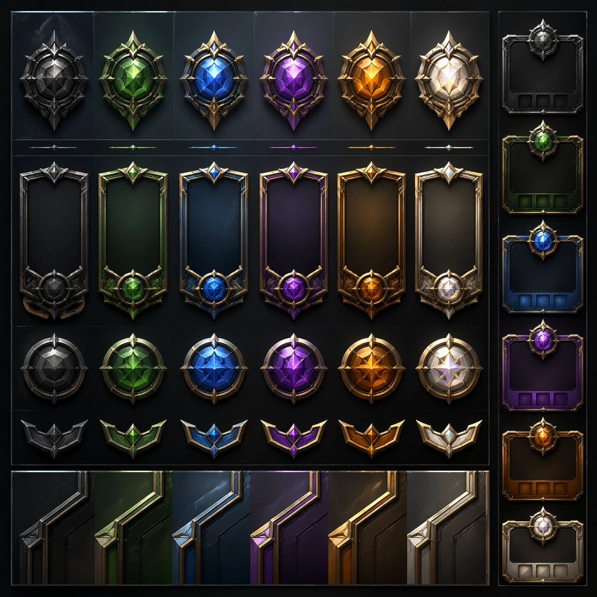

```text
Scene:
A square production-ready image designed for a game-art review wall and a commercial gallery at the same time. Frame a badge study isolating rarity frames, medallions, and trim treatments used across inventory panels with disciplined lighting, clean edge separation, and enough surrounding context to prove how the asset would behave in a real product surface. The camera, crop, and tonal balance should feel intentional rather than generic, with high readability at first glance and convincing material response under closer inspection.

Subject:
Center the study on a badge study isolating rarity frames, medallions, and trim treatments used across inventory panels. Translate the topic into a concrete, shippable visual statement instead of a loose mood board. Build layered object relationships, believable surface finish, and strong silhouette grouping so the image reads immediately as part of Inventory Tooltip Comparison Board. The subject should feel made for a live game pipeline: useful in store, UI, campaign, or art-review contexts, with visual hierarchy strong enough to survive aggressive cropping.

Important details:
make the badge family feel premium and instantly sortable. Keep every supporting element subordinate to the main read, and make category separation obvious through form, color zoning, depth, and material logic rather than words. Where panels, cards, badges, or interface blocks appear, they must look professionally structured but remain unreadable. The visual language should feel premium, original, and coherent across this package, with no filler clutter and no accidental resemblance to a specific shipped game IP.

Use case:
Inventory Tooltip Comparison Board single study 3/9, focused on rarity badge study.

Constraints:
No readable text, no watermark, no logos, preserve exact 1:1 aspect ratio, no letters, no numbers, no broken hierarchy, no generic stock-photo staging, no accidental UI gibberish.
```

[Pinned source](https://github.com/ChaosRealmsAI/gpt-image-2-gallery/blob/5296db8c996e38776c83a0bc8c64f848dcd512b3/works/topics/inventory-tooltip-comparison-board/packages/single-inventory-tooltip-studies/images/rarity-badge-study/meta.json) · GPT Image2 · 1254×1254 · No source-declared image dependencies. · ProjectD:[published and publicly accepted](https://aitoolsradar.com/en/prompts/bfe70b9e4bdd4d)

## Item Detail Zoom · inventory-tooltip-comparison-board/single-inventory-tooltip-studies/item-detail-zoom

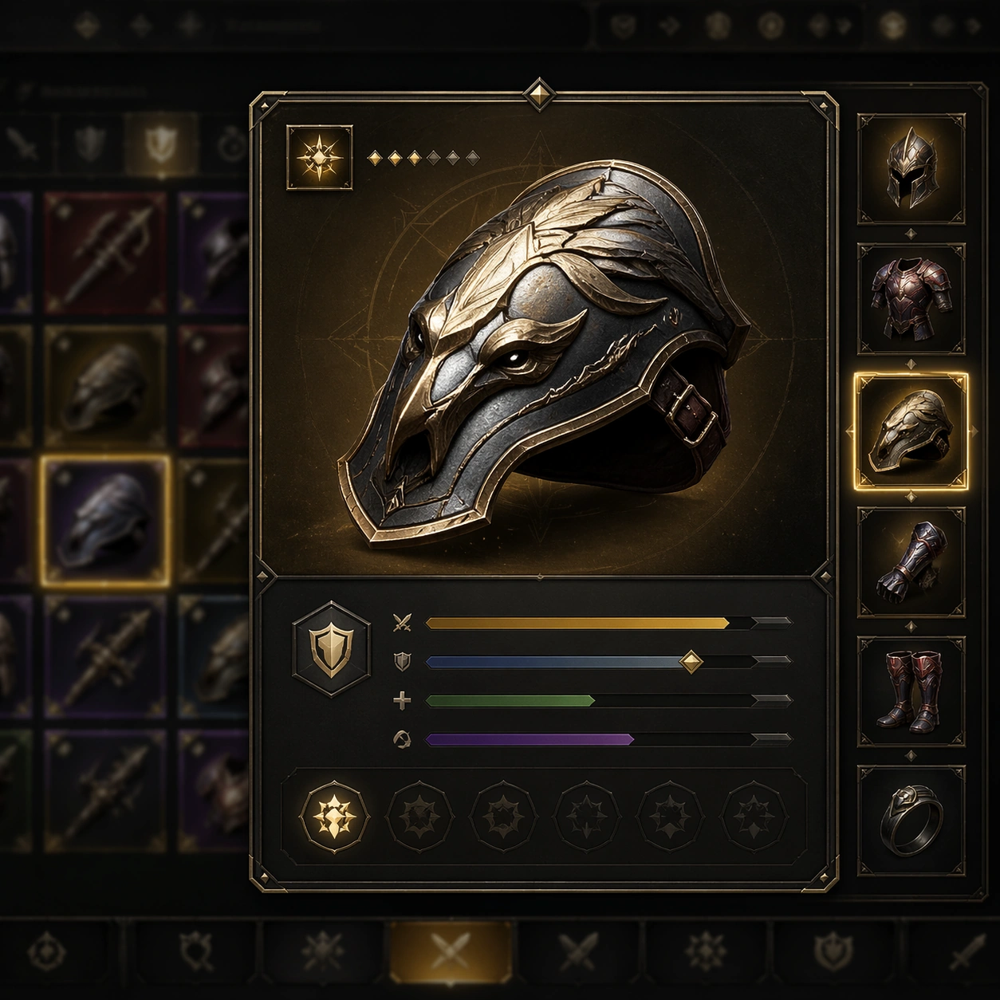

```text
Scene:
A square production-ready image designed for a game-art review wall and a commercial gallery at the same time. Frame a detail zoom focused on one equipment item and the tight tooltip panel surrounding it with disciplined lighting, clean edge separation, and enough surrounding context to prove how the asset would behave in a real product surface. The camera, crop, and tonal balance should feel intentional rather than generic, with high readability at first glance and convincing material response under closer inspection.

Subject:
Center the study on a detail zoom focused on one equipment item and the tight tooltip panel surrounding it. Translate the topic into a concrete, shippable visual statement instead of a loose mood board. Build layered object relationships, believable surface finish, and strong silhouette grouping so the image reads immediately as part of Inventory Tooltip Comparison Board. The subject should feel made for a live game pipeline: useful in store, UI, campaign, or art-review contexts, with visual hierarchy strong enough to survive aggressive cropping.

Important details:
materials, iconography, and panel layering should feel game-real and decision-oriented. Keep every supporting element subordinate to the main read, and make category separation obvious through form, color zoning, depth, and material logic rather than words. Where panels, cards, badges, or interface blocks appear, they must look professionally structured but remain unreadable. The visual language should feel premium, original, and coherent across this package, with no filler clutter and no accidental resemblance to a specific shipped game IP.

Use case:
Inventory Tooltip Comparison Board single study 4/9, focused on item detail zoom.

Constraints:
No readable text, no watermark, no logos, preserve exact 1:1 aspect ratio, no readable tooltips, no lorem ipsum, no broken hierarchy, no generic stock-photo staging, no accidental UI gibberish.
```

[Pinned source](https://github.com/ChaosRealmsAI/gpt-image-2-gallery/blob/5296db8c996e38776c83a0bc8c64f848dcd512b3/works/topics/inventory-tooltip-comparison-board/packages/single-inventory-tooltip-studies/images/item-detail-zoom/meta.json) · GPT Image2 · 1254×1254 · No source-declared image dependencies. · ProjectD:[published and publicly accepted](https://aitoolsradar.com/en/prompts/8e6e922d91c24d)

## Compare Roll Board · inventory-tooltip-comparison-board/single-inventory-tooltip-studies/compare-roll-board

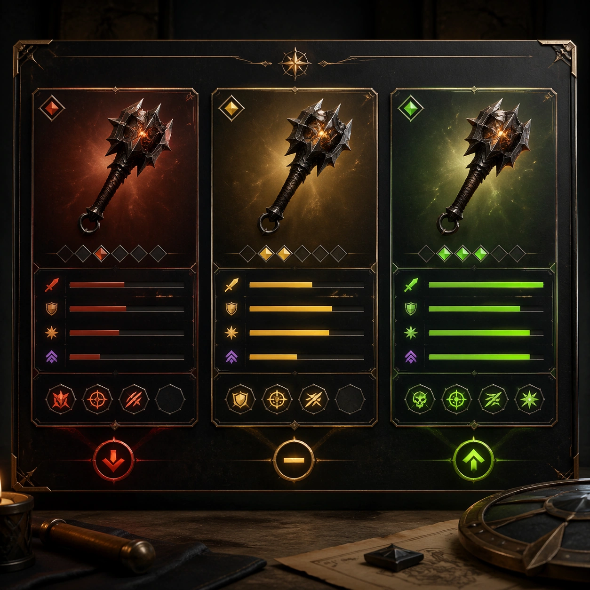

```text
Scene:
A square production-ready image designed for a game-art review wall and a commercial gallery at the same time. Frame a comparison board showing alternate item rolls or perk combinations in parallel panels with disciplined lighting, clean edge separation, and enough surrounding context to prove how the asset would behave in a real product surface. The camera, crop, and tonal balance should feel intentional rather than generic, with high readability at first glance and convincing material response under closer inspection.

Subject:
Center the study on a comparison board showing alternate item rolls or perk combinations in parallel panels. Translate the topic into a concrete, shippable visual statement instead of a loose mood board. Build layered object relationships, believable surface finish, and strong silhouette grouping so the image reads immediately as part of Inventory Tooltip Comparison Board. The subject should feel made for a live game pipeline: useful in store, UI, campaign, or art-review contexts, with visual hierarchy strong enough to survive aggressive cropping.

Important details:
structure alone should communicate better-versus-worse outcomes without explicit text. Keep every supporting element subordinate to the main read, and make category separation obvious through form, color zoning, depth, and material logic rather than words. Where panels, cards, badges, or interface blocks appear, they must look professionally structured but remain unreadable. The visual language should feel premium, original, and coherent across this package, with no filler clutter and no accidental resemblance to a specific shipped game IP.

Use case:
Inventory Tooltip Comparison Board single study 5/9, focused on compare roll board.

Constraints:
No readable text, no watermark, no logos, preserve exact 1:1 aspect ratio, no percentages, no labels, no broken hierarchy, no generic stock-photo staging, no accidental UI gibberish.
```

[Pinned source](https://github.com/ChaosRealmsAI/gpt-image-2-gallery/blob/5296db8c996e38776c83a0bc8c64f848dcd512b3/works/topics/inventory-tooltip-comparison-board/packages/single-inventory-tooltip-studies/images/compare-roll-board/meta.json) · GPT Image2 · 1254×1254 · No source-declared image dependencies. · ProjectD:[published and publicly accepted](https://aitoolsradar.com/en/prompts/1a84879814f46f)

## Socket Gem Inset · inventory-tooltip-comparison-board/single-inventory-tooltip-studies/socket-gem-inset

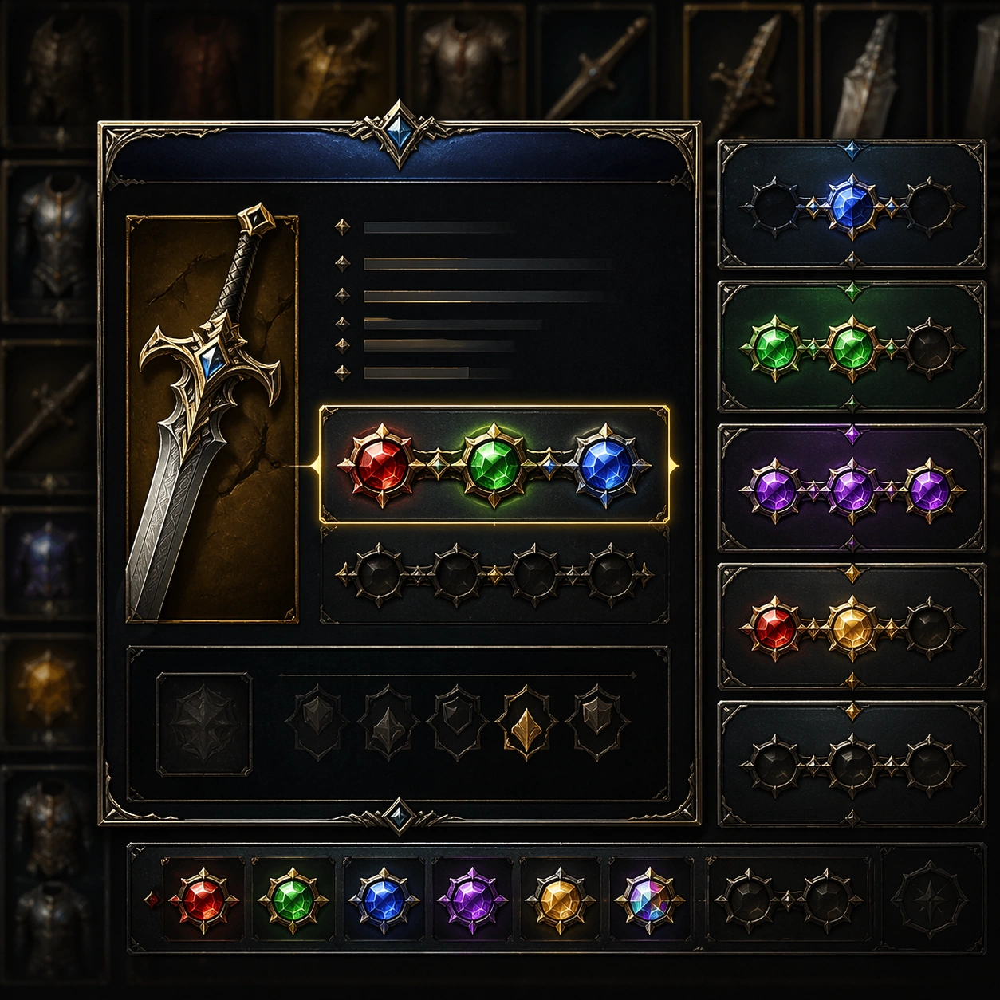

```text
Scene:
A square production-ready image designed for a game-art review wall and a commercial gallery at the same time. Frame a focused inset on sockets, gems, or enhancement slots inside a tooltip surface with disciplined lighting, clean edge separation, and enough surrounding context to prove how the asset would behave in a real product surface. The camera, crop, and tonal balance should feel intentional rather than generic, with high readability at first glance and convincing material response under closer inspection.

Subject:
Center the study on a focused inset on sockets, gems, or enhancement slots inside a tooltip surface. Translate the topic into a concrete, shippable visual statement instead of a loose mood board. Build layered object relationships, believable surface finish, and strong silhouette grouping so the image reads immediately as part of Inventory Tooltip Comparison Board. The subject should feel made for a live game pipeline: useful in store, UI, campaign, or art-review contexts, with visual hierarchy strong enough to survive aggressive cropping.

Important details:
tiny shapes and color coding should remain readable and premium. Keep every supporting element subordinate to the main read, and make category separation obvious through form, color zoning, depth, and material logic rather than words. Where panels, cards, badges, or interface blocks appear, they must look professionally structured but remain unreadable. The visual language should feel premium, original, and coherent across this package, with no filler clutter and no accidental resemblance to a specific shipped game IP.

Use case:
Inventory Tooltip Comparison Board single study 6/9, focused on socket gem inset.

Constraints:
No readable text, no watermark, no logos, preserve exact 1:1 aspect ratio, no numbers, no text, no broken hierarchy, no generic stock-photo staging, no accidental UI gibberish.
```

[Pinned source](https://github.com/ChaosRealmsAI/gpt-image-2-gallery/blob/5296db8c996e38776c83a0bc8c64f848dcd512b3/works/topics/inventory-tooltip-comparison-board/packages/single-inventory-tooltip-studies/images/socket-gem-inset/meta.json) · GPT Image2 · 1254×1254 · No source-declared image dependencies. · ProjectD:[published and publicly accepted](https://aitoolsradar.com/en/prompts/090dde2bea7d43)

## Inventory Hover Scene · inventory-tooltip-comparison-board/single-inventory-tooltip-studies/inventory-hover-scene

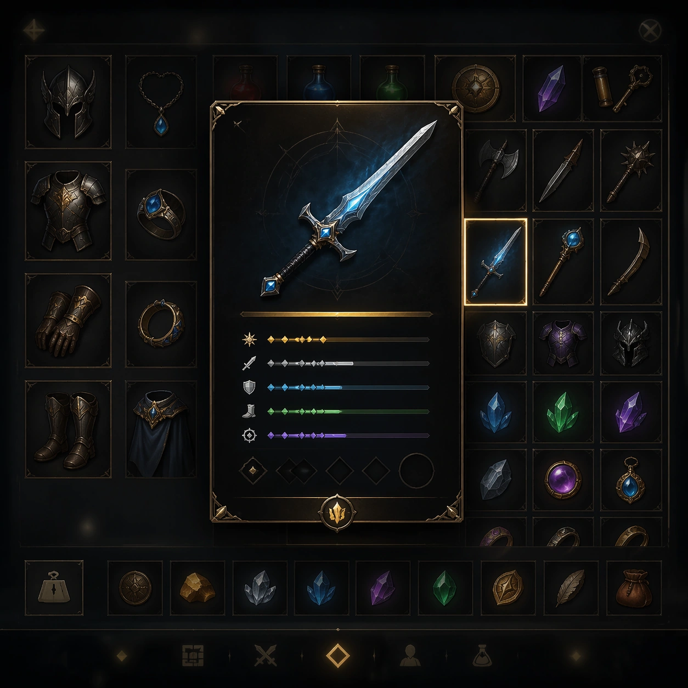

```text
Scene:
A square production-ready image designed for a game-art review wall and a commercial gallery at the same time. Frame a player-inventory hover scene where one item tooltip takes center stage over an organized background grid with disciplined lighting, clean edge separation, and enough surrounding context to prove how the asset would behave in a real product surface. The camera, crop, and tonal balance should feel intentional rather than generic, with high readability at first glance and convincing material response under closer inspection.

Subject:
Center the study on a player-inventory hover scene where one item tooltip takes center stage over an organized background grid. Translate the topic into a concrete, shippable visual statement instead of a loose mood board. Build layered object relationships, believable surface finish, and strong silhouette grouping so the image reads immediately as part of Inventory Tooltip Comparison Board. The subject should feel made for a live game pipeline: useful in store, UI, campaign, or art-review contexts, with visual hierarchy strong enough to survive aggressive cropping.

Important details:
the panel should feel responsive and polished without becoming a literal screenshot. Keep every supporting element subordinate to the main read, and make category separation obvious through form, color zoning, depth, and material logic rather than words. Where panels, cards, badges, or interface blocks appear, they must look professionally structured but remain unreadable. The visual language should feel premium, original, and coherent across this package, with no filler clutter and no accidental resemblance to a specific shipped game IP.

Use case:
Inventory Tooltip Comparison Board single study 7/9, focused on inventory hover scene.

Constraints:
No readable text, no watermark, no logos, preserve exact 1:1 aspect ratio, no readable tabs, no labels, no broken hierarchy, no generic stock-photo staging, no accidental UI gibberish.
```

[Pinned source](https://github.com/ChaosRealmsAI/gpt-image-2-gallery/blob/5296db8c996e38776c83a0bc8c64f848dcd512b3/works/topics/inventory-tooltip-comparison-board/packages/single-inventory-tooltip-studies/images/inventory-hover-scene/meta.json) · GPT Image2 · 1254×1254 · No source-declared image dependencies. · ProjectD:[published and publicly accepted](https://aitoolsradar.com/en/prompts/d4b95550a8e81b)

## Upgrade Path Card · inventory-tooltip-comparison-board/single-inventory-tooltip-studies/upgrade-path-card

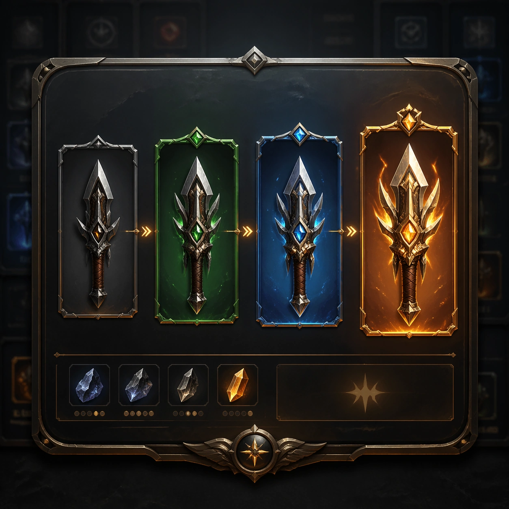

```text
Scene:
A square production-ready image designed for a game-art review wall and a commercial gallery at the same time. Frame an upgrade-path card that maps one item into higher rarity or enhanced versions with disciplined lighting, clean edge separation, and enough surrounding context to prove how the asset would behave in a real product surface. The camera, crop, and tonal balance should feel intentional rather than generic, with high readability at first glance and convincing material response under closer inspection.

Subject:
Center the study on an upgrade-path card that maps one item into higher rarity or enhanced versions. Translate the topic into a concrete, shippable visual statement instead of a loose mood board. Build layered object relationships, believable surface finish, and strong silhouette grouping so the image reads immediately as part of Inventory Tooltip Comparison Board. The subject should feel made for a live game pipeline: useful in store, UI, campaign, or art-review contexts, with visual hierarchy strong enough to survive aggressive cropping.

Important details:
show progression desire and technical clarity together through clean panel logic. Keep every supporting element subordinate to the main read, and make category separation obvious through form, color zoning, depth, and material logic rather than words. Where panels, cards, badges, or interface blocks appear, they must look professionally structured but remain unreadable. The visual language should feel premium, original, and coherent across this package, with no filler clutter and no accidental resemblance to a specific shipped game IP.

Use case:
Inventory Tooltip Comparison Board single study 8/9, focused on upgrade path card.

Constraints:
No readable text, no watermark, no logos, preserve exact 1:1 aspect ratio, no arrows with text, no numerals, no broken hierarchy, no generic stock-photo staging, no accidental UI gibberish.
```

[Pinned source](https://github.com/ChaosRealmsAI/gpt-image-2-gallery/blob/5296db8c996e38776c83a0bc8c64f848dcd512b3/works/topics/inventory-tooltip-comparison-board/packages/single-inventory-tooltip-studies/images/upgrade-path-card/meta.json) · GPT Image2 · 1254×1254 · No source-declared image dependencies. · ProjectD:[published and publicly accepted](https://aitoolsradar.com/en/prompts/56be7b9d0df9d8)

## Loot Decision Poster · inventory-tooltip-comparison-board/single-inventory-tooltip-studies/loot-decision-poster

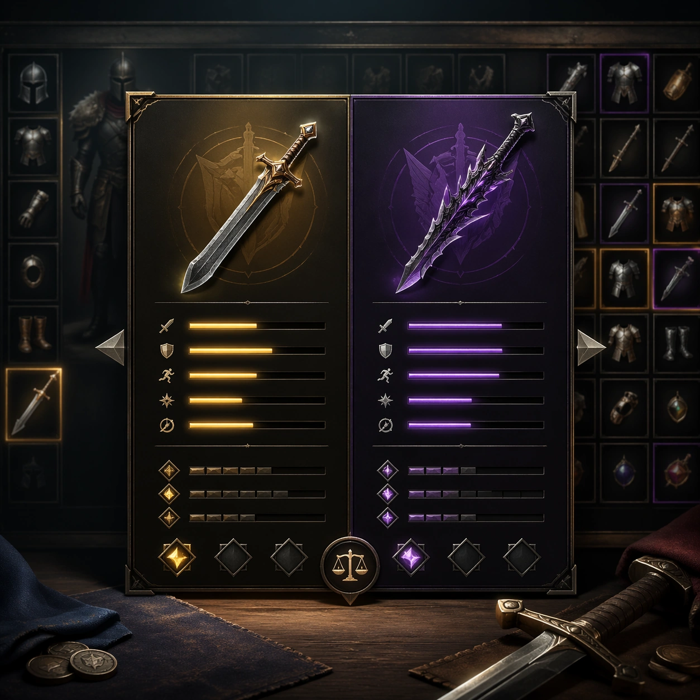

```text
Scene:
A square production-ready image designed for a game-art review wall and a commercial gallery at the same time. Frame a poster-like asset that dramatizes a meaningful equipment choice using tooltip language as graphic structure with disciplined lighting, clean edge separation, and enough surrounding context to prove how the asset would behave in a real product surface. The camera, crop, and tonal balance should feel intentional rather than generic, with high readability at first glance and convincing material response under closer inspection.

Subject:
Center the study on a poster-like asset that dramatizes a meaningful equipment choice using tooltip language as graphic structure. Translate the topic into a concrete, shippable visual statement instead of a loose mood board. Build layered object relationships, believable surface finish, and strong silhouette grouping so the image reads immediately as part of Inventory Tooltip Comparison Board. The subject should feel made for a live game pipeline: useful in store, UI, campaign, or art-review contexts, with visual hierarchy strong enough to survive aggressive cropping.

Important details:
the result should feel shareable while remaining grounded in actual inventory logic. Keep every supporting element subordinate to the main read, and make category separation obvious through form, color zoning, depth, and material logic rather than words. Where panels, cards, badges, or interface blocks appear, they must look professionally structured but remain unreadable. The visual language should feel premium, original, and coherent across this package, with no filler clutter and no accidental resemblance to a specific shipped game IP.

Use case:
Inventory Tooltip Comparison Board single study 9/9, focused on loot decision poster.

Constraints:
No readable text, no watermark, no logos, preserve exact 1:1 aspect ratio, no slogans, no logos, no broken hierarchy, no generic stock-photo staging, no accidental UI gibberish.
```

[Pinned source](https://github.com/ChaosRealmsAI/gpt-image-2-gallery/blob/5296db8c996e38776c83a0bc8c64f848dcd512b3/works/topics/inventory-tooltip-comparison-board/packages/single-inventory-tooltip-studies/images/loot-decision-poster/meta.json) · GPT Image2 · 1254×1254 · No source-declared image dependencies. · ProjectD:[published and publicly accepted](https://aitoolsradar.com/en/prompts/bbef11bac91f0d)

## Reference Anchor · island-coastline-dreamscape-system/series-core-system/01-reference-anchor

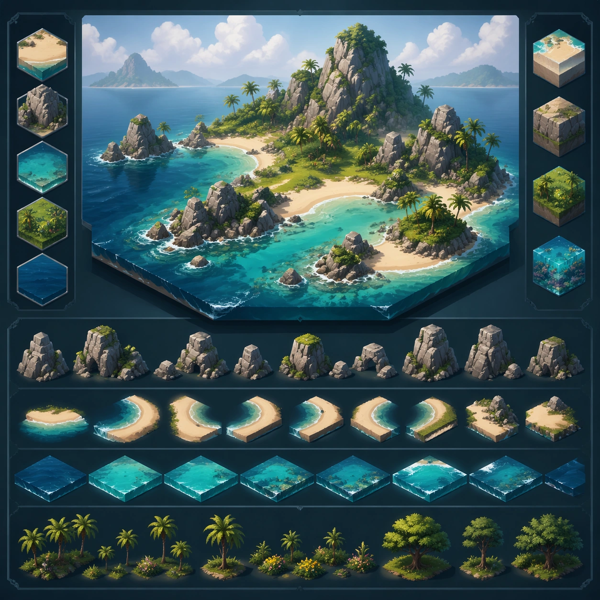

```text
Scene:
Create a square reference image for Island Coastline Dreamscape System. Build a reference anchor establishing the core system with a premium, production-ready finish. Use a polished modular board or campaign surface with clean spacing, premium game-UI finish, and clear focal hierarchy. The composition should feel intentional, clean, and reusable for gallery, research, campaign, or internal handoff contexts. Lighting must support readability first, with the main forms clearly separated from the background and enough breathing room for the system to stay legible at both hero scale and thumbnail scale.

Subject:
Center a coherent original game-art system built for premium production and marketing surfaces. For this image, focus on reference anchor. Keep the same system logic stable across screenshots, cards, banners, and overview boards. This image is the canonical anchor that later series images must follow. The viewer should immediately understand what role this surface plays inside a cohesive game-production asset pack.

Important details:
Lock framing, icon grammar, palette blocking, and surface hierarchy so the kit feels production-ready and consistent. Preserve the core silhouette, framing language, and material logic from the reference image while each variation changes function. Keep materials believable, edge hierarchy disciplined, and the visual language consistent with Island Dreamscapes. Use abstract interface blocks or diagram accents when helpful, but avoid any readable language. The final result should feel like a deliberate production asset rather than a random illustration.

Use case:
Island Coastline Dreamscape System series study 1/9, designed as reference anchor within a cohesive asset pack.

Constraints:
No readable text, no watermark, no logos, preserve exact 1:1 aspect ratio, no unrelated objects, no broken visual hierarchy, no malformed anatomy or broken perspective, no random decorative clutter.
```

[Pinned source](https://github.com/ChaosRealmsAI/gpt-image-2-gallery/blob/5296db8c996e38776c83a0bc8c64f848dcd512b3/works/topics/island-coastline-dreamscape-system/packages/series-core-system/images/01-reference-anchor/meta.json) · GPT Image2 · 1254×1254 · No source-declared image dependencies. · ProjectD:[published and publicly accepted](https://aitoolsradar.com/en/prompts/2a72cef41947f1)

## Variant One · island-coastline-dreamscape-system/series-core-system/02-variant-one

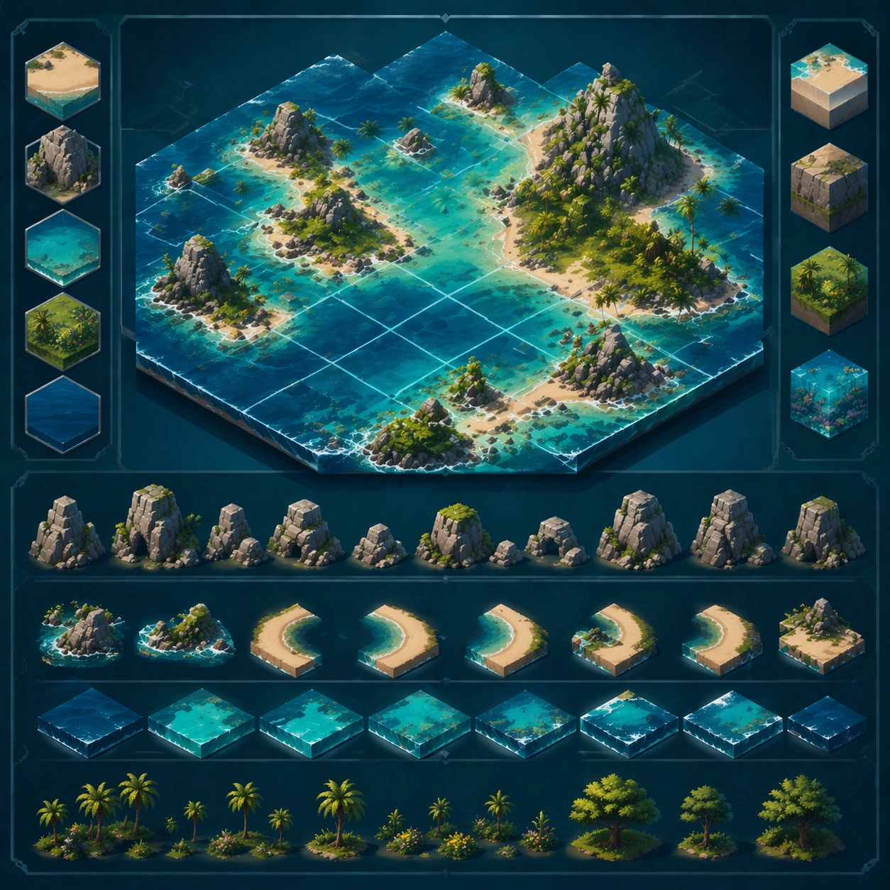

```text
Scene:
Create a square dependent image for Island Coastline Dreamscape System. Build a first controlled variation in the same system with a premium, production-ready finish. Use a polished modular board or campaign surface with clean spacing, premium game-UI finish, and clear focal hierarchy. The composition should feel intentional, clean, and reusable for gallery, research, campaign, or internal handoff contexts. Lighting must support readability first, with the main forms clearly separated from the background and enough breathing room for the system to stay legible at both hero scale and thumbnail scale.

Subject:
Center a coherent original game-art system built for premium production and marketing surfaces. For this image, focus on the intended support surface. Keep the same system logic stable across screenshots, cards, banners, and overview boards. Preserve exact identity or system logic from the reference image while changing only the intended variation axis. The viewer should immediately understand what role this surface plays inside a cohesive game-production asset pack.

Important details:
Lock framing, icon grammar, palette blocking, and surface hierarchy so the kit feels production-ready and consistent. Preserve the core silhouette, framing language, and material logic from the reference image while each variation changes function. Keep materials believable, edge hierarchy disciplined, and the visual language consistent with Island Dreamscapes. Use abstract interface blocks or diagram accents when helpful, but avoid any readable language. The final result should feel like a deliberate production asset rather than a random illustration.

Use case:
Island Coastline Dreamscape System series study 2/9, designed as variant one within a cohesive asset pack.

Constraints:
No readable text, no watermark, no logos, preserve exact 1:1 aspect ratio, no unrelated objects, no broken visual hierarchy, no malformed anatomy or broken perspective, no random decorative clutter.
```

[Pinned source](https://github.com/ChaosRealmsAI/gpt-image-2-gallery/blob/5296db8c996e38776c83a0bc8c64f848dcd512b3/works/topics/island-coastline-dreamscape-system/packages/series-core-system/images/02-variant-one/meta.json) · GPT Image2 · 1254×1254 · Reference images required. · ProjectD:[published and publicly accepted](https://aitoolsradar.com/en/prompts/a4c8e833e2dea4)

## Variant Two · island-coastline-dreamscape-system/series-core-system/03-variant-two

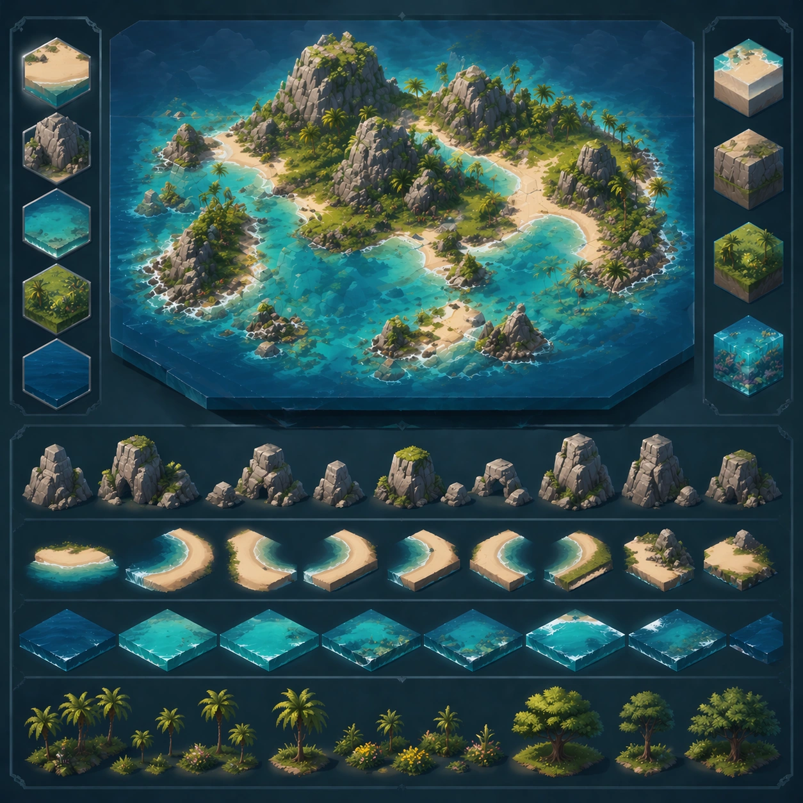

```text
Scene:
Create a square dependent image for Island Coastline Dreamscape System. Build a second controlled variation in the same system with a premium, production-ready finish. Use a polished modular board or campaign surface with clean spacing, premium game-UI finish, and clear focal hierarchy. The composition should feel intentional, clean, and reusable for gallery, research, campaign, or internal handoff contexts. Lighting must support readability first, with the main forms clearly separated from the background and enough breathing room for the system to stay legible at both hero scale and thumbnail scale.

Subject:
Center a coherent original game-art system built for premium production and marketing surfaces. For this image, focus on the intended support surface. Keep the same system logic stable across screenshots, cards, banners, and overview boards. Preserve exact identity or system logic from the reference image while changing only the intended variation axis. The viewer should immediately understand what role this surface plays inside a cohesive game-production asset pack.

Important details:
Lock framing, icon grammar, palette blocking, and surface hierarchy so the kit feels production-ready and consistent. Preserve the core silhouette, framing language, and material logic from the reference image while each variation changes function. Keep materials believable, edge hierarchy disciplined, and the visual language consistent with Island Dreamscapes. Use abstract interface blocks or diagram accents when helpful, but avoid any readable language. The final result should feel like a deliberate production asset rather than a random illustration.

Use case:
Island Coastline Dreamscape System series study 3/9, designed as variant two within a cohesive asset pack.

Constraints:
No readable text, no watermark, no logos, preserve exact 1:1 aspect ratio, no unrelated objects, no broken visual hierarchy, no malformed anatomy or broken perspective, no random decorative clutter.
```

[Pinned source](https://github.com/ChaosRealmsAI/gpt-image-2-gallery/blob/5296db8c996e38776c83a0bc8c64f848dcd512b3/works/topics/island-coastline-dreamscape-system/packages/series-core-system/images/03-variant-two/meta.json) · GPT Image2 · 1254×1254 · Reference images required. · ProjectD:[published and publicly accepted](https://aitoolsradar.com/en/prompts/5ed57c8109a682)

## Variant Three · island-coastline-dreamscape-system/series-core-system/04-variant-three

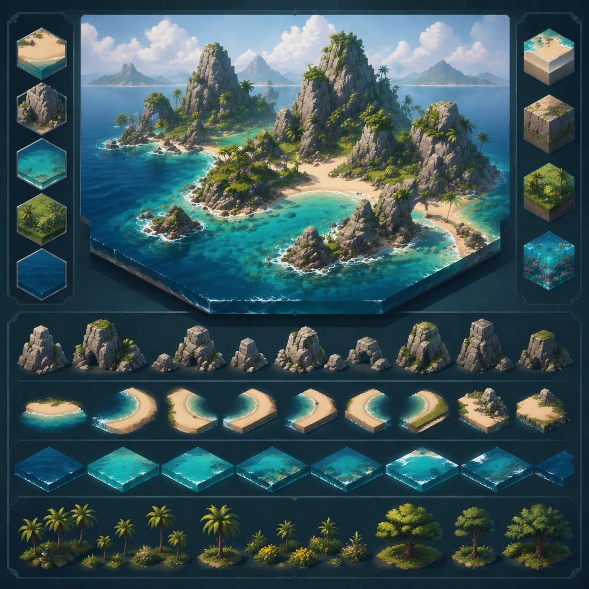

```text
Scene:
Create a square dependent image for Island Coastline Dreamscape System. Build a third controlled variation in the same system with a premium, production-ready finish. Use a polished modular board or campaign surface with clean spacing, premium game-UI finish, and clear focal hierarchy. The composition should feel intentional, clean, and reusable for gallery, research, campaign, or internal handoff contexts. Lighting must support readability first, with the main forms clearly separated from the background and enough breathing room for the system to stay legible at both hero scale and thumbnail scale.

Subject:
Center a coherent original game-art system built for premium production and marketing surfaces. For this image, focus on the intended support surface. Keep the same system logic stable across screenshots, cards, banners, and overview boards. Preserve exact identity or system logic from the reference image while changing only the intended variation axis. The viewer should immediately understand what role this surface plays inside a cohesive game-production asset pack.

Important details:
Lock framing, icon grammar, palette blocking, and surface hierarchy so the kit feels production-ready and consistent. Preserve the core silhouette, framing language, and material logic from the reference image while each variation changes function. Keep materials believable, edge hierarchy disciplined, and the visual language consistent with Island Dreamscapes. Use abstract interface blocks or diagram accents when helpful, but avoid any readable language. The final result should feel like a deliberate production asset rather than a random illustration.

Use case:
Island Coastline Dreamscape System series study 4/9, designed as variant three within a cohesive asset pack.

Constraints:
No readable text, no watermark, no logos, preserve exact 1:1 aspect ratio, no unrelated objects, no broken visual hierarchy, no malformed anatomy or broken perspective, no random decorative clutter.
```

[Pinned source](https://github.com/ChaosRealmsAI/gpt-image-2-gallery/blob/5296db8c996e38776c83a0bc8c64f848dcd512b3/works/topics/island-coastline-dreamscape-system/packages/series-core-system/images/04-variant-three/meta.json) · GPT Image2 · 1254×1254 · Reference images required. · ProjectD:[published and publicly accepted](https://aitoolsradar.com/en/prompts/be070d005120c0)

## Support One · island-coastline-dreamscape-system/single-support-studies/support-one

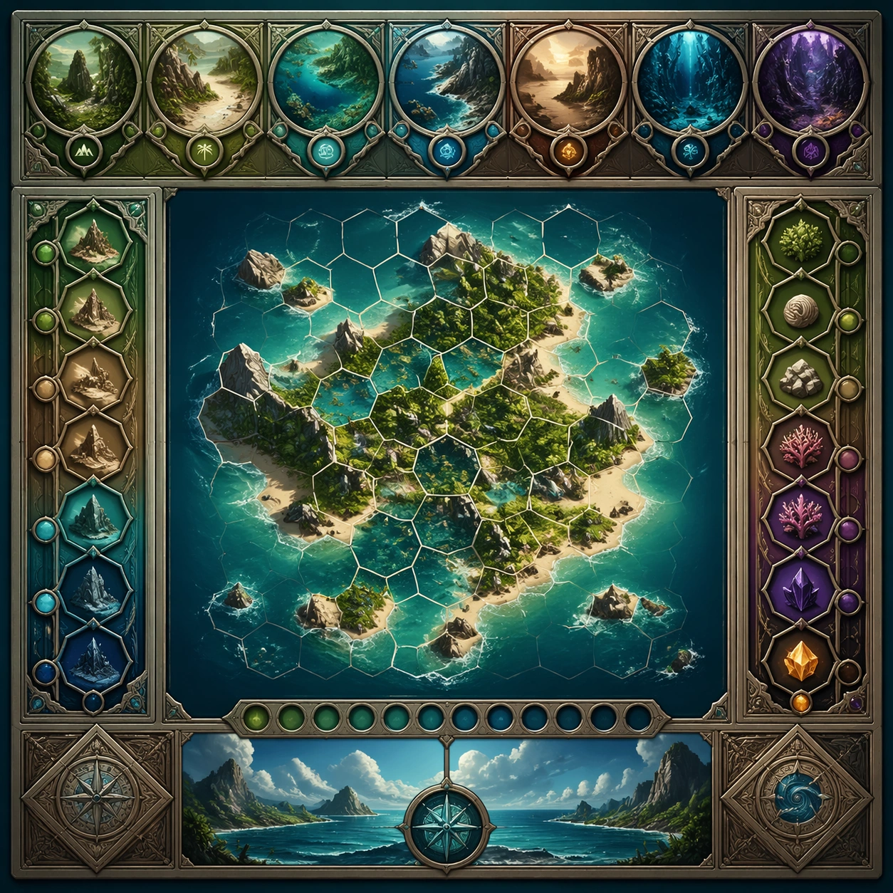

```text
Scene:
Create a square standalone support image for Island Coastline Dreamscape System. Build a support-surface study with a clear focal hierarchy and a finished professional surface. Use a polished modular board or campaign surface with clean spacing, premium game-UI finish, and clear focal hierarchy. The frame should feel self-contained and polished, with enough structure to explain the system even without the reference series, yet still obviously belonging to the same theme and production world.

Subject:
Show a coherent original game-art system built for premium production and marketing surfaces in a way that emphasizes the intended support surface. Keep the same system logic stable across screenshots, cards, banners, and overview boards. Even though this image is independent, the viewer should still recognize the same universe, same commercial logic, and same production intent as the core package.

Important details:
Lock framing, icon grammar, palette blocking, and surface hierarchy so the kit feels production-ready and consistent. Preserve the broader theme language through color, framing, material choices, and modular composition. Use clean panel rhythm, premium asset presentation, and believable detail density. The image should work equally well as a gallery study, research reference, and mock production deliverable.

Use case:
Island Coastline Dreamscape System single study 5/9, exploring support one as a support surface.

Constraints:
No readable text, no watermark, no logos, preserve exact 1:1 aspect ratio, no unrelated objects, no broken visual hierarchy, no visual noise that obscures the main surface, no accidental brand resemblance.
```

[Pinned source](https://github.com/ChaosRealmsAI/gpt-image-2-gallery/blob/5296db8c996e38776c83a0bc8c64f848dcd512b3/works/topics/island-coastline-dreamscape-system/packages/single-support-studies/images/support-one/meta.json) · GPT Image2 · 1254×1254 · No source-declared image dependencies. · ProjectD:[published and publicly accepted](https://aitoolsradar.com/en/prompts/5b61b13f548612)

## Support Two · island-coastline-dreamscape-system/single-support-studies/support-two

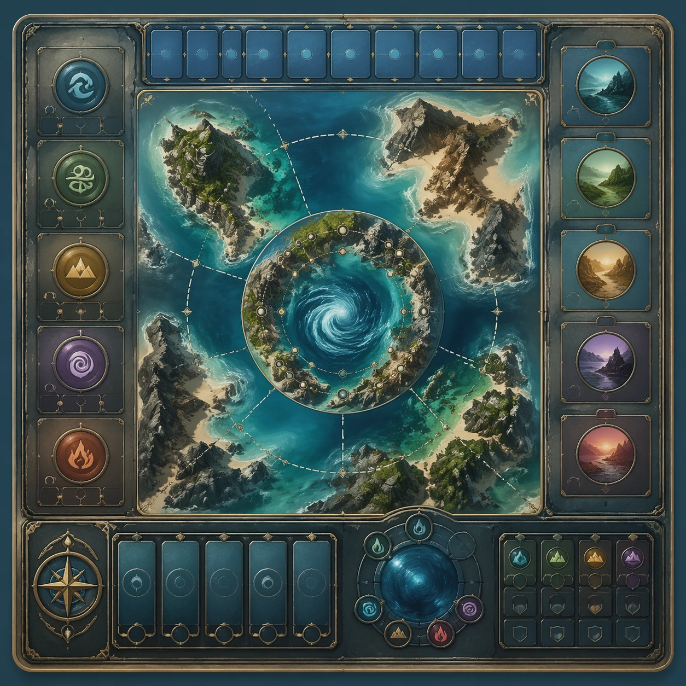

```text
Scene:
Create a square standalone support image for Island Coastline Dreamscape System. Build a second support-surface study with a clear focal hierarchy and a finished professional surface. Use a polished modular board or campaign surface with clean spacing, premium game-UI finish, and clear focal hierarchy. The frame should feel self-contained and polished, with enough structure to explain the system even without the reference series, yet still obviously belonging to the same theme and production world.

Subject:
Show a coherent original game-art system built for premium production and marketing surfaces in a way that emphasizes the intended support surface. Keep the same system logic stable across screenshots, cards, banners, and overview boards. Even though this image is independent, the viewer should still recognize the same universe, same commercial logic, and same production intent as the core package.

Important details:
Lock framing, icon grammar, palette blocking, and surface hierarchy so the kit feels production-ready and consistent. Preserve the broader theme language through color, framing, material choices, and modular composition. Use clean panel rhythm, premium asset presentation, and believable detail density. The image should work equally well as a gallery study, research reference, and mock production deliverable.

Use case:
Island Coastline Dreamscape System single study 6/9, exploring support two as a support surface.

Constraints:
No readable text, no watermark, no logos, preserve exact 1:1 aspect ratio, no unrelated objects, no broken visual hierarchy, no visual noise that obscures the main surface, no accidental brand resemblance.
```

[Pinned source](https://github.com/ChaosRealmsAI/gpt-image-2-gallery/blob/5296db8c996e38776c83a0bc8c64f848dcd512b3/works/topics/island-coastline-dreamscape-system/packages/single-support-studies/images/support-two/meta.json) · GPT Image2 · 1254×1254 · No source-declared image dependencies. · ProjectD:[published and publicly accepted](https://aitoolsradar.com/en/prompts/e173784f6151e3)

## Support Three · island-coastline-dreamscape-system/single-support-studies/support-three

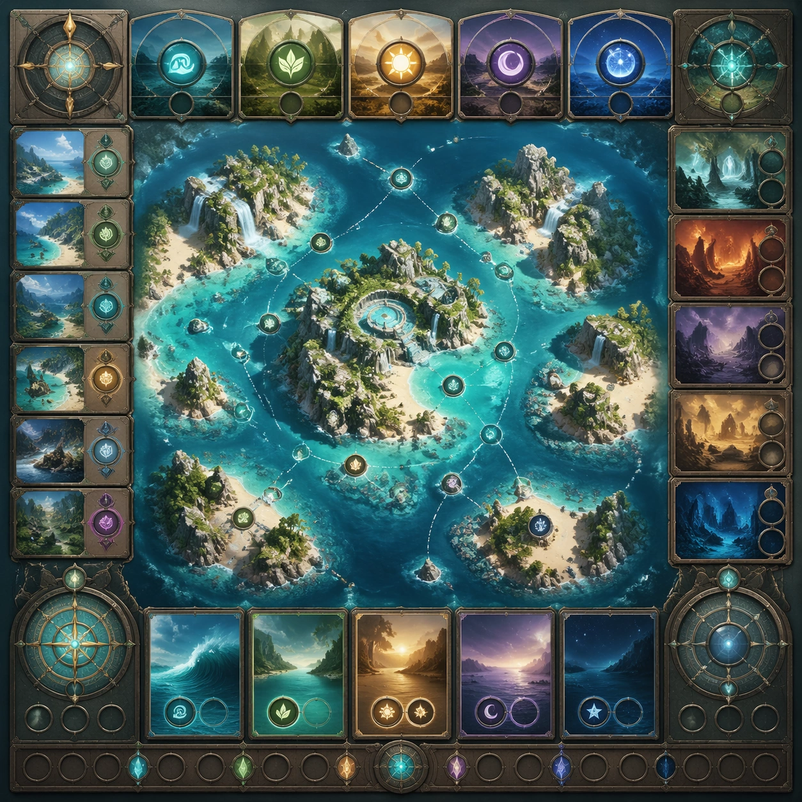

```text
Scene:
Create a square standalone support image for Island Coastline Dreamscape System. Build a third support-surface study with a clear focal hierarchy and a finished professional surface. Use a polished modular board or campaign surface with clean spacing, premium game-UI finish, and clear focal hierarchy. The frame should feel self-contained and polished, with enough structure to explain the system even without the reference series, yet still obviously belonging to the same theme and production world.

Subject:
Show a coherent original game-art system built for premium production and marketing surfaces in a way that emphasizes the intended support surface. Keep the same system logic stable across screenshots, cards, banners, and overview boards. Even though this image is independent, the viewer should still recognize the same universe, same commercial logic, and same production intent as the core package.

Important details:
Lock framing, icon grammar, palette blocking, and surface hierarchy so the kit feels production-ready and consistent. Preserve the broader theme language through color, framing, material choices, and modular composition. Use clean panel rhythm, premium asset presentation, and believable detail density. The image should work equally well as a gallery study, research reference, and mock production deliverable.

Use case:
Island Coastline Dreamscape System single study 7/9, exploring support three as a support surface.

Constraints:
No readable text, no watermark, no logos, preserve exact 1:1 aspect ratio, no unrelated objects, no broken visual hierarchy, no visual noise that obscures the main surface, no accidental brand resemblance.
```

[Pinned source](https://github.com/ChaosRealmsAI/gpt-image-2-gallery/blob/5296db8c996e38776c83a0bc8c64f848dcd512b3/works/topics/island-coastline-dreamscape-system/packages/single-support-studies/images/support-three/meta.json) · GPT Image2 · 1254×1254 · No source-declared image dependencies. · ProjectD:[published and publicly accepted](https://aitoolsradar.com/en/prompts/af06ab4cdee957)

## Support Four · island-coastline-dreamscape-system/single-support-studies/support-four

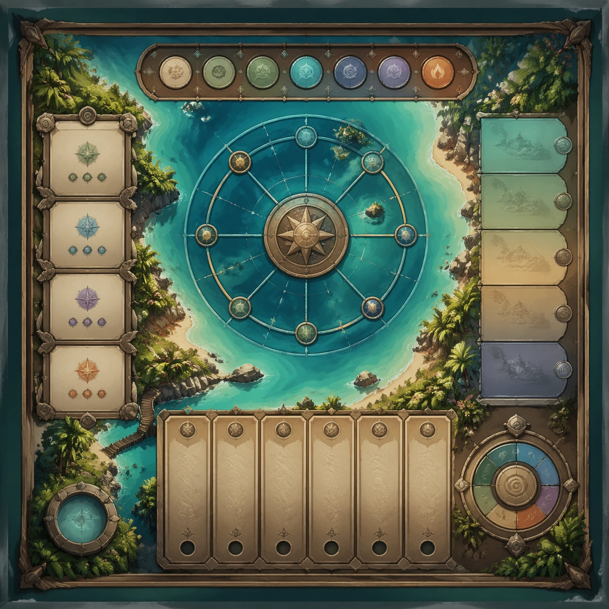

```text
Scene:
Create a square standalone support image for Island Coastline Dreamscape System. Build a fourth support-surface study with a clear focal hierarchy and a finished professional surface. Use a polished modular board or campaign surface with clean spacing, premium game-UI finish, and clear focal hierarchy. The frame should feel self-contained and polished, with enough structure to explain the system even without the reference series, yet still obviously belonging to the same theme and production world.

Subject:
Show a coherent original game-art system built for premium production and marketing surfaces in a way that emphasizes the intended support surface. Keep the same system logic stable across screenshots, cards, banners, and overview boards. Even though this image is independent, the viewer should still recognize the same universe, same commercial logic, and same production intent as the core package.

Important details:
Lock framing, icon grammar, palette blocking, and surface hierarchy so the kit feels production-ready and consistent. Preserve the broader theme language through color, framing, material choices, and modular composition. Use clean panel rhythm, premium asset presentation, and believable detail density. The image should work equally well as a gallery study, research reference, and mock production deliverable.

Use case:
Island Coastline Dreamscape System single study 8/9, exploring support four as a support surface.

Constraints:
No readable text, no watermark, no logos, preserve exact 1:1 aspect ratio, no unrelated objects, no broken visual hierarchy, no visual noise that obscures the main surface, no accidental brand resemblance.
```

[Pinned source](https://github.com/ChaosRealmsAI/gpt-image-2-gallery/blob/5296db8c996e38776c83a0bc8c64f848dcd512b3/works/topics/island-coastline-dreamscape-system/packages/single-support-studies/images/support-four/meta.json) · GPT Image2 · 1254×1254 · No source-declared image dependencies. · ProjectD:[published and publicly accepted](https://aitoolsradar.com/en/prompts/19650559d99f73)

## Support Five · island-coastline-dreamscape-system/single-support-studies/support-five

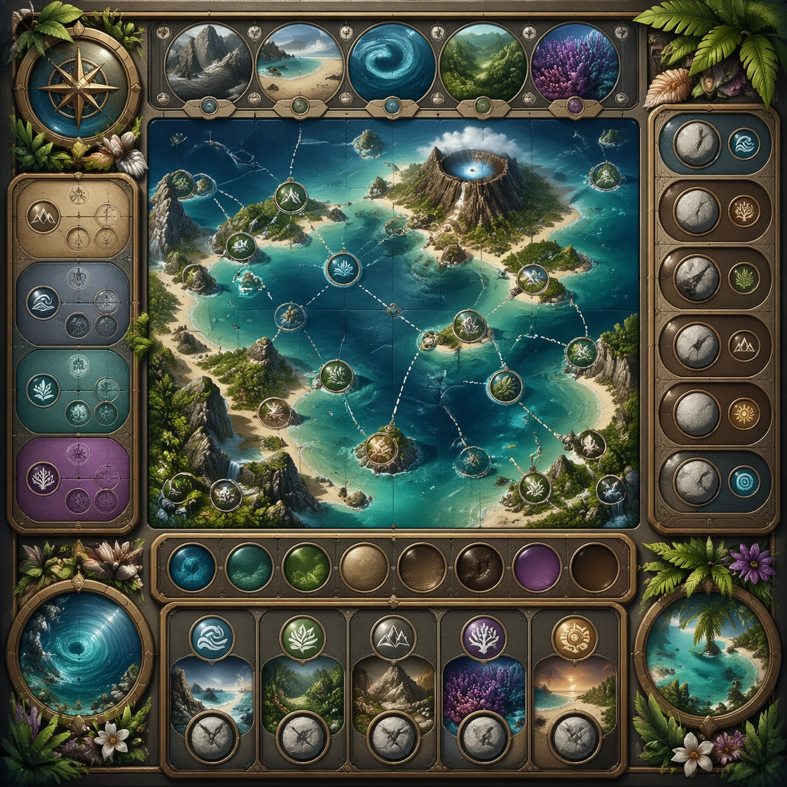

```text
Scene:
Create a square standalone support image for Island Coastline Dreamscape System. Build a fifth support-surface study with a clear focal hierarchy and a finished professional surface. Use a polished modular board or campaign surface with clean spacing, premium game-UI finish, and clear focal hierarchy. The frame should feel self-contained and polished, with enough structure to explain the system even without the reference series, yet still obviously belonging to the same theme and production world.

Subject:
Show a coherent original game-art system built for premium production and marketing surfaces in a way that emphasizes the intended support surface. Keep the same system logic stable across screenshots, cards, banners, and overview boards. Even though this image is independent, the viewer should still recognize the same universe, same commercial logic, and same production intent as the core package.

Important details:
Lock framing, icon grammar, palette blocking, and surface hierarchy so the kit feels production-ready and consistent. Preserve the broader theme language through color, framing, material choices, and modular composition. Use clean panel rhythm, premium asset presentation, and believable detail density. The image should work equally well as a gallery study, research reference, and mock production deliverable.

Use case:
Island Coastline Dreamscape System single study 9/9, exploring support five as a support surface.

Constraints:
No readable text, no watermark, no logos, preserve exact 1:1 aspect ratio, no unrelated objects, no broken visual hierarchy, no visual noise that obscures the main surface, no accidental brand resemblance.
```

[Pinned source](https://github.com/ChaosRealmsAI/gpt-image-2-gallery/blob/5296db8c996e38776c83a0bc8c64f848dcd512b3/works/topics/island-coastline-dreamscape-system/packages/single-support-studies/images/support-five/meta.json) · GPT Image2 · 1254×1254 · No source-declared image dependencies. · ProjectD:[published and publicly accepted](https://aitoolsradar.com/en/prompts/ba305648b350eb)

## Reference Anchor · italian-aperitivo-summer-lifestyle/series-core-system/01-reference-anchor

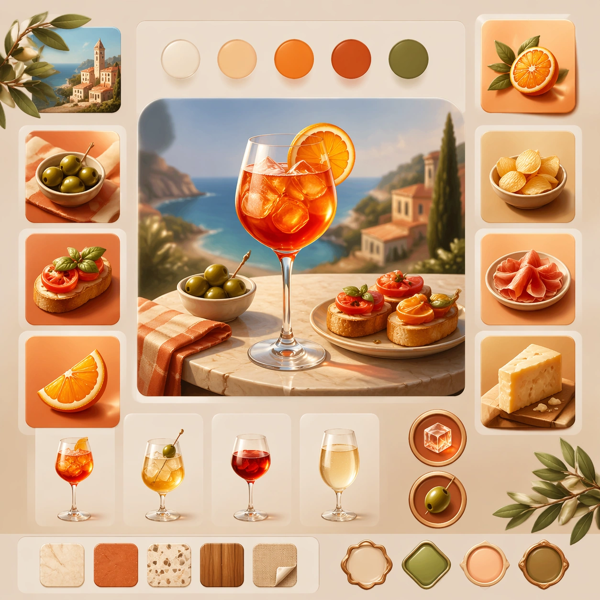

```text
Scene:
Create a square reference image for Italian Aperitivo Summer Lifestyle. Build a reference anchor establishing the core system with a premium, production-ready finish. Use a polished modular board or campaign surface with clean spacing, premium game-UI finish, and clear focal hierarchy. The composition should feel intentional, clean, and reusable for gallery, research, campaign, or internal handoff contexts. Lighting must support readability first, with the main forms clearly separated from the background and enough breathing room for the system to stay legible at both hero scale and thumbnail scale.

Subject:
Center a coherent original game-art system built for premium production and marketing surfaces. For this image, focus on reference anchor. Keep the same system logic stable across screenshots, cards, banners, and overview boards. This image is the canonical anchor that later series images must follow. The viewer should immediately understand what role this surface plays inside a cohesive game-production asset pack.

Important details:
Lock framing, icon grammar, palette blocking, and surface hierarchy so the kit feels production-ready and consistent. Preserve the core silhouette, framing language, and material logic from the reference image while each variation changes function. Keep materials believable, edge hierarchy disciplined, and the visual language consistent with Aperitivo. Use abstract interface blocks or diagram accents when helpful, but avoid any readable language. The final result should feel like a deliberate production asset rather than a random illustration.

Use case:
Italian Aperitivo Summer Lifestyle series study 1/9, designed as reference anchor within a cohesive asset pack.

Constraints:
No readable text, no watermark, no logos, preserve exact 1:1 aspect ratio, no unrelated objects, no broken visual hierarchy, no malformed anatomy or broken perspective, no random decorative clutter.
```

[Pinned source](https://github.com/ChaosRealmsAI/gpt-image-2-gallery/blob/5296db8c996e38776c83a0bc8c64f848dcd512b3/works/topics/italian-aperitivo-summer-lifestyle/packages/series-core-system/images/01-reference-anchor/meta.json) · GPT Image2 · 1254×1254 · No source-declared image dependencies. · ProjectD:[published and publicly accepted](https://aitoolsradar.com/en/prompts/4079ce6b776aeb)

## Variant One · italian-aperitivo-summer-lifestyle/series-core-system/02-variant-one

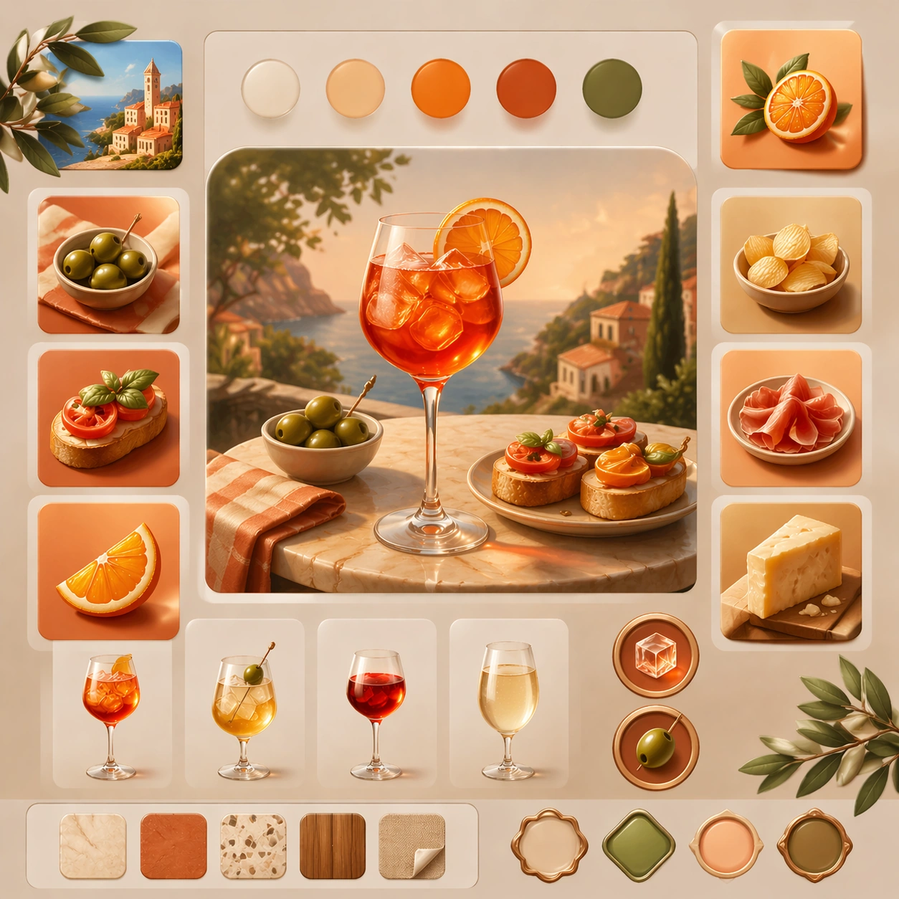

```text
Scene:
Create a square dependent image for Italian Aperitivo Summer Lifestyle. Build a first controlled variation in the same system with a premium, production-ready finish. Use a polished modular board or campaign surface with clean spacing, premium game-UI finish, and clear focal hierarchy. The composition should feel intentional, clean, and reusable for gallery, research, campaign, or internal handoff contexts. Lighting must support readability first, with the main forms clearly separated from the background and enough breathing room for the system to stay legible at both hero scale and thumbnail scale.

Subject:
Center a coherent original game-art system built for premium production and marketing surfaces. For this image, focus on the intended support surface. Keep the same system logic stable across screenshots, cards, banners, and overview boards. Preserve exact identity or system logic from the reference image while changing only the intended variation axis. The viewer should immediately understand what role this surface plays inside a cohesive game-production asset pack.

Important details:
Lock framing, icon grammar, palette blocking, and surface hierarchy so the kit feels production-ready and consistent. Preserve the core silhouette, framing language, and material logic from the reference image while each variation changes function. Keep materials believable, edge hierarchy disciplined, and the visual language consistent with Aperitivo. Use abstract interface blocks or diagram accents when helpful, but avoid any readable language. The final result should feel like a deliberate production asset rather than a random illustration.

Use case:
Italian Aperitivo Summer Lifestyle series study 2/9, designed as variant one within a cohesive asset pack.

Constraints:
No readable text, no watermark, no logos, preserve exact 1:1 aspect ratio, no unrelated objects, no broken visual hierarchy, no malformed anatomy or broken perspective, no random decorative clutter.
```

[Pinned source](https://github.com/ChaosRealmsAI/gpt-image-2-gallery/blob/5296db8c996e38776c83a0bc8c64f848dcd512b3/works/topics/italian-aperitivo-summer-lifestyle/packages/series-core-system/images/02-variant-one/meta.json) · GPT Image2 · 1254×1254 · Reference images required. · ProjectD:[published and publicly accepted](https://aitoolsradar.com/en/prompts/ce054dd320102c)

## Variant Two · italian-aperitivo-summer-lifestyle/series-core-system/03-variant-two

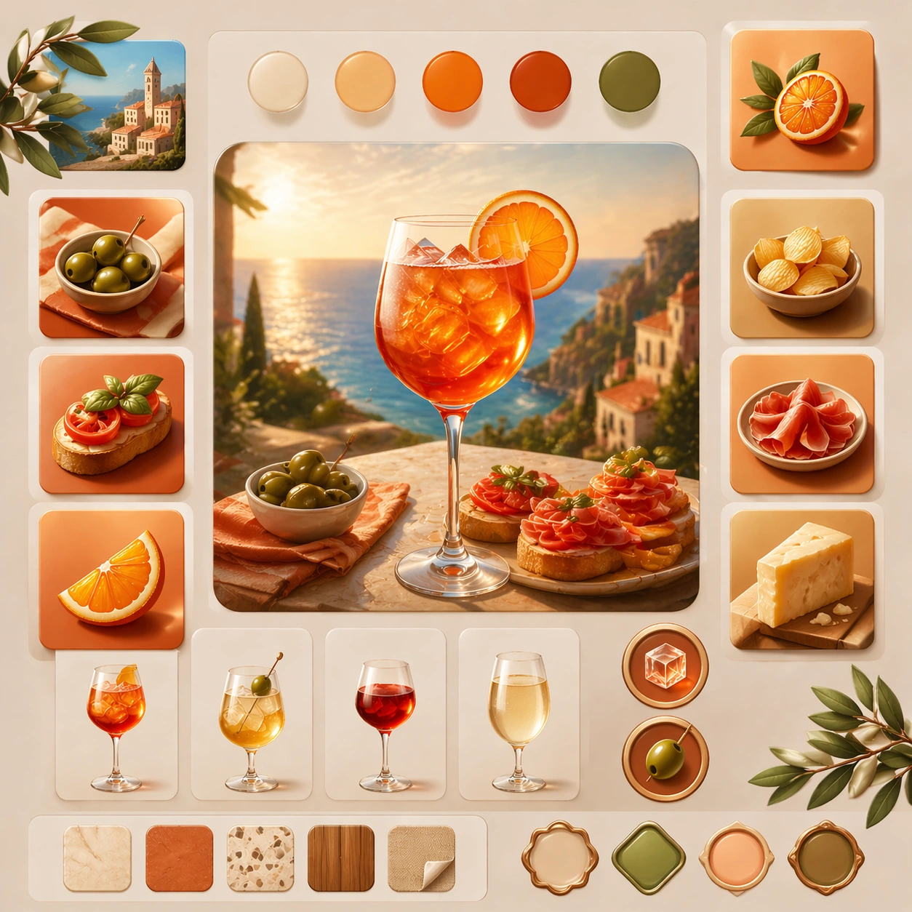

```text
Scene:
Create a square dependent image for Italian Aperitivo Summer Lifestyle. Build a second controlled variation in the same system with a premium, production-ready finish. Use a polished modular board or campaign surface with clean spacing, premium game-UI finish, and clear focal hierarchy. The composition should feel intentional, clean, and reusable for gallery, research, campaign, or internal handoff contexts. Lighting must support readability first, with the main forms clearly separated from the background and enough breathing room for the system to stay legible at both hero scale and thumbnail scale.

Subject:
Center a coherent original game-art system built for premium production and marketing surfaces. For this image, focus on the intended support surface. Keep the same system logic stable across screenshots, cards, banners, and overview boards. Preserve exact identity or system logic from the reference image while changing only the intended variation axis. The viewer should immediately understand what role this surface plays inside a cohesive game-production asset pack.

Important details:
Lock framing, icon grammar, palette blocking, and surface hierarchy so the kit feels production-ready and consistent. Preserve the core silhouette, framing language, and material logic from the reference image while each variation changes function. Keep materials believable, edge hierarchy disciplined, and the visual language consistent with Aperitivo. Use abstract interface blocks or diagram accents when helpful, but avoid any readable language. The final result should feel like a deliberate production asset rather than a random illustration.

Use case:
Italian Aperitivo Summer Lifestyle series study 3/9, designed as variant two within a cohesive asset pack.

Constraints:
No readable text, no watermark, no logos, preserve exact 1:1 aspect ratio, no unrelated objects, no broken visual hierarchy, no malformed anatomy or broken perspective, no random decorative clutter.
```

[Pinned source](https://github.com/ChaosRealmsAI/gpt-image-2-gallery/blob/5296db8c996e38776c83a0bc8c64f848dcd512b3/works/topics/italian-aperitivo-summer-lifestyle/packages/series-core-system/images/03-variant-two/meta.json) · GPT Image2 · 1254×1254 · Reference images required. · ProjectD:[published and publicly accepted](https://aitoolsradar.com/en/prompts/4cdb5caec755e7)

## Variant Three · italian-aperitivo-summer-lifestyle/series-core-system/04-variant-three

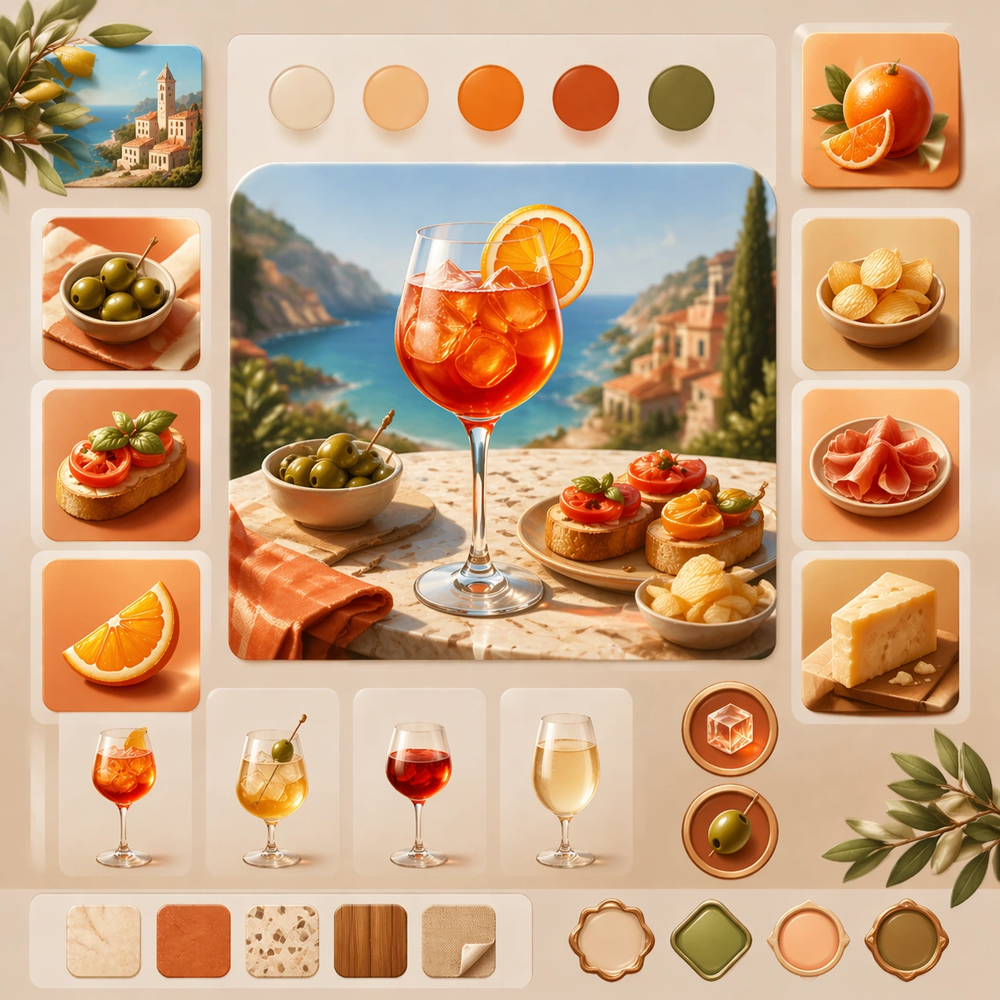

```text
Scene:
Create a square dependent image for Italian Aperitivo Summer Lifestyle. Build a third controlled variation in the same system with a premium, production-ready finish. Use a polished modular board or campaign surface with clean spacing, premium game-UI finish, and clear focal hierarchy. The composition should feel intentional, clean, and reusable for gallery, research, campaign, or internal handoff contexts. Lighting must support readability first, with the main forms clearly separated from the background and enough breathing room for the system to stay legible at both hero scale and thumbnail scale.

Subject:
Center a coherent original game-art system built for premium production and marketing surfaces. For this image, focus on the intended support surface. Keep the same system logic stable across screenshots, cards, banners, and overview boards. Preserve exact identity or system logic from the reference image while changing only the intended variation axis. The viewer should immediately understand what role this surface plays inside a cohesive game-production asset pack.

Important details:
Lock framing, icon grammar, palette blocking, and surface hierarchy so the kit feels production-ready and consistent. Preserve the core silhouette, framing language, and material logic from the reference image while each variation changes function. Keep materials believable, edge hierarchy disciplined, and the visual language consistent with Aperitivo. Use abstract interface blocks or diagram accents when helpful, but avoid any readable language. The final result should feel like a deliberate production asset rather than a random illustration.

Use case:
Italian Aperitivo Summer Lifestyle series study 4/9, designed as variant three within a cohesive asset pack.

Constraints:
No readable text, no watermark, no logos, preserve exact 1:1 aspect ratio, no unrelated objects, no broken visual hierarchy, no malformed anatomy or broken perspective, no random decorative clutter.
```

[Pinned source](https://github.com/ChaosRealmsAI/gpt-image-2-gallery/blob/5296db8c996e38776c83a0bc8c64f848dcd512b3/works/topics/italian-aperitivo-summer-lifestyle/packages/series-core-system/images/04-variant-three/meta.json) · GPT Image2 · 1254×1254 · Reference images required. · ProjectD:[published and publicly accepted](https://aitoolsradar.com/en/prompts/f8b3ccdeb24051)

## Support One · italian-aperitivo-summer-lifestyle/single-support-studies/support-one

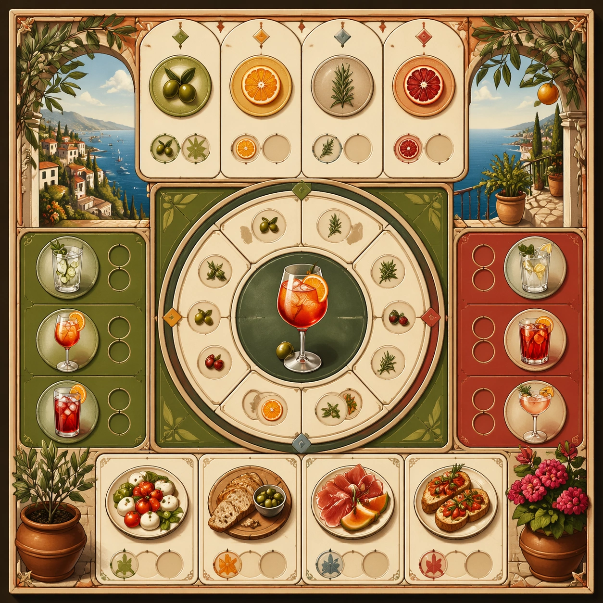

```text
Scene:
Create a square standalone support image for Italian Aperitivo Summer Lifestyle. Build a support-surface study with a clear focal hierarchy and a finished professional surface. Use a polished modular board or campaign surface with clean spacing, premium game-UI finish, and clear focal hierarchy. The frame should feel self-contained and polished, with enough structure to explain the system even without the reference series, yet still obviously belonging to the same theme and production world.

Subject:
Show a coherent original game-art system built for premium production and marketing surfaces in a way that emphasizes the intended support surface. Keep the same system logic stable across screenshots, cards, banners, and overview boards. Even though this image is independent, the viewer should still recognize the same universe, same commercial logic, and same production intent as the core package.

Important details:
Lock framing, icon grammar, palette blocking, and surface hierarchy so the kit feels production-ready and consistent. Preserve the broader theme language through color, framing, material choices, and modular composition. Use clean panel rhythm, premium asset presentation, and believable detail density. The image should work equally well as a gallery study, research reference, and mock production deliverable.

Use case:
Italian Aperitivo Summer Lifestyle single study 5/9, exploring support one as a support surface.

Constraints:
No readable text, no watermark, no logos, preserve exact 1:1 aspect ratio, no unrelated objects, no broken visual hierarchy, no visual noise that obscures the main surface, no accidental brand resemblance.
```

[Pinned source](https://github.com/ChaosRealmsAI/gpt-image-2-gallery/blob/5296db8c996e38776c83a0bc8c64f848dcd512b3/works/topics/italian-aperitivo-summer-lifestyle/packages/single-support-studies/images/support-one/meta.json) · GPT Image2 · 1254×1254 · No source-declared image dependencies. · ProjectD:[published and publicly accepted](https://aitoolsradar.com/en/prompts/693688897175ee)

## Support Two · italian-aperitivo-summer-lifestyle/single-support-studies/support-two

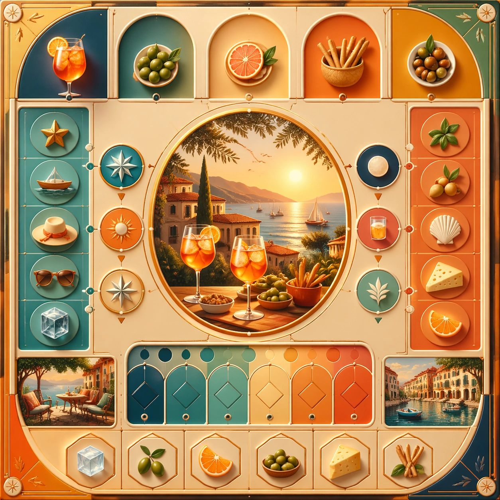

```text
Scene:
Create a square standalone support image for Italian Aperitivo Summer Lifestyle. Build a second support-surface study with a clear focal hierarchy and a finished professional surface. Use a polished modular board or campaign surface with clean spacing, premium game-UI finish, and clear focal hierarchy. The frame should feel self-contained and polished, with enough structure to explain the system even without the reference series, yet still obviously belonging to the same theme and production world.

Subject:
Show a coherent original game-art system built for premium production and marketing surfaces in a way that emphasizes the intended support surface. Keep the same system logic stable across screenshots, cards, banners, and overview boards. Even though this image is independent, the viewer should still recognize the same universe, same commercial logic, and same production intent as the core package.

Important details:
Lock framing, icon grammar, palette blocking, and surface hierarchy so the kit feels production-ready and consistent. Preserve the broader theme language through color, framing, material choices, and modular composition. Use clean panel rhythm, premium asset presentation, and believable detail density. The image should work equally well as a gallery study, research reference, and mock production deliverable.

Use case:
Italian Aperitivo Summer Lifestyle single study 6/9, exploring support two as a support surface.

Constraints:
No readable text, no watermark, no logos, preserve exact 1:1 aspect ratio, no unrelated objects, no broken visual hierarchy, no visual noise that obscures the main surface, no accidental brand resemblance.
```

[Pinned source](https://github.com/ChaosRealmsAI/gpt-image-2-gallery/blob/5296db8c996e38776c83a0bc8c64f848dcd512b3/works/topics/italian-aperitivo-summer-lifestyle/packages/single-support-studies/images/support-two/meta.json) · GPT Image2 · 1254×1254 · No source-declared image dependencies. · ProjectD:[published and publicly accepted](https://aitoolsradar.com/en/prompts/16abc5ee235599)

## Support Three · italian-aperitivo-summer-lifestyle/single-support-studies/support-three

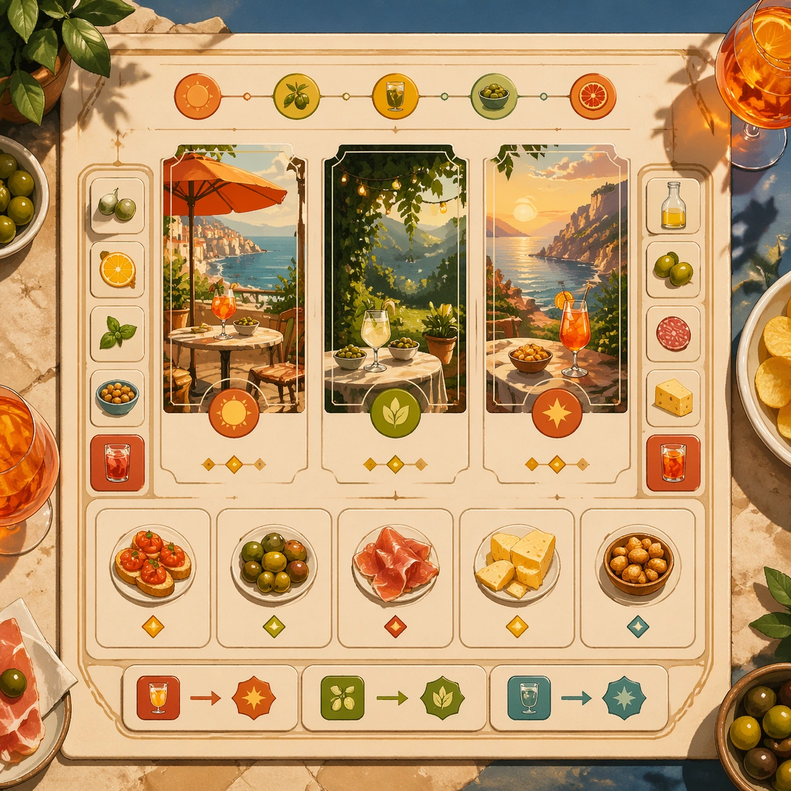

```text
Scene:
Create a square standalone support image for Italian Aperitivo Summer Lifestyle. Build a third support-surface study with a clear focal hierarchy and a finished professional surface. Use a polished modular board or campaign surface with clean spacing, premium game-UI finish, and clear focal hierarchy. The frame should feel self-contained and polished, with enough structure to explain the system even without the reference series, yet still obviously belonging to the same theme and production world.

Subject:
Show a coherent original game-art system built for premium production and marketing surfaces in a way that emphasizes the intended support surface. Keep the same system logic stable across screenshots, cards, banners, and overview boards. Even though this image is independent, the viewer should still recognize the same universe, same commercial logic, and same production intent as the core package.

Important details:
Lock framing, icon grammar, palette blocking, and surface hierarchy so the kit feels production-ready and consistent. Preserve the broader theme language through color, framing, material choices, and modular composition. Use clean panel rhythm, premium asset presentation, and believable detail density. The image should work equally well as a gallery study, research reference, and mock production deliverable.

Use case:
Italian Aperitivo Summer Lifestyle single study 7/9, exploring support three as a support surface.

Constraints:
No readable text, no watermark, no logos, preserve exact 1:1 aspect ratio, no unrelated objects, no broken visual hierarchy, no visual noise that obscures the main surface, no accidental brand resemblance.
```

[Pinned source](https://github.com/ChaosRealmsAI/gpt-image-2-gallery/blob/5296db8c996e38776c83a0bc8c64f848dcd512b3/works/topics/italian-aperitivo-summer-lifestyle/packages/single-support-studies/images/support-three/meta.json) · GPT Image2 · 1254×1254 · No source-declared image dependencies. · ProjectD:[published and publicly accepted](https://aitoolsradar.com/en/prompts/3378150f8285fa)

## Support Four · italian-aperitivo-summer-lifestyle/single-support-studies/support-four

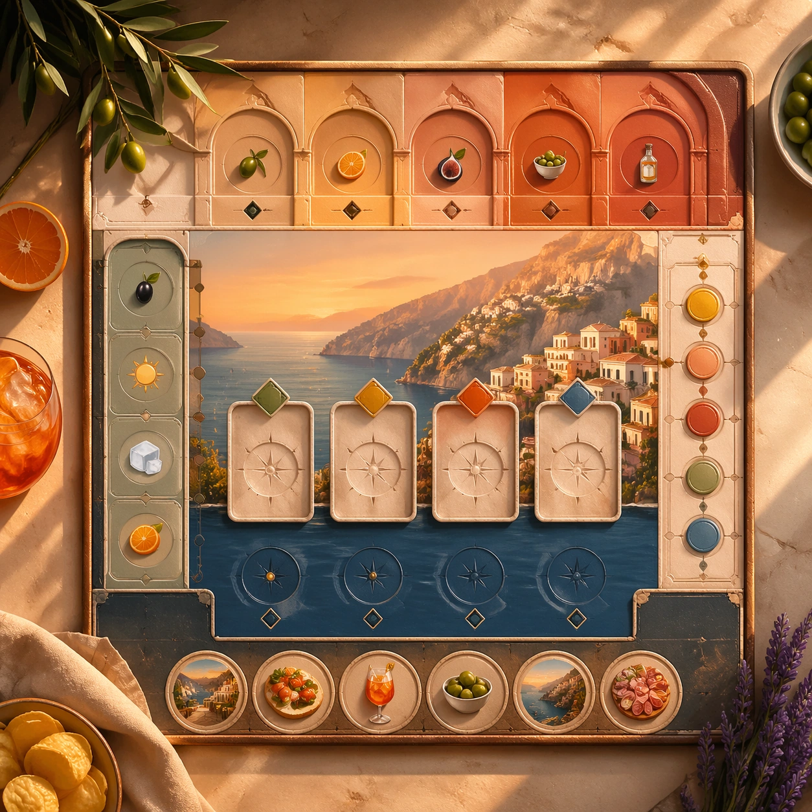

```text
Scene:
Create a square standalone support image for Italian Aperitivo Summer Lifestyle. Build a fourth support-surface study with a clear focal hierarchy and a finished professional surface. Use a polished modular board or campaign surface with clean spacing, premium game-UI finish, and clear focal hierarchy. The frame should feel self-contained and polished, with enough structure to explain the system even without the reference series, yet still obviously belonging to the same theme and production world.

Subject:
Show a coherent original game-art system built for premium production and marketing surfaces in a way that emphasizes the intended support surface. Keep the same system logic stable across screenshots, cards, banners, and overview boards. Even though this image is independent, the viewer should still recognize the same universe, same commercial logic, and same production intent as the core package.

Important details:
Lock framing, icon grammar, palette blocking, and surface hierarchy so the kit feels production-ready and consistent. Preserve the broader theme language through color, framing, material choices, and modular composition. Use clean panel rhythm, premium asset presentation, and believable detail density. The image should work equally well as a gallery study, research reference, and mock production deliverable.

Use case:
Italian Aperitivo Summer Lifestyle single study 8/9, exploring support four as a support surface.

Constraints:
No readable text, no watermark, no logos, preserve exact 1:1 aspect ratio, no unrelated objects, no broken visual hierarchy, no visual noise that obscures the main surface, no accidental brand resemblance.
```

[Pinned source](https://github.com/ChaosRealmsAI/gpt-image-2-gallery/blob/5296db8c996e38776c83a0bc8c64f848dcd512b3/works/topics/italian-aperitivo-summer-lifestyle/packages/single-support-studies/images/support-four/meta.json) · GPT Image2 · 1254×1254 · No source-declared image dependencies. · ProjectD:[published and publicly accepted](https://aitoolsradar.com/en/prompts/be8466cf2620ef)

## Support Five · italian-aperitivo-summer-lifestyle/single-support-studies/support-five

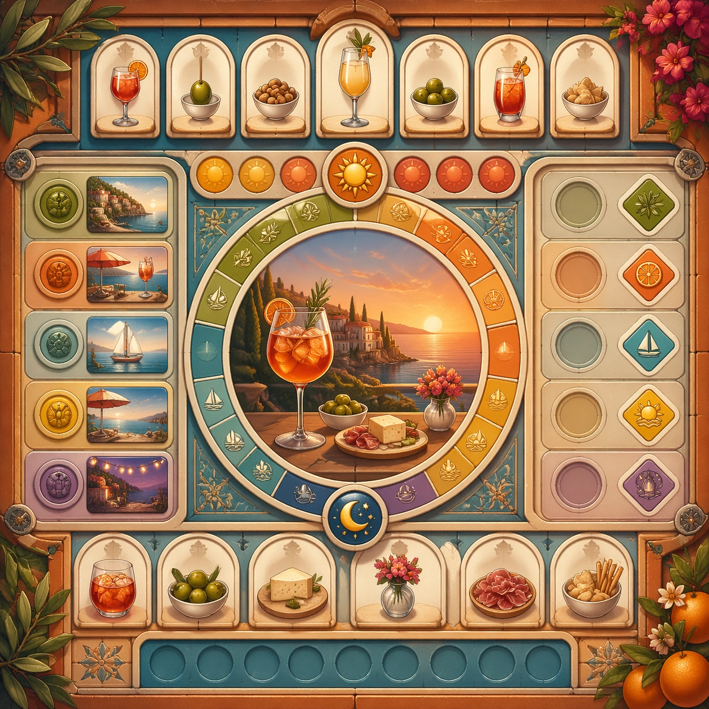

```text
Scene:
Create a square standalone support image for Italian Aperitivo Summer Lifestyle. Build a fifth support-surface study with a clear focal hierarchy and a finished professional surface. Use a polished modular board or campaign surface with clean spacing, premium game-UI finish, and clear focal hierarchy. The frame should feel self-contained and polished, with enough structure to explain the system even without the reference series, yet still obviously belonging to the same theme and production world.

Subject:
Show a coherent original game-art system built for premium production and marketing surfaces in a way that emphasizes the intended support surface. Keep the same system logic stable across screenshots, cards, banners, and overview boards. Even though this image is independent, the viewer should still recognize the same universe, same commercial logic, and same production intent as the core package.

Important details:
Lock framing, icon grammar, palette blocking, and surface hierarchy so the kit feels production-ready and consistent. Preserve the broader theme language through color, framing, material choices, and modular composition. Use clean panel rhythm, premium asset presentation, and believable detail density. The image should work equally well as a gallery study, research reference, and mock production deliverable.

Use case:
Italian Aperitivo Summer Lifestyle single study 9/9, exploring support five as a support surface.

Constraints:
No readable text, no watermark, no logos, preserve exact 1:1 aspect ratio, no unrelated objects, no broken visual hierarchy, no visual noise that obscures the main surface, no accidental brand resemblance.
```

[Pinned source](https://github.com/ChaosRealmsAI/gpt-image-2-gallery/blob/5296db8c996e38776c83a0bc8c64f848dcd512b3/works/topics/italian-aperitivo-summer-lifestyle/packages/single-support-studies/images/support-five/meta.json) · GPT Image2 · 1254×1254 · No source-declared image dependencies. · ProjectD:[published and publicly accepted](https://aitoolsradar.com/en/prompts/0239bff0aef270)

## Print Proof Flatlay · italian-futurism-velocity/single-poster-studies/02-print-proof-flatlay

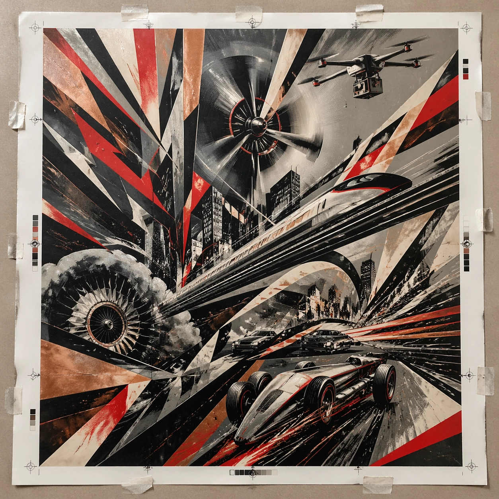

```text
Scene:
A square overhead tabletop photograph of a fresh poster proof on neutral worktable paper, lit by cool daylight, with crop marks, tape tabs, and slight paper bow visible around the sheet. The poster should express machine-age futurist poster language with fractured motion, metallic planes, angular overlaps, and speed-worshiping thrust, using gunmetal silver, copper, cream, black, and electric red accents and a tactile surface appropriate to the medium.

Subject:
Design the poster as a print-shop proof, preserving the same poster language while allowing production clues such as edge trims, registration targets, and process marks to frame the composition. Use trains, propellers, racing cars, turbines, smoke trails, city arcs, and explosive speed lines as the main visual ingredients, and organize them with chopped angular typographic shards used as non-readable motion accents. For the contemporary-subject axis, thread in high-speed rail, delivery drones, and urban night traffic translated into ecstatic machine momentum. The poster must feel like an original design object rather than a reproduction of any known work.

Important details:
The image must still read as a finished poster concept, but it should carry believable print-process evidence and material tactility instead of gallery-wall perfection. Preserve dynamic rotation, vector thrust, hard overlaps, metallic sheen restraint, and aggressive directional rhythm. Keep every letterform abstract and non-readable, as if it were a typographic texture rather than language. Make the style unmistakable through composition, palette, surface behavior, and symbolic compression. no static composition, no soft nostalgic brushwork, no pastoral calm, no rounded playful forms.

Use case:
Italian Futurism single study 2/9, testing production realism and process evidence.

Constraints:
No readable text, no watermark, no logos, preserve exact 1:1 aspect ratio, no copyrighted characters, no real brand marks, no QR codes, no interface chrome, no accidental gibberish lettering.
```

[Pinned source](https://github.com/ChaosRealmsAI/gpt-image-2-gallery/blob/5296db8c996e38776c83a0bc8c64f848dcd512b3/works/topics/italian-futurism-velocity/packages/single-poster-studies/images/02-print-proof-flatlay/meta.json) · GPT Image2 · 1254×1254 · No source-declared image dependencies. · ProjectD:[published and publicly accepted](https://aitoolsradar.com/en/prompts/ba3dad7237399b)

## Transit Lightbox · italian-futurism-velocity/single-poster-studies/03-transit-lightbox

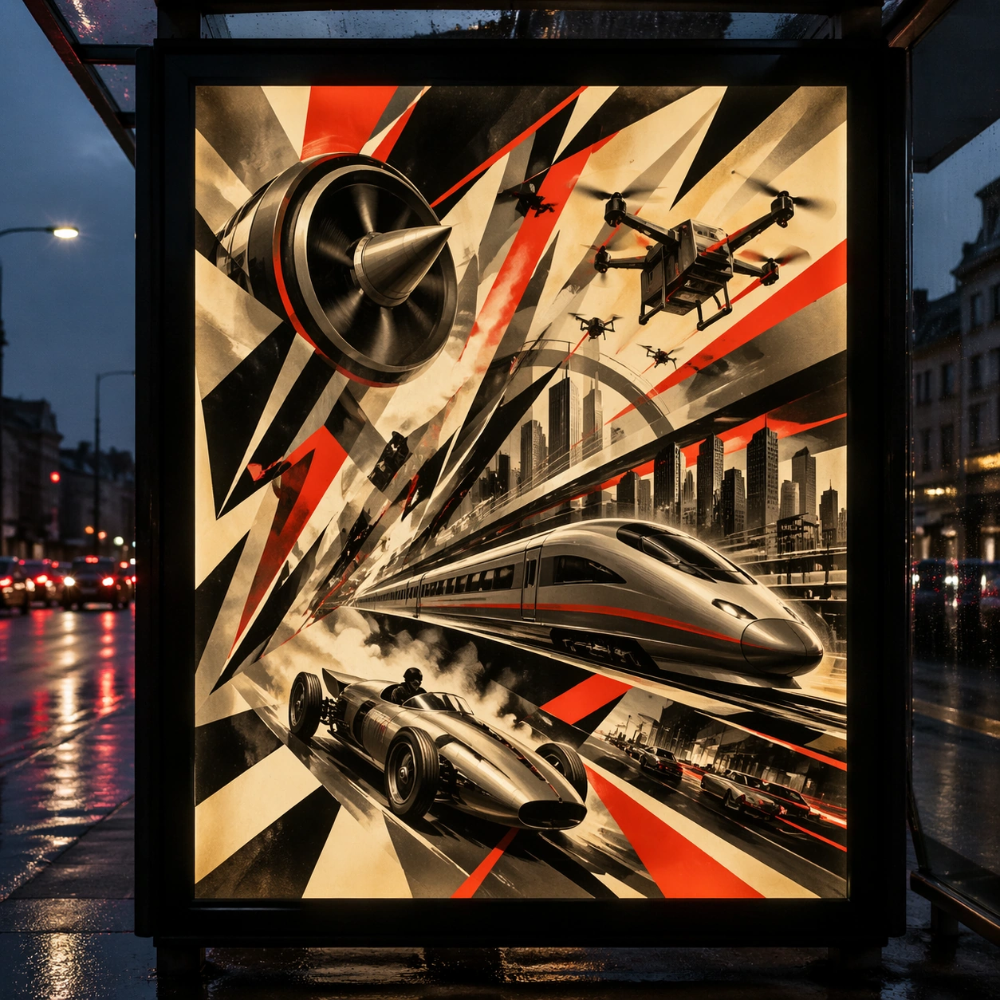

```text
Scene:
A square dusk street photograph of a backlit transit poster glowing inside glass, with faint rain reflections, soft city blur in the distance, and the poster remaining fully legible as a composition. The poster should express machine-age futurist poster language with fractured motion, metallic planes, angular overlaps, and speed-worshiping thrust, using gunmetal silver, copper, cream, black, and electric red accents and a tactile surface appropriate to the medium.

Subject:
Adapt the poster into a public-facing lightbox version that still honors the original style grammar while feeling bold enough to stop a passerby from several meters away. Use trains, propellers, racing cars, turbines, smoke trails, city arcs, and explosive speed lines as the main visual ingredients, and organize them with chopped angular typographic shards used as non-readable motion accents. For the contemporary-subject axis, thread in high-speed rail, delivery drones, and urban night traffic translated into ecstatic machine momentum. The poster must feel like an original design object rather than a reproduction of any known work.

Important details:
Let the style survive the illumination test: color blocking, silhouette contrast, and abstract lettering should stay controlled under bright internal light and reflective glass. Preserve dynamic rotation, vector thrust, hard overlaps, metallic sheen restraint, and aggressive directional rhythm. Keep every letterform abstract and non-readable, as if it were a typographic texture rather than language. Make the style unmistakable through composition, palette, surface behavior, and symbolic compression. no static composition, no soft nostalgic brushwork, no pastoral calm, no rounded playful forms.

Use case:
Italian Futurism single study 3/9, testing distance readability in public display.

Constraints:
No readable text, no watermark, no logos, preserve exact 1:1 aspect ratio, no copyrighted characters, no real brand marks, no QR codes, no interface chrome, no accidental gibberish lettering.
```

[Pinned source](https://github.com/ChaosRealmsAI/gpt-image-2-gallery/blob/5296db8c996e38776c83a0bc8c64f848dcd512b3/works/topics/italian-futurism-velocity/packages/single-poster-studies/images/03-transit-lightbox/meta.json) · GPT Image2 · 1254×1254 · No source-declared image dependencies. · ProjectD:[published and publicly accepted](https://aitoolsradar.com/en/prompts/6ab4c32d4e4678)

## Wheatpaste Wall Layer · italian-futurism-velocity/single-poster-studies/04-wheatpaste-wall

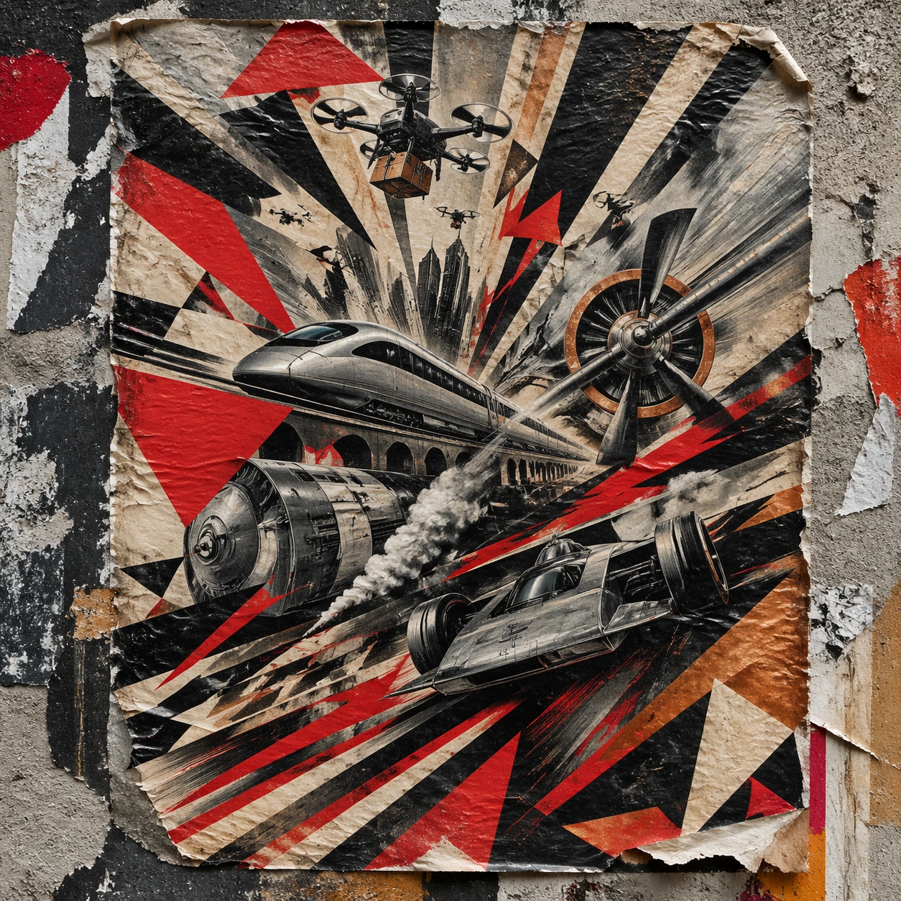

```text
Scene:
A square urban wall study with the poster pasted onto rough plaster among torn edges and older paper remnants, photographed in soft overcast light so texture, glue bubbles, and surface scars stay visible. The poster should express machine-age futurist poster language with fractured motion, metallic planes, angular overlaps, and speed-worshiping thrust, using gunmetal silver, copper, cream, black, and electric red accents and a tactile surface appropriate to the medium.

Subject:
Create a version that feels made for the street, with the poster carrying enough formal force to survive abrasion, layering, and imperfect placement without losing its visual identity. Use trains, propellers, racing cars, turbines, smoke trails, city arcs, and explosive speed lines as the main visual ingredients, and organize them with chopped angular typographic shards used as non-readable motion accents. For the contemporary-subject axis, thread in high-speed rail, delivery drones, and urban night traffic translated into ecstatic machine momentum. The poster must feel like an original design object rather than a reproduction of any known work.

Important details:
Keep the main design intact but let the environment add grit: lifted corners, tiny tears, wrinkled paper, and older color fragments around the perimeter should amplify the style rather than dilute it. Preserve dynamic rotation, vector thrust, hard overlaps, metallic sheen restraint, and aggressive directional rhythm. Keep every letterform abstract and non-readable, as if it were a typographic texture rather than language. Make the style unmistakable through composition, palette, surface behavior, and symbolic compression. no static composition, no soft nostalgic brushwork, no pastoral calm, no rounded playful forms.

Use case:
Italian Futurism single study 4/9, testing street-life durability and layered context.

Constraints:
No readable text, no watermark, no logos, preserve exact 1:1 aspect ratio, no copyrighted characters, no real brand marks, no QR codes, no interface chrome, no accidental gibberish lettering.
```

[Pinned source](https://github.com/ChaosRealmsAI/gpt-image-2-gallery/blob/5296db8c996e38776c83a0bc8c64f848dcd512b3/works/topics/italian-futurism-velocity/packages/single-poster-studies/images/04-wheatpaste-wall/meta.json) · GPT Image2 · 1254×1254 · No source-declared image dependencies. · ProjectD:[published and publicly accepted](https://aitoolsradar.com/en/prompts/947757f8dc7f8d)

## Folded Archive Copy · italian-futurism-velocity/single-poster-studies/05-folded-archive-copy

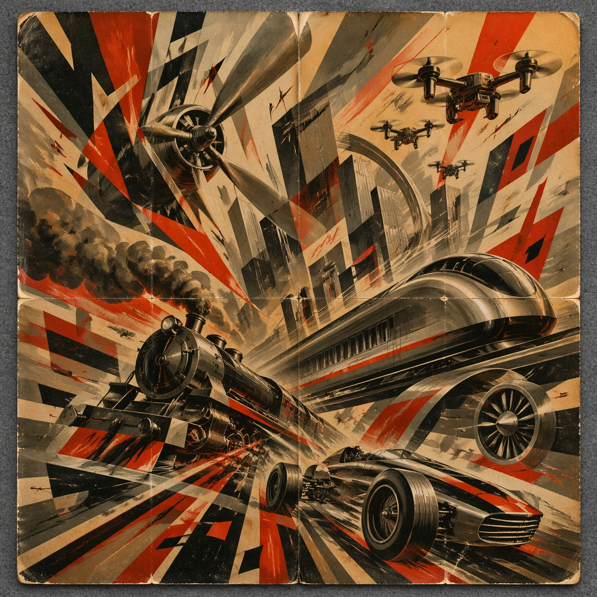

```text
Scene:
A square conservation-table view of a vintage poster laid on gray felt under raking light, with visible fold lines, softened corners, and subtle aging that still preserves the integrity of the image. The poster should express machine-age futurist poster language with fractured motion, metallic planes, angular overlaps, and speed-worshiping thrust, using gunmetal silver, copper, cream, black, and electric red accents and a tactile surface appropriate to the medium.

Subject:
Present the poster as an archive copy that has been stored, unfolded, and carefully documented, letting age and handling reveal how the design holds up across time. Use trains, propellers, racing cars, turbines, smoke trails, city arcs, and explosive speed lines as the main visual ingredients, and organize them with chopped angular typographic shards used as non-readable motion accents. For the contemporary-subject axis, thread in high-speed rail, delivery drones, and urban night traffic translated into ecstatic machine momentum. The poster must feel like an original design object rather than a reproduction of any known work.

Important details:
Aging must stay believable rather than theatrical: slight yellowing, fold memory, edge wear, and pigment variation should support the historical or crafted feeling of the style. Preserve dynamic rotation, vector thrust, hard overlaps, metallic sheen restraint, and aggressive directional rhythm. Keep every letterform abstract and non-readable, as if it were a typographic texture rather than language. Make the style unmistakable through composition, palette, surface behavior, and symbolic compression. no static composition, no soft nostalgic brushwork, no pastoral calm, no rounded playful forms.

Use case:
Italian Futurism single study 5/9, testing archival endurance and age character.

Constraints:
No readable text, no watermark, no logos, preserve exact 1:1 aspect ratio, no copyrighted characters, no real brand marks, no QR codes, no interface chrome, no accidental gibberish lettering.
```

[Pinned source](https://github.com/ChaosRealmsAI/gpt-image-2-gallery/blob/5296db8c996e38776c83a0bc8c64f848dcd512b3/works/topics/italian-futurism-velocity/packages/single-poster-studies/images/05-folded-archive-copy/meta.json) · GPT Image2 · 1254×1254 · No source-declared image dependencies. · ProjectD:[published and publicly accepted](https://aitoolsradar.com/en/prompts/b92b8d7c00e6ca)

## Twin Poster Diptych · italian-futurism-velocity/single-poster-studies/06-twin-poster-diptych

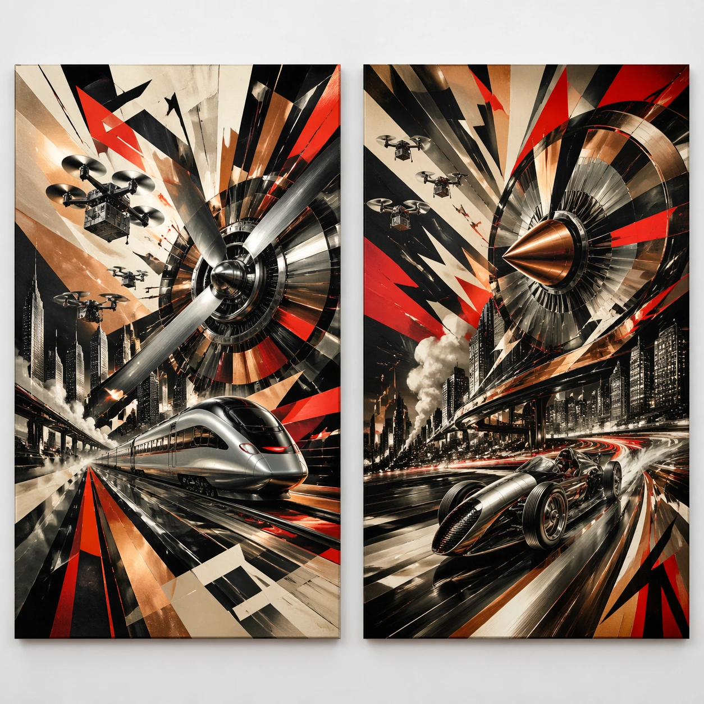

```text
Scene:
A square white-wall installation showing two companion posters hung side by side with equal spacing, photographed frontally so the pair reads as a designed conversation rather than two unrelated sheets. The poster should express machine-age futurist poster language with fractured motion, metallic planes, angular overlaps, and speed-worshiping thrust, using gunmetal silver, copper, cream, black, and electric red accents and a tactile surface appropriate to the medium.

Subject:
Compose a matched diptych: two posters sharing one style system while splitting the narrative across paired motifs, mirrored masses, or complementary color emphasis. Use trains, propellers, racing cars, turbines, smoke trails, city arcs, and explosive speed lines as the main visual ingredients, and organize them with chopped angular typographic shards used as non-readable motion accents. For the contemporary-subject axis, thread in high-speed rail, delivery drones, and urban night traffic translated into ecstatic machine momentum. The poster must feel like an original design object rather than a reproduction of any known work.

Important details:
Both halves should feel distinct yet inseparable. Preserve one coherent visual language, but let each sheet carry its own focal symbol and rhythm without readable wording. Preserve dynamic rotation, vector thrust, hard overlaps, metallic sheen restraint, and aggressive directional rhythm. Keep every letterform abstract and non-readable, as if it were a typographic texture rather than language. Make the style unmistakable through composition, palette, surface behavior, and symbolic compression. no static composition, no soft nostalgic brushwork, no pastoral calm, no rounded playful forms.

Use case:
Italian Futurism single study 6/9, testing system flexibility across a paired set.

Constraints:
No readable text, no watermark, no logos, preserve exact 1:1 aspect ratio, no copyrighted characters, no real brand marks, no QR codes, no interface chrome, no accidental gibberish lettering.
```

[Pinned source](https://github.com/ChaosRealmsAI/gpt-image-2-gallery/blob/5296db8c996e38776c83a0bc8c64f848dcd512b3/works/topics/italian-futurism-velocity/packages/single-poster-studies/images/06-twin-poster-diptych/meta.json) · GPT Image2 · 1254×1254 · No source-declared image dependencies. · ProjectD:[published and publicly accepted](https://aitoolsradar.com/en/prompts/8a30c2c3036554)

## Stacked Print Bundle · italian-futurism-velocity/single-poster-studies/07-stacked-print-bundle

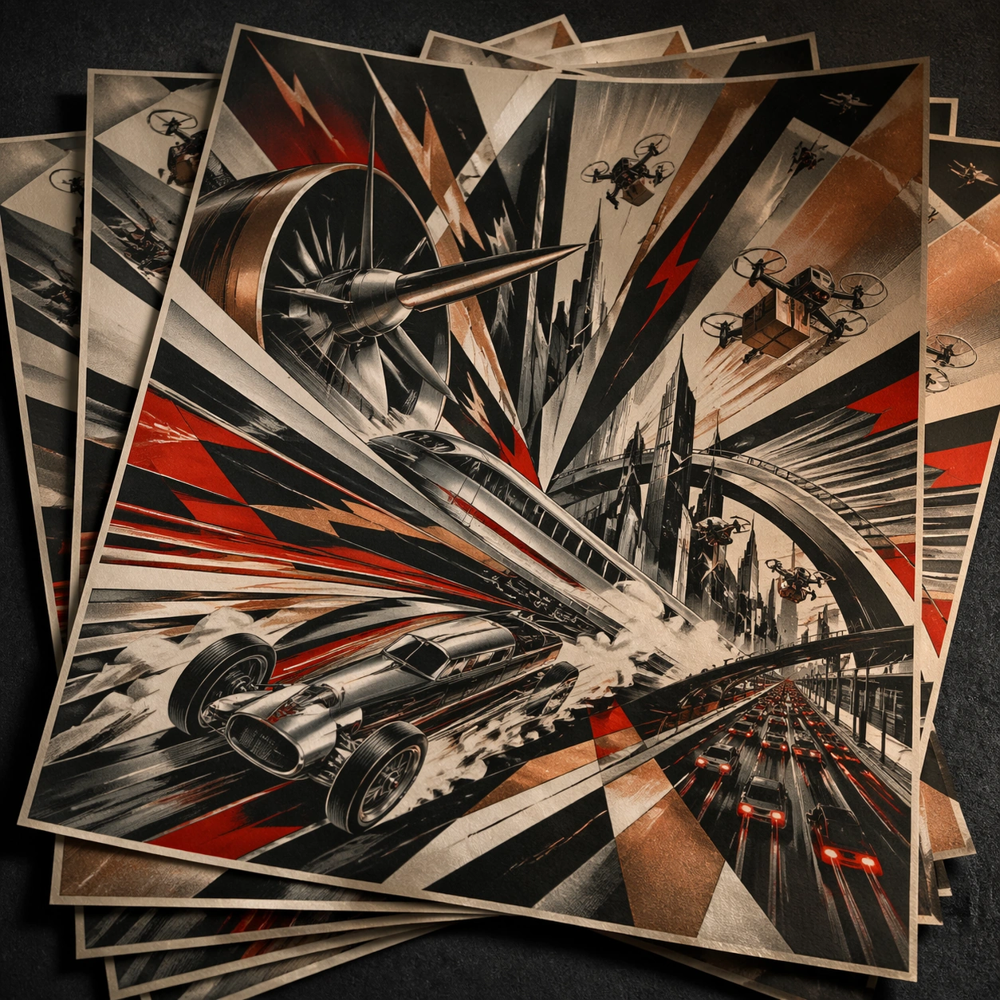

```text
Scene:
A square tabletop shot of several poster prints stacked and slightly fanned, with curled corners, offset edges, and soft directional light revealing paper thickness and ink behavior. The poster should express machine-age futurist poster language with fractured motion, metallic planes, angular overlaps, and speed-worshiping thrust, using gunmetal silver, copper, cream, black, and electric red accents and a tactile surface appropriate to the medium.

Subject:
Design the top poster to dominate while nearby duplicate sheets echo the same composition, creating a tactile print-run scene rather than a single isolated sheet. Use trains, propellers, racing cars, turbines, smoke trails, city arcs, and explosive speed lines as the main visual ingredients, and organize them with chopped angular typographic shards used as non-readable motion accents. For the contemporary-subject axis, thread in high-speed rail, delivery drones, and urban night traffic translated into ecstatic machine momentum. The poster must feel like an original design object rather than a reproduction of any known work.

Important details:
Use the stack to emphasize production character: edge shadows, repeated motifs peeking from beneath, and subtle misalignment should enrich the material reading without changing the core design. Preserve dynamic rotation, vector thrust, hard overlaps, metallic sheen restraint, and aggressive directional rhythm. Keep every letterform abstract and non-readable, as if it were a typographic texture rather than language. Make the style unmistakable through composition, palette, surface behavior, and symbolic compression. no static composition, no soft nostalgic brushwork, no pastoral calm, no rounded playful forms.

Use case:
Italian Futurism single study 7/9, testing print-run tactility and repeat presence.

Constraints:
No readable text, no watermark, no logos, preserve exact 1:1 aspect ratio, no copyrighted characters, no real brand marks, no QR codes, no interface chrome, no accidental gibberish lettering.
```

[Pinned source](https://github.com/ChaosRealmsAI/gpt-image-2-gallery/blob/5296db8c996e38776c83a0bc8c64f848dcd512b3/works/topics/italian-futurism-velocity/packages/single-poster-studies/images/07-stacked-print-bundle/meta.json) · GPT Image2 · 1254×1254 · No source-declared image dependencies. · ProjectD:[published and publicly accepted](https://aitoolsradar.com/en/prompts/ba38fe22db693b)

## Kiosk Night Glow · italian-futurism-velocity/single-poster-studies/08-kiosk-night-glow

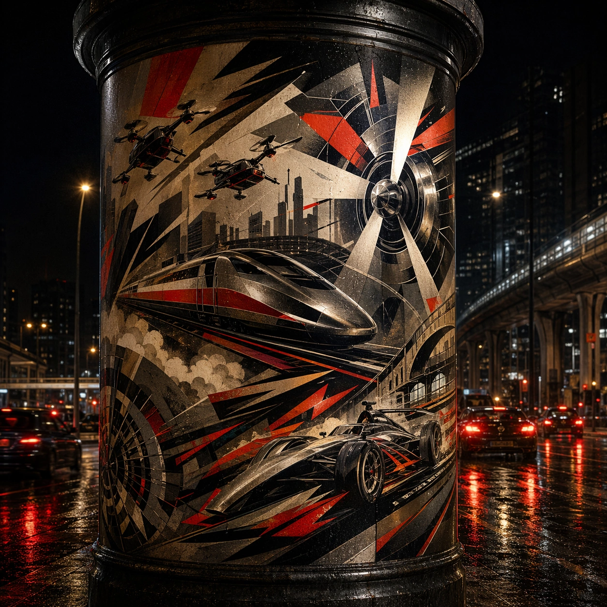

```text
Scene:
A square nighttime city view with the poster wrapping part of a cylindrical kiosk, wet pavement reflecting nearby light, and the composition holding together under moody urban illumination. The poster should express machine-age futurist poster language with fractured motion, metallic planes, angular overlaps, and speed-worshiping thrust, using gunmetal silver, copper, cream, black, and electric red accents and a tactile surface appropriate to the medium.

Subject:
Reframe the design for a dramatic street-placement context, where the poster has to project style and mood through reflection, curvature, and surrounding darkness. Use trains, propellers, racing cars, turbines, smoke trails, city arcs, and explosive speed lines as the main visual ingredients, and organize them with chopped angular typographic shards used as non-readable motion accents. For the contemporary-subject axis, thread in high-speed rail, delivery drones, and urban night traffic translated into ecstatic machine momentum. The poster must feel like an original design object rather than a reproduction of any known work.

Important details:
The design should remain instantly recognizable despite the cylindrical wrap. Preserve major blocks, symbolic shapes, and abstract title forms so the style still feels authoritative at night. Preserve dynamic rotation, vector thrust, hard overlaps, metallic sheen restraint, and aggressive directional rhythm. Keep every letterform abstract and non-readable, as if it were a typographic texture rather than language. Make the style unmistakable through composition, palette, surface behavior, and symbolic compression. no static composition, no soft nostalgic brushwork, no pastoral calm, no rounded playful forms.

Use case:
Italian Futurism single study 8/9, testing atmospheric display under rain and glow.

Constraints:
No readable text, no watermark, no logos, preserve exact 1:1 aspect ratio, no copyrighted characters, no real brand marks, no QR codes, no interface chrome, no accidental gibberish lettering.
```

[Pinned source](https://github.com/ChaosRealmsAI/gpt-image-2-gallery/blob/5296db8c996e38776c83a0bc8c64f848dcd512b3/works/topics/italian-futurism-velocity/packages/single-poster-studies/images/08-kiosk-night-glow/meta.json) · GPT Image2 · 1254×1254 · No source-declared image dependencies. · ProjectD:[published and publicly accepted](https://aitoolsradar.com/en/prompts/8973adedd05319)

## Contemporary Remix · italian-futurism-velocity/single-poster-studies/09-contemporary-remix

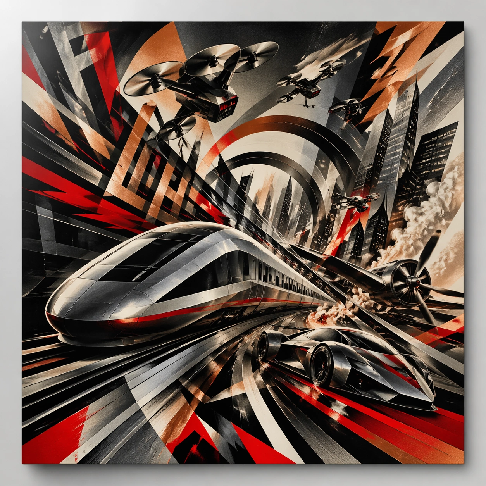

```text
Scene:
A square front-facing poster presentation on a clean neutral wall, lit like a premium print test, with crisp edges and a polished but still tactile finish appropriate to the style. The poster should express machine-age futurist poster language with fractured motion, metallic planes, angular overlaps, and speed-worshiping thrust, using gunmetal silver, copper, cream, black, and electric red accents and a tactile surface appropriate to the medium.

Subject:
Apply the historical poster language to a contemporary urban subject so the old visual grammar proves it can carry present-day themes without losing authenticity or formal discipline. Use trains, propellers, racing cars, turbines, smoke trails, city arcs, and explosive speed lines as the main visual ingredients, and organize them with chopped angular typographic shards used as non-readable motion accents. For the contemporary-subject axis, thread in high-speed rail, delivery drones, and urban night traffic translated into ecstatic machine momentum. The poster must feel like an original design object rather than a reproduction of any known work.

Important details:
This is not parody. The contemporary subject should feel genuinely absorbed into the style through palette, composition, symbolic compression, and non-readable lettering treatment. Preserve dynamic rotation, vector thrust, hard overlaps, metallic sheen restraint, and aggressive directional rhythm. Keep every letterform abstract and non-readable, as if it were a typographic texture rather than language. Make the style unmistakable through composition, palette, surface behavior, and symbolic compression. no static composition, no soft nostalgic brushwork, no pastoral calm, no rounded playful forms.

Use case:
Italian Futurism single study 9/9, testing historical grammar on a present-day subject.

Constraints:
No readable text, no watermark, no logos, preserve exact 1:1 aspect ratio, no copyrighted characters, no real brand marks, no QR codes, no interface chrome, no accidental gibberish lettering.
```

[Pinned source](https://github.com/ChaosRealmsAI/gpt-image-2-gallery/blob/5296db8c996e38776c83a0bc8c64f848dcd512b3/works/topics/italian-futurism-velocity/packages/single-poster-studies/images/09-contemporary-remix/meta.json) · GPT Image2 · 1254×1254 · No source-declared image dependencies. · ProjectD:[published and publicly accepted](https://aitoolsradar.com/en/prompts/d819303b9ba5d6)

## Reference Anchor · japanese-kissaten-retro-editorial/series-core-system/01-reference-anchor

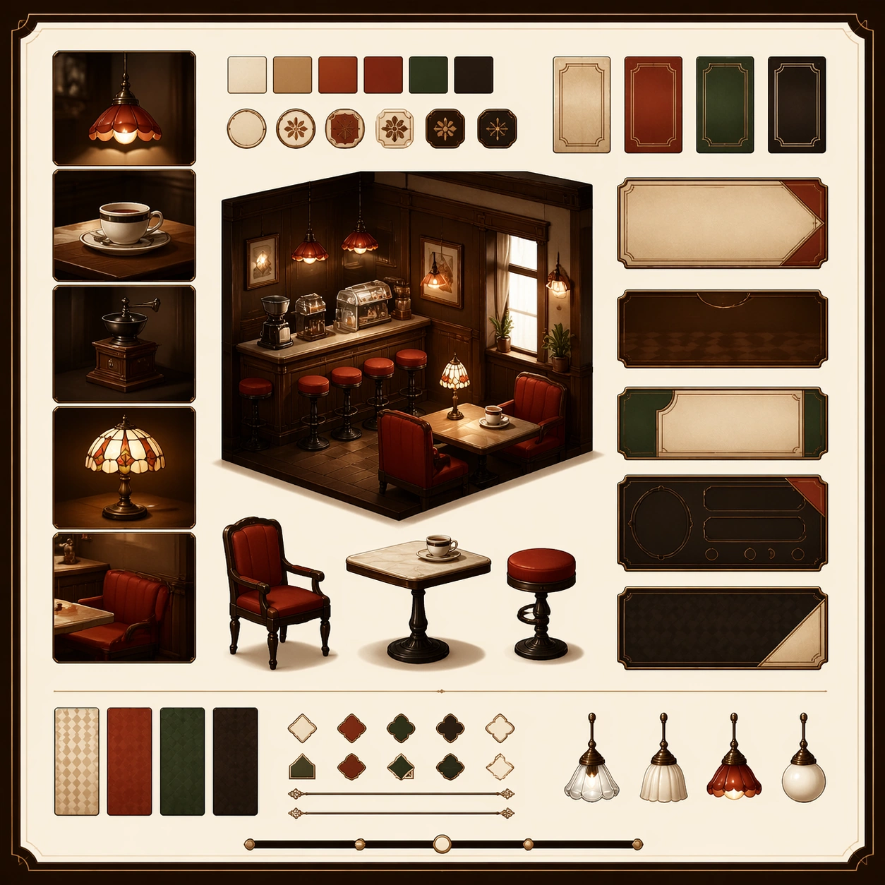

```text
Scene:
Create a square reference image for Japanese Kissaten Retro Editorial. Build a reference anchor establishing the core system with a premium, production-ready finish. Use a polished modular board or campaign surface with clean spacing, premium game-UI finish, and clear focal hierarchy. The composition should feel intentional, clean, and reusable for gallery, research, campaign, or internal handoff contexts. Lighting must support readability first, with the main forms clearly separated from the background and enough breathing room for the system to stay legible at both hero scale and thumbnail scale.

Subject:
Center a coherent original game-art system built for premium production and marketing surfaces. For this image, focus on reference anchor. Keep the same system logic stable across screenshots, cards, banners, and overview boards. This image is the canonical anchor that later series images must follow. The viewer should immediately understand what role this surface plays inside a cohesive game-production asset pack.

Important details:
Lock framing, icon grammar, palette blocking, and surface hierarchy so the kit feels production-ready and consistent. Preserve the core silhouette, framing language, and material logic from the reference image while each variation changes function. Keep materials believable, edge hierarchy disciplined, and the visual language consistent with Kissaten. Use abstract interface blocks or diagram accents when helpful, but avoid any readable language. The final result should feel like a deliberate production asset rather than a random illustration.

Use case:
Japanese Kissaten Retro Editorial series study 1/9, designed as reference anchor within a cohesive asset pack.

Constraints:
No readable text, no watermark, no logos, preserve exact 1:1 aspect ratio, no unrelated objects, no broken visual hierarchy, no malformed anatomy or broken perspective, no random decorative clutter.
```

[Pinned source](https://github.com/ChaosRealmsAI/gpt-image-2-gallery/blob/5296db8c996e38776c83a0bc8c64f848dcd512b3/works/topics/japanese-kissaten-retro-editorial/packages/series-core-system/images/01-reference-anchor/meta.json) · GPT Image2 · 1254×1254 · No source-declared image dependencies. · ProjectD:[published and publicly accepted](https://aitoolsradar.com/en/prompts/68a603da8e4c7f)

## Variant One · japanese-kissaten-retro-editorial/series-core-system/02-variant-one

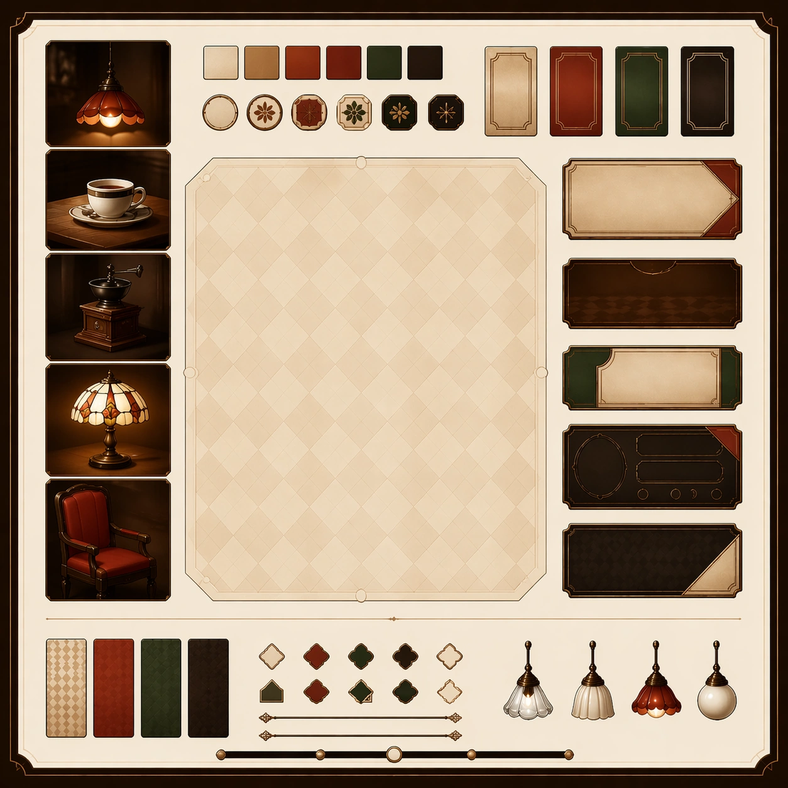

```text
Scene:
Create a square dependent image for Japanese Kissaten Retro Editorial. Build a first controlled variation in the same system with a premium, production-ready finish. Use a polished modular board or campaign surface with clean spacing, premium game-UI finish, and clear focal hierarchy. The composition should feel intentional, clean, and reusable for gallery, research, campaign, or internal handoff contexts. Lighting must support readability first, with the main forms clearly separated from the background and enough breathing room for the system to stay legible at both hero scale and thumbnail scale.

Subject:
Center a coherent original game-art system built for premium production and marketing surfaces. For this image, focus on the intended support surface. Keep the same system logic stable across screenshots, cards, banners, and overview boards. Preserve exact identity or system logic from the reference image while changing only the intended variation axis. The viewer should immediately understand what role this surface plays inside a cohesive game-production asset pack.

Important details:
Lock framing, icon grammar, palette blocking, and surface hierarchy so the kit feels production-ready and consistent. Preserve the core silhouette, framing language, and material logic from the reference image while each variation changes function. Keep materials believable, edge hierarchy disciplined, and the visual language consistent with Kissaten. Use abstract interface blocks or diagram accents when helpful, but avoid any readable language. The final result should feel like a deliberate production asset rather than a random illustration.

Use case:
Japanese Kissaten Retro Editorial series study 2/9, designed as variant one within a cohesive asset pack.

Constraints:
No readable text, no watermark, no logos, preserve exact 1:1 aspect ratio, no unrelated objects, no broken visual hierarchy, no malformed anatomy or broken perspective, no random decorative clutter.
```

[Pinned source](https://github.com/ChaosRealmsAI/gpt-image-2-gallery/blob/5296db8c996e38776c83a0bc8c64f848dcd512b3/works/topics/japanese-kissaten-retro-editorial/packages/series-core-system/images/02-variant-one/meta.json) · GPT Image2 · 1254×1254 · Reference images required. · ProjectD:[published and publicly accepted](https://aitoolsradar.com/en/prompts/1138d5213feaa2)

## Variant Two · japanese-kissaten-retro-editorial/series-core-system/03-variant-two

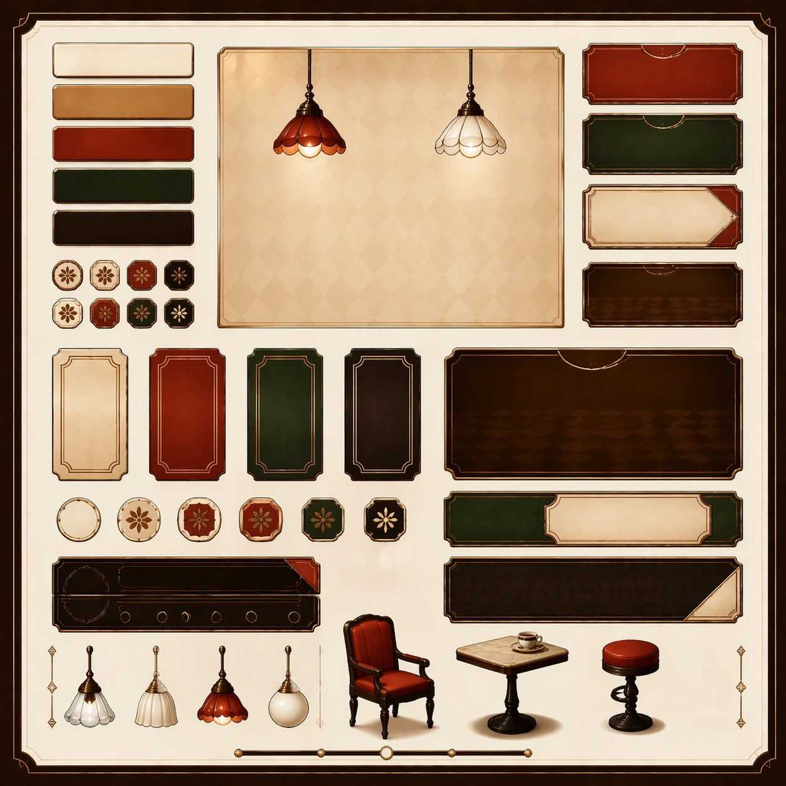

```text
Scene:
Create a square dependent image for Japanese Kissaten Retro Editorial. Build a second controlled variation in the same system with a premium, production-ready finish. Use a polished modular board or campaign surface with clean spacing, premium game-UI finish, and clear focal hierarchy. The composition should feel intentional, clean, and reusable for gallery, research, campaign, or internal handoff contexts. Lighting must support readability first, with the main forms clearly separated from the background and enough breathing room for the system to stay legible at both hero scale and thumbnail scale.

Subject:
Center a coherent original game-art system built for premium production and marketing surfaces. For this image, focus on the intended support surface. Keep the same system logic stable across screenshots, cards, banners, and overview boards. Preserve exact identity or system logic from the reference image while changing only the intended variation axis. The viewer should immediately understand what role this surface plays inside a cohesive game-production asset pack.

Important details:
Lock framing, icon grammar, palette blocking, and surface hierarchy so the kit feels production-ready and consistent. Preserve the core silhouette, framing language, and material logic from the reference image while each variation changes function. Keep materials believable, edge hierarchy disciplined, and the visual language consistent with Kissaten. Use abstract interface blocks or diagram accents when helpful, but avoid any readable language. The final result should feel like a deliberate production asset rather than a random illustration.

Use case:
Japanese Kissaten Retro Editorial series study 3/9, designed as variant two within a cohesive asset pack.

Constraints:
No readable text, no watermark, no logos, preserve exact 1:1 aspect ratio, no unrelated objects, no broken visual hierarchy, no malformed anatomy or broken perspective, no random decorative clutter.
```

[Pinned source](https://github.com/ChaosRealmsAI/gpt-image-2-gallery/blob/5296db8c996e38776c83a0bc8c64f848dcd512b3/works/topics/japanese-kissaten-retro-editorial/packages/series-core-system/images/03-variant-two/meta.json) · GPT Image2 · 1254×1254 · Reference images required. · ProjectD:[published and publicly accepted](https://aitoolsradar.com/en/prompts/ccb49edd6becf9)

## Variant Three · japanese-kissaten-retro-editorial/series-core-system/04-variant-three

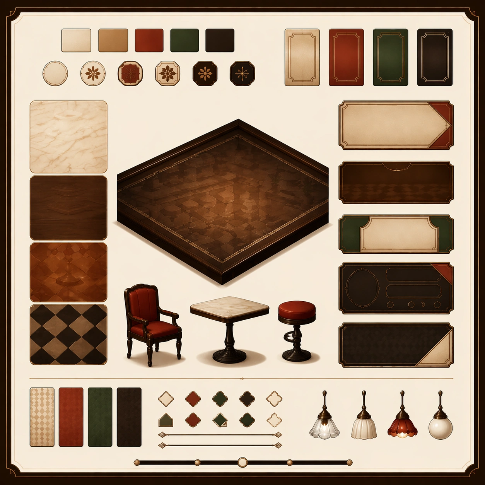

```text
Scene:
Create a square dependent image for Japanese Kissaten Retro Editorial. Build a third controlled variation in the same system with a premium, production-ready finish. Use a polished modular board or campaign surface with clean spacing, premium game-UI finish, and clear focal hierarchy. The composition should feel intentional, clean, and reusable for gallery, research, campaign, or internal handoff contexts. Lighting must support readability first, with the main forms clearly separated from the background and enough breathing room for the system to stay legible at both hero scale and thumbnail scale.

Subject:
Center a coherent original game-art system built for premium production and marketing surfaces. For this image, focus on the intended support surface. Keep the same system logic stable across screenshots, cards, banners, and overview boards. Preserve exact identity or system logic from the reference image while changing only the intended variation axis. The viewer should immediately understand what role this surface plays inside a cohesive game-production asset pack.

Important details:
Lock framing, icon grammar, palette blocking, and surface hierarchy so the kit feels production-ready and consistent. Preserve the core silhouette, framing language, and material logic from the reference image while each variation changes function. Keep materials believable, edge hierarchy disciplined, and the visual language consistent with Kissaten. Use abstract interface blocks or diagram accents when helpful, but avoid any readable language. The final result should feel like a deliberate production asset rather than a random illustration.

Use case:
Japanese Kissaten Retro Editorial series study 4/9, designed as variant three within a cohesive asset pack.

Constraints:
No readable text, no watermark, no logos, preserve exact 1:1 aspect ratio, no unrelated objects, no broken visual hierarchy, no malformed anatomy or broken perspective, no random decorative clutter.
```

[Pinned source](https://github.com/ChaosRealmsAI/gpt-image-2-gallery/blob/5296db8c996e38776c83a0bc8c64f848dcd512b3/works/topics/japanese-kissaten-retro-editorial/packages/series-core-system/images/04-variant-three/meta.json) · GPT Image2 · 1254×1254 · Reference images required. · ProjectD:[published and publicly accepted](https://aitoolsradar.com/en/prompts/26c5b7c759ab55)

## Support One · japanese-kissaten-retro-editorial/single-support-studies/support-one

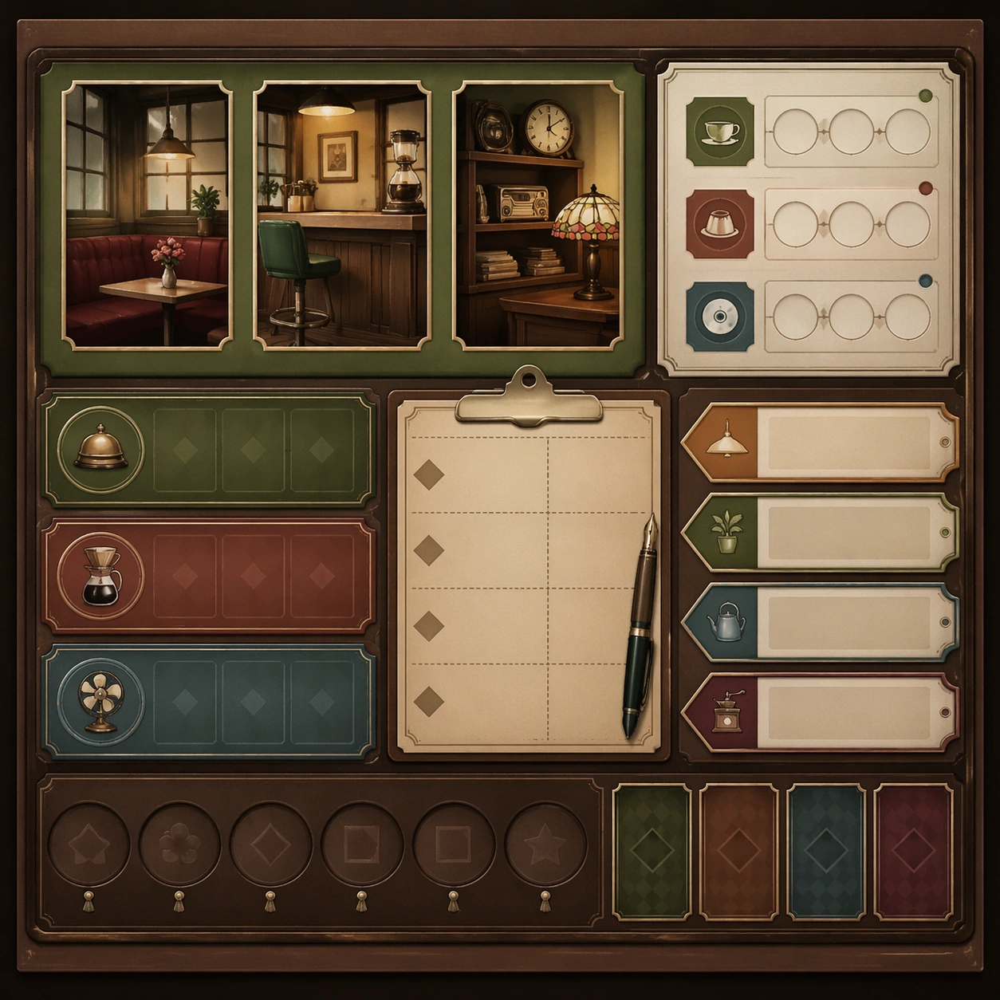

```text
Scene:
Create a square standalone support image for Japanese Kissaten Retro Editorial. Build a support-surface study with a clear focal hierarchy and a finished professional surface. Use a polished modular board or campaign surface with clean spacing, premium game-UI finish, and clear focal hierarchy. The frame should feel self-contained and polished, with enough structure to explain the system even without the reference series, yet still obviously belonging to the same theme and production world.

Subject:
Show a coherent original game-art system built for premium production and marketing surfaces in a way that emphasizes the intended support surface. Keep the same system logic stable across screenshots, cards, banners, and overview boards. Even though this image is independent, the viewer should still recognize the same universe, same commercial logic, and same production intent as the core package.

Important details:
Lock framing, icon grammar, palette blocking, and surface hierarchy so the kit feels production-ready and consistent. Preserve the broader theme language through color, framing, material choices, and modular composition. Use clean panel rhythm, premium asset presentation, and believable detail density. The image should work equally well as a gallery study, research reference, and mock production deliverable.

Use case:
Japanese Kissaten Retro Editorial single study 5/9, exploring support one as a support surface.

Constraints:
No readable text, no watermark, no logos, preserve exact 1:1 aspect ratio, no unrelated objects, no broken visual hierarchy, no visual noise that obscures the main surface, no accidental brand resemblance.
```

[Pinned source](https://github.com/ChaosRealmsAI/gpt-image-2-gallery/blob/5296db8c996e38776c83a0bc8c64f848dcd512b3/works/topics/japanese-kissaten-retro-editorial/packages/single-support-studies/images/support-one/meta.json) · GPT Image2 · 1254×1254 · No source-declared image dependencies. · ProjectD:[published and publicly accepted](https://aitoolsradar.com/en/prompts/d66347ed76040a)

## Support Two · japanese-kissaten-retro-editorial/single-support-studies/support-two


```text
Scene:
Create a square standalone support image for Japanese Kissaten Retro Editorial. Build a second support-surface study with a clear focal hierarchy and a finished professional surface. Use a polished modular board or campaign surface with clean spacing, premium game-UI finish, and clear focal hierarchy. The frame should feel self-contained and polished, with enough structure to explain the system even without the reference series, yet still obviously belonging to the same theme and production world.

Subject:
Show a coherent original game-art system built for premium production and marketing surfaces in a way that emphasizes the intended support surface. Keep the same system logic stable across screenshots, cards, banners, and overview boards. Even though this image is independent, the viewer should still recognize the same universe, same commercial logic, and same production intent as the core package.

Important details:
Lock framing, icon grammar, palette blocking, and surface hierarchy so the kit feels production-ready and consistent. Preserve the broader theme language through color, framing, material choices, and modular composition. Use clean panel rhythm, premium asset presentation, and believable detail density. The image should work equally well as a gallery study, research reference, and mock production deliverable.

Use case:
Japanese Kissaten Retro Editorial single study 6/9, exploring support two as a support surface.

Constraints:
No readable text, no watermark, no logos, preserve exact 1:1 aspect ratio, no unrelated objects, no broken visual hierarchy, no visual noise that obscures the main surface, no accidental brand resemblance.
```

[Pinned source](https://github.com/ChaosRealmsAI/gpt-image-2-gallery/blob/5296db8c996e38776c83a0bc8c64f848dcd512b3/works/topics/japanese-kissaten-retro-editorial/packages/single-support-studies/images/support-two/meta.json) · GPT Image2 · 1254×1254 · No source-declared image dependencies. · ProjectD:[published and publicly accepted](https://aitoolsradar.com/en/prompts/41c35e5ae76034)

## Support Three · japanese-kissaten-retro-editorial/single-support-studies/support-three


```text
Scene:
Create a square standalone support image for Japanese Kissaten Retro Editorial. Build a third support-surface study with a clear focal hierarchy and a finished professional surface. Use a polished modular board or campaign surface with clean spacing, premium game-UI finish, and clear focal hierarchy. The frame should feel self-contained and polished, with enough structure to explain the system even without the reference series, yet still obviously belonging to the same theme and production world.

Subject:
Show a coherent original game-art system built for premium production and marketing surfaces in a way that emphasizes the intended support surface. Keep the same system logic stable across screenshots, cards, banners, and overview boards. Even though this image is independent, the viewer should still recognize the same universe, same commercial logic, and same production intent as the core package.

Important details:
Lock framing, icon grammar, palette blocking, and surface hierarchy so the kit feels production-ready and consistent. Preserve the broader theme language through color, framing, material choices, and modular composition. Use clean panel rhythm, premium asset presentation, and believable detail density. The image should work equally well as a gallery study, research reference, and mock production deliverable.

Use case:
Japanese Kissaten Retro Editorial single study 7/9, exploring support three as a support surface.

Constraints:
No readable text, no watermark, no logos, preserve exact 1:1 aspect ratio, no unrelated objects, no broken visual hierarchy, no visual noise that obscures the main surface, no accidental brand resemblance.
```

[Pinned source](https://github.com/ChaosRealmsAI/gpt-image-2-gallery/blob/5296db8c996e38776c83a0bc8c64f848dcd512b3/works/topics/japanese-kissaten-retro-editorial/packages/single-support-studies/images/support-three/meta.json) · GPT Image2 · 1254×1254 · No source-declared image dependencies. · ProjectD:[published and publicly accepted](https://aitoolsradar.com/en/prompts/fd6694bebc4e1d)

## Support Four · japanese-kissaten-retro-editorial/single-support-studies/support-four


```text
Scene:
Create a square standalone support image for Japanese Kissaten Retro Editorial. Build a fourth support-surface study with a clear focal hierarchy and a finished professional surface. Use a polished modular board or campaign surface with clean spacing, premium game-UI finish, and clear focal hierarchy. The frame should feel self-contained and polished, with enough structure to explain the system even without the reference series, yet still obviously belonging to the same theme and production world.

Subject:
Show a coherent original game-art system built for premium production and marketing surfaces in a way that emphasizes the intended support surface. Keep the same system logic stable across screenshots, cards, banners, and overview boards. Even though this image is independent, the viewer should still recognize the same universe, same commercial logic, and same production intent as the core package.

Important details:
Lock framing, icon grammar, palette blocking, and surface hierarchy so the kit feels production-ready and consistent. Preserve the broader theme language through color, framing, material choices, and modular composition. Use clean panel rhythm, premium asset presentation, and believable detail density. The image should work equally well as a gallery study, research reference, and mock production deliverable.

Use case:
Japanese Kissaten Retro Editorial single study 8/9, exploring support four as a support surface.

Constraints:
No readable text, no watermark, no logos, preserve exact 1:1 aspect ratio, no unrelated objects, no broken visual hierarchy, no visual noise that obscures the main surface, no accidental brand resemblance.
```

[Pinned source](https://github.com/ChaosRealmsAI/gpt-image-2-gallery/blob/5296db8c996e38776c83a0bc8c64f848dcd512b3/works/topics/japanese-kissaten-retro-editorial/packages/single-support-studies/images/support-four/meta.json) · GPT Image2 · 1254×1254 · No source-declared image dependencies. · ProjectD:[published and publicly accepted](https://aitoolsradar.com/en/prompts/4ad76685f3ec97)

## Support Five · japanese-kissaten-retro-editorial/single-support-studies/support-five


```text
Scene:
Create a square standalone support image for Japanese Kissaten Retro Editorial. Build a fifth support-surface study with a clear focal hierarchy and a finished professional surface. Use a polished modular board or campaign surface with clean spacing, premium game-UI finish, and clear focal hierarchy. The frame should feel self-contained and polished, with enough structure to explain the system even without the reference series, yet still obviously belonging to the same theme and production world.

Subject:
Show a coherent original game-art system built for premium production and marketing surfaces in a way that emphasizes the intended support surface. Keep the same system logic stable across screenshots, cards, banners, and overview boards. Even though this image is independent, the viewer should still recognize the same universe, same commercial logic, and same production intent as the core package.

Important details:
Lock framing, icon grammar, palette blocking, and surface hierarchy so the kit feels production-ready and consistent. Preserve the broader theme language through color, framing, material choices, and modular composition. Use clean panel rhythm, premium asset presentation, and believable detail density. The image should work equally well as a gallery study, research reference, and mock production deliverable.

Use case:
Japanese Kissaten Retro Editorial single study 9/9, exploring support five as a support surface.

Constraints:
No readable text, no watermark, no logos, preserve exact 1:1 aspect ratio, no unrelated objects, no broken visual hierarchy, no visual noise that obscures the main surface, no accidental brand resemblance.
```

[Pinned source](https://github.com/ChaosRealmsAI/gpt-image-2-gallery/blob/5296db8c996e38776c83a0bc8c64f848dcd512b3/works/topics/japanese-kissaten-retro-editorial/packages/single-support-studies/images/support-five/meta.json) · GPT Image2 · 1254×1254 · No source-declared image dependencies. · ProjectD:[published and publicly accepted](https://aitoolsradar.com/en/prompts/600bef0a95006a)

## Print Proof Flatlay · japanese-ukiyoe-modern-remix/single-poster-studies/02-print-proof-flatlay


```text
Scene:
A square overhead tabletop photograph of a fresh poster proof on neutral worktable paper, lit by cool daylight, with crop marks, tape tabs, and slight paper bow visible around the sheet. The poster should express woodblock poster language with flat color planes, carved keylines, wave patterns, cloud voids, and compressed perspective, using indigo, vermilion, muted cream, smoky pine green, and weathered charcoal outlines and a tactile surface appropriate to the medium.

Subject:
Design the poster as a print-shop proof, preserving the same poster language while allowing production clues such as edge trims, registration targets, and process marks to frame the composition. Use bridges, river spray, layered robes, lantern shapes, rain bands, cloud scrolls, and urban commuters as the main visual ingredients, and organize them with cartouche-like title seals and vertical blocks rendered as abstract non-readable forms. For the contemporary-subject axis, thread in a city cyclist crossing a bridge in rain with phone light and train wires translated into woodblock logic. The poster must feel like an original design object rather than a reproduction of any known work.

Important details:
The image must still read as a finished poster concept, but it should carry believable print-process evidence and material tactility instead of gallery-wall perfection. Preserve visible contour line discipline, flat depth stacking, patterned water, and rhythmic empty sky fields. Keep every letterform abstract and non-readable, as if it were a typographic texture rather than language. Make the style unmistakable through composition, palette, surface behavior, and symbolic compression. no glossy digital gradients, no lens blur, no hyperreal reflections, no cinematic depth-of-field.

Use case:
Ukiyo-e Remix single study 2/9, testing production realism and process evidence.

Constraints:
No readable text, no watermark, no logos, preserve exact 1:1 aspect ratio, no copyrighted characters, no real brand marks, no QR codes, no interface chrome, no accidental gibberish lettering.
```

[Pinned source](https://github.com/ChaosRealmsAI/gpt-image-2-gallery/blob/5296db8c996e38776c83a0bc8c64f848dcd512b3/works/topics/japanese-ukiyoe-modern-remix/packages/single-poster-studies/images/02-print-proof-flatlay/meta.json) · GPT Image2 · 1254×1254 · No source-declared image dependencies. · ProjectD:[published and publicly accepted](https://aitoolsradar.com/en/prompts/df767437dfbe86)

## Transit Lightbox · japanese-ukiyoe-modern-remix/single-poster-studies/03-transit-lightbox


```text
Scene:
A square dusk street photograph of a backlit transit poster glowing inside glass, with faint rain reflections, soft city blur in the distance, and the poster remaining fully legible as a composition. The poster should express woodblock poster language with flat color planes, carved keylines, wave patterns, cloud voids, and compressed perspective, using indigo, vermilion, muted cream, smoky pine green, and weathered charcoal outlines and a tactile surface appropriate to the medium.

Subject:
Adapt the poster into a public-facing lightbox version that still honors the original style grammar while feeling bold enough to stop a passerby from several meters away. Use bridges, river spray, layered robes, lantern shapes, rain bands, cloud scrolls, and urban commuters as the main visual ingredients, and organize them with cartouche-like title seals and vertical blocks rendered as abstract non-readable forms. For the contemporary-subject axis, thread in a city cyclist crossing a bridge in rain with phone light and train wires translated into woodblock logic. The poster must feel like an original design object rather than a reproduction of any known work.

Important details:
Let the style survive the illumination test: color blocking, silhouette contrast, and abstract lettering should stay controlled under bright internal light and reflective glass. Preserve visible contour line discipline, flat depth stacking, patterned water, and rhythmic empty sky fields. Keep every letterform abstract and non-readable, as if it were a typographic texture rather than language. Make the style unmistakable through composition, palette, surface behavior, and symbolic compression. no glossy digital gradients, no lens blur, no hyperreal reflections, no cinematic depth-of-field.

Use case:
Ukiyo-e Remix single study 3/9, testing distance readability in public display.

Constraints:
No readable text, no watermark, no logos, preserve exact 1:1 aspect ratio, no copyrighted characters, no real brand marks, no QR codes, no interface chrome, no accidental gibberish lettering.
```

[Pinned source](https://github.com/ChaosRealmsAI/gpt-image-2-gallery/blob/5296db8c996e38776c83a0bc8c64f848dcd512b3/works/topics/japanese-ukiyoe-modern-remix/packages/single-poster-studies/images/03-transit-lightbox/meta.json) · GPT Image2 · 1254×1254 · No source-declared image dependencies. · ProjectD:[published and publicly accepted](https://aitoolsradar.com/en/prompts/b170b22866f709)

## Wheatpaste Wall Layer · japanese-ukiyoe-modern-remix/single-poster-studies/04-wheatpaste-wall


```text
Scene:
A square urban wall study with the poster pasted onto rough plaster among torn edges and older paper remnants, photographed in soft overcast light so texture, glue bubbles, and surface scars stay visible. The poster should express woodblock poster language with flat color planes, carved keylines, wave patterns, cloud voids, and compressed perspective, using indigo, vermilion, muted cream, smoky pine green, and weathered charcoal outlines and a tactile surface appropriate to the medium.

Subject:
Create a version that feels made for the street, with the poster carrying enough formal force to survive abrasion, layering, and imperfect placement without losing its visual identity. Use bridges, river spray, layered robes, lantern shapes, rain bands, cloud scrolls, and urban commuters as the main visual ingredients, and organize them with cartouche-like title seals and vertical blocks rendered as abstract non-readable forms. For the contemporary-subject axis, thread in a city cyclist crossing a bridge in rain with phone light and train wires translated into woodblock logic. The poster must feel like an original design object rather than a reproduction of any known work.

Important details:
Keep the main design intact but let the environment add grit: lifted corners, tiny tears, wrinkled paper, and older color fragments around the perimeter should amplify the style rather than dilute it. Preserve visible contour line discipline, flat depth stacking, patterned water, and rhythmic empty sky fields. Keep every letterform abstract and non-readable, as if it were a typographic texture rather than language. Make the style unmistakable through composition, palette, surface behavior, and symbolic compression. no glossy digital gradients, no lens blur, no hyperreal reflections, no cinematic depth-of-field.

Use case:
Ukiyo-e Remix single study 4/9, testing street-life durability and layered context.

Constraints:
No readable text, no watermark, no logos, preserve exact 1:1 aspect ratio, no copyrighted characters, no real brand marks, no QR codes, no interface chrome, no accidental gibberish lettering.
```

[Pinned source](https://github.com/ChaosRealmsAI/gpt-image-2-gallery/blob/5296db8c996e38776c83a0bc8c64f848dcd512b3/works/topics/japanese-ukiyoe-modern-remix/packages/single-poster-studies/images/04-wheatpaste-wall/meta.json) · GPT Image2 · 1254×1254 · No source-declared image dependencies. · ProjectD:[published and publicly accepted](https://aitoolsradar.com/en/prompts/d49725d7fdfaaf)

## Folded Archive Copy · japanese-ukiyoe-modern-remix/single-poster-studies/05-folded-archive-copy


```text
Scene:
A square conservation-table view of a vintage poster laid on gray felt under raking light, with visible fold lines, softened corners, and subtle aging that still preserves the integrity of the image. The poster should express woodblock poster language with flat color planes, carved keylines, wave patterns, cloud voids, and compressed perspective, using indigo, vermilion, muted cream, smoky pine green, and weathered charcoal outlines and a tactile surface appropriate to the medium.

Subject:
Present the poster as an archive copy that has been stored, unfolded, and carefully documented, letting age and handling reveal how the design holds up across time. Use bridges, river spray, layered robes, lantern shapes, rain bands, cloud scrolls, and urban commuters as the main visual ingredients, and organize them with cartouche-like title seals and vertical blocks rendered as abstract non-readable forms. For the contemporary-subject axis, thread in a city cyclist crossing a bridge in rain with phone light and train wires translated into woodblock logic. The poster must feel like an original design object rather than a reproduction of any known work.

Important details:
Aging must stay believable rather than theatrical: slight yellowing, fold memory, edge wear, and pigment variation should support the historical or crafted feeling of the style. Preserve visible contour line discipline, flat depth stacking, patterned water, and rhythmic empty sky fields. Keep every letterform abstract and non-readable, as if it were a typographic texture rather than language. Make the style unmistakable through composition, palette, surface behavior, and symbolic compression. no glossy digital gradients, no lens blur, no hyperreal reflections, no cinematic depth-of-field.

Use case:
Ukiyo-e Remix single study 5/9, testing archival endurance and age character.

Constraints:
No readable text, no watermark, no logos, preserve exact 1:1 aspect ratio, no copyrighted characters, no real brand marks, no QR codes, no interface chrome, no accidental gibberish lettering.
```

[Pinned source](https://github.com/ChaosRealmsAI/gpt-image-2-gallery/blob/5296db8c996e38776c83a0bc8c64f848dcd512b3/works/topics/japanese-ukiyoe-modern-remix/packages/single-poster-studies/images/05-folded-archive-copy/meta.json) · GPT Image2 · 1254×1254 · No source-declared image dependencies. · ProjectD:[published and publicly accepted](https://aitoolsradar.com/en/prompts/b61344f9ed29b9)

## Twin Poster Diptych · japanese-ukiyoe-modern-remix/single-poster-studies/06-twin-poster-diptych


```text
Scene:
A square white-wall installation showing two companion posters hung side by side with equal spacing, photographed frontally so the pair reads as a designed conversation rather than two unrelated sheets. The poster should express woodblock poster language with flat color planes, carved keylines, wave patterns, cloud voids, and compressed perspective, using indigo, vermilion, muted cream, smoky pine green, and weathered charcoal outlines and a tactile surface appropriate to the medium.

Subject:
Compose a matched diptych: two posters sharing one style system while splitting the narrative across paired motifs, mirrored masses, or complementary color emphasis. Use bridges, river spray, layered robes, lantern shapes, rain bands, cloud scrolls, and urban commuters as the main visual ingredients, and organize them with cartouche-like title seals and vertical blocks rendered as abstract non-readable forms. For the contemporary-subject axis, thread in a city cyclist crossing a bridge in rain with phone light and train wires translated into woodblock logic. The poster must feel like an original design object rather than a reproduction of any known work.

Important details:
Both halves should feel distinct yet inseparable. Preserve one coherent visual language, but let each sheet carry its own focal symbol and rhythm without readable wording. Preserve visible contour line discipline, flat depth stacking, patterned water, and rhythmic empty sky fields. Keep every letterform abstract and non-readable, as if it were a typographic texture rather than language. Make the style unmistakable through composition, palette, surface behavior, and symbolic compression. no glossy digital gradients, no lens blur, no hyperreal reflections, no cinematic depth-of-field.

Use case:
Ukiyo-e Remix single study 6/9, testing system flexibility across a paired set.

Constraints:
No readable text, no watermark, no logos, preserve exact 1:1 aspect ratio, no copyrighted characters, no real brand marks, no QR codes, no interface chrome, no accidental gibberish lettering.
```

[Pinned source](https://github.com/ChaosRealmsAI/gpt-image-2-gallery/blob/5296db8c996e38776c83a0bc8c64f848dcd512b3/works/topics/japanese-ukiyoe-modern-remix/packages/single-poster-studies/images/06-twin-poster-diptych/meta.json) · GPT Image2 · 1254×1254 · No source-declared image dependencies. · ProjectD:[published and publicly accepted](https://aitoolsradar.com/en/prompts/1d0dc7385dcbf8)

## Stacked Print Bundle · japanese-ukiyoe-modern-remix/single-poster-studies/07-stacked-print-bundle


```text
Scene:
A square tabletop shot of several poster prints stacked and slightly fanned, with curled corners, offset edges, and soft directional light revealing paper thickness and ink behavior. The poster should express woodblock poster language with flat color planes, carved keylines, wave patterns, cloud voids, and compressed perspective, using indigo, vermilion, muted cream, smoky pine green, and weathered charcoal outlines and a tactile surface appropriate to the medium.

Subject:
Design the top poster to dominate while nearby duplicate sheets echo the same composition, creating a tactile print-run scene rather than a single isolated sheet. Use bridges, river spray, layered robes, lantern shapes, rain bands, cloud scrolls, and urban commuters as the main visual ingredients, and organize them with cartouche-like title seals and vertical blocks rendered as abstract non-readable forms. For the contemporary-subject axis, thread in a city cyclist crossing a bridge in rain with phone light and train wires translated into woodblock logic. The poster must feel like an original design object rather than a reproduction of any known work.

Important details:
Use the stack to emphasize production character: edge shadows, repeated motifs peeking from beneath, and subtle misalignment should enrich the material reading without changing the core design. Preserve visible contour line discipline, flat depth stacking, patterned water, and rhythmic empty sky fields. Keep every letterform abstract and non-readable, as if it were a typographic texture rather than language. Make the style unmistakable through composition, palette, surface behavior, and symbolic compression. no glossy digital gradients, no lens blur, no hyperreal reflections, no cinematic depth-of-field.

Use case:
Ukiyo-e Remix single study 7/9, testing print-run tactility and repeat presence.

Constraints:
No readable text, no watermark, no logos, preserve exact 1:1 aspect ratio, no copyrighted characters, no real brand marks, no QR codes, no interface chrome, no accidental gibberish lettering.
```

[Pinned source](https://github.com/ChaosRealmsAI/gpt-image-2-gallery/blob/5296db8c996e38776c83a0bc8c64f848dcd512b3/works/topics/japanese-ukiyoe-modern-remix/packages/single-poster-studies/images/07-stacked-print-bundle/meta.json) · GPT Image2 · 1254×1254 · No source-declared image dependencies. · ProjectD:[published and publicly accepted](https://aitoolsradar.com/en/prompts/a5e4c3169f3830)

## Kiosk Night Glow · japanese-ukiyoe-modern-remix/single-poster-studies/08-kiosk-night-glow


```text
Scene:
A square nighttime city view with the poster wrapping part of a cylindrical kiosk, wet pavement reflecting nearby light, and the composition holding together under moody urban illumination. The poster should express woodblock poster language with flat color planes, carved keylines, wave patterns, cloud voids, and compressed perspective, using indigo, vermilion, muted cream, smoky pine green, and weathered charcoal outlines and a tactile surface appropriate to the medium.

Subject:
Reframe the design for a dramatic street-placement context, where the poster has to project style and mood through reflection, curvature, and surrounding darkness. Use bridges, river spray, layered robes, lantern shapes, rain bands, cloud scrolls, and urban commuters as the main visual ingredients, and organize them with cartouche-like title seals and vertical blocks rendered as abstract non-readable forms. For the contemporary-subject axis, thread in a city cyclist crossing a bridge in rain with phone light and train wires translated into woodblock logic. The poster must feel like an original design object rather than a reproduction of any known work.

Important details:
The design should remain instantly recognizable despite the cylindrical wrap. Preserve major blocks, symbolic shapes, and abstract title forms so the style still feels authoritative at night. Preserve visible contour line discipline, flat depth stacking, patterned water, and rhythmic empty sky fields. Keep every letterform abstract and non-readable, as if it were a typographic texture rather than language. Make the style unmistakable through composition, palette, surface behavior, and symbolic compression. no glossy digital gradients, no lens blur, no hyperreal reflections, no cinematic depth-of-field.

Use case:
Ukiyo-e Remix single study 8/9, testing atmospheric display under rain and glow.

Constraints:
No readable text, no watermark, no logos, preserve exact 1:1 aspect ratio, no copyrighted characters, no real brand marks, no QR codes, no interface chrome, no accidental gibberish lettering.
```

[Pinned source](https://github.com/ChaosRealmsAI/gpt-image-2-gallery/blob/5296db8c996e38776c83a0bc8c64f848dcd512b3/works/topics/japanese-ukiyoe-modern-remix/packages/single-poster-studies/images/08-kiosk-night-glow/meta.json) · GPT Image2 · 1254×1254 · No source-declared image dependencies. · ProjectD:[published and publicly accepted](https://aitoolsradar.com/en/prompts/194959eb9789c5)

## Contemporary Remix · japanese-ukiyoe-modern-remix/single-poster-studies/09-contemporary-remix


```text
Scene:
A square front-facing poster presentation on a clean neutral wall, lit like a premium print test, with crisp edges and a polished but still tactile finish appropriate to the style. The poster should express woodblock poster language with flat color planes, carved keylines, wave patterns, cloud voids, and compressed perspective, using indigo, vermilion, muted cream, smoky pine green, and weathered charcoal outlines and a tactile surface appropriate to the medium.

Subject:
Apply the historical poster language to a contemporary urban subject so the old visual grammar proves it can carry present-day themes without losing authenticity or formal discipline. Use bridges, river spray, layered robes, lantern shapes, rain bands, cloud scrolls, and urban commuters as the main visual ingredients, and organize them with cartouche-like title seals and vertical blocks rendered as abstract non-readable forms. For the contemporary-subject axis, thread in a city cyclist crossing a bridge in rain with phone light and train wires translated into woodblock logic. The poster must feel like an original design object rather than a reproduction of any known work.

Important details:
This is not parody. The contemporary subject should feel genuinely absorbed into the style through palette, composition, symbolic compression, and non-readable lettering treatment. Preserve visible contour line discipline, flat depth stacking, patterned water, and rhythmic empty sky fields. Keep every letterform abstract and non-readable, as if it were a typographic texture rather than language. Make the style unmistakable through composition, palette, surface behavior, and symbolic compression. no glossy digital gradients, no lens blur, no hyperreal reflections, no cinematic depth-of-field.

Use case:
Ukiyo-e Remix single study 9/9, testing historical grammar on a present-day subject.

Constraints:
No readable text, no watermark, no logos, preserve exact 1:1 aspect ratio, no copyrighted characters, no real brand marks, no QR codes, no interface chrome, no accidental gibberish lettering.
```

[Pinned source](https://github.com/ChaosRealmsAI/gpt-image-2-gallery/blob/5296db8c996e38776c83a0bc8c64f848dcd512b3/works/topics/japanese-ukiyoe-modern-remix/packages/single-poster-studies/images/09-contemporary-remix/meta.json) · GPT Image2 · 1254×1254 · No source-declared image dependencies. · ProjectD:[published and publicly accepted](https://aitoolsradar.com/en/prompts/f84540219f62e3)

## Exploded Arrangement · jewelry-cad-wearable-set/single-jewelry-cad-wearable-set-studies/exploded-arrangement


```text
Scene:
A square CGI or design-visualization frame with calibrated lighting, intentional composition, and premium material rendering. Build the frame around components or accessories separated with clean studio logic. Keep the lighting, camera distance, and spatial organization tuned for a high-signal research image rather than a casual snapshot. The image belongs to the Jewelry CAD Wearable Set theme and should feel immediately legible as a prompt atlas theme for jewelry cad wearable set, testing photorealism, physics-materials, technical-diagram, style-transfer, commercial-mockup with gpt image 2..

Subject:
Center the study on components or accessories separated with clean studio logic. Translate the theme into a concrete visual statement instead of an abstract mood board: the viewer should understand what kind of image this is, what is being tested, and why the composition is difficult. Use the slug idea of jewelry cad wearable set as a literal guide for subject matter, materials, and staging. If helpful, borrow the broad visual cues suggested by CAD, Octane, iPhone, but keep the result original and specific to this study.

Important details:
The model must feel engineered or art-directed rather than merely stylized: edges, seams, translucency, reflections, and scale cues should all hold up. Preserve a disciplined square composition, clear focal hierarchy, and enough secondary information to make the image feel complete rather than underspecified. The image should look polished, novel, and exhibition-ready, with topic-specific credibility coming from the way surfaces, structure, and visual language reinforce Jewelry CAD Wearable Set. Avoid generic filler elements that do not serve the main concept.

Use case:
Jewelry CAD Wearable Set single study 2/8, testing photorealism, physics-materials, technical-diagram, style-transfer, commercial-mockup through the exploded arrangement variation.

Constraints:
No readable text, no watermark, no logos, preserve exact 1:1 aspect ratio, no real brand logos, no low-poly shortcuts, no broken reflections, no muddy materials, no generic showroom clutter, no unreadable UI overlays.
```

[Pinned source](https://github.com/ChaosRealmsAI/gpt-image-2-gallery/blob/5296db8c996e38776c83a0bc8c64f848dcd512b3/works/topics/jewelry-cad-wearable-set/packages/single-jewelry-cad-wearable-set-studies/images/exploded-arrangement/meta.json) · GPT Image2 · 1254×1254 · No source-declared image dependencies. · ProjectD:[published and publicly accepted](https://aitoolsradar.com/en/prompts/077b7e414df660)

## Material Pass · jewelry-cad-wearable-set/single-jewelry-cad-wearable-set-studies/material-pass


```text
Scene:
A square CGI or design-visualization frame with calibrated lighting, intentional composition, and premium material rendering. Build the frame around the same design idea pushed through surface richness and shader control. Keep the lighting, camera distance, and spatial organization tuned for a high-signal research image rather than a casual snapshot. The image belongs to the Jewelry CAD Wearable Set theme and should feel immediately legible as a prompt atlas theme for jewelry cad wearable set, testing photorealism, physics-materials, technical-diagram, style-transfer, commercial-mockup with gpt image 2..

Subject:
Center the study on the same design idea pushed through surface richness and shader control. Translate the theme into a concrete visual statement instead of an abstract mood board: the viewer should understand what kind of image this is, what is being tested, and why the composition is difficult. Use the slug idea of jewelry cad wearable set as a literal guide for subject matter, materials, and staging. If helpful, borrow the broad visual cues suggested by CAD, Octane, iPhone, but keep the result original and specific to this study.

Important details:
The model must feel engineered or art-directed rather than merely stylized: edges, seams, translucency, reflections, and scale cues should all hold up. Preserve a disciplined square composition, clear focal hierarchy, and enough secondary information to make the image feel complete rather than underspecified. The image should look polished, novel, and exhibition-ready, with topic-specific credibility coming from the way surfaces, structure, and visual language reinforce Jewelry CAD Wearable Set. Avoid generic filler elements that do not serve the main concept.

Use case:
Jewelry CAD Wearable Set single study 3/8, testing photorealism, physics-materials, technical-diagram, style-transfer, commercial-mockup through the material pass variation.

Constraints:
No readable text, no watermark, no logos, preserve exact 1:1 aspect ratio, no real brand logos, no low-poly shortcuts, no broken reflections, no muddy materials, no generic showroom clutter, no unreadable UI overlays.
```

[Pinned source](https://github.com/ChaosRealmsAI/gpt-image-2-gallery/blob/5296db8c996e38776c83a0bc8c64f848dcd512b3/works/topics/jewelry-cad-wearable-set/packages/single-jewelry-cad-wearable-set-studies/images/material-pass/meta.json) · GPT Image2 · 1254×1254 · No source-declared image dependencies. · ProjectD:[published and publicly accepted](https://aitoolsradar.com/en/prompts/e59d7351f4cc7f)

## Studio Turn · jewelry-cad-wearable-set/single-jewelry-cad-wearable-set-studies/studio-turn


```text
Scene:
A square CGI or design-visualization frame with calibrated lighting, intentional composition, and premium material rendering. Build the frame around a presentation angle that reveals volume and silhouette clearly. Keep the lighting, camera distance, and spatial organization tuned for a high-signal research image rather than a casual snapshot. The image belongs to the Jewelry CAD Wearable Set theme and should feel immediately legible as a prompt atlas theme for jewelry cad wearable set, testing photorealism, physics-materials, technical-diagram, style-transfer, commercial-mockup with gpt image 2..

Subject:
Center the study on a presentation angle that reveals volume and silhouette clearly. Translate the theme into a concrete visual statement instead of an abstract mood board: the viewer should understand what kind of image this is, what is being tested, and why the composition is difficult. Use the slug idea of jewelry cad wearable set as a literal guide for subject matter, materials, and staging. If helpful, borrow the broad visual cues suggested by CAD, Octane, iPhone, but keep the result original and specific to this study.

Important details:
The model must feel engineered or art-directed rather than merely stylized: edges, seams, translucency, reflections, and scale cues should all hold up. Preserve a disciplined square composition, clear focal hierarchy, and enough secondary information to make the image feel complete rather than underspecified. The image should look polished, novel, and exhibition-ready, with topic-specific credibility coming from the way surfaces, structure, and visual language reinforce Jewelry CAD Wearable Set. Avoid generic filler elements that do not serve the main concept.

Use case:
Jewelry CAD Wearable Set single study 4/8, testing photorealism, physics-materials, technical-diagram, style-transfer, commercial-mockup through the studio turn variation.

Constraints:
No readable text, no watermark, no logos, preserve exact 1:1 aspect ratio, no real brand logos, no low-poly shortcuts, no broken reflections, no muddy materials, no generic showroom clutter, no unreadable UI overlays.
```

[Pinned source](https://github.com/ChaosRealmsAI/gpt-image-2-gallery/blob/5296db8c996e38776c83a0bc8c64f848dcd512b3/works/topics/jewelry-cad-wearable-set/packages/single-jewelry-cad-wearable-set-studies/images/studio-turn/meta.json) · GPT Image2 · 1254×1254 · No source-declared image dependencies. · ProjectD:[published and publicly accepted](https://aitoolsradar.com/en/prompts/078a8d5e8f4da6)

## Scale Comparison · jewelry-cad-wearable-set/single-jewelry-cad-wearable-set-studies/scale-comparison


```text
Scene:
A square CGI or design-visualization frame with calibrated lighting, intentional composition, and premium material rendering. Build the frame around supporting context that clarifies proportion and use without becoming literal advertising. Keep the lighting, camera distance, and spatial organization tuned for a high-signal research image rather than a casual snapshot. The image belongs to the Jewelry CAD Wearable Set theme and should feel immediately legible as a prompt atlas theme for jewelry cad wearable set, testing photorealism, physics-materials, technical-diagram, style-transfer, commercial-mockup with gpt image 2..

Subject:
Center the study on supporting context that clarifies proportion and use without becoming literal advertising. Translate the theme into a concrete visual statement instead of an abstract mood board: the viewer should understand what kind of image this is, what is being tested, and why the composition is difficult. Use the slug idea of jewelry cad wearable set as a literal guide for subject matter, materials, and staging. If helpful, borrow the broad visual cues suggested by CAD, Octane, iPhone, but keep the result original and specific to this study.

Important details:
The model must feel engineered or art-directed rather than merely stylized: edges, seams, translucency, reflections, and scale cues should all hold up. Preserve a disciplined square composition, clear focal hierarchy, and enough secondary information to make the image feel complete rather than underspecified. The image should look polished, novel, and exhibition-ready, with topic-specific credibility coming from the way surfaces, structure, and visual language reinforce Jewelry CAD Wearable Set. Avoid generic filler elements that do not serve the main concept.

Use case:
Jewelry CAD Wearable Set single study 5/8, testing photorealism, physics-materials, technical-diagram, style-transfer, commercial-mockup through the scale comparison variation.

Constraints:
No readable text, no watermark, no logos, preserve exact 1:1 aspect ratio, no real brand logos, no low-poly shortcuts, no broken reflections, no muddy materials, no generic showroom clutter, no unreadable UI overlays.
```

[Pinned source](https://github.com/ChaosRealmsAI/gpt-image-2-gallery/blob/5296db8c996e38776c83a0bc8c64f848dcd512b3/works/topics/jewelry-cad-wearable-set/packages/single-jewelry-cad-wearable-set-studies/images/scale-comparison/meta.json) · GPT Image2 · 1254×1254 · No source-declared image dependencies. · ProjectD:[published and publicly accepted](https://aitoolsradar.com/en/prompts/2a35fda2a29e1c)

## Detail Closeup · jewelry-cad-wearable-set/single-jewelry-cad-wearable-set-studies/detail-closeup


```text
Scene:
A square CGI or design-visualization frame with calibrated lighting, intentional composition, and premium material rendering. Build the frame around macro rendering of joints, textures, or finish transitions. Keep the lighting, camera distance, and spatial organization tuned for a high-signal research image rather than a casual snapshot. The image belongs to the Jewelry CAD Wearable Set theme and should feel immediately legible as a prompt atlas theme for jewelry cad wearable set, testing photorealism, physics-materials, technical-diagram, style-transfer, commercial-mockup with gpt image 2..

Subject:
Center the study on macro rendering of joints, textures, or finish transitions. Translate the theme into a concrete visual statement instead of an abstract mood board: the viewer should understand what kind of image this is, what is being tested, and why the composition is difficult. Use the slug idea of jewelry cad wearable set as a literal guide for subject matter, materials, and staging. If helpful, borrow the broad visual cues suggested by CAD, Octane, iPhone, but keep the result original and specific to this study.

Important details:
The model must feel engineered or art-directed rather than merely stylized: edges, seams, translucency, reflections, and scale cues should all hold up. Preserve a disciplined square composition, clear focal hierarchy, and enough secondary information to make the image feel complete rather than underspecified. The image should look polished, novel, and exhibition-ready, with topic-specific credibility coming from the way surfaces, structure, and visual language reinforce Jewelry CAD Wearable Set. Avoid generic filler elements that do not serve the main concept.

Use case:
Jewelry CAD Wearable Set single study 6/8, testing photorealism, physics-materials, technical-diagram, style-transfer, commercial-mockup through the detail closeup variation.

Constraints:
No readable text, no watermark, no logos, preserve exact 1:1 aspect ratio, no real brand logos, no low-poly shortcuts, no broken reflections, no muddy materials, no generic showroom clutter, no unreadable UI overlays.
```

[Pinned source](https://github.com/ChaosRealmsAI/gpt-image-2-gallery/blob/5296db8c996e38776c83a0bc8c64f848dcd512b3/works/topics/jewelry-cad-wearable-set/packages/single-jewelry-cad-wearable-set-studies/images/detail-closeup/meta.json) · GPT Image2 · 1254×1254 · No source-declared image dependencies. · ProjectD:[published and publicly accepted](https://aitoolsradar.com/en/prompts/7654575c0a53d0)

## 环境展示 · jewelry-cad-wearable-set/single-jewelry-cad-wearable-set-studies/environment-presentation


```text
Scene:
A square CGI or design-visualization frame with calibrated lighting, intentional composition, and premium material rendering. Build the frame around the design placed into a context that tests realism and narrative. Keep the lighting, camera distance, and spatial organization tuned for a high-signal research image rather than a casual snapshot. The image belongs to the Jewelry CAD Wearable Set theme and should feel immediately legible as a prompt atlas theme for jewelry cad wearable set, testing photorealism, physics-materials, technical-diagram, style-transfer, commercial-mockup with gpt image 2..

Subject:
Center the study on the design placed into a context that tests realism and narrative. Translate the theme into a concrete visual statement instead of an abstract mood board: the viewer should understand what kind of image this is, what is being tested, and why the composition is difficult. Use the slug idea of jewelry cad wearable set as a literal guide for subject matter, materials, and staging. If helpful, borrow the broad visual cues suggested by CAD, Octane, iPhone, but keep the result original and specific to this study.

Important details:
The model must feel engineered or art-directed rather than merely stylized: edges, seams, translucency, reflections, and scale cues should all hold up. Preserve a disciplined square composition, clear focal hierarchy, and enough secondary information to make the image feel complete rather than underspecified. The image should look polished, novel, and exhibition-ready, with topic-specific credibility coming from the way surfaces, structure, and visual language reinforce Jewelry CAD Wearable Set. Avoid generic filler elements that do not serve the main concept.

Use case:
Jewelry CAD Wearable Set single study 7/8, testing photorealism, physics-materials, technical-diagram, style-transfer, commercial-mockup through the 环境展示 variation.

Constraints:
No readable text, no watermark, no logos, preserve exact 1:1 aspect ratio, no real brand logos, no low-poly shortcuts, no broken reflections, no muddy materials, no generic showroom clutter, no unreadable UI overlays.
```

[Pinned source](https://github.com/ChaosRealmsAI/gpt-image-2-gallery/blob/5296db8c996e38776c83a0bc8c64f848dcd512b3/works/topics/jewelry-cad-wearable-set/packages/single-jewelry-cad-wearable-set-studies/images/environment-presentation/meta.json) · GPT Image2 · 1254×1254 · No source-declared image dependencies. · ProjectD:[published and publicly accepted](https://aitoolsradar.com/en/prompts/746af41c38f17b)

## Signature Render · jewelry-cad-wearable-set/single-jewelry-cad-wearable-set-studies/signature-render


```text
Scene:
A square CGI or design-visualization frame with calibrated lighting, intentional composition, and premium material rendering. Build the frame around the most complete and persuasive final render for the theme. Keep the lighting, camera distance, and spatial organization tuned for a high-signal research image rather than a casual snapshot. The image belongs to the Jewelry CAD Wearable Set theme and should feel immediately legible as a prompt atlas theme for jewelry cad wearable set, testing photorealism, physics-materials, technical-diagram, style-transfer, commercial-mockup with gpt image 2..

Subject:
Center the study on the most complete and persuasive final render for the theme. Translate the theme into a concrete visual statement instead of an abstract mood board: the viewer should understand what kind of image this is, what is being tested, and why the composition is difficult. Use the slug idea of jewelry cad wearable set as a literal guide for subject matter, materials, and staging. If helpful, borrow the broad visual cues suggested by CAD, Octane, iPhone, but keep the result original and specific to this study.

Important details:
The model must feel engineered or art-directed rather than merely stylized: edges, seams, translucency, reflections, and scale cues should all hold up. Preserve a disciplined square composition, clear focal hierarchy, and enough secondary information to make the image feel complete rather than underspecified. The image should look polished, novel, and exhibition-ready, with topic-specific credibility coming from the way surfaces, structure, and visual language reinforce Jewelry CAD Wearable Set. Avoid generic filler elements that do not serve the main concept.

Use case:
Jewelry CAD Wearable Set single study 8/8, testing photorealism, physics-materials, technical-diagram, style-transfer, commercial-mockup through the signature render variation.

Constraints:
No readable text, no watermark, no logos, preserve exact 1:1 aspect ratio, no real brand logos, no low-poly shortcuts, no broken reflections, no muddy materials, no generic showroom clutter, no unreadable UI overlays.
```

[Pinned source](https://github.com/ChaosRealmsAI/gpt-image-2-gallery/blob/5296db8c996e38776c83a0bc8c64f848dcd512b3/works/topics/jewelry-cad-wearable-set/packages/single-jewelry-cad-wearable-set-studies/images/signature-render/meta.json) · GPT Image2 · 1254×1254 · No source-declared image dependencies. · ProjectD:[published and publicly accepted](https://aitoolsradar.com/en/prompts/82b44ee46adf2f)

## Migration Band Overview · jovian-cloud-whale-migration/single-cloud-whale-atlas/migration-band-overview


```text
Scene:
Create a remote wide view from a high observer platform above a Jupiter-like atmosphere, with vast orange, cream, and rust cloud bands curving beneath the square frame. Several enormous aerial leviathans should move in loose formation along one nutrient-rich band while distant lightning flickers far below. Build the frame as a square natural history study with disciplined composition, believable lighting, and enough environmental evidence to explain how this organism or system functions without any caption. Keep the image polished, observational, and suitable for a research gallery rather than pulp fantasy spectacle.

Subject:
Show the migration as purposeful and ecological: mature adults, smaller followers, and occasional symbiotic riders or cleaner swarms traveling together. The giants should read as buoyant lifeforms with translucent gas sacs, trailing fins, and filter structures adapted to atmospheric feeding. Show the anatomy, habitat interaction, and scale cues clearly so the viewer can infer locomotion, feeding, reproduction, or ecological role from the visual alone. Every visible structure should feel evolved for a purpose, with layered foreground, midground, and background information that rewards close inspection.

Important details:
Assume these giants maintain buoyancy with gas-filled tissues, membrane sails, and chemistry-driven metabolism in a dense upper atmosphere. Their behavior should respond to pressure bands, storm fronts, nutrient aerosols, and electrical weather rather than ocean analogies pasted into the sky. Scale is essential. Use curvature, storm depth, and atmospheric layering to make the animals feel hundreds of meters long without losing anatomical credibility. Avoid turning them into fantasy dragons or sea mammals dropped into the sky. Favor coherent biology over decorative excess: tissues, shells, membranes, spores, tendrils, fins, silica lattices, or atmospheric sacs should all follow one material logic. Preserve a convincing relationship between the environment and the body plan, use restrained color hierarchy, and make the image feel like a serious speculative field record rather than a random monster concept.

Use case:
Jovian Cloud Whale Migration single study 1/9.

Constraints:
No readable text, no watermark, no logos, preserve exact 1:1 aspect ratio, no spaceship battle, no Earth whale copy, no fantasy dragons, no hard mechanical surfaces, no accidental brand resemblance, no direct copy of known terrestrial species, no cartoon simplification.
```

[Pinned source](https://github.com/ChaosRealmsAI/gpt-image-2-gallery/blob/5296db8c996e38776c83a0bc8c64f848dcd512b3/works/topics/jovian-cloud-whale-migration/packages/single-cloud-whale-atlas/images/migration-band-overview/meta.json) · GPT Image2 · 1024×1024 · No source-declared image dependencies. · ProjectD:[published and publicly accepted](https://aitoolsradar.com/en/prompts/bfc292ad9733e2)

## Juvenile Underbelly Close · jovian-cloud-whale-migration/single-cloud-whale-atlas/juvenile-underbelly-close


```text
Scene:
Frame the viewer just beneath a passing juvenile giant, with its underbelly filling the upper part of the square and layered clouds dropping away below. Soft amber atmospheric light should filter through semi-translucent buoyancy tissues while storm shadows drift in the distance. Build the frame as a square natural history study with disciplined composition, believable lighting, and enough environmental evidence to explain how this organism or system functions without any caption. Keep the image polished, observational, and suitable for a research gallery rather than pulp fantasy spectacle.

Subject:
Focus on ventral filter folds, gas bladders, stabilizing fins, and sensory whisker structures shaped by dense air flow. The juvenile should look lighter and more flexible than an adult, with growth seams and less armored surfaces. Show the anatomy, habitat interaction, and scale cues clearly so the viewer can infer locomotion, feeding, reproduction, or ecological role from the visual alone. Every visible structure should feel evolved for a purpose, with layered foreground, midground, and background information that rewards close inspection.

Important details:
Assume these giants maintain buoyancy with gas-filled tissues, membrane sails, and chemistry-driven metabolism in a dense upper atmosphere. Their behavior should respond to pressure bands, storm fronts, nutrient aerosols, and electrical weather rather than ocean analogies pasted into the sky. Keep the anatomy aerodynamic and biologically coherent. Membranes should billow with pressure, tissues should show gradations of density, and the creature should feel born to swim through gas rather than water. Favor coherent biology over decorative excess: tissues, shells, membranes, spores, tendrils, fins, silica lattices, or atmospheric sacs should all follow one material logic. Preserve a convincing relationship between the environment and the body plan, use restrained color hierarchy, and make the image feel like a serious speculative field record rather than a random monster concept.

Use case:
Jovian Cloud Whale Migration single study 2/9.

Constraints:
No readable text, no watermark, no logos, preserve exact 1:1 aspect ratio, no dolphin face, no bird wings, no mechanical airship look, no cartoon expression, no accidental brand resemblance, no direct copy of known terrestrial species, no cartoon simplification.
```

[Pinned source](https://github.com/ChaosRealmsAI/gpt-image-2-gallery/blob/5296db8c996e38776c83a0bc8c64f848dcd512b3/works/topics/jovian-cloud-whale-migration/packages/single-cloud-whale-atlas/images/juvenile-underbelly-close/meta.json) · GPT Image2 · 1024×1024 · No source-declared image dependencies. · ProjectD:[published and publicly accepted](https://aitoolsradar.com/en/prompts/70e97d4555b57e)

## Storm Front Breach · jovian-cloud-whale-migration/single-cloud-whale-atlas/storm-front-breach


```text
Scene:
Show a tense atmospheric crossing where a migration line meets the edge of a storm front. The square composition should hold bright cloud-top light on one side, deep bruised turbulence on the other, and layered lightning far below to emphasize vertical depth. Build the frame as a square natural history study with disciplined composition, believable lighting, and enough environmental evidence to explain how this organism or system functions without any caption. Keep the image polished, observational, and suitable for a research gallery rather than pulp fantasy spectacle.

Subject:
Feature several giants adjusting posture as they enter unstable air, with trailing fins tightening, buoyancy chambers compressing, and escort species clustering in their wake. The moment should capture adaptation to weather, not cinematic combat. Show the anatomy, habitat interaction, and scale cues clearly so the viewer can infer locomotion, feeding, reproduction, or ecological role from the visual alone. Every visible structure should feel evolved for a purpose, with layered foreground, midground, and background information that rewards close inspection.

Important details:
Assume these giants maintain buoyancy with gas-filled tissues, membrane sails, and chemistry-driven metabolism in a dense upper atmosphere. Their behavior should respond to pressure bands, storm fronts, nutrient aerosols, and electrical weather rather than ocean analogies pasted into the sky. The storm must feel meteorological and huge. Cloud density, turbulence, and electrical flashes should all inform how bodies orient and flex. Keep the animals graceful, heavy, and believable in motion. Favor coherent biology over decorative excess: tissues, shells, membranes, spores, tendrils, fins, silica lattices, or atmospheric sacs should all follow one material logic. Preserve a convincing relationship between the environment and the body plan, use restrained color hierarchy, and make the image feel like a serious speculative field record rather than a random monster concept.

Use case:
Jovian Cloud Whale Migration single study 3/9.

Constraints:
No readable text, no watermark, no logos, preserve exact 1:1 aspect ratio, no explosion effects, no battle scene, no superhero framing, no Earth thunderstorm horizon, no accidental brand resemblance, no direct copy of known terrestrial species, no cartoon simplification.
```

[Pinned source](https://github.com/ChaosRealmsAI/gpt-image-2-gallery/blob/5296db8c996e38776c83a0bc8c64f848dcd512b3/works/topics/jovian-cloud-whale-migration/packages/single-cloud-whale-atlas/images/storm-front-breach/meta.json) · GPT Image2 · 1024×1024 · No source-declared image dependencies. · ProjectD:[published and publicly accepted](https://aitoolsradar.com/en/prompts/2b1589c6b39548)

## Symbiont Cleaner Swarm · jovian-cloud-whale-migration/single-cloud-whale-atlas/symbiont-cleaner-swarm


```text
Scene:
Compose a calm upper-atmosphere maintenance scene with one large giant nearly stationary relative to the frame and a swarm of small symbionts circling it in soft golden cloud light. The background should remain expansive and atmospheric, with layered cloud bands and no hard horizon. Build the frame as a square natural history study with disciplined composition, believable lighting, and enough environmental evidence to explain how this organism or system functions without any caption. Keep the image polished, observational, and suitable for a research gallery rather than pulp fantasy spectacle.

Subject:
Focus on the interaction between cleaner organisms and the host: parasites removed from membrane seams, mineral crust scraped from vents, and electrostatic debris harvested from the skin. The host should tolerate the swarm as part of normal migration ecology. Show the anatomy, habitat interaction, and scale cues clearly so the viewer can infer locomotion, feeding, reproduction, or ecological role from the visual alone. Every visible structure should feel evolved for a purpose, with layered foreground, midground, and background information that rewards close inspection.

Important details:
Assume these giants maintain buoyancy with gas-filled tissues, membrane sails, and chemistry-driven metabolism in a dense upper atmosphere. Their behavior should respond to pressure bands, storm fronts, nutrient aerosols, and electrical weather rather than ocean analogies pasted into the sky. The relationship should feel mutualistic and specific. Give the cleaners body plans suited to clinging in dense wind and harvesting surface resources, while the host skin shows wear, growth, and biofilm-like deposits that justify the behavior. Favor coherent biology over decorative excess: tissues, shells, membranes, spores, tendrils, fins, silica lattices, or atmospheric sacs should all follow one material logic. Preserve a convincing relationship between the environment and the body plan, use restrained color hierarchy, and make the image feel like a serious speculative field record rather than a random monster concept.

Use case:
Jovian Cloud Whale Migration single study 4/9.

Constraints:
No readable text, no watermark, no logos, preserve exact 1:1 aspect ratio, no fish-remora copy, no mechanical drones, no cute mascot swarm, no flat studio background, no accidental brand resemblance, no direct copy of known terrestrial species, no cartoon simplification.
```

[Pinned source](https://github.com/ChaosRealmsAI/gpt-image-2-gallery/blob/5296db8c996e38776c83a0bc8c64f848dcd512b3/works/topics/jovian-cloud-whale-migration/packages/single-cloud-whale-atlas/images/symbiont-cleaner-swarm/meta.json) · GPT Image2 · 1024×1024 · No source-declared image dependencies. · ProjectD:[published and publicly accepted](https://aitoolsradar.com/en/prompts/d3e932ea37f832)

## Lightning Shadow Descent · jovian-cloud-whale-migration/single-cloud-whale-atlas/lightning-shadow-descent


```text
Scene:
Set the view on a dramatic but observational descent through stacked cloud layers, with an adult giant angling downward into darker atmospheric bands. Lightning should illuminate the underside of the scene intermittently, revealing depth without turning the image into a spectacle poster. Build the frame as a square natural history study with disciplined composition, believable lighting, and enough environmental evidence to explain how this organism or system functions without any caption. Keep the image polished, observational, and suitable for a research gallery rather than pulp fantasy spectacle.

Subject:
Show the adult’s ventral sails, ballast organs, and muscular steering ridges working together as it leaves calmer air for a chemically richer layer. The body should look heavier, older, and more scarred than juvenile forms. Show the anatomy, habitat interaction, and scale cues clearly so the viewer can infer locomotion, feeding, reproduction, or ecological role from the visual alone. Every visible structure should feel evolved for a purpose, with layered foreground, midground, and background information that rewards close inspection.

Important details:
Assume these giants maintain buoyancy with gas-filled tissues, membrane sails, and chemistry-driven metabolism in a dense upper atmosphere. Their behavior should respond to pressure bands, storm fronts, nutrient aerosols, and electrical weather rather than ocean analogies pasted into the sky. Use lighting to reveal function: membranes thin enough to glow at the edges, denser support tissues along load lines, and pressure-adapted contours that make sense in a fluid atmosphere. The descent should feel careful and energy-aware. Favor coherent biology over decorative excess: tissues, shells, membranes, spores, tendrils, fins, silica lattices, or atmospheric sacs should all follow one material logic. Preserve a convincing relationship between the environment and the body plan, use restrained color hierarchy, and make the image feel like a serious speculative field record rather than a random monster concept.

Use case:
Jovian Cloud Whale Migration single study 5/9.

Constraints:
No readable text, no watermark, no logos, preserve exact 1:1 aspect ratio, no monster attack pose, no aircraft comparison, no shark-like jaws, no fantasy god-ray dramatics, no accidental brand resemblance, no direct copy of known terrestrial species, no cartoon simplification.
```

[Pinned source](https://github.com/ChaosRealmsAI/gpt-image-2-gallery/blob/5296db8c996e38776c83a0bc8c64f848dcd512b3/works/topics/jovian-cloud-whale-migration/packages/single-cloud-whale-atlas/images/lightning-shadow-descent/meta.json) · GPT Image2 · 1024×1024 · No source-declared image dependencies. · ProjectD:[published and publicly accepted](https://aitoolsradar.com/en/prompts/9c4d856b0b01fd)

## Mating Chorus Ring · jovian-cloud-whale-migration/single-cloud-whale-atlas/mating-chorus-ring


```text
Scene:
Build a serene upper-atmosphere display scene where several adults circle one another in a broad ring through pale cloud, lit by soft lateral light from the high atmosphere above. The square frame should feel spacious and ritualized. Build the frame as a square natural history study with disciplined composition, believable lighting, and enough environmental evidence to explain how this organism or system functions without any caption. Keep the image polished, observational, and suitable for a research gallery rather than pulp fantasy spectacle.

Subject:
Focus on the coordinated posture of the adults: inflated resonance sacs, extended trailing fins, and synchronized color shifts or bioluminescent cues that suggest acoustic or electrical courtship. Keep the animals massive and dignified rather than theatrical. Show the anatomy, habitat interaction, and scale cues clearly so the viewer can infer locomotion, feeding, reproduction, or ecological role from the visual alone. Every visible structure should feel evolved for a purpose, with layered foreground, midground, and background information that rewards close inspection.

Important details:
Assume these giants maintain buoyancy with gas-filled tissues, membrane sails, and chemistry-driven metabolism in a dense upper atmosphere. Their behavior should respond to pressure bands, storm fronts, nutrient aerosols, and electrical weather rather than ocean analogies pasted into the sky. The display must arise from the species’ material and ecological logic. Show how membranes, gas volume, and atmospheric acoustics shape the courtship behavior, and avoid any ornamental fantasy plumage that lacks function. Favor coherent biology over decorative excess: tissues, shells, membranes, spores, tendrils, fins, silica lattices, or atmospheric sacs should all follow one material logic. Preserve a convincing relationship between the environment and the body plan, use restrained color hierarchy, and make the image feel like a serious speculative field record rather than a random monster concept.

Use case:
Jovian Cloud Whale Migration single study 6/9.

Constraints:
No readable text, no watermark, no logos, preserve exact 1:1 aspect ratio, no flock-of-birds copy, no ballroom symmetry, no heart-shape gimmick, no spectacle fireworks, no accidental brand resemblance, no direct copy of known terrestrial species, no cartoon simplification.
```

[Pinned source](https://github.com/ChaosRealmsAI/gpt-image-2-gallery/blob/5296db8c996e38776c83a0bc8c64f848dcd512b3/works/topics/jovian-cloud-whale-migration/packages/single-cloud-whale-atlas/images/mating-chorus-ring/meta.json) · GPT Image2 · 1024×1024 · No source-declared image dependencies. · ProjectD:[published and publicly accepted](https://aitoolsradar.com/en/prompts/c04e6bdeea90ad)

## Observer Platform Pass · jovian-cloud-whale-migration/single-cloud-whale-atlas/observer-platform-pass


```text
Scene:
Frame the scene from just outside a sparse observation platform looking into the open atmosphere, using the platform only as a subtle edge element for scale. One enormous migratory animal should pass nearby with the gas giant bands curving far below. Build the frame as a square natural history study with disciplined composition, believable lighting, and enough environmental evidence to explain how this organism or system functions without any caption. Keep the image polished, observational, and suitable for a research gallery rather than pulp fantasy spectacle.

Subject:
The giant should dominate the frame while still leaving room for the atmospheric backdrop. Show skin detail, fin articulation, and the slow confidence of a creature adapted to immense scale and long-distance movement. Show the anatomy, habitat interaction, and scale cues clearly so the viewer can infer locomotion, feeding, reproduction, or ecological role from the visual alone. Every visible structure should feel evolved for a purpose, with layered foreground, midground, and background information that rewards close inspection.

Important details:
Assume these giants maintain buoyancy with gas-filled tissues, membrane sails, and chemistry-driven metabolism in a dense upper atmosphere. Their behavior should respond to pressure bands, storm fronts, nutrient aerosols, and electrical weather rather than ocean analogies pasted into the sky. Use the platform sparingly; this remains a wildlife image, not a technology illustration. The purpose is to calibrate scale and texture while preserving the wonder and realism of upper-atmosphere biology. Favor coherent biology over decorative excess: tissues, shells, membranes, spores, tendrils, fins, silica lattices, or atmospheric sacs should all follow one material logic. Preserve a convincing relationship between the environment and the body plan, use restrained color hierarchy, and make the image feel like a serious speculative field record rather than a random monster concept.

Use case:
Jovian Cloud Whale Migration single study 7/9.

Constraints:
No readable text, no watermark, no logos, preserve exact 1:1 aspect ratio, no cockpit interior, no military hardware, no space battle, no readable instrument text, no accidental brand resemblance, no direct copy of known terrestrial species, no cartoon simplification.
```

[Pinned source](https://github.com/ChaosRealmsAI/gpt-image-2-gallery/blob/5296db8c996e38776c83a0bc8c64f848dcd512b3/works/topics/jovian-cloud-whale-migration/packages/single-cloud-whale-atlas/images/observer-platform-pass/meta.json) · GPT Image2 · 1024×1024 · No source-declared image dependencies. · ProjectD:[published and publicly accepted](https://aitoolsradar.com/en/prompts/857a86ab66c9ad)

## High Altitude Feeding · jovian-cloud-whale-migration/single-cloud-whale-atlas/high-altitude-feeding


```text
Scene:
Show a bright upper-band feeding zone where sunlight diffuses through thin aerosols and paints the clouds in pale gold and cream. The square frame should feel cleaner and calmer than the storm images, with subtle ribboning that indicates nutrient-rich flow. Build the frame as a square natural history study with disciplined composition, believable lighting, and enough environmental evidence to explain how this organism or system functions without any caption. Keep the image polished, observational, and suitable for a research gallery rather than pulp fantasy spectacle.

Subject:
Focus on one individual opening broad filter membranes and channeling aerosol-rich gas through internal processing chambers. Small attendant organisms and particulate streaks can help explain flow direction and feeding efficiency. Show the anatomy, habitat interaction, and scale cues clearly so the viewer can infer locomotion, feeding, reproduction, or ecological role from the visual alone. Every visible structure should feel evolved for a purpose, with layered foreground, midground, and background information that rewards close inspection.

Important details:
Assume these giants maintain buoyancy with gas-filled tissues, membrane sails, and chemistry-driven metabolism in a dense upper atmosphere. Their behavior should respond to pressure bands, storm fronts, nutrient aerosols, and electrical weather rather than ocean analogies pasted into the sky. Make the feeding method visually understandable through body mechanics, membrane shape, and cloud chemistry cues. This is atmospheric grazing, not predatory action, so keep the mood patient and ecological. Favor coherent biology over decorative excess: tissues, shells, membranes, spores, tendrils, fins, silica lattices, or atmospheric sacs should all follow one material logic. Preserve a convincing relationship between the environment and the body plan, use restrained color hierarchy, and make the image feel like a serious speculative field record rather than a random monster concept.

Use case:
Jovian Cloud Whale Migration single study 8/9.

Constraints:
No readable text, no watermark, no logos, preserve exact 1:1 aspect ratio, no baleen whale copy, no vacuum-machine look, no Earth sky blue, no mechanical intake vents, no accidental brand resemblance, no direct copy of known terrestrial species, no cartoon simplification.
```

[Pinned source](https://github.com/ChaosRealmsAI/gpt-image-2-gallery/blob/5296db8c996e38776c83a0bc8c64f848dcd512b3/works/topics/jovian-cloud-whale-migration/packages/single-cloud-whale-atlas/images/high-altitude-feeding/meta.json) · GPT Image2 · 1024×1024 · No source-declared image dependencies. · ProjectD:[published and publicly accepted](https://aitoolsradar.com/en/prompts/5c3984c1b2c2f4)

## Dawn Band Silhouettes · jovian-cloud-whale-migration/single-cloud-whale-atlas/dawn-band-silhouettes


```text
Scene:
Finish with a dawn silhouette scene where the migration ribbon is seen in profile against luminous upper clouds and darker storm belts below. The square composition should feel quiet and monumental, emphasizing procession more than detail. Build the frame as a square natural history study with disciplined composition, believable lighting, and enough environmental evidence to explain how this organism or system functions without any caption. Keep the image polished, observational, and suitable for a research gallery rather than pulp fantasy spectacle.

Subject:
Show multiple giants at staggered distances so their differing sizes, life stages, and glide postures read as one living procession. Even in silhouette, their buoyancy organs and trailing fins should remain distinct and biologically specific. Show the anatomy, habitat interaction, and scale cues clearly so the viewer can infer locomotion, feeding, reproduction, or ecological role from the visual alone. Every visible structure should feel evolved for a purpose, with layered foreground, midground, and background information that rewards close inspection.

Important details:
Assume these giants maintain buoyancy with gas-filled tissues, membrane sails, and chemistry-driven metabolism in a dense upper atmosphere. Their behavior should respond to pressure bands, storm fronts, nutrient aerosols, and electrical weather rather than ocean analogies pasted into the sky. Use restrained lighting and spacing to convey a migratory system spanning enormous atmospheric distance. The image should feel like the closing plate of a planetary wildlife atlas, not a logo or fantasy banner. Favor coherent biology over decorative excess: tissues, shells, membranes, spores, tendrils, fins, silica lattices, or atmospheric sacs should all follow one material logic. Preserve a convincing relationship between the environment and the body plan, use restrained color hierarchy, and make the image feel like a serious speculative field record rather than a random monster concept.

Use case:
Jovian Cloud Whale Migration single study 9/9.

Constraints:
No readable text, no watermark, no logos, preserve exact 1:1 aspect ratio, no text-like silhouettes, no graphic poster flattening, no city skyline, no abstract wallpaper look, no accidental brand resemblance, no direct copy of known terrestrial species, no cartoon simplification.
```

[Pinned source](https://github.com/ChaosRealmsAI/gpt-image-2-gallery/blob/5296db8c996e38776c83a0bc8c64f848dcd512b3/works/topics/jovian-cloud-whale-migration/packages/single-cloud-whale-atlas/images/dawn-band-silhouettes/meta.json) · GPT Image2 · 1024×1024 · No source-declared image dependencies. · ProjectD:[published and publicly accepted](https://aitoolsradar.com/en/prompts/33c3f2f23e2827)

## Foil Founder Card · json-business-card/single-code-object-cards/foil-founder-card


```text
Scene:
A square premium commercial mockup photographed from a three-quarter overhead angle on matte black stone. One thick black business card sits centered, with shallow depth of field, soft studio reflections, and warm gold foil catching the edges of printed code. The layout is clean and luxurious, like a product shot for a developer-founder identity system.

Subject:
The card face is a readable JSON code block printed as the entire business card identity. Use exact crisp monospaced text with syntax-highlight foil: braces and punctuation in satin gold, keys in pale champagne, string values in soft white. The visible JSON should read like a fictional contact object with keys such as "name", "role", "company", "email", "site", and "status". Keep every brace, comma, quote mark, and indentation aligned.

Important details:
The concept is code as object. The JSON must look printed into the card, not floating on top. Use realistic foil debossing, subtle paper grain, beveled card thickness, and editor-like margin guides as decorative lines without any real software logo. Text hierarchy must be legible at the square crop size. Do not add extra decorative words outside the code block.

Use case:
JSON Business Card single study 1/8, testing readable JSON typography as gold-foil commercial print.

Constraints:
No readable text except the specified JSON code block, no watermark, no logos, preserve exact 1:1 aspect ratio, no brand names, no malformed JSON, no extra punctuation, no misspelled keys, no unreadable microtext, no random UI labels, no plastic-looking foil.
```

[Pinned source](https://github.com/ChaosRealmsAI/gpt-image-2-gallery/blob/5296db8c996e38776c83a0bc8c64f848dcd512b3/works/topics/json-business-card/packages/single-code-object-cards/images/foil-founder-card/meta.json) · GPT Image2 · 1254×1254 · No source-declared image dependencies. · ProjectD:**Held:** Readable exact JSON punctuation is the core test; generated card syntax has not been independently transcribed and parsed. Keep complete source image and prompt in GitHub; defer publication pending exact syntax/readability audit.

## Dark Mode Card · json-business-card/single-code-object-cards/dark-mode-card


```text
Scene:
A square product mockup of a business card styled like a dark-mode code editor tab, lying on a brushed aluminum desk with a mechanical keyboard blurred in the background. The card remains the only sharp object. Lighting is cool and controlled, with faint cyan and violet edge reflections that suggest syntax highlighting without becoming a screen.

Subject:
A matte charcoal card with a small editor-chrome border made of generic rounded dots and a tab shape, no real software branding. The center contains a readable JSON business card in monospaced type: "name", "title", "stack", "email", "timezone", and "available" as aligned keys, with quoted string values and one boolean value. Keys glow muted blue, strings appear warm green, punctuation is silver, and the card edges are lightly embossed.

Important details:
Make the printed JSON precise enough that a developer viewer can inspect brackets, commas, quotes, indentation, and line breaks. The card should read as physical ink and spot varnish, not an actual monitor. Keep the layout structured: tab strip at top, code block inset, line-number gutter represented by small unreadable ticks only. Avoid real product logos, real interface labels, or extra readable text.

Use case:
JSON Business Card single study 2/8, testing dark-mode editor aesthetics on a physical commercial card.

Constraints:
No readable text except the specified JSON code block, no watermark, no logos, preserve exact 1:1 aspect ratio, no real IDE name, no malformed braces, no random letters, no blurry code, no excess UI chrome, no glowing screen, no keyboard text.
```

[Pinned source](https://github.com/ChaosRealmsAI/gpt-image-2-gallery/blob/5296db8c996e38776c83a0bc8c64f848dcd512b3/works/topics/json-business-card/packages/single-code-object-cards/images/dark-mode-card/meta.json) · GPT Image2 · 1254×1254 · No source-declared image dependencies. · ProjectD:**Held:** Readable exact JSON punctuation is the core test; generated card syntax has not been independently transcribed and parsed. Keep complete source image and prompt in GitHub; defer publication pending exact syntax/readability audit.

## Translucent Acrylic Card · json-business-card/single-code-object-cards/translucent-acrylic-card


```text
Scene:
A square commercial mockup on a pale concrete surface with a translucent frosted acrylic business card casting soft layered shadows. The card is photographed overhead with slight perspective, clean daylight, and precise reflections along polished edges. A second blank acrylic card sits partly underneath to show depth without carrying any readable content.

Subject:
The top acrylic card contains a readable JSON identity block engraved and filled with white and copper ink. The fictional data object includes keys such as "name", "role", "lab", "email", "city", and "mode". The JSON braces frame the card like a design system. Syntax highlight is physical: copper punctuation, white keys, pale blue values, and clear indentation. The transparent material bends the shadows behind the code but does not distort the letters.

Important details:
This image tests readable text through transparent material. Keep the code block sharp, aligned, and optically plausible despite refraction. The acrylic should have frosted thickness, chamfered edges, small surface scratches, and engraved ink that sits inside the material. Avoid turning the card into a screen or neon sign. There may be decorative editor-window corner marks, but they must be generic and non-readable.

Use case:
JSON Business Card single study 3/8, testing JSON typography on translucent acrylic with realistic refraction.

Constraints:
No readable text except the specified JSON code block, no watermark, no logos, preserve exact 1:1 aspect ratio, no real company names, no distorted JSON characters, no duplicated code shadows, no extra labels, no glowing sci-fi interface, no fingerprints covering text.
```

[Pinned source](https://github.com/ChaosRealmsAI/gpt-image-2-gallery/blob/5296db8c996e38776c83a0bc8c64f848dcd512b3/works/topics/json-business-card/packages/single-code-object-cards/images/translucent-acrylic-card/meta.json) · GPT Image2 · 1254×1254 · No source-declared image dependencies. · ProjectD:**Held:** Readable exact JSON punctuation is the core test; generated card syntax has not been independently transcribed and parsed. Defer publication pending exact syntax/readability audit.

## Letterpress Code Card · json-business-card/single-code-object-cards/letterpress-code-card


```text
Scene:
A square macro product photograph of a cream cotton paper business card on a letterpress printer bed. Warm side light reveals paper fibers, deep impressions, and ink texture. The card is angled slightly, with a brass composing stick and blank paper off to the side as non-readable props. The mood is analog craft meeting software syntax.

Subject:
The card face is a readable JSON object printed in deep letterpress indentation. Use a fictional creative technologist profile with keys like "name", "craft", "format", "email", "tools", and "open_to". The text is monospaced, black and metallic gold, with quotation marks, colons, commas, square brackets, and braces clearly aligned. Syntax highlighting is achieved through ink color and pressure: keys in black, punctuation blind-debossed, values in gold.

Important details:
Make every JSON character look physically pressed into thick paper. Preserve clean indentation, equal line spacing, consistent quote marks, and no accidental extra characters. Letterpress texture should not destroy readability. The background may show printmaking equipment, but no readable labels or brand marks. The card should feel like a real premium business card that a developer might hand out at a design conference.

Use case:
JSON Business Card single study 4/8, testing readable code layout under analog letterpress texture.

Constraints:
No readable text except the specified JSON code block, no watermark, no logos, preserve exact 1:1 aspect ratio, no malformed JSON, no random type fragments, no ink smears over characters, no antique poster text, no printer brand marks, no warped card corners.
```

[Pinned source](https://github.com/ChaosRealmsAI/gpt-image-2-gallery/blob/5296db8c996e38776c83a0bc8c64f848dcd512b3/works/topics/json-business-card/packages/single-code-object-cards/images/letterpress-code-card/meta.json) · GPT Image2 · 1254×1254 · No source-declared image dependencies. · ProjectD:**Held:** Readable exact JSON punctuation is the core test; generated card syntax has not been independently transcribed and parsed. Defer publication pending exact syntax/readability audit.

## Embossed API Card · json-business-card/single-code-object-cards/embossed-api-card


```text
Scene:
A square close-up commercial mockup of a deep navy business card resting on a dark walnut table. The card is photographed with low raking light so embossed and debossed details become visible. The composition includes a second card edge and a small blank envelope as props, both without readable content.

Subject:
The business card presents a readable JSON block as if it were an API response. The fictional object includes keys such as "endpoint", "name", "role", "email", "rate", and "response". Curly braces and commas are raised in glossy clear embossing, keys are printed in pale blue, values in silver, and one status-like value is in green foil. The result should feel like a premium developer services card, with code as the only identity system.

Important details:
Keep the JSON formally coherent: aligned indentation, complete braces, properly quoted strings, no broken commas, no orphan keys. The embossed punctuation should be visible but not so shiny that it obscures readability. Use physical paper texture, realistic shadows inside debossed strokes, and clean commercial-mockup focus. There should be no real API provider name, no QR code, no website chrome, and no extra contact text outside the code.

Use case:
JSON Business Card single study 5/8, testing API-response typography as embossed print on a physical card.

Constraints:
No readable text except the specified JSON code block, no watermark, no logos, preserve exact 1:1 aspect ratio, no real service names, no invalid JSON syntax, no random code comments, no QR code, no overexposed foil, no unreadable tiny values, no floating UI windows.
```

[Pinned source](https://github.com/ChaosRealmsAI/gpt-image-2-gallery/blob/5296db8c996e38776c83a0bc8c64f848dcd512b3/works/topics/json-business-card/packages/single-code-object-cards/images/embossed-api-card/meta.json) · GPT Image2 · 1254×1254 · No source-declared image dependencies. · ProjectD:**Held:** Readable exact JSON punctuation is the core test; generated card syntax has not been independently transcribed and parsed. Defer publication pending exact syntax/readability audit.

## Minimal White Card · json-business-card/single-code-object-cards/minimal-white-card


```text
Scene:
A square minimal studio mockup on a seamless off-white background. A single white business card lies perfectly flat, viewed straight down, with precise soft shadows and no extra props. The image should feel like a restrained identity-system presentation where the code block itself is the graphic design.

Subject:
The card contains a readable JSON object printed in ultra-clean black, gray, and one restrained red accent. The fictional object uses keys such as "name", "role", "email", "url", "location", and "pronouns". The layout is centered with generous margins, a line-number gutter represented only by tiny gray ticks, and syntax colors applied as print ink. The JSON must be the only readable content on the card.

Important details:
Because the card is minimal, precision matters: exact monospaced alignment, sharp quote marks, consistent indentation, complete braces, and no random generated glyphs. The white paper should show subtle thickness, fiber grain, and a slight letterpress bite around the text. The visual should be believable as a real business card photographed in a product studio, not a screenshot pasted on paper.

Use case:
JSON Business Card single study 6/8, testing clean readable JSON typography under strict minimal commercial mockup conditions.

Constraints:
No readable text except the specified JSON code block, no watermark, no logos, preserve exact 1:1 aspect ratio, no extra icons, no malformed JSON, no decorative quotes, no smudged punctuation, no colored background, no shadows covering text, no cropped card edges.
```

[Pinned source](https://github.com/ChaosRealmsAI/gpt-image-2-gallery/blob/5296db8c996e38776c83a0bc8c64f848dcd512b3/works/topics/json-business-card/packages/single-code-object-cards/images/minimal-white-card/meta.json) · GPT Image2 · 1024×1024 · No source-declared image dependencies. · ProjectD:**Held:** Readable exact JSON punctuation is the core test; generated card syntax has not been independently transcribed and parsed. Defer publication pending exact syntax/readability audit.

## Holographic Startup Card · json-business-card/single-code-object-cards/holographic-startup-card


```text
Scene:
A square premium startup-brand mockup with a holographic foil business card on a dark neutral table. The card is tilted so rainbow foil shifts across the code while the printed characters remain sharp. Lighting is dramatic but controlled, with a second blurred card in the background showing only abstract foil bands and no readable marks.

Subject:
The front card displays a readable JSON identity block for a fictional AI product designer. Use keys such as "name", "role", "product", "email", "timezone", and "ship_mode". Syntax highlighting is made from holographic foil: braces and punctuation in rainbow foil, keys in white ink, string values in cyan and magenta foil accents. The code block sits inside a subtle editor-window frame with generic controls, not a real application logo.

Important details:
Readable text is the core challenge. Foil reflections must enhance syntax highlighting without hiding the JSON. Keep indentation stable, quotes clean, commas in correct positions, and no extra lines beyond the object. The card should feel tactile and commercial: thick stock, bevel, foil grain, tiny edge wear, and realistic reflection. Avoid sci-fi UI clutter or decorative data streams.

Use case:
JSON Business Card single study 7/8, testing readable JSON code under holographic foil and startup-style commercial mockup lighting.

Constraints:
No readable text except the specified JSON code block, no watermark, no logos, preserve exact 1:1 aspect ratio, no real startup names, no malformed JSON, no hidden extra words, no QR code, no overbright glare, no fake screen, no illegible rainbow smearing.
```

[Pinned source](https://github.com/ChaosRealmsAI/gpt-image-2-gallery/blob/5296db8c996e38776c83a0bc8c64f848dcd512b3/works/topics/json-business-card/packages/single-code-object-cards/images/holographic-startup-card/meta.json) · GPT Image2 · 1254×1254 · No source-declared image dependencies. · ProjectD:**Held:** Readable exact JSON punctuation is the core test; generated card syntax has not been independently transcribed and parsed. Defer publication pending exact syntax/readability audit.

## Terminal Window Card · json-business-card/single-code-object-cards/terminal-window-card


```text
Scene:
A square commercial mockup of a black business card designed like a physical terminal window, placed on a slate desk with one blank cable and a soft green reflection. The card is shot from above at a slight angle, with clean edges, realistic paper thickness, and a subtle varnish sheen. The look is developer-culture playful but premium.

Subject:
The card face contains a readable JSON object printed in terminal-green ink, framed by a thin generic window outline. The fictional object includes keys such as "name", "alias", "role", "email", "repo", and "status". Use exact quote marks, colons, commas, braces, and two-space indentation. A block cursor may appear as a small solid rectangle after the closing brace, but it should not introduce extra readable text.

Important details:
The visual joke is that the business card is a terminal output object. The JSON must remain valid-looking and legible while still feeling physically printed on black card stock. Add subtle spot varnish on punctuation, tiny screen-like scan texture as ink grain, and a bottom card edge highlight. Do not include command prompts, shell labels, real repository hosts, or readable UI menu words.

Use case:
JSON Business Card single study 8/8, testing terminal-inspired readable JSON as a tactile printed business card.

Constraints:
No readable text except the specified JSON code block, no watermark, no logos, preserve exact 1:1 aspect ratio, no real platform names, no command line prompt text, no malformed JSON, no random symbols, no glowing monitor surface, no extra labels, no unreadable green blur.
```

[Pinned source](https://github.com/ChaosRealmsAI/gpt-image-2-gallery/blob/5296db8c996e38776c83a0bc8c64f848dcd512b3/works/topics/json-business-card/packages/single-code-object-cards/images/terminal-window-card/meta.json) · GPT Image2 · 1254×1254 · No source-declared image dependencies. · ProjectD:**Held:** Readable exact JSON punctuation is the core test; generated card syntax has not been independently transcribed and parsed. Defer publication pending exact syntax/readability audit.

## Reference Master Cover · kids-course-cover-and-module-family/series-core-system/01-reference-master-cover


```text
Scene:
Create a square course-cover mockup centered on one hero cover card or workbook front against a clean studio background with soft shadows and premium print realism. The cover should feel suitable for a real education platform, with blank title zones, category markers, and a clear visual hierarchy that can repeat across a product family. Keep the square frame balanced, calm, and production-ready so the asset can serve gallery review, research comparison, and real educational delivery at the same time.

Subject:
Use a cheerful but structured illustration featuring children, learning tools, and a modular subject world arranged inside a disciplined frame. The visual must feel specific enough for curriculum branding and flexible enough to branch into many subjects and age bands. The subject matter should feel intentionally selected for a coherent curriculum family rather than like a random decorative assortment.

Important details:
Lock a repeatable system: cover frame, badge placement, illustration window, color accents, and whitespace proportions. The design should communicate quality, consistency, and easy browsing across a curriculum shelf. Preserve the same cover frame, subject badge placement, illustration ratio, color hierarchy, and blank title-zone architecture from the reference cover. Use variation only in the teaching content, supporting props, and scene-specific mood while preserving the core visual system exactly.

Use case:
Kids Course Cover and Module Family series study 1/4, reference master cover.

Constraints:
No readable text, no watermark, no logos, preserve exact 1:1 aspect ratio, no readable course titles, no logos, no brand mascots from existing IP, no cluttered marketplace graphics, no fake awards, no generic stock-book covers.
```

[Pinned source](https://github.com/ChaosRealmsAI/gpt-image-2-gallery/blob/5296db8c996e38776c83a0bc8c64f848dcd512b3/works/topics/kids-course-cover-and-module-family/packages/series-core-system/images/01-reference-master-cover/meta.json) · GPT Image2 · 1024×1024 · No source-declared image dependencies. · ProjectD:[published and publicly accepted](https://aitoolsradar.com/en/prompts/5cd74f735ce1c6)

## Art Adventure Cover · kids-course-cover-and-module-family/series-core-system/02-art-adventure-cover


```text
Scene:
Keep the same square cover presentation, studio backdrop, and print realism established by the reference cover. The asset should look like the second module in the same educational series, maintaining identical proportions, framing, and packaging discipline. Keep the square frame balanced, calm, and production-ready so the asset can serve gallery review, research comparison, and real educational delivery at the same time.

Subject:
Shift the illustration content toward painting tools, collage shapes, clay, easels, and joyful making gestures, all staged inside the same cover architecture and blank labeling zones. The cover should feel energetic but still tightly controlled. The subject matter should feel intentionally selected for a coherent curriculum family rather than like a random decorative assortment.

Important details:
Preserve the full reference system, including frame, badge placement, illustration ratio, and palette hierarchy. Let the subject matter provide the variation while the product identity remains unmistakably stable. Preserve the same cover frame, subject badge placement, illustration ratio, color hierarchy, and blank title-zone architecture from the reference cover. Use variation only in the teaching content, supporting props, and scene-specific mood while preserving the core visual system exactly.

Use case:
Kids Course Cover and Module Family series study 2/4, art adventure cover.

Constraints:
No readable text, no watermark, no logos, preserve exact 1:1 aspect ratio, no readable course titles, no logos, no brand mascots from existing IP, no cluttered marketplace graphics, no fake awards, no generic stock-book covers.
```

[Pinned source](https://github.com/ChaosRealmsAI/gpt-image-2-gallery/blob/5296db8c996e38776c83a0bc8c64f848dcd512b3/works/topics/kids-course-cover-and-module-family/packages/series-core-system/images/02-art-adventure-cover/meta.json) · GPT Image2 · 1024×1024 · Reference images required. · ProjectD:[published and publicly accepted](https://aitoolsradar.com/en/prompts/6cef8d8e64893f)

## Junior Coding Cover · kids-course-cover-and-module-family/series-core-system/03-junior-coding-cover


```text
Scene:
Render the same square cover mockup again with identical lighting, shadow depth, and presentation style from the reference image. It should clearly belong to the same curriculum line while speaking to a different learning domain. Keep the square frame balanced, calm, and production-ready so the asset can serve gallery review, research comparison, and real educational delivery at the same time.

Subject:
Use visual cues such as block commands, robots, pathways, logic tiles, and friendly screens inside the same modular cover frame. The scene should feel smart and child-accessible rather than tech-corporate or game-like. The subject matter should feel intentionally selected for a coherent curriculum family rather than like a random decorative assortment.

Important details:
Hold the reference system tightly: same cover structure, blank title area, badge behavior, and browsing clarity. The variation should come from the learning metaphors and supporting icons, not from redesigning the entire package. Preserve the same cover frame, subject badge placement, illustration ratio, color hierarchy, and blank title-zone architecture from the reference cover. Use variation only in the teaching content, supporting props, and scene-specific mood while preserving the core visual system exactly.

Use case:
Kids Course Cover and Module Family series study 3/4, junior coding cover.

Constraints:
No readable text, no watermark, no logos, preserve exact 1:1 aspect ratio, no readable course titles, no logos, no brand mascots from existing IP, no cluttered marketplace graphics, no fake awards, no generic stock-book covers.
```

[Pinned source](https://github.com/ChaosRealmsAI/gpt-image-2-gallery/blob/5296db8c996e38776c83a0bc8c64f848dcd512b3/works/topics/kids-course-cover-and-module-family/packages/series-core-system/images/03-junior-coding-cover/meta.json) · GPT Image2 · 1024×1024 · Reference images required. · ProjectD:[published and publicly accepted](https://aitoolsradar.com/en/prompts/5e4a5e175b9581)

## Science Discovery Cover · kids-course-cover-and-module-family/series-core-system/04-science-discovery-cover


```text
Scene:
Return to the same square cover mockup and premium print presentation, now focused on a science discovery module. The image should feel like a third category card in a coherent shelf-ready family built for a kids education business. Keep the square frame balanced, calm, and production-ready so the asset can serve gallery review, research comparison, and real educational delivery at the same time.

Subject:
Use microscopes, leaves, stars, magnets, jars, and curious observation scenes inside the same structured cover frame, with blank label zones and a stable badge position. The cover should feel exploratory and educational without becoming noisy or generic. The subject matter should feel intentionally selected for a coherent curriculum family rather than like a random decorative assortment.

Important details:
Preserve the entire reference system while shifting the subject universe. The final sequence should prove that the cover family can support multiple disciplines and still look like one intentional product line. Preserve the same cover frame, subject badge placement, illustration ratio, color hierarchy, and blank title-zone architecture from the reference cover. Use variation only in the teaching content, supporting props, and scene-specific mood while preserving the core visual system exactly.

Use case:
Kids Course Cover and Module Family series study 4/4, science discovery cover.

Constraints:
No readable text, no watermark, no logos, preserve exact 1:1 aspect ratio, no readable course titles, no logos, no brand mascots from existing IP, no cluttered marketplace graphics, no fake awards, no generic stock-book covers.
```

[Pinned source](https://github.com/ChaosRealmsAI/gpt-image-2-gallery/blob/5296db8c996e38776c83a0bc8c64f848dcd512b3/works/topics/kids-course-cover-and-module-family/packages/series-core-system/images/04-science-discovery-cover/meta.json) · GPT Image2 · 1024×1024 · Reference images required. · ProjectD:[published and publicly accepted](https://aitoolsradar.com/en/prompts/b622481fbb772c)

## Music Rhythm Cover · kids-course-cover-and-module-family/single-support-studies/02-music-rhythm-cover


```text
Scene:
Show a square course-cover product shot with the same premium print realism and balanced shadow as a polished curriculum listing image. The cover should feel distinct in subject matter yet clearly built for the same education marketplace. Keep the square frame balanced, calm, and production-ready so the asset can serve gallery review, research comparison, and real educational delivery at the same time.

Subject:
Use percussion, notes represented as abstract icons, movement cues, and child-scale instruments arranged in one clean composition with blank title areas and category tabs. The cover should communicate rhythm and joy without visual chaos. The subject arrangement should feel complete and self-contained, able to stand alone as a real supporting deliverable inside the same education business line.

Important details:
Emphasize shelf clarity and brand stability. The asset should feel like one dependable module in a large educational library. Keep the visual hierarchy modular, commercially believable, and clearly tied to a real educational use case rather than a generic mood board.

Use case:
Kids Course Cover and Module Family single study 2/5, music rhythm cover.

Constraints:
No readable text, no watermark, no logos, preserve exact 1:1 aspect ratio, no readable course names, no logos, no fake ratings, no crowded marketplace clutter, no generic stock templates, no IP likeness.
```

[Pinned source](https://github.com/ChaosRealmsAI/gpt-image-2-gallery/blob/5296db8c996e38776c83a0bc8c64f848dcd512b3/works/topics/kids-course-cover-and-module-family/packages/single-support-studies/images/02-music-rhythm-cover/meta.json) · GPT Image2 · 1024×1024 · No source-declared image dependencies. · ProjectD:[published and publicly accepted](https://aitoolsradar.com/en/prompts/d580e1b30ca8f3)

## Credential Badge Board · kids-course-cover-and-module-family/single-support-studies/03-credential-badge-board


```text
Scene:
Create a square editorial board showing course badges, completion seals, module markers, and cover snippets pinned on a neutral backdrop. The composition should feel like a curriculum-brand system presentation, crisp and intentionally organized. Keep the square frame balanced, calm, and production-ready so the asset can serve gallery review, research comparison, and real educational delivery at the same time.

Subject:
Use shape-coded subject markers, progress emblems, reward medallions, and blank ribbons arranged with obvious hierarchy. The visual should support browsing, completion, and motivation without drifting into flashy game UI. The subject arrangement should feel complete and self-contained, able to stand alone as a real supporting deliverable inside the same education business line.

Important details:
Keep the board modular and product-minded. It should show that the cover family can expand into adjacent identity assets while staying coherent and educational. Keep the visual hierarchy modular, commercially believable, and clearly tied to a real educational use case rather than a generic mood board.

Use case:
Kids Course Cover and Module Family single study 3/5, credential badge board.

Constraints:
No readable text, no watermark, no logos, preserve exact 1:1 aspect ratio, no readable course names, no logos, no fake ratings, no crowded marketplace clutter, no generic stock templates, no IP likeness.
```

[Pinned source](https://github.com/ChaosRealmsAI/gpt-image-2-gallery/blob/5296db8c996e38776c83a0bc8c64f848dcd512b3/works/topics/kids-course-cover-and-module-family/packages/single-support-studies/images/03-credential-badge-board/meta.json) · GPT Image2 · 1024×1024 · No source-declared image dependencies. · ProjectD:[published and publicly accepted](https://aitoolsradar.com/en/prompts/343131ad944a53)

## Homepage Course Shelf · kids-course-cover-and-module-family/single-support-studies/04-homepage-course-shelf


```text
Scene:
Render a square digital-product mockup showing a course homepage on a tablet or desktop crop with a clean backdrop and polished reflections. The layout should feel like a real education-platform storefront, organized and inviting for parents. Keep the square frame balanced, calm, and production-ready so the asset can serve gallery review, research comparison, and real educational delivery at the same time.

Subject:
Display multiple course covers in a structured shelf, with filter chips, category icons, and preview cards that remain blank where text would go. The browsing experience should feel curated and easy to understand without any readable labels. The subject arrangement should feel complete and self-contained, able to stand alone as a real supporting deliverable inside the same education business line.

Important details:
Favor clear information architecture and strong card hierarchy. The scene should prove that the course-cover system works not only as individual covers but also as a scalable browsing environment. Keep the visual hierarchy modular, commercially believable, and clearly tied to a real educational use case rather than a generic mood board.

Use case:
Kids Course Cover and Module Family single study 4/5, homepage course shelf.

Constraints:
No readable text, no watermark, no logos, preserve exact 1:1 aspect ratio, no readable course names, no logos, no fake ratings, no crowded marketplace clutter, no generic stock templates, no IP likeness.
```

[Pinned source](https://github.com/ChaosRealmsAI/gpt-image-2-gallery/blob/5296db8c996e38776c83a0bc8c64f848dcd512b3/works/topics/kids-course-cover-and-module-family/packages/single-support-studies/images/04-homepage-course-shelf/meta.json) · GPT Image2 · 1024×1024 · No source-declared image dependencies. · ProjectD:[published and publicly accepted](https://aitoolsradar.com/en/prompts/11edd54aa7228d)

## Workbook Stack · kids-course-cover-and-module-family/single-support-studies/05-workbook-stack


```text
Scene:
Show a square product photograph of several stacked workbooks on a light studio surface, with clean daylight and subtle shadows emphasizing thickness, binding, and cover finish. The image should feel retail-ready and plausible for an education publisher or course platform. Keep the square frame balanced, calm, and production-ready so the asset can serve gallery review, research comparison, and real educational delivery at the same time.

Subject:
Use a small stack of subject-varied workbooks, each with one disciplined cover design from the same product family. Add one slightly opened book to reveal interior activity pages with blank module zones and gentle supporting graphics. The subject arrangement should feel complete and self-contained, able to stand alone as a real supporting deliverable inside the same education business line.

Important details:
Keep the composition orderly and commercially sharp. The stack should communicate depth of curriculum and real product value, not just visual style. Keep the visual hierarchy modular, commercially believable, and clearly tied to a real educational use case rather than a generic mood board.

Use case:
Kids Course Cover and Module Family single study 5/5, workbook stack.

Constraints:
No readable text, no watermark, no logos, preserve exact 1:1 aspect ratio, no readable course names, no logos, no fake ratings, no crowded marketplace clutter, no generic stock templates, no IP likeness.
```

[Pinned source](https://github.com/ChaosRealmsAI/gpt-image-2-gallery/blob/5296db8c996e38776c83a0bc8c64f848dcd512b3/works/topics/kids-course-cover-and-module-family/packages/single-support-studies/images/05-workbook-stack/meta.json) · GPT Image2 · 1024×1024 · No source-declared image dependencies. · ProjectD:[published and publicly accepted](https://aitoolsradar.com/en/prompts/53a5ffcb3e0ea8)

## Reference Anchor · korean-minimal-beauty-retail-language/series-core-system/01-reference-anchor


```text
Scene:
Create a square reference image for Korean Minimal Beauty Retail Language. Build a reference anchor establishing the core system with a premium, production-ready finish. Use a polished modular board or campaign surface with clean spacing, premium game-UI finish, and clear focal hierarchy. The composition should feel intentional, clean, and reusable for gallery, research, campaign, or internal handoff contexts. Lighting must support readability first, with the main forms clearly separated from the background and enough breathing room for the system to stay legible at both hero scale and thumbnail scale.

Subject:
Center a coherent original game-art system built for premium production and marketing surfaces. For this image, focus on reference anchor. Keep the same system logic stable across screenshots, cards, banners, and overview boards. This image is the canonical anchor that later series images must follow. The viewer should immediately understand what role this surface plays inside a cohesive game-production asset pack.

Important details:
Lock framing, icon grammar, palette blocking, and surface hierarchy so the kit feels production-ready and consistent. Preserve the core silhouette, framing language, and material logic from the reference image while each variation changes function. Keep materials believable, edge hierarchy disciplined, and the visual language consistent with K-Beauty Minimal. Use abstract interface blocks or diagram accents when helpful, but avoid any readable language. The final result should feel like a deliberate production asset rather than a random illustration.

Use case:
Korean Minimal Beauty Retail Language series study 1/9, designed as reference anchor within a cohesive asset pack.

Constraints:
No readable text, no watermark, no logos, preserve exact 1:1 aspect ratio, no unrelated objects, no broken visual hierarchy, no malformed anatomy or broken perspective, no random decorative clutter.
```

[Pinned source](https://github.com/ChaosRealmsAI/gpt-image-2-gallery/blob/5296db8c996e38776c83a0bc8c64f848dcd512b3/works/topics/korean-minimal-beauty-retail-language/packages/series-core-system/images/01-reference-anchor/meta.json) · GPT Image2 · 1254×1254 · No source-declared image dependencies. · ProjectD:[published and publicly accepted](https://aitoolsradar.com/en/prompts/26c2c75deb46ab)

## Variant One · korean-minimal-beauty-retail-language/series-core-system/02-variant-one


```text
Scene:
Create a square dependent image for Korean Minimal Beauty Retail Language. Build a first controlled variation in the same system with a premium, production-ready finish. Use a polished modular board or campaign surface with clean spacing, premium game-UI finish, and clear focal hierarchy. The composition should feel intentional, clean, and reusable for gallery, research, campaign, or internal handoff contexts. Lighting must support readability first, with the main forms clearly separated from the background and enough breathing room for the system to stay legible at both hero scale and thumbnail scale.

Subject:
Center a coherent original game-art system built for premium production and marketing surfaces. For this image, focus on the intended support surface. Keep the same system logic stable across screenshots, cards, banners, and overview boards. Preserve exact identity or system logic from the reference image while changing only the intended variation axis. The viewer should immediately understand what role this surface plays inside a cohesive game-production asset pack.

Important details:
Lock framing, icon grammar, palette blocking, and surface hierarchy so the kit feels production-ready and consistent. Preserve the core silhouette, framing language, and material logic from the reference image while each variation changes function. Keep materials believable, edge hierarchy disciplined, and the visual language consistent with K-Beauty Minimal. Use abstract interface blocks or diagram accents when helpful, but avoid any readable language. The final result should feel like a deliberate production asset rather than a random illustration.

Use case:
Korean Minimal Beauty Retail Language series study 2/9, designed as variant one within a cohesive asset pack.

Constraints:
No readable text, no watermark, no logos, preserve exact 1:1 aspect ratio, no unrelated objects, no broken visual hierarchy, no malformed anatomy or broken perspective, no random decorative clutter.
```

[Pinned source](https://github.com/ChaosRealmsAI/gpt-image-2-gallery/blob/5296db8c996e38776c83a0bc8c64f848dcd512b3/works/topics/korean-minimal-beauty-retail-language/packages/series-core-system/images/02-variant-one/meta.json) · GPT Image2 · 1254×1254 · Reference images required. · ProjectD:[published and publicly accepted](https://aitoolsradar.com/en/prompts/f6cc8b6a08f777)

## Variant Two · korean-minimal-beauty-retail-language/series-core-system/03-variant-two


```text
Scene:
Create a square dependent image for Korean Minimal Beauty Retail Language. Build a second controlled variation in the same system with a premium, production-ready finish. Use a polished modular board or campaign surface with clean spacing, premium game-UI finish, and clear focal hierarchy. The composition should feel intentional, clean, and reusable for gallery, research, campaign, or internal handoff contexts. Lighting must support readability first, with the main forms clearly separated from the background and enough breathing room for the system to stay legible at both hero scale and thumbnail scale.

Subject:
Center a coherent original game-art system built for premium production and marketing surfaces. For this image, focus on the intended support surface. Keep the same system logic stable across screenshots, cards, banners, and overview boards. Preserve exact identity or system logic from the reference image while changing only the intended variation axis. The viewer should immediately understand what role this surface plays inside a cohesive game-production asset pack.

Important details:
Lock framing, icon grammar, palette blocking, and surface hierarchy so the kit feels production-ready and consistent. Preserve the core silhouette, framing language, and material logic from the reference image while each variation changes function. Keep materials believable, edge hierarchy disciplined, and the visual language consistent with K-Beauty Minimal. Use abstract interface blocks or diagram accents when helpful, but avoid any readable language. The final result should feel like a deliberate production asset rather than a random illustration.

Use case:
Korean Minimal Beauty Retail Language series study 3/9, designed as variant two within a cohesive asset pack.

Constraints:
No readable text, no watermark, no logos, preserve exact 1:1 aspect ratio, no unrelated objects, no broken visual hierarchy, no malformed anatomy or broken perspective, no random decorative clutter.
```

[Pinned source](https://github.com/ChaosRealmsAI/gpt-image-2-gallery/blob/5296db8c996e38776c83a0bc8c64f848dcd512b3/works/topics/korean-minimal-beauty-retail-language/packages/series-core-system/images/03-variant-two/meta.json) · GPT Image2 · 1254×1254 · Reference images required. · ProjectD:[published and publicly accepted](https://aitoolsradar.com/en/prompts/2a1d0f9f2570ca)

## Variant Three · korean-minimal-beauty-retail-language/series-core-system/04-variant-three


```text
Scene:
Create a square dependent image for Korean Minimal Beauty Retail Language. Build a third controlled variation in the same system with a premium, production-ready finish. Use a polished modular board or campaign surface with clean spacing, premium game-UI finish, and clear focal hierarchy. The composition should feel intentional, clean, and reusable for gallery, research, campaign, or internal handoff contexts. Lighting must support readability first, with the main forms clearly separated from the background and enough breathing room for the system to stay legible at both hero scale and thumbnail scale.

Subject:
Center a coherent original game-art system built for premium production and marketing surfaces. For this image, focus on the intended support surface. Keep the same system logic stable across screenshots, cards, banners, and overview boards. Preserve exact identity or system logic from the reference image while changing only the intended variation axis. The viewer should immediately understand what role this surface plays inside a cohesive game-production asset pack.

Important details:
Lock framing, icon grammar, palette blocking, and surface hierarchy so the kit feels production-ready and consistent. Preserve the core silhouette, framing language, and material logic from the reference image while each variation changes function. Keep materials believable, edge hierarchy disciplined, and the visual language consistent with K-Beauty Minimal. Use abstract interface blocks or diagram accents when helpful, but avoid any readable language. The final result should feel like a deliberate production asset rather than a random illustration.

Use case:
Korean Minimal Beauty Retail Language series study 4/9, designed as variant three within a cohesive asset pack.

Constraints:
No readable text, no watermark, no logos, preserve exact 1:1 aspect ratio, no unrelated objects, no broken visual hierarchy, no malformed anatomy or broken perspective, no random decorative clutter.
```

[Pinned source](https://github.com/ChaosRealmsAI/gpt-image-2-gallery/blob/5296db8c996e38776c83a0bc8c64f848dcd512b3/works/topics/korean-minimal-beauty-retail-language/packages/series-core-system/images/04-variant-three/meta.json) · GPT Image2 · 1254×1254 · Reference images required. · ProjectD:[published and publicly accepted](https://aitoolsradar.com/en/prompts/fe9c1e8e2b5278)

## Support One · korean-minimal-beauty-retail-language/single-support-studies/support-one


```text
Scene:
Create a square standalone support image for Korean Minimal Beauty Retail Language. Build a support-surface study with a clear focal hierarchy and a finished professional surface. Use a polished modular board or campaign surface with clean spacing, premium game-UI finish, and clear focal hierarchy. The frame should feel self-contained and polished, with enough structure to explain the system even without the reference series, yet still obviously belonging to the same theme and production world.

Subject:
Show a coherent original game-art system built for premium production and marketing surfaces in a way that emphasizes the intended support surface. Keep the same system logic stable across screenshots, cards, banners, and overview boards. Even though this image is independent, the viewer should still recognize the same universe, same commercial logic, and same production intent as the core package.

Important details:
Lock framing, icon grammar, palette blocking, and surface hierarchy so the kit feels production-ready and consistent. Preserve the broader theme language through color, framing, material choices, and modular composition. Use clean panel rhythm, premium asset presentation, and believable detail density. The image should work equally well as a gallery study, research reference, and mock production deliverable.

Use case:
Korean Minimal Beauty Retail Language single study 5/9, exploring support one as a support surface.

Constraints:
No readable text, no watermark, no logos, preserve exact 1:1 aspect ratio, no unrelated objects, no broken visual hierarchy, no visual noise that obscures the main surface, no accidental brand resemblance.
```

[Pinned source](https://github.com/ChaosRealmsAI/gpt-image-2-gallery/blob/5296db8c996e38776c83a0bc8c64f848dcd512b3/works/topics/korean-minimal-beauty-retail-language/packages/single-support-studies/images/support-one/meta.json) · GPT Image2 · 1254×1254 · No source-declared image dependencies. · ProjectD:[published and publicly accepted](https://aitoolsradar.com/en/prompts/9d14d3971d7fc3)

## Support Two · korean-minimal-beauty-retail-language/single-support-studies/support-two


```text
Scene:
Create a square standalone support image for Korean Minimal Beauty Retail Language. Build a second support-surface study with a clear focal hierarchy and a finished professional surface. Use a polished modular board or campaign surface with clean spacing, premium game-UI finish, and clear focal hierarchy. The frame should feel self-contained and polished, with enough structure to explain the system even without the reference series, yet still obviously belonging to the same theme and production world.

Subject:
Show a coherent original game-art system built for premium production and marketing surfaces in a way that emphasizes the intended support surface. Keep the same system logic stable across screenshots, cards, banners, and overview boards. Even though this image is independent, the viewer should still recognize the same universe, same commercial logic, and same production intent as the core package.

Important details:
Lock framing, icon grammar, palette blocking, and surface hierarchy so the kit feels production-ready and consistent. Preserve the broader theme language through color, framing, material choices, and modular composition. Use clean panel rhythm, premium asset presentation, and believable detail density. The image should work equally well as a gallery study, research reference, and mock production deliverable.

Use case:
Korean Minimal Beauty Retail Language single study 6/9, exploring support two as a support surface.

Constraints:
No readable text, no watermark, no logos, preserve exact 1:1 aspect ratio, no unrelated objects, no broken visual hierarchy, no visual noise that obscures the main surface, no accidental brand resemblance.
```

[Pinned source](https://github.com/ChaosRealmsAI/gpt-image-2-gallery/blob/5296db8c996e38776c83a0bc8c64f848dcd512b3/works/topics/korean-minimal-beauty-retail-language/packages/single-support-studies/images/support-two/meta.json) · GPT Image2 · 1254×1254 · No source-declared image dependencies. · ProjectD:[published and publicly accepted](https://aitoolsradar.com/en/prompts/cd95f8c69dd1ea)

## Support Three · korean-minimal-beauty-retail-language/single-support-studies/support-three


```text
Scene:
Create a square standalone support image for Korean Minimal Beauty Retail Language. Build a third support-surface study with a clear focal hierarchy and a finished professional surface. Use a polished modular board or campaign surface with clean spacing, premium game-UI finish, and clear focal hierarchy. The frame should feel self-contained and polished, with enough structure to explain the system even without the reference series, yet still obviously belonging to the same theme and production world.

Subject:
Show a coherent original game-art system built for premium production and marketing surfaces in a way that emphasizes the intended support surface. Keep the same system logic stable across screenshots, cards, banners, and overview boards. Even though this image is independent, the viewer should still recognize the same universe, same commercial logic, and same production intent as the core package.

Important details:
Lock framing, icon grammar, palette blocking, and surface hierarchy so the kit feels production-ready and consistent. Preserve the broader theme language through color, framing, material choices, and modular composition. Use clean panel rhythm, premium asset presentation, and believable detail density. The image should work equally well as a gallery study, research reference, and mock production deliverable.

Use case:
Korean Minimal Beauty Retail Language single study 7/9, exploring support three as a support surface.

Constraints:
No readable text, no watermark, no logos, preserve exact 1:1 aspect ratio, no unrelated objects, no broken visual hierarchy, no visual noise that obscures the main surface, no accidental brand resemblance.
```

[Pinned source](https://github.com/ChaosRealmsAI/gpt-image-2-gallery/blob/5296db8c996e38776c83a0bc8c64f848dcd512b3/works/topics/korean-minimal-beauty-retail-language/packages/single-support-studies/images/support-three/meta.json) · GPT Image2 · 1254×1254 · No source-declared image dependencies. · ProjectD:[published and publicly accepted](https://aitoolsradar.com/en/prompts/bc597de93e3996)

## Support Four · korean-minimal-beauty-retail-language/single-support-studies/support-four


```text
Scene:
Create a square standalone support image for Korean Minimal Beauty Retail Language. Build a fourth support-surface study with a clear focal hierarchy and a finished professional surface. Use a polished modular board or campaign surface with clean spacing, premium game-UI finish, and clear focal hierarchy. The frame should feel self-contained and polished, with enough structure to explain the system even without the reference series, yet still obviously belonging to the same theme and production world.

Subject:
Show a coherent original game-art system built for premium production and marketing surfaces in a way that emphasizes the intended support surface. Keep the same system logic stable across screenshots, cards, banners, and overview boards. Even though this image is independent, the viewer should still recognize the same universe, same commercial logic, and same production intent as the core package.

Important details:
Lock framing, icon grammar, palette blocking, and surface hierarchy so the kit feels production-ready and consistent. Preserve the broader theme language through color, framing, material choices, and modular composition. Use clean panel rhythm, premium asset presentation, and believable detail density. The image should work equally well as a gallery study, research reference, and mock production deliverable.

Use case:
Korean Minimal Beauty Retail Language single study 8/9, exploring support four as a support surface.

Constraints:
No readable text, no watermark, no logos, preserve exact 1:1 aspect ratio, no unrelated objects, no broken visual hierarchy, no visual noise that obscures the main surface, no accidental brand resemblance.
```

[Pinned source](https://github.com/ChaosRealmsAI/gpt-image-2-gallery/blob/5296db8c996e38776c83a0bc8c64f848dcd512b3/works/topics/korean-minimal-beauty-retail-language/packages/single-support-studies/images/support-four/meta.json) · GPT Image2 · 1254×1254 · No source-declared image dependencies. · ProjectD:[published and publicly accepted](https://aitoolsradar.com/en/prompts/e486f0c8d765dc)

## Support Five · korean-minimal-beauty-retail-language/single-support-studies/support-five


```text
Scene:
Create a square standalone support image for Korean Minimal Beauty Retail Language. Build a fifth support-surface study with a clear focal hierarchy and a finished professional surface. Use a polished modular board or campaign surface with clean spacing, premium game-UI finish, and clear focal hierarchy. The frame should feel self-contained and polished, with enough structure to explain the system even without the reference series, yet still obviously belonging to the same theme and production world.

Subject:
Show a coherent original game-art system built for premium production and marketing surfaces in a way that emphasizes the intended support surface. Keep the same system logic stable across screenshots, cards, banners, and overview boards. Even though this image is independent, the viewer should still recognize the same universe, same commercial logic, and same production intent as the core package.

Important details:
Lock framing, icon grammar, palette blocking, and surface hierarchy so the kit feels production-ready and consistent. Preserve the broader theme language through color, framing, material choices, and modular composition. Use clean panel rhythm, premium asset presentation, and believable detail density. The image should work equally well as a gallery study, research reference, and mock production deliverable.

Use case:
Korean Minimal Beauty Retail Language single study 9/9, exploring support five as a support surface.

Constraints:
No readable text, no watermark, no logos, preserve exact 1:1 aspect ratio, no unrelated objects, no broken visual hierarchy, no visual noise that obscures the main surface, no accidental brand resemblance.
```

[Pinned source](https://github.com/ChaosRealmsAI/gpt-image-2-gallery/blob/5296db8c996e38776c83a0bc8c64f848dcd512b3/works/topics/korean-minimal-beauty-retail-language/packages/single-support-studies/images/support-five/meta.json) · GPT Image2 · 1254×1254 · No source-declared image dependencies. · ProjectD:[published and publicly accepted](https://aitoolsradar.com/en/prompts/80eaa7d33e96ac)

## Macro Study · latte-art-atlas/single-latte-art-studies/macro-study


```text
Scene:
A square photographic image with intentional lens choice, coherent light, and a subject that feels observed rather than merely decorated. Build the frame around closer observation that reveals fine structure and optical behavior. Keep the lighting, camera distance, and spatial organization tuned for a high-signal research image rather than a casual snapshot. The image belongs to the Latte Art Atlas theme and should feel immediately legible as a prompt atlas theme for latte art atlas, testing structured-layout, photorealism, style-transfer, commercial-mockup with gpt image 2..

Subject:
Center the study on closer observation that reveals fine structure and optical behavior. Translate the theme into a concrete visual statement instead of an abstract mood board: the viewer should understand what kind of image this is, what is being tested, and why the composition is difficult. Use the slug idea of latte art atlas as a literal guide for subject matter, materials, and staging.

Important details:
The realism should come from timing, optics, and material response: atmosphere, contrast, depth, motion, and tiny physical cues all need to agree. Preserve a disciplined square composition, clear focal hierarchy, and enough secondary information to make the image feel complete rather than underspecified. The image should look polished, novel, and exhibition-ready, with topic-specific credibility coming from the way surfaces, structure, and visual language reinforce Latte Art Atlas. Avoid generic filler elements that do not serve the main concept.

Use case:
Latte Art Atlas single study 2/8, testing structured-layout, photorealism, style-transfer, commercial-mockup through the macro study variation.

Constraints:
No readable text, no watermark, no logos, preserve exact 1:1 aspect ratio, no watermark, no cheap HDR excess, no unreadable signage, no fake stock-photo posing, no compositing seams, no arbitrary lens flare.
```

[Pinned source](https://github.com/ChaosRealmsAI/gpt-image-2-gallery/blob/5296db8c996e38776c83a0bc8c64f848dcd512b3/works/topics/latte-art-atlas/packages/single-latte-art-studies/images/macro-study/meta.json) · GPT Image2 · 1254×1254 · No source-declared image dependencies. · ProjectD:[published and publicly accepted](https://aitoolsradar.com/en/prompts/bd53b9d713b01d)

## Side Light Study · latte-art-atlas/single-latte-art-studies/side-light-study


```text
Scene:
A square photographic image with intentional lens choice, coherent light, and a subject that feels observed rather than merely decorated. Build the frame around a directional-light treatment that increases form and drama. Keep the lighting, camera distance, and spatial organization tuned for a high-signal research image rather than a casual snapshot. The image belongs to the Latte Art Atlas theme and should feel immediately legible as a prompt atlas theme for latte art atlas, testing structured-layout, photorealism, style-transfer, commercial-mockup with gpt image 2..

Subject:
Center the study on a directional-light treatment that increases form and drama. Translate the theme into a concrete visual statement instead of an abstract mood board: the viewer should understand what kind of image this is, what is being tested, and why the composition is difficult. Use the slug idea of latte art atlas as a literal guide for subject matter, materials, and staging.

Important details:
The realism should come from timing, optics, and material response: atmosphere, contrast, depth, motion, and tiny physical cues all need to agree. Preserve a disciplined square composition, clear focal hierarchy, and enough secondary information to make the image feel complete rather than underspecified. The image should look polished, novel, and exhibition-ready, with topic-specific credibility coming from the way surfaces, structure, and visual language reinforce Latte Art Atlas. Avoid generic filler elements that do not serve the main concept.

Use case:
Latte Art Atlas single study 3/8, testing structured-layout, photorealism, style-transfer, commercial-mockup through the side light study variation.

Constraints:
No readable text, no watermark, no logos, preserve exact 1:1 aspect ratio, no watermark, no cheap HDR excess, no unreadable signage, no fake stock-photo posing, no compositing seams, no arbitrary lens flare.
```

[Pinned source](https://github.com/ChaosRealmsAI/gpt-image-2-gallery/blob/5296db8c996e38776c83a0bc8c64f848dcd512b3/works/topics/latte-art-atlas/packages/single-latte-art-studies/images/side-light-study/meta.json) · GPT Image2 · 1254×1254 · No source-declared image dependencies. · ProjectD:[published and publicly accepted](https://aitoolsradar.com/en/prompts/9c47eaf0eecdd9)

## Motion Moment · latte-art-atlas/single-latte-art-studies/motion-moment


```text
Scene:
A square photographic image with intentional lens choice, coherent light, and a subject that feels observed rather than merely decorated. Build the frame around a time-sensitive or kinetic phenomenon captured at the right instant. Keep the lighting, camera distance, and spatial organization tuned for a high-signal research image rather than a casual snapshot. The image belongs to the Latte Art Atlas theme and should feel immediately legible as a prompt atlas theme for latte art atlas, testing structured-layout, photorealism, style-transfer, commercial-mockup with gpt image 2..

Subject:
Center the study on a time-sensitive or kinetic phenomenon captured at the right instant. Translate the theme into a concrete visual statement instead of an abstract mood board: the viewer should understand what kind of image this is, what is being tested, and why the composition is difficult. Use the slug idea of latte art atlas as a literal guide for subject matter, materials, and staging.

Important details:
The realism should come from timing, optics, and material response: atmosphere, contrast, depth, motion, and tiny physical cues all need to agree. Preserve a disciplined square composition, clear focal hierarchy, and enough secondary information to make the image feel complete rather than underspecified. The image should look polished, novel, and exhibition-ready, with topic-specific credibility coming from the way surfaces, structure, and visual language reinforce Latte Art Atlas. Avoid generic filler elements that do not serve the main concept.

Use case:
Latte Art Atlas single study 4/8, testing structured-layout, photorealism, style-transfer, commercial-mockup through the motion moment variation.

Constraints:
No readable text, no watermark, no logos, preserve exact 1:1 aspect ratio, no watermark, no cheap HDR excess, no unreadable signage, no fake stock-photo posing, no compositing seams, no arbitrary lens flare.
```

[Pinned source](https://github.com/ChaosRealmsAI/gpt-image-2-gallery/blob/5296db8c996e38776c83a0bc8c64f848dcd512b3/works/topics/latte-art-atlas/packages/single-latte-art-studies/images/motion-moment/meta.json) · GPT Image2 · 1254×1254 · No source-declared image dependencies. · ProjectD:[published and publicly accepted](https://aitoolsradar.com/en/prompts/271cf7037fe542)

## Low-Light Atlas · latte-art-atlas/single-latte-art-studies/low-light-atlas


```text
Scene:
A square photographic image with intentional lens choice, coherent light, and a subject that feels observed rather than merely decorated. Build the frame around a dusk, night, or low-light frame with disciplined exposure. Keep the lighting, camera distance, and spatial organization tuned for a high-signal research image rather than a casual snapshot. The image belongs to the Latte Art Atlas theme and should feel immediately legible as a prompt atlas theme for latte art atlas, testing structured-layout, photorealism, style-transfer, commercial-mockup with gpt image 2..

Subject:
Center the study on a dusk, night, or low-light frame with disciplined exposure. Translate the theme into a concrete visual statement instead of an abstract mood board: the viewer should understand what kind of image this is, what is being tested, and why the composition is difficult. Use the slug idea of latte art atlas as a literal guide for subject matter, materials, and staging.

Important details:
The realism should come from timing, optics, and material response: atmosphere, contrast, depth, motion, and tiny physical cues all need to agree. Preserve a disciplined square composition, clear focal hierarchy, and enough secondary information to make the image feel complete rather than underspecified. The image should look polished, novel, and exhibition-ready, with topic-specific credibility coming from the way surfaces, structure, and visual language reinforce Latte Art Atlas. Avoid generic filler elements that do not serve the main concept.

Use case:
Latte Art Atlas single study 5/8, testing structured-layout, photorealism, style-transfer, commercial-mockup through the low-light atlas variation.

Constraints:
No readable text, no watermark, no logos, preserve exact 1:1 aspect ratio, no watermark, no cheap HDR excess, no unreadable signage, no fake stock-photo posing, no compositing seams, no arbitrary lens flare.
```

[Pinned source](https://github.com/ChaosRealmsAI/gpt-image-2-gallery/blob/5296db8c996e38776c83a0bc8c64f848dcd512b3/works/topics/latte-art-atlas/packages/single-latte-art-studies/images/low-light-atlas/meta.json) · GPT Image2 · 1254×1254 · No source-declared image dependencies. · ProjectD:[published and publicly accepted](https://aitoolsradar.com/en/prompts/3bdf6b1582b06e)

## Specimen Table · latte-art-atlas/single-latte-art-studies/specimen-table


```text
Scene:
A square photographic image with intentional lens choice, coherent light, and a subject that feels observed rather than merely decorated. Build the frame around a carefully arranged or comparative frame that still feels photographic. Keep the lighting, camera distance, and spatial organization tuned for a high-signal research image rather than a casual snapshot. The image belongs to the Latte Art Atlas theme and should feel immediately legible as a prompt atlas theme for latte art atlas, testing structured-layout, photorealism, style-transfer, commercial-mockup with gpt image 2..

Subject:
Center the study on a carefully arranged or comparative frame that still feels photographic. Translate the theme into a concrete visual statement instead of an abstract mood board: the viewer should understand what kind of image this is, what is being tested, and why the composition is difficult. Use the slug idea of latte art atlas as a literal guide for subject matter, materials, and staging.

Important details:
The realism should come from timing, optics, and material response: atmosphere, contrast, depth, motion, and tiny physical cues all need to agree. Preserve a disciplined square composition, clear focal hierarchy, and enough secondary information to make the image feel complete rather than underspecified. The image should look polished, novel, and exhibition-ready, with topic-specific credibility coming from the way surfaces, structure, and visual language reinforce Latte Art Atlas. Avoid generic filler elements that do not serve the main concept.

Use case:
Latte Art Atlas single study 6/8, testing structured-layout, photorealism, style-transfer, commercial-mockup through the specimen table variation.

Constraints:
No readable text, no watermark, no logos, preserve exact 1:1 aspect ratio, no watermark, no cheap HDR excess, no unreadable signage, no fake stock-photo posing, no compositing seams, no arbitrary lens flare.
```

[Pinned source](https://github.com/ChaosRealmsAI/gpt-image-2-gallery/blob/5296db8c996e38776c83a0bc8c64f848dcd512b3/works/topics/latte-art-atlas/packages/single-latte-art-studies/images/specimen-table/meta.json) · GPT Image2 · 1254×1254 · No source-declared image dependencies. · ProjectD:[published and publicly accepted](https://aitoolsradar.com/en/prompts/006b700135302d)

## Atmospheric View · latte-art-atlas/single-latte-art-studies/atmospheric-view


```text
Scene:
A square photographic image with intentional lens choice, coherent light, and a subject that feels observed rather than merely decorated. Build the frame around weather, haze, or volumetric light used to deepen realism. Keep the lighting, camera distance, and spatial organization tuned for a high-signal research image rather than a casual snapshot. The image belongs to the Latte Art Atlas theme and should feel immediately legible as a prompt atlas theme for latte art atlas, testing structured-layout, photorealism, style-transfer, commercial-mockup with gpt image 2..

Subject:
Center the study on weather, haze, or volumetric light used to deepen realism. Translate the theme into a concrete visual statement instead of an abstract mood board: the viewer should understand what kind of image this is, what is being tested, and why the composition is difficult. Use the slug idea of latte art atlas as a literal guide for subject matter, materials, and staging.

Important details:
The realism should come from timing, optics, and material response: atmosphere, contrast, depth, motion, and tiny physical cues all need to agree. Preserve a disciplined square composition, clear focal hierarchy, and enough secondary information to make the image feel complete rather than underspecified. The image should look polished, novel, and exhibition-ready, with topic-specific credibility coming from the way surfaces, structure, and visual language reinforce Latte Art Atlas. Avoid generic filler elements that do not serve the main concept.

Use case:
Latte Art Atlas single study 7/8, testing structured-layout, photorealism, style-transfer, commercial-mockup through the atmospheric view variation.

Constraints:
No readable text, no watermark, no logos, preserve exact 1:1 aspect ratio, no watermark, no cheap HDR excess, no unreadable signage, no fake stock-photo posing, no compositing seams, no arbitrary lens flare.
```

[Pinned source](https://github.com/ChaosRealmsAI/gpt-image-2-gallery/blob/5296db8c996e38776c83a0bc8c64f848dcd512b3/works/topics/latte-art-atlas/packages/single-latte-art-studies/images/atmospheric-view/meta.json) · GPT Image2 · 1254×1254 · No source-declared image dependencies. · ProjectD:[published and publicly accepted](https://aitoolsradar.com/en/prompts/34bea170243a9e)

## Signature Frame · latte-art-atlas/single-latte-art-studies/signature-frame


```text
Scene:
A square photographic image with intentional lens choice, coherent light, and a subject that feels observed rather than merely decorated. Build the frame around the most memorable final image for the topic. Keep the lighting, camera distance, and spatial organization tuned for a high-signal research image rather than a casual snapshot. The image belongs to the Latte Art Atlas theme and should feel immediately legible as a prompt atlas theme for latte art atlas, testing structured-layout, photorealism, style-transfer, commercial-mockup with gpt image 2..

Subject:
Center the study on the most memorable final image for the topic. Translate the theme into a concrete visual statement instead of an abstract mood board: the viewer should understand what kind of image this is, what is being tested, and why the composition is difficult. Use the slug idea of latte art atlas as a literal guide for subject matter, materials, and staging.

Important details:
The realism should come from timing, optics, and material response: atmosphere, contrast, depth, motion, and tiny physical cues all need to agree. Preserve a disciplined square composition, clear focal hierarchy, and enough secondary information to make the image feel complete rather than underspecified. The image should look polished, novel, and exhibition-ready, with topic-specific credibility coming from the way surfaces, structure, and visual language reinforce Latte Art Atlas. Avoid generic filler elements that do not serve the main concept.

Use case:
Latte Art Atlas single study 8/8, testing structured-layout, photorealism, style-transfer, commercial-mockup through the signature frame variation.

Constraints:
No readable text, no watermark, no logos, preserve exact 1:1 aspect ratio, no watermark, no cheap HDR excess, no unreadable signage, no fake stock-photo posing, no compositing seams, no arbitrary lens flare.
```

[Pinned source](https://github.com/ChaosRealmsAI/gpt-image-2-gallery/blob/5296db8c996e38776c83a0bc8c64f848dcd512b3/works/topics/latte-art-atlas/packages/single-latte-art-studies/images/signature-frame/meta.json) · GPT Image2 · 1254×1254 · No source-declared image dependencies. · ProjectD:[published and publicly accepted](https://aitoolsradar.com/en/prompts/2bea8105537472)

## Reference Anchor · launch-countdown-social-kit/series-core-system/01-reference-anchor


```text
Scene:
Create a square reference image for Launch Countdown Social Kit. Build a reference anchor establishing the core system with a premium, production-ready finish. Use a polished modular board or campaign surface with clean spacing, premium game-UI finish, and clear focal hierarchy. The composition should feel intentional, clean, and reusable for gallery, research, campaign, or internal handoff contexts. Lighting must support readability first, with the main forms clearly separated from the background and enough breathing room for the system to stay legible at both hero scale and thumbnail scale.

Subject:
Center a coherent original game-art system built for premium production and marketing surfaces. For this image, focus on reference anchor. Keep the same system logic stable across screenshots, cards, banners, and overview boards. This image is the canonical anchor that later series images must follow. The viewer should immediately understand what role this surface plays inside a cohesive game-production asset pack.

Important details:
Lock framing, icon grammar, palette blocking, and surface hierarchy so the kit feels production-ready and consistent. Preserve the core silhouette, framing language, and material logic from the reference image while each variation changes function. Keep materials believable, edge hierarchy disciplined, and the visual language consistent with Countdown Kit. Use abstract interface blocks or diagram accents when helpful, but avoid any readable language. The final result should feel like a deliberate production asset rather than a random illustration.

Use case:
Launch Countdown Social Kit series study 1/9, designed as reference anchor within a cohesive asset pack.

Constraints:
No readable text, no watermark, no logos, preserve exact 1:1 aspect ratio, no unrelated objects, no broken visual hierarchy, no malformed anatomy or broken perspective, no random decorative clutter.
```

[Pinned source](https://github.com/ChaosRealmsAI/gpt-image-2-gallery/blob/5296db8c996e38776c83a0bc8c64f848dcd512b3/works/topics/launch-countdown-social-kit/packages/series-core-system/images/01-reference-anchor/meta.json) · GPT Image2 · 1254×1254 · No source-declared image dependencies. · ProjectD:[published and publicly accepted](https://aitoolsradar.com/en/prompts/f23d764f480bbb)

## Variant One · launch-countdown-social-kit/series-core-system/02-variant-one


```text
Scene:
Create a square dependent image for Launch Countdown Social Kit. Build a first controlled variation in the same system with a premium, production-ready finish. Use a polished modular board or campaign surface with clean spacing, premium game-UI finish, and clear focal hierarchy. The composition should feel intentional, clean, and reusable for gallery, research, campaign, or internal handoff contexts. Lighting must support readability first, with the main forms clearly separated from the background and enough breathing room for the system to stay legible at both hero scale and thumbnail scale.

Subject:
Center a coherent original game-art system built for premium production and marketing surfaces. For this image, focus on the intended support surface. Keep the same system logic stable across screenshots, cards, banners, and overview boards. Preserve exact identity or system logic from the reference image while changing only the intended variation axis. The viewer should immediately understand what role this surface plays inside a cohesive game-production asset pack.

Important details:
Lock framing, icon grammar, palette blocking, and surface hierarchy so the kit feels production-ready and consistent. Preserve the core silhouette, framing language, and material logic from the reference image while each variation changes function. Keep materials believable, edge hierarchy disciplined, and the visual language consistent with Countdown Kit. Use abstract interface blocks or diagram accents when helpful, but avoid any readable language. The final result should feel like a deliberate production asset rather than a random illustration.

Use case:
Launch Countdown Social Kit series study 2/9, designed as variant one within a cohesive asset pack.

Constraints:
No readable text, no watermark, no logos, preserve exact 1:1 aspect ratio, no unrelated objects, no broken visual hierarchy, no malformed anatomy or broken perspective, no random decorative clutter.
```

[Pinned source](https://github.com/ChaosRealmsAI/gpt-image-2-gallery/blob/5296db8c996e38776c83a0bc8c64f848dcd512b3/works/topics/launch-countdown-social-kit/packages/series-core-system/images/02-variant-one/meta.json) · GPT Image2 · 1254×1254 · Reference images required. · ProjectD:[published and publicly accepted](https://aitoolsradar.com/en/prompts/a0794f8d620107)

## Variant Two · launch-countdown-social-kit/series-core-system/03-variant-two


```text
Scene:
Create a square dependent image for Launch Countdown Social Kit. Build a second controlled variation in the same system with a premium, production-ready finish. Use a polished modular board or campaign surface with clean spacing, premium game-UI finish, and clear focal hierarchy. The composition should feel intentional, clean, and reusable for gallery, research, campaign, or internal handoff contexts. Lighting must support readability first, with the main forms clearly separated from the background and enough breathing room for the system to stay legible at both hero scale and thumbnail scale.

Subject:
Center a coherent original game-art system built for premium production and marketing surfaces. For this image, focus on the intended support surface. Keep the same system logic stable across screenshots, cards, banners, and overview boards. Preserve exact identity or system logic from the reference image while changing only the intended variation axis. The viewer should immediately understand what role this surface plays inside a cohesive game-production asset pack.

Important details:
Lock framing, icon grammar, palette blocking, and surface hierarchy so the kit feels production-ready and consistent. Preserve the core silhouette, framing language, and material logic from the reference image while each variation changes function. Keep materials believable, edge hierarchy disciplined, and the visual language consistent with Countdown Kit. Use abstract interface blocks or diagram accents when helpful, but avoid any readable language. The final result should feel like a deliberate production asset rather than a random illustration.

Use case:
Launch Countdown Social Kit series study 3/9, designed as variant two within a cohesive asset pack.

Constraints:
No readable text, no watermark, no logos, preserve exact 1:1 aspect ratio, no unrelated objects, no broken visual hierarchy, no malformed anatomy or broken perspective, no random decorative clutter.
```

[Pinned source](https://github.com/ChaosRealmsAI/gpt-image-2-gallery/blob/5296db8c996e38776c83a0bc8c64f848dcd512b3/works/topics/launch-countdown-social-kit/packages/series-core-system/images/03-variant-two/meta.json) · GPT Image2 · 1254×1254 · Reference images required. · ProjectD:[published and publicly accepted](https://aitoolsradar.com/en/prompts/9366c7264aa6ab)

## Variant Three · launch-countdown-social-kit/series-core-system/04-variant-three


```text
Scene:
Create a square dependent image for Launch Countdown Social Kit. Build a third controlled variation in the same system with a premium, production-ready finish. Use a polished modular board or campaign surface with clean spacing, premium game-UI finish, and clear focal hierarchy. The composition should feel intentional, clean, and reusable for gallery, research, campaign, or internal handoff contexts. Lighting must support readability first, with the main forms clearly separated from the background and enough breathing room for the system to stay legible at both hero scale and thumbnail scale.

Subject:
Center a coherent original game-art system built for premium production and marketing surfaces. For this image, focus on the intended support surface. Keep the same system logic stable across screenshots, cards, banners, and overview boards. Preserve exact identity or system logic from the reference image while changing only the intended variation axis. The viewer should immediately understand what role this surface plays inside a cohesive game-production asset pack.

Important details:
Lock framing, icon grammar, palette blocking, and surface hierarchy so the kit feels production-ready and consistent. Preserve the core silhouette, framing language, and material logic from the reference image while each variation changes function. Keep materials believable, edge hierarchy disciplined, and the visual language consistent with Countdown Kit. Use abstract interface blocks or diagram accents when helpful, but avoid any readable language. The final result should feel like a deliberate production asset rather than a random illustration.

Use case:
Launch Countdown Social Kit series study 4/9, designed as variant three within a cohesive asset pack.

Constraints:
No readable text, no watermark, no logos, preserve exact 1:1 aspect ratio, no unrelated objects, no broken visual hierarchy, no malformed anatomy or broken perspective, no random decorative clutter.
```

[Pinned source](https://github.com/ChaosRealmsAI/gpt-image-2-gallery/blob/5296db8c996e38776c83a0bc8c64f848dcd512b3/works/topics/launch-countdown-social-kit/packages/series-core-system/images/04-variant-three/meta.json) · GPT Image2 · 1254×1254 · Reference images required. · ProjectD:[published and publicly accepted](https://aitoolsradar.com/en/prompts/62f938488d1218)

## Support One · launch-countdown-social-kit/single-support-studies/support-one


```text
Scene:
Create a square standalone support image for Launch Countdown Social Kit. Build a support-surface study with a clear focal hierarchy and a finished professional surface. Use a polished modular board or campaign surface with clean spacing, premium game-UI finish, and clear focal hierarchy. The frame should feel self-contained and polished, with enough structure to explain the system even without the reference series, yet still obviously belonging to the same theme and production world.

Subject:
Show a coherent original game-art system built for premium production and marketing surfaces in a way that emphasizes the intended support surface. Keep the same system logic stable across screenshots, cards, banners, and overview boards. Even though this image is independent, the viewer should still recognize the same universe, same commercial logic, and same production intent as the core package.

Important details:
Lock framing, icon grammar, palette blocking, and surface hierarchy so the kit feels production-ready and consistent. Preserve the broader theme language through color, framing, material choices, and modular composition. Use clean panel rhythm, premium asset presentation, and believable detail density. The image should work equally well as a gallery study, research reference, and mock production deliverable.

Use case:
Launch Countdown Social Kit single study 5/9, exploring support one as a support surface.

Constraints:
No readable text, no watermark, no logos, preserve exact 1:1 aspect ratio, no unrelated objects, no broken visual hierarchy, no visual noise that obscures the main surface, no accidental brand resemblance.
```

[Pinned source](https://github.com/ChaosRealmsAI/gpt-image-2-gallery/blob/5296db8c996e38776c83a0bc8c64f848dcd512b3/works/topics/launch-countdown-social-kit/packages/single-support-studies/images/support-one/meta.json) · GPT Image2 · 1254×1254 · No source-declared image dependencies. · ProjectD:[published and publicly accepted](https://aitoolsradar.com/en/prompts/f55ee26108e220)

## Support Two · launch-countdown-social-kit/single-support-studies/support-two


```text
Scene:
Create a square standalone support image for Launch Countdown Social Kit. Build a second support-surface study with a clear focal hierarchy and a finished professional surface. Use a polished modular board or campaign surface with clean spacing, premium game-UI finish, and clear focal hierarchy. The frame should feel self-contained and polished, with enough structure to explain the system even without the reference series, yet still obviously belonging to the same theme and production world.

Subject:
Show a coherent original game-art system built for premium production and marketing surfaces in a way that emphasizes the intended support surface. Keep the same system logic stable across screenshots, cards, banners, and overview boards. Even though this image is independent, the viewer should still recognize the same universe, same commercial logic, and same production intent as the core package.

Important details:
Lock framing, icon grammar, palette blocking, and surface hierarchy so the kit feels production-ready and consistent. Preserve the broader theme language through color, framing, material choices, and modular composition. Use clean panel rhythm, premium asset presentation, and believable detail density. The image should work equally well as a gallery study, research reference, and mock production deliverable.

Use case:
Launch Countdown Social Kit single study 6/9, exploring support two as a support surface.

Constraints:
No readable text, no watermark, no logos, preserve exact 1:1 aspect ratio, no unrelated objects, no broken visual hierarchy, no visual noise that obscures the main surface, no accidental brand resemblance.
```

[Pinned source](https://github.com/ChaosRealmsAI/gpt-image-2-gallery/blob/5296db8c996e38776c83a0bc8c64f848dcd512b3/works/topics/launch-countdown-social-kit/packages/single-support-studies/images/support-two/meta.json) · GPT Image2 · 1254×1254 · No source-declared image dependencies. · ProjectD:[published and publicly accepted](https://aitoolsradar.com/en/prompts/2cc66b652601d5)

## Support Three · launch-countdown-social-kit/single-support-studies/support-three


```text
Scene:
Create a square standalone support image for Launch Countdown Social Kit. Build a third support-surface study with a clear focal hierarchy and a finished professional surface. Use a polished modular board or campaign surface with clean spacing, premium game-UI finish, and clear focal hierarchy. The frame should feel self-contained and polished, with enough structure to explain the system even without the reference series, yet still obviously belonging to the same theme and production world.

Subject:
Show a coherent original game-art system built for premium production and marketing surfaces in a way that emphasizes the intended support surface. Keep the same system logic stable across screenshots, cards, banners, and overview boards. Even though this image is independent, the viewer should still recognize the same universe, same commercial logic, and same production intent as the core package.

Important details:
Lock framing, icon grammar, palette blocking, and surface hierarchy so the kit feels production-ready and consistent. Preserve the broader theme language through color, framing, material choices, and modular composition. Use clean panel rhythm, premium asset presentation, and believable detail density. The image should work equally well as a gallery study, research reference, and mock production deliverable.

Use case:
Launch Countdown Social Kit single study 7/9, exploring support three as a support surface.

Constraints:
No readable text, no watermark, no logos, preserve exact 1:1 aspect ratio, no unrelated objects, no broken visual hierarchy, no visual noise that obscures the main surface, no accidental brand resemblance.
```

[Pinned source](https://github.com/ChaosRealmsAI/gpt-image-2-gallery/blob/5296db8c996e38776c83a0bc8c64f848dcd512b3/works/topics/launch-countdown-social-kit/packages/single-support-studies/images/support-three/meta.json) · GPT Image2 · 1254×1254 · No source-declared image dependencies. · ProjectD:[published and publicly accepted](https://aitoolsradar.com/en/prompts/81bbc0a6a688ea)

## Support Four · launch-countdown-social-kit/single-support-studies/support-four


```text
Scene:
Create a square standalone support image for Launch Countdown Social Kit. Build a fourth support-surface study with a clear focal hierarchy and a finished professional surface. Use a polished modular board or campaign surface with clean spacing, premium game-UI finish, and clear focal hierarchy. The frame should feel self-contained and polished, with enough structure to explain the system even without the reference series, yet still obviously belonging to the same theme and production world.

Subject:
Show a coherent original game-art system built for premium production and marketing surfaces in a way that emphasizes the intended support surface. Keep the same system logic stable across screenshots, cards, banners, and overview boards. Even though this image is independent, the viewer should still recognize the same universe, same commercial logic, and same production intent as the core package.

Important details:
Lock framing, icon grammar, palette blocking, and surface hierarchy so the kit feels production-ready and consistent. Preserve the broader theme language through color, framing, material choices, and modular composition. Use clean panel rhythm, premium asset presentation, and believable detail density. The image should work equally well as a gallery study, research reference, and mock production deliverable.

Use case:
Launch Countdown Social Kit single study 8/9, exploring support four as a support surface.

Constraints:
No readable text, no watermark, no logos, preserve exact 1:1 aspect ratio, no unrelated objects, no broken visual hierarchy, no visual noise that obscures the main surface, no accidental brand resemblance.
```

[Pinned source](https://github.com/ChaosRealmsAI/gpt-image-2-gallery/blob/5296db8c996e38776c83a0bc8c64f848dcd512b3/works/topics/launch-countdown-social-kit/packages/single-support-studies/images/support-four/meta.json) · GPT Image2 · 1254×1254 · No source-declared image dependencies. · ProjectD:[published and publicly accepted](https://aitoolsradar.com/en/prompts/673b952464da45)

## Support Five · launch-countdown-social-kit/single-support-studies/support-five


```text
Scene:
Create a square standalone support image for Launch Countdown Social Kit. Build a fifth support-surface study with a clear focal hierarchy and a finished professional surface. Use a polished modular board or campaign surface with clean spacing, premium game-UI finish, and clear focal hierarchy. The frame should feel self-contained and polished, with enough structure to explain the system even without the reference series, yet still obviously belonging to the same theme and production world.

Subject:
Show a coherent original game-art system built for premium production and marketing surfaces in a way that emphasizes the intended support surface. Keep the same system logic stable across screenshots, cards, banners, and overview boards. Even though this image is independent, the viewer should still recognize the same universe, same commercial logic, and same production intent as the core package.

Important details:
Lock framing, icon grammar, palette blocking, and surface hierarchy so the kit feels production-ready and consistent. Preserve the broader theme language through color, framing, material choices, and modular composition. Use clean panel rhythm, premium asset presentation, and believable detail density. The image should work equally well as a gallery study, research reference, and mock production deliverable.

Use case:
Launch Countdown Social Kit single study 9/9, exploring support five as a support surface.

Constraints:
No readable text, no watermark, no logos, preserve exact 1:1 aspect ratio, no unrelated objects, no broken visual hierarchy, no visual noise that obscures the main surface, no accidental brand resemblance.
```

[Pinned source](https://github.com/ChaosRealmsAI/gpt-image-2-gallery/blob/5296db8c996e38776c83a0bc8c64f848dcd512b3/works/topics/launch-countdown-social-kit/packages/single-support-studies/images/support-five/meta.json) · GPT Image2 · 1254×1254 · No source-declared image dependencies. · ProjectD:[published and publicly accepted](https://aitoolsradar.com/en/prompts/5134fef262e066)

## Reference Anchor · launch-recap-comic-carousel/series-core-system/01-reference-anchor


```text
Scene:
Create a square reference image for Launch Recap Comic Carousel. Build a reference anchor establishing the core system with a premium, production-ready finish. Use a polished modular board or campaign surface with clean spacing, premium game-UI finish, and clear focal hierarchy. The composition should feel intentional, clean, and reusable for gallery, research, campaign, or internal handoff contexts. Lighting must support readability first, with the main forms clearly separated from the background and enough breathing room for the system to stay legible at both hero scale and thumbnail scale.

Subject:
Center a coherent original game-art system built for premium production and marketing surfaces. For this image, focus on reference anchor. Keep the same system logic stable across screenshots, cards, banners, and overview boards. This image is the canonical anchor that later series images must follow. The viewer should immediately understand what role this surface plays inside a cohesive game-production asset pack.

Important details:
Lock framing, icon grammar, palette blocking, and surface hierarchy so the kit feels production-ready and consistent. Preserve the core silhouette, framing language, and material logic from the reference image while each variation changes function. Keep materials believable, edge hierarchy disciplined, and the visual language consistent with Recap Carousel. Use abstract interface blocks or diagram accents when helpful, but avoid any readable language. The final result should feel like a deliberate production asset rather than a random illustration.

Use case:
Launch Recap Comic Carousel series study 1/9, designed as reference anchor within a cohesive asset pack.

Constraints:
No readable text, no watermark, no logos, preserve exact 1:1 aspect ratio, no unrelated objects, no broken visual hierarchy, no malformed anatomy or broken perspective, no random decorative clutter.
```

[Pinned source](https://github.com/ChaosRealmsAI/gpt-image-2-gallery/blob/5296db8c996e38776c83a0bc8c64f848dcd512b3/works/topics/launch-recap-comic-carousel/packages/series-core-system/images/01-reference-anchor/meta.json) · GPT Image2 · 1254×1254 · No source-declared image dependencies. · ProjectD:[published and publicly accepted](https://aitoolsradar.com/en/prompts/e5f86d2c5ab59d)

## Variant One · launch-recap-comic-carousel/series-core-system/02-variant-one


```text
Scene:
Create a square dependent image for Launch Recap Comic Carousel. Build a first controlled variation in the same system with a premium, production-ready finish. Use a polished modular board or campaign surface with clean spacing, premium game-UI finish, and clear focal hierarchy. The composition should feel intentional, clean, and reusable for gallery, research, campaign, or internal handoff contexts. Lighting must support readability first, with the main forms clearly separated from the background and enough breathing room for the system to stay legible at both hero scale and thumbnail scale.

Subject:
Center a coherent original game-art system built for premium production and marketing surfaces. For this image, focus on the intended support surface. Keep the same system logic stable across screenshots, cards, banners, and overview boards. Preserve exact identity or system logic from the reference image while changing only the intended variation axis. The viewer should immediately understand what role this surface plays inside a cohesive game-production asset pack.

Important details:
Lock framing, icon grammar, palette blocking, and surface hierarchy so the kit feels production-ready and consistent. Preserve the core silhouette, framing language, and material logic from the reference image while each variation changes function. Keep materials believable, edge hierarchy disciplined, and the visual language consistent with Recap Carousel. Use abstract interface blocks or diagram accents when helpful, but avoid any readable language. The final result should feel like a deliberate production asset rather than a random illustration.

Use case:
Launch Recap Comic Carousel series study 2/9, designed as variant one within a cohesive asset pack.

Constraints:
No readable text, no watermark, no logos, preserve exact 1:1 aspect ratio, no unrelated objects, no broken visual hierarchy, no malformed anatomy or broken perspective, no random decorative clutter.
```

[Pinned source](https://github.com/ChaosRealmsAI/gpt-image-2-gallery/blob/5296db8c996e38776c83a0bc8c64f848dcd512b3/works/topics/launch-recap-comic-carousel/packages/series-core-system/images/02-variant-one/meta.json) · GPT Image2 · 1254×1254 · Reference images required. · ProjectD:[published and publicly accepted](https://aitoolsradar.com/en/prompts/f970077e7641e1)

## Variant Two · launch-recap-comic-carousel/series-core-system/03-variant-two


```text
Scene:
Create a square dependent image for Launch Recap Comic Carousel. Build a second controlled variation in the same system with a premium, production-ready finish. Use a polished modular board or campaign surface with clean spacing, premium game-UI finish, and clear focal hierarchy. The composition should feel intentional, clean, and reusable for gallery, research, campaign, or internal handoff contexts. Lighting must support readability first, with the main forms clearly separated from the background and enough breathing room for the system to stay legible at both hero scale and thumbnail scale.

Subject:
Center a coherent original game-art system built for premium production and marketing surfaces. For this image, focus on the intended support surface. Keep the same system logic stable across screenshots, cards, banners, and overview boards. Preserve exact identity or system logic from the reference image while changing only the intended variation axis. The viewer should immediately understand what role this surface plays inside a cohesive game-production asset pack.

Important details:
Lock framing, icon grammar, palette blocking, and surface hierarchy so the kit feels production-ready and consistent. Preserve the core silhouette, framing language, and material logic from the reference image while each variation changes function. Keep materials believable, edge hierarchy disciplined, and the visual language consistent with Recap Carousel. Use abstract interface blocks or diagram accents when helpful, but avoid any readable language. The final result should feel like a deliberate production asset rather than a random illustration.

Use case:
Launch Recap Comic Carousel series study 3/9, designed as variant two within a cohesive asset pack.

Constraints:
No readable text, no watermark, no logos, preserve exact 1:1 aspect ratio, no unrelated objects, no broken visual hierarchy, no malformed anatomy or broken perspective, no random decorative clutter.
```

[Pinned source](https://github.com/ChaosRealmsAI/gpt-image-2-gallery/blob/5296db8c996e38776c83a0bc8c64f848dcd512b3/works/topics/launch-recap-comic-carousel/packages/series-core-system/images/03-variant-two/meta.json) · GPT Image2 · 1254×1254 · Reference images required. · ProjectD:[published and publicly accepted](https://aitoolsradar.com/en/prompts/0f91f36e92f3ef)

## Variant Three · launch-recap-comic-carousel/series-core-system/04-variant-three


```text
Scene:
Create a square dependent image for Launch Recap Comic Carousel. Build a third controlled variation in the same system with a premium, production-ready finish. Use a polished modular board or campaign surface with clean spacing, premium game-UI finish, and clear focal hierarchy. The composition should feel intentional, clean, and reusable for gallery, research, campaign, or internal handoff contexts. Lighting must support readability first, with the main forms clearly separated from the background and enough breathing room for the system to stay legible at both hero scale and thumbnail scale.

Subject:
Center a coherent original game-art system built for premium production and marketing surfaces. For this image, focus on the intended support surface. Keep the same system logic stable across screenshots, cards, banners, and overview boards. Preserve exact identity or system logic from the reference image while changing only the intended variation axis. The viewer should immediately understand what role this surface plays inside a cohesive game-production asset pack.

Important details:
Lock framing, icon grammar, palette blocking, and surface hierarchy so the kit feels production-ready and consistent. Preserve the core silhouette, framing language, and material logic from the reference image while each variation changes function. Keep materials believable, edge hierarchy disciplined, and the visual language consistent with Recap Carousel. Use abstract interface blocks or diagram accents when helpful, but avoid any readable language. The final result should feel like a deliberate production asset rather than a random illustration.

Use case:
Launch Recap Comic Carousel series study 4/9, designed as variant three within a cohesive asset pack.

Constraints:
No readable text, no watermark, no logos, preserve exact 1:1 aspect ratio, no unrelated objects, no broken visual hierarchy, no malformed anatomy or broken perspective, no random decorative clutter.
```

[Pinned source](https://github.com/ChaosRealmsAI/gpt-image-2-gallery/blob/5296db8c996e38776c83a0bc8c64f848dcd512b3/works/topics/launch-recap-comic-carousel/packages/series-core-system/images/04-variant-three/meta.json) · GPT Image2 · 1254×1254 · Reference images required. · ProjectD:[published and publicly accepted](https://aitoolsradar.com/en/prompts/1311fc86ec0d82)

## Support One · launch-recap-comic-carousel/single-support-studies/support-one


```text
Scene:
Create a square standalone support image for Launch Recap Comic Carousel. Build a support-surface study with a clear focal hierarchy and a finished professional surface. Use a polished modular board or campaign surface with clean spacing, premium game-UI finish, and clear focal hierarchy. The frame should feel self-contained and polished, with enough structure to explain the system even without the reference series, yet still obviously belonging to the same theme and production world.

Subject:
Show a coherent original game-art system built for premium production and marketing surfaces in a way that emphasizes the intended support surface. Keep the same system logic stable across screenshots, cards, banners, and overview boards. Even though this image is independent, the viewer should still recognize the same universe, same commercial logic, and same production intent as the core package.

Important details:
Lock framing, icon grammar, palette blocking, and surface hierarchy so the kit feels production-ready and consistent. Preserve the broader theme language through color, framing, material choices, and modular composition. Use clean panel rhythm, premium asset presentation, and believable detail density. The image should work equally well as a gallery study, research reference, and mock production deliverable.

Use case:
Launch Recap Comic Carousel single study 5/9, exploring support one as a support surface.

Constraints:
No readable text, no watermark, no logos, preserve exact 1:1 aspect ratio, no unrelated objects, no broken visual hierarchy, no visual noise that obscures the main surface, no accidental brand resemblance.
```

[Pinned source](https://github.com/ChaosRealmsAI/gpt-image-2-gallery/blob/5296db8c996e38776c83a0bc8c64f848dcd512b3/works/topics/launch-recap-comic-carousel/packages/single-support-studies/images/support-one/meta.json) · GPT Image2 · 1254×1254 · No source-declared image dependencies. · ProjectD:[published and publicly accepted](https://aitoolsradar.com/en/prompts/87a1603550ec97)

## Support Two · launch-recap-comic-carousel/single-support-studies/support-two


```text
Scene:
Create a square standalone support image for Launch Recap Comic Carousel. Build a second support-surface study with a clear focal hierarchy and a finished professional surface. Use a polished modular board or campaign surface with clean spacing, premium game-UI finish, and clear focal hierarchy. The frame should feel self-contained and polished, with enough structure to explain the system even without the reference series, yet still obviously belonging to the same theme and production world.

Subject:
Show a coherent original game-art system built for premium production and marketing surfaces in a way that emphasizes the intended support surface. Keep the same system logic stable across screenshots, cards, banners, and overview boards. Even though this image is independent, the viewer should still recognize the same universe, same commercial logic, and same production intent as the core package.

Important details:
Lock framing, icon grammar, palette blocking, and surface hierarchy so the kit feels production-ready and consistent. Preserve the broader theme language through color, framing, material choices, and modular composition. Use clean panel rhythm, premium asset presentation, and believable detail density. The image should work equally well as a gallery study, research reference, and mock production deliverable.

Use case:
Launch Recap Comic Carousel single study 6/9, exploring support two as a support surface.

Constraints:
No readable text, no watermark, no logos, preserve exact 1:1 aspect ratio, no unrelated objects, no broken visual hierarchy, no visual noise that obscures the main surface, no accidental brand resemblance.
```

[Pinned source](https://github.com/ChaosRealmsAI/gpt-image-2-gallery/blob/5296db8c996e38776c83a0bc8c64f848dcd512b3/works/topics/launch-recap-comic-carousel/packages/single-support-studies/images/support-two/meta.json) · GPT Image2 · 1254×1254 · No source-declared image dependencies. · ProjectD:[published and publicly accepted](https://aitoolsradar.com/en/prompts/695d7a3ac6e57b)

## Support Three · launch-recap-comic-carousel/single-support-studies/support-three


```text
Scene:
Create a square standalone support image for Launch Recap Comic Carousel. Build a third support-surface study with a clear focal hierarchy and a finished professional surface. Use a polished modular board or campaign surface with clean spacing, premium game-UI finish, and clear focal hierarchy. The frame should feel self-contained and polished, with enough structure to explain the system even without the reference series, yet still obviously belonging to the same theme and production world.

Subject:
Show a coherent original game-art system built for premium production and marketing surfaces in a way that emphasizes the intended support surface. Keep the same system logic stable across screenshots, cards, banners, and overview boards. Even though this image is independent, the viewer should still recognize the same universe, same commercial logic, and same production intent as the core package.

Important details:
Lock framing, icon grammar, palette blocking, and surface hierarchy so the kit feels production-ready and consistent. Preserve the broader theme language through color, framing, material choices, and modular composition. Use clean panel rhythm, premium asset presentation, and believable detail density. The image should work equally well as a gallery study, research reference, and mock production deliverable.

Use case:
Launch Recap Comic Carousel single study 7/9, exploring support three as a support surface.

Constraints:
No readable text, no watermark, no logos, preserve exact 1:1 aspect ratio, no unrelated objects, no broken visual hierarchy, no visual noise that obscures the main surface, no accidental brand resemblance.
```

[Pinned source](https://github.com/ChaosRealmsAI/gpt-image-2-gallery/blob/5296db8c996e38776c83a0bc8c64f848dcd512b3/works/topics/launch-recap-comic-carousel/packages/single-support-studies/images/support-three/meta.json) · GPT Image2 · 1254×1254 · No source-declared image dependencies. · ProjectD:[published and publicly accepted](https://aitoolsradar.com/en/prompts/820f9c242e3fc4)

## Support Four · launch-recap-comic-carousel/single-support-studies/support-four


```text
Scene:
Create a square standalone support image for Launch Recap Comic Carousel. Build a fourth support-surface study with a clear focal hierarchy and a finished professional surface. Use a polished modular board or campaign surface with clean spacing, premium game-UI finish, and clear focal hierarchy. The frame should feel self-contained and polished, with enough structure to explain the system even without the reference series, yet still obviously belonging to the same theme and production world.

Subject:
Show a coherent original game-art system built for premium production and marketing surfaces in a way that emphasizes the intended support surface. Keep the same system logic stable across screenshots, cards, banners, and overview boards. Even though this image is independent, the viewer should still recognize the same universe, same commercial logic, and same production intent as the core package.

Important details:
Lock framing, icon grammar, palette blocking, and surface hierarchy so the kit feels production-ready and consistent. Preserve the broader theme language through color, framing, material choices, and modular composition. Use clean panel rhythm, premium asset presentation, and believable detail density. The image should work equally well as a gallery study, research reference, and mock production deliverable.

Use case:
Launch Recap Comic Carousel single study 8/9, exploring support four as a support surface.

Constraints:
No readable text, no watermark, no logos, preserve exact 1:1 aspect ratio, no unrelated objects, no broken visual hierarchy, no visual noise that obscures the main surface, no accidental brand resemblance.
```

[Pinned source](https://github.com/ChaosRealmsAI/gpt-image-2-gallery/blob/5296db8c996e38776c83a0bc8c64f848dcd512b3/works/topics/launch-recap-comic-carousel/packages/single-support-studies/images/support-four/meta.json) · GPT Image2 · 1254×1254 · No source-declared image dependencies. · ProjectD:[published and publicly accepted](https://aitoolsradar.com/en/prompts/511252ab9295e3)

## Support Five · launch-recap-comic-carousel/single-support-studies/support-five


```text
Scene:
Create a square standalone support image for Launch Recap Comic Carousel. Build a fifth support-surface study with a clear focal hierarchy and a finished professional surface. Use a polished modular board or campaign surface with clean spacing, premium game-UI finish, and clear focal hierarchy. The frame should feel self-contained and polished, with enough structure to explain the system even without the reference series, yet still obviously belonging to the same theme and production world.

Subject:
Show a coherent original game-art system built for premium production and marketing surfaces in a way that emphasizes the intended support surface. Keep the same system logic stable across screenshots, cards, banners, and overview boards. Even though this image is independent, the viewer should still recognize the same universe, same commercial logic, and same production intent as the core package.

Important details:
Lock framing, icon grammar, palette blocking, and surface hierarchy so the kit feels production-ready and consistent. Preserve the broader theme language through color, framing, material choices, and modular composition. Use clean panel rhythm, premium asset presentation, and believable detail density. The image should work equally well as a gallery study, research reference, and mock production deliverable.

Use case:
Launch Recap Comic Carousel single study 9/9, exploring support five as a support surface.

Constraints:
No readable text, no watermark, no logos, preserve exact 1:1 aspect ratio, no unrelated objects, no broken visual hierarchy, no visual noise that obscures the main surface, no accidental brand resemblance.
```

[Pinned source](https://github.com/ChaosRealmsAI/gpt-image-2-gallery/blob/5296db8c996e38776c83a0bc8c64f848dcd512b3/works/topics/launch-recap-comic-carousel/packages/single-support-studies/images/support-five/meta.json) · GPT Image2 · 1254×1254 · No source-declared image dependencies. · ProjectD:[published and publicly accepted](https://aitoolsradar.com/en/prompts/2f8a15ef0f202c)

## Reference League Launch · league-season-launch-visual-kit/series-season-system/01-reference-league-launch


```text
Scene:
Create a square season launch hero visual for League Launch, using a fictional major-tournament launch world with arena haze, graphite and silver materials, and prestige-oriented lighting. The frame should feel commercial, polished, and immediately useful for a real client deliverable rather than a one-off art experiment. Keep the composition readable at thumbnail scale while still rewarding a closer look with layered depth, clean negative space, and strong directional light. Build the image so it clearly supports sports communication, with enough modular structure to imply information architecture without relying on literal words.

Subject:
Center the image on a cast of original athletes organized into a clear hero hierarchy with one lead figure and supporting contenders, arranged as hero athlete plus supporting cast. Treat the subject as original and brandless, with believable apparel construction, realistic body proportions, and strong emotional legibility. Surround the subject with supporting environmental cues that reinforce the category but never overpower the main figure. All secondary objects, props, and background elements should strengthen the same professional sports or fitness context.

Important details:
This first image must establish the full reference system for later derivatives: neutral league-like geometry, non-readable schedule blocks, and event-scale campaign framing. The emotional tone should read as official anticipation. Make the visual language reusable, disciplined, and commercially credible, with clean edges, coherent light behavior, and obvious hierarchy. Abstract panels, diagram bands, or stat-like modules are welcome, but they must remain non-readable and subordinate to the main visual message. The result should feel original, specific, and ready to anchor a larger package.

Use case:
League Launch series study 1/9, the reference image for the package.

Constraints:
No readable text, no watermark, no logos, preserve exact 1:1 aspect ratio, no brand marks, no copied famous team or product identity, no generic stock-photo stiffness, no cluttered background noise, no celebrity likenesses.
```

[Pinned source](https://github.com/ChaosRealmsAI/gpt-image-2-gallery/blob/5296db8c996e38776c83a0bc8c64f848dcd512b3/works/topics/league-season-launch-visual-kit/packages/series-season-system/images/01-reference-league-launch/meta.json) · GPT Image2 · 1024×1024 · No source-declared image dependencies. · ProjectD:[published and publicly accepted](https://aitoolsradar.com/en/prompts/4fe25ae01304d1)

## Division Schedule Board · league-season-launch-visual-kit/series-season-system/02-division-schedule-board


```text
Scene:
Build a square division schedule board derived from the reference image for League Launch. Preserve the exact world established by the reference image, including the same palette family, lighting direction, environmental logic, and surface finish. The new frame should feel like a deliberate extension of one campaign system, not a separate concept. Shift the hierarchy to suit this use case, but keep the overall composition commercial, polished, and ready for real rollout.

Subject:
Use the same original subject identity and anchor cues introduced by the reference image, now organized as cast reduced behind calendar structure. Keep faces, hair logic, body proportions, apparel or product construction, and major supporting forms consistent with the reference. Allow only the layout emphasis, pose, crop, and contextual energy to change so the result clearly belongs to the same package.

Important details:
Continuity is the main challenge. Preserve the exact reference language for color, materials, framing rhythm, and overall brandless campaign grammar while steering the tone toward organized readiness. Keep any stat blocks, schedule modules, arrows, badges, or callout panels non-readable. The derivative should prove that the same art direction can handle a different communication task without losing identity or utility. Make it credible for production use, with clean edges, intentional spacing, and no random decorative elements.

Use case:
League Launch series study 2/9, a derivative surface linked to 01-reference-league-launch.

Constraints:
No readable text, no watermark, no logos, preserve exact 1:1 aspect ratio, no new subject identity, no brand marks, no palette drift, no unrelated props, no collage chaos, no copied public-figure styling.
```

[Pinned source](https://github.com/ChaosRealmsAI/gpt-image-2-gallery/blob/5296db8c996e38776c83a0bc8c64f848dcd512b3/works/topics/league-season-launch-visual-kit/packages/series-season-system/images/02-division-schedule-board/meta.json) · GPT Image2 · 1024×1024 · Reference images required. · ProjectD:[published and publicly accepted](https://aitoolsradar.com/en/prompts/e51231eae5b3a0)

## Star Cast Poster · league-season-launch-visual-kit/series-season-system/03-star-cast-poster


```text
Scene:
Build a square star cast hero poster derived from the reference image for League Launch. Preserve the exact world established by the reference image, including the same palette family, lighting direction, environmental logic, and surface finish. The new frame should feel like a deliberate extension of one campaign system, not a separate concept. Shift the hierarchy to suit this use case, but keep the overall composition commercial, polished, and ready for real rollout.

Subject:
Use the same original subject identity and anchor cues introduced by the reference image, now organized as same cast pushed closer. Keep faces, hair logic, body proportions, apparel or product construction, and major supporting forms consistent with the reference. Allow only the layout emphasis, pose, crop, and contextual energy to change so the result clearly belongs to the same package.

Important details:
Continuity is the main challenge. Preserve the exact reference language for color, materials, framing rhythm, and overall brandless campaign grammar while steering the tone toward portrait-led prestige. Keep any stat blocks, schedule modules, arrows, badges, or callout panels non-readable. The derivative should prove that the same art direction can handle a different communication task without losing identity or utility. Make it credible for production use, with clean edges, intentional spacing, and no random decorative elements.

Use case:
League Launch series study 3/9, a derivative surface linked to 01-reference-league-launch.

Constraints:
No readable text, no watermark, no logos, preserve exact 1:1 aspect ratio, no new subject identity, no brand marks, no palette drift, no unrelated props, no collage chaos, no copied public-figure styling.
```

[Pinned source](https://github.com/ChaosRealmsAI/gpt-image-2-gallery/blob/5296db8c996e38776c83a0bc8c64f848dcd512b3/works/topics/league-season-launch-visual-kit/packages/series-season-system/images/03-star-cast-poster/meta.json) · GPT Image2 · 1024×1024 · Reference images required. · ProjectD:[published and publicly accepted](https://aitoolsradar.com/en/prompts/bec2364ff0d3a8)

## Trophy Countdown Variant · league-season-launch-visual-kit/series-season-system/04-trophy-countdown-variant


```text
Scene:
Build a square trophy countdown variant derived from the reference image for League Launch. Preserve the exact world established by the reference image, including the same palette family, lighting direction, environmental logic, and surface finish. The new frame should feel like a deliberate extension of one campaign system, not a separate concept. Shift the hierarchy to suit this use case, but keep the overall composition commercial, polished, and ready for real rollout.

Subject:
Use the same original subject identity and anchor cues introduced by the reference image, now organized as lead athlete facing distant prize silhouette. Keep faces, hair logic, body proportions, apparel or product construction, and major supporting forms consistent with the reference. Allow only the layout emphasis, pose, crop, and contextual energy to change so the result clearly belongs to the same package.

Important details:
Continuity is the main challenge. Preserve the exact reference language for color, materials, framing rhythm, and overall brandless campaign grammar while steering the tone toward forward-looking suspense. Keep any stat blocks, schedule modules, arrows, badges, or callout panels non-readable. The derivative should prove that the same art direction can handle a different communication task without losing identity or utility. Make it credible for production use, with clean edges, intentional spacing, and no random decorative elements.

Use case:
League Launch series study 4/9, a derivative surface linked to 01-reference-league-launch.

Constraints:
No readable text, no watermark, no logos, preserve exact 1:1 aspect ratio, no new subject identity, no brand marks, no palette drift, no unrelated props, no collage chaos, no copied public-figure styling.
```

[Pinned source](https://github.com/ChaosRealmsAI/gpt-image-2-gallery/blob/5296db8c996e38776c83a0bc8c64f848dcd512b3/works/topics/league-season-launch-visual-kit/packages/series-season-system/images/04-trophy-countdown-variant/meta.json) · GPT Image2 · 1024×1024 · Reference images required. · ProjectD:[published and publicly accepted](https://aitoolsradar.com/en/prompts/304f95abe9962b)

## Host City Banner Board · league-season-launch-visual-kit/single-support-studies/host-city-banner-board


```text
Scene:
Create a square host city support board for League Launch, using season-opening sports marketing with schedule-ready layout logic, neutral league prestige, and event-scale atmosphere. The composition should read as a practical, production-ready sports or fitness surface with a clear hierarchy, premium lighting, and obvious commercial intent. Keep the environment specific enough to feel real, but leave enough control in the layout for non-readable information modules, campaign blocks, or visualized metrics. Aim for a finish that works for a brand, club, app, academy, or event operator.

Subject:
Build the image around athlete near stadium plaza. The subject should be original, believable, and free of any real-brand or celebrity cues. Use realistic apparel, safe body mechanics when movement is visible, and environmental props that support the category without clutter. The subject must stay visually dominant so the design still works as a communication asset rather than a pure scene study.

Important details:
The mood should read as civic event polish. Treat layout, light, and supporting graphic structure as part of one polished delivery surface. Any schedule blocks, metric panels, quote zones, badges, or path diagrams must stay abstract and non-readable. Prioritize usefulness, clarity, and category truth over spectacle. The image should feel distinct from the series package while still belonging naturally to the same topic and business use case.

Use case:
League Launch single study 6/9, an independent rollout surface for the topic.

Constraints:
No readable text, no watermark, no logos, preserve exact 1:1 aspect ratio, no brand marks, no public-figure resemblance, no generic stock layout, no cluttered UI imitation, no accidental copyrighted insignia.
```

[Pinned source](https://github.com/ChaosRealmsAI/gpt-image-2-gallery/blob/5296db8c996e38776c83a0bc8c64f848dcd512b3/works/topics/league-season-launch-visual-kit/packages/single-support-studies/images/host-city-banner-board/meta.json) · GPT Image2 · 1024×1024 · No source-declared image dependencies. · ProjectD:[published and publicly accepted](https://aitoolsradar.com/en/prompts/fd8a2ef580ee64)

## Bracket Energy Card · league-season-launch-visual-kit/single-support-studies/bracket-energy-card


```text
Scene:
Create a square bracket energy teaser for League Launch, using season-opening sports marketing with schedule-ready layout logic, neutral league prestige, and event-scale atmosphere. The composition should read as a practical, production-ready sports or fitness surface with a clear hierarchy, premium lighting, and obvious commercial intent. Keep the environment specific enough to feel real, but leave enough control in the layout for non-readable information modules, campaign blocks, or visualized metrics. Aim for a finish that works for a brand, club, app, academy, or event operator.

Subject:
Build the image around mirrored contender pair. The subject should be original, believable, and free of any real-brand or celebrity cues. Use realistic apparel, safe body mechanics when movement is visible, and environmental props that support the category without clutter. The subject must stay visually dominant so the design still works as a communication asset rather than a pure scene study.

Important details:
The mood should read as structural tension. Treat layout, light, and supporting graphic structure as part of one polished delivery surface. Any schedule blocks, metric panels, quote zones, badges, or path diagrams must stay abstract and non-readable. Prioritize usefulness, clarity, and category truth over spectacle. The image should feel distinct from the series package while still belonging naturally to the same topic and business use case.

Use case:
League Launch single study 7/9, an independent rollout surface for the topic.

Constraints:
No readable text, no watermark, no logos, preserve exact 1:1 aspect ratio, no brand marks, no public-figure resemblance, no generic stock layout, no cluttered UI imitation, no accidental copyrighted insignia.
```

[Pinned source](https://github.com/ChaosRealmsAI/gpt-image-2-gallery/blob/5296db8c996e38776c83a0bc8c64f848dcd512b3/works/topics/league-season-launch-visual-kit/packages/single-support-studies/images/bracket-energy-card/meta.json) · GPT Image2 · 1024×1024 · No source-declared image dependencies. · ProjectD:[published and publicly accepted](https://aitoolsradar.com/en/prompts/781e4622aef4ea)

## Broadcast Toolkit Cover · league-season-launch-visual-kit/single-support-studies/broadcast-toolkit-cover


```text
Scene:
Create a square broadcast toolkit cover for League Launch, using season-opening sports marketing with schedule-ready layout logic, neutral league prestige, and event-scale atmosphere. The composition should read as a practical, production-ready sports or fitness surface with a clear hierarchy, premium lighting, and obvious commercial intent. Keep the environment specific enough to feel real, but leave enough control in the layout for non-readable information modules, campaign blocks, or visualized metrics. Aim for a finish that works for a brand, club, app, academy, or event operator.

Subject:
Build the image around single athlete with utility framing. The subject should be original, believable, and free of any real-brand or celebrity cues. Use realistic apparel, safe body mechanics when movement is visible, and environmental props that support the category without clutter. The subject must stay visually dominant so the design still works as a communication asset rather than a pure scene study.

Important details:
The mood should read as operational clarity. Treat layout, light, and supporting graphic structure as part of one polished delivery surface. Any schedule blocks, metric panels, quote zones, badges, or path diagrams must stay abstract and non-readable. Prioritize usefulness, clarity, and category truth over spectacle. The image should feel distinct from the series package while still belonging naturally to the same topic and business use case.

Use case:
League Launch single study 8/9, an independent rollout surface for the topic.

Constraints:
No readable text, no watermark, no logos, preserve exact 1:1 aspect ratio, no brand marks, no public-figure resemblance, no generic stock layout, no cluttered UI imitation, no accidental copyrighted insignia.
```

[Pinned source](https://github.com/ChaosRealmsAI/gpt-image-2-gallery/blob/5296db8c996e38776c83a0bc8c64f848dcd512b3/works/topics/league-season-launch-visual-kit/packages/single-support-studies/images/broadcast-toolkit-cover/meta.json) · GPT Image2 · 1024×1024 · No source-declared image dependencies. · ProjectD:[published and publicly accepted](https://aitoolsradar.com/en/prompts/6b99639f98414a)

## Ticketing Mood Board · league-season-launch-visual-kit/single-support-studies/ticketing-mood-board


```text
Scene:
Create a square ticketing mood board for League Launch, using season-opening sports marketing with schedule-ready layout logic, neutral league prestige, and event-scale atmosphere. The composition should read as a practical, production-ready sports or fitness surface with a clear hierarchy, premium lighting, and obvious commercial intent. Keep the environment specific enough to feel real, but leave enough control in the layout for non-readable information modules, campaign blocks, or visualized metrics. Aim for a finish that works for a brand, club, app, academy, or event operator.

Subject:
Build the image around fan or athlete moving toward venue threshold. The subject should be original, believable, and free of any real-brand or celebrity cues. Use realistic apparel, safe body mechanics when movement is visible, and environmental props that support the category without clutter. The subject must stay visually dominant so the design still works as a communication asset rather than a pure scene study.

Important details:
The mood should read as entry anticipation. Treat layout, light, and supporting graphic structure as part of one polished delivery surface. Any schedule blocks, metric panels, quote zones, badges, or path diagrams must stay abstract and non-readable. Prioritize usefulness, clarity, and category truth over spectacle. The image should feel distinct from the series package while still belonging naturally to the same topic and business use case.

Use case:
League Launch single study 9/9, an independent rollout surface for the topic.

Constraints:
No readable text, no watermark, no logos, preserve exact 1:1 aspect ratio, no brand marks, no public-figure resemblance, no generic stock layout, no cluttered UI imitation, no accidental copyrighted insignia.
```

[Pinned source](https://github.com/ChaosRealmsAI/gpt-image-2-gallery/blob/5296db8c996e38776c83a0bc8c64f848dcd512b3/works/topics/league-season-launch-visual-kit/packages/single-support-studies/images/ticketing-mood-board/meta.json) · GPT Image2 · 1024×1024 · No source-declared image dependencies. · ProjectD:[published and publicly accepted](https://aitoolsradar.com/en/prompts/67bd2febc302e0)

## Reference Onboarding Stack · learning-app-onboarding-and-lesson-ui/series-core-system/01-reference-onboarding-stack


```text
Scene:
Create a square product-shot composition featuring a smartphone and two floating companion screens on a soft atmospheric backdrop, with polished device reflections and bright friendly lighting. The image should feel like a premium mobile-app campaign visual for parents, teachers, and product teams reviewing the initial onboarding flow. Keep the square frame balanced, calm, and production-ready so the asset can serve gallery review, research comparison, and real educational delivery at the same time.

Subject:
Show an onboarding sequence with a cheerful mascot, illustrated skill categories, large tappable cards, progress dots, and empty headline bars. The UI must be unmistakably made for children but disciplined enough for a real shipping product, balancing delight with clarity and accessible spacing. The subject matter should feel intentionally selected for a coherent curriculum family rather than like a random decorative assortment.

Important details:
Lock a repeatable visual system: rounded modules, confident hierarchy, soft but not sugary palette, supportive iconography, and precise mobile spacing. The screens should imply pedagogy, encouragement, and frictionless first use without relying on any readable interface text. Preserve the same mobile device framing, card radius, mascot style, color system, icon weight, and spacing rhythm from the reference screen set. Use variation only in the teaching content, supporting props, and scene-specific mood while preserving the core visual system exactly.

Use case:
Learning App Onboarding and Lesson UI series study 1/4, reference onboarding stack.

Constraints:
No readable text, no watermark, no logos, preserve exact 1:1 aspect ratio, no readable UI copy, no app-store branding, no logos, no generic gaming clutter, no impossible device anatomy, no notification spam.
```

[Pinned source](https://github.com/ChaosRealmsAI/gpt-image-2-gallery/blob/5296db8c996e38776c83a0bc8c64f848dcd512b3/works/topics/learning-app-onboarding-and-lesson-ui/packages/series-core-system/images/01-reference-onboarding-stack/meta.json) · GPT Image2 · 1024×1024 · No source-declared image dependencies. · ProjectD:[published and publicly accepted](https://aitoolsradar.com/en/prompts/a40ad9896b4d3e)

## Placement Lesson Screen · learning-app-onboarding-and-lesson-ui/series-core-system/02-placement-lesson-screen


```text
Scene:
Keep the same square device-shot composition, camera angle, and product-lighting polish from the reference onboarding image. The arrangement should feel like the next approved asset in the same marketing and product-design family, with identical device scale, spacing logic, and color confidence. Keep the square frame balanced, calm, and production-ready so the asset can serve gallery review, research comparison, and real educational delivery at the same time.

Subject:
Swap the flow into a lesson-start or placement moment using skill cards, difficulty ladders made of icons, avatar cues, and a large action button shape without any written label. The screen must feel motivating and easy to understand, with one clear path forward for a young learner. The subject matter should feel intentionally selected for a coherent curriculum family rather than like a random decorative assortment.

Important details:
Preserve the reference layout rules exactly: same card radius, mascot behavior, navigation rhythm, and color hierarchy. Let the educational state change, not the underlying system, so the product reads as one coherent app experience. Preserve the same mobile device framing, card radius, mascot style, color system, icon weight, and spacing rhythm from the reference screen set. Use variation only in the teaching content, supporting props, and scene-specific mood while preserving the core visual system exactly.

Use case:
Learning App Onboarding and Lesson UI series study 2/4, placement lesson screen.

Constraints:
No readable text, no watermark, no logos, preserve exact 1:1 aspect ratio, no readable UI copy, no app-store branding, no logos, no generic gaming clutter, no impossible device anatomy, no notification spam.
```

[Pinned source](https://github.com/ChaosRealmsAI/gpt-image-2-gallery/blob/5296db8c996e38776c83a0bc8c64f848dcd512b3/works/topics/learning-app-onboarding-and-lesson-ui/packages/series-core-system/images/02-placement-lesson-screen/meta.json) · GPT Image2 · 1024×1024 · Reference images required. · ProjectD:[published and publicly accepted](https://aitoolsradar.com/en/prompts/475cd1ee85de5f)

## Practice Feedback Screen · learning-app-onboarding-and-lesson-ui/series-core-system/03-practice-feedback-screen


```text
Scene:
Render the same square hero composition with a smartphone front and center, subtle layered depth, and studio-grade reflections that match the reference screen set. The image should look like a polished product-marketing tile focused on one feedback moment in the learning journey. Keep the square frame balanced, calm, and production-ready so the asset can serve gallery review, research comparison, and real educational delivery at the same time.

Subject:
Show a practice screen with picture choices, gesture-friendly controls, celebratory but controlled feedback icons, and a gentle correction state that still feels positive. Avoid text entirely and communicate meaning through color, motion cues, and a very obvious answer-feedback hierarchy. The subject matter should feel intentionally selected for a coherent curriculum family rather than like a random decorative assortment.

Important details:
Hold the reference system tightly: identical module shapes, mascot styling, palette anchors, and UI spacing. The scene should prove that the app can handle instruction and response with clarity, not just onboarding charm. Preserve the same mobile device framing, card radius, mascot style, color system, icon weight, and spacing rhythm from the reference screen set. Use variation only in the teaching content, supporting props, and scene-specific mood while preserving the core visual system exactly.

Use case:
Learning App Onboarding and Lesson UI series study 3/4, practice feedback screen.

Constraints:
No readable text, no watermark, no logos, preserve exact 1:1 aspect ratio, no readable UI copy, no app-store branding, no logos, no generic gaming clutter, no impossible device anatomy, no notification spam.
```

[Pinned source](https://github.com/ChaosRealmsAI/gpt-image-2-gallery/blob/5296db8c996e38776c83a0bc8c64f848dcd512b3/works/topics/learning-app-onboarding-and-lesson-ui/packages/series-core-system/images/03-practice-feedback-screen/meta.json) · GPT Image2 · 1024×1024 · Reference images required. · ProjectD:[published and publicly accepted](https://aitoolsradar.com/en/prompts/dde30726ec6543)

## Streak Reward Screen · learning-app-onboarding-and-lesson-ui/series-core-system/04-streak-reward-screen


```text
Scene:
Return to the same square device-led composition and polished studio lighting from the reference screens, but shift the moment into a celebratory reward state. The image should still feel credible for a real education product, not an over-gamified entertainment app. Keep the square frame balanced, calm, and production-ready so the asset can serve gallery review, research comparison, and real educational delivery at the same time.

Subject:
Feature a progress path, earned badges, confetti kept under control, a smiling mascot, and a clean reward card that suggests continuity and habit-building. Use visual hierarchy so parents can sense trust and pedagogy even in a more emotional product moment. The subject matter should feel intentionally selected for a coherent curriculum family rather than like a random decorative assortment.

Important details:
Maintain the exact reference system: same device framing, card geometry, icon weight, and color logic. The change should come from emotional energy and completion cues, while the app remains obviously part of one carefully designed learning flow. Preserve the same mobile device framing, card radius, mascot style, color system, icon weight, and spacing rhythm from the reference screen set. Use variation only in the teaching content, supporting props, and scene-specific mood while preserving the core visual system exactly.

Use case:
Learning App Onboarding and Lesson UI series study 4/4, streak reward screen.

Constraints:
No readable text, no watermark, no logos, preserve exact 1:1 aspect ratio, no readable UI copy, no app-store branding, no logos, no generic gaming clutter, no impossible device anatomy, no notification spam.
```

[Pinned source](https://github.com/ChaosRealmsAI/gpt-image-2-gallery/blob/5296db8c996e38776c83a0bc8c64f848dcd512b3/works/topics/learning-app-onboarding-and-lesson-ui/packages/series-core-system/images/04-streak-reward-screen/meta.json) · GPT Image2 · 1024×1024 · Reference images required. · ProjectD:[published and publicly accepted](https://aitoolsradar.com/en/prompts/0b64ee53be4a37)

## Course Map Board · learning-app-onboarding-and-lesson-ui/single-support-studies/02-course-map-board


```text
Scene:
Show a square overview board displayed on a tablet screen or lightweight poster, with a clear path-like composition and crisp educational lighting. The image should feel like a curriculum presentation asset that could live in product marketing, teacher training, or app design decks. Keep the square frame balanced, calm, and production-ready so the asset can serve gallery review, research comparison, and real educational delivery at the same time.

Subject:
Turn modules into islands, stepping stones, or gentle landmarks connected by a child-friendly path, with blank module cards and pictorial achievement markers. The layout should make progression obvious while remaining structured and plausible for a real education product. The subject arrangement should feel complete and self-contained, able to stand alone as a real supporting deliverable inside the same education business line.

Important details:
Keep the hierarchy extremely clear and the style modular. The asset should bridge pedagogy and delight, translating curriculum logic into a form children can emotionally understand. Keep the visual hierarchy modular, commercially believable, and clearly tied to a real educational use case rather than a generic mood board.

Use case:
Learning App Onboarding and Lesson UI single study 2/5, course map board.

Constraints:
No readable text, no watermark, no logos, preserve exact 1:1 aspect ratio, no readable UI copy, no logos, no generic game loot clutter, no brand watermarks, no impossible screen perspective, no app-store badges.
```

[Pinned source](https://github.com/ChaosRealmsAI/gpt-image-2-gallery/blob/5296db8c996e38776c83a0bc8c64f848dcd512b3/works/topics/learning-app-onboarding-and-lesson-ui/packages/single-support-studies/images/02-course-map-board/meta.json) · GPT Image2 · 1024×1024 · No source-declared image dependencies. · ProjectD:[published and publicly accepted](https://aitoolsradar.com/en/prompts/2e1c85a2e732af)

## Avatar Customizer Panel · learning-app-onboarding-and-lesson-ui/single-support-studies/03-avatar-customizer-panel


```text
Scene:
Render a square device-screen hero shot with a central character preview and side option cards floating on a soft studio background. The composition should look like a polished feature announcement tile for a new profile-customization capability. Keep the square frame balanced, calm, and production-ready so the asset can serve gallery review, research comparison, and real educational delivery at the same time.

Subject:
Show a friendly child avatar with selectable hair, glasses, outfits, and companion accessories indicated through pictorial swatches and taps. The interface must stay simple and emotionally safe, avoiding clutter while still feeling expressive and delightful. The subject arrangement should feel complete and self-contained, able to stand alone as a real supporting deliverable inside the same education business line.

Important details:
Use the same clean geometry and product polish expected of a real app. The image should communicate ownership and personalization without drifting into generic game UI excess. Keep the visual hierarchy modular, commercially believable, and clearly tied to a real educational use case rather than a generic mood board.

Use case:
Learning App Onboarding and Lesson UI single study 3/5, avatar customizer panel.

Constraints:
No readable text, no watermark, no logos, preserve exact 1:1 aspect ratio, no readable UI copy, no logos, no generic game loot clutter, no brand watermarks, no impossible screen perspective, no app-store badges.
```

[Pinned source](https://github.com/ChaosRealmsAI/gpt-image-2-gallery/blob/5296db8c996e38776c83a0bc8c64f848dcd512b3/works/topics/learning-app-onboarding-and-lesson-ui/packages/single-support-studies/images/03-avatar-customizer-panel/meta.json) · GPT Image2 · 1024×1024 · No source-declared image dependencies. · ProjectD:[published and publicly accepted](https://aitoolsradar.com/en/prompts/49b0967965b8ef)

## Reminder Notification Board · learning-app-onboarding-and-lesson-ui/single-support-studies/04-reminder-notification-board


```text
Scene:
Create a square editorial board with mobile notification cards, calendar badges, routine icons, and a device lock-screen mockup pinned on a clean backdrop. The image should feel like a system design presentation for habit-forming educational touchpoints. Keep the square frame balanced, calm, and production-ready so the asset can serve gallery review, research comparison, and real educational delivery at the same time.

Subject:
Use simple cue cards for lesson reminders, bedtime reading prompts, reward moments, and streak encouragement, all expressed through pictograms, timing icons, and empty text bars. The pieces should feel modular enough to be reused across messaging and product surfaces. The subject arrangement should feel complete and self-contained, able to stand alone as a real supporting deliverable inside the same education business line.

Important details:
Keep the board crisp and production-aware rather than decorative. This asset should prove the app brand can extend into lifecycle communication while staying visually coherent and family-safe. Keep the visual hierarchy modular, commercially believable, and clearly tied to a real educational use case rather than a generic mood board.

Use case:
Learning App Onboarding and Lesson UI single study 4/5, reminder notification board.

Constraints:
No readable text, no watermark, no logos, preserve exact 1:1 aspect ratio, no readable UI copy, no logos, no generic game loot clutter, no brand watermarks, no impossible screen perspective, no app-store badges.
```

[Pinned source](https://github.com/ChaosRealmsAI/gpt-image-2-gallery/blob/5296db8c996e38776c83a0bc8c64f848dcd512b3/works/topics/learning-app-onboarding-and-lesson-ui/packages/single-support-studies/images/04-reminder-notification-board/meta.json) · GPT Image2 · 1024×1024 · No source-declared image dependencies. · ProjectD:[published and publicly accepted](https://aitoolsradar.com/en/prompts/4568dccbeca943)

## Tablet and Card Pack · learning-app-onboarding-and-lesson-ui/single-support-studies/05-tablet-and-card-pack


```text
Scene:
Show a square hybrid product mockup with a tablet, a stack of lesson cards, a carrying sleeve, and a few tactile tokens on a soft studio surface. The lighting should be bright, premium, and believable for an education startup or publisher launch visual. Keep the square frame balanced, calm, and production-ready so the asset can serve gallery review, research comparison, and real educational delivery at the same time.

Subject:
The tablet displays one clean lesson screen while the printed materials echo the same colors, mascot language, and module logic. Together they should suggest a blended learning kit that works across school, home, and travel contexts. The subject arrangement should feel complete and self-contained, able to stand alone as a real supporting deliverable inside the same education business line.

Important details:
Favor commercial clarity and product plausibility. The bundle should feel like a deliberate business offer, not a random prop collage, proving the interface system can expand into physical learning surfaces. Keep the visual hierarchy modular, commercially believable, and clearly tied to a real educational use case rather than a generic mood board.

Use case:
Learning App Onboarding and Lesson UI single study 5/5, tablet and card pack.

Constraints:
No readable text, no watermark, no logos, preserve exact 1:1 aspect ratio, no readable UI copy, no logos, no generic game loot clutter, no brand watermarks, no impossible screen perspective, no app-store badges.
```

[Pinned source](https://github.com/ChaosRealmsAI/gpt-image-2-gallery/blob/5296db8c996e38776c83a0bc8c64f848dcd512b3/works/topics/learning-app-onboarding-and-lesson-ui/packages/single-support-studies/images/05-tablet-and-card-pack/meta.json) · GPT Image2 · 1024×1024 · No source-declared image dependencies. · ProjectD:[published and publicly accepted](https://aitoolsradar.com/en/prompts/cbc16b07f503ff)

## Hero Model · lego-scene-rebuild/single-lego-scene-rebuild-studies/hero-model


```text
Scene:
A square CGI or design-visualization frame with calibrated lighting, intentional composition, and premium material rendering. Build the frame around a flagship render that establishes form, stance, and material identity. Keep the lighting, camera distance, and spatial organization tuned for a high-signal research image rather than a casual snapshot. The image belongs to the Lego Scene Rebuild theme and should feel immediately legible as a prompt atlas theme for lego scene rebuild, testing physics-materials, style-transfer, commercial-mockup with gpt image 2..

Subject:
Center the study on a flagship render that establishes form, stance, and material identity. Translate the theme into a concrete visual statement instead of an abstract mood board: the viewer should understand what kind of image this is, what is being tested, and why the composition is difficult. Use the slug idea of lego scene rebuild as a literal guide for subject matter, materials, and staging. If helpful, borrow the broad visual cues suggested by Minecraft, studio, but keep the result original and specific to this study.

Important details:
The model must feel engineered or art-directed rather than merely stylized: edges, seams, translucency, reflections, and scale cues should all hold up. Preserve a disciplined square composition, clear focal hierarchy, and enough secondary information to make the image feel complete rather than underspecified. The image should look polished, novel, and exhibition-ready, with topic-specific credibility coming from the way surfaces, structure, and visual language reinforce Lego Scene Rebuild. Avoid generic filler elements that do not serve the main concept.

Use case:
Lego Scene Rebuild single study 1/8, testing physics-materials, style-transfer, commercial-mockup through the hero model variation.

Constraints:
No readable text, no watermark, no logos, preserve exact 1:1 aspect ratio, no real brand logos, no low-poly shortcuts, no broken reflections, no muddy materials, no generic showroom clutter, no unreadable UI overlays.
```

[Pinned source](https://github.com/ChaosRealmsAI/gpt-image-2-gallery/blob/5296db8c996e38776c83a0bc8c64f848dcd512b3/works/topics/lego-scene-rebuild/packages/single-lego-scene-rebuild-studies/images/hero-model/meta.json) · GPT Image2 · 1254×1254 · No source-declared image dependencies. · ProjectD:[published and publicly accepted](https://aitoolsradar.com/en/prompts/96d2b0d2d587d5)

## Exploded Arrangement · lego-scene-rebuild/single-lego-scene-rebuild-studies/exploded-arrangement


```text
Scene:
A square CGI or design-visualization frame with calibrated lighting, intentional composition, and premium material rendering. Build the frame around components or accessories separated with clean studio logic. Keep the lighting, camera distance, and spatial organization tuned for a high-signal research image rather than a casual snapshot. The image belongs to the Lego Scene Rebuild theme and should feel immediately legible as a prompt atlas theme for lego scene rebuild, testing physics-materials, style-transfer, commercial-mockup with gpt image 2..

Subject:
Center the study on components or accessories separated with clean studio logic. Translate the theme into a concrete visual statement instead of an abstract mood board: the viewer should understand what kind of image this is, what is being tested, and why the composition is difficult. Use the slug idea of lego scene rebuild as a literal guide for subject matter, materials, and staging. If helpful, borrow the broad visual cues suggested by Minecraft, studio, but keep the result original and specific to this study.

Important details:
The model must feel engineered or art-directed rather than merely stylized: edges, seams, translucency, reflections, and scale cues should all hold up. Preserve a disciplined square composition, clear focal hierarchy, and enough secondary information to make the image feel complete rather than underspecified. The image should look polished, novel, and exhibition-ready, with topic-specific credibility coming from the way surfaces, structure, and visual language reinforce Lego Scene Rebuild. Avoid generic filler elements that do not serve the main concept.

Use case:
Lego Scene Rebuild single study 2/8, testing physics-materials, style-transfer, commercial-mockup through the exploded arrangement variation.

Constraints:
No readable text, no watermark, no logos, preserve exact 1:1 aspect ratio, no real brand logos, no low-poly shortcuts, no broken reflections, no muddy materials, no generic showroom clutter, no unreadable UI overlays.
```

[Pinned source](https://github.com/ChaosRealmsAI/gpt-image-2-gallery/blob/5296db8c996e38776c83a0bc8c64f848dcd512b3/works/topics/lego-scene-rebuild/packages/single-lego-scene-rebuild-studies/images/exploded-arrangement/meta.json) · GPT Image2 · 1254×1254 · No source-declared image dependencies. · ProjectD:[published and publicly accepted](https://aitoolsradar.com/en/prompts/9362d0fd93a3e3)

## Material Pass · lego-scene-rebuild/single-lego-scene-rebuild-studies/material-pass


```text
Scene:
A square CGI or design-visualization frame with calibrated lighting, intentional composition, and premium material rendering. Build the frame around the same design idea pushed through surface richness and shader control. Keep the lighting, camera distance, and spatial organization tuned for a high-signal research image rather than a casual snapshot. The image belongs to the Lego Scene Rebuild theme and should feel immediately legible as a prompt atlas theme for lego scene rebuild, testing physics-materials, style-transfer, commercial-mockup with gpt image 2..

Subject:
Center the study on the same design idea pushed through surface richness and shader control. Translate the theme into a concrete visual statement instead of an abstract mood board: the viewer should understand what kind of image this is, what is being tested, and why the composition is difficult. Use the slug idea of lego scene rebuild as a literal guide for subject matter, materials, and staging. If helpful, borrow the broad visual cues suggested by Minecraft, studio, but keep the result original and specific to this study.

Important details:
The model must feel engineered or art-directed rather than merely stylized: edges, seams, translucency, reflections, and scale cues should all hold up. Preserve a disciplined square composition, clear focal hierarchy, and enough secondary information to make the image feel complete rather than underspecified. The image should look polished, novel, and exhibition-ready, with topic-specific credibility coming from the way surfaces, structure, and visual language reinforce Lego Scene Rebuild. Avoid generic filler elements that do not serve the main concept.

Use case:
Lego Scene Rebuild single study 3/8, testing physics-materials, style-transfer, commercial-mockup through the material pass variation.

Constraints:
No readable text, no watermark, no logos, preserve exact 1:1 aspect ratio, no real brand logos, no low-poly shortcuts, no broken reflections, no muddy materials, no generic showroom clutter, no unreadable UI overlays.
```

[Pinned source](https://github.com/ChaosRealmsAI/gpt-image-2-gallery/blob/5296db8c996e38776c83a0bc8c64f848dcd512b3/works/topics/lego-scene-rebuild/packages/single-lego-scene-rebuild-studies/images/material-pass/meta.json) · GPT Image2 · 1254×1254 · No source-declared image dependencies. · ProjectD:[published and publicly accepted](https://aitoolsradar.com/en/prompts/1caeccdadbb4c1)

## Studio Turn · lego-scene-rebuild/single-lego-scene-rebuild-studies/studio-turn


```text
Scene:
A square CGI or design-visualization frame with calibrated lighting, intentional composition, and premium material rendering. Build the frame around a presentation angle that reveals volume and silhouette clearly. Keep the lighting, camera distance, and spatial organization tuned for a high-signal research image rather than a casual snapshot. The image belongs to the Lego Scene Rebuild theme and should feel immediately legible as a prompt atlas theme for lego scene rebuild, testing physics-materials, style-transfer, commercial-mockup with gpt image 2..

Subject:
Center the study on a presentation angle that reveals volume and silhouette clearly. Translate the theme into a concrete visual statement instead of an abstract mood board: the viewer should understand what kind of image this is, what is being tested, and why the composition is difficult. Use the slug idea of lego scene rebuild as a literal guide for subject matter, materials, and staging. If helpful, borrow the broad visual cues suggested by Minecraft, studio, but keep the result original and specific to this study.

Important details:
The model must feel engineered or art-directed rather than merely stylized: edges, seams, translucency, reflections, and scale cues should all hold up. Preserve a disciplined square composition, clear focal hierarchy, and enough secondary information to make the image feel complete rather than underspecified. The image should look polished, novel, and exhibition-ready, with topic-specific credibility coming from the way surfaces, structure, and visual language reinforce Lego Scene Rebuild. Avoid generic filler elements that do not serve the main concept.

Use case:
Lego Scene Rebuild single study 4/8, testing physics-materials, style-transfer, commercial-mockup through the studio turn variation.

Constraints:
No readable text, no watermark, no logos, preserve exact 1:1 aspect ratio, no real brand logos, no low-poly shortcuts, no broken reflections, no muddy materials, no generic showroom clutter, no unreadable UI overlays.
```

[Pinned source](https://github.com/ChaosRealmsAI/gpt-image-2-gallery/blob/5296db8c996e38776c83a0bc8c64f848dcd512b3/works/topics/lego-scene-rebuild/packages/single-lego-scene-rebuild-studies/images/studio-turn/meta.json) · GPT Image2 · 1254×1254 · No source-declared image dependencies. · ProjectD:[published and publicly accepted](https://aitoolsradar.com/en/prompts/9bbf403e4e25a7)

## Scale Comparison · lego-scene-rebuild/single-lego-scene-rebuild-studies/scale-comparison


```text
Scene:
A square CGI or design-visualization frame with calibrated lighting, intentional composition, and premium material rendering. Build the frame around supporting context that clarifies proportion and use without becoming literal advertising. Keep the lighting, camera distance, and spatial organization tuned for a high-signal research image rather than a casual snapshot. The image belongs to the Lego Scene Rebuild theme and should feel immediately legible as a prompt atlas theme for lego scene rebuild, testing physics-materials, style-transfer, commercial-mockup with gpt image 2..

Subject:
Center the study on supporting context that clarifies proportion and use without becoming literal advertising. Translate the theme into a concrete visual statement instead of an abstract mood board: the viewer should understand what kind of image this is, what is being tested, and why the composition is difficult. Use the slug idea of lego scene rebuild as a literal guide for subject matter, materials, and staging. If helpful, borrow the broad visual cues suggested by Minecraft, studio, but keep the result original and specific to this study.

Important details:
The model must feel engineered or art-directed rather than merely stylized: edges, seams, translucency, reflections, and scale cues should all hold up. Preserve a disciplined square composition, clear focal hierarchy, and enough secondary information to make the image feel complete rather than underspecified. The image should look polished, novel, and exhibition-ready, with topic-specific credibility coming from the way surfaces, structure, and visual language reinforce Lego Scene Rebuild. Avoid generic filler elements that do not serve the main concept.

Use case:
Lego Scene Rebuild single study 5/8, testing physics-materials, style-transfer, commercial-mockup through the scale comparison variation.

Constraints:
No readable text, no watermark, no logos, preserve exact 1:1 aspect ratio, no real brand logos, no low-poly shortcuts, no broken reflections, no muddy materials, no generic showroom clutter, no unreadable UI overlays.
```

[Pinned source](https://github.com/ChaosRealmsAI/gpt-image-2-gallery/blob/5296db8c996e38776c83a0bc8c64f848dcd512b3/works/topics/lego-scene-rebuild/packages/single-lego-scene-rebuild-studies/images/scale-comparison/meta.json) · GPT Image2 · 1254×1254 · No source-declared image dependencies. · ProjectD:[published and publicly accepted](https://aitoolsradar.com/en/prompts/bb3afc50335a58)

## Detail Closeup · lego-scene-rebuild/single-lego-scene-rebuild-studies/detail-closeup


```text
Scene:
A square CGI or design-visualization frame with calibrated lighting, intentional composition, and premium material rendering. Build the frame around macro rendering of joints, textures, or finish transitions. Keep the lighting, camera distance, and spatial organization tuned for a high-signal research image rather than a casual snapshot. The image belongs to the Lego Scene Rebuild theme and should feel immediately legible as a prompt atlas theme for lego scene rebuild, testing physics-materials, style-transfer, commercial-mockup with gpt image 2..

Subject:
Center the study on macro rendering of joints, textures, or finish transitions. Translate the theme into a concrete visual statement instead of an abstract mood board: the viewer should understand what kind of image this is, what is being tested, and why the composition is difficult. Use the slug idea of lego scene rebuild as a literal guide for subject matter, materials, and staging. If helpful, borrow the broad visual cues suggested by Minecraft, studio, but keep the result original and specific to this study.

Important details:
The model must feel engineered or art-directed rather than merely stylized: edges, seams, translucency, reflections, and scale cues should all hold up. Preserve a disciplined square composition, clear focal hierarchy, and enough secondary information to make the image feel complete rather than underspecified. The image should look polished, novel, and exhibition-ready, with topic-specific credibility coming from the way surfaces, structure, and visual language reinforce Lego Scene Rebuild. Avoid generic filler elements that do not serve the main concept.

Use case:
Lego Scene Rebuild single study 6/8, testing physics-materials, style-transfer, commercial-mockup through the detail closeup variation.

Constraints:
No readable text, no watermark, no logos, preserve exact 1:1 aspect ratio, no real brand logos, no low-poly shortcuts, no broken reflections, no muddy materials, no generic showroom clutter, no unreadable UI overlays.
```

[Pinned source](https://github.com/ChaosRealmsAI/gpt-image-2-gallery/blob/5296db8c996e38776c83a0bc8c64f848dcd512b3/works/topics/lego-scene-rebuild/packages/single-lego-scene-rebuild-studies/images/detail-closeup/meta.json) · GPT Image2 · 1254×1254 · No source-declared image dependencies. · ProjectD:[published and publicly accepted](https://aitoolsradar.com/en/prompts/c4b07c656e3d03)

## 环境展示 · lego-scene-rebuild/single-lego-scene-rebuild-studies/environment-presentation


```text
Scene:
A square CGI or design-visualization frame with calibrated lighting, intentional composition, and premium material rendering. Build the frame around the design placed into a context that tests realism and narrative. Keep the lighting, camera distance, and spatial organization tuned for a high-signal research image rather than a casual snapshot. The image belongs to the Lego Scene Rebuild theme and should feel immediately legible as a prompt atlas theme for lego scene rebuild, testing physics-materials, style-transfer, commercial-mockup with gpt image 2..

Subject:
Center the study on the design placed into a context that tests realism and narrative. Translate the theme into a concrete visual statement instead of an abstract mood board: the viewer should understand what kind of image this is, what is being tested, and why the composition is difficult. Use the slug idea of lego scene rebuild as a literal guide for subject matter, materials, and staging. If helpful, borrow the broad visual cues suggested by Minecraft, studio, but keep the result original and specific to this study.

Important details:
The model must feel engineered or art-directed rather than merely stylized: edges, seams, translucency, reflections, and scale cues should all hold up. Preserve a disciplined square composition, clear focal hierarchy, and enough secondary information to make the image feel complete rather than underspecified. The image should look polished, novel, and exhibition-ready, with topic-specific credibility coming from the way surfaces, structure, and visual language reinforce Lego Scene Rebuild. Avoid generic filler elements that do not serve the main concept.

Use case:
Lego Scene Rebuild single study 7/8, testing physics-materials, style-transfer, commercial-mockup through the 环境展示 variation.

Constraints:
No readable text, no watermark, no logos, preserve exact 1:1 aspect ratio, no real brand logos, no low-poly shortcuts, no broken reflections, no muddy materials, no generic showroom clutter, no unreadable UI overlays.
```

[Pinned source](https://github.com/ChaosRealmsAI/gpt-image-2-gallery/blob/5296db8c996e38776c83a0bc8c64f848dcd512b3/works/topics/lego-scene-rebuild/packages/single-lego-scene-rebuild-studies/images/environment-presentation/meta.json) · GPT Image2 · 1254×1254 · No source-declared image dependencies. · ProjectD:[published and publicly accepted](https://aitoolsradar.com/en/prompts/f18144627c6795)

## Signature Render · lego-scene-rebuild/single-lego-scene-rebuild-studies/signature-render


```text
Scene:
A square CGI or design-visualization frame with calibrated lighting, intentional composition, and premium material rendering. Build the frame around the most complete and persuasive final render for the theme. Keep the lighting, camera distance, and spatial organization tuned for a high-signal research image rather than a casual snapshot. The image belongs to the Lego Scene Rebuild theme and should feel immediately legible as a prompt atlas theme for lego scene rebuild, testing physics-materials, style-transfer, commercial-mockup with gpt image 2..

Subject:
Center the study on the most complete and persuasive final render for the theme. Translate the theme into a concrete visual statement instead of an abstract mood board: the viewer should understand what kind of image this is, what is being tested, and why the composition is difficult. Use the slug idea of lego scene rebuild as a literal guide for subject matter, materials, and staging. If helpful, borrow the broad visual cues suggested by Minecraft, studio, but keep the result original and specific to this study.

Important details:
The model must feel engineered or art-directed rather than merely stylized: edges, seams, translucency, reflections, and scale cues should all hold up. Preserve a disciplined square composition, clear focal hierarchy, and enough secondary information to make the image feel complete rather than underspecified. The image should look polished, novel, and exhibition-ready, with topic-specific credibility coming from the way surfaces, structure, and visual language reinforce Lego Scene Rebuild. Avoid generic filler elements that do not serve the main concept.

Use case:
Lego Scene Rebuild single study 8/8, testing physics-materials, style-transfer, commercial-mockup through the signature render variation.

Constraints:
No readable text, no watermark, no logos, preserve exact 1:1 aspect ratio, no real brand logos, no low-poly shortcuts, no broken reflections, no muddy materials, no generic showroom clutter, no unreadable UI overlays.
```

[Pinned source](https://github.com/ChaosRealmsAI/gpt-image-2-gallery/blob/5296db8c996e38776c83a0bc8c64f848dcd512b3/works/topics/lego-scene-rebuild/packages/single-lego-scene-rebuild-studies/images/signature-render/meta.json) · GPT Image2 · 1254×1254 · No source-declared image dependencies. · ProjectD:[published and publicly accepted](https://aitoolsradar.com/en/prompts/3fcabd327c14b2)

## Frozen Pour Anchor · liquid-nitrogen-frozen-moment/series-core-system/01-frozen-pour-anchor


```text
Scene:
Create a square ultra-high-speed food photograph on a dark stage with precise flash freezing every crystal, fragment, and droplet. Cold vapor should sink and spread along the surface rather than billow upward like theatrical smoke. The scene must feel like a controlled scientific capture of an extreme thermal event, with deep blacks, disciplined highlights, and severe physical clarity. Place the action on a black reflective stage with the camera at a slightly low three-quarter angle so the vapor layer can spread visibly across the floor plane. Crisp flash should isolate the cold medium, the target food, and the first crystallizing edges against a near-black background.

Subject:
Capture the instant a clear cryogenic stream pours over a plated cluster of berries and softly whipped cream, with vapor rolling outward and the first frost crystals forming on the surfaces. Tiny droplets and fragments should suspend in air, but the core geometry of the dish must remain legible. The moment should feel exact, dangerous, and beautiful.

Important details:
The key challenge is believable thermal physics: frost bloom, brittle fracture, vapor density, wet-to-frozen transitions, and the texture of suddenly shocked food all need to feel accurate. Motion can be violent, but the image should remain legible and elegant. Every fragment must still read as part of a real food object. This first image establishes the camera angle, flash logic, vapor density, and black-stage reflection behavior for the series, so every physical cue must feel stable enough for later variations to inherit. The vapor must sink believably and the forming frost should register at micro scale.

Use case:
Liquid nitrogen frozen moment series study 1/9, defining the anchor capture of a cryogenic pour.

Constraints:
No readable text, no watermark, no logos, preserve exact 1:1 aspect ratio, no fire effects, no sci-fi blue laser glow, no generic splash stock-photo look, no readable gauges, no dramatic stage props, no exploding liquid sheet without cause, no dry-ice party mood, no readable equipment branding.
```

[Pinned source](https://github.com/ChaosRealmsAI/gpt-image-2-gallery/blob/5296db8c996e38776c83a0bc8c64f848dcd512b3/works/topics/liquid-nitrogen-frozen-moment/packages/series-core-system/images/01-frozen-pour-anchor/meta.json) · GPT Image2 · 1254×1254 · No source-declared image dependencies. · ProjectD:[published and publicly accepted](https://aitoolsradar.com/en/prompts/22064464e4e886)

## Rose Shatter Burst · liquid-nitrogen-frozen-moment/series-core-system/02-rose-shatter-burst


```text
Scene:
Create a square ultra-high-speed food photograph on a dark stage with precise flash freezing every crystal, fragment, and droplet. Cold vapor should sink and spread along the surface rather than billow upward like theatrical smoke. The scene must feel like a controlled scientific capture of an extreme thermal event, with deep blacks, disciplined highlights, and severe physical clarity. Keep the exact stage angle, black reflective base, flash crispness, and sinking vapor behavior from the reference image so the cryogenic system remains consistent. The light should catch thin petal edges and ice crystals without turning them metallic.

Subject:
Show a deep red edible rose at the instant it shatters after freezing, with petals splintering into crisp fragments and frost radiating along each vein. A faint remnant of the cryogenic pour may still appear at the edge of frame, but the flower is the hero event. The motion should feel brittle and directional, not like a generic explosion.

Important details:
The key challenge is believable thermal physics: frost bloom, brittle fracture, vapor density, wet-to-frozen transitions, and the texture of suddenly shocked food all need to feel accurate. Motion can be violent, but the image should remain legible and elegant. Every fragment must still read as part of a real food object. Preserve exact stage geometry, flash timing feel, and vapor logic from the reference model while shifting the subject from plated dish to botanical garnish. Petal fragments should vary in size and thickness, and frost must accumulate along real structural lines.

Use case:
Liquid nitrogen frozen moment series study 2/9, translating the anchor stage into a rose-shatter event.

Constraints:
No readable text, no watermark, no logos, preserve exact 1:1 aspect ratio, no fire effects, no sci-fi blue laser glow, no generic splash stock-photo look, no readable gauges, no dramatic stage props, no fireworks spark effect, no floral confetti randomness, no upward smoke plume.
```

[Pinned source](https://github.com/ChaosRealmsAI/gpt-image-2-gallery/blob/5296db8c996e38776c83a0bc8c64f848dcd512b3/works/topics/liquid-nitrogen-frozen-moment/packages/series-core-system/images/02-rose-shatter-burst/meta.json) · GPT Image2 · 1254×1254 · Reference images required. · ProjectD:[published and publicly accepted](https://aitoolsradar.com/en/prompts/56c27f90499df9)

## Berry Split Cloud · liquid-nitrogen-frozen-moment/series-core-system/03-berry-split-cloud


```text
Scene:
Create a square ultra-high-speed food photograph on a dark stage with precise flash freezing every crystal, fragment, and droplet. Cold vapor should sink and spread along the surface rather than billow upward like theatrical smoke. The scene must feel like a controlled scientific capture of an extreme thermal event, with deep blacks, disciplined highlights, and severe physical clarity. Maintain the exact black-stage angle, flash discipline, and low vapor sheet from the reference image so the series continuity remains unmistakable. The reflections should stay subtle, allowing the fruit fragments and frost to dominate the frame.

Subject:
Capture several ripe berries at the instant they split under cryogenic stress, with skins peeling back, frozen juice crystals scattering, and tiny seeds suspended around the rupture. The cluster should remain centered enough to read as one event rather than random debris. The image must feel brutally precise.

Important details:
The key challenge is believable thermal physics: frost bloom, brittle fracture, vapor density, wet-to-frozen transitions, and the texture of suddenly shocked food all need to feel accurate. Motion can be violent, but the image should remain legible and elegant. Every fragment must still read as part of a real food object. Preserve exact stage geometry, flash character, and gravity-aware vapor from the reference model while emphasizing skin tension, wet crystal breakup, and seed detail. The fracture pattern should suggest real berry structure and moisture content.

Use case:
Liquid nitrogen frozen moment series study 3/9, using the anchor stage to study berry rupture and ice spray.

Constraints:
No readable text, no watermark, no logos, preserve exact 1:1 aspect ratio, no fire effects, no sci-fi blue laser glow, no generic splash stock-photo look, no readable gauges, no dramatic stage props, no syrup splash aesthetics, no candy-like seed colors, no chaotic particle field.
```

[Pinned source](https://github.com/ChaosRealmsAI/gpt-image-2-gallery/blob/5296db8c996e38776c83a0bc8c64f848dcd512b3/works/topics/liquid-nitrogen-frozen-moment/packages/series-core-system/images/03-berry-split-cloud/meta.json) · GPT Image2 · 1254×1254 · Reference images required. · ProjectD:[published and publicly accepted](https://aitoolsradar.com/en/prompts/f74293faba46b2)

## Crystallizing Cream Wave · liquid-nitrogen-frozen-moment/series-core-system/04-crystallizing-cream-wave


```text
Scene:
Create a square ultra-high-speed food photograph on a dark stage with precise flash freezing every crystal, fragment, and droplet. Cold vapor should sink and spread along the surface rather than billow upward like theatrical smoke. The scene must feel like a controlled scientific capture of an extreme thermal event, with deep blacks, disciplined highlights, and severe physical clarity. Use the same black-stage camera angle, flash clarity, and sinking vapor layer from the reference image, but let the subject spread wider across the frame so texture transformation becomes the star. The lighting should emphasize ridges, peaks, and crystal formation on a pale surface.

Subject:
Show a soft ribbon of whipped cream or semifreddo mixture at the exact instant it hardens under a cryogenic hit, with the outer edges crisping into frost while the center still reads creamy. Tiny shards and cold mist can lift from the surface, but the wave form must remain elegant and sculptural. The image should turn softness into architecture.

Important details:
The key challenge is believable thermal physics: frost bloom, brittle fracture, vapor density, wet-to-frozen transitions, and the texture of suddenly shocked food all need to feel accurate. Motion can be violent, but the image should remain legible and elegant. Every fragment must still read as part of a real food object. Preserve exact stage logic, flash character, and vapor behavior from the reference model while foregrounding the phase change from soft cream to brittle crystalline crust. The contrast between glossy softness and icy opacity must feel especially convincing.

Use case:
Liquid nitrogen frozen moment series study 4/9, closing the anchor system with a cream-to-crystal transition.

Constraints:
No readable text, no watermark, no logos, preserve exact 1:1 aspect ratio, no fire effects, no sci-fi blue laser glow, no generic splash stock-photo look, no readable gauges, no dramatic stage props, no milk splash tropes, no overexposed white clipping, no abstract smoke cloud.
```

[Pinned source](https://github.com/ChaosRealmsAI/gpt-image-2-gallery/blob/5296db8c996e38776c83a0bc8c64f848dcd512b3/works/topics/liquid-nitrogen-frozen-moment/packages/series-core-system/images/04-crystallizing-cream-wave/meta.json) · GPT Image2 · 1254×1254 · Reference images required. · ProjectD:[published and publicly accepted](https://aitoolsradar.com/en/prompts/c3fdbac89d3c2f)

## Herb Fracture Macro · liquid-nitrogen-frozen-moment/single-support-studies/herb-fracture-macro


```text
Scene:
Create a square ultra-high-speed food photograph on a dark stage with precise flash freezing every crystal, fragment, and droplet. Cold vapor should sink and spread along the surface rather than billow upward like theatrical smoke. The scene must feel like a controlled scientific capture of an extreme thermal event, with deep blacks, disciplined highlights, and severe physical clarity. Use a square macro setup on a dark neutral stage with side flash and low vapor hugging the surface. The framing should be tight enough to make the herb structure feel monumental.

Subject:
Show several thin herb sprigs or edible leaves at the instant they snap and splinter after cryogenic treatment, with frost tracing the veins and tiny shards lifting away. Moisture crystals should cling to edges and stems. The image should feel botanical and culinary at once.

Important details:
The key challenge is believable thermal physics: frost bloom, brittle fracture, vapor density, wet-to-frozen transitions, and the texture of suddenly shocked food all need to feel accurate. Motion can be violent, but the image should remain legible and elegant. Every fragment must still read as part of a real food object. The success of the image depends on scale clarity: veins, frost grains, stem fibers, and brittle break lines all need to remain visible. The herb must still look edible, not dry or dead.

Use case:
Liquid nitrogen frozen moment single study 6/9, magnifying the brittle fracture of frozen herbs.

Constraints:
No readable text, no watermark, no logos, preserve exact 1:1 aspect ratio, no fire effects, no sci-fi blue laser glow, no generic splash stock-photo look, no readable gauges, no dramatic stage props, no flower-petal confetti aesthetic, no fake snow, no smoky blur.
```

[Pinned source](https://github.com/ChaosRealmsAI/gpt-image-2-gallery/blob/5296db8c996e38776c83a0bc8c64f848dcd512b3/works/topics/liquid-nitrogen-frozen-moment/packages/single-support-studies/images/herb-fracture-macro/meta.json) · GPT Image2 · 1254×1254 · No source-declared image dependencies. · ProjectD:[published and publicly accepted](https://aitoolsradar.com/en/prompts/7c149f8095c261)

## Chocolate Shell Frost Crack · liquid-nitrogen-frozen-moment/single-support-studies/chocolate-shell-frost-crack


```text
Scene:
Create a square ultra-high-speed food photograph on a dark stage with precise flash freezing every crystal, fragment, and droplet. Cold vapor should sink and spread along the surface rather than billow upward like theatrical smoke. The scene must feel like a controlled scientific capture of an extreme thermal event, with deep blacks, disciplined highlights, and severe physical clarity. Create a square close studio image on a dark stage with crisp directional flash that catches both the mirror-like shell and the cold vapor at its base. The scene should feel premium and controlled.

Subject:
Show a thin tempered chocolate shell at the instant a cold shock creates branching cracks and a few flying fragments, revealing a colder lighter interior beneath. Frost should just begin to bloom around the fractures without fully obscuring the glossy outer lacquer. The object should feel dessert-like yet almost architectural.

Important details:
The key challenge is believable thermal physics: frost bloom, brittle fracture, vapor density, wet-to-frozen transitions, and the texture of suddenly shocked food all need to feel accurate. Motion can be violent, but the image should remain legible and elegant. Every fragment must still read as part of a real food object. The key contrast is glossy tempered reflection versus sudden brittle cracking and frost intrusion. Crack paths, fragment thickness, and vapor spread need to feel physically coherent.

Use case:
Liquid nitrogen frozen moment single study 7/9, examining cryogenic fracture in a tempered chocolate shell.

Constraints:
No readable text, no watermark, no logos, preserve exact 1:1 aspect ratio, no fire effects, no sci-fi blue laser glow, no generic splash stock-photo look, no readable gauges, no dramatic stage props, no molten chocolate, no candy bar appearance, no extra decorative drizzle.
```

[Pinned source](https://github.com/ChaosRealmsAI/gpt-image-2-gallery/blob/5296db8c996e38776c83a0bc8c64f848dcd512b3/works/topics/liquid-nitrogen-frozen-moment/packages/single-support-studies/images/chocolate-shell-frost-crack/meta.json) · GPT Image2 · 1254×1254 · No source-declared image dependencies. · ProjectD:[published and publicly accepted](https://aitoolsradar.com/en/prompts/3efc9f7dec9596)

## Citrus Vapor Cascade · liquid-nitrogen-frozen-moment/single-support-studies/citrus-vapor-cascade


```text
Scene:
Create a square ultra-high-speed food photograph on a dark stage with precise flash freezing every crystal, fragment, and droplet. Cold vapor should sink and spread along the surface rather than billow upward like theatrical smoke. The scene must feel like a controlled scientific capture of an extreme thermal event, with deep blacks, disciplined highlights, and severe physical clarity. Use a square three-quarter dark-stage composition with backlight strong enough to make citrus flesh glow through the rind and segments. Low cold vapor should cascade around the fruit like a dense waterfall across the surface.

Subject:
Present one or two thick citrus slices as a cryogenic stream passes over them, freezing surface moisture and lifting fine icy droplets from the exposed pulp. Segment membranes, rind pores, and tiny frost crystals must remain visible. The event should feel luminous, acidic, and sharply physical.

Important details:
The key challenge is believable thermal physics: frost bloom, brittle fracture, vapor density, wet-to-frozen transitions, and the texture of suddenly shocked food all need to feel accurate. Motion can be violent, but the image should remain legible and elegant. Every fragment must still read as part of a real food object. Translucent pulp, wet membranes, and newly forming frost need to coexist convincingly. The vapor should feel heavy and downward-moving, framing the fruit rather than hiding it.

Use case:
Liquid nitrogen frozen moment single study 8/9, contrasting glowing citrus translucency with heavy cold vapor.

Constraints:
No readable text, no watermark, no logos, preserve exact 1:1 aspect ratio, no fire effects, no sci-fi blue laser glow, no generic splash stock-photo look, no readable gauges, no dramatic stage props, no juice splash cliches, no tropical cocktail styling, no fake blue freeze tint.
```

[Pinned source](https://github.com/ChaosRealmsAI/gpt-image-2-gallery/blob/5296db8c996e38776c83a0bc8c64f848dcd512b3/works/topics/liquid-nitrogen-frozen-moment/packages/single-support-studies/images/citrus-vapor-cascade/meta.json) · GPT Image2 · 1254×1254 · No source-declared image dependencies. · ProjectD:[published and publicly accepted](https://aitoolsradar.com/en/prompts/8f51ed7d01e695)

## Meringue Collapse Freeze · liquid-nitrogen-frozen-moment/single-support-studies/meringue-collapse-freeze


```text
Scene:
Create a square ultra-high-speed food photograph on a dark stage with precise flash freezing every crystal, fragment, and droplet. Cold vapor should sink and spread along the surface rather than billow upward like theatrical smoke. The scene must feel like a controlled scientific capture of an extreme thermal event, with deep blacks, disciplined highlights, and severe physical clarity. Create a square dark-stage action image with crisp flash and selective side light that reveals both airy volume and sudden hardening. The background must stay empty so the fragile structure remains readable.

Subject:
Show a light meringue nest or tower at the instant cryogenic shock causes part of it to collapse while outer ridges freeze into brittle crystalline edges. Powdery fragments, tiny peaks, and vapor all interact in one suspended moment. The image should feel paradoxical: airy and brittle at once.

Important details:
The key challenge is believable thermal physics: frost bloom, brittle fracture, vapor density, wet-to-frozen transitions, and the texture of suddenly shocked food all need to feel accurate. Motion can be violent, but the image should remain legible and elegant. Every fragment must still read as part of a real food object. Make the meringue read as sugar foam transformed by cold, with fine bubble structure still visible inside the broken pieces. The collapse pattern should feel delicate and gravity-driven, not explosive.

Use case:
Liquid nitrogen frozen moment single study 9/9, capturing the fragile collapse of meringue under extreme cold.

Constraints:
No readable text, no watermark, no logos, preserve exact 1:1 aspect ratio, no fire effects, no sci-fi blue laser glow, no generic splash stock-photo look, no readable gauges, no dramatic stage props, no bakery countertop context, no confectionery sprinkles, no soft-focus haze.
```

[Pinned source](https://github.com/ChaosRealmsAI/gpt-image-2-gallery/blob/5296db8c996e38776c83a0bc8c64f848dcd512b3/works/topics/liquid-nitrogen-frozen-moment/packages/single-support-studies/images/meringue-collapse-freeze/meta.json) · GPT Image2 · 1254×1254 · No source-declared image dependencies. · ProjectD:[published and publicly accepted](https://aitoolsradar.com/en/prompts/d12916c92adac8)

## Reference Control Room Session · live-session-poster-and-recording-room-aesthetic/series-room-identity/01-reference-control-room-session


```text
Scene:
A square live-session still set in a warmly lit recording control room with wood paneling, muted acoustic treatment, softly glowing analog meters, and a single practical lamp. The camera is close enough to feel intimate but wide enough to show the room identity, creating the sense of a believable stripped-back performance recording.

Subject:
An invented musician sits with a hollow-body guitar and relaxed posture, wearing a dark knit layer and simple trousers. This first image must lock the exact face, hair base, skin tone, body proportions, wardrobe silhouette, and recording-room palette that later live-session images will preserve.

Important details:
The performance mood should feel honest and intimate, not stagey. Use realistic instrument posture, believable room acoustics, warm practical light, and subtle equipment presence. The room is as important as the artist: wood grain, lamp glow, meter lights, and acoustic surfaces together create the identity of the session environment.

Use case:
Live Session series study 1/9 for the Live Session Poster and Recording Room Aesthetic Prompt Atlas theme.

Constraints:
No readable text, no watermark, no logos, preserve exact 1:1 aspect ratio, no audience, no giant stage lighting, no flashy fashion styling, no brand labels on gear, no cluttered producer desk, no readable session notes
```

[Pinned source](https://github.com/ChaosRealmsAI/gpt-image-2-gallery/blob/5296db8c996e38776c83a0bc8c64f848dcd512b3/works/topics/live-session-poster-and-recording-room-aesthetic/packages/series-room-identity/images/01-reference-control-room-session/meta.json) · GPT Image2 · 1024×1024 · No source-declared image dependencies. · ProjectD:[published and publicly accepted](https://aitoolsradar.com/en/prompts/f8a46442d76c34)

## Piano Corner Take · live-session-poster-and-recording-room-aesthetic/series-room-identity/02-piano-corner-take


```text
Scene:
A square live-session still in the same recording environment, now framed near an upright piano corner with warm side light and a little more shadow. The room must still read as the same session space, with similar wood and acoustic textures, only shifting the focal corner and instrument presence.

Subject:
Preserve the exact same musician from the reference image with identical face shape, hair base, skin tone, body proportions, and styling baseline. The artist now leans near the piano or rests a hand on it, while keeping the same understated live-session attitude and believable musician presence.

Important details:
Keep intimacy, realism, and room continuity absolute. The piano should extend the session story without turning the scene into a formal recital. Lamp glow, analog detail, and acoustic surfaces should still anchor the environment. This must feel like another still from the same recording day, not a new photoshoot.

Use case:
Live Session series study 2/9 for the Live Session Poster and Recording Room Aesthetic Prompt Atlas theme.

Constraints:
No readable text, no watermark, no logos, preserve exact 1:1 aspect ratio, preserve the exact reference face, hair base, and body proportions; no stage glamour, no extra bandmates, no sheet-music text, no glossy music-video styling, no visible brand names on the instrument
```

[Pinned source](https://github.com/ChaosRealmsAI/gpt-image-2-gallery/blob/5296db8c996e38776c83a0bc8c64f848dcd512b3/works/topics/live-session-poster-and-recording-room-aesthetic/packages/series-room-identity/images/02-piano-corner-take/meta.json) · GPT Image2 · 1024×1024 · Reference images required. · ProjectD:[published and publicly accepted](https://aitoolsradar.com/en/prompts/a64e4796880232)

## Microphone Stand Take · live-session-poster-and-recording-room-aesthetic/series-room-identity/03-microphone-stand-take


```text
Scene:
A square session still in the same recording room, now composed around a single microphone stand, warm lamp spill, and softly receding acoustic walls. The camera should feel present but unobtrusive, like documentation of a real vocal take inside a stripped-back session.

Subject:
Preserve the exact same musician from the reference image, including face shape, hair base, skin tone, body proportions, and wardrobe silhouette. The artist stands or leans toward a simple microphone stand with quiet concentration, remaining the same person from the root image rather than a restyled campaign character.

Important details:
The microphone is a context cue, not the main spectacle. Keep the room tactile and believable, the expression focused, and the lighting gentle. This should feel like a true session poster still that could promote a live recording or acoustic release without exaggeration or brand-heavy studio fetishism.

Use case:
Live Session series study 3/9 for the Live Session Poster and Recording Room Aesthetic Prompt Atlas theme.

Constraints:
No readable text, no watermark, no logos, preserve exact 1:1 aspect ratio, preserve the exact reference face, hair base, and body proportions; no pop-star stage pose, no crowd, no booth glass text, no visible gear brand, no dramatic concert beams
```

[Pinned source](https://github.com/ChaosRealmsAI/gpt-image-2-gallery/blob/5296db8c996e38776c83a0bc8c64f848dcd512b3/works/topics/live-session-poster-and-recording-room-aesthetic/packages/series-room-identity/images/03-microphone-stand-take/meta.json) · GPT Image2 · 1024×1024 · Reference images required. · ProjectD:[published and publicly accepted](https://aitoolsradar.com/en/prompts/e2dd8a5d7c2580)

## Midnight Drum Room · live-session-poster-and-recording-room-aesthetic/series-room-identity/04-midnight-drum-room


```text
Scene:
A square live-session still in the same broader studio world, now framed toward a compact drum-room corner with low midnight light, soft practical glow, and darker wood surfaces. The room should feel like a neighboring pocket of the same recording environment, not a totally different venue.

Subject:
Preserve the exact same musician from the reference image with identical face shape, hair base, skin tone, body proportions, and styling baseline. The artist is now positioned near a modest drum setup, maintaining the same understated authenticity and intimate session presence rather than performing theatrically.

Important details:
Let the drum kit add rhythmic context without taking over. Maintain the same warm room palette, same acoustic intimacy, and same believable musician behavior. This should read as the same artist and same recording session evolving across corners of one real studio environment.

Use case:
Live Session series study 4/9 for the Live Session Poster and Recording Room Aesthetic Prompt Atlas theme.

Constraints:
No readable text, no watermark, no logos, preserve exact 1:1 aspect ratio, preserve the exact reference face, hair base, and body proportions; no concert stage lighting, no drummer double, no readable notes, no large crowd kit spectacle, no visible brand marks on drums
```

[Pinned source](https://github.com/ChaosRealmsAI/gpt-image-2-gallery/blob/5296db8c996e38776c83a0bc8c64f848dcd512b3/works/topics/live-session-poster-and-recording-room-aesthetic/packages/series-room-identity/images/04-midnight-drum-room/meta.json) · GPT Image2 · 1024×1024 · Reference images required. · ProjectD:[published and publicly accepted](https://aitoolsradar.com/en/prompts/1062ed1a5c6ced)

## Isolation Booth Window · live-session-poster-and-recording-room-aesthetic/single-studio-atmospheres/isolation-booth-window


```text
Scene:
A square interior view through studio glass into an isolation booth, with warm practical light, soft reflections, and a minimal microphone silhouette inside. The image should feel quiet, intimate, and documentary, as if capturing a session in progress without spectacle.

Subject:
The subject is the threshold between rooms: glass reflections, a mic silhouette, acoustic panel texture, and the glow of a small lamp or meter inside the booth. It should evoke recording presence even without showing a full person.

Important details:
Keep the reflections subtle and the atmosphere believable. The booth should feel like part of a real studio, not a sci-fi chamber. This image should support a live-session campaign by showing the emotional architecture of recording rather than the performance itself.

Use case:
Live Session single study 6/9 for the Live Session Poster and Recording Room Aesthetic Prompt Atlas theme.

Constraints:
No readable text, no watermark, no logos, preserve exact 1:1 aspect ratio, no readable notes on glass, no brand logos, no large computer monitors, no excessive neon, no visible crowd or spectators
```

[Pinned source](https://github.com/ChaosRealmsAI/gpt-image-2-gallery/blob/5296db8c996e38776c83a0bc8c64f848dcd512b3/works/topics/live-session-poster-and-recording-room-aesthetic/packages/single-studio-atmospheres/images/isolation-booth-window/meta.json) · GPT Image2 · 1024×1024 · No source-declared image dependencies. · ProjectD:[published and publicly accepted](https://aitoolsradar.com/en/prompts/c61723cbab0d80)

## Instrument Rack Corner · live-session-poster-and-recording-room-aesthetic/single-studio-atmospheres/instrument-rack-corner


```text
Scene:
A square corner of a recording room with several instruments on stands, a warm lamp glow, soft wall shadow, and enough negative space to feel poster-friendly. The composition should feel intentionally framed, not like random storage documentation.

Subject:
The subject is the arrangement of instruments and space: guitars, stands, cables, wood grain, and acoustic fabric creating a quiet sense of a session paused between takes. The room itself should carry as much emotional weight as the objects.

Important details:
Use tactile realism and restrained styling. The instruments should feel used, the room should feel inhabited, and the lighting should support intimacy rather than dramatic spectacle. This is supporting imagery for a live-session aesthetic, not a product catalog.

Use case:
Live Session single study 7/9 for the Live Session Poster and Recording Room Aesthetic Prompt Atlas theme.

Constraints:
No readable text, no watermark, no logos, preserve exact 1:1 aspect ratio, no brand names on instruments, no cluttered storage mess, no bright retail lighting, no readable posters on walls, no synthetic showroom look
```

[Pinned source](https://github.com/ChaosRealmsAI/gpt-image-2-gallery/blob/5296db8c996e38776c83a0bc8c64f848dcd512b3/works/topics/live-session-poster-and-recording-room-aesthetic/packages/single-studio-atmospheres/images/instrument-rack-corner/meta.json) · GPT Image2 · 1024×1024 · No source-declared image dependencies. · ProjectD:[published and publicly accepted](https://aitoolsradar.com/en/prompts/496308cca50c6a)

## Lamp and Lyric Notebook · live-session-poster-and-recording-room-aesthetic/single-studio-atmospheres/lamp-and-lyric-notebook


```text
Scene:
A square desk-side still life in a recording room with one warm lamp, a closed notebook or folded paper, pencil, and soft shadow gradients across wood grain. The frame should feel intimate and creative, evoking songwriting and preparation without needing a visible performer.

Subject:
The subject is a small zone of process: a closed notebook, a lamp pool, and a few carefully placed objects that suggest a music session in motion. The notebook must stay unreadable and secondary to the overall room atmosphere.

Important details:
The mood should be quiet, thoughtful, and tactile. Use warm shadow, wood texture, and just enough object detail to imply artistic work. This should support a live-session campaign as an emotional process image, not as stationery photography or office styling.

Use case:
Live Session single study 8/9 for the Live Session Poster and Recording Room Aesthetic Prompt Atlas theme.

Constraints:
No readable text, no watermark, no logos, preserve exact 1:1 aspect ratio, no readable handwriting, no laptop screen, no office-supply clutter, no visible brand products, no bright daylight spilling in
```

[Pinned source](https://github.com/ChaosRealmsAI/gpt-image-2-gallery/blob/5296db8c996e38776c83a0bc8c64f848dcd512b3/works/topics/live-session-poster-and-recording-room-aesthetic/packages/single-studio-atmospheres/images/lamp-and-lyric-notebook/meta.json) · GPT Image2 · 1024×1024 · No source-declared image dependencies. · ProjectD:[published and publicly accepted](https://aitoolsradar.com/en/prompts/652652e5814a9e)

## Session Poster Pinboard · live-session-poster-and-recording-room-aesthetic/single-studio-atmospheres/session-poster-pinboard


```text
Scene:
A square wall pinboard inside a studio, holding a curated arrangement of session stills, room textures, portrait fragments, and abstract promo prints. The camera faces the board directly so it reads like a compact campaign-development surface inside the recording environment.

Subject:
The subject is the live-session visual family itself: pinned images of instruments, warm rooms, portrait silhouettes, and mood swatches arranged with editorial care. The board should imply campaign planning and aesthetic cohesion without any readable notes or text labels.

Important details:
Keep the board disciplined and believable, not scrapbook-like. Pins, paper curl, and wall texture can add realism, but the composition should remain clean enough to function as a polished visual-reference image. This is a bridge between recording atmosphere and promotional rollout.

Use case:
Live Session single study 9/9 for the Live Session Poster and Recording Room Aesthetic Prompt Atlas theme.

Constraints:
No readable text, no watermark, no logos, preserve exact 1:1 aspect ratio, no readable notes, no moodboard software UI, no random magazine cutouts, no bright colors breaking the room mood, no cluttered desk elements in front
```

[Pinned source](https://github.com/ChaosRealmsAI/gpt-image-2-gallery/blob/5296db8c996e38776c83a0bc8c64f848dcd512b3/works/topics/live-session-poster-and-recording-room-aesthetic/packages/single-studio-atmospheres/images/session-poster-pinboard/meta.json) · GPT Image2 · 1024×1024 · No source-declared image dependencies. · ProjectD:[published and publicly accepted](https://aitoolsradar.com/en/prompts/eff6aceeaf36f5)

## Reference Anchor · livestream-host-and-product-stage-visuals/series-core-system/01-reference-anchor


```text
Scene:
Create a square reference image for Livestream Host and Product Stage Visuals. Build a reference anchor establishing the core system with a premium, production-ready finish. Use a polished modular board or campaign surface with clean spacing, premium game-UI finish, and clear focal hierarchy. The composition should feel intentional, clean, and reusable for gallery, research, campaign, or internal handoff contexts. Lighting must support readability first, with the main forms clearly separated from the background and enough breathing room for the system to stay legible at both hero scale and thumbnail scale.

Subject:
Center a coherent original game-art system built for premium production and marketing surfaces. For this image, focus on reference anchor. Keep the same system logic stable across screenshots, cards, banners, and overview boards. This image is the canonical anchor that later series images must follow. The viewer should immediately understand what role this surface plays inside a cohesive game-production asset pack.

Important details:
Lock framing, icon grammar, palette blocking, and surface hierarchy so the kit feels production-ready and consistent. Preserve the core silhouette, framing language, and material logic from the reference image while each variation changes function. Keep materials believable, edge hierarchy disciplined, and the visual language consistent with Host Stage. Use abstract interface blocks or diagram accents when helpful, but avoid any readable language. The final result should feel like a deliberate production asset rather than a random illustration.

Use case:
Livestream Host and Product Stage Visuals series study 1/9, designed as reference anchor within a cohesive asset pack.

Constraints:
No readable text, no watermark, no logos, preserve exact 1:1 aspect ratio, no unrelated objects, no broken visual hierarchy, no malformed anatomy or broken perspective, no random decorative clutter.
```

[Pinned source](https://github.com/ChaosRealmsAI/gpt-image-2-gallery/blob/5296db8c996e38776c83a0bc8c64f848dcd512b3/works/topics/livestream-host-and-product-stage-visuals/packages/series-core-system/images/01-reference-anchor/meta.json) · GPT Image2 · 1254×1254 · No source-declared image dependencies. · ProjectD:[published and publicly accepted](https://aitoolsradar.com/en/prompts/8aa53fe2c56df8)

## Variant One · livestream-host-and-product-stage-visuals/series-core-system/02-variant-one


```text
Scene:
Create a square dependent image for Livestream Host and Product Stage Visuals. Build a first controlled variation in the same system with a premium, production-ready finish. Use a polished modular board or campaign surface with clean spacing, premium game-UI finish, and clear focal hierarchy. The composition should feel intentional, clean, and reusable for gallery, research, campaign, or internal handoff contexts. Lighting must support readability first, with the main forms clearly separated from the background and enough breathing room for the system to stay legible at both hero scale and thumbnail scale.

Subject:
Center a coherent original game-art system built for premium production and marketing surfaces. For this image, focus on the intended support surface. Keep the same system logic stable across screenshots, cards, banners, and overview boards. Preserve exact identity or system logic from the reference image while changing only the intended variation axis. The viewer should immediately understand what role this surface plays inside a cohesive game-production asset pack.

Important details:
Lock framing, icon grammar, palette blocking, and surface hierarchy so the kit feels production-ready and consistent. Preserve the core silhouette, framing language, and material logic from the reference image while each variation changes function. Keep materials believable, edge hierarchy disciplined, and the visual language consistent with Host Stage. Use abstract interface blocks or diagram accents when helpful, but avoid any readable language. The final result should feel like a deliberate production asset rather than a random illustration.

Use case:
Livestream Host and Product Stage Visuals series study 2/9, designed as variant one within a cohesive asset pack.

Constraints:
No readable text, no watermark, no logos, preserve exact 1:1 aspect ratio, no unrelated objects, no broken visual hierarchy, no malformed anatomy or broken perspective, no random decorative clutter.
```

[Pinned source](https://github.com/ChaosRealmsAI/gpt-image-2-gallery/blob/5296db8c996e38776c83a0bc8c64f848dcd512b3/works/topics/livestream-host-and-product-stage-visuals/packages/series-core-system/images/02-variant-one/meta.json) · GPT Image2 · 1254×1254 · Reference images required. · ProjectD:[published and publicly accepted](https://aitoolsradar.com/en/prompts/6f5d2692eb6274)

## Variant Two · livestream-host-and-product-stage-visuals/series-core-system/03-variant-two


```text
Scene:
Create a square dependent image for Livestream Host and Product Stage Visuals. Build a second controlled variation in the same system with a premium, production-ready finish. Use a polished modular board or campaign surface with clean spacing, premium game-UI finish, and clear focal hierarchy. The composition should feel intentional, clean, and reusable for gallery, research, campaign, or internal handoff contexts. Lighting must support readability first, with the main forms clearly separated from the background and enough breathing room for the system to stay legible at both hero scale and thumbnail scale.

Subject:
Center a coherent original game-art system built for premium production and marketing surfaces. For this image, focus on the intended support surface. Keep the same system logic stable across screenshots, cards, banners, and overview boards. Preserve exact identity or system logic from the reference image while changing only the intended variation axis. The viewer should immediately understand what role this surface plays inside a cohesive game-production asset pack.

Important details:
Lock framing, icon grammar, palette blocking, and surface hierarchy so the kit feels production-ready and consistent. Preserve the core silhouette, framing language, and material logic from the reference image while each variation changes function. Keep materials believable, edge hierarchy disciplined, and the visual language consistent with Host Stage. Use abstract interface blocks or diagram accents when helpful, but avoid any readable language. The final result should feel like a deliberate production asset rather than a random illustration.

Use case:
Livestream Host and Product Stage Visuals series study 3/9, designed as variant two within a cohesive asset pack.

Constraints:
No readable text, no watermark, no logos, preserve exact 1:1 aspect ratio, no unrelated objects, no broken visual hierarchy, no malformed anatomy or broken perspective, no random decorative clutter.
```

[Pinned source](https://github.com/ChaosRealmsAI/gpt-image-2-gallery/blob/5296db8c996e38776c83a0bc8c64f848dcd512b3/works/topics/livestream-host-and-product-stage-visuals/packages/series-core-system/images/03-variant-two/meta.json) · GPT Image2 · 1254×1254 · Reference images required. · ProjectD:[published and publicly accepted](https://aitoolsradar.com/en/prompts/506fe1852d8b33)

## Variant Three · livestream-host-and-product-stage-visuals/series-core-system/04-variant-three


```text
Scene:
Create a square dependent image for Livestream Host and Product Stage Visuals. Build a third controlled variation in the same system with a premium, production-ready finish. Use a polished modular board or campaign surface with clean spacing, premium game-UI finish, and clear focal hierarchy. The composition should feel intentional, clean, and reusable for gallery, research, campaign, or internal handoff contexts. Lighting must support readability first, with the main forms clearly separated from the background and enough breathing room for the system to stay legible at both hero scale and thumbnail scale.

Subject:
Center a coherent original game-art system built for premium production and marketing surfaces. For this image, focus on the intended support surface. Keep the same system logic stable across screenshots, cards, banners, and overview boards. Preserve exact identity or system logic from the reference image while changing only the intended variation axis. The viewer should immediately understand what role this surface plays inside a cohesive game-production asset pack.

Important details:
Lock framing, icon grammar, palette blocking, and surface hierarchy so the kit feels production-ready and consistent. Preserve the core silhouette, framing language, and material logic from the reference image while each variation changes function. Keep materials believable, edge hierarchy disciplined, and the visual language consistent with Host Stage. Use abstract interface blocks or diagram accents when helpful, but avoid any readable language. The final result should feel like a deliberate production asset rather than a random illustration.

Use case:
Livestream Host and Product Stage Visuals series study 4/9, designed as variant three within a cohesive asset pack.

Constraints:
No readable text, no watermark, no logos, preserve exact 1:1 aspect ratio, no unrelated objects, no broken visual hierarchy, no malformed anatomy or broken perspective, no random decorative clutter.
```

[Pinned source](https://github.com/ChaosRealmsAI/gpt-image-2-gallery/blob/5296db8c996e38776c83a0bc8c64f848dcd512b3/works/topics/livestream-host-and-product-stage-visuals/packages/series-core-system/images/04-variant-three/meta.json) · GPT Image2 · 1254×1254 · Reference images required. · ProjectD:[published and publicly accepted](https://aitoolsradar.com/en/prompts/e1a3e11f2c40e4)

## Support One · livestream-host-and-product-stage-visuals/single-support-studies/support-one


```text
Scene:
Create a square standalone support image for Livestream Host and Product Stage Visuals. Build a support-surface study with a clear focal hierarchy and a finished professional surface. Use a polished modular board or campaign surface with clean spacing, premium game-UI finish, and clear focal hierarchy. The frame should feel self-contained and polished, with enough structure to explain the system even without the reference series, yet still obviously belonging to the same theme and production world.

Subject:
Show a coherent original game-art system built for premium production and marketing surfaces in a way that emphasizes the intended support surface. Keep the same system logic stable across screenshots, cards, banners, and overview boards. Even though this image is independent, the viewer should still recognize the same universe, same commercial logic, and same production intent as the core package.

Important details:
Lock framing, icon grammar, palette blocking, and surface hierarchy so the kit feels production-ready and consistent. Preserve the broader theme language through color, framing, material choices, and modular composition. Use clean panel rhythm, premium asset presentation, and believable detail density. The image should work equally well as a gallery study, research reference, and mock production deliverable.

Use case:
Livestream Host and Product Stage Visuals single study 5/9, exploring support one as a support surface.

Constraints:
No readable text, no watermark, no logos, preserve exact 1:1 aspect ratio, no unrelated objects, no broken visual hierarchy, no visual noise that obscures the main surface, no accidental brand resemblance.
```

[Pinned source](https://github.com/ChaosRealmsAI/gpt-image-2-gallery/blob/5296db8c996e38776c83a0bc8c64f848dcd512b3/works/topics/livestream-host-and-product-stage-visuals/packages/single-support-studies/images/support-one/meta.json) · GPT Image2 · 1254×1254 · No source-declared image dependencies. · ProjectD:[published and publicly accepted](https://aitoolsradar.com/en/prompts/1def080f0ba868)

## Support Two · livestream-host-and-product-stage-visuals/single-support-studies/support-two


```text
Scene:
Create a square standalone support image for Livestream Host and Product Stage Visuals. Build a second support-surface study with a clear focal hierarchy and a finished professional surface. Use a polished modular board or campaign surface with clean spacing, premium game-UI finish, and clear focal hierarchy. The frame should feel self-contained and polished, with enough structure to explain the system even without the reference series, yet still obviously belonging to the same theme and production world.

Subject:
Show a coherent original game-art system built for premium production and marketing surfaces in a way that emphasizes the intended support surface. Keep the same system logic stable across screenshots, cards, banners, and overview boards. Even though this image is independent, the viewer should still recognize the same universe, same commercial logic, and same production intent as the core package.

Important details:
Lock framing, icon grammar, palette blocking, and surface hierarchy so the kit feels production-ready and consistent. Preserve the broader theme language through color, framing, material choices, and modular composition. Use clean panel rhythm, premium asset presentation, and believable detail density. The image should work equally well as a gallery study, research reference, and mock production deliverable.

Use case:
Livestream Host and Product Stage Visuals single study 6/9, exploring support two as a support surface.

Constraints:
No readable text, no watermark, no logos, preserve exact 1:1 aspect ratio, no unrelated objects, no broken visual hierarchy, no visual noise that obscures the main surface, no accidental brand resemblance.
```

[Pinned source](https://github.com/ChaosRealmsAI/gpt-image-2-gallery/blob/5296db8c996e38776c83a0bc8c64f848dcd512b3/works/topics/livestream-host-and-product-stage-visuals/packages/single-support-studies/images/support-two/meta.json) · GPT Image2 · 1254×1254 · No source-declared image dependencies. · ProjectD:[published and publicly accepted](https://aitoolsradar.com/en/prompts/4c0d2b1232b045)

## Support Three · livestream-host-and-product-stage-visuals/single-support-studies/support-three


```text
Scene:
Create a square standalone support image for Livestream Host and Product Stage Visuals. Build a third support-surface study with a clear focal hierarchy and a finished professional surface. Use a polished modular board or campaign surface with clean spacing, premium game-UI finish, and clear focal hierarchy. The frame should feel self-contained and polished, with enough structure to explain the system even without the reference series, yet still obviously belonging to the same theme and production world.

Subject:
Show a coherent original game-art system built for premium production and marketing surfaces in a way that emphasizes the intended support surface. Keep the same system logic stable across screenshots, cards, banners, and overview boards. Even though this image is independent, the viewer should still recognize the same universe, same commercial logic, and same production intent as the core package.

Important details:
Lock framing, icon grammar, palette blocking, and surface hierarchy so the kit feels production-ready and consistent. Preserve the broader theme language through color, framing, material choices, and modular composition. Use clean panel rhythm, premium asset presentation, and believable detail density. The image should work equally well as a gallery study, research reference, and mock production deliverable.

Use case:
Livestream Host and Product Stage Visuals single study 7/9, exploring support three as a support surface.

Constraints:
No readable text, no watermark, no logos, preserve exact 1:1 aspect ratio, no unrelated objects, no broken visual hierarchy, no visual noise that obscures the main surface, no accidental brand resemblance.
```

[Pinned source](https://github.com/ChaosRealmsAI/gpt-image-2-gallery/blob/5296db8c996e38776c83a0bc8c64f848dcd512b3/works/topics/livestream-host-and-product-stage-visuals/packages/single-support-studies/images/support-three/meta.json) · GPT Image2 · 1254×1254 · No source-declared image dependencies. · ProjectD:[published and publicly accepted](https://aitoolsradar.com/en/prompts/f3e9ef39e1140d)

## Support Four · livestream-host-and-product-stage-visuals/single-support-studies/support-four


```text
Scene:
Create a square standalone support image for Livestream Host and Product Stage Visuals. Build a fourth support-surface study with a clear focal hierarchy and a finished professional surface. Use a polished modular board or campaign surface with clean spacing, premium game-UI finish, and clear focal hierarchy. The frame should feel self-contained and polished, with enough structure to explain the system even without the reference series, yet still obviously belonging to the same theme and production world.

Subject:
Show a coherent original game-art system built for premium production and marketing surfaces in a way that emphasizes the intended support surface. Keep the same system logic stable across screenshots, cards, banners, and overview boards. Even though this image is independent, the viewer should still recognize the same universe, same commercial logic, and same production intent as the core package.

Important details:
Lock framing, icon grammar, palette blocking, and surface hierarchy so the kit feels production-ready and consistent. Preserve the broader theme language through color, framing, material choices, and modular composition. Use clean panel rhythm, premium asset presentation, and believable detail density. The image should work equally well as a gallery study, research reference, and mock production deliverable.

Use case:
Livestream Host and Product Stage Visuals single study 8/9, exploring support four as a support surface.

Constraints:
No readable text, no watermark, no logos, preserve exact 1:1 aspect ratio, no unrelated objects, no broken visual hierarchy, no visual noise that obscures the main surface, no accidental brand resemblance.
```

[Pinned source](https://github.com/ChaosRealmsAI/gpt-image-2-gallery/blob/5296db8c996e38776c83a0bc8c64f848dcd512b3/works/topics/livestream-host-and-product-stage-visuals/packages/single-support-studies/images/support-four/meta.json) · GPT Image2 · 1254×1254 · No source-declared image dependencies. · ProjectD:[published and publicly accepted](https://aitoolsradar.com/en/prompts/59853a5cb2299f)

## Support Five · livestream-host-and-product-stage-visuals/single-support-studies/support-five


```text
Scene:
Create a square standalone support image for Livestream Host and Product Stage Visuals. Build a fifth support-surface study with a clear focal hierarchy and a finished professional surface. Use a polished modular board or campaign surface with clean spacing, premium game-UI finish, and clear focal hierarchy. The frame should feel self-contained and polished, with enough structure to explain the system even without the reference series, yet still obviously belonging to the same theme and production world.

Subject:
Show a coherent original game-art system built for premium production and marketing surfaces in a way that emphasizes the intended support surface. Keep the same system logic stable across screenshots, cards, banners, and overview boards. Even though this image is independent, the viewer should still recognize the same universe, same commercial logic, and same production intent as the core package.

Important details:
Lock framing, icon grammar, palette blocking, and surface hierarchy so the kit feels production-ready and consistent. Preserve the broader theme language through color, framing, material choices, and modular composition. Use clean panel rhythm, premium asset presentation, and believable detail density. The image should work equally well as a gallery study, research reference, and mock production deliverable.

Use case:
Livestream Host and Product Stage Visuals single study 9/9, exploring support five as a support surface.

Constraints:
No readable text, no watermark, no logos, preserve exact 1:1 aspect ratio, no unrelated objects, no broken visual hierarchy, no visual noise that obscures the main surface, no accidental brand resemblance.
```

[Pinned source](https://github.com/ChaosRealmsAI/gpt-image-2-gallery/blob/5296db8c996e38776c83a0bc8c64f848dcd512b3/works/topics/livestream-host-and-product-stage-visuals/packages/single-support-studies/images/support-five/meta.json) · GPT Image2 · 1254×1254 · No source-declared image dependencies. · ProjectD:[published and publicly accepted](https://aitoolsradar.com/en/prompts/e805e018853280)

## Reference Anchor · livestream-product-pin-card-family/series-core-system/01-reference-anchor


```text
Scene:
Create a square reference image for Livestream Product Pin Card Family. Build a reference anchor establishing the core system with a premium, production-ready finish. Use a polished modular board or campaign surface with clean spacing, premium game-UI finish, and clear focal hierarchy. The composition should feel intentional, clean, and reusable for gallery, research, campaign, or internal handoff contexts. Lighting must support readability first, with the main forms clearly separated from the background and enough breathing room for the system to stay legible at both hero scale and thumbnail scale.

Subject:
Center a coherent original game-art system built for premium production and marketing surfaces. For this image, focus on reference anchor. Keep the same system logic stable across screenshots, cards, banners, and overview boards. This image is the canonical anchor that later series images must follow. The viewer should immediately understand what role this surface plays inside a cohesive game-production asset pack.

Important details:
Lock framing, icon grammar, palette blocking, and surface hierarchy so the kit feels production-ready and consistent. Preserve the core silhouette, framing language, and material logic from the reference image while each variation changes function. Keep materials believable, edge hierarchy disciplined, and the visual language consistent with Pin Cards. Use abstract interface blocks or diagram accents when helpful, but avoid any readable language. The final result should feel like a deliberate production asset rather than a random illustration.

Use case:
Livestream Product Pin Card Family series study 1/9, designed as reference anchor within a cohesive asset pack.

Constraints:
No readable text, no watermark, no logos, preserve exact 1:1 aspect ratio, no unrelated objects, no broken visual hierarchy, no malformed anatomy or broken perspective, no random decorative clutter.
```

[Pinned source](https://github.com/ChaosRealmsAI/gpt-image-2-gallery/blob/5296db8c996e38776c83a0bc8c64f848dcd512b3/works/topics/livestream-product-pin-card-family/packages/series-core-system/images/01-reference-anchor/meta.json) · GPT Image2 · 1254×1254 · No source-declared image dependencies. · ProjectD:[published and publicly accepted](https://aitoolsradar.com/en/prompts/75286508597aee)

## Variant One · livestream-product-pin-card-family/series-core-system/02-variant-one


```text
Scene:
Create a square dependent image for Livestream Product Pin Card Family. Build a first controlled variation in the same system with a premium, production-ready finish. Use a polished modular board or campaign surface with clean spacing, premium game-UI finish, and clear focal hierarchy. The composition should feel intentional, clean, and reusable for gallery, research, campaign, or internal handoff contexts. Lighting must support readability first, with the main forms clearly separated from the background and enough breathing room for the system to stay legible at both hero scale and thumbnail scale.

Subject:
Center a coherent original game-art system built for premium production and marketing surfaces. For this image, focus on the intended support surface. Keep the same system logic stable across screenshots, cards, banners, and overview boards. Preserve exact identity or system logic from the reference image while changing only the intended variation axis. The viewer should immediately understand what role this surface plays inside a cohesive game-production asset pack.

Important details:
Lock framing, icon grammar, palette blocking, and surface hierarchy so the kit feels production-ready and consistent. Preserve the core silhouette, framing language, and material logic from the reference image while each variation changes function. Keep materials believable, edge hierarchy disciplined, and the visual language consistent with Pin Cards. Use abstract interface blocks or diagram accents when helpful, but avoid any readable language. The final result should feel like a deliberate production asset rather than a random illustration.

Use case:
Livestream Product Pin Card Family series study 2/9, designed as variant one within a cohesive asset pack.

Constraints:
No readable text, no watermark, no logos, preserve exact 1:1 aspect ratio, no unrelated objects, no broken visual hierarchy, no malformed anatomy or broken perspective, no random decorative clutter.
```

[Pinned source](https://github.com/ChaosRealmsAI/gpt-image-2-gallery/blob/5296db8c996e38776c83a0bc8c64f848dcd512b3/works/topics/livestream-product-pin-card-family/packages/series-core-system/images/02-variant-one/meta.json) · GPT Image2 · 1254×1254 · Reference images required. · ProjectD:[published and publicly accepted](https://aitoolsradar.com/en/prompts/8a80ab0d44eaa1)

## Variant Two · livestream-product-pin-card-family/series-core-system/03-variant-two


```text
Scene:
Create a square dependent image for Livestream Product Pin Card Family. Build a second controlled variation in the same system with a premium, production-ready finish. Use a polished modular board or campaign surface with clean spacing, premium game-UI finish, and clear focal hierarchy. The composition should feel intentional, clean, and reusable for gallery, research, campaign, or internal handoff contexts. Lighting must support readability first, with the main forms clearly separated from the background and enough breathing room for the system to stay legible at both hero scale and thumbnail scale.

Subject:
Center a coherent original game-art system built for premium production and marketing surfaces. For this image, focus on the intended support surface. Keep the same system logic stable across screenshots, cards, banners, and overview boards. Preserve exact identity or system logic from the reference image while changing only the intended variation axis. The viewer should immediately understand what role this surface plays inside a cohesive game-production asset pack.

Important details:
Lock framing, icon grammar, palette blocking, and surface hierarchy so the kit feels production-ready and consistent. Preserve the core silhouette, framing language, and material logic from the reference image while each variation changes function. Keep materials believable, edge hierarchy disciplined, and the visual language consistent with Pin Cards. Use abstract interface blocks or diagram accents when helpful, but avoid any readable language. The final result should feel like a deliberate production asset rather than a random illustration.

Use case:
Livestream Product Pin Card Family series study 3/9, designed as variant two within a cohesive asset pack.

Constraints:
No readable text, no watermark, no logos, preserve exact 1:1 aspect ratio, no unrelated objects, no broken visual hierarchy, no malformed anatomy or broken perspective, no random decorative clutter.
```

[Pinned source](https://github.com/ChaosRealmsAI/gpt-image-2-gallery/blob/5296db8c996e38776c83a0bc8c64f848dcd512b3/works/topics/livestream-product-pin-card-family/packages/series-core-system/images/03-variant-two/meta.json) · GPT Image2 · 1254×1254 · Reference images required. · ProjectD:[published and publicly accepted](https://aitoolsradar.com/en/prompts/88ec4c141c47b5)

## Variant Three · livestream-product-pin-card-family/series-core-system/04-variant-three


```text
Scene:
Create a square dependent image for Livestream Product Pin Card Family. Build a third controlled variation in the same system with a premium, production-ready finish. Use a polished modular board or campaign surface with clean spacing, premium game-UI finish, and clear focal hierarchy. The composition should feel intentional, clean, and reusable for gallery, research, campaign, or internal handoff contexts. Lighting must support readability first, with the main forms clearly separated from the background and enough breathing room for the system to stay legible at both hero scale and thumbnail scale.

Subject:
Center a coherent original game-art system built for premium production and marketing surfaces. For this image, focus on the intended support surface. Keep the same system logic stable across screenshots, cards, banners, and overview boards. Preserve exact identity or system logic from the reference image while changing only the intended variation axis. The viewer should immediately understand what role this surface plays inside a cohesive game-production asset pack.

Important details:
Lock framing, icon grammar, palette blocking, and surface hierarchy so the kit feels production-ready and consistent. Preserve the core silhouette, framing language, and material logic from the reference image while each variation changes function. Keep materials believable, edge hierarchy disciplined, and the visual language consistent with Pin Cards. Use abstract interface blocks or diagram accents when helpful, but avoid any readable language. The final result should feel like a deliberate production asset rather than a random illustration.

Use case:
Livestream Product Pin Card Family series study 4/9, designed as variant three within a cohesive asset pack.

Constraints:
No readable text, no watermark, no logos, preserve exact 1:1 aspect ratio, no unrelated objects, no broken visual hierarchy, no malformed anatomy or broken perspective, no random decorative clutter.
```

[Pinned source](https://github.com/ChaosRealmsAI/gpt-image-2-gallery/blob/5296db8c996e38776c83a0bc8c64f848dcd512b3/works/topics/livestream-product-pin-card-family/packages/series-core-system/images/04-variant-three/meta.json) · GPT Image2 · 1254×1254 · Reference images required. · ProjectD:[published and publicly accepted](https://aitoolsradar.com/en/prompts/9ca0fd84f2a550)

## Support One · livestream-product-pin-card-family/single-support-studies/support-one


```text
Scene:
Create a square standalone support image for Livestream Product Pin Card Family. Build a support-surface study with a clear focal hierarchy and a finished professional surface. Use a polished modular board or campaign surface with clean spacing, premium game-UI finish, and clear focal hierarchy. The frame should feel self-contained and polished, with enough structure to explain the system even without the reference series, yet still obviously belonging to the same theme and production world.

Subject:
Show a coherent original game-art system built for premium production and marketing surfaces in a way that emphasizes the intended support surface. Keep the same system logic stable across screenshots, cards, banners, and overview boards. Even though this image is independent, the viewer should still recognize the same universe, same commercial logic, and same production intent as the core package.

Important details:
Lock framing, icon grammar, palette blocking, and surface hierarchy so the kit feels production-ready and consistent. Preserve the broader theme language through color, framing, material choices, and modular composition. Use clean panel rhythm, premium asset presentation, and believable detail density. The image should work equally well as a gallery study, research reference, and mock production deliverable.

Use case:
Livestream Product Pin Card Family single study 5/9, exploring support one as a support surface.

Constraints:
No readable text, no watermark, no logos, preserve exact 1:1 aspect ratio, no unrelated objects, no broken visual hierarchy, no visual noise that obscures the main surface, no accidental brand resemblance.
```

[Pinned source](https://github.com/ChaosRealmsAI/gpt-image-2-gallery/blob/5296db8c996e38776c83a0bc8c64f848dcd512b3/works/topics/livestream-product-pin-card-family/packages/single-support-studies/images/support-one/meta.json) · GPT Image2 · 1254×1254 · No source-declared image dependencies. · ProjectD:[published and publicly accepted](https://aitoolsradar.com/en/prompts/658e9936adc1b6)

## Support Two · livestream-product-pin-card-family/single-support-studies/support-two


```text
Scene:
Create a square standalone support image for Livestream Product Pin Card Family. Build a second support-surface study with a clear focal hierarchy and a finished professional surface. Use a polished modular board or campaign surface with clean spacing, premium game-UI finish, and clear focal hierarchy. The frame should feel self-contained and polished, with enough structure to explain the system even without the reference series, yet still obviously belonging to the same theme and production world.

Subject:
Show a coherent original game-art system built for premium production and marketing surfaces in a way that emphasizes the intended support surface. Keep the same system logic stable across screenshots, cards, banners, and overview boards. Even though this image is independent, the viewer should still recognize the same universe, same commercial logic, and same production intent as the core package.

Important details:
Lock framing, icon grammar, palette blocking, and surface hierarchy so the kit feels production-ready and consistent. Preserve the broader theme language through color, framing, material choices, and modular composition. Use clean panel rhythm, premium asset presentation, and believable detail density. The image should work equally well as a gallery study, research reference, and mock production deliverable.

Use case:
Livestream Product Pin Card Family single study 6/9, exploring support two as a support surface.

Constraints:
No readable text, no watermark, no logos, preserve exact 1:1 aspect ratio, no unrelated objects, no broken visual hierarchy, no visual noise that obscures the main surface, no accidental brand resemblance.
```

[Pinned source](https://github.com/ChaosRealmsAI/gpt-image-2-gallery/blob/5296db8c996e38776c83a0bc8c64f848dcd512b3/works/topics/livestream-product-pin-card-family/packages/single-support-studies/images/support-two/meta.json) · GPT Image2 · 1254×1254 · No source-declared image dependencies. · ProjectD:[published and publicly accepted](https://aitoolsradar.com/en/prompts/ba91cbc0868550)

## Support Three · livestream-product-pin-card-family/single-support-studies/support-three


```text
Scene:
Create a square standalone support image for Livestream Product Pin Card Family. Build a third support-surface study with a clear focal hierarchy and a finished professional surface. Use a polished modular board or campaign surface with clean spacing, premium game-UI finish, and clear focal hierarchy. The frame should feel self-contained and polished, with enough structure to explain the system even without the reference series, yet still obviously belonging to the same theme and production world.

Subject:
Show a coherent original game-art system built for premium production and marketing surfaces in a way that emphasizes the intended support surface. Keep the same system logic stable across screenshots, cards, banners, and overview boards. Even though this image is independent, the viewer should still recognize the same universe, same commercial logic, and same production intent as the core package.

Important details:
Lock framing, icon grammar, palette blocking, and surface hierarchy so the kit feels production-ready and consistent. Preserve the broader theme language through color, framing, material choices, and modular composition. Use clean panel rhythm, premium asset presentation, and believable detail density. The image should work equally well as a gallery study, research reference, and mock production deliverable.

Use case:
Livestream Product Pin Card Family single study 7/9, exploring support three as a support surface.

Constraints:
No readable text, no watermark, no logos, preserve exact 1:1 aspect ratio, no unrelated objects, no broken visual hierarchy, no visual noise that obscures the main surface, no accidental brand resemblance.
```

[Pinned source](https://github.com/ChaosRealmsAI/gpt-image-2-gallery/blob/5296db8c996e38776c83a0bc8c64f848dcd512b3/works/topics/livestream-product-pin-card-family/packages/single-support-studies/images/support-three/meta.json) · GPT Image2 · 1254×1254 · No source-declared image dependencies. · ProjectD:[published and publicly accepted](https://aitoolsradar.com/en/prompts/73edf8318d3d0d)

## Support Four · livestream-product-pin-card-family/single-support-studies/support-four


```text
Scene:
Create a square standalone support image for Livestream Product Pin Card Family. Build a fourth support-surface study with a clear focal hierarchy and a finished professional surface. Use a polished modular board or campaign surface with clean spacing, premium game-UI finish, and clear focal hierarchy. The frame should feel self-contained and polished, with enough structure to explain the system even without the reference series, yet still obviously belonging to the same theme and production world.

Subject:
Show a coherent original game-art system built for premium production and marketing surfaces in a way that emphasizes the intended support surface. Keep the same system logic stable across screenshots, cards, banners, and overview boards. Even though this image is independent, the viewer should still recognize the same universe, same commercial logic, and same production intent as the core package.

Important details:
Lock framing, icon grammar, palette blocking, and surface hierarchy so the kit feels production-ready and consistent. Preserve the broader theme language through color, framing, material choices, and modular composition. Use clean panel rhythm, premium asset presentation, and believable detail density. The image should work equally well as a gallery study, research reference, and mock production deliverable.

Use case:
Livestream Product Pin Card Family single study 8/9, exploring support four as a support surface.

Constraints:
No readable text, no watermark, no logos, preserve exact 1:1 aspect ratio, no unrelated objects, no broken visual hierarchy, no visual noise that obscures the main surface, no accidental brand resemblance.
```

[Pinned source](https://github.com/ChaosRealmsAI/gpt-image-2-gallery/blob/5296db8c996e38776c83a0bc8c64f848dcd512b3/works/topics/livestream-product-pin-card-family/packages/single-support-studies/images/support-four/meta.json) · GPT Image2 · 1254×1254 · No source-declared image dependencies. · ProjectD:[published and publicly accepted](https://aitoolsradar.com/en/prompts/7ef7d066a3eb88)

## Support Five · livestream-product-pin-card-family/single-support-studies/support-five


```text
Scene:
Create a square standalone support image for Livestream Product Pin Card Family. Build a fifth support-surface study with a clear focal hierarchy and a finished professional surface. Use a polished modular board or campaign surface with clean spacing, premium game-UI finish, and clear focal hierarchy. The frame should feel self-contained and polished, with enough structure to explain the system even without the reference series, yet still obviously belonging to the same theme and production world.

Subject:
Show a coherent original game-art system built for premium production and marketing surfaces in a way that emphasizes the intended support surface. Keep the same system logic stable across screenshots, cards, banners, and overview boards. Even though this image is independent, the viewer should still recognize the same universe, same commercial logic, and same production intent as the core package.

Important details:
Lock framing, icon grammar, palette blocking, and surface hierarchy so the kit feels production-ready and consistent. Preserve the broader theme language through color, framing, material choices, and modular composition. Use clean panel rhythm, premium asset presentation, and believable detail density. The image should work equally well as a gallery study, research reference, and mock production deliverable.

Use case:
Livestream Product Pin Card Family single study 9/9, exploring support five as a support surface.

Constraints:
No readable text, no watermark, no logos, preserve exact 1:1 aspect ratio, no unrelated objects, no broken visual hierarchy, no visual noise that obscures the main surface, no accidental brand resemblance.
```

[Pinned source](https://github.com/ChaosRealmsAI/gpt-image-2-gallery/blob/5296db8c996e38776c83a0bc8c64f848dcd512b3/works/topics/livestream-product-pin-card-family/packages/single-support-studies/images/support-five/meta.json) · GPT Image2 · 1254×1254 · No source-declared image dependencies. · ProjectD:[published and publicly accepted](https://aitoolsradar.com/en/prompts/fd0ea09ab47d81)

## Reference Anchor · livestream-room-promo-tile-system/series-core-system/01-reference-anchor


```text
Scene:
Create a square reference image for Livestream Room Promo Tile System. Build a reference anchor establishing the core system with a premium, production-ready finish. Use a polished modular board or campaign surface with clean spacing, premium game-UI finish, and clear focal hierarchy. The composition should feel intentional, clean, and reusable for gallery, research, campaign, or internal handoff contexts. Lighting must support readability first, with the main forms clearly separated from the background and enough breathing room for the system to stay legible at both hero scale and thumbnail scale.

Subject:
Center a coherent original game-art system built for premium production and marketing surfaces. For this image, focus on reference anchor. Keep the same system logic stable across screenshots, cards, banners, and overview boards. This image is the canonical anchor that later series images must follow. The viewer should immediately understand what role this surface plays inside a cohesive game-production asset pack.

Important details:
Lock framing, icon grammar, palette blocking, and surface hierarchy so the kit feels production-ready and consistent. Preserve the core silhouette, framing language, and material logic from the reference image while each variation changes function. Keep materials believable, edge hierarchy disciplined, and the visual language consistent with Live Tiles. Use abstract interface blocks or diagram accents when helpful, but avoid any readable language. The final result should feel like a deliberate production asset rather than a random illustration.

Use case:
Livestream Room Promo Tile System series study 1/9, designed as reference anchor within a cohesive asset pack.

Constraints:
No readable text, no watermark, no logos, preserve exact 1:1 aspect ratio, no unrelated objects, no broken visual hierarchy, no malformed anatomy or broken perspective, no random decorative clutter.
```

[Pinned source](https://github.com/ChaosRealmsAI/gpt-image-2-gallery/blob/5296db8c996e38776c83a0bc8c64f848dcd512b3/works/topics/livestream-room-promo-tile-system/packages/series-core-system/images/01-reference-anchor/meta.json) · GPT Image2 · 1254×1254 · No source-declared image dependencies. · ProjectD:[published and publicly accepted](https://aitoolsradar.com/en/prompts/daef67be35c684)

## Variant One · livestream-room-promo-tile-system/series-core-system/02-variant-one


```text
Scene:
Create a square dependent image for Livestream Room Promo Tile System. Build a first controlled variation in the same system with a premium, production-ready finish. Use a polished modular board or campaign surface with clean spacing, premium game-UI finish, and clear focal hierarchy. The composition should feel intentional, clean, and reusable for gallery, research, campaign, or internal handoff contexts. Lighting must support readability first, with the main forms clearly separated from the background and enough breathing room for the system to stay legible at both hero scale and thumbnail scale.

Subject:
Center a coherent original game-art system built for premium production and marketing surfaces. For this image, focus on the intended support surface. Keep the same system logic stable across screenshots, cards, banners, and overview boards. Preserve exact identity or system logic from the reference image while changing only the intended variation axis. The viewer should immediately understand what role this surface plays inside a cohesive game-production asset pack.

Important details:
Lock framing, icon grammar, palette blocking, and surface hierarchy so the kit feels production-ready and consistent. Preserve the core silhouette, framing language, and material logic from the reference image while each variation changes function. Keep materials believable, edge hierarchy disciplined, and the visual language consistent with Live Tiles. Use abstract interface blocks or diagram accents when helpful, but avoid any readable language. The final result should feel like a deliberate production asset rather than a random illustration.

Use case:
Livestream Room Promo Tile System series study 2/9, designed as variant one within a cohesive asset pack.

Constraints:
No readable text, no watermark, no logos, preserve exact 1:1 aspect ratio, no unrelated objects, no broken visual hierarchy, no malformed anatomy or broken perspective, no random decorative clutter.
```

[Pinned source](https://github.com/ChaosRealmsAI/gpt-image-2-gallery/blob/5296db8c996e38776c83a0bc8c64f848dcd512b3/works/topics/livestream-room-promo-tile-system/packages/series-core-system/images/02-variant-one/meta.json) · GPT Image2 · 1254×1254 · Reference images required. · ProjectD:[published and publicly accepted](https://aitoolsradar.com/en/prompts/4b14516a072ba8)

## Variant Two · livestream-room-promo-tile-system/series-core-system/03-variant-two


```text
Scene:
Create a square dependent image for Livestream Room Promo Tile System. Build a second controlled variation in the same system with a premium, production-ready finish. Use a polished modular board or campaign surface with clean spacing, premium game-UI finish, and clear focal hierarchy. The composition should feel intentional, clean, and reusable for gallery, research, campaign, or internal handoff contexts. Lighting must support readability first, with the main forms clearly separated from the background and enough breathing room for the system to stay legible at both hero scale and thumbnail scale.

Subject:
Center a coherent original game-art system built for premium production and marketing surfaces. For this image, focus on the intended support surface. Keep the same system logic stable across screenshots, cards, banners, and overview boards. Preserve exact identity or system logic from the reference image while changing only the intended variation axis. The viewer should immediately understand what role this surface plays inside a cohesive game-production asset pack.

Important details:
Lock framing, icon grammar, palette blocking, and surface hierarchy so the kit feels production-ready and consistent. Preserve the core silhouette, framing language, and material logic from the reference image while each variation changes function. Keep materials believable, edge hierarchy disciplined, and the visual language consistent with Live Tiles. Use abstract interface blocks or diagram accents when helpful, but avoid any readable language. The final result should feel like a deliberate production asset rather than a random illustration.

Use case:
Livestream Room Promo Tile System series study 3/9, designed as variant two within a cohesive asset pack.

Constraints:
No readable text, no watermark, no logos, preserve exact 1:1 aspect ratio, no unrelated objects, no broken visual hierarchy, no malformed anatomy or broken perspective, no random decorative clutter.
```

[Pinned source](https://github.com/ChaosRealmsAI/gpt-image-2-gallery/blob/5296db8c996e38776c83a0bc8c64f848dcd512b3/works/topics/livestream-room-promo-tile-system/packages/series-core-system/images/03-variant-two/meta.json) · GPT Image2 · 1254×1254 · Reference images required. · ProjectD:[published and publicly accepted](https://aitoolsradar.com/en/prompts/f753dd13b57270)

## Variant Three · livestream-room-promo-tile-system/series-core-system/04-variant-three


```text
Scene:
Create a square dependent image for Livestream Room Promo Tile System. Build a third controlled variation in the same system with a premium, production-ready finish. Use a polished modular board or campaign surface with clean spacing, premium game-UI finish, and clear focal hierarchy. The composition should feel intentional, clean, and reusable for gallery, research, campaign, or internal handoff contexts. Lighting must support readability first, with the main forms clearly separated from the background and enough breathing room for the system to stay legible at both hero scale and thumbnail scale.

Subject:
Center a coherent original game-art system built for premium production and marketing surfaces. For this image, focus on the intended support surface. Keep the same system logic stable across screenshots, cards, banners, and overview boards. Preserve exact identity or system logic from the reference image while changing only the intended variation axis. The viewer should immediately understand what role this surface plays inside a cohesive game-production asset pack.

Important details:
Lock framing, icon grammar, palette blocking, and surface hierarchy so the kit feels production-ready and consistent. Preserve the core silhouette, framing language, and material logic from the reference image while each variation changes function. Keep materials believable, edge hierarchy disciplined, and the visual language consistent with Live Tiles. Use abstract interface blocks or diagram accents when helpful, but avoid any readable language. The final result should feel like a deliberate production asset rather than a random illustration.

Use case:
Livestream Room Promo Tile System series study 4/9, designed as variant three within a cohesive asset pack.

Constraints:
No readable text, no watermark, no logos, preserve exact 1:1 aspect ratio, no unrelated objects, no broken visual hierarchy, no malformed anatomy or broken perspective, no random decorative clutter.
```

[Pinned source](https://github.com/ChaosRealmsAI/gpt-image-2-gallery/blob/5296db8c996e38776c83a0bc8c64f848dcd512b3/works/topics/livestream-room-promo-tile-system/packages/series-core-system/images/04-variant-three/meta.json) · GPT Image2 · 1254×1254 · Reference images required. · ProjectD:[published and publicly accepted](https://aitoolsradar.com/en/prompts/7ad377627fdada)

## Support One · livestream-room-promo-tile-system/single-support-studies/support-one


```text
Scene:
Create a square standalone support image for Livestream Room Promo Tile System. Build a support-surface study with a clear focal hierarchy and a finished professional surface. Use a polished modular board or campaign surface with clean spacing, premium game-UI finish, and clear focal hierarchy. The frame should feel self-contained and polished, with enough structure to explain the system even without the reference series, yet still obviously belonging to the same theme and production world.

Subject:
Show a coherent original game-art system built for premium production and marketing surfaces in a way that emphasizes the intended support surface. Keep the same system logic stable across screenshots, cards, banners, and overview boards. Even though this image is independent, the viewer should still recognize the same universe, same commercial logic, and same production intent as the core package.

Important details:
Lock framing, icon grammar, palette blocking, and surface hierarchy so the kit feels production-ready and consistent. Preserve the broader theme language through color, framing, material choices, and modular composition. Use clean panel rhythm, premium asset presentation, and believable detail density. The image should work equally well as a gallery study, research reference, and mock production deliverable.

Use case:
Livestream Room Promo Tile System single study 5/9, exploring support one as a support surface.

Constraints:
No readable text, no watermark, no logos, preserve exact 1:1 aspect ratio, no unrelated objects, no broken visual hierarchy, no visual noise that obscures the main surface, no accidental brand resemblance.
```

[Pinned source](https://github.com/ChaosRealmsAI/gpt-image-2-gallery/blob/5296db8c996e38776c83a0bc8c64f848dcd512b3/works/topics/livestream-room-promo-tile-system/packages/single-support-studies/images/support-one/meta.json) · GPT Image2 · 1254×1254 · No source-declared image dependencies. · ProjectD:[published and publicly accepted](https://aitoolsradar.com/en/prompts/40687d68d91550)

## Support Two · livestream-room-promo-tile-system/single-support-studies/support-two


```text
Scene:
Create a square standalone support image for Livestream Room Promo Tile System. Build a second support-surface study with a clear focal hierarchy and a finished professional surface. Use a polished modular board or campaign surface with clean spacing, premium game-UI finish, and clear focal hierarchy. The frame should feel self-contained and polished, with enough structure to explain the system even without the reference series, yet still obviously belonging to the same theme and production world.

Subject:
Show a coherent original game-art system built for premium production and marketing surfaces in a way that emphasizes the intended support surface. Keep the same system logic stable across screenshots, cards, banners, and overview boards. Even though this image is independent, the viewer should still recognize the same universe, same commercial logic, and same production intent as the core package.

Important details:
Lock framing, icon grammar, palette blocking, and surface hierarchy so the kit feels production-ready and consistent. Preserve the broader theme language through color, framing, material choices, and modular composition. Use clean panel rhythm, premium asset presentation, and believable detail density. The image should work equally well as a gallery study, research reference, and mock production deliverable.

Use case:
Livestream Room Promo Tile System single study 6/9, exploring support two as a support surface.

Constraints:
No readable text, no watermark, no logos, preserve exact 1:1 aspect ratio, no unrelated objects, no broken visual hierarchy, no visual noise that obscures the main surface, no accidental brand resemblance.
```

[Pinned source](https://github.com/ChaosRealmsAI/gpt-image-2-gallery/blob/5296db8c996e38776c83a0bc8c64f848dcd512b3/works/topics/livestream-room-promo-tile-system/packages/single-support-studies/images/support-two/meta.json) · GPT Image2 · 1254×1254 · No source-declared image dependencies. · ProjectD:[published and publicly accepted](https://aitoolsradar.com/en/prompts/12d85aa445ef77)

## Support Three · livestream-room-promo-tile-system/single-support-studies/support-three


```text
Scene:
Create a square standalone support image for Livestream Room Promo Tile System. Build a third support-surface study with a clear focal hierarchy and a finished professional surface. Use a polished modular board or campaign surface with clean spacing, premium game-UI finish, and clear focal hierarchy. The frame should feel self-contained and polished, with enough structure to explain the system even without the reference series, yet still obviously belonging to the same theme and production world.

Subject:
Show a coherent original game-art system built for premium production and marketing surfaces in a way that emphasizes the intended support surface. Keep the same system logic stable across screenshots, cards, banners, and overview boards. Even though this image is independent, the viewer should still recognize the same universe, same commercial logic, and same production intent as the core package.

Important details:
Lock framing, icon grammar, palette blocking, and surface hierarchy so the kit feels production-ready and consistent. Preserve the broader theme language through color, framing, material choices, and modular composition. Use clean panel rhythm, premium asset presentation, and believable detail density. The image should work equally well as a gallery study, research reference, and mock production deliverable.

Use case:
Livestream Room Promo Tile System single study 7/9, exploring support three as a support surface.

Constraints:
No readable text, no watermark, no logos, preserve exact 1:1 aspect ratio, no unrelated objects, no broken visual hierarchy, no visual noise that obscures the main surface, no accidental brand resemblance.
```

[Pinned source](https://github.com/ChaosRealmsAI/gpt-image-2-gallery/blob/5296db8c996e38776c83a0bc8c64f848dcd512b3/works/topics/livestream-room-promo-tile-system/packages/single-support-studies/images/support-three/meta.json) · GPT Image2 · 1254×1254 · No source-declared image dependencies. · ProjectD:[published and publicly accepted](https://aitoolsradar.com/en/prompts/28845560b458a6)

## Support Four · livestream-room-promo-tile-system/single-support-studies/support-four


```text
Scene:
Create a square standalone support image for Livestream Room Promo Tile System. Build a fourth support-surface study with a clear focal hierarchy and a finished professional surface. Use a polished modular board or campaign surface with clean spacing, premium game-UI finish, and clear focal hierarchy. The frame should feel self-contained and polished, with enough structure to explain the system even without the reference series, yet still obviously belonging to the same theme and production world.

Subject:
Show a coherent original game-art system built for premium production and marketing surfaces in a way that emphasizes the intended support surface. Keep the same system logic stable across screenshots, cards, banners, and overview boards. Even though this image is independent, the viewer should still recognize the same universe, same commercial logic, and same production intent as the core package.

Important details:
Lock framing, icon grammar, palette blocking, and surface hierarchy so the kit feels production-ready and consistent. Preserve the broader theme language through color, framing, material choices, and modular composition. Use clean panel rhythm, premium asset presentation, and believable detail density. The image should work equally well as a gallery study, research reference, and mock production deliverable.

Use case:
Livestream Room Promo Tile System single study 8/9, exploring support four as a support surface.

Constraints:
No readable text, no watermark, no logos, preserve exact 1:1 aspect ratio, no unrelated objects, no broken visual hierarchy, no visual noise that obscures the main surface, no accidental brand resemblance.
```

[Pinned source](https://github.com/ChaosRealmsAI/gpt-image-2-gallery/blob/5296db8c996e38776c83a0bc8c64f848dcd512b3/works/topics/livestream-room-promo-tile-system/packages/single-support-studies/images/support-four/meta.json) · GPT Image2 · 1254×1254 · No source-declared image dependencies. · ProjectD:[published and publicly accepted](https://aitoolsradar.com/en/prompts/212b733797f446)

## Support Five · livestream-room-promo-tile-system/single-support-studies/support-five


```text
Scene:
Create a square standalone support image for Livestream Room Promo Tile System. Build a fifth support-surface study with a clear focal hierarchy and a finished professional surface. Use a polished modular board or campaign surface with clean spacing, premium game-UI finish, and clear focal hierarchy. The frame should feel self-contained and polished, with enough structure to explain the system even without the reference series, yet still obviously belonging to the same theme and production world.

Subject:
Show a coherent original game-art system built for premium production and marketing surfaces in a way that emphasizes the intended support surface. Keep the same system logic stable across screenshots, cards, banners, and overview boards. Even though this image is independent, the viewer should still recognize the same universe, same commercial logic, and same production intent as the core package.

Important details:
Lock framing, icon grammar, palette blocking, and surface hierarchy so the kit feels production-ready and consistent. Preserve the broader theme language through color, framing, material choices, and modular composition. Use clean panel rhythm, premium asset presentation, and believable detail density. The image should work equally well as a gallery study, research reference, and mock production deliverable.

Use case:
Livestream Room Promo Tile System single study 9/9, exploring support five as a support surface.

Constraints:
No readable text, no watermark, no logos, preserve exact 1:1 aspect ratio, no unrelated objects, no broken visual hierarchy, no visual noise that obscures the main surface, no accidental brand resemblance.
```

[Pinned source](https://github.com/ChaosRealmsAI/gpt-image-2-gallery/blob/5296db8c996e38776c83a0bc8c64f848dcd512b3/works/topics/livestream-room-promo-tile-system/packages/single-support-studies/images/support-five/meta.json) · GPT Image2 · 1254×1254 · No source-declared image dependencies. · ProjectD:[published and publicly accepted](https://aitoolsradar.com/en/prompts/59213056bcbb29)

## Macro Study · long-exposure-light-painting/single-long-exposure-light-painting-studies/macro-study


```text
Scene:
A square photographic image with intentional lens choice, coherent light, and a subject that feels observed rather than merely decorated. Build the frame around closer observation that reveals fine structure and optical behavior. Keep the lighting, camera distance, and spatial organization tuned for a high-signal research image rather than a casual snapshot. The image belongs to the Long-Exposure Light Painting theme and should feel immediately legible as a prompt atlas theme for long-exposure light painting, testing photorealism with gpt image 2..

Subject:
Center the study on closer observation that reveals fine structure and optical behavior. Translate the theme into a concrete visual statement instead of an abstract mood board: the viewer should understand what kind of image this is, what is being tested, and why the composition is difficult. Use the slug idea of long exposure light painting as a literal guide for subject matter, materials, and staging. If helpful, borrow the broad visual cues suggested by silky, s-30min, but keep the result original and specific to this study.

Important details:
The realism should come from timing, optics, and material response: atmosphere, contrast, depth, motion, and tiny physical cues all need to agree. Preserve a disciplined square composition, clear focal hierarchy, and enough secondary information to make the image feel complete rather than underspecified. The image should look polished, novel, and exhibition-ready, with topic-specific credibility coming from the way surfaces, structure, and visual language reinforce Long-Exposure Light Painting. Avoid generic filler elements that do not serve the main concept.

Use case:
Long-Exposure Light Painting single study 2/8, testing photorealism through the macro study variation.

Constraints:
No readable text, no watermark, no logos, preserve exact 1:1 aspect ratio, no watermark, no cheap HDR excess, no unreadable signage, no fake stock-photo posing, no compositing seams, no arbitrary lens flare.
```

[Pinned source](https://github.com/ChaosRealmsAI/gpt-image-2-gallery/blob/5296db8c996e38776c83a0bc8c64f848dcd512b3/works/topics/long-exposure-light-painting/packages/single-long-exposure-light-painting-studies/images/macro-study/meta.json) · GPT Image2 · 1254×1254 · No source-declared image dependencies. · ProjectD:[published and publicly accepted](https://aitoolsradar.com/en/prompts/00c37ecc25c6ff)

## Side Light Study · long-exposure-light-painting/single-long-exposure-light-painting-studies/side-light-study


```text
Scene:
A square photographic image with intentional lens choice, coherent light, and a subject that feels observed rather than merely decorated. Build the frame around a directional-light treatment that increases form and drama. Keep the lighting, camera distance, and spatial organization tuned for a high-signal research image rather than a casual snapshot. The image belongs to the Long-Exposure Light Painting theme and should feel immediately legible as a prompt atlas theme for long-exposure light painting, testing photorealism with gpt image 2..

Subject:
Center the study on a directional-light treatment that increases form and drama. Translate the theme into a concrete visual statement instead of an abstract mood board: the viewer should understand what kind of image this is, what is being tested, and why the composition is difficult. Use the slug idea of long exposure light painting as a literal guide for subject matter, materials, and staging. If helpful, borrow the broad visual cues suggested by silky, s-30min, but keep the result original and specific to this study.

Important details:
The realism should come from timing, optics, and material response: atmosphere, contrast, depth, motion, and tiny physical cues all need to agree. Preserve a disciplined square composition, clear focal hierarchy, and enough secondary information to make the image feel complete rather than underspecified. The image should look polished, novel, and exhibition-ready, with topic-specific credibility coming from the way surfaces, structure, and visual language reinforce Long-Exposure Light Painting. Avoid generic filler elements that do not serve the main concept.

Use case:
Long-Exposure Light Painting single study 3/8, testing photorealism through the side light study variation.

Constraints:
No readable text, no watermark, no logos, preserve exact 1:1 aspect ratio, no watermark, no cheap HDR excess, no unreadable signage, no fake stock-photo posing, no compositing seams, no arbitrary lens flare.
```

[Pinned source](https://github.com/ChaosRealmsAI/gpt-image-2-gallery/blob/5296db8c996e38776c83a0bc8c64f848dcd512b3/works/topics/long-exposure-light-painting/packages/single-long-exposure-light-painting-studies/images/side-light-study/meta.json) · GPT Image2 · 1254×1254 · No source-declared image dependencies. · ProjectD:[published and publicly accepted](https://aitoolsradar.com/en/prompts/0871b5b8a380c2)

## Motion Moment · long-exposure-light-painting/single-long-exposure-light-painting-studies/motion-moment


```text
Scene:
A square photographic image with intentional lens choice, coherent light, and a subject that feels observed rather than merely decorated. Build the frame around a time-sensitive or kinetic phenomenon captured at the right instant. Keep the lighting, camera distance, and spatial organization tuned for a high-signal research image rather than a casual snapshot. The image belongs to the Long-Exposure Light Painting theme and should feel immediately legible as a prompt atlas theme for long-exposure light painting, testing photorealism with gpt image 2..

Subject:
Center the study on a time-sensitive or kinetic phenomenon captured at the right instant. Translate the theme into a concrete visual statement instead of an abstract mood board: the viewer should understand what kind of image this is, what is being tested, and why the composition is difficult. Use the slug idea of long exposure light painting as a literal guide for subject matter, materials, and staging. If helpful, borrow the broad visual cues suggested by silky, s-30min, but keep the result original and specific to this study.

Important details:
The realism should come from timing, optics, and material response: atmosphere, contrast, depth, motion, and tiny physical cues all need to agree. Preserve a disciplined square composition, clear focal hierarchy, and enough secondary information to make the image feel complete rather than underspecified. The image should look polished, novel, and exhibition-ready, with topic-specific credibility coming from the way surfaces, structure, and visual language reinforce Long-Exposure Light Painting. Avoid generic filler elements that do not serve the main concept.

Use case:
Long-Exposure Light Painting single study 4/8, testing photorealism through the motion moment variation.

Constraints:
No readable text, no watermark, no logos, preserve exact 1:1 aspect ratio, no watermark, no cheap HDR excess, no unreadable signage, no fake stock-photo posing, no compositing seams, no arbitrary lens flare.
```

[Pinned source](https://github.com/ChaosRealmsAI/gpt-image-2-gallery/blob/5296db8c996e38776c83a0bc8c64f848dcd512b3/works/topics/long-exposure-light-painting/packages/single-long-exposure-light-painting-studies/images/motion-moment/meta.json) · GPT Image2 · 1254×1254 · No source-declared image dependencies. · ProjectD:[published and publicly accepted](https://aitoolsradar.com/en/prompts/6bef0948553059)

## Low-Light Atlas · long-exposure-light-painting/single-long-exposure-light-painting-studies/low-light-atlas


```text
Scene:
A square photographic image with intentional lens choice, coherent light, and a subject that feels observed rather than merely decorated. Build the frame around a dusk, night, or low-light frame with disciplined exposure. Keep the lighting, camera distance, and spatial organization tuned for a high-signal research image rather than a casual snapshot. The image belongs to the Long-Exposure Light Painting theme and should feel immediately legible as a prompt atlas theme for long-exposure light painting, testing photorealism with gpt image 2..

Subject:
Center the study on a dusk, night, or low-light frame with disciplined exposure. Translate the theme into a concrete visual statement instead of an abstract mood board: the viewer should understand what kind of image this is, what is being tested, and why the composition is difficult. Use the slug idea of long exposure light painting as a literal guide for subject matter, materials, and staging. If helpful, borrow the broad visual cues suggested by silky, s-30min, but keep the result original and specific to this study.

Important details:
The realism should come from timing, optics, and material response: atmosphere, contrast, depth, motion, and tiny physical cues all need to agree. Preserve a disciplined square composition, clear focal hierarchy, and enough secondary information to make the image feel complete rather than underspecified. The image should look polished, novel, and exhibition-ready, with topic-specific credibility coming from the way surfaces, structure, and visual language reinforce Long-Exposure Light Painting. Avoid generic filler elements that do not serve the main concept.

Use case:
Long-Exposure Light Painting single study 5/8, testing photorealism through the low-light atlas variation.

Constraints:
No readable text, no watermark, no logos, preserve exact 1:1 aspect ratio, no watermark, no cheap HDR excess, no unreadable signage, no fake stock-photo posing, no compositing seams, no arbitrary lens flare.
```

[Pinned source](https://github.com/ChaosRealmsAI/gpt-image-2-gallery/blob/5296db8c996e38776c83a0bc8c64f848dcd512b3/works/topics/long-exposure-light-painting/packages/single-long-exposure-light-painting-studies/images/low-light-atlas/meta.json) · GPT Image2 · 1254×1254 · No source-declared image dependencies. · ProjectD:[published and publicly accepted](https://aitoolsradar.com/en/prompts/7e791a8ddba8a4)

## Specimen Table · long-exposure-light-painting/single-long-exposure-light-painting-studies/specimen-table


```text
Scene:
A square photographic image with intentional lens choice, coherent light, and a subject that feels observed rather than merely decorated. Build the frame around a carefully arranged or comparative frame that still feels photographic. Keep the lighting, camera distance, and spatial organization tuned for a high-signal research image rather than a casual snapshot. The image belongs to the Long-Exposure Light Painting theme and should feel immediately legible as a prompt atlas theme for long-exposure light painting, testing photorealism with gpt image 2..

Subject:
Center the study on a carefully arranged or comparative frame that still feels photographic. Translate the theme into a concrete visual statement instead of an abstract mood board: the viewer should understand what kind of image this is, what is being tested, and why the composition is difficult. Use the slug idea of long exposure light painting as a literal guide for subject matter, materials, and staging. If helpful, borrow the broad visual cues suggested by silky, s-30min, but keep the result original and specific to this study.

Important details:
The realism should come from timing, optics, and material response: atmosphere, contrast, depth, motion, and tiny physical cues all need to agree. Preserve a disciplined square composition, clear focal hierarchy, and enough secondary information to make the image feel complete rather than underspecified. The image should look polished, novel, and exhibition-ready, with topic-specific credibility coming from the way surfaces, structure, and visual language reinforce Long-Exposure Light Painting. Avoid generic filler elements that do not serve the main concept.

Use case:
Long-Exposure Light Painting single study 6/8, testing photorealism through the specimen table variation.

Constraints:
No readable text, no watermark, no logos, preserve exact 1:1 aspect ratio, no watermark, no cheap HDR excess, no unreadable signage, no fake stock-photo posing, no compositing seams, no arbitrary lens flare.
```

[Pinned source](https://github.com/ChaosRealmsAI/gpt-image-2-gallery/blob/5296db8c996e38776c83a0bc8c64f848dcd512b3/works/topics/long-exposure-light-painting/packages/single-long-exposure-light-painting-studies/images/specimen-table/meta.json) · GPT Image2 · 1254×1254 · No source-declared image dependencies. · ProjectD:[published and publicly accepted](https://aitoolsradar.com/en/prompts/0500627621ba98)
