# ChaosRealmsAI GPT Image2 — source archive 10

**Source-paired archive; all items here await individual ProjectD editorial review.** Full source prompts, model evidence, native dimensions, reference requirements and unchanged author-published2400px renditions are retained. These are GPT Image2, not2.6. Raw generation PNGs are absent from this source tree.

MIT · copyright2026 GPT Image2 Hub / ChaosRealmsAI. [Full source license](sources/chaos-gpt-image-2/LICENSE). Original external rights retained.

## Atmospheric View · long-exposure-light-painting/single-long-exposure-light-painting-studies/atmospheric-view


```text
Scene:
A square photographic image with intentional lens choice, coherent light, and a subject that feels observed rather than merely decorated. Build the frame around weather, haze, or volumetric light used to deepen realism. Keep the lighting, camera distance, and spatial organization tuned for a high-signal research image rather than a casual snapshot. The image belongs to the Long-Exposure Light Painting theme and should feel immediately legible as a prompt atlas theme for long-exposure light painting, testing photorealism with gpt image 2..

Subject:
Center the study on weather, haze, or volumetric light used to deepen realism. Translate the theme into a concrete visual statement instead of an abstract mood board: the viewer should understand what kind of image this is, what is being tested, and why the composition is difficult. Use the slug idea of long exposure light painting as a literal guide for subject matter, materials, and staging. If helpful, borrow the broad visual cues suggested by silky, s-30min, but keep the result original and specific to this study.

Important details:
The realism should come from timing, optics, and material response: atmosphere, contrast, depth, motion, and tiny physical cues all need to agree. Preserve a disciplined square composition, clear focal hierarchy, and enough secondary information to make the image feel complete rather than underspecified. The image should look polished, novel, and exhibition-ready, with topic-specific credibility coming from the way surfaces, structure, and visual language reinforce Long-Exposure Light Painting. Avoid generic filler elements that do not serve the main concept.

Use case:
Long-Exposure Light Painting single study 7/8, testing photorealism through the atmospheric view variation.

Constraints:
No readable text, no watermark, no logos, preserve exact 1:1 aspect ratio, no watermark, no cheap HDR excess, no unreadable signage, no fake stock-photo posing, no compositing seams, no arbitrary lens flare.
```

[Pinned source](https://github.com/ChaosRealmsAI/gpt-image-2-gallery/blob/5296db8c996e38776c83a0bc8c64f848dcd512b3/works/topics/long-exposure-light-painting/packages/single-long-exposure-light-painting-studies/images/atmospheric-view/meta.json) · GPT Image2 · 1254×1254 · No source-declared image dependencies. · ProjectD:pending individual review.

## Signature Frame · long-exposure-light-painting/single-long-exposure-light-painting-studies/signature-frame


```text
Scene:
A square photographic image with intentional lens choice, coherent light, and a subject that feels observed rather than merely decorated. Build the frame around the most memorable final image for the topic. Keep the lighting, camera distance, and spatial organization tuned for a high-signal research image rather than a casual snapshot. The image belongs to the Long-Exposure Light Painting theme and should feel immediately legible as a prompt atlas theme for long-exposure light painting, testing photorealism with gpt image 2..

Subject:
Center the study on the most memorable final image for the topic. Translate the theme into a concrete visual statement instead of an abstract mood board: the viewer should understand what kind of image this is, what is being tested, and why the composition is difficult. Use the slug idea of long exposure light painting as a literal guide for subject matter, materials, and staging. If helpful, borrow the broad visual cues suggested by silky, s-30min, but keep the result original and specific to this study.

Important details:
The realism should come from timing, optics, and material response: atmosphere, contrast, depth, motion, and tiny physical cues all need to agree. Preserve a disciplined square composition, clear focal hierarchy, and enough secondary information to make the image feel complete rather than underspecified. The image should look polished, novel, and exhibition-ready, with topic-specific credibility coming from the way surfaces, structure, and visual language reinforce Long-Exposure Light Painting. Avoid generic filler elements that do not serve the main concept.

Use case:
Long-Exposure Light Painting single study 8/8, testing photorealism through the signature frame variation.

Constraints:
No readable text, no watermark, no logos, preserve exact 1:1 aspect ratio, no watermark, no cheap HDR excess, no unreadable signage, no fake stock-photo posing, no compositing seams, no arbitrary lens flare.
```

[Pinned source](https://github.com/ChaosRealmsAI/gpt-image-2-gallery/blob/5296db8c996e38776c83a0bc8c64f848dcd512b3/works/topics/long-exposure-light-painting/packages/single-long-exposure-light-painting-studies/images/signature-frame/meta.json) · GPT Image2 · 1254×1254 · No source-declared image dependencies. · ProjectD:pending individual review.

## Hallway Basin · long-gaze-rain-interior/single-long-gaze-rain-interior/02-hallway-basin

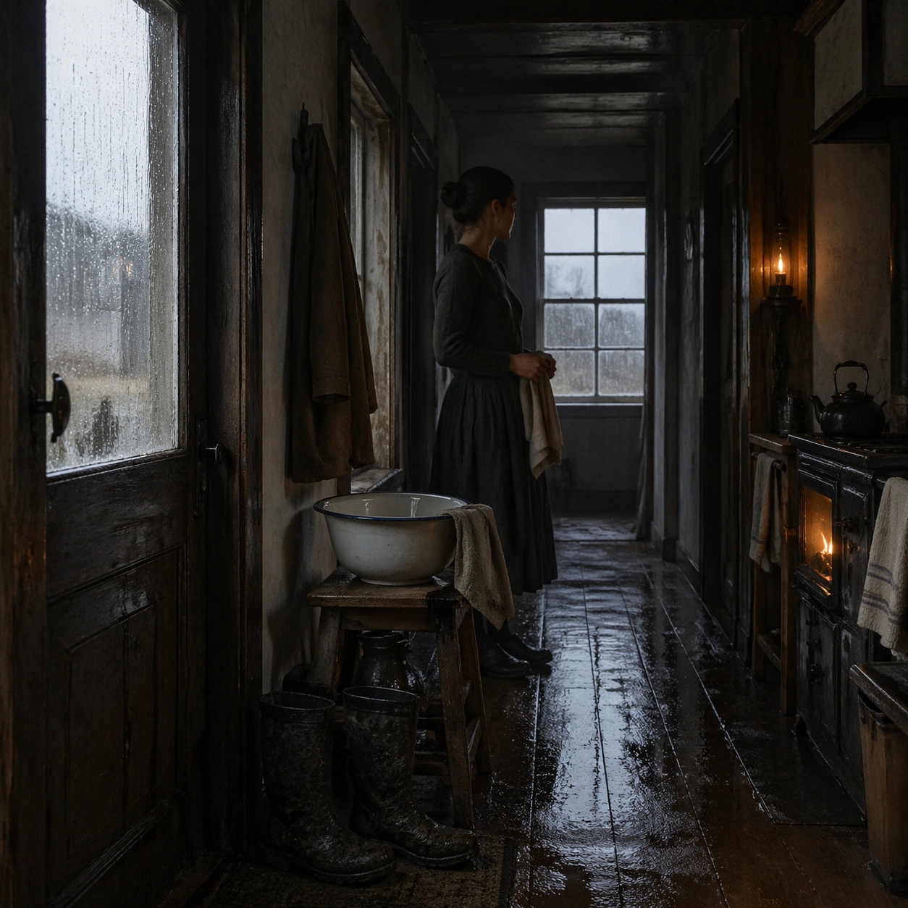

```text
Scene:
A square interior image held in patient stillness, with rain sliding down window glass, damp wood, muted blue-gray daylight, and one warm pool of lamplight or stove light inside. The room should feel inhabited but quiet, with time stretched by weather and silence rather than by spectacle. Use a long dim hallway with a wash basin on a stool, wet boots near the door, and gray rain visible through a distant window.

Subject:
Use one seated or standing figure, sometimes accompanied by a sleeping animal or simple domestic object, positioned so the window and the room share emotional weight. The human presence should be understated, contemplative, and integrated into the architecture. A figure stands halfway down the hall holding a towel, paused in the middle of an ordinary task.

Important details:
The grammar depends on slow observation: wet glass, old timber, worn textiles, steam, puddled boots, enamel basins, and practical light. Preserve physical realism and spiritual quiet without turning the scene into fantasy, melodrama, or rustic cliche. The perspective should be calm and unforced, with the basin, door, and window quietly balancing each other.

Use case:
Long Gaze Through Rain Interior single study 2/9.

Constraints:
No readable text, no watermark, no logos, preserve exact 1:1 aspect ratio, no readable text, no obvious luxury styling, no dramatic storm destruction, no modern electronics dominating the room, no theatrical color grading, no broken anatomy, no low-detail background, no accidental text fragments.
```

[Pinned source](https://github.com/ChaosRealmsAI/gpt-image-2-gallery/blob/5296db8c996e38776c83a0bc8c64f848dcd512b3/works/topics/long-gaze-rain-interior/packages/single-long-gaze-rain-interior/images/02-hallway-basin/meta.json) · GPT Image2 · 1254×1254 · No source-declared image dependencies. · ProjectD:pending individual review.

## Stove Room Vigil · long-gaze-rain-interior/single-long-gaze-rain-interior/03-stove-room-vigil

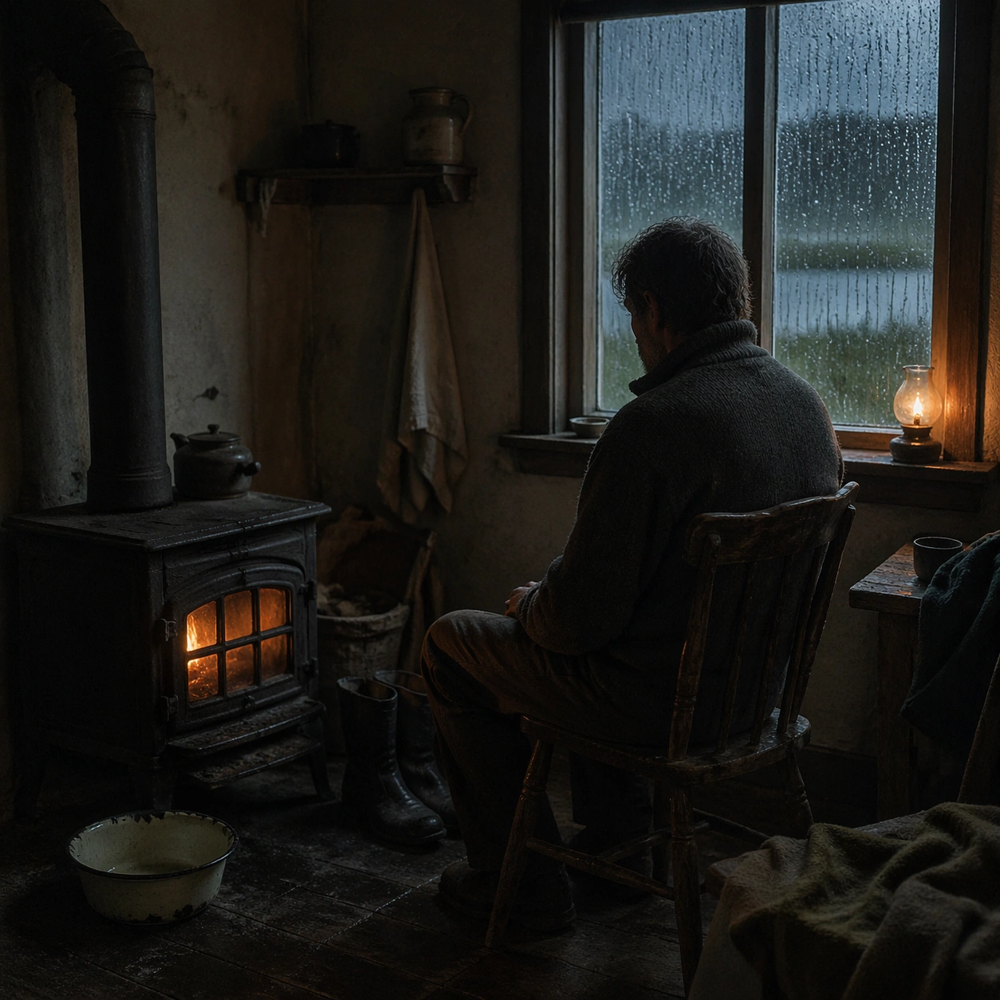

```text
Scene:
A square interior image held in patient stillness, with rain sliding down window glass, damp wood, muted blue-gray daylight, and one warm pool of lamplight or stove light inside. The room should feel inhabited but quiet, with time stretched by weather and silence rather than by spectacle. Place a cast-iron stove in a modest room where warm orange light competes with cool rain light from a nearby window.

Subject:
Use one seated or standing figure, sometimes accompanied by a sleeping animal or simple domestic object, positioned so the window and the room share emotional weight. The human presence should be understated, contemplative, and integrated into the architecture. A person sits beside the stove on a wooden chair with shoulders slightly forward, neither reading nor speaking.

Important details:
The grammar depends on slow observation: wet glass, old timber, worn textiles, steam, puddled boots, enamel basins, and practical light. Preserve physical realism and spiritual quiet without turning the scene into fantasy, melodrama, or rustic cliche. Let the glow remain humble, and keep the rain beyond the window softly insistent rather than dramatic.

Use case:
Long Gaze Through Rain Interior single study 3/9.

Constraints:
No readable text, no watermark, no logos, preserve exact 1:1 aspect ratio, no readable text, no obvious luxury styling, no dramatic storm destruction, no modern electronics dominating the room, no theatrical color grading, no broken anatomy, no low-detail background, no accidental text fragments.
```

[Pinned source](https://github.com/ChaosRealmsAI/gpt-image-2-gallery/blob/5296db8c996e38776c83a0bc8c64f848dcd512b3/works/topics/long-gaze-rain-interior/packages/single-long-gaze-rain-interior/images/03-stove-room-vigil/meta.json) · GPT Image2 · 1254×1254 · No source-declared image dependencies. · ProjectD:pending individual review.

## Library Chair · long-gaze-rain-interior/single-long-gaze-rain-interior/04-library-chair

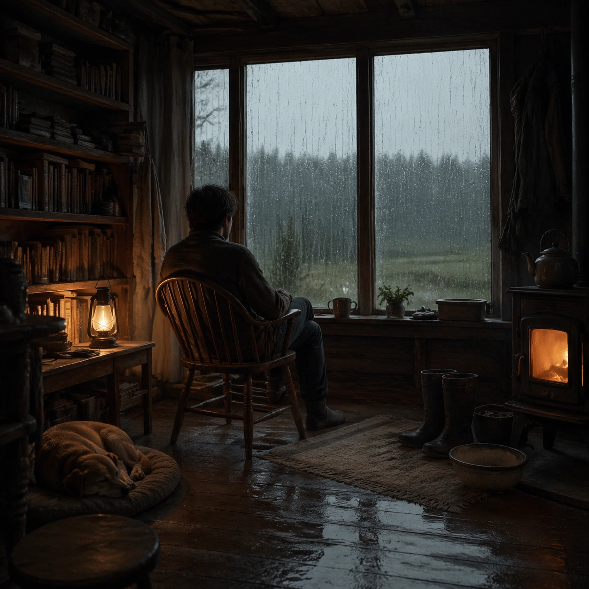

```text
Scene:
A square interior image held in patient stillness, with rain sliding down window glass, damp wood, muted blue-gray daylight, and one warm pool of lamplight or stove light inside. The room should feel inhabited but quiet, with time stretched by weather and silence rather than by spectacle. Use a small room lined with shelves, a lamp pool on the floor, and rain making vertical tracks down the window beyond the books.

Subject:
Use one seated or standing figure, sometimes accompanied by a sleeping animal or simple domestic object, positioned so the window and the room share emotional weight. The human presence should be understated, contemplative, and integrated into the architecture. A figure sits in a simple chair facing away from the shelves toward the rain, as if listening instead of reading.

Important details:
The grammar depends on slow observation: wet glass, old timber, worn textiles, steam, puddled boots, enamel basins, and practical light. Preserve physical realism and spiritual quiet without turning the scene into fantasy, melodrama, or rustic cliche. Books should feel used and ordinary, with the emotional focus staying on posture, weather, and room tone.

Use case:
Long Gaze Through Rain Interior single study 4/9.

Constraints:
No readable text, no watermark, no logos, preserve exact 1:1 aspect ratio, no readable text, no obvious luxury styling, no dramatic storm destruction, no modern electronics dominating the room, no theatrical color grading, no broken anatomy, no low-detail background, no accidental text fragments.
```

[Pinned source](https://github.com/ChaosRealmsAI/gpt-image-2-gallery/blob/5296db8c996e38776c83a0bc8c64f848dcd512b3/works/topics/long-gaze-rain-interior/packages/single-long-gaze-rain-interior/images/04-library-chair/meta.json) · GPT Image2 · 1254×1254 · No source-declared image dependencies. · ProjectD:pending individual review.

## Greenhouse Threshold · long-gaze-rain-interior/single-long-gaze-rain-interior/05-greenhouse-threshold

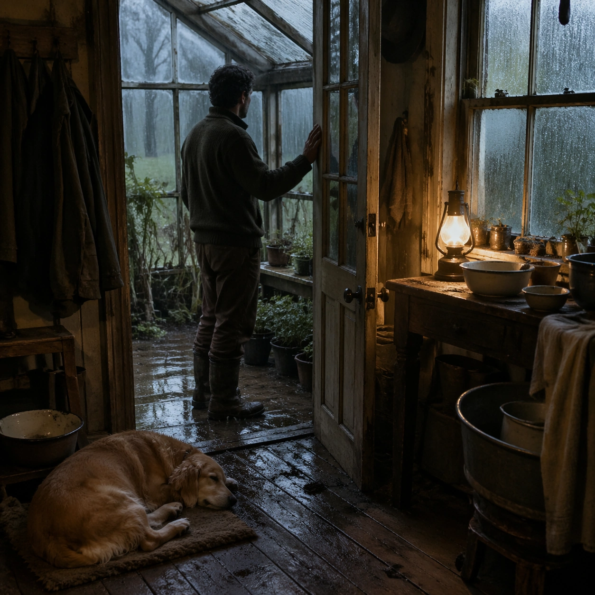

```text
Scene:
A square interior image held in patient stillness, with rain sliding down window glass, damp wood, muted blue-gray daylight, and one warm pool of lamplight or stove light inside. The room should feel inhabited but quiet, with time stretched by weather and silence rather than by spectacle. Show a damp threshold between house and greenhouse, with fogged panes, hanging coats, and wet soil tracked lightly across the floor.

Subject:
Use one seated or standing figure, sometimes accompanied by a sleeping animal or simple domestic object, positioned so the window and the room share emotional weight. The human presence should be understated, contemplative, and integrated into the architecture. A figure stands with one hand on the doorframe looking into the rainy greenhouse while a dog sleeps just inside the room.

Important details:
The grammar depends on slow observation: wet glass, old timber, worn textiles, steam, puddled boots, enamel basins, and practical light. Preserve physical realism and spiritual quiet without turning the scene into fantasy, melodrama, or rustic cliche. Balance plant humidity and domestic stillness so the threshold itself becomes the emotional subject.

Use case:
Long Gaze Through Rain Interior single study 5/9.

Constraints:
No readable text, no watermark, no logos, preserve exact 1:1 aspect ratio, no readable text, no obvious luxury styling, no dramatic storm destruction, no modern electronics dominating the room, no theatrical color grading, no broken anatomy, no low-detail background, no accidental text fragments.
```

[Pinned source](https://github.com/ChaosRealmsAI/gpt-image-2-gallery/blob/5296db8c996e38776c83a0bc8c64f848dcd512b3/works/topics/long-gaze-rain-interior/packages/single-long-gaze-rain-interior/images/05-greenhouse-threshold/meta.json) · GPT Image2 · 1254×1254 · No source-declared image dependencies. · ProjectD:pending individual review.

## Empty Dining Room · long-gaze-rain-interior/single-long-gaze-rain-interior/06-empty-dining-room

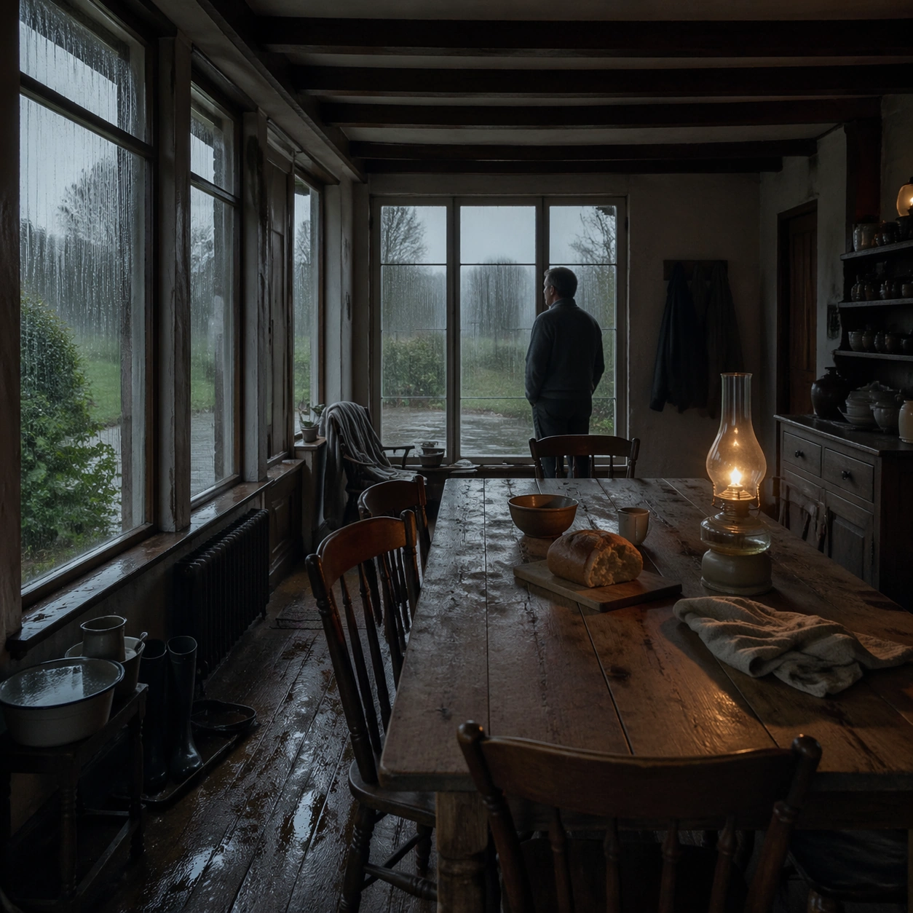

```text
Scene:
A square interior image held in patient stillness, with rain sliding down window glass, damp wood, muted blue-gray daylight, and one warm pool of lamplight or stove light inside. The room should feel inhabited but quiet, with time stretched by weather and silence rather than by spectacle. Stage a dining room with one lamp left on, an unfinished loaf of bread, and rain blurring the garden beyond tall windows.

Subject:
Use one seated or standing figure, sometimes accompanied by a sleeping animal or simple domestic object, positioned so the window and the room share emotional weight. The human presence should be understated, contemplative, and integrated into the architecture. A solitary figure stands at the far end of the room with hands in pockets, small inside the long table and chairs.

Important details:
The grammar depends on slow observation: wet glass, old timber, worn textiles, steam, puddled boots, enamel basins, and practical light. Preserve physical realism and spiritual quiet without turning the scene into fantasy, melodrama, or rustic cliche. The composition should make empty furniture feel emotionally active without becoming theatrical or gothic.

Use case:
Long Gaze Through Rain Interior single study 6/9.

Constraints:
No readable text, no watermark, no logos, preserve exact 1:1 aspect ratio, no readable text, no obvious luxury styling, no dramatic storm destruction, no modern electronics dominating the room, no theatrical color grading, no broken anatomy, no low-detail background, no accidental text fragments.
```

[Pinned source](https://github.com/ChaosRealmsAI/gpt-image-2-gallery/blob/5296db8c996e38776c83a0bc8c64f848dcd512b3/works/topics/long-gaze-rain-interior/packages/single-long-gaze-rain-interior/images/06-empty-dining-room/meta.json) · GPT Image2 · 1254×1254 · No source-declared image dependencies. · ProjectD:pending individual review.

## Dog By Lamp · long-gaze-rain-interior/single-long-gaze-rain-interior/07-dog-by-lamp

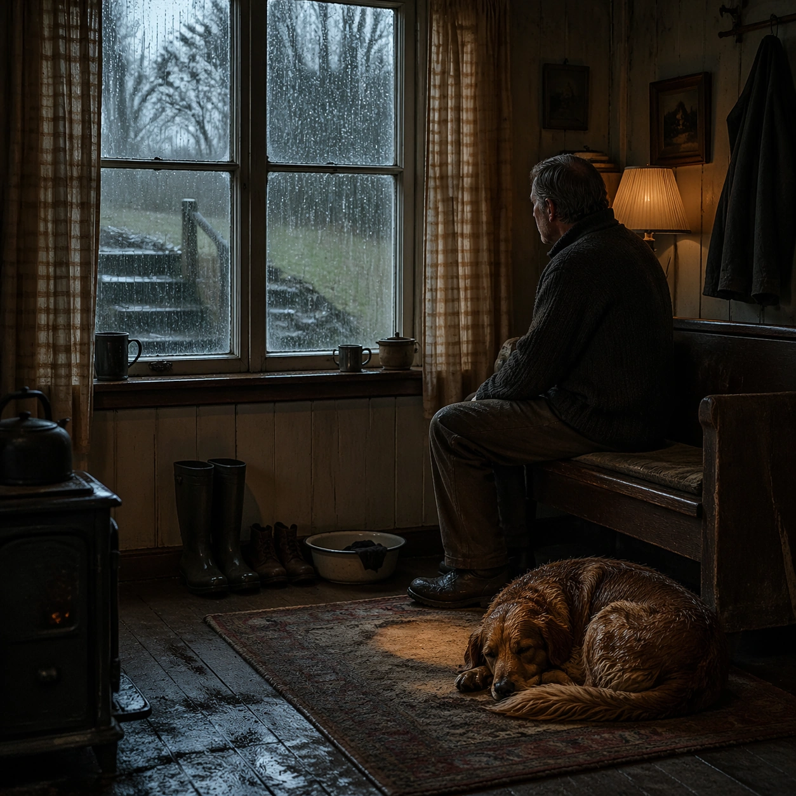

```text
Scene:
A square interior image held in patient stillness, with rain sliding down window glass, damp wood, muted blue-gray daylight, and one warm pool of lamplight or stove light inside. The room should feel inhabited but quiet, with time stretched by weather and silence rather than by spectacle. Use a modest sitting room with a shaded lamp, damp curtains, and rainwater shining faintly on the outside steps seen through the window.

Subject:
Use one seated or standing figure, sometimes accompanied by a sleeping animal or simple domestic object, positioned so the window and the room share emotional weight. The human presence should be understated, contemplative, and integrated into the architecture. A tired figure sits on a bench while a wet dog sleeps curled on the rug inside the lamp pool.

Important details:
The grammar depends on slow observation: wet glass, old timber, worn textiles, steam, puddled boots, enamel basins, and practical light. Preserve physical realism and spiritual quiet without turning the scene into fantasy, melodrama, or rustic cliche. The warmth should feel earned and fragile, not cozy in a decorative sense, with fabric and fur textures quietly observed.

Use case:
Long Gaze Through Rain Interior single study 7/9.

Constraints:
No readable text, no watermark, no logos, preserve exact 1:1 aspect ratio, no readable text, no obvious luxury styling, no dramatic storm destruction, no modern electronics dominating the room, no theatrical color grading, no broken anatomy, no low-detail background, no accidental text fragments.
```

[Pinned source](https://github.com/ChaosRealmsAI/gpt-image-2-gallery/blob/5296db8c996e38776c83a0bc8c64f848dcd512b3/works/topics/long-gaze-rain-interior/packages/single-long-gaze-rain-interior/images/07-dog-by-lamp/meta.json) · GPT Image2 · 1254×1254 · No source-declared image dependencies. · ProjectD:pending individual review.

## Attic Trunk · long-gaze-rain-interior/single-long-gaze-rain-interior/08-attic-trunk

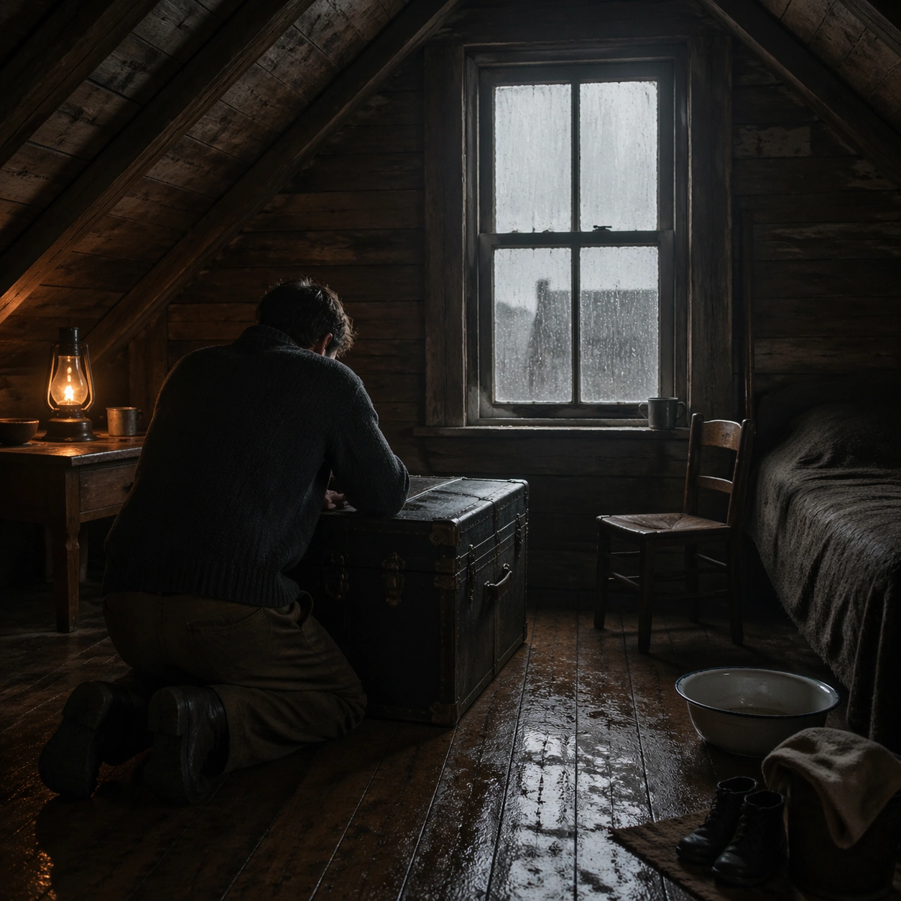

```text
Scene:
A square interior image held in patient stillness, with rain sliding down window glass, damp wood, muted blue-gray daylight, and one warm pool of lamplight or stove light inside. The room should feel inhabited but quiet, with time stretched by weather and silence rather than by spectacle. Set the scene in an attic room with sloped ceiling, one trunk, and a narrow rain-streaked window carrying pale gray light over rough boards.

Subject:
Use one seated or standing figure, sometimes accompanied by a sleeping animal or simple domestic object, positioned so the window and the room share emotional weight. The human presence should be understated, contemplative, and integrated into the architecture. A figure kneels beside the trunk without opening it, absorbed in memory or hesitation rather than action.

Important details:
The grammar depends on slow observation: wet glass, old timber, worn textiles, steam, puddled boots, enamel basins, and practical light. Preserve physical realism and spiritual quiet without turning the scene into fantasy, melodrama, or rustic cliche. Keep the room spare and tactile, with the tension held inside posture, weather, and withheld motion.

Use case:
Long Gaze Through Rain Interior single study 8/9.

Constraints:
No readable text, no watermark, no logos, preserve exact 1:1 aspect ratio, no readable text, no obvious luxury styling, no dramatic storm destruction, no modern electronics dominating the room, no theatrical color grading, no broken anatomy, no low-detail background, no accidental text fragments.
```

[Pinned source](https://github.com/ChaosRealmsAI/gpt-image-2-gallery/blob/5296db8c996e38776c83a0bc8c64f848dcd512b3/works/topics/long-gaze-rain-interior/packages/single-long-gaze-rain-interior/images/08-attic-trunk/meta.json) · GPT Image2 · 1254×1254 · No source-declared image dependencies. · ProjectD:pending individual review.

## Doorway To Rain · long-gaze-rain-interior/single-long-gaze-rain-interior/09-doorway-to-rain

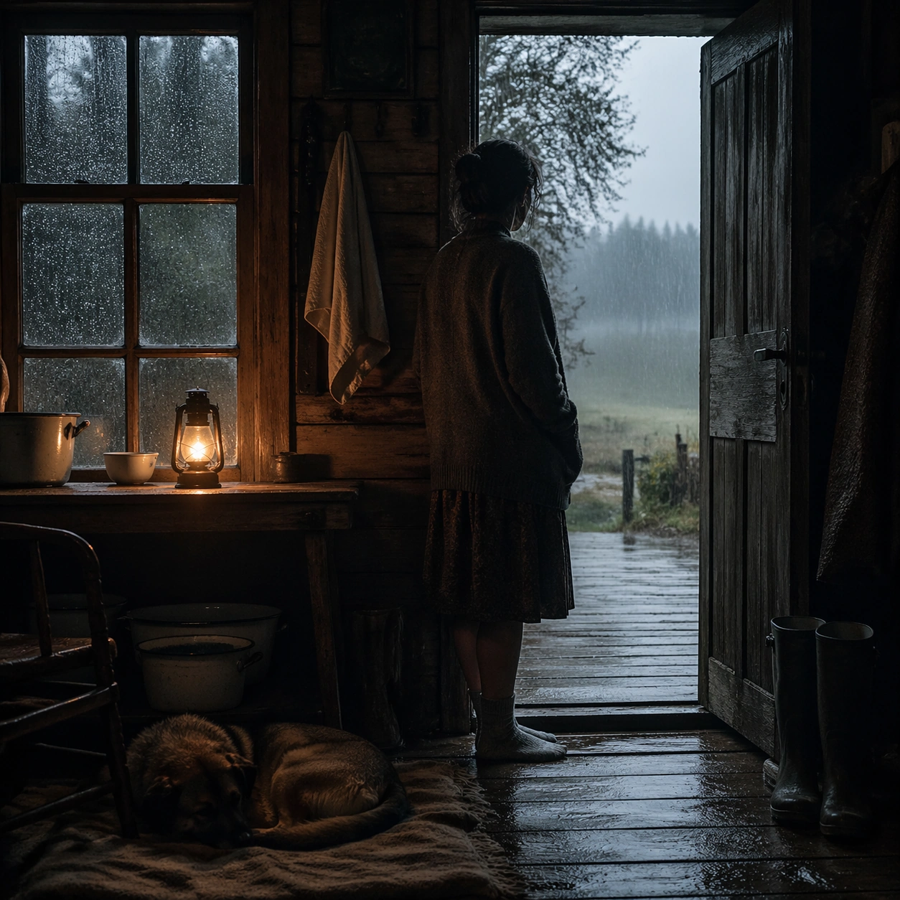

```text
Scene:
A square interior image held in patient stillness, with rain sliding down window glass, damp wood, muted blue-gray daylight, and one warm pool of lamplight or stove light inside. The room should feel inhabited but quiet, with time stretched by weather and silence rather than by spectacle. End with an open doorway framing silver rain outside, while the interior remains dim except for one weak lamp and wet boards near the threshold.

Subject:
Use one seated or standing figure, sometimes accompanied by a sleeping animal or simple domestic object, positioned so the window and the room share emotional weight. The human presence should be understated, contemplative, and integrated into the architecture. A figure stands just inside the door in stocking feet, looking out as if measuring whether to step into the rain.

Important details:
The grammar depends on slow observation: wet glass, old timber, worn textiles, steam, puddled boots, enamel basins, and practical light. Preserve physical realism and spiritual quiet without turning the scene into fantasy, melodrama, or rustic cliche. The doorway should operate as a spiritual border between weather and shelter, with no dramatic gesture required.

Use case:
Long Gaze Through Rain Interior single study 9/9.

Constraints:
No readable text, no watermark, no logos, preserve exact 1:1 aspect ratio, no readable text, no obvious luxury styling, no dramatic storm destruction, no modern electronics dominating the room, no theatrical color grading, no broken anatomy, no low-detail background, no accidental text fragments.
```

[Pinned source](https://github.com/ChaosRealmsAI/gpt-image-2-gallery/blob/5296db8c996e38776c83a0bc8c64f848dcd512b3/works/topics/long-gaze-rain-interior/packages/single-long-gaze-rain-interior/images/09-doorway-to-rain/meta.json) · GPT Image2 · 1254×1254 · No source-declared image dependencies. · ProjectD:pending individual review.

## Healing Kit Hero · loot-consumable-icon-family/single-loot-icon-family-studies/healing-kit-hero

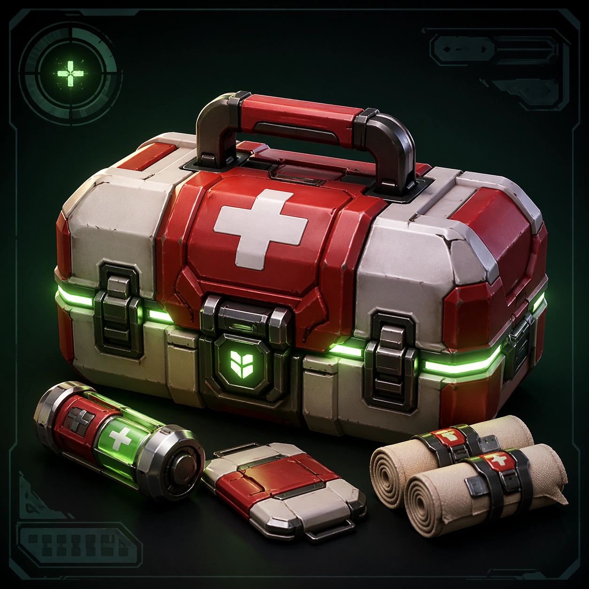

```text
Scene:
A square production-ready image designed for a game-art review wall and a commercial gallery at the same time. Frame a premium collectible render of a healing kit with clean studio light and color-coded medical surfaces with disciplined lighting, clean edge separation, and enough surrounding context to prove how the asset would behave in a real product surface. The camera, crop, and tonal balance should feel intentional rather than generic, with high readability at first glance and convincing material response under closer inspection.

Subject:
Center the study on a premium collectible render of a healing kit with clean studio light and color-coded medical surfaces. Translate the topic into a concrete, shippable visual statement instead of a loose mood board. Build layered object relationships, believable surface finish, and strong silhouette grouping so the image reads immediately as part of Loot Consumable Icon Family. The subject should feel made for a live game pipeline: useful in store, UI, campaign, or art-review contexts, with visual hierarchy strong enough to survive aggressive cropping.

Important details:
the object should feel instantly readable at icon size through bold shape, latch logic, and controlled glow accents. Keep every supporting element subordinate to the main read, and make category separation obvious through form, color zoning, depth, and material logic rather than words. Where panels, cards, badges, or interface blocks appear, they must look professionally structured but remain unreadable. The visual language should feel premium, original, and coherent across this package, with no filler clutter and no accidental resemblance to a specific shipped game IP.

Use case:
Loot Consumable Icon Family single study 1/9, focused on healing kit hero.

Constraints:
No readable text, no watermark, no logos, preserve exact 1:1 aspect ratio, no real medical logos, no gore, no broken hierarchy, no generic stock-photo staging, no accidental UI gibberish.
```

[Pinned source](https://github.com/ChaosRealmsAI/gpt-image-2-gallery/blob/5296db8c996e38776c83a0bc8c64f848dcd512b3/works/topics/loot-consumable-icon-family/packages/single-loot-icon-family-studies/images/healing-kit-hero/meta.json) · GPT Image2 · 1254×1254 · No source-declared image dependencies. · ProjectD:pending individual review.

## Ammo Box Study · loot-consumable-icon-family/single-loot-icon-family-studies/ammo-box-study

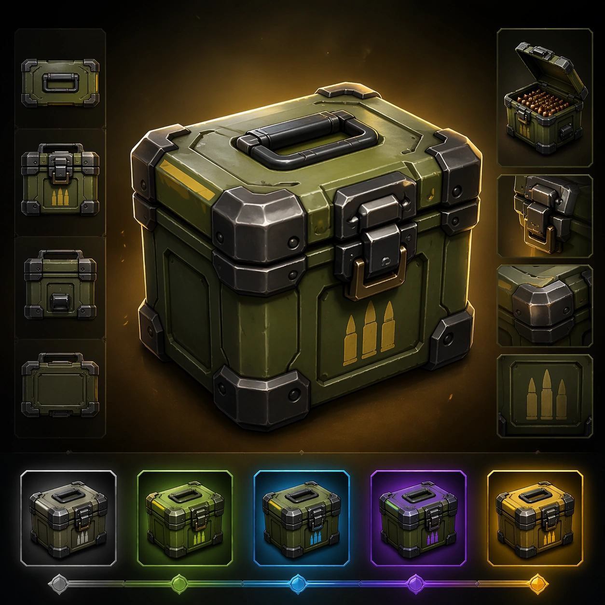

```text
Scene:
A square production-ready image designed for a game-art review wall and a commercial gallery at the same time. Frame a compact ammo box icon study with reinforced corners, closure mechanics, and strong silhouette blocking with disciplined lighting, clean edge separation, and enough surrounding context to prove how the asset would behave in a real product surface. The camera, crop, and tonal balance should feel intentional rather than generic, with high readability at first glance and convincing material response under closer inspection.

Subject:
Center the study on a compact ammo box icon study with reinforced corners, closure mechanics, and strong silhouette blocking. Translate the topic into a concrete, shippable visual statement instead of a loose mood board. Build layered object relationships, believable surface finish, and strong silhouette grouping so the image reads immediately as part of Loot Consumable Icon Family. The subject should feel made for a live game pipeline: useful in store, UI, campaign, or art-review contexts, with visual hierarchy strong enough to survive aggressive cropping.

Important details:
the form must remain unmistakable when shrunk while still rewarding close inspection with believable materials. Keep every supporting element subordinate to the main read, and make category separation obvious through form, color zoning, depth, and material logic rather than words. Where panels, cards, badges, or interface blocks appear, they must look professionally structured but remain unreadable. The visual language should feel premium, original, and coherent across this package, with no filler clutter and no accidental resemblance to a specific shipped game IP.

Use case:
Loot Consumable Icon Family single study 2/9, focused on ammo box study.

Constraints:
No readable text, no watermark, no logos, preserve exact 1:1 aspect ratio, no bullet brand marks, no war slogans, no broken hierarchy, no generic stock-photo staging, no accidental UI gibberish.
```

[Pinned source](https://github.com/ChaosRealmsAI/gpt-image-2-gallery/blob/5296db8c996e38776c83a0bc8c64f848dcd512b3/works/topics/loot-consumable-icon-family/packages/single-loot-icon-family-studies/images/ammo-box-study/meta.json) · GPT Image2 · 1254×1254 · No source-declared image dependencies. · ProjectD:pending individual review.

## Artifact Shard Core · loot-consumable-icon-family/single-loot-icon-family-studies/artifact-shard-core

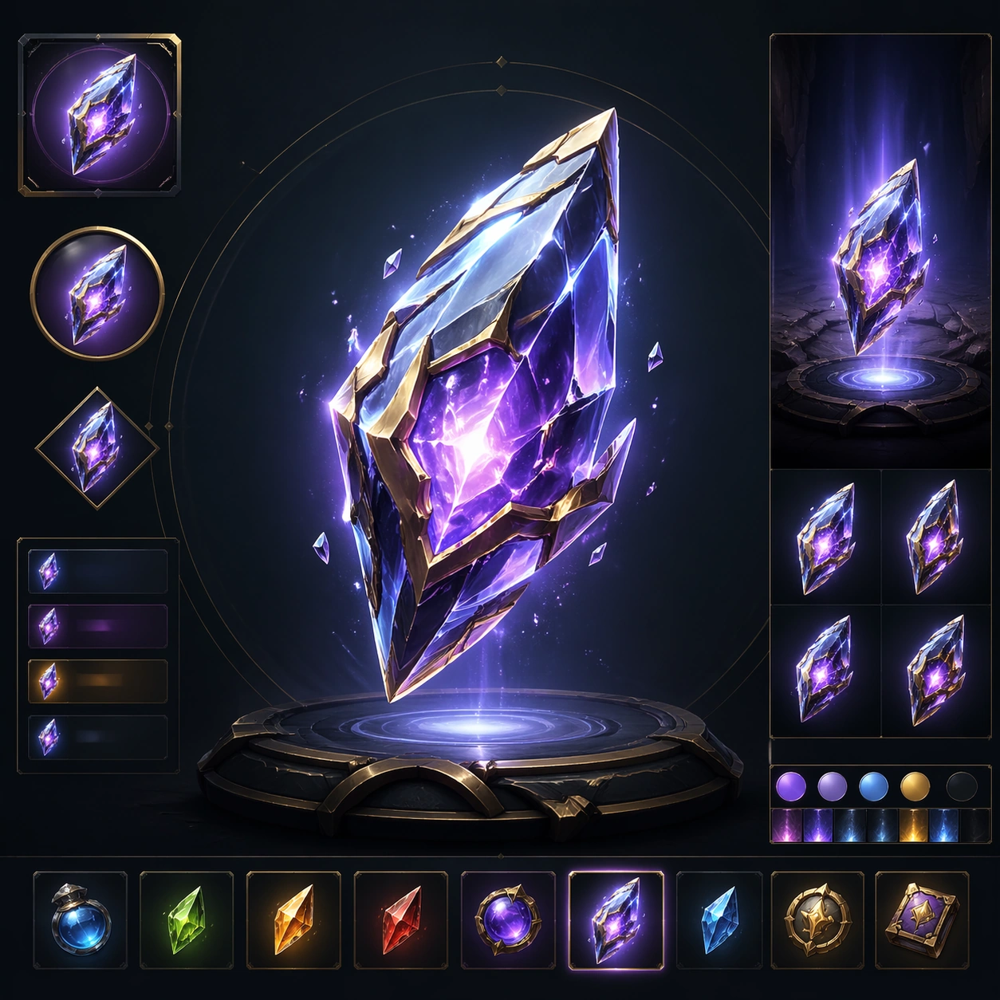

```text
Scene:
A square production-ready image designed for a game-art review wall and a commercial gallery at the same time. Frame a luminous artifact shard icon rendered like a rare loot pickup with layered internal glow with disciplined lighting, clean edge separation, and enough surrounding context to prove how the asset would behave in a real product surface. The camera, crop, and tonal balance should feel intentional rather than generic, with high readability at first glance and convincing material response under closer inspection.

Subject:
Center the study on a luminous artifact shard icon rendered like a rare loot pickup with layered internal glow. Translate the topic into a concrete, shippable visual statement instead of a loose mood board. Build layered object relationships, believable surface finish, and strong silhouette grouping so the image reads immediately as part of Loot Consumable Icon Family. The subject should feel made for a live game pipeline: useful in store, UI, campaign, or art-review contexts, with visual hierarchy strong enough to survive aggressive cropping.

Important details:
the shard should read as magical or advanced without becoming an unreadable light blob. Keep every supporting element subordinate to the main read, and make category separation obvious through form, color zoning, depth, and material logic rather than words. Where panels, cards, badges, or interface blocks appear, they must look professionally structured but remain unreadable. The visual language should feel premium, original, and coherent across this package, with no filler clutter and no accidental resemblance to a specific shipped game IP.

Use case:
Loot Consumable Icon Family single study 3/9, focused on artifact shard core.

Constraints:
No readable text, no watermark, no logos, preserve exact 1:1 aspect ratio, no runic text, no logo crest, no broken hierarchy, no generic stock-photo staging, no accidental UI gibberish.
```

[Pinned source](https://github.com/ChaosRealmsAI/gpt-image-2-gallery/blob/5296db8c996e38776c83a0bc8c64f848dcd512b3/works/topics/loot-consumable-icon-family/packages/single-loot-icon-family-studies/images/artifact-shard-core/meta.json) · GPT Image2 · 1254×1254 · No source-declared image dependencies. · ProjectD:pending individual review.

## Keycard Access Badge · loot-consumable-icon-family/single-loot-icon-family-studies/keycard-access-badge

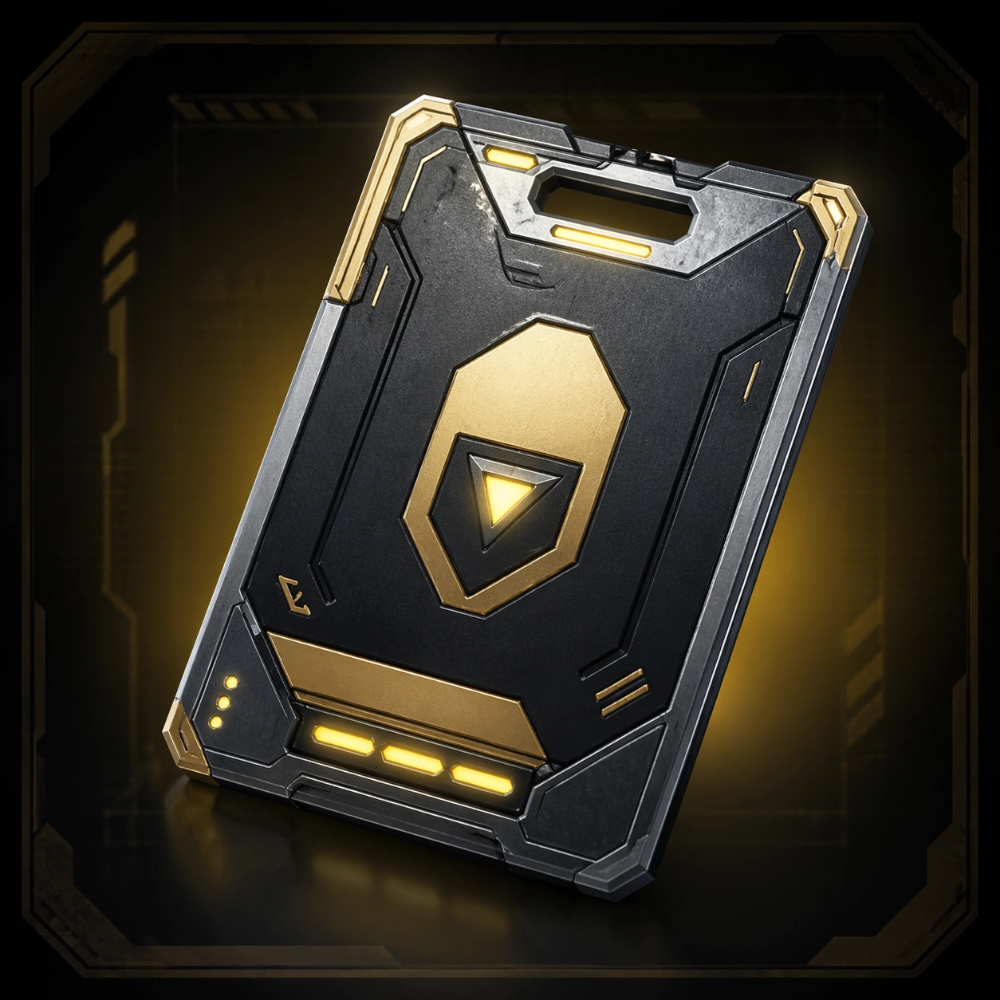

```text
Scene:
A square production-ready image designed for a game-art review wall and a commercial gallery at the same time. Frame a keycard or access badge icon built around clean geometry, cut corners, and scarcity cues with disciplined lighting, clean edge separation, and enough surrounding context to prove how the asset would behave in a real product surface. The camera, crop, and tonal balance should feel intentional rather than generic, with high readability at first glance and convincing material response under closer inspection.

Subject:
Center the study on a keycard or access badge icon built around clean geometry, cut corners, and scarcity cues. Translate the topic into a concrete, shippable visual statement instead of a loose mood board. Build layered object relationships, believable surface finish, and strong silhouette grouping so the image reads immediately as part of Loot Consumable Icon Family. The subject should feel made for a live game pipeline: useful in store, UI, campaign, or art-review contexts, with visual hierarchy strong enough to survive aggressive cropping.

Important details:
make the item readable through color zoning and mechanical purpose rather than text labels. Keep every supporting element subordinate to the main read, and make category separation obvious through form, color zoning, depth, and material logic rather than words. Where panels, cards, badges, or interface blocks appear, they must look professionally structured but remain unreadable. The visual language should feel premium, original, and coherent across this package, with no filler clutter and no accidental resemblance to a specific shipped game IP.

Use case:
Loot Consumable Icon Family single study 4/9, focused on keycard access badge.

Constraints:
No readable text, no watermark, no logos, preserve exact 1:1 aspect ratio, no readable numbers, no corporate marks, no broken hierarchy, no generic stock-photo staging, no accidental UI gibberish.
```

[Pinned source](https://github.com/ChaosRealmsAI/gpt-image-2-gallery/blob/5296db8c996e38776c83a0bc8c64f848dcd512b3/works/topics/loot-consumable-icon-family/packages/single-loot-icon-family-studies/images/keycard-access-badge/meta.json) · GPT Image2 · 1254×1254 · No source-declared image dependencies. · ProjectD:pending individual review.

## Currency Token Stack · loot-consumable-icon-family/single-loot-icon-family-studies/currency-token-stack


```text
Scene:
A square production-ready image designed for a game-art review wall and a commercial gallery at the same time. Frame a stack of premium currency tokens or chips with strong edge rhythm and collectible shine with disciplined lighting, clean edge separation, and enough surrounding context to prove how the asset would behave in a real product surface. The camera, crop, and tonal balance should feel intentional rather than generic, with high readability at first glance and convincing material response under closer inspection.

Subject:
Center the study on a stack of premium currency tokens or chips with strong edge rhythm and collectible shine. Translate the topic into a concrete, shippable visual statement instead of a loose mood board. Build layered object relationships, believable surface finish, and strong silhouette grouping so the image reads immediately as part of Loot Consumable Icon Family. The subject should feel made for a live game pipeline: useful in store, UI, campaign, or art-review contexts, with visual hierarchy strong enough to survive aggressive cropping.

Important details:
the token family should feel valuable and easy to distinguish from all other loot types. Keep every supporting element subordinate to the main read, and make category separation obvious through form, color zoning, depth, and material logic rather than words. Where panels, cards, badges, or interface blocks appear, they must look professionally structured but remain unreadable. The visual language should feel premium, original, and coherent across this package, with no filler clutter and no accidental resemblance to a specific shipped game IP.

Use case:
Loot Consumable Icon Family single study 5/9, focused on currency token stack.

Constraints:
No readable text, no watermark, no logos, preserve exact 1:1 aspect ratio, no coin denominations, no logos, no broken hierarchy, no generic stock-photo staging, no accidental UI gibberish.
```

[Pinned source](https://github.com/ChaosRealmsAI/gpt-image-2-gallery/blob/5296db8c996e38776c83a0bc8c64f848dcd512b3/works/topics/loot-consumable-icon-family/packages/single-loot-icon-family-studies/images/currency-token-stack/meta.json) · GPT Image2 · 1254×1254 · No source-declared image dependencies. · ProjectD:pending individual review.

## Five Icon Overview Board · loot-consumable-icon-family/single-loot-icon-family-studies/five-icon-overview-board

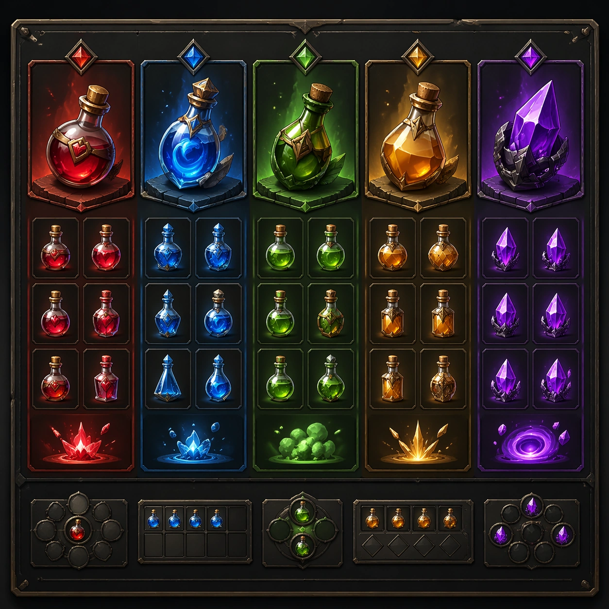

```text
Scene:
A square production-ready image designed for a game-art review wall and a commercial gallery at the same time. Frame an overview board arranging the loot icon family into one polished system sheet with disciplined lighting, clean edge separation, and enough surrounding context to prove how the asset would behave in a real product surface. The camera, crop, and tonal balance should feel intentional rather than generic, with high readability at first glance and convincing material response under closer inspection.

Subject:
Center the study on an overview board arranging the loot icon family into one polished system sheet. Translate the topic into a concrete, shippable visual statement instead of a loose mood board. Build layered object relationships, believable surface finish, and strong silhouette grouping so the image reads immediately as part of Loot Consumable Icon Family. The subject should feel made for a live game pipeline: useful in store, UI, campaign, or art-review contexts, with visual hierarchy strong enough to survive aggressive cropping.

Important details:
spacing, rarity cues, and category separation should make the family feel immediately usable by a UI team. Keep every supporting element subordinate to the main read, and make category separation obvious through form, color zoning, depth, and material logic rather than words. Where panels, cards, badges, or interface blocks appear, they must look professionally structured but remain unreadable. The visual language should feel premium, original, and coherent across this package, with no filler clutter and no accidental resemblance to a specific shipped game IP.

Use case:
Loot Consumable Icon Family single study 6/9, focused on five icon overview board.

Constraints:
No readable text, no watermark, no logos, preserve exact 1:1 aspect ratio, no readable labels, no placeholder text, no broken hierarchy, no generic stock-photo staging, no accidental UI gibberish.
```

[Pinned source](https://github.com/ChaosRealmsAI/gpt-image-2-gallery/blob/5296db8c996e38776c83a0bc8c64f848dcd512b3/works/topics/loot-consumable-icon-family/packages/single-loot-icon-family-studies/images/five-icon-overview-board/meta.json) · GPT Image2 · 1254×1254 · No source-declared image dependencies. · ProjectD:pending individual review.

## Rarity Color Pass · loot-consumable-icon-family/single-loot-icon-family-studies/rarity-color-pass

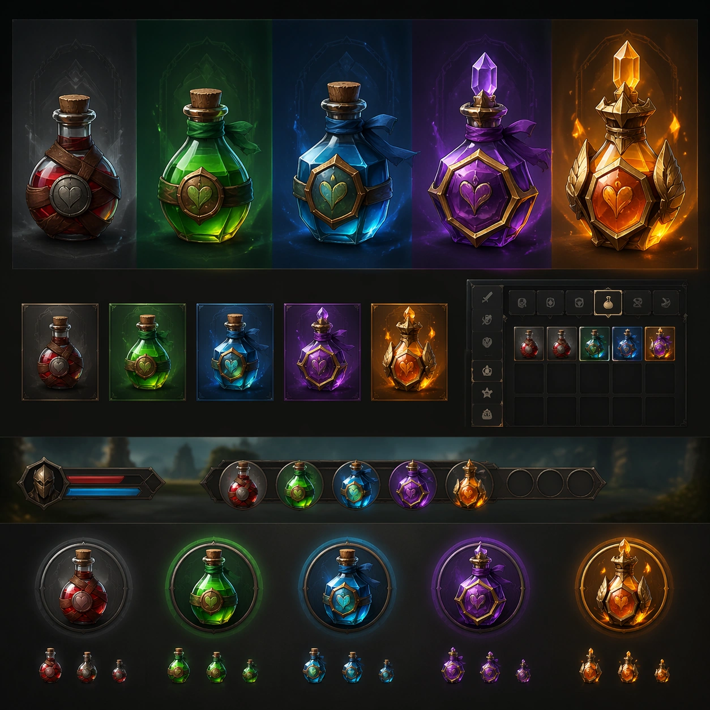

```text
Scene:
A square production-ready image designed for a game-art review wall and a commercial gallery at the same time. Frame a color-pass study showing how the icon family adapts across rarity bands without losing clarity with disciplined lighting, clean edge separation, and enough surrounding context to prove how the asset would behave in a real product surface. The camera, crop, and tonal balance should feel intentional rather than generic, with high readability at first glance and convincing material response under closer inspection.

Subject:
Center the study on a color-pass study showing how the icon family adapts across rarity bands without losing clarity. Translate the topic into a concrete, shippable visual statement instead of a loose mood board. Build layered object relationships, believable surface finish, and strong silhouette grouping so the image reads immediately as part of Loot Consumable Icon Family. The subject should feel made for a live game pipeline: useful in store, UI, campaign, or art-review contexts, with visual hierarchy strong enough to survive aggressive cropping.

Important details:
the upgrade logic should feel deliberate, consistent, and small-size friendly. Keep every supporting element subordinate to the main read, and make category separation obvious through form, color zoning, depth, and material logic rather than words. Where panels, cards, badges, or interface blocks appear, they must look professionally structured but remain unreadable. The visual language should feel premium, original, and coherent across this package, with no filler clutter and no accidental resemblance to a specific shipped game IP.

Use case:
Loot Consumable Icon Family single study 7/9, focused on rarity color pass.

Constraints:
No readable text, no watermark, no logos, preserve exact 1:1 aspect ratio, no swatch codes, no text legend, no broken hierarchy, no generic stock-photo staging, no accidental UI gibberish.
```

[Pinned source](https://github.com/ChaosRealmsAI/gpt-image-2-gallery/blob/5296db8c996e38776c83a0bc8c64f848dcd512b3/works/topics/loot-consumable-icon-family/packages/single-loot-icon-family-studies/images/rarity-color-pass/meta.json) · GPT Image2 · 1254×1254 · No source-declared image dependencies. · ProjectD:pending individual review.

## Thumbnail Readability Grid · loot-consumable-icon-family/single-loot-icon-family-studies/thumbnail-readability-grid

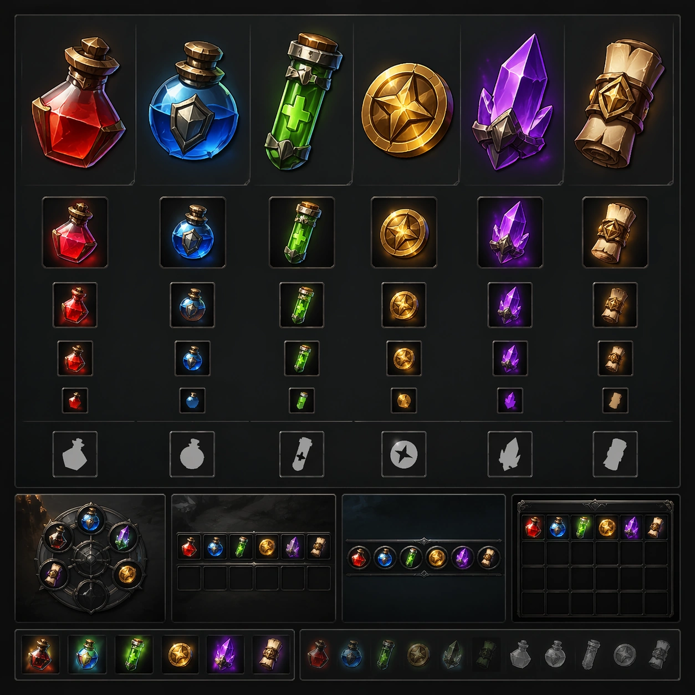

```text
Scene:
A square production-ready image designed for a game-art review wall and a commercial gallery at the same time. Frame a micro-size readability grid comparing the same loot icons across several tiny crop contexts with disciplined lighting, clean edge separation, and enough surrounding context to prove how the asset would behave in a real product surface. The camera, crop, and tonal balance should feel intentional rather than generic, with high readability at first glance and convincing material response under closer inspection.

Subject:
Center the study on a micro-size readability grid comparing the same loot icons across several tiny crop contexts. Translate the topic into a concrete, shippable visual statement instead of a loose mood board. Build layered object relationships, believable surface finish, and strong silhouette grouping so the image reads immediately as part of Loot Consumable Icon Family. The subject should feel made for a live game pipeline: useful in store, UI, campaign, or art-review contexts, with visual hierarchy strong enough to survive aggressive cropping.

Important details:
prove that silhouettes survive compression, glow reduction, and simplified framing. Keep every supporting element subordinate to the main read, and make category separation obvious through form, color zoning, depth, and material logic rather than words. Where panels, cards, badges, or interface blocks appear, they must look professionally structured but remain unreadable. The visual language should feel premium, original, and coherent across this package, with no filler clutter and no accidental resemblance to a specific shipped game IP.

Use case:
Loot Consumable Icon Family single study 8/9, focused on thumbnail readability grid.

Constraints:
No readable text, no watermark, no logos, preserve exact 1:1 aspect ratio, no exact screenshot UI, no pixel mush, no broken hierarchy, no generic stock-photo staging, no accidental UI gibberish.
```

[Pinned source](https://github.com/ChaosRealmsAI/gpt-image-2-gallery/blob/5296db8c996e38776c83a0bc8c64f848dcd512b3/works/topics/loot-consumable-icon-family/packages/single-loot-icon-family-studies/images/thumbnail-readability-grid/meta.json) · GPT Image2 · 1254×1254 · No source-declared image dependencies. · ProjectD:pending individual review.

## Drop Crate Promo Tile · loot-consumable-icon-family/single-loot-icon-family-studies/drop-crate-promo-tile


```text
Scene:
A square production-ready image designed for a game-art review wall and a commercial gallery at the same time. Frame a store-ready promo tile that packages the loot icon family around a rewarding drop crate moment with disciplined lighting, clean edge separation, and enough surrounding context to prove how the asset would behave in a real product surface. The camera, crop, and tonal balance should feel intentional rather than generic, with high readability at first glance and convincing material response under closer inspection.

Subject:
Center the study on a store-ready promo tile that packages the loot icon family around a rewarding drop crate moment. Translate the topic into a concrete, shippable visual statement instead of a loose mood board. Build layered object relationships, believable surface finish, and strong silhouette grouping so the image reads immediately as part of Loot Consumable Icon Family. The subject should feel made for a live game pipeline: useful in store, UI, campaign, or art-review contexts, with visual hierarchy strong enough to survive aggressive cropping.

Important details:
the tile should feel conversion-ready while still centered on clean item readability. Keep every supporting element subordinate to the main read, and make category separation obvious through form, color zoning, depth, and material logic rather than words. Where panels, cards, badges, or interface blocks appear, they must look professionally structured but remain unreadable. The visual language should feel premium, original, and coherent across this package, with no filler clutter and no accidental resemblance to a specific shipped game IP.

Use case:
Loot Consumable Icon Family single study 9/9, focused on drop crate promo tile.

Constraints:
No readable text, no watermark, no logos, preserve exact 1:1 aspect ratio, no fake percentages, no sale text, no broken hierarchy, no generic stock-photo staging, no accidental UI gibberish.
```

[Pinned source](https://github.com/ChaosRealmsAI/gpt-image-2-gallery/blob/5296db8c996e38776c83a0bc8c64f848dcd512b3/works/topics/loot-consumable-icon-family/packages/single-loot-icon-family-studies/images/drop-crate-promo-tile/meta.json) · GPT Image2 · 1254×1254 · No source-declared image dependencies. · ProjectD:pending individual review.

## Festive Tray Anchor · lunar-new-year-festive-brand-rollout/series-festive-rollout/01-festive-tray-anchor


```text
Scene:
Create a square premium Lunar New Year campaign image with lacquer red, warm gold, floral freshness, and elegant evening depth. Use a polished interior or retail surface with layered staging that feels celebratory, generous, and brand-ready rather than theatrical. The frame should read as a hero asset for multi-format rollout, with enough breathing room for gifting logic, atmosphere, and merchandising hierarchy to stay legible at both poster scale and social-tile scale.

Subject:
Center a curated gifting arrangement with trays, wrapped boxes, citrus or blossom accents, textile texture, and refined celebration objects that feel contemporary and brand-neutral. The composition should communicate festive generosity and social warmth through material language and layered depth. Keep the scene commercially flexible enough for retail, dining, beauty, or finance-adjacent seasonal campaigns while staying unmistakably rooted in Lunar New Year energy.

Important details:
Lock the campaign grammar here: lacquer red, warm gold, premium packaging geometry, fresh botanicals, dark supporting depth, and confident celebratory order. Keep surfaces believable and elegant. Avoid mascot dependence, souvenir-shop clutter, and generic luxury excess. The anchor should feel reusable across social rollout, retail hero art, boutique display, and hospitality campaign surfaces under one cohesive festive system.

Use case:
LNY Rollout series study 1/9.

Constraints:
No readable text, no watermark, no logos, preserve exact 1:1 aspect ratio, no readable calligraphy, no logo packets, no zodiac mascot character, no stage-show spectacle, no fireworks, no crowd, no gambling imagery, no cheap paper-cut overload.
```

[Pinned source](https://github.com/ChaosRealmsAI/gpt-image-2-gallery/blob/5296db8c996e38776c83a0bc8c64f848dcd512b3/works/topics/lunar-new-year-festive-brand-rollout/packages/series-festive-rollout/images/01-festive-tray-anchor/meta.json) · GPT Image2 · 1024×1024 · No source-declared image dependencies. · ProjectD:pending individual review.

## Beauty Counter Variation · lunar-new-year-festive-brand-rollout/series-festive-rollout/02-beauty-counter-variation

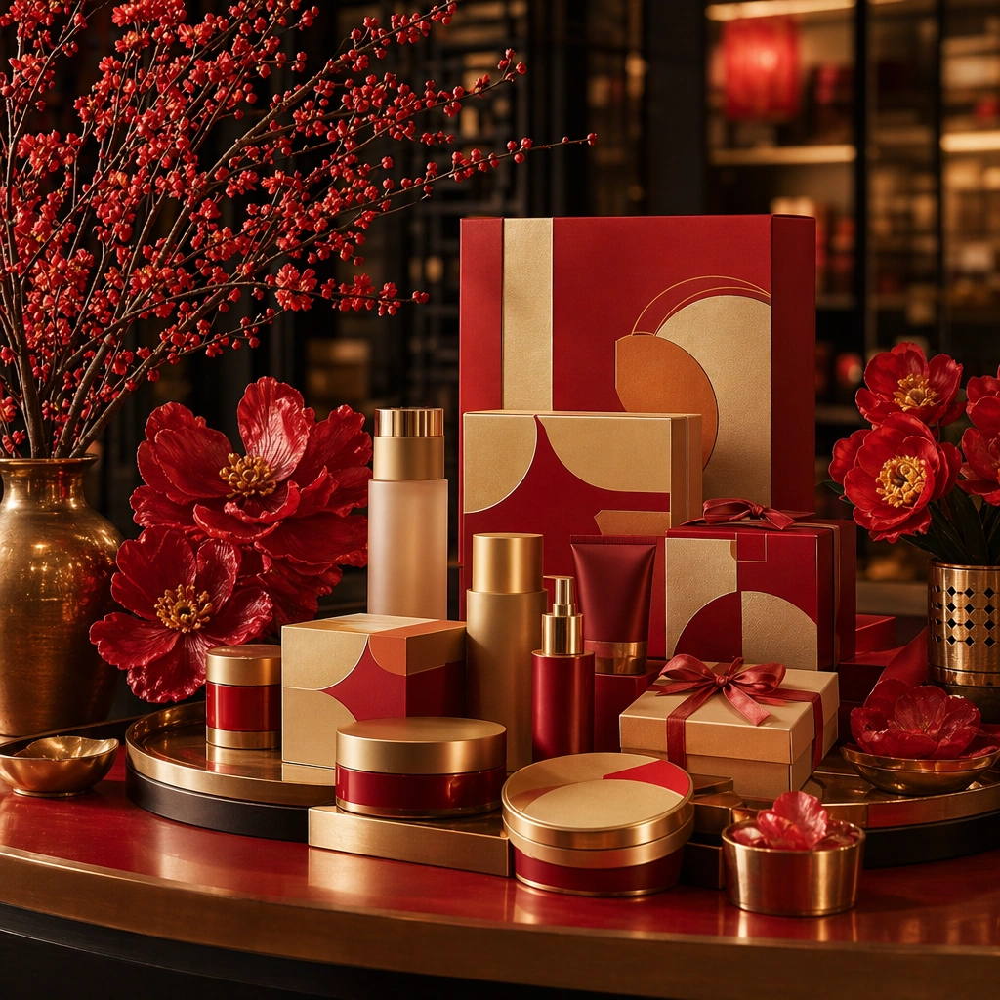

```text
Scene:
Create a square dependent campaign image in the exact same festive environment, preserving the same lacquer red, warm gold, floral freshness, and premium depth from the reference image, but make the composition cleaner and more retail-counter oriented. The frame should feel obviously related to the anchor while shifting toward a polished beauty or lifestyle merchandising surface suitable for campaign rollout, storefront crops, and social reuse.

Subject:
Feature premium beauty-like products, trays, gift boxes, blossom accents, and celebratory forms arranged into one coherent Lunar New Year display. Preserve exact palette, lighting direction, packaging geometry, and festive energy from the reference model while changing the assortment emphasis toward counter merchandising. The result should remain luxurious, brand-neutral, and useful for retail hero imagery or high-frequency seasonal tiles.

Important details:
Preserve exact campaign identity from the reference image. The celebratory energy should come from rich materials, spacing, and color rather than readable slogans. Use product silhouettes, reflective surfaces, and gifting logic to show category specificity. Keep the balance between abundance and elegance disciplined enough that the image reads premium rather than noisy or mass-market generic.

Use case:
LNY Rollout series study 2/9.

Constraints:
No readable text, no watermark, no logos, preserve exact 1:1 aspect ratio, preserve exact campaign identity from the reference image, no readable labels, no mascot dolls, no glitter explosion, no fashion model, no logo embossing, no fireworks, no theme-park saturation.
```

[Pinned source](https://github.com/ChaosRealmsAI/gpt-image-2-gallery/blob/5296db8c996e38776c83a0bc8c64f848dcd512b3/works/topics/lunar-new-year-festive-brand-rollout/packages/series-festive-rollout/images/02-beauty-counter-variation/meta.json) · GPT Image2 · 1024×1024 · Reference images required. · ProjectD:pending individual review.

## Banquet Table Variation · lunar-new-year-festive-brand-rollout/series-festive-rollout/03-banquet-table-variation

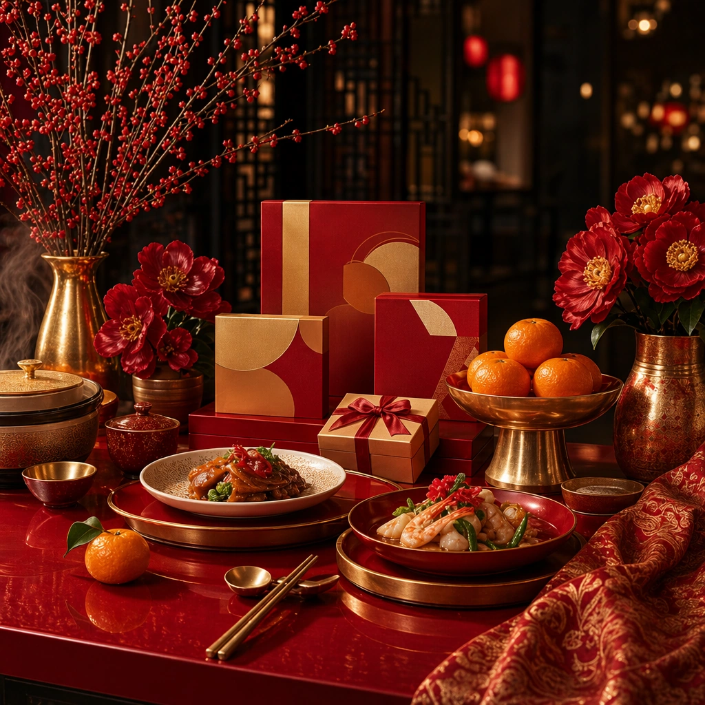

```text
Scene:
Create a square dependent image within the same festive campaign world, with the identical lacquer-red warmth, gold highlights, and fresh floral energy from the reference image, but widen the frame into a premium dining table composition. The scene should still look like a rollout asset rather than a candid dinner photograph, with strong hierarchy, polished serving surfaces, and enough atmosphere to support hospitality promotion and event-season storytelling.

Subject:
Show an elegant New Year dining setup with plated food cues, serving pieces, gift elements, citrus, and floral accents integrated into one celebratory table. Preserve exact color balance, lighting, and premium material language from the reference model while changing the category focus toward hospitality and feasting. Keep the setting original, brand-neutral, and free of readable menus or decorative copy.

Important details:
Maintain the same campaign identity precisely. Let abundance come through depth, serving rhythm, and glowing materials, not through crowding or spectacle. The table should feel hospitable, aspirational, and useful for hotels, restaurants, and brand-event communication under one unified New Year rollout system.

Use case:
LNY Rollout series study 3/9.

Constraints:
No readable text, no watermark, no logos, preserve exact 1:1 aspect ratio, preserve exact campaign identity from the reference image, no readable menus, no family portrait pose, no fireworks, no mascot costume, no logo plates, no overcrowded banquet, no red-envelope text.
```

[Pinned source](https://github.com/ChaosRealmsAI/gpt-image-2-gallery/blob/5296db8c996e38776c83a0bc8c64f848dcd512b3/works/topics/lunar-new-year-festive-brand-rollout/packages/series-festive-rollout/images/03-banquet-table-variation/meta.json) · GPT Image2 · 1024×1024 · Reference images required. · ProjectD:pending individual review.

## Premium Bundle Variation · lunar-new-year-festive-brand-rollout/series-festive-rollout/04-premium-bundle-variation

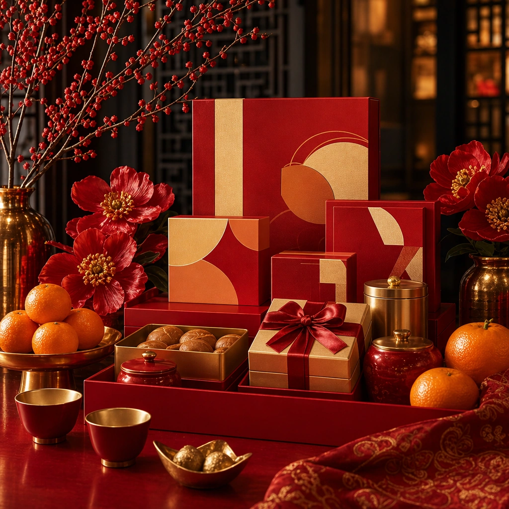

```text
Scene:
Create a square dependent campaign image in the same premium New Year environment, keeping the exact lacquer-red palette, gold warmth, floral freshness, and layered celebratory depth from the reference image, but bring the camera closer to a curated premium gift bundle. The frame should remain clearly connected to the anchor while emphasizing packaging refinement, gifting value, and polished merchandising discipline suitable for retail hero crops.

Subject:
Center a premium New Year bundle composed of stacked gift boxes, tray elements, tea or edible cues, blossom accents, and elegant celebration objects arranged into one cohesive hamper-like presentation. Preserve exact campaign identity from the reference image while shifting emphasis toward the gifting tier and product richness. The bundle should feel commercially real and suitable for upscale seasonal retail and boutique gifting campaigns.

Important details:
The bundle must inherit the reference world exactly: same light behavior, same packaging mood, same celebratory energy, and the same disciplined abundance. Use material contrast, layered scale, and careful spacing to keep the image premium. The final asset should feel like a direct campaign extension that can support gifting guides, storefronts, and premium social rollout.

Use case:
LNY Rollout series study 4/9.

Constraints:
No readable text, no watermark, no logos, preserve exact 1:1 aspect ratio, preserve exact campaign identity from the reference image, no readable gift cards, no logo packs, no mascot toys, no crowd, no confetti storm, no gaudy gold foil overload, no casino aesthetic.
```

[Pinned source](https://github.com/ChaosRealmsAI/gpt-image-2-gallery/blob/5296db8c996e38776c83a0bc8c64f848dcd512b3/works/topics/lunar-new-year-festive-brand-rollout/packages/series-festive-rollout/images/04-premium-bundle-variation/meta.json) · GPT Image2 · 1024×1024 · Reference images required. · ProjectD:pending individual review.

## Tabletop Gift Envelope Study · lunar-new-year-festive-brand-rollout/single-channel-expansion-studies/tabletop-gift-envelope-study


```text
Scene:
Create a square tabletop campaign image with warm directional light, lacquer-red and gold tones, and a polished premium presentation. The frame should feel like a refined gifting editorial rather than a stationery shot. Use clean negative space, elegant surfaces, and enough depth to make the arrangement feel fully staged and commercially useful for seasonal gifting communication, retail support, or hospitality promotion.

Subject:
Arrange premium festive envelopes without readable marks, small gift boxes, citrus or floral accents, folded textile, and tray elements into a coherent New Year gifting scene. The objects should feel contemporary, generous, and culturally aware without relying on obvious mascots or slogans. Focus on material quality, hierarchy, and presentational rhythm so the image works across finance, retail, beauty, or hospitality campaign use.

Important details:
Keep the styling celebratory but restrained. Envelope color, paper texture, metallic trim, lacquer surfaces, and ambient light should all feel believable. The image should work for multiple sectors that want a polished New Year gifting visual without text overlays. Avoid generic red-and-gold clutter and aim for premium clarity with strong tactile credibility.

Use case:
LNY Rollout single study 5/9.

Constraints:
No readable text, no watermark, no logos, preserve exact 1:1 aspect ratio, no readable characters, no logo seals, no mascot figures, no confetti pile, no crowded prop table, no cheap plastic décor, no fireworks, no obvious currency display.
```

[Pinned source](https://github.com/ChaosRealmsAI/gpt-image-2-gallery/blob/5296db8c996e38776c83a0bc8c64f848dcd512b3/works/topics/lunar-new-year-festive-brand-rollout/packages/single-channel-expansion-studies/images/tabletop-gift-envelope-study/meta.json) · GPT Image2 · 1024×1024 · No source-declared image dependencies. · ProjectD:pending individual review.

## Market Floral Retail Study · lunar-new-year-festive-brand-rollout/single-channel-expansion-studies/market-floral-retail-study


```text
Scene:
Create a square market-or-boutique floral image with warm afternoon light, abundant fresh branches, rich red and coral accents, and polished storefront composition. The frame should feel celebratory and alive, but still elevated enough for brand use. Keep the environment clean and art-directed, avoiding documentary chaos while preserving a convincing sense of seasonal abundance and storefront invitation.

Subject:
Show a premium floral-retail setup with festive branches, potted blooms, wrapped bundles, gift-ready objects, and carefully arranged retail supports. The scene should communicate early-season shopping energy and freshness rather than generic flower-shop romance. Focus on branch structure, wrapping, color layering, and the connection between floral purchase and seasonal celebration.

Important details:
Freshness and atmosphere matter most. Make petals, leaves, paper wrap, ceramic pots, and storefront surfaces feel vivid and real. Keep the composition commercially focused, with obvious seasonal cues but no readable signage. The result should support retail, mall, hospitality, or lifestyle campaign surfaces during the New Year period.

Use case:
LNY Rollout single study 6/9.

Constraints:
No readable text, no watermark, no logos, preserve exact 1:1 aspect ratio, no readable signs, no mascot toys, no logo buckets, no messy street-market chaos, no fireworks, no theme-park décor, no crowd blocking products, no cartoon lantern tunnel.
```

[Pinned source](https://github.com/ChaosRealmsAI/gpt-image-2-gallery/blob/5296db8c996e38776c83a0bc8c64f848dcd512b3/works/topics/lunar-new-year-festive-brand-rollout/packages/single-channel-expansion-studies/images/market-floral-retail-study/meta.json) · GPT Image2 · 1024×1024 · No source-declared image dependencies. · ProjectD:pending individual review.

## Travel Return Gifting · lunar-new-year-festive-brand-rollout/single-channel-expansion-studies/travel-return-gifting


```text
Scene:
Create a square transit-adjacent campaign image with warm interior arrival light, polished flooring, luggage textures, and an atmosphere of purposeful return. The composition should feel emotionally resonant and premium, not like a crowded station documentary. Use architecture, baggage placement, and gift packaging to communicate movement toward reunion and gifting during the New Year travel cycle with clean commercial structure.

Subject:
Feature elegant luggage, gift boxes, travel accessories, and one or two floral or festive accents arranged into a clear return-home gifting story. Keep people minimal or implied. The scene should communicate care, journey, and anticipation through object relationships and spatial direction rather than visible text or transport branding.

Important details:
Balance travel realism with campaign polish. Luggage materials, packaging finish, flooring reflections, and warm arrival light should all feel believable. The final image should be suitable for airlines, rail, retail, or gifting brands speaking to reunion travel during Lunar New Year. Avoid stressful crowd energy; this is about composed emotional movement and premium readiness.

Use case:
LNY Rollout single study 7/9.

Constraints:
No readable text, no watermark, no logos, preserve exact 1:1 aspect ratio, no readable station signs, no airline logos, no passport text, no crowd crush, no mascot décor, no military vibe, no chaotic security scene, no fireworks.
```

[Pinned source](https://github.com/ChaosRealmsAI/gpt-image-2-gallery/blob/5296db8c996e38776c83a0bc8c64f848dcd512b3/works/topics/lunar-new-year-festive-brand-rollout/packages/single-channel-expansion-studies/images/travel-return-gifting/meta.json) · GPT Image2 · 1024×1024 · No source-declared image dependencies. · ProjectD:pending individual review.

## Storefront Lantern Rollout · lunar-new-year-festive-brand-rollout/single-channel-expansion-studies/storefront-lantern-rollout

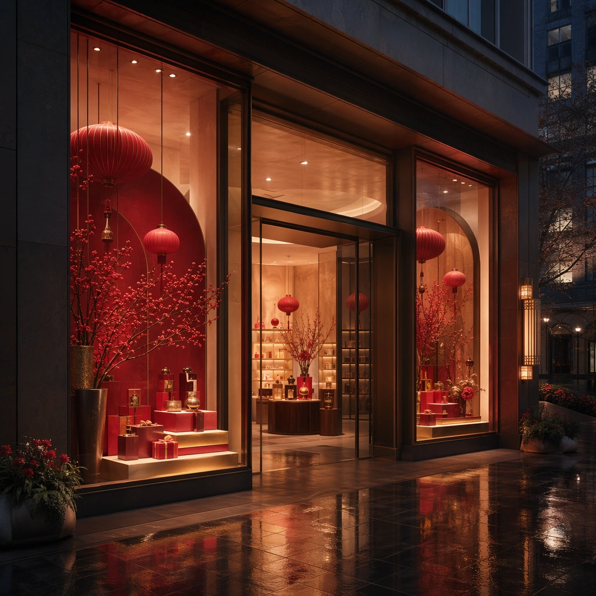

```text
Scene:
Create a square storefront image at blue hour with warm interior light, rich festive dressing, reflective pavement, and a clear sense of seasonal invitation. The frame should look like a premium retail campaign asset, not travel photography. Use strong architecture, visible display discipline, and a polished threshold between street and interior to communicate seasonal shopping energy with premium calm.

Subject:
Show a boutique storefront dressed for Lunar New Year with lighting, display plinths, gift boxes, floral accents, and elegant festive forms. Keep human presence minimal. The composition should emphasize merchandising and atmosphere over signage or crowd behavior. Make it feel premium, original, and useful for retail takeover imagery, brand launch moments, or seasonal social rollout.

Important details:
Light, reflection, and display logic should all be persuasive. Keep festive dressing refined and structured, not excessive or kitsch. The result should work across retail, beauty, or hospitality campaign surfaces. Everything must remain brand-neutral, non-legible, and rooted in a contemporary premium festive language.

Use case:
LNY Rollout single study 8/9.

Constraints:
No readable text, no watermark, no logos, preserve exact 1:1 aspect ratio, no readable store signs, no mascot costumes, no logo bags, no carnival overload, no fireworks, no huge crowd, no souvenir-shop cliché, no obvious stage backdrop.
```

[Pinned source](https://github.com/ChaosRealmsAI/gpt-image-2-gallery/blob/5296db8c996e38776c83a0bc8c64f848dcd512b3/works/topics/lunar-new-year-festive-brand-rollout/packages/single-channel-expansion-studies/images/storefront-lantern-rollout/meta.json) · GPT Image2 · 1024×1024 · No source-declared image dependencies. · ProjectD:pending individual review.

## Reunion Feast Support · lunar-new-year-festive-brand-rollout/single-channel-expansion-studies/reunion-feast-support

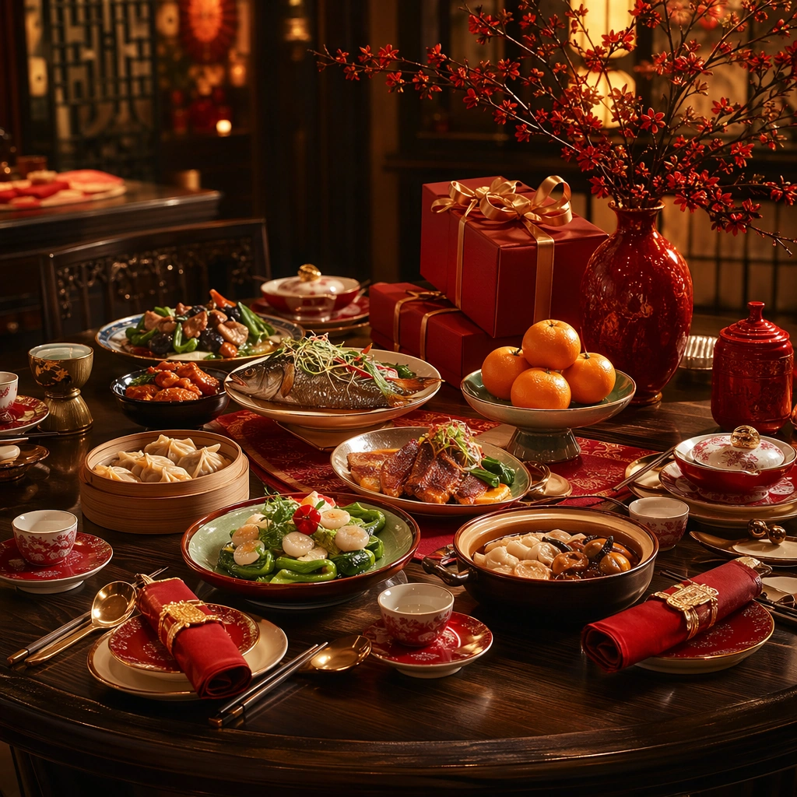

```text
Scene:
Create a square dining-support image with warm evening light, lacquer-red accents, glowing tableware, and a clear sense of invitation. The frame should feel celebratory and hospitable without becoming crowded. Use elegant camera framing and polished surfaces so the image reads as a premium restaurant or hotel campaign visual tied to reunion and shared abundance.

Subject:
Show a refined New Year table with plated dishes, shared serving pieces, fruit or floral accents, and one or two gifting cues integrated near the setting. The table should feel ready for guests rather than mid-meal. Focus on warmth, generosity, and hosting quality through material language and table rhythm rather than through visible people or readable restaurant materials.

Important details:
Hospitality polish matters. Plate glaze, lacquer or wood surfaces, steam hints, metal detail, and ambient light should all feel real. Keep the celebratory mood rich but controlled. The result should support hospitality, dining, or brand-event campaigns during Lunar New Year with strong cultural specificity and premium usability.

Use case:
LNY Rollout single study 9/9.

Constraints:
No readable text, no watermark, no logos, preserve exact 1:1 aspect ratio, no readable menus, no crowd, no mascot décor, no stage performers, no logo plates, no fireworks, no casino or gambling cues, no chaotic banquet clutter.
```

[Pinned source](https://github.com/ChaosRealmsAI/gpt-image-2-gallery/blob/5296db8c996e38776c83a0bc8c64f848dcd512b3/works/topics/lunar-new-year-festive-brand-rollout/packages/single-channel-expansion-studies/images/reunion-feast-support/meta.json) · GPT Image2 · 1024×1024 · No source-declared image dependencies. · ProjectD:pending individual review.

## Reference Beauty Anchor · luxury-beauty-closeup-editorial/series-beauty-editorial-lock/01-reference-beauty-anchor

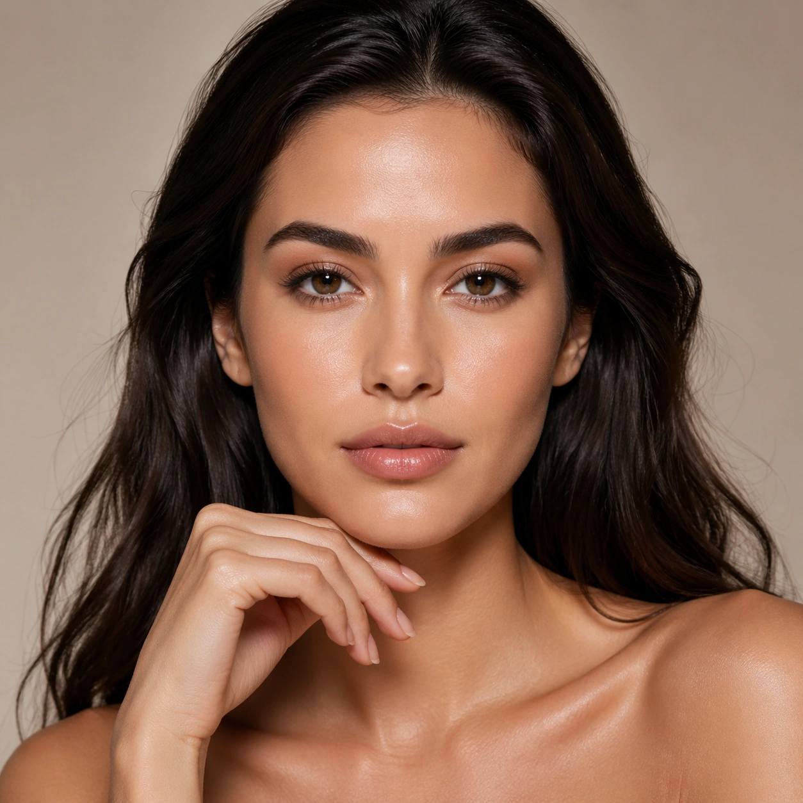

```text
Scene:
Create a square 1:1 portrait image for Luxury Beauty Close-Up Editorial. Use a premium beauty-studio setup with luminous skin light, soft neutral backdrop, and elegant magazine-grade calm. The frame should feel like a finished professional deliverable rather than a casual snapshot, with clear lens discipline, believable light falloff, and a palette that directly supports Create high-end beauty close-up editorials with realistic skin, precise makeup textures, controlled catchlights, and premium magazine polish.. Keep enough surrounding space and compositional control for gallery, research, campaign, or approval-board reuse while staying photoreal and human-scaled.

Subject:
Center one beauty model with warm neutral skin, glossy dark hair, balanced features, refined hands, and pores that remain realistic at close range. Establish the exact face, skin texture, hair base, hand shape, and neck proportions that later close-ups and makeup shifts must preserve. Use the example direction from the brief as grounding context: Create high-end beauty close-up editorials with realistic skin, precise makeup textures, controlled catchlights, and premium magazine polish.. Wardrobe, lighting, environment, and pose may shift to serve this variation, but the viewer must immediately understand that the same reference identity is still in front of the camera.

Important details:
This backlog line is difficult because Create high-end beauty close-up editorials with realistic skin, precise makeup textures, controlled catchlights, and premium magazine polish.. Preserve skin tone family, bone structure, eye spacing, nose shape, mouth shape, hairline logic, shoulder width, and overall body read across the entire series. preserve exact face / hair base / body proportions from the reference model. This first image should feel expensive, credible, and photoreal at close inspection. Avoid the common failure described in the brief: ordinary image models often lose likeness once styling, lighting, or layout changes enter the frame. Success should feel like the result should feel professionally usable, coherent, and clearly built around one stable human identity.

Use case:
Luxury Beauty Close-Up Editorial series study 1/9, the clean beauty reference portrait.

Constraints:
No readable text, no watermark, no logos, preserve exact 1:1 aspect ratio, preserve exact face / hair base / body proportions from the reference model, no airbrushed plastic skin, no fantasy glow, no extra jewelry noise, no readable packaging.
```

[Pinned source](https://github.com/ChaosRealmsAI/gpt-image-2-gallery/blob/5296db8c996e38776c83a0bc8c64f848dcd512b3/works/topics/luxury-beauty-closeup-editorial/packages/series-beauty-editorial-lock/images/01-reference-beauty-anchor/meta.json) · GPT Image2 · 1254×1254 · No source-declared image dependencies. · ProjectD:pending individual review.

## Wet Skin Close-up · luxury-beauty-closeup-editorial/series-beauty-editorial-lock/02-wet-skin-closeup

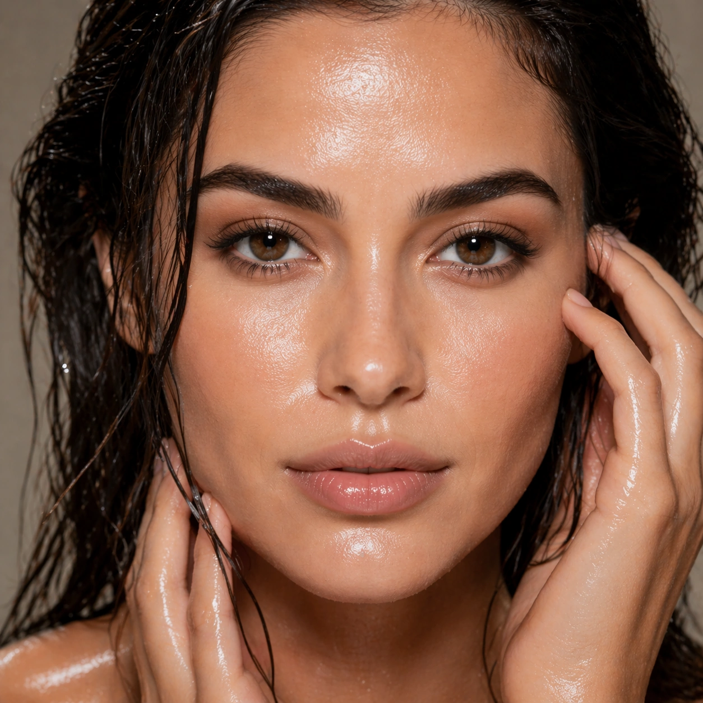

```text
Scene:
Create a square 1:1 portrait image for Luxury Beauty Close-Up Editorial. Use an extreme beauty crop with glossy specular highlights, controlled moisture on skin, and refined shadow falloff. The frame should feel like a finished professional deliverable rather than a casual snapshot, with clear lens discipline, believable light falloff, and a palette that directly supports Create high-end beauty close-up editorials with realistic skin, precise makeup textures, controlled catchlights, and premium magazine polish.. Keep enough surrounding space and compositional control for gallery, research, campaign, or approval-board reuse while staying photoreal and human-scaled.

Subject:
Center one beauty model with warm neutral skin, glossy dark hair, balanced features, refined hands, and pores that remain realistic at close range. Push closer into the same face while keeping pore structure, lip volume, eye distance, and hairline consistent with the reference model. Use the example direction from the brief as grounding context: Create high-end beauty close-up editorials with realistic skin, precise makeup textures, controlled catchlights, and premium magazine polish.. Wardrobe, lighting, environment, and pose may shift to serve this variation, but the viewer must immediately understand that the same reference identity is still in front of the camera.

Important details:
This backlog line is difficult because Create high-end beauty close-up editorials with realistic skin, precise makeup textures, controlled catchlights, and premium magazine polish.. Preserve skin tone family, bone structure, eye spacing, nose shape, mouth shape, hairline logic, shoulder width, and overall body read across the entire series. preserve exact face / hair base / body proportions from the reference model. Wet-skin finish should look luxurious and editorial, not greasy or synthetic. Avoid the common failure described in the brief: ordinary image models often lose likeness once styling, lighting, or layout changes enter the frame. Success should feel like the result should feel professionally usable, coherent, and clearly built around one stable human identity.

Use case:
Luxury Beauty Close-Up Editorial series study 2/9, a wet-skin close-up.

Constraints:
No readable text, no watermark, no logos, preserve exact 1:1 aspect ratio, preserve exact face / hair base / body proportions from the reference model, no oily shine overload, no pore erasure, no face shape drift, no surreal droplets.
```

[Pinned source](https://github.com/ChaosRealmsAI/gpt-image-2-gallery/blob/5296db8c996e38776c83a0bc8c64f848dcd512b3/works/topics/luxury-beauty-closeup-editorial/packages/series-beauty-editorial-lock/images/02-wet-skin-closeup/meta.json) · GPT Image2 · 1254×1254 · Reference images required. · ProjectD:pending individual review.

## Graphic Liner Portrait · luxury-beauty-closeup-editorial/series-beauty-editorial-lock/03-graphic-liner-portrait

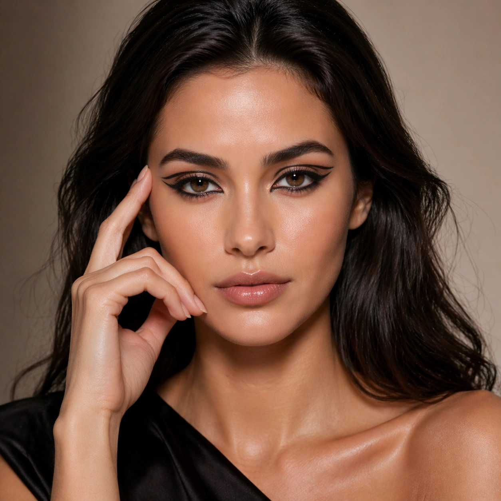

```text
Scene:
Create a square 1:1 portrait image for Luxury Beauty Close-Up Editorial. Use a fashion-beauty frame with crisp eyes, precise cosmetic edges, and a strong but uncluttered composition. The frame should feel like a finished professional deliverable rather than a casual snapshot, with clear lens discipline, believable light falloff, and a palette that directly supports Create high-end beauty close-up editorials with realistic skin, precise makeup textures, controlled catchlights, and premium magazine polish.. Keep enough surrounding space and compositional control for gallery, research, campaign, or approval-board reuse while staying photoreal and human-scaled.

Subject:
Center one beauty model with warm neutral skin, glossy dark hair, balanced features, refined hands, and pores that remain realistic at close range. Apply bolder eye design while preserving the same age read, face proportions, and hair base from image 01. Use the example direction from the brief as grounding context: Create high-end beauty close-up editorials with realistic skin, precise makeup textures, controlled catchlights, and premium magazine polish.. Wardrobe, lighting, environment, and pose may shift to serve this variation, but the viewer must immediately understand that the same reference identity is still in front of the camera.

Important details:
This backlog line is difficult because Create high-end beauty close-up editorials with realistic skin, precise makeup textures, controlled catchlights, and premium magazine polish.. Preserve skin tone family, bone structure, eye spacing, nose shape, mouth shape, hairline logic, shoulder width, and overall body read across the entire series. preserve exact face / hair base / body proportions from the reference model. The makeup must feel expertly applied and close-range believable rather than painted-on illustration. Avoid the common failure described in the brief: ordinary image models often lose likeness once styling, lighting, or layout changes enter the frame. Success should feel like the result should feel professionally usable, coherent, and clearly built around one stable human identity.

Use case:
Luxury Beauty Close-Up Editorial series study 3/9, a graphic-liner makeup portrait.

Constraints:
No readable text, no watermark, no logos, preserve exact 1:1 aspect ratio, preserve exact face / hair base / body proportions from the reference model, no asymmetric eye shape drift, no clown color palette, no changed brow bone, no extra faces.
```

[Pinned source](https://github.com/ChaosRealmsAI/gpt-image-2-gallery/blob/5296db8c996e38776c83a0bc8c64f848dcd512b3/works/topics/luxury-beauty-closeup-editorial/packages/series-beauty-editorial-lock/images/03-graphic-liner-portrait/meta.json) · GPT Image2 · 1254×1254 · Reference images required. · ProjectD:pending individual review.

## Skincare With Hand · luxury-beauty-closeup-editorial/series-beauty-editorial-lock/04-skincare-with-hand

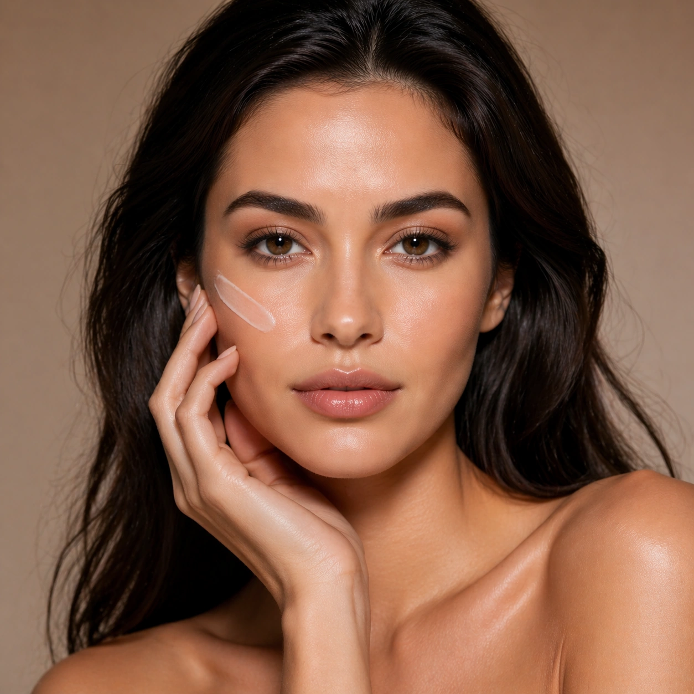

```text
Scene:
Create a square 1:1 portrait image for Luxury Beauty Close-Up Editorial. Use a tight campaign setup where one elegant hand, shoulder line, and face share the frame in balanced luxury lighting. The frame should feel like a finished professional deliverable rather than a casual snapshot, with clear lens discipline, believable light falloff, and a palette that directly supports Create high-end beauty close-up editorials with realistic skin, precise makeup textures, controlled catchlights, and premium magazine polish.. Keep enough surrounding space and compositional control for gallery, research, campaign, or approval-board reuse while staying photoreal and human-scaled.

Subject:
Center one beauty model with warm neutral skin, glossy dark hair, balanced features, refined hands, and pores that remain realistic at close range. Keep the same identity while introducing hand-to-face interaction and beauty-product grammar without readable packaging. Use the example direction from the brief as grounding context: Create high-end beauty close-up editorials with realistic skin, precise makeup textures, controlled catchlights, and premium magazine polish.. Wardrobe, lighting, environment, and pose may shift to serve this variation, but the viewer must immediately understand that the same reference identity is still in front of the camera.

Important details:
This backlog line is difficult because Create high-end beauty close-up editorials with realistic skin, precise makeup textures, controlled catchlights, and premium magazine polish.. Preserve skin tone family, bone structure, eye spacing, nose shape, mouth shape, hairline logic, shoulder width, and overall body read across the entire series. preserve exact face / hair base / body proportions from the reference model. Hands must look anatomically correct and belong to the same subject, with nails and skin finish remaining refined. Avoid the common failure described in the brief: ordinary image models often lose likeness once styling, lighting, or layout changes enter the frame. Success should feel like the result should feel professionally usable, coherent, and clearly built around one stable human identity.

Use case:
Luxury Beauty Close-Up Editorial series study 4/9, a skincare campaign crop with hands.

Constraints:
No readable text, no watermark, no logos, preserve exact 1:1 aspect ratio, preserve exact face / hair base / body proportions from the reference model, no broken fingers, no bottle logos, no fake label text, no disconnected hand anatomy.
```

[Pinned source](https://github.com/ChaosRealmsAI/gpt-image-2-gallery/blob/5296db8c996e38776c83a0bc8c64f848dcd512b3/works/topics/luxury-beauty-closeup-editorial/packages/series-beauty-editorial-lock/images/04-skincare-with-hand/meta.json) · GPT Image2 · 1254×1254 · Reference images required. · ProjectD:pending individual review.

## Jewel Tone Beauty · luxury-beauty-closeup-editorial/series-beauty-editorial-lock/05-jewel-tone-beauty

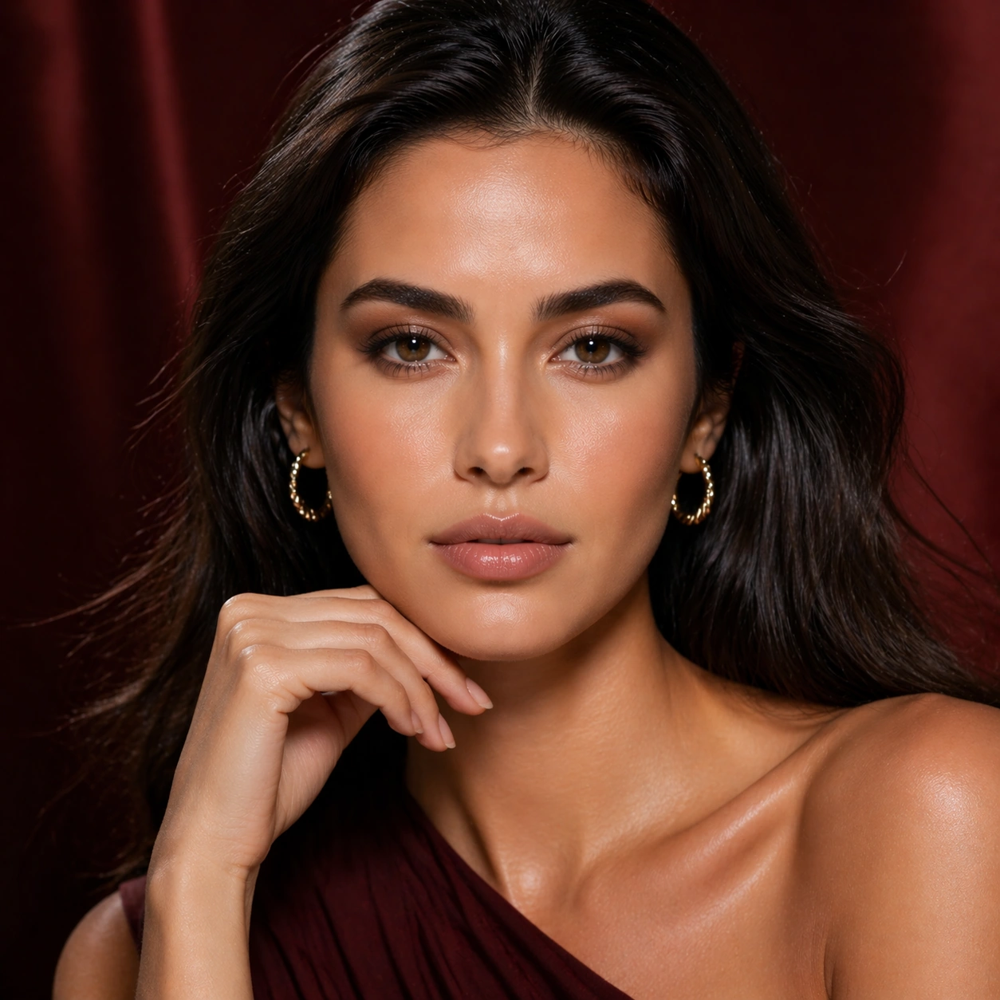

```text
Scene:
Create a square 1:1 portrait image for Luxury Beauty Close-Up Editorial. Use a saturated but premium beauty set with controlled color accents and still-realistic skin response. The frame should feel like a finished professional deliverable rather than a casual snapshot, with clear lens discipline, believable light falloff, and a palette that directly supports Create high-end beauty close-up editorials with realistic skin, precise makeup textures, controlled catchlights, and premium magazine polish.. Keep enough surrounding space and compositional control for gallery, research, campaign, or approval-board reuse while staying photoreal and human-scaled.

Subject:
Center one beauty model with warm neutral skin, glossy dark hair, balanced features, refined hands, and pores that remain realistic at close range. Use a deeper palette and more dramatic color story while holding the same face identity perfectly stable. Use the example direction from the brief as grounding context: Create high-end beauty close-up editorials with realistic skin, precise makeup textures, controlled catchlights, and premium magazine polish.. Wardrobe, lighting, environment, and pose may shift to serve this variation, but the viewer must immediately understand that the same reference identity is still in front of the camera.

Important details:
This backlog line is difficult because Create high-end beauty close-up editorials with realistic skin, precise makeup textures, controlled catchlights, and premium magazine polish.. Preserve skin tone family, bone structure, eye spacing, nose shape, mouth shape, hairline logic, shoulder width, and overall body read across the entire series. preserve exact face / hair base / body proportions from the reference model. The point is not color spectacle alone; the same woman must remain undeniable even under heavier styling. Avoid the common failure described in the brief: ordinary image models often lose likeness once styling, lighting, or layout changes enter the frame. Success should feel like the result should feel professionally usable, coherent, and clearly built around one stable human identity.

Use case:
Luxury Beauty Close-Up Editorial series study 5/9, a richer jewel-tone editorial portrait.

Constraints:
No readable text, no watermark, no logos, preserve exact 1:1 aspect ratio, preserve exact face / hair base / body proportions from the reference model, no color cast that changes ethnicity, no artificial eye enlargement, no glitter overload, no mask-like makeup.
```

[Pinned source](https://github.com/ChaosRealmsAI/gpt-image-2-gallery/blob/5296db8c996e38776c83a0bc8c64f848dcd512b3/works/topics/luxury-beauty-closeup-editorial/packages/series-beauty-editorial-lock/images/05-jewel-tone-beauty/meta.json) · GPT Image2 · 1254×1254 · Reference images required. · ProjectD:pending individual review.

## Profile Highlight Study · luxury-beauty-closeup-editorial/series-beauty-editorial-lock/06-profile-highlight-study

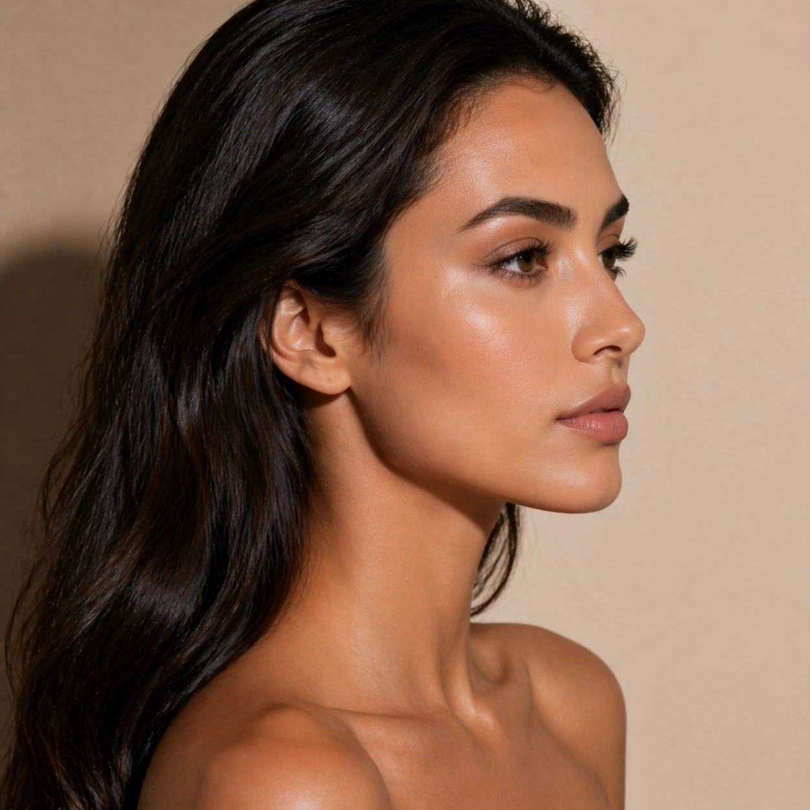

```text
Scene:
Create a square 1:1 portrait image for Luxury Beauty Close-Up Editorial. Use a side-lit portrait where cheekbone highlight, nose bridge, lips, and ear shape remain crisp and elegant. The frame should feel like a finished professional deliverable rather than a casual snapshot, with clear lens discipline, believable light falloff, and a palette that directly supports Create high-end beauty close-up editorials with realistic skin, precise makeup textures, controlled catchlights, and premium magazine polish.. Keep enough surrounding space and compositional control for gallery, research, campaign, or approval-board reuse while staying photoreal and human-scaled.

Subject:
Center one beauty model with warm neutral skin, glossy dark hair, balanced features, refined hands, and pores that remain realistic at close range. Rotate the same subject into profile while keeping the exact same brow line, jawline, hairline, and neck proportions from the anchor image. Use the example direction from the brief as grounding context: Create high-end beauty close-up editorials with realistic skin, precise makeup textures, controlled catchlights, and premium magazine polish.. Wardrobe, lighting, environment, and pose may shift to serve this variation, but the viewer must immediately understand that the same reference identity is still in front of the camera.

Important details:
This backlog line is difficult because Create high-end beauty close-up editorials with realistic skin, precise makeup textures, controlled catchlights, and premium magazine polish.. Preserve skin tone family, bone structure, eye spacing, nose shape, mouth shape, hairline logic, shoulder width, and overall body read across the entire series. preserve exact face / hair base / body proportions from the reference model. Beauty lighting should carve form without turning the profile into a new person. Avoid the common failure described in the brief: ordinary image models often lose likeness once styling, lighting, or layout changes enter the frame. Success should feel like the result should feel professionally usable, coherent, and clearly built around one stable human identity.

Use case:
Luxury Beauty Close-Up Editorial series study 6/9, a profile beauty highlight study.

Constraints:
No readable text, no watermark, no logos, preserve exact 1:1 aspect ratio, preserve exact face / hair base / body proportions from the reference model, no altered nose bridge, no different ear shape, no melted jawline, no random flyaway wig volume.
```

[Pinned source](https://github.com/ChaosRealmsAI/gpt-image-2-gallery/blob/5296db8c996e38776c83a0bc8c64f848dcd512b3/works/topics/luxury-beauty-closeup-editorial/packages/series-beauty-editorial-lock/images/06-profile-highlight-study/meta.json) · GPT Image2 · 1254×1254 · Reference images required. · ProjectD:pending individual review.

## Monochrome Skin Texture · luxury-beauty-closeup-editorial/series-beauty-editorial-lock/07-monochrome-skin-texture

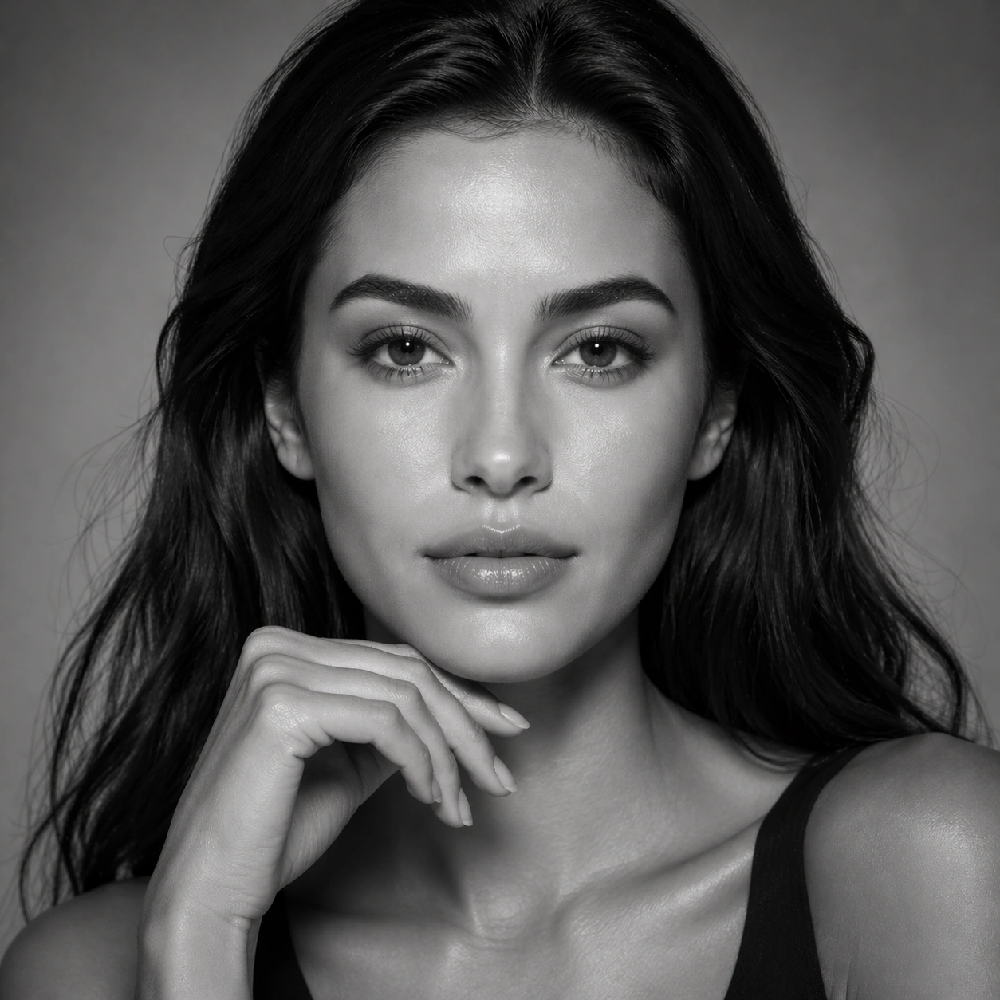

```text
Scene:
Create a square 1:1 portrait image for Luxury Beauty Close-Up Editorial. Use a grayscale beauty close-up with rich tonal separation and editorial restraint. The frame should feel like a finished professional deliverable rather than a casual snapshot, with clear lens discipline, believable light falloff, and a palette that directly supports Create high-end beauty close-up editorials with realistic skin, precise makeup textures, controlled catchlights, and premium magazine polish.. Keep enough surrounding space and compositional control for gallery, research, campaign, or approval-board reuse while staying photoreal and human-scaled.

Subject:
Center one beauty model with warm neutral skin, glossy dark hair, balanced features, refined hands, and pores that remain realistic at close range. Remove color but keep the exact same face, pores, lip structure, and hair base while making skin texture and light the hero. Use the example direction from the brief as grounding context: Create high-end beauty close-up editorials with realistic skin, precise makeup textures, controlled catchlights, and premium magazine polish.. Wardrobe, lighting, environment, and pose may shift to serve this variation, but the viewer must immediately understand that the same reference identity is still in front of the camera.

Important details:
This backlog line is difficult because Create high-end beauty close-up editorials with realistic skin, precise makeup textures, controlled catchlights, and premium magazine polish.. Preserve skin tone family, bone structure, eye spacing, nose shape, mouth shape, hairline logic, shoulder width, and overall body read across the entire series. preserve exact face / hair base / body proportions from the reference model. This frame should prove the beauty story survives without color gimmicks. Avoid the common failure described in the brief: ordinary image models often lose likeness once styling, lighting, or layout changes enter the frame. Success should feel like the result should feel professionally usable, coherent, and clearly built around one stable human identity.

Use case:
Luxury Beauty Close-Up Editorial series study 7/9, a monochrome skin-texture portrait.

Constraints:
No readable text, no watermark, no logos, preserve exact 1:1 aspect ratio, preserve exact face / hair base / body proportions from the reference model, no muddy gray skin, no grainy filter, no softened detail, no changed facial structure.
```

[Pinned source](https://github.com/ChaosRealmsAI/gpt-image-2-gallery/blob/5296db8c996e38776c83a0bc8c64f848dcd512b3/works/topics/luxury-beauty-closeup-editorial/packages/series-beauty-editorial-lock/images/07-monochrome-skin-texture/meta.json) · GPT Image2 · 1254×1254 · Reference images required. · ProjectD:pending individual review.

## Mirror Prep Frame · luxury-beauty-closeup-editorial/series-beauty-editorial-lock/08-mirror-prep-frame

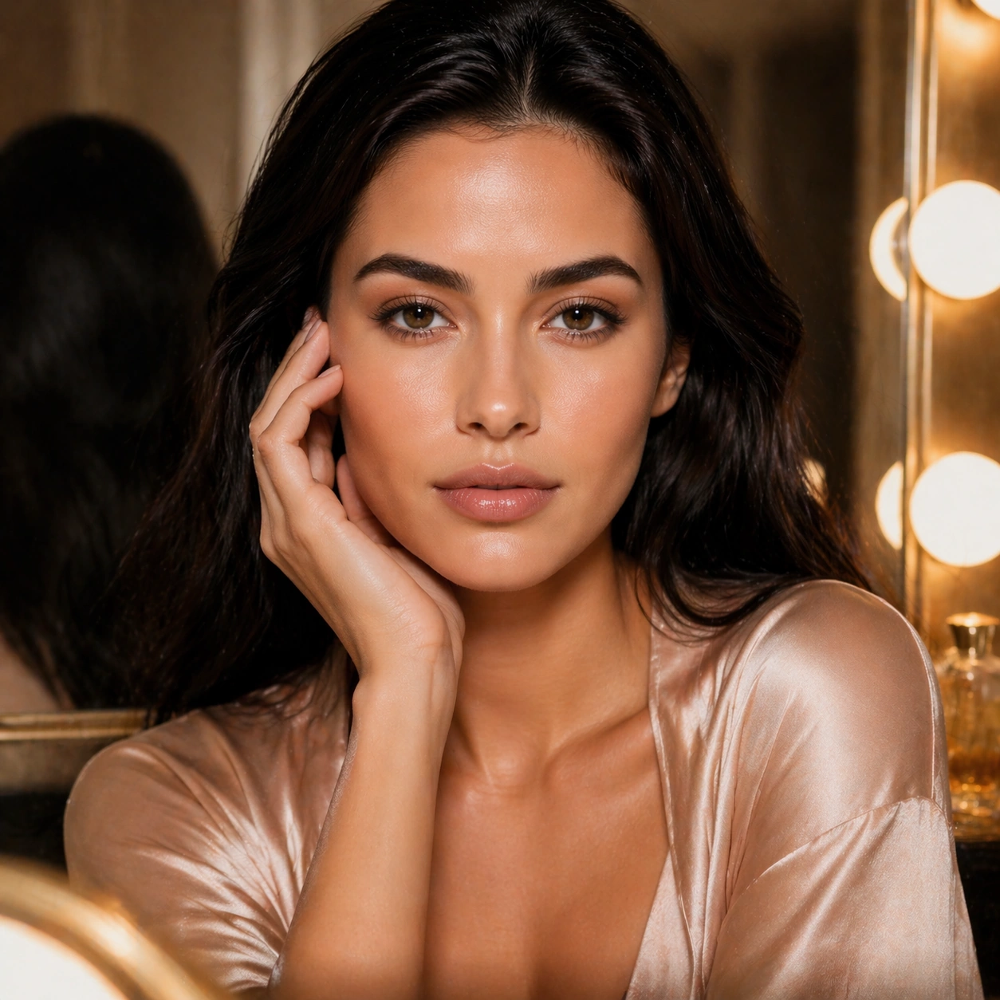

```text
Scene:
Create a square 1:1 portrait image for Luxury Beauty Close-Up Editorial. Use an intimate but polished beauty setup with mirror cues, vanity light, and minimal luxury backstage context. The frame should feel like a finished professional deliverable rather than a casual snapshot, with clear lens discipline, believable light falloff, and a palette that directly supports Create high-end beauty close-up editorials with realistic skin, precise makeup textures, controlled catchlights, and premium magazine polish.. Keep enough surrounding space and compositional control for gallery, research, campaign, or approval-board reuse while staying photoreal and human-scaled.

Subject:
Center one beauty model with warm neutral skin, glossy dark hair, balanced features, refined hands, and pores that remain realistic at close range. Place the same face inside a getting-ready moment while preserving the reference identity and keeping the mood controlled and premium. Use the example direction from the brief as grounding context: Create high-end beauty close-up editorials with realistic skin, precise makeup textures, controlled catchlights, and premium magazine polish.. Wardrobe, lighting, environment, and pose may shift to serve this variation, but the viewer must immediately understand that the same reference identity is still in front of the camera.

Important details:
This backlog line is difficult because Create high-end beauty close-up editorials with realistic skin, precise makeup textures, controlled catchlights, and premium magazine polish.. Preserve skin tone family, bone structure, eye spacing, nose shape, mouth shape, hairline logic, shoulder width, and overall body read across the entire series. preserve exact face / hair base / body proportions from the reference model. The environment may expand slightly, but likeness still outranks atmosphere. Avoid the common failure described in the brief: ordinary image models often lose likeness once styling, lighting, or layout changes enter the frame. Success should feel like the result should feel professionally usable, coherent, and clearly built around one stable human identity.

Use case:
Luxury Beauty Close-Up Editorial series study 8/9, a mirror-prep or vanity-side frame.

Constraints:
No readable text, no watermark, no logos, preserve exact 1:1 aspect ratio, preserve exact face / hair base / body proportions from the reference model, no busy dressing room, no other stylists, no readable mirror stickers, no copied magazine cover.
```

[Pinned source](https://github.com/ChaosRealmsAI/gpt-image-2-gallery/blob/5296db8c996e38776c83a0bc8c64f848dcd512b3/works/topics/luxury-beauty-closeup-editorial/packages/series-beauty-editorial-lock/images/08-mirror-prep-frame/meta.json) · GPT Image2 · 1254×1254 · Reference images required. · ProjectD:pending individual review.

## Luxury Campaign Crop · luxury-beauty-closeup-editorial/series-beauty-editorial-lock/09-luxury-campaign-crop

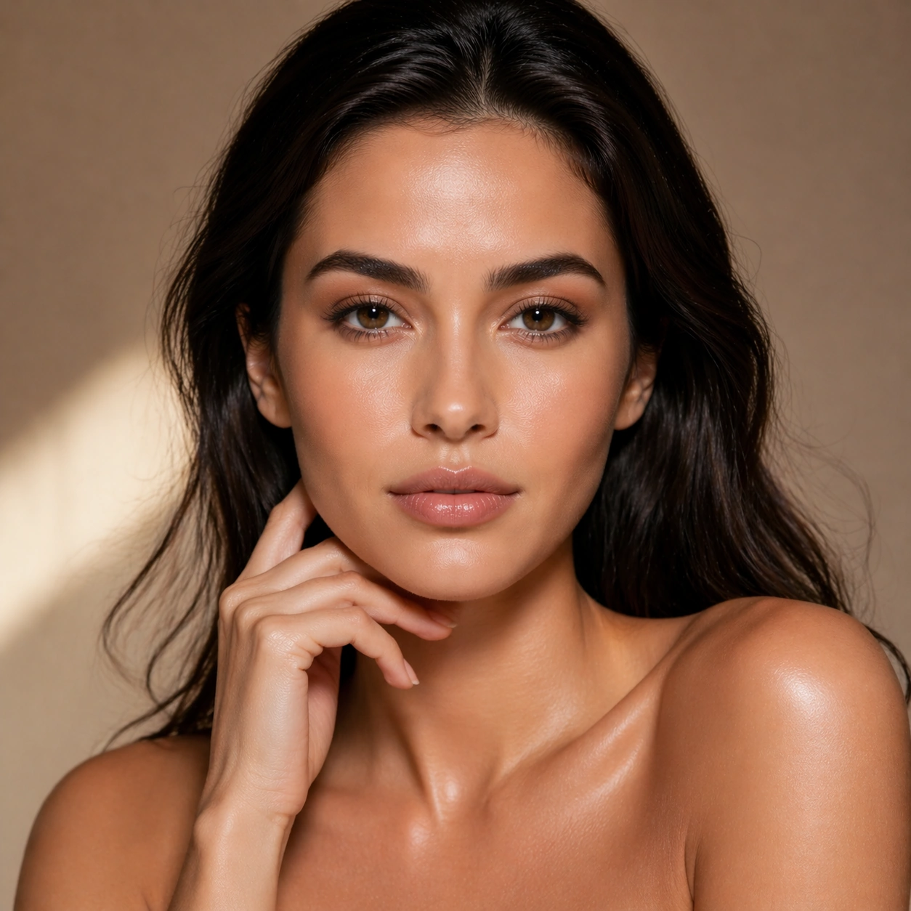

```text
Scene:
Create a square 1:1 portrait image for Luxury Beauty Close-Up Editorial. Use a square beauty-ad finish with poised negative space, refined composition, and expensive skincare or cosmetics energy. The frame should feel like a finished professional deliverable rather than a casual snapshot, with clear lens discipline, believable light falloff, and a palette that directly supports Create high-end beauty close-up editorials with realistic skin, precise makeup textures, controlled catchlights, and premium magazine polish.. Keep enough surrounding space and compositional control for gallery, research, campaign, or approval-board reuse while staying photoreal and human-scaled.

Subject:
Center one beauty model with warm neutral skin, glossy dark hair, balanced features, refined hands, and pores that remain realistic at close range. Resolve the same identity into a finished campaign visual that could anchor a beauty brand launch without any readable copy. Use the example direction from the brief as grounding context: Create high-end beauty close-up editorials with realistic skin, precise makeup textures, controlled catchlights, and premium magazine polish.. Wardrobe, lighting, environment, and pose may shift to serve this variation, but the viewer must immediately understand that the same reference identity is still in front of the camera.

Important details:
This backlog line is difficult because Create high-end beauty close-up editorials with realistic skin, precise makeup textures, controlled catchlights, and premium magazine polish.. Preserve skin tone family, bone structure, eye spacing, nose shape, mouth shape, hairline logic, shoulder width, and overall body read across the entire series. preserve exact face / hair base / body proportions from the reference model. The image must still look like the exact same model introduced in image 01, even at full campaign polish. Avoid the common failure described in the brief: ordinary image models often lose likeness once styling, lighting, or layout changes enter the frame. Success should feel like the result should feel professionally usable, coherent, and clearly built around one stable human identity.

Use case:
Luxury Beauty Close-Up Editorial series study 9/9, a final luxury campaign crop.

Constraints:
No readable text, no watermark, no logos, preserve exact 1:1 aspect ratio, preserve exact face / hair base / body proportions from the reference model, no fake logo copy, no oversized product props, no over-retouched skin, no identity drift.
```

[Pinned source](https://github.com/ChaosRealmsAI/gpt-image-2-gallery/blob/5296db8c996e38776c83a0bc8c64f848dcd512b3/works/topics/luxury-beauty-closeup-editorial/packages/series-beauty-editorial-lock/images/09-luxury-campaign-crop/meta.json) · GPT Image2 · 1254×1254 · Reference images required. · ProjectD:pending individual review.

## Jewelry Craft Atelier · luxury-brand-story-page/single-luxury-story-studies/jewelry-craft-atelier

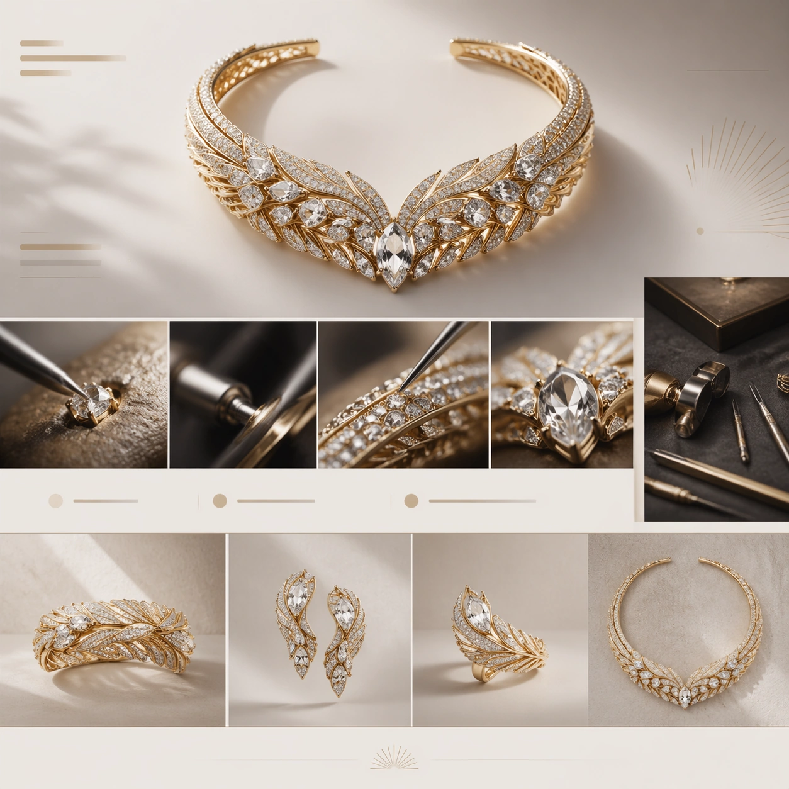

```text
Scene:
A square luxury brand-story page still for a high-jewelry maison, arranged like a chaptered editorial website. The palette is pearl white, champagne beige, pale gold, and charcoal shadow, with crisp but gentle studio lighting. The frame should suggest a hero chapter at top, an atelier process chapter in the middle, and a refined collection overview near the bottom, all held together by calm negative space and elegant alignment.

Subject:
Feature a striking necklace or cuff set with luminous stones and fine metalwork, rendered as the hero object on a minimal background. Build the surrounding web-page narrative with abstract headline bars, atelier-detail modules, gemstone macro crops, and chapter bands that imply hand-setting, polishing, and collection curation without readable text. Include one cropped close-up of clasp or prong details and one narrow supporting panel suggesting an artisan workbench through tools, velvet surface, and reflected metal, while keeping the jewel piece as the visual anchor.

Important details:
The page must communicate high-jewelry prestige and craftsmanship, not bridal catalog commerce. Stone facets, metal polish, pavé texture, and precise settings should feel credible and expensive. The layout rhythm should move from spectacle to craft to collection logic in a refined, editorial way. Use clean chapter breaks, quiet contrast, and exact spacing so the image feels like a real luxury website concept rather than a collage.

Use case:
Luxury Brand Story Page single study 2/9, testing jewelry craft storytelling with atelier detail and luxury editorial web pacing.

Constraints:
No readable text, no watermark, no logos, preserve exact 1:1 aspect ratio, no browser chrome, no model portrait, no wedding cliché styling, no floating glitter storm, no crowded gemstone pile, no malformed stone settings.
```

[Pinned source](https://github.com/ChaosRealmsAI/gpt-image-2-gallery/blob/5296db8c996e38776c83a0bc8c64f848dcd512b3/works/topics/luxury-brand-story-page/packages/single-luxury-story-studies/images/jewelry-craft-atelier/meta.json) · GPT Image2 · 1254×1254 · No source-declared image dependencies. · ProjectD:pending individual review.

## Moonphase Watch Manifesto · luxury-brand-story-page/single-luxury-story-studies/moonphase-watch-manifesto

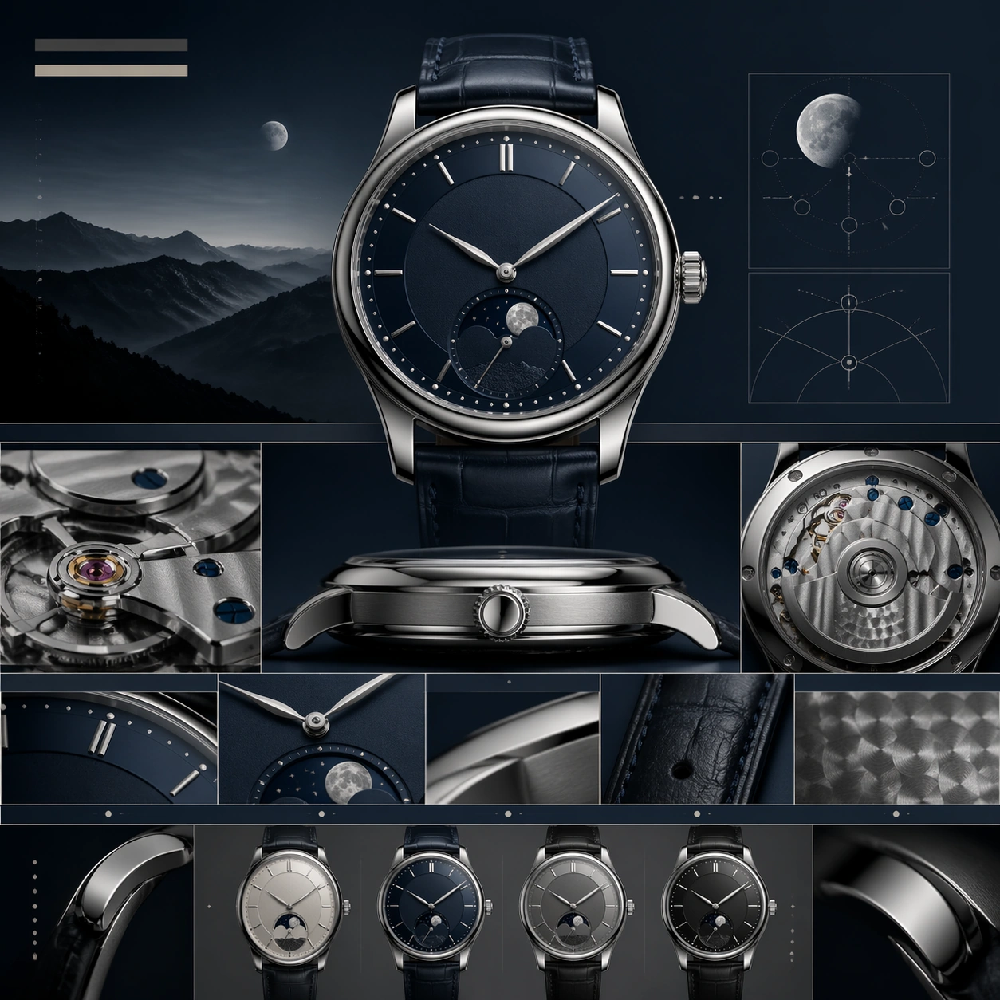

```text
Scene:
A square luxury watch brand-story page still, composed like a chapter from an haute horlogerie website. The color language is steel gray, deep navy, soft cream, and restrained silver highlights. The page should feel precise and serene, with a hero chapter at the top, movement and finishing chapters beneath, and a collection-summary band toward the lower edge. Lighting is clean and directional, revealing polished bevels and brushed metal with controlled reflections.

Subject:
Place a moonphase wristwatch front and center with a carefully proportioned case, elegant dial layers, slender hands, and a refined leather strap. Surround it with a chaptered luxury web composition made from abstract title bars, slim modular rows, macro movement-detail crops, and subtle diagram-like panels showing finishing, complications, and strap craftsmanship without readable words. Include one side-view macro of the crown and case flank, and one supporting module implying the back movement or finishing texture.

Important details:
The image must feel like watchmaking storytelling rather than direct retail sales. The watch should look plausible in scale, thickness, lugs, and dial construction, with crisp moonphase detailing and premium finishing. The page hierarchy should progress from emotional hero to technical intimacy to collection framing, all through elegant spacing and chapter rhythm. Keep the visual tone restrained, intelligent, and truly luxury.

Use case:
Luxury Brand Story Page single study 3/9, testing haute-horlogerie storytelling with movement detail, material finish, and chaptered web composition.

Constraints:
No readable text, no watermark, no logos, preserve exact 1:1 aspect ratio, no browser chrome, no wrist on a model, no cheap chronograph clutter, no oversized lens flare, no sports-watch aggression, no distorted hands or case geometry.
```

[Pinned source](https://github.com/ChaosRealmsAI/gpt-image-2-gallery/blob/5296db8c996e38776c83a0bc8c64f848dcd512b3/works/topics/luxury-brand-story-page/packages/single-luxury-story-studies/images/moonphase-watch-manifesto/meta.json) · GPT Image2 · 1254×1254 · No source-declared image dependencies. · ProjectD:pending individual review.

## Leather Bag Origin Story · luxury-brand-story-page/single-luxury-story-studies/leather-bag-origin-story

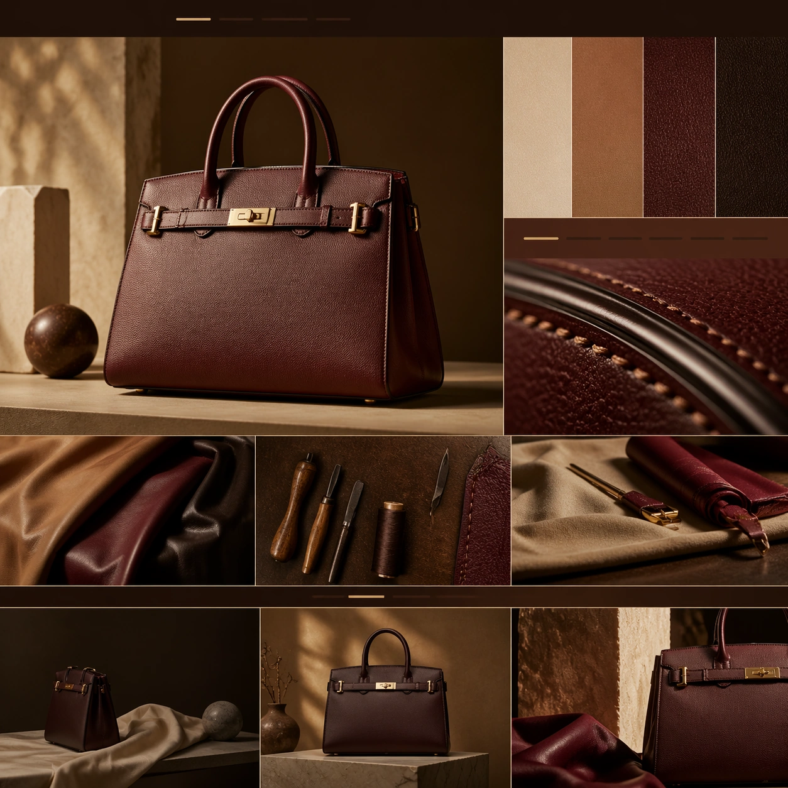

```text
Scene:
A square luxury leather-goods brand-story page still, arranged like a chapter on a fashion maison website. The frame uses warm tan, oxblood, walnut brown, and cream highlights, with soft directional light grazing across surfaces to reveal grain and edge paint. The page should feel like a hero campaign image above a sequence of material, workshop, and styling chapters contained within one elegant square composition.

Subject:
Feature a structured leather bag with rich grain, sharp silhouette, polished hardware, and carefully finished handles. Around it, build a chaptered webpage from abstract title bars, material swatch-style panels, stitching close-up modules, and lifestyle framing bands that imply the bag's origin story and craftsmanship without readable text. Include one macro crop of edge painting and stitch lines, and one supporting panel with leather hides, tools, or folded dust-cover fabric arranged like a fashion still life. The bag remains the central object.

Important details:
The design should express leather craft and maison heritage, not trend-led ecommerce. The bag proportions, leather thickness, stitching, and hardware finish must feel luxurious and manufacturable. Structure the page so the eye moves from hero silhouette to material story to making detail to collection framing. Use quiet chapter rhythm, generous spacing, and rich tactile realism to achieve luxury credibility.

Use case:
Luxury Brand Story Page single study 4/9, testing leather-goods storytelling with tactile craft detail and chaptered fashion-web structure.

Constraints:
No readable text, no watermark, no logos, preserve exact 1:1 aspect ratio, no browser chrome, no model carrying the bag, no shopping-cart UI, no trend collage clutter, no cheap plastic sheen, no distorted straps or hardware.
```

[Pinned source](https://github.com/ChaosRealmsAI/gpt-image-2-gallery/blob/5296db8c996e38776c83a0bc8c64f848dcd512b3/works/topics/luxury-brand-story-page/packages/single-luxury-story-studies/images/leather-bag-origin-story/meta.json) · GPT Image2 · 1254×1254 · No source-declared image dependencies. · ProjectD:pending individual review.

## Silk Scarf Print Atlas · luxury-brand-story-page/single-luxury-story-studies/silk-scarf-print-atlas

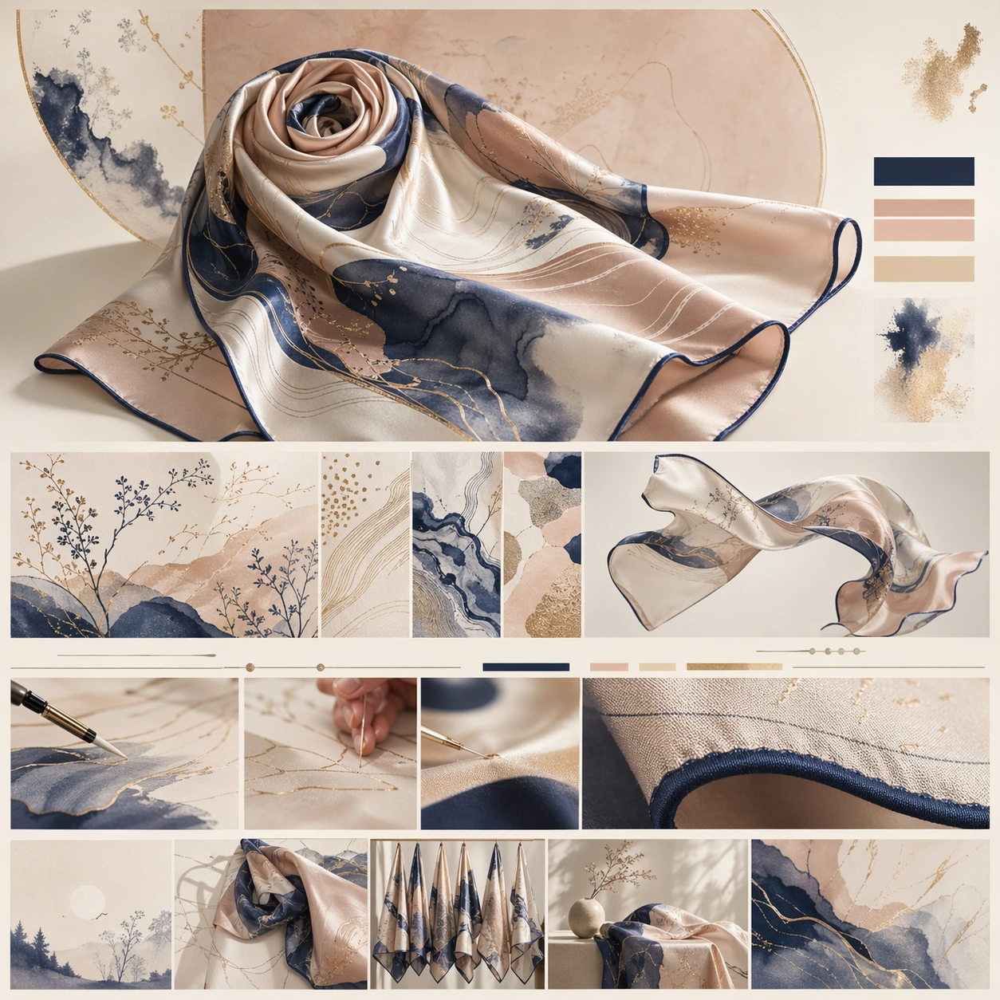

```text
Scene:
A square luxury brand-story page still for a silk scarf collection, styled like an editorial chapter on a couture maison website. The page is luminous and airy, using ivory, blush beige, muted ink blue, and gold-sand accents. It should feel like a soft luxury print story with a hero composition at top and successive chapters about pattern, drape, and hand-finishing below, all within a polished square web frame.

Subject:
Present a silk scarf as the hero object, partially folded and partially unfurled so the print language, rolled edges, and sheen are visible. Around it, construct a chaptered webpage with abstract headline bars, print-detail panels, drape studies, and atelier-style close-ups that imply design process and finishing without readable words. Include one macro crop showing hem stitching and silk texture, plus one supporting panel with the scarf floating or arranged as a sculptural textile form. The scarf should remain central, with the page layout amplifying its pattern system and tactile elegance.

Important details:
The image must communicate maison-level textile storytelling rather than a simple product sheet. Silk sheen, print registration, edge rolling, and color transitions should feel physically plausible and refined. The page hierarchy should move from emotional print hero to textile detail to atelier chapter to collection context. Use elegant negative space, balanced chapter bands, and a luxurious softness without becoming vague or pastel generic.

Use case:
Luxury Brand Story Page single study 5/9, testing silk-scarf storytelling with print-system detail, drape studies, and refined editorial chapter layout.

Constraints:
No readable text, no watermark, no logos, preserve exact 1:1 aspect ratio, no browser chrome, no model portrait, no chaotic fashion collage, no cheap satin shine, no wrinkled discount-retail styling, no distorted print geometry.
```

[Pinned source](https://github.com/ChaosRealmsAI/gpt-image-2-gallery/blob/5296db8c996e38776c83a0bc8c64f848dcd512b3/works/topics/luxury-brand-story-page/packages/single-luxury-story-studies/images/silk-scarf-print-atlas/meta.json) · GPT Image2 · 1254×1254 · No source-declared image dependencies. · ProjectD:pending individual review.

## Couture Heel Runway Page · luxury-brand-story-page/single-luxury-story-studies/couture-heel-runway-page

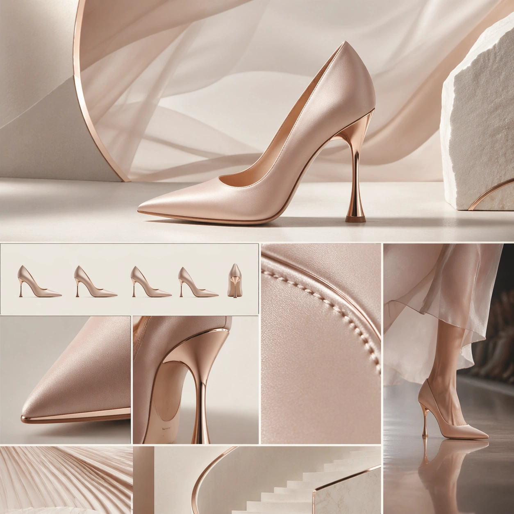

```text
Scene:
A square luxury brand-story page still for a couture heel launch, designed like a fashion maison website chapter. The composition mixes soft runway drama with disciplined web structure: a bone-white background, graphite shadows, blush highlights, and subtle metallic reflections. The top half should read as a statement hero section, while the bottom half breaks into craft, silhouette, and runway-context chapters aligned with clear editorial rhythm.

Subject:
Center a couture high heel with sculptural lines, immaculate leather or satin surface, elegant heel geometry, and a polished sole edge. Build the surrounding brand-story page with abstract title bars, silhouette comparison panels, heel-detail close-ups, and one narrow runway-context module showing the shoe in motion without a visible model face. Add a macro crop of stitching, edge finishing, or heel attachment so the sense of craftsmanship is tangible. The shoe remains the star, while the surrounding modules imply couture heritage and collection narrative.

Important details:
This should feel like an expensive fashion-house chapter, not a shoe-store catalog. The shoe's last, toe shape, heel angle, and material finish must look physically credible and refined. The layout should move from spectacle hero to technical beauty to runway story to collection framing. Preserve luxury restraint, elegant whitespace, and precise alignment so the page feels composed, fashion-literate, and art directed.

Use case:
Luxury Brand Story Page single study 6/9, testing couture footwear storytelling with silhouette precision, craft detail, and runway-inspired chapter layout.

Constraints:
No readable text, no watermark, no logos, preserve exact 1:1 aspect ratio, no browser chrome, no busy model montage, no cheap ecommerce grid, no cartoon fashion graphics, no glitter overload, no distorted heel proportions.
```

[Pinned source](https://github.com/ChaosRealmsAI/gpt-image-2-gallery/blob/5296db8c996e38776c83a0bc8c64f848dcd512b3/works/topics/luxury-brand-story-page/packages/single-luxury-story-studies/images/couture-heel-runway-page/meta.json) · GPT Image2 · 1254×1254 · No source-declared image dependencies. · ProjectD:pending individual review.

## Fountain Pen Heritage Piece · luxury-brand-story-page/single-luxury-story-studies/fountain-pen-heritage-piece

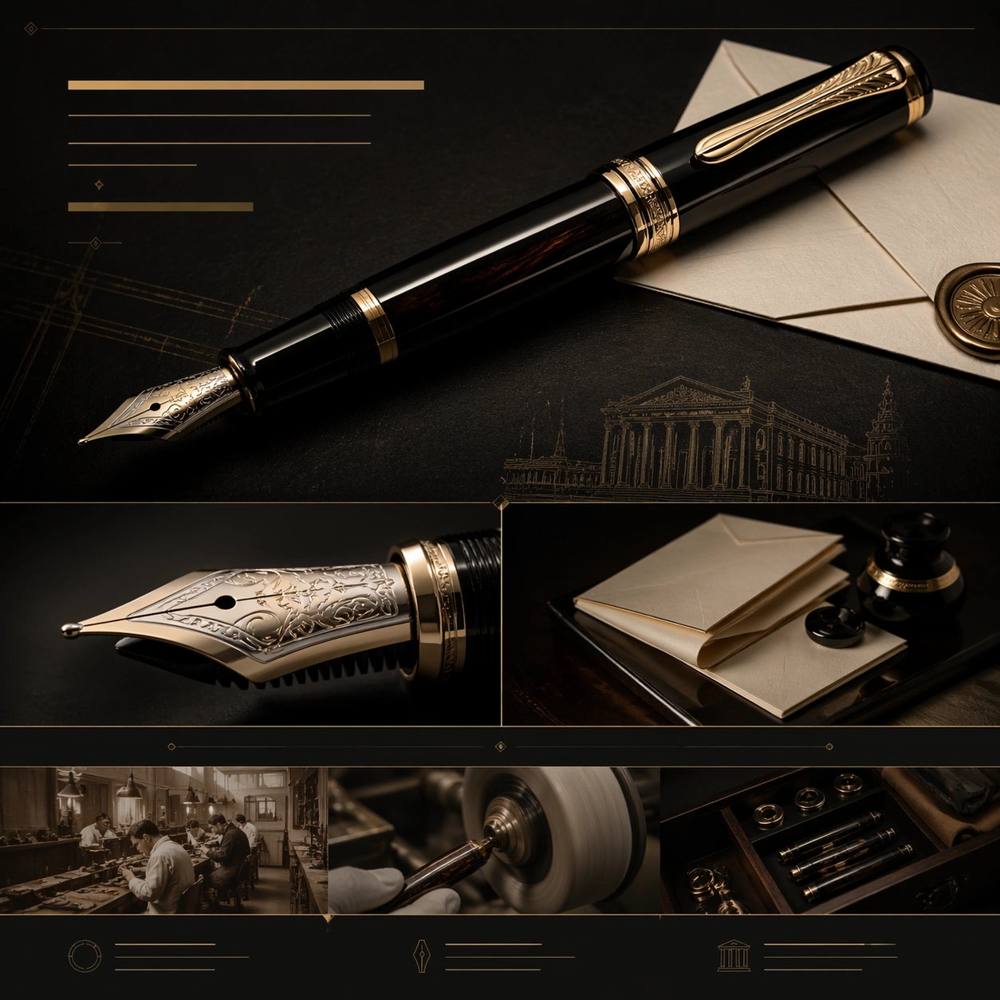

```text
Scene:
A square luxury brand-story page still for a heritage fountain pen launch, laid out like a chapter on a writing-instrument maison website. The palette is deep black, ivory paper, aged brass, and dark lacquer, with directional light that reveals gloss, engraving depth, and polished metal trim. The page should suggest a hero section above chapters about nib craft, material finishing, and lineage, arranged in a refined editorial cadence.

Subject:
Feature a luxury fountain pen as the hero object, slightly angled to show barrel finish, cap banding, clip design, and nib silhouette. Around it, design a believable brand-story page using abstract title bars, nib-detail modules, craftsmanship panels, and chapter bands suggesting heritage, finishing, and writing ritual without readable copy. Include one macro crop of the nib and feed, plus one supporting module with folded stationery, lacquer reflections, or polishing tools arranged as a quiet still life. Keep the pen central and dignified.

Important details:
The page must convey heritage luxury, not office-supply retail. Materials such as lacquer, resin, metal trim, and engraved nib detail should feel plausible and exact. The hierarchy should guide the eye from hero object to nib intimacy to making story to archival aura. Use generous whitespace, deliberate chapter breaks, and a sense of quiet prestige. The image should feel like a collector's launch page for connoisseurs.

Use case:
Luxury Brand Story Page single study 7/9, testing heritage writing-instrument storytelling with nib detail, material finish, and collector-grade web composition.

Constraints:
No readable text, no watermark, no logos, preserve exact 1:1 aspect ratio, no browser chrome, no handwritten copy, no ink splatter chaos, no school-supply look, no crowded desk clutter, no distorted pen proportions or nib anatomy.
```

[Pinned source](https://github.com/ChaosRealmsAI/gpt-image-2-gallery/blob/5296db8c996e38776c83a0bc8c64f848dcd512b3/works/topics/luxury-brand-story-page/packages/single-luxury-story-studies/images/fountain-pen-heritage-piece/meta.json) · GPT Image2 · 1254×1254 · No source-declared image dependencies. · ProjectD:pending individual review.

## Porcelain Skincare Ritual · luxury-brand-story-page/single-luxury-story-studies/porcelain-skincare-ritual

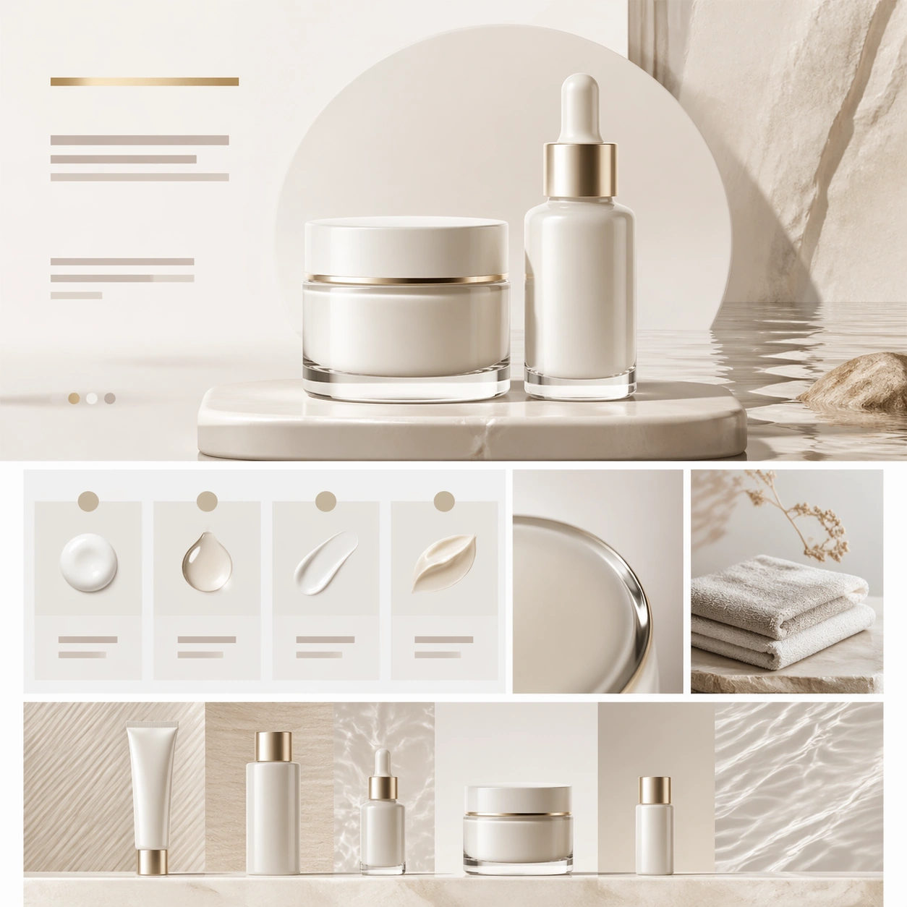

```text
Scene:
A square luxury skincare brand-story page still, designed as a calm chapter from a prestige beauty website. The frame uses porcelain white, pale sand, soft taupe, and very restrained metallic accents, with luminous clean lighting that feels spa-like but high fashion. The composition should suggest a hero chapter at top, ritual and ingredient chapters in the middle, and a collection overview band below, all maintained through precise spacing and quiet editorial structure.

Subject:
Center a porcelain-like skincare jar and serum bottle with refined caps, thick glass or ceramic walls, and minimal sculptural form. Surround them with a believable brand-story page made of abstract headline bars, ritual-step cards, material close-up panels, and collection strips that imply formulation care and sensorial luxury without readable text. Include one macro crop of the jar lid edge or serum dropper detail, and one supporting panel with stone, folded towel, or water reflection arranged as a tactile atmosphere image. Keep the products dominant and serene.

Important details:
The page should feel like a luxury beauty maison rather than mainstream cosmetics marketing. Surfaces must be immaculate, creamy, and materially believable, while the layout must preserve chapter rhythm from hero object to ritual story to close-up detail to collection framing. Avoid busy ingredient collage language. Use silence, soft contrast, and premium spacing so the whole page feels elevated, restrained, and therapeutic.

Use case:
Luxury Brand Story Page single study 8/9, testing prestige skincare storytelling with ritual pacing, tactile beauty materials, and calm chaptered web layout.

Constraints:
No readable text, no watermark, no logos, preserve exact 1:1 aspect ratio, no browser chrome, no smiling model face, no medical infographic style, no floating fruit slices, no discount-beauty clutter, no distorted jars or droppers.
```

[Pinned source](https://github.com/ChaosRealmsAI/gpt-image-2-gallery/blob/5296db8c996e38776c83a0bc8c64f848dcd512b3/works/topics/luxury-brand-story-page/packages/single-luxury-story-studies/images/porcelain-skincare-ritual/meta.json) · GPT Image2 · 1254×1254 · No source-declared image dependencies. · ProjectD:pending individual review.

## Crystal Decanter Collection · luxury-brand-story-page/single-luxury-story-studies/crystal-decanter-collection

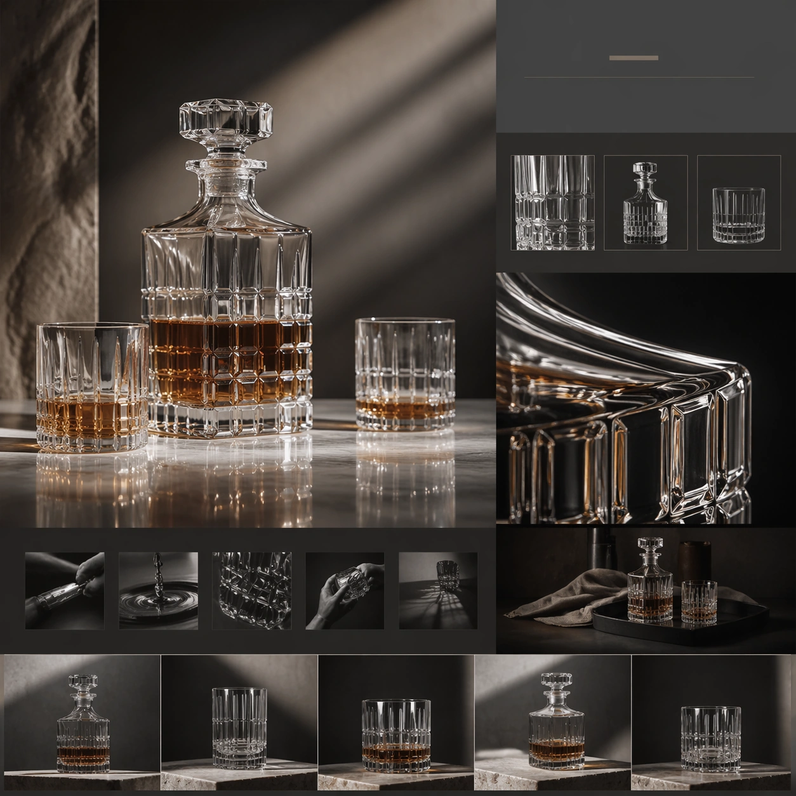

```text
Scene:
A square luxury brand-story page still for a crystal decanter collection, composed like a refined lifestyle-maison web chapter. The palette is smoke gray, warm crystal highlights, pale stone, and deep charcoal, with controlled light refraction and elegant reflections. The frame should feel like a hero chapter above material and collecting chapters, arranged within a highly polished editorial web layout.

Subject:
Feature a crystal decanter and matching glassware as the hero objects, rendered with believable weight, bevels, liquid reflections, and subtle tinting. Build the surrounding web composition from abstract title bars, collection cards, crystal-detail close-ups, and chapter bands suggesting craftsmanship, ritual, and object curation without readable text. Include one macro crop of the cut crystal edge and one supporting still-life module with tray, fabric, or shadow pattern to imply an intimate collector environment. The crystal objects remain central and luxurious.

Important details:
The image should communicate collector-grade luxury and object culture, not barware retail. Glass thickness, refraction, stopper fit, and facet geometry must feel plausible and expensive. The page hierarchy should move from spectacle hero to craft detail to lifestyle ritual to collection framing, all through measured spacing and quiet restraint. The overall mood should feel cinematic, tactile, and premium, without becoming flashy.

Use case:
Luxury Brand Story Page single study 9/9, testing crystal-object storytelling with collector atmosphere, material close-up, and chaptered luxury web rhythm.

Constraints:
No readable text, no watermark, no logos, preserve exact 1:1 aspect ratio, no browser chrome, no crowded bar scene, no party people, no exaggerated neon reflections, no cheap liquor-ad clichés, no distorted glass refraction or stopper geometry.
```

[Pinned source](https://github.com/ChaosRealmsAI/gpt-image-2-gallery/blob/5296db8c996e38776c83a0bc8c64f848dcd512b3/works/topics/luxury-brand-story-page/packages/single-luxury-story-studies/images/crystal-decanter-collection/meta.json) · GPT Image2 · 1254×1254 · No source-declared image dependencies. · ProjectD:pending individual review.

## Arrival Portal Wide · luxury-hotel-lobby-arrival-system/series-spatial-language-lock/01-arrival-portal-wide

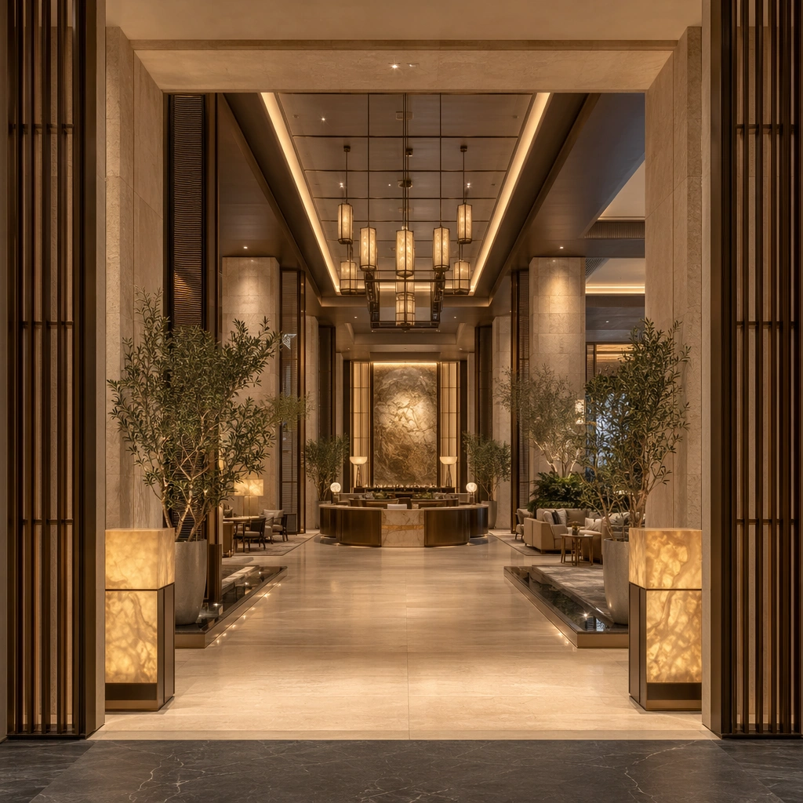

```text
Scene:
Create a square architectural reference still for Luxury Hotel Lobby Arrival System. Use a frontal wide view from the drop-off threshold into the full lobby and treat the frame like a premium interior or architecture editorial photograph with disciplined perspective, readable depth from foreground to background, and enough negative space for the spatial hierarchy to breathe. Light the scene so arrival drama, tactile materials, and premium circulation feel immediate, using warm limestone, honey amber, muted bronze, deep olive planting, and soft charcoal shadows as the governing tonal range. The composition must read as a high-end commercial image that could sit inside campaign stills, hospitality editorials, investor decks, and operator handoff boards.

Subject:
Show a grand luxury hotel lobby with limestone slabs, smoked bronze screens, amber onyx accents, sculpted concierge islands, mirror-still water details, and a calm hospitality atmosphere. Center the first impression of the porte cochere threshold, the long sightline to reception, and the layered lighting depth. This is the canonical reference image for the package, so the major proportions, material transitions, fixture families, and circulation logic must feel highly specific and internally coherent rather than generic luxury styling. Let the viewer understand how the space is organized within a single glance, with foreground anchors, a clear middle zone, and a resolved background termination.

Important details:
Lock the portal proportions, stone-and-bronze palette, concierge desk geometry, lantern rhythm, seating family, and abstract wayfinding zones. Surfaces should feel tactile and believable: stone veining must stay plausible, metals should have disciplined reflectance, fabrics should show natural weight, and concealed lighting should shape the volume instead of flattening it. Use abstract signage, menu, label, or caption zones only as unreadable graphic hints. The image should feel practical for downstream design reviews and polished enough for public-facing campaign use.

Use case:
Luxury Hotel Lobby Arrival System series study 1/9, establishing the canonical arrival composition for the whole package.

Constraints:
No readable text, no watermark, no logos, preserve exact 1:1 aspect ratio, no guests, no staff, no suitcases scattered everywhere, no casino mood, no festive balloons, no parked cars blocking the portal.
```

[Pinned source](https://github.com/ChaosRealmsAI/gpt-image-2-gallery/blob/5296db8c996e38776c83a0bc8c64f848dcd512b3/works/topics/luxury-hotel-lobby-arrival-system/packages/series-spatial-language-lock/images/01-arrival-portal-wide/meta.json) · GPT Image2 · 1024×1024 · No source-declared image dependencies. · ProjectD:pending individual review.

## Reception Axis · luxury-hotel-lobby-arrival-system/series-spatial-language-lock/02-reception-axis

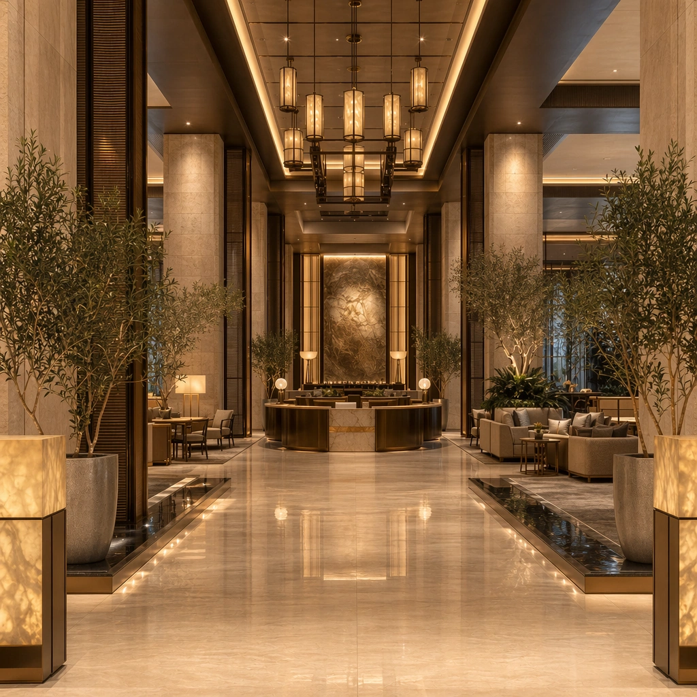

```text
Scene:
Create a square reference-dependent architecture still for Luxury Hotel Lobby Arrival System. Use a slightly closer camera aligned to the reception axis while keeping the same lens discipline, editorial polish, and material believability established by the reference image. The lighting can shift to support the intended mood, but the space must still feel like the same authored project with a stable viewpoint logic, convincing depth separation, and clean commercial-photography finish. Keep warm limestone, honey amber, muted bronze, deep olive planting, and soft charcoal shadows as the governing tonal range even when the emphasis changes.

Subject:
Show a grand luxury hotel lobby with limestone slabs, smoked bronze screens, amber onyx accents, sculpted concierge islands, mirror-still water details, and a calm hospitality atmosphere. Focus on the exact same lobby from the reference image, now emphasizing the concierge islands, check-in choreography, and floor reflection. Preserve exact architectural identity, plan logic, material palette, fixture family, and circulation cues from the reference image while changing only the intended emphasis described here. The viewer should immediately recognize the same project, not a loose cousin, with matching silhouette logic, aligned detailing, and consistent brand atmosphere.

Important details:
Preserve the portal proportions, stone-and-bronze palette, concierge desk geometry, lantern rhythm, seating family, and abstract wayfinding zones. Any abstract wayfinding, menu, wall-label, or packaging zones must stay unreadable and subordinate to the spatial image. Joinery, edges, reflections, and lighting should remain realistic enough for an operator or design team to treat the image as a credible reference. The variation should feel deliberate and commercially useful, proving that one locked spatial language can flex across multiple campaign or editorial surfaces.

Use case:
Luxury Hotel Lobby Arrival System series study 2/9, extending reception hierarchy and service calm while preserving the reference identity.

Constraints:
No readable text, no watermark, no logos, preserve exact 1:1 aspect ratio, preserve exact architectural identity from the reference image, no guests, no staff, no suitcases scattered everywhere, no casino mood, no festive balloons, no flower-overload centerpiece.
```

[Pinned source](https://github.com/ChaosRealmsAI/gpt-image-2-gallery/blob/5296db8c996e38776c83a0bc8c64f848dcd512b3/works/topics/luxury-hotel-lobby-arrival-system/packages/series-spatial-language-lock/images/02-reception-axis/meta.json) · GPT Image2 · 1024×1024 · Reference images required. · ProjectD:pending individual review.

## Lounge Threshold at Dusk · luxury-hotel-lobby-arrival-system/series-spatial-language-lock/03-lounge-threshold-dusk

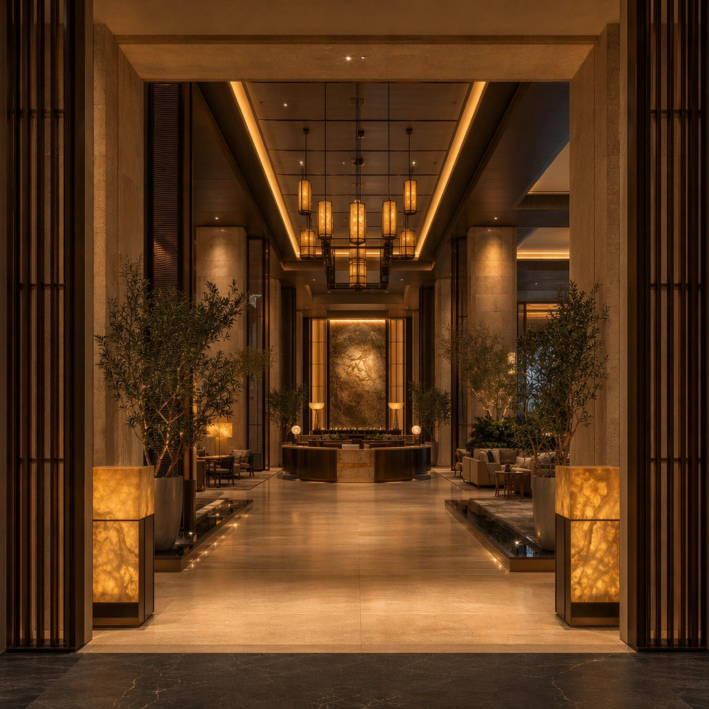

```text
Scene:
Create a square reference-dependent architecture still for Luxury Hotel Lobby Arrival System. Use a dusk angle from the lounge threshold toward the lobby core while keeping the same lens discipline, editorial polish, and material believability established by the reference image. The lighting can shift to support the intended mood, but the space must still feel like the same authored project with a stable viewpoint logic, convincing depth separation, and clean commercial-photography finish. Keep warm limestone, honey amber, muted bronze, deep olive planting, and soft charcoal shadows as the governing tonal range even when the emphasis changes.

Subject:
Show a grand luxury hotel lobby with limestone slabs, smoked bronze screens, amber onyx accents, sculpted concierge islands, mirror-still water details, and a calm hospitality atmosphere. Focus on the exact same lobby from the reference image, now emphasizing evening glow, lounge grouping, and the transition from arrival to waiting. Preserve exact architectural identity, plan logic, material palette, fixture family, and circulation cues from the reference image while changing only the intended emphasis described here. The viewer should immediately recognize the same project, not a loose cousin, with matching silhouette logic, aligned detailing, and consistent brand atmosphere.

Important details:
Preserve the portal proportions, stone-and-bronze palette, concierge desk geometry, lantern rhythm, seating family, and abstract wayfinding zones. Any abstract wayfinding, menu, wall-label, or packaging zones must stay unreadable and subordinate to the spatial image. Joinery, edges, reflections, and lighting should remain realistic enough for an operator or design team to treat the image as a credible reference. The variation should feel deliberate and commercially useful, proving that one locked spatial language can flex across multiple campaign or editorial surfaces.

Use case:
Luxury Hotel Lobby Arrival System series study 3/9, extending the evening hospitality mood without changing the architecture.

Constraints:
No readable text, no watermark, no logos, preserve exact 1:1 aspect ratio, preserve exact architectural identity from the reference image, no guests, no staff, no suitcases scattered everywhere, no casino mood, no festive balloons, no nightclub neon.
```

[Pinned source](https://github.com/ChaosRealmsAI/gpt-image-2-gallery/blob/5296db8c996e38776c83a0bc8c64f848dcd512b3/works/topics/luxury-hotel-lobby-arrival-system/packages/series-spatial-language-lock/images/03-lounge-threshold-dusk/meta.json) · GPT Image2 · 1024×1024 · Reference images required. · ProjectD:pending individual review.

## Elevator Vault Corner · luxury-hotel-lobby-arrival-system/series-spatial-language-lock/04-elevator-vault-corner

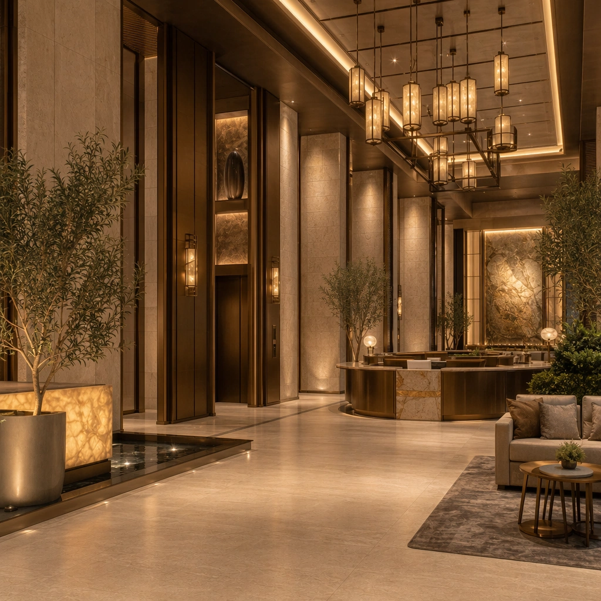

```text
Scene:
Create a square reference-dependent architecture still for Luxury Hotel Lobby Arrival System. Use a composed corner view toward the elevator vestibule and bronze portals while keeping the same lens discipline, editorial polish, and material believability established by the reference image. The lighting can shift to support the intended mood, but the space must still feel like the same authored project with a stable viewpoint logic, convincing depth separation, and clean commercial-photography finish. Keep warm limestone, honey amber, muted bronze, deep olive planting, and soft charcoal shadows as the governing tonal range even when the emphasis changes.

Subject:
Show a grand luxury hotel lobby with limestone slabs, smoked bronze screens, amber onyx accents, sculpted concierge islands, mirror-still water details, and a calm hospitality atmosphere. Focus on the exact same lobby from the reference image, now focusing on the elevator side, sculptural wall niches, and circulation turn. Preserve exact architectural identity, plan logic, material palette, fixture family, and circulation cues from the reference image while changing only the intended emphasis described here. The viewer should immediately recognize the same project, not a loose cousin, with matching silhouette logic, aligned detailing, and consistent brand atmosphere.

Important details:
Preserve the portal proportions, stone-and-bronze palette, concierge desk geometry, lantern rhythm, seating family, and abstract wayfinding zones. Any abstract wayfinding, menu, wall-label, or packaging zones must stay unreadable and subordinate to the spatial image. Joinery, edges, reflections, and lighting should remain realistic enough for an operator or design team to treat the image as a credible reference. The variation should feel deliberate and commercially useful, proving that one locked spatial language can flex across multiple campaign or editorial surfaces.

Use case:
Luxury Hotel Lobby Arrival System series study 4/9, extending secondary circulation and vertical-transition logic within the same identity.

Constraints:
No readable text, no watermark, no logos, preserve exact 1:1 aspect ratio, preserve exact architectural identity from the reference image, no guests, no staff, no suitcases scattered everywhere, no casino mood, no festive balloons, no exposed service doors.
```

[Pinned source](https://github.com/ChaosRealmsAI/gpt-image-2-gallery/blob/5296db8c996e38776c83a0bc8c64f848dcd512b3/works/topics/luxury-hotel-lobby-arrival-system/packages/series-spatial-language-lock/images/04-elevator-vault-corner/meta.json) · GPT Image2 · 1024×1024 · Reference images required. · ProjectD:pending individual review.

## Seating Cluster Editorial · luxury-hotel-lobby-arrival-system/single-support-studies/02-seating-cluster-editorial

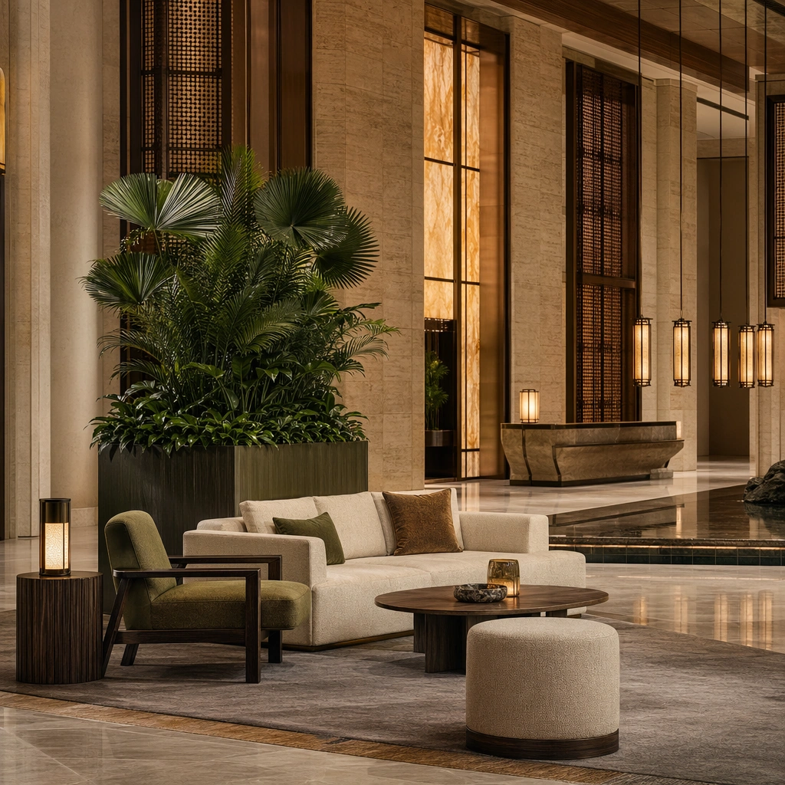

```text
Scene:
Create a square standalone support study for Luxury Hotel Lobby Arrival System. Use a square editorial still centered on a lounge seating cluster beside a tall planter and frame it like a premium commercial still or design-editorial crop with clear focal hierarchy, disciplined perspective, and enough breathing room for the materials and objects to read at both thumbnail and full size. Keep warm limestone, honey amber, muted bronze, deep olive planting, and soft charcoal shadows as the tonal guide so the image still belongs to the same theme family, and light the scene in a controlled way that emphasizes texture, edge quality, and authored atmosphere over spectacle.

Subject:
Show a grand luxury hotel lobby with limestone slabs, smoked bronze screens, amber onyx accents, sculpted concierge islands, mirror-still water details, and a calm hospitality atmosphere. In this support study, focus on upholstery tone, low table styling, rug geometry, and generous negative space. The image should work independently, yet it must still feel like it belongs to the same broader world of Hotel Lobby. Make the space, props, and detailing useful for real campaign, editorial, or design-review contexts rather than moodboard abstraction.

Important details:
Carry forward the broader language of the portal proportions, stone-and-bronze palette, concierge desk geometry, lantern rhythm, seating family, and abstract wayfinding zones, but let this image prove a new support surface or secondary deliverable. Material realism is essential: wood grain, metal sheen, glass edges, textiles, and stone should feel physically plausible and carefully art directed. Any graphic panels, labels, menus, packaging, or captions must stay abstract and unreadable. The overall result should feel reusable for campaign stills, hospitality editorials, investor decks, and operator handoff boards, with enough structure that a creative or operations team could build on it.

Use case:
Luxury Hotel Lobby Arrival System single study 6/9, exploring lobby lounge styling for campaigns and brochures.

Constraints:
No readable text, no watermark, no logos, preserve exact 1:1 aspect ratio, no guests, no staff, no suitcases scattered everywhere, no casino mood, no festive balloons, no messy magazines.
```

[Pinned source](https://github.com/ChaosRealmsAI/gpt-image-2-gallery/blob/5296db8c996e38776c83a0bc8c64f848dcd512b3/works/topics/luxury-hotel-lobby-arrival-system/packages/single-support-studies/images/02-seating-cluster-editorial/meta.json) · GPT Image2 · 1024×1024 · No source-declared image dependencies. · ProjectD:pending individual review.

## Wayfinding Plinth Study · luxury-hotel-lobby-arrival-system/single-support-studies/03-wayfinding-plinth-study

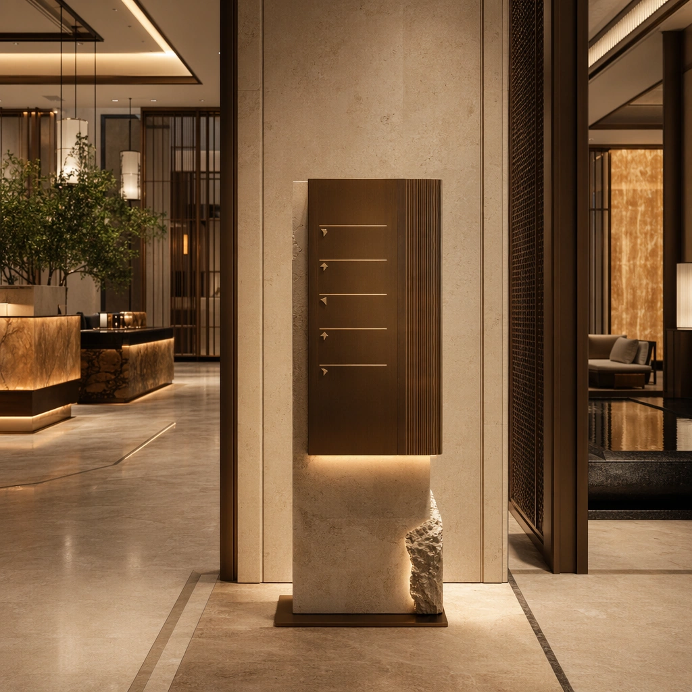

```text
Scene:
Create a square standalone support study for Luxury Hotel Lobby Arrival System. Use a sculptural wayfinding plinth and corridor junction photographed front-on and frame it like a premium commercial still or design-editorial crop with clear focal hierarchy, disciplined perspective, and enough breathing room for the materials and objects to read at both thumbnail and full size. Keep warm limestone, honey amber, muted bronze, deep olive planting, and soft charcoal shadows as the tonal guide so the image still belongs to the same theme family, and light the scene in a controlled way that emphasizes texture, edge quality, and authored atmosphere over spectacle.

Subject:
Show a grand luxury hotel lobby with limestone slabs, smoked bronze screens, amber onyx accents, sculpted concierge islands, mirror-still water details, and a calm hospitality atmosphere. In this support study, focus on abstract signage zones, stone plinth proportion, concealed lighting, and threshold clarity. The image should work independently, yet it must still feel like it belongs to the same broader world of Hotel Lobby. Make the space, props, and detailing useful for real campaign, editorial, or design-review contexts rather than moodboard abstraction.

Important details:
Carry forward the broader language of the portal proportions, stone-and-bronze palette, concierge desk geometry, lantern rhythm, seating family, and abstract wayfinding zones, but let this image prove a new support surface or secondary deliverable. Material realism is essential: wood grain, metal sheen, glass edges, textiles, and stone should feel physically plausible and carefully art directed. Any graphic panels, labels, menus, packaging, or captions must stay abstract and unreadable. The overall result should feel reusable for campaign stills, hospitality editorials, investor decks, and operator handoff boards, with enough structure that a creative or operations team could build on it.

Use case:
Luxury Hotel Lobby Arrival System single study 7/9, exploring directional branding support without readable language.

Constraints:
No readable text, no watermark, no logos, preserve exact 1:1 aspect ratio, no guests, no staff, no suitcases scattered everywhere, no casino mood, no festive balloons, no arrows made of text.
```

[Pinned source](https://github.com/ChaosRealmsAI/gpt-image-2-gallery/blob/5296db8c996e38776c83a0bc8c64f848dcd512b3/works/topics/luxury-hotel-lobby-arrival-system/packages/single-support-studies/images/03-wayfinding-plinth-study/meta.json) · GPT Image2 · 1024×1024 · No source-declared image dependencies. · ProjectD:pending individual review.

## Rainy Canopy Night · luxury-hotel-lobby-arrival-system/single-support-studies/04-rainy-canopy-night

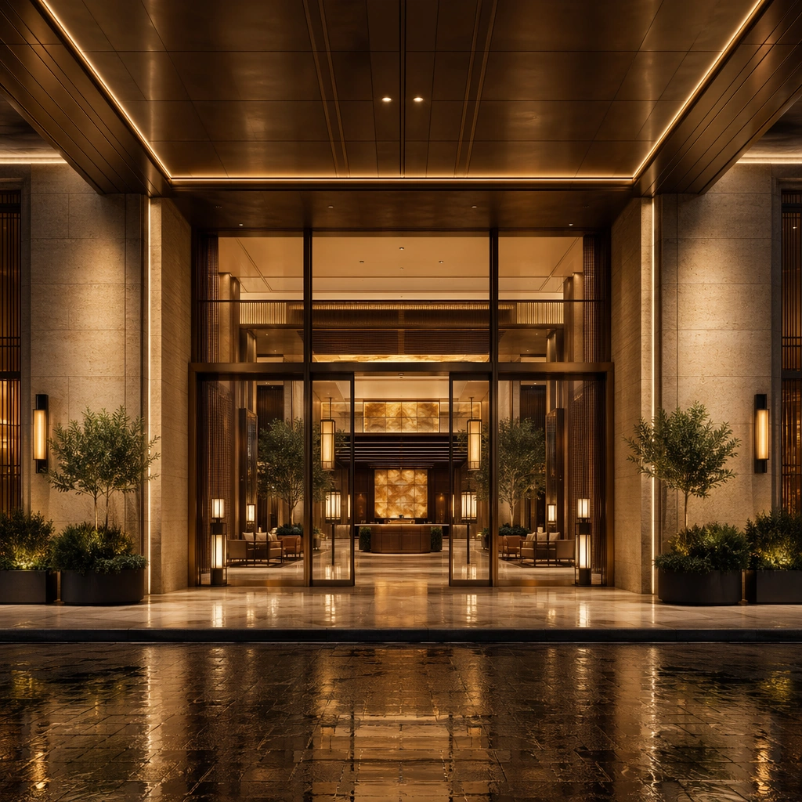

```text
Scene:
Create a square standalone support study for Luxury Hotel Lobby Arrival System. Use an exterior-to-interior night still under the hotel canopy after rain and frame it like a premium commercial still or design-editorial crop with clear focal hierarchy, disciplined perspective, and enough breathing room for the materials and objects to read at both thumbnail and full size. Keep warm limestone, honey amber, muted bronze, deep olive planting, and soft charcoal shadows as the tonal guide so the image still belongs to the same theme family, and light the scene in a controlled way that emphasizes texture, edge quality, and authored atmosphere over spectacle.

Subject:
Show a grand luxury hotel lobby with limestone slabs, smoked bronze screens, amber onyx accents, sculpted concierge islands, mirror-still water details, and a calm hospitality atmosphere. In this support study, focus on wet stone reflections, warm interior spill, bronze soffit detail, and premium curb arrival mood. The image should work independently, yet it must still feel like it belongs to the same broader world of Hotel Lobby. Make the space, props, and detailing useful for real campaign, editorial, or design-review contexts rather than moodboard abstraction.

Important details:
Carry forward the broader language of the portal proportions, stone-and-bronze palette, concierge desk geometry, lantern rhythm, seating family, and abstract wayfinding zones, but let this image prove a new support surface or secondary deliverable. Material realism is essential: wood grain, metal sheen, glass edges, textiles, and stone should feel physically plausible and carefully art directed. Any graphic panels, labels, menus, packaging, or captions must stay abstract and unreadable. The overall result should feel reusable for campaign stills, hospitality editorials, investor decks, and operator handoff boards, with enough structure that a creative or operations team could build on it.

Use case:
Luxury Hotel Lobby Arrival System single study 8/9, exploring night arrival marketing imagery for the same hotel language.

Constraints:
No readable text, no watermark, no logos, preserve exact 1:1 aspect ratio, no guests, no staff, no suitcases scattered everywhere, no casino mood, no festive balloons, no taxis or logos.
```

[Pinned source](https://github.com/ChaosRealmsAI/gpt-image-2-gallery/blob/5296db8c996e38776c83a0bc8c64f848dcd512b3/works/topics/luxury-hotel-lobby-arrival-system/packages/single-support-studies/images/04-rainy-canopy-night/meta.json) · GPT Image2 · 1024×1024 · No source-declared image dependencies. · ProjectD:pending individual review.

## Material and Amenity Board · luxury-hotel-lobby-arrival-system/single-support-studies/05-material-amenity-board

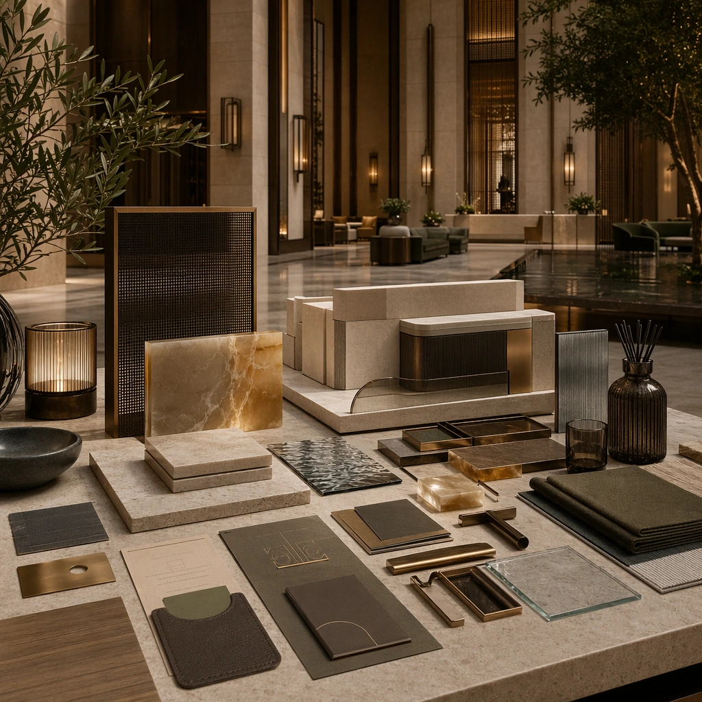

```text
Scene:
Create a square standalone support study for Luxury Hotel Lobby Arrival System. Use a curated tabletop board of stone, bronze, keycard sleeve forms, linen, and scent objects and frame it like a premium commercial still or design-editorial crop with clear focal hierarchy, disciplined perspective, and enough breathing room for the materials and objects to read at both thumbnail and full size. Keep warm limestone, honey amber, muted bronze, deep olive planting, and soft charcoal shadows as the tonal guide so the image still belongs to the same theme family, and light the scene in a controlled way that emphasizes texture, edge quality, and authored atmosphere over spectacle.

Subject:
Show a grand luxury hotel lobby with limestone slabs, smoked bronze screens, amber onyx accents, sculpted concierge islands, mirror-still water details, and a calm hospitality atmosphere. In this support study, focus on hospitality material hierarchy arranged like a design review board with tactile realism. The image should work independently, yet it must still feel like it belongs to the same broader world of Hotel Lobby. Make the space, props, and detailing useful for real campaign, editorial, or design-review contexts rather than moodboard abstraction.

Important details:
Carry forward the broader language of the portal proportions, stone-and-bronze palette, concierge desk geometry, lantern rhythm, seating family, and abstract wayfinding zones, but let this image prove a new support surface or secondary deliverable. Material realism is essential: wood grain, metal sheen, glass edges, textiles, and stone should feel physically plausible and carefully art directed. Any graphic panels, labels, menus, packaging, or captions must stay abstract and unreadable. The overall result should feel reusable for campaign stills, hospitality editorials, investor decks, and operator handoff boards, with enough structure that a creative or operations team could build on it.

Use case:
Luxury Hotel Lobby Arrival System single study 9/9, exploring support imagery for brand presentations and interior concept approvals.

Constraints:
No readable text, no watermark, no logos, preserve exact 1:1 aspect ratio, no guests, no staff, no suitcases scattered everywhere, no casino mood, no festive balloons, no readable card text.
```

[Pinned source](https://github.com/ChaosRealmsAI/gpt-image-2-gallery/blob/5296db8c996e38776c83a0bc8c64f848dcd512b3/works/topics/luxury-hotel-lobby-arrival-system/packages/single-support-studies/images/05-material-amenity-board/meta.json) · GPT Image2 · 1024×1024 · No source-declared image dependencies. · ProjectD:pending individual review.

## Reference Echo Frame · lyric-visualizer-frame-family/series-frame-motion/01-reference-echo-frame


```text
Scene:
A square music-visualizer still suspended between editorial poster and motion-graphics frame, with a dark indigo room, one backlit performer silhouette, fog-softened light beams, and gently curved waveform arcs crossing the composition. The image should feel like a frozen moment from a lyric loop, with room for rhythm, repetition, and future motion.

Subject:
The core subject is a standing performer silhouette centered within a disciplined frame system of luminous waveform lines, translucent panels, and stacked bands of invented glyph-like marks that suggest lyrics without becoming readable language. This first image must establish the exact composition grammar that later frames depend on: silhouette scale, glyph density, panel placement, and wave curvature.

Important details:
Treat the pseudo-typographic zones as visual rhythm rather than text. Use glowing bars, abstract marks, and staggered motion echoes that imply sung lines. The frame must look commercially plausible for a lyric visualizer or teaser loop, with clean hierarchy, cinematic atmosphere, and a coherent color world of indigo, silver, and soft rose. It should feel designed, not like a random VJ screen grab.

Use case:
Lyric Frames series study 1/9 for the Lyric Visualizer Frame Family Prompt Atlas theme.

Constraints:
No readable text, no watermark, no logos, preserve exact 1:1 aspect ratio, no readable lyrics, no interface chrome, no concert crowd, no giant speaker stacks, no bright rainbow gradients, no literal subtitles
```

[Pinned source](https://github.com/ChaosRealmsAI/gpt-image-2-gallery/blob/5296db8c996e38776c83a0bc8c64f848dcd512b3/works/topics/lyric-visualizer-frame-family/packages/series-frame-motion/images/01-reference-echo-frame/meta.json) · GPT Image2 · 1024×1024 · No source-declared image dependencies. · ProjectD:pending individual review.

## Rainfall Chorus · lyric-visualizer-frame-family/series-frame-motion/02-rainfall-chorus


```text
Scene:
A square visualizer frame set in the same indigo stage world, now crossed by diagonal rain streaks, brighter waveform flares, and a stronger sense of rhythmic impact. The composition should remain recognizably derived from the reference frame, keeping the same panel structure and silhouette scale while adding a more emotional chorus energy.

Subject:
Preserve the same performer silhouette placement, waveform geometry, panel spacing, and invented glyph density from the reference image. The performer appears mid-breath and slightly lifted by backlight haze, while the lyric bars intensify into layered glowing stacks that still remain completely non-readable.

Important details:
The purpose is to show how one lyric-visualizer system scales into a chorus frame without losing design control. Keep the same core palette and grid logic, but let rain, flare, and echoing wave lines raise the emotional temperature. The visual rhythm of the pseudo-letterforms must stay coherent with the reference, as if part of the same motion package and song campaign.

Use case:
Lyric Frames series study 2/9 for the Lyric Visualizer Frame Family Prompt Atlas theme.

Constraints:
No readable text, no watermark, no logos, preserve exact 1:1 aspect ratio, preserve the core frame grammar from the reference image; no legible words, no interface timeline, no crowd hands, no harsh daylight, no chaotic particle overload
```

[Pinned source](https://github.com/ChaosRealmsAI/gpt-image-2-gallery/blob/5296db8c996e38776c83a0bc8c64f848dcd512b3/works/topics/lyric-visualizer-frame-family/packages/series-frame-motion/images/02-rainfall-chorus/meta.json) · GPT Image2 · 1024×1024 · Reference images required. · ProjectD:pending individual review.

## Whisper Bridge · lyric-visualizer-frame-family/series-frame-motion/03-whisper-bridge


```text
Scene:
A square lyric-visualizer still in the same visual world, now dimmer and more intimate, with fewer waveform arcs, softer haze, and a calmer atmosphere as if the song has entered a reflective bridge. The frame must remain structurally tied to the reference rather than inventing a new system.

Subject:
Preserve the same performer silhouette scale, panel placement, wave curvature, and non-readable glyph language from the reference image. The performer appears more isolated within the frame, while only a few lyric bars and faint motion echoes remain visible, creating a sense of breath and restraint.

Important details:
This image should demonstrate dynamic range inside one lyric-visualizer package. Keep the same indigo-silver world, the same disciplined empty zones, and the same non-verbal text rhythm, but reduce density and brightness so the frame feels introspective. The key success factor is continuity: it must clearly belong to the same song system even when the energy drops.

Use case:
Lyric Frames series study 3/9 for the Lyric Visualizer Frame Family Prompt Atlas theme.

Constraints:
No readable text, no watermark, no logos, preserve exact 1:1 aspect ratio, preserve the core frame grammar from the reference image; no readable lyrics, no black void emptiness, no unrelated props, no photo-real audience, no oversaturated color swirls
```

[Pinned source](https://github.com/ChaosRealmsAI/gpt-image-2-gallery/blob/5296db8c996e38776c83a0bc8c64f848dcd512b3/works/topics/lyric-visualizer-frame-family/packages/series-frame-motion/images/03-whisper-bridge/meta.json) · GPT Image2 · 1024×1024 · Reference images required. · ProjectD:pending individual review.

## Finale Surge · lyric-visualizer-frame-family/series-frame-motion/04-finale-surge


```text
Scene:
A square finale frame in the same visualizer universe, now fuller and brighter, with expanded waveform arcs, stronger edge light, and cinematic fog catching the light in broad diagonals. The frame should feel like the culminating loop of a lyric visualizer, but still obey the same composition system established by the reference.

Subject:
Preserve the same performer silhouette position, waveform logic, panel layout, and invented glyph-family from the reference image. The pseudo-lyric bands become denser and taller, surrounding the figure with a sense of emotional build while staying fully non-readable and visually controlled.

Important details:
This is a system stress test, not a permission to lose discipline. Keep the same grid behavior, same palette family, and same motion package identity while increasing intensity. The result should look like a real music visualizer frame family that could be cut into looped content, social snippets, and launch teasers with consistent ownership.

Use case:
Lyric Frames series study 4/9 for the Lyric Visualizer Frame Family Prompt Atlas theme.

Constraints:
No readable text, no watermark, no logos, preserve exact 1:1 aspect ratio, preserve the core frame grammar from the reference image; no readable subtitles, no software UI, no crowd silhouettes, no random lightning bolts, no cartoon effects
```

[Pinned source](https://github.com/ChaosRealmsAI/gpt-image-2-gallery/blob/5296db8c996e38776c83a0bc8c64f848dcd512b3/works/topics/lyric-visualizer-frame-family/packages/series-frame-motion/images/04-finale-surge/meta.json) · GPT Image2 · 1024×1024 · Reference images required. · ProjectD:pending individual review.

## Smoke Tunnel Glyphs · lyric-visualizer-frame-family/single-visualizer-studies/smoke-tunnel-glyphs

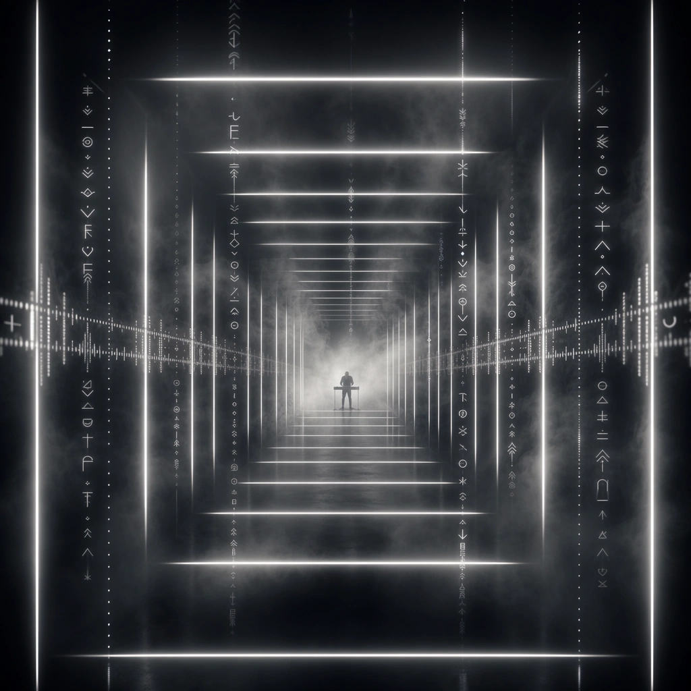

```text
Scene:
A square tunnel environment formed by parallel light bars disappearing into smoke, with a static central camera and a strong sense of depth. The scene should feel like a music-video visualizer environment translated into a single clear promo frame.

Subject:
The subject is the tunnel itself plus a minimal performer silhouette deep in the center, surrounded by floating bands of invented glyph marks and faint waveform scaffolds. The image should suggest lyric pacing and song structure through repetition, distance, and glow rather than literal subtitles.

Important details:
Use the tunnel geometry to organize the frame, keeping the pseudo-typography secondary but integral. Light should sculpt the smoke, the glyph bands should sit in believable planes, and the whole image should feel ready for looped motion adaptation. It must be emotionally musical, not sci-fi wallpaper.

Use case:
Lyric Frames single study 6/9 for the Lyric Visualizer Frame Family Prompt Atlas theme.

Constraints:
No readable text, no watermark, no logos, preserve exact 1:1 aspect ratio, no readable words, no visible stage audience, no spaceship cues, no hard lens distortions, no random multicolor noise
```

[Pinned source](https://github.com/ChaosRealmsAI/gpt-image-2-gallery/blob/5296db8c996e38776c83a0bc8c64f848dcd512b3/works/topics/lyric-visualizer-frame-family/packages/single-visualizer-studies/images/smoke-tunnel-glyphs/meta.json) · GPT Image2 · 1024×1024 · No source-declared image dependencies. · ProjectD:pending individual review.

## Bedroom Diary Frame · lyric-visualizer-frame-family/single-visualizer-studies/bedroom-diary-frame

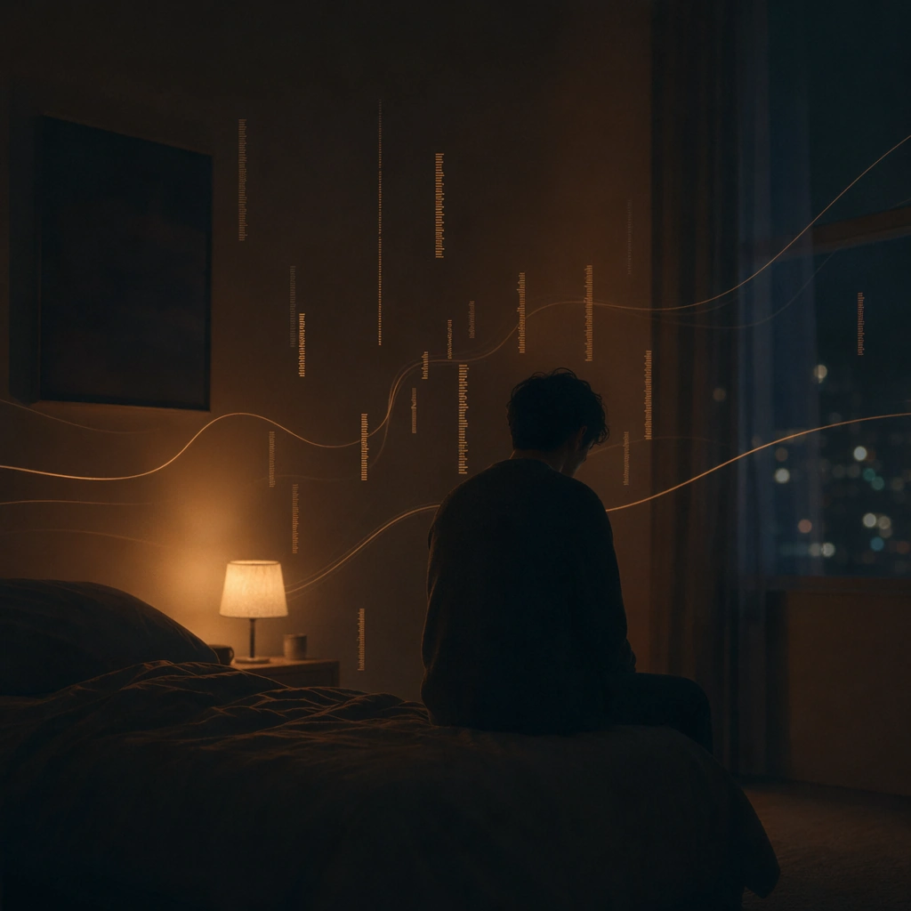

```text
Scene:
A square bedroom scene at night with warm practical lamp light, soft shadows, and a simple bed or chair kept mostly in silhouette. The frame should feel personal and song-specific, as if a lyric visualizer briefly entered a diary-like interior world.

Subject:
A single figure sits near the bed edge or window, surrounded by suspended bars of non-readable lyric marks and faint glowing line paths that move through the room like memory traces. The layout should remain controlled and graphic despite the softness of the scene.

Important details:
Make the intimacy believable without becoming lifestyle photography. The pseudo-text should behave like emotional residue, not subtitles. Use the room sparingly, focus on negative space, and let warm light plus a few cool accents create a layered emotional frame that could support a quiet song section or teaser clip.

Use case:
Lyric Frames single study 7/9 for the Lyric Visualizer Frame Family Prompt Atlas theme.

Constraints:
No readable text, no watermark, no logos, preserve exact 1:1 aspect ratio, no readable notes on walls, no brand products, no cluttered bedroom mess, no daylight, no literal smartphone interface
```

[Pinned source](https://github.com/ChaosRealmsAI/gpt-image-2-gallery/blob/5296db8c996e38776c83a0bc8c64f848dcd512b3/works/topics/lyric-visualizer-frame-family/packages/single-visualizer-studies/images/bedroom-diary-frame/meta.json) · GPT Image2 · 1024×1024 · No source-declared image dependencies. · ProjectD:pending individual review.

## Industrial Pulse Frame · lyric-visualizer-frame-family/single-visualizer-studies/industrial-pulse-frame

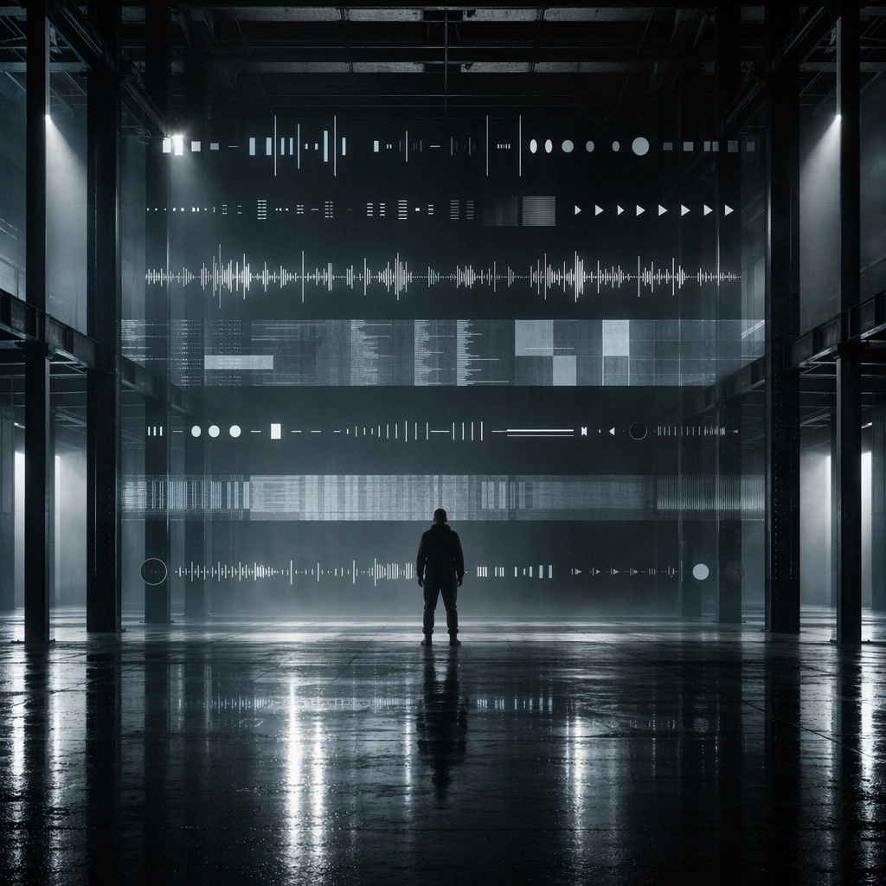

```text
Scene:
A square industrial interior with steel beams, wet floor reflections, and a few strong practical lights cutting through haze. The architecture should give the frame pulse and weight while remaining sparse enough for motion graphics and pseudo-lyric elements to breathe.

Subject:
A compact performer silhouette stands against the architectural grid while stacked bands of invented glyphs, pulse lines, and translucent blocks hang in front and behind them. The image should feel hard-edged and rhythmic, like a visualizer for a percussive track.

Important details:
Use architecture as tempo. Beam spacing, floor reflections, and light cuts should reinforce the pseudo-typographic rhythm. Keep the frame legible and product-ready, avoiding random texture overload. The song energy should be evident through structure and light rather than through readable titles or explicit interfaces.

Use case:
Lyric Frames single study 8/9 for the Lyric Visualizer Frame Family Prompt Atlas theme.

Constraints:
No readable text, no watermark, no logos, preserve exact 1:1 aspect ratio, no factory workers, no safety signage, no readable labels, no orange sparks, no heavy machinery dominating the frame
```

[Pinned source](https://github.com/ChaosRealmsAI/gpt-image-2-gallery/blob/5296db8c996e38776c83a0bc8c64f848dcd512b3/works/topics/lyric-visualizer-frame-family/packages/single-visualizer-studies/images/industrial-pulse-frame/meta.json) · GPT Image2 · 1024×1024 · No source-declared image dependencies. · ProjectD:pending individual review.

## Waterline Refrain Frame · lyric-visualizer-frame-family/single-visualizer-studies/waterline-refrain-frame


```text
Scene:
A square reflective waterline scene with shallow standing water, low mist, and soft overhead light turning the floor into a mirror. The frame should feel airy and lyrical, like a visualizer still for a refrain that opens emotionally instead of striking hard.

Subject:
A lone figure stands near the center while abstract lyric bars and curved wave traces hover above the water, mirrored below in softened reflection. The marks remain fully non-readable, functioning as visual timing cues rather than language.

Important details:
Keep the palette limited, the reflection realistic, and the glyph rhythm elegant. This image should feel musical, cinematic, and design-led at the same time. The water must support the layout by providing symmetry and echo, not by becoming a special-effects showcase.

Use case:
Lyric Frames single study 9/9 for the Lyric Visualizer Frame Family Prompt Atlas theme.

Constraints:
No readable text, no watermark, no logos, preserve exact 1:1 aspect ratio, no readable subtitles, no beach setting, no dramatic storm, no fish or surreal creatures, no multicolor nightclub palette
```

[Pinned source](https://github.com/ChaosRealmsAI/gpt-image-2-gallery/blob/5296db8c996e38776c83a0bc8c64f848dcd512b3/works/topics/lyric-visualizer-frame-family/packages/single-visualizer-studies/images/waterline-refrain-frame/meta.json) · GPT Image2 · 1024×1024 · No source-declared image dependencies. · ProjectD:pending individual review.

## Macro Study · macro-real-texture/single-macro-real-texture-studies/macro-study

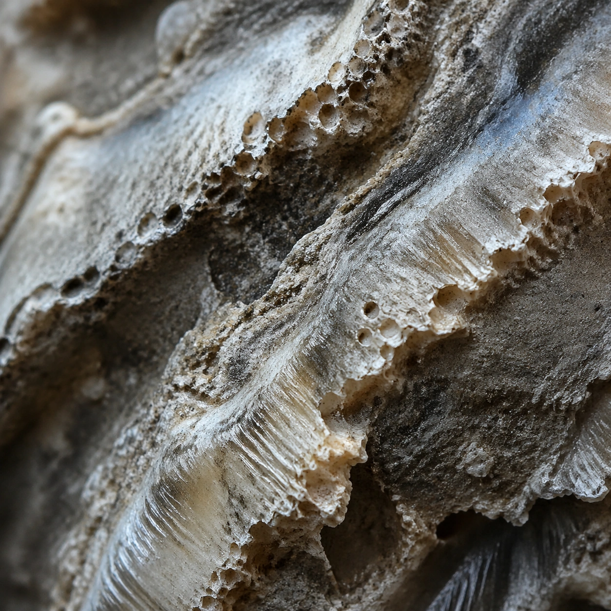

```text
Scene:
A square material-focused image where lighting, scale, and surface behavior are the main event. Build the frame around extreme close observation of texture, grain, and edge behavior. Keep the lighting, camera distance, and spatial organization tuned for a high-signal research image rather than a casual snapshot. The image belongs to the Macro Real Texture theme and should feel immediately legible as a prompt atlas theme for macro real texture, testing photorealism, physics-materials with gpt image 2..

Subject:
Center the study on extreme close observation of texture, grain, and edge behavior. Translate the theme into a concrete visual statement instead of an abstract mood board: the viewer should understand what kind of image this is, what is being tested, and why the composition is difficult. Use the slug idea of macro real texture as a literal guide for subject matter, materials, and staging.

Important details:
Microstructure matters: refraction, fibers, scratches, pores, edge wear, translucency, and dust should all feel physically specific. Preserve a disciplined square composition, clear focal hierarchy, and enough secondary information to make the image feel complete rather than underspecified. The image should look polished, novel, and exhibition-ready, with topic-specific credibility coming from the way surfaces, structure, and visual language reinforce Macro Real Texture. Avoid generic filler elements that do not serve the main concept.

Use case:
Macro Real Texture single study 2/8, testing photorealism, physics-materials through the macro study variation.

Constraints:
No readable text, no watermark, no logos, preserve exact 1:1 aspect ratio, no generic stock macro, no broken scale cues, no plastic-looking texture when it should feel natural, no meaningless blur, no watermark, no fake labels.
```

[Pinned source](https://github.com/ChaosRealmsAI/gpt-image-2-gallery/blob/5296db8c996e38776c83a0bc8c64f848dcd512b3/works/topics/macro-real-texture/packages/single-macro-real-texture-studies/images/macro-study/meta.json) · GPT Image2 · 1254×1254 · No source-declared image dependencies. · ProjectD:pending individual review.

## Side Light Study · macro-real-texture/single-macro-real-texture-studies/side-light-study

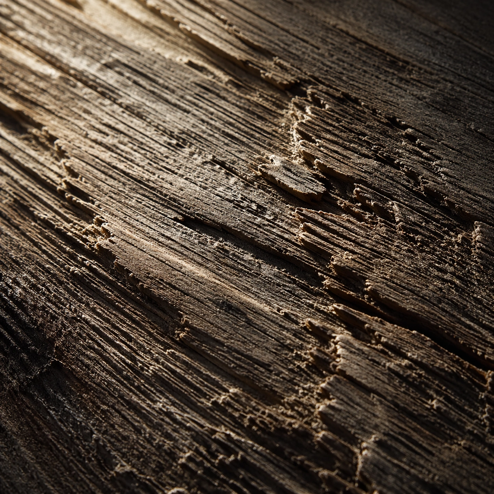

```text
Scene:
A square material-focused image where lighting, scale, and surface behavior are the main event. Build the frame around raking light used to reveal depth and relief. Keep the lighting, camera distance, and spatial organization tuned for a high-signal research image rather than a casual snapshot. The image belongs to the Macro Real Texture theme and should feel immediately legible as a prompt atlas theme for macro real texture, testing photorealism, physics-materials with gpt image 2..

Subject:
Center the study on raking light used to reveal depth and relief. Translate the theme into a concrete visual statement instead of an abstract mood board: the viewer should understand what kind of image this is, what is being tested, and why the composition is difficult. Use the slug idea of macro real texture as a literal guide for subject matter, materials, and staging.

Important details:
Microstructure matters: refraction, fibers, scratches, pores, edge wear, translucency, and dust should all feel physically specific. Preserve a disciplined square composition, clear focal hierarchy, and enough secondary information to make the image feel complete rather than underspecified. The image should look polished, novel, and exhibition-ready, with topic-specific credibility coming from the way surfaces, structure, and visual language reinforce Macro Real Texture. Avoid generic filler elements that do not serve the main concept.

Use case:
Macro Real Texture single study 3/8, testing photorealism, physics-materials through the side light study variation.

Constraints:
No readable text, no watermark, no logos, preserve exact 1:1 aspect ratio, no generic stock macro, no broken scale cues, no plastic-looking texture when it should feel natural, no meaningless blur, no watermark, no fake labels.
```

[Pinned source](https://github.com/ChaosRealmsAI/gpt-image-2-gallery/blob/5296db8c996e38776c83a0bc8c64f848dcd512b3/works/topics/macro-real-texture/packages/single-macro-real-texture-studies/images/side-light-study/meta.json) · GPT Image2 · 1254×1254 · No source-declared image dependencies. · ProjectD:pending individual review.

## Process Trace · macro-real-texture/single-macro-real-texture-studies/process-trace


```text
Scene:
A square material-focused image where lighting, scale, and surface behavior are the main event. Build the frame around evidence of making, wear, or transformation frozen in the surface. Keep the lighting, camera distance, and spatial organization tuned for a high-signal research image rather than a casual snapshot. The image belongs to the Macro Real Texture theme and should feel immediately legible as a prompt atlas theme for macro real texture, testing photorealism, physics-materials with gpt image 2..

Subject:
Center the study on evidence of making, wear, or transformation frozen in the surface. Translate the theme into a concrete visual statement instead of an abstract mood board: the viewer should understand what kind of image this is, what is being tested, and why the composition is difficult. Use the slug idea of macro real texture as a literal guide for subject matter, materials, and staging.

Important details:
Microstructure matters: refraction, fibers, scratches, pores, edge wear, translucency, and dust should all feel physically specific. Preserve a disciplined square composition, clear focal hierarchy, and enough secondary information to make the image feel complete rather than underspecified. The image should look polished, novel, and exhibition-ready, with topic-specific credibility coming from the way surfaces, structure, and visual language reinforce Macro Real Texture. Avoid generic filler elements that do not serve the main concept.

Use case:
Macro Real Texture single study 4/8, testing photorealism, physics-materials through the process trace variation.

Constraints:
No readable text, no watermark, no logos, preserve exact 1:1 aspect ratio, no generic stock macro, no broken scale cues, no plastic-looking texture when it should feel natural, no meaningless blur, no watermark, no fake labels.
```

[Pinned source](https://github.com/ChaosRealmsAI/gpt-image-2-gallery/blob/5296db8c996e38776c83a0bc8c64f848dcd512b3/works/topics/macro-real-texture/packages/single-macro-real-texture-studies/images/process-trace/meta.json) · GPT Image2 · 1254×1254 · No source-declared image dependencies. · ProjectD:pending individual review.

## Specimen Table · macro-real-texture/single-macro-real-texture-studies/specimen-table


```text
Scene:
A square material-focused image where lighting, scale, and surface behavior are the main event. Build the frame around multiple related samples arranged for comparison. Keep the lighting, camera distance, and spatial organization tuned for a high-signal research image rather than a casual snapshot. The image belongs to the Macro Real Texture theme and should feel immediately legible as a prompt atlas theme for macro real texture, testing photorealism, physics-materials with gpt image 2..

Subject:
Center the study on multiple related samples arranged for comparison. Translate the theme into a concrete visual statement instead of an abstract mood board: the viewer should understand what kind of image this is, what is being tested, and why the composition is difficult. Use the slug idea of macro real texture as a literal guide for subject matter, materials, and staging.

Important details:
Microstructure matters: refraction, fibers, scratches, pores, edge wear, translucency, and dust should all feel physically specific. Preserve a disciplined square composition, clear focal hierarchy, and enough secondary information to make the image feel complete rather than underspecified. The image should look polished, novel, and exhibition-ready, with topic-specific credibility coming from the way surfaces, structure, and visual language reinforce Macro Real Texture. Avoid generic filler elements that do not serve the main concept.

Use case:
Macro Real Texture single study 5/8, testing photorealism, physics-materials through the specimen table variation.

Constraints:
No readable text, no watermark, no logos, preserve exact 1:1 aspect ratio, no generic stock macro, no broken scale cues, no plastic-looking texture when it should feel natural, no meaningless blur, no watermark, no fake labels.
```

[Pinned source](https://github.com/ChaosRealmsAI/gpt-image-2-gallery/blob/5296db8c996e38776c83a0bc8c64f848dcd512b3/works/topics/macro-real-texture/packages/single-macro-real-texture-studies/images/specimen-table/meta.json) · GPT Image2 · 1254×1254 · No source-declared image dependencies. · ProjectD:pending individual review.

## 氛围场景 · macro-real-texture/single-macro-real-texture-studies/atmospheric-view


```text
Scene:
A square material-focused image where lighting, scale, and surface behavior are the main event. Build the frame around the material placed into a broader environment without losing tactile priority. Keep the lighting, camera distance, and spatial organization tuned for a high-signal research image rather than a casual snapshot. The image belongs to the Macro Real Texture theme and should feel immediately legible as a prompt atlas theme for macro real texture, testing photorealism, physics-materials with gpt image 2..

Subject:
Center the study on the material placed into a broader environment without losing tactile priority. Translate the theme into a concrete visual statement instead of an abstract mood board: the viewer should understand what kind of image this is, what is being tested, and why the composition is difficult. Use the slug idea of macro real texture as a literal guide for subject matter, materials, and staging.

Important details:
Microstructure matters: refraction, fibers, scratches, pores, edge wear, translucency, and dust should all feel physically specific. Preserve a disciplined square composition, clear focal hierarchy, and enough secondary information to make the image feel complete rather than underspecified. The image should look polished, novel, and exhibition-ready, with topic-specific credibility coming from the way surfaces, structure, and visual language reinforce Macro Real Texture. Avoid generic filler elements that do not serve the main concept.

Use case:
Macro Real Texture single study 6/8, testing photorealism, physics-materials through the 氛围场景 variation.

Constraints:
No readable text, no watermark, no logos, preserve exact 1:1 aspect ratio, no generic stock macro, no broken scale cues, no plastic-looking texture when it should feel natural, no meaningless blur, no watermark, no fake labels.
```

[Pinned source](https://github.com/ChaosRealmsAI/gpt-image-2-gallery/blob/5296db8c996e38776c83a0bc8c64f848dcd512b3/works/topics/macro-real-texture/packages/single-macro-real-texture-studies/images/atmospheric-view/meta.json) · GPT Image2 · 1254×1254 · No source-declared image dependencies. · ProjectD:pending individual review.

## Structure Closeup · macro-real-texture/single-macro-real-texture-studies/structure-closeup


```text
Scene:
A square material-focused image where lighting, scale, and surface behavior are the main event. Build the frame around the internal or layered structure made legible through detail. Keep the lighting, camera distance, and spatial organization tuned for a high-signal research image rather than a casual snapshot. The image belongs to the Macro Real Texture theme and should feel immediately legible as a prompt atlas theme for macro real texture, testing photorealism, physics-materials with gpt image 2..

Subject:
Center the study on the internal or layered structure made legible through detail. Translate the theme into a concrete visual statement instead of an abstract mood board: the viewer should understand what kind of image this is, what is being tested, and why the composition is difficult. Use the slug idea of macro real texture as a literal guide for subject matter, materials, and staging.

Important details:
Microstructure matters: refraction, fibers, scratches, pores, edge wear, translucency, and dust should all feel physically specific. Preserve a disciplined square composition, clear focal hierarchy, and enough secondary information to make the image feel complete rather than underspecified. The image should look polished, novel, and exhibition-ready, with topic-specific credibility coming from the way surfaces, structure, and visual language reinforce Macro Real Texture. Avoid generic filler elements that do not serve the main concept.

Use case:
Macro Real Texture single study 7/8, testing photorealism, physics-materials through the structure closeup variation.

Constraints:
No readable text, no watermark, no logos, preserve exact 1:1 aspect ratio, no generic stock macro, no broken scale cues, no plastic-looking texture when it should feel natural, no meaningless blur, no watermark, no fake labels.
```

[Pinned source](https://github.com/ChaosRealmsAI/gpt-image-2-gallery/blob/5296db8c996e38776c83a0bc8c64f848dcd512b3/works/topics/macro-real-texture/packages/single-macro-real-texture-studies/images/structure-closeup/meta.json) · GPT Image2 · 1254×1254 · No source-declared image dependencies. · ProjectD:pending individual review.

## Signature Material · macro-real-texture/single-macro-real-texture-studies/signature-material


```text
Scene:
A square material-focused image where lighting, scale, and surface behavior are the main event. Build the frame around the most complete and persuasive final material image. Keep the lighting, camera distance, and spatial organization tuned for a high-signal research image rather than a casual snapshot. The image belongs to the Macro Real Texture theme and should feel immediately legible as a prompt atlas theme for macro real texture, testing photorealism, physics-materials with gpt image 2..

Subject:
Center the study on the most complete and persuasive final material image. Translate the theme into a concrete visual statement instead of an abstract mood board: the viewer should understand what kind of image this is, what is being tested, and why the composition is difficult. Use the slug idea of macro real texture as a literal guide for subject matter, materials, and staging.

Important details:
Microstructure matters: refraction, fibers, scratches, pores, edge wear, translucency, and dust should all feel physically specific. Preserve a disciplined square composition, clear focal hierarchy, and enough secondary information to make the image feel complete rather than underspecified. The image should look polished, novel, and exhibition-ready, with topic-specific credibility coming from the way surfaces, structure, and visual language reinforce Macro Real Texture. Avoid generic filler elements that do not serve the main concept.

Use case:
Macro Real Texture single study 8/8, testing photorealism, physics-materials through the signature material variation.

Constraints:
No readable text, no watermark, no logos, preserve exact 1:1 aspect ratio, no generic stock macro, no broken scale cues, no plastic-looking texture when it should feel natural, no meaningless blur, no watermark, no fake labels.
```

[Pinned source](https://github.com/ChaosRealmsAI/gpt-image-2-gallery/blob/5296db8c996e38776c83a0bc8c64f848dcd512b3/works/topics/macro-real-texture/packages/single-macro-real-texture-studies/images/signature-material/meta.json) · GPT Image2 · 1254×1254 · No source-declared image dependencies. · ProjectD:pending individual review.

## Hero Spread · magazine-spread-layout/single-magazine-spread-layout-studies/hero-spread


```text
Scene:
A square editorial or interface layout study with exact margins, confident grid structure, and premium print or screen presentation. Build the frame around a primary spread or headline surface with immediate hierarchy. Keep the lighting, camera distance, and spatial organization tuned for a high-signal research image rather than a casual snapshot. The image belongs to the Magazine Spread Layout theme and should feel immediately legible as a prompt atlas theme for magazine spread layout, testing multi-image-reference, structured-layout, commercial-mockup with gpt image 2..

Subject:
Center the study on a primary spread or headline surface with immediate hierarchy. Translate the theme into a concrete visual statement instead of an abstract mood board: the viewer should understand what kind of image this is, what is being tested, and why the composition is difficult. Use the slug idea of magazine spread layout as a literal guide for subject matter, materials, and staging. If helpful, borrow the broad visual cues suggested by Wired, Vogue, but keep the result original and specific to this study.

Important details:
Typography fields must stay unreadable, but hierarchy, rhythm, and page architecture should feel convincing enough for design review. Preserve a disciplined square composition, clear focal hierarchy, and enough secondary information to make the image feel complete rather than underspecified. The image should look polished, novel, and exhibition-ready, with topic-specific credibility coming from the way surfaces, structure, and visual language reinforce Magazine Spread Layout. Avoid generic filler elements that do not serve the main concept.

Use case:
Magazine Spread Layout single study 1/8, testing multi-image-reference, structured-layout, commercial-mockup through the hero spread variation.

Constraints:
No readable text, no watermark, no logos, preserve exact 1:1 aspect ratio, no readable text, no logo lockups from real brands, no broken grid, no arbitrary poster clutter, no malformed columns, no accidental lorem ipsum.
```

[Pinned source](https://github.com/ChaosRealmsAI/gpt-image-2-gallery/blob/5296db8c996e38776c83a0bc8c64f848dcd512b3/works/topics/magazine-spread-layout/packages/single-magazine-spread-layout-studies/images/hero-spread/meta.json) · GPT Image2 · 1254×1254 · No source-declared image dependencies. · ProjectD:pending individual review.

## Variant Grid · magazine-spread-layout/single-magazine-spread-layout-studies/variant-grid


```text
Scene:
A square editorial or interface layout study with exact margins, confident grid structure, and premium print or screen presentation. Build the frame around multiple aligned variations sharing one disciplined layout system. Keep the lighting, camera distance, and spatial organization tuned for a high-signal research image rather than a casual snapshot. The image belongs to the Magazine Spread Layout theme and should feel immediately legible as a prompt atlas theme for magazine spread layout, testing multi-image-reference, structured-layout, commercial-mockup with gpt image 2..

Subject:
Center the study on multiple aligned variations sharing one disciplined layout system. Translate the theme into a concrete visual statement instead of an abstract mood board: the viewer should understand what kind of image this is, what is being tested, and why the composition is difficult. Use the slug idea of magazine spread layout as a literal guide for subject matter, materials, and staging. If helpful, borrow the broad visual cues suggested by Wired, Vogue, but keep the result original and specific to this study.

Important details:
Typography fields must stay unreadable, but hierarchy, rhythm, and page architecture should feel convincing enough for design review. Preserve a disciplined square composition, clear focal hierarchy, and enough secondary information to make the image feel complete rather than underspecified. The image should look polished, novel, and exhibition-ready, with topic-specific credibility coming from the way surfaces, structure, and visual language reinforce Magazine Spread Layout. Avoid generic filler elements that do not serve the main concept.

Use case:
Magazine Spread Layout single study 2/8, testing multi-image-reference, structured-layout, commercial-mockup through the variant grid variation.

Constraints:
No readable text, no watermark, no logos, preserve exact 1:1 aspect ratio, no readable text, no logo lockups from real brands, no broken grid, no arbitrary poster clutter, no malformed columns, no accidental lorem ipsum.
```

[Pinned source](https://github.com/ChaosRealmsAI/gpt-image-2-gallery/blob/5296db8c996e38776c83a0bc8c64f848dcd512b3/works/topics/magazine-spread-layout/packages/single-magazine-spread-layout-studies/images/variant-grid/meta.json) · GPT Image2 · 1254×1254 · No source-declared image dependencies. · ProjectD:pending individual review.

## Desk Review · magazine-spread-layout/single-magazine-spread-layout-studies/desk-review


```text
Scene:
A square editorial or interface layout study with exact margins, confident grid structure, and premium print or screen presentation. Build the frame around a presentation context that shows the layout as a reviewed design object. Keep the lighting, camera distance, and spatial organization tuned for a high-signal research image rather than a casual snapshot. The image belongs to the Magazine Spread Layout theme and should feel immediately legible as a prompt atlas theme for magazine spread layout, testing multi-image-reference, structured-layout, commercial-mockup with gpt image 2..

Subject:
Center the study on a presentation context that shows the layout as a reviewed design object. Translate the theme into a concrete visual statement instead of an abstract mood board: the viewer should understand what kind of image this is, what is being tested, and why the composition is difficult. Use the slug idea of magazine spread layout as a literal guide for subject matter, materials, and staging. If helpful, borrow the broad visual cues suggested by Wired, Vogue, but keep the result original and specific to this study.

Important details:
Typography fields must stay unreadable, but hierarchy, rhythm, and page architecture should feel convincing enough for design review. Preserve a disciplined square composition, clear focal hierarchy, and enough secondary information to make the image feel complete rather than underspecified. The image should look polished, novel, and exhibition-ready, with topic-specific credibility coming from the way surfaces, structure, and visual language reinforce Magazine Spread Layout. Avoid generic filler elements that do not serve the main concept.

Use case:
Magazine Spread Layout single study 3/8, testing multi-image-reference, structured-layout, commercial-mockup through the desk review variation.

Constraints:
No readable text, no watermark, no logos, preserve exact 1:1 aspect ratio, no readable text, no logo lockups from real brands, no broken grid, no arbitrary poster clutter, no malformed columns, no accidental lorem ipsum.
```

[Pinned source](https://github.com/ChaosRealmsAI/gpt-image-2-gallery/blob/5296db8c996e38776c83a0bc8c64f848dcd512b3/works/topics/magazine-spread-layout/packages/single-magazine-spread-layout-studies/images/desk-review/meta.json) · GPT Image2 · 1254×1254 · No source-declared image dependencies. · ProjectD:pending individual review.

## Material Closeup · magazine-spread-layout/single-magazine-spread-layout-studies/material-closeup


```text
Scene:
A square editorial or interface layout study with exact margins, confident grid structure, and premium print or screen presentation. Build the frame around print grain, paper, or screen detail without losing overall composition. Keep the lighting, camera distance, and spatial organization tuned for a high-signal research image rather than a casual snapshot. The image belongs to the Magazine Spread Layout theme and should feel immediately legible as a prompt atlas theme for magazine spread layout, testing multi-image-reference, structured-layout, commercial-mockup with gpt image 2..

Subject:
Center the study on print grain, paper, or screen detail without losing overall composition. Translate the theme into a concrete visual statement instead of an abstract mood board: the viewer should understand what kind of image this is, what is being tested, and why the composition is difficult. Use the slug idea of magazine spread layout as a literal guide for subject matter, materials, and staging. If helpful, borrow the broad visual cues suggested by Wired, Vogue, but keep the result original and specific to this study.

Important details:
Typography fields must stay unreadable, but hierarchy, rhythm, and page architecture should feel convincing enough for design review. Preserve a disciplined square composition, clear focal hierarchy, and enough secondary information to make the image feel complete rather than underspecified. The image should look polished, novel, and exhibition-ready, with topic-specific credibility coming from the way surfaces, structure, and visual language reinforce Magazine Spread Layout. Avoid generic filler elements that do not serve the main concept.

Use case:
Magazine Spread Layout single study 4/8, testing multi-image-reference, structured-layout, commercial-mockup through the material closeup variation.

Constraints:
No readable text, no watermark, no logos, preserve exact 1:1 aspect ratio, no readable text, no logo lockups from real brands, no broken grid, no arbitrary poster clutter, no malformed columns, no accidental lorem ipsum.
```

[Pinned source](https://github.com/ChaosRealmsAI/gpt-image-2-gallery/blob/5296db8c996e38776c83a0bc8c64f848dcd512b3/works/topics/magazine-spread-layout/packages/single-magazine-spread-layout-studies/images/material-closeup/meta.json) · GPT Image2 · 1254×1254 · No source-declared image dependencies. · ProjectD:pending individual review.

## Archive Sheet · magazine-spread-layout/single-magazine-spread-layout-studies/archive-sheet


```text
Scene:
A square editorial or interface layout study with exact margins, confident grid structure, and premium print or screen presentation. Build the frame around a flat archival or proof-like sheet with modular content blocks. Keep the lighting, camera distance, and spatial organization tuned for a high-signal research image rather than a casual snapshot. The image belongs to the Magazine Spread Layout theme and should feel immediately legible as a prompt atlas theme for magazine spread layout, testing multi-image-reference, structured-layout, commercial-mockup with gpt image 2..

Subject:
Center the study on a flat archival or proof-like sheet with modular content blocks. Translate the theme into a concrete visual statement instead of an abstract mood board: the viewer should understand what kind of image this is, what is being tested, and why the composition is difficult. Use the slug idea of magazine spread layout as a literal guide for subject matter, materials, and staging. If helpful, borrow the broad visual cues suggested by Wired, Vogue, but keep the result original and specific to this study.

Important details:
Typography fields must stay unreadable, but hierarchy, rhythm, and page architecture should feel convincing enough for design review. Preserve a disciplined square composition, clear focal hierarchy, and enough secondary information to make the image feel complete rather than underspecified. The image should look polished, novel, and exhibition-ready, with topic-specific credibility coming from the way surfaces, structure, and visual language reinforce Magazine Spread Layout. Avoid generic filler elements that do not serve the main concept.

Use case:
Magazine Spread Layout single study 5/8, testing multi-image-reference, structured-layout, commercial-mockup through the archive sheet variation.

Constraints:
No readable text, no watermark, no logos, preserve exact 1:1 aspect ratio, no readable text, no logo lockups from real brands, no broken grid, no arbitrary poster clutter, no malformed columns, no accidental lorem ipsum.
```

[Pinned source](https://github.com/ChaosRealmsAI/gpt-image-2-gallery/blob/5296db8c996e38776c83a0bc8c64f848dcd512b3/works/topics/magazine-spread-layout/packages/single-magazine-spread-layout-studies/images/archive-sheet/meta.json) · GPT Image2 · 1254×1254 · No source-declared image dependencies. · ProjectD:pending individual review.

## 陈列展示 · magazine-spread-layout/single-magazine-spread-layout-studies/retail-presentation


```text
Scene:
A square editorial or interface layout study with exact margins, confident grid structure, and premium print or screen presentation. Build the frame around a polished display context that still preserves layout logic. Keep the lighting, camera distance, and spatial organization tuned for a high-signal research image rather than a casual snapshot. The image belongs to the Magazine Spread Layout theme and should feel immediately legible as a prompt atlas theme for magazine spread layout, testing multi-image-reference, structured-layout, commercial-mockup with gpt image 2..

Subject:
Center the study on a polished display context that still preserves layout logic. Translate the theme into a concrete visual statement instead of an abstract mood board: the viewer should understand what kind of image this is, what is being tested, and why the composition is difficult. Use the slug idea of magazine spread layout as a literal guide for subject matter, materials, and staging. If helpful, borrow the broad visual cues suggested by Wired, Vogue, but keep the result original and specific to this study.

Important details:
Typography fields must stay unreadable, but hierarchy, rhythm, and page architecture should feel convincing enough for design review. Preserve a disciplined square composition, clear focal hierarchy, and enough secondary information to make the image feel complete rather than underspecified. The image should look polished, novel, and exhibition-ready, with topic-specific credibility coming from the way surfaces, structure, and visual language reinforce Magazine Spread Layout. Avoid generic filler elements that do not serve the main concept.

Use case:
Magazine Spread Layout single study 6/8, testing multi-image-reference, structured-layout, commercial-mockup through the 陈列展示 variation.

Constraints:
No readable text, no watermark, no logos, preserve exact 1:1 aspect ratio, no readable text, no logo lockups from real brands, no broken grid, no arbitrary poster clutter, no malformed columns, no accidental lorem ipsum.
```

[Pinned source](https://github.com/ChaosRealmsAI/gpt-image-2-gallery/blob/5296db8c996e38776c83a0bc8c64f848dcd512b3/works/topics/magazine-spread-layout/packages/single-magazine-spread-layout-studies/images/retail-presentation/meta.json) · GPT Image2 · 1254×1254 · No source-declared image dependencies. · ProjectD:pending individual review.

## System Board · magazine-spread-layout/single-magazine-spread-layout-studies/system-board


```text
Scene:
A square editorial or interface layout study with exact margins, confident grid structure, and premium print or screen presentation. Build the frame around a family of elements organized into a coherent visual language. Keep the lighting, camera distance, and spatial organization tuned for a high-signal research image rather than a casual snapshot. The image belongs to the Magazine Spread Layout theme and should feel immediately legible as a prompt atlas theme for magazine spread layout, testing multi-image-reference, structured-layout, commercial-mockup with gpt image 2..

Subject:
Center the study on a family of elements organized into a coherent visual language. Translate the theme into a concrete visual statement instead of an abstract mood board: the viewer should understand what kind of image this is, what is being tested, and why the composition is difficult. Use the slug idea of magazine spread layout as a literal guide for subject matter, materials, and staging. If helpful, borrow the broad visual cues suggested by Wired, Vogue, but keep the result original and specific to this study.

Important details:
Typography fields must stay unreadable, but hierarchy, rhythm, and page architecture should feel convincing enough for design review. Preserve a disciplined square composition, clear focal hierarchy, and enough secondary information to make the image feel complete rather than underspecified. The image should look polished, novel, and exhibition-ready, with topic-specific credibility coming from the way surfaces, structure, and visual language reinforce Magazine Spread Layout. Avoid generic filler elements that do not serve the main concept.

Use case:
Magazine Spread Layout single study 7/8, testing multi-image-reference, structured-layout, commercial-mockup through the system board variation.

Constraints:
No readable text, no watermark, no logos, preserve exact 1:1 aspect ratio, no readable text, no logo lockups from real brands, no broken grid, no arbitrary poster clutter, no malformed columns, no accidental lorem ipsum.
```

[Pinned source](https://github.com/ChaosRealmsAI/gpt-image-2-gallery/blob/5296db8c996e38776c83a0bc8c64f848dcd512b3/works/topics/magazine-spread-layout/packages/single-magazine-spread-layout-studies/images/system-board/meta.json) · GPT Image2 · 1254×1254 · No source-declared image dependencies. · ProjectD:pending individual review.

## Signature Layout · magazine-spread-layout/single-magazine-spread-layout-studies/signature-layout


```text
Scene:
A square editorial or interface layout study with exact margins, confident grid structure, and premium print or screen presentation. Build the frame around the most distilled expression of the topic’s layout identity. Keep the lighting, camera distance, and spatial organization tuned for a high-signal research image rather than a casual snapshot. The image belongs to the Magazine Spread Layout theme and should feel immediately legible as a prompt atlas theme for magazine spread layout, testing multi-image-reference, structured-layout, commercial-mockup with gpt image 2..

Subject:
Center the study on the most distilled expression of the topic’s layout identity. Translate the theme into a concrete visual statement instead of an abstract mood board: the viewer should understand what kind of image this is, what is being tested, and why the composition is difficult. Use the slug idea of magazine spread layout as a literal guide for subject matter, materials, and staging. If helpful, borrow the broad visual cues suggested by Wired, Vogue, but keep the result original and specific to this study.

Important details:
Typography fields must stay unreadable, but hierarchy, rhythm, and page architecture should feel convincing enough for design review. Preserve a disciplined square composition, clear focal hierarchy, and enough secondary information to make the image feel complete rather than underspecified. The image should look polished, novel, and exhibition-ready, with topic-specific credibility coming from the way surfaces, structure, and visual language reinforce Magazine Spread Layout. Avoid generic filler elements that do not serve the main concept.

Use case:
Magazine Spread Layout single study 8/8, testing multi-image-reference, structured-layout, commercial-mockup through the signature layout variation.

Constraints:
No readable text, no watermark, no logos, preserve exact 1:1 aspect ratio, no readable text, no logo lockups from real brands, no broken grid, no arbitrary poster clutter, no malformed columns, no accidental lorem ipsum.
```

[Pinned source](https://github.com/ChaosRealmsAI/gpt-image-2-gallery/blob/5296db8c996e38776c83a0bc8c64f848dcd512b3/works/topics/magazine-spread-layout/packages/single-magazine-spread-layout-studies/images/signature-layout/meta.json) · GPT Image2 · 1254×1254 · No source-declared image dependencies. · ProjectD:pending individual review.

## Bare Base Look · makeup-stage-evolution/single-makeup-stage-evolution-studies/bare-base-look


```text
Scene:
A square beauty image with controlled skin rendering, editorial lighting, and a clear makeup or styling thesis. Build the frame around a restrained foundational look where structure and skin preparation dominate. Keep the lighting, camera distance, and spatial organization tuned for a high-signal research image rather than a casual snapshot. The image belongs to the Makeup Stage Evolution theme and should feel immediately legible as a prompt atlas theme for makeup stage evolution, testing structured-layout, photorealism, style-transfer, commercial-mockup with gpt image 2..

Subject:
Center the study on a restrained foundational look where structure and skin preparation dominate. Translate the theme into a concrete visual statement instead of an abstract mood board: the viewer should understand what kind of image this is, what is being tested, and why the composition is difficult. Use the slug idea of makeup stage evolution as a literal guide for subject matter, materials, and staging. If helpful, borrow the broad visual cues suggested by iPhone, but keep the result original and specific to this study.

Important details:
The image should show real cosmetic logic through pigment placement, texture transitions, finish control, and believable facial structure instead of random color on skin. Preserve a disciplined square composition, clear focal hierarchy, and enough secondary information to make the image feel complete rather than underspecified. The image should look polished, novel, and exhibition-ready, with topic-specific credibility coming from the way surfaces, structure, and visual language reinforce Makeup Stage Evolution. Avoid generic filler elements that do not serve the main concept.

Use case:
Makeup Stage Evolution single study 1/8, testing structured-layout, photorealism, style-transfer, commercial-mockup through the bare base look variation.

Constraints:
No readable text, no watermark, no logos, preserve exact 1:1 aspect ratio, no brand logos, no runway watermark, no unreadable backstage signage, no cosmetic packaging front-and-center, no plastic skin, no generic glamour pose.
```

[Pinned source](https://github.com/ChaosRealmsAI/gpt-image-2-gallery/blob/5296db8c996e38776c83a0bc8c64f848dcd512b3/works/topics/makeup-stage-evolution/packages/single-makeup-stage-evolution-studies/images/bare-base-look/meta.json) · GPT Image2 · 1254×1254 · No source-declared image dependencies. · ProjectD:pending individual review.

## Editorial Pigment · makeup-stage-evolution/single-makeup-stage-evolution-studies/editorial-pigment


```text
Scene:
A square beauty image with controlled skin rendering, editorial lighting, and a clear makeup or styling thesis. Build the frame around pigment used as a bold but controlled visual statement. Keep the lighting, camera distance, and spatial organization tuned for a high-signal research image rather than a casual snapshot. The image belongs to the Makeup Stage Evolution theme and should feel immediately legible as a prompt atlas theme for makeup stage evolution, testing structured-layout, photorealism, style-transfer, commercial-mockup with gpt image 2..

Subject:
Center the study on pigment used as a bold but controlled visual statement. Translate the theme into a concrete visual statement instead of an abstract mood board: the viewer should understand what kind of image this is, what is being tested, and why the composition is difficult. Use the slug idea of makeup stage evolution as a literal guide for subject matter, materials, and staging. If helpful, borrow the broad visual cues suggested by iPhone, but keep the result original and specific to this study.

Important details:
The image should show real cosmetic logic through pigment placement, texture transitions, finish control, and believable facial structure instead of random color on skin. Preserve a disciplined square composition, clear focal hierarchy, and enough secondary information to make the image feel complete rather than underspecified. The image should look polished, novel, and exhibition-ready, with topic-specific credibility coming from the way surfaces, structure, and visual language reinforce Makeup Stage Evolution. Avoid generic filler elements that do not serve the main concept.

Use case:
Makeup Stage Evolution single study 2/8, testing structured-layout, photorealism, style-transfer, commercial-mockup through the editorial pigment variation.

Constraints:
No readable text, no watermark, no logos, preserve exact 1:1 aspect ratio, no brand logos, no runway watermark, no unreadable backstage signage, no cosmetic packaging front-and-center, no plastic skin, no generic glamour pose.
```

[Pinned source](https://github.com/ChaosRealmsAI/gpt-image-2-gallery/blob/5296db8c996e38776c83a0bc8c64f848dcd512b3/works/topics/makeup-stage-evolution/packages/single-makeup-stage-evolution-studies/images/editorial-pigment/meta.json) · GPT Image2 · 1254×1254 · No source-declared image dependencies. · ProjectD:pending individual review.

## Metallic Stage · makeup-stage-evolution/single-makeup-stage-evolution-studies/metallic-stage


```text
Scene:
A square beauty image with controlled skin rendering, editorial lighting, and a clear makeup or styling thesis. Build the frame around reflective texture and theatrical lighting without losing realism. Keep the lighting, camera distance, and spatial organization tuned for a high-signal research image rather than a casual snapshot. The image belongs to the Makeup Stage Evolution theme and should feel immediately legible as a prompt atlas theme for makeup stage evolution, testing structured-layout, photorealism, style-transfer, commercial-mockup with gpt image 2..

Subject:
Center the study on reflective texture and theatrical lighting without losing realism. Translate the theme into a concrete visual statement instead of an abstract mood board: the viewer should understand what kind of image this is, what is being tested, and why the composition is difficult. Use the slug idea of makeup stage evolution as a literal guide for subject matter, materials, and staging. If helpful, borrow the broad visual cues suggested by iPhone, but keep the result original and specific to this study.

Important details:
The image should show real cosmetic logic through pigment placement, texture transitions, finish control, and believable facial structure instead of random color on skin. Preserve a disciplined square composition, clear focal hierarchy, and enough secondary information to make the image feel complete rather than underspecified. The image should look polished, novel, and exhibition-ready, with topic-specific credibility coming from the way surfaces, structure, and visual language reinforce Makeup Stage Evolution. Avoid generic filler elements that do not serve the main concept.

Use case:
Makeup Stage Evolution single study 3/8, testing structured-layout, photorealism, style-transfer, commercial-mockup through the metallic stage variation.

Constraints:
No readable text, no watermark, no logos, preserve exact 1:1 aspect ratio, no brand logos, no runway watermark, no unreadable backstage signage, no cosmetic packaging front-and-center, no plastic skin, no generic glamour pose.
```

[Pinned source](https://github.com/ChaosRealmsAI/gpt-image-2-gallery/blob/5296db8c996e38776c83a0bc8c64f848dcd512b3/works/topics/makeup-stage-evolution/packages/single-makeup-stage-evolution-studies/images/metallic-stage/meta.json) · GPT Image2 · 1254×1254 · No source-declared image dependencies. · ProjectD:pending individual review.

## Pastel Wash · makeup-stage-evolution/single-makeup-stage-evolution-studies/pastel-wash


```text
Scene:
A square beauty image with controlled skin rendering, editorial lighting, and a clear makeup or styling thesis. Build the frame around soft layered color transitions with deliberate edge control. Keep the lighting, camera distance, and spatial organization tuned for a high-signal research image rather than a casual snapshot. The image belongs to the Makeup Stage Evolution theme and should feel immediately legible as a prompt atlas theme for makeup stage evolution, testing structured-layout, photorealism, style-transfer, commercial-mockup with gpt image 2..

Subject:
Center the study on soft layered color transitions with deliberate edge control. Translate the theme into a concrete visual statement instead of an abstract mood board: the viewer should understand what kind of image this is, what is being tested, and why the composition is difficult. Use the slug idea of makeup stage evolution as a literal guide for subject matter, materials, and staging. If helpful, borrow the broad visual cues suggested by iPhone, but keep the result original and specific to this study.

Important details:
The image should show real cosmetic logic through pigment placement, texture transitions, finish control, and believable facial structure instead of random color on skin. Preserve a disciplined square composition, clear focal hierarchy, and enough secondary information to make the image feel complete rather than underspecified. The image should look polished, novel, and exhibition-ready, with topic-specific credibility coming from the way surfaces, structure, and visual language reinforce Makeup Stage Evolution. Avoid generic filler elements that do not serve the main concept.

Use case:
Makeup Stage Evolution single study 4/8, testing structured-layout, photorealism, style-transfer, commercial-mockup through the pastel wash variation.

Constraints:
No readable text, no watermark, no logos, preserve exact 1:1 aspect ratio, no brand logos, no runway watermark, no unreadable backstage signage, no cosmetic packaging front-and-center, no plastic skin, no generic glamour pose.
```

[Pinned source](https://github.com/ChaosRealmsAI/gpt-image-2-gallery/blob/5296db8c996e38776c83a0bc8c64f848dcd512b3/works/topics/makeup-stage-evolution/packages/single-makeup-stage-evolution-studies/images/pastel-wash/meta.json) · GPT Image2 · 1254×1254 · No source-declared image dependencies. · ProjectD:pending individual review.

## Wet Gloss Transition · makeup-stage-evolution/single-makeup-stage-evolution-studies/wet-gloss-transition


```text
Scene:
A square beauty image with controlled skin rendering, editorial lighting, and a clear makeup or styling thesis. Build the frame around wet-to-dry finish contrast handled with precision. Keep the lighting, camera distance, and spatial organization tuned for a high-signal research image rather than a casual snapshot. The image belongs to the Makeup Stage Evolution theme and should feel immediately legible as a prompt atlas theme for makeup stage evolution, testing structured-layout, photorealism, style-transfer, commercial-mockup with gpt image 2..

Subject:
Center the study on wet-to-dry finish contrast handled with precision. Translate the theme into a concrete visual statement instead of an abstract mood board: the viewer should understand what kind of image this is, what is being tested, and why the composition is difficult. Use the slug idea of makeup stage evolution as a literal guide for subject matter, materials, and staging. If helpful, borrow the broad visual cues suggested by iPhone, but keep the result original and specific to this study.

Important details:
The image should show real cosmetic logic through pigment placement, texture transitions, finish control, and believable facial structure instead of random color on skin. Preserve a disciplined square composition, clear focal hierarchy, and enough secondary information to make the image feel complete rather than underspecified. The image should look polished, novel, and exhibition-ready, with topic-specific credibility coming from the way surfaces, structure, and visual language reinforce Makeup Stage Evolution. Avoid generic filler elements that do not serve the main concept.

Use case:
Makeup Stage Evolution single study 5/8, testing structured-layout, photorealism, style-transfer, commercial-mockup through the wet gloss transition variation.

Constraints:
No readable text, no watermark, no logos, preserve exact 1:1 aspect ratio, no brand logos, no runway watermark, no unreadable backstage signage, no cosmetic packaging front-and-center, no plastic skin, no generic glamour pose.
```

[Pinned source](https://github.com/ChaosRealmsAI/gpt-image-2-gallery/blob/5296db8c996e38776c83a0bc8c64f848dcd512b3/works/topics/makeup-stage-evolution/packages/single-makeup-stage-evolution-studies/images/wet-gloss-transition/meta.json) · GPT Image2 · 1254×1254 · No source-declared image dependencies. · ProjectD:pending individual review.

## Graphic Liner · makeup-stage-evolution/single-makeup-stage-evolution-studies/graphic-liner


```text
Scene:
A square beauty image with controlled skin rendering, editorial lighting, and a clear makeup or styling thesis. Build the frame around sharp graphic shape work balanced against believable skin and lashes. Keep the lighting, camera distance, and spatial organization tuned for a high-signal research image rather than a casual snapshot. The image belongs to the Makeup Stage Evolution theme and should feel immediately legible as a prompt atlas theme for makeup stage evolution, testing structured-layout, photorealism, style-transfer, commercial-mockup with gpt image 2..

Subject:
Center the study on sharp graphic shape work balanced against believable skin and lashes. Translate the theme into a concrete visual statement instead of an abstract mood board: the viewer should understand what kind of image this is, what is being tested, and why the composition is difficult. Use the slug idea of makeup stage evolution as a literal guide for subject matter, materials, and staging. If helpful, borrow the broad visual cues suggested by iPhone, but keep the result original and specific to this study.

Important details:
The image should show real cosmetic logic through pigment placement, texture transitions, finish control, and believable facial structure instead of random color on skin. Preserve a disciplined square composition, clear focal hierarchy, and enough secondary information to make the image feel complete rather than underspecified. The image should look polished, novel, and exhibition-ready, with topic-specific credibility coming from the way surfaces, structure, and visual language reinforce Makeup Stage Evolution. Avoid generic filler elements that do not serve the main concept.

Use case:
Makeup Stage Evolution single study 6/8, testing structured-layout, photorealism, style-transfer, commercial-mockup through the graphic liner variation.

Constraints:
No readable text, no watermark, no logos, preserve exact 1:1 aspect ratio, no brand logos, no runway watermark, no unreadable backstage signage, no cosmetic packaging front-and-center, no plastic skin, no generic glamour pose.
```

[Pinned source](https://github.com/ChaosRealmsAI/gpt-image-2-gallery/blob/5296db8c996e38776c83a0bc8c64f848dcd512b3/works/topics/makeup-stage-evolution/packages/single-makeup-stage-evolution-studies/images/graphic-liner/meta.json) · GPT Image2 · 1254×1254 · No source-declared image dependencies. · ProjectD:pending individual review.

## Sculpted Finish · makeup-stage-evolution/single-makeup-stage-evolution-studies/sculpted-finish


```text
Scene:
A square beauty image with controlled skin rendering, editorial lighting, and a clear makeup or styling thesis. Build the frame around form-defining highlight and contour used with editorial restraint. Keep the lighting, camera distance, and spatial organization tuned for a high-signal research image rather than a casual snapshot. The image belongs to the Makeup Stage Evolution theme and should feel immediately legible as a prompt atlas theme for makeup stage evolution, testing structured-layout, photorealism, style-transfer, commercial-mockup with gpt image 2..

Subject:
Center the study on form-defining highlight and contour used with editorial restraint. Translate the theme into a concrete visual statement instead of an abstract mood board: the viewer should understand what kind of image this is, what is being tested, and why the composition is difficult. Use the slug idea of makeup stage evolution as a literal guide for subject matter, materials, and staging. If helpful, borrow the broad visual cues suggested by iPhone, but keep the result original and specific to this study.

Important details:
The image should show real cosmetic logic through pigment placement, texture transitions, finish control, and believable facial structure instead of random color on skin. Preserve a disciplined square composition, clear focal hierarchy, and enough secondary information to make the image feel complete rather than underspecified. The image should look polished, novel, and exhibition-ready, with topic-specific credibility coming from the way surfaces, structure, and visual language reinforce Makeup Stage Evolution. Avoid generic filler elements that do not serve the main concept.

Use case:
Makeup Stage Evolution single study 7/8, testing structured-layout, photorealism, style-transfer, commercial-mockup through the sculpted finish variation.

Constraints:
No readable text, no watermark, no logos, preserve exact 1:1 aspect ratio, no brand logos, no runway watermark, no unreadable backstage signage, no cosmetic packaging front-and-center, no plastic skin, no generic glamour pose.
```

[Pinned source](https://github.com/ChaosRealmsAI/gpt-image-2-gallery/blob/5296db8c996e38776c83a0bc8c64f848dcd512b3/works/topics/makeup-stage-evolution/packages/single-makeup-stage-evolution-studies/images/sculpted-finish/meta.json) · GPT Image2 · 1254×1254 · No source-declared image dependencies. · ProjectD:pending individual review.

## Signature Look · makeup-stage-evolution/single-makeup-stage-evolution-studies/signature-look


```text
Scene:
A square beauty image with controlled skin rendering, editorial lighting, and a clear makeup or styling thesis. Build the frame around the strongest final stage or transformation image for the topic. Keep the lighting, camera distance, and spatial organization tuned for a high-signal research image rather than a casual snapshot. The image belongs to the Makeup Stage Evolution theme and should feel immediately legible as a prompt atlas theme for makeup stage evolution, testing structured-layout, photorealism, style-transfer, commercial-mockup with gpt image 2..

Subject:
Center the study on the strongest final stage or transformation image for the topic. Translate the theme into a concrete visual statement instead of an abstract mood board: the viewer should understand what kind of image this is, what is being tested, and why the composition is difficult. Use the slug idea of makeup stage evolution as a literal guide for subject matter, materials, and staging. If helpful, borrow the broad visual cues suggested by iPhone, but keep the result original and specific to this study.

Important details:
The image should show real cosmetic logic through pigment placement, texture transitions, finish control, and believable facial structure instead of random color on skin. Preserve a disciplined square composition, clear focal hierarchy, and enough secondary information to make the image feel complete rather than underspecified. The image should look polished, novel, and exhibition-ready, with topic-specific credibility coming from the way surfaces, structure, and visual language reinforce Makeup Stage Evolution. Avoid generic filler elements that do not serve the main concept.

Use case:
Makeup Stage Evolution single study 8/8, testing structured-layout, photorealism, style-transfer, commercial-mockup through the signature look variation.

Constraints:
No readable text, no watermark, no logos, preserve exact 1:1 aspect ratio, no brand logos, no runway watermark, no unreadable backstage signage, no cosmetic packaging front-and-center, no plastic skin, no generic glamour pose.
```

[Pinned source](https://github.com/ChaosRealmsAI/gpt-image-2-gallery/blob/5296db8c996e38776c83a0bc8c64f848dcd512b3/works/topics/makeup-stage-evolution/packages/single-makeup-stage-evolution-studies/images/signature-look/meta.json) · GPT Image2 · 1254×1254 · No source-declared image dependencies. · ProjectD:pending individual review.

## Tibetan Eight Ring · mandala-precision-geometry/single-mandala-studies/01-tibetan-eight-ring


```text
Scene:
A square, straight-down view of an ornate mandala painting on a deep indigo ground, lit like a museum conservation photograph so every mineral pigment edge, gold outline, and concentric ring is crisp. The frame is perfectly centered, with calm luminous contrast, no perspective distortion, and enough visual breathing room to read the full circular structure from outer fire ring to inner palace.

Subject:
A Tibetan Buddhist inspired eight-layer mandala built from concentric circles, lotus petals, vajra gates, stepped palace walls, cloud bands, and a radiant central core. Each ring should feel hand-painted with discipline rather than machine printed: tiny gold lines, lapis blue fills, vermilion accents, malachite green borders, and chalky mineral texture. The geometry must lock precisely around the center, with four cardinal gateways, repeated petal counts, and mirrored motifs that stay consistent in every quadrant.

Important details:
The image must communicate real cultural geometry and meditative precision. Preserve strict radial symmetry, clear ring hierarchy, even spacing between ornamental bands, and fine gold filigree that never turns into random decoration. Keep the composition dense but legible, with the outer ring acting as a protective boundary and the inner square palace reading clearly inside the circle. The viewer should immediately sense ritual craftsmanship, visual stillness, and high-difficulty symmetry.

Use case:
Mandala Precision Geometry single study 1/8, testing whether layered Tibetan mandala structure can stay exact, ornate, and instantly legible.

Constraints:
No readable text, no watermark, no logos, preserve exact 1:1 aspect ratio, no off-center circle, no broken symmetry, no cartoon simplification, no deities or human figures, no modern poster layout, no messy paint splatter, no photographic frame or wall.
```

[Pinned source](https://github.com/ChaosRealmsAI/gpt-image-2-gallery/blob/5296db8c996e38776c83a0bc8c64f848dcd512b3/works/topics/mandala-precision-geometry/packages/single-mandala-studies/images/01-tibetan-eight-ring/meta.json) · GPT Image2 · 1254×1254 · No source-declared image dependencies. · ProjectD:pending individual review.

## Islamic Star Lattice · mandala-precision-geometry/single-mandala-studies/02-islamic-star-lattice


```text
Scene:
A square overhead composition on warm ivory plaster and lapis tile, presented like a meticulously restored architectural panel photographed flat under soft neutral light. The image should feel quiet, balanced, and mathematical, with no camera angle and no visible room context, so the eye reads the entire circular design as one disciplined geometric field.

Subject:
An Islamic geometry inspired mandala built from interlocking twelve-point stars, eight-point stars, rosettes, girih straps, and nested polygons radiating from a centered nucleus. The main circle is surrounded by repeating wedges that connect seamlessly into secondary rings, creating the sense that the design could continue outward forever while still remaining complete inside the square crop. Use a restrained palette of lapis, turquoise, ivory, terracotta, and aged gold. Lines should be razor clean yet slightly handcrafted, as if painted on glazed zellige and incised plaster.

Important details:
No figurative imagery. The power of the image comes from exact geometry, angle discipline, and hierarchical repetition. Every wedge and star arm should meet cleanly at the center and at ring transitions. The circular field must remain perfectly centered, with alternating dense and open bands so the design breathes instead of collapsing into noise. Surface texture should imply real craft materials such as tile glaze, fine plaster grain, and subtle wear, but the symmetry itself must remain uncompromised.

Use case:
Mandala Precision Geometry single study 2/8, testing whether star-polygons and radial lattice logic can remain exact and culturally grounded.

Constraints:
No readable text, no watermark, no logos, preserve exact 1:1 aspect ratio, no calligraphy, no human figures, no random mosaic fragments, no warped center, no uneven spokes, no fantasy symbols, no decorative border outside the main system.
```

[Pinned source](https://github.com/ChaosRealmsAI/gpt-image-2-gallery/blob/5296db8c996e38776c83a0bc8c64f848dcd512b3/works/topics/mandala-precision-geometry/packages/single-mandala-studies/images/02-islamic-star-lattice/meta.json) · GPT Image2 · 1254×1254 · No source-declared image dependencies. · ProjectD:pending individual review.

## Kandinsky Geometry Wheel · mandala-precision-geometry/single-mandala-studies/03-kandinsky-geometry-wheel


```text
Scene:
A square abstract painting presented frontally as if photographed from a modern art archive, with flat even lighting that preserves paper grain, brush drag, and crisp ink lines. The image should feel like a complete radial composition rather than a poster, with a pale warm ground and highly controlled color intervals around a central circular anchor.

Subject:
A Kandinsky inspired geometry mandala composed of concentric circles, arcs, black structural lines, small triangles, checker accents, floating dots, color wedges, and balanced asymmetries that still resolve into a stable wheel. The central disk should hold the composition while surrounding sectors introduce reds, cobalt, mustard, ivory, black, and muted teal. Although the design borrows from early twentieth-century abstract painting, it must still read as a mandala: a centered, radiating order where each segment echoes across the circle and every opposing quadrant feels intentionally counterweighted.

Important details:
The challenge is disciplined abstraction, not chaos. Preserve exact circular centering, visible ring structure, and deliberate relationships between geometric fragments. Brush textures may remain human and slightly imperfect, but the radial logic must be undeniable. Balance dense graphic zones against open breathing space so the image remains elegant from far away and rewarding up close. The abstract shapes should suggest music, motion, and thought without breaking the mandala framework.

Use case:
Mandala Precision Geometry single study 3/8, testing whether modern abstract language can still obey mandala-like radial precision.

Constraints:
No readable text, no watermark, no logos, preserve exact 1:1 aspect ratio, no random splatter field, no collage scraps, no off-center composition, no photorealistic objects, no human figure, no frame, no typography, no muddy color blending.
```

[Pinned source](https://github.com/ChaosRealmsAI/gpt-image-2-gallery/blob/5296db8c996e38776c83a0bc8c64f848dcd512b3/works/topics/mandala-precision-geometry/packages/single-mandala-studies/images/03-kandinsky-geometry-wheel/meta.json) · GPT Image2 · 1254×1254 · No source-declared image dependencies. · ProjectD:pending individual review.

## Sand Mandala Ritual · mandala-precision-geometry/single-mandala-studies/04-sand-mandala-ritual


```text
Scene:
A square top-down view of a ceremonial sand mandala in progress on a dark monastery floor, lit softly from above so colored sand grains, brass tools, and minute radial alignments remain visible. The composition should keep the whole mandala centered and nearly complete, while allowing a few ritual instruments at the edge to suggest process without breaking the geometric focus.

Subject:
A highly detailed sand mandala with concentric rings of turquoise, saffron, coral, white, ultramarine, and gold-toned dust. The structure includes repeated lotus petals, flame motifs, nested squares, tiny bead-like borders, and a radiant central seed form. At the margins, a few metal chakpur funnels and neat lines of poured pigment imply hand construction, but the dominant experience is the finished geometry itself. The image should feel reverent, exacting, and tactile, showing how an ephemeral medium can still achieve severe radial discipline.

Important details:
Sand texture is essential: granular, matte, delicate, and carefully placed. The geometry cannot drift just because the medium is loose. Keep every ring count consistent, cardinal axes clear, and spacing between motifs clean enough for the viewer to verify symmetry. Avoid theatrical clutter. The tools and floor are secondary; the mandala must remain the visual authority. The result should feel culturally grounded, painstaking, and difficult in a way that is obvious at a glance.

Use case:
Mandala Precision Geometry single study 4/8, testing whether fragile ritual sand can still support razor-controlled concentric order.

Constraints:
No readable text, no watermark, no logos, preserve exact 1:1 aspect ratio, no crowd, no visible faces, no messy spilled pigment, no partial crop of the circle, no candles, no fantasy magic effects, no casual workshop chaos, no asymmetrical damage.
```

[Pinned source](https://github.com/ChaosRealmsAI/gpt-image-2-gallery/blob/5296db8c996e38776c83a0bc8c64f848dcd512b3/works/topics/mandala-precision-geometry/packages/single-mandala-studies/images/04-sand-mandala-ritual/meta.json) · GPT Image2 · 1254×1254 · No source-declared image dependencies. · ProjectD:pending individual review.

## Celestial Observatory Mandala · mandala-precision-geometry/single-mandala-studies/05-celestial-observatory-mandala


```text
Scene:
A square, centered composition that looks like a celestial chart transformed into a mandala, rendered on midnight-blue parchment with brass instrument precision. Lighting should be even and low-glare, like an archive photograph of a historical scientific artifact, so thin metal lines, star nodes, and circular engravings remain sharp all the way from center to border.

Subject:
A cosmological mandala where planetary orbits, astrolabe rings, zodiac-inspired divisions, eclipse arcs, and constellational dots resolve into one strict radial design. The central sun-like disk anchors several nested circles of orbital geometry, while fine brass tracery connects outer houses, angular measurement marks without numerals, and tiny starbursts. The design should feel halfway between sacred diagram and observatory instrument: intellectually exact, visually luxurious, and unmistakably circular in logic. Colors stay disciplined: midnight blue, antique brass, ivory, and restrained touches of crimson.

Important details:
The image must suggest real astronomical reasoning rather than fantasy decoration. Preserve ring hierarchy, measured spacing, and legible radial sectors. Constellation nodes and orbital paths should enhance the symmetry, not dissolve it. Fine engraved detail is welcome, but every line must serve the overall geometric order. The viewer should recognize a difficult fusion of scientific realism and meditative pattern, with enough authenticity to feel like a plausible historical object from an advanced celestial culture.

Use case:
Mandala Precision Geometry single study 5/8, testing whether astronomical instrument logic can become a coherent mandala without losing precision.

Constraints:
No readable text, no watermark, no logos, preserve exact 1:1 aspect ratio, no sci-fi interface glow, no modern UI overlays, no random galaxy background, no human figures, no illegible labels, no broken circular tracks, no horoscope kitsch.
```

[Pinned source](https://github.com/ChaosRealmsAI/gpt-image-2-gallery/blob/5296db8c996e38776c83a0bc8c64f848dcd512b3/works/topics/mandala-precision-geometry/packages/single-mandala-studies/images/05-celestial-observatory-mandala/meta.json) · GPT Image2 · 1254×1254 · No source-declared image dependencies. · ProjectD:pending individual review.

## Botanical Healing Mandala · mandala-precision-geometry/single-mandala-studies/06-botanical-healing-mandala


```text
Scene:
A square overhead botanical plate arranged as a luminous healing mandala on a pale natural-paper background, photographed with clean studio lighting that reveals petal veins, seed structure, pressed leaves, and fine gold guide lines. The composition should feel calm, restorative, and exact, with soft color intervals rather than theatrical contrast.

Subject:
A radial mandala built from medicinal herbs, sliced seed pods, flower petals, moss rosettes, dried roots, and translucent botanical membranes. The center begins with a compact blossom core, then expands into evenly spaced petal bands, circular herb clusters, leaf spokes, and tiny repeating seed constellations. Every ring must stay disciplined and symmetrical even though the source material is organic. Use sage green, pale rose, cream, muted amber, and touches of gold to unify the palette. The effect should suggest a botanical pharmacopoeia reorganized into meditative geometry.

Important details:
The key tension is organic irregularity controlled by radial order. Individual leaves and petals may retain natural texture, but their placement must be counted, mirrored, and clearly intentional. Preserve a readable center, middle bands, and outer protective ring. Avoid loose collage feeling. The image should look refined enough for an editorial science-art feature while still carrying a gentle sense of ritual healing and hand-arranged craft.

Use case:
Mandala Precision Geometry single study 6/8, testing whether living botanical textures can obey precise concentric structure without losing realism.

Constraints:
No readable text, no watermark, no logos, preserve exact 1:1 aspect ratio, no bouquet composition, no random scattered herbs, no insects, no human hands, no vase, no medical labels, no flat clip-art leaves, no broken radial spacing.
```

[Pinned source](https://github.com/ChaosRealmsAI/gpt-image-2-gallery/blob/5296db8c996e38776c83a0bc8c64f848dcd512b3/works/topics/mandala-precision-geometry/packages/single-mandala-studies/images/06-botanical-healing-mandala/meta.json) · GPT Image2 · 1254×1254 · No source-declared image dependencies. · ProjectD:pending individual review.

## Black Gold Engraved Mandala · mandala-precision-geometry/single-mandala-studies/07-black-gold-engraved-mandala


```text
Scene:
A square, front-facing image on matte black vellum, lit with careful raking light so engraved grooves and gold inlay catch a restrained metallic sheen. The mood is formal and high contrast, almost archival, with the circular composition centered precisely and the surrounding black field acting as a silent void.

Subject:
An ultra-precise engraved mandala built from nested rings of filigree lines, tiny repeating triangles, optical rosettes, interlocked circles, and micro-etched bead borders. The dominant materials are black ground and warm gold, with perhaps a trace of ivory for depth, but the visual richness must come from line density rather than color variety. The center should feel like a luminous core, while the outer zones step through increasingly complex radial subdivisions that reward close inspection. Every spoke, ring, and mirrored wedge should lock into a mathematically convincing whole.

Important details:
This image is about refinement and visual authority. Preserve razor-sharp radial symmetry, extremely controlled spacing, and believable engraved texture. The gold should not become glitter or fantasy light; it should read as physically etched and inlaid metal catching real illumination. Maintain hierarchy so the viewer can parse center, intermediate bands, and outer perimeter even at very high detail density. The result should feel luxurious, disciplined, and immediately recognizable as a difficult precision object rather than generic ornament.

Use case:
Mandala Precision Geometry single study 7/8, testing whether black-and-gold engraving can sustain optical density without losing geometric clarity.

Constraints:
No readable text, no watermark, no logos, preserve exact 1:1 aspect ratio, no neon glow, no gemstones, no fantasy emblem, no blurred metallic haze, no off-center disk, no chaotic baroque clutter, no embossed frame around the artwork.
```

[Pinned source](https://github.com/ChaosRealmsAI/gpt-image-2-gallery/blob/5296db8c996e38776c83a0bc8c64f848dcd512b3/works/topics/mandala-precision-geometry/packages/single-mandala-studies/images/07-black-gold-engraved-mandala/meta.json) · GPT Image2 · 1254×1254 · No source-declared image dependencies. · ProjectD:pending individual review.

## Architectural Floor Rose · mandala-precision-geometry/single-mandala-studies/08-architectural-floor-rose


```text
Scene:
A square architectural photograph taken from directly above, showing an inlaid stone floor rose at the center of a historic courtyard. Light is soft and diffuse so marble color, carved joints, and tiny tessera edges remain visible without dramatic shadow. The camera is perfectly aligned to the floor plane, making the composition read like both a real space and a strict geometric diagram.

Subject:
A monumental floor mandala inspired by sacred architecture: concentric stone rings, petal rosettes, interlocking polygons, dark and pale marble wedges, and carefully repeated inlay lines radiating from a central medallion. The design should feel plausible as part of a temple, palace, or contemplative hall, with rich material evidence such as worn stone polish, slight carving depth, and meticulously fitted joints. Even with architectural realism, the main force of the image must remain the circular system itself and the precision with which every ring, spoke, and petal repeats.

Important details:
Maintain direct overhead symmetry and a perfectly centered circle. Architectural context should be minimal and supportive, perhaps only a hint of surrounding stone border, because the floor rose is the subject. The image must balance world knowledge, construction realism, and optical order: the viewer should believe this could be built, while also feeling the mesmerizing pull of flawless radial repetition. Keep material variation subtle so geometry stays dominant.

Use case:
Mandala Precision Geometry single study 8/8, testing whether monumental architectural inlay can preserve meditative mandala order at full built scale.

Constraints:
No readable text, no watermark, no logos, preserve exact 1:1 aspect ratio, no oblique camera angle, no people walking through frame, no furniture, no cracked missing tiles, no excessive shadow bands, no modern signage, no fountain or statue interrupting the center.
```

[Pinned source](https://github.com/ChaosRealmsAI/gpt-image-2-gallery/blob/5296db8c996e38776c83a0bc8c64f848dcd512b3/works/topics/mandala-precision-geometry/packages/single-mandala-studies/images/08-architectural-floor-rose/meta.json) · GPT Image2 · 1254×1254 · No source-declared image dependencies. · ProjectD:pending individual review.

## Reference Anchor · manga-cover-and-spread-system/series-core-system/01-reference-anchor


```text
Scene:
Create a square reference image for Manga Cover and Spread System. Build a reference anchor establishing the core system with a premium, production-ready finish. Use a polished modular board or campaign surface with clean spacing, premium game-UI finish, and clear focal hierarchy. The composition should feel intentional, clean, and reusable for gallery, research, campaign, or internal handoff contexts. Lighting must support readability first, with the main forms clearly separated from the background and enough breathing room for the system to stay legible at both hero scale and thumbnail scale.

Subject:
Center a coherent original game-art system built for premium production and marketing surfaces. For this image, focus on reference anchor. Keep the same system logic stable across screenshots, cards, banners, and overview boards. This image is the canonical anchor that later series images must follow. The viewer should immediately understand what role this surface plays inside a cohesive game-production asset pack.

Important details:
Lock framing, icon grammar, palette blocking, and surface hierarchy so the kit feels production-ready and consistent. Preserve the core silhouette, framing language, and material logic from the reference image while each variation changes function. Keep materials believable, edge hierarchy disciplined, and the visual language consistent with Cover Spread. Use abstract interface blocks or diagram accents when helpful, but avoid any readable language. The final result should feel like a deliberate production asset rather than a random illustration.

Use case:
Manga Cover and Spread System series study 1/9, designed as reference anchor within a cohesive asset pack.

Constraints:
No readable text, no watermark, no logos, preserve exact 1:1 aspect ratio, no unrelated objects, no broken visual hierarchy, no malformed anatomy or broken perspective, no random decorative clutter.
```

[Pinned source](https://github.com/ChaosRealmsAI/gpt-image-2-gallery/blob/5296db8c996e38776c83a0bc8c64f848dcd512b3/works/topics/manga-cover-and-spread-system/packages/series-core-system/images/01-reference-anchor/meta.json) · GPT Image2 · 1254×1254 · No source-declared image dependencies. · ProjectD:pending individual review.

## Variant One · manga-cover-and-spread-system/series-core-system/02-variant-one


```text
Scene:
Create a square dependent image for Manga Cover and Spread System. Build a first controlled variation in the same system with a premium, production-ready finish. Use a polished modular board or campaign surface with clean spacing, premium game-UI finish, and clear focal hierarchy. The composition should feel intentional, clean, and reusable for gallery, research, campaign, or internal handoff contexts. Lighting must support readability first, with the main forms clearly separated from the background and enough breathing room for the system to stay legible at both hero scale and thumbnail scale.

Subject:
Center a coherent original game-art system built for premium production and marketing surfaces. For this image, focus on the intended support surface. Keep the same system logic stable across screenshots, cards, banners, and overview boards. Preserve exact identity or system logic from the reference image while changing only the intended variation axis. The viewer should immediately understand what role this surface plays inside a cohesive game-production asset pack.

Important details:
Lock framing, icon grammar, palette blocking, and surface hierarchy so the kit feels production-ready and consistent. Preserve the core silhouette, framing language, and material logic from the reference image while each variation changes function. Keep materials believable, edge hierarchy disciplined, and the visual language consistent with Cover Spread. Use abstract interface blocks or diagram accents when helpful, but avoid any readable language. The final result should feel like a deliberate production asset rather than a random illustration.

Use case:
Manga Cover and Spread System series study 2/9, designed as variant one within a cohesive asset pack.

Constraints:
No readable text, no watermark, no logos, preserve exact 1:1 aspect ratio, no unrelated objects, no broken visual hierarchy, no malformed anatomy or broken perspective, no random decorative clutter.
```

[Pinned source](https://github.com/ChaosRealmsAI/gpt-image-2-gallery/blob/5296db8c996e38776c83a0bc8c64f848dcd512b3/works/topics/manga-cover-and-spread-system/packages/series-core-system/images/02-variant-one/meta.json) · GPT Image2 · 1254×1254 · Reference images required. · ProjectD:pending individual review.

## Variant Two · manga-cover-and-spread-system/series-core-system/03-variant-two


```text
Scene:
Create a square dependent image for Manga Cover and Spread System. Build a second controlled variation in the same system with a premium, production-ready finish. Use a polished modular board or campaign surface with clean spacing, premium game-UI finish, and clear focal hierarchy. The composition should feel intentional, clean, and reusable for gallery, research, campaign, or internal handoff contexts. Lighting must support readability first, with the main forms clearly separated from the background and enough breathing room for the system to stay legible at both hero scale and thumbnail scale.

Subject:
Center a coherent original game-art system built for premium production and marketing surfaces. For this image, focus on the intended support surface. Keep the same system logic stable across screenshots, cards, banners, and overview boards. Preserve exact identity or system logic from the reference image while changing only the intended variation axis. The viewer should immediately understand what role this surface plays inside a cohesive game-production asset pack.

Important details:
Lock framing, icon grammar, palette blocking, and surface hierarchy so the kit feels production-ready and consistent. Preserve the core silhouette, framing language, and material logic from the reference image while each variation changes function. Keep materials believable, edge hierarchy disciplined, and the visual language consistent with Cover Spread. Use abstract interface blocks or diagram accents when helpful, but avoid any readable language. The final result should feel like a deliberate production asset rather than a random illustration.

Use case:
Manga Cover and Spread System series study 3/9, designed as variant two within a cohesive asset pack.

Constraints:
No readable text, no watermark, no logos, preserve exact 1:1 aspect ratio, no unrelated objects, no broken visual hierarchy, no malformed anatomy or broken perspective, no random decorative clutter.
```

[Pinned source](https://github.com/ChaosRealmsAI/gpt-image-2-gallery/blob/5296db8c996e38776c83a0bc8c64f848dcd512b3/works/topics/manga-cover-and-spread-system/packages/series-core-system/images/03-variant-two/meta.json) · GPT Image2 · 1254×1254 · Reference images required. · ProjectD:pending individual review.

## Variant Three · manga-cover-and-spread-system/series-core-system/04-variant-three


```text
Scene:
Create a square dependent image for Manga Cover and Spread System. Build a third controlled variation in the same system with a premium, production-ready finish. Use a polished modular board or campaign surface with clean spacing, premium game-UI finish, and clear focal hierarchy. The composition should feel intentional, clean, and reusable for gallery, research, campaign, or internal handoff contexts. Lighting must support readability first, with the main forms clearly separated from the background and enough breathing room for the system to stay legible at both hero scale and thumbnail scale.

Subject:
Center a coherent original game-art system built for premium production and marketing surfaces. For this image, focus on the intended support surface. Keep the same system logic stable across screenshots, cards, banners, and overview boards. Preserve exact identity or system logic from the reference image while changing only the intended variation axis. The viewer should immediately understand what role this surface plays inside a cohesive game-production asset pack.

Important details:
Lock framing, icon grammar, palette blocking, and surface hierarchy so the kit feels production-ready and consistent. Preserve the core silhouette, framing language, and material logic from the reference image while each variation changes function. Keep materials believable, edge hierarchy disciplined, and the visual language consistent with Cover Spread. Use abstract interface blocks or diagram accents when helpful, but avoid any readable language. The final result should feel like a deliberate production asset rather than a random illustration.

Use case:
Manga Cover and Spread System series study 4/9, designed as variant three within a cohesive asset pack.

Constraints:
No readable text, no watermark, no logos, preserve exact 1:1 aspect ratio, no unrelated objects, no broken visual hierarchy, no malformed anatomy or broken perspective, no random decorative clutter.
```

[Pinned source](https://github.com/ChaosRealmsAI/gpt-image-2-gallery/blob/5296db8c996e38776c83a0bc8c64f848dcd512b3/works/topics/manga-cover-and-spread-system/packages/series-core-system/images/04-variant-three/meta.json) · GPT Image2 · 1254×1254 · Reference images required. · ProjectD:pending individual review.

## Support One · manga-cover-and-spread-system/single-support-studies/support-one


```text
Scene:
Create a square standalone support image for Manga Cover and Spread System. Build a support-surface study with a clear focal hierarchy and a finished professional surface. Use a polished modular board or campaign surface with clean spacing, premium game-UI finish, and clear focal hierarchy. The frame should feel self-contained and polished, with enough structure to explain the system even without the reference series, yet still obviously belonging to the same theme and production world.

Subject:
Show a coherent original game-art system built for premium production and marketing surfaces in a way that emphasizes the intended support surface. Keep the same system logic stable across screenshots, cards, banners, and overview boards. Even though this image is independent, the viewer should still recognize the same universe, same commercial logic, and same production intent as the core package.

Important details:
Lock framing, icon grammar, palette blocking, and surface hierarchy so the kit feels production-ready and consistent. Preserve the broader theme language through color, framing, material choices, and modular composition. Use clean panel rhythm, premium asset presentation, and believable detail density. The image should work equally well as a gallery study, research reference, and mock production deliverable.

Use case:
Manga Cover and Spread System single study 5/9, exploring support one as a support surface.

Constraints:
No readable text, no watermark, no logos, preserve exact 1:1 aspect ratio, no unrelated objects, no broken visual hierarchy, no visual noise that obscures the main surface, no accidental brand resemblance.
```

[Pinned source](https://github.com/ChaosRealmsAI/gpt-image-2-gallery/blob/5296db8c996e38776c83a0bc8c64f848dcd512b3/works/topics/manga-cover-and-spread-system/packages/single-support-studies/images/support-one/meta.json) · GPT Image2 · 1254×1254 · No source-declared image dependencies. · ProjectD:pending individual review.

## Support Two · manga-cover-and-spread-system/single-support-studies/support-two


```text
Scene:
Create a square standalone support image for Manga Cover and Spread System. Build a second support-surface study with a clear focal hierarchy and a finished professional surface. Use a polished modular board or campaign surface with clean spacing, premium game-UI finish, and clear focal hierarchy. The frame should feel self-contained and polished, with enough structure to explain the system even without the reference series, yet still obviously belonging to the same theme and production world.

Subject:
Show a coherent original game-art system built for premium production and marketing surfaces in a way that emphasizes the intended support surface. Keep the same system logic stable across screenshots, cards, banners, and overview boards. Even though this image is independent, the viewer should still recognize the same universe, same commercial logic, and same production intent as the core package.

Important details:
Lock framing, icon grammar, palette blocking, and surface hierarchy so the kit feels production-ready and consistent. Preserve the broader theme language through color, framing, material choices, and modular composition. Use clean panel rhythm, premium asset presentation, and believable detail density. The image should work equally well as a gallery study, research reference, and mock production deliverable.

Use case:
Manga Cover and Spread System single study 6/9, exploring support two as a support surface.

Constraints:
No readable text, no watermark, no logos, preserve exact 1:1 aspect ratio, no unrelated objects, no broken visual hierarchy, no visual noise that obscures the main surface, no accidental brand resemblance.
```

[Pinned source](https://github.com/ChaosRealmsAI/gpt-image-2-gallery/blob/5296db8c996e38776c83a0bc8c64f848dcd512b3/works/topics/manga-cover-and-spread-system/packages/single-support-studies/images/support-two/meta.json) · GPT Image2 · 1254×1254 · No source-declared image dependencies. · ProjectD:pending individual review.

## Support Three · manga-cover-and-spread-system/single-support-studies/support-three


```text
Scene:
Create a square standalone support image for Manga Cover and Spread System. Build a third support-surface study with a clear focal hierarchy and a finished professional surface. Use a polished modular board or campaign surface with clean spacing, premium game-UI finish, and clear focal hierarchy. The frame should feel self-contained and polished, with enough structure to explain the system even without the reference series, yet still obviously belonging to the same theme and production world.

Subject:
Show a coherent original game-art system built for premium production and marketing surfaces in a way that emphasizes the intended support surface. Keep the same system logic stable across screenshots, cards, banners, and overview boards. Even though this image is independent, the viewer should still recognize the same universe, same commercial logic, and same production intent as the core package.

Important details:
Lock framing, icon grammar, palette blocking, and surface hierarchy so the kit feels production-ready and consistent. Preserve the broader theme language through color, framing, material choices, and modular composition. Use clean panel rhythm, premium asset presentation, and believable detail density. The image should work equally well as a gallery study, research reference, and mock production deliverable.

Use case:
Manga Cover and Spread System single study 7/9, exploring support three as a support surface.

Constraints:
No readable text, no watermark, no logos, preserve exact 1:1 aspect ratio, no unrelated objects, no broken visual hierarchy, no visual noise that obscures the main surface, no accidental brand resemblance.
```

[Pinned source](https://github.com/ChaosRealmsAI/gpt-image-2-gallery/blob/5296db8c996e38776c83a0bc8c64f848dcd512b3/works/topics/manga-cover-and-spread-system/packages/single-support-studies/images/support-three/meta.json) · GPT Image2 · 1254×1254 · No source-declared image dependencies. · ProjectD:pending individual review.

## Support Four · manga-cover-and-spread-system/single-support-studies/support-four


```text
Scene:
Create a square standalone support image for Manga Cover and Spread System. Build a fourth support-surface study with a clear focal hierarchy and a finished professional surface. Use a polished modular board or campaign surface with clean spacing, premium game-UI finish, and clear focal hierarchy. The frame should feel self-contained and polished, with enough structure to explain the system even without the reference series, yet still obviously belonging to the same theme and production world.

Subject:
Show a coherent original game-art system built for premium production and marketing surfaces in a way that emphasizes the intended support surface. Keep the same system logic stable across screenshots, cards, banners, and overview boards. Even though this image is independent, the viewer should still recognize the same universe, same commercial logic, and same production intent as the core package.

Important details:
Lock framing, icon grammar, palette blocking, and surface hierarchy so the kit feels production-ready and consistent. Preserve the broader theme language through color, framing, material choices, and modular composition. Use clean panel rhythm, premium asset presentation, and believable detail density. The image should work equally well as a gallery study, research reference, and mock production deliverable.

Use case:
Manga Cover and Spread System single study 8/9, exploring support four as a support surface.

Constraints:
No readable text, no watermark, no logos, preserve exact 1:1 aspect ratio, no unrelated objects, no broken visual hierarchy, no visual noise that obscures the main surface, no accidental brand resemblance.
```

[Pinned source](https://github.com/ChaosRealmsAI/gpt-image-2-gallery/blob/5296db8c996e38776c83a0bc8c64f848dcd512b3/works/topics/manga-cover-and-spread-system/packages/single-support-studies/images/support-four/meta.json) · GPT Image2 · 1254×1254 · No source-declared image dependencies. · ProjectD:pending individual review.

## Support Five · manga-cover-and-spread-system/single-support-studies/support-five


```text
Scene:
Create a square standalone support image for Manga Cover and Spread System. Build a fifth support-surface study with a clear focal hierarchy and a finished professional surface. Use a polished modular board or campaign surface with clean spacing, premium game-UI finish, and clear focal hierarchy. The frame should feel self-contained and polished, with enough structure to explain the system even without the reference series, yet still obviously belonging to the same theme and production world.

Subject:
Show a coherent original game-art system built for premium production and marketing surfaces in a way that emphasizes the intended support surface. Keep the same system logic stable across screenshots, cards, banners, and overview boards. Even though this image is independent, the viewer should still recognize the same universe, same commercial logic, and same production intent as the core package.

Important details:
Lock framing, icon grammar, palette blocking, and surface hierarchy so the kit feels production-ready and consistent. Preserve the broader theme language through color, framing, material choices, and modular composition. Use clean panel rhythm, premium asset presentation, and believable detail density. The image should work equally well as a gallery study, research reference, and mock production deliverable.

Use case:
Manga Cover and Spread System single study 9/9, exploring support five as a support surface.

Constraints:
No readable text, no watermark, no logos, preserve exact 1:1 aspect ratio, no unrelated objects, no broken visual hierarchy, no visual noise that obscures the main surface, no accidental brand resemblance.
```

[Pinned source](https://github.com/ChaosRealmsAI/gpt-image-2-gallery/blob/5296db8c996e38776c83a0bc8c64f848dcd512b3/works/topics/manga-cover-and-spread-system/packages/single-support-studies/images/support-five/meta.json) · GPT Image2 · 1254×1254 · No source-declared image dependencies. · ProjectD:pending individual review.

## Source Hutong Topology · maps-to-treasure-map/series-hutong-parchment/01-source-hutong-topology


```text
Scene:
A square, clean modern digital map-style view of a dense Beijing hutong neighborhood, shown from directly overhead with no perspective tilt. Use a light gray background, thin white alleys, slightly wider pale roads, a muted blue walking route, and small unlabeled landmark icons. The composition should feel like a map screenshot while remaining entirely non-branded and free of interface elements.

Subject:
Create a plausible old-city hutong route topology: narrow lanes form irregular rectangular blocks, two wider east-west roads frame the area, a small lake-like blue shape sits near one corner, and the blue route zigzags through six turns before reaching a tiny red destination marker. The network should feel like central Beijing alley structure rather than a generic grid, but do not include exact street names or any service branding.

Important details:
This is the source reference for a transformation series. The road topology, route turns, marker position, block proportions, water shape, and landmark icon positions must be clear enough for later images to preserve them while changing materials. Keep the view flat, diagrammatic, and readable as modern map data. Avoid decorative aging here; this image should be the modern topology input before the treasure-map conversion.

Use case:
Maps to Treasure Map series study 1/8, establishing the modern hutong map topology that later parchment variants must preserve.

Constraints:
No readable text, no watermark, no logos, preserve exact 1:1 aspect ratio, no app controls, no brand colors tied to a real map service, no compass rose, no antique paper texture, no photographic buildings, no randomized maze, no missing route turns.
```

[Pinned source](https://github.com/ChaosRealmsAI/gpt-image-2-gallery/blob/5296db8c996e38776c83a0bc8c64f848dcd512b3/works/topics/maps-to-treasure-map/packages/series-hutong-parchment/images/01-source-hutong-topology/meta.json) · GPT Image2 · 1254×1254 · No source-declared image dependencies. · ProjectD:pending individual review.

## Parchment Sea Chart · maps-to-treasure-map/series-hutong-parchment/02-parchment-sea-chart


```text
Scene:
A square overhead photograph of an aged parchment treasure map laid on a dark wooden table, lit by warm candlelike side light. The paper has curled corners, uneven fiber, translucent stains, and slightly torn edges. Keep the camera flat enough that the map geometry remains readable while showing real shadows under the raised paper edges.

Subject:
Transform the referenced modern hutong topology into a fifteenth-century parchment chart. Preserve the same lane network, six-turn route, destination position, water shape, and landmark icon spacing from image 01, but redraw them as sepia ink paths, dotted trail marks, tiny illustrated gates, and an X-shaped destination marker. Add a hand-drawn wind rose, a few sea-monster-style marginal illustrations, and a red wax seal outside the main route area without covering the topology.

Important details:
The challenge is data-format conversion: the image must feel antique while retaining the modern road network structure. Streets should become hand-inked lanes, the blue route should become a dotted brown expedition trail, and the red marker should become a clear treasure X in the same relative place. Material physics matter: parchment translucency, ink bleed, wax height, shadow direction, and worn fold lines should be believable.

Use case:
Maps to Treasure Map series study 2/8, testing preservation of modern hutong topology after conversion into a parchment treasure chart.

Constraints:
No readable text, no watermark, no logos, preserve exact 1:1 aspect ratio, no branded map UI, no random pirate island shape replacing the hutong network, no route turns removed, no wax seal covering the destination, no glossy modern paper, no printed street labels.
```

[Pinned source](https://github.com/ChaosRealmsAI/gpt-image-2-gallery/blob/5296db8c996e38776c83a0bc8c64f848dcd512b3/works/topics/maps-to-treasure-map/packages/series-hutong-parchment/images/02-parchment-sea-chart/meta.json) · GPT Image2 · 1254×1254 · Reference images required. · ProjectD:pending individual review.

## Wax-Sealed Route · maps-to-treasure-map/series-hutong-parchment/03-wax-sealed-route


```text
Scene:
A square macro still life of a folded parchment map opened halfway on a lacquered table, with a broken red wax seal, silk cord, and a brass compass nearby. Light comes from a low warm source, creating long shadows from folds, cord, compass rim, and wax fragments. The map surface is aged but still flat enough for the route topology to be inspected.

Subject:
Use the referenced hutong map topology as the underlying structure. The same irregular blocks, water shape, six-turn route, and destination location must appear as an explorer's route drawn in brown and vermilion ink. The folded paper may hide only blank margins; it must not hide the main lane network. The destination should be marked by a small X, and the original red marker position should be represented by the wax seal impression nearby without changing the route endpoint.

Important details:
This is a material and editing-workflow test: the modern map should become a tactile artifact while the route remains logically identical. Preserve relative spacing between alleys and landmarks, keep the central zigzag recognizable, and avoid inventing a new island coastline. Show raised wax, cracked seal edges, paper grain, fold stress, ink pooling at line intersections, and shadows that match the objects' height.

Use case:
Maps to Treasure Map series study 3/8, testing topology preservation in a wax-sealed treasure-route artifact.

Constraints:
No readable text, no watermark, no logos, preserve exact 1:1 aspect ratio, no branded symbols, no readable labels on compass, no route segment removed by folds, no seal covering critical lanes, no modern map UI, no fantasy glowing ink, no incorrect destination placement.
```

[Pinned source](https://github.com/ChaosRealmsAI/gpt-image-2-gallery/blob/5296db8c996e38776c83a0bc8c64f848dcd512b3/works/topics/maps-to-treasure-map/packages/series-hutong-parchment/images/03-wax-sealed-route/meta.json) · GPT Image2 · 1254×1254 · Reference images required. · ProjectD:pending individual review.

## Travel Keepsake Map · maps-to-treasure-map/series-hutong-parchment/04-travel-keepsake-map


```text
Scene:
A square premium travel-keepsake product photograph on a pale linen surface, evenly lit with soft daylight. A handmade parchment map lies inside a shallow wooden frame beside a blank brass key, a red cord tassel, and dried tea leaves. The palette is tan, ink brown, muted red, and weathered brass, with quiet commercial styling for a boutique tourism souvenir.

Subject:
Preserve the referenced hutong route topology exactly enough to remain recognizable: same narrow lane network, same six-turn route, same water shape, same destination position, and same landmark rhythm. Redraw the modern map as a collectible treasure map with inked alleys, dotted walking path, small gate icons, tiny mountains as decorative margins, and an X at the endpoint. The surrounding souvenir objects must not overlap the central map data.

Important details:
This variant tests whether the converted map can be used as a real travel or real-estate keepsake. The map should look handcrafted but accurate: no street-name labels, no interface remnants, no arbitrary fantasy coastline, and no topology drift. Show believable linen weave, parchment fibers, ink feathering, frame shadows, brass tarnish, and slight paper warping. The old-world styling should enhance the modern route rather than replace it.

Use case:
Maps to Treasure Map series study 4/8, testing a commercial keepsake version that preserves the reference hutong map topology.

Constraints:
No readable text, no watermark, no logos, preserve exact 1:1 aspect ratio, no brand labels, no printed tourist brochure, no objects covering route turns, no missing water shape, no random maze, no glossy plastic frame, no modern map pins except the transformed endpoint X.
```

[Pinned source](https://github.com/ChaosRealmsAI/gpt-image-2-gallery/blob/5296db8c996e38776c83a0bc8c64f848dcd512b3/works/topics/maps-to-treasure-map/packages/series-hutong-parchment/images/04-travel-keepsake-map/meta.json) · GPT Image2 · 1254×1254 · Reference images required. · ProjectD:pending individual review.

## Subway Labyrinth Chart · maps-to-treasure-map/single-cartographic-relics/subway-labyrinth-chart


```text
Scene:
A square antique chart laid flat under museum-case lighting, combining the orderliness of a transit diagram with the tactile age of a medieval manuscript. The map is on yellowed vellum with darkened edges, pinned by small brass weights at the corners. The lighting is cool and controlled, revealing ink grooves, scraped corrections, and subtle vellum waviness.

Subject:
Transform a modern subway transfer map into a labyrinthine treasure chart. Use colored routes as faded mineral-pigment lines: one red route, one blue route, one green route, and one ochre route crossing at circular transfer nodes. The network must remain legible and connected, like a metro schematic translated into ancient cartography. At one far endpoint, replace the station marker with a small X-shaped treasure target. Do not use station names or numbers.

Important details:
The image should keep transit-map logic while changing every surface cue into antique material. Lines should be straight or gently angled like schematic routes, transfer nodes should align cleanly, and the treasure endpoint should be reachable through obvious line connections. Add a hand-drawn compass ornament, tiny border monsters, worn pigment, vellum fiber, pin shadows, and slight ink pooling where lines meet. Avoid making it a fantasy maze with dead ends unrelated to the transit structure.

Use case:
Maps to Treasure Map single study 6/8, testing a subway-style transfer diagram converted into an antique labyrinth treasure chart.

Constraints:
No readable text, no watermark, no logos, preserve exact 1:1 aspect ratio, no transit agency brand, no station labels, no route numbers, no disconnected line segments, no random maze walls, no glossy modern diagram, no objects hiding transfer nodes.
```

[Pinned source](https://github.com/ChaosRealmsAI/gpt-image-2-gallery/blob/5296db8c996e38776c83a0bc8c64f848dcd512b3/works/topics/maps-to-treasure-map/packages/single-cartographic-relics/images/subway-labyrinth-chart/meta.json) · GPT Image2 · 1254×1254 · No source-declared image dependencies. · ProjectD:pending individual review.

## Mountain Trail Parchment · maps-to-treasure-map/single-cartographic-relics/mountain-trail-parchment


```text
Scene:
A square outdoor tabletop photograph of an aged parchment trail map weighted by two river stones, shot in soft overcast mountain light. Pine needles, dust, and faint water spots sit around the paper edges. The map is viewed nearly overhead, with enough surface texture and curled corners to show it is a physical artifact rather than a flat graphic.

Subject:
Convert a modern GPS hiking route into a treasure-map version. Show a switchback trail climbing from a valley entrance, crossing a stream twice, passing three small campsite icons, and ending at a cave-like X marker near contour lines. The topology must be plausible for mountain terrain: switchbacks follow slope, stream crossings occur at narrow points, and the dotted route stays on the trail. Use antique ink, sepia contour rings, and sketched ridges instead of modern satellite or GPS styling.

Important details:
This image tests real-world route reasoning and material physics together. The viewer should understand the modern trail data has been translated into parchment without losing terrain logic. Include believable paper fibers, damp staining, ink feathering near water stains, pebble shadows, smudged fold marks, and small hand-drawn pine clusters. Keep the map readable as a navigable route while preserving old treasure-map atmosphere.

Use case:
Maps to Treasure Map single study 7/8, testing a mountain GPS route converted into a physically believable parchment trail treasure map.

Constraints:
No readable text, no watermark, no logos, preserve exact 1:1 aspect ratio, no park service brand, no trail names, no elevation numbers, no route crossing cliffs unrealistically, no random pirate island, no missing stream crossings, no glossy laminated map.
```

[Pinned source](https://github.com/ChaosRealmsAI/gpt-image-2-gallery/blob/5296db8c996e38776c83a0bc8c64f848dcd512b3/works/topics/maps-to-treasure-map/packages/single-cartographic-relics/images/mountain-trail-parchment/meta.json) · GPT Image2 · 1254×1254 · No source-declared image dependencies. · ProjectD:pending individual review.

## Food Crawl Island Map · maps-to-treasure-map/single-cartographic-relics/food-crawl-island-map


```text
Scene:
A square restaurant-table still life of a parchment treasure map placed beside chopsticks, a blank ceramic sauce dish, and a brass coin-like token. Warm lantern light creates amber shadows, and the paper has oil speckles, folded corners, and hand-inked decorative borders. The camera is overhead with slight depth from the raised table objects.

Subject:
Convert a modern urban food-crawl map into a whimsical treasure chart. Show four small market-stall icons connected by a dotted walking route around irregular alley blocks and a canal-like water strip, ending at a chest-shaped destination marker. The route must remain plausible for a pedestrian food walk: connected paths, no jumps across water, and clear order from the first stall to the final marker. Do not use readable restaurant names, prices, menus, or city labels.

Important details:
The conversion should retain route logic while changing the emotional package into a souvenir-worthy treasure map. Use hand-drawn alleys, little bridge symbols, inked waves for the canal, spice-colored stains, paper fibers, soft oil translucency, and shadows from chopsticks and ceramic. The composition should suggest a tourist keepsake or local food tour promotion without any branding or text dependency.

Use case:
Maps to Treasure Map single study 8/8, testing an urban food-crawl route transformed into a parchment treasure-map souvenir.

Constraints:
No readable text, no watermark, no logos, preserve exact 1:1 aspect ratio, no restaurant brand, no menu words, no prices, no route crossing water without bridges, no random disconnected stalls, no modern phone UI, no glossy laminated flyer.
```

[Pinned source](https://github.com/ChaosRealmsAI/gpt-image-2-gallery/blob/5296db8c996e38776c83a0bc8c64f848dcd512b3/works/topics/maps-to-treasure-map/packages/single-cartographic-relics/images/food-crawl-island-map/meta.json) · GPT Image2 · 1254×1254 · No source-declared image dependencies. · ProjectD:pending individual review.

## Reference Anchor · marketplace-main-image-system/series-core-system/01-reference-anchor


```text
Scene:
Create a square reference image for Marketplace Main Image System. Build a reference anchor establishing the core system with a premium, production-ready finish. Use a polished modular board or campaign surface with clean spacing, premium game-UI finish, and clear focal hierarchy. The composition should feel intentional, clean, and reusable for gallery, research, campaign, or internal handoff contexts. Lighting must support readability first, with the main forms clearly separated from the background and enough breathing room for the system to stay legible at both hero scale and thumbnail scale.

Subject:
Center a coherent original game-art system built for premium production and marketing surfaces. For this image, focus on reference anchor. Keep the same system logic stable across screenshots, cards, banners, and overview boards. This image is the canonical anchor that later series images must follow. The viewer should immediately understand what role this surface plays inside a cohesive game-production asset pack.

Important details:
Lock framing, icon grammar, palette blocking, and surface hierarchy so the kit feels production-ready and consistent. Preserve the core silhouette, framing language, and material logic from the reference image while each variation changes function. Keep materials believable, edge hierarchy disciplined, and the visual language consistent with Main Images. Use abstract interface blocks or diagram accents when helpful, but avoid any readable language. The final result should feel like a deliberate production asset rather than a random illustration.

Use case:
Marketplace Main Image System series study 1/9, designed as reference anchor within a cohesive asset pack.

Constraints:
No readable text, no watermark, no logos, preserve exact 1:1 aspect ratio, no unrelated objects, no broken visual hierarchy, no malformed anatomy or broken perspective, no random decorative clutter.
```

[Pinned source](https://github.com/ChaosRealmsAI/gpt-image-2-gallery/blob/5296db8c996e38776c83a0bc8c64f848dcd512b3/works/topics/marketplace-main-image-system/packages/series-core-system/images/01-reference-anchor/meta.json) · GPT Image2 · 1254×1254 · No source-declared image dependencies. · ProjectD:pending individual review.

## Variant One · marketplace-main-image-system/series-core-system/02-variant-one


```text
Scene:
Create a square dependent image for Marketplace Main Image System. Build a first controlled variation in the same system with a premium, production-ready finish. Use a polished modular board or campaign surface with clean spacing, premium game-UI finish, and clear focal hierarchy. The composition should feel intentional, clean, and reusable for gallery, research, campaign, or internal handoff contexts. Lighting must support readability first, with the main forms clearly separated from the background and enough breathing room for the system to stay legible at both hero scale and thumbnail scale.

Subject:
Center a coherent original game-art system built for premium production and marketing surfaces. For this image, focus on the intended support surface. Keep the same system logic stable across screenshots, cards, banners, and overview boards. Preserve exact identity or system logic from the reference image while changing only the intended variation axis. The viewer should immediately understand what role this surface plays inside a cohesive game-production asset pack.

Important details:
Lock framing, icon grammar, palette blocking, and surface hierarchy so the kit feels production-ready and consistent. Preserve the core silhouette, framing language, and material logic from the reference image while each variation changes function. Keep materials believable, edge hierarchy disciplined, and the visual language consistent with Main Images. Use abstract interface blocks or diagram accents when helpful, but avoid any readable language. The final result should feel like a deliberate production asset rather than a random illustration.

Use case:
Marketplace Main Image System series study 2/9, designed as variant one within a cohesive asset pack.

Constraints:
No readable text, no watermark, no logos, preserve exact 1:1 aspect ratio, no unrelated objects, no broken visual hierarchy, no malformed anatomy or broken perspective, no random decorative clutter.
```

[Pinned source](https://github.com/ChaosRealmsAI/gpt-image-2-gallery/blob/5296db8c996e38776c83a0bc8c64f848dcd512b3/works/topics/marketplace-main-image-system/packages/series-core-system/images/02-variant-one/meta.json) · GPT Image2 · 1254×1254 · Reference images required. · ProjectD:pending individual review.

## Variant Two · marketplace-main-image-system/series-core-system/03-variant-two


```text
Scene:
Create a square dependent image for Marketplace Main Image System. Build a second controlled variation in the same system with a premium, production-ready finish. Use a polished modular board or campaign surface with clean spacing, premium game-UI finish, and clear focal hierarchy. The composition should feel intentional, clean, and reusable for gallery, research, campaign, or internal handoff contexts. Lighting must support readability first, with the main forms clearly separated from the background and enough breathing room for the system to stay legible at both hero scale and thumbnail scale.

Subject:
Center a coherent original game-art system built for premium production and marketing surfaces. For this image, focus on the intended support surface. Keep the same system logic stable across screenshots, cards, banners, and overview boards. Preserve exact identity or system logic from the reference image while changing only the intended variation axis. The viewer should immediately understand what role this surface plays inside a cohesive game-production asset pack.

Important details:
Lock framing, icon grammar, palette blocking, and surface hierarchy so the kit feels production-ready and consistent. Preserve the core silhouette, framing language, and material logic from the reference image while each variation changes function. Keep materials believable, edge hierarchy disciplined, and the visual language consistent with Main Images. Use abstract interface blocks or diagram accents when helpful, but avoid any readable language. The final result should feel like a deliberate production asset rather than a random illustration.

Use case:
Marketplace Main Image System series study 3/9, designed as variant two within a cohesive asset pack.

Constraints:
No readable text, no watermark, no logos, preserve exact 1:1 aspect ratio, no unrelated objects, no broken visual hierarchy, no malformed anatomy or broken perspective, no random decorative clutter.
```

[Pinned source](https://github.com/ChaosRealmsAI/gpt-image-2-gallery/blob/5296db8c996e38776c83a0bc8c64f848dcd512b3/works/topics/marketplace-main-image-system/packages/series-core-system/images/03-variant-two/meta.json) · GPT Image2 · 1254×1254 · Reference images required. · ProjectD:pending individual review.

## Variant Three · marketplace-main-image-system/series-core-system/04-variant-three


```text
Scene:
Create a square dependent image for Marketplace Main Image System. Build a third controlled variation in the same system with a premium, production-ready finish. Use a polished modular board or campaign surface with clean spacing, premium game-UI finish, and clear focal hierarchy. The composition should feel intentional, clean, and reusable for gallery, research, campaign, or internal handoff contexts. Lighting must support readability first, with the main forms clearly separated from the background and enough breathing room for the system to stay legible at both hero scale and thumbnail scale.

Subject:
Center a coherent original game-art system built for premium production and marketing surfaces. For this image, focus on the intended support surface. Keep the same system logic stable across screenshots, cards, banners, and overview boards. Preserve exact identity or system logic from the reference image while changing only the intended variation axis. The viewer should immediately understand what role this surface plays inside a cohesive game-production asset pack.

Important details:
Lock framing, icon grammar, palette blocking, and surface hierarchy so the kit feels production-ready and consistent. Preserve the core silhouette, framing language, and material logic from the reference image while each variation changes function. Keep materials believable, edge hierarchy disciplined, and the visual language consistent with Main Images. Use abstract interface blocks or diagram accents when helpful, but avoid any readable language. The final result should feel like a deliberate production asset rather than a random illustration.

Use case:
Marketplace Main Image System series study 4/9, designed as variant three within a cohesive asset pack.

Constraints:
No readable text, no watermark, no logos, preserve exact 1:1 aspect ratio, no unrelated objects, no broken visual hierarchy, no malformed anatomy or broken perspective, no random decorative clutter.
```

[Pinned source](https://github.com/ChaosRealmsAI/gpt-image-2-gallery/blob/5296db8c996e38776c83a0bc8c64f848dcd512b3/works/topics/marketplace-main-image-system/packages/series-core-system/images/04-variant-three/meta.json) · GPT Image2 · 1254×1254 · Reference images required. · ProjectD:pending individual review.

## Support One · marketplace-main-image-system/single-support-studies/support-one


```text
Scene:
Create a square standalone support image for Marketplace Main Image System. Build a support-surface study with a clear focal hierarchy and a finished professional surface. Use a polished modular board or campaign surface with clean spacing, premium game-UI finish, and clear focal hierarchy. The frame should feel self-contained and polished, with enough structure to explain the system even without the reference series, yet still obviously belonging to the same theme and production world.

Subject:
Show a coherent original game-art system built for premium production and marketing surfaces in a way that emphasizes the intended support surface. Keep the same system logic stable across screenshots, cards, banners, and overview boards. Even though this image is independent, the viewer should still recognize the same universe, same commercial logic, and same production intent as the core package.

Important details:
Lock framing, icon grammar, palette blocking, and surface hierarchy so the kit feels production-ready and consistent. Preserve the broader theme language through color, framing, material choices, and modular composition. Use clean panel rhythm, premium asset presentation, and believable detail density. The image should work equally well as a gallery study, research reference, and mock production deliverable.

Use case:
Marketplace Main Image System single study 5/9, exploring support one as a support surface.

Constraints:
No readable text, no watermark, no logos, preserve exact 1:1 aspect ratio, no unrelated objects, no broken visual hierarchy, no visual noise that obscures the main surface, no accidental brand resemblance.
```

[Pinned source](https://github.com/ChaosRealmsAI/gpt-image-2-gallery/blob/5296db8c996e38776c83a0bc8c64f848dcd512b3/works/topics/marketplace-main-image-system/packages/single-support-studies/images/support-one/meta.json) · GPT Image2 · 1254×1254 · No source-declared image dependencies. · ProjectD:pending individual review.

## Support Two · marketplace-main-image-system/single-support-studies/support-two


```text
Scene:
Create a square standalone support image for Marketplace Main Image System. Build a second support-surface study with a clear focal hierarchy and a finished professional surface. Use a polished modular board or campaign surface with clean spacing, premium game-UI finish, and clear focal hierarchy. The frame should feel self-contained and polished, with enough structure to explain the system even without the reference series, yet still obviously belonging to the same theme and production world.

Subject:
Show a coherent original game-art system built for premium production and marketing surfaces in a way that emphasizes the intended support surface. Keep the same system logic stable across screenshots, cards, banners, and overview boards. Even though this image is independent, the viewer should still recognize the same universe, same commercial logic, and same production intent as the core package.

Important details:
Lock framing, icon grammar, palette blocking, and surface hierarchy so the kit feels production-ready and consistent. Preserve the broader theme language through color, framing, material choices, and modular composition. Use clean panel rhythm, premium asset presentation, and believable detail density. The image should work equally well as a gallery study, research reference, and mock production deliverable.

Use case:
Marketplace Main Image System single study 6/9, exploring support two as a support surface.

Constraints:
No readable text, no watermark, no logos, preserve exact 1:1 aspect ratio, no unrelated objects, no broken visual hierarchy, no visual noise that obscures the main surface, no accidental brand resemblance.
```

[Pinned source](https://github.com/ChaosRealmsAI/gpt-image-2-gallery/blob/5296db8c996e38776c83a0bc8c64f848dcd512b3/works/topics/marketplace-main-image-system/packages/single-support-studies/images/support-two/meta.json) · GPT Image2 · 1254×1254 · No source-declared image dependencies. · ProjectD:pending individual review.

## Support Three · marketplace-main-image-system/single-support-studies/support-three


```text
Scene:
Create a square standalone support image for Marketplace Main Image System. Build a third support-surface study with a clear focal hierarchy and a finished professional surface. Use a polished modular board or campaign surface with clean spacing, premium game-UI finish, and clear focal hierarchy. The frame should feel self-contained and polished, with enough structure to explain the system even without the reference series, yet still obviously belonging to the same theme and production world.

Subject:
Show a coherent original game-art system built for premium production and marketing surfaces in a way that emphasizes the intended support surface. Keep the same system logic stable across screenshots, cards, banners, and overview boards. Even though this image is independent, the viewer should still recognize the same universe, same commercial logic, and same production intent as the core package.

Important details:
Lock framing, icon grammar, palette blocking, and surface hierarchy so the kit feels production-ready and consistent. Preserve the broader theme language through color, framing, material choices, and modular composition. Use clean panel rhythm, premium asset presentation, and believable detail density. The image should work equally well as a gallery study, research reference, and mock production deliverable.

Use case:
Marketplace Main Image System single study 7/9, exploring support three as a support surface.

Constraints:
No readable text, no watermark, no logos, preserve exact 1:1 aspect ratio, no unrelated objects, no broken visual hierarchy, no visual noise that obscures the main surface, no accidental brand resemblance.
```

[Pinned source](https://github.com/ChaosRealmsAI/gpt-image-2-gallery/blob/5296db8c996e38776c83a0bc8c64f848dcd512b3/works/topics/marketplace-main-image-system/packages/single-support-studies/images/support-three/meta.json) · GPT Image2 · 1254×1254 · No source-declared image dependencies. · ProjectD:pending individual review.

## Support Four · marketplace-main-image-system/single-support-studies/support-four


```text
Scene:
Create a square standalone support image for Marketplace Main Image System. Build a fourth support-surface study with a clear focal hierarchy and a finished professional surface. Use a polished modular board or campaign surface with clean spacing, premium game-UI finish, and clear focal hierarchy. The frame should feel self-contained and polished, with enough structure to explain the system even without the reference series, yet still obviously belonging to the same theme and production world.

Subject:
Show a coherent original game-art system built for premium production and marketing surfaces in a way that emphasizes the intended support surface. Keep the same system logic stable across screenshots, cards, banners, and overview boards. Even though this image is independent, the viewer should still recognize the same universe, same commercial logic, and same production intent as the core package.

Important details:
Lock framing, icon grammar, palette blocking, and surface hierarchy so the kit feels production-ready and consistent. Preserve the broader theme language through color, framing, material choices, and modular composition. Use clean panel rhythm, premium asset presentation, and believable detail density. The image should work equally well as a gallery study, research reference, and mock production deliverable.

Use case:
Marketplace Main Image System single study 8/9, exploring support four as a support surface.

Constraints:
No readable text, no watermark, no logos, preserve exact 1:1 aspect ratio, no unrelated objects, no broken visual hierarchy, no visual noise that obscures the main surface, no accidental brand resemblance.
```

[Pinned source](https://github.com/ChaosRealmsAI/gpt-image-2-gallery/blob/5296db8c996e38776c83a0bc8c64f848dcd512b3/works/topics/marketplace-main-image-system/packages/single-support-studies/images/support-four/meta.json) · GPT Image2 · 1254×1254 · No source-declared image dependencies. · ProjectD:pending individual review.

## Support Five · marketplace-main-image-system/single-support-studies/support-five


```text
Scene:
Create a square standalone support image for Marketplace Main Image System. Build a fifth support-surface study with a clear focal hierarchy and a finished professional surface. Use a polished modular board or campaign surface with clean spacing, premium game-UI finish, and clear focal hierarchy. The frame should feel self-contained and polished, with enough structure to explain the system even without the reference series, yet still obviously belonging to the same theme and production world.

Subject:
Show a coherent original game-art system built for premium production and marketing surfaces in a way that emphasizes the intended support surface. Keep the same system logic stable across screenshots, cards, banners, and overview boards. Even though this image is independent, the viewer should still recognize the same universe, same commercial logic, and same production intent as the core package.

Important details:
Lock framing, icon grammar, palette blocking, and surface hierarchy so the kit feels production-ready and consistent. Preserve the broader theme language through color, framing, material choices, and modular composition. Use clean panel rhythm, premium asset presentation, and believable detail density. The image should work equally well as a gallery study, research reference, and mock production deliverable.

Use case:
Marketplace Main Image System single study 9/9, exploring support five as a support surface.

Constraints:
No readable text, no watermark, no logos, preserve exact 1:1 aspect ratio, no unrelated objects, no broken visual hierarchy, no visual noise that obscures the main surface, no accidental brand resemblance.
```

[Pinned source](https://github.com/ChaosRealmsAI/gpt-image-2-gallery/blob/5296db8c996e38776c83a0bc8c64f848dcd512b3/works/topics/marketplace-main-image-system/packages/single-support-studies/images/support-five/meta.json) · GPT Image2 · 1254×1254 · No source-declared image dependencies. · ProjectD:pending individual review.

## Reference Mascot Pack · mascot-ip-brand-collab/series-character-pack/01-reference-mascot-pack


```text
Scene:
A square retail-ready campaign visual for Mascot IP Brand Collab, combining cute character appeal with polished commercial presentation. The composition should feel like a high-finish launch board: crisp packaging edges, collectible object staging, clean shelf or poster context, and vivid but controlled color. It should be immediately legible from far away, but still dense with charming small details that reward closer inspection.

Subject:
Build the image around Reference Mascot Pack, a frame that defines the cute character silhouette, packaging shell, and retail color logic. Translate Imagine premium brand collaborations between mascots and recognizable IP characters, spanning key art, packaging, in-store display, and social promo assets. into one lovable mascot, figure, or product system that feels ready for posters, boxes, stickers, inserts, or point-of-sale material. The result should feel like a fresh research image with clear commercial focus rather than random fan art. The main subject must remain unmistakable even when surrounded by accessories and display pieces.

Important details:
Charm alone is not enough. Preserve clean silhouette recognition, convincing package construction, reliable prop scale, and structured layout logic so the image feels sellable. This theme studies commercial-mockup, style-transfer, structured-layout, multi-image-reference through a production-ready visual system. Avoid noisy clutter; every secondary element should reinforce collectibility, retail desirability, or explainer clarity. Aim for clear hierarchy, polished craft, and immediately usable campaign logic.

Use case:
Mascot IP Brand Collab series study 1/4.

Constraints:
No readable text, no watermark, no logos, preserve exact 1:1 aspect ratio, no horror elements, no brand theft, no malformed packaging edges, no muddy mascot silhouette, no messy retail shelf, no chaotic prop overload.
```

[Pinned source](https://github.com/ChaosRealmsAI/gpt-image-2-gallery/blob/5296db8c996e38776c83a0bc8c64f848dcd512b3/works/topics/mascot-ip-brand-collab/packages/series-character-pack/images/01-reference-mascot-pack/meta.json) · GPT Image2 · 1254×1254 · No source-declared image dependencies. · ProjectD:pending individual review.

## Sticker Burst Variant · mascot-ip-brand-collab/series-character-pack/02-sticker-burst


```text
Scene:
A square retail-ready campaign visual for Mascot IP Brand Collab, combining cute character appeal with polished commercial presentation. The composition should feel like a high-finish launch board: crisp packaging edges, collectible object staging, clean shelf or poster context, and vivid but controlled color. It should be immediately legible from far away, but still dense with charming small details that reward closer inspection.

Subject:
Build the image around Sticker Burst Variant, a frame that keeps the same character and package identity while adding collectible sticker energy. Translate Imagine premium brand collaborations between mascots and recognizable IP characters, spanning key art, packaging, in-store display, and social promo assets. into one lovable mascot, figure, or product system that feels ready for posters, boxes, stickers, inserts, or point-of-sale material. The result should feel like a fresh research image with clear commercial focus rather than random fan art. The main subject must remain unmistakable even when surrounded by accessories and display pieces.

Important details:
Charm alone is not enough. Preserve clean silhouette recognition, convincing package construction, reliable prop scale, and structured layout logic so the image feels sellable. This theme studies commercial-mockup, style-transfer, structured-layout, multi-image-reference through a production-ready visual system. Avoid noisy clutter; every secondary element should reinforce collectibility, retail desirability, or explainer clarity. Aim for clear hierarchy, polished craft, and immediately usable campaign logic.

Use case:
Mascot IP Brand Collab series study 2/4.

Constraints:
No readable text, no watermark, no logos, preserve exact 1:1 aspect ratio, no horror elements, no brand theft, no malformed packaging edges, no muddy mascot silhouette, no messy retail shelf, no chaotic prop overload.
```

[Pinned source](https://github.com/ChaosRealmsAI/gpt-image-2-gallery/blob/5296db8c996e38776c83a0bc8c64f848dcd512b3/works/topics/mascot-ip-brand-collab/packages/series-character-pack/images/02-sticker-burst/meta.json) · GPT Image2 · 1254×1254 · Reference images required. · ProjectD:pending individual review.

## Shelf Launch Variant · mascot-ip-brand-collab/series-character-pack/03-shelf-launch


```text
Scene:
A square retail-ready campaign visual for Mascot IP Brand Collab, combining cute character appeal with polished commercial presentation. The composition should feel like a high-finish launch board: crisp packaging edges, collectible object staging, clean shelf or poster context, and vivid but controlled color. It should be immediately legible from far away, but still dense with charming small details that reward closer inspection.

Subject:
Build the image around Shelf Launch Variant, a frame that translates the same mascot package into a shelf-ready launch composition. Translate Imagine premium brand collaborations between mascots and recognizable IP characters, spanning key art, packaging, in-store display, and social promo assets. into one lovable mascot, figure, or product system that feels ready for posters, boxes, stickers, inserts, or point-of-sale material. The result should feel like a fresh research image with clear commercial focus rather than random fan art. The main subject must remain unmistakable even when surrounded by accessories and display pieces.

Important details:
Charm alone is not enough. Preserve clean silhouette recognition, convincing package construction, reliable prop scale, and structured layout logic so the image feels sellable. This theme studies commercial-mockup, style-transfer, structured-layout, multi-image-reference through a production-ready visual system. Avoid noisy clutter; every secondary element should reinforce collectibility, retail desirability, or explainer clarity. Aim for clear hierarchy, polished craft, and immediately usable campaign logic.

Use case:
Mascot IP Brand Collab series study 3/4.

Constraints:
No readable text, no watermark, no logos, preserve exact 1:1 aspect ratio, no horror elements, no brand theft, no malformed packaging edges, no muddy mascot silhouette, no messy retail shelf, no chaotic prop overload.
```

[Pinned source](https://github.com/ChaosRealmsAI/gpt-image-2-gallery/blob/5296db8c996e38776c83a0bc8c64f848dcd512b3/works/topics/mascot-ip-brand-collab/packages/series-character-pack/images/03-shelf-launch/meta.json) · GPT Image2 · 1254×1254 · Reference images required. · ProjectD:pending individual review.

## Premium Collab Box · mascot-ip-brand-collab/series-character-pack/04-premium-collab-box


```text
Scene:
A square retail-ready campaign visual for Mascot IP Brand Collab, combining cute character appeal with polished commercial presentation. The composition should feel like a high-finish launch board: crisp packaging edges, collectible object staging, clean shelf or poster context, and vivid but controlled color. It should be immediately legible from far away, but still dense with charming small details that reward closer inspection.

Subject:
Build the image around Premium Collab Box, a frame that elevates the same character system into a premium collaboration box visual. Translate Imagine premium brand collaborations between mascots and recognizable IP characters, spanning key art, packaging, in-store display, and social promo assets. into one lovable mascot, figure, or product system that feels ready for posters, boxes, stickers, inserts, or point-of-sale material. The result should feel like a fresh research image with clear commercial focus rather than random fan art. The main subject must remain unmistakable even when surrounded by accessories and display pieces.

Important details:
Charm alone is not enough. Preserve clean silhouette recognition, convincing package construction, reliable prop scale, and structured layout logic so the image feels sellable. This theme studies commercial-mockup, style-transfer, structured-layout, multi-image-reference through a production-ready visual system. Avoid noisy clutter; every secondary element should reinforce collectibility, retail desirability, or explainer clarity. Aim for clear hierarchy, polished craft, and immediately usable campaign logic.

Use case:
Mascot IP Brand Collab series study 4/4.

Constraints:
No readable text, no watermark, no logos, preserve exact 1:1 aspect ratio, no horror elements, no brand theft, no malformed packaging edges, no muddy mascot silhouette, no messy retail shelf, no chaotic prop overload.
```

[Pinned source](https://github.com/ChaosRealmsAI/gpt-image-2-gallery/blob/5296db8c996e38776c83a0bc8c64f848dcd512b3/works/topics/mascot-ip-brand-collab/packages/series-character-pack/images/04-premium-collab-box/meta.json) · GPT Image2 · 1254×1254 · Reference images required. · ProjectD:pending individual review.

## Explainer Board · mascot-ip-brand-collab/single-retail-support/explainer-board


```text
Scene:
A square retail-ready campaign visual for Mascot IP Brand Collab, combining cute character appeal with polished commercial presentation. The composition should feel like a high-finish launch board: crisp packaging edges, collectible object staging, clean shelf or poster context, and vivid but controlled color. It should be immediately legible from far away, but still dense with charming small details that reward closer inspection.

Subject:
Build the image around Explainer Board, a frame that a charming information board that breaks the product or character world into clear visual sections. Translate Imagine premium brand collaborations between mascots and recognizable IP characters, spanning key art, packaging, in-store display, and social promo assets. into one lovable mascot, figure, or product system that feels ready for posters, boxes, stickers, inserts, or point-of-sale material. The result should feel like a fresh research image with clear commercial focus rather than random fan art. The main subject must remain unmistakable even when surrounded by accessories and display pieces.

Important details:
Charm alone is not enough. Preserve clean silhouette recognition, convincing package construction, reliable prop scale, and structured layout logic so the image feels sellable. This theme studies commercial-mockup, style-transfer, structured-layout, multi-image-reference through a production-ready visual system. Avoid noisy clutter; every secondary element should reinforce collectibility, retail desirability, or explainer clarity. Aim for clear hierarchy, polished craft, and immediately usable campaign logic.

Use case:
Mascot IP Brand Collab single study 1/5.

Constraints:
No readable text, no watermark, no logos, preserve exact 1:1 aspect ratio, no horror elements, no brand theft, no malformed packaging edges, no muddy mascot silhouette, no messy retail shelf, no chaotic prop overload.
```

[Pinned source](https://github.com/ChaosRealmsAI/gpt-image-2-gallery/blob/5296db8c996e38776c83a0bc8c64f848dcd512b3/works/topics/mascot-ip-brand-collab/packages/single-retail-support/images/explainer-board/meta.json) · GPT Image2 · 1254×1254 · No source-declared image dependencies. · ProjectD:pending individual review.

## Merch Preview · mascot-ip-brand-collab/single-retail-support/merch-preview


```text
Scene:
A square retail-ready campaign visual for Mascot IP Brand Collab, combining cute character appeal with polished commercial presentation. The composition should feel like a high-finish launch board: crisp packaging edges, collectible object staging, clean shelf or poster context, and vivid but controlled color. It should be immediately legible from far away, but still dense with charming small details that reward closer inspection.

Subject:
Build the image around Merch Preview, a frame that a merchandise-forward visual showing accessories, stickers, tags, or bonus items. Translate Imagine premium brand collaborations between mascots and recognizable IP characters, spanning key art, packaging, in-store display, and social promo assets. into one lovable mascot, figure, or product system that feels ready for posters, boxes, stickers, inserts, or point-of-sale material. The result should feel like a fresh research image with clear commercial focus rather than random fan art. The main subject must remain unmistakable even when surrounded by accessories and display pieces.

Important details:
Charm alone is not enough. Preserve clean silhouette recognition, convincing package construction, reliable prop scale, and structured layout logic so the image feels sellable. This theme studies commercial-mockup, style-transfer, structured-layout, multi-image-reference through a production-ready visual system. Avoid noisy clutter; every secondary element should reinforce collectibility, retail desirability, or explainer clarity. Aim for clear hierarchy, polished craft, and immediately usable campaign logic.

Use case:
Mascot IP Brand Collab single study 2/5.

Constraints:
No readable text, no watermark, no logos, preserve exact 1:1 aspect ratio, no horror elements, no brand theft, no malformed packaging edges, no muddy mascot silhouette, no messy retail shelf, no chaotic prop overload.
```

[Pinned source](https://github.com/ChaosRealmsAI/gpt-image-2-gallery/blob/5296db8c996e38776c83a0bc8c64f848dcd512b3/works/topics/mascot-ip-brand-collab/packages/single-retail-support/images/merch-preview/meta.json) · GPT Image2 · 1254×1254 · No source-declared image dependencies. · ProjectD:pending individual review.

## Counter Display · mascot-ip-brand-collab/single-retail-support/counter-display


```text
Scene:
A square retail-ready campaign visual for Mascot IP Brand Collab, combining cute character appeal with polished commercial presentation. The composition should feel like a high-finish launch board: crisp packaging edges, collectible object staging, clean shelf or poster context, and vivid but controlled color. It should be immediately legible from far away, but still dense with charming small details that reward closer inspection.

Subject:
Build the image around Counter Display, a frame that a point-of-sale display study that proves the system can live in store. Translate Imagine premium brand collaborations between mascots and recognizable IP characters, spanning key art, packaging, in-store display, and social promo assets. into one lovable mascot, figure, or product system that feels ready for posters, boxes, stickers, inserts, or point-of-sale material. The result should feel like a fresh research image with clear commercial focus rather than random fan art. The main subject must remain unmistakable even when surrounded by accessories and display pieces.

Important details:
Charm alone is not enough. Preserve clean silhouette recognition, convincing package construction, reliable prop scale, and structured layout logic so the image feels sellable. This theme studies commercial-mockup, style-transfer, structured-layout, multi-image-reference through a production-ready visual system. Avoid noisy clutter; every secondary element should reinforce collectibility, retail desirability, or explainer clarity. Aim for clear hierarchy, polished craft, and immediately usable campaign logic.

Use case:
Mascot IP Brand Collab single study 3/5.

Constraints:
No readable text, no watermark, no logos, preserve exact 1:1 aspect ratio, no horror elements, no brand theft, no malformed packaging edges, no muddy mascot silhouette, no messy retail shelf, no chaotic prop overload.
```

[Pinned source](https://github.com/ChaosRealmsAI/gpt-image-2-gallery/blob/5296db8c996e38776c83a0bc8c64f848dcd512b3/works/topics/mascot-ip-brand-collab/packages/single-retail-support/images/counter-display/meta.json) · GPT Image2 · 1254×1254 · No source-declared image dependencies. · ProjectD:pending individual review.

## Launch Poster · mascot-ip-brand-collab/single-retail-support/launch-poster


```text
Scene:
A square retail-ready campaign visual for Mascot IP Brand Collab, combining cute character appeal with polished commercial presentation. The composition should feel like a high-finish launch board: crisp packaging edges, collectible object staging, clean shelf or poster context, and vivid but controlled color. It should be immediately legible from far away, but still dense with charming small details that reward closer inspection.

Subject:
Build the image around Launch Poster, a frame that a clean release poster with cute emotional pull and unmistakable product focus. Translate Imagine premium brand collaborations between mascots and recognizable IP characters, spanning key art, packaging, in-store display, and social promo assets. into one lovable mascot, figure, or product system that feels ready for posters, boxes, stickers, inserts, or point-of-sale material. The result should feel like a fresh research image with clear commercial focus rather than random fan art. The main subject must remain unmistakable even when surrounded by accessories and display pieces.

Important details:
Charm alone is not enough. Preserve clean silhouette recognition, convincing package construction, reliable prop scale, and structured layout logic so the image feels sellable. This theme studies commercial-mockup, style-transfer, structured-layout, multi-image-reference through a production-ready visual system. Avoid noisy clutter; every secondary element should reinforce collectibility, retail desirability, or explainer clarity. Aim for clear hierarchy, polished craft, and immediately usable campaign logic.

Use case:
Mascot IP Brand Collab single study 4/5.

Constraints:
No readable text, no watermark, no logos, preserve exact 1:1 aspect ratio, no horror elements, no brand theft, no malformed packaging edges, no muddy mascot silhouette, no messy retail shelf, no chaotic prop overload.
```

[Pinned source](https://github.com/ChaosRealmsAI/gpt-image-2-gallery/blob/5296db8c996e38776c83a0bc8c64f848dcd512b3/works/topics/mascot-ip-brand-collab/packages/single-retail-support/images/launch-poster/meta.json) · GPT Image2 · 1254×1254 · No source-declared image dependencies. · ProjectD:pending individual review.

## Collector Sheet · mascot-ip-brand-collab/single-retail-support/collector-sheet


```text
Scene:
A square retail-ready campaign visual for Mascot IP Brand Collab, combining cute character appeal with polished commercial presentation. The composition should feel like a high-finish launch board: crisp packaging edges, collectible object staging, clean shelf or poster context, and vivid but controlled color. It should be immediately legible from far away, but still dense with charming small details that reward closer inspection.

Subject:
Build the image around Collector Sheet, a frame that a collector-oriented overview image unifying variants, icons, and packaging cues. Translate Imagine premium brand collaborations between mascots and recognizable IP characters, spanning key art, packaging, in-store display, and social promo assets. into one lovable mascot, figure, or product system that feels ready for posters, boxes, stickers, inserts, or point-of-sale material. The result should feel like a fresh research image with clear commercial focus rather than random fan art. The main subject must remain unmistakable even when surrounded by accessories and display pieces.

Important details:
Charm alone is not enough. Preserve clean silhouette recognition, convincing package construction, reliable prop scale, and structured layout logic so the image feels sellable. This theme studies commercial-mockup, style-transfer, structured-layout, multi-image-reference through a production-ready visual system. Avoid noisy clutter; every secondary element should reinforce collectibility, retail desirability, or explainer clarity. Aim for clear hierarchy, polished craft, and immediately usable campaign logic.

Use case:
Mascot IP Brand Collab single study 5/5.

Constraints:
No readable text, no watermark, no logos, preserve exact 1:1 aspect ratio, no horror elements, no brand theft, no malformed packaging edges, no muddy mascot silhouette, no messy retail shelf, no chaotic prop overload.
```

[Pinned source](https://github.com/ChaosRealmsAI/gpt-image-2-gallery/blob/5296db8c996e38776c83a0bc8c64f848dcd512b3/works/topics/mascot-ip-brand-collab/packages/single-retail-support/images/collector-sheet/meta.json) · GPT Image2 · 1254×1254 · No source-declared image dependencies. · ProjectD:pending individual review.

## Reference Match Poster · matchday-poster-and-score-update-system/series-core-system/01-reference-match-poster


```text
Scene:
Create a square pre-match hero poster for Matchday System, using a fictional big-match stadium world with midnight navy, bright amber, steel gray, and high-contrast floodlight haze. The frame should feel commercial, polished, and immediately useful for a real client deliverable rather than a one-off art experiment. Keep the composition readable at thumbnail scale while still rewarding a closer look with layered depth, clean negative space, and strong directional light. Build the image so it clearly supports sports communication, with enough modular structure to imply information architecture without relying on literal words.

Subject:
Center the image on two original rival athletes in brandless competition kits with sharp silhouettes and clear face readability, arranged as opposing-athlete standoff. Treat the subject as original and brandless, with believable apparel construction, realistic body proportions, and strong emotional legibility. Surround the subject with supporting environmental cues that reinforce the category but never overpower the main figure. All secondary objects, props, and background elements should strengthen the same professional sports or fitness context.

Important details:
This first image must establish the full reference system for later derivatives: modular score-card framing, abstract non-readable stat blocks, and disciplined broadcast geometry. The emotional tone should read as balanced anticipation. Make the visual language reusable, disciplined, and commercially credible, with clean edges, coherent light behavior, and obvious hierarchy. Abstract panels, diagram bands, or stat-like modules are welcome, but they must remain non-readable and subordinate to the main visual message. The result should feel original, specific, and ready to anchor a larger package.

Use case:
Matchday System series study 1/9, the reference image for the package.

Constraints:
No readable text, no watermark, no logos, preserve exact 1:1 aspect ratio, no brand marks, no copied famous team or product identity, no generic stock-photo stiffness, no cluttered background noise, no celebrity likenesses.
```

[Pinned source](https://github.com/ChaosRealmsAI/gpt-image-2-gallery/blob/5296db8c996e38776c83a0bc8c64f848dcd512b3/works/topics/matchday-poster-and-score-update-system/packages/series-core-system/images/01-reference-match-poster/meta.json) · GPT Image2 · 1024×1024 · No source-declared image dependencies. · ProjectD:pending individual review.

## Live Score Flash · matchday-poster-and-score-update-system/series-core-system/02-live-score-flash


```text
Scene:
Build a square live score flash derived from the reference image for Matchday System. Preserve the exact world established by the reference image, including the same palette family, lighting direction, environmental logic, and surface finish. The new frame should feel like a deliberate extension of one campaign system, not a separate concept. Shift the hierarchy to suit this use case, but keep the overall composition commercial, polished, and ready for real rollout.

Subject:
Use the same original subject identity and anchor cues introduced by the reference image, now organized as single-athlete surge. Keep faces, hair logic, body proportions, apparel or product construction, and major supporting forms consistent with the reference. Allow only the layout emphasis, pose, crop, and contextual energy to change so the result clearly belongs to the same package.

Important details:
Continuity is the main challenge. Preserve the exact reference language for color, materials, framing rhythm, and overall brandless campaign grammar while steering the tone toward compressed urgency. Keep any stat blocks, schedule modules, arrows, badges, or callout panels non-readable. The derivative should prove that the same art direction can handle a different communication task without losing identity or utility. Make it credible for production use, with clean edges, intentional spacing, and no random decorative elements.

Use case:
Matchday System series study 2/9, a derivative surface linked to 01-reference-match-poster.

Constraints:
No readable text, no watermark, no logos, preserve exact 1:1 aspect ratio, no new subject identity, no brand marks, no palette drift, no unrelated props, no collage chaos, no copied public-figure styling.
```

[Pinned source](https://github.com/ChaosRealmsAI/gpt-image-2-gallery/blob/5296db8c996e38776c83a0bc8c64f848dcd512b3/works/topics/matchday-poster-and-score-update-system/packages/series-core-system/images/02-live-score-flash/meta.json) · GPT Image2 · 1024×1024 · Reference images required. · ProjectD:pending individual review.

## Post-match Result Board · matchday-poster-and-score-update-system/series-core-system/03-postmatch-result-board


```text
Scene:
Build a square post-match result card derived from the reference image for Matchday System. Preserve the exact world established by the reference image, including the same palette family, lighting direction, environmental logic, and surface finish. The new frame should feel like a deliberate extension of one campaign system, not a separate concept. Shift the hierarchy to suit this use case, but keep the overall composition commercial, polished, and ready for real rollout.

Subject:
Use the same original subject identity and anchor cues introduced by the reference image, now organized as winning-athlete calm. Keep faces, hair logic, body proportions, apparel or product construction, and major supporting forms consistent with the reference. Allow only the layout emphasis, pose, crop, and contextual energy to change so the result clearly belongs to the same package.

Important details:
Continuity is the main challenge. Preserve the exact reference language for color, materials, framing rhythm, and overall brandless campaign grammar while steering the tone toward settled authority. Keep any stat blocks, schedule modules, arrows, badges, or callout panels non-readable. The derivative should prove that the same art direction can handle a different communication task without losing identity or utility. Make it credible for production use, with clean edges, intentional spacing, and no random decorative elements.

Use case:
Matchday System series study 3/9, a derivative surface linked to 01-reference-match-poster.

Constraints:
No readable text, no watermark, no logos, preserve exact 1:1 aspect ratio, no new subject identity, no brand marks, no palette drift, no unrelated props, no collage chaos, no copied public-figure styling.
```

[Pinned source](https://github.com/ChaosRealmsAI/gpt-image-2-gallery/blob/5296db8c996e38776c83a0bc8c64f848dcd512b3/works/topics/matchday-poster-and-score-update-system/packages/series-core-system/images/03-postmatch-result-board/meta.json) · GPT Image2 · 1024×1024 · Reference images required. · ProjectD:pending individual review.

## Rivalry Countdown Variant · matchday-poster-and-score-update-system/series-core-system/04-rivalry-countdown-variant


```text
Scene:
Build a square rivalry countdown teaser derived from the reference image for Matchday System. Preserve the exact world established by the reference image, including the same palette family, lighting direction, environmental logic, and surface finish. The new frame should feel like a deliberate extension of one campaign system, not a separate concept. Shift the hierarchy to suit this use case, but keep the overall composition commercial, polished, and ready for real rollout.

Subject:
Use the same original subject identity and anchor cues introduced by the reference image, now organized as mirrored-profile faceoff. Keep faces, hair logic, body proportions, apparel or product construction, and major supporting forms consistent with the reference. Allow only the layout emphasis, pose, crop, and contextual energy to change so the result clearly belongs to the same package.

Important details:
Continuity is the main challenge. Preserve the exact reference language for color, materials, framing rhythm, and overall brandless campaign grammar while steering the tone toward tight tension. Keep any stat blocks, schedule modules, arrows, badges, or callout panels non-readable. The derivative should prove that the same art direction can handle a different communication task without losing identity or utility. Make it credible for production use, with clean edges, intentional spacing, and no random decorative elements.

Use case:
Matchday System series study 4/9, a derivative surface linked to 01-reference-match-poster.

Constraints:
No readable text, no watermark, no logos, preserve exact 1:1 aspect ratio, no new subject identity, no brand marks, no palette drift, no unrelated props, no collage chaos, no copied public-figure styling.
```

[Pinned source](https://github.com/ChaosRealmsAI/gpt-image-2-gallery/blob/5296db8c996e38776c83a0bc8c64f848dcd512b3/works/topics/matchday-poster-and-score-update-system/packages/series-core-system/images/04-rivalry-countdown-variant/meta.json) · GPT Image2 · 1024×1024 · Reference images required. · ProjectD:pending individual review.

## Lineup Intensity Card · matchday-poster-and-score-update-system/single-support-studies/lineup-intensity-card


```text
Scene:
Create a square lineup intensity card for Matchday System, using premium sports-media packaging built around stadium light, clean panel hierarchy, and brandless matchday communication. The composition should read as a practical, production-ready sports or fitness surface with a clear hierarchy, premium lighting, and obvious commercial intent. Keep the environment specific enough to feel real, but leave enough control in the layout for non-readable information modules, campaign blocks, or visualized metrics. Aim for a finish that works for a brand, club, app, academy, or event operator.

Subject:
Build the image around waist-up athlete portrait. The subject should be original, believable, and free of any real-brand or celebrity cues. Use realistic apparel, safe body mechanics when movement is visible, and environmental props that support the category without clutter. The subject must stay visually dominant so the design still works as a communication asset rather than a pure scene study.

Important details:
The mood should read as roster precision. Treat layout, light, and supporting graphic structure as part of one polished delivery surface. Any schedule blocks, metric panels, quote zones, badges, or path diagrams must stay abstract and non-readable. Prioritize usefulness, clarity, and category truth over spectacle. The image should feel distinct from the series package while still belonging naturally to the same topic and business use case.

Use case:
Matchday System single study 6/9, an independent rollout surface for the topic.

Constraints:
No readable text, no watermark, no logos, preserve exact 1:1 aspect ratio, no brand marks, no public-figure resemblance, no generic stock layout, no cluttered UI imitation, no accidental copyrighted insignia.
```

[Pinned source](https://github.com/ChaosRealmsAI/gpt-image-2-gallery/blob/5296db8c996e38776c83a0bc8c64f848dcd512b3/works/topics/matchday-poster-and-score-update-system/packages/single-support-studies/images/lineup-intensity-card/meta.json) · GPT Image2 · 1024×1024 · No source-declared image dependencies. · ProjectD:pending individual review.

## Halftime Momentum Panel · matchday-poster-and-score-update-system/single-support-studies/halftime-momentum-panel


```text
Scene:
Create a square halftime momentum panel for Matchday System, using premium sports-media packaging built around stadium light, clean panel hierarchy, and brandless matchday communication. The composition should read as a practical, production-ready sports or fitness surface with a clear hierarchy, premium lighting, and obvious commercial intent. Keep the environment specific enough to feel real, but leave enough control in the layout for non-readable information modules, campaign blocks, or visualized metrics. Aim for a finish that works for a brand, club, app, academy, or event operator.

Subject:
Build the image around fatigued athlete between plays. The subject should be original, believable, and free of any real-brand or celebrity cues. Use realistic apparel, safe body mechanics when movement is visible, and environmental props that support the category without clutter. The subject must stay visually dominant so the design still works as a communication asset rather than a pure scene study.

Important details:
The mood should read as analytical tempo. Treat layout, light, and supporting graphic structure as part of one polished delivery surface. Any schedule blocks, metric panels, quote zones, badges, or path diagrams must stay abstract and non-readable. Prioritize usefulness, clarity, and category truth over spectacle. The image should feel distinct from the series package while still belonging naturally to the same topic and business use case.

Use case:
Matchday System single study 7/9, an independent rollout surface for the topic.

Constraints:
No readable text, no watermark, no logos, preserve exact 1:1 aspect ratio, no brand marks, no public-figure resemblance, no generic stock layout, no cluttered UI imitation, no accidental copyrighted insignia.
```

[Pinned source](https://github.com/ChaosRealmsAI/gpt-image-2-gallery/blob/5296db8c996e38776c83a0bc8c64f848dcd512b3/works/topics/matchday-poster-and-score-update-system/packages/single-support-studies/images/halftime-momentum-panel/meta.json) · GPT Image2 · 1024×1024 · No source-declared image dependencies. · ProjectD:pending individual review.

## Player of the Match Card · matchday-poster-and-score-update-system/single-support-studies/player-of-the-match-card


```text
Scene:
Create a square player recognition card for Matchday System, using premium sports-media packaging built around stadium light, clean panel hierarchy, and brandless matchday communication. The composition should read as a practical, production-ready sports or fitness surface with a clear hierarchy, premium lighting, and obvious commercial intent. Keep the environment specific enough to feel real, but leave enough control in the layout for non-readable information modules, campaign blocks, or visualized metrics. Aim for a finish that works for a brand, club, app, academy, or event operator.

Subject:
Build the image around composed standout athlete. The subject should be original, believable, and free of any real-brand or celebrity cues. Use realistic apparel, safe body mechanics when movement is visible, and environmental props that support the category without clutter. The subject must stay visually dominant so the design still works as a communication asset rather than a pure scene study.

Important details:
The mood should read as quiet prestige. Treat layout, light, and supporting graphic structure as part of one polished delivery surface. Any schedule blocks, metric panels, quote zones, badges, or path diagrams must stay abstract and non-readable. Prioritize usefulness, clarity, and category truth over spectacle. The image should feel distinct from the series package while still belonging naturally to the same topic and business use case.

Use case:
Matchday System single study 8/9, an independent rollout surface for the topic.

Constraints:
No readable text, no watermark, no logos, preserve exact 1:1 aspect ratio, no brand marks, no public-figure resemblance, no generic stock layout, no cluttered UI imitation, no accidental copyrighted insignia.
```

[Pinned source](https://github.com/ChaosRealmsAI/gpt-image-2-gallery/blob/5296db8c996e38776c83a0bc8c64f848dcd512b3/works/topics/matchday-poster-and-score-update-system/packages/single-support-studies/images/player-of-the-match-card/meta.json) · GPT Image2 · 1024×1024 · No source-declared image dependencies. · ProjectD:pending individual review.

## Venue Program Cover · matchday-poster-and-score-update-system/single-support-studies/venue-program-cover


```text
Scene:
Create a square venue program cover for Matchday System, using premium sports-media packaging built around stadium light, clean panel hierarchy, and brandless matchday communication. The composition should read as a practical, production-ready sports or fitness surface with a clear hierarchy, premium lighting, and obvious commercial intent. Keep the environment specific enough to feel real, but leave enough control in the layout for non-readable information modules, campaign blocks, or visualized metrics. Aim for a finish that works for a brand, club, app, academy, or event operator.

Subject:
Build the image around athlete near pitch edge. The subject should be original, believable, and free of any real-brand or celebrity cues. Use realistic apparel, safe body mechanics when movement is visible, and environmental props that support the category without clutter. The subject must stay visually dominant so the design still works as a communication asset rather than a pure scene study.

Important details:
The mood should read as editorial calm. Treat layout, light, and supporting graphic structure as part of one polished delivery surface. Any schedule blocks, metric panels, quote zones, badges, or path diagrams must stay abstract and non-readable. Prioritize usefulness, clarity, and category truth over spectacle. The image should feel distinct from the series package while still belonging naturally to the same topic and business use case.

Use case:
Matchday System single study 9/9, an independent rollout surface for the topic.

Constraints:
No readable text, no watermark, no logos, preserve exact 1:1 aspect ratio, no brand marks, no public-figure resemblance, no generic stock layout, no cluttered UI imitation, no accidental copyrighted insignia.
```

[Pinned source](https://github.com/ChaosRealmsAI/gpt-image-2-gallery/blob/5296db8c996e38776c83a0bc8c64f848dcd512b3/works/topics/matchday-poster-and-score-update-system/packages/single-support-studies/images/venue-program-cover/meta.json) · GPT Image2 · 1024×1024 · No source-declared image dependencies. · ProjectD:pending individual review.

## Butter Palace Gate · material-swaps/single-material-impossibilities/butter-palace-gate


```text
Scene:
A square photoreal studio museum shot of a miniature imperial palace gate carved entirely from butter, placed on a chilled black stone plinth under soft overhead light. The camera is slightly low and close, so the gate feels monumental despite its tabletop scale. Cool condensation hangs near the base, and the background is a dark neutral gallery wall.

Subject:
The subject is a recognizable ornate palace gate form with layered roofs, bracket sets, columns, stair edges, ridge ornaments, and carved panels, but every part is made from pale yellow butter. The roof corners sag slightly, thin decorative edges soften, and tiny knife marks, creamy ridges, and glossy melt highlights reveal the material. Small droplets collect where warm light touches sharp carvings.

Important details:
The swap must be physical, not just yellow architecture. Butter should control all behavior: softened corners, low structural stiffness, oily sheen, translucent thin edges, melt trails, fingerprints, and chilled support contact. Keep the architectural silhouette readable while showing that fine details are at the limit of what butter can hold. Lighting should reveal creamy subsurface scattering and soft contact shadows on the black plinth.

Use case:
Material Swaps single study 1/8, testing whether monumental architecture can remain recognizable while obeying butter material physics.

Constraints:
No readable text, no watermark, no logos, preserve exact 1:1 aspect ratio, no real landmark label, no plastic model look, no golden metal, no dry stone texture, no fantasy glow, no extra people, no food plate styling, no collapsed unreadable blob.
```

[Pinned source](https://github.com/ChaosRealmsAI/gpt-image-2-gallery/blob/5296db8c996e38776c83a0bc8c64f848dcd512b3/works/topics/material-swaps/packages/single-material-impossibilities/images/butter-palace-gate/meta.json) · GPT Image2 · 1254×1254 · No source-declared image dependencies. · ProjectD:pending individual review.

## Glass Rose Stem · material-swaps/single-material-impossibilities/glass-rose-stem


```text
Scene:
A square macro product photograph on a charcoal velvet surface, lit with narrow studio strip lights that create sharp reflections and caustic glints. A single rose lies diagonally across the frame, but the entire flower is made from transparent blown glass. The background stays dark and quiet so the optical material behavior is easy to inspect.

Subject:
A delicate rose with curled petals, sepals, thorny stem, and two leaves, all formed from thin clear glass with faint pink and green tint only in the thickest areas. The petals have variable thickness, polished rims, trapped microbubbles, hairline stress marks, and subtle distortions where one petal overlaps another. The stem is cylindrical glass with tiny sharp thorns that catch bright highlights.

Important details:
The rose must not read as a normal flower covered in shine. Glass should define the object: refraction, internal reflection, transparent overlaps, caustic spots on velvet, brittle thin edges, slight optical magnification, and green-pink tint caused by thickness. Keep the botanical structure recognizable and elegant, but include a few tiny chips at petal tips to sell fragility. Shadows should be complex and transparent rather than opaque floral shadows.

Use case:
Material Swaps single study 2/8, testing transparent glass optics applied to an organic rose form.

Constraints:
No readable text, no watermark, no logos, preserve exact 1:1 aspect ratio, no plastic flower, no wet real petals, no neon glow, no gemstone rose, no metal stem, no extra bouquet, no impossible soft glass bending, no decorative label card.
```

[Pinned source](https://github.com/ChaosRealmsAI/gpt-image-2-gallery/blob/5296db8c996e38776c83a0bc8c64f848dcd512b3/works/topics/material-swaps/packages/single-material-impossibilities/images/glass-rose-stem/meta.json) · GPT Image2 · 1254×1254 · No source-declared image dependencies. · ProjectD:pending individual review.

## Lace Cathedral · material-swaps/single-material-impossibilities/lace-cathedral


```text
Scene:
A square museum-style object photograph of a Gothic cathedral model made from ivory lace, suspended just above a dark slate base so its shadow reveals the openwork structure. The lighting is cool and directional, grazing across towers, arches, and lace threads. The background is deep gray with a slight vignette, keeping attention on the fragile architecture.

Subject:
A cathedral with twin spires, pointed arches, rose window, flying buttresses, ribbed nave roof, and carved doorway forms, all constructed from layered lace. The walls are open mesh, the windows are floral lace medallions, and buttresses are stiffened thread bands. Some towers curve slightly under tension, and tiny stitched knots replace stone details. The lace is off-white, with subtle translucency and thread shadows.

Important details:
The building must obey lace physics: tensile thread networks, delicate negative space, flexible edges, pinned or stiffened load-bearing lines, and soft sag between structural points. Keep Gothic silhouette readable without making it solid stone. Light should pass through lace holes and cast patterned shadows on the base. The material should feel handmade, with varied thread thickness, knots, uneven tension, and slight fraying at selected edges.

Use case:
Material Swaps single study 4/8, testing lace as a structural architectural material with believable translucency and tension.

Constraints:
No readable text, no watermark, no logos, preserve exact 1:1 aspect ratio, no solid marble cathedral, no paper cutout, no wedding dress scene, no people, no stained glass colors, no fantasy glow, no perfectly rigid lace, no broken unreadable silhouette.
```

[Pinned source](https://github.com/ChaosRealmsAI/gpt-image-2-gallery/blob/5296db8c996e38776c83a0bc8c64f848dcd512b3/works/topics/material-swaps/packages/single-material-impossibilities/images/lace-cathedral/meta.json) · GPT Image2 · 1254×1254 · No source-declared image dependencies. · ProjectD:pending individual review.

## Porcelain Ocean Wave · material-swaps/single-material-impossibilities/porcelain-ocean-wave


```text
Scene:
A square fine-art product photograph of a frozen ocean wave sculpted from glazed porcelain, displayed on a simple ceramic plinth in a quiet white gallery. Soft daylight from above reveals glossy highlights, hairline cracks, and translucent thin crests. The camera is close enough to see glaze pooling and chipped edges.

Subject:
A curling ocean wave form, like a suspended breaker with foam, spray, and ridges, but every part is porcelain. The wave body is milky white with blue-gray celadon glaze in thicker valleys. Foam becomes clusters of tiny porcelain beads and lace-like glazed fragments. The crest is thin, brittle, and slightly translucent; a few chips and cracks expose matte ceramic underneath.

Important details:
The material behavior must contradict liquid motion while preserving wave anatomy. Porcelain should make the wave rigid, heavy, glossy, brittle, and fired, with glaze drips following gravity, pooled blue glaze in recesses, crazing cracks, and broken sharp rims. Keep the water shape recognizable through curl, lip, trough, and foam texture, but avoid real liquid transparency. Contact shadows on the plinth should make the ceramic weight believable.

Use case:
Material Swaps single study 5/8, testing whether dynamic water can be reinterpreted as brittle glazed porcelain.

Constraints:
No readable text, no watermark, no logos, preserve exact 1:1 aspect ratio, no real water splash, no plastic resin, no blue glass wave, no surfer, no beach scene, no fantasy glow, no flat decorative plate, no smooth featureless sculpture.
```

[Pinned source](https://github.com/ChaosRealmsAI/gpt-image-2-gallery/blob/5296db8c996e38776c83a0bc8c64f848dcd512b3/works/topics/material-swaps/packages/single-material-impossibilities/images/porcelain-ocean-wave/meta.json) · GPT Image2 · 1254×1254 · No source-declared image dependencies. · ProjectD:pending individual review.

## Wax Library Chair · material-swaps/single-material-impossibilities/wax-library-chair


```text
Scene:
A square cinematic interior photograph of an ornate reading chair in a quiet old library, but the entire chair is made from dark red sealing wax. Warm lamplight falls from one side, causing slight softening near the arms, while the background bookshelves remain blurred and contain no readable spines. The chair sits on a polished wooden floor with a heavy shadow.

Subject:
A high-backed tufted library chair with rolled arms, carved legs, nailhead-like details, cushion seams, and button depressions, all formed from glossy red wax. The seat has subtle sag, the arms show softened finger-like ridges, and carved leg details droop at the warmest points. Small cooled wax drips hang below the upholstery seams, and a few cracks reveal darker wax inside.

Important details:
The chair should remain usable-looking but visibly unstable under heat and weight. Wax must define the physics: glossy highlights, translucent thick edges, softened relief, slow drips, sagging cushions, fingerprints, cooled ripples, and brittle cracks in colder thin areas. Keep the library mood grounded and photoreal, with accurate contact shadows and reflections on the wood floor. Do not make the object look like red leather or polished plastic.

Use case:
Material Swaps single study 6/8, testing wax material behavior on an upholstered furniture form.

Constraints:
No readable text, no watermark, no logos, preserve exact 1:1 aspect ratio, no readable book titles, no leather chair, no plastic toy, no open flame, no human figure, no melted puddle replacing the chair, no fantasy castle decor, no brand embossing.
```

[Pinned source](https://github.com/ChaosRealmsAI/gpt-image-2-gallery/blob/5296db8c996e38776c83a0bc8c64f848dcd512b3/works/topics/material-swaps/packages/single-material-impossibilities/images/wax-library-chair/meta.json) · GPT Image2 · 1254×1254 · No source-declared image dependencies. · ProjectD:pending individual review.

## Rubber Bonsai Tree · material-swaps/single-material-impossibilities/rubber-bonsai-tree


```text
Scene:
A square studio still life of a bonsai tree on a simple concrete table, photographed with soft side lighting and a neutral olive-gray background. The bonsai sits in a shallow matte pot filled with dark gravel. The tree form is elegant and traditional, but every trunk, branch, and leaf is made from flexible black rubber.

Subject:
A miniature bonsai with twisting trunk, exposed roots, branching canopy pads, and hundreds of small leaves, all formed from matte and semi-gloss rubber. The trunk bends under its own elastic memory, with molded seam lines, stretched glossy highlights on curves, and fine rubber nubs where bark texture would be. Leaves are thin rubber tabs with curled edges, slight sag, and dust adhering to their surfaces.

Important details:
Do not treat rubber as simply black paint. Rubber physics should be visible: flexible deformation, rounded compressed roots, elastic tension in bent branches, soft non-brittle edges, scuffed matte areas, oily highlights, molded texture, and slight rebound shape. The bonsai silhouette must remain recognizable and sculptural, with the material making it strange but believable. Contact with gravel should show soft compression and small pebbles pressing into rubber roots.

Use case:
Material Swaps single study 7/8, testing elastic rubber material behavior applied to a natural bonsai form.

Constraints:
No readable text, no watermark, no logos, preserve exact 1:1 aspect ratio, no real leaves, no plastic plant shine, no metal wire sculpture, no cartoon tree, no bright colors, no human hands, no garden signage, no broken anatomy of the bonsai structure.
```

[Pinned source](https://github.com/ChaosRealmsAI/gpt-image-2-gallery/blob/5296db8c996e38776c83a0bc8c64f848dcd512b3/works/topics/material-swaps/packages/single-material-impossibilities/images/rubber-bonsai-tree/meta.json) · GPT Image2 · 1254×1254 · No source-declared image dependencies. · ProjectD:pending individual review.

## Salt Crystal Sneaker · material-swaps/single-material-impossibilities/salt-crystal-sneaker


```text
Scene:
A square premium sneaker product shot on a dark wet basalt surface, lit with a cool overhead softbox and a low side highlight. The sneaker is displayed in three-quarter view like a commercial footwear hero image, but it is entirely grown from translucent white salt crystals. Tiny grains scatter around the sole and catch the light.

Subject:
A low-top sneaker silhouette with toe box, laces, eyelets, tongue, collar, side panels, midsole, and tread pattern, all made from salt. The upper is a crust of interlocking cubic crystals, the laces are chains of smaller salt formations, the sole is a dense compressed crystalline slab, and the tread edges crumble into granular powder. Some areas are translucent, while thicker parts look chalky white.

Important details:
The material swap must respect salt crystal behavior: cubic facets, brittle fractures, granular shedding, moisture-darkened contact points, translucent edges, powder residue, and uneven growth around seams. Keep the sneaker construction readable without fabric, leather, or rubber. The basalt surface should show a faint wet halo where salt draws moisture, but avoid dissolving the entire shoe. Product lighting should reveal crystal sparkle and roughness at multiple scales.

Use case:
Material Swaps single study 8/8, testing crystalline salt physics on a modern footwear form.

Constraints:
No readable text, no watermark, no logos, preserve exact 1:1 aspect ratio, no brand marks, no normal fabric sneaker, no sugar candy look, no ice sculpture, no glowing crystals, no foot inside, no retail tag, no collapsed salt pile, no oversized logo shape.
```

[Pinned source](https://github.com/ChaosRealmsAI/gpt-image-2-gallery/blob/5296db8c996e38776c83a0bc8c64f848dcd512b3/works/topics/material-swaps/packages/single-material-impossibilities/images/salt-crystal-sneaker/meta.json) · GPT Image2 · 1254×1254 · No source-declared image dependencies. · ProjectD:pending individual review.

## Reference Counting Cards · math-concept-visual-card-set/series-core-system/01-reference-counting-cards


```text
Scene:
Create a square overhead board of math-learning cards on a neutral classroom table, lit evenly like a professional teacher-supply catalog photograph. The cards should feel tactile and precise, with matte lamination, rounded corners, and small wooden counters nearby to reinforce hands-on learning. Keep the square frame balanced, calm, and production-ready so the asset can serve gallery review, research comparison, and real educational delivery at the same time.

Subject:
Center the system on counting cards that pair groups of simple shapes and objects with blank answer areas, ten-frame hints, and color-coded quantity markers. The visuals should make mathematical relationships feel concrete and approachable for young learners without showing any actual numbers. The subject matter should feel intentionally selected for a coherent curriculum family rather than like a random decorative assortment.

Important details:
Use a strong teaching structure: one idea per card, high contrast between object groups, consistent spacing, and a palette that helps sorting and comparison. The image should feel both warm and rigorous, proving the deck can support real pedagogy instead of generic cute illustration. Preserve the same card format, diagram density, block spacing, icon size, and color-coding hierarchy from the reference math board. Use variation only in the teaching content, supporting props, and scene-specific mood while preserving the core visual system exactly.

Use case:
Math Concept Visual Card Set series study 1/4, reference counting cards.

Constraints:
No readable text, no watermark, no logos, preserve exact 1:1 aspect ratio, no readable equations, no numerals, no logos, no abstract adult infographic styling, no clutter, no warped cards.
```

[Pinned source](https://github.com/ChaosRealmsAI/gpt-image-2-gallery/blob/5296db8c996e38776c83a0bc8c64f848dcd512b3/works/topics/math-concept-visual-card-set/packages/series-core-system/images/01-reference-counting-cards/meta.json) · GPT Image2 · 1024×1024 · No source-declared image dependencies. · ProjectD:pending individual review.

## Shape Sorting Cards · math-concept-visual-card-set/series-core-system/02-shape-sorting-cards


```text
Scene:
Keep the identical square overhead product-shot setup, card scale, and tactile lighting from the reference board. The composition should read as the next approved module in the same math deck, with equal margins, matching paper finish, and the same calm classroom-commercial mood. Keep the square frame balanced, calm, and production-ready so the asset can serve gallery review, research comparison, and real educational delivery at the same time.

Subject:
Replace the counting focus with shape logic using circles, triangles, rectangles, hexagons, and composite forms sorted into clear comparison zones. Include blank label spaces, grouping trays, and visual cues for matching, rotating, and classifying without ever relying on text. The subject matter should feel intentionally selected for a coherent curriculum family rather than like a random decorative assortment.

Important details:
Preserve the same reference layout rules exactly, including border thickness, diagram density, spacing, and color-coding hierarchy. Variation should come from the logic tasks and silhouette contrasts, while the deck still feels manufacturable as one unified product family. Preserve the same card format, diagram density, block spacing, icon size, and color-coding hierarchy from the reference math board. Use variation only in the teaching content, supporting props, and scene-specific mood while preserving the core visual system exactly.

Use case:
Math Concept Visual Card Set series study 2/4, shape sorting cards.

Constraints:
No readable text, no watermark, no logos, preserve exact 1:1 aspect ratio, no readable equations, no numerals, no logos, no abstract adult infographic styling, no clutter, no warped cards.
```

[Pinned source](https://github.com/ChaosRealmsAI/gpt-image-2-gallery/blob/5296db8c996e38776c83a0bc8c64f848dcd512b3/works/topics/math-concept-visual-card-set/packages/series-core-system/images/02-shape-sorting-cards/meta.json) · GPT Image2 · 1024×1024 · Reference images required. · ProjectD:pending individual review.

## Fraction Snack Cards · math-concept-visual-card-set/series-core-system/03-fraction-snack-cards


```text
Scene:
Render the same square tabletop board again, preserving the exact camera angle, card dimensions, and tidy catalog lighting from the reference image. This should feel like a curriculum extension for a slightly older early-math learner while remaining visually coherent with the original deck. Keep the square frame balanced, calm, and production-ready so the asset can serve gallery review, research comparison, and real educational delivery at the same time.

Subject:
Use foods and circular objects cut into halves, thirds, and quarters, plus blank comparison slots, colored segment guides, and matching piece trays. The relationships should be visible instantly, making part-whole reasoning feel tactile and friendly rather than formal or textbook-heavy. The subject matter should feel intentionally selected for a coherent curriculum family rather than like a random decorative assortment.

Important details:
Keep the structural system from the reference board locked: same margin rhythm, pastel code families, manipulable-diagram aesthetic, and empty title zones. Let only the math content evolve, not the production language or visual standards. Preserve the same card format, diagram density, block spacing, icon size, and color-coding hierarchy from the reference math board. Use variation only in the teaching content, supporting props, and scene-specific mood while preserving the core visual system exactly.

Use case:
Math Concept Visual Card Set series study 3/4, fraction snack cards.

Constraints:
No readable text, no watermark, no logos, preserve exact 1:1 aspect ratio, no readable equations, no numerals, no logos, no abstract adult infographic styling, no clutter, no warped cards.
```

[Pinned source](https://github.com/ChaosRealmsAI/gpt-image-2-gallery/blob/5296db8c996e38776c83a0bc8c64f848dcd512b3/works/topics/math-concept-visual-card-set/packages/series-core-system/images/03-fraction-snack-cards/meta.json) · GPT Image2 · 1024×1024 · Reference images required. · ProjectD:pending individual review.

## Pattern Sequence Cards · math-concept-visual-card-set/series-core-system/04-pattern-sequence-cards


```text
Scene:
Return to the identical square product-shot arrangement with the same tabletop warmth and layout discipline established by the reference board. The image should look like a fourth approved board in a coherent math-learning line sold to schools and parents. Keep the square frame balanced, calm, and production-ready so the asset can serve gallery review, research comparison, and real educational delivery at the same time.

Subject:
Build the card set around repeating sequences, visual rhythms, and fill-the-gap logic using shapes, animals, beads, and block colors. Include blank completion spaces and subtle directional hints that make sequence reasoning obvious without readable instructions. The subject matter should feel intentionally selected for a coherent curriculum family rather than like a random decorative assortment.

Important details:
The deck must still obey the reference system completely: matching border treatment, spacing, card proportions, and object scale. Use pattern variation and pacing as the only major change, proving that multiple foundational math concepts can live under one stable educational design system. Preserve the same card format, diagram density, block spacing, icon size, and color-coding hierarchy from the reference math board. Use variation only in the teaching content, supporting props, and scene-specific mood while preserving the core visual system exactly.

Use case:
Math Concept Visual Card Set series study 4/4, pattern sequence cards.

Constraints:
No readable text, no watermark, no logos, preserve exact 1:1 aspect ratio, no readable equations, no numerals, no logos, no abstract adult infographic styling, no clutter, no warped cards.
```

[Pinned source](https://github.com/ChaosRealmsAI/gpt-image-2-gallery/blob/5296db8c996e38776c83a0bc8c64f848dcd512b3/works/topics/math-concept-visual-card-set/packages/series-core-system/images/04-pattern-sequence-cards/meta.json) · GPT Image2 · 1024×1024 · Reference images required. · ProjectD:pending individual review.

## Home Practice Box · math-concept-visual-card-set/single-support-studies/03-home-practice-box


```text
Scene:
Render a square flatlay of a take-home math kit on a soft neutral rug with even daylight and careful prop spacing. The image should look like an ecommerce bundle for parents, containing durable materials that promise structured, low-stress learning at home. Keep the square frame balanced, calm, and production-ready so the asset can serve gallery review, research comparison, and real educational delivery at the same time.

Subject:
Feature a compact box with concept cards, counters, pattern strips, sorting cups, and fraction pieces, all arranged so each component suggests a different lesson type. Use blank instruction cards and diagram panels rather than text. The subject arrangement should feel complete and self-contained, able to stand alone as a real supporting deliverable inside the same education business line.

Important details:
The hierarchy should be obvious enough that families could understand the kit through visual grouping alone. Keep the palette cheerful but rational, emphasizing trust, repeatability, and age-appropriate design. Keep the visual hierarchy modular, commercially believable, and clearly tied to a real educational use case rather than a generic mood board.

Use case:
Math Concept Visual Card Set single study 3/5, home practice box.

Constraints:
No readable text, no watermark, no logos, preserve exact 1:1 aspect ratio, no readable equations, no numerals, no logos, no messy classroom clutter, no generic stock-photo styling, no broken manipulatives.
```

[Pinned source](https://github.com/ChaosRealmsAI/gpt-image-2-gallery/blob/5296db8c996e38776c83a0bc8c64f848dcd512b3/works/topics/math-concept-visual-card-set/packages/single-support-studies/images/03-home-practice-box/meta.json) · GPT Image2 · 1024×1024 · No source-declared image dependencies. · ProjectD:pending individual review.

## Assessment Ring Cards · math-concept-visual-card-set/single-support-studies/04-assessment-ring-cards


```text
Scene:
Create a square close product shot of ring-bound assessment cards resting on a teacher clipboard with tidy desk props and cool neutral light. The composition should feel compact, practical, and ready for use in a classroom observation or intervention setting. Keep the square frame balanced, calm, and production-ready so the asset can serve gallery review, research comparison, and real educational delivery at the same time.

Subject:
Show small sturdy cards with comparison diagrams, visual sequences, quantity groups, and shape sorting prompts, each designed for quick child response without text. The ring format should feel durable and professional, with color tabs and blank scoring zones. The subject arrangement should feel complete and self-contained, able to stand alone as a real supporting deliverable inside the same education business line.

Important details:
Keep the product crisp and believable. The image should communicate speed, clarity, and repeated classroom use while still fitting the cheerful design language of the broader math-card family. Keep the visual hierarchy modular, commercially believable, and clearly tied to a real educational use case rather than a generic mood board.

Use case:
Math Concept Visual Card Set single study 4/5, assessment ring cards.

Constraints:
No readable text, no watermark, no logos, preserve exact 1:1 aspect ratio, no readable equations, no numerals, no logos, no messy classroom clutter, no generic stock-photo styling, no broken manipulatives.
```

[Pinned source](https://github.com/ChaosRealmsAI/gpt-image-2-gallery/blob/5296db8c996e38776c83a0bc8c64f848dcd512b3/works/topics/math-concept-visual-card-set/packages/single-support-studies/images/04-assessment-ring-cards/meta.json) · GPT Image2 · 1024×1024 · No source-declared image dependencies. · ProjectD:pending individual review.

## Playtable Problem Scene · math-concept-visual-card-set/single-support-studies/05-playtable-problem-scene


```text
Scene:
Show a square lifestyle tabletop scene in a calm play-based classroom, with pattern blocks, counting bowls, and math cards arranged on a light wood table. Use warm daylight and a slightly lived-in but still polished setup, as if photographed for a curriculum campaign about joyful reasoning. Keep the square frame balanced, calm, and production-ready so the asset can serve gallery review, research comparison, and real educational delivery at the same time.

Subject:
The scene should hint at one open-ended challenge built from shapes, quantities, and missing-sequence pieces, inviting children to solve by moving objects. No human figures are required; the spatial arrangement should suggest active reasoning on its own. The subject arrangement should feel complete and self-contained, able to stand alone as a real supporting deliverable inside the same education business line.

Important details:
Balance educational seriousness with approachable play. The asset should feel more like a real learning invitation than a toy advertisement, proving the math-card system can support both structured instruction and discovery-based activity. Keep the visual hierarchy modular, commercially believable, and clearly tied to a real educational use case rather than a generic mood board.

Use case:
Math Concept Visual Card Set single study 5/5, playtable problem scene.

Constraints:
No readable text, no watermark, no logos, preserve exact 1:1 aspect ratio, no readable equations, no numerals, no logos, no messy classroom clutter, no generic stock-photo styling, no broken manipulatives.
```

[Pinned source](https://github.com/ChaosRealmsAI/gpt-image-2-gallery/blob/5296db8c996e38776c83a0bc8c64f848dcd512b3/works/topics/math-concept-visual-card-set/packages/single-support-studies/images/05-playtable-problem-scene/meta.json) · GPT Image2 · 1024×1024 · No source-declared image dependencies. · ProjectD:pending individual review.

## Reference Anchor · maya-temple-dawn-discovery/series-core-discovery/01-reference-anchor


```text
Scene:
A square documentary image composed like a premium archaeology magazine feature. Use humid jungle greens, weathered limestone gray, and low golden dawn light. Frame a stepped Maya pyramid rising above dense Yucatan canopy, flanked by carved stelae and damp limestone stairs with crisp depth layering, restrained contrast, and subtle atmospheric depth so the scene feels excavated, observed, and historically grounded rather than theatrical or game-like. Keep the light directional but believable, as if captured during a careful field visit.

Subject:
Center the image on a stepped Maya pyramid rising above dense Yucatan canopy, flanked by carved stelae and damp limestone stairs. Include culturally accurate surface logic, region-specific setting, and believable human-scale cues in stairs, doorways, cut blocks, relief edges, or water depth. Shapes, carvings, masonry joints, and site wear should feel studied from real archaeology, with no generic ancient-world mashup and no ornamental filler borrowed from another civilization.

Important details:
Keep the architecture unmistakably Maya rather than generic fantasy ruins, with steep stepped geometry, roof-comb silhouettes, believable glyph blocks, and dense tropical vegetation that respects the stone volumes instead of swallowing them completely. Emphasize limestone blocks, moss, wet leaf litter, carved glyph panels, eroded stucco traces, and jade-toned lichen. Keep inscriptions, painted registers, symbolic motifs, or carved bands visually plausible but not readable. Preserve a museum-grade balance between beauty and evidence: light should reveal relief depth, edge wear, repairs, sediment traces, and excavation context without turning the site into fantasy spectacle. The composition should feel like a definitive reference frame that later variations can inherit exactly.

Use case:
Maya Temple Dawn Discovery series study 1/9.

Constraints:
No readable text, no watermark, no logos, preserve exact 1:1 aspect ratio, no modern vehicles, no sci-fi glow, no fantasy monsters, no glass skyscrapers, no tourists, no anachronistic props, no collage layout, no exaggerated fantasy lighting.
```

[Pinned source](https://github.com/ChaosRealmsAI/gpt-image-2-gallery/blob/5296db8c996e38776c83a0bc8c64f848dcd512b3/works/topics/maya-temple-dawn-discovery/packages/series-core-discovery/images/01-reference-anchor/meta.json) · GPT Image2 · 1254×1254 · No source-declared image dependencies. · ProjectD:pending individual review.

## Human Scale Reveal · maya-temple-dawn-discovery/series-core-discovery/02-human-scale-reveal


```text
Scene:
A square follow-up field image from the same site, slightly closer and lower than the reference anchor, with careful documentary framing and the same material palette. The camera should feel physically present inside the archaeological space, using natural light, soft depth separation, and one clear human figure to explain scale without turning the image into lifestyle photography.

Subject:
Show the same site identity established in the reference anchor, now with an archaeologist, conservator, or field researcher moving through the scene in practical neutral clothing. The person should be small relative to the monument and clearly secondary to the architecture, water, or painted wall system. Keep the main forms, structural rhythm, and civilizational markers unchanged.

Important details:
Preserve the exact site identity, base geometry, material behavior, and cultural signatures from the reference model. Only vary vantage, gesture, and scale cues. Keep the architecture unmistakably Maya rather than generic fantasy ruins, with steep stepped geometry, roof-comb silhouettes, believable glyph blocks, and dense tropical vegetation that respects the stone volumes instead of swallowing them completely. Human presence should clarify stair height, wall size, carving depth, or spatial compression while respecting conservation protocol and historical seriousness. Keep any tools understated and generic, with no readable labels. The image must still look like a rigorous archaeological record first and a dramatic scene second.

Use case:
Maya Temple Dawn Discovery series study 2/9.

Constraints:
No readable text, no watermark, no logos, preserve exact 1:1 aspect ratio, preserve exact site identity from the reference image, no modern vehicles, no sci-fi glow, no fantasy monsters, no glass skyscrapers, no fashion editorial styling, no crowd, no cinematic props.
```

[Pinned source](https://github.com/ChaosRealmsAI/gpt-image-2-gallery/blob/5296db8c996e38776c83a0bc8c64f848dcd512b3/works/topics/maya-temple-dawn-discovery/packages/series-core-discovery/images/02-human-scale-reveal/meta.json) · GPT Image2 · 1254×1254 · Reference images required. · ProjectD:pending individual review.

## Surface Close Study · maya-temple-dawn-discovery/series-core-discovery/03-surface-close-study


```text
Scene:
A square close study framed within the same site established by the reference anchor. Use a tight crop, shallow but believable depth of field, and raking light that reveals tactile evidence in surface relief, pigment, tool marks, moisture, or marine wear. The image should feel like a museum conservation photograph elevated to gallery quality.

Subject:
Focus on a materially rich portion of the same site: carved edges, painted plaster, fitted stone, root-wrapped masonry, submerged paving, or quarry-cut facial planes depending on the civilization. The composition should remain anchored to the original location and show enough surrounding context that viewers still recognize the parent site rather than mistaking it for an unrelated artifact.

Important details:
Preserve the exact site identity from the reference model while shifting emphasis to forensic surface evidence. Keep the architecture unmistakably Maya rather than generic fantasy ruins, with steep stepped geometry, roof-comb silhouettes, believable glyph blocks, and dense tropical vegetation that respects the stone volumes instead of swallowing them completely. Make micro-texture, fracture lines, pigment retention, water wear, plant interaction, dust, or chisel traces visually persuasive. Avoid decorative clutter. Every mark should feel like evidence of making, weathering, excavation, or conservation. Keep any symbolic marks non-legible and historically appropriate, and make the light reveal depth without flattening the material richness.

Use case:
Maya Temple Dawn Discovery series study 3/9.

Constraints:
No readable text, no watermark, no logos, preserve exact 1:1 aspect ratio, preserve exact site identity from the reference image, no modern vehicles, no sci-fi glow, no fantasy monsters, no glass skyscrapers, no isolated floating artifact, no studio backdrop, no fake macro abstraction.
```

[Pinned source](https://github.com/ChaosRealmsAI/gpt-image-2-gallery/blob/5296db8c996e38776c83a0bc8c64f848dcd512b3/works/topics/maya-temple-dawn-discovery/packages/series-core-discovery/images/03-surface-close-study/meta.json) · GPT Image2 · 1254×1254 · Reference images required. · ProjectD:pending individual review.

## Atmospheric Wide Reveal · maya-temple-dawn-discovery/series-core-discovery/04-atmospheric-wide-reveal


```text
Scene:
A square wide reveal of the same site under a slightly different environmental condition, with more surrounding geography or architecture visible while keeping the anchor landmark dominant. Use disciplined composition, atmospheric perspective, and natural light behavior so the image feels like a patient field photograph captured after the reference shot rather than a different fantasy set.

Subject:
Show the same site identity with broader context: approaches, terraces, ring walls, canyon slot, canopy volume, quarry slope, or chamber boundaries depending on the location. The anchor structure must remain instantly recognizable. Environmental scale should deepen understanding of why the site is placed here and how people, water, topography, or vegetation shape the experience of the monument.

Important details:
Preserve the exact landmark, materials, and civilizational cues from the reference model while allowing wider framing and a different atmospheric emphasis. Keep the architecture unmistakably Maya rather than generic fantasy ruins, with steep stepped geometry, roof-comb silhouettes, believable glyph blocks, and dense tropical vegetation that respects the stone volumes instead of swallowing them completely. Use geography and environmental systems to add meaning: drainage, mist, current, valley depth, roots, irrigation, or enclosure logic. The image should feel both beautiful and evidentiary, with no compositional tricks that break continuity with the established site.

Use case:
Maya Temple Dawn Discovery series study 4/9.

Constraints:
No readable text, no watermark, no logos, preserve exact 1:1 aspect ratio, preserve exact site identity from the reference image, no modern vehicles, no sci-fi glow, no fantasy monsters, no glass skyscrapers, no unrelated landmarks, no speculative mashup architecture, no posterized grading.
```

[Pinned source](https://github.com/ChaosRealmsAI/gpt-image-2-gallery/blob/5296db8c996e38776c83a0bc8c64f848dcd512b3/works/topics/maya-temple-dawn-discovery/packages/series-core-discovery/images/04-atmospheric-wide-reveal/meta.json) · GPT Image2 · 1254×1254 · Reference images required. · ProjectD:pending individual review.

## Excavation Overview · maya-temple-dawn-discovery/single-context-studies/excavation-overview


```text
Scene:
A square independent archaeology study composed from a slightly elevated fieldwork viewpoint. Use balanced natural light, crisp evidence hierarchy, and practical site organization so the image feels publishable in a museum report and still visually strong enough for a gallery wall. The frame should explain where excavation is happening without relying on readable markers or diagrams.

Subject:
Show a partially cleared plaza with field brushes, rope boundaries, freshly exposed stone alignments, and careful archaeological documentation around the temple base. Include grounded human traces such as ladders, trays, brushes, baskets, light rigs, or measuring tools only when they support archaeological realism and remain visually secondary. The site should stay culturally specific, with architecture, surface treatment, sediment, and environmental context all belonging to the correct civilization rather than a generic dig.

Important details:
Keep the architecture unmistakably Maya rather than generic fantasy ruins, with steep stepped geometry, roof-comb silhouettes, believable glyph blocks, and dense tropical vegetation that respects the stone volumes instead of swallowing them completely. Prioritize evidence relationships: exposed layers, cleaned edges, protected surfaces, loose fragments, and transitions between buried and revealed material. Let color, wear, and composition explain what has just been uncovered. The image must feel methodical rather than adventurous. Keep any site tags, notes, or markers abstract and unreadable. Avoid sensational treasure imagery and keep the atmosphere scholarly, patient, and materially convincing.

Use case:
Maya Temple Dawn Discovery single study 5/9.

Constraints:
No readable text, no watermark, no logos, preserve exact 1:1 aspect ratio, no modern vehicles, no sci-fi glow, no fantasy monsters, no glass skyscrapers, no treasure-chest clichés, no action-movie posing, no arbitrary props, no infographic overlay.
```

[Pinned source](https://github.com/ChaosRealmsAI/gpt-image-2-gallery/blob/5296db8c996e38776c83a0bc8c64f848dcd512b3/works/topics/maya-temple-dawn-discovery/packages/single-context-studies/images/excavation-overview/meta.json) · GPT Image2 · 1254×1254 · No source-declared image dependencies. · ProjectD:pending individual review.

## Artifact Tableau · maya-temple-dawn-discovery/single-context-studies/artifact-tableau


```text
Scene:
A square artifact and material study arranged like a high-end conservation photograph. Use soft directional light, controlled shadow falloff, and a neutral work surface so every fragment reads clearly. The image should feel intimate and scientific, but still rich enough to communicate the broader civilization through craft, wear, and material vocabulary alone.

Subject:
Present jade beads, obsidian blades, shell inlay, pottery shards, and carved limestone fragments arranged on a padded conservation table. Arrange the pieces with disciplined spacing and believable conservation handling. Include enough variation in scale, finish, and damage state to suggest excavation reality rather than a perfectly staged luxury still life. Nothing should look modern or decorative for its own sake; every object must feel like evidence tied to the same cultural world as the main topic.

Important details:
Emphasize tactile surfaces, honest aging, and historically grounded material behavior. Keep the architecture unmistakably Maya rather than generic fantasy ruins, with steep stepped geometry, roof-comb silhouettes, believable glyph blocks, and dense tropical vegetation that respects the stone volumes instead of swallowing them completely. Show abrasion, dust, corrosion, cracks, mineral bloom, pigment retention, or edge polish where appropriate. Keep the arrangement orderly but not sterile, as if prepared for a serious cataloging session. No readable labels, no museum placards, and no visual shortcuts that turn the study into product photography detached from archaeology.

Use case:
Maya Temple Dawn Discovery single study 6/9.

Constraints:
No readable text, no watermark, no logos, preserve exact 1:1 aspect ratio, no modern vehicles, no sci-fi glow, no fantasy monsters, no glass skyscrapers, no luxury advertising gloss, no floating objects, no velvet jewelry styling, no unrelated tools.
```

[Pinned source](https://github.com/ChaosRealmsAI/gpt-image-2-gallery/blob/5296db8c996e38776c83a0bc8c64f848dcd512b3/works/topics/maya-temple-dawn-discovery/packages/single-context-studies/images/artifact-tableau/meta.json) · GPT Image2 · 1254×1254 · No source-declared image dependencies. · ProjectD:pending individual review.

## Light Shift Study · maya-temple-dawn-discovery/single-context-studies/light-shift-study


```text
Scene:
A square mood variation from the same civilization theme, built around rain-cooled cloudbreak light that leaves the stone wet, darker, and more reflective while keeping the site recognizable. The image should stay grounded in field realism while testing how different illumination changes material reading, atmosphere, and emotional register. Keep the frame self-contained and coherent, as if photographed during a second visit under altered conditions.

Subject:
Show a culturally accurate site or interior connected to the same world as the main topic, but not as a direct dependency on the series reference. The focus should be on how light transforms relief, color, moisture, water, dust, or vegetation while preserving archaeological credibility. Architectural forms, objects, and setting must still belong to the same civilization with no cross-cultural contamination.

Important details:
Keep the architecture unmistakably Maya rather than generic fantasy ruins, with steep stepped geometry, roof-comb silhouettes, believable glyph blocks, and dense tropical vegetation that respects the stone volumes instead of swallowing them completely. Use the shift in light to reveal different evidence than the other studies: pigment glow, root sheen, caustics, wet stone, canyon shadow, marine haze, terrace depth, or quarry moisture. Keep the result serious and observational rather than romanticized. Non-readable motifs are acceptable, but there should be no signs, captions, or modern display devices. The image should feel like a rigorous visual experiment in historical atmosphere.

Use case:
Maya Temple Dawn Discovery single study 7/9.

Constraints:
No readable text, no watermark, no logos, preserve exact 1:1 aspect ratio, no modern vehicles, no sci-fi glow, no fantasy monsters, no glass skyscrapers, no theatrical color filters, no supernatural effects, no montage composition, no glossy concept-art exaggeration.
```

[Pinned source](https://github.com/ChaosRealmsAI/gpt-image-2-gallery/blob/5296db8c996e38776c83a0bc8c64f848dcd512b3/works/topics/maya-temple-dawn-discovery/packages/single-context-studies/images/light-shift-study/meta.json) · GPT Image2 · 1254×1254 · No source-declared image dependencies. · ProjectD:pending individual review.

## Survey Perspective · maya-temple-dawn-discovery/single-context-studies/survey-perspective


```text
Scene:
A square survey-oriented image that explains spatial logic with the clarity of an expert field overview while still reading as a finished artwork. Use a stable elevated vantage, clean depth layering, and enough visible terrain or architecture to make relationships legible without turning the frame into a literal map. The scene should feel analytical and cinematic at the same time.

Subject:
Show an elevated overlook that reveals the pyramid, adjoining plaza, processional causeway, and jungle edge in one coherent survey image. Organize the composition so paths, terraces, walls, courtyards, chambers, canals, root systems, or quarry clusters can be read as a coherent system. The image should reveal how the civilization used land, water, elevation, enclosure, or monumentality. Keep all architecture, materials, and environmental details consistent with the correct place and period.

Important details:
Keep the architecture unmistakably Maya rather than generic fantasy ruins, with steep stepped geometry, roof-comb silhouettes, believable glyph blocks, and dense tropical vegetation that respects the stone volumes instead of swallowing them completely. This image should reward close looking by showing infrastructural logic: how stone courses align, how water moves, how rooms connect, how carved masses sit inside geology, or how vegetation interacts with built form. Avoid explicit annotation. Let composition, light, and scale cues do the explanatory work. Keep any measuring elements generic and unreadable, and make the image feel like serious research made visually elegant.

Use case:
Maya Temple Dawn Discovery single study 8/9.

Constraints:
No readable text, no watermark, no logos, preserve exact 1:1 aspect ratio, no modern vehicles, no sci-fi glow, no fantasy monsters, no glass skyscrapers, no infographic arrows, no split-screen layout, no impossible aerial geometry, no unrelated settlements.
```

[Pinned source](https://github.com/ChaosRealmsAI/gpt-image-2-gallery/blob/5296db8c996e38776c83a0bc8c64f848dcd512b3/works/topics/maya-temple-dawn-discovery/packages/single-context-studies/images/survey-perspective/meta.json) · GPT Image2 · 1254×1254 · No source-declared image dependencies. · ProjectD:pending individual review.

## Editorial Reconstruction · maya-temple-dawn-discovery/single-context-studies/editorial-reconstruction


```text
Scene:
A square hero image designed for a museum wall graphic or flagship magazine cover, but without any actual typography. Use strong focal hierarchy, refined contrast, and a polished finish that still feels rooted in archaeological evidence. The frame should look complete on its own and communicate why this civilization remains visually unforgettable.

Subject:
Build the image around a museum-grade hero reconstruction that presents the temple as a real archaeological headline with discipline, depth, and emotional restraint. Present architecture, artifacts, environment, and atmosphere as one coherent statement. The composition can be more distilled than a field snapshot, but it must remain culturally specific, materially persuasive, and free of fantasy shorthand. Nothing should feel like a movie poster or commercial franchise imitation.

Important details:
Keep the architecture unmistakably Maya rather than generic fantasy ruins, with steep stepped geometry, roof-comb silhouettes, believable glyph blocks, and dense tropical vegetation that respects the stone volumes instead of swallowing them completely. Distill the site or cultural world into one decisive visual argument: place, craft, weathering, engineering, and memory. Use the strongest material signatures from this civilization and let them sit in a believable environment with controlled dramatic weight. Keep any carved or painted symbols non-readable. The result should look like responsible high-end visual storytelling for research and public interpretation, not a spectacle-first matte painting.

Use case:
Maya Temple Dawn Discovery single study 9/9.

Constraints:
No readable text, no watermark, no logos, preserve exact 1:1 aspect ratio, no modern vehicles, no sci-fi glow, no fantasy monsters, no glass skyscrapers, no movie-poster tropes, no overdesigned framing devices, no collage layout, no brand-like iconography.
```

[Pinned source](https://github.com/ChaosRealmsAI/gpt-image-2-gallery/blob/5296db8c996e38776c83a0bc8c64f848dcd512b3/works/topics/maya-temple-dawn-discovery/packages/single-context-studies/images/editorial-reconstruction/meta.json) · GPT Image2 · 1254×1254 · No source-declared image dependencies. · ProjectD:pending individual review.

## Overview Plate · medical-anatomy-illustration/single-medical-anatomy-illustration-studies/overview-plate


```text
Scene:
A square plate or board viewed straight-on, with crisp organization, disciplined spacing, and premium print clarity. Build the frame around a complete overview that establishes the system, subject boundaries, and visual hierarchy. Keep the lighting, camera distance, and spatial organization tuned for a high-signal research image rather than a casual snapshot. The image belongs to the Medical Anatomy Illustration theme and should feel immediately legible as a prompt atlas theme for medical anatomy illustration, testing structured-layout, technical-diagram, style-transfer with gpt image 2..

Subject:
Center the study on a complete overview that establishes the system, subject boundaries, and visual hierarchy. Translate the theme into a concrete visual statement instead of an abstract mood board: the viewer should understand what kind of image this is, what is being tested, and why the composition is difficult. Use the slug idea of medical anatomy illustration as a literal guide for subject matter, materials, and staging. If helpful, borrow the broad visual cues suggested by Frank Netter, Latin, but keep the result original and specific to this study.

Important details:
The image should communicate logic through grouping, hierarchy, callouts, insets, and believable professional layout discipline rather than decorative noise. Preserve a disciplined square composition, clear focal hierarchy, and enough secondary information to make the image feel complete rather than underspecified. The image should look polished, novel, and exhibition-ready, with topic-specific credibility coming from the way surfaces, structure, and visual language reinforce Medical Anatomy Illustration. Avoid generic filler elements that do not serve the main concept.

Use case:
Medical Anatomy Illustration single study 1/8, testing structured-layout, technical-diagram, style-transfer through the overview plate variation.

Constraints:
No readable text, no watermark, no logos, preserve exact 1:1 aspect ratio, no readable labels, no messy arrows, no random infographic decoration, no fake UI chrome unless the topic calls for it, no broken alignment, no meaningless clutter.
```

[Pinned source](https://github.com/ChaosRealmsAI/gpt-image-2-gallery/blob/5296db8c996e38776c83a0bc8c64f848dcd512b3/works/topics/medical-anatomy-illustration/packages/single-medical-anatomy-illustration-studies/images/overview-plate/meta.json) · GPT Image2 · 1254×1254 · No source-declared image dependencies. · ProjectD:pending individual review.

## Cutaway Panel · medical-anatomy-illustration/single-medical-anatomy-illustration-studies/cutaway-panel


```text
Scene:
A square plate or board viewed straight-on, with crisp organization, disciplined spacing, and premium print clarity. Build the frame around a cutaway or sectional treatment that reveals interior logic without sacrificing readability. Keep the lighting, camera distance, and spatial organization tuned for a high-signal research image rather than a casual snapshot. The image belongs to the Medical Anatomy Illustration theme and should feel immediately legible as a prompt atlas theme for medical anatomy illustration, testing structured-layout, technical-diagram, style-transfer with gpt image 2..

Subject:
Center the study on a cutaway or sectional treatment that reveals interior logic without sacrificing readability. Translate the theme into a concrete visual statement instead of an abstract mood board: the viewer should understand what kind of image this is, what is being tested, and why the composition is difficult. Use the slug idea of medical anatomy illustration as a literal guide for subject matter, materials, and staging. If helpful, borrow the broad visual cues suggested by Frank Netter, Latin, but keep the result original and specific to this study.

Important details:
The image should communicate logic through grouping, hierarchy, callouts, insets, and believable professional layout discipline rather than decorative noise. Preserve a disciplined square composition, clear focal hierarchy, and enough secondary information to make the image feel complete rather than underspecified. The image should look polished, novel, and exhibition-ready, with topic-specific credibility coming from the way surfaces, structure, and visual language reinforce Medical Anatomy Illustration. Avoid generic filler elements that do not serve the main concept.

Use case:
Medical Anatomy Illustration single study 2/8, testing structured-layout, technical-diagram, style-transfer through the cutaway panel variation.

Constraints:
No readable text, no watermark, no logos, preserve exact 1:1 aspect ratio, no readable labels, no messy arrows, no random infographic decoration, no fake UI chrome unless the topic calls for it, no broken alignment, no meaningless clutter.
```

[Pinned source](https://github.com/ChaosRealmsAI/gpt-image-2-gallery/blob/5296db8c996e38776c83a0bc8c64f848dcd512b3/works/topics/medical-anatomy-illustration/packages/single-medical-anatomy-illustration-studies/images/cutaway-panel/meta.json) · GPT Image2 · 1254×1254 · No source-declared image dependencies. · ProjectD:pending individual review.

## Process Sequence · medical-anatomy-illustration/single-medical-anatomy-illustration-studies/process-sequence


```text
Scene:
A square plate or board viewed straight-on, with crisp organization, disciplined spacing, and premium print clarity. Build the frame around a sequence of stages or states arranged in a disciplined progression. Keep the lighting, camera distance, and spatial organization tuned for a high-signal research image rather than a casual snapshot. The image belongs to the Medical Anatomy Illustration theme and should feel immediately legible as a prompt atlas theme for medical anatomy illustration, testing structured-layout, technical-diagram, style-transfer with gpt image 2..

Subject:
Center the study on a sequence of stages or states arranged in a disciplined progression. Translate the theme into a concrete visual statement instead of an abstract mood board: the viewer should understand what kind of image this is, what is being tested, and why the composition is difficult. Use the slug idea of medical anatomy illustration as a literal guide for subject matter, materials, and staging. If helpful, borrow the broad visual cues suggested by Frank Netter, Latin, but keep the result original and specific to this study.

Important details:
The image should communicate logic through grouping, hierarchy, callouts, insets, and believable professional layout discipline rather than decorative noise. Preserve a disciplined square composition, clear focal hierarchy, and enough secondary information to make the image feel complete rather than underspecified. The image should look polished, novel, and exhibition-ready, with topic-specific credibility coming from the way surfaces, structure, and visual language reinforce Medical Anatomy Illustration. Avoid generic filler elements that do not serve the main concept.

Use case:
Medical Anatomy Illustration single study 3/8, testing structured-layout, technical-diagram, style-transfer through the process sequence variation.

Constraints:
No readable text, no watermark, no logos, preserve exact 1:1 aspect ratio, no readable labels, no messy arrows, no random infographic decoration, no fake UI chrome unless the topic calls for it, no broken alignment, no meaningless clutter.
```

[Pinned source](https://github.com/ChaosRealmsAI/gpt-image-2-gallery/blob/5296db8c996e38776c83a0bc8c64f848dcd512b3/works/topics/medical-anatomy-illustration/packages/single-medical-anatomy-illustration-studies/images/process-sequence/meta.json) · GPT Image2 · 1254×1254 · No source-declared image dependencies. · ProjectD:pending individual review.

## Annotation Cluster · medical-anatomy-illustration/single-medical-anatomy-illustration-studies/annotation-cluster


```text
Scene:
A square plate or board viewed straight-on, with crisp organization, disciplined spacing, and premium print clarity. Build the frame around dense callouts and side insets that feel scholarly while staying unreadable. Keep the lighting, camera distance, and spatial organization tuned for a high-signal research image rather than a casual snapshot. The image belongs to the Medical Anatomy Illustration theme and should feel immediately legible as a prompt atlas theme for medical anatomy illustration, testing structured-layout, technical-diagram, style-transfer with gpt image 2..

Subject:
Center the study on dense callouts and side insets that feel scholarly while staying unreadable. Translate the theme into a concrete visual statement instead of an abstract mood board: the viewer should understand what kind of image this is, what is being tested, and why the composition is difficult. Use the slug idea of medical anatomy illustration as a literal guide for subject matter, materials, and staging. If helpful, borrow the broad visual cues suggested by Frank Netter, Latin, but keep the result original and specific to this study.

Important details:
The image should communicate logic through grouping, hierarchy, callouts, insets, and believable professional layout discipline rather than decorative noise. Preserve a disciplined square composition, clear focal hierarchy, and enough secondary information to make the image feel complete rather than underspecified. The image should look polished, novel, and exhibition-ready, with topic-specific credibility coming from the way surfaces, structure, and visual language reinforce Medical Anatomy Illustration. Avoid generic filler elements that do not serve the main concept.

Use case:
Medical Anatomy Illustration single study 4/8, testing structured-layout, technical-diagram, style-transfer through the annotation cluster variation.

Constraints:
No readable text, no watermark, no logos, preserve exact 1:1 aspect ratio, no readable labels, no messy arrows, no random infographic decoration, no fake UI chrome unless the topic calls for it, no broken alignment, no meaningless clutter.
```

[Pinned source](https://github.com/ChaosRealmsAI/gpt-image-2-gallery/blob/5296db8c996e38776c83a0bc8c64f848dcd512b3/works/topics/medical-anatomy-illustration/packages/single-medical-anatomy-illustration-studies/images/annotation-cluster/meta.json) · GPT Image2 · 1254×1254 · No source-declared image dependencies. · ProjectD:pending individual review.

## Comparison Board · medical-anatomy-illustration/single-medical-anatomy-illustration-studies/comparison-board


```text
Scene:
A square plate or board viewed straight-on, with crisp organization, disciplined spacing, and premium print clarity. Build the frame around a side-by-side comparison structure with strong contrast and equal visual weight. Keep the lighting, camera distance, and spatial organization tuned for a high-signal research image rather than a casual snapshot. The image belongs to the Medical Anatomy Illustration theme and should feel immediately legible as a prompt atlas theme for medical anatomy illustration, testing structured-layout, technical-diagram, style-transfer with gpt image 2..

Subject:
Center the study on a side-by-side comparison structure with strong contrast and equal visual weight. Translate the theme into a concrete visual statement instead of an abstract mood board: the viewer should understand what kind of image this is, what is being tested, and why the composition is difficult. Use the slug idea of medical anatomy illustration as a literal guide for subject matter, materials, and staging. If helpful, borrow the broad visual cues suggested by Frank Netter, Latin, but keep the result original and specific to this study.

Important details:
The image should communicate logic through grouping, hierarchy, callouts, insets, and believable professional layout discipline rather than decorative noise. Preserve a disciplined square composition, clear focal hierarchy, and enough secondary information to make the image feel complete rather than underspecified. The image should look polished, novel, and exhibition-ready, with topic-specific credibility coming from the way surfaces, structure, and visual language reinforce Medical Anatomy Illustration. Avoid generic filler elements that do not serve the main concept.

Use case:
Medical Anatomy Illustration single study 5/8, testing structured-layout, technical-diagram, style-transfer through the comparison board variation.

Constraints:
No readable text, no watermark, no logos, preserve exact 1:1 aspect ratio, no readable labels, no messy arrows, no random infographic decoration, no fake UI chrome unless the topic calls for it, no broken alignment, no meaningless clutter.
```

[Pinned source](https://github.com/ChaosRealmsAI/gpt-image-2-gallery/blob/5296db8c996e38776c83a0bc8c64f848dcd512b3/works/topics/medical-anatomy-illustration/packages/single-medical-anatomy-illustration-studies/images/comparison-board/meta.json) · GPT Image2 · 1254×1254 · No source-declared image dependencies. · ProjectD:pending individual review.

## 材质标注 · medical-anatomy-illustration/single-medical-anatomy-illustration-studies/material-callout


```text
Scene:
A square plate or board viewed straight-on, with crisp organization, disciplined spacing, and premium print clarity. Build the frame around specific texture or material evidence presented with controlled explanatory framing. Keep the lighting, camera distance, and spatial organization tuned for a high-signal research image rather than a casual snapshot. The image belongs to the Medical Anatomy Illustration theme and should feel immediately legible as a prompt atlas theme for medical anatomy illustration, testing structured-layout, technical-diagram, style-transfer with gpt image 2..

Subject:
Center the study on specific texture or material evidence presented with controlled explanatory framing. Translate the theme into a concrete visual statement instead of an abstract mood board: the viewer should understand what kind of image this is, what is being tested, and why the composition is difficult. Use the slug idea of medical anatomy illustration as a literal guide for subject matter, materials, and staging. If helpful, borrow the broad visual cues suggested by Frank Netter, Latin, but keep the result original and specific to this study.

Important details:
The image should communicate logic through grouping, hierarchy, callouts, insets, and believable professional layout discipline rather than decorative noise. Preserve a disciplined square composition, clear focal hierarchy, and enough secondary information to make the image feel complete rather than underspecified. The image should look polished, novel, and exhibition-ready, with topic-specific credibility coming from the way surfaces, structure, and visual language reinforce Medical Anatomy Illustration. Avoid generic filler elements that do not serve the main concept.

Use case:
Medical Anatomy Illustration single study 6/8, testing structured-layout, technical-diagram, style-transfer through the 材质标注 variation.

Constraints:
No readable text, no watermark, no logos, preserve exact 1:1 aspect ratio, no readable labels, no messy arrows, no random infographic decoration, no fake UI chrome unless the topic calls for it, no broken alignment, no meaningless clutter.
```

[Pinned source](https://github.com/ChaosRealmsAI/gpt-image-2-gallery/blob/5296db8c996e38776c83a0bc8c64f848dcd512b3/works/topics/medical-anatomy-illustration/packages/single-medical-anatomy-illustration-studies/images/material-callout/meta.json) · GPT Image2 · 1254×1254 · No source-declared image dependencies. · ProjectD:pending individual review.

## Exploded System · medical-anatomy-illustration/single-medical-anatomy-illustration-studies/exploded-system


```text
Scene:
A square plate or board viewed straight-on, with crisp organization, disciplined spacing, and premium print clarity. Build the frame around components separated clearly enough to reveal construction and dependency. Keep the lighting, camera distance, and spatial organization tuned for a high-signal research image rather than a casual snapshot. The image belongs to the Medical Anatomy Illustration theme and should feel immediately legible as a prompt atlas theme for medical anatomy illustration, testing structured-layout, technical-diagram, style-transfer with gpt image 2..

Subject:
Center the study on components separated clearly enough to reveal construction and dependency. Translate the theme into a concrete visual statement instead of an abstract mood board: the viewer should understand what kind of image this is, what is being tested, and why the composition is difficult. Use the slug idea of medical anatomy illustration as a literal guide for subject matter, materials, and staging. If helpful, borrow the broad visual cues suggested by Frank Netter, Latin, but keep the result original and specific to this study.

Important details:
The image should communicate logic through grouping, hierarchy, callouts, insets, and believable professional layout discipline rather than decorative noise. Preserve a disciplined square composition, clear focal hierarchy, and enough secondary information to make the image feel complete rather than underspecified. The image should look polished, novel, and exhibition-ready, with topic-specific credibility coming from the way surfaces, structure, and visual language reinforce Medical Anatomy Illustration. Avoid generic filler elements that do not serve the main concept.

Use case:
Medical Anatomy Illustration single study 7/8, testing structured-layout, technical-diagram, style-transfer through the exploded system variation.

Constraints:
No readable text, no watermark, no logos, preserve exact 1:1 aspect ratio, no readable labels, no messy arrows, no random infographic decoration, no fake UI chrome unless the topic calls for it, no broken alignment, no meaningless clutter.
```

[Pinned source](https://github.com/ChaosRealmsAI/gpt-image-2-gallery/blob/5296db8c996e38776c83a0bc8c64f848dcd512b3/works/topics/medical-anatomy-illustration/packages/single-medical-anatomy-illustration-studies/images/exploded-system/meta.json) · GPT Image2 · 1254×1254 · No source-declared image dependencies. · ProjectD:pending individual review.

## Final Plate · medical-anatomy-illustration/single-medical-anatomy-illustration-studies/final-plate


```text
Scene:
A square plate or board viewed straight-on, with crisp organization, disciplined spacing, and premium print clarity. Build the frame around a polished final technical plate that feels ready for a research deck or exhibition wall. Keep the lighting, camera distance, and spatial organization tuned for a high-signal research image rather than a casual snapshot. The image belongs to the Medical Anatomy Illustration theme and should feel immediately legible as a prompt atlas theme for medical anatomy illustration, testing structured-layout, technical-diagram, style-transfer with gpt image 2..

Subject:
Center the study on a polished final technical plate that feels ready for a research deck or exhibition wall. Translate the theme into a concrete visual statement instead of an abstract mood board: the viewer should understand what kind of image this is, what is being tested, and why the composition is difficult. Use the slug idea of medical anatomy illustration as a literal guide for subject matter, materials, and staging. If helpful, borrow the broad visual cues suggested by Frank Netter, Latin, but keep the result original and specific to this study.

Important details:
The image should communicate logic through grouping, hierarchy, callouts, insets, and believable professional layout discipline rather than decorative noise. Preserve a disciplined square composition, clear focal hierarchy, and enough secondary information to make the image feel complete rather than underspecified. The image should look polished, novel, and exhibition-ready, with topic-specific credibility coming from the way surfaces, structure, and visual language reinforce Medical Anatomy Illustration. Avoid generic filler elements that do not serve the main concept.

Use case:
Medical Anatomy Illustration single study 8/8, testing structured-layout, technical-diagram, style-transfer through the final plate variation.

Constraints:
No readable text, no watermark, no logos, preserve exact 1:1 aspect ratio, no readable labels, no messy arrows, no random infographic decoration, no fake UI chrome unless the topic calls for it, no broken alignment, no meaningless clutter.
```

[Pinned source](https://github.com/ChaosRealmsAI/gpt-image-2-gallery/blob/5296db8c996e38776c83a0bc8c64f848dcd512b3/works/topics/medical-anatomy-illustration/packages/single-medical-anatomy-illustration-studies/images/final-plate/meta.json) · GPT Image2 · 1254×1254 · No source-declared image dependencies. · ProjectD:pending individual review.

## Heart Circulation Lite · medical-infographic-anatomy-lite-system/single-anatomy-lite-studies/heart-circulation-lite


```text
Scene:
A square circulation explainer board for Medical Infographic Anatomy Lite System. Compose it as a central heart diagram with linked vessel callouts, oxygen-flow cues, and side modules. Use a palette of bone white, muted rose, vascular red, cool teal, and soft slate, clean scientific illustration lighting with premium print clarity, and a mood of educational, approachable, and precise. The frame should feel like a real healthcare communication asset art-directed for professional delivery, not a stock photo, speculative concept render, or generic corporate template. Keep the camera distance, negative space, and depth cues disciplined so the image reads immediately even at thumbnail size.

Subject:
Center on an approachable cardiovascular overview using a semi-realistic heart, simplified vessel pathways, and supportive lifestyle or symptom context panels. Show enough surrounding context that the viewer understands the intended service surface, user situation, and institutional setting. Every object, person, diagram, device crop, or spatial cue should support clarity, trust, and practical use. If people appear, keep them anonymous, natural, privacy-safe, and grounded in believable body language rather than promotional posing.

Important details:
Maintain anatomy-lite communication built from simplified body diagrams, callout structures, soft cutaways, and credible medical abstraction without textbook overload. Keep the rendering polished and medically plausible, but simplify it enough for a lay audience and public-facing communication. Use abstract icon shapes, color blocks, chart bars, interface modules, or non-legible placeholder microcopy whenever information structure is needed, but never readable text. Materials, spacing, lighting, and hierarchy should feel production-ready and healthcare-specific. Avoid generic lifestyle filler, decorative noise, or design gestures that do not reinforce the communication goal.

Use case:
Medical Infographics single study 1/9 for a patient-friendly heart anatomy board.

Constraints:
No readable text, no watermark, no logos, preserve exact 1:1 aspect ratio, no gore, no hyper-dense textbook labeling, no fantasy anatomy, no horror lighting, no surgical realism, no dark red drama.
```

[Pinned source](https://github.com/ChaosRealmsAI/gpt-image-2-gallery/blob/5296db8c996e38776c83a0bc8c64f848dcd512b3/works/topics/medical-infographic-anatomy-lite-system/packages/single-anatomy-lite-studies/images/heart-circulation-lite/meta.json) · GPT Image2 · 1024×1024 · No source-declared image dependencies. · ProjectD:pending individual review.

## Digestive Journey Board · medical-infographic-anatomy-lite-system/single-anatomy-lite-studies/digestive-journey-board


```text
Scene:
A square digestive system process board for Medical Infographic Anatomy Lite System. Compose it as a vertical or circular flow translated into a square educational plate. Use a palette of bone white, muted rose, vascular red, cool teal, and soft slate, clean scientific illustration lighting with premium print clarity, and a mood of educational, approachable, and precise. The frame should feel like a real healthcare communication asset art-directed for professional delivery, not a stock photo, speculative concept render, or generic corporate template. Keep the camera distance, negative space, and depth cues disciplined so the image reads immediately even at thumbnail size.

Subject:
Center on a digestive anatomy-lite visual showing the mouth-to-intestine pathway, food journey cues, and simplified organ relationships. Show enough surrounding context that the viewer understands the intended service surface, user situation, and institutional setting. Every object, person, diagram, device crop, or spatial cue should support clarity, trust, and practical use. If people appear, keep them anonymous, natural, privacy-safe, and grounded in believable body language rather than promotional posing.

Important details:
Maintain anatomy-lite communication built from simplified body diagrams, callout structures, soft cutaways, and credible medical abstraction without textbook overload. Use clean layers and gentle callouts so the board explains process and anatomy together without clutter. Use abstract icon shapes, color blocks, chart bars, interface modules, or non-legible placeholder microcopy whenever information structure is needed, but never readable text. Materials, spacing, lighting, and hierarchy should feel production-ready and healthcare-specific. Avoid generic lifestyle filler, decorative noise, or design gestures that do not reinforce the communication goal.

Use case:
Medical Infographics single study 2/9 for a digestive health explainer visual.

Constraints:
No readable text, no watermark, no logos, preserve exact 1:1 aspect ratio, no gore, no hyper-dense textbook labeling, no fantasy anatomy, no horror lighting, no gross internal textures, no textbook-density annotations.
```

[Pinned source](https://github.com/ChaosRealmsAI/gpt-image-2-gallery/blob/5296db8c996e38776c83a0bc8c64f848dcd512b3/works/topics/medical-infographic-anatomy-lite-system/packages/single-anatomy-lite-studies/images/digestive-journey-board/meta.json) · GPT Image2 · 1024×1024 · No source-declared image dependencies. · ProjectD:pending individual review.

## Skin Layer Callout · medical-infographic-anatomy-lite-system/single-anatomy-lite-studies/skin-layer-callout


```text
Scene:
A square skin anatomy callout panel for Medical Infographic Anatomy Lite System. Compose it as a cross-section style board with layered slices, texture closeups, and care modules. Use a palette of bone white, muted rose, vascular red, cool teal, and soft slate, clean scientific illustration lighting with premium print clarity, and a mood of educational, approachable, and precise. The frame should feel like a real healthcare communication asset art-directed for professional delivery, not a stock photo, speculative concept render, or generic corporate template. Keep the camera distance, negative space, and depth cues disciplined so the image reads immediately even at thumbnail size.

Subject:
Center on an educational skin diagram showing surface barrier, deeper layers, follicles, hydration cues, and protection concepts. Show enough surrounding context that the viewer understands the intended service surface, user situation, and institutional setting. Every object, person, diagram, device crop, or spatial cue should support clarity, trust, and practical use. If people appear, keep them anonymous, natural, privacy-safe, and grounded in believable body language rather than promotional posing.

Important details:
Maintain anatomy-lite communication built from simplified body diagrams, callout structures, soft cutaways, and credible medical abstraction without textbook overload. Blend scientific realism with cosmetic accessibility so the piece feels credible for clinics and health education. Use abstract icon shapes, color blocks, chart bars, interface modules, or non-legible placeholder microcopy whenever information structure is needed, but never readable text. Materials, spacing, lighting, and hierarchy should feel production-ready and healthcare-specific. Avoid generic lifestyle filler, decorative noise, or design gestures that do not reinforce the communication goal.

Use case:
Medical Infographics single study 3/9 for a skin anatomy education panel.

Constraints:
No readable text, no watermark, no logos, preserve exact 1:1 aspect ratio, no gore, no hyper-dense textbook labeling, no fantasy anatomy, no horror lighting, no beauty-brand ad styling, no magnified pore horror.
```

[Pinned source](https://github.com/ChaosRealmsAI/gpt-image-2-gallery/blob/5296db8c996e38776c83a0bc8c64f848dcd512b3/works/topics/medical-infographic-anatomy-lite-system/packages/single-anatomy-lite-studies/images/skin-layer-callout/meta.json) · GPT Image2 · 1024×1024 · No source-declared image dependencies. · ProjectD:pending individual review.

## Oral Structure Overview · medical-infographic-anatomy-lite-system/single-anatomy-lite-studies/oral-structure-overview


```text
Scene:
A square oral anatomy overview plate for Medical Infographic Anatomy Lite System. Compose it as a clear mouth and jaw overview with supporting detail insets and hygiene object cues. Use a palette of bone white, muted rose, vascular red, cool teal, and soft slate, clean scientific illustration lighting with premium print clarity, and a mood of educational, approachable, and precise. The frame should feel like a real healthcare communication asset art-directed for professional delivery, not a stock photo, speculative concept render, or generic corporate template. Keep the camera distance, negative space, and depth cues disciplined so the image reads immediately even at thumbnail size.

Subject:
Center on an oral-system visual explaining teeth groups, gums, jaw support, and bite relationships in a simplified but accurate way. Show enough surrounding context that the viewer understands the intended service surface, user situation, and institutional setting. Every object, person, diagram, device crop, or spatial cue should support clarity, trust, and practical use. If people appear, keep them anonymous, natural, privacy-safe, and grounded in believable body language rather than promotional posing.

Important details:
Maintain anatomy-lite communication built from simplified body diagrams, callout structures, soft cutaways, and credible medical abstraction without textbook overload. Make the image clean and approachable, using dental-chart logic without any readable labels or clinical intimidation. Use abstract icon shapes, color blocks, chart bars, interface modules, or non-legible placeholder microcopy whenever information structure is needed, but never readable text. Materials, spacing, lighting, and hierarchy should feel production-ready and healthcare-specific. Avoid generic lifestyle filler, decorative noise, or design gestures that do not reinforce the communication goal.

Use case:
Medical Infographics single study 4/9 for an oral anatomy patient guide.

Constraints:
No readable text, no watermark, no logos, preserve exact 1:1 aspect ratio, no gore, no hyper-dense textbook labeling, no fantasy anatomy, no horror lighting, no invasive dental closeups, no cosmetic whitening ad cues.
```

[Pinned source](https://github.com/ChaosRealmsAI/gpt-image-2-gallery/blob/5296db8c996e38776c83a0bc8c64f848dcd512b3/works/topics/medical-infographic-anatomy-lite-system/packages/single-anatomy-lite-studies/images/oral-structure-overview/meta.json) · GPT Image2 · 1024×1024 · No source-declared image dependencies. · ProjectD:pending individual review.

## Knee Joint Motion Card · medical-infographic-anatomy-lite-system/single-anatomy-lite-studies/knee-joint-motion-card


```text
Scene:
A square joint-motion education card for Medical Infographic Anatomy Lite System. Compose it as a square comparison board with one hero joint cutaway and several movement-support tiles. Use a palette of bone white, muted rose, vascular red, cool teal, and soft slate, clean scientific illustration lighting with premium print clarity, and a mood of educational, approachable, and precise. The frame should feel like a real healthcare communication asset art-directed for professional delivery, not a stock photo, speculative concept render, or generic corporate template. Keep the camera distance, negative space, and depth cues disciplined so the image reads immediately even at thumbnail size.

Subject:
Center on a knee anatomy visual showing bones, cartilage, ligaments, and bending mechanics tied to everyday movement cues. Show enough surrounding context that the viewer understands the intended service surface, user situation, and institutional setting. Every object, person, diagram, device crop, or spatial cue should support clarity, trust, and practical use. If people appear, keep them anonymous, natural, privacy-safe, and grounded in believable body language rather than promotional posing.

Important details:
Maintain anatomy-lite communication built from simplified body diagrams, callout structures, soft cutaways, and credible medical abstraction without textbook overload. Preserve believable structural relationships and motion logic, but keep the diagram friendly for non-specialist readers. Use abstract icon shapes, color blocks, chart bars, interface modules, or non-legible placeholder microcopy whenever information structure is needed, but never readable text. Materials, spacing, lighting, and hierarchy should feel production-ready and healthcare-specific. Avoid generic lifestyle filler, decorative noise, or design gestures that do not reinforce the communication goal.

Use case:
Medical Infographics single study 5/9 for a knee joint explainer card.

Constraints:
No readable text, no watermark, no logos, preserve exact 1:1 aspect ratio, no gore, no hyper-dense textbook labeling, no fantasy anatomy, no horror lighting, no sports-brand aggression, no injury shock imagery.
```

[Pinned source](https://github.com/ChaosRealmsAI/gpt-image-2-gallery/blob/5296db8c996e38776c83a0bc8c64f848dcd512b3/works/topics/medical-infographic-anatomy-lite-system/packages/single-anatomy-lite-studies/images/knee-joint-motion-card/meta.json) · GPT Image2 · 1024×1024 · No source-declared image dependencies. · ProjectD:pending individual review.

## Respiratory Pathway Panel · medical-infographic-anatomy-lite-system/single-anatomy-lite-studies/respiratory-pathway-panel


```text
Scene:
A square respiratory system panel for Medical Infographic Anatomy Lite System. Compose it as a clean upper-body diagram with airflow routes, breathing-phase icons, and environmental context tiles. Use a palette of bone white, muted rose, vascular red, cool teal, and soft slate, clean scientific illustration lighting with premium print clarity, and a mood of educational, approachable, and precise. The frame should feel like a real healthcare communication asset art-directed for professional delivery, not a stock photo, speculative concept render, or generic corporate template. Keep the camera distance, negative space, and depth cues disciplined so the image reads immediately even at thumbnail size.

Subject:
Center on an anatomy-lite respiratory visual linking nose, throat, trachea, lungs, and breathing rhythm in one coherent composition. Show enough surrounding context that the viewer understands the intended service surface, user situation, and institutional setting. Every object, person, diagram, device crop, or spatial cue should support clarity, trust, and practical use. If people appear, keep them anonymous, natural, privacy-safe, and grounded in believable body language rather than promotional posing.

Important details:
Maintain anatomy-lite communication built from simplified body diagrams, callout structures, soft cutaways, and credible medical abstraction without textbook overload. The rendering should balance medical accuracy with calm simplicity suited to patient education. Use abstract icon shapes, color blocks, chart bars, interface modules, or non-legible placeholder microcopy whenever information structure is needed, but never readable text. Materials, spacing, lighting, and hierarchy should feel production-ready and healthcare-specific. Avoid generic lifestyle filler, decorative noise, or design gestures that do not reinforce the communication goal.

Use case:
Medical Infographics single study 6/9 for a respiratory health panel.

Constraints:
No readable text, no watermark, no logos, preserve exact 1:1 aspect ratio, no gore, no hyper-dense textbook labeling, no fantasy anatomy, no horror lighting, no disease-fear montage, no smoky dramatic atmosphere.
```

[Pinned source](https://github.com/ChaosRealmsAI/gpt-image-2-gallery/blob/5296db8c996e38776c83a0bc8c64f848dcd512b3/works/topics/medical-infographic-anatomy-lite-system/packages/single-anatomy-lite-studies/images/respiratory-pathway-panel/meta.json) · GPT Image2 · 1024×1024 · No source-declared image dependencies. · ProjectD:pending individual review.

## Spine Posture Comparison · medical-infographic-anatomy-lite-system/single-anatomy-lite-studies/spine-posture-comparison


```text
Scene:
A square spine and posture comparison board for Medical Infographic Anatomy Lite System. Compose it as a split comparison with body silhouettes, spinal overlays, and desk-life context blocks. Use a palette of bone white, muted rose, vascular red, cool teal, and soft slate, clean scientific illustration lighting with premium print clarity, and a mood of educational, approachable, and precise. The frame should feel like a real healthcare communication asset art-directed for professional delivery, not a stock photo, speculative concept render, or generic corporate template. Keep the camera distance, negative space, and depth cues disciplined so the image reads immediately even at thumbnail size.

Subject:
Center on a spine anatomy-lite guide showing posture relationships, curve logic, support muscles, and ergonomic cues. Show enough surrounding context that the viewer understands the intended service surface, user situation, and institutional setting. Every object, person, diagram, device crop, or spatial cue should support clarity, trust, and practical use. If people appear, keep them anonymous, natural, privacy-safe, and grounded in believable body language rather than promotional posing.

Important details:
Maintain anatomy-lite communication built from simplified body diagrams, callout structures, soft cutaways, and credible medical abstraction without textbook overload. Use comparison and alignment to teach structure rather than relying on dense labels or warning text. Use abstract icon shapes, color blocks, chart bars, interface modules, or non-legible placeholder microcopy whenever information structure is needed, but never readable text. Materials, spacing, lighting, and hierarchy should feel production-ready and healthcare-specific. Avoid generic lifestyle filler, decorative noise, or design gestures that do not reinforce the communication goal.

Use case:
Medical Infographics single study 7/9 for a posture and spine education board.

Constraints:
No readable text, no watermark, no logos, preserve exact 1:1 aspect ratio, no gore, no hyper-dense textbook labeling, no fantasy anatomy, no horror lighting, no chiropractic-ad cliches, no exaggerated deformity imagery.
```

[Pinned source](https://github.com/ChaosRealmsAI/gpt-image-2-gallery/blob/5296db8c996e38776c83a0bc8c64f848dcd512b3/works/topics/medical-infographic-anatomy-lite-system/packages/single-anatomy-lite-studies/images/spine-posture-comparison/meta.json) · GPT Image2 · 1024×1024 · No source-declared image dependencies. · ProjectD:pending individual review.

## Bone Healing Sequence · medical-infographic-anatomy-lite-system/single-anatomy-lite-studies/bone-healing-sequence


```text
Scene:
A square bone-healing sequence board for Medical Infographic Anatomy Lite System. Compose it as a staged timeline with simplified fracture support context, cellular texture hints, and recovery milestones. Use a palette of bone white, muted rose, vascular red, cool teal, and soft slate, clean scientific illustration lighting with premium print clarity, and a mood of educational, approachable, and precise. The frame should feel like a real healthcare communication asset art-directed for professional delivery, not a stock photo, speculative concept render, or generic corporate template. Keep the camera distance, negative space, and depth cues disciplined so the image reads immediately even at thumbnail size.

Subject:
Center on an educational plate showing the general phases of bone healing through abstracted but credible anatomical transitions. Show enough surrounding context that the viewer understands the intended service surface, user situation, and institutional setting. Every object, person, diagram, device crop, or spatial cue should support clarity, trust, and practical use. If people appear, keep them anonymous, natural, privacy-safe, and grounded in believable body language rather than promotional posing.

Important details:
Maintain anatomy-lite communication built from simplified body diagrams, callout structures, soft cutaways, and credible medical abstraction without textbook overload. Keep the explanation highly visual and non-graphic, with soft material transitions and clean medical hierarchy. Use abstract icon shapes, color blocks, chart bars, interface modules, or non-legible placeholder microcopy whenever information structure is needed, but never readable text. Materials, spacing, lighting, and hierarchy should feel production-ready and healthcare-specific. Avoid generic lifestyle filler, decorative noise, or design gestures that do not reinforce the communication goal.

Use case:
Medical Infographics single study 8/9 for a bone recovery explainer board.

Constraints:
No readable text, no watermark, no logos, preserve exact 1:1 aspect ratio, no gore, no hyper-dense textbook labeling, no fantasy anatomy, no horror lighting, no exposed fracture gore, no intense pathology focus.
```

[Pinned source](https://github.com/ChaosRealmsAI/gpt-image-2-gallery/blob/5296db8c996e38776c83a0bc8c64f848dcd512b3/works/topics/medical-infographic-anatomy-lite-system/packages/single-anatomy-lite-studies/images/bone-healing-sequence/meta.json) · GPT Image2 · 1024×1024 · No source-declared image dependencies. · ProjectD:pending individual review.

## Anatomy Lite System Board · medical-infographic-anatomy-lite-system/single-anatomy-lite-studies/anatomy-lite-system-board


```text
Scene:
A square cross-topic anatomy-lite system board for Medical Infographic Anatomy Lite System. Compose it as a presentation grid of several anatomy panels, callout styles, and color rules displayed together. Use a palette of bone white, muted rose, vascular red, cool teal, and soft slate, clean scientific illustration lighting with premium print clarity, and a mood of educational, approachable, and precise. The frame should feel like a real healthcare communication asset art-directed for professional delivery, not a stock photo, speculative concept render, or generic corporate template. Keep the camera distance, negative space, and depth cues disciplined so the image reads immediately even at thumbnail size.

Subject:
Center on a unified family of anatomy-lite assets spanning cardiovascular, digestive, oral, skin, respiratory, and musculoskeletal education. Show enough surrounding context that the viewer understands the intended service surface, user situation, and institutional setting. Every object, person, diagram, device crop, or spatial cue should support clarity, trust, and practical use. If people appear, keep them anonymous, natural, privacy-safe, and grounded in believable body language rather than promotional posing.

Important details:
Maintain anatomy-lite communication built from simplified body diagrams, callout structures, soft cutaways, and credible medical abstraction without textbook overload. The board should demonstrate a scalable medical infographic system that stays accessible without losing scientific credibility. Use abstract icon shapes, color blocks, chart bars, interface modules, or non-legible placeholder microcopy whenever information structure is needed, but never readable text. Materials, spacing, lighting, and hierarchy should feel production-ready and healthcare-specific. Avoid generic lifestyle filler, decorative noise, or design gestures that do not reinforce the communication goal.

Use case:
Medical Infographics single study 9/9 for a full anatomy-lite communication system summary.

Constraints:
No readable text, no watermark, no logos, preserve exact 1:1 aspect ratio, no gore, no hyper-dense textbook labeling, no fantasy anatomy, no horror lighting, no random textbook collage, no mixed illustration logic.
```

[Pinned source](https://github.com/ChaosRealmsAI/gpt-image-2-gallery/blob/5296db8c996e38776c83a0bc8c64f848dcd512b3/works/topics/medical-infographic-anatomy-lite-system/packages/single-anatomy-lite-studies/images/anatomy-lite-system-board/meta.json) · GPT Image2 · 1024×1024 · No source-declared image dependencies. · ProjectD:pending individual review.

## Dental Implant Before After · medical-procedure-before-after-guide/single-procedure-guide-studies/dental-implant-before-after


```text
Scene:
A square dental procedure guide board for Medical Procedure Before-After Guide. Compose it as a structured before-and-after layout with prep tiles, timeline modules, and gentle oral-care diagrams. Use a palette of clean white, soft aqua, muted navy, peach skin tones, and gentle graphite, clear editorial lighting with medical-print cleanliness, and a mood of practical, transparent, and reassuring. The frame should feel like a real healthcare communication asset art-directed for professional delivery, not a stock photo, speculative concept render, or generic corporate template. Keep the camera distance, negative space, and depth cues disciplined so the image reads immediately even at thumbnail size.

Subject:
Center on a dental implant education surface showing consultation, imaging, procedure day, healing, and final functional outcome in a clean sequence. Show enough surrounding context that the viewer understands the intended service surface, user situation, and institutional setting. Every object, person, diagram, device crop, or spatial cue should support clarity, trust, and practical use. If people appear, keep them anonymous, natural, privacy-safe, and grounded in believable body language rather than promotional posing.

Important details:
Maintain procedure communication expressed through before-and-after framing, preparation objects, recovery stages, and careful risk-aware hierarchy without graphic intensity. Keep oral visuals simplified and non-graphic, with polished objects and calm clinic references supporting the story. Use abstract icon shapes, color blocks, chart bars, interface modules, or non-legible placeholder microcopy whenever information structure is needed, but never readable text. Materials, spacing, lighting, and hierarchy should feel production-ready and healthcare-specific. Avoid generic lifestyle filler, decorative noise, or design gestures that do not reinforce the communication goal.

Use case:
Procedure Guide single study 1/9 for a dental implant care guide.

Constraints:
No readable text, no watermark, no logos, preserve exact 1:1 aspect ratio, no gore, no sensational before-and-after shock tactics, no cosmetic fantasy styling, no dense legal-text feel, no graphic closeups, no exaggerated smile-ad aesthetics.
```

[Pinned source](https://github.com/ChaosRealmsAI/gpt-image-2-gallery/blob/5296db8c996e38776c83a0bc8c64f848dcd512b3/works/topics/medical-procedure-before-after-guide/packages/single-procedure-guide-studies/images/dental-implant-before-after/meta.json) · GPT Image2 · 1024×1024 · No source-declared image dependencies. · ProjectD:pending individual review.

## Skin Treatment Recovery Board · medical-procedure-before-after-guide/single-procedure-guide-studies/skin-treatment-recovery-board


```text
Scene:
A square skin treatment recovery board for Medical Procedure Before-After Guide. Compose it as a beauty-adjacent but medically grounded square with skin-zone diagrams, prep objects, and recovery cards. Use a palette of clean white, soft aqua, muted navy, peach skin tones, and gentle graphite, clear editorial lighting with medical-print cleanliness, and a mood of practical, transparent, and reassuring. The frame should feel like a real healthcare communication asset art-directed for professional delivery, not a stock photo, speculative concept render, or generic corporate template. Keep the camera distance, negative space, and depth cues disciplined so the image reads immediately even at thumbnail size.

Subject:
Center on a dermatology procedure guide covering consultation, prep, expected downtime, sun protection, and follow-up check stages. Show enough surrounding context that the viewer understands the intended service surface, user situation, and institutional setting. Every object, person, diagram, device crop, or spatial cue should support clarity, trust, and practical use. If people appear, keep them anonymous, natural, privacy-safe, and grounded in believable body language rather than promotional posing.

Important details:
Maintain procedure communication expressed through before-and-after framing, preparation objects, recovery stages, and careful risk-aware hierarchy without graphic intensity. The visual language should feel clinically trustworthy rather than cosmetic-marketing driven, with neutral textures and restrained polish. Use abstract icon shapes, color blocks, chart bars, interface modules, or non-legible placeholder microcopy whenever information structure is needed, but never readable text. Materials, spacing, lighting, and hierarchy should feel production-ready and healthcare-specific. Avoid generic lifestyle filler, decorative noise, or design gestures that do not reinforce the communication goal.

Use case:
Procedure Guide single study 2/9 for a dermatology recovery education asset.

Constraints:
No readable text, no watermark, no logos, preserve exact 1:1 aspect ratio, no gore, no sensational before-and-after shock tactics, no cosmetic fantasy styling, no dense legal-text feel, no influencer skincare styling, no unrealistic perfect skin retouching.
```

[Pinned source](https://github.com/ChaosRealmsAI/gpt-image-2-gallery/blob/5296db8c996e38776c83a0bc8c64f848dcd512b3/works/topics/medical-procedure-before-after-guide/packages/single-procedure-guide-studies/images/skin-treatment-recovery-board/meta.json) · GPT Image2 · 1024×1024 · No source-declared image dependencies. · ProjectD:pending individual review.

## Cataract Care Sequence · medical-procedure-before-after-guide/single-procedure-guide-studies/cataract-care-sequence


```text
Scene:
A square eye-procedure care sequence board for Medical Procedure Before-After Guide. Compose it as a calm linear workflow with exam-room cues, eyewear objects, and non-graphic eye diagrams. Use a palette of clean white, soft aqua, muted navy, peach skin tones, and gentle graphite, clear editorial lighting with medical-print cleanliness, and a mood of practical, transparent, and reassuring. The frame should feel like a real healthcare communication asset art-directed for professional delivery, not a stock photo, speculative concept render, or generic corporate template. Keep the camera distance, negative space, and depth cues disciplined so the image reads immediately even at thumbnail size.

Subject:
Center on a cataract-care guide showing screening, procedure day, protective eyewear, drop routine, and recovery milestones. Show enough surrounding context that the viewer understands the intended service surface, user situation, and institutional setting. Every object, person, diagram, device crop, or spatial cue should support clarity, trust, and practical use. If people appear, keep them anonymous, natural, privacy-safe, and grounded in believable body language rather than promotional posing.

Important details:
Maintain procedure communication expressed through before-and-after framing, preparation objects, recovery stages, and careful risk-aware hierarchy without graphic intensity. Reduce fear through soft light, honest object scale, and clear progression between clinic and home-care moments. Use abstract icon shapes, color blocks, chart bars, interface modules, or non-legible placeholder microcopy whenever information structure is needed, but never readable text. Materials, spacing, lighting, and hierarchy should feel production-ready and healthcare-specific. Avoid generic lifestyle filler, decorative noise, or design gestures that do not reinforce the communication goal.

Use case:
Procedure Guide single study 3/9 for an eye procedure before-after guide.

Constraints:
No readable text, no watermark, no logos, preserve exact 1:1 aspect ratio, no gore, no sensational before-and-after shock tactics, no cosmetic fantasy styling, no dense legal-text feel, no surgical gore, no dark dramatic closeups of eyes.
```

[Pinned source](https://github.com/ChaosRealmsAI/gpt-image-2-gallery/blob/5296db8c996e38776c83a0bc8c64f848dcd512b3/works/topics/medical-procedure-before-after-guide/packages/single-procedure-guide-studies/images/cataract-care-sequence/meta.json) · GPT Image2 · 1024×1024 · No source-declared image dependencies. · ProjectD:pending individual review.

## Knee Surgery Homecare Sheet · medical-procedure-before-after-guide/single-procedure-guide-studies/knee-surgery-homecare-sheet


```text
Scene:
A square orthopedic homecare guide sheet for Medical Procedure Before-After Guide. Compose it as a practical board with movement icons, room setup vignettes, and staged recovery modules. Use a palette of clean white, soft aqua, muted navy, peach skin tones, and gentle graphite, clear editorial lighting with medical-print cleanliness, and a mood of practical, transparent, and reassuring. The frame should feel like a real healthcare communication asset art-directed for professional delivery, not a stock photo, speculative concept render, or generic corporate template. Keep the camera distance, negative space, and depth cues disciplined so the image reads immediately even at thumbnail size.

Subject:
Center on a knee procedure guide covering home preparation, assistive devices, swelling management, gentle movement, and follow-up visits. Show enough surrounding context that the viewer understands the intended service surface, user situation, and institutional setting. Every object, person, diagram, device crop, or spatial cue should support clarity, trust, and practical use. If people appear, keep them anonymous, natural, privacy-safe, and grounded in believable body language rather than promotional posing.

Important details:
Maintain procedure communication expressed through before-and-after framing, preparation objects, recovery stages, and careful risk-aware hierarchy without graphic intensity. Keep the orthopedic cues specific and believable, but make the overall composition feel encouraging and orderly. Use abstract icon shapes, color blocks, chart bars, interface modules, or non-legible placeholder microcopy whenever information structure is needed, but never readable text. Materials, spacing, lighting, and hierarchy should feel production-ready and healthcare-specific. Avoid generic lifestyle filler, decorative noise, or design gestures that do not reinforce the communication goal.

Use case:
Procedure Guide single study 4/9 for an orthopedic recovery handout concept.

Constraints:
No readable text, no watermark, no logos, preserve exact 1:1 aspect ratio, no gore, no sensational before-and-after shock tactics, no cosmetic fantasy styling, no dense legal-text feel, no graphic incisions, no athlete-performance framing.
```

[Pinned source](https://github.com/ChaosRealmsAI/gpt-image-2-gallery/blob/5296db8c996e38776c83a0bc8c64f848dcd512b3/works/topics/medical-procedure-before-after-guide/packages/single-procedure-guide-studies/images/knee-surgery-homecare-sheet/meta.json) · GPT Image2 · 1024×1024 · No source-declared image dependencies. · ProjectD:pending individual review.

## Endoscopy Prep Overview · medical-procedure-before-after-guide/single-procedure-guide-studies/endoscopy-prep-overview


```text
Scene:
A square digestive procedure prep overview for Medical Procedure Before-After Guide. Compose it as a preparation-first board with household objects, timing cues, and clinic handoff modules. Use a palette of clean white, soft aqua, muted navy, peach skin tones, and gentle graphite, clear editorial lighting with medical-print cleanliness, and a mood of practical, transparent, and reassuring. The frame should feel like a real healthcare communication asset art-directed for professional delivery, not a stock photo, speculative concept render, or generic corporate template. Keep the camera distance, negative space, and depth cues disciplined so the image reads immediately even at thumbnail size.

Subject:
Center on an endoscopy or colonoscopy prep guide showing dietary prep, transport planning, arrival, recovery, and next-day expectations. Show enough surrounding context that the viewer understands the intended service surface, user situation, and institutional setting. Every object, person, diagram, device crop, or spatial cue should support clarity, trust, and practical use. If people appear, keep them anonymous, natural, privacy-safe, and grounded in believable body language rather than promotional posing.

Important details:
Maintain procedure communication expressed through before-and-after framing, preparation objects, recovery stages, and careful risk-aware hierarchy without graphic intensity. Use ordinary objects and friendly sequencing to make a high-anxiety preparation task feel concrete and manageable. Use abstract icon shapes, color blocks, chart bars, interface modules, or non-legible placeholder microcopy whenever information structure is needed, but never readable text. Materials, spacing, lighting, and hierarchy should feel production-ready and healthcare-specific. Avoid generic lifestyle filler, decorative noise, or design gestures that do not reinforce the communication goal.

Use case:
Procedure Guide single study 5/9 for a digestive procedure prep guide.

Constraints:
No readable text, no watermark, no logos, preserve exact 1:1 aspect ratio, no gore, no sensational before-and-after shock tactics, no cosmetic fantasy styling, no dense legal-text feel, no embarrassing humor, no harsh warning-poster tone.
```

[Pinned source](https://github.com/ChaosRealmsAI/gpt-image-2-gallery/blob/5296db8c996e38776c83a0bc8c64f848dcd512b3/works/topics/medical-procedure-before-after-guide/packages/single-procedure-guide-studies/images/endoscopy-prep-overview/meta.json) · GPT Image2 · 1024×1024 · No source-declared image dependencies. · ProjectD:pending individual review.

## Orthodontic Progress Guide · medical-procedure-before-after-guide/single-procedure-guide-studies/orthodontic-progress-guide


```text
Scene:
A square orthodontic progress and aftercare board for Medical Procedure Before-After Guide. Compose it as a polished square with staged smile silhouettes, care tools, and appointment cadence modules. Use a palette of clean white, soft aqua, muted navy, peach skin tones, and gentle graphite, clear editorial lighting with medical-print cleanliness, and a mood of practical, transparent, and reassuring. The frame should feel like a real healthcare communication asset art-directed for professional delivery, not a stock photo, speculative concept render, or generic corporate template. Keep the camera distance, negative space, and depth cues disciplined so the image reads immediately even at thumbnail size.

Subject:
Center on an orthodontic guide covering initial fitting, adjustment visits, hygiene routines, and treatment completion. Show enough surrounding context that the viewer understands the intended service surface, user situation, and institutional setting. Every object, person, diagram, device crop, or spatial cue should support clarity, trust, and practical use. If people appear, keep them anonymous, natural, privacy-safe, and grounded in believable body language rather than promotional posing.

Important details:
Maintain procedure communication expressed through before-and-after framing, preparation objects, recovery stages, and careful risk-aware hierarchy without graphic intensity. Focus on habit support, hygiene objects, and care cadence rather than flashy cosmetic transformation. Use abstract icon shapes, color blocks, chart bars, interface modules, or non-legible placeholder microcopy whenever information structure is needed, but never readable text. Materials, spacing, lighting, and hierarchy should feel production-ready and healthcare-specific. Avoid generic lifestyle filler, decorative noise, or design gestures that do not reinforce the communication goal.

Use case:
Procedure Guide single study 6/9 for an orthodontic care timeline guide.

Constraints:
No readable text, no watermark, no logos, preserve exact 1:1 aspect ratio, no gore, no sensational before-and-after shock tactics, no cosmetic fantasy styling, no dense legal-text feel, no teen-fashion campaign vibe, no unrealistic teeth perfection.
```

[Pinned source](https://github.com/ChaosRealmsAI/gpt-image-2-gallery/blob/5296db8c996e38776c83a0bc8c64f848dcd512b3/works/topics/medical-procedure-before-after-guide/packages/single-procedure-guide-studies/images/orthodontic-progress-guide/meta.json) · GPT Image2 · 1024×1024 · No source-declared image dependencies. · ProjectD:pending individual review.

## Wound Care Stage Board · medical-procedure-before-after-guide/single-procedure-guide-studies/wound-care-stage-board


```text
Scene:
A square minor wound-care recovery board for Medical Procedure Before-After Guide. Compose it as a stage-based educational board with dressing materials, check icons, and nurse-support cues. Use a palette of clean white, soft aqua, muted navy, peach skin tones, and gentle graphite, clear editorial lighting with medical-print cleanliness, and a mood of practical, transparent, and reassuring. The frame should feel like a real healthcare communication asset art-directed for professional delivery, not a stock photo, speculative concept render, or generic corporate template. Keep the camera distance, negative space, and depth cues disciplined so the image reads immediately even at thumbnail size.

Subject:
Center on a recovery guide for a minor procedure site, showing dressing changes, warning-sign awareness, hygiene, and review appointments. Show enough surrounding context that the viewer understands the intended service surface, user situation, and institutional setting. Every object, person, diagram, device crop, or spatial cue should support clarity, trust, and practical use. If people appear, keep them anonymous, natural, privacy-safe, and grounded in believable body language rather than promotional posing.

Important details:
Maintain procedure communication expressed through before-and-after framing, preparation objects, recovery stages, and careful risk-aware hierarchy without graphic intensity. Keep all medical detail non-graphic and object-led, with clear distinctions between normal progress and caution moments. Use abstract icon shapes, color blocks, chart bars, interface modules, or non-legible placeholder microcopy whenever information structure is needed, but never readable text. Materials, spacing, lighting, and hierarchy should feel production-ready and healthcare-specific. Avoid generic lifestyle filler, decorative noise, or design gestures that do not reinforce the communication goal.

Use case:
Procedure Guide single study 7/9 for a post-procedure wound-care guide.

Constraints:
No readable text, no watermark, no logos, preserve exact 1:1 aspect ratio, no gore, no sensational before-and-after shock tactics, no cosmetic fantasy styling, no dense legal-text feel, no visible open wounds, no alarming red-heavy palette.
```

[Pinned source](https://github.com/ChaosRealmsAI/gpt-image-2-gallery/blob/5296db8c996e38776c83a0bc8c64f848dcd512b3/works/topics/medical-procedure-before-after-guide/packages/single-procedure-guide-studies/images/wound-care-stage-board/meta.json) · GPT Image2 · 1024×1024 · No source-declared image dependencies. · ProjectD:pending individual review.

## Injection Safety Card · medical-procedure-before-after-guide/single-procedure-guide-studies/injection-safety-card


```text
Scene:
A square minor-procedure safety card system for Medical Procedure Before-After Guide. Compose it as a modular set of small cards presented together with prep, aftercare, and expectation frames. Use a palette of clean white, soft aqua, muted navy, peach skin tones, and gentle graphite, clear editorial lighting with medical-print cleanliness, and a mood of practical, transparent, and reassuring. The frame should feel like a real healthcare communication asset art-directed for professional delivery, not a stock photo, speculative concept render, or generic corporate template. Keep the camera distance, negative space, and depth cues disciplined so the image reads immediately even at thumbnail size.

Subject:
Center on a minimally invasive treatment guide using clinic objects, facial-zone diagrams, cooling packs, and follow-up reminders. Show enough surrounding context that the viewer understands the intended service surface, user situation, and institutional setting. Every object, person, diagram, device crop, or spatial cue should support clarity, trust, and practical use. If people appear, keep them anonymous, natural, privacy-safe, and grounded in believable body language rather than promotional posing.

Important details:
Maintain procedure communication expressed through before-and-after framing, preparation objects, recovery stages, and careful risk-aware hierarchy without graphic intensity. Treat the service as medical communication first, with compliance-minded calm rather than beauty marketing hype. Use abstract icon shapes, color blocks, chart bars, interface modules, or non-legible placeholder microcopy whenever information structure is needed, but never readable text. Materials, spacing, lighting, and hierarchy should feel production-ready and healthcare-specific. Avoid generic lifestyle filler, decorative noise, or design gestures that do not reinforce the communication goal.

Use case:
Procedure Guide single study 8/9 for a minor procedure safety and aftercare card set.

Constraints:
No readable text, no watermark, no logos, preserve exact 1:1 aspect ratio, no gore, no sensational before-and-after shock tactics, no cosmetic fantasy styling, no dense legal-text feel, no glam-campaign styling, no dramatic before-after split faces.
```

[Pinned source](https://github.com/ChaosRealmsAI/gpt-image-2-gallery/blob/5296db8c996e38776c83a0bc8c64f848dcd512b3/works/topics/medical-procedure-before-after-guide/packages/single-procedure-guide-studies/images/injection-safety-card/meta.json) · GPT Image2 · 1024×1024 · No source-declared image dependencies. · ProjectD:pending individual review.

## Master Procedure Handout System · medical-procedure-before-after-guide/single-procedure-guide-studies/master-procedure-handout-system


```text
Scene:
A square cross-specialty procedure handout board for Medical Procedure Before-After Guide. Compose it as a final system board collecting multiple guide styles into one square operating kit. Use a palette of clean white, soft aqua, muted navy, peach skin tones, and gentle graphite, clear editorial lighting with medical-print cleanliness, and a mood of practical, transparent, and reassuring. The frame should feel like a real healthcare communication asset art-directed for professional delivery, not a stock photo, speculative concept render, or generic corporate template. Keep the camera distance, negative space, and depth cues disciplined so the image reads immediately even at thumbnail size.

Subject:
Center on a family of pre-care, aftercare, warning-sign, and progress assets unified across several medical procedures. Show enough surrounding context that the viewer understands the intended service surface, user situation, and institutional setting. Every object, person, diagram, device crop, or spatial cue should support clarity, trust, and practical use. If people appear, keep them anonymous, natural, privacy-safe, and grounded in believable body language rather than promotional posing.

Important details:
Maintain procedure communication expressed through before-and-after framing, preparation objects, recovery stages, and careful risk-aware hierarchy without graphic intensity. The board should show that procedure communication can be systematic, adaptable, and humane across specialties. Use abstract icon shapes, color blocks, chart bars, interface modules, or non-legible placeholder microcopy whenever information structure is needed, but never readable text. Materials, spacing, lighting, and hierarchy should feel production-ready and healthcare-specific. Avoid generic lifestyle filler, decorative noise, or design gestures that do not reinforce the communication goal.

Use case:
Procedure Guide single study 9/9 for a complete procedure communication system summary.

Constraints:
No readable text, no watermark, no logos, preserve exact 1:1 aspect ratio, no gore, no sensational before-and-after shock tactics, no cosmetic fantasy styling, no dense legal-text feel, no mismatched specialty aesthetics, no generic brochure clutter.
```

[Pinned source](https://github.com/ChaosRealmsAI/gpt-image-2-gallery/blob/5296db8c996e38776c83a0bc8c64f848dcd512b3/works/topics/medical-procedure-before-after-guide/packages/single-procedure-guide-studies/images/master-procedure-handout-system/meta.json) · GPT Image2 · 1024×1024 · No source-declared image dependencies. · ProjectD:pending individual review.

## Reference Natural Base · mens-grooming-hair-beard-rotation/series-identity-switchboard/01-reference-natural-base


```text
Scene:
Create a square 1:1 portrait image for Mens Grooming Hair Beard Rotation. Use a clean approval-style studio portrait with neutral light, simple wardrobe, and enough facial visibility to lock identity perfectly. The frame should feel like a finished professional deliverable rather than a casual snapshot, with clear lens discipline, believable light falloff, and a palette that directly supports identity-locked portrait photography. Keep enough surrounding space and compositional control for gallery, research, campaign, or approval-board reuse while staying photoreal and human-scaled.

Subject:
Center one male grooming model with medium olive skin, straight dark hair, strong jaw, deep-set eyes, and a stable beard growth pattern. Establish the exact same face, hair base, skin tone family, and body proportions that every transformation image must preserve. Use the example direction from the brief as grounding context: a professional portrait deliverable for Mens Grooming Hair Beard Rotation. Wardrobe, lighting, environment, and pose may shift to serve this variation, but the viewer must immediately understand that the same reference identity is still in front of the camera.

Important details:
This backlog line is difficult because the same person must remain exact across controlled portrait changes. Preserve skin tone family, bone structure, eye spacing, nose shape, mouth shape, hairline logic, shoulder width, and overall body read across the entire series. preserve exact face / hair base / body proportions from the reference model. This baseline must read like the trustworthy approval frame before switching anything. Avoid the common failure described in the brief: ordinary image models often lose likeness once styling, lighting, or layout changes enter the frame. Success should feel like the result should feel professionally usable, coherent, and clearly built around one stable human identity.

Use case:
Mens Grooming Hair Beard Rotation series study 1/9, the natural baseline look.

Constraints:
No readable text, no watermark, no logos, preserve exact 1:1 aspect ratio, preserve exact face / hair base / body proportions from the reference model, no heavy styling, no logo wardrobe, no beauty filter, no extra subjects.
```

[Pinned source](https://github.com/ChaosRealmsAI/gpt-image-2-gallery/blob/5296db8c996e38776c83a0bc8c64f848dcd512b3/works/topics/mens-grooming-hair-beard-rotation/packages/series-identity-switchboard/images/01-reference-natural-base/meta.json) · GPT Image2 · 1254×1254 · No source-declared image dependencies. · ProjectD:pending individual review.

## Look Switch One · mens-grooming-hair-beard-rotation/series-identity-switchboard/02-look-switch-one


```text
Scene:
Create a square 1:1 portrait image for Mens Grooming Hair Beard Rotation. Use a premium portrait frame with one clear change direction and enough negative space to judge styling cleanly. The frame should feel like a finished professional deliverable rather than a casual snapshot, with clear lens discipline, believable light falloff, and a palette that directly supports identity-locked portrait photography. Keep enough surrounding space and compositional control for gallery, research, campaign, or approval-board reuse while staying photoreal and human-scaled.

Subject:
Center one male grooming model with medium olive skin, straight dark hair, strong jaw, deep-set eyes, and a stable beard growth pattern. Keep the exact same person from the reference while executing the first major change requested by the topic, whether hair, makeup, wardrobe, grooming, or professional read. Use the example direction from the brief as grounding context: a professional portrait deliverable for Mens Grooming Hair Beard Rotation. Wardrobe, lighting, environment, and pose may shift to serve this variation, but the viewer must immediately understand that the same reference identity is still in front of the camera.

Important details:
This backlog line is difficult because the same person must remain exact across controlled portrait changes. Preserve skin tone family, bone structure, eye spacing, nose shape, mouth shape, hairline logic, shoulder width, and overall body read across the entire series. preserve exact face / hair base / body proportions from the reference model. The switch must be obvious, but the identity must remain stronger than the styling change. Avoid the common failure described in the brief: ordinary image models often lose likeness once styling, lighting, or layout changes enter the frame. Success should feel like the result should feel professionally usable, coherent, and clearly built around one stable human identity.

Use case:
Mens Grooming Hair Beard Rotation series study 2/9, the first controlled transformation.

Constraints:
No readable text, no watermark, no logos, preserve exact 1:1 aspect ratio, preserve exact face / hair base / body proportions from the reference model, no face redraw, no changed age unless explicitly asked, no costume-party exaggeration, no new body shape.
```

[Pinned source](https://github.com/ChaosRealmsAI/gpt-image-2-gallery/blob/5296db8c996e38776c83a0bc8c64f848dcd512b3/works/topics/mens-grooming-hair-beard-rotation/packages/series-identity-switchboard/images/02-look-switch-one/meta.json) · GPT Image2 · 1254×1254 · Reference images required. · ProjectD:pending individual review.

## Look Switch Three · mens-grooming-hair-beard-rotation/series-identity-switchboard/04-look-switch-three


```text
Scene:
Create a square 1:1 portrait image for Mens Grooming Hair Beard Rotation. Use a slightly bolder campaign-like frame with disciplined crop and clean light falloff. The frame should feel like a finished professional deliverable rather than a casual snapshot, with clear lens discipline, believable light falloff, and a palette that directly supports identity-locked portrait photography. Keep enough surrounding space and compositional control for gallery, research, campaign, or approval-board reuse while staying photoreal and human-scaled.

Subject:
Center one male grooming model with medium olive skin, straight dark hair, strong jaw, deep-set eyes, and a stable beard growth pattern. Apply a third styling direction while holding the same reference identity with no drift in age, ethnicity, or face structure. Use the example direction from the brief as grounding context: a professional portrait deliverable for Mens Grooming Hair Beard Rotation. Wardrobe, lighting, environment, and pose may shift to serve this variation, but the viewer must immediately understand that the same reference identity is still in front of the camera.

Important details:
This backlog line is difficult because the same person must remain exact across controlled portrait changes. Preserve skin tone family, bone structure, eye spacing, nose shape, mouth shape, hairline logic, shoulder width, and overall body read across the entire series. preserve exact face / hair base / body proportions from the reference model. The image should prove range under control rather than spectacle for spectacle alone. Avoid the common failure described in the brief: ordinary image models often lose likeness once styling, lighting, or layout changes enter the frame. Success should feel like the result should feel professionally usable, coherent, and clearly built around one stable human identity.

Use case:
Mens Grooming Hair Beard Rotation series study 4/9, the third controlled transformation.

Constraints:
No readable text, no watermark, no logos, preserve exact 1:1 aspect ratio, preserve exact face / hair base / body proportions from the reference model, no gimmick costume, no false lashes that change eye shape, no surreal hair physics, no second person.
```

[Pinned source](https://github.com/ChaosRealmsAI/gpt-image-2-gallery/blob/5296db8c996e38776c83a0bc8c64f848dcd512b3/works/topics/mens-grooming-hair-beard-rotation/packages/series-identity-switchboard/images/04-look-switch-three/meta.json) · GPT Image2 · 1254×1254 · Reference images required. · ProjectD:pending individual review.

## Look Switch Four · mens-grooming-hair-beard-rotation/series-identity-switchboard/05-look-switch-four


```text
Scene:
Create a square 1:1 portrait image for Mens Grooming Hair Beard Rotation. Use a close or mid-shot portrait that privileges detail and approval clarity over background storytelling. The frame should feel like a finished professional deliverable rather than a casual snapshot, with clear lens discipline, believable light falloff, and a palette that directly supports identity-locked portrait photography. Keep enough surrounding space and compositional control for gallery, research, campaign, or approval-board reuse while staying photoreal and human-scaled.

Subject:
Center one male grooming model with medium olive skin, straight dark hair, strong jaw, deep-set eyes, and a stable beard growth pattern. Keep the same exact subject while introducing another visible shift in style language, finish, or mood tied directly to the topic brief. Use the example direction from the brief as grounding context: a professional portrait deliverable for Mens Grooming Hair Beard Rotation. Wardrobe, lighting, environment, and pose may shift to serve this variation, but the viewer must immediately understand that the same reference identity is still in front of the camera.

Important details:
This backlog line is difficult because the same person must remain exact across controlled portrait changes. Preserve skin tone family, bone structure, eye spacing, nose shape, mouth shape, hairline logic, shoulder width, and overall body read across the entire series. preserve exact face / hair base / body proportions from the reference model. Micro-details may change, but likeness, skin tone family, and body read cannot. Avoid the common failure described in the brief: ordinary image models often lose likeness once styling, lighting, or layout changes enter the frame. Success should feel like the result should feel professionally usable, coherent, and clearly built around one stable human identity.

Use case:
Mens Grooming Hair Beard Rotation series study 5/9, the fourth controlled transformation.

Constraints:
No readable text, no watermark, no logos, preserve exact 1:1 aspect ratio, preserve exact face / hair base / body proportions from the reference model, no retouch blur, no facial asymmetry drift, no extra accessories noise, no unreadable product text.
```

[Pinned source](https://github.com/ChaosRealmsAI/gpt-image-2-gallery/blob/5296db8c996e38776c83a0bc8c64f848dcd512b3/works/topics/mens-grooming-hair-beard-rotation/packages/series-identity-switchboard/images/05-look-switch-four/meta.json) · GPT Image2 · 1254×1254 · Reference images required. · ProjectD:pending individual review.

## Look Switch Five · mens-grooming-hair-beard-rotation/series-identity-switchboard/06-look-switch-five


```text
Scene:
Create a square 1:1 portrait image for Mens Grooming Hair Beard Rotation. Use a square portrait with polished commercial finish and enough room to see styling structure clearly. The frame should feel like a finished professional deliverable rather than a casual snapshot, with clear lens discipline, believable light falloff, and a palette that directly supports identity-locked portrait photography. Keep enough surrounding space and compositional control for gallery, research, campaign, or approval-board reuse while staying photoreal and human-scaled.

Subject:
Center one male grooming model with medium olive skin, straight dark hair, strong jaw, deep-set eyes, and a stable beard growth pattern. Push to a fifth variation while preserving exact face / hair base / body proportions from the reference model. This should still feel like one person being art-directed, not re-generated from scratch. Use the example direction from the brief as grounding context: a professional portrait deliverable for Mens Grooming Hair Beard Rotation. Wardrobe, lighting, environment, and pose may shift to serve this variation, but the viewer must immediately understand that the same reference identity is still in front of the camera.

Important details:
This backlog line is difficult because the same person must remain exact across controlled portrait changes. Preserve skin tone family, bone structure, eye spacing, nose shape, mouth shape, hairline logic, shoulder width, and overall body read across the entire series. preserve exact face / hair base / body proportions from the reference model. Keep continuity stronger than novelty. Avoid the common failure described in the brief: ordinary image models often lose likeness once styling, lighting, or layout changes enter the frame. Success should feel like the result should feel professionally usable, coherent, and clearly built around one stable human identity.

Use case:
Mens Grooming Hair Beard Rotation series study 6/9, the fifth controlled transformation.

Constraints:
No readable text, no watermark, no logos, preserve exact 1:1 aspect ratio, preserve exact face / hair base / body proportions from the reference model, no gender drift unless explicitly relevant, no unrelated props, no costume confusion, no body-scale jump.
```

[Pinned source](https://github.com/ChaosRealmsAI/gpt-image-2-gallery/blob/5296db8c996e38776c83a0bc8c64f848dcd512b3/works/topics/mens-grooming-hair-beard-rotation/packages/series-identity-switchboard/images/06-look-switch-five/meta.json) · GPT Image2 · 1254×1254 · Reference images required. · ProjectD:pending individual review.

## Look Switch Six · mens-grooming-hair-beard-rotation/series-identity-switchboard/07-look-switch-six


```text
Scene:
Create a square 1:1 portrait image for Mens Grooming Hair Beard Rotation. Use a final single-look variation with confident but restrained campaign polish. The frame should feel like a finished professional deliverable rather than a casual snapshot, with clear lens discipline, believable light falloff, and a palette that directly supports identity-locked portrait photography. Keep enough surrounding space and compositional control for gallery, research, campaign, or approval-board reuse while staying photoreal and human-scaled.

Subject:
Center one male grooming model with medium olive skin, straight dark hair, strong jaw, deep-set eyes, and a stable beard growth pattern. Use the same person again in a sixth styling state, making sure recognition is instant before the viewer notices what changed. Use the example direction from the brief as grounding context: a professional portrait deliverable for Mens Grooming Hair Beard Rotation. Wardrobe, lighting, environment, and pose may shift to serve this variation, but the viewer must immediately understand that the same reference identity is still in front of the camera.

Important details:
This backlog line is difficult because the same person must remain exact across controlled portrait changes. Preserve skin tone family, bone structure, eye spacing, nose shape, mouth shape, hairline logic, shoulder width, and overall body read across the entire series. preserve exact face / hair base / body proportions from the reference model. The transformation should feel deliberate, premium, and usable in a real salon, beauty, fashion, or casting workflow. Avoid the common failure described in the brief: ordinary image models often lose likeness once styling, lighting, or layout changes enter the frame. Success should feel like the result should feel professionally usable, coherent, and clearly built around one stable human identity.

Use case:
Mens Grooming Hair Beard Rotation series study 7/9, the sixth controlled transformation.

Constraints:
No readable text, no watermark, no logos, preserve exact 1:1 aspect ratio, preserve exact face / hair base / body proportions from the reference model, no hidden face, no perspective warp, no dramatic environment change, no AI-gloss artifacts.
```

[Pinned source](https://github.com/ChaosRealmsAI/gpt-image-2-gallery/blob/5296db8c996e38776c83a0bc8c64f848dcd512b3/works/topics/mens-grooming-hair-beard-rotation/packages/series-identity-switchboard/images/07-look-switch-six/meta.json) · GPT Image2 · 1254×1254 · Reference images required. · ProjectD:pending individual review.

## Detail Proof Board · mens-grooming-hair-beard-rotation/series-identity-switchboard/08-detail-proof-board


```text
Scene:
Create a square 1:1 portrait image for Mens Grooming Hair Beard Rotation. Use a square composition that can include multiple tight crops or one richer close-up, but still reads as one coherent portrait asset. The frame should feel like a finished professional deliverable rather than a casual snapshot, with clear lens discipline, believable light falloff, and a palette that directly supports identity-locked portrait photography. Keep enough surrounding space and compositional control for gallery, research, campaign, or approval-board reuse while staying photoreal and human-scaled.

Subject:
Center one male grooming model with medium olive skin, straight dark hair, strong jaw, deep-set eyes, and a stable beard growth pattern. Stay locked to the same identity while emphasizing the evidence of the switch: hair texture, makeup finish, beard line, garment detail, or aging cues depending on the topic. Use the example direction from the brief as grounding context: a professional portrait deliverable for Mens Grooming Hair Beard Rotation. Wardrobe, lighting, environment, and pose may shift to serve this variation, but the viewer must immediately understand that the same reference identity is still in front of the camera.

Important details:
This backlog line is difficult because the same person must remain exact across controlled portrait changes. Preserve skin tone family, bone structure, eye spacing, nose shape, mouth shape, hairline logic, shoulder width, and overall body read across the entire series. preserve exact face / hair base / body proportions from the reference model. This frame should support professional review and decision making without readable text. Avoid the common failure described in the brief: ordinary image models often lose likeness once styling, lighting, or layout changes enter the frame. Success should feel like the result should feel professionally usable, coherent, and clearly built around one stable human identity.

Use case:
Mens Grooming Hair Beard Rotation series study 8/9, a detail-proof or comparison board.

Constraints:
No readable text, no watermark, no logos, preserve exact 1:1 aspect ratio, preserve exact face / hair base / body proportions from the reference model, no readable labels, no broken panel alignment, no detached close-up fragments, no face drift.
```

[Pinned source](https://github.com/ChaosRealmsAI/gpt-image-2-gallery/blob/5296db8c996e38776c83a0bc8c64f848dcd512b3/works/topics/mens-grooming-hair-beard-rotation/packages/series-identity-switchboard/images/08-detail-proof-board/meta.json) · GPT Image2 · 1254×1254 · Reference images required. · ProjectD:pending individual review.

## Cover Anchor · menu-cover-and-spread-food-system/series-core-system/01-cover-anchor


```text
Scene:
Compose a square menu-design mockup that combines printed surfaces, structured page hierarchy, and appetizing food photography into one coherent brand-authored system. The page layouts should feel intentional and premium, with strong margins, modular blocks, and realistic print or board materials even though all textual zones remain unreadable. Use a three-quarter tabletop view showing a printed menu cover on premium stock, one edge of an interior spread, and soft restaurant light defining paper depth.

Subject:
The menu should communicate category structure, hero dish placement, and brand tone through composition, image framing, typographic blocks, and page rhythm rather than through readable copy. Food imagery must stay believable and publication-ready. Feature one hero dish image integrated into the cover with bold but unreadable typographic blocks, category dividers, and clean margin structure.

Important details:
This topic tests layout reasoning as much as food styling. Preserve clean grids, realistic paper behavior, credible shadows, and strong focal hierarchy between cover, spreads, dish photos, and placeholder text zones. Text-like marks can exist only as abstract or unreadable forms; clarity must come from design structure. This image establishes the reference system for the series, including camera height, tabletop discipline, prop family, and color control that later images must inherit. This image must establish the menu system for the series: disciplined grid, realistic paper grain, consistent photography style, and placeholder text zones that feel designed but not legible.

Use case:
Menu System series study 1/9, built for Prompt Atlas coverage of a food and beverage commercial visual system.

Constraints:
No readable text, no watermark, no logos, preserve exact 1:1 aspect ratio, no readable text, no logos, no fake menu prices, no warped paper errors, no amateur flyer clutter, no chaotic collage, no obvious software UI chrome, no legible letters, no visible software editor, no warped spiral notebook aesthetic.
```

[Pinned source](https://github.com/ChaosRealmsAI/gpt-image-2-gallery/blob/5296db8c996e38776c83a0bc8c64f848dcd512b3/works/topics/menu-cover-and-spread-food-system/packages/series-core-system/images/01-cover-anchor/meta.json) · GPT Image2 · 1024×1024 · No source-declared image dependencies. · ProjectD:pending individual review.

## Breakfast Spread · menu-cover-and-spread-food-system/series-core-system/02-breakfast-spread


```text
Scene:
Compose a square menu-design mockup that combines printed surfaces, structured page hierarchy, and appetizing food photography into one coherent brand-authored system. The page layouts should feel intentional and premium, with strong margins, modular blocks, and realistic print or board materials even though all textual zones remain unreadable. Preserve the same paper stock, print lighting, and layout language, but open the spread wider so multiple food images, dividers, and modular text blocks can coexist.

Subject:
The menu should communicate category structure, hero dish placement, and brand tone through composition, image framing, typographic blocks, and page rhythm rather than through readable copy. Food imagery must stay believable and publication-ready. Show a breakfast menu spread with one large dish photo, several smaller supporting photos, and clearly separated but unreadable content areas.

Important details:
This topic tests layout reasoning as much as food styling. Preserve clean grids, realistic paper behavior, credible shadows, and strong focal hierarchy between cover, spreads, dish photos, and placeholder text zones. Text-like marks can exist only as abstract or unreadable forms; clarity must come from design structure. Preserve the exact camera height, lens feel, prop family, tabletop scale, palette discipline, and brand logic established by 01-cover-anchor. The anchor system must remain visible in spacing, page ratio, and typographic rhythm, while the breakfast imagery adds warmth and hospitality cues.

Use case:
Menu System series study 2/9, built for Prompt Atlas coverage of a food and beverage commercial visual system.

Constraints:
No readable text, no watermark, no logos, preserve exact 1:1 aspect ratio, no readable text, no logos, no fake menu prices, no warped paper errors, no amateur flyer clutter, no chaotic collage, no obvious software UI chrome, no readable headings, no fake prices, no sloppy page curl.
```

[Pinned source](https://github.com/ChaosRealmsAI/gpt-image-2-gallery/blob/5296db8c996e38776c83a0bc8c64f848dcd512b3/works/topics/menu-cover-and-spread-food-system/packages/series-core-system/images/02-breakfast-spread/meta.json) · GPT Image2 · 1024×1024 · Reference images required. · ProjectD:pending individual review.

## Chef Special Spread · menu-cover-and-spread-food-system/series-core-system/03-chef-special-spread


```text
Scene:
Compose a square menu-design mockup that combines printed surfaces, structured page hierarchy, and appetizing food photography into one coherent brand-authored system. The page layouts should feel intentional and premium, with strong margins, modular blocks, and realistic print or board materials even though all textual zones remain unreadable. Maintain the same print and tabletop conditions, but let one premium plated dish dominate the right page while secondary modules support it on the left.

Subject:
The menu should communicate category structure, hero dish placement, and brand tone through composition, image framing, typographic blocks, and page rhythm rather than through readable copy. Food imagery must stay believable and publication-ready. Create a special-feature spread with strong image hierarchy, accent color blocks, and premium dish photography integrated into the page grid.

Important details:
This topic tests layout reasoning as much as food styling. Preserve clean grids, realistic paper behavior, credible shadows, and strong focal hierarchy between cover, spreads, dish photos, and placeholder text zones. Text-like marks can exist only as abstract or unreadable forms; clarity must come from design structure. Preserve the exact camera height, lens feel, prop family, tabletop scale, palette discipline, and brand logic established by 01-cover-anchor. Keep the exact grid logic and placeholder-text treatment from the anchor image so the spread feels like part of one authored restaurant system.

Use case:
Menu System series study 3/9, built for Prompt Atlas coverage of a food and beverage commercial visual system.

Constraints:
No readable text, no watermark, no logos, preserve exact 1:1 aspect ratio, no readable text, no logos, no fake menu prices, no warped paper errors, no amateur flyer clutter, no chaotic collage, no obvious software UI chrome, no readable chef signature, no chalkboard menu clichés, no hand-drawn doodle clutter.
```

[Pinned source](https://github.com/ChaosRealmsAI/gpt-image-2-gallery/blob/5296db8c996e38776c83a0bc8c64f848dcd512b3/works/topics/menu-cover-and-spread-food-system/packages/series-core-system/images/03-chef-special-spread/meta.json) · GPT Image2 · 1024×1024 · Reference images required. · ProjectD:pending individual review.

## Drinks Insert Layout · menu-cover-and-spread-food-system/series-core-system/04-drinks-insert-layout


```text
Scene:
Compose a square menu-design mockup that combines printed surfaces, structured page hierarchy, and appetizing food photography into one coherent brand-authored system. The page layouts should feel intentional and premium, with strong margins, modular blocks, and realistic print or board materials even though all textual zones remain unreadable. Retain the same print stock, margin system, and tabletop context, but introduce brighter beverage imagery, glass reflections, and smaller modular blocks.

Subject:
The menu should communicate category structure, hero dish placement, and brand tone through composition, image framing, typographic blocks, and page rhythm rather than through readable copy. Food imagery must stay believable and publication-ready. Show a drinks-focused insert layout with one or two beverage images and clean placeholder typographic zones that feel like a premium sub-menu.

Important details:
This topic tests layout reasoning as much as food styling. Preserve clean grids, realistic paper behavior, credible shadows, and strong focal hierarchy between cover, spreads, dish photos, and placeholder text zones. Text-like marks can exist only as abstract or unreadable forms; clarity must come from design structure. Preserve the exact camera height, lens feel, prop family, tabletop scale, palette discipline, and brand logic established by 01-cover-anchor. The goal is continuity with the anchor cover and spreads, not a new design. Preserve grid discipline, color restraint, and material realism while shifting category emphasis.

Use case:
Menu System series study 4/9, built for Prompt Atlas coverage of a food and beverage commercial visual system.

Constraints:
No readable text, no watermark, no logos, preserve exact 1:1 aspect ratio, no readable text, no logos, no fake menu prices, no warped paper errors, no amateur flyer clutter, no chaotic collage, no obvious software UI chrome, no cocktail recipe copy, no readable drink names, no nightclub flyer energy.
```

[Pinned source](https://github.com/ChaosRealmsAI/gpt-image-2-gallery/blob/5296db8c996e38776c83a0bc8c64f848dcd512b3/works/topics/menu-cover-and-spread-food-system/packages/series-core-system/images/04-drinks-insert-layout/meta.json) · GPT Image2 · 1024×1024 · Reference images required. · ProjectD:pending individual review.

## Tabletop Menu Mockup · menu-cover-and-spread-food-system/single-support-studies/tabletop-menu-mockup


```text
Scene:
Compose a square menu-design mockup that combines printed surfaces, structured page hierarchy, and appetizing food photography into one coherent brand-authored system. The page layouts should feel intentional and premium, with strong margins, modular blocks, and realistic print or board materials even though all textual zones remain unreadable. Compose a square three-quarter restaurant-table shot where a menu object lies beside plate and glass elements under quiet evening light.

Subject:
The menu should communicate category structure, hero dish placement, and brand tone through composition, image framing, typographic blocks, and page rhythm rather than through readable copy. Food imagery must stay believable and publication-ready. Let the menu remain primary while the restaurant setting proves scale, use, and hospitality context.

Important details:
This topic tests layout reasoning as much as food styling. Preserve clean grids, realistic paper behavior, credible shadows, and strong focal hierarchy between cover, spreads, dish photos, and placeholder text zones. Text-like marks can exist only as abstract or unreadable forms; clarity must come from design structure. This image should feel fully self-contained while still belonging to the same broader topic and commercial world. The interaction between paper, ceramic, and glass needs to feel physically coherent, with clean edges and strong hierarchy between object and environment.

Use case:
Menu System single study 6/9, built for Prompt Atlas coverage of a food and beverage commercial visual system.

Constraints:
No readable text, no watermark, no logos, preserve exact 1:1 aspect ratio, no readable text, no logos, no fake menu prices, no warped paper errors, no amateur flyer clutter, no chaotic collage, no obvious software UI chrome, no readable copy, no cluttered bill folder, no visible diner faces.
```

[Pinned source](https://github.com/ChaosRealmsAI/gpt-image-2-gallery/blob/5296db8c996e38776c83a0bc8c64f848dcd512b3/works/topics/menu-cover-and-spread-food-system/packages/single-support-studies/images/tabletop-menu-mockup/meta.json) · GPT Image2 · 1024×1024 · No source-declared image dependencies. · ProjectD:pending individual review.

## Takeaway Trifold · menu-cover-and-spread-food-system/single-support-studies/takeaway-trifold


```text
Scene:
Compose a square menu-design mockup that combines printed surfaces, structured page hierarchy, and appetizing food photography into one coherent brand-authored system. The page layouts should feel intentional and premium, with strong margins, modular blocks, and realistic print or board materials even though all textual zones remain unreadable. Use a bright counter scene with one tri-fold menu standing partly open near packaged food and one drink, all framed in a disciplined square crop.

Subject:
The menu should communicate category structure, hero dish placement, and brand tone through composition, image framing, typographic blocks, and page rhythm rather than through readable copy. Food imagery must stay believable and publication-ready. Balance takeaway practicality with brand polish, using unreadable category blocks and food photography to imply a coherent quick-service menu.

Important details:
This topic tests layout reasoning as much as food styling. Preserve clean grids, realistic paper behavior, credible shadows, and strong focal hierarchy between cover, spreads, dish photos, and placeholder text zones. Text-like marks can exist only as abstract or unreadable forms; clarity must come from design structure. This image should feel fully self-contained while still belonging to the same broader topic and commercial world. Make the fold mechanics, paper behavior, and food-photo integration feel credible so the piece works as a real retail support surface.

Use case:
Menu System single study 7/9, built for Prompt Atlas coverage of a food and beverage commercial visual system.

Constraints:
No readable text, no watermark, no logos, preserve exact 1:1 aspect ratio, no readable text, no logos, no fake menu prices, no warped paper errors, no amateur flyer clutter, no chaotic collage, no obvious software UI chrome, no readable combo text, no price stickers, no disposable clutter overload.
```

[Pinned source](https://github.com/ChaosRealmsAI/gpt-image-2-gallery/blob/5296db8c996e38776c83a0bc8c64f848dcd512b3/works/topics/menu-cover-and-spread-food-system/packages/single-support-studies/images/takeaway-trifold/meta.json) · GPT Image2 · 1024×1024 · No source-declared image dependencies. · ProjectD:pending individual review.

## Counter Lightbox Board · menu-cover-and-spread-food-system/single-support-studies/counter-lightbox-board


```text
Scene:
Compose a square menu-design mockup that combines printed surfaces, structured page hierarchy, and appetizing food photography into one coherent brand-authored system. The page layouts should feel intentional and premium, with strong margins, modular blocks, and realistic print or board materials even though all textual zones remain unreadable. Frame a square crop of a counter board under controlled indoor light, with subtle glow and nearby food cues to show retail context.

Subject:
The menu should communicate category structure, hero dish placement, and brand tone through composition, image framing, typographic blocks, and page rhythm rather than through readable copy. Food imagery must stay believable and publication-ready. Use a structured layout with image modules and unreadable typographic zones that feel like a quick-glance ordering surface.

Important details:
This topic tests layout reasoning as much as food styling. Preserve clean grids, realistic paper behavior, credible shadows, and strong focal hierarchy between cover, spreads, dish photos, and placeholder text zones. Text-like marks can exist only as abstract or unreadable forms; clarity must come from design structure. This image should feel fully self-contained while still belonging to the same broader topic and commercial world. Glow control, edge sharpness, and hierarchy are critical. The board must look professionally produced, not like a cluttered fast-food ad.

Use case:
Menu System single study 8/9, built for Prompt Atlas coverage of a food and beverage commercial visual system.

Constraints:
No readable text, no watermark, no logos, preserve exact 1:1 aspect ratio, no readable text, no logos, no fake menu prices, no warped paper errors, no amateur flyer clutter, no chaotic collage, no obvious software UI chrome, no legible lettering, no LED glare blowout, no cashier screen UI.
```

[Pinned source](https://github.com/ChaosRealmsAI/gpt-image-2-gallery/blob/5296db8c996e38776c83a0bc8c64f848dcd512b3/works/topics/menu-cover-and-spread-food-system/packages/single-support-studies/images/counter-lightbox-board/meta.json) · GPT Image2 · 1024×1024 · No source-declared image dependencies. · ProjectD:pending individual review.

## Dessert Insert Grid · menu-cover-and-spread-food-system/single-support-studies/dessert-insert-grid


```text
Scene:
Compose a square menu-design mockup that combines printed surfaces, structured page hierarchy, and appetizing food photography into one coherent brand-authored system. The page layouts should feel intentional and premium, with strong margins, modular blocks, and realistic print or board materials even though all textual zones remain unreadable. Shoot a square overhead or slight-angle view of a printed insert on a clean table, emphasizing crisp print edges and repeated image modules.

Subject:
The menu should communicate category structure, hero dish placement, and brand tone through composition, image framing, typographic blocks, and page rhythm rather than through readable copy. Food imagery must stay believable and publication-ready. Show several dessert images organized into a structured grid with abstract text zones and refined color blocks.

Important details:
This topic tests layout reasoning as much as food styling. Preserve clean grids, realistic paper behavior, credible shadows, and strong focal hierarchy between cover, spreads, dish photos, and placeholder text zones. Text-like marks can exist only as abstract or unreadable forms; clarity must come from design structure. This image should feel fully self-contained while still belonging to the same broader topic and commercial world. The image should feel like a polished editorial page: evenly spaced, premium, and clearly organized without relying on readable language.

Use case:
Menu System single study 9/9, built for Prompt Atlas coverage of a food and beverage commercial visual system.

Constraints:
No readable text, no watermark, no logos, preserve exact 1:1 aspect ratio, no readable text, no logos, no fake menu prices, no warped paper errors, no amateur flyer clutter, no chaotic collage, no obvious software UI chrome, no magazine masthead, no visible software crop marks, no chaotic collage.
```

[Pinned source](https://github.com/ChaosRealmsAI/gpt-image-2-gallery/blob/5296db8c996e38776c83a0bc8c64f848dcd512b3/works/topics/menu-cover-and-spread-food-system/packages/single-support-studies/images/dessert-insert-grid/meta.json) · GPT Image2 · 1024×1024 · No source-declared image dependencies. · ProjectD:pending individual review.

## Shoreline Emergence · methane-sea-titan-creature/single-methane-creature-studies/shoreline-emergence


```text
Scene:
Create a square shoreline scene on a Titan-like moon, with a low black methane sea, pebbled hydrocarbon shore, and thick orange atmospheric haze swallowing the distance. The light should be dim and diffuse, giving the whole frame a frigid stillness rather than terrestrial drama. Build the frame as a square natural history study with disciplined composition, believable lighting, and enough environmental evidence to explain how this organism or system functions without any caption. Keep the image polished, observational, and suitable for a research gallery rather than pulp fantasy spectacle.

Subject:
Show a large translucent shoreline organism just emerging from the liquid, with internal circulation channels, insulated surface membranes, and low-slung limbs or paddles adapted for both swimming and slow movement across cold shore sediment. The creature should feel cautious and heavy in the weak light. Show the anatomy, habitat interaction, and scale cues clearly so the viewer can infer locomotion, feeding, reproduction, or ecological role from the visual alone. Every visible structure should feel evolved for a purpose, with layered foreground, midground, and background information that rewards close inspection.

Important details:
Assume the organism lives in hydrocarbon seas at extreme cold. Tissues, circulation, buoyancy, and sensory structures should reflect cryogenic chemistry, heavy haze, weak sunlight, and a shoreline shaped by methane waves and hydrocarbon sediment. Cryogenic plausibility is essential. Surface textures should look waxy, glassy, and flexible at low temperature, while the body plan suggests hydrocarbon buoyancy and careful heat conservation. Avoid familiar fish or reptile patterns. Favor coherent biology over decorative excess: tissues, shells, membranes, spores, tendrils, fins, silica lattices, or atmospheric sacs should all follow one material logic. Preserve a convincing relationship between the environment and the body plan, use restrained color hierarchy, and make the image feel like a serious speculative field record rather than a random monster concept.

Use case:
Methane Sea Creature of Titan single study 1/9.

Constraints:
No readable text, no watermark, no logos, preserve exact 1:1 aspect ratio, no Earth ocean blue, no dinosaur copy, no heroic monster stance, no space-suit humans, no accidental brand resemblance, no direct copy of known terrestrial species, no cartoon simplification.
```

[Pinned source](https://github.com/ChaosRealmsAI/gpt-image-2-gallery/blob/5296db8c996e38776c83a0bc8c64f848dcd512b3/works/topics/methane-sea-titan-creature/packages/single-methane-creature-studies/images/shoreline-emergence/meta.json) · GPT Image2 · 1024×1024 · No source-declared image dependencies. · ProjectD:pending individual review.

## Translucent Vascular Closeup · methane-sea-titan-creature/single-methane-creature-studies/translucent-vascular-closeup


```text
Scene:
Move close to the body so the square frame is dominated by translucent tissue, frost haze, and dim shoreline context. Internal channels should glow softly through the body with amber and pale blue variations, visible only because the atmosphere remains so dark and diffuse. Build the frame as a square natural history study with disciplined composition, believable lighting, and enough environmental evidence to explain how this organism or system functions without any caption. Keep the image polished, observational, and suitable for a research gallery rather than pulp fantasy spectacle.

Subject:
Focus on the circulation system, structural ribs, and skin layers that keep hydrocarbon fluids moving at cryogenic temperature. The anatomy should feel alien but knowable, with clear distinctions between support tissue, circulation pathways, and sensory surfaces. Show the anatomy, habitat interaction, and scale cues clearly so the viewer can infer locomotion, feeding, reproduction, or ecological role from the visual alone. Every visible structure should feel evolved for a purpose, with layered foreground, midground, and background information that rewards close inspection.

Important details:
Assume the organism lives in hydrocarbon seas at extreme cold. Tissues, circulation, buoyancy, and sensory structures should reflect cryogenic chemistry, heavy haze, weak sunlight, and a shoreline shaped by methane waves and hydrocarbon sediment. Material realism matters most here. The body should look neither gelatinous nor glass sculpture; instead it should read as a cold-adapted biological membrane with depth, opacity changes, and localized luminescence tied to chemistry or warmth. Favor coherent biology over decorative excess: tissues, shells, membranes, spores, tendrils, fins, silica lattices, or atmospheric sacs should all follow one material logic. Preserve a convincing relationship between the environment and the body plan, use restrained color hierarchy, and make the image feel like a serious speculative field record rather than a random monster concept.

Use case:
Methane Sea Creature of Titan single study 2/9.

Constraints:
No readable text, no watermark, no logos, preserve exact 1:1 aspect ratio, no medical x-ray look, no neon tubing, no jellyfish copy, no glossy product-shot finish, no accidental brand resemblance, no direct copy of known terrestrial species, no cartoon simplification.
```

[Pinned source](https://github.com/ChaosRealmsAI/gpt-image-2-gallery/blob/5296db8c996e38776c83a0bc8c64f848dcd512b3/works/topics/methane-sea-titan-creature/packages/single-methane-creature-studies/images/translucent-vascular-closeup/meta.json) · GPT Image2 · 1024×1024 · No source-declared image dependencies. · ProjectD:pending individual review.
