# ChaosRealmsAI GPT Image2 — source archive 11

**All items individually reviewed.** Current publication and held outcomes are recorded per item below; [complete review ledger](data/chaos-editorial-review-progress-2026-11-06.json). Full source prompts, model evidence, native dimensions, reference requirements and unchanged author-published2400px renditions are retained. These are GPT Image2, not2.6. Raw generation PNGs are absent from this source tree.

MIT · copyright2026 GPT Image2 Hub / ChaosRealmsAI. [Full source license](sources/chaos-gpt-image-2/LICENSE). Original external rights retained.

## Methane Wave Foraging · methane-sea-titan-creature/single-methane-creature-studies/methane-wave-foraging

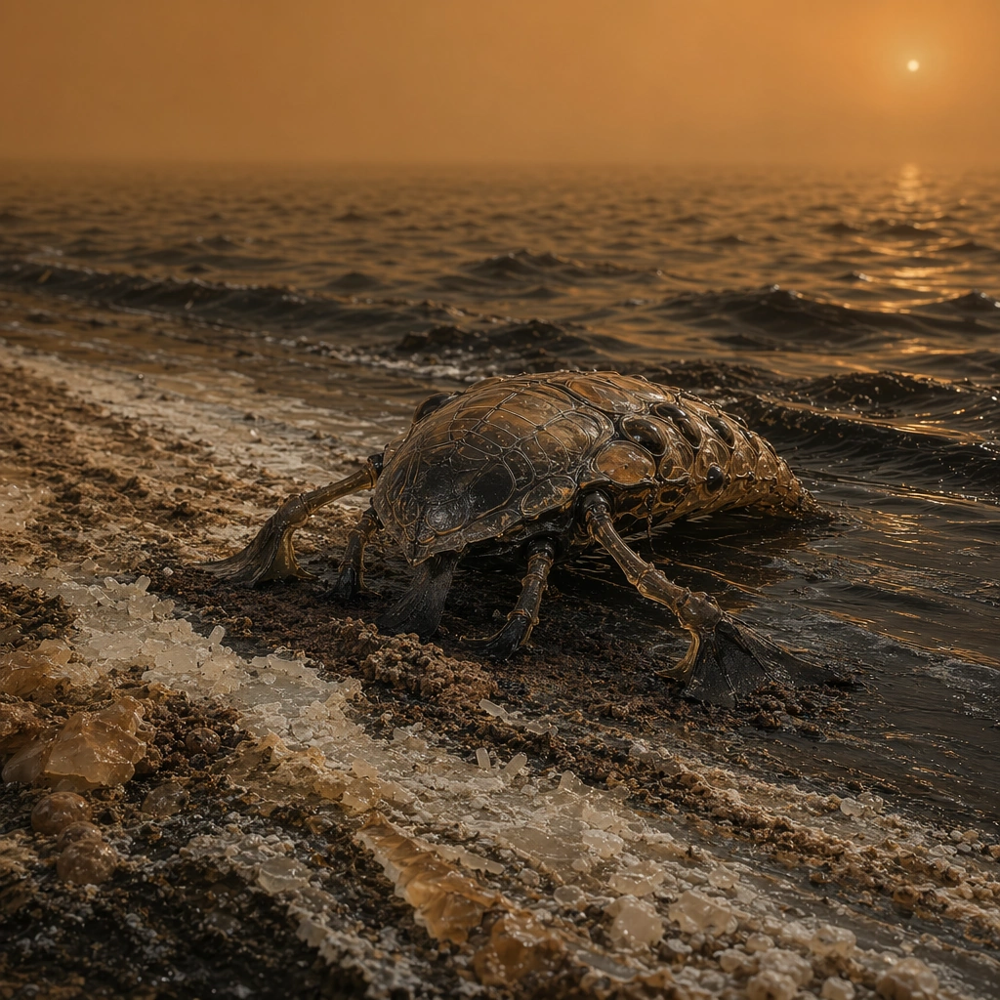

```text
Scene:
Set the image along a gently rippled methane shoreline where incoming dark waves leave bands of frosted residue and organic slush. The atmosphere should stay dim and orange, with faint wind texture visible across the liquid surface. Build the frame as a square natural history study with disciplined composition, believable lighting, and enough environmental evidence to explain how this organism or system functions without any caption. Keep the image polished, observational, and suitable for a research gallery rather than pulp fantasy spectacle.

Subject:
Show the organism probing deposited material with chemical sensors, unfolding feeding membranes, or rasping nutrient films from the shore. Its posture should communicate energy thrift and careful adaptation to a cold, slow world. Show the anatomy, habitat interaction, and scale cues clearly so the viewer can infer locomotion, feeding, reproduction, or ecological role from the visual alone. Every visible structure should feel evolved for a purpose, with layered foreground, midground, and background information that rewards close inspection.

Important details:
Assume the organism lives in hydrocarbon seas at extreme cold. Tissues, circulation, buoyancy, and sensory structures should reflect cryogenic chemistry, heavy haze, weak sunlight, and a shoreline shaped by methane waves and hydrocarbon sediment. The feeding behavior must fit the setting. Shoreline chemistry, sediment texture, and body mechanics should all reinforce a non-water ecosystem driven by hydrocarbon transport and sparse resources. Favor coherent biology over decorative excess: tissues, shells, membranes, spores, tendrils, fins, silica lattices, or atmospheric sacs should all follow one material logic. Preserve a convincing relationship between the environment and the body plan, use restrained color hierarchy, and make the image feel like a serious speculative field record rather than a random monster concept.

Use case:
Methane Sea Creature of Titan single study 3/9.

Constraints:
No readable text, no watermark, no logos, preserve exact 1:1 aspect ratio, no beach-surf imagery, no fish-copy feeding pose, no bright foam, no terrestrial seaweed, no accidental brand resemblance, no direct copy of known terrestrial species, no cartoon simplification.
```

[Pinned source](https://github.com/ChaosRealmsAI/gpt-image-2-gallery/blob/5296db8c996e38776c83a0bc8c64f848dcd512b3/works/topics/methane-sea-titan-creature/packages/single-methane-creature-studies/images/methane-wave-foraging/meta.json) · GPT Image2 · 1024×1024 · No source-declared image dependencies. · ProjectD:[published and publicly accepted](https://aitoolsradar.com/en/prompts/e5cfd915c55cee)

## Cryovolcanic Plume Crossing · methane-sea-titan-creature/single-methane-creature-studies/cryovolcanic-plume-crossing

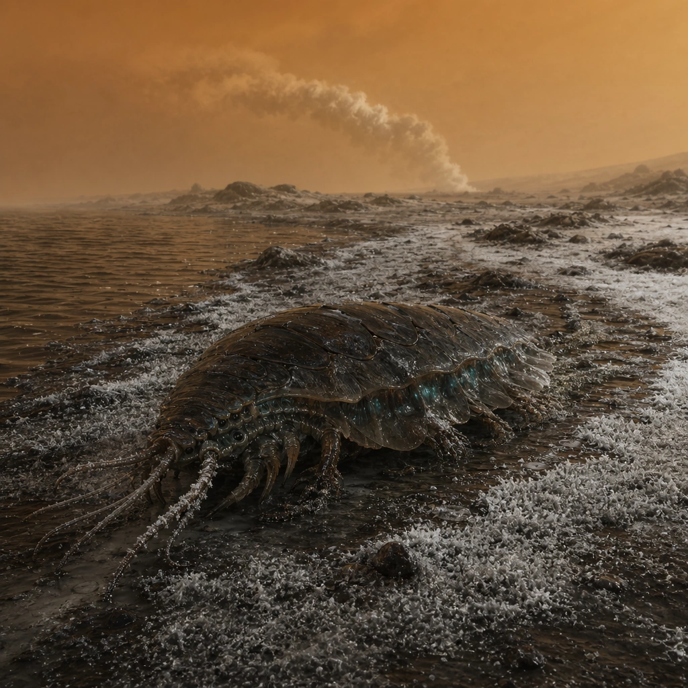

```text
Scene:
Build a wide cryogenic landscape where a faint distant cryovolcanic plume rises into the orange sky and condenses back onto the ground as pale frost. The square composition should feel desolate, cold, and geologically active without becoming explosive. Build the frame as a square natural history study with disciplined composition, believable lighting, and enough environmental evidence to explain how this organism or system functions without any caption. Keep the image polished, observational, and suitable for a research gallery rather than pulp fantasy spectacle.

Subject:
Show one mature creature moving across rough, dark terrain as it navigates plume fallout, perhaps attracted by fresh chemicals or warmth. The body should display weather resistance, traction structures, and insulation tuned for this harsher ground. Show the anatomy, habitat interaction, and scale cues clearly so the viewer can infer locomotion, feeding, reproduction, or ecological role from the visual alone. Every visible structure should feel evolved for a purpose, with layered foreground, midground, and background information that rewards close inspection.

Important details:
Assume the organism lives in hydrocarbon seas at extreme cold. Tissues, circulation, buoyancy, and sensory structures should reflect cryogenic chemistry, heavy haze, weak sunlight, and a shoreline shaped by methane waves and hydrocarbon sediment. Keep the geology and biology tightly coupled. Frost deposition, surface crust, and the creature’s route should all imply a real ecological opportunity linked to cryovolcanic chemistry. Favor coherent biology over decorative excess: tissues, shells, membranes, spores, tendrils, fins, silica lattices, or atmospheric sacs should all follow one material logic. Preserve a convincing relationship between the environment and the body plan, use restrained color hierarchy, and make the image feel like a serious speculative field record rather than a random monster concept.

Use case:
Methane Sea Creature of Titan single study 4/9.

Constraints:
No readable text, no watermark, no logos, preserve exact 1:1 aspect ratio, no lava eruption, no fire, no volcano-on-Earth cues, no action-movie pacing, no accidental brand resemblance, no direct copy of known terrestrial species, no cartoon simplification.
```

[Pinned source](https://github.com/ChaosRealmsAI/gpt-image-2-gallery/blob/5296db8c996e38776c83a0bc8c64f848dcd512b3/works/topics/methane-sea-titan-creature/packages/single-methane-creature-studies/images/cryovolcanic-plume-crossing/meta.json) · GPT Image2 · 1024×1024 · No source-declared image dependencies. · ProjectD:[published and publicly accepted](https://aitoolsradar.com/en/prompts/3259653e31ee4b)

## Juvenile Huddle Basin · methane-sea-titan-creature/single-methane-creature-studies/juvenile-huddle-basin

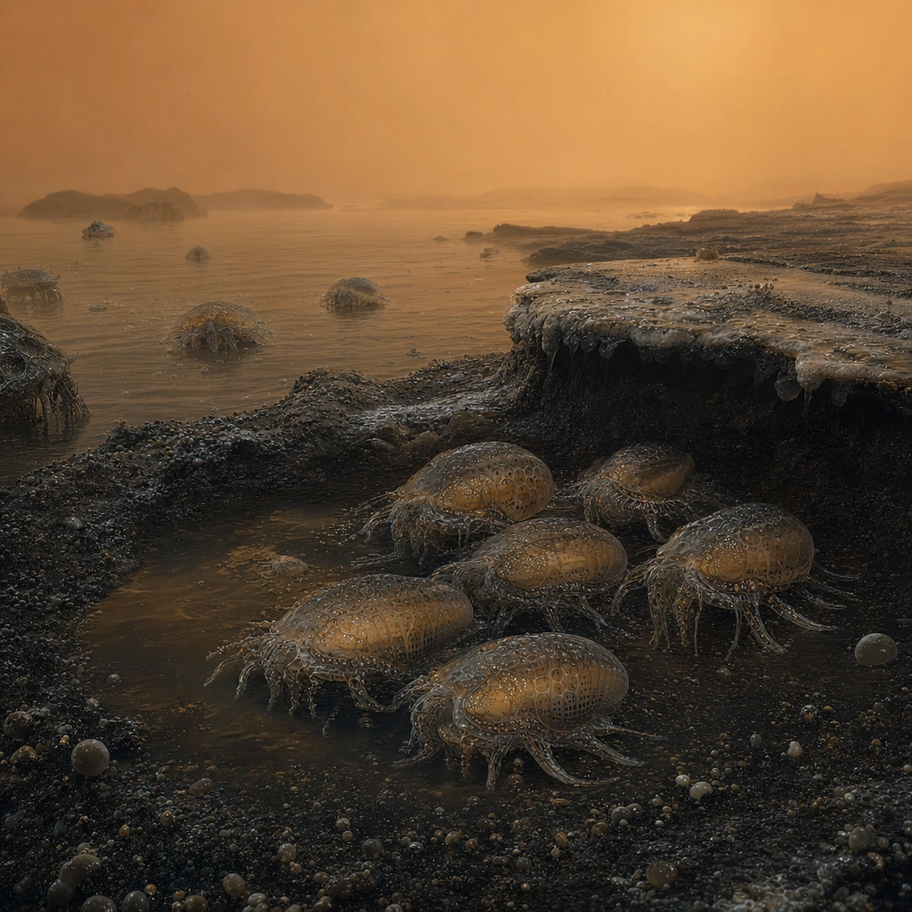

```text
Scene:
Create a quiet basin scene shielded from wind, where the orange haze softens the horizon and dark shore material holds faint traces of recent liquid movement. The square frame should feel intimate and protective compared with the harsher open coast. Build the frame as a square natural history study with disciplined composition, believable lighting, and enough environmental evidence to explain how this organism or system functions without any caption. Keep the image polished, observational, and suitable for a research gallery rather than pulp fantasy spectacle.

Subject:
Focus on several smaller juvenile forms pressed together or partially sheltered by basin edges, showing clear developmental differences from adults in transparency, proportion, and insulation. A few older guardians or environmental traces can imply parental behavior or passive refuge use. Show the anatomy, habitat interaction, and scale cues clearly so the viewer can infer locomotion, feeding, reproduction, or ecological role from the visual alone. Every visible structure should feel evolved for a purpose, with layered foreground, midground, and background information that rewards close inspection.

Important details:
Assume the organism lives in hydrocarbon seas at extreme cold. Tissues, circulation, buoyancy, and sensory structures should reflect cryogenic chemistry, heavy haze, weak sunlight, and a shoreline shaped by methane waves and hydrocarbon sediment. The cluster should communicate survival strategy in a cryogenic environment: reduced exposure, shared chemistry, and careful use of terrain. Avoid sentimental baby-animal cues and keep the juveniles biologically serious. Favor coherent biology over decorative excess: tissues, shells, membranes, spores, tendrils, fins, silica lattices, or atmospheric sacs should all follow one material logic. Preserve a convincing relationship between the environment and the body plan, use restrained color hierarchy, and make the image feel like a serious speculative field record rather than a random monster concept.

Use case:
Methane Sea Creature of Titan single study 5/9.

Constraints:
No readable text, no watermark, no logos, preserve exact 1:1 aspect ratio, no cute mascot look, no mammal cuddle cues, no warm campfire analogy, no bright colors, no accidental brand resemblance, no direct copy of known terrestrial species, no cartoon simplification.
```

[Pinned source](https://github.com/ChaosRealmsAI/gpt-image-2-gallery/blob/5296db8c996e38776c83a0bc8c64f848dcd512b3/works/topics/methane-sea-titan-creature/packages/single-methane-creature-studies/images/juvenile-huddle-basin/meta.json) · GPT Image2 · 1024×1024 · No source-declared image dependencies. · ProjectD:[published and publicly accepted](https://aitoolsradar.com/en/prompts/898c7c0d127a22)

## Sonar Organ Display · methane-sea-titan-creature/single-methane-creature-studies/sonar-organ-display

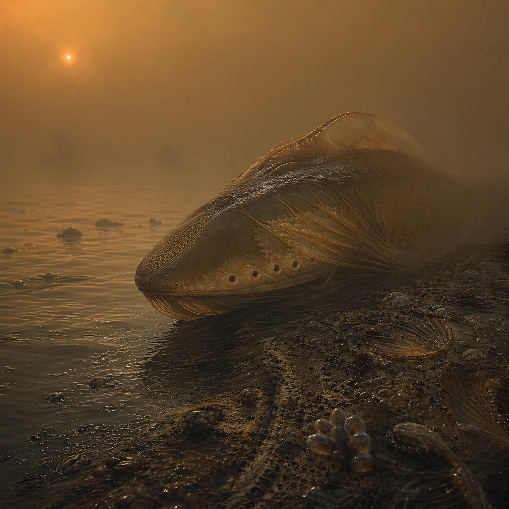

```text
Scene:
Compose a side-lit environmental portrait in thick haze so that only the front half of the animal and nearby shoreline are clearly visible. Weak orange light should graze the body, revealing specialized sensing ridges, cavities, or antenna-like structures. Build the frame as a square natural history study with disciplined composition, believable lighting, and enough environmental evidence to explain how this organism or system functions without any caption. Keep the image polished, observational, and suitable for a research gallery rather than pulp fantasy spectacle.

Subject:
Center on the sensory organs that help the creature navigate murky hydrocarbon seas and haze-heavy air. The organs should appear integrated into the body plan rather than tacked on as dramatic appendages. Show the anatomy, habitat interaction, and scale cues clearly so the viewer can infer locomotion, feeding, reproduction, or ecological role from the visual alone. Every visible structure should feel evolved for a purpose, with layered foreground, midground, and background information that rewards close inspection.

Important details:
Assume the organism lives in hydrocarbon seas at extreme cold. Tissues, circulation, buoyancy, and sensory structures should reflect cryogenic chemistry, heavy haze, weak sunlight, and a shoreline shaped by methane waves and hydrocarbon sediment. Sensory anatomy should be plausible for low light, dense atmosphere, and cold liquid. Show structural support, protective coatings, and a believable relation to the creature’s movement and foraging behavior. Favor coherent biology over decorative excess: tissues, shells, membranes, spores, tendrils, fins, silica lattices, or atmospheric sacs should all follow one material logic. Preserve a convincing relationship between the environment and the body plan, use restrained color hierarchy, and make the image feel like a serious speculative field record rather than a random monster concept.

Use case:
Methane Sea Creature of Titan single study 6/9.

Constraints:
No readable text, no watermark, no logos, preserve exact 1:1 aspect ratio, no insect antenna copy, no sci-fi radar dish, no monster-face closeup, no glowing cyberpunk accents, no accidental brand resemblance, no direct copy of known terrestrial species, no cartoon simplification.
```

[Pinned source](https://github.com/ChaosRealmsAI/gpt-image-2-gallery/blob/5296db8c996e38776c83a0bc8c64f848dcd512b3/works/topics/methane-sea-titan-creature/packages/single-methane-creature-studies/images/sonar-organ-display/meta.json) · GPT Image2 · 1024×1024 · No source-declared image dependencies. · ProjectD:[published and publicly accepted](https://aitoolsradar.com/en/prompts/b995135cd71917)

## Stormfront Shelter Ridge · methane-sea-titan-creature/single-methane-creature-studies/stormfront-shelter-ridge

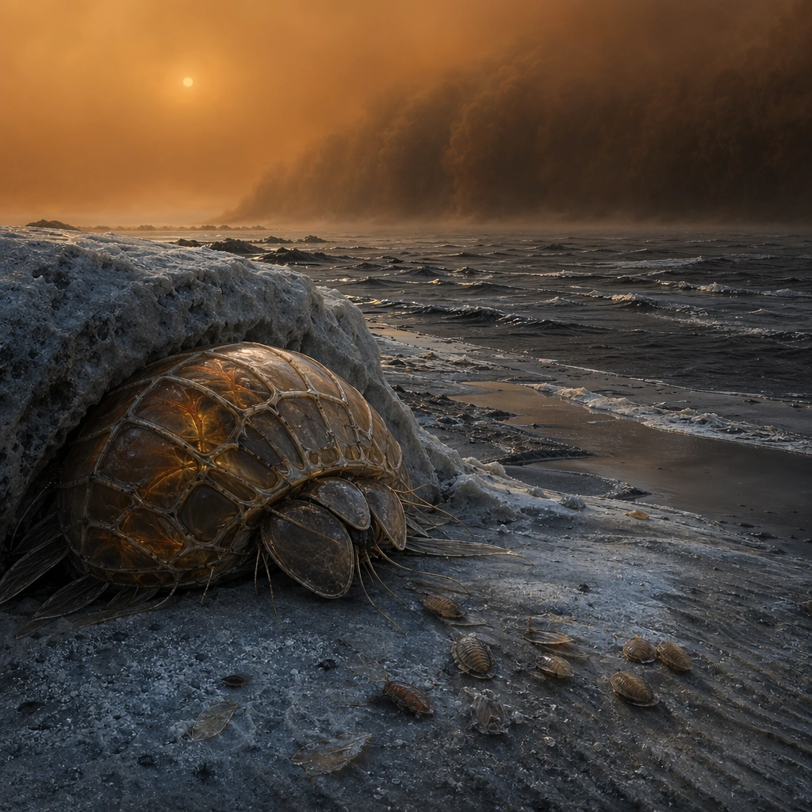

```text
Scene:
Show the approach of a hydrocarbon storm front over dark sea and shore, with the ridge creating a partial shelter in the foreground. The orange atmosphere should turn denser and more opaque toward the storm while remaining readable in the calmer foreground. Build the frame as a square natural history study with disciplined composition, believable lighting, and enough environmental evidence to explain how this organism or system functions without any caption. Keep the image polished, observational, and suitable for a research gallery rather than pulp fantasy spectacle.

Subject:
Depict the organism lowering its profile, sealing surface vents, and using terrain to reduce exposure. The scene should capture environmental strategy rather than fear or action spectacle. Show the anatomy, habitat interaction, and scale cues clearly so the viewer can infer locomotion, feeding, reproduction, or ecological role from the visual alone. Every visible structure should feel evolved for a purpose, with layered foreground, midground, and background information that rewards close inspection.

Important details:
Assume the organism lives in hydrocarbon seas at extreme cold. Tissues, circulation, buoyancy, and sensory structures should reflect cryogenic chemistry, heavy haze, weak sunlight, and a shoreline shaped by methane waves and hydrocarbon sediment. Wind direction, wave texture, and body posture must align. This is a cold-weather survival image where geology and anatomy work together against a hostile atmospheric event. Favor coherent biology over decorative excess: tissues, shells, membranes, spores, tendrils, fins, silica lattices, or atmospheric sacs should all follow one material logic. Preserve a convincing relationship between the environment and the body plan, use restrained color hierarchy, and make the image feel like a serious speculative field record rather than a random monster concept.

Use case:
Methane Sea Creature of Titan single study 7/9.

Constraints:
No readable text, no watermark, no logos, preserve exact 1:1 aspect ratio, no hurricane disaster scene, no lightning hero pose, no Earth rainstorm look, no fire or sparks, no accidental brand resemblance, no direct copy of known terrestrial species, no cartoon simplification.
```

[Pinned source](https://github.com/ChaosRealmsAI/gpt-image-2-gallery/blob/5296db8c996e38776c83a0bc8c64f848dcd512b3/works/topics/methane-sea-titan-creature/packages/single-methane-creature-studies/images/stormfront-shelter-ridge/meta.json) · GPT Image2 · 1024×1024 · No source-declared image dependencies. · ProjectD:[published and publicly accepted](https://aitoolsradar.com/en/prompts/9f5f876d9ca924)

## Undersea Glow Silhouette · methane-sea-titan-creature/single-methane-creature-studies/undersea-glow-silhouette

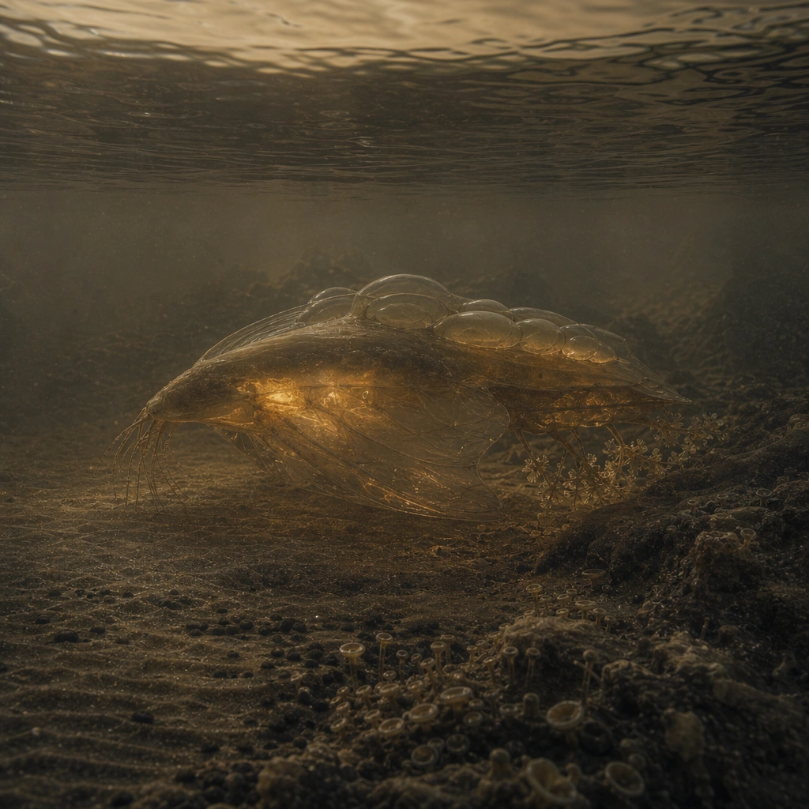

```text
Scene:
Take the viewpoint just at or below the liquid surface so the square frame peers through dark translucent methane toward a submerged body near shore. Distortion, suspended particles, and dim shoreline light should make the image quiet and uncanny rather than cinematic. Build the frame as a square natural history study with disciplined composition, believable lighting, and enough environmental evidence to explain how this organism or system functions without any caption. Keep the image polished, observational, and suitable for a research gallery rather than pulp fantasy spectacle.

Subject:
Show the animal as a soft internal glow silhouette with enough visible structure to read fins, circulation paths, and body posture. The undersea setting should clarify how the organism uses both liquid and air margins during its lifecycle. Show the anatomy, habitat interaction, and scale cues clearly so the viewer can infer locomotion, feeding, reproduction, or ecological role from the visual alone. Every visible structure should feel evolved for a purpose, with layered foreground, midground, and background information that rewards close inspection.

Important details:
Assume the organism lives in hydrocarbon seas at extreme cold. Tissues, circulation, buoyancy, and sensory structures should reflect cryogenic chemistry, heavy haze, weak sunlight, and a shoreline shaped by methane waves and hydrocarbon sediment. Liquid methane should not behave like clear tropical water. Keep it dense, dark, and slightly obscuring, with lighting and color filtered by hydrocarbon conditions rather than Earth-ocean assumptions. Favor coherent biology over decorative excess: tissues, shells, membranes, spores, tendrils, fins, silica lattices, or atmospheric sacs should all follow one material logic. Preserve a convincing relationship between the environment and the body plan, use restrained color hierarchy, and make the image feel like a serious speculative field record rather than a random monster concept.

Use case:
Methane Sea Creature of Titan single study 8/9.

Constraints:
No readable text, no watermark, no logos, preserve exact 1:1 aspect ratio, no scuba feel, no blue water, no shark silhouette trope, no neon underglow, no accidental brand resemblance, no direct copy of known terrestrial species, no cartoon simplification.
```

[Pinned source](https://github.com/ChaosRealmsAI/gpt-image-2-gallery/blob/5296db8c996e38776c83a0bc8c64f848dcd512b3/works/topics/methane-sea-titan-creature/packages/single-methane-creature-studies/images/undersea-glow-silhouette/meta.json) · GPT Image2 · 1024×1024 · No source-declared image dependencies. · ProjectD:[published and publicly accepted](https://aitoolsradar.com/en/prompts/c4b8306b48ddcc)

## Survey Rover Encounter · methane-sea-titan-creature/single-methane-creature-studies/survey-rover-encounter

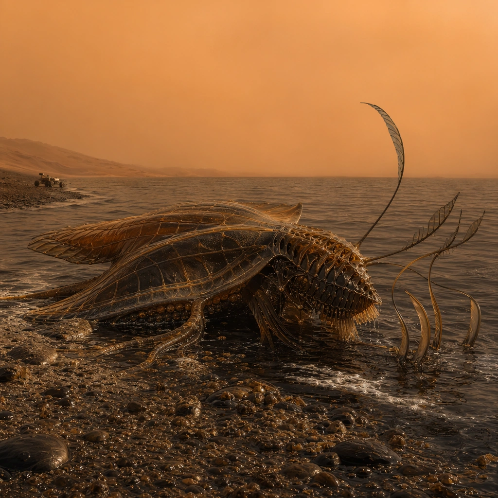

```text
Scene:
Frame the scene from low on the shore with a small distant rover at the edge of the composition and the organism dominating the middle ground. The atmosphere should remain orange, cold, and dusty, with the methane sea forming a dark horizon line. Build the frame as a square natural history study with disciplined composition, believable lighting, and enough environmental evidence to explain how this organism or system functions without any caption. Keep the image polished, observational, and suitable for a research gallery rather than pulp fantasy spectacle.

Subject:
Use the rover only as a scale cue while keeping the wildlife central. The creature should look curious or indifferent, not aggressive, and its size and texture should become easier to judge because of the nearby machine. Show the anatomy, habitat interaction, and scale cues clearly so the viewer can infer locomotion, feeding, reproduction, or ecological role from the visual alone. Every visible structure should feel evolved for a purpose, with layered foreground, midground, and background information that rewards close inspection.

Important details:
Assume the organism lives in hydrocarbon seas at extreme cold. Tissues, circulation, buoyancy, and sensory structures should reflect cryogenic chemistry, heavy haze, weak sunlight, and a shoreline shaped by methane waves and hydrocarbon sediment. The encounter should feel like field observation, not conflict. Preserve the shoreline ecology and cryogenic realism while using the rover sparingly to anchor human understanding of scale. Favor coherent biology over decorative excess: tissues, shells, membranes, spores, tendrils, fins, silica lattices, or atmospheric sacs should all follow one material logic. Preserve a convincing relationship between the environment and the body plan, use restrained color hierarchy, and make the image feel like a serious speculative field record rather than a random monster concept.

Use case:
Methane Sea Creature of Titan single study 9/9.

Constraints:
No readable text, no watermark, no logos, preserve exact 1:1 aspect ratio, no weaponized rover, no battle scene, no readable interface text, no human astronaut in frame, no accidental brand resemblance, no direct copy of known terrestrial species, no cartoon simplification.
```

[Pinned source](https://github.com/ChaosRealmsAI/gpt-image-2-gallery/blob/5296db8c996e38776c83a0bc8c64f848dcd512b3/works/topics/methane-sea-titan-creature/packages/single-methane-creature-studies/images/survey-rover-encounter/meta.json) · GPT Image2 · 1024×1024 · No source-declared image dependencies. · ProjectD:[published and publicly accepted](https://aitoolsradar.com/en/prompts/41e9beb7a5c16b)

## Reference Anchor · mexican-street-graphics-and-taqueria-language/series-core-system/01-reference-anchor

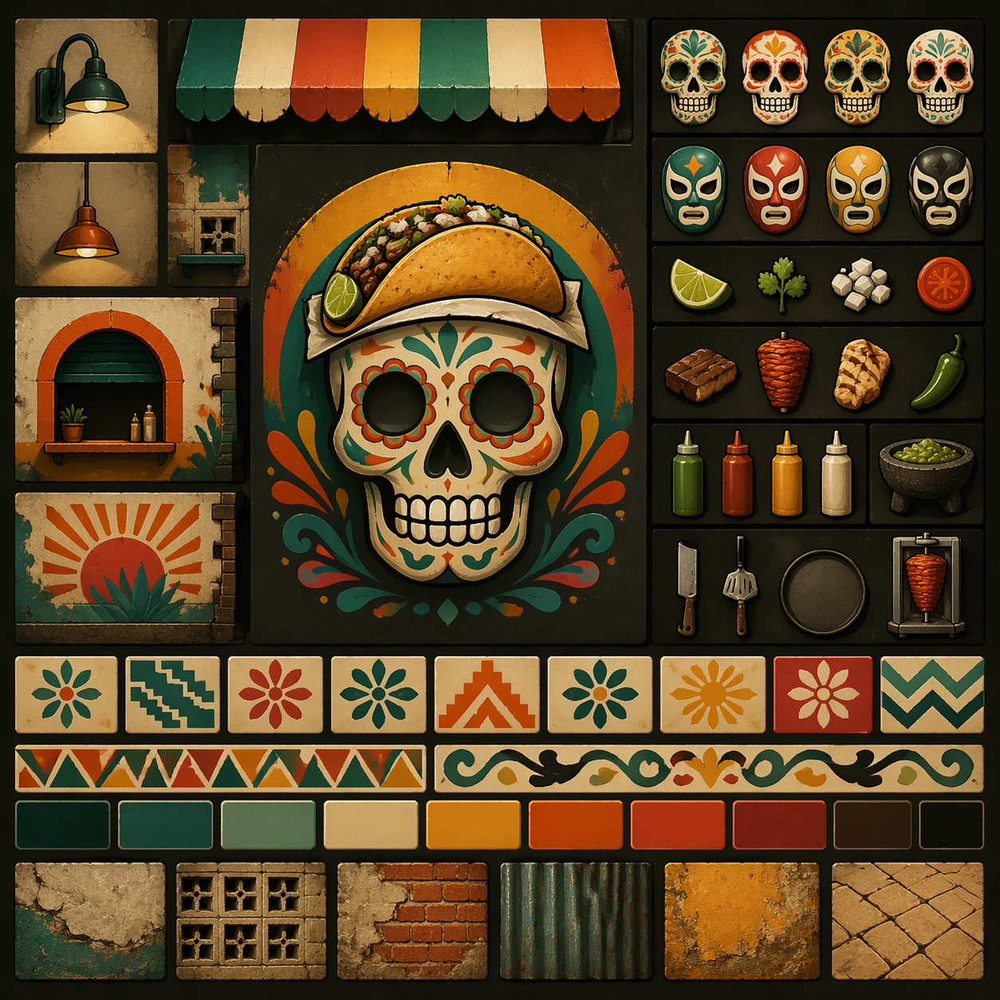

```text
Scene:
Create a square reference image for Mexican Street Graphics and Taqueria Language. Build a reference anchor establishing the core system with a premium, production-ready finish. Use a polished modular board or campaign surface with clean spacing, premium game-UI finish, and clear focal hierarchy. The composition should feel intentional, clean, and reusable for gallery, research, campaign, or internal handoff contexts. Lighting must support readability first, with the main forms clearly separated from the background and enough breathing room for the system to stay legible at both hero scale and thumbnail scale.

Subject:
Center a coherent original game-art system built for premium production and marketing surfaces. For this image, focus on reference anchor. Keep the same system logic stable across screenshots, cards, banners, and overview boards. This image is the canonical anchor that later series images must follow. The viewer should immediately understand what role this surface plays inside a cohesive game-production asset pack.

Important details:
Lock framing, icon grammar, palette blocking, and surface hierarchy so the kit feels production-ready and consistent. Preserve the core silhouette, framing language, and material logic from the reference image while each variation changes function. Keep materials believable, edge hierarchy disciplined, and the visual language consistent with Taqueria Style. Use abstract interface blocks or diagram accents when helpful, but avoid any readable language. The final result should feel like a deliberate production asset rather than a random illustration.

Use case:
Mexican Street Graphics and Taqueria Language series study 1/9, designed as reference anchor within a cohesive asset pack.

Constraints:
No readable text, no watermark, no logos, preserve exact 1:1 aspect ratio, no unrelated objects, no broken visual hierarchy, no malformed anatomy or broken perspective, no random decorative clutter.
```

[Pinned source](https://github.com/ChaosRealmsAI/gpt-image-2-gallery/blob/5296db8c996e38776c83a0bc8c64f848dcd512b3/works/topics/mexican-street-graphics-and-taqueria-language/packages/series-core-system/images/01-reference-anchor/meta.json) · GPT Image2 · 1254×1254 · No source-declared image dependencies. · ProjectD:[published and publicly accepted](https://aitoolsradar.com/en/prompts/b4fbd30abf72cd)

## Variant One · mexican-street-graphics-and-taqueria-language/series-core-system/02-variant-one

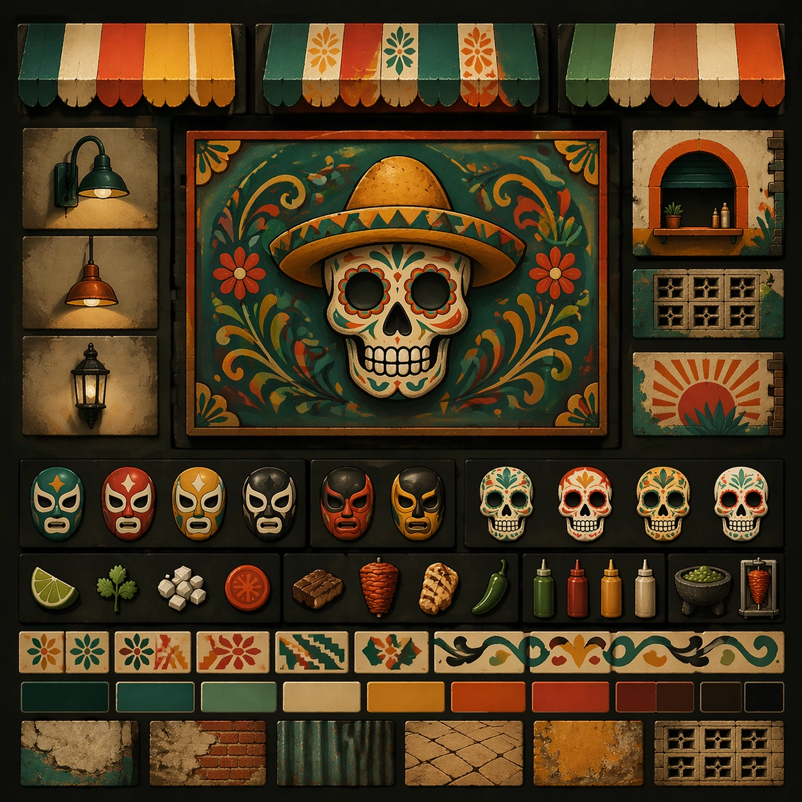

```text
Scene:
Create a square dependent image for Mexican Street Graphics and Taqueria Language. Build a first controlled variation in the same system with a premium, production-ready finish. Use a polished modular board or campaign surface with clean spacing, premium game-UI finish, and clear focal hierarchy. The composition should feel intentional, clean, and reusable for gallery, research, campaign, or internal handoff contexts. Lighting must support readability first, with the main forms clearly separated from the background and enough breathing room for the system to stay legible at both hero scale and thumbnail scale.

Subject:
Center a coherent original game-art system built for premium production and marketing surfaces. For this image, focus on the intended support surface. Keep the same system logic stable across screenshots, cards, banners, and overview boards. Preserve exact identity or system logic from the reference image while changing only the intended variation axis. The viewer should immediately understand what role this surface plays inside a cohesive game-production asset pack.

Important details:
Lock framing, icon grammar, palette blocking, and surface hierarchy so the kit feels production-ready and consistent. Preserve the core silhouette, framing language, and material logic from the reference image while each variation changes function. Keep materials believable, edge hierarchy disciplined, and the visual language consistent with Taqueria Style. Use abstract interface blocks or diagram accents when helpful, but avoid any readable language. The final result should feel like a deliberate production asset rather than a random illustration.

Use case:
Mexican Street Graphics and Taqueria Language series study 2/9, designed as variant one within a cohesive asset pack.

Constraints:
No readable text, no watermark, no logos, preserve exact 1:1 aspect ratio, no unrelated objects, no broken visual hierarchy, no malformed anatomy or broken perspective, no random decorative clutter.
```

[Pinned source](https://github.com/ChaosRealmsAI/gpt-image-2-gallery/blob/5296db8c996e38776c83a0bc8c64f848dcd512b3/works/topics/mexican-street-graphics-and-taqueria-language/packages/series-core-system/images/02-variant-one/meta.json) · GPT Image2 · 1254×1254 · Reference images required. · ProjectD:[published and publicly accepted](https://aitoolsradar.com/en/prompts/5bc0a9f5d23cd2)

## Variant Two · mexican-street-graphics-and-taqueria-language/series-core-system/03-variant-two

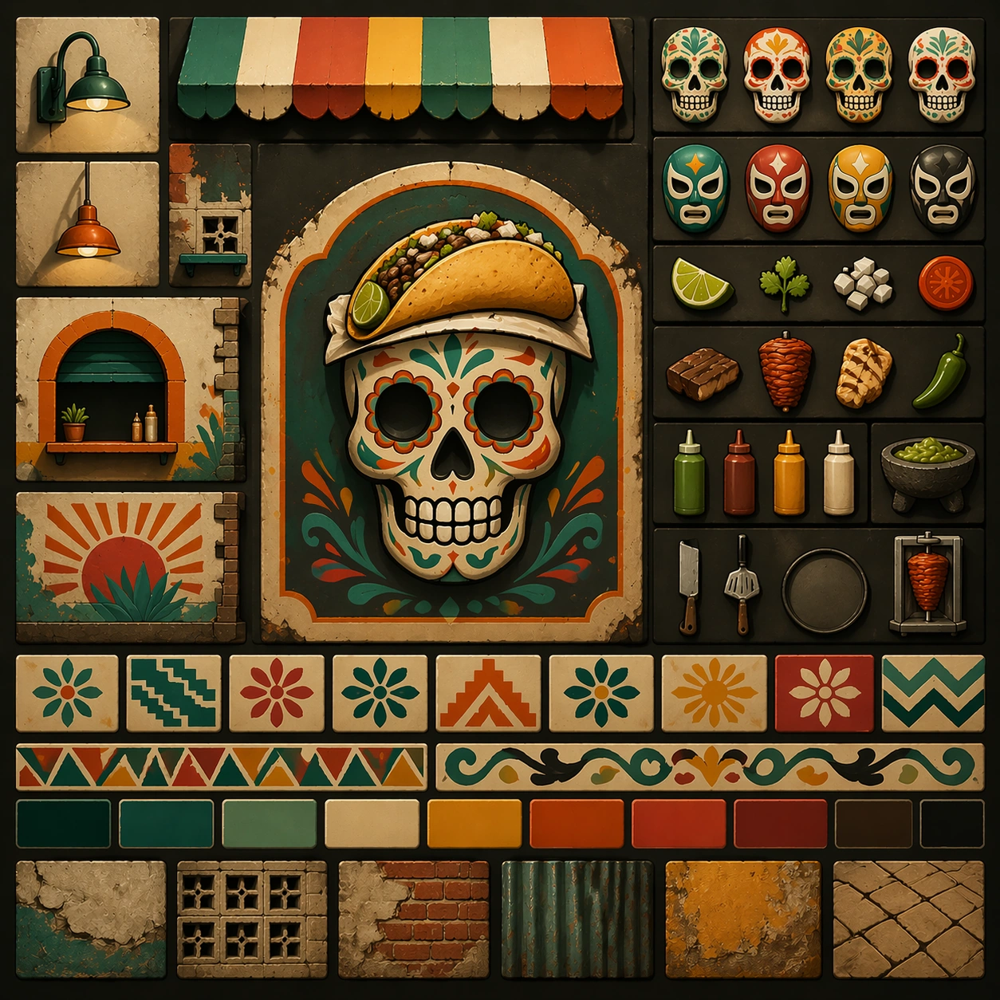

```text
Scene:
Create a square dependent image for Mexican Street Graphics and Taqueria Language. Build a second controlled variation in the same system with a premium, production-ready finish. Use a polished modular board or campaign surface with clean spacing, premium game-UI finish, and clear focal hierarchy. The composition should feel intentional, clean, and reusable for gallery, research, campaign, or internal handoff contexts. Lighting must support readability first, with the main forms clearly separated from the background and enough breathing room for the system to stay legible at both hero scale and thumbnail scale.

Subject:
Center a coherent original game-art system built for premium production and marketing surfaces. For this image, focus on the intended support surface. Keep the same system logic stable across screenshots, cards, banners, and overview boards. Preserve exact identity or system logic from the reference image while changing only the intended variation axis. The viewer should immediately understand what role this surface plays inside a cohesive game-production asset pack.

Important details:
Lock framing, icon grammar, palette blocking, and surface hierarchy so the kit feels production-ready and consistent. Preserve the core silhouette, framing language, and material logic from the reference image while each variation changes function. Keep materials believable, edge hierarchy disciplined, and the visual language consistent with Taqueria Style. Use abstract interface blocks or diagram accents when helpful, but avoid any readable language. The final result should feel like a deliberate production asset rather than a random illustration.

Use case:
Mexican Street Graphics and Taqueria Language series study 3/9, designed as variant two within a cohesive asset pack.

Constraints:
No readable text, no watermark, no logos, preserve exact 1:1 aspect ratio, no unrelated objects, no broken visual hierarchy, no malformed anatomy or broken perspective, no random decorative clutter.
```

[Pinned source](https://github.com/ChaosRealmsAI/gpt-image-2-gallery/blob/5296db8c996e38776c83a0bc8c64f848dcd512b3/works/topics/mexican-street-graphics-and-taqueria-language/packages/series-core-system/images/03-variant-two/meta.json) · GPT Image2 · 1254×1254 · Reference images required. · ProjectD:[published and publicly accepted](https://aitoolsradar.com/en/prompts/70f467185b1c35)

## Variant Three · mexican-street-graphics-and-taqueria-language/series-core-system/04-variant-three


```text
Scene:
Create a square dependent image for Mexican Street Graphics and Taqueria Language. Build a third controlled variation in the same system with a premium, production-ready finish. Use a polished modular board or campaign surface with clean spacing, premium game-UI finish, and clear focal hierarchy. The composition should feel intentional, clean, and reusable for gallery, research, campaign, or internal handoff contexts. Lighting must support readability first, with the main forms clearly separated from the background and enough breathing room for the system to stay legible at both hero scale and thumbnail scale.

Subject:
Center a coherent original game-art system built for premium production and marketing surfaces. For this image, focus on the intended support surface. Keep the same system logic stable across screenshots, cards, banners, and overview boards. Preserve exact identity or system logic from the reference image while changing only the intended variation axis. The viewer should immediately understand what role this surface plays inside a cohesive game-production asset pack.

Important details:
Lock framing, icon grammar, palette blocking, and surface hierarchy so the kit feels production-ready and consistent. Preserve the core silhouette, framing language, and material logic from the reference image while each variation changes function. Keep materials believable, edge hierarchy disciplined, and the visual language consistent with Taqueria Style. Use abstract interface blocks or diagram accents when helpful, but avoid any readable language. The final result should feel like a deliberate production asset rather than a random illustration.

Use case:
Mexican Street Graphics and Taqueria Language series study 4/9, designed as variant three within a cohesive asset pack.

Constraints:
No readable text, no watermark, no logos, preserve exact 1:1 aspect ratio, no unrelated objects, no broken visual hierarchy, no malformed anatomy or broken perspective, no random decorative clutter.
```

[Pinned source](https://github.com/ChaosRealmsAI/gpt-image-2-gallery/blob/5296db8c996e38776c83a0bc8c64f848dcd512b3/works/topics/mexican-street-graphics-and-taqueria-language/packages/series-core-system/images/04-variant-three/meta.json) · GPT Image2 · 1024×1024 · Reference images required. · ProjectD:[published and publicly accepted](https://aitoolsradar.com/en/prompts/c74a68cc235395)

## Support One · mexican-street-graphics-and-taqueria-language/single-support-studies/support-one

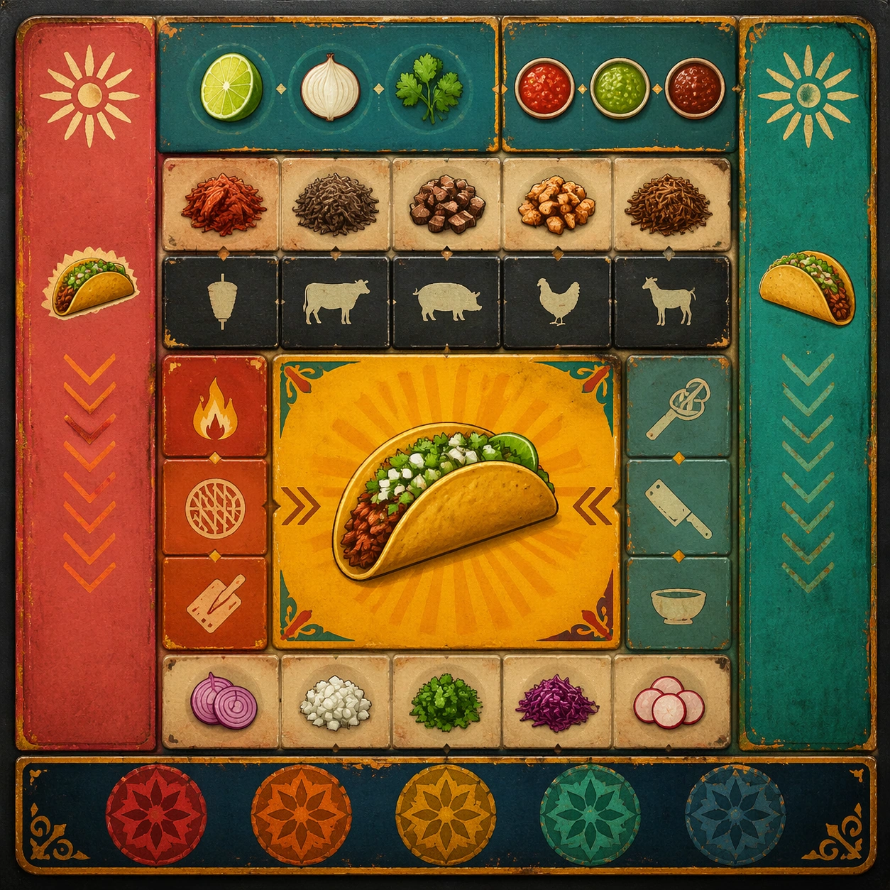

```text
Scene:
Create a square standalone support image for Mexican Street Graphics and Taqueria Language. Build a support-surface study with a clear focal hierarchy and a finished professional surface. Use a polished modular board or campaign surface with clean spacing, premium game-UI finish, and clear focal hierarchy. The frame should feel self-contained and polished, with enough structure to explain the system even without the reference series, yet still obviously belonging to the same theme and production world.

Subject:
Show a coherent original game-art system built for premium production and marketing surfaces in a way that emphasizes the intended support surface. Keep the same system logic stable across screenshots, cards, banners, and overview boards. Even though this image is independent, the viewer should still recognize the same universe, same commercial logic, and same production intent as the core package.

Important details:
Lock framing, icon grammar, palette blocking, and surface hierarchy so the kit feels production-ready and consistent. Preserve the broader theme language through color, framing, material choices, and modular composition. Use clean panel rhythm, premium asset presentation, and believable detail density. The image should work equally well as a gallery study, research reference, and mock production deliverable.

Use case:
Mexican Street Graphics and Taqueria Language single study 5/9, exploring support one as a support surface.

Constraints:
No readable text, no watermark, no logos, preserve exact 1:1 aspect ratio, no unrelated objects, no broken visual hierarchy, no visual noise that obscures the main surface, no accidental brand resemblance.
```

[Pinned source](https://github.com/ChaosRealmsAI/gpt-image-2-gallery/blob/5296db8c996e38776c83a0bc8c64f848dcd512b3/works/topics/mexican-street-graphics-and-taqueria-language/packages/single-support-studies/images/support-one/meta.json) · GPT Image2 · 1254×1254 · No source-declared image dependencies. · ProjectD:[published and publicly accepted](https://aitoolsradar.com/en/prompts/18ed1742b3ad36)

## Support Two · mexican-street-graphics-and-taqueria-language/single-support-studies/support-two

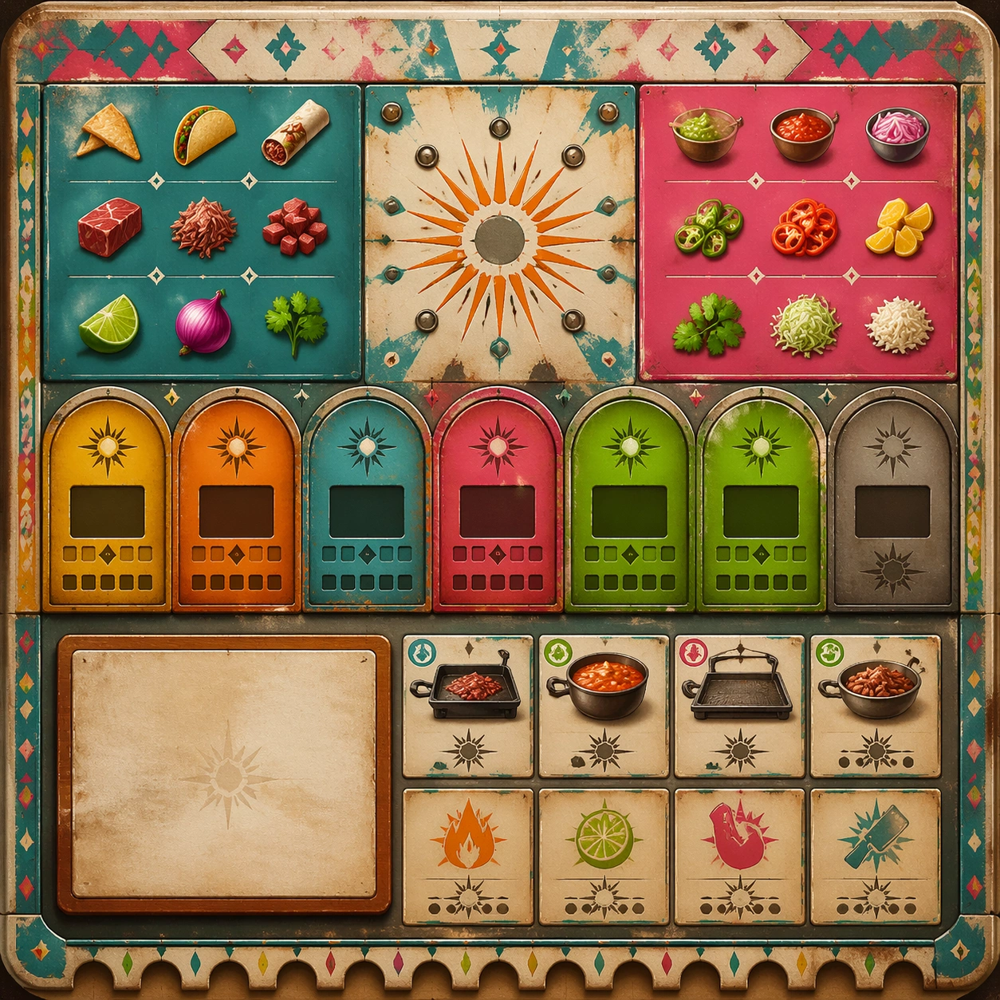

```text
Scene:
Create a square standalone support image for Mexican Street Graphics and Taqueria Language. Build a second support-surface study with a clear focal hierarchy and a finished professional surface. Use a polished modular board or campaign surface with clean spacing, premium game-UI finish, and clear focal hierarchy. The frame should feel self-contained and polished, with enough structure to explain the system even without the reference series, yet still obviously belonging to the same theme and production world.

Subject:
Show a coherent original game-art system built for premium production and marketing surfaces in a way that emphasizes the intended support surface. Keep the same system logic stable across screenshots, cards, banners, and overview boards. Even though this image is independent, the viewer should still recognize the same universe, same commercial logic, and same production intent as the core package.

Important details:
Lock framing, icon grammar, palette blocking, and surface hierarchy so the kit feels production-ready and consistent. Preserve the broader theme language through color, framing, material choices, and modular composition. Use clean panel rhythm, premium asset presentation, and believable detail density. The image should work equally well as a gallery study, research reference, and mock production deliverable.

Use case:
Mexican Street Graphics and Taqueria Language single study 6/9, exploring support two as a support surface.

Constraints:
No readable text, no watermark, no logos, preserve exact 1:1 aspect ratio, no unrelated objects, no broken visual hierarchy, no visual noise that obscures the main surface, no accidental brand resemblance.
```

[Pinned source](https://github.com/ChaosRealmsAI/gpt-image-2-gallery/blob/5296db8c996e38776c83a0bc8c64f848dcd512b3/works/topics/mexican-street-graphics-and-taqueria-language/packages/single-support-studies/images/support-two/meta.json) · GPT Image2 · 1254×1254 · No source-declared image dependencies. · ProjectD:[published and publicly accepted](https://aitoolsradar.com/en/prompts/daf8c8aa31653d)

## Support Three · mexican-street-graphics-and-taqueria-language/single-support-studies/support-three

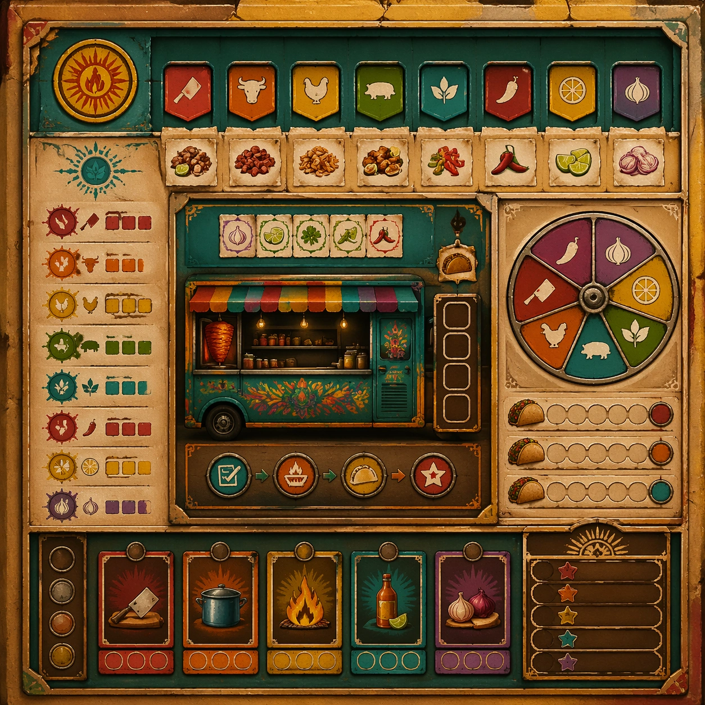

```text
Scene:
Create a square standalone support image for Mexican Street Graphics and Taqueria Language. Build a third support-surface study with a clear focal hierarchy and a finished professional surface. Use a polished modular board or campaign surface with clean spacing, premium game-UI finish, and clear focal hierarchy. The frame should feel self-contained and polished, with enough structure to explain the system even without the reference series, yet still obviously belonging to the same theme and production world.

Subject:
Show a coherent original game-art system built for premium production and marketing surfaces in a way that emphasizes the intended support surface. Keep the same system logic stable across screenshots, cards, banners, and overview boards. Even though this image is independent, the viewer should still recognize the same universe, same commercial logic, and same production intent as the core package.

Important details:
Lock framing, icon grammar, palette blocking, and surface hierarchy so the kit feels production-ready and consistent. Preserve the broader theme language through color, framing, material choices, and modular composition. Use clean panel rhythm, premium asset presentation, and believable detail density. The image should work equally well as a gallery study, research reference, and mock production deliverable.

Use case:
Mexican Street Graphics and Taqueria Language single study 7/9, exploring support three as a support surface.

Constraints:
No readable text, no watermark, no logos, preserve exact 1:1 aspect ratio, no unrelated objects, no broken visual hierarchy, no visual noise that obscures the main surface, no accidental brand resemblance.
```

[Pinned source](https://github.com/ChaosRealmsAI/gpt-image-2-gallery/blob/5296db8c996e38776c83a0bc8c64f848dcd512b3/works/topics/mexican-street-graphics-and-taqueria-language/packages/single-support-studies/images/support-three/meta.json) · GPT Image2 · 1254×1254 · No source-declared image dependencies. · ProjectD:[published and publicly accepted](https://aitoolsradar.com/en/prompts/967148636c44b9)

## Support Four · mexican-street-graphics-and-taqueria-language/single-support-studies/support-four

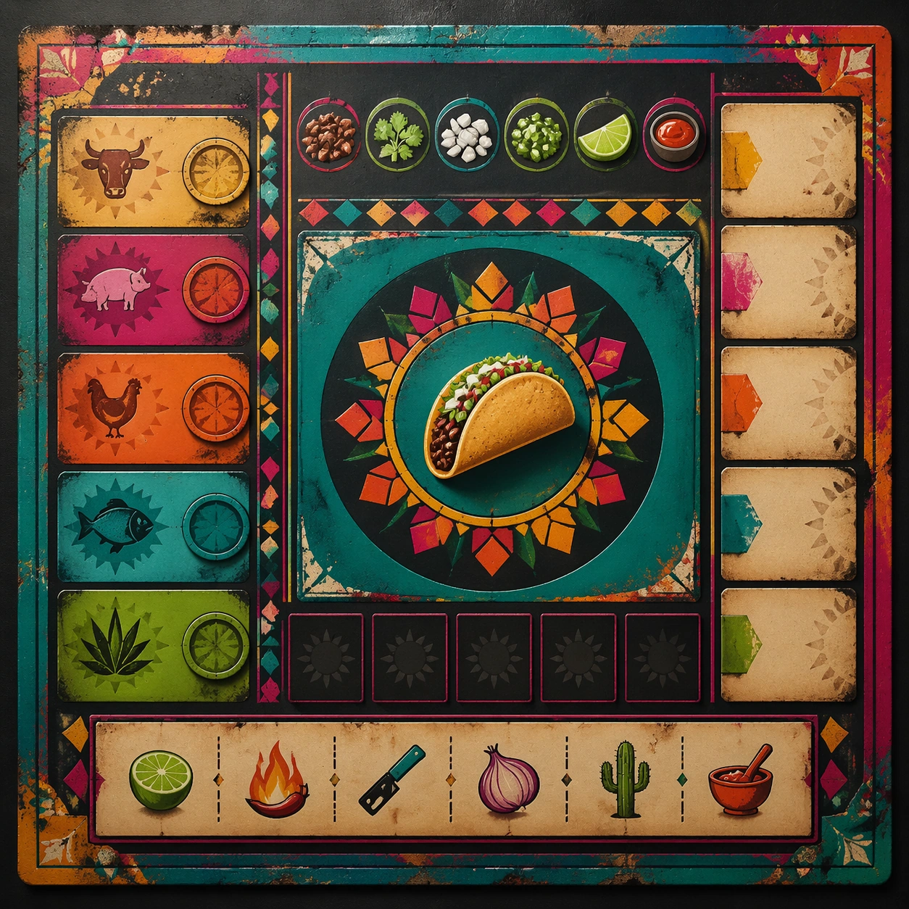

```text
Scene:
Create a square standalone support image for Mexican Street Graphics and Taqueria Language. Build a fourth support-surface study with a clear focal hierarchy and a finished professional surface. Use a polished modular board or campaign surface with clean spacing, premium game-UI finish, and clear focal hierarchy. The frame should feel self-contained and polished, with enough structure to explain the system even without the reference series, yet still obviously belonging to the same theme and production world.

Subject:
Show a coherent original game-art system built for premium production and marketing surfaces in a way that emphasizes the intended support surface. Keep the same system logic stable across screenshots, cards, banners, and overview boards. Even though this image is independent, the viewer should still recognize the same universe, same commercial logic, and same production intent as the core package.

Important details:
Lock framing, icon grammar, palette blocking, and surface hierarchy so the kit feels production-ready and consistent. Preserve the broader theme language through color, framing, material choices, and modular composition. Use clean panel rhythm, premium asset presentation, and believable detail density. The image should work equally well as a gallery study, research reference, and mock production deliverable.

Use case:
Mexican Street Graphics and Taqueria Language single study 8/9, exploring support four as a support surface.

Constraints:
No readable text, no watermark, no logos, preserve exact 1:1 aspect ratio, no unrelated objects, no broken visual hierarchy, no visual noise that obscures the main surface, no accidental brand resemblance.
```

[Pinned source](https://github.com/ChaosRealmsAI/gpt-image-2-gallery/blob/5296db8c996e38776c83a0bc8c64f848dcd512b3/works/topics/mexican-street-graphics-and-taqueria-language/packages/single-support-studies/images/support-four/meta.json) · GPT Image2 · 1254×1254 · No source-declared image dependencies. · ProjectD:[published and publicly accepted](https://aitoolsradar.com/en/prompts/d209528743e977)

## Support Five · mexican-street-graphics-and-taqueria-language/single-support-studies/support-five

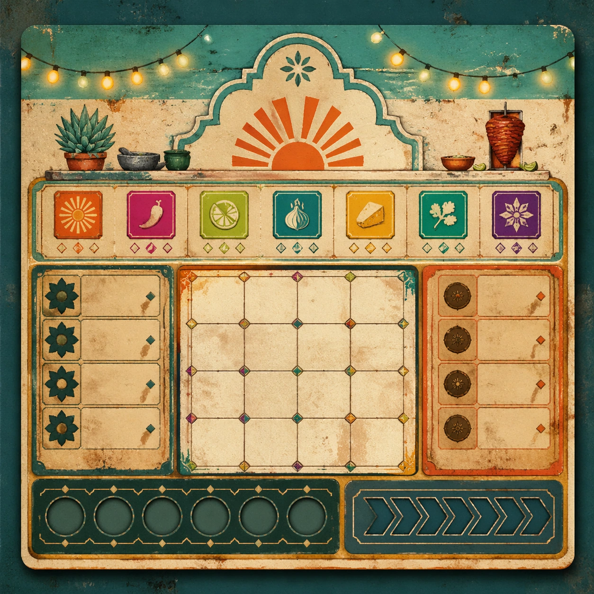

```text
Scene:
Create a square standalone support image for Mexican Street Graphics and Taqueria Language. Build a fifth support-surface study with a clear focal hierarchy and a finished professional surface. Use a polished modular board or campaign surface with clean spacing, premium game-UI finish, and clear focal hierarchy. The frame should feel self-contained and polished, with enough structure to explain the system even without the reference series, yet still obviously belonging to the same theme and production world.

Subject:
Show a coherent original game-art system built for premium production and marketing surfaces in a way that emphasizes the intended support surface. Keep the same system logic stable across screenshots, cards, banners, and overview boards. Even though this image is independent, the viewer should still recognize the same universe, same commercial logic, and same production intent as the core package.

Important details:
Lock framing, icon grammar, palette blocking, and surface hierarchy so the kit feels production-ready and consistent. Preserve the broader theme language through color, framing, material choices, and modular composition. Use clean panel rhythm, premium asset presentation, and believable detail density. The image should work equally well as a gallery study, research reference, and mock production deliverable.

Use case:
Mexican Street Graphics and Taqueria Language single study 9/9, exploring support five as a support surface.

Constraints:
No readable text, no watermark, no logos, preserve exact 1:1 aspect ratio, no unrelated objects, no broken visual hierarchy, no visual noise that obscures the main surface, no accidental brand resemblance.
```

[Pinned source](https://github.com/ChaosRealmsAI/gpt-image-2-gallery/blob/5296db8c996e38776c83a0bc8c64f848dcd512b3/works/topics/mexican-street-graphics-and-taqueria-language/packages/single-support-studies/images/support-five/meta.json) · GPT Image2 · 1254×1254 · No source-declared image dependencies. · ProjectD:[published and publicly accepted](https://aitoolsradar.com/en/prompts/cbb03d08948d80)

## Langoustine Citrus Ribbon · michelin-plate-hero-shot/single-fine-dining-hero-studies/02-langoustine-citrus-ribbon

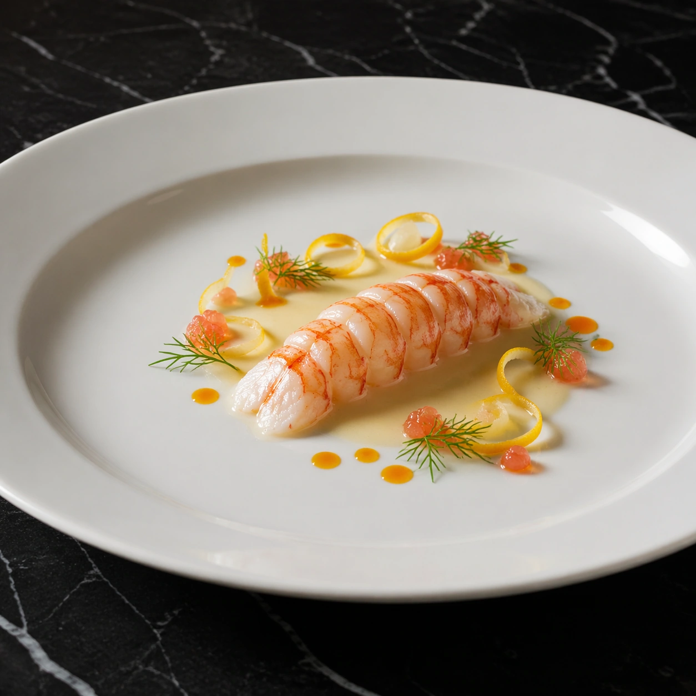

```text
Scene:
A square commercial food photograph shot at a shallow 45 degree angle so the rim of a wide white porcelain plate remains visible against a black marble tabletop. Use clean directional side light from the left with soft shadow falloff and controlled highlights on glaze and shellfish. The frame should feel like a premium restaurant launch image with ample breathing room, calm contrast, and no rustic clutter.

Subject:
Present a single poached langoustine tail as the hero element, set on a pale ivory sauce with curled ribbons of compressed citrus peel, small fennel fronds, translucent grapefruit pearls, and a few precise dots of orange oil. The langoustine should look tender and moist, with subtle coral color variation and natural segmented structure. The garnish forms a loose spiral that guides the eye without overwhelming the main ingredient. Keep the plate elegant and contemporary, with a small tasting-menu portion and meticulous spacing.

Important details:
The seafood anatomy must remain believable: clear segment definition, slight sheen, and no cartoonish oversizing. Citrus ribbons should look thin, pliable, and freshly cut, not plastic. Sauce viscosity, oil separation, and porcelain reflections should read as real photography. This image depends on world knowledge of refined seafood plating, where restraint, freshness, and visual precision matter more than abundance.

Use case:
Michelin Plate Hero Shot single study 2/8, focused on a refined langoustine composition with citrus-driven movement.

Constraints:
No readable text, no watermark, no logos, preserve exact 1:1 aspect ratio, no utensils, no hands, no table props, no rustic wood, no overfilled plate, no duplicated shellfish, no messy splashes, no unnatural neon color.
```

[Pinned source](https://github.com/ChaosRealmsAI/gpt-image-2-gallery/blob/5296db8c996e38776c83a0bc8c64f848dcd512b3/works/topics/michelin-plate-hero-shot/packages/single-fine-dining-hero-studies/images/02-langoustine-citrus-ribbon/meta.json) · GPT Image2 · 1254×1254 · No source-declared image dependencies. · ProjectD:[published and publicly accepted](https://aitoolsradar.com/en/prompts/87e230e7d9b383)

## Wagyu Smoke Lacquer · michelin-plate-hero-shot/single-fine-dining-hero-studies/03-wagyu-smoke-lacquer

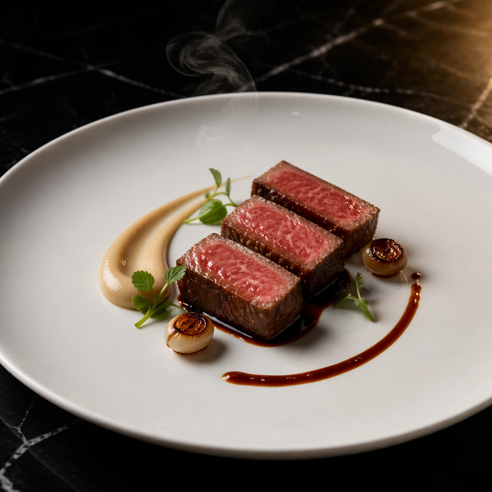

```text
Scene:
A square steak hero shot framed from a slightly elevated three-quarter angle, with a large white porcelain plate resting on polished black marble under controlled overhead light and a narrow warm side kicker. The lighting should reveal lacquered surfaces, gentle steam, and plate curvature while keeping the background clean and dark. The image must feel like a high-budget restaurant advertising visual rather than casual dining photography.

Subject:
Feature three neatly sliced pieces of medium-rare wagyu beef arranged in a staggered line over a glossy dark glaze. Add a small smoked onion puree swoosh, a few charred pearl onions, tiny mustard greens, and one precise arc of reduced jus. The beef should show realistic marbling, moist cut faces, and a restrained amount of rendered fat sheen. Use a very small portion, plated like a tasting course, with one faint wisp of smoke or vapor rising near the meat to imply heat and service timing.

Important details:
Wagyu texture must be convincing, with fine marbling and correct pink center rather than raw or overcooked extremes. Keep the glaze reflective but controlled, and avoid barbecue styling. The plate should read as European fine dining: minimal components, strong negative space, and exact sauce geometry. Every garnish must support the meat and not turn the plate into a busy still life.

Use case:
Michelin Plate Hero Shot single study 3/8, focused on premium wagyu treatment with lacquered surfaces and restrained drama.

Constraints:
No readable text, no watermark, no logos, preserve exact 1:1 aspect ratio, no steak knife, no hands, no wooden board, no oversized ribeye slab, no casual grill marks, no messy grease, no extra side dishes, no cartoon smoke clouds.
```

[Pinned source](https://github.com/ChaosRealmsAI/gpt-image-2-gallery/blob/5296db8c996e38776c83a0bc8c64f848dcd512b3/works/topics/michelin-plate-hero-shot/packages/single-fine-dining-hero-studies/images/03-wagyu-smoke-lacquer/meta.json) · GPT Image2 · 1254×1254 · No source-declared image dependencies. · ProjectD:[published and publicly accepted](https://aitoolsradar.com/en/prompts/b1e94b8c037ba3)

## Beetroot Rose Tartare · michelin-plate-hero-shot/single-fine-dining-hero-studies/04-beetroot-rose-tartare

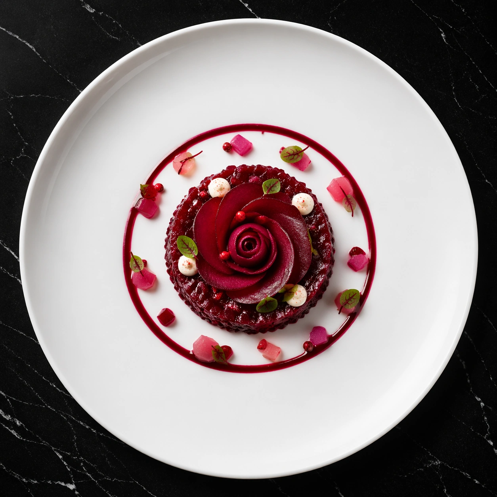

```text
Scene:
A square overhead hero shot on a pure black marble surface with subtle reflection, featuring a wide-rim white porcelain plate under crisp top light and a softer fill from the lower right. The frame should feel clean, feminine, and deliberate, like a seasonal tasting-menu campaign image. Negative space is important: let the plate breathe and keep the overall composition centered but not static.

Subject:
Create an elegant beetroot tartare formed into a low circular mound, topped with paper-thin concentric rose-like slices of beet, tiny pink peppercorn accents, micro sorrel leaves, and a few dots of pale horseradish cream. Around the tartare, place a restrained ring of ruby beet reduction and a small scatter of translucent pickled vegetable cubes. The palette should stay within deep burgundy, blush pink, ivory, and a touch of green, with the tartare reading as refined vegetable-focused gastronomy rather than rustic salad.

Important details:
The beet texture must look real: moist but not wet, finely cut, and lightly glossy. Rose slices should appear thin and delicate, with natural organic irregularity. Porcelain cleanliness, sauce edge control, and microgreen placement matter as much as the ingredients themselves. This image should demonstrate that a vegetable course can carry the same premium hero-shot gravity as seafood or meat.

Use case:
Michelin Plate Hero Shot single study 4/8, focused on a jewel-toned beet tartare plated with floral precision.

Constraints:
No readable text, no watermark, no logos, preserve exact 1:1 aspect ratio, no cutlery, no linen, no rustic crumbs, no oversized salad volume, no sloppy beet stains outside the intended sauce, no cheese shavings, no extra bowls, no casual bistro styling.
```

[Pinned source](https://github.com/ChaosRealmsAI/gpt-image-2-gallery/blob/5296db8c996e38776c83a0bc8c64f848dcd512b3/works/topics/michelin-plate-hero-shot/packages/single-fine-dining-hero-studies/images/04-beetroot-rose-tartare/meta.json) · GPT Image2 · 1254×1254 · No source-declared image dependencies. · ProjectD:[published and publicly accepted](https://aitoolsradar.com/en/prompts/86d5809f1c50c4)

## Truffle Broth Island · michelin-plate-hero-shot/single-fine-dining-hero-studies/05-truffle-broth-island

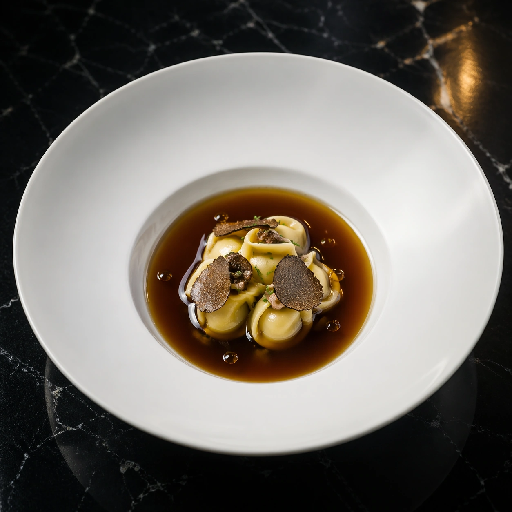

```text
Scene:
A square fine-dining photograph captured from a slightly elevated angle, showing a broad white bowl-plate on glossy black marble under cool top light and a gentle warm side reflection. The image should feel calm and expensive, with the kind of lighting used for menu covers or chef collaboration campaigns. Keep the composition minimal and centered, with the shallow bowl shape clearly visible.

Subject:
In the center of the bowl, place a small island of handmade stuffed pasta and mushroom duxelles, surrounded by a dark clear truffle broth poured to a perfectly level ring. Add a few paper-thin black truffle slices, tiny chive batons, and restrained droplets of brown butter near the edge of the island. The pasta should appear delicate and freshly cooked, with subtle folds and a satin finish. The broth must look transparent yet deeply colored, showing reflections and depth without becoming muddy.

Important details:
This study depends on believable culinary physics: the liquid level should be clean, the pasta edges slightly swollen from cooking, and truffle slices thin enough to curl naturally. Avoid rustic soup cues. The plate should read as a luxury tasting course where the dark broth amplifies the pale central island. Negative space inside the bowl is as important as the garnish count.

Use case:
Michelin Plate Hero Shot single study 5/8, focused on a truffle broth composition with precise liquid control and minimal garnish.

Constraints:
No readable text, no watermark, no logos, preserve exact 1:1 aspect ratio, no spoon, no bread, no splashed broth on the rim, no oversized soup serving, no cloudy liquid, no excessive herb scatter, no extra dishes, no rustic ceramic bowl.
```

[Pinned source](https://github.com/ChaosRealmsAI/gpt-image-2-gallery/blob/5296db8c996e38776c83a0bc8c64f848dcd512b3/works/topics/michelin-plate-hero-shot/packages/single-fine-dining-hero-studies/images/05-truffle-broth-island/meta.json) · GPT Image2 · 1254×1254 · No source-declared image dependencies. · ProjectD:[published and publicly accepted](https://aitoolsradar.com/en/prompts/3167684fdc9912)

## Sea Urchin Saffron Spiral · michelin-plate-hero-shot/single-fine-dining-hero-studies/06-sea-urchin-saffron-spiral

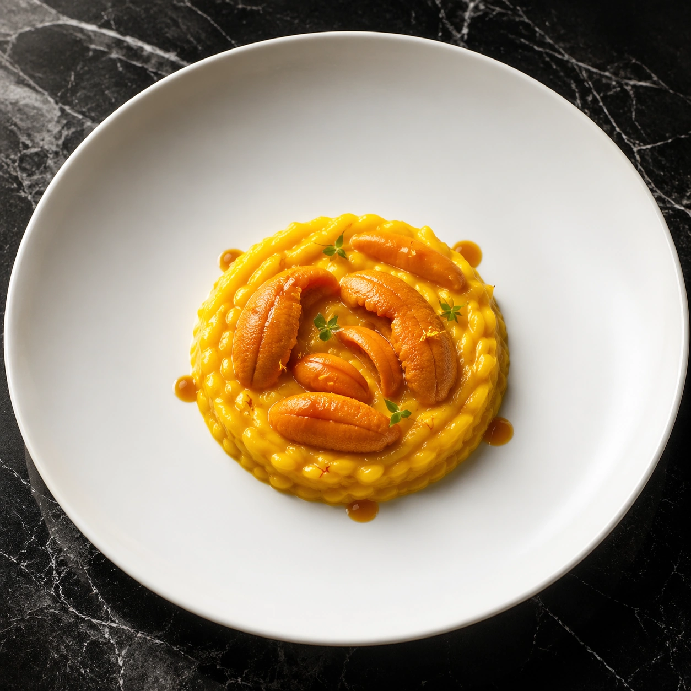

```text
Scene:
A square luxury food image shot from overhead with a slight tilt, showing a clean white porcelain coupe plate on black marble. Use bright but soft top lighting with a subtle side highlight to reveal glossy sauce, creamy textures, and porcelain curvature. The frame should feel Mediterranean and luminous while remaining minimal and commercially polished.

Subject:
Plate a small saffron risotto or creamy grain base in a tight spiral, topped with several realistic tongues of sea urchin, tiny fennel pollen dusting, micro herbs, and a few precise droplets of shellfish glaze. The saffron base should glow warm golden yellow, while the sea urchin adds richer orange tones and a soft marine texture. Arrange the urchin in a way that feels chef-planned rather than scattered. A minimal halo of sauce and a few tiny citrus zest threads can add energy without clutter.

Important details:
Sea urchin must look anatomically believable, delicate, and slightly glossy, never rubbery. The risotto or grain base should look creamy and luxurious without becoming soupy. This is a fine-dining composition built on ingredient knowledge: premium roe texture, saffron color, restrained herb usage, and a plate that communicates cost and precision. Keep the marble background quiet and avoid any casual seafood-restaurant cues.

Use case:
Michelin Plate Hero Shot single study 6/8, focused on a luminous saffron and sea urchin plate with high-end ingredient realism.

Constraints:
No readable text, no watermark, no logos, preserve exact 1:1 aspect ratio, no shells on the plate, no lemons cut in half, no cluttered garnish pile, no oversized risotto portion, no messy drips, no rustic seafood styling, no extra bowls, no fake bright-orange plastic texture.
```

[Pinned source](https://github.com/ChaosRealmsAI/gpt-image-2-gallery/blob/5296db8c996e38776c83a0bc8c64f848dcd512b3/works/topics/michelin-plate-hero-shot/packages/single-fine-dining-hero-studies/images/06-sea-urchin-saffron-spiral/meta.json) · GPT Image2 · 1254×1254 · No source-declared image dependencies. · ProjectD:[published and publicly accepted](https://aitoolsradar.com/en/prompts/779e6eb4c64236)

## Oyster Pearl Minimalism · michelin-plate-hero-shot/single-fine-dining-hero-studies/07-oyster-pearl-minimalism

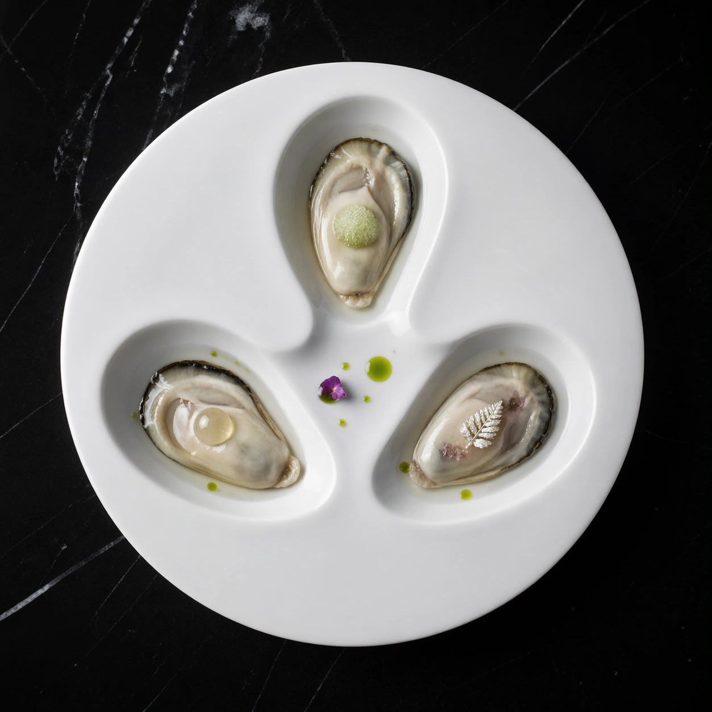

```text
Scene:
A square editorial food hero shot captured from directly above, using a single white porcelain plate on a nearly pure black marble slab with faint polished reflections. The light is crisp, frontal, and high-end, like a beauty campaign for a tasting menu. The composition should feel almost graphic in its simplicity, with large negative space and only a few carefully placed highlights.

Subject:
Arrange three opened oysters, removed from their rough outer shells and presented in smooth white porcelain tasting spoons or porcelain depressions integrated into the plate. Each oyster is topped differently but within one visual system: one with a small pearl-like sphere of cucumber granita, one with a translucent champagne gel bead, and one with a tiny silvered herb leaf and clear mignonette sheen. Add only a few microscopic dots of green oil and perhaps one edible flower petal fragment for balance. The overall effect should be icy, saline, and minimal.

Important details:
The oyster flesh must look wet, tender, and anatomically correct, with realistic translucency and gentle folds. Garnishes should stay tiny and luxurious, not decorative clutter. The plate must read as Michelin minimalism, where premium ingredients and exact spacing create the drama. Keep every edge pristine and let the white porcelain contrast against the black stone without additional props.

Use case:
Michelin Plate Hero Shot single study 7/8, focused on extreme minimalism and ingredient luxury in an oyster course.

Constraints:
No readable text, no watermark, no logos, preserve exact 1:1 aspect ratio, no rough oyster shells scattered around, no lemon wedges, no ice bed, no cutlery, no table decor, no oversized garnish, no seafood platter abundance, no casual raw-bar styling.
```

[Pinned source](https://github.com/ChaosRealmsAI/gpt-image-2-gallery/blob/5296db8c996e38776c83a0bc8c64f848dcd512b3/works/topics/michelin-plate-hero-shot/packages/single-fine-dining-hero-studies/images/07-oyster-pearl-minimalism/meta.json) · GPT Image2 · 1254×1254 · No source-declared image dependencies. · ProjectD:[published and publicly accepted](https://aitoolsradar.com/en/prompts/2a172942939cf1)

## Chocolate Orchid Sphere · michelin-plate-hero-shot/single-fine-dining-hero-studies/08-chocolate-orchid-sphere

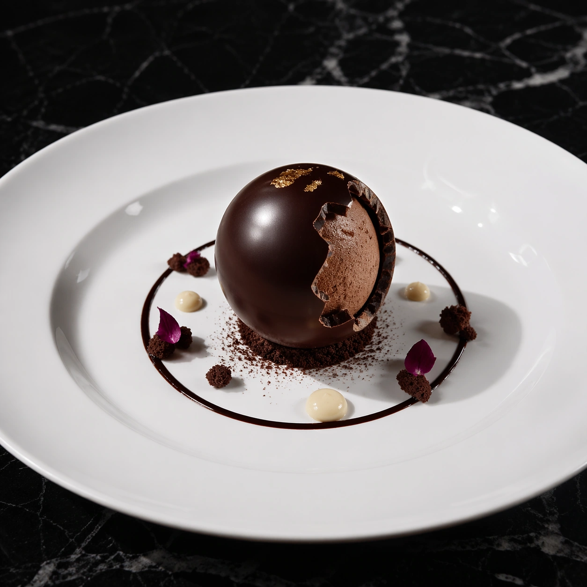

```text
Scene:
A square dessert hero shot photographed from a slightly elevated front angle, with a pristine white porcelain plate on black marble under bright top light and a narrow side accent that catches gloss and cocoa texture. The framing should be luxurious and modern, with the dessert isolated like a jewel in a campaign photograph. Keep the background uncluttered and the mood elegant rather than playful.

Subject:
At the center of the plate, place a dark chocolate sphere with a flawless tempered sheen, partially opened or delicately fractured to reveal a lighter mousse interior. Surround it with a thin ring of glossy sauce, a few crumbs of cocoa sable, tiny orchid petals in muted magenta, and two or three dots of pale vanilla creme. A touch of edible metallic leaf or powdered cocoa can add contrast, but the dessert must stay disciplined and premium. The portion should feel like a tasting-menu finale rather than a bakery product.

Important details:
Chocolate temper, shell thickness, mousse texture, and crumb scale must read as real pastry work. Avoid novelty-dessert excess. The plate should communicate chef-driven precision, with high contrast between dark chocolate, white porcelain, and restrained floral accents. The image also needs commercial polish: immaculate reflections, crisp shadows, controlled highlights, and no visual confusion between sauce, glaze, and shell.

Use case:
Michelin Plate Hero Shot single study 8/8, focused on a dramatic plated dessert with premium pastry realism.

Constraints:
No readable text, no watermark, no logos, preserve exact 1:1 aspect ratio, no ice cream scoop, no cutlery, no dripping molten mess, no oversized cake portion, no candy decorations, no rustic dessert plate, no extra props, no cartoon shine, no colorful bakery styling.
```

[Pinned source](https://github.com/ChaosRealmsAI/gpt-image-2-gallery/blob/5296db8c996e38776c83a0bc8c64f848dcd512b3/works/topics/michelin-plate-hero-shot/packages/single-fine-dining-hero-studies/images/08-chocolate-orchid-sphere/meta.json) · GPT Image2 · 1254×1254 · No source-declared image dependencies. · ProjectD:[published and publicly accepted](https://aitoolsradar.com/en/prompts/569ef36e73a43e)

## Black Plate Anchor · michelin-three-star-plate-art/series-core-system/01-black-plate-anchor

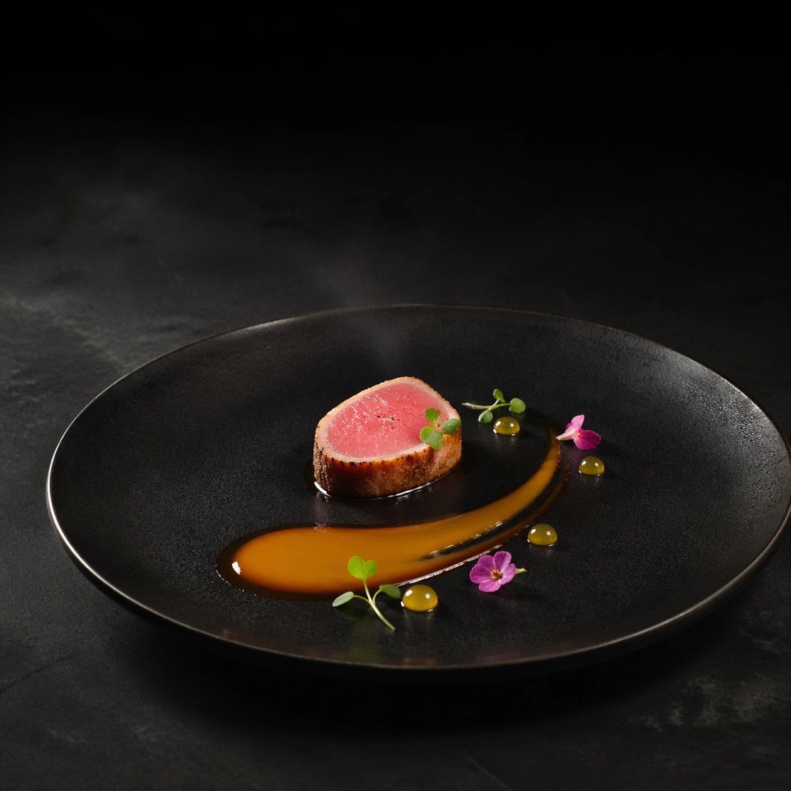

```text
Scene:
Create a square editorial food photograph built around a matte black ceramic plate resting on a charcoal surface, lit with a narrow overhead spotlight and a softer side fill that keeps the rim readable. The camera should sit between overhead and three-quarter view so the food has sculptural depth while the negative space still feels architectural. The surrounding darkness must stay controlled, velvety, and luxurious rather than flat or muddy. The plate should sit slightly low in frame so the upper half becomes a field of dark negative space, with a gentle falloff that feels like a fine-dining campaign image. A trace of condensation on the plate edge and a soft reflected highlight in the glaze should make the ceramic feel real without distracting from the food.

Subject:
Place a small medallion of lightly seared pink tuna just off center, with one curved streak of shellfish reduction sweeping across the plate like a brush stroke. Add three micro herb sprigs, a pair of tiny edible blossoms, and a few translucent citrus gel dots clustered with deliberate asymmetry. The portion must feel exacting and intentionally modest, as if a chef stopped plating the instant balance was achieved.

Important details:
Treat every garnish as if it was placed with tweezers: micro herbs, tiny petals, translucent glaze, and faint steam must all feel physically credible. Keep the plate rim immaculate, the portion restrained, and the composition balanced so the dish reads as sculpture rather than comfort food. Luxury should come from precision, timing, and restraint instead of abundance. This first image is the visual reference for the entire package, so the plate diameter, lens height, shadow softness, and negative-space geometry must feel stable and repeatable. The sauce should show believable viscosity with slightly tapered edges, and every garnish should feel individually intentional rather than scattered.

Use case:
Three-star plate art series study 1/9, establishing the anchor plating language for later variations.

Constraints:
No readable text, no watermark, no logos, preserve exact 1:1 aspect ratio, no rustic mess, no oversized portions, no cutlery, no napkins, no casual dining props, no accidental symmetry that kills the chef-made feel, no visible fingerprints, no smeared rim, no extra side dishes.
```

[Pinned source](https://github.com/ChaosRealmsAI/gpt-image-2-gallery/blob/5296db8c996e38776c83a0bc8c64f848dcd512b3/works/topics/michelin-three-star-plate-art/packages/series-core-system/images/01-black-plate-anchor/meta.json) · GPT Image2 · 1254×1254 · No source-declared image dependencies. · ProjectD:[published and publicly accepted](https://aitoolsradar.com/en/prompts/87027898037ee1)

## Scallop Crescent · michelin-three-star-plate-art/series-core-system/02-scallop-crescent

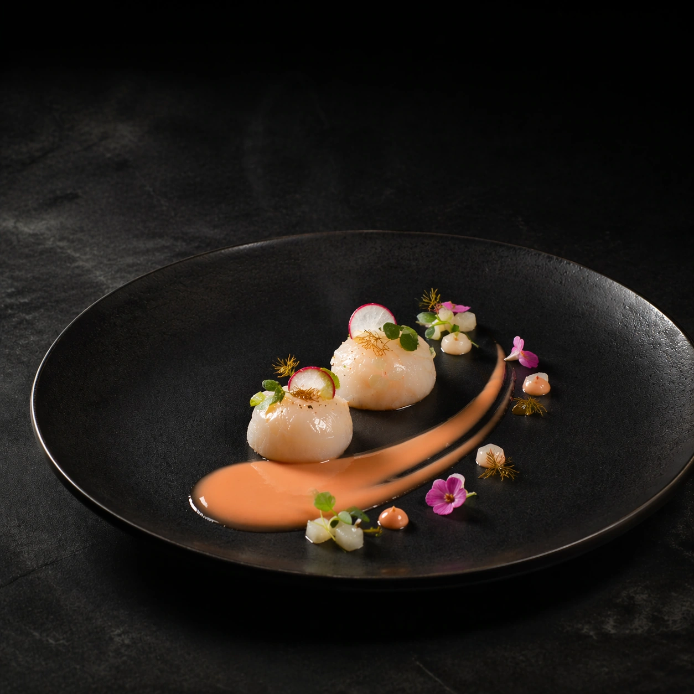

```text
Scene:
Create a square editorial food photograph built around a matte black ceramic plate resting on a charcoal surface, lit with a narrow overhead spotlight and a softer side fill that keeps the rim readable. The camera should sit between overhead and three-quarter view so the food has sculptural depth while the negative space still feels architectural. The surrounding darkness must stay controlled, velvety, and luxurious rather than flat or muddy. Keep the same plate scale, camera height, and overall empty-space distribution from the reference image, so the viewer recognizes the same restaurant photography system immediately. The lighting should remain narrow and controlled, with a satin highlight passing across the ceramic and a gentle shadow under the protein.

Subject:
Replace the tuna with two barely opaque sea scallops arranged along the same compositional arc, finished with a pale coral beurre blanc and a paper-thin radish crescent. Introduce a few tiny bronze fennel tips and a restrained spoon of pear dice that adds texture without breaking the minimalist discipline. The dish should feel colder, brighter, and more marine, but still unmistakably part of the same plating family.

Important details:
Treat every garnish as if it was placed with tweezers: micro herbs, tiny petals, translucent glaze, and faint steam must all feel physically credible. Keep the plate rim immaculate, the portion restrained, and the composition balanced so the dish reads as sculpture rather than comfort food. Luxury should come from precision, timing, and restraint instead of abundance. Preserve exact plate diameter, camera height, negative-space ratio, and lighting family from the reference model while only changing the plated ingredients. The scallop surface should show believable moisture and delicate muscle striation, while the sauce keeps the same viscosity logic and elegant taper as the anchor image.

Use case:
Three-star plate art series study 2/9, translating the anchor composition into a cooler scallop expression.

Constraints:
No readable text, no watermark, no logos, preserve exact 1:1 aspect ratio, no rustic mess, no oversized portions, no cutlery, no napkins, no casual dining props, no accidental symmetry that kills the chef-made feel, no excessive garnish clutter, no melted butter puddles, no rustic shell fragments.
```

[Pinned source](https://github.com/ChaosRealmsAI/gpt-image-2-gallery/blob/5296db8c996e38776c83a0bc8c64f848dcd512b3/works/topics/michelin-three-star-plate-art/packages/series-core-system/images/02-scallop-crescent/meta.json) · GPT Image2 · 1254×1254 · Reference images required. · ProjectD:[published and publicly accepted](https://aitoolsradar.com/en/prompts/020851ca4f8fd1)

## Duck Breast Ribbon · michelin-three-star-plate-art/series-core-system/03-duck-breast-ribbon

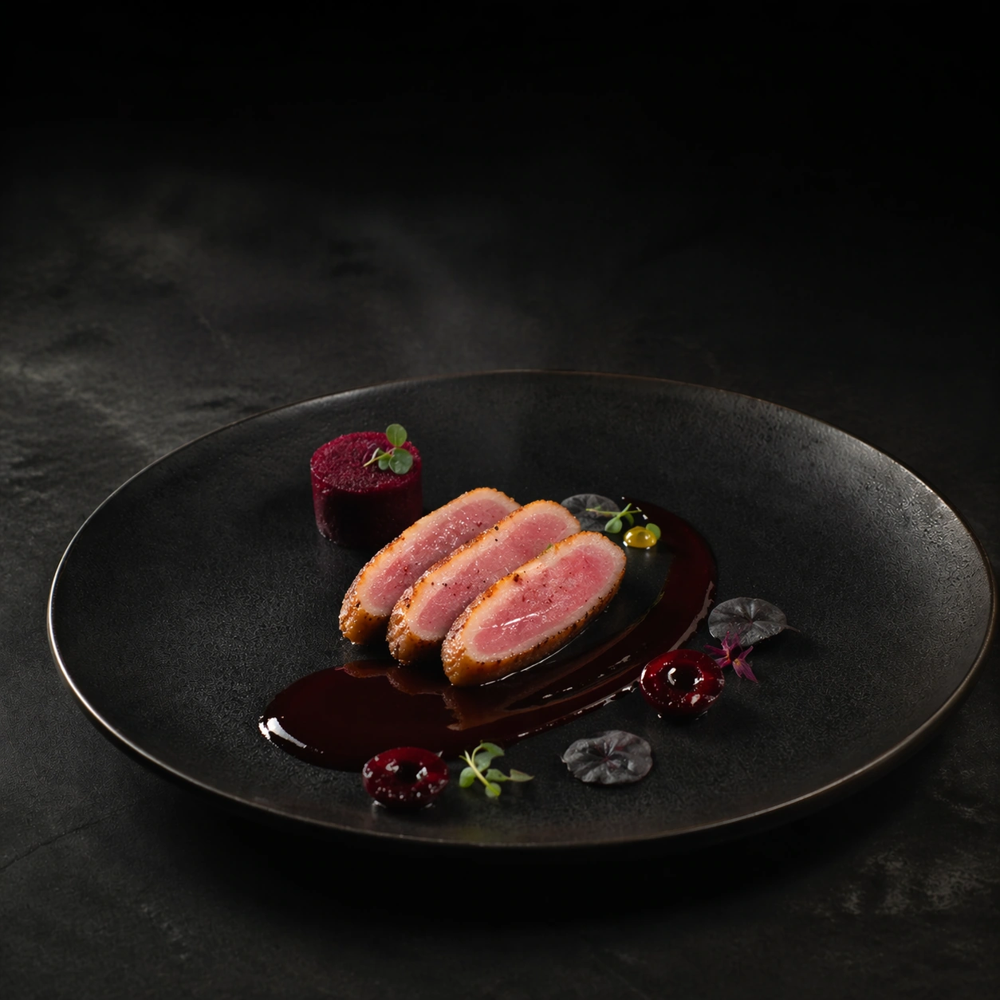

```text
Scene:
Create a square editorial food photograph built around a matte black ceramic plate resting on a charcoal surface, lit with a narrow overhead spotlight and a softer side fill that keeps the rim readable. The camera should sit between overhead and three-quarter view so the food has sculptural depth while the negative space still feels architectural. The surrounding darkness must stay controlled, velvety, and luxurious rather than flat or muddy. Maintain the reference camera angle and negative-space geometry so the dish reads as another movement within one tasting-menu sequence. The background should stay dark and quiet, while the controlled spotlight pulls a subtle shine from the sauce and leaves the outer rim in soft shadow.

Subject:
Set three narrow slices of rosy duck breast along the same visual path used by the reference dish, with a dark cherry jus ribbon crossing beneath them. Add a compressed beet cylinder, two lacquered berry halves, and a few near-black leaves that echo the plate without disappearing into it. The arrangement should feel like a warmer savory course, more autumnal and dense, yet still severely edited.

Important details:
Treat every garnish as if it was placed with tweezers: micro herbs, tiny petals, translucent glaze, and faint steam must all feel physically credible. Keep the plate rim immaculate, the portion restrained, and the composition balanced so the dish reads as sculpture rather than comfort food. Luxury should come from precision, timing, and restraint instead of abundance. Preserve exact plate diameter, camera height, light placement, and breathing room from the reference model while only changing the protein family and accent colors. The duck fat sheen, fine slicing edges, and glossy jus must feel real at macro distance, and the garnish count must stay disciplined.

Use case:
Three-star plate art series study 3/9, shifting the anchor system into a richer duck course.

Constraints:
No readable text, no watermark, no logos, preserve exact 1:1 aspect ratio, no rustic mess, no oversized portions, no cutlery, no napkins, no casual dining props, no accidental symmetry that kills the chef-made feel, no rustic carving board cues, no thick gravy, no crowded vegetable pile.
```

[Pinned source](https://github.com/ChaosRealmsAI/gpt-image-2-gallery/blob/5296db8c996e38776c83a0bc8c64f848dcd512b3/works/topics/michelin-three-star-plate-art/packages/series-core-system/images/03-duck-breast-ribbon/meta.json) · GPT Image2 · 1254×1254 · Reference images required. · ProjectD:[published and publicly accepted](https://aitoolsradar.com/en/prompts/a841243eee465a)

## Plum Dessert Orbit · michelin-three-star-plate-art/series-core-system/04-plum-dessert-orbit

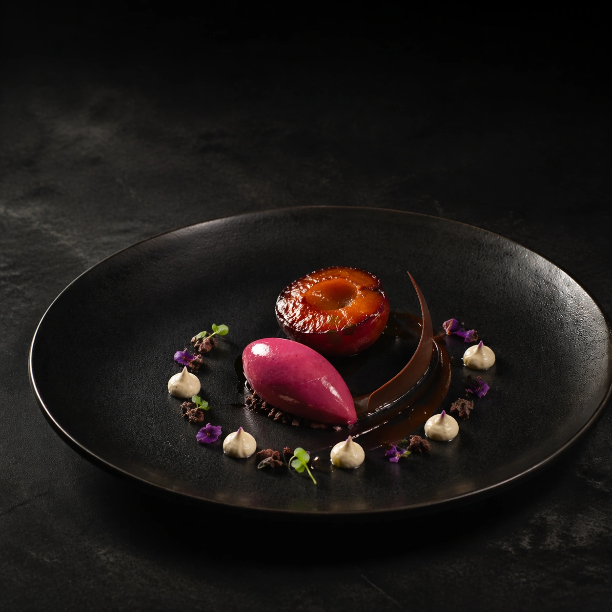

```text
Scene:
Create a square editorial food photograph built around a matte black ceramic plate resting on a charcoal surface, lit with a narrow overhead spotlight and a softer side fill that keeps the rim readable. The camera should sit between overhead and three-quarter view so the food has sculptural depth while the negative space still feels architectural. The surrounding darkness must stay controlled, velvety, and luxurious rather than flat or muddy. Hold the exact reference plate geometry, camera height, and negative-space balance, but let the lighting become slightly glossier so sugar, glaze, and cold cream textures catch more sparkle. The environment should remain otherwise identical, like the dessert course photographed at the same table under the same campaign setup.

Subject:
Build a tiny dessert orbit from a plum mousse quenelle, a thin chocolate arc, one halved roasted plum, and a restrained ring of vanilla cream. Scatter a few cocoa nibs and microscopic violet petals near the sauce path so the image keeps the same asymmetrical logic while clearly becoming dessert. The portion should feel refined, jewel-like, and tightly edited rather than playful.

Important details:
Treat every garnish as if it was placed with tweezers: micro herbs, tiny petals, translucent glaze, and faint steam must all feel physically credible. Keep the plate rim immaculate, the portion restrained, and the composition balanced so the dish reads as sculpture rather than comfort food. Luxury should come from precision, timing, and restraint instead of abundance. Preserve exact plate diameter, lens height, and empty-space discipline from the reference model while only shifting temperature, texture, and ingredient family. The fruit glaze should look taut and reflective, the cream should hold fine piping ridges, and the chocolate piece should cast a crisp believable shadow.

Use case:
Three-star plate art series study 4/9, concluding the anchor system with a tightly controlled dessert plate.

Constraints:
No readable text, no watermark, no logos, preserve exact 1:1 aspect ratio, no rustic mess, no oversized portions, no cutlery, no napkins, no casual dining props, no accidental symmetry that kills the chef-made feel, no sugar dust everywhere, no oversized pastry elements, no cafe-style decoration.
```

[Pinned source](https://github.com/ChaosRealmsAI/gpt-image-2-gallery/blob/5296db8c996e38776c83a0bc8c64f848dcd512b3/works/topics/michelin-three-star-plate-art/packages/series-core-system/images/04-plum-dessert-orbit/meta.json) · GPT Image2 · 1254×1254 · Reference images required. · ProjectD:[published and publicly accepted](https://aitoolsradar.com/en/prompts/e5a81fc70996d7)

## Amuse-Bouche Constellation · michelin-three-star-plate-art/single-support-studies/amuse-bouche-constellation

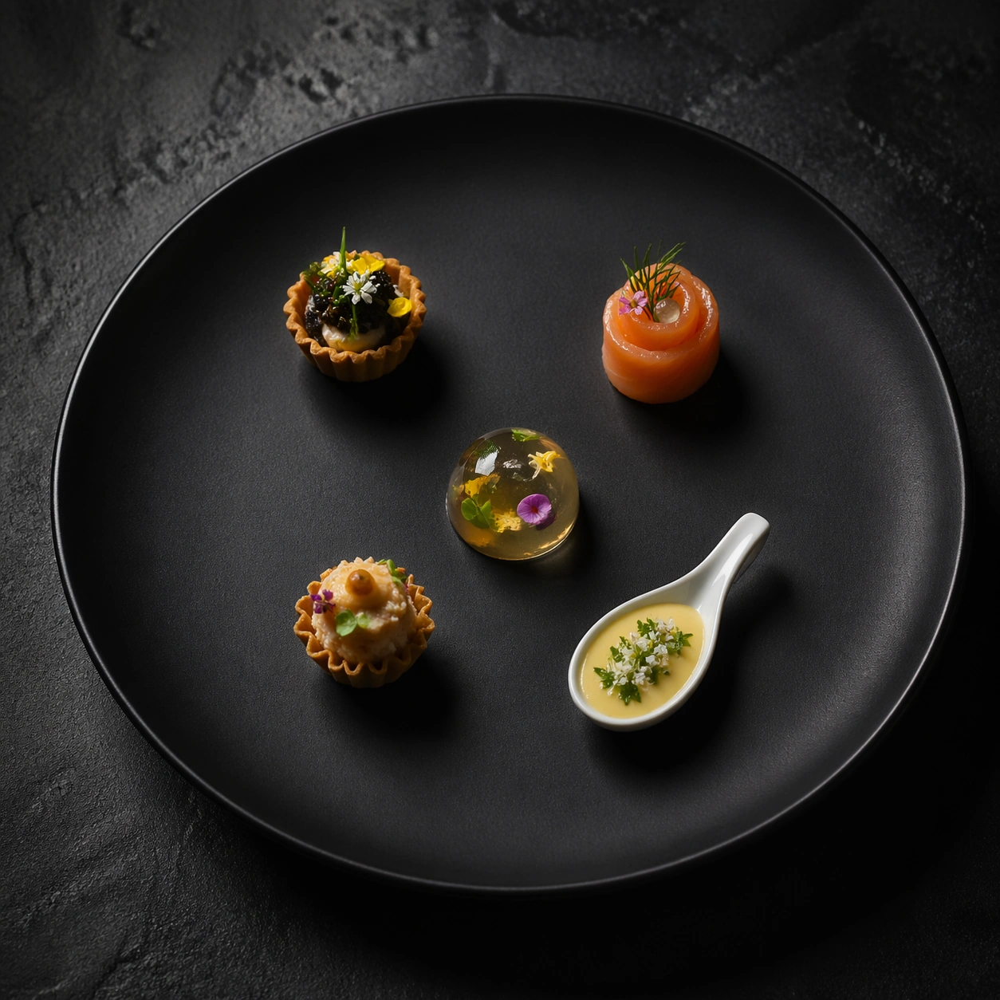

```text
Scene:
Create a square editorial food photograph built around a matte black ceramic plate resting on a charcoal surface, lit with a narrow overhead spotlight and a softer side fill that keeps the rim readable. The camera should sit between overhead and three-quarter view so the food has sculptural depth while the negative space still feels architectural. The surrounding darkness must stay controlled, velvety, and luxurious rather than flat or muddy. Create a square top-down photograph of a dark stone slab under soft theatrical light, with generous empty margins and a quiet restaurant-table atmosphere stripped of everything except the food. The slab should feel expensive and minimally reflective, with enough micro texture to separate it from a flat black background.

Subject:
Arrange five tiny amuse-bouche pieces in a loose constellation: one tart shell, one smoked fish rosette, one gel dome, one miniature croustade, and one herb-topped custard spoon. Each bite must be visibly distinct in shape and texture, yet the spacing between them should feel as carefully composed as the bites themselves. The result should look like a progression of ideas rather than a crowded sampler platter.

Important details:
Treat every garnish as if it was placed with tweezers: micro herbs, tiny petals, translucent glaze, and faint steam must all feel physically credible. Keep the plate rim immaculate, the portion restrained, and the composition balanced so the dish reads as sculpture rather than comfort food. Luxury should come from precision, timing, and restraint instead of abundance. Emphasize disciplined spacing, micro garnish control, and believable differences in crisp, creamy, and glossy textures. Each bite should feel executable by a top tasting-menu kitchen, with rims clean, ingredients proportionate, and tiny details sharp enough to reward close inspection.

Use case:
Three-star plate art single study 5/9, exploring a constellation-style amuse-bouche layout.

Constraints:
No readable text, no watermark, no logos, preserve exact 1:1 aspect ratio, no rustic mess, no oversized portions, no cutlery, no napkins, no casual dining props, no accidental symmetry that kills the chef-made feel, no menu cards, no glassware, no crumbs scattered randomly.
```

[Pinned source](https://github.com/ChaosRealmsAI/gpt-image-2-gallery/blob/5296db8c996e38776c83a0bc8c64f848dcd512b3/works/topics/michelin-three-star-plate-art/packages/single-support-studies/images/amuse-bouche-constellation/meta.json) · GPT Image2 · 1254×1254 · No source-declared image dependencies. · ProjectD:[published and publicly accepted](https://aitoolsradar.com/en/prompts/bbc2a690a8f103)

## Sauce Calligraphy Study · michelin-three-star-plate-art/single-support-studies/sauce-calligraphy-study

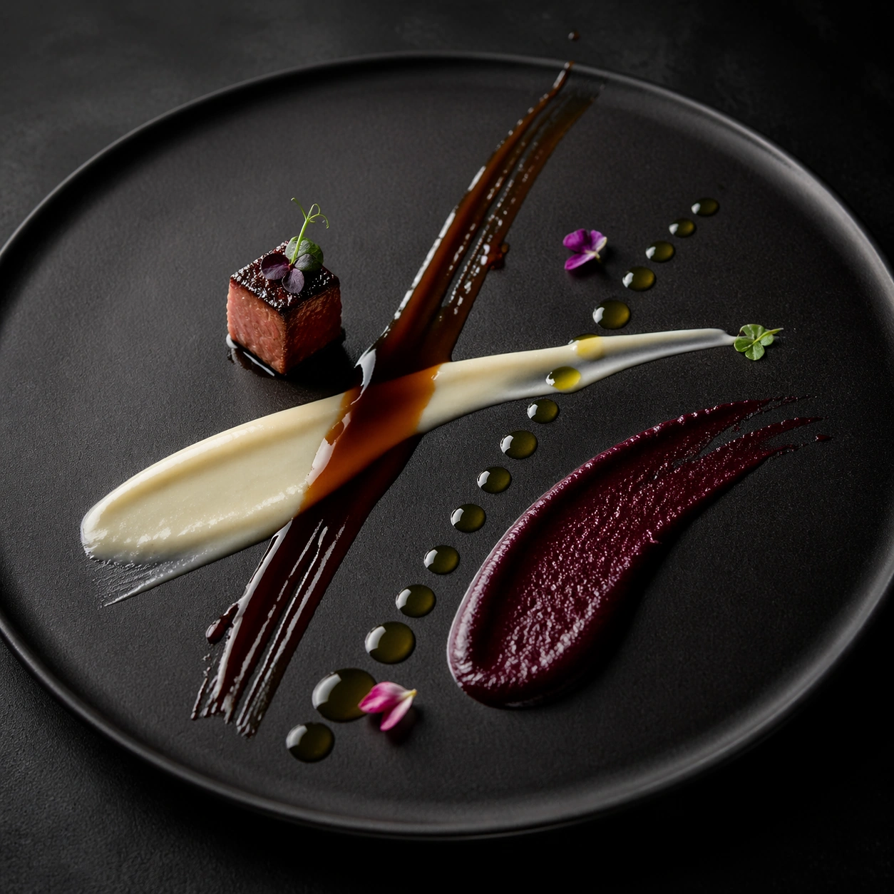

```text
Scene:
Create a square editorial food photograph built around a matte black ceramic plate resting on a charcoal surface, lit with a narrow overhead spotlight and a softer side fill that keeps the rim readable. The camera should sit between overhead and three-quarter view so the food has sculptural depth while the negative space still feels architectural. The surrounding darkness must stay controlled, velvety, and luxurious rather than flat or muddy. Use a square close-up composition on matte black ceramic with the frame tight enough to turn the surface into an abstract stage for sauce behavior. Soft grazing light should reveal thickness, gloss, and drag marks while keeping the overall mood clean and high-end rather than messy or process-oriented.

Subject:
Show four distinct sauce gestures crossing the plate at different angles: a glossy brown reduction, a pale cream stroke, a translucent herb oil bead line, and a dense fruit coulis smear. Add only a few micro garnishes and one tiny protein cube as scale anchors, so the focus remains on viscosity, taper, and edge quality. The gestures should read as intentional chef marks, not accidental spills.

Important details:
Treat every garnish as if it was placed with tweezers: micro herbs, tiny petals, translucent glaze, and faint steam must all feel physically credible. Keep the plate rim immaculate, the portion restrained, and the composition balanced so the dish reads as sculpture rather than comfort food. Luxury should come from precision, timing, and restraint instead of abundance. Make each sauce physically distinct through shine, opacity, drag resistance, and edge breakup. The negative space between marks matters as much as the marks themselves, and every accent should reinforce the idea that a chef is drawing with edible matter under exact control.

Use case:
Three-star plate art single study 6/9, isolating sauce behavior as the hero subject.

Constraints:
No readable text, no watermark, no logos, preserve exact 1:1 aspect ratio, no rustic mess, no oversized portions, no cutlery, no napkins, no casual dining props, no accidental symmetry that kills the chef-made feel, no splatter chaos, no thick puddles, no visible squeeze bottles.
```

[Pinned source](https://github.com/ChaosRealmsAI/gpt-image-2-gallery/blob/5296db8c996e38776c83a0bc8c64f848dcd512b3/works/topics/michelin-three-star-plate-art/packages/single-support-studies/images/sauce-calligraphy-study/meta.json) · GPT Image2 · 1254×1254 · No source-declared image dependencies. · ProjectD:[published and publicly accepted](https://aitoolsradar.com/en/prompts/94e151ce908971)

## Garnish Micro Meadow · michelin-three-star-plate-art/single-support-studies/garnish-micro-meadow

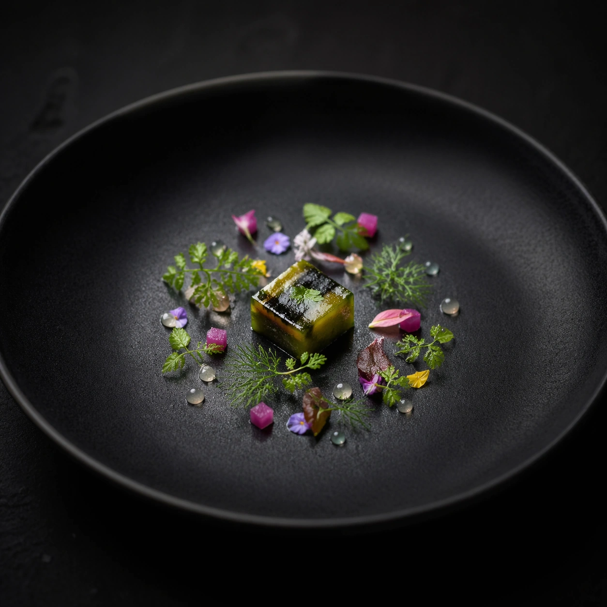

```text
Scene:
Create a square editorial food photograph built around a matte black ceramic plate resting on a charcoal surface, lit with a narrow overhead spotlight and a softer side fill that keeps the rim readable. The camera should sit between overhead and three-quarter view so the food has sculptural depth while the negative space still feels architectural. The surrounding darkness must stay controlled, velvety, and luxurious rather than flat or muddy. Build a square macro food photograph on a dark plate with shallow depth of field that still keeps the primary garnish field readable. Lighting should be soft and directional, turning droplets, fine stems, and tiny leaves into crisp sculptural elements against a subdued black ground.

Subject:
Center one very small bite-sized piece of glazed vegetable terrine, then surround it with a micro meadow of chervil tips, bronze fennel, minute flower petals, tiny pickled onion cubes, and translucent gel pearls. Every element should feel hand placed one at a time, with slight natural irregularity but unmistakable intent. The composition should be lush at macro scale while remaining minimal at plate scale.

Important details:
Treat every garnish as if it was placed with tweezers: micro herbs, tiny petals, translucent glaze, and faint steam must all feel physically credible. Keep the plate rim immaculate, the portion restrained, and the composition balanced so the dish reads as sculpture rather than comfort food. Luxury should come from precision, timing, and restraint instead of abundance. Prioritize freshness cues such as subtle moisture, crisp leaf edges, and minute color variation across the greens. The garnish field must feel luxurious and alive rather than decorative filler, and the center bite should remain the quiet anchor that keeps the image from turning into chaos.

Use case:
Three-star plate art single study 7/9, testing how much life can exist inside a tiny garnish field.

Constraints:
No readable text, no watermark, no logos, preserve exact 1:1 aspect ratio, no rustic mess, no oversized portions, no cutlery, no napkins, no casual dining props, no accidental symmetry that kills the chef-made feel, no bouquet-like bunches, no muddy greens, no casual scattering.
```

[Pinned source](https://github.com/ChaosRealmsAI/gpt-image-2-gallery/blob/5296db8c996e38776c83a0bc8c64f848dcd512b3/works/topics/michelin-three-star-plate-art/packages/single-support-studies/images/garnish-micro-meadow/meta.json) · GPT Image2 · 1254×1254 · No source-declared image dependencies. · ProjectD:[published and publicly accepted](https://aitoolsradar.com/en/prompts/0dd3de8ccf1969)

## Chef Pass Overhead · michelin-three-star-plate-art/single-support-studies/chef-pass-overhead

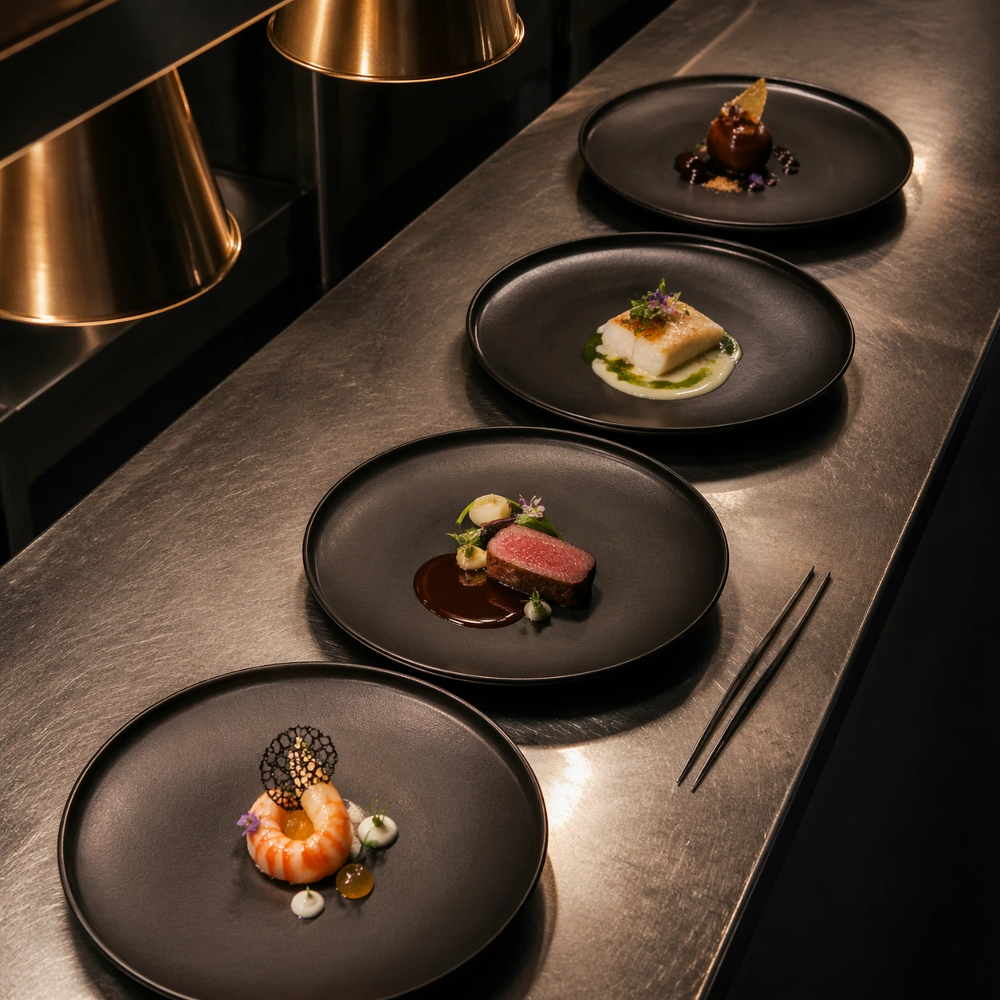

```text
Scene:
Create a square editorial food photograph built around a matte black ceramic plate resting on a charcoal surface, lit with a narrow overhead spotlight and a softer side fill that keeps the rim readable. The camera should sit between overhead and three-quarter view so the food has sculptural depth while the negative space still feels architectural. The surrounding darkness must stay controlled, velvety, and luxurious rather than flat or muddy. Create a square overhead image of a stainless chef pass under warm service lights, but keep the crop disciplined so the scene still feels elegant and editorial. The metal should show restrained reflections and slight use, while the plates create a rhythmic dark pattern against the brighter pass surface.

Subject:
Show four completed black plates in a precise diagonal line, each with a different minimalist course already finished and ready to leave the kitchen. Include only the faintest clues of service such as one pair of tweezers placed aside and a subtle reflection from a heat lamp, without introducing people or disorder. The scene should communicate high-pressure refinement rather than bustling chaos.

Important details:
Treat every garnish as if it was placed with tweezers: micro herbs, tiny petals, translucent glaze, and faint steam must all feel physically credible. Keep the plate rim immaculate, the portion restrained, and the composition balanced so the dish reads as sculpture rather than comfort food. Luxury should come from precision, timing, and restraint instead of abundance. Keep every plate distinct yet clearly part of one house style through negative space, restrained garnish, and sauce discipline. The stainless surface must feel real, but the plates remain the heroes, and the image should suggest process and perfection at the same time.

Use case:
Three-star plate art single study 8/9, extending the topic into the service-pass environment.

Constraints:
No readable text, no watermark, no logos, preserve exact 1:1 aspect ratio, no rustic mess, no oversized portions, no cutlery, no napkins, no casual dining props, no accidental symmetry that kills the chef-made feel, no chefs in frame, no ticket printer paper, no dirty towels.
```

[Pinned source](https://github.com/ChaosRealmsAI/gpt-image-2-gallery/blob/5296db8c996e38776c83a0bc8c64f848dcd512b3/works/topics/michelin-three-star-plate-art/packages/single-support-studies/images/chef-pass-overhead/meta.json) · GPT Image2 · 1254×1254 · No source-declared image dependencies. · ProjectD:[published and publicly accepted](https://aitoolsradar.com/en/prompts/2f43e6daf41e26)

## Petit Four Void · michelin-three-star-plate-art/single-support-studies/petit-four-void

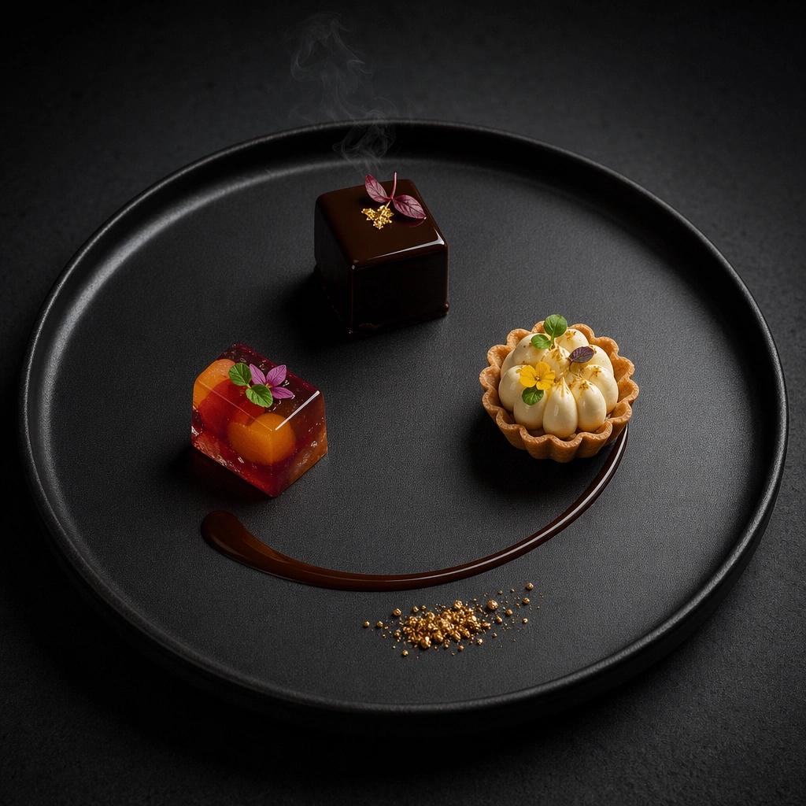

```text
Scene:
Create a square editorial food photograph built around a matte black ceramic plate resting on a charcoal surface, lit with a narrow overhead spotlight and a softer side fill that keeps the rim readable. The camera should sit between overhead and three-quarter view so the food has sculptural depth while the negative space still feels architectural. The surrounding darkness must stay controlled, velvety, and luxurious rather than flat or muddy. Use a square three-quarter composition on black ceramic with a dark neutral background, lit so the dessert pieces feel crisp and jewel-like without losing the atmospheric shadows around them. The surrounding empty space should be generous enough that the arrangement feels ceremonial and almost architectural.

Subject:
Arrange three tiny petit fours with strict spacing: a glazed chocolate cube, a fruit gel jewel, and a miniature tart with piped cream. Add a single curved sauce line and one cluster of gold-toned crumbs so the dessert reads as the final whisper of a tasting menu rather than a plated pastry course. Scale, shine, and spacing should all feel intentionally precious.

Important details:
Treat every garnish as if it was placed with tweezers: micro herbs, tiny petals, translucent glaze, and faint steam must all feel physically credible. Keep the plate rim immaculate, the portion restrained, and the composition balanced so the dish reads as sculpture rather than comfort food. Luxury should come from precision, timing, and restraint instead of abundance. The small desserts need distinct material identities: mirror glaze, delicate shell, airy cream, and translucent gel should each register immediately. The image should feel like an ending note defined by silence, polish, and the confidence to leave most of the plate empty.

Use case:
Three-star plate art single study 9/9, treating the final petit four course as a sculptural void.

Constraints:
No readable text, no watermark, no logos, preserve exact 1:1 aspect ratio, no rustic mess, no oversized portions, no cutlery, no napkins, no casual dining props, no accidental symmetry that kills the chef-made feel, no cafe pastry abundance, no scattered sugar dust, no extra utensils.
```

[Pinned source](https://github.com/ChaosRealmsAI/gpt-image-2-gallery/blob/5296db8c996e38776c83a0bc8c64f848dcd512b3/works/topics/michelin-three-star-plate-art/packages/single-support-studies/images/petit-four-void/meta.json) · GPT Image2 · 1024×1024 · No source-declared image dependencies. · ProjectD:[published and publicly accepted](https://aitoolsradar.com/en/prompts/d977550acacd1e)

## Reference Ring · micro-engraved-jewelry/series-inner-ring-inscription/01-reference-ring

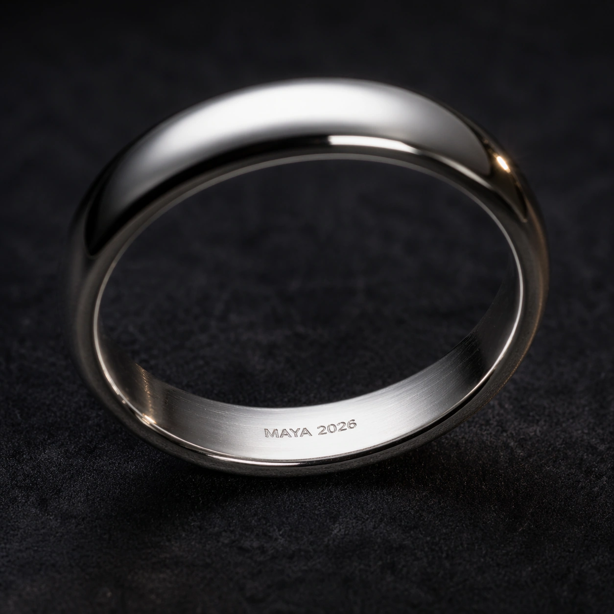

```text
Scene:
A square macro product photograph on a dark charcoal velvet surface, lit with a soft overhead strip light and a small warm rim light. The camera looks slightly into the inner wall of a platinum ring, using shallow depth of field but keeping the engraving area crisp. The tone is quiet, luxury, and high-contrast, with realistic metal reflections and no distracting props.

Subject:
A single polished platinum band standing at a slight angle, large enough to show the inside curve. On the inner wall, place a tiny engraved phrase exactly reading "MAYA 2026". The lettering should be shallow-cut, centered on the visible inner arc, aligned to the ring curvature, and visibly etched into the metal rather than printed on top. The rest of the band stays clean and unbranded.

Important details:
Pixel-level placement matters: the inscription must be very small but legible under macro viewing, with consistent letter spacing, no extra marks, and no distorted characters. Preserve the circular ring geometry, reflective platinum, hairline scratches, and microscopic engraving shadows. This is the reference image for the series, so the ring silhouette, inner-wall text zone, and exact phrase must be stable for later variants.

Use case:
Micro-Engraved Jewelry series study 1/8, establishing the reference ring and its exact micro-inscription placement.

Constraints:
No readable text except the specified phrase "MAYA 2026", no watermark, no logos, preserve exact 1:1 aspect ratio, no brand marks, no giant typography, no misspelled inscription, no extra dates, no decorative lettering outside the inner ring.
```

[Pinned source](https://github.com/ChaosRealmsAI/gpt-image-2-gallery/blob/5296db8c996e38776c83a0bc8c64f848dcd512b3/works/topics/micro-engraved-jewelry/packages/series-inner-ring-inscription/images/01-reference-ring/meta.json) · GPT Image2 · 1254×1254 · No source-declared image dependencies. · ProjectD:[published and publicly accepted](https://aitoolsradar.com/en/prompts/fe1fbf7d4da047)

## Wedding Band Gold · micro-engraved-jewelry/series-inner-ring-inscription/02-wedding-band-gold


```text
Scene:
A square macro studio photograph with a warmer palette than the reference: champagne highlights, deep brown velvet, and a narrow strip of reflected light running along a gold ring. The camera angle should closely echo the reference image, looking into the inner wall so the same engraving zone is visible. Use shallow depth of field, but keep the inner inscription in the sharpest plane.

Subject:
Transform the reference ring into an 18k yellow-gold wedding band while preserving the same band silhouette, inner-wall engraving position, and exact inscription phrase "MAYA 2026". The letters must remain small, clean, and carved into the inside curve. Add subtle gold grain, fine polish marks, and a realistic beveled edge, but do not change the proportions or move the text away from the visible inner arc.

Important details:
This is a continuity test: the viewer should recognize the same ring geometry and inscription placement from image 01, only translated into gold and warmer wedding lighting. The micro text must be readable without becoming oversized; it should follow the curve, cast tiny shadow grooves, and avoid blobs or repeated characters. Maintain luxury commercial realism and physically plausible metal reflections.

Use case:
Micro-Engraved Jewelry series study 2/8, testing reference-preserved micro text on a gold wedding-band material variant.

Constraints:
No readable text except the specified phrase "MAYA 2026", no watermark, no logos, preserve exact 1:1 aspect ratio, no brand marks, no external caption, no incorrect phrase, no duplicated inscription, no flat printed text, no warped ring shape.
```

[Pinned source](https://github.com/ChaosRealmsAI/gpt-image-2-gallery/blob/5296db8c996e38776c83a0bc8c64f848dcd512b3/works/topics/micro-engraved-jewelry/packages/series-inner-ring-inscription/images/02-wedding-band-gold/meta.json) · GPT Image2 · 1254×1254 · Reference images required. · ProjectD:[published and publicly accepted](https://aitoolsradar.com/en/prompts/6ea80ca72992d9)

## Sapphire Shadow · micro-engraved-jewelry/series-inner-ring-inscription/03-sapphire-shadow

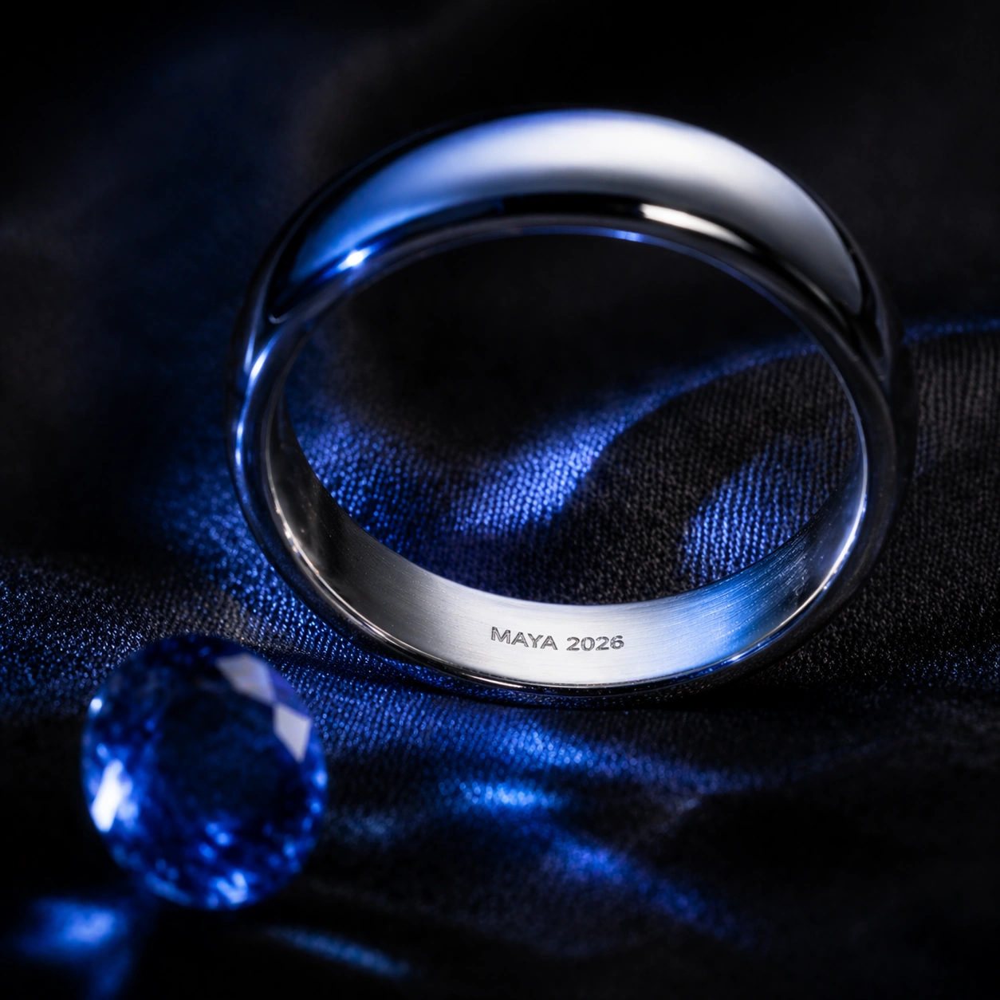

```text
Scene:
A square luxury macro photograph with cool blue caustic shadows cast from a nearby sapphire, set on matte black silk. The ring is angled like the reference so the viewer can see into the inner wall, but the lighting is more dramatic, with blue reflections crossing the metal and a dark falloff around the edges. Keep the engraving plane crisp despite the shallow depth of field.

Subject:
Use the referenced ring as the same physical object and preserve the exact inner-wall micro-engraving phrase "MAYA 2026". Place a loose oval sapphire just outside the ring, partly blurred, so it creates blue reflections without covering the inscription. The band may read as white gold or platinum, but the visible inner arc, letter placement, and overall ring silhouette must match the reference.

Important details:
The challenge is tiny readable text under complex reflective lighting. The inscription must remain carved, aligned to the inner curve, and not swallowed by sapphire shadows. Letterforms should be precise and evenly spaced, with no extra symbols. Use micro scratches, polished bevels, and realistic blue reflected highlights to show material physics while keeping the text zone controlled and legible.

Use case:
Micro-Engraved Jewelry series study 3/8, testing reference-preserved micro text under gemstone reflections and shadow complexity.

Constraints:
No readable text except the specified phrase "MAYA 2026", no watermark, no logos, preserve exact 1:1 aspect ratio, no brand marks, no text on the gemstone, no hidden captions, no duplicate phrase, no blocked engraving, no fantasy glow, no illegible letter noise.
```

[Pinned source](https://github.com/ChaosRealmsAI/gpt-image-2-gallery/blob/5296db8c996e38776c83a0bc8c64f848dcd512b3/works/topics/micro-engraved-jewelry/packages/series-inner-ring-inscription/images/03-sapphire-shadow/meta.json) · GPT Image2 · 1254×1254 · Reference images required. · ProjectD:[published and publicly accepted](https://aitoolsradar.com/en/prompts/1fddcd22d8e234)

## Retail Macro · micro-engraved-jewelry/series-inner-ring-inscription/04-retail-macro

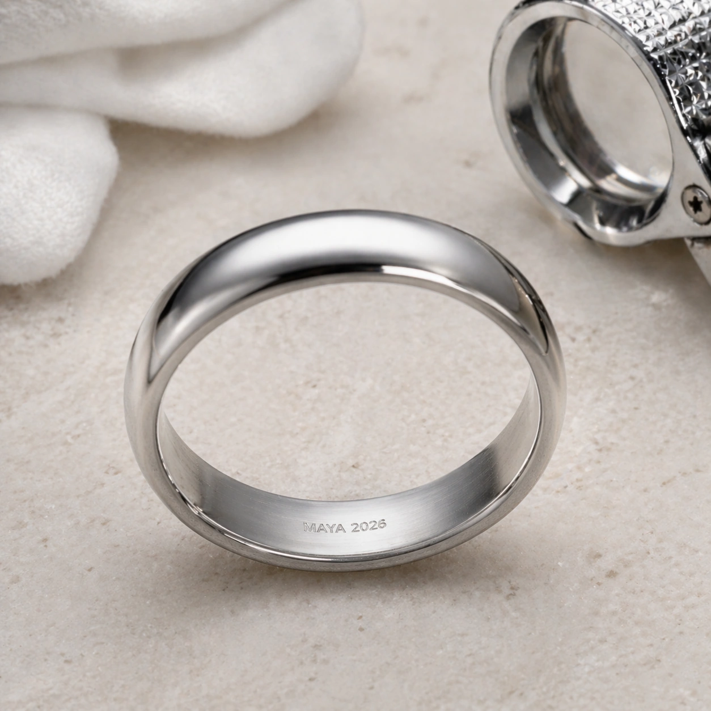

```text
Scene:
A square premium e-commerce macro shot on a pale stone jewelry tray, bright but soft, with clean reflections and a practical retail-catalog feeling. The composition should feel ready for a product detail page: centered ring, controlled highlights, and a small jeweler loupe placed nearby but not covering the band. The camera still looks into the inner wall so the engraving area remains visible.

Subject:
Use the referenced ring as the same product and preserve the exact inner-wall inscription "MAYA 2026". The ring should appear freshly cleaned, with the tiny letters inside the band shown as shallow engraving. Add a loupe, white gloves, or tray texture only as secondary context; the micro-inscription remains the hero detail. Keep the ring proportions, visible arc, and text placement consistent with image 01.

Important details:
This version tests commercial usability: the image should look like a realistic custom-jewelry listing where the buyer can verify the exact inscription. The text must be readable at macro scale, not replaced by generic scratches. The engraving should be physically recessed, aligned to the curve, and free of extra characters. Maintain precise metal reflections, clean stone texture, and restrained luxury styling.

Use case:
Micro-Engraved Jewelry series study 4/8, testing whether the reference micro-inscription remains product-page legible in a retail macro setup.

Constraints:
No readable text except the specified phrase "MAYA 2026", no watermark, no logos, preserve exact 1:1 aspect ratio, no brand labels, no printed cards, no price tags, no oversized inscription, no wrong name, no mirror-reversed letters, no clutter hiding the inner wall.
```

[Pinned source](https://github.com/ChaosRealmsAI/gpt-image-2-gallery/blob/5296db8c996e38776c83a0bc8c64f848dcd512b3/works/topics/micro-engraved-jewelry/packages/series-inner-ring-inscription/images/04-retail-macro/meta.json) · GPT Image2 · 1254×1254 · Reference images required. · ProjectD:[published and publicly accepted](https://aitoolsradar.com/en/prompts/a8b4e7d92c71a1)

## Locket Edge Script · micro-engraved-jewelry/single-micro-inscription-studies/locket-edge-script

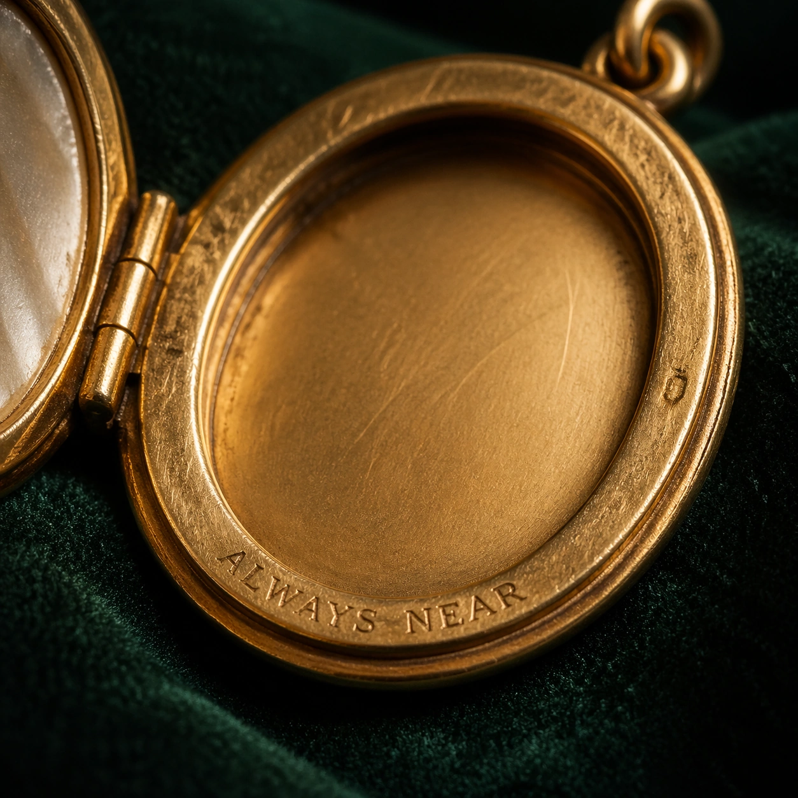

```text
Scene:
A square macro photograph of an open oval gold locket resting on deep green velvet, with soft antique-window lighting and gentle falloff at the corners. The camera is close enough to show the hinge, rim, and scratched inner lip. The mood is intimate and heirloom-like, with warm gold reflections and a darker background that helps the micro inscription read clearly.

Subject:
On the thin inner rim of the locket, engrave a tiny curved phrase exactly reading "ALWAYS NEAR". The phrase follows the oval edge and fits naturally into the metal lip, as if done by a master jeweler. The locket interior may hold an empty brushed-metal recess or subtle mother-of-pearl texture, but no photo and no other writing. The engraved phrase is the only semantic detail.

Important details:
The core challenge is curved micro text on a narrow jewelry edge. The letters must be readable, evenly spaced, and aligned along the oval rim without floating away from the metal surface. Show shallow cut grooves, tiny burrs, patina in the recesses, and realistic specular highlights. Keep the phrase emotionally legible while preserving the scale; it should look genuinely tiny, not like a large caption pasted onto the locket.

Use case:
Micro-Engraved Jewelry single study 6/8, testing curved readable inscription on a locket rim for sentimental customization.

Constraints:
No readable text except the specified phrase "ALWAYS NEAR", no watermark, no logos, preserve exact 1:1 aspect ratio, no brand stamp, no portrait text, no extra initials, no misspelling, no flat printed lettering, no oversized phrase, no warped oval geometry.
```

[Pinned source](https://github.com/ChaosRealmsAI/gpt-image-2-gallery/blob/5296db8c996e38776c83a0bc8c64f848dcd512b3/works/topics/micro-engraved-jewelry/packages/single-micro-inscription-studies/images/locket-edge-script/meta.json) · GPT Image2 · 1254×1254 · No source-declared image dependencies. · ProjectD:[published and publicly accepted](https://aitoolsradar.com/en/prompts/23b1c0c0233908)

## Watch Gear Initials · micro-engraved-jewelry/single-micro-inscription-studies/watch-gear-initials


```text
Scene:
A square horology macro photograph inside a mechanical watch movement, lit with cool white workbench light and a precise overhead reflection. The frame shows layered brass gears, ruby bearings, brushed steel bridges, and a jeweler's screwdriver blurred near the edge. The palette is gold, steel, ruby red, and deep shadow, with crisp detail on one small gear tooth ring.

Subject:
On a tiny exposed brass gear near the center, engrave the initials "A+J" along the curved face between the teeth. The letters must be micro-sized but readable, recessed into the brass, and aligned to the circular gear geometry. The surrounding watch parts should remain technically plausible and unbranded: screws, jewels, bridges, and teeth at correct scale, with no dial numbers or maker text visible.

Important details:
This image tests readable micro typography inside a dense mechanical object. The inscription should not look like a floating overlay; it must bend with the gear, catch light in the groove, and remain distinct from machining marks. Maintain realistic watchmaking material physics: fine oil sheen, polished bevels, dust specks, and alternating brushed and polished surfaces. The viewer should understand this as a hidden custom engraving, not a logo.

Use case:
Micro-Engraved Jewelry single study 7/8, testing tiny readable initials on a mechanically detailed watch component.

Constraints:
No readable text except the specified initials "A+J", no watermark, no logos, preserve exact 1:1 aspect ratio, no watch brand, no dial numerals, no serial numbers, no extra initials, no misplaced plus sign, no floating text, no impossible melted gear teeth.
```

[Pinned source](https://github.com/ChaosRealmsAI/gpt-image-2-gallery/blob/5296db8c996e38776c83a0bc8c64f848dcd512b3/works/topics/micro-engraved-jewelry/packages/single-micro-inscription-studies/images/watch-gear-initials/meta.json) · GPT Image2 · 1254×1254 · No source-declared image dependencies. · ProjectD:[published and publicly accepted](https://aitoolsradar.com/en/prompts/4b2971993848db)

## Stamp Perforation Message · micro-engraved-jewelry/single-micro-inscription-studies/stamp-perforation-message

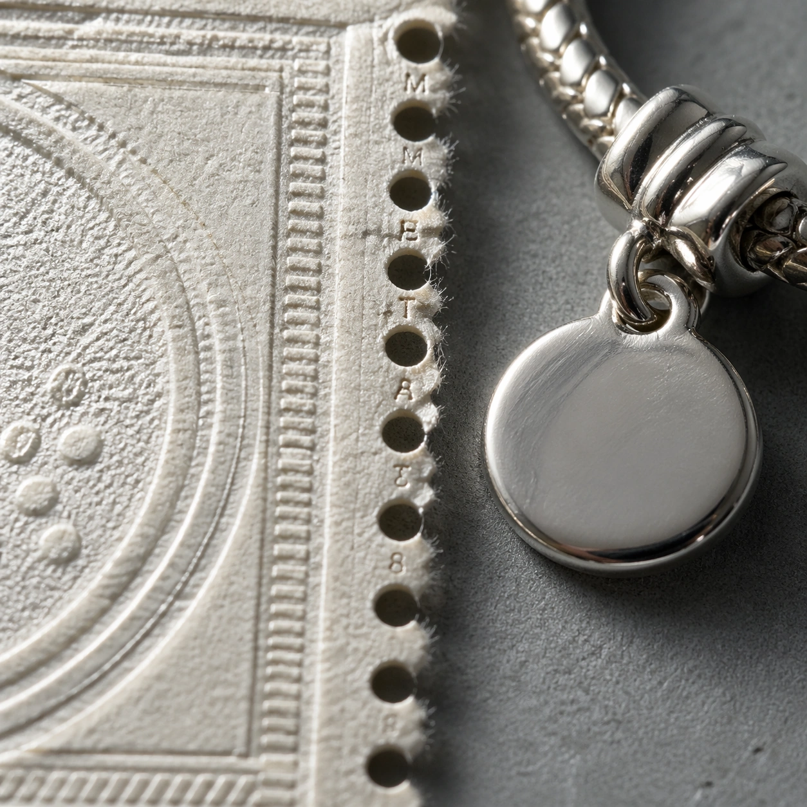

```text
Scene:
A square macro still life of an ivory commemorative postage stamp fragment placed beside a silver charm bracelet, photographed on a cool gray archival table. Use raking side light so every perforation hole casts a tiny shadow. The stamp design itself should be abstract and unlettered, with subtle paper fibers and embossed border texture, while the bracelet hints at jewelry customization.

Subject:
Hide a micro message inside the stamp perforation line: the sequence of tiny printed marks between the holes must read "MEET AT 8". The words are extremely small, following the vertical perforated edge like a secret jeweler's inscription. Keep the phrase readable under macro view, but do not add any other postal text, denomination, country name, cancellation mark, or logo. The silver charm nearby may be blank and softly reflected.

Important details:
This is a precision placement challenge: the message must live only in the narrow space around the perforations, using the holes as a rhythm guide. The text should be straight, evenly spaced, and physically integrated into paper ink or shallow embossing, not floating over the scene. Preserve realistic paper fibers, slight torn edges, metal bracelet reflections, and a sophisticated forensic-macro feeling.

Use case:
Micro-Engraved Jewelry single study 8/8, testing readable hidden micro text in stamp perforations paired with a jewelry keepsake context.

Constraints:
No readable text except the specified phrase "MEET AT 8", no watermark, no logos, preserve exact 1:1 aspect ratio, no stamp denomination, no country name, no cancellation text, no extra secret words, no oversized typography, no random perforation marks, no missing holes.
```

[Pinned source](https://github.com/ChaosRealmsAI/gpt-image-2-gallery/blob/5296db8c996e38776c83a0bc8c64f848dcd512b3/works/topics/micro-engraved-jewelry/packages/single-micro-inscription-studies/images/stamp-perforation-message/meta.json) · GPT Image2 · 1254×1254 · No source-declared image dependencies. · ProjectD:**Held:** Exact MEET AT 8 perforation inscription not reliably reproduced in the native full-resolution output; visible letter sequence deviates. Core precision-text requirement held; original remains archived.

## Cell Galaxy Echo · micro-macro-infographic/single-scale-comparison-studies/cell-galaxy-echo

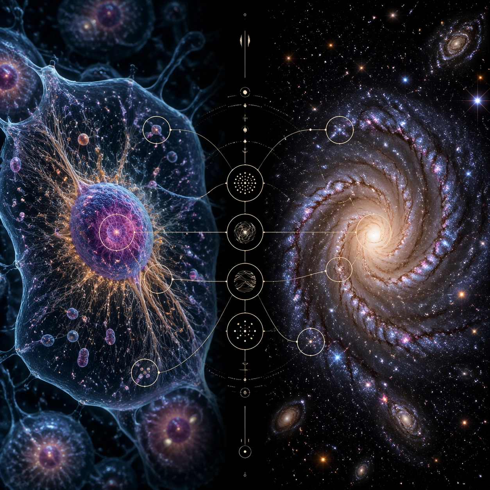

```text
Scene:
A square science-editorial infographic plate with a restrained black background, soft rim lighting, and a precise two-panel layout. The left half is a photorealistic microscope view; the right half is a deep-space telescope-style view. A narrow central bridge contains thin curved comparison lines, small abstract glyph marks, and transparent scale rings, but no readable text. The image should feel like a premium museum exhibit graphic rather than a textbook page.

Subject:
Left panel: a luminous cell culture seen through a microscope, with translucent membranes, branching cytoskeleton fibers, glowing nuclei, and tiny vesicles suspended in fluid. Right panel: a spiral galaxy and surrounding star field with dust lanes, bright core, and faint satellite clusters. The two halves should echo one another: nuclei align with galaxy cores, cytoskeleton threads rhyme with spiral arms, and vesicles rhyme with star clusters.

Important details:
Use a clean vertical split that still feels unified through matching composition, color, and annotation geometry. Add subtle scale ticks, circles, and connector arcs that point from micro features to macro analogues without becoming literal labels. Keep the science-inspired materials plausible: wet cellular translucency on the left, vacuum-dark cosmic depth on the right. The comparison must be instantly legible at thumbnail size and rich under close inspection.

Use case:
Micro-Macro Infographic single study 1/8, comparing cellular structure and galactic structure through shared visual organization.

Constraints:
No readable text, no watermark, no logos, preserve exact 1:1 aspect ratio, no real data claims, no fake labels, no astrology symbols, no medical diagnosis, no chaotic collage, no split-screen mismatch, no overbright neon wash.
```

[Pinned source](https://github.com/ChaosRealmsAI/gpt-image-2-gallery/blob/5296db8c996e38776c83a0bc8c64f848dcd512b3/works/topics/micro-macro-infographic/packages/single-scale-comparison-studies/images/cell-galaxy-echo/meta.json) · GPT Image2 · 1254×1254 · No source-declared image dependencies. · ProjectD:[published and publicly accepted](https://aitoolsradar.com/en/prompts/56d411201752b6)

## Neuron Cosmic Web · micro-macro-infographic/single-scale-comparison-studies/neuron-cosmic-web


```text
Scene:
A square dark-background infographic with an elegant diagonal comparison layout. The upper-left region shows a microscope-like neural network; the lower-right region shows a cosmic web simulation aesthetic. Between them, translucent overlay lines and small non-readable symbols trace matching branching patterns. Lighting is dramatic but controlled, with cyan, violet, and warm white accents against deep charcoal.

Subject:
The micro side shows neurons suspended in a shallow biological gel: cell bodies, dendrite branches, axon-like cables, synapse dots, and subtle membrane texture. The macro side shows galaxy filaments and voids: bright clusters connected by long luminous threads, with dark empty spaces between them. The central bridge should make the analogy visible by aligning neuron cell bodies with galaxy clusters and dendrites with cosmic filaments.

Important details:
The image must not claim the two systems are scientifically identical; it should present a visual analogy through structured composition. Use consistent branch spacing, matching glow intensity, and clean connector arcs. Include small magnifier circles that crop details from each side, but keep their contents non-textual. The layout should be readable as a high-end science magazine cover: balanced negative space, no clutter, clear hierarchy, and plausible microscopic and astronomical textures.

Use case:
Micro-Macro Infographic single study 2/8, comparing neural branching and the cosmic web as a reasoning-composition challenge.

Constraints:
No readable text, no watermark, no logos, preserve exact 1:1 aspect ratio, no literal brain icon, no astrology, no fake equations, no real patient data, no random neon spaghetti, no overcrowded labels, no claim-style typography.
```

[Pinned source](https://github.com/ChaosRealmsAI/gpt-image-2-gallery/blob/5296db8c996e38776c83a0bc8c64f848dcd512b3/works/topics/micro-macro-infographic/packages/single-scale-comparison-studies/images/neuron-cosmic-web/meta.json) · GPT Image2 · 1254×1254 · No source-declared image dependencies. · ProjectD:[published and publicly accepted](https://aitoolsradar.com/en/prompts/1194d822e3fb5a)

## Stomata City Grid · micro-macro-infographic/single-scale-comparison-studies/stomata-city-grid

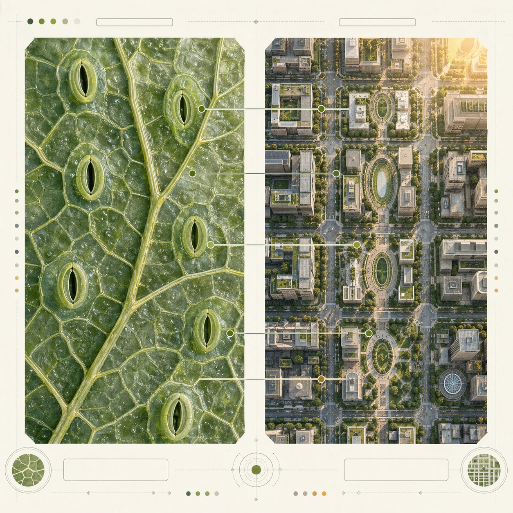

```text
Scene:
A square bright editorial infographic on warm off-white background, split into two coordinated panels with a shared geometric grid. The left panel is a macro-microscope view of a leaf surface; the right panel is an aerial city plan at dawn. Fine gray alignment guides, small color-coded dots, and blank caption bars organize the page without readable text. The overall mood is clean, ecological, and architectural.

Subject:
Left panel: a high-detail leaf epidermis with green cells, stomata openings, waxy cuticle texture, and subtle veins visible beneath the surface. Right panel: a city grid with parks, courtyards, streets, rooftops, and small plazas seen from directly above. The stomata openings correspond visually to courtyards and transit hubs, while leaf veins rhyme with green corridors and roads.

Important details:
Make the comparison precise and elegant. Use matching top-down viewpoints on both sides, the same scale of repeated oval and polygon forms, and thin connector lines that cross a central gutter. The left side should feel biologically plausible, with moist cellular texture and organic variation. The right side should feel like a real planned city, not an abstract circuit board. Use muted green, slate, cream, and sunrise gold; keep the infographic readable without literal labels.

Use case:
Micro-Macro Infographic single study 3/8, comparing leaf stomata patterns with city-grid planning through structured visual analogy.

Constraints:
No readable text, no watermark, no logos, preserve exact 1:1 aspect ratio, no real city names, no map labels, no fake street text, no oversimplified leaf cartoon, no circuit-board confusion, no cluttered annotation layer.
```

[Pinned source](https://github.com/ChaosRealmsAI/gpt-image-2-gallery/blob/5296db8c996e38776c83a0bc8c64f848dcd512b3/works/topics/micro-macro-infographic/packages/single-scale-comparison-studies/images/stomata-city-grid/meta.json) · GPT Image2 · 1254×1254 · No source-declared image dependencies. · ProjectD:[published and publicly accepted](https://aitoolsradar.com/en/prompts/b8a078c13875cd)

## Bone Coral Architecture · micro-macro-infographic/single-scale-comparison-studies/bone-coral-architecture

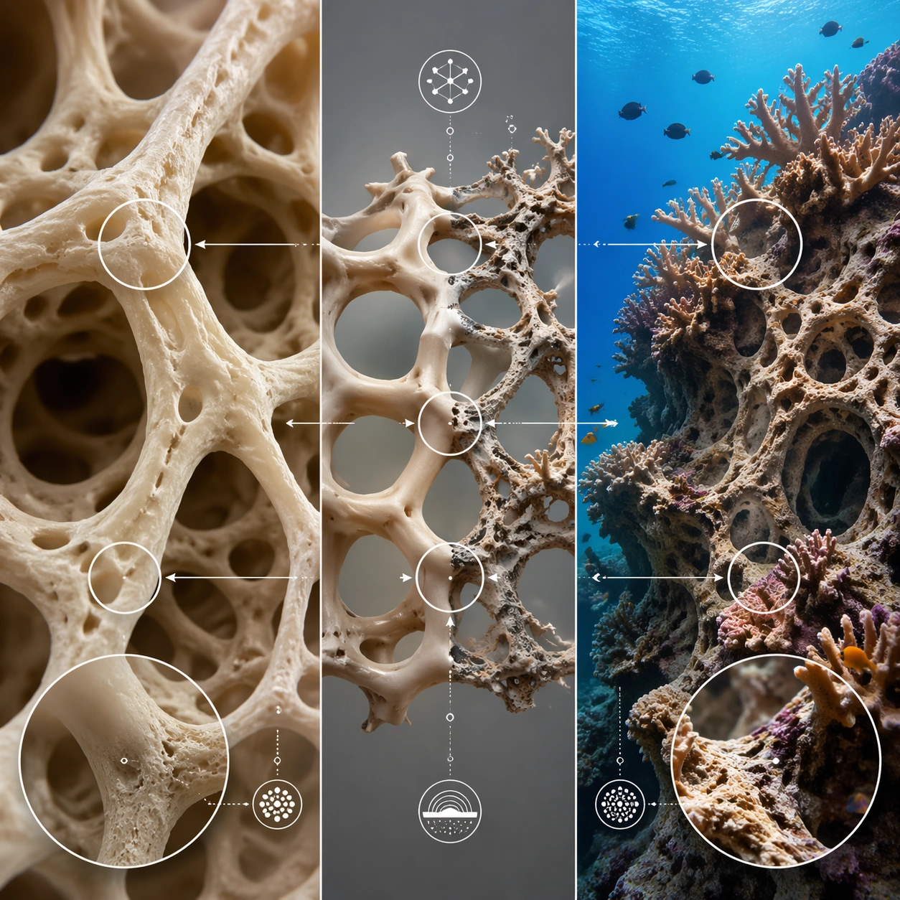

```text
Scene:
A square photorealistic science infographic with a soft studio-gray background and a balanced triptych structure: microscopic bone lattice on the left, central transition column, coral reef architecture on the right. The layout uses thin white dividers, translucent callout circles, and small non-readable glyph marks. Lighting is sculptural and tactile, emphasizing porous material surfaces.

Subject:
Left panel: trabecular bone seen at high magnification, with ivory struts, porous cavities, subtle mineral grain, and realistic shadowing. Right panel: a coral reef wall photographed underwater, with branching coral, porous limestone, small fish silhouettes, and blue water depth. The central transition column blends the two structures as matched load-bearing lattices, showing how voids and struts create strength and habitat.

Important details:
The comparison should be material-driven, not merely decorative. Match pore scale, branching angles, and light direction across both panels. The bone must not look like dead coral, and the coral must remain alive and underwater; the bridge is about architecture and porosity. Use small arrows and magnifier circles to point at analogous voids, arches, and struts without text. Keep the composition calm, premium, and scientifically plausible.

Use case:
Micro-Macro Infographic single study 4/8, comparing trabecular bone structure with coral reef architecture and porous load paths.

Constraints:
No readable text, no watermark, no logos, preserve exact 1:1 aspect ratio, no gore, no medical diagnosis, no dead reef imagery, no fake labels, no chaotic aquarium scene, no low-detail sponge texture, no overlaid paragraphs.
```

[Pinned source](https://github.com/ChaosRealmsAI/gpt-image-2-gallery/blob/5296db8c996e38776c83a0bc8c64f848dcd512b3/works/topics/micro-macro-infographic/packages/single-scale-comparison-studies/images/bone-coral-architecture/meta.json) · GPT Image2 · 1254×1254 · No source-declared image dependencies. · ProjectD:[published and publicly accepted](https://aitoolsradar.com/en/prompts/83021490f387d0)

## Capillary River Delta · micro-macro-infographic/single-scale-comparison-studies/capillary-river-delta

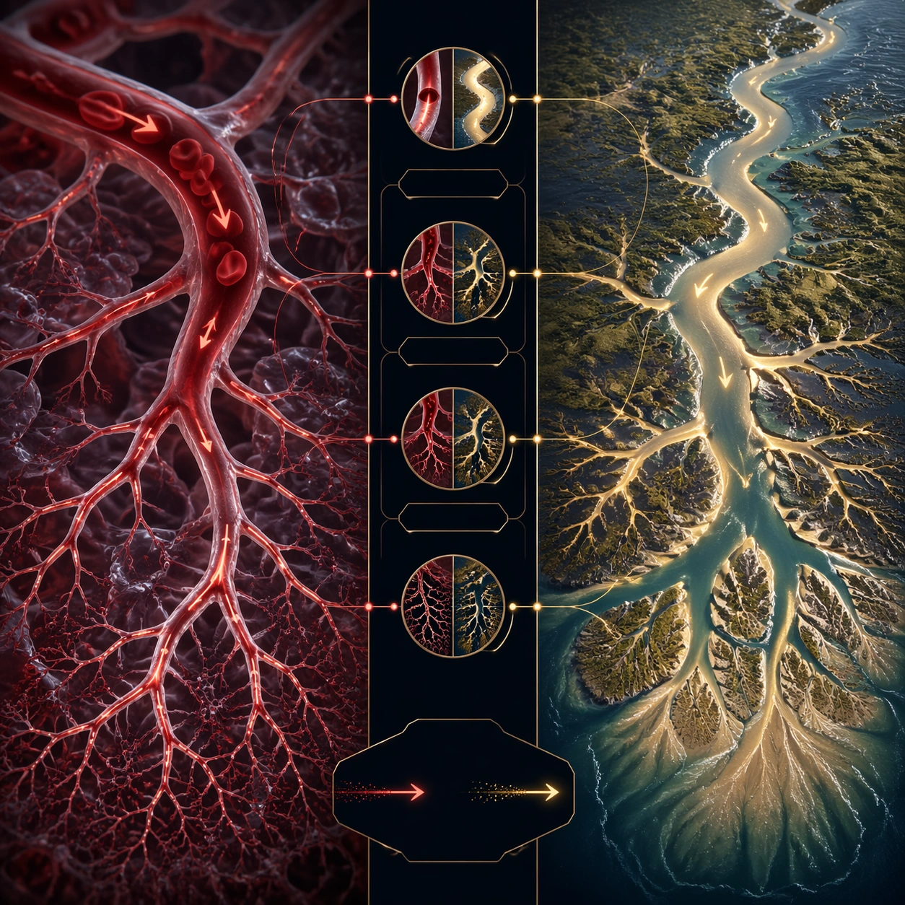

```text
Scene:
A square split-panel infographic on a deep blue-black background with luminous red and gold accents. The left side shows a microvascular network under magnification; the right side shows a satellite-like river delta. A central vertical spine contains clean connector arcs, small scale circles, and blank legend blocks. The mood is serious, precise, and cinematic, with high contrast but readable detail.

Subject:
Left panel: branching capillaries in translucent tissue, with red blood cells as tiny discs flowing through thin vessels, soft membrane texture, and realistic depth. Right panel: a river delta seen from high above, with branching channels, sediment fans, marsh islands, and reflective water. The comparison should reveal how fluid transport branches from trunk to fine channels in both biological and geographic systems.

Important details:
Make flow direction visually clear without text: use subtle arrowheads, particle trails, and brightness gradients. Match the branching hierarchy on both sides from thick main channels to fine terminals. Avoid making the capillary side look like a literal map, and avoid making the delta look like veins; each side keeps its own material truth. The central connector system should help viewers understand the analogy in one glance.

Use case:
Micro-Macro Infographic single study 5/8, comparing capillary flow networks with river delta branching in a structured science plate.

Constraints:
No readable text, no watermark, no logos, preserve exact 1:1 aspect ratio, no gore, no medical diagnosis, no fake map labels, no real place names, no blood splatter, no chaotic red-blue abstraction, no unreadable legend text.
```

[Pinned source](https://github.com/ChaosRealmsAI/gpt-image-2-gallery/blob/5296db8c996e38776c83a0bc8c64f848dcd512b3/works/topics/micro-macro-infographic/packages/single-scale-comparison-studies/images/capillary-river-delta/meta.json) · GPT Image2 · 1254×1254 · No source-declared image dependencies. · ProjectD:[published and publicly accepted](https://aitoolsradar.com/en/prompts/a5f76a6898084d)

## Crystal Mountain Range · micro-macro-infographic/single-scale-comparison-studies/crystal-mountain-range

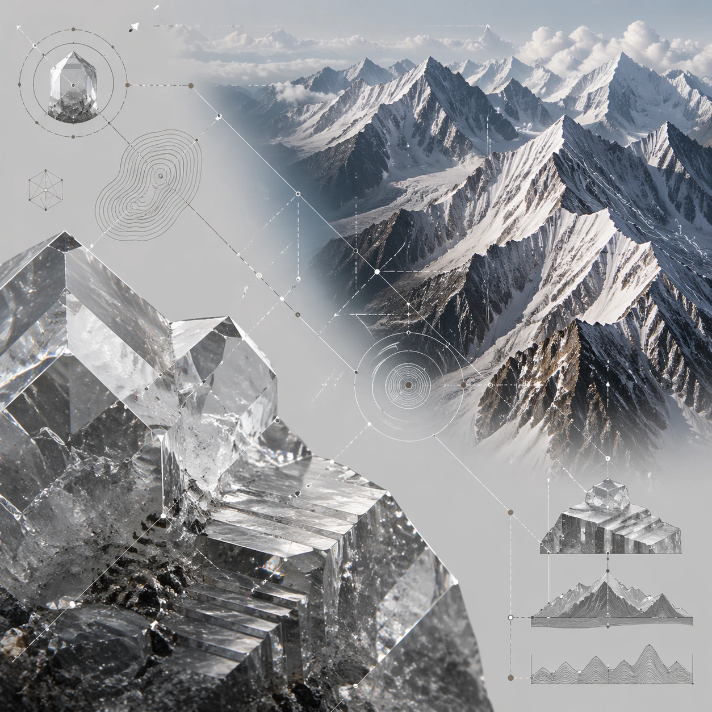

```text
Scene:
A square premium science infographic with a pale mineral-gray background, crisp studio lighting, and a central mirrored composition. The lower-left quadrant shows a microscopic crystal surface; the upper-right quadrant shows an alpine mountain range. Thin diagonal guides, transparent elevation contours, and small non-readable symbols connect matching ridges and facets across the page.

Subject:
Micro side: a close-up crystal lattice surface with faceted transparent quartz, tiny fractures, growth steps, dust-like inclusions, and accurate refraction. Macro side: a snow-covered mountain range with sharp ridgelines, glacial valleys, rock faces, and atmospheric haze. The shared visual idea is faceted geometry: crystal growth planes echo mountain ridges, fracture lines echo valleys, and light glints repeat across scales.

Important details:
Render both materials convincingly: glassy crystal transparency and cold mountain atmosphere should feel physically distinct. Use matching diagonal rhythm rather than identical shapes. Add a few small cross-section slices and contour-like rings as visual explanation, but no words. The composition should feel like a philosophical science poster: beautiful, clear, and disciplined. Avoid overdecorating with fantasy sparkles or making the mountains look like gemstones.

Use case:
Micro-Macro Infographic single study 6/8, comparing crystal growth facets with mountain range geometry and material light behavior.

Constraints:
No readable text, no watermark, no logos, preserve exact 1:1 aspect ratio, no fake geological labels, no fantasy magic crystals, no impossible floating mountains, no chaotic shards, no glitter overload, no text-heavy poster layout.
```

[Pinned source](https://github.com/ChaosRealmsAI/gpt-image-2-gallery/blob/5296db8c996e38776c83a0bc8c64f848dcd512b3/works/topics/micro-macro-infographic/packages/single-scale-comparison-studies/images/crystal-mountain-range/meta.json) · GPT Image2 · 1254×1254 · No source-declared image dependencies. · ProjectD:[published and publicly accepted](https://aitoolsradar.com/en/prompts/2c11fecb1d8f26)

## Skin Desert Dunes · micro-macro-infographic/single-scale-comparison-studies/skin-desert-dunes

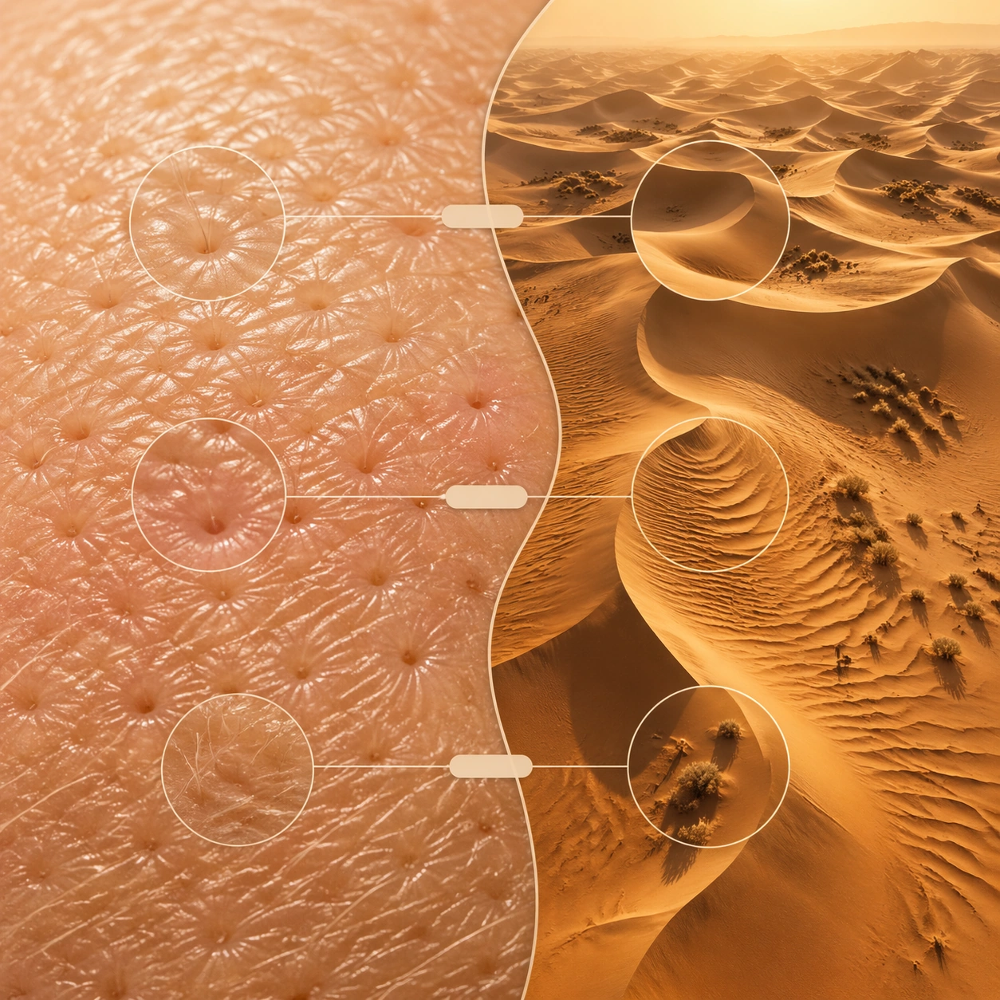

```text
Scene:
A square warm-toned editorial infographic with a soft beige background, divided by a gentle S-shaped comparison boundary. The left side is a macro skin-surface close-up under scientific lighting; the right side is an aerial desert dune landscape at sunset. Fine contour lines, small blank callout tabs, and transparent circles tie the two halves together without readable text.

Subject:
Left panel: detailed human skin texture at very close range, showing pores, fine ridges, soft peach fuzz, subtle oil highlights, and natural color variation. Right panel: desert dunes from above, with wind-carved ridges, shadowed troughs, small dry shrubs, and golden sand gradients. The shared visual language is surface topology: pore depressions echo dune basins, skin ridges echo sand ripples, and fine hairs echo sparse desert vegetation.

Important details:
Keep the comparison respectful and scientific, not cosmetic advertising. The skin should look natural and healthy, not medical or glamor retouched. The desert should feel vast but organized, not a random sand texture. Use contour overlays and matched light direction to reveal surface physics. The image should be calm, tactile, and visually obvious as a micro-macro topology comparison.

Use case:
Micro-Macro Infographic single study 7/8, comparing skin microtopography with desert dune formations through surface pattern reasoning.

Constraints:
No readable text, no watermark, no logos, preserve exact 1:1 aspect ratio, no beauty-product branding, no medical diagnosis, no wounds, no glamour portrait, no fake map labels, no repetitive sand wallpaper, no intrusive text blocks.
```

[Pinned source](https://github.com/ChaosRealmsAI/gpt-image-2-gallery/blob/5296db8c996e38776c83a0bc8c64f848dcd512b3/works/topics/micro-macro-infographic/packages/single-scale-comparison-studies/images/skin-desert-dunes/meta.json) · GPT Image2 · 1254×1254 · No source-declared image dependencies. · ProjectD:[published and publicly accepted](https://aitoolsradar.com/en/prompts/0b1f1f3114da5b)

## Diatom Space Station · micro-macro-infographic/single-scale-comparison-studies/diatom-space-station


```text
Scene:
A square high-contrast science concept infographic with a deep navy background and precise white line overlays. The left panel shows a microscopic diatom shell; the right panel shows a large orbital space station ring. A central transparent blueprint layer connects structural ribs, holes, and radial geometry. The layout feels like a museum wall graphic combining microscopy, engineering, and cosmic scale.

Subject:
Left panel: a diatom silica shell under microscope lighting, with delicate glass lattice, radial pores, ribbed geometry, and slight iridescent edges. Right panel: a speculative but believable circular space station with habitat modules, truss ribs, docking arms, solar panels, and small lights against Earth glow. The comparison highlights how lightweight perforated structures can be strong: diatom lattice pores echo station modules and truss openings.

Important details:
Make both sides materially distinct: translucent biological glass on the left, engineered metal and solar panels on the right. Use clean radial alignment so the viewer sees the shared geometry immediately. Include small blueprint circles, ghosted cross-sections, and connector arcs, but no readable text. The station should not copy any real spacecraft; it should feel plausible and original. Keep the composition structured and visually spectacular without becoming a sci-fi poster.

Use case:
Micro-Macro Infographic single study 8/8, comparing diatom shell architecture with orbital station engineering through radial structural logic.

Constraints:
No readable text, no watermark, no logos, preserve exact 1:1 aspect ratio, no real agency marks, no real mission names, no fake labels, no weaponized spacecraft, no chaotic blueprint clutter, no cartoon microscope style, no generic starfield-only background.
```

[Pinned source](https://github.com/ChaosRealmsAI/gpt-image-2-gallery/blob/5296db8c996e38776c83a0bc8c64f848dcd512b3/works/topics/micro-macro-infographic/packages/single-scale-comparison-studies/images/diatom-space-station/meta.json) · GPT Image2 · 1254×1254 · No source-declared image dependencies. · ProjectD:[published and publicly accepted](https://aitoolsradar.com/en/prompts/d81087108bb158)

## Mooncake Lacquer Anchor · mid-autumn-gifting-and-moon-visuals/series-moon-gift-system/01-mooncake-lacquer-anchor

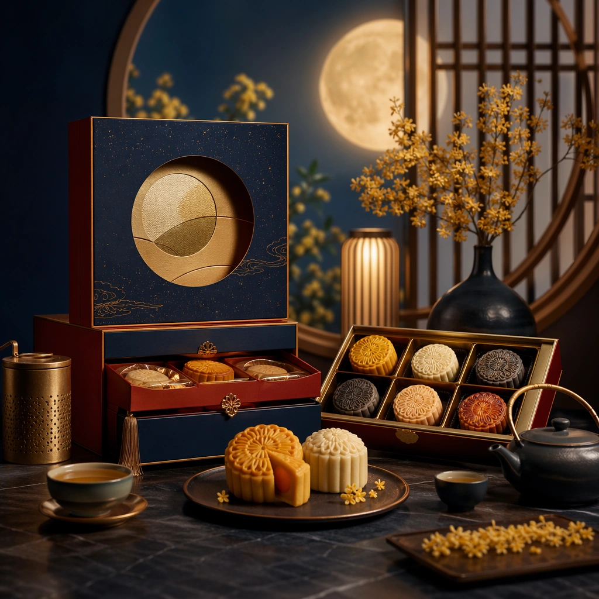

```text
Scene:
Create a square premium Mid-Autumn campaign image at early evening with warm lantern-adjacent light, deep midnight blue, muted gold, lacquer red-brown, and soft ivory. The environment should feel refined and contemporary, with moon-window geometry or circular framing cues integrated into the space. Build a polished brand-world where gifting, tea culture, and family warmth are present through objects and atmosphere, not through overt festival spectacle.

Subject:
Center a premium mooncake and tea gift presentation with lacquer boxes, carefully plated pastries, brushed metal or ceramic tea elements, osmanthus-toned accents, and a round moon motif integrated into the composition. The objects should feel gift-ready, culturally grounded, and commercially elevated. Use layered foreground and background depth so the frame can function as a hero image for packaging, retail, or seasonal storytelling.

Important details:
Lock the Mid-Autumn grammar here: circular moon references, warm evening glow, refined lacquer finish, precise packaging geometry, elegant tea textures, and a balance of festivity with calm premium restraint. Avoid generic tourist aesthetics. Keep all surfaces believable and culturally respectful. The anchor should feel reusable across gifting campaigns, event rollouts, and retail surfaces while remaining unmistakably centered on Mid-Autumn generosity and reunion.

Use case:
Mid-Autumn series study 1/9.

Constraints:
No readable text, no watermark, no logos, preserve exact 1:1 aspect ratio, no readable calligraphy, no zodiac animal mascot, no brand logos, no crowded banquet, no fantasy palace, no cartoon lantern overload, no fireworks, no kitsch souvenir styling.
```

[Pinned source](https://github.com/ChaosRealmsAI/gpt-image-2-gallery/blob/5296db8c996e38776c83a0bc8c64f848dcd512b3/works/topics/mid-autumn-gifting-and-moon-visuals/packages/series-moon-gift-system/images/01-mooncake-lacquer-anchor/meta.json) · GPT Image2 · 1024×1024 · No source-declared image dependencies. · ProjectD:[published and publicly accepted](https://aitoolsradar.com/en/prompts/64756ed670a75c)

## Family Tea Variation · mid-autumn-gifting-and-moon-visuals/series-moon-gift-system/02-family-tea-variation

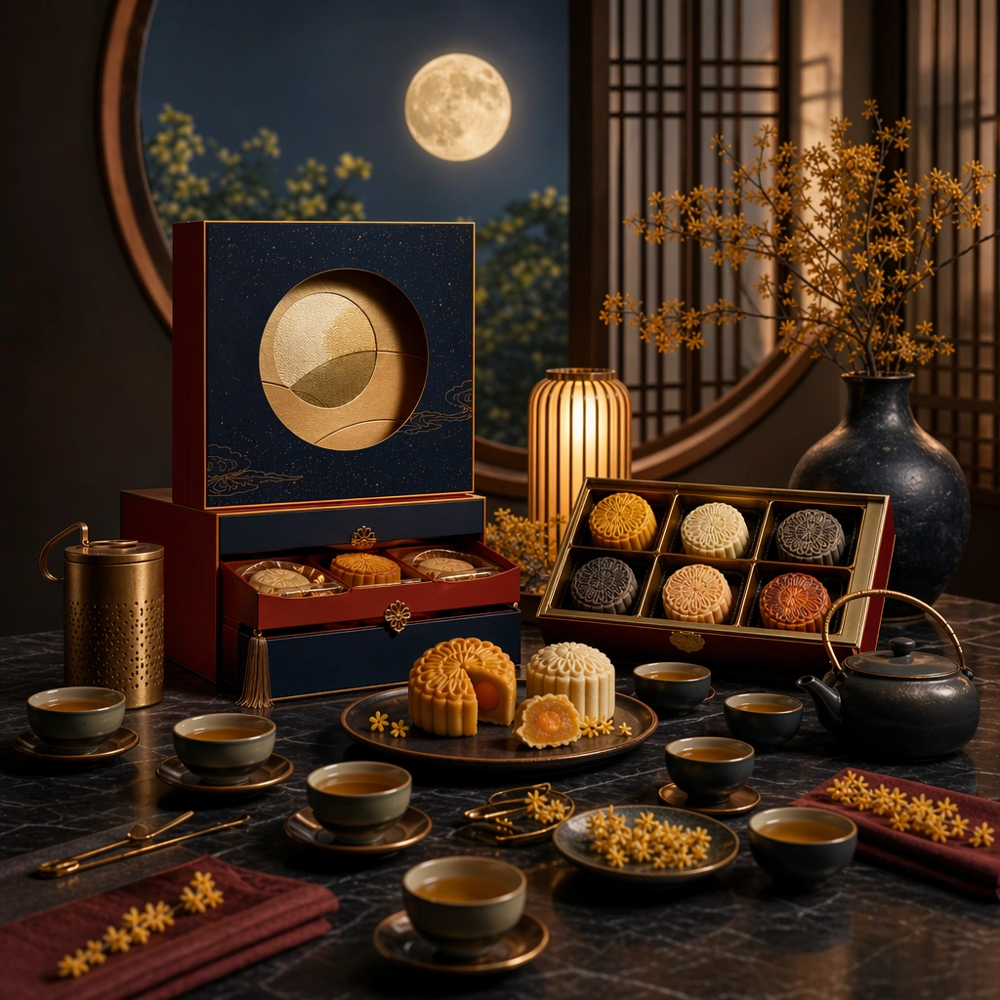

```text
Scene:
Create a square dependent Mid-Autumn campaign visual in the exact same evening-lit world, preserving the same moon-window cues, lacquer palette, gold warmth, and calm premium atmosphere from the reference image, but widen the composition into a refined family tea-table setting. The image should feel like part of the same production rollout, with continuity obvious in materials, color, and light direction.

Subject:
Show a family-oriented tea and pastry table with gift boxes, plated mooncakes, tea vessels, and subtle shared-place cues while keeping people minimal or absent. Preserve the exact packaging language, circular motif, and evening warmth from the reference model while shifting emphasis toward reunion and hosting. The composition should remain premium, respectful, and commercially useful for hospitality or gifting campaigns.

Important details:
Preserve exact campaign identity from the reference image: same lacquer finish, same tea-material language, same circular framing logic, and the same measured festive calm. Use hosting cues and shared table rhythm to express reunion rather than crowd scenes. The result should feel culturally grounded, tactile, and immediately part of one Mid-Autumn visual system.

Use case:
Mid-Autumn series study 2/9.

Constraints:
No readable text, no watermark, no logos, preserve exact 1:1 aspect ratio, preserve exact campaign identity from the reference image, no readable place cards, no loud dragon imagery, no cartoon moon faces, no family portrait posing, no logo boxes, no banquet chaos, no stage-performance feel.
```

[Pinned source](https://github.com/ChaosRealmsAI/gpt-image-2-gallery/blob/5296db8c996e38776c83a0bc8c64f848dcd512b3/works/topics/mid-autumn-gifting-and-moon-visuals/packages/series-moon-gift-system/images/02-family-tea-variation/meta.json) · GPT Image2 · 1024×1024 · Reference images required. · ProjectD:[published and publicly accepted](https://aitoolsradar.com/en/prompts/4e4cd8e781fb1b)

## Lantern Retail Variation · mid-autumn-gifting-and-moon-visuals/series-moon-gift-system/03-lantern-retail-variation

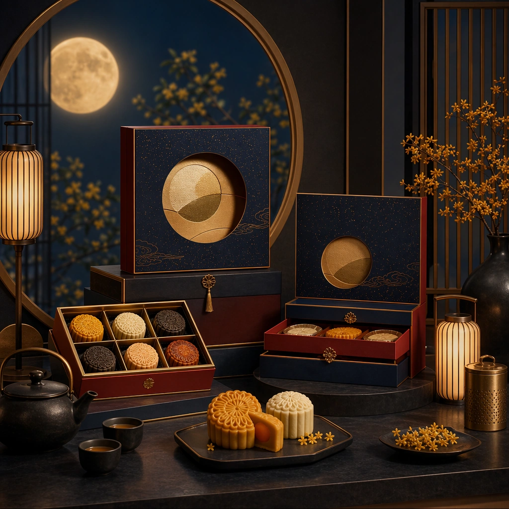

```text
Scene:
Create a square dependent campaign image in the same refined Mid-Autumn environment, with the exact warm evening light, midnight-blue depth, lacquer and brass accents, and circular moon cues from the reference image, but turn the frame toward a premium retail display. The scene should stay calm and luxurious while making the merchandising logic more visible and architectural.

Subject:
Feature a curated retail display with mooncake boxes, tea gifts, lantern-like light forms, display plinths, and circular framing elements arranged into a premium seasonal storefront composition. Preserve exact packaging identity, palette, and material logic from the reference model while changing the setting toward retail and presentation. Everything should feel original, elegant, and ready for upscale seasonal merchandising.

Important details:
Hold continuity tightly. The lantern cue should enrich atmosphere, not turn the image into generic festival décor. Keep packaging surfaces, metallic trim, ceramic elements, and ambient light highly believable. The final image should feel fit for luxury retail rollouts, boutique windows, and campaign key art under the same Mid-Autumn brand world.

Use case:
Mid-Autumn series study 3/9.

Constraints:
No readable text, no watermark, no logos, preserve exact 1:1 aspect ratio, preserve exact campaign identity from the reference image, no readable signage, no giant lantern theme-park spectacle, no mascot rabbit, no logo packaging, no crowd, no fireworks, no fantasy palace architecture.
```

[Pinned source](https://github.com/ChaosRealmsAI/gpt-image-2-gallery/blob/5296db8c996e38776c83a0bc8c64f848dcd512b3/works/topics/mid-autumn-gifting-and-moon-visuals/packages/series-moon-gift-system/images/03-lantern-retail-variation/meta.json) · GPT Image2 · 1024×1024 · Reference images required. · ProjectD:[published and publicly accepted](https://aitoolsradar.com/en/prompts/5c64cf52d82b8a)

## Premium Hamper Variation · mid-autumn-gifting-and-moon-visuals/series-moon-gift-system/04-premium-hamper-variation

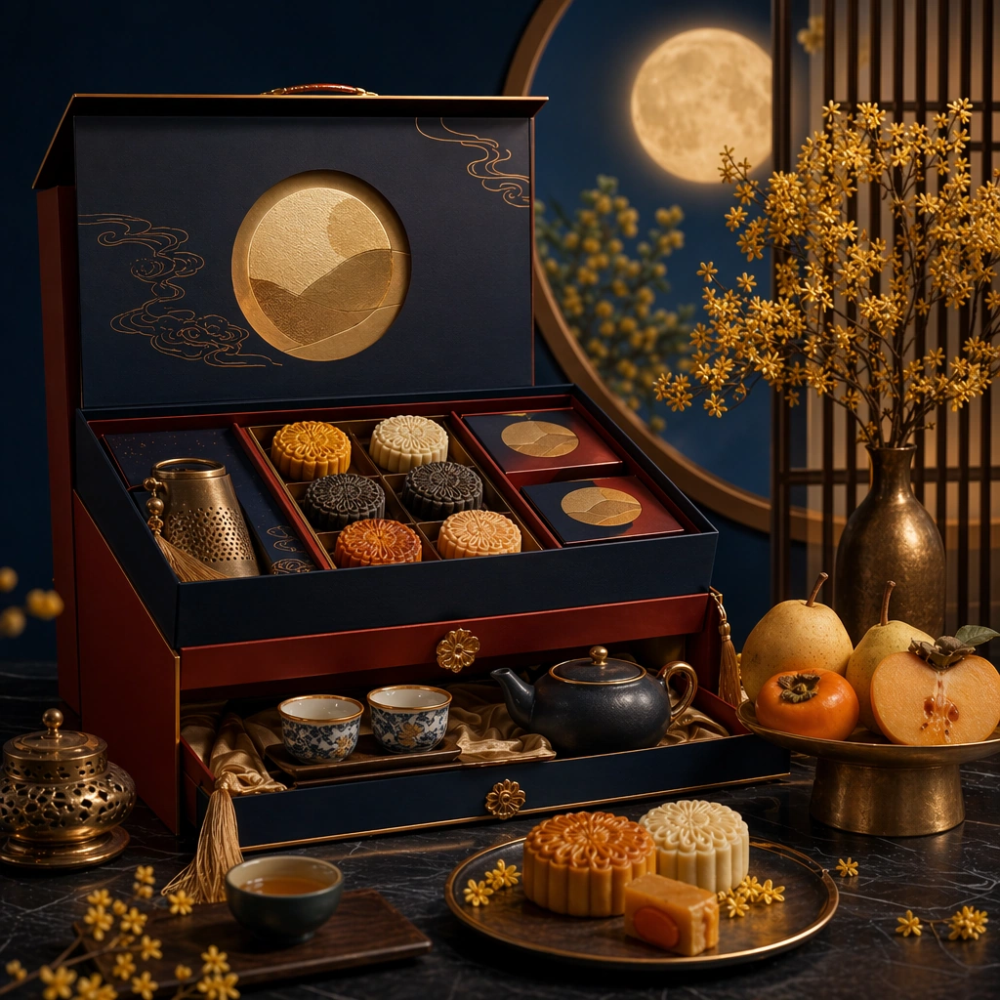

```text
Scene:
Create a square dependent Mid-Autumn campaign image in the same premium moon-gift world, with identical warm evening light, lacquer surfaces, soft gold accents, and moon-window logic from the reference image, but frame the composition closer around a premium hamper arrangement. The visual continuity should feel exact, as though the same brand world has simply shifted to a higher gifting tier.

Subject:
Center a luxurious hamper containing mooncake boxes, tea, ceramic serviceware, fruit or floral seasonal accents, and finely packed supporting items arranged into one coherent gift bundle. Preserve exact color balance, material language, and circular motif from the reference image while emphasizing gifting abundance and presentation quality. The hamper should feel commercially real, premium, and suitable for seasonal gifting campaigns.

Important details:
The dependent image must inherit the anchor precisely: same lighting direction, same moon symbolism level, same lacquer and metal textures, and the same modern-calm festive tone. Only the gifting tier and composition density should change. Keep the hamper disciplined and high-end, with believable packing logic and enough breathing room to remain elegant at hero scale.

Use case:
Mid-Autumn series study 4/9.

Constraints:
No readable text, no watermark, no logos, preserve exact 1:1 aspect ratio, preserve exact campaign identity from the reference image, no readable gift cards, no mascot figures, no crowd, no logo tins, no cheap wicker picnic vibe, no excessive gold glitter, no fantasy architecture.
```

[Pinned source](https://github.com/ChaosRealmsAI/gpt-image-2-gallery/blob/5296db8c996e38776c83a0bc8c64f848dcd512b3/works/topics/mid-autumn-gifting-and-moon-visuals/packages/series-moon-gift-system/images/04-premium-hamper-variation/meta.json) · GPT Image2 · 1024×1024 · Reference images required. · ProjectD:[published and publicly accepted](https://aitoolsradar.com/en/prompts/2cc7152999fc26)

## Rooftop Moon View Setup · mid-autumn-gifting-and-moon-visuals/single-festival-context-studies/rooftop-moon-view-setup


```text
Scene:
Create a square rooftop hospitality image at blue hour with a large moon presence, elegant low seating, lantern-adjacent light, and a calm city or garden backdrop. The scene should feel premium and contemporary rather than nostalgic or theatrical. Use refined lighting, controlled depth, and a strong sense of evening atmosphere so the frame can support hospitality, travel, or seasonal event campaign use.

Subject:
Show a poised moon-viewing setup with tea service, plated pastries, lacquer or ceramic serving pieces, cushions or textiles, and subtle floral or plant elements. The composition should suggest shared celebration without needing visible faces. Focus on the emotional promise of reunion and observation through environment, objects, and moon presence rather than through overt symbolism or readable messaging.

Important details:
Keep the scene culturally grounded and commercially polished. Moon, tea, ceramic, lacquer, fabric, and ambient light should all feel tactile and believable. The rooftop setting must stay elegant, not lavishly fantasy. This should read as a premium Mid-Autumn atmosphere image for hotels, events, or lifestyle campaigns, with enough specificity to feel festival-based and enough restraint to remain reusable.

Use case:
Mid-Autumn single study 5/9.

Constraints:
No readable text, no watermark, no logos, preserve exact 1:1 aspect ratio, no readable signage, no fantasy palace skyline, no mascot rabbit, no fireworks, no crowded family portrait, no logo tableware, no stage-performance lighting, no giant paper-cut ornaments.
```

[Pinned source](https://github.com/ChaosRealmsAI/gpt-image-2-gallery/blob/5296db8c996e38776c83a0bc8c64f848dcd512b3/works/topics/mid-autumn-gifting-and-moon-visuals/packages/single-festival-context-studies/images/rooftop-moon-view-setup/meta.json) · GPT Image2 · 1024×1024 · No source-declared image dependencies. · ProjectD:[published and publicly accepted](https://aitoolsradar.com/en/prompts/db3d07a726309d)

## Carved Mooncake Closeup · mid-autumn-gifting-and-moon-visuals/single-festival-context-studies/carved-mooncake-closeup

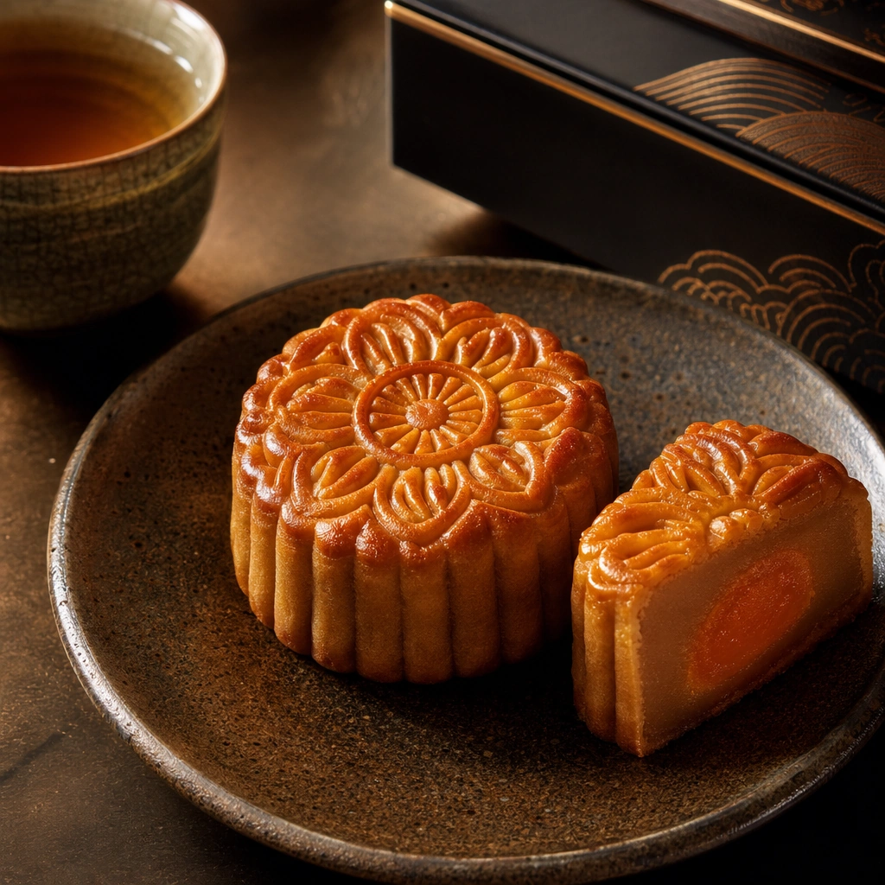

```text
Scene:
Create a square close-up food-and-packaging image with soft raking evening light, warm tonal contrast, and shallow but believable depth of field. The composition should feel like a premium editorial crop from a luxury gift campaign, not a recipe photo. Keep the crop intimate while preserving context through one or two supporting packaging and tea elements around the pastry.

Subject:
Focus on one or two mooncakes showing carefully carved surface patterns, rich pastry texture, and part of a refined gift-box or serving setup nearby. The scene should celebrate craft, quality, and generosity through edible detail and packaging refinement. Keep the food original and elegant, with no readable embossing or overt branding.

Important details:
Micro-texture is essential here: pastry sheen, crumb structure, filling edge, lacquer reflection, ceramic glaze, and ambient evening warmth should all feel precise. The image should support packaging pages, gift-guide crops, or seasonal food marketing. Keep the tone premium and restrained, avoiding sticky dessert glamour or excessive food-styling clutter.

Use case:
Mid-Autumn single study 6/9.

Constraints:
No readable text, no watermark, no logos, preserve exact 1:1 aspect ratio, no readable embossing, no brand logos, no cutlery clutter, no unrealistic glossy syrup, no cartoon bunny motifs, no giant crumbs, no hands, no recipe-card styling.
```

[Pinned source](https://github.com/ChaosRealmsAI/gpt-image-2-gallery/blob/5296db8c996e38776c83a0bc8c64f848dcd512b3/works/topics/mid-autumn-gifting-and-moon-visuals/packages/single-festival-context-studies/images/carved-mooncake-closeup/meta.json) · GPT Image2 · 1024×1024 · No source-declared image dependencies. · ProjectD:[published and publicly accepted](https://aitoolsradar.com/en/prompts/084616b7d6aef3)

## Tea and Osmanthus Still Life · mid-autumn-gifting-and-moon-visuals/single-festival-context-studies/tea-and-osmanthus-still-life


```text
Scene:
Create a square still-life image on a calm tabletop with warm evening light, moon-adjacent cool shadows, and refined negative space. The frame should feel like a premium tea or gifting campaign visual, with a mature sense of calm and balance. Use a restrained palette of warm gold, muted cream, dark wood or lacquer, and one or two floral accents that suggest seasonality without turning decorative.

Subject:
Show a tea service with cup, pot, tray, small pastry, gift box edge, and osmanthus-like floral detail arranged into a poised Mid-Autumn still life. The composition should communicate fragrance, hospitality, and premium gifting readiness through object relationships. Keep everything original and brand-neutral, free of readable script and heavy ornament overload.

Important details:
Focus on tactile precision: ceramic glaze, tea translucency, lacquer sheen, floral softness, and subtle atmospheric depth. The image should be calm enough for premium tea branding but still unmistakably seasonal through its moonlit warmth and gifting context. Avoid generic zen clichés; this should feel festive, specific, and commercially ready.

Use case:
Mid-Autumn single study 7/9.

Constraints:
No readable text, no watermark, no logos, preserve exact 1:1 aspect ratio, no readable tea labels, no logo cups, no incense smoke overload, no fantasy temple set, no mascot animals, no bright red saturation, no cluttered table, no calligraphy scrolls.
```

[Pinned source](https://github.com/ChaosRealmsAI/gpt-image-2-gallery/blob/5296db8c996e38776c83a0bc8c64f848dcd512b3/works/topics/mid-autumn-gifting-and-moon-visuals/packages/single-festival-context-studies/images/tea-and-osmanthus-still-life/meta.json) · GPT Image2 · 1024×1024 · No source-declared image dependencies. · ProjectD:[published and publicly accepted](https://aitoolsradar.com/en/prompts/e4a9a212f88956)

## Hotel Moon Installation · mid-autumn-gifting-and-moon-visuals/single-festival-context-studies/hotel-moon-installation

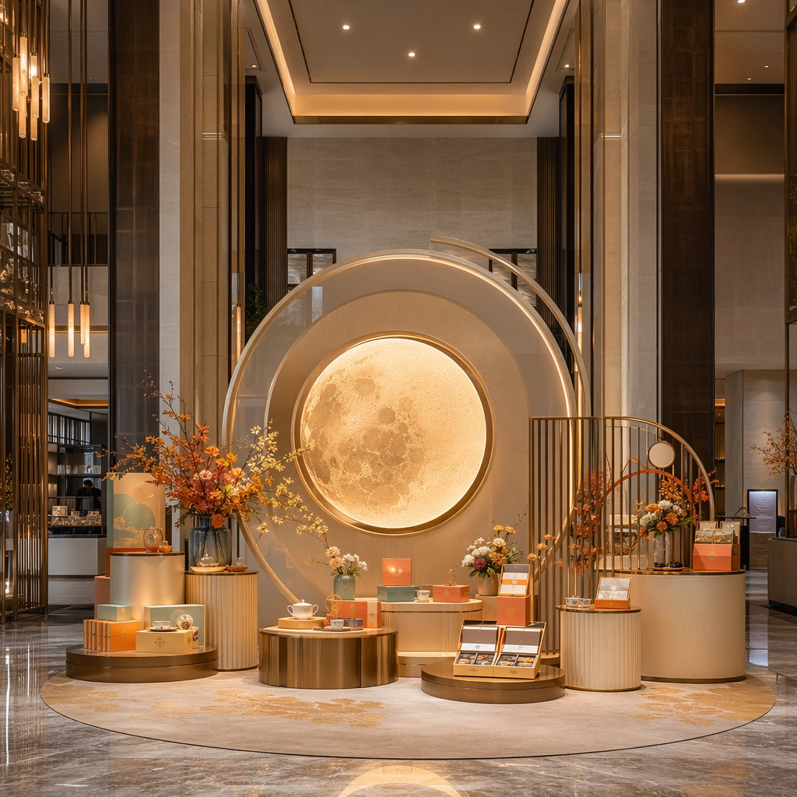

```text
Scene:
Create a square hotel-lobby campaign image with high ceilings, refined warm lighting, and a central circular installation that suggests the moon without becoming literal stage décor. The composition should feel premium, spacious, and event-ready, suitable for hospitality promotion. Keep architecture contemporary and believable, with a calm sense of grandeur and seasonal refinement.

Subject:
Feature a seasonal installation composed of circular forms, curated display plinths, gift boxes, floral accents, and tea-or-pastry presentation integrated into a hotel or upscale hospitality setting. The subject should communicate Mid-Autumn celebration through design language and gifting cues, not through readable banners or mascot imagery. Let the installation feel original and professionally produced.

Important details:
Architecture, material finish, and scale matter. Make stone, metal, lacquer, lighting, and display surfaces all feel convincing. The circular installation should carry the moon theme subtly and elegantly. The image should work as a campaign asset for hotels, malls, or event venues looking for sophisticated Mid-Autumn activation imagery.

Use case:
Mid-Autumn single study 8/9.

Constraints:
No readable text, no watermark, no logos, preserve exact 1:1 aspect ratio, no readable event signage, no mascot rabbits, no fantasy palace arches, no crowd blocking the installation, no logo walls, no stage performers, no fireworks, no cheap lantern tunnel aesthetic.
```

[Pinned source](https://github.com/ChaosRealmsAI/gpt-image-2-gallery/blob/5296db8c996e38776c83a0bc8c64f848dcd512b3/works/topics/mid-autumn-gifting-and-moon-visuals/packages/single-festival-context-studies/images/hotel-moon-installation/meta.json) · GPT Image2 · 1024×1024 · No source-declared image dependencies. · ProjectD:[published and publicly accepted](https://aitoolsradar.com/en/prompts/fc16787cf28a3e)

## Dusk Gift Delivery · mid-autumn-gifting-and-moon-visuals/single-festival-context-studies/dusk-gift-delivery

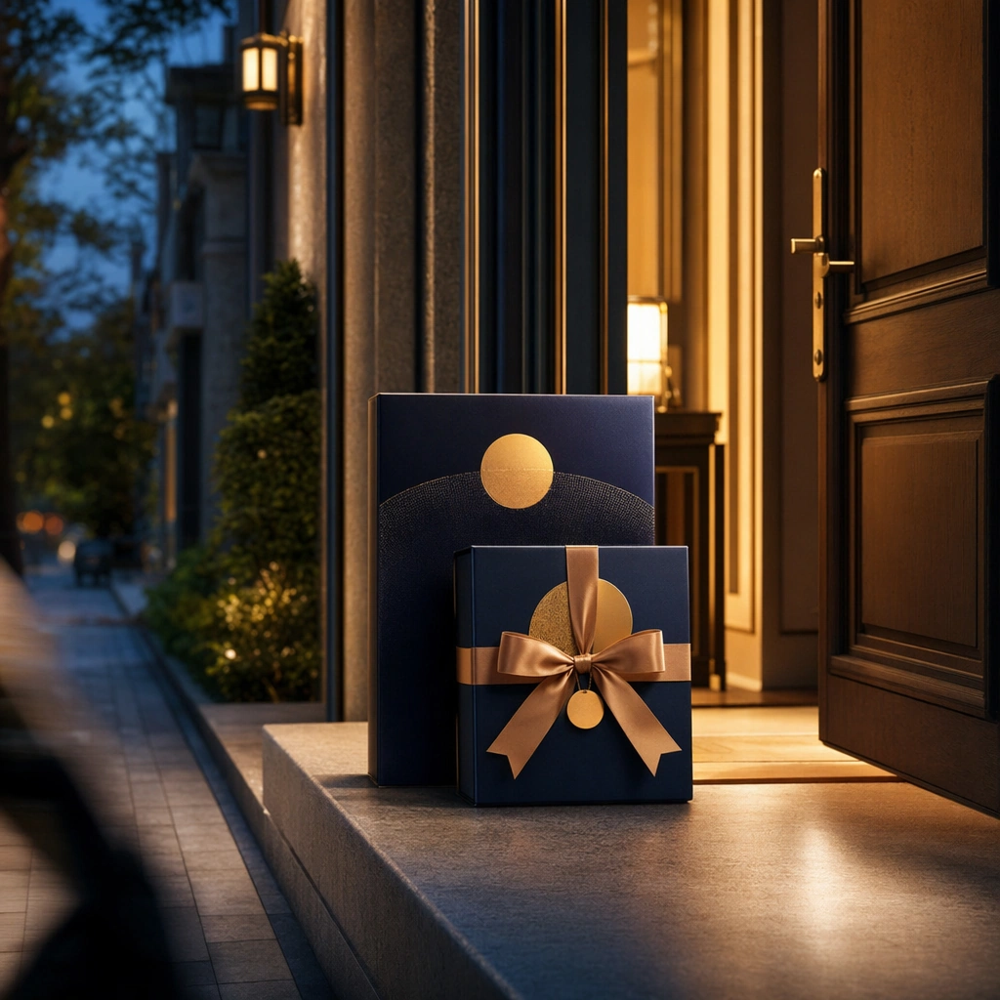

```text
Scene:
Create a square doorstep or lobby delivery image at dusk with warm interior spill light, cool exterior blue, and a strong sense of calm arrival. The frame should feel like a premium logistics or gifting-service campaign image, not a candid snapshot. Keep architecture refined and the package placement intentional so the scene speaks to reliability, care, and seasonal generosity.

Subject:
Show one or two elegant Mid-Autumn gift boxes placed at a threshold with lacquer finish, ribbon, and subtle moon-led design cues. The courier may be implied through motion or recent placement, but the gift should remain central. The scene should communicate respect, timing, and premium seasonal fulfillment through lighting, composition, and packaging finish.

Important details:
Make packaging geometry, paper or lacquer texture, stone threshold, metal hardware, and ambient light all feel physically persuasive. Keep the emotional register warm and considerate rather than sentimental. The final result should function as a delivery-message asset for premium gifting brands during Mid-Autumn season.

Use case:
Mid-Autumn single study 9/9.

Constraints:
No readable text, no watermark, no logos, preserve exact 1:1 aspect ratio, no readable labels, no courier logos, no visible apartment numbers, no cartoon moon icon, no family portrait, no cluttered entryway, no damaged packages, no random holiday décor from other festivals.
```

[Pinned source](https://github.com/ChaosRealmsAI/gpt-image-2-gallery/blob/5296db8c996e38776c83a0bc8c64f848dcd512b3/works/topics/mid-autumn-gifting-and-moon-visuals/packages/single-festival-context-studies/images/dusk-gift-delivery/meta.json) · GPT Image2 · 1024×1024 · No source-declared image dependencies. · ProjectD:[published and publicly accepted](https://aitoolsradar.com/en/prompts/56cbfcde5f6938)

## Reference Anchor · minoan-frescoes-living/series-core-discovery/01-reference-anchor

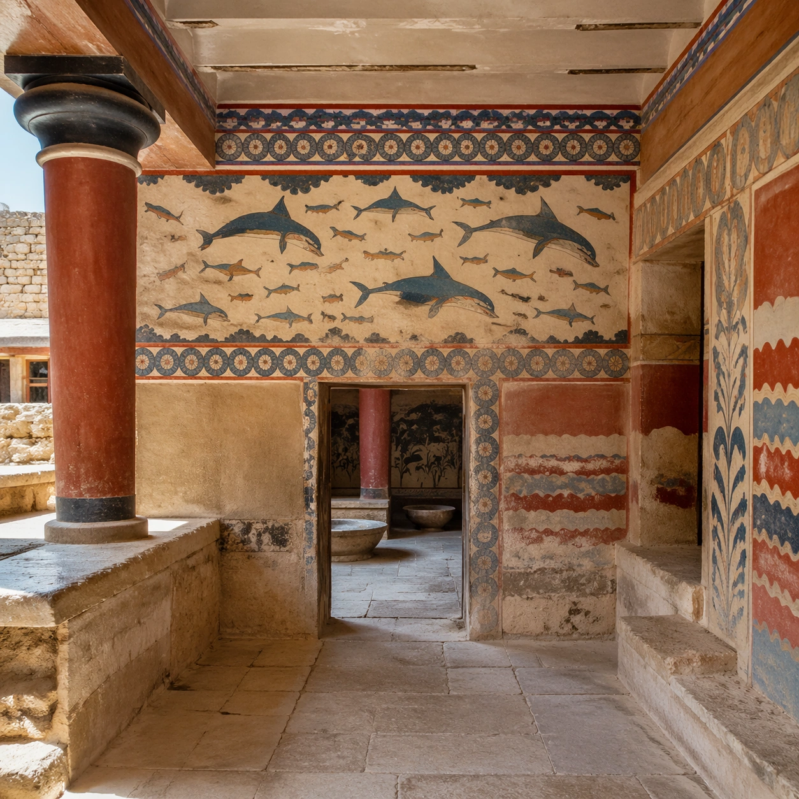

```text
Scene:
A square documentary image composed like a premium archaeology magazine feature. Use sea blue, red ochre, chalk white, warm plaster cream, and sun-washed Mediterranean highlights. Frame a restored Minoan palace room with lively fresco bands, dolphin imagery, and painted architectural surfaces that feel newly uncovered with crisp depth layering, restrained contrast, and subtle atmospheric depth so the scene feels excavated, observed, and historically grounded rather than theatrical or game-like. Keep the light directional but believable, as if captured during a careful field visit.

Subject:
Center the image on a restored Minoan palace room with lively fresco bands, dolphin imagery, and painted architectural surfaces that feel newly uncovered. Include culturally accurate surface logic, region-specific setting, and believable human-scale cues in stairs, doorways, cut blocks, relief edges, or water depth. Shapes, carvings, masonry joints, and site wear should feel studied from real archaeology, with no generic ancient-world mashup and no ornamental filler borrowed from another civilization.

Important details:
Keep the room recognizably Minoan, with fluid marine motifs, elegant fresco cadence, red and blue pigment behavior, and Bronze Age architectural forms rather than later classical Greek systems. Emphasize painted plaster, smooth lime surfaces, mineral pigments, polished stone floors, column fragments, and salt-softened wall edges. Keep inscriptions, painted registers, symbolic motifs, or carved bands visually plausible but not readable. Preserve a museum-grade balance between beauty and evidence: light should reveal relief depth, edge wear, repairs, sediment traces, and excavation context without turning the site into fantasy spectacle. The composition should feel like a definitive reference frame that later variations can inherit exactly.

Use case:
Minoan Frescoes Living Again series study 1/9.

Constraints:
No readable text, no watermark, no logos, preserve exact 1:1 aspect ratio, no Roman statues, no Renaissance furniture, no fantasy palaces, no modern gallery labels, no tourists, no anachronistic props, no collage layout, no exaggerated fantasy lighting.
```

[Pinned source](https://github.com/ChaosRealmsAI/gpt-image-2-gallery/blob/5296db8c996e38776c83a0bc8c64f848dcd512b3/works/topics/minoan-frescoes-living/packages/series-core-discovery/images/01-reference-anchor/meta.json) · GPT Image2 · 1254×1254 · No source-declared image dependencies. · ProjectD:[published and publicly accepted](https://aitoolsradar.com/en/prompts/593a9aaee00d23)

## Human Scale Reveal · minoan-frescoes-living/series-core-discovery/02-human-scale-reveal


```text
Scene:
A square follow-up field image from the same site, slightly closer and lower than the reference anchor, with careful documentary framing and the same material palette. The camera should feel physically present inside the archaeological space, using natural light, soft depth separation, and one clear human figure to explain scale without turning the image into lifestyle photography.

Subject:
Show the same site identity established in the reference anchor, now with an archaeologist, conservator, or field researcher moving through the scene in practical neutral clothing. The person should be small relative to the monument and clearly secondary to the architecture, water, or painted wall system. Keep the main forms, structural rhythm, and civilizational markers unchanged.

Important details:
Preserve the exact site identity, base geometry, material behavior, and cultural signatures from the reference model. Only vary vantage, gesture, and scale cues. Keep the room recognizably Minoan, with fluid marine motifs, elegant fresco cadence, red and blue pigment behavior, and Bronze Age architectural forms rather than later classical Greek systems. Human presence should clarify stair height, wall size, carving depth, or spatial compression while respecting conservation protocol and historical seriousness. Keep any tools understated and generic, with no readable labels. The image must still look like a rigorous archaeological record first and a dramatic scene second.

Use case:
Minoan Frescoes Living Again series study 2/9.

Constraints:
No readable text, no watermark, no logos, preserve exact 1:1 aspect ratio, preserve exact site identity from the reference image, no Roman statues, no Renaissance furniture, no fantasy palaces, no modern gallery labels, no fashion editorial styling, no crowd, no cinematic props.
```

[Pinned source](https://github.com/ChaosRealmsAI/gpt-image-2-gallery/blob/5296db8c996e38776c83a0bc8c64f848dcd512b3/works/topics/minoan-frescoes-living/packages/series-core-discovery/images/02-human-scale-reveal/meta.json) · GPT Image2 · 1254×1254 · Reference images required. · ProjectD:[published and publicly accepted](https://aitoolsradar.com/en/prompts/2b256d69ba2037)

## Surface Close Study · minoan-frescoes-living/series-core-discovery/03-surface-close-study


```text
Scene:
A square close study framed within the same site established by the reference anchor. Use a tight crop, shallow but believable depth of field, and raking light that reveals tactile evidence in surface relief, pigment, tool marks, moisture, or marine wear. The image should feel like a museum conservation photograph elevated to gallery quality.

Subject:
Focus on a materially rich portion of the same site: carved edges, painted plaster, fitted stone, root-wrapped masonry, submerged paving, or quarry-cut facial planes depending on the civilization. The composition should remain anchored to the original location and show enough surrounding context that viewers still recognize the parent site rather than mistaking it for an unrelated artifact.

Important details:
Preserve the exact site identity from the reference model while shifting emphasis to forensic surface evidence. Keep the room recognizably Minoan, with fluid marine motifs, elegant fresco cadence, red and blue pigment behavior, and Bronze Age architectural forms rather than later classical Greek systems. Make micro-texture, fracture lines, pigment retention, water wear, plant interaction, dust, or chisel traces visually persuasive. Avoid decorative clutter. Every mark should feel like evidence of making, weathering, excavation, or conservation. Keep any symbolic marks non-legible and historically appropriate, and make the light reveal depth without flattening the material richness.

Use case:
Minoan Frescoes Living Again series study 3/9.

Constraints:
No readable text, no watermark, no logos, preserve exact 1:1 aspect ratio, preserve exact site identity from the reference image, no Roman statues, no Renaissance furniture, no fantasy palaces, no modern gallery labels, no isolated floating artifact, no studio backdrop, no fake macro abstraction.
```

[Pinned source](https://github.com/ChaosRealmsAI/gpt-image-2-gallery/blob/5296db8c996e38776c83a0bc8c64f848dcd512b3/works/topics/minoan-frescoes-living/packages/series-core-discovery/images/03-surface-close-study/meta.json) · GPT Image2 · 1254×1254 · Reference images required. · ProjectD:[published and publicly accepted](https://aitoolsradar.com/en/prompts/621c1f6a782dd6)

## Atmospheric Wide Reveal · minoan-frescoes-living/series-core-discovery/04-atmospheric-wide-reveal


```text
Scene:
A square wide reveal of the same site under a slightly different environmental condition, with more surrounding geography or architecture visible while keeping the anchor landmark dominant. Use disciplined composition, atmospheric perspective, and natural light behavior so the image feels like a patient field photograph captured after the reference shot rather than a different fantasy set.

Subject:
Show the same site identity with broader context: approaches, terraces, ring walls, canyon slot, canopy volume, quarry slope, or chamber boundaries depending on the location. The anchor structure must remain instantly recognizable. Environmental scale should deepen understanding of why the site is placed here and how people, water, topography, or vegetation shape the experience of the monument.

Important details:
Preserve the exact landmark, materials, and civilizational cues from the reference model while allowing wider framing and a different atmospheric emphasis. Keep the room recognizably Minoan, with fluid marine motifs, elegant fresco cadence, red and blue pigment behavior, and Bronze Age architectural forms rather than later classical Greek systems. Use geography and environmental systems to add meaning: drainage, mist, current, valley depth, roots, irrigation, or enclosure logic. The image should feel both beautiful and evidentiary, with no compositional tricks that break continuity with the established site.

Use case:
Minoan Frescoes Living Again series study 4/9.

Constraints:
No readable text, no watermark, no logos, preserve exact 1:1 aspect ratio, preserve exact site identity from the reference image, no Roman statues, no Renaissance furniture, no fantasy palaces, no modern gallery labels, no unrelated landmarks, no speculative mashup architecture, no posterized grading.
```

[Pinned source](https://github.com/ChaosRealmsAI/gpt-image-2-gallery/blob/5296db8c996e38776c83a0bc8c64f848dcd512b3/works/topics/minoan-frescoes-living/packages/series-core-discovery/images/04-atmospheric-wide-reveal/meta.json) · GPT Image2 · 1254×1254 · Reference images required. · ProjectD:[published and publicly accepted](https://aitoolsradar.com/en/prompts/2c169b659812eb)

## Excavation Overview · minoan-frescoes-living/single-context-studies/excavation-overview


```text
Scene:
A square independent archaeology study composed from a slightly elevated fieldwork viewpoint. Use balanced natural light, crisp evidence hierarchy, and practical site organization so the image feels publishable in a museum report and still visually strong enough for a gallery wall. The frame should explain where excavation is happening without relying on readable markers or diagrams.

Subject:
Show a palace room under careful study, with fresco fragments matched to wall positions and conservators documenting joins, losses, and surviving color fields. Include grounded human traces such as ladders, trays, brushes, baskets, light rigs, or measuring tools only when they support archaeological realism and remain visually secondary. The site should stay culturally specific, with architecture, surface treatment, sediment, and environmental context all belonging to the correct civilization rather than a generic dig.

Important details:
Keep the room recognizably Minoan, with fluid marine motifs, elegant fresco cadence, red and blue pigment behavior, and Bronze Age architectural forms rather than later classical Greek systems. Prioritize evidence relationships: exposed layers, cleaned edges, protected surfaces, loose fragments, and transitions between buried and revealed material. Let color, wear, and composition explain what has just been uncovered. The image must feel methodical rather than adventurous. Keep any site tags, notes, or markers abstract and unreadable. Avoid sensational treasure imagery and keep the atmosphere scholarly, patient, and materially convincing.

Use case:
Minoan Frescoes Living Again single study 5/9.

Constraints:
No readable text, no watermark, no logos, preserve exact 1:1 aspect ratio, no Roman statues, no Renaissance furniture, no fantasy palaces, no modern gallery labels, no treasure-chest clichés, no action-movie posing, no arbitrary props, no infographic overlay.
```

[Pinned source](https://github.com/ChaosRealmsAI/gpt-image-2-gallery/blob/5296db8c996e38776c83a0bc8c64f848dcd512b3/works/topics/minoan-frescoes-living/packages/single-context-studies/images/excavation-overview/meta.json) · GPT Image2 · 1254×1254 · No source-declared image dependencies. · ProjectD:[published and publicly accepted](https://aitoolsradar.com/en/prompts/7aa958911d8a9f)

## Artifact Tableau · minoan-frescoes-living/single-context-studies/artifact-tableau


```text
Scene:
A square artifact and material study arranged like a high-end conservation photograph. Use soft directional light, controlled shadow falloff, and a neutral work surface so every fragment reads clearly. The image should feel intimate and scientific, but still rich enough to communicate the broader civilization through craft, wear, and material vocabulary alone.

Subject:
Present painted plaster shards, shell pigments, pottery fragments, small bronze tools, and fresco reconstruction samples arranged on linen. Arrange the pieces with disciplined spacing and believable conservation handling. Include enough variation in scale, finish, and damage state to suggest excavation reality rather than a perfectly staged luxury still life. Nothing should look modern or decorative for its own sake; every object must feel like evidence tied to the same cultural world as the main topic.

Important details:
Emphasize tactile surfaces, honest aging, and historically grounded material behavior. Keep the room recognizably Minoan, with fluid marine motifs, elegant fresco cadence, red and blue pigment behavior, and Bronze Age architectural forms rather than later classical Greek systems. Show abrasion, dust, corrosion, cracks, mineral bloom, pigment retention, or edge polish where appropriate. Keep the arrangement orderly but not sterile, as if prepared for a serious cataloging session. No readable labels, no museum placards, and no visual shortcuts that turn the study into product photography detached from archaeology.

Use case:
Minoan Frescoes Living Again single study 6/9.

Constraints:
No readable text, no watermark, no logos, preserve exact 1:1 aspect ratio, no Roman statues, no Renaissance furniture, no fantasy palaces, no modern gallery labels, no luxury advertising gloss, no floating objects, no velvet jewelry styling, no unrelated tools.
```

[Pinned source](https://github.com/ChaosRealmsAI/gpt-image-2-gallery/blob/5296db8c996e38776c83a0bc8c64f848dcd512b3/works/topics/minoan-frescoes-living/packages/single-context-studies/images/artifact-tableau/meta.json) · GPT Image2 · 1254×1254 · No source-declared image dependencies. · ProjectD:[published and publicly accepted](https://aitoolsradar.com/en/prompts/a45275d135a9a9)

## Light Shift Study · minoan-frescoes-living/single-context-studies/light-shift-study


```text
Scene:
A square mood variation from the same civilization theme, built around clearer seaside daylight entering from an upper opening, making pigment saturation and plaster sheen shift without changing the room identity. The image should stay grounded in field realism while testing how different illumination changes material reading, atmosphere, and emotional register. Keep the frame self-contained and coherent, as if photographed during a second visit under altered conditions.

Subject:
Show a culturally accurate site or interior connected to the same world as the main topic, but not as a direct dependency on the series reference. The focus should be on how light transforms relief, color, moisture, water, dust, or vegetation while preserving archaeological credibility. Architectural forms, objects, and setting must still belong to the same civilization with no cross-cultural contamination.

Important details:
Keep the room recognizably Minoan, with fluid marine motifs, elegant fresco cadence, red and blue pigment behavior, and Bronze Age architectural forms rather than later classical Greek systems. Use the shift in light to reveal different evidence than the other studies: pigment glow, root sheen, caustics, wet stone, canyon shadow, marine haze, terrace depth, or quarry moisture. Keep the result serious and observational rather than romanticized. Non-readable motifs are acceptable, but there should be no signs, captions, or modern display devices. The image should feel like a rigorous visual experiment in historical atmosphere.

Use case:
Minoan Frescoes Living Again single study 7/9.

Constraints:
No readable text, no watermark, no logos, preserve exact 1:1 aspect ratio, no Roman statues, no Renaissance furniture, no fantasy palaces, no modern gallery labels, no theatrical color filters, no supernatural effects, no montage composition, no glossy concept-art exaggeration.
```

[Pinned source](https://github.com/ChaosRealmsAI/gpt-image-2-gallery/blob/5296db8c996e38776c83a0bc8c64f848dcd512b3/works/topics/minoan-frescoes-living/packages/single-context-studies/images/light-shift-study/meta.json) · GPT Image2 · 1254×1254 · No source-declared image dependencies. · ProjectD:[published and publicly accepted](https://aitoolsradar.com/en/prompts/3c0a0fc1758195)

## Survey Perspective · minoan-frescoes-living/single-context-studies/survey-perspective


```text
Scene:
A square survey-oriented image that explains spatial logic with the clarity of an expert field overview while still reading as a finished artwork. Use a stable elevated vantage, clean depth layering, and enough visible terrain or architecture to make relationships legible without turning the frame into a literal map. The scene should feel analytical and cinematic at the same time.

Subject:
Show a measured room perspective that explains wall programs, floor pattern, doorway placement, and the relationship between fresco surfaces and architecture. Organize the composition so paths, terraces, walls, courtyards, chambers, canals, root systems, or quarry clusters can be read as a coherent system. The image should reveal how the civilization used land, water, elevation, enclosure, or monumentality. Keep all architecture, materials, and environmental details consistent with the correct place and period.

Important details:
Keep the room recognizably Minoan, with fluid marine motifs, elegant fresco cadence, red and blue pigment behavior, and Bronze Age architectural forms rather than later classical Greek systems. This image should reward close looking by showing infrastructural logic: how stone courses align, how water moves, how rooms connect, how carved masses sit inside geology, or how vegetation interacts with built form. Avoid explicit annotation. Let composition, light, and scale cues do the explanatory work. Keep any measuring elements generic and unreadable, and make the image feel like serious research made visually elegant.

Use case:
Minoan Frescoes Living Again single study 8/9.

Constraints:
No readable text, no watermark, no logos, preserve exact 1:1 aspect ratio, no Roman statues, no Renaissance furniture, no fantasy palaces, no modern gallery labels, no infographic arrows, no split-screen layout, no impossible aerial geometry, no unrelated settlements.
```

[Pinned source](https://github.com/ChaosRealmsAI/gpt-image-2-gallery/blob/5296db8c996e38776c83a0bc8c64f848dcd512b3/works/topics/minoan-frescoes-living/packages/single-context-studies/images/survey-perspective/meta.json) · GPT Image2 · 1254×1254 · No source-declared image dependencies. · ProjectD:[published and publicly accepted](https://aitoolsradar.com/en/prompts/8845405809b512)

## Editorial Reconstruction · minoan-frescoes-living/single-context-studies/editorial-reconstruction


```text
Scene:
A square hero image designed for a museum wall graphic or flagship magazine cover, but without any actual typography. Use strong focal hierarchy, refined contrast, and a polished finish that still feels rooted in archaeological evidence. The frame should look complete on its own and communicate why this civilization remains visually unforgettable.

Subject:
Build the image around a museum-grade reconstruction hero image that brings Minoan color back to life while remaining materially grounded. Present architecture, artifacts, environment, and atmosphere as one coherent statement. The composition can be more distilled than a field snapshot, but it must remain culturally specific, materially persuasive, and free of fantasy shorthand. Nothing should feel like a movie poster or commercial franchise imitation.

Important details:
Keep the room recognizably Minoan, with fluid marine motifs, elegant fresco cadence, red and blue pigment behavior, and Bronze Age architectural forms rather than later classical Greek systems. Distill the site or cultural world into one decisive visual argument: place, craft, weathering, engineering, and memory. Use the strongest material signatures from this civilization and let them sit in a believable environment with controlled dramatic weight. Keep any carved or painted symbols non-readable. The result should look like responsible high-end visual storytelling for research and public interpretation, not a spectacle-first matte painting.

Use case:
Minoan Frescoes Living Again single study 9/9.

Constraints:
No readable text, no watermark, no logos, preserve exact 1:1 aspect ratio, no Roman statues, no Renaissance furniture, no fantasy palaces, no modern gallery labels, no movie-poster tropes, no overdesigned framing devices, no collage layout, no brand-like iconography.
```

[Pinned source](https://github.com/ChaosRealmsAI/gpt-image-2-gallery/blob/5296db8c996e38776c83a0bc8c64f848dcd512b3/works/topics/minoan-frescoes-living/packages/single-context-studies/images/editorial-reconstruction/meta.json) · GPT Image2 · 1254×1254 · No source-declared image dependencies. · ProjectD:[published and publicly accepted](https://aitoolsradar.com/en/prompts/1a0c63396e7ce9)

## Reference Age Sheet · mirror-worlds/series-life-stage-living-room/01-reference-age-sheet


```text
Scene:
A square studio character reference sheet on a quiet neutral background, arranged as eight portrait-and-half-body studies in a clean 4 by 2 grid with no captions. Use soft editorial lighting, restrained warm gray tones, and consistent camera height. The image should feel like a production reference board for a conceptual film about one life seen all at once.

Subject:
Show the same woman at eight life stages: small child, preteen, teenager, young adult, mid-career adult, older adult, elderly, and very elderly. Preserve identity through the same almond-shaped eyes, straight nose bridge, left cheek dimple, dark hair that gradually grays, and a small red scarf or scarf-like accessory repeated in age-appropriate ways. Clothing changes by decade, but posture, facial structure, and signature gaze stay clearly related.

Important details:
This reference must make age progression legible without turning the person into eight unrelated characters. Keep face proportions consistent, show natural aging, avoid glamour extremes, and make the red accessory a reliable identity anchor. Background, lighting, and crop should be consistent across all eight panels so later images can use the sheet as a stable multi-age reference.

Use case:
Mirror Worlds series study 1/8, establishing the protagonist identity across eight life stages for fanout compositions.

Constraints:
No readable text, no watermark, no logos, preserve exact 1:1 aspect ratio, no celebrity likeness, no duplicate identical faces, no unrelated family members, no inconsistent eye color, no distorted hands, no decorative labels.
```

[Pinned source](https://github.com/ChaosRealmsAI/gpt-image-2-gallery/blob/5296db8c996e38776c83a0bc8c64f848dcd512b3/works/topics/mirror-worlds/packages/series-life-stage-living-room/images/01-reference-age-sheet/meta.json) · GPT Image2 · 1254×1254 · No source-declared image dependencies. · ProjectD:[published and publicly accepted](https://aitoolsradar.com/en/prompts/4131a876cade50)

## Eight Ages Living Room · mirror-worlds/series-life-stage-living-room/02-eight-ages-living-room


```text
Scene:
Use the reference age sheet as the identity source. Create a square cinematic living room scene viewed from a slightly elevated corner, with warm late-afternoon window light, a polished wooden floor, bookshelves, a sofa, a small round table, and quiet domestic objects. The room should be one continuous space, not a panel grid, with clear depth layers and eight readable positions.

Subject:
Place the same woman at eight life stages in different corners of the same living room: child drawing on the rug, preteen reading near the window, teenager leaning by the shelf, young adult carrying a suitcase, mid-career adult at the table, older adult watering a plant, elderly woman seated on the sofa, and very elderly woman near a mirror. Preserve the facial identity, cheek dimple, gaze, and red scarf motif from the reference while adapting age, clothing, and posture naturally.

Important details:
The core illusion is simultaneous time. Each age must feel physically present in the same room, with believable shadows, consistent scale, and no ghost transparency. Use composition to keep the eight figures separate but emotionally connected through sightlines and reflected glances. The living room should remain coherent and not collapse into a collage.

Use case:
Mirror Worlds series study 2/8, placing the same protagonist's eight life stages into one shared living room.

Constraints:
No readable text, no watermark, no logos, preserve exact 1:1 aspect ratio, no unrelated characters, no panel borders, no duplicated exact pose, no broken reflections, no inconsistent facial identity, no clutter blocking the figures.
```

[Pinned source](https://github.com/ChaosRealmsAI/gpt-image-2-gallery/blob/5296db8c996e38776c83a0bc8c64f848dcd512b3/works/topics/mirror-worlds/packages/series-life-stage-living-room/images/02-eight-ages-living-room/meta.json) · GPT Image2 · 1254×1254 · Reference images required. · ProjectD:[published and publicly accepted](https://aitoolsradar.com/en/prompts/af350025378c91)

## Mirror Hall Reunion · mirror-worlds/series-life-stage-living-room/03-mirror-hall-reunion


```text
Scene:
Use the reference age sheet as the identity source. Create a square hall of mirrors inside a quiet apartment, with a central hallway, tall antique mirrors along both sides, warm ceiling light, and a dark polished floor that reflects feet and furniture. The camera looks straight down the hallway so reflections create a deep recursive space.

Subject:
Show the same woman at multiple life stages meeting through mirrors: young adult standing in the center foreground, child version visible in the left mirror, teenager in the right mirror, mid-career adult reflected farther back, elderly version at the end of the hall, and very elderly version seated in a mirror reflection near the floor. Preserve the same facial structure, cheek dimple, red scarf motif, and calm direct gaze from the reference, while each age has distinct clothing and posture.

Important details:
The mirror logic must be coherent. Reflections should obey perspective, show believable angles, and not become random portraits pasted onto glass. Some figures may be physically in the hall while others appear only as reflections, but all must feel like the same person across time. Keep the scene emotionally charged, elegant, and visually legible at thumbnail scale.

Use case:
Mirror Worlds series study 3/8, using mirror reflections to stage one protagonist's life stages in a single hallway.

Constraints:
No readable text, no watermark, no logos, preserve exact 1:1 aspect ratio, no unrelated people, no horror mood, no broken mirror shards, no impossible duplicate limbs, no inconsistent face, no decorative captions.
```

[Pinned source](https://github.com/ChaosRealmsAI/gpt-image-2-gallery/blob/5296db8c996e38776c83a0bc8c64f848dcd512b3/works/topics/mirror-worlds/packages/series-life-stage-living-room/images/03-mirror-hall-reunion/meta.json) · GPT Image2 · 1254×1254 · Reference images required. · ProjectD:[published and publicly accepted](https://aitoolsradar.com/en/prompts/f8ce15351bb127)

## Seasonal Apartment Loop · mirror-worlds/series-life-stage-living-room/04-seasonal-apartment-loop


```text
Scene:
Use the reference age sheet as the identity source. Create a square apartment interior divided by lighting and window views into four seasonal zones while remaining one continuous room. Morning spring light enters from the left, summer noon warms the center, autumn dusk glows near the sofa, and winter blue light appears near the far window. No hard panel borders; the seasons blend through furniture, shadows, and color temperature.

Subject:
Place the same woman at eight ages across the seasonal apartment loop: childhood and preteen near spring plants, teenage and young adult in the bright summer area, mid-career and older adult near autumn books and warm lamps, elderly and very elderly near winter window light. Preserve the facial identity, left cheek dimple, red scarf motif, and eye shape from the reference. Each life stage interacts with the same room in age-appropriate ways without looking like separate photo cutouts.

Important details:
This image tests temporal reasoning through environment. The room geometry must stay continuous even as seasons shift. Figures should cast shadows consistent with their local light zone, but furniture perspective must remain unified. Make the time split poetic and understandable, with no literal labels or calendars. The same protagonist must be recognizable through aging.

Use case:
Mirror Worlds series study 4/8, merging eight life stages and four seasons into one continuous apartment world.

Constraints:
No readable text, no watermark, no logos, preserve exact 1:1 aspect ratio, no panel grid, no unrelated characters, no random costume changes, no impossible scale shifts, no inconsistent identity, no chaotic background clutter.
```

[Pinned source](https://github.com/ChaosRealmsAI/gpt-image-2-gallery/blob/5296db8c996e38776c83a0bc8c64f848dcd512b3/works/topics/mirror-worlds/packages/series-life-stage-living-room/images/04-seasonal-apartment-loop/meta.json) · GPT Image2 · 1254×1254 · Reference images required. · ProjectD:[published and publicly accepted](https://aitoolsradar.com/en/prompts/0d768f9c84068f)

## Subway Platform Ages · mirror-worlds/single-temporal-mirror-studies/subway-platform-ages


```text
Scene:
A square underground subway platform rendered as a polished editorial image, viewed along the platform edge with strong perspective lines, glossy floor reflections, cool fluorescent light, and a train window acting as a long horizontal mirror. The space is clean and cinematic, with no readable signage or route information.

Subject:
Show the same woman at five life stages distributed along the platform: small child holding a folded coat, teenager listening quietly, young adult with a travel bag, middle-aged adult looking into the train window, and elderly version reflected inside the dark glass. Preserve identity through the same high cheekbones, dark arched brows, short chin, and mustard yellow coat motif adapted by age. Each version should appear at a different depth point while still reading as one person across time.

Important details:
The subway platform must behave like one continuous architectural space. Reflections in the train window and floor should be plausible, with no duplicate bodies in impossible places. The time-split should be obvious through pose, scale, age, and costume changes, not through text. Keep facial continuity stronger than clothing differences.

Use case:
Mirror Worlds single study 6/8, testing life-stage identity consistency along a reflective subway platform without references.

Constraints:
No readable text, no watermark, no logos, preserve exact 1:1 aspect ratio, no crowded commuters, no route numbers, no advertising posters, no inconsistent face, no train-brand marks, no warped platform geometry.
```

[Pinned source](https://github.com/ChaosRealmsAI/gpt-image-2-gallery/blob/5296db8c996e38776c83a0bc8c64f848dcd512b3/works/topics/mirror-worlds/packages/single-temporal-mirror-studies/images/subway-platform-ages/meta.json) · GPT Image2 · 1254×1254 · No source-declared image dependencies. · ProjectD:[published and publicly accepted](https://aitoolsradar.com/en/prompts/651402670e0b3b)

## Wedding Mirror Room · mirror-worlds/single-temporal-mirror-studies/wedding-mirror-room


```text
Scene:
A square dressing room before a wedding, softly lit by large windows and surrounded by three tall mirrors. The palette is ivory, pale gold, muted rose, and deep walnut wood. The room is elegant but quiet, with chairs, fabric, a vanity, and a large central mirror creating nested reflections. No visible writing or brand details.

Subject:
Show the same person across five emotional life moments in one dressing room: child version peeking from behind fabric, young adult adjusting formal clothing, present-day adult standing before the mirror, older adult seated by the vanity, and elderly version appearing in a far mirror reflection. Preserve identity through the same oval face, gentle downturned eyes, small mole above the lip, and pearl-like collar detail repeated in age-appropriate styling. Clothing can shift from simple childhood clothes to formal wedding attire and later elegant dresswear.

Important details:
The image should feel celebratory and uncanny, not sentimental clutter. Mirrors must show coherent angles and partial reflections, while each age stage remains readable. Maintain one consistent facial identity through age changes, with the mole and collar detail as anchors. Use light and gesture to connect the versions across the room.

Use case:
Mirror Worlds single study 7/8, testing a high-emotion life-stage mirror composition without reference images.

Constraints:
No readable text, no watermark, no logos, preserve exact 1:1 aspect ratio, no extra wedding guests, no celebrity likeness, no horror mirror effect, no inconsistent facial markers, no impossible reflection angles.
```

[Pinned source](https://github.com/ChaosRealmsAI/gpt-image-2-gallery/blob/5296db8c996e38776c83a0bc8c64f848dcd512b3/works/topics/mirror-worlds/packages/single-temporal-mirror-studies/images/wedding-mirror-room/meta.json) · GPT Image2 · 1254×1254 · No source-declared image dependencies. · ProjectD:[published and publicly accepted](https://aitoolsradar.com/en/prompts/bc2c5c9417a9bd)

## Rooftop Time Split · mirror-worlds/single-temporal-mirror-studies/rooftop-time-split


```text
Scene:
A square rooftop at twilight, high above a city, composed as one continuous terrace split by changing sky colors: cool dawn blue on the left, bright afternoon near the center, amber sunset on the right, and deep night reflections in a glass door. Use cinematic realism, clean architectural lines, and reflective puddles after rain.

Subject:
Show the same man at six life stages on the rooftop: child near a low wall, teenager sitting on the parapet, young adult holding a jacket, adult standing near the glass door, older adult watering rooftop plants, and elderly version reflected in the wet floor. Preserve identity through the same square jaw, thick brows, close-set eyes, and burgundy scarf motif adapted across ages. The figures should occupy separate zones but share one terrace geometry.

Important details:
The time split is environmental as well as human. Lighting changes should signal different eras without breaking perspective or turning the image into panels. Keep all ages physically grounded with believable shadows and reflections. The city skyline can shift subtly in mood, but no readable signs should appear. Facial identity must remain consistent enough that the concept is clear immediately.

Use case:
Mirror Worlds single study 8/8, testing simultaneous age stages and time-of-day zones in one rooftop scene.

Constraints:
No readable text, no watermark, no logos, preserve exact 1:1 aspect ratio, no extra people, no superhero styling, no impossible rooftop scale, no inconsistent facial identity, no harsh panel dividers, no skyline text.
```

[Pinned source](https://github.com/ChaosRealmsAI/gpt-image-2-gallery/blob/5296db8c996e38776c83a0bc8c64f848dcd512b3/works/topics/mirror-worlds/packages/single-temporal-mirror-studies/images/rooftop-time-split/meta.json) · GPT Image2 · 1254×1254 · No source-declared image dependencies. · ProjectD:[published and publicly accepted](https://aitoolsradar.com/en/prompts/046a18c9c98769)

## Mission Intro Screen · mission-gameplay-screenshot-sequence/series-mission-screenshot-core/01-mission-intro-screen


```text
Scene:
A square premium key-art frame built for a reference-dependent production series. Stage a mission-intro gameplay screenshot with restrained HUD framing and clear objective context with controlled lighting, clear silhouette separation, and a camera setup that feels deliberate enough for campaign reuse. The composition should carry strong focal hierarchy, believable depth, and polished surface behavior while still staying stable enough to support downstream dependent variations.

Subject:
Center the image on a mission-intro gameplay screenshot with restrained HUD framing and clear objective context. The result should feel like a concrete, shippable asset for Mission Gameplay Screenshot Sequence, not a generic fantasy render. Build the subject with layered materials, stable anatomy or engineering logic, and enough specificity that later images can inherit the same underlying identity. This image is the root reference that defines continuity for the rest of the series. The viewer should immediately understand what is being preserved across the sequence and what is changing in this particular beat.

Important details:
the image must look like a real playable screen with believable camera height, interface rhythm, and environmental detail. Make continuity explicit through repeatable shape language, proportion control, and a coherent palette system. Changes in pose, angle, mood, rarity, weather, or layout should still feel downstream of one stable source. Avoid clutter that would confuse reference use. Any interface-like blocks or graphic surfaces must remain abstract and unreadable. Keep the image polished, original, and suitable for both gallery display and production review.

Use case:
Mission Gameplay Screenshot Sequence series study 1/4, focused on mission intro screen.

Constraints:
No readable text, no watermark, no logos, preserve exact 1:1 aspect ratio, no cinematic poster pose, no giant title text, no broken continuity, no off-model redesign, no accidental franchise resemblance.
```

[Pinned source](https://github.com/ChaosRealmsAI/gpt-image-2-gallery/blob/5296db8c996e38776c83a0bc8c64f848dcd512b3/works/topics/mission-gameplay-screenshot-sequence/packages/series-mission-screenshot-core/images/01-mission-intro-screen/meta.json) · GPT Image2 · 1254×1254 · No source-declared image dependencies. · ProjectD:[published and publicly accepted](https://aitoolsradar.com/en/prompts/86a4a89b5f4d38)

## Combat Beat Screen · mission-gameplay-screenshot-sequence/series-mission-screenshot-core/02-combat-beat-screen


```text
Scene:
A square premium key-art frame built for a reference-dependent production series. Stage the same mission during a combat beat with readable enemies, cover, and player pressure with controlled lighting, clear silhouette separation, and a camera setup that feels deliberate enough for campaign reuse. The composition should carry strong focal hierarchy, believable depth, and polished surface behavior while still staying stable enough to support downstream dependent variations.

Subject:
Center the image on the same mission during a combat beat with readable enemies, cover, and player pressure. The result should feel like a concrete, shippable asset for Mission Gameplay Screenshot Sequence, not a generic fantasy render. Build the subject with layered materials, stable anatomy or engineering logic, and enough specificity that later images can inherit the same underlying identity. Preserve the same mission environment, player-facing viewpoint logic, HUD language, and objective flow from the reference gameplay screen from the reference image while changing only what this variation needs. The viewer should immediately understand what is being preserved across the sequence and what is changing in this particular beat.

Important details:
preserve in-engine credibility through HUD restraint, muzzle light control, and grounded staging. Make continuity explicit through repeatable shape language, proportion control, and a coherent palette system. Changes in pose, angle, mood, rarity, weather, or layout should still feel downstream of one stable source. Avoid clutter that would confuse reference use. Any interface-like blocks or graphic surfaces must remain abstract and unreadable. Keep the image polished, original, and suitable for both gallery display and production review.

Use case:
Mission Gameplay Screenshot Sequence series study 2/4, focused on combat beat screen.

Constraints:
No readable text, no watermark, no logos, preserve exact 1:1 aspect ratio, no motion-graphic overlays, no slogan copy, no broken continuity, no off-model redesign, no accidental franchise resemblance.
```

[Pinned source](https://github.com/ChaosRealmsAI/gpt-image-2-gallery/blob/5296db8c996e38776c83a0bc8c64f848dcd512b3/works/topics/mission-gameplay-screenshot-sequence/packages/series-mission-screenshot-core/images/02-combat-beat-screen/meta.json) · GPT Image2 · 1254×1254 · Reference images required. · ProjectD:[published and publicly accepted](https://aitoolsradar.com/en/prompts/bccd1e412879d9)

## Objective Capture Screen · mission-gameplay-screenshot-sequence/series-mission-screenshot-core/03-objective-capture-screen


```text
Scene:
A square premium key-art frame built for a reference-dependent production series. Stage the same mission at an objective capture or activation moment with clear focal hierarchy with controlled lighting, clear silhouette separation, and a camera setup that feels deliberate enough for campaign reuse. The composition should carry strong focal hierarchy, believable depth, and polished surface behavior while still staying stable enough to support downstream dependent variations.

Subject:
Center the image on the same mission at an objective capture or activation moment with clear focal hierarchy. The result should feel like a concrete, shippable asset for Mission Gameplay Screenshot Sequence, not a generic fantasy render. Build the subject with layered materials, stable anatomy or engineering logic, and enough specificity that later images can inherit the same underlying identity. Preserve the same mission environment, player-facing viewpoint logic, HUD language, and objective flow from the reference gameplay screen from the reference image while changing only what this variation needs. The viewer should immediately understand what is being preserved across the sequence and what is changing in this particular beat.

Important details:
capture progress should be implied through world cues and interface shapes without readable text. Make continuity explicit through repeatable shape language, proportion control, and a coherent palette system. Changes in pose, angle, mood, rarity, weather, or layout should still feel downstream of one stable source. Avoid clutter that would confuse reference use. Any interface-like blocks or graphic surfaces must remain abstract and unreadable. Keep the image polished, original, and suitable for both gallery display and production review.

Use case:
Mission Gameplay Screenshot Sequence series study 3/4, focused on objective capture screen.

Constraints:
No readable text, no watermark, no logos, preserve exact 1:1 aspect ratio, no giant completion text, no impossible camera, no broken continuity, no off-model redesign, no accidental franchise resemblance.
```

[Pinned source](https://github.com/ChaosRealmsAI/gpt-image-2-gallery/blob/5296db8c996e38776c83a0bc8c64f848dcd512b3/works/topics/mission-gameplay-screenshot-sequence/packages/series-mission-screenshot-core/images/03-objective-capture-screen/meta.json) · GPT Image2 · 1254×1254 · Reference images required. · ProjectD:[published and publicly accepted](https://aitoolsradar.com/en/prompts/9584932cfa6eca)

## Loot Extract Screen · mission-gameplay-screenshot-sequence/series-mission-screenshot-core/04-loot-extract-screen


```text
Scene:
A square premium key-art frame built for a reference-dependent production series. Stage the same mission at extraction or loot recovery with heightened tension but stable readability with controlled lighting, clear silhouette separation, and a camera setup that feels deliberate enough for campaign reuse. The composition should carry strong focal hierarchy, believable depth, and polished surface behavior while still staying stable enough to support downstream dependent variations.

Subject:
Center the image on the same mission at extraction or loot recovery with heightened tension but stable readability. The result should feel like a concrete, shippable asset for Mission Gameplay Screenshot Sequence, not a generic fantasy render. Build the subject with layered materials, stable anatomy or engineering logic, and enough specificity that later images can inherit the same underlying identity. Preserve the same mission environment, player-facing viewpoint logic, HUD language, and objective flow from the reference gameplay screen from the reference image while changing only what this variation needs. The viewer should immediately understand what is being preserved across the sequence and what is changing in this particular beat.

Important details:
keep the gameplay feel authentic and spatially coherent instead of overproduced. Make continuity explicit through repeatable shape language, proportion control, and a coherent palette system. Changes in pose, angle, mood, rarity, weather, or layout should still feel downstream of one stable source. Avoid clutter that would confuse reference use. Any interface-like blocks or graphic surfaces must remain abstract and unreadable. Keep the image polished, original, and suitable for both gallery display and production review.

Use case:
Mission Gameplay Screenshot Sequence series study 4/4, focused on loot extract screen.

Constraints:
No readable text, no watermark, no logos, preserve exact 1:1 aspect ratio, no fake rarity popups, no posterized VFX, no broken continuity, no off-model redesign, no accidental franchise resemblance.
```

[Pinned source](https://github.com/ChaosRealmsAI/gpt-image-2-gallery/blob/5296db8c996e38776c83a0bc8c64f848dcd512b3/works/topics/mission-gameplay-screenshot-sequence/packages/series-mission-screenshot-core/images/04-loot-extract-screen/meta.json) · GPT Image2 · 1254×1254 · Reference images required. · ProjectD:[published and publicly accepted](https://aitoolsradar.com/en/prompts/a9ff2f7c20a7b3)

## Post Fight Calm Screen · mission-gameplay-screenshot-sequence/single-mission-support-studies/post-fight-calm-screen


```text
Scene:
A square production-ready image designed for a game-art review wall and a commercial gallery at the same time. Frame a quieter gameplay frame immediately after combat where the mission world can breathe with disciplined lighting, clean edge separation, and enough surrounding context to prove how the asset would behave in a real product surface. The camera, crop, and tonal balance should feel intentional rather than generic, with high readability at first glance and convincing material response under closer inspection.

Subject:
Center the study on a quieter gameplay frame immediately after combat where the mission world can breathe. Translate the topic into a concrete, shippable visual statement instead of a loose mood board. Build layered object relationships, believable surface finish, and strong silhouette grouping so the image reads immediately as part of Mission Gameplay Screenshot Sequence. The subject should feel made for a live game pipeline: useful in store, UI, campaign, or art-review contexts, with visual hierarchy strong enough to survive aggressive cropping.

Important details:
the image should still look captured from play, with residual HUD and environmental consequence. Keep every supporting element subordinate to the main read, and make category separation obvious through form, color zoning, depth, and material logic rather than words. Where panels, cards, badges, or interface blocks appear, they must look professionally structured but remain unreadable. The visual language should feel premium, original, and coherent across this package, with no filler clutter and no accidental resemblance to a specific shipped game IP.

Use case:
Mission Gameplay Screenshot Sequence single study 1/5, focused on post fight calm screen.

Constraints:
No readable text, no watermark, no logos, preserve exact 1:1 aspect ratio, no victory text, no scenic matte painting feel, no broken hierarchy, no generic stock-photo staging, no accidental UI gibberish.
```

[Pinned source](https://github.com/ChaosRealmsAI/gpt-image-2-gallery/blob/5296db8c996e38776c83a0bc8c64f848dcd512b3/works/topics/mission-gameplay-screenshot-sequence/packages/single-mission-support-studies/images/post-fight-calm-screen/meta.json) · GPT Image2 · 1254×1254 · No source-declared image dependencies. · ProjectD:[published and publicly accepted](https://aitoolsradar.com/en/prompts/0de5287917a469)

## HUD Clarity Study · mission-gameplay-screenshot-sequence/single-mission-support-studies/hud-clarity-study


```text
Scene:
A square production-ready image designed for a game-art review wall and a commercial gallery at the same time. Frame a HUD-focused screenshot study proving that interface layering supports action readability with disciplined lighting, clean edge separation, and enough surrounding context to prove how the asset would behave in a real product surface. The camera, crop, and tonal balance should feel intentional rather than generic, with high readability at first glance and convincing material response under closer inspection.

Subject:
Center the study on a HUD-focused screenshot study proving that interface layering supports action readability. Translate the topic into a concrete, shippable visual statement instead of a loose mood board. Build layered object relationships, believable surface finish, and strong silhouette grouping so the image reads immediately as part of Mission Gameplay Screenshot Sequence. The subject should feel made for a live game pipeline: useful in store, UI, campaign, or art-review contexts, with visual hierarchy strong enough to survive aggressive cropping.

Important details:
treat the UI as abstract shapes and bars without any legible copy. Keep every supporting element subordinate to the main read, and make category separation obvious through form, color zoning, depth, and material logic rather than words. Where panels, cards, badges, or interface blocks appear, they must look professionally structured but remain unreadable. The visual language should feel premium, original, and coherent across this package, with no filler clutter and no accidental resemblance to a specific shipped game IP.

Use case:
Mission Gameplay Screenshot Sequence single study 2/5, focused on hud clarity study.

Constraints:
No readable text, no watermark, no logos, preserve exact 1:1 aspect ratio, no readable quest text, no numbers, no broken hierarchy, no generic stock-photo staging, no accidental UI gibberish.
```

[Pinned source](https://github.com/ChaosRealmsAI/gpt-image-2-gallery/blob/5296db8c996e38776c83a0bc8c64f848dcd512b3/works/topics/mission-gameplay-screenshot-sequence/packages/single-mission-support-studies/images/hud-clarity-study/meta.json) · GPT Image2 · 1254×1254 · No source-declared image dependencies. · ProjectD:[published and publicly accepted](https://aitoolsradar.com/en/prompts/0c682f79c88459)

## Objective Room Overview · mission-gameplay-screenshot-sequence/single-mission-support-studies/objective-room-overview


```text
Scene:
A square production-ready image designed for a game-art review wall and a commercial gallery at the same time. Frame a room overview frame centered on the objective space and player route options with disciplined lighting, clean edge separation, and enough surrounding context to prove how the asset would behave in a real product surface. The camera, crop, and tonal balance should feel intentional rather than generic, with high readability at first glance and convincing material response under closer inspection.

Subject:
Center the study on a room overview frame centered on the objective space and player route options. Translate the topic into a concrete, shippable visual statement instead of a loose mood board. Build layered object relationships, believable surface finish, and strong silhouette grouping so the image reads immediately as part of Mission Gameplay Screenshot Sequence. The subject should feel made for a live game pipeline: useful in store, UI, campaign, or art-review contexts, with visual hierarchy strong enough to survive aggressive cropping.

Important details:
the geometry should explain tactics at a glance while staying screenshot-real. Keep every supporting element subordinate to the main read, and make category separation obvious through form, color zoning, depth, and material logic rather than words. Where panels, cards, badges, or interface blocks appear, they must look professionally structured but remain unreadable. The visual language should feel premium, original, and coherent across this package, with no filler clutter and no accidental resemblance to a specific shipped game IP.

Use case:
Mission Gameplay Screenshot Sequence single study 3/5, focused on objective room overview.

Constraints:
No readable text, no watermark, no logos, preserve exact 1:1 aspect ratio, no arrows, no labels, no broken hierarchy, no generic stock-photo staging, no accidental UI gibberish.
```

[Pinned source](https://github.com/ChaosRealmsAI/gpt-image-2-gallery/blob/5296db8c996e38776c83a0bc8c64f848dcd512b3/works/topics/mission-gameplay-screenshot-sequence/packages/single-mission-support-studies/images/objective-room-overview/meta.json) · GPT Image2 · 1254×1254 · No source-declared image dependencies. · ProjectD:[published and publicly accepted](https://aitoolsradar.com/en/prompts/bda0789bb38fd3)

## Loot Highlight Crop · mission-gameplay-screenshot-sequence/single-mission-support-studies/loot-highlight-crop


```text
Scene:
A square production-ready image designed for a game-art review wall and a commercial gallery at the same time. Frame a tighter gameplay crop focused on a reward pickup inside a believable mission frame with disciplined lighting, clean edge separation, and enough surrounding context to prove how the asset would behave in a real product surface. The camera, crop, and tonal balance should feel intentional rather than generic, with high readability at first glance and convincing material response under closer inspection.

Subject:
Center the study on a tighter gameplay crop focused on a reward pickup inside a believable mission frame. Translate the topic into a concrete, shippable visual statement instead of a loose mood board. Build layered object relationships, believable surface finish, and strong silhouette grouping so the image reads immediately as part of Mission Gameplay Screenshot Sequence. The subject should feel made for a live game pipeline: useful in store, UI, campaign, or art-review contexts, with visual hierarchy strong enough to survive aggressive cropping.

Important details:
reward desire should come from lighting and framing, not from text or giant UI splash. Keep every supporting element subordinate to the main read, and make category separation obvious through form, color zoning, depth, and material logic rather than words. Where panels, cards, badges, or interface blocks appear, they must look professionally structured but remain unreadable. The visual language should feel premium, original, and coherent across this package, with no filler clutter and no accidental resemblance to a specific shipped game IP.

Use case:
Mission Gameplay Screenshot Sequence single study 4/5, focused on loot highlight crop.

Constraints:
No readable text, no watermark, no logos, preserve exact 1:1 aspect ratio, no readable rarity words, no price cues, no broken hierarchy, no generic stock-photo staging, no accidental UI gibberish.
```

[Pinned source](https://github.com/ChaosRealmsAI/gpt-image-2-gallery/blob/5296db8c996e38776c83a0bc8c64f848dcd512b3/works/topics/mission-gameplay-screenshot-sequence/packages/single-mission-support-studies/images/loot-highlight-crop/meta.json) · GPT Image2 · 1254×1254 · No source-declared image dependencies. · ProjectD:[published and publicly accepted](https://aitoolsradar.com/en/prompts/9a28406bc812d6)

## Mission Recap Poster · mission-gameplay-screenshot-sequence/single-mission-support-studies/mission-recap-poster


```text
Scene:
A square production-ready image designed for a game-art review wall and a commercial gallery at the same time. Frame a recap-style poster composed from gameplay still language rather than pure key art with disciplined lighting, clean edge separation, and enough surrounding context to prove how the asset would behave in a real product surface. The camera, crop, and tonal balance should feel intentional rather than generic, with high readability at first glance and convincing material response under closer inspection.

Subject:
Center the study on a recap-style poster composed from gameplay still language rather than pure key art. Translate the topic into a concrete, shippable visual statement instead of a loose mood board. Build layered object relationships, believable surface finish, and strong silhouette grouping so the image reads immediately as part of Mission Gameplay Screenshot Sequence. The subject should feel made for a live game pipeline: useful in store, UI, campaign, or art-review contexts, with visual hierarchy strong enough to survive aggressive cropping.

Important details:
the layout should feel built from captured play moments with strong authenticity. Keep every supporting element subordinate to the main read, and make category separation obvious through form, color zoning, depth, and material logic rather than words. Where panels, cards, badges, or interface blocks appear, they must look professionally structured but remain unreadable. The visual language should feel premium, original, and coherent across this package, with no filler clutter and no accidental resemblance to a specific shipped game IP.

Use case:
Mission Gameplay Screenshot Sequence single study 5/5, focused on mission recap poster.

Constraints:
No readable text, no watermark, no logos, preserve exact 1:1 aspect ratio, no typography blocks, no logos, no broken hierarchy, no generic stock-photo staging, no accidental UI gibberish.
```

[Pinned source](https://github.com/ChaosRealmsAI/gpt-image-2-gallery/blob/5296db8c996e38776c83a0bc8c64f848dcd512b3/works/topics/mission-gameplay-screenshot-sequence/packages/single-mission-support-studies/images/mission-recap-poster/meta.json) · GPT Image2 · 1254×1254 · No source-declared image dependencies. · ProjectD:[published and publicly accepted](https://aitoolsradar.com/en/prompts/a752606fc2210b)

## Lab Spoon Anchor · molecular-gastronomy-lab/series-core-system/01-lab-spoon-anchor


```text
Scene:
Create a square studio photograph on a white laboratory bench or brushed steel prep surface, lit with cool overhead light and crisp backlight that gives transparent ingredients a scientific presence. The composition should feel clinical and premium at once, with careful reflections on glass, faint low vapor, and enough negative space to keep the experiment-like staging legible. Nothing should feel messy or improvised. Place the hero setup on a spotless white bench with one clear glass spoon centered over a subtle brushed-steel insert, while thin vapor drifts low across the surface. The light should create crisp edges in the glass and a luminous halo through the translucent sphere without flattening the whites.

Subject:
Center one deep red liquid sphere resting in a clear spoon, with a small scatter of colorless gel pearls nearby and a restrained plume of cold vapor wrapping behind it. Include one elegant beaker and one slender pipette out of focus in the rear plane purely as environmental context. The result should feel like a plated experiment reduced to its most iconic form.

Important details:
Make every transparent or semi-transparent material physically convincing: gels, sugar glass, vapor, condensation, foam, and liquid membranes all need distinct behavior. The scene should suggest a chef-scientist workflow, where precision plating meets controlled experimentation. Abstract annotation devices are acceptable only as blank bars, etched marks, or geometry with no readable characters. This first image establishes the studio logic for later variations, so the bench height, reflection pattern, color temperature, and vapor behavior must feel precise and repeatable. The sphere membrane should look thin yet intact, with believable surface tension and internal refraction rather than a generic glossy ball.

Use case:
Molecular gastronomy lab series study 1/9, establishing the laboratory plating anchor.

Constraints:
No readable text, no watermark, no logos, preserve exact 1:1 aspect ratio, no handwritten formulas, no visible brand labware, no classroom clutter, no sloppy spills, no cartoon science props, no readable measurement markings, no colored plastic tools, no bubbling soda look.
```

[Pinned source](https://github.com/ChaosRealmsAI/gpt-image-2-gallery/blob/5296db8c996e38776c83a0bc8c64f848dcd512b3/works/topics/molecular-gastronomy-lab/packages/series-core-system/images/01-lab-spoon-anchor/meta.json) · GPT Image2 · 1254×1254 · No source-declared image dependencies. · ProjectD:[published and publicly accepted](https://aitoolsradar.com/en/prompts/067b7e3604aeb4)

## Nitrogen Petal Sphere · molecular-gastronomy-lab/series-core-system/02-nitrogen-petal-sphere


```text
Scene:
Create a square studio photograph on a white laboratory bench or brushed steel prep surface, lit with cool overhead light and crisp backlight that gives transparent ingredients a scientific presence. The composition should feel clinical and premium at once, with careful reflections on glass, faint low vapor, and enough negative space to keep the experiment-like staging legible. Nothing should feel messy or improvised. Keep the exact bench perspective, spoon placement family, reflection discipline, and cool color temperature from the reference image so the scene clearly belongs to the same lab series. The low vapor should stay controlled and gravity-aware, sliding across the bench instead of billowing upward like stage fog.

Subject:
Present a pale rose-colored sphere resting in a chilled spoon, surrounded by frozen edible petals and tiny translucent ice shards. A narrow ribbon of vapor should wrap around the spoon bowl, while a clear flask with colorless liquid sits softly blurred in the background. The dish should feel floral and delicate, yet still clinically engineered.

Important details:
Make every transparent or semi-transparent material physically convincing: gels, sugar glass, vapor, condensation, foam, and liquid membranes all need distinct behavior. The scene should suggest a chef-scientist workflow, where precision plating meets controlled experimentation. Abstract annotation devices are acceptable only as blank bars, etched marks, or geometry with no readable characters. Preserve exact bench geometry, lens height, and lighting family from the reference model while only changing the sphere color, garnish family, and cryogenic accents. Frozen petals must look fragile and crisp, and the vapor should read as cold dense gas sinking along the surface.

Use case:
Molecular gastronomy lab series study 2/9, translating the anchor setup into a floral cryogenic experiment.

Constraints:
No readable text, no watermark, no logos, preserve exact 1:1 aspect ratio, no handwritten formulas, no visible brand labware, no classroom clutter, no sloppy spills, no cartoon science props, no theatrical dry-ice cloud explosion, no warm candlelight, no messy petal pile.
```

[Pinned source](https://github.com/ChaosRealmsAI/gpt-image-2-gallery/blob/5296db8c996e38776c83a0bc8c64f848dcd512b3/works/topics/molecular-gastronomy-lab/packages/series-core-system/images/02-nitrogen-petal-sphere/meta.json) · GPT Image2 · 1254×1254 · Reference images required. · ProjectD:[published and publicly accepted](https://aitoolsradar.com/en/prompts/d40505fc299528)

## Smoke Dome Cocktail · molecular-gastronomy-lab/series-core-system/03-smoke-dome-cocktail


```text
Scene:
Create a square studio photograph on a white laboratory bench or brushed steel prep surface, lit with cool overhead light and crisp backlight that gives transparent ingredients a scientific presence. The composition should feel clinical and premium at once, with careful reflections on glass, faint low vapor, and enough negative space to keep the experiment-like staging legible. Nothing should feel messy or improvised. Maintain the same bench height, negative-space rhythm, and clean reflection structure from the anchor image, but let a glass cloche become the hero object. The light should stay cool and surgical, with the smoke visible as a delicate semi-transparent volume rather than a dense opaque cloud.

Subject:
Show a compact amber cocktail under a lifted glass dome, with one large faceted ice piece inside the drink and a measured twist of citrus poised on the rim. Nearby, place a steel smoking wand tip and a tiny dish of aromatic wood chips as secondary cues, both arranged with laboratory precision. The scene should feel part bar program, part controlled experiment.

Important details:
Make every transparent or semi-transparent material physically convincing: gels, sugar glass, vapor, condensation, foam, and liquid membranes all need distinct behavior. The scene should suggest a chef-scientist workflow, where precision plating meets controlled experimentation. Abstract annotation devices are acceptable only as blank bars, etched marks, or geometry with no readable characters. Preserve exact bench geometry, camera height, and cold studio language from the reference model while shifting the hero vessel from spoon to cloche. The ice should show trapped bubbles and fine clarity, and the smoke needs believable gradation from dense core to transparent edge.

Use case:
Molecular gastronomy lab series study 3/9, extending the anchor system into smoke and glass mechanics.

Constraints:
No readable text, no watermark, no logos, preserve exact 1:1 aspect ratio, no handwritten formulas, no visible brand labware, no classroom clutter, no sloppy spills, no cartoon science props, no rustic cocktail bar clutter, no readable labels on wood chips, no orange neon mood.
```

[Pinned source](https://github.com/ChaosRealmsAI/gpt-image-2-gallery/blob/5296db8c996e38776c83a0bc8c64f848dcd512b3/works/topics/molecular-gastronomy-lab/packages/series-core-system/images/03-smoke-dome-cocktail/meta.json) · GPT Image2 · 1254×1254 · Reference images required. · ProjectD:[published and publicly accepted](https://aitoolsradar.com/en/prompts/bae1a70f8ead9e)

## Foam Geode Dessert · molecular-gastronomy-lab/series-core-system/04-foam-geode-dessert


```text
Scene:
Create a square studio photograph on a white laboratory bench or brushed steel prep surface, lit with cool overhead light and crisp backlight that gives transparent ingredients a scientific presence. The composition should feel clinical and premium at once, with careful reflections on glass, faint low vapor, and enough negative space to keep the experiment-like staging legible. Nothing should feel messy or improvised. Use the same clean bench, cool reflections, and measured backlight from the reference image, with a shallow platform plate placed where the spoon previously established the composition. The white environment should remain pristine so the dessert can read as a designed scientific specimen rather than casual pastry.

Subject:
Build a small plated dessert from a glossy gel cube, a pale aerated foam ridge, scattered sugar crystals, and a thin transparent tuile that feels almost engineered. Add one clear pipette containing a vivid reduction resting beside the plate, ready to dispense but not yet used. The dessert should feel fragile, technical, and highly controlled.

Important details:
Make every transparent or semi-transparent material physically convincing: gels, sugar glass, vapor, condensation, foam, and liquid membranes all need distinct behavior. The scene should suggest a chef-scientist workflow, where precision plating meets controlled experimentation. Abstract annotation devices are acceptable only as blank bars, etched marks, or geometry with no readable characters. Preserve exact bench geometry, camera height, negative-space ratio, and color temperature from the reference model while shifting into a plated dessert vocabulary. Foam must hold microscopic bubbles, crystals should catch the backlight with sharp edges, and the transparent tuile should have believable thickness and optical distortion.

Use case:
Molecular gastronomy lab series study 4/9, concluding the anchor system with a foam-and-crystal dessert.

Constraints:
No readable text, no watermark, no logos, preserve exact 1:1 aspect ratio, no handwritten formulas, no visible brand labware, no classroom clutter, no sloppy spills, no cartoon science props, no bakery coziness, no rainbow candy palette, no dripping sauces everywhere.
```

[Pinned source](https://github.com/ChaosRealmsAI/gpt-image-2-gallery/blob/5296db8c996e38776c83a0bc8c64f848dcd512b3/works/topics/molecular-gastronomy-lab/packages/series-core-system/images/04-foam-geode-dessert/meta.json) · GPT Image2 · 1254×1254 · Reference images required. · ProjectD:[published and publicly accepted](https://aitoolsradar.com/en/prompts/a1d1f5812e0854)

## Hydrocolloid Pearl Array · molecular-gastronomy-lab/single-support-studies/hydrocolloid-pearl-array


```text
Scene:
Create a square studio photograph on a white laboratory bench or brushed steel prep surface, lit with cool overhead light and crisp backlight that gives transparent ingredients a scientific presence. The composition should feel clinical and premium at once, with careful reflections on glass, faint low vapor, and enough negative space to keep the experiment-like staging legible. Nothing should feel messy or improvised. Use a square macro composition on a white ceramic slab under cool side light, with the slab filling most of the frame and only a thin edge of background visible. The image should feel almost like a material test sheet, but still recognizably edible and luxurious.

Subject:
Arrange rows of edible pearls in graduated families: ruby red, amber gold, pale green, clear, and smoky violet, each with slight size variation and one opened pearl revealing liquid inside. Add a single small spoon and one pipette tip at the edge for scale. The pearls should feel like fragile engineered droplets rather than candy.

Important details:
Make every transparent or semi-transparent material physically convincing: gels, sugar glass, vapor, condensation, foam, and liquid membranes all need distinct behavior. The scene should suggest a chef-scientist workflow, where precision plating meets controlled experimentation. Abstract annotation devices are acceptable only as blank bars, etched marks, or geometry with no readable characters. Each pearl membrane needs distinct thickness, translucency, and surface tension, with internal liquid visibly refracting the light. The ordered array should feel like a chef testing material control, not like jewelry or craft beads.

Use case:
Molecular gastronomy lab single study 6/9, isolating spherification as a material array.

Constraints:
No readable text, no watermark, no logos, preserve exact 1:1 aspect ratio, no handwritten formulas, no visible brand labware, no classroom clutter, no sloppy spills, no cartoon science props, no rainbow toy colors, no plastic bead resemblance, no chaotic arrangement.
```

[Pinned source](https://github.com/ChaosRealmsAI/gpt-image-2-gallery/blob/5296db8c996e38776c83a0bc8c64f848dcd512b3/works/topics/molecular-gastronomy-lab/packages/single-support-studies/images/hydrocolloid-pearl-array/meta.json) · GPT Image2 · 1254×1254 · No source-declared image dependencies. · ProjectD:[published and publicly accepted](https://aitoolsradar.com/en/prompts/2e1c65165cae6a)

## Cryogenic Berry Shatter · molecular-gastronomy-lab/single-support-studies/cryogenic-berry-shatter


```text
Scene:
Create a square studio photograph on a white laboratory bench or brushed steel prep surface, lit with cool overhead light and crisp backlight that gives transparent ingredients a scientific presence. The composition should feel clinical and premium at once, with careful reflections on glass, faint low vapor, and enough negative space to keep the experiment-like staging legible. Nothing should feel messy or improvised. Create a square high-detail close-up on a dark neutral background with a cold backlight and precise flash that freezes fragments in midair. Low vapor should creep along the surface below, giving the scene a laboratory chill without obscuring the fracture details.

Subject:
Show several mixed berries at the instant of cracking after cryogenic treatment: skins splitting, icy sugar crystals lifting, and tiny seeds suspended in the break. Include one stainless pour lip at the frame edge to imply the source of the cold medium without showing a full container. The moment should feel scientifically exact, not explosive for spectacle alone.

Important details:
Make every transparent or semi-transparent material physically convincing: gels, sugar glass, vapor, condensation, foam, and liquid membranes all need distinct behavior. The scene should suggest a chef-scientist workflow, where precision plating meets controlled experimentation. Abstract annotation devices are acceptable only as blank bars, etched marks, or geometry with no readable characters. Prioritize brittle fracture patterns, cold vapor density, frost bloom, and wet-ice transitions where thaw has barely begun. The image should communicate both violence and precision, with every fragment still reading as edible fruit.

Use case:
Molecular gastronomy lab single study 7/9, focusing on cryogenic fracture behavior in fruit.

Constraints:
No readable text, no watermark, no logos, preserve exact 1:1 aspect ratio, no handwritten formulas, no visible brand labware, no classroom clutter, no sloppy spills, no cartoon science props, no fire effects, no generic splash shape, no syrupy jam texture.
```

[Pinned source](https://github.com/ChaosRealmsAI/gpt-image-2-gallery/blob/5296db8c996e38776c83a0bc8c64f848dcd512b3/works/topics/molecular-gastronomy-lab/packages/single-support-studies/images/cryogenic-berry-shatter/meta.json) · GPT Image2 · 1254×1254 · No source-declared image dependencies. · ProjectD:[published and publicly accepted](https://aitoolsradar.com/en/prompts/8b526fe82a2455)

## Pipette Plating Study · molecular-gastronomy-lab/single-support-studies/pipette-plating-study


```text
Scene:
Create a square studio photograph on a white laboratory bench or brushed steel prep surface, lit with cool overhead light and crisp backlight that gives transparent ingredients a scientific presence. The composition should feel clinical and premium at once, with careful reflections on glass, faint low vapor, and enough negative space to keep the experiment-like staging legible. Nothing should feel messy or improvised. Use a square three-quarter studio setup on a white bench with one shallow plate, cool directional light, and room for the tool to become a strong diagonal element. The atmosphere should feel sterile and premium rather than instructional.

Subject:
Place a minimalist plated dessert or savory bite on a small white dish, with a clear pipette hovering or resting beside it containing a deep jewel-toned reduction. Small gel cubes, one crisp tuile shard, and a faint vapor trace should complete the composition. The pipette should feel like an exact finishing instrument, not a gimmick.

Important details:
Make every transparent or semi-transparent material physically convincing: gels, sugar glass, vapor, condensation, foam, and liquid membranes all need distinct behavior. The scene should suggest a chef-scientist workflow, where precision plating meets controlled experimentation. Abstract annotation devices are acceptable only as blank bars, etched marks, or geometry with no readable characters. Make the liquid inside the pipette optically believable with meniscus, refraction, and slight tint variation. The supporting plate elements must remain disciplined so the viewer reads the relationship between tool, ingredient, and final plated precision.

Use case:
Molecular gastronomy lab single study 8/9, examining pipette-assisted plating as a hero device.

Constraints:
No readable text, no watermark, no logos, preserve exact 1:1 aspect ratio, no handwritten formulas, no visible brand labware, no classroom clutter, no sloppy spills, no cartoon science props, no readable markings on the pipette, no educational poster layout, no messy drips.
```

[Pinned source](https://github.com/ChaosRealmsAI/gpt-image-2-gallery/blob/5296db8c996e38776c83a0bc8c64f848dcd512b3/works/topics/molecular-gastronomy-lab/packages/single-support-studies/images/pipette-plating-study/meta.json) · GPT Image2 · 1254×1254 · No source-declared image dependencies. · ProjectD:[published and publicly accepted](https://aitoolsradar.com/en/prompts/2d23fc7ca4d611)

## Glass Ravioli Specimen · molecular-gastronomy-lab/single-support-studies/glass-ravioli-specimen


```text
Scene:
Create a square studio photograph on a white laboratory bench or brushed steel prep surface, lit with cool overhead light and crisp backlight that gives transparent ingredients a scientific presence. The composition should feel clinical and premium at once, with careful reflections on glass, faint low vapor, and enough negative space to keep the experiment-like staging legible. Nothing should feel messy or improvised. Create a square museum-like specimen photograph on a white neutral field with crisp side light and a shadow gentle enough to show the shell thickness. The environment should feel quiet, controlled, and analytical, as though the dish is being documented before service.

Subject:
Show one translucent ravioli-like shell containing suspended herbs, pale broth gel, and a delicate edible flower fragment. Place a second cut-open shell beside it to reveal the internal layering and the thinness of the outer membrane. A minimal stainless tasting fork can sit off to one side as scale, but the shells remain the undisputed focus.

Important details:
Make every transparent or semi-transparent material physically convincing: gels, sugar glass, vapor, condensation, foam, and liquid membranes all need distinct behavior. The scene should suggest a chef-scientist workflow, where precision plating meets controlled experimentation. Abstract annotation devices are acceptable only as blank bars, etched marks, or geometry with no readable characters. The shell must feel edible and fragile, not plastic, with believable thickness variation, slight wrinkles, and optical distortion where it bends around the filling. Internal layers need to stay crisp enough to reward close study.

Use case:
Molecular gastronomy lab single study 9/9, documenting a transparent pasta specimen with scientific restraint.

Constraints:
No readable text, no watermark, no logos, preserve exact 1:1 aspect ratio, no handwritten formulas, no visible brand labware, no classroom clutter, no sloppy spills, no cartoon science props, no gummy candy look, no opaque dough texture, no decorative text panels.
```

[Pinned source](https://github.com/ChaosRealmsAI/gpt-image-2-gallery/blob/5296db8c996e38776c83a0bc8c64f848dcd512b3/works/topics/molecular-gastronomy-lab/packages/single-support-studies/images/glass-ravioli-specimen/meta.json) · GPT Image2 · 1254×1254 · No source-declared image dependencies. · ProjectD:[published and publicly accepted](https://aitoolsradar.com/en/prompts/7e91bdd540641d)

## Hovering Oval · monumental-desert-arrival/single-monumental-desert-arrival/01-hovering-oval


```text
Scene:
A square widescale desert image centered on a massive geometric object descending, hovering, or emerging against sand, dust, and low sun. The atmosphere should feel physically dense, with suspended grit, long shadows, and distant heat haze describing the air around the event. Show a matte black oval vessel hovering a short distance above a flat dune basin, with dust lifting in a wide circular skirt around it.

Subject:
The main subject is an immense ship, ring, slab, wedge, or monolith whose scale dwarfs all human observers. People should appear as tiny clustered witnesses in the foreground or along ridgelines, included only to prove size and emotional awe. Five observers stand in the foreground ridge wrapped in desert gear, appearing tiny beneath the silent object.

Important details:
The signature is monumental restraint. Preserve simple geometry, huge negative space, believable dust behavior, and the quiet terror of proportion. Avoid flashy weapons, decorative alien ornament, bright science-fiction colors, or busy action hero staging. Keep the vessel surface nearly featureless so its scale and weight come from shadow and dust interaction alone.

Use case:
Monumental Desert Arrival single study 1/9.

Constraints:
No readable text, no watermark, no logos, preserve exact 1:1 aspect ratio, no logos, no readable markings on the object, no laser beams, no explosion fireballs, no crowded military hardware, no broken anatomy, no low-detail background, no accidental text fragments.
```

[Pinned source](https://github.com/ChaosRealmsAI/gpt-image-2-gallery/blob/5296db8c996e38776c83a0bc8c64f848dcd512b3/works/topics/monumental-desert-arrival/packages/single-monumental-desert-arrival/images/01-hovering-oval/meta.json) · GPT Image2 · 1254×1254 · No source-declared image dependencies. · ProjectD:[published and publicly accepted](https://aitoolsradar.com/en/prompts/67304d83d5b7c1)

## Rectangular Slab Descent · monumental-desert-arrival/single-monumental-desert-arrival/02-rectangular-slab-descent


```text
Scene:
A square widescale desert image centered on a massive geometric object descending, hovering, or emerging against sand, dust, and low sun. The atmosphere should feel physically dense, with suspended grit, long shadows, and distant heat haze describing the air around the event. Use a colossal vertical slab lowering into a desert plain, casting a hard-edged shadow kilometers long across the sand.

Subject:
The main subject is an immense ship, ring, slab, wedge, or monolith whose scale dwarfs all human observers. People should appear as tiny clustered witnesses in the foreground or along ridgelines, included only to prove size and emotional awe. A small convoy of parked utility vehicles and a few standing scientists occupy the lower corner as a scale reference.

Important details:
The signature is monumental restraint. Preserve simple geometry, huge negative space, believable dust behavior, and the quiet terror of proportion. Avoid flashy weapons, decorative alien ornament, bright science-fiction colors, or busy action hero staging. The slab must feel brutally simple and heavy, with dust behaving naturally around its lower edge.

Use case:
Monumental Desert Arrival single study 2/9.

Constraints:
No readable text, no watermark, no logos, preserve exact 1:1 aspect ratio, no logos, no readable markings on the object, no laser beams, no explosion fireballs, no crowded military hardware, no broken anatomy, no low-detail background, no accidental text fragments.
```

[Pinned source](https://github.com/ChaosRealmsAI/gpt-image-2-gallery/blob/5296db8c996e38776c83a0bc8c64f848dcd512b3/works/topics/monumental-desert-arrival/packages/single-monumental-desert-arrival/images/02-rectangular-slab-descent/meta.json) · GPT Image2 · 1254×1254 · No source-declared image dependencies. · ProjectD:[published and publicly accepted](https://aitoolsradar.com/en/prompts/d3756202ee9425)

## Ring Gate Arrival · monumental-desert-arrival/single-monumental-desert-arrival/03-ring-gate-arrival


```text
Scene:
A square widescale desert image centered on a massive geometric object descending, hovering, or emerging against sand, dust, and low sun. The atmosphere should feel physically dense, with suspended grit, long shadows, and distant heat haze describing the air around the event. Place a giant ring structure half-buried and half-hovering over a desert depression, with the inner void framing open sky.

Subject:
The main subject is an immense ship, ring, slab, wedge, or monolith whose scale dwarfs all human observers. People should appear as tiny clustered witnesses in the foreground or along ridgelines, included only to prove size and emotional awe. Tiny observers gather at the base while one dune buggy track leads the eye toward the ring.

Important details:
The signature is monumental restraint. Preserve simple geometry, huge negative space, believable dust behavior, and the quiet terror of proportion. Avoid flashy weapons, decorative alien ornament, bright science-fiction colors, or busy action hero staging. Use the empty center and the buried lower arc to suggest incomprehensible mass without ornate technology.

Use case:
Monumental Desert Arrival single study 3/9.

Constraints:
No readable text, no watermark, no logos, preserve exact 1:1 aspect ratio, no logos, no readable markings on the object, no laser beams, no explosion fireballs, no crowded military hardware, no broken anatomy, no low-detail background, no accidental text fragments.
```

[Pinned source](https://github.com/ChaosRealmsAI/gpt-image-2-gallery/blob/5296db8c996e38776c83a0bc8c64f848dcd512b3/works/topics/monumental-desert-arrival/packages/single-monumental-desert-arrival/images/03-ring-gate-arrival/meta.json) · GPT Image2 · 1254×1254 · No source-declared image dependencies. · ProjectD:[published and publicly accepted](https://aitoolsradar.com/en/prompts/f9ca040763646f)

## Tilted Wedge Shadow · monumental-desert-arrival/single-monumental-desert-arrival/04-tilted-wedge-shadow


```text
Scene:
A square widescale desert image centered on a massive geometric object descending, hovering, or emerging against sand, dust, and low sun. The atmosphere should feel physically dense, with suspended grit, long shadows, and distant heat haze describing the air around the event. Compose a sharp wedge-shaped object resting at a slight angle over a salt flat, with dust streaming off one lower face in the wind.

Subject:
The main subject is an immense ship, ring, slab, wedge, or monolith whose scale dwarfs all human observers. People should appear as tiny clustered witnesses in the foreground or along ridgelines, included only to prove size and emotional awe. Three researchers and a line of measuring tripods appear tiny at the front edge, nearly erased by the huge shadow.

Important details:
The signature is monumental restraint. Preserve simple geometry, huge negative space, believable dust behavior, and the quiet terror of proportion. Avoid flashy weapons, decorative alien ornament, bright science-fiction colors, or busy action hero staging. The wedge should look purposeful but unreadable, like a single statement in geometry and silence.

Use case:
Monumental Desert Arrival single study 4/9.

Constraints:
No readable text, no watermark, no logos, preserve exact 1:1 aspect ratio, no logos, no readable markings on the object, no laser beams, no explosion fireballs, no crowded military hardware, no broken anatomy, no low-detail background, no accidental text fragments.
```

[Pinned source](https://github.com/ChaosRealmsAI/gpt-image-2-gallery/blob/5296db8c996e38776c83a0bc8c64f848dcd512b3/works/topics/monumental-desert-arrival/packages/single-monumental-desert-arrival/images/04-tilted-wedge-shadow/meta.json) · GPT Image2 · 1254×1254 · No source-declared image dependencies. · ProjectD:[published and publicly accepted](https://aitoolsradar.com/en/prompts/117b70b957899f)

## Buried Arc · monumental-desert-arrival/single-monumental-desert-arrival/05-buried-arc


```text
Scene:
A square widescale desert image centered on a massive geometric object descending, hovering, or emerging against sand, dust, and low sun. The atmosphere should feel physically dense, with suspended grit, long shadows, and distant heat haze describing the air around the event. Show only part of an immense curved arc emerging from a dune sea at sunrise, with the rest implied beneath the sand.

Subject:
The main subject is an immense ship, ring, slab, wedge, or monolith whose scale dwarfs all human observers. People should appear as tiny clustered witnesses in the foreground or along ridgelines, included only to prove size and emotional awe. A tiny human chain walks along the crest toward the arc, their spacing underscoring distance and scale.

Important details:
The signature is monumental restraint. Preserve simple geometry, huge negative space, believable dust behavior, and the quiet terror of proportion. Avoid flashy weapons, decorative alien ornament, bright science-fiction colors, or busy action hero staging. Let the arrival feel archaeological and fresh at the same time, as if the desert just exhaled the object into view.

Use case:
Monumental Desert Arrival single study 5/9.

Constraints:
No readable text, no watermark, no logos, preserve exact 1:1 aspect ratio, no logos, no readable markings on the object, no laser beams, no explosion fireballs, no crowded military hardware, no broken anatomy, no low-detail background, no accidental text fragments.
```

[Pinned source](https://github.com/ChaosRealmsAI/gpt-image-2-gallery/blob/5296db8c996e38776c83a0bc8c64f848dcd512b3/works/topics/monumental-desert-arrival/packages/single-monumental-desert-arrival/images/05-buried-arc/meta.json) · GPT Image2 · 1254×1254 · No source-declared image dependencies. · ProjectD:[published and publicly accepted](https://aitoolsradar.com/en/prompts/bbdd909318e312)

## Lattice Beacon · monumental-desert-arrival/single-monumental-desert-arrival/06-lattice-beacon


```text
Scene:
A square widescale desert image centered on a massive geometric object descending, hovering, or emerging against sand, dust, and low sun. The atmosphere should feel physically dense, with suspended grit, long shadows, and distant heat haze describing the air around the event. Use a giant geometric beacon made of sparse intersecting planes descending into a canyon basin, its interior voids catching dusty sunset light.

Subject:
The main subject is an immense ship, ring, slab, wedge, or monolith whose scale dwarfs all human observers. People should appear as tiny clustered witnesses in the foreground or along ridgelines, included only to prove size and emotional awe. Two observers stand at a high overlook while a distant camp below appears microscopic beside the structure.

Important details:
The signature is monumental restraint. Preserve simple geometry, huge negative space, believable dust behavior, and the quiet terror of proportion. Avoid flashy weapons, decorative alien ornament, bright science-fiction colors, or busy action hero staging. The open lattice must still feel monumental, with real shadow complexity and believable sand haze.

Use case:
Monumental Desert Arrival single study 6/9.

Constraints:
No readable text, no watermark, no logos, preserve exact 1:1 aspect ratio, no logos, no readable markings on the object, no laser beams, no explosion fireballs, no crowded military hardware, no broken anatomy, no low-detail background, no accidental text fragments.
```

[Pinned source](https://github.com/ChaosRealmsAI/gpt-image-2-gallery/blob/5296db8c996e38776c83a0bc8c64f848dcd512b3/works/topics/monumental-desert-arrival/packages/single-monumental-desert-arrival/images/06-lattice-beacon/meta.json) · GPT Image2 · 1254×1254 · No source-declared image dependencies. · ProjectD:[published and publicly accepted](https://aitoolsradar.com/en/prompts/c6559f79c2f838)

## Twin Monoliths · monumental-desert-arrival/single-monumental-desert-arrival/07-twin-monoliths


```text
Scene:
A square widescale desert image centered on a massive geometric object descending, hovering, or emerging against sand, dust, and low sun. The atmosphere should feel physically dense, with suspended grit, long shadows, and distant heat haze describing the air around the event. Frame two massive dark monoliths standing several hundred meters apart on a pale desert floor, their parallel presence creating a corridor of emptiness.

Subject:
The main subject is an immense ship, ring, slab, wedge, or monolith whose scale dwarfs all human observers. People should appear as tiny clustered witnesses in the foreground or along ridgelines, included only to prove size and emotional awe. A small group of robed observers walks between them, almost erased by the monumental gap.

Important details:
The signature is monumental restraint. Preserve simple geometry, huge negative space, believable dust behavior, and the quiet terror of proportion. Avoid flashy weapons, decorative alien ornament, bright science-fiction colors, or busy action hero staging. The emotional effect should come from the space between the forms and the silence of their surfaces.

Use case:
Monumental Desert Arrival single study 7/9.

Constraints:
No readable text, no watermark, no logos, preserve exact 1:1 aspect ratio, no logos, no readable markings on the object, no laser beams, no explosion fireballs, no crowded military hardware, no broken anatomy, no low-detail background, no accidental text fragments.
```

[Pinned source](https://github.com/ChaosRealmsAI/gpt-image-2-gallery/blob/5296db8c996e38776c83a0bc8c64f848dcd512b3/works/topics/monumental-desert-arrival/packages/single-monumental-desert-arrival/images/07-twin-monoliths/meta.json) · GPT Image2 · 1254×1254 · No source-declared image dependencies. · ProjectD:**Held:** Twin-monolith prompt specifies two major monoliths; reviewed output includes a third dominant suspended central solid. Core subject-count/composition mismatch held; native original and full prompt retained.

## Dust Corridor · monumental-desert-arrival/single-monumental-desert-arrival/08-dust-corridor


```text
Scene:
A square widescale desert image centered on a massive geometric object descending, hovering, or emerging against sand, dust, and low sun. The atmosphere should feel physically dense, with suspended grit, long shadows, and distant heat haze describing the air around the event. Build a scene where a giant hovering object creates two parallel walls of dust, forming a corridor that leads directly toward the viewer.

Subject:
The main subject is an immense ship, ring, slab, wedge, or monolith whose scale dwarfs all human observers. People should appear as tiny clustered witnesses in the foreground or along ridgelines, included only to prove size and emotional awe. A single scientist in protective hood stands centered in that corridor, nearly swallowed by the atmosphere.

Important details:
The signature is monumental restraint. Preserve simple geometry, huge negative space, believable dust behavior, and the quiet terror of proportion. Avoid flashy weapons, decorative alien ornament, bright science-fiction colors, or busy action hero staging. The dust should be weighty and sculptural, describing the invisible force of the object without turning into spectacle noise.

Use case:
Monumental Desert Arrival single study 8/9.

Constraints:
No readable text, no watermark, no logos, preserve exact 1:1 aspect ratio, no logos, no readable markings on the object, no laser beams, no explosion fireballs, no crowded military hardware, no broken anatomy, no low-detail background, no accidental text fragments.
```

[Pinned source](https://github.com/ChaosRealmsAI/gpt-image-2-gallery/blob/5296db8c996e38776c83a0bc8c64f848dcd512b3/works/topics/monumental-desert-arrival/packages/single-monumental-desert-arrival/images/08-dust-corridor/meta.json) · GPT Image2 · 1254×1254 · No source-declared image dependencies. · ProjectD:[published and publicly accepted](https://aitoolsradar.com/en/prompts/ac5bf31398bb63)

## Eclipse Landing · monumental-desert-arrival/single-monumental-desert-arrival/09-eclipse-landing


```text
Scene:
A square widescale desert image centered on a massive geometric object descending, hovering, or emerging against sand, dust, and low sun. The atmosphere should feel physically dense, with suspended grit, long shadows, and distant heat haze describing the air around the event. End with a circular craft crossing directly in front of the low sun so the arrival reads like an engineered eclipse over the dunes.

Subject:
The main subject is an immense ship, ring, slab, wedge, or monolith whose scale dwarfs all human observers. People should appear as tiny clustered witnesses in the foreground or along ridgelines, included only to prove size and emotional awe. A ridge of onlookers watches in silhouette while the enormous disk lowers beyond them into drifting dust.

Important details:
The signature is monumental restraint. Preserve simple geometry, huge negative space, believable dust behavior, and the quiet terror of proportion. Avoid flashy weapons, decorative alien ornament, bright science-fiction colors, or busy action hero staging. Use restraint so the image feels sacred and physical, with the sun halo and dust doing most of the emotional work.

Use case:
Monumental Desert Arrival single study 9/9.

Constraints:
No readable text, no watermark, no logos, preserve exact 1:1 aspect ratio, no logos, no readable markings on the object, no laser beams, no explosion fireballs, no crowded military hardware, no broken anatomy, no low-detail background, no accidental text fragments.
```

[Pinned source](https://github.com/ChaosRealmsAI/gpt-image-2-gallery/blob/5296db8c996e38776c83a0bc8c64f848dcd512b3/works/topics/monumental-desert-arrival/packages/single-monumental-desert-arrival/images/09-eclipse-landing/meta.json) · GPT Image2 · 1254×1254 · No source-declared image dependencies. · ProjectD:[published and publicly accepted](https://aitoolsradar.com/en/prompts/f9168096b96616)

## Grid Hero · motorsport-livery-and-track-promo-set/series-core-system/01-reference-anchor


```text
Scene:
A square pre-race grid at dusk with controlled pit-lane light, low camera angle, crisp reflections, and tense calm air. Compose the frame as a square key visual with disciplined camera placement, premium lighting control, and believable real-world scale. The tonal range should feel polished and intentional, with enough atmosphere to create depth without obscuring form. Keep contrast calibrated for launch, catalog, or research presentation use rather than casual snapshot aesthetics.

Subject:
Center an original closed-cockpit endurance race car with a low canopy, wide fenders, center-fin tail, exposed aero surfaces, and a geometric red-white-charcoal livery with no sponsor marks. Make the subject feel original, production-aware, and clearly grounded in Motorsport Livery and Track Promo Set. For this series image, preserve exact core subject identity, proportions, base geometry, and material language from the reference image whenever continuity matters. The focal hierarchy should be immediate: primary form first, then material behavior, then supporting environmental cues that clarify use context and difficulty.

Important details:
Show the race car planted and highly legible, with aero surfaces, tire texture, body graphics, and subtle atmosphere all organized for promo impact instead of event documentation. Preserve exact car body shape, livery geometry, panel placement, wheel design, and lamp signature across the series. Motion must feel dangerous and precise, yet still readable as campaign imagery rather than chaotic race reportage. Use believable materials, engineering logic, and professional composition discipline. Reflections, shadows, edge breaks, texture scale, interface density, and small physical joints must all support realism. Avoid filler props, vague mood-board clutter, or any element that weakens the sense of a purpose-built industrial or automotive image.

Use case:
Motorsport Promo series study 1/9 for Motorsport Livery and Track Promo Set, built as image 01-reference-anchor.

Constraints:
No readable text, no watermark, no logos, preserve exact 1:1 aspect ratio, no sponsor logos, no readable numbers, no real team branding, no crash damage, no podium champagne, no crowd clutter.
```

[Pinned source](https://github.com/ChaosRealmsAI/gpt-image-2-gallery/blob/5296db8c996e38776c83a0bc8c64f848dcd512b3/works/topics/motorsport-livery-and-track-promo-set/packages/series-core-system/images/01-reference-anchor/meta.json) · GPT Image2 · 1024×1024 · No source-declared image dependencies. · ProjectD:[published and publicly accepted](https://aitoolsradar.com/en/prompts/4bd5a92de61529)

## Rain Sprint · motorsport-livery-and-track-promo-set/series-core-system/02-context-shift


```text
Scene:
A square rain-soaked circuit at speed with backlit spray, darker contrast, wet curbing, and disciplined shutter feeling. Compose the frame as a square key visual with disciplined camera placement, premium lighting control, and believable real-world scale. The tonal range should feel polished and intentional, with enough atmosphere to create depth without obscuring form. Keep contrast calibrated for launch, catalog, or research presentation use rather than casual snapshot aesthetics.

Subject:
Center an original closed-cockpit endurance race car with a low canopy, wide fenders, center-fin tail, exposed aero surfaces, and a geometric red-white-charcoal livery with no sponsor marks. Make the subject feel original, production-aware, and clearly grounded in Motorsport Livery and Track Promo Set. For this series image, preserve exact core subject identity, proportions, base geometry, and material language from the reference image whenever continuity matters. The focal hierarchy should be immediate: primary form first, then material behavior, then supporting environmental cues that clarify use context and difficulty.

Important details:
Keep the exact car identity clear while emphasizing tire contact, water dispersion, and the contrast between precision body graphics and unstable track conditions. Preserve exact car body shape, livery geometry, panel placement, wheel design, and lamp signature across the series. Motion must feel dangerous and precise, yet still readable as campaign imagery rather than chaotic race reportage. Use believable materials, engineering logic, and professional composition discipline. Reflections, shadows, edge breaks, texture scale, interface density, and small physical joints must all support realism. Avoid filler props, vague mood-board clutter, or any element that weakens the sense of a purpose-built industrial or automotive image.

Use case:
Motorsport Promo series study 2/9 for Motorsport Livery and Track Promo Set, built as image 02-context-shift.

Constraints:
No readable text, no watermark, no logos, preserve exact 1:1 aspect ratio, no sponsor logos, no readable numbers, no real team branding, no crash damage, no podium champagne, no crowd clutter.
```

[Pinned source](https://github.com/ChaosRealmsAI/gpt-image-2-gallery/blob/5296db8c996e38776c83a0bc8c64f848dcd512b3/works/topics/motorsport-livery-and-track-promo-set/packages/series-core-system/images/02-context-shift/meta.json) · GPT Image2 · 1024×1024 · Reference images required. · ProjectD:[published and publicly accepted](https://aitoolsradar.com/en/prompts/0685e8548bf095)

## Night Pit Energy · motorsport-livery-and-track-promo-set/series-core-system/03-surface-study


```text
Scene:
A square nighttime pit-lane setup with mixed LED and sodium light, hard reflections, compressed depth, and charged atmosphere. Compose the frame as a square key visual with disciplined camera placement, premium lighting control, and believable real-world scale. The tonal range should feel polished and intentional, with enough atmosphere to create depth without obscuring form. Keep contrast calibrated for launch, catalog, or research presentation use rather than casual snapshot aesthetics.

Subject:
Center an original closed-cockpit endurance race car with a low canopy, wide fenders, center-fin tail, exposed aero surfaces, and a geometric red-white-charcoal livery with no sponsor marks. Make the subject feel original, production-aware, and clearly grounded in Motorsport Livery and Track Promo Set. For this series image, preserve exact core subject identity, proportions, base geometry, and material language from the reference image whenever continuity matters. The focal hierarchy should be immediate: primary form first, then material behavior, then supporting environmental cues that clarify use context and difficulty.

Important details:
Use crew silhouettes, equipment hints, and lighting contrast as support, while the car remains the unmistakable center of the frame. The scene should feel elite and focused, not cluttered. Preserve exact car body shape, livery geometry, panel placement, wheel design, and lamp signature across the series. Motion must feel dangerous and precise, yet still readable as campaign imagery rather than chaotic race reportage. Use believable materials, engineering logic, and professional composition discipline. Reflections, shadows, edge breaks, texture scale, interface density, and small physical joints must all support realism. Avoid filler props, vague mood-board clutter, or any element that weakens the sense of a purpose-built industrial or automotive image.

Use case:
Motorsport Promo series study 3/9 for Motorsport Livery and Track Promo Set, built as image 03-surface-study.

Constraints:
No readable text, no watermark, no logos, preserve exact 1:1 aspect ratio, no sponsor logos, no readable numbers, no real team branding, no crash damage, no podium champagne, no crowd clutter.
```

[Pinned source](https://github.com/ChaosRealmsAI/gpt-image-2-gallery/blob/5296db8c996e38776c83a0bc8c64f848dcd512b3/works/topics/motorsport-livery-and-track-promo-set/packages/series-core-system/images/03-surface-study/meta.json) · GPT Image2 · 1024×1024 · Reference images required. · ProjectD:[published and publicly accepted](https://aitoolsradar.com/en/prompts/696efaf8f3adf8)

## Cooldown Poster · motorsport-livery-and-track-promo-set/series-core-system/04-presentation-master


```text
Scene:
A square post-race paddock edge with warm floodlight, faint brake-heat haze, and quiet but intense empty space around the car. Compose the frame as a square key visual with disciplined camera placement, premium lighting control, and believable real-world scale. The tonal range should feel polished and intentional, with enough atmosphere to create depth without obscuring form. Keep contrast calibrated for launch, catalog, or research presentation use rather than casual snapshot aesthetics.

Subject:
Center an original closed-cockpit endurance race car with a low canopy, wide fenders, center-fin tail, exposed aero surfaces, and a geometric red-white-charcoal livery with no sponsor marks. Make the subject feel original, production-aware, and clearly grounded in Motorsport Livery and Track Promo Set. For this series image, preserve exact core subject identity, proportions, base geometry, and material language from the reference image whenever continuity matters. The focal hierarchy should be immediate: primary form first, then material behavior, then supporting environmental cues that clarify use context and difficulty.

Important details:
Show subtle rubber wear and endurance without damage. The result should feel like an approved championship poster frame rather than a documentary pit photo. Preserve exact car body shape, livery geometry, panel placement, wheel design, and lamp signature across the series. Motion must feel dangerous and precise, yet still readable as campaign imagery rather than chaotic race reportage. Use believable materials, engineering logic, and professional composition discipline. Reflections, shadows, edge breaks, texture scale, interface density, and small physical joints must all support realism. Avoid filler props, vague mood-board clutter, or any element that weakens the sense of a purpose-built industrial or automotive image.

Use case:
Motorsport Promo series study 4/9 for Motorsport Livery and Track Promo Set, built as image 04-presentation-master.

Constraints:
No readable text, no watermark, no logos, preserve exact 1:1 aspect ratio, no sponsor logos, no readable numbers, no real team branding, no crash damage, no podium champagne, no crowd clutter.
```

[Pinned source](https://github.com/ChaosRealmsAI/gpt-image-2-gallery/blob/5296db8c996e38776c83a0bc8c64f848dcd512b3/works/topics/motorsport-livery-and-track-promo-set/packages/series-core-system/images/04-presentation-master/meta.json) · GPT Image2 · 1024×1024 · Reference images required. · ProjectD:[published and publicly accepted](https://aitoolsradar.com/en/prompts/ee1c3d615ac685)

## Helmet Flatlay · motorsport-livery-and-track-promo-set/single-support-studies/support-two


```text
Scene:
A square top-down paddock work surface with premium directional light, organized spacing, and restrained technical atmosphere. Compose the frame as a square key visual with disciplined camera placement, premium lighting control, and believable real-world scale. The tonal range should feel polished and intentional, with enough atmosphere to create depth without obscuring form. Keep contrast calibrated for launch, catalog, or research presentation use rather than casual snapshot aesthetics.

Subject:
Center an original helmet, gloves, headset, cable set, and protective gear arrangement with geometric color cues and race-grade materials. Make the subject feel original, production-aware, and clearly grounded in Motorsport Livery and Track Promo Set. Treat this as an independent study that must feel complete and coherent without relying on any external reference image. The focal hierarchy should be immediate: primary form first, then material behavior, then supporting environmental cues that clarify use context and difficulty.

Important details:
Keep all markings abstract and non-readable while the materials feel serious, professional, and prepared for competition. The image should read as elite equipment, not costume styling. The visual language should still feel native to Motorsport Livery and Track Promo Set, using disciplined industrial or campaign composition instead of generic stock photography. Use believable materials, engineering logic, and professional composition discipline. Reflections, shadows, edge breaks, texture scale, interface density, and small physical joints must all support realism. Avoid filler props, vague mood-board clutter, or any element that weakens the sense of a purpose-built industrial or automotive image.

Use case:
Motorsport Promo single study 6/9 for Motorsport Livery and Track Promo Set, built as image support-two.

Constraints:
No readable text, no watermark, no logos, preserve exact 1:1 aspect ratio, no sponsor logos, no readable digits, no copyrighted circuit signage, no real team branding, no crowd chaos.
```

[Pinned source](https://github.com/ChaosRealmsAI/gpt-image-2-gallery/blob/5296db8c996e38776c83a0bc8c64f848dcd512b3/works/topics/motorsport-livery-and-track-promo-set/packages/single-support-studies/images/support-two/meta.json) · GPT Image2 · 1024×1024 · No source-declared image dependencies. · ProjectD:[published and publicly accepted](https://aitoolsradar.com/en/prompts/19d405f1eaa947)

## Track Poster Mockup · motorsport-livery-and-track-promo-set/single-support-studies/support-three


```text
Scene:
A square urban poster-site mockup with one illuminated panel, wet pavement reflections, and a sharp night-event atmosphere. Compose the frame as a square key visual with disciplined camera placement, premium lighting control, and believable real-world scale. The tonal range should feel polished and intentional, with enough atmosphere to create depth without obscuring form. Keep contrast calibrated for launch, catalog, or research presentation use rather than casual snapshot aesthetics.

Subject:
Center an original race-car artwork adapted into an event-promo poster surface placed in a believable public setting. Make the subject feel original, production-aware, and clearly grounded in Motorsport Livery and Track Promo Set. Treat this as an independent study that must feel complete and coherent without relying on any external reference image. The focal hierarchy should be immediate: primary form first, then material behavior, then supporting environmental cues that clarify use context and difficulty.

Important details:
Poster content must remain non-readable and logo-free while still feeling bold, kinetic, and useful for event communications planning. The visual language should still feel native to Motorsport Livery and Track Promo Set, using disciplined industrial or campaign composition instead of generic stock photography. Use believable materials, engineering logic, and professional composition discipline. Reflections, shadows, edge breaks, texture scale, interface density, and small physical joints must all support realism. Avoid filler props, vague mood-board clutter, or any element that weakens the sense of a purpose-built industrial or automotive image.

Use case:
Motorsport Promo single study 7/9 for Motorsport Livery and Track Promo Set, built as image support-three.

Constraints:
No readable text, no watermark, no logos, preserve exact 1:1 aspect ratio, no sponsor logos, no readable digits, no copyrighted circuit signage, no real team branding, no crowd chaos.
```

[Pinned source](https://github.com/ChaosRealmsAI/gpt-image-2-gallery/blob/5296db8c996e38776c83a0bc8c64f848dcd512b3/works/topics/motorsport-livery-and-track-promo-set/packages/single-support-studies/images/support-three/meta.json) · GPT Image2 · 1024×1024 · No source-declared image dependencies. · ProjectD:[published and publicly accepted](https://aitoolsradar.com/en/prompts/cf3881ac90f21a)

## Garage Lineup · motorsport-livery-and-track-promo-set/single-support-studies/support-four


```text
Scene:
A square garage interior with long overhead fixtures, moody haze, deep perspective, and polished concrete reflections. Compose the frame as a square key visual with disciplined camera placement, premium lighting control, and believable real-world scale. The tonal range should feel polished and intentional, with enough atmosphere to create depth without obscuring form. Keep contrast calibrated for launch, catalog, or research presentation use rather than casual snapshot aesthetics.

Subject:
Center three original race cars from one team family arranged with strict spacing and consistent body-language rhythm. Make the subject feel original, production-aware, and clearly grounded in Motorsport Livery and Track Promo Set. Treat this as an independent study that must feel complete and coherent without relying on any external reference image. The focal hierarchy should be immediate: primary form first, then material behavior, then supporting environmental cues that clarify use context and difficulty.

Important details:
The scene should feel elite, organized, and tense rather than crowded. Use repetition, stance, and livery relationships as the primary design language. The visual language should still feel native to Motorsport Livery and Track Promo Set, using disciplined industrial or campaign composition instead of generic stock photography. Use believable materials, engineering logic, and professional composition discipline. Reflections, shadows, edge breaks, texture scale, interface density, and small physical joints must all support realism. Avoid filler props, vague mood-board clutter, or any element that weakens the sense of a purpose-built industrial or automotive image.

Use case:
Motorsport Promo single study 8/9 for Motorsport Livery and Track Promo Set, built as image support-four.

Constraints:
No readable text, no watermark, no logos, preserve exact 1:1 aspect ratio, no sponsor logos, no readable digits, no copyrighted circuit signage, no real team branding, no crowd chaos.
```

[Pinned source](https://github.com/ChaosRealmsAI/gpt-image-2-gallery/blob/5296db8c996e38776c83a0bc8c64f848dcd512b3/works/topics/motorsport-livery-and-track-promo-set/packages/single-support-studies/images/support-four/meta.json) · GPT Image2 · 1024×1024 · No source-declared image dependencies. · ProjectD:[published and publicly accepted](https://aitoolsradar.com/en/prompts/d41d7dfe204768)

## Telemetry Style Board · motorsport-livery-and-track-promo-set/single-support-studies/support-five


```text
Scene:
A square dark technical board with light panels, non-readable graphs, track-shape abstractions, and clean visual hierarchy. Compose the frame as a square key visual with disciplined camera placement, premium lighting control, and believable real-world scale. The tonal range should feel polished and intentional, with enough atmosphere to create depth without obscuring form. Keep contrast calibrated for launch, catalog, or research presentation use rather than casual snapshot aesthetics.

Subject:
Center original motorsport data-inspired compositions combining track traces, tire-heat fields, timing bars, and car silhouettes. Make the subject feel original, production-aware, and clearly grounded in Motorsport Livery and Track Promo Set. Treat this as an independent study that must feel complete and coherent without relying on any external reference image. The focal hierarchy should be immediate: primary form first, then material behavior, then supporting environmental cues that clarify use context and difficulty.

Important details:
Favor professional race-engineering mood without literal readable numbers or labels. The board should feel informative, premium, and rooted in motorsport culture. The visual language should still feel native to Motorsport Livery and Track Promo Set, using disciplined industrial or campaign composition instead of generic stock photography. Use believable materials, engineering logic, and professional composition discipline. Reflections, shadows, edge breaks, texture scale, interface density, and small physical joints must all support realism. Avoid filler props, vague mood-board clutter, or any element that weakens the sense of a purpose-built industrial or automotive image.

Use case:
Motorsport Promo single study 9/9 for Motorsport Livery and Track Promo Set, built as image support-five.

Constraints:
No readable text, no watermark, no logos, preserve exact 1:1 aspect ratio, no sponsor logos, no readable digits, no copyrighted circuit signage, no real team branding, no crowd chaos.
```

[Pinned source](https://github.com/ChaosRealmsAI/gpt-image-2-gallery/blob/5296db8c996e38776c83a0bc8c64f848dcd512b3/works/topics/motorsport-livery-and-track-promo-set/packages/single-support-studies/images/support-five/meta.json) · GPT Image2 · 1024×1024 · No source-declared image dependencies. · ProjectD:[published and publicly accepted](https://aitoolsradar.com/en/prompts/9b250d69f72d07)

## Reference Garage Hero · mount-vehicle-garage-sheet/series-platform-ladder/01-reference-garage-hero


```text
Scene:
A square premium garage hero shot of the main vehicle floating in a controlled service bay with cool overhead strips, side kickers, and a clean floor reflection. The camera is a flattering three-quarter angle that reveals front profile, saddle or cockpit area, wheel pods, side fairings, and rear propulsion hardware without distortion.

Subject:
A high-performance rally hoverbike or compact futuristic mount vehicle shown alone, centered, and fully visible. The chassis should feel genuinely engineered, with believable panel breaks, suspension logic, intake channels, protected lighting units, and a stable silhouette designed for both side-profile readability and store-page desirability. The subject theme is a fictional garage fleet built around a premium rally hoverbike chassis with modular panels, suspension pods, and luminous trim.

Important details:
This image is the reference anchor for later variants. Lock the exact wheel or hover pod spacing, body shell outline, seat and cockpit proportions, rear propulsion mass, front fairing cut, and lighting placement. Surface treatment should prioritize honest hard materials: painted alloy, matte polymer, rubber tire or anti-grav housings, brushed fasteners, faint scratches, and premium showroom cleanliness. Keep the whole image pure English and image-led, with no readable text anywhere.

Use case:
Garage Sheet series study 1/9.

Constraints:
No readable text, no watermark, no logos, preserve exact 1:1 aspect ratio, no rider, no environment clutter, no detached parts, no racing crowd, no unreadable signage, no exaggerated cartoon proportions
```

[Pinned source](https://github.com/ChaosRealmsAI/gpt-image-2-gallery/blob/5296db8c996e38776c83a0bc8c64f848dcd512b3/works/topics/mount-vehicle-garage-sheet/packages/series-platform-ladder/images/01-reference-garage-hero/meta.json) · GPT Image2 · 1254×1254 · No source-declared image dependencies. · ProjectD:[published and publicly accepted](https://aitoolsradar.com/en/prompts/5efa682a9a885a)

## Rally Livery Upfit · mount-vehicle-garage-sheet/series-platform-ladder/02-rally-livery-upfit


```text
Scene:
A square garage reveal frame using the same camera height and vehicle scale as the reference image, with slightly hotter side lights and a controlled electric accent wash that makes the livery feel aspirational while keeping the space uncluttered and product-focused.

Subject:
The exact same vehicle chassis from the reference model, upgraded with a rare-tier racing livery, brighter body striping, improved front intake details, cleaner alloy edging, and a more premium seat or cockpit trim. Preserve exact chassis shape, wheelbase, body shell outline, suspension locations, and propulsion geometry from the reference model. The subject theme is a fictional garage fleet built around a premium rally hoverbike chassis with modular panels, suspension pods, and luminous trim.

Important details:
The upgrade should read as a higher trim level rather than a different vehicle family. Emphasize paint hierarchy, sharper panel contrast, tighter reflections, brighter light bars, and a few competition markings rendered only as abstract shape blocks. Maintain believable engineering, stable proportions, and side-profile recognizability suitable for a garage menu or store card. Keep the whole image pure English and image-led, with no readable text anywhere.

Use case:
Garage Sheet series study 2/9.

Constraints:
No readable text, no watermark, no logos, preserve exact 1:1 aspect ratio, preserve exact chassis from the reference model, no rider, no action scene, no flying debris, no oversized spoilers, no readable decals
```

[Pinned source](https://github.com/ChaosRealmsAI/gpt-image-2-gallery/blob/5296db8c996e38776c83a0bc8c64f848dcd512b3/works/topics/mount-vehicle-garage-sheet/packages/series-platform-ladder/images/02-rally-livery-upfit/meta.json) · GPT Image2 · 1254×1254 · Reference images required. · ProjectD:[published and publicly accepted](https://aitoolsradar.com/en/prompts/7ff8d4f2c53849)

## Expedition Class Upfit · mount-vehicle-garage-sheet/series-platform-ladder/03-expedition-class-upfit


```text
Scene:
A square industrial garage hero angle with the same framing and vehicle placement as image 01, but under moodier tungsten-blue shop lighting that gives more weight to tires, wheel pods, storage brackets, and weather seals.

Subject:
The exact same vehicle chassis from the reference model, now adapted into a rugged expedition class. Preserve exact frame, wheelbase, shell outline, propulsion placement, and cockpit proportions from the reference model. Add reinforced cargo rails, sealed side panniers or utility packs, chunkier surface guards, and sand-scuffed finishes that imply long-distance traversal without changing the core silhouette. The subject theme is a fictional garage fleet built around a premium rally hoverbike chassis with modular panels, suspension pods, and luminous trim.

Important details:
This variant should feel purpose-built for endurance while still belonging to the same product family. Use denser materials, dust-softened highlights, more robust fasteners, and practical hardware mounted flush to the body. Any utility additions must look bolted to existing attachment points rather than floating or mutating the vehicle shape. Keep the whole image pure English and image-led, with no readable text anywhere.

Use case:
Garage Sheet series study 3/9.

Constraints:
No readable text, no watermark, no logos, preserve exact 1:1 aspect ratio, preserve exact chassis from the reference model, no driver, no wilderness backdrop, no loose cargo cloud, no creature anatomy, no readable text
```

[Pinned source](https://github.com/ChaosRealmsAI/gpt-image-2-gallery/blob/5296db8c996e38776c83a0bc8c64f848dcd512b3/works/topics/mount-vehicle-garage-sheet/packages/series-platform-ladder/images/03-expedition-class-upfit/meta.json) · GPT Image2 · 1254×1254 · Reference images required. · ProjectD:[published and publicly accepted](https://aitoolsradar.com/en/prompts/05dd24b6d4413b)

## Event Prestige Edition · mount-vehicle-garage-sheet/series-platform-ladder/04-event-prestige-edition


```text
Scene:
A square top-tier garage storefront render with the same base angle and silhouette as the reference, lit by elegant gold-cyan contrast, a subtle background haze, and dark architectural framing that leaves the vehicle fully legible.

Subject:
The exact same vehicle chassis from the reference model presented as a prestige event edition. Preserve exact frame, wheel or hover pod placement, cockpit scale, front fairing, rear propulsion shape, and overall proportions from the reference model. Elevate the finish with obsidian paint, luminous inset strips, polished alloy details, and premium saddle or cockpit materials. The subject theme is a fictional garage fleet built around a premium rally hoverbike chassis with modular panels, suspension pods, and luminous trim.

Important details:
Prestige should come from disciplined luxury and engineering precision, not from redesigning the machine. Add richer reflections, finer trim lines, flush energy channels, and a few collectible-quality hardware details that still feel manufacturable. The result must work equally as a garage unlock render and a season reward hero asset. Keep the whole image pure English and image-led, with no readable text anywhere.

Use case:
Garage Sheet series study 4/9.

Constraints:
No readable text, no watermark, no logos, preserve exact 1:1 aspect ratio, preserve exact chassis from the reference model, no rider, no race explosion, no floating ornaments, no fantasy animal head motifs, no readable branding
```

[Pinned source](https://github.com/ChaosRealmsAI/gpt-image-2-gallery/blob/5296db8c996e38776c83a0bc8c64f848dcd512b3/works/topics/mount-vehicle-garage-sheet/packages/series-platform-ladder/images/04-event-prestige-edition/meta.json) · GPT Image2 · 1254×1254 · Reference images required. · ProjectD:[published and publicly accepted](https://aitoolsradar.com/en/prompts/29b0f52f0166a8)

## Orthographic Side Sheet · mount-vehicle-garage-sheet/single-support-studies/orthographic-side-sheet


```text
Scene:
A square technical garage board on a dark drafting surface with evenly lit side profiles, rear and front silhouettes, and a few detail insets laid out in disciplined rows.

Subject:
The same vehicle family rendered as clear orthographic garage references, with side elevation, rear read, front symmetry view, and close insets for wheel housings, cockpit trim, and propulsion modules. The subject theme is a fictional garage fleet built around a premium rally hoverbike chassis with modular panels, suspension pods, and luminous trim.

Important details:
Prioritize side-profile clarity, class readability, and believable manufacturing seams. Use abstract callout lines, shape-based markers, material swatches, and soft drafting textures without any readable annotations. The board should feel suitable for an internal garage bible or patch explainer. Keep the whole image pure English and image-led, with no readable text anywhere.

Use case:
Garage Sheet single study 5/9.

Constraints:
No readable text, no watermark, no logos, preserve exact 1:1 aspect ratio, no readable labels, no rider, no warped perspective, no cluttered collage, no random spare parts
```

[Pinned source](https://github.com/ChaosRealmsAI/gpt-image-2-gallery/blob/5296db8c996e38776c83a0bc8c64f848dcd512b3/works/topics/mount-vehicle-garage-sheet/packages/single-support-studies/images/orthographic-side-sheet/meta.json) · GPT Image2 · 1254×1254 · No source-declared image dependencies. · ProjectD:[published and publicly accepted](https://aitoolsradar.com/en/prompts/870c6f76a80bbb)

## Garage Parts Breakdown · mount-vehicle-garage-sheet/single-support-studies/garage-parts-breakdown


```text
Scene:
A square exploded-view support plate suspended over a muted industrial background, lit like a premium product manual image with enough negative space between modules to read every layer.

Subject:
A believable breakdown of the vehicle into body shell, control cluster, propulsion core, wheel or hover pod assembly, suspension bracket, seat, and lighting units. The subject theme is a fictional garage fleet built around a premium rally hoverbike chassis with modular panels, suspension pods, and luminous trim.

Important details:
Every part should align mechanically and look ready to be reassembled. Use crisp spacing, ghosted alignment guides, subtle material variation, and restrained technical elegance so the board feels both aspirational and useful. Keep the whole image pure English and image-led, with no readable text anywhere.

Use case:
Garage Sheet single study 6/9.

Constraints:
No readable text, no watermark, no logos, preserve exact 1:1 aspect ratio, no readable text, no rider, no scrap heap chaos, no floating magical pieces, no extreme fisheye angle
```

[Pinned source](https://github.com/ChaosRealmsAI/gpt-image-2-gallery/blob/5296db8c996e38776c83a0bc8c64f848dcd512b3/works/topics/mount-vehicle-garage-sheet/packages/single-support-studies/images/garage-parts-breakdown/meta.json) · GPT Image2 · 1254×1254 · No source-declared image dependencies. · ProjectD:[published and publicly accepted](https://aitoolsradar.com/en/prompts/1927cca687d1b6)

## Materials Livery Board · mount-vehicle-garage-sheet/single-support-studies/materials-livery-board


```text
Scene:
A square macro material board photographed like a luxury transportation design review, with close-up chips and textures arranged around a small center vehicle silhouette.

Subject:
Surface samples from the same vehicle system: painted alloy, brushed metal, rubberized tread, translucent light strip, weathered expedition shell, and prestige gloss panels. The subject theme is a fictional garage fleet built around a premium rally hoverbike chassis with modular panels, suspension pods, and luminous trim.

Important details:
Focus on tactile credibility through machining marks, edge wear, coating depth, molded texture, and controlled reflections. Graphic dividers may appear as clean lines and panels, but no readable labels should exist. Keep the whole image pure English and image-led, with no readable text anywhere.

Use case:
Garage Sheet single study 7/9.

Constraints:
No readable text, no watermark, no logos, preserve exact 1:1 aspect ratio, no readable text, no rider, no muddy blur, no random color explosion, no toy-like plastic simplification
```

[Pinned source](https://github.com/ChaosRealmsAI/gpt-image-2-gallery/blob/5296db8c996e38776c83a0bc8c64f848dcd512b3/works/topics/mount-vehicle-garage-sheet/packages/single-support-studies/images/materials-livery-board/meta.json) · GPT Image2 · 1254×1254 · No source-declared image dependencies. · ProjectD:[published and publicly accepted](https://aitoolsradar.com/en/prompts/deb3fef4d4abc0)

## Store Hero Angle · mount-vehicle-garage-sheet/single-support-studies/store-hero-angle


```text
Scene:
A square storefront hero composition with the vehicle floating above a low platform inside a sleek sci-fi garage bay, using elegant key light, rim light, and a dark premium backdrop.

Subject:
One flagship version of the same vehicle family presented at a conversion-friendly angle with immaculate finish, stable silhouette, and luxury-grade reflections. The subject theme is a fictional garage fleet built around a premium rally hoverbike chassis with modular panels, suspension pods, and luminous trim.

Important details:
The scene should leave enough breathing room for hypothetical UI crops while keeping the engineering visible. Make it feel exclusive, fast, and premium without relying on action clutter or branding. Keep the whole image pure English and image-led, with no readable text anywhere.

Use case:
Garage Sheet single study 8/9.

Constraints:
No readable text, no watermark, no logos, preserve exact 1:1 aspect ratio, no readable text, no rider, no race track, no trophy props, no oversized background structures
```

[Pinned source](https://github.com/ChaosRealmsAI/gpt-image-2-gallery/blob/5296db8c996e38776c83a0bc8c64f848dcd512b3/works/topics/mount-vehicle-garage-sheet/packages/single-support-studies/images/store-hero-angle/meta.json) · GPT Image2 · 1254×1254 · No source-declared image dependencies. · ProjectD:[published and publicly accepted](https://aitoolsradar.com/en/prompts/c4c11a189b5591)

## Class Comparison Board · mount-vehicle-garage-sheet/single-support-studies/class-comparison-board


```text
Scene:
A square comparison board on a muted garage background with four vehicle variants arranged in a clean grid and one small detail strip for wheel or hover hardware.

Subject:
A family of related vehicles or trim classes sharing one chassis language while differing in role emphasis, panel density, trim value, and performance attitude. The subject theme is a fictional garage fleet built around a premium rally hoverbike chassis with modular panels, suspension pods, and luminous trim.

Important details:
Keep the shared DNA obvious through consistent geometry and materials while allowing role differences to read instantly. The board should feel like a garage selection screen concept translated into a polished standalone image. Keep the whole image pure English and image-led, with no readable text anywhere.

Use case:
Garage Sheet single study 9/9.

Constraints:
No readable text, no watermark, no logos, preserve exact 1:1 aspect ratio, no readable text, no rider, no chaotic overlap, no mismatched art styles, no broken proportions
```

[Pinned source](https://github.com/ChaosRealmsAI/gpt-image-2-gallery/blob/5296db8c996e38776c83a0bc8c64f848dcd512b3/works/topics/mount-vehicle-garage-sheet/packages/single-support-studies/images/class-comparison-board/meta.json) · GPT Image2 · 1254×1254 · No source-declared image dependencies. · ProjectD:[published and publicly accepted](https://aitoolsradar.com/en/prompts/667e2f118f479e)

## Reference Anchor · mountain-megascale-poster-vistas/series-core-system/01-reference-anchor


```text
Scene:
Create a square reference image for Mountain Megascale Poster Vistas. Build a reference anchor establishing the core system with a premium, production-ready finish. Use a polished modular board or campaign surface with clean spacing, premium game-UI finish, and clear focal hierarchy. The composition should feel intentional, clean, and reusable for gallery, research, campaign, or internal handoff contexts. Lighting must support readability first, with the main forms clearly separated from the background and enough breathing room for the system to stay legible at both hero scale and thumbnail scale.

Subject:
Center a coherent original game-art system built for premium production and marketing surfaces. For this image, focus on reference anchor. Keep the same system logic stable across screenshots, cards, banners, and overview boards. This image is the canonical anchor that later series images must follow. The viewer should immediately understand what role this surface plays inside a cohesive game-production asset pack.

Important details:
Lock framing, icon grammar, palette blocking, and surface hierarchy so the kit feels production-ready and consistent. Preserve the core silhouette, framing language, and material logic from the reference image while each variation changes function. Keep materials believable, edge hierarchy disciplined, and the visual language consistent with Mountain Vistas. Use abstract interface blocks or diagram accents when helpful, but avoid any readable language. The final result should feel like a deliberate production asset rather than a random illustration.

Use case:
Mountain Megascale Poster Vistas series study 1/9, designed as reference anchor within a cohesive asset pack.

Constraints:
No readable text, no watermark, no logos, preserve exact 1:1 aspect ratio, no unrelated objects, no broken visual hierarchy, no malformed anatomy or broken perspective, no random decorative clutter.
```

[Pinned source](https://github.com/ChaosRealmsAI/gpt-image-2-gallery/blob/5296db8c996e38776c83a0bc8c64f848dcd512b3/works/topics/mountain-megascale-poster-vistas/packages/series-core-system/images/01-reference-anchor/meta.json) · GPT Image2 · 1254×1254 · No source-declared image dependencies. · ProjectD:[published and publicly accepted](https://aitoolsradar.com/en/prompts/56b8cee7f6ad58)

## Variant One · mountain-megascale-poster-vistas/series-core-system/02-variant-one


```text
Scene:
Create a square dependent image for Mountain Megascale Poster Vistas. Build a first controlled variation in the same system with a premium, production-ready finish. Use a polished modular board or campaign surface with clean spacing, premium game-UI finish, and clear focal hierarchy. The composition should feel intentional, clean, and reusable for gallery, research, campaign, or internal handoff contexts. Lighting must support readability first, with the main forms clearly separated from the background and enough breathing room for the system to stay legible at both hero scale and thumbnail scale.

Subject:
Center a coherent original game-art system built for premium production and marketing surfaces. For this image, focus on the intended support surface. Keep the same system logic stable across screenshots, cards, banners, and overview boards. Preserve exact identity or system logic from the reference image while changing only the intended variation axis. The viewer should immediately understand what role this surface plays inside a cohesive game-production asset pack.

Important details:
Lock framing, icon grammar, palette blocking, and surface hierarchy so the kit feels production-ready and consistent. Preserve the core silhouette, framing language, and material logic from the reference image while each variation changes function. Keep materials believable, edge hierarchy disciplined, and the visual language consistent with Mountain Vistas. Use abstract interface blocks or diagram accents when helpful, but avoid any readable language. The final result should feel like a deliberate production asset rather than a random illustration.

Use case:
Mountain Megascale Poster Vistas series study 2/9, designed as variant one within a cohesive asset pack.

Constraints:
No readable text, no watermark, no logos, preserve exact 1:1 aspect ratio, no unrelated objects, no broken visual hierarchy, no malformed anatomy or broken perspective, no random decorative clutter.
```

[Pinned source](https://github.com/ChaosRealmsAI/gpt-image-2-gallery/blob/5296db8c996e38776c83a0bc8c64f848dcd512b3/works/topics/mountain-megascale-poster-vistas/packages/series-core-system/images/02-variant-one/meta.json) · GPT Image2 · 1254×1254 · Reference images required. · ProjectD:[published and publicly accepted](https://aitoolsradar.com/en/prompts/270087eb959108)

## Variant Two · mountain-megascale-poster-vistas/series-core-system/03-variant-two


```text
Scene:
Create a square dependent image for Mountain Megascale Poster Vistas. Build a second controlled variation in the same system with a premium, production-ready finish. Use a polished modular board or campaign surface with clean spacing, premium game-UI finish, and clear focal hierarchy. The composition should feel intentional, clean, and reusable for gallery, research, campaign, or internal handoff contexts. Lighting must support readability first, with the main forms clearly separated from the background and enough breathing room for the system to stay legible at both hero scale and thumbnail scale.

Subject:
Center a coherent original game-art system built for premium production and marketing surfaces. For this image, focus on the intended support surface. Keep the same system logic stable across screenshots, cards, banners, and overview boards. Preserve exact identity or system logic from the reference image while changing only the intended variation axis. The viewer should immediately understand what role this surface plays inside a cohesive game-production asset pack.

Important details:
Lock framing, icon grammar, palette blocking, and surface hierarchy so the kit feels production-ready and consistent. Preserve the core silhouette, framing language, and material logic from the reference image while each variation changes function. Keep materials believable, edge hierarchy disciplined, and the visual language consistent with Mountain Vistas. Use abstract interface blocks or diagram accents when helpful, but avoid any readable language. The final result should feel like a deliberate production asset rather than a random illustration.

Use case:
Mountain Megascale Poster Vistas series study 3/9, designed as variant two within a cohesive asset pack.

Constraints:
No readable text, no watermark, no logos, preserve exact 1:1 aspect ratio, no unrelated objects, no broken visual hierarchy, no malformed anatomy or broken perspective, no random decorative clutter.
```

[Pinned source](https://github.com/ChaosRealmsAI/gpt-image-2-gallery/blob/5296db8c996e38776c83a0bc8c64f848dcd512b3/works/topics/mountain-megascale-poster-vistas/packages/series-core-system/images/03-variant-two/meta.json) · GPT Image2 · 1254×1254 · Reference images required. · ProjectD:[published and publicly accepted](https://aitoolsradar.com/en/prompts/ea4737ff4f5819)

## Variant Three · mountain-megascale-poster-vistas/series-core-system/04-variant-three


```text
Scene:
Create a square dependent image for Mountain Megascale Poster Vistas. Build a third controlled variation in the same system with a premium, production-ready finish. Use a polished modular board or campaign surface with clean spacing, premium game-UI finish, and clear focal hierarchy. The composition should feel intentional, clean, and reusable for gallery, research, campaign, or internal handoff contexts. Lighting must support readability first, with the main forms clearly separated from the background and enough breathing room for the system to stay legible at both hero scale and thumbnail scale.

Subject:
Center a coherent original game-art system built for premium production and marketing surfaces. For this image, focus on the intended support surface. Keep the same system logic stable across screenshots, cards, banners, and overview boards. Preserve exact identity or system logic from the reference image while changing only the intended variation axis. The viewer should immediately understand what role this surface plays inside a cohesive game-production asset pack.

Important details:
Lock framing, icon grammar, palette blocking, and surface hierarchy so the kit feels production-ready and consistent. Preserve the core silhouette, framing language, and material logic from the reference image while each variation changes function. Keep materials believable, edge hierarchy disciplined, and the visual language consistent with Mountain Vistas. Use abstract interface blocks or diagram accents when helpful, but avoid any readable language. The final result should feel like a deliberate production asset rather than a random illustration.

Use case:
Mountain Megascale Poster Vistas series study 4/9, designed as variant three within a cohesive asset pack.

Constraints:
No readable text, no watermark, no logos, preserve exact 1:1 aspect ratio, no unrelated objects, no broken visual hierarchy, no malformed anatomy or broken perspective, no random decorative clutter.
```

[Pinned source](https://github.com/ChaosRealmsAI/gpt-image-2-gallery/blob/5296db8c996e38776c83a0bc8c64f848dcd512b3/works/topics/mountain-megascale-poster-vistas/packages/series-core-system/images/04-variant-three/meta.json) · GPT Image2 · 1254×1254 · Reference images required. · ProjectD:[published and publicly accepted](https://aitoolsradar.com/en/prompts/51871bad140003)

## Support One · mountain-megascale-poster-vistas/single-support-studies/support-one


```text
Scene:
Create a square standalone support image for Mountain Megascale Poster Vistas. Build a support-surface study with a clear focal hierarchy and a finished professional surface. Use a polished modular board or campaign surface with clean spacing, premium game-UI finish, and clear focal hierarchy. The frame should feel self-contained and polished, with enough structure to explain the system even without the reference series, yet still obviously belonging to the same theme and production world.

Subject:
Show a coherent original game-art system built for premium production and marketing surfaces in a way that emphasizes the intended support surface. Keep the same system logic stable across screenshots, cards, banners, and overview boards. Even though this image is independent, the viewer should still recognize the same universe, same commercial logic, and same production intent as the core package.

Important details:
Lock framing, icon grammar, palette blocking, and surface hierarchy so the kit feels production-ready and consistent. Preserve the broader theme language through color, framing, material choices, and modular composition. Use clean panel rhythm, premium asset presentation, and believable detail density. The image should work equally well as a gallery study, research reference, and mock production deliverable.

Use case:
Mountain Megascale Poster Vistas single study 5/9, exploring support one as a support surface.

Constraints:
No readable text, no watermark, no logos, preserve exact 1:1 aspect ratio, no unrelated objects, no broken visual hierarchy, no visual noise that obscures the main surface, no accidental brand resemblance.
```

[Pinned source](https://github.com/ChaosRealmsAI/gpt-image-2-gallery/blob/5296db8c996e38776c83a0bc8c64f848dcd512b3/works/topics/mountain-megascale-poster-vistas/packages/single-support-studies/images/support-one/meta.json) · GPT Image2 · 1254×1254 · No source-declared image dependencies. · ProjectD:[published and publicly accepted](https://aitoolsradar.com/en/prompts/b460c3048bc776)

## Support Two · mountain-megascale-poster-vistas/single-support-studies/support-two


```text
Scene:
Create a square standalone support image for Mountain Megascale Poster Vistas. Build a second support-surface study with a clear focal hierarchy and a finished professional surface. Use a polished modular board or campaign surface with clean spacing, premium game-UI finish, and clear focal hierarchy. The frame should feel self-contained and polished, with enough structure to explain the system even without the reference series, yet still obviously belonging to the same theme and production world.

Subject:
Show a coherent original game-art system built for premium production and marketing surfaces in a way that emphasizes the intended support surface. Keep the same system logic stable across screenshots, cards, banners, and overview boards. Even though this image is independent, the viewer should still recognize the same universe, same commercial logic, and same production intent as the core package.

Important details:
Lock framing, icon grammar, palette blocking, and surface hierarchy so the kit feels production-ready and consistent. Preserve the broader theme language through color, framing, material choices, and modular composition. Use clean panel rhythm, premium asset presentation, and believable detail density. The image should work equally well as a gallery study, research reference, and mock production deliverable.

Use case:
Mountain Megascale Poster Vistas single study 6/9, exploring support two as a support surface.

Constraints:
No readable text, no watermark, no logos, preserve exact 1:1 aspect ratio, no unrelated objects, no broken visual hierarchy, no visual noise that obscures the main surface, no accidental brand resemblance.
```

[Pinned source](https://github.com/ChaosRealmsAI/gpt-image-2-gallery/blob/5296db8c996e38776c83a0bc8c64f848dcd512b3/works/topics/mountain-megascale-poster-vistas/packages/single-support-studies/images/support-two/meta.json) · GPT Image2 · 1254×1254 · No source-declared image dependencies. · ProjectD:[published and publicly accepted](https://aitoolsradar.com/en/prompts/0b60d6200f9bfb)

## Support Three · mountain-megascale-poster-vistas/single-support-studies/support-three


```text
Scene:
Create a square standalone support image for Mountain Megascale Poster Vistas. Build a third support-surface study with a clear focal hierarchy and a finished professional surface. Use a polished modular board or campaign surface with clean spacing, premium game-UI finish, and clear focal hierarchy. The frame should feel self-contained and polished, with enough structure to explain the system even without the reference series, yet still obviously belonging to the same theme and production world.

Subject:
Show a coherent original game-art system built for premium production and marketing surfaces in a way that emphasizes the intended support surface. Keep the same system logic stable across screenshots, cards, banners, and overview boards. Even though this image is independent, the viewer should still recognize the same universe, same commercial logic, and same production intent as the core package.

Important details:
Lock framing, icon grammar, palette blocking, and surface hierarchy so the kit feels production-ready and consistent. Preserve the broader theme language through color, framing, material choices, and modular composition. Use clean panel rhythm, premium asset presentation, and believable detail density. The image should work equally well as a gallery study, research reference, and mock production deliverable.

Use case:
Mountain Megascale Poster Vistas single study 7/9, exploring support three as a support surface.

Constraints:
No readable text, no watermark, no logos, preserve exact 1:1 aspect ratio, no unrelated objects, no broken visual hierarchy, no visual noise that obscures the main surface, no accidental brand resemblance.
```

[Pinned source](https://github.com/ChaosRealmsAI/gpt-image-2-gallery/blob/5296db8c996e38776c83a0bc8c64f848dcd512b3/works/topics/mountain-megascale-poster-vistas/packages/single-support-studies/images/support-three/meta.json) · GPT Image2 · 1254×1254 · No source-declared image dependencies. · ProjectD:[published and publicly accepted](https://aitoolsradar.com/en/prompts/8cf3faf8cc1970)

## Support Four · mountain-megascale-poster-vistas/single-support-studies/support-four


```text
Scene:
Create a square standalone support image for Mountain Megascale Poster Vistas. Build a fourth support-surface study with a clear focal hierarchy and a finished professional surface. Use a polished modular board or campaign surface with clean spacing, premium game-UI finish, and clear focal hierarchy. The frame should feel self-contained and polished, with enough structure to explain the system even without the reference series, yet still obviously belonging to the same theme and production world.

Subject:
Show a coherent original game-art system built for premium production and marketing surfaces in a way that emphasizes the intended support surface. Keep the same system logic stable across screenshots, cards, banners, and overview boards. Even though this image is independent, the viewer should still recognize the same universe, same commercial logic, and same production intent as the core package.

Important details:
Lock framing, icon grammar, palette blocking, and surface hierarchy so the kit feels production-ready and consistent. Preserve the broader theme language through color, framing, material choices, and modular composition. Use clean panel rhythm, premium asset presentation, and believable detail density. The image should work equally well as a gallery study, research reference, and mock production deliverable.

Use case:
Mountain Megascale Poster Vistas single study 8/9, exploring support four as a support surface.

Constraints:
No readable text, no watermark, no logos, preserve exact 1:1 aspect ratio, no unrelated objects, no broken visual hierarchy, no visual noise that obscures the main surface, no accidental brand resemblance.
```

[Pinned source](https://github.com/ChaosRealmsAI/gpt-image-2-gallery/blob/5296db8c996e38776c83a0bc8c64f848dcd512b3/works/topics/mountain-megascale-poster-vistas/packages/single-support-studies/images/support-four/meta.json) · GPT Image2 · 1254×1254 · No source-declared image dependencies. · ProjectD:[published and publicly accepted](https://aitoolsradar.com/en/prompts/283c1d1551297a)

## Support Five · mountain-megascale-poster-vistas/single-support-studies/support-five


```text
Scene:
Create a square standalone support image for Mountain Megascale Poster Vistas. Build a fifth support-surface study with a clear focal hierarchy and a finished professional surface. Use a polished modular board or campaign surface with clean spacing, premium game-UI finish, and clear focal hierarchy. The frame should feel self-contained and polished, with enough structure to explain the system even without the reference series, yet still obviously belonging to the same theme and production world.

Subject:
Show a coherent original game-art system built for premium production and marketing surfaces in a way that emphasizes the intended support surface. Keep the same system logic stable across screenshots, cards, banners, and overview boards. Even though this image is independent, the viewer should still recognize the same universe, same commercial logic, and same production intent as the core package.

Important details:
Lock framing, icon grammar, palette blocking, and surface hierarchy so the kit feels production-ready and consistent. Preserve the broader theme language through color, framing, material choices, and modular composition. Use clean panel rhythm, premium asset presentation, and believable detail density. The image should work equally well as a gallery study, research reference, and mock production deliverable.

Use case:
Mountain Megascale Poster Vistas single study 9/9, exploring support five as a support surface.

Constraints:
No readable text, no watermark, no logos, preserve exact 1:1 aspect ratio, no unrelated objects, no broken visual hierarchy, no visual noise that obscures the main surface, no accidental brand resemblance.
```

[Pinned source](https://github.com/ChaosRealmsAI/gpt-image-2-gallery/blob/5296db8c996e38776c83a0bc8c64f848dcd512b3/works/topics/mountain-megascale-poster-vistas/packages/single-support-studies/images/support-five/meta.json) · GPT Image2 · 1254×1254 · No source-declared image dependencies. · ProjectD:[published and publicly accepted](https://aitoolsradar.com/en/prompts/a3c667f3da931e)

## Lunar Motel Set · multi-era-album-covers/single-era-cover-sets/lunar-motel-set


```text
Scene:
A square commercial mockup showing six fictional vinyl album covers arranged in a precise 2 by 3 grid on a neutral studio wall. Each cover is a separate square sleeve with slight paper thickness, realistic print grain, and subtle shadows. The shared concept is Lunar Motel, a lonely roadside motel under a moonlit sky, reinterpreted across six music eras without any readable title text.

Subject:
Panel 1: 1960s folk, warm muted photograph of a motel sign silhouette, acoustic intimacy, dusty cream border. Panel 2: 1970s rock, high-contrast stage-like motel neon, grainy analog color, dramatic clouds. Panel 3: 1980s synthwave, magenta moon, cyan grid road, chrome motel geometry. Panel 4: 1990s grunge, scratched photocopy texture, desaturated motel room door, torn edges. Panel 5: 2000s emo, rain-streaked window, black-red palette, intimate bedroom framing. Panel 6: 2020s hyperpop, glossy surreal moon-motel collage, saturated candy colors, warped 3D reflections.

Important details:
All six covers must clearly share the same motel and moon motif while changing era-specific visual language, print process, palette, texture, and composition. Keep them as believable album sleeves, not posters or UI cards. Use cover-like margins, central imagery, and commercial mockup lighting. No actual band names, album titles, labels, stickers, or readable type; let the visual era cues carry the concept.

Use case:
Multi-Era Album Covers single study 1/8, testing six-era style transfer on one fictional album concept.

Constraints:
No readable text, no watermark, no logos, preserve exact 1:1 aspect ratio, no real artists, no record label marks, no famous album references, no duplicated panel, no random typography, no UI screenshots, no messy collage outside the six covers.
```

[Pinned source](https://github.com/ChaosRealmsAI/gpt-image-2-gallery/blob/5296db8c996e38776c83a0bc8c64f848dcd512b3/works/topics/multi-era-album-covers/packages/single-era-cover-sets/images/lunar-motel-set/meta.json) · GPT Image2 · 1254×1254 · No source-declared image dependencies. · ProjectD:[published and publicly accepted](https://aitoolsradar.com/en/prompts/f82537c01c8845)

## Desert Signal Set · multi-era-album-covers/single-era-cover-sets/desert-signal-set


```text
Scene:
A square gallery mockup of six fictional album sleeves in a 2 by 3 grid, photographed straight-on with soft even lighting. The common concept is Desert Signal: a mysterious radio transmission crossing an empty desert at night. Each cover should look commercially plausible as a record sleeve from a different era, but none should contain readable text.

Subject:
The 1960s folk cover uses faded earth tones, a lone antenna beside an acoustic desert camp, and hand-developed photo warmth. The 1970s rock cover uses a low desert horizon, red sun, amplifier stacks, and heavy film grain. The 1980s synthwave cover uses purple dunes, neon waveform arcs, and geometric star grids. The 1990s grunge cover uses distressed xerox texture, broken radio parts, and muddy beige-black contrast. The 2000s emo cover uses a lonely payphone-like silhouette, blue night rain, and torn diary collage texture. The 2020s hyperpop cover uses glossy 3D sand, chrome antenna shards, and electric cyan-pink signal waves.

Important details:
Six panels must share antenna, desert, night sky, and signal-wave motifs while showing distinct decade design logic. Make era style apparent through color science, print texture, object styling, and composition, not text labels. Keep all covers aligned, equal size, and physically printed with sleeve shadows and paper grain.

Use case:
Multi-Era Album Covers single study 2/8, testing era-specific music visual language on the Desert Signal concept.

Constraints:
No readable text, no watermark, no logos, preserve exact 1:1 aspect ratio, no real album art, no famous musicians, no label stickers, no readable waveform labels, no sci-fi movie poster text, no random letters, no repeated identical cover.
```

[Pinned source](https://github.com/ChaosRealmsAI/gpt-image-2-gallery/blob/5296db8c996e38776c83a0bc8c64f848dcd512b3/works/topics/multi-era-album-covers/packages/single-era-cover-sets/images/desert-signal-set/meta.json) · GPT Image2 · 1254×1254 · No source-declared image dependencies. · ProjectD:[published and publicly accepted](https://aitoolsradar.com/en/prompts/7ee242e3c5b7a8)

## Glass Garden Set · multi-era-album-covers/single-era-cover-sets/glass-garden-set


```text
Scene:
A square studio presentation of six album-cover mockups laid out as a clean 2 by 3 wall grid. The shared fictional album concept is Glass Garden: plants growing inside transparent architecture. The mockup should feel like a design portfolio spread, with real printed sleeves, slight gloss variation, and consistent cover dimensions.

Subject:
1960s folk: soft analog photo of a greenhouse, wildflowers, muted green and cream, handmade quietness. 1970s rock: dramatic backlit conservatory, dense vines, smoky amber stage mood, bold contrast. 1980s synthwave: glass palmhouse rendered as neon wireframe, magenta sky, cyan reflections, geometric floor. 1990s grunge: scratched botanical collage, cracked greenhouse panes, xerox gray-green decay. 2000s emo: rain on glass, wilted flowers, black teal palette, intimate melancholic close-up. 2020s hyperpop: liquid glass blossoms, iridescent greenhouse, glossy 3D petals, saturated digital color.

Important details:
All six panels must preserve the glass-garden motif while showing clear changes in decade-specific cover design, print texture, palette, and image-making technology. Use no readable text; composition and visual grammar should imply album sleeves. Keep the covers separate, equal, and physically plausible with paper edges, subtle reflections, and shadows. Avoid referencing any real band, album, or label.

Use case:
Multi-Era Album Covers single study 3/8, testing one botanical-glass concept across six album-design eras.

Constraints:
No readable text, no watermark, no logos, preserve exact 1:1 aspect ratio, no real album references, no brand marks, no typography fragments, no identical panels, no gallery labels, no random QR codes, no extra covers outside the six-panel grid.
```

[Pinned source](https://github.com/ChaosRealmsAI/gpt-image-2-gallery/blob/5296db8c996e38776c83a0bc8c64f848dcd512b3/works/topics/multi-era-album-covers/packages/single-era-cover-sets/images/glass-garden-set/meta.json) · GPT Image2 · 1254×1254 · No source-declared image dependencies. · ProjectD:[published and publicly accepted](https://aitoolsradar.com/en/prompts/851919e42d8b26)

## City Rain Set · multi-era-album-covers/single-era-cover-sets/city-rain-set


```text
Scene:
A square record-store display mockup with six fictional album covers arranged in a precise 2 by 3 grid on a dark gray wall. The shared concept is City Rain: urban loneliness, reflections, and wet pavement. Each cover has sleeve thickness, print grain, and a believable album-art finish, with no readable text anywhere.

Subject:
The 1960s folk cover shows a solitary figure with guitar case under a rainy streetlamp, muted brown film warmth. The 1970s rock cover shows wet asphalt, taxi headlights, smoke, and high-contrast stage-poster energy without text. The 1980s synthwave cover shows neon skyscraper reflections, magenta puddles, cyan grid perspective. The 1990s grunge cover shows torn photocopy rain texture, underpass concrete, muddy green-gray palette. The 2000s emo cover shows a bedroom window overlooking rain, black-blue palette, intimate collage edges. The 2020s hyperpop cover shows glossy chrome umbrellas, impossible reflective puddles, saturated glitchy color.

Important details:
The same visual motif should connect every panel: rain streaks, city reflection, isolation, and wet light. Era differences must appear through photographic texture, color grading, graphic composition, and material finish. Keep covers equally sized and separated by clean gutters. No readable type, no band names, no real cities or famous skyline references; the visual language alone should suggest album covers.

Use case:
Multi-Era Album Covers single study 4/8, testing urban-rain album art across six music eras.

Constraints:
No readable text, no watermark, no logos, preserve exact 1:1 aspect ratio, no real artist likeness, no famous album homage, no street signs, no license plates, no random text fragments, no UI panels, no duplicate compositions.
```

[Pinned source](https://github.com/ChaosRealmsAI/gpt-image-2-gallery/blob/5296db8c996e38776c83a0bc8c64f848dcd512b3/works/topics/multi-era-album-covers/packages/single-era-cover-sets/images/city-rain-set/meta.json) · GPT Image2 · 1254×1254 · No source-declared image dependencies. · ProjectD:[published and publicly accepted](https://aitoolsradar.com/en/prompts/5eacd059987dca)

## Velvet Comet Set · multi-era-album-covers/single-era-cover-sets/velvet-comet-set


```text
Scene:
A square commercial mockup showing six fictional album sleeves on a velvet-covered tabletop, arranged in two rows of three and photographed from a gentle overhead angle. The shared concept is Velvet Comet: a soft cosmic object crossing an intimate night sky. Each sleeve has its own era-specific print treatment while remaining part of one coherent set.

Subject:
1960s folk: hand-tinted comet over a quiet hill, warm sepia, paper softness. 1970s rock: fiery comet above a stage-like horizon, heavy contrast, analog airbrush drama. 1980s synthwave: neon comet trail, violet grid sky, chrome star forms. 1990s grunge: photocopied comet smear, torn black paper, dirty silver textures. 2000s emo: close-up of a bedroom ceiling with comet light through curtains, midnight blue and burgundy. 2020s hyperpop: plush comet made of glossy velvet and digital sparkles, saturated pink-blue, playful surreal 3D.

Important details:
The comet motif must remain identifiable in all six panels, but each era should use a different production grammar: folk photo warmth, rock drama, synth geometry, grunge damage, emo intimacy, hyperpop gloss. Keep the sleeves physically printed, with paper texture, edges, and shadows. Do not place titles or artist names on the covers; avoid any actual album references.

Use case:
Multi-Era Album Covers single study 5/8, testing a cosmic album concept through six era-specific visual languages.

Constraints:
No readable text, no watermark, no logos, preserve exact 1:1 aspect ratio, no real musicians, no record label marks, no famous cover composition, no space agency logos, no readable stickers, no duplicated era, no extra sleeve outside the grid.
```

[Pinned source](https://github.com/ChaosRealmsAI/gpt-image-2-gallery/blob/5296db8c996e38776c83a0bc8c64f848dcd512b3/works/topics/multi-era-album-covers/packages/single-era-cover-sets/images/velvet-comet-set/meta.json) · GPT Image2 · 1254×1254 · No source-declared image dependencies. · ProjectD:[published and publicly accepted](https://aitoolsradar.com/en/prompts/4ff67d75bb2f01)

## Paper Tigers Set · multi-era-album-covers/single-era-cover-sets/paper-tigers-set


```text
Scene:
A square art-direction board of six fictional album covers in a 2 by 3 grid, mounted with tiny blank clips on a studio wall. The shared concept is Paper Tigers: fragile courage, cut paper animals, and rebellious energy. The covers should look like finished commercial sleeve designs from different music eras, with no readable typography.

Subject:
1960s folk: hand-cut paper tiger beside an acoustic guitar shadow, warm craft-paper palette. 1970s rock: roaring torn-paper tiger with stage lights and red-orange collage grit. 1980s synthwave: origami tiger in neon grid space, cyan-magenta paper folds. 1990s grunge: photocopied tiger stencil, ripped newsprint textures without readable words, muddy black-white contrast. 2000s emo: notebook-paper tiger silhouette, dark room, red thread and torn edges. 2020s hyperpop: glossy 3D paper tiger with sticker-like layers, saturated colors, playful glitch shapes.

Important details:
Maintain the paper tiger motif across all panels while shifting era aesthetics, print texture, and emotional tone. Paper material should stay visible: folds, cuts, torn edges, fibers, shadow layers, and collage seams. The six covers must be equal in size, clearly separated, and physically mounted. Avoid legible newspaper snippets, real band references, or literal album titles.

Use case:
Multi-Era Album Covers single study 6/8, testing era style transfer on a paper-collage album concept.

Constraints:
No readable text, no watermark, no logos, preserve exact 1:1 aspect ratio, no real album names, no readable newspaper fragments, no famous tiger logo, no duplicate cover, no extra paper notes, no UI panels, no clutter that hides the six-cover grid.
```

[Pinned source](https://github.com/ChaosRealmsAI/gpt-image-2-gallery/blob/5296db8c996e38776c83a0bc8c64f848dcd512b3/works/topics/multi-era-album-covers/packages/single-era-cover-sets/images/paper-tigers-set/meta.json) · GPT Image2 · 1254×1254 · No source-declared image dependencies. · ProjectD:[published and publicly accepted](https://aitoolsradar.com/en/prompts/2155ab652e5579)

## Ocean Static Set · multi-era-album-covers/single-era-cover-sets/ocean-static-set


```text
Scene:
A square record-label pitch mockup with six fictional album covers placed on a pale tabletop in a precise 2 by 3 grid. The shared concept is Ocean Static: sea foam, radio noise, and distant signals. The physical sleeves should show slight paper warping, matte and glossy finishes, and soft contact shadows.

Subject:
1960s folk: quiet shoreline photo, washed-out blue, handmade melancholy. 1970s rock: crashing wave with amplifier-like black shapes, gritty high contrast. 1980s synthwave: neon ocean horizon, waveform grid, violet and cyan glow. 1990s grunge: distorted photocopy surf, scratched tape noise, gray-green decay. 2000s emo: close-up of headphones by a rainy window, ocean reflection, black navy palette. 2020s hyperpop: iridescent foam bubbles, liquid chrome waveforms, saturated digital distortion.

Important details:
Every panel must share ocean plus static motifs, but each should look native to its decade. Distinguish eras through image texture, palette, composition, sleeve finish, and graphic rhythm. Keep the six covers aligned and commercially plausible. Do not use readable text, band logos, real wave photographs recognizable from known covers, or labels. The 2020s panel may be surreal, but it must still read as an album sleeve.

Use case:
Multi-Era Album Covers single study 7/8, testing music-era style transfer with sea and signal-noise motifs.

Constraints:
No readable text, no watermark, no logos, preserve exact 1:1 aspect ratio, no real artist references, no label stickers, no readable waveform numbers, no famous cover homage, no extra covers, no split-screen UI, no muddy panel boundaries.
```

[Pinned source](https://github.com/ChaosRealmsAI/gpt-image-2-gallery/blob/5296db8c996e38776c83a0bc8c64f848dcd512b3/works/topics/multi-era-album-covers/packages/single-era-cover-sets/images/ocean-static-set/meta.json) · GPT Image2 · 1254×1254 · No source-declared image dependencies. · ProjectD:[published and publicly accepted](https://aitoolsradar.com/en/prompts/d823d2e290be8e)

## Neon Orchard Set · multi-era-album-covers/single-era-cover-sets/neon-orchard-set


```text
Scene:
A square contemporary design review mockup showing six fictional album covers in a rigid 2 by 3 grid, each printed as a separate sleeve with subtle edge shadows. The shared concept is Neon Orchard: fruit trees, night lights, and synthetic sweetness. The wall and lighting are neutral so the era differences become the focus.

Subject:
1960s folk: hand-tinted orchard photograph, warm dusk, acoustic pastoral mood. 1970s rock: overripe fruit under harsh stage lights, smoky reds and oranges, bold analog contrast. 1980s synthwave: neon apple trees on a perspective grid, violet sky, cyan laser-like branches. 1990s grunge: torn orchard photo collage, dirty photocopy texture, muted green-brown palette. 2000s emo: lonely tree outside a bedroom window, black purple night, falling fruit as melancholic symbols. 2020s hyperpop: glossy translucent fruit, chrome branches, candy neon gradients, playful synthetic surfaces.

Important details:
All six covers must share fruit tree, night light, and synthetic sweetness motifs while translating them into different music-era design languages. Keep the album sleeves equal size, physically printed, and free of readable type. Use era-appropriate print grain, photo treatment, collage damage, geometry, and glossy digital surfaces. Avoid real artist references or logo-like fruit symbols.

Use case:
Multi-Era Album Covers single study 8/8, testing era shifts for one bright orchard album concept.

Constraints:
No readable text, no watermark, no logos, preserve exact 1:1 aspect ratio, no real brand fruit icons, no album titles, no artist names, no label marks, no repeated panels, no UI elements, no chaotic layout, no readable stickers.
```

[Pinned source](https://github.com/ChaosRealmsAI/gpt-image-2-gallery/blob/5296db8c996e38776c83a0bc8c64f848dcd512b3/works/topics/multi-era-album-covers/packages/single-era-cover-sets/images/neon-orchard-set/meta.json) · GPT Image2 · 1254×1254 · No source-declared image dependencies. · ProjectD:[published and publicly accepted](https://aitoolsradar.com/en/prompts/5b9c135fb93a81)

## Assembly Agenda · multi-script-poster/single-global-script-posters/02-un-assembly-agenda


```text
Scene:
A square editorial poster laid flat on a conference registration desk, seen from a slight overhead angle but still readable. The paper is heavy matte stock with quiet institutional colors: deep blue, white, black, pale cyan, and a restrained red accent. Use even daylight, crisp edges, and a professional international-organization design language without using any real emblem.

Subject:
A mock global assembly agenda poster divided into a top title band, a central schedule matrix, and a bottom row of language notes. The visible copy appears in seven writing systems: Chinese, Japanese, Korean, Arabic, Hindi Devanagari, Sanskrit Devanagari, and Cyrillic. The schedule matrix uses repeated time-slot shapes, room icons, and short session-title lines; each language area must remain internally coherent and visually distinct.

Important details:
The hard part is maintaining readable, aligned multi-script typography across a serious editorial grid. Use fine rules, table cells, column headers, section markers, and icon bullets that support the text rather than competing with it. Scripts should have proper direction behavior where relevant, especially Arabic right-to-left alignment. No text should collapse into texture. Make the hierarchy obvious: title, day label, agenda rows, secondary notes, and footer metadata.

Use case:
Multi-Script Poster single study 2/8, testing a multilingual international agenda with many small text zones and formal hierarchy.

Constraints:
No readable text outside the specified multilingual agenda copy, no watermark, no logos, preserve exact 1:1 aspect ratio, no real United Nations seal, no country flags, no random Latin filler, no mirrored Arabic, no broken table geometry, no illegible microtext pretending to be content.
```

[Pinned source](https://github.com/ChaosRealmsAI/gpt-image-2-gallery/blob/5296db8c996e38776c83a0bc8c64f848dcd512b3/works/topics/multi-script-poster/packages/single-global-script-posters/images/02-un-assembly-agenda/meta.json) · GPT Image2 · 1254×1254 · No source-declared image dependencies. · ProjectD:**Held:** Core dense multilingual typography/translation/read-direction requirement has not passed complete native-string transcription and cross-language alignment review. Not accepted as reliable agenda/wayfinding/public-service signage; original remains archived.

## Airport Wayfinding Grid · multi-script-poster/single-global-script-posters/03-airport-wayfinding-grid


```text
Scene:
A square photorealistic mockup of an airport wayfinding sign cluster mounted above a polished terminal corridor. View it straight-on from passenger eye level so the panels are legible. Lighting is bright, clean, and slightly cool, with glass reflections kept subtle. Use black sign panels, white pictograms, amber route highlights, and disciplined spacing.

Subject:
A modular wayfinding grid for arrivals, transfers, baggage, gates, prayer room, medical help, and ground transport. Each destination appears as a matched row containing a pictogram, an arrow, and four non-Latin script versions: Chinese, Arabic, Hindi Devanagari, and Korean. Add two smaller side panels using Japanese and Thai-style scripts for service notices. The layout should feel like a real airport sign system, with exact alignment and consistent icon size.

Important details:
This image tests multi-script public signage under realistic viewing constraints. Arabic must align right-to-left inside its own text zone while the overall sign grid stays orderly. Chinese, Korean, Japanese, and Devanagari letterforms should be crisp enough to inspect, not decorative marks. Keep arrows unambiguous, pictograms familiar, row spacing regular, and panel seams clean. The terminal background must not distract from the sign typography.

Use case:
Multi-Script Poster single study 3/8, testing airport-scale wayfinding with multilingual text, icons, arrows, and readable distance hierarchy.

Constraints:
No readable text outside the specified multilingual wayfinding copy, no watermark, no logos, preserve exact 1:1 aspect ratio, no real airport names, no airline brands, no flags, no random Latin abbreviations, no backwards arrows, no distorted pictograms, no script mixing inside a single language row.
```

[Pinned source](https://github.com/ChaosRealmsAI/gpt-image-2-gallery/blob/5296db8c996e38776c83a0bc8c64f848dcd512b3/works/topics/multi-script-poster/packages/single-global-script-posters/images/03-airport-wayfinding-grid/meta.json) · GPT Image2 · 1254×1254 · No source-declared image dependencies. · ProjectD:**Held:** Core dense multilingual typography/translation/read-direction requirement has not passed complete native-string transcription and cross-language alignment review. Not accepted as reliable agenda/wayfinding/public-service signage; original remains archived.

## Museum Exhibition Poster · multi-script-poster/single-global-script-posters/04-museum-exhibition-poster


```text
Scene:
A square museum exhibition poster displayed behind glass in a quiet gallery lobby. Use soft indirect museum lighting, a pale stone wall, and a refined print-design style. The poster itself has a cream background, black typography, vermilion accent blocks, and thin silver registration marks. Keep the camera square to the poster with no glare over the text.

Subject:
A contemporary exhibition poster about ancient writing systems, organized as a large central title field surrounded by eight typographic specimen cards. The specimen cards show Chinese seal-style characters, Japanese kana, Korean hangul, Arabic calligraphy-like display type, Devanagari, Tamil-like script, Tibetan-like script, and Georgian-style script. Include small caption bands and numbered object labels in the same scripts, but do not use real museum or artist names.

Important details:
The image should demonstrate that multiple writing systems can be treated as precise design material, not background texture. Each specimen card needs its own baseline rhythm, stroke contrast, margins, and caption placement. The overall poster must still read as one coherent museum graphic system with restrained hierarchy, consistent gutters, and carefully balanced negative space. Avoid ornamental chaos; the scripts should look printed, intentional, and inspectable.

Use case:
Multi-Script Poster single study 4/8, testing a museum-grade typographic specimen poster with many script families and caption zones.

Constraints:
No readable text outside the specified multilingual exhibition copy, no watermark, no logos, preserve exact 1:1 aspect ratio, no real museum branding, no invented Latin curator names, no smeared calligraphy, no random glyph carpets, no cropped caption bands, no glass reflection hiding letterforms.
```

[Pinned source](https://github.com/ChaosRealmsAI/gpt-image-2-gallery/blob/5296db8c996e38776c83a0bc8c64f848dcd512b3/works/topics/multi-script-poster/packages/single-global-script-posters/images/04-museum-exhibition-poster/meta.json) · GPT Image2 · 1254×1254 · No source-declared image dependencies. · ProjectD:**Held:** Core dense multilingual typography/translation/read-direction requirement has not passed complete native-string transcription and cross-language alignment review. Not accepted as reliable agenda/wayfinding/public-service signage; original remains archived.

## Night Market Festival · multi-script-poster/single-global-script-posters/05-night-market-festival


```text
Scene:
A square cinematic poster for a night market festival, shown as a printed bill pasted on a tiled city wall at dusk. The lighting is lively but controlled: lantern glow, cyan street reflections, and warm paper texture. The poster should remain flat and readable, with the surrounding wall adding context without stealing attention.

Subject:
A multilingual festival announcement designed as a dense vertical composition. Use a large central brush-style title area, then stacked information ribbons for date, market zones, food stalls, music stage, and family events. Render the poster copy across Chinese, Japanese, Korean, Arabic, Hindi Devanagari, and Thai-style scripts, each in its own band or badge. Add small illustrated food icons, lantern shapes, and route markers, but keep the typography dominant.

Important details:
This is a stress test for expressive poster typography without losing legibility. The scripts can be more festive than institutional, but they must preserve clear strokes, correct reading direction, consistent spacing, and believable printed ink. The layout should balance decoration with structure: no floating glyph noise, no accidental overlaps, no script blocks bleeding into adjacent bands. Use consistent color coding for event categories and keep all information zones visibly organized.

Use case:
Multi-Script Poster single study 5/8, testing a lively multilingual festival poster with decorative pressure and dense information hierarchy.

Constraints:
No readable text outside the specified multilingual festival copy, no watermark, no logos, preserve exact 1:1 aspect ratio, no brand sponsors, no Latin fallback subtitles, no fake neon signs in the background, no unreadable confetti glyphs, no text hidden by paste wrinkles, no inconsistent script direction.
```

[Pinned source](https://github.com/ChaosRealmsAI/gpt-image-2-gallery/blob/5296db8c996e38776c83a0bc8c64f848dcd512b3/works/topics/multi-script-poster/packages/single-global-script-posters/images/05-night-market-festival/meta.json) · GPT Image2 · 1254×1254 · No source-declared image dependencies. · ProjectD:**Held:** Core dense multilingual typography/translation/read-direction requirement has not passed complete native-string transcription and cross-language alignment review. Not accepted as reliable agenda/wayfinding/public-service signage; original remains archived.

## Clinic Service Board · multi-script-poster/single-global-script-posters/06-clinic-service-board


```text
Scene:
A square clean-room photograph of a multilingual clinic service board mounted in a public health reception area. The environment is calm, bright, and practical, with white walls, frosted glass, pale green accents, and soft ceiling light. The camera is centered so every panel on the board is readable and the board edges stay parallel to the frame.

Subject:
A healthcare information board listing registration, vaccination, pharmacy, emergency triage, interpreter support, payment desk, and family waiting area. Each service row contains a simple medical pictogram, a color-coded label block, and translations in Chinese, Arabic, Hindi Devanagari, Korean, Japanese, and Bengali-style script. Include a small floor-map corner with numbered rooms and arrows, but keep it schematic and not tied to any real hospital.

Important details:
The visual challenge is reliable public-service typography: small but readable script rows, calm spacing, clear icons, and no decorative distortion. The board must feel accessible under stress, with high contrast, predictable row rhythm, and strong separation between languages. Arabic should use its own right-to-left zone. Devanagari and Bengali-style text should preserve headline bars and rounded forms instead of dissolving into marks.

Use case:
Multi-Script Poster single study 6/8, testing multilingual public-health signage with functional icons, rows, and wayfinding micro-layouts.

Constraints:
No readable text outside the specified multilingual clinic copy, no watermark, no logos, preserve exact 1:1 aspect ratio, no real hospital names, no emergency phone numbers, no brand colors, no Latin translations, no distorted medical symbols, no unreadable tiny disclaimer blocks, no scripts crossing row boundaries.
```

[Pinned source](https://github.com/ChaosRealmsAI/gpt-image-2-gallery/blob/5296db8c996e38776c83a0bc8c64f848dcd512b3/works/topics/multi-script-poster/packages/single-global-script-posters/images/06-clinic-service-board/meta.json) · GPT Image2 · 1254×1254 · No source-declared image dependencies. · ProjectD:**Held:** Core dense multilingual typography/translation/read-direction requirement has not passed complete native-string transcription and cross-language alignment review. Not accepted as reliable agenda/wayfinding/public-service signage; original remains archived.

## Rail Passenger Notice · multi-script-poster/single-global-script-posters/07-rail-passenger-notice


```text
Scene:
A square documentary-style image of a rail station passenger notice board inside a modern concourse. The sign is printed on matte enamel panels behind a thin metal frame. Use neutral station lighting, muted concrete, and a shallow background so the notice board is the clear subject. Keep the camera square and the text plane undistorted.

Subject:
A passenger notice about platform changes, quiet car rules, reserved seating, bicycle storage, lost items, and service assistance. The design uses a large warning-color header, six rectangular rule cards, and a bottom strip of emergency pictograms. Each rule card displays the same kind of short notice in Japanese, Chinese, Korean, Arabic, Hindi Devanagari, and Cyrillic, with each language assigned a consistent position.

Important details:
This image tests whether practical transport signage can hold many scripts without becoming visual clutter. The warning header should be bold and clean, the rule cards should have consistent icon alignment, and each script should be readable at poster scale. Right-to-left Arabic should not be reversed. Devanagari should keep its headline structure. The icon strip should communicate actions without adding extra text. Make the sign feel maintained, official, and physically plausible.

Use case:
Multi-Script Poster single study 7/8, testing a railway passenger notice with repeated multilingual rule cards and strict official formatting.

Constraints:
No readable text outside the specified multilingual rail notice copy, no watermark, no logos, preserve exact 1:1 aspect ratio, no real railway operator names, no route numbers, no Latin station names, no flags, no backwards scripts, no warped metal reflections over text, no mismatched icons.
```

[Pinned source](https://github.com/ChaosRealmsAI/gpt-image-2-gallery/blob/5296db8c996e38776c83a0bc8c64f848dcd512b3/works/topics/multi-script-poster/packages/single-global-script-posters/images/07-rail-passenger-notice/meta.json) · GPT Image2 · 1254×1254 · No source-declared image dependencies. · ProjectD:**Held:** Core dense multilingual typography/translation/read-direction requirement has not passed complete native-string transcription and cross-language alignment review. Not accepted as reliable agenda/wayfinding/public-service signage; original remains archived.

## Summit Program Map · multi-script-poster/single-global-script-posters/08-summit-program-map


```text
Scene:
A square high-end conference poster shown on a freestanding display easel in a bright atrium. The poster is a hybrid program schedule and venue map, printed on satin stock with crisp ink. Use a modern palette of black, white, cobalt, saffron, and pale gray. The camera is straight-on, with the atrium softly blurred behind the board.

Subject:
A global summit program map with a top title zone, a center radial venue diagram, four session tracks, and a bottom legend. The content is rendered across Chinese, Japanese, Korean, Arabic, Hindi Devanagari, Sanskrit Devanagari, Hebrew-style script, and Georgian-style script. Each session track has a distinct color and contains three short text blocks. The radial map labels rooms with script-specific markers and simple geometric icons.

Important details:
The image should prove that multi-script text can coexist with a complex information diagram. Keep the radial map clean, the track columns aligned, and the legend logically connected by color and icons. The non-Latin scripts must look intentionally typeset, not ornamental texture. Arabic and Hebrew-style zones should respect right-to-left alignment. Devanagari zones should maintain their horizontal headline. The overall poster should feel like a polished conference production file ready for printing.

Use case:
Multi-Script Poster single study 8/8, testing a conference program map with eight script families, diagram labels, and schedule hierarchy.

Constraints:
No readable text outside the specified multilingual summit program copy, no watermark, no logos, preserve exact 1:1 aspect ratio, no real event names, no sponsor marks, no Latin fallback captions, no fake QR codes, no tangled connector lines, no cropped legend, no scripts used as random texture.
```

[Pinned source](https://github.com/ChaosRealmsAI/gpt-image-2-gallery/blob/5296db8c996e38776c83a0bc8c64f848dcd512b3/works/topics/multi-script-poster/packages/single-global-script-posters/images/08-summit-program-map/meta.json) · GPT Image2 · 1254×1254 · No source-declared image dependencies. · ProjectD:**Held:** Core dense multilingual typography/translation/read-direction requirement has not passed complete native-string transcription and cross-language alignment review. Not accepted as reliable agenda/wayfinding/public-service signage; original remains archived.

## Reference Bronze Ding · museum-exploded-view/series-bronze-ding-atlas/01-reference-bronze-ding


```text
Scene:
A square museum catalog plate on warm off-white paper, photographed straight-on with a bronze ritual vessel centered on a subtle plinth shadow. Use quiet gallery lighting, high material fidelity, and generous margins for callouts. The design should feel like a serious collection handbook: restrained serif title area, fine leader lines, small bilingual labels, and a clean grid that can support later exploded diagrams.

Subject:
Create the reference object for a bronze ding atlas: a three-legged ritual vessel with two upright handles, thick rim, rounded belly, raised taotie mask ornament, casting seams, and aged green-brown patina. Include only these readable bilingual labels: Ritual Ding / 青铜鼎, rim / 口沿, ears / 立耳, taotie mask / 饕餮纹, legs / 三足, Late Shang / 商晚期. The object should be intact, not exploded yet, with labels placed around it like a museum identification plate.

Important details:
The artifact identity must be strong enough for later reference-dependent images: consistent silhouette, proportions, handles, legs, ornament bands, corrosion texture, and bronze wall thickness. Leader lines must be thin and precise, not tangled. Keep the bilingual text readable but secondary to the object. No fictional brand or accession number is needed.

Use case:
Museum Exploded View series study 1/8, establishing the bronze ding reference for technical fanout views.

Constraints:
No readable text except the specified bilingual labels, no watermark, no logos, preserve exact 1:1 aspect ratio, no fantasy weapon styling, no glossy new bronze, no random inscriptions, no incorrect extra legs, no cluttered museum background.
```

[Pinned source](https://github.com/ChaosRealmsAI/gpt-image-2-gallery/blob/5296db8c996e38776c83a0bc8c64f848dcd512b3/works/topics/museum-exploded-view/packages/series-bronze-ding-atlas/images/01-reference-bronze-ding/meta.json) · GPT Image2 · 1254×1254 · No source-declared image dependencies. · ProjectD:**Held:** Native full-resolution plate: rim/口沿 leader points to the left handle instead of the rim. Core bilingual artifact-callout mapping fails.

## Exploded Ritual Vessel · museum-exploded-view/series-bronze-ding-atlas/02-exploded-ritual-vessel


```text
Scene:
Use the reference image as the fixed artifact source, then convert it into a square museum exploded-view diagram on off-white archival paper. The camera is straight-on and orthographic, with faint construction axes, thin leader lines, and soft shadows below separated parts. Keep the same bronze patina, ornament style, object proportions, and sober museum handbook palette.

Subject:
Show the bronze ding disassembled into suspended parts while preserving the identity from the reference: rim ring lifted above the body, two upright ears separated symmetrically, the decorated vessel wall opened slightly, three legs pulled downward, and a small ornament band sample floating to one side. Include only these readable bilingual labels: rim band / 口沿带, handle pair / 立耳组, bronze wall / 铜壁, taotie band / 饕餮纹带, tripod legs / 三足, casting seams / 合范线. Use clean numbered dots or leader lines, but no extra written copy.

Important details:
The exploded spacing must obey believable structure: parts align along the vessel's vertical axis, wall thickness is visible, legs connect to the base logic, and shadows imply distance without looking like a fantasy levitation scene. The diagram should read as museum education plus technical drawing, not product advertising. Labels must stay aligned and not overlap the object.

Use case:
Museum Exploded View series study 2/8, turning the reference ding into a precise artifact exploded diagram.

Constraints:
No readable text except the specified bilingual labels, no watermark, no logos, preserve exact 1:1 aspect ratio, no changed artifact identity, no extra weapons or jewels, no random inscriptions, no tangled callouts, no impossible floating fragments.
```

[Pinned source](https://github.com/ChaosRealmsAI/gpt-image-2-gallery/blob/5296db8c996e38776c83a0bc8c64f848dcd512b3/works/topics/museum-exploded-view/packages/series-bronze-ding-atlas/images/02-exploded-ritual-vessel/meta.json) · GPT Image2 · 1254×1254 · Reference images required. · ProjectD:[published and publicly accepted](https://aitoolsradar.com/en/prompts/e83451e1337583)

## Casting Process Layers · museum-exploded-view/series-bronze-ding-atlas/03-casting-process-layers


```text
Scene:
Use the reference bronze ding as the artifact source, but present a square technical museum diagram explaining lost-mold casting layers. The background is clean ivory paper with a restrained graphite grid, faint section lines, and subtle shadows. The view combines a central cutaway ding with separated mold components around it, as if a curator and a conservation engineer made one shared plate.

Subject:
Show the same bronze ding partially transparent and cross-sectioned: an outer mold shell pulled outward, clay core suspended inside, bronze wall visible between them, pouring gate above the rim, casting seam along the side, and patina layer on the final surface. Include only these readable bilingual labels: outer mold / 外范, clay core / 内芯, bronze wall / 铜壁, pouring gate / 浇口, casting seam / 合范线, patina / 铜锈层. Keep the vessel shape, handles, legs, and taotie ornament recognizable from the reference.

Important details:
This is a museum exploded view of process, not a decorative fantasy cutaway. The material logic must be credible: clay is matte and warm gray, bronze is green-brown with visible wall thickness, and patina sits on the exterior surface. All pieces should align around the same vessel axis. Leader lines must be precise and bilingual labels must remain readable.

Use case:
Museum Exploded View series study 3/8, visualizing the bronze ding casting process as layered museum instruction.

Constraints:
No readable text except the specified bilingual labels, no watermark, no logos, preserve exact 1:1 aspect ratio, no changed artifact silhouette, no molten splash spectacle, no modern machinery, no random numbers, no cluttered labels.
```

[Pinned source](https://github.com/ChaosRealmsAI/gpt-image-2-gallery/blob/5296db8c996e38776c83a0bc8c64f848dcd512b3/works/topics/museum-exploded-view/packages/series-bronze-ding-atlas/images/03-casting-process-layers/meta.json) · GPT Image2 · 1254×1254 · Reference images required. · ProjectD:**Held:** Native full-resolution casting plate: clay core/内芯 leader points to a metal handle rather than the inner core. Core process/callout mapping fails; not accepted as historical technical instruction.

## Bilingual Museum Plate · museum-exploded-view/series-bronze-ding-atlas/04-bilingual-museum-plate


```text
Scene:
Use the reference bronze ding as the source and produce a finished square museum exhibition plate that combines exploded object, conservation notes, and bilingual captions. The layout is precise and calm: object diagram in the center, numbered callout column on the left, material and period panel on the right, and a thin ruled footer. Use warm ivory paper, graphite lines, muted bronze greens, and museum-quality typography.

Subject:
Show the same bronze ding in a compact exploded presentation with numbered callouts. Include only these readable bilingual labels: 1 rim / 口沿, 2 handles / 立耳, 3 body / 器身, 4 legs / 三足, material bronze / 材料 青铜, period Late Shang / 年代 商晚期, technique piece-mold casting / 工艺 范铸. The layout should make the object, labels, and information panels feel like one finished gallery interpretive graphic.

Important details:
This image tests complex multi-region composition. Keep numbered markers near the correct parts, preserve the artifact silhouette from image 01, and make the text hierarchy clear: object name largest, callouts medium, material panel smaller but readable. Avoid visual competition between labels and ornament. The diagram must look professionally typeset, not like scattered annotations.

Use case:
Museum Exploded View series study 4/8, creating a bilingual museum plate from the reference artifact and exploded-view logic.

Constraints:
No readable text except the specified bilingual labels, no watermark, no logos, preserve exact 1:1 aspect ratio, no fake accession number, no extra paragraphs, no incorrect numbering, no garbled Chinese, no crowded callout collisions.
```

[Pinned source](https://github.com/ChaosRealmsAI/gpt-image-2-gallery/blob/5296db8c996e38776c83a0bc8c64f848dcd512b3/works/topics/museum-exploded-view/packages/series-bronze-ding-atlas/images/04-bilingual-museum-plate/meta.json) · GPT Image2 · 1254×1254 · Reference images required. · ProjectD:[published and publicly accepted](https://aitoolsradar.com/en/prompts/072c44165a0b46)

## Jade Pendant Assembly · museum-exploded-view/single-artifact-exploded-studies/jade-pendant-assembly


```text
Scene:
A square archival museum plate showing an ancient jade pendant as a delicate exploded assembly. The background is matte charcoal-green paper with a thin ivory border and warm side lighting that reveals translucency. Use fine technical leader lines, tiny alignment pins, and soft shadows so the floating parts feel physically separated but carefully documented.

Subject:
Show a carved jade pendant separated into craft components and surfaces: outer disc, central perforation, relief carving layer, drilled cord hole, polished edge bevel, and a small suspension cord sample. Include only these readable bilingual labels: jade disc / 玉璧, central aperture / 中孔, relief carving / 浮雕纹, cord hole / 穿孔, polished bevel / 抛光边, silk cord / 丝绳. The pendant should be pale celadon with cloudy inclusions and subtle worn edges.

Important details:
This object is not mechanically assembled like a machine, so the exploded view should explain craft layers, carving zones, and use-wear without inventing hinges or screws. Material realism matters: jade should show waxy luster, internal clouding, semi-translucent rims, and hand-polished softness. Keep the composition symmetrical and scholarly, with readable labels and no decorative clutter.

Use case:
Museum Exploded View single study 6/8, testing a non-mechanical artifact exploded diagram based on material and craft evidence.

Constraints:
No readable text except the specified bilingual labels, no watermark, no logos, preserve exact 1:1 aspect ratio, no metal hardware, no fantasy glow, no extra gemstones, no modern jewelry branding, no tangled cord covering labels.
```

[Pinned source](https://github.com/ChaosRealmsAI/gpt-image-2-gallery/blob/5296db8c996e38776c83a0bc8c64f848dcd512b3/works/topics/museum-exploded-view/packages/single-artifact-exploded-studies/images/jade-pendant-assembly/meta.json) · GPT Image2 · 1254×1254 · No source-declared image dependencies. · ProjectD:**Held:** Native full-resolution jade plate: central aperture/中孔 is depicted/called out as a detached solid plug rather than a hole. Core non-mechanical craft explanation misleading.

## Astrolabe Mechanism · museum-exploded-view/single-artifact-exploded-studies/astrolabe-mechanism


```text
Scene:
A square technical museum diagram of a brass astrolabe on dark blue archival paper, viewed orthographically with a precise exploded stack. Use warm brass highlights, faint engraved geometry, crisp radial construction lines, and small bilingual callouts. The image should feel like a conservation department plate for an astronomical instrument.

Subject:
Show the astrolabe separated along its central axis: base plate at the back, climate plate, rotating rete, rule, central pin, and hanging ring. Include only these readable bilingual labels: mater / 母盘, climate plate / 纬度盘, rete / 星盘, rule / 标尺, pin / 中轴, throne ring / 吊环. Each part should float in a shallow stack with clear alignment, so the viewer can understand how the layers rotate together.

Important details:
The diagram must balance scientific realism and museum clarity. Engraved lines can be present as fine non-readable radial marks, but no random paragraphs or invented star names. Brass should look aged, with scratches and darkened recesses. The exploded spacing should reveal the mechanism without losing the circular geometry. Labels should sit outside the disk with orderly leader lines.

Use case:
Museum Exploded View single study 7/8, testing a technical exploded view of a layered scientific instrument.

Constraints:
No readable text except the specified bilingual labels, no watermark, no logos, preserve exact 1:1 aspect ratio, no modern screws, no fake brand, no readable star catalog text, no warped circles, no chaotic leader lines.
```

[Pinned source](https://github.com/ChaosRealmsAI/gpt-image-2-gallery/blob/5296db8c996e38776c83a0bc8c64f848dcd512b3/works/topics/museum-exploded-view/packages/single-artifact-exploded-studies/images/astrolabe-mechanism/meta.json) · GPT Image2 · 1254×1254 · No source-declared image dependencies. · ProjectD:[published and publicly accepted](https://aitoolsradar.com/en/prompts/0df6bb7e273d4b)

## Armored Helmet Layers · museum-exploded-view/single-artifact-exploded-studies/armored-helmet-layers


```text
Scene:
A square museum armory diagram on neutral parchment paper, rendered with orthographic precision and controlled dramatic light. The central object is an ancient layered helmet presented as an exploded vertical stack, with metal plates, padding, rivets, and cheek guards separated just enough to show construction. Use cool steel, dark leather, linen beige, and graphite annotation lines.

Subject:
Show a historical helmet broken into readable construction layers: outer shell lifted upward, brow band floating forward, rivet row separated, cheek guards angled outward, textile liner visible inside, and leather chin strap below. Include only these readable bilingual labels: outer shell / 盔壳, brow band / 眉甲, rivets / 铆钉, cheek guards / 护颊, textile liner / 衬里, chin strap / 颏带. The helmet should look museum-preserved, with scratches, oxidation, and believable thickness.

Important details:
The exploded view must obey physical assembly logic: rivets align with holes, cheek guards hang from side joints, liner follows the inner curve, and the chin strap attaches below. Avoid fantasy armor exaggeration. The diagram should have clear hierarchy, precise leader lines, realistic material contrast, and enough negative space for bilingual labels to remain readable.

Use case:
Museum Exploded View single study 8/8, testing an armored artifact exploded diagram with metal, textile, and leather material layers.

Constraints:
No readable text except the specified bilingual labels, no watermark, no logos, preserve exact 1:1 aspect ratio, no fantasy horns, no modern tactical gear, no weapons, no blood, no random heraldry, no cluttered labels.
```

[Pinned source](https://github.com/ChaosRealmsAI/gpt-image-2-gallery/blob/5296db8c996e38776c83a0bc8c64f848dcd512b3/works/topics/museum-exploded-view/packages/single-artifact-exploded-studies/images/armored-helmet-layers/meta.json) · GPT Image2 · 1254×1254 · No source-declared image dependencies. · ProjectD:[published and publicly accepted](https://aitoolsradar.com/en/prompts/1f2a29124bccf1)

## Reference Video Thumbnail · music-video-thumbnail-and-promo-card-set/series-release-momentum/01-reference-video-thumbnail


```text
Scene:
A square music-video thumbnail frame with dramatic cinematic lighting, a clear foreground performer, and one strong scene hook in the background such as shattered light, rain haze, or industrial glow. The composition should read instantly at small size while still feeling polished enough for a major release promo surface.

Subject:
An invented musician occupies the foreground with one intense expression, defined face shape, distinctive hair base, and strong directional light. This root image must lock the exact face, hair base, body proportions, wardrobe silhouette, and background-hook grammar that later promo cards preserve across the launch sequence.

Important details:
Design for thumbnail survival. Keep one dominant face or silhouette, one dramatic background cue, and one set of modular non-readable bars where title or countdown information could live later. The result should feel natively built for music-video launch culture rather than generic cinematic poster art.

Use case:
MV Promo Cards series study 1/9 for the Music Video Thumbnail and Promo Card Set Prompt Atlas theme.

Constraints:
No readable text, no watermark, no logos, preserve exact 1:1 aspect ratio, no readable title, no platform logo, no crowd, no extra cast, no thumbnail clickbait arrows, no random collage explosion
```

[Pinned source](https://github.com/ChaosRealmsAI/gpt-image-2-gallery/blob/5296db8c996e38776c83a0bc8c64f848dcd512b3/works/topics/music-video-thumbnail-and-promo-card-set/packages/series-release-momentum/images/01-reference-video-thumbnail/meta.json) · GPT Image2 · 1024×1024 · No source-declared image dependencies. · ProjectD:[published and publicly accepted](https://aitoolsradar.com/en/prompts/bd2d549e2fc4b6)

## Premiere Card Variant · music-video-thumbnail-and-promo-card-set/series-release-momentum/02-premiere-card-variant


```text
Scene:
A square launch card in the same music-video world, with similar dramatic lighting and scene hook but a cleaner area for modular premiere information. The frame should remain instantly linked to the reference thumbnail while feeling slightly more structured and event-oriented.

Subject:
Preserve the exact same performer from the reference image, including face shape, hair base, body proportions, and wardrobe silhouette. The musician remains the visual anchor, while the background hook and modular promo blocks shift subtly to support a premiere-oriented composition.

Important details:
This should look like the same release campaign adapting to a different surface. Keep the lighting direction, scene hook, and thumbnail clarity intact, but allow more hierarchy space for non-readable countdown or premiere modules. Identity continuity matters more than novelty.

Use case:
MV Promo Cards series study 2/9 for the Music Video Thumbnail and Promo Card Set Prompt Atlas theme.

Constraints:
No readable text, no watermark, no logos, preserve exact 1:1 aspect ratio, preserve the exact reference face, hair base, and body proportions; no readable countdown text, no platform UI, no extra cast, no reaction-face exaggeration, no bright graphic stickers
```

[Pinned source](https://github.com/ChaosRealmsAI/gpt-image-2-gallery/blob/5296db8c996e38776c83a0bc8c64f848dcd512b3/works/topics/music-video-thumbnail-and-promo-card-set/packages/series-release-momentum/images/02-premiere-card-variant/meta.json) · GPT Image2 · 1024×1024 · Reference images required. · ProjectD:[published and publicly accepted](https://aitoolsradar.com/en/prompts/f8858bec9859c0)

## Teaser Still Variant · music-video-thumbnail-and-promo-card-set/series-release-momentum/03-teaser-still-variant


```text
Scene:
A square teaser card in the same video world, now darker and more withheld, with slightly reduced light and more negative space around the performer. The scene hook should still remain visible, but the mood should shift toward curiosity and suspense rather than full launch clarity.

Subject:
Preserve the exact same performer from the reference image with identical face shape, hair base, body proportions, and wardrobe silhouette. The figure appears more partially shadowed, while the background hook remains recognizable enough to maintain campaign continuity.

Important details:
Use restraint to create teaser momentum. Keep the same cinematic world, same strong face or silhouette, and same modular promo logic, but lower density and reveal. This image should still survive as a thumbnail while clearly behaving like an earlier-stage promo card inside the same video release system.

Use case:
MV Promo Cards series study 3/9 for the Music Video Thumbnail and Promo Card Set Prompt Atlas theme.

Constraints:
No readable text, no watermark, no logos, preserve exact 1:1 aspect ratio, preserve the exact reference face, hair base, and body proportions; no readable teaser text, no platform icons, no extra cast, no meme-like reaction composition, no busy special effects
```

[Pinned source](https://github.com/ChaosRealmsAI/gpt-image-2-gallery/blob/5296db8c996e38776c83a0bc8c64f848dcd512b3/works/topics/music-video-thumbnail-and-promo-card-set/packages/series-release-momentum/images/03-teaser-still-variant/meta.json) · GPT Image2 · 1024×1024 · Reference images required. · ProjectD:[published and publicly accepted](https://aitoolsradar.com/en/prompts/3546344c4a0bdf)

## Clip Drop Variant · music-video-thumbnail-and-promo-card-set/series-release-momentum/04-clip-drop-variant


```text
Scene:
A square short-form clip promo card in the same music-video world, with higher contrast, sharper edges, and a more modular arrangement of abstract promo blocks. The cinematic background hook and subject should remain consistent while the composition becomes more social-share efficient.

Subject:
Preserve the exact same performer from the reference image, including face shape, hair base, body proportions, and wardrobe silhouette. The figure remains the primary anchor while the background hook and graphic modules shift into a more clipped, repurposable short-form launch surface.

Important details:
This should feel like release-week asset reuse done well. Keep continuity strong, preserve instant recognizability, and use modular non-readable bars where short-form promo metadata could live. The card needs high clarity and strong emotion without becoming clickbait or platform-specific.

Use case:
MV Promo Cards series study 4/9 for the Music Video Thumbnail and Promo Card Set Prompt Atlas theme.

Constraints:
No readable text, no watermark, no logos, preserve exact 1:1 aspect ratio, preserve the exact reference face, hair base, and body proportions; no readable labels, no platform UI, no extra cast, no meme arrows, no thumbnail border gimmicks
```

[Pinned source](https://github.com/ChaosRealmsAI/gpt-image-2-gallery/blob/5296db8c996e38776c83a0bc8c64f848dcd512b3/works/topics/music-video-thumbnail-and-promo-card-set/packages/series-release-momentum/images/04-clip-drop-variant/meta.json) · GPT Image2 · 1024×1024 · Reference images required. · ProjectD:[published and publicly accepted](https://aitoolsradar.com/en/prompts/c24f989b99d5ac)

## Countdown Neon Card · music-video-thumbnail-and-promo-card-set/single-promo-card-studies/countdown-neon-card


```text
Scene:
A square promo card with one strongly lit face in the foreground, neon rain atmosphere behind, and modular non-readable countdown blocks arranged with crisp hierarchy. The frame should feel native to release anticipation and small-screen social sharing.

Subject:
The subject is one invented performer plus a simple cinematic scene hook, organized for immediate recognition. The card should look like a polished pre-release asset that could carry a countdown, even though no readable numbers or words appear.

Important details:
Thumbnail clarity and mood are the priority. Use one bright accent color, one dominant portrait or silhouette, and clean block structure. The card should feel urgent and contemporary without relying on platform-specific visual tricks or cheap hype graphics.

Use case:
MV Promo Cards single study 5/9 for the Music Video Thumbnail and Promo Card Set Prompt Atlas theme.

Constraints:
No readable text, no watermark, no logos, preserve exact 1:1 aspect ratio, no readable numbers, no platform UI, no extra cast, no clickbait arrows, no overdone glitch collage
```

[Pinned source](https://github.com/ChaosRealmsAI/gpt-image-2-gallery/blob/5296db8c996e38776c83a0bc8c64f848dcd512b3/works/topics/music-video-thumbnail-and-promo-card-set/packages/single-promo-card-studies/images/countdown-neon-card/meta.json) · GPT Image2 · 1024×1024 · No source-declared image dependencies. · ProjectD:[published and publicly accepted](https://aitoolsradar.com/en/prompts/09e0ae226b43a4)

## Behind Scenes Card · music-video-thumbnail-and-promo-card-set/single-promo-card-studies/behind-scenes-card


```text
Scene:
A square behind-the-scenes still from an invented music-video set, with practical lights, equipment silhouettes kept soft, and one strong subject moment in the middle. The frame should feel polished enough for release-week promo, not casual production documentation.

Subject:
The subject is a musician on set surrounded by hints of production process: light stands blurred in the distance, reflective floor patches, and a half-built scene hook. The image should communicate access and momentum without exposing brand gear or turning into a technical making-of shot.

Important details:
Keep the set hints subtle and the composition clean. This should still feel like promo art first. Use cinematic light, one clear focal face or silhouette, and controlled modular zones where contextual information could live later without being rendered now.

Use case:
MV Promo Cards single study 6/9 for the Music Video Thumbnail and Promo Card Set Prompt Atlas theme.

Constraints:
No readable text, no watermark, no logos, preserve exact 1:1 aspect ratio, no readable slate, no visible brand camera labels, no crowded crew, no platform UI, no messy backstage clutter
```

[Pinned source](https://github.com/ChaosRealmsAI/gpt-image-2-gallery/blob/5296db8c996e38776c83a0bc8c64f848dcd512b3/works/topics/music-video-thumbnail-and-promo-card-set/packages/single-promo-card-studies/images/behind-scenes-card/meta.json) · GPT Image2 · 1024×1024 · No source-declared image dependencies. · ProjectD:[published and publicly accepted](https://aitoolsradar.com/en/prompts/138b4d65cf875d)

## Vertical Clip Card · music-video-thumbnail-and-promo-card-set/single-promo-card-studies/vertical-clip-card


```text
Scene:
A square card built from vertical-video logic, with one strong center figure and compressed side modules that imply short-form adaptation. The image should feel optimized for clip reposts and social edits while remaining visually rich and publishable.

Subject:
One performer dominates the center while the surrounding environment and abstract side panels suggest motion, cut points, and teaser framing. The result should read like a high-quality social card derived from a short-form clip moment.

Important details:
Use composition intelligence to translate vertical energy into a square surface. Keep focus strong, the edges controlled, and the modular fields ready for future overlays. The image should feel release-savvy without looking like a templated social-media preset.

Use case:
MV Promo Cards single study 7/9 for the Music Video Thumbnail and Promo Card Set Prompt Atlas theme.

Constraints:
No readable text, no watermark, no logos, preserve exact 1:1 aspect ratio, no readable labels, no phone UI frame, no extra cast, no emoji overlays, no bright engagement-bait graphics
```

[Pinned source](https://github.com/ChaosRealmsAI/gpt-image-2-gallery/blob/5296db8c996e38776c83a0bc8c64f848dcd512b3/works/topics/music-video-thumbnail-and-promo-card-set/packages/single-promo-card-studies/images/vertical-clip-card/meta.json) · GPT Image2 · 1024×1024 · No source-declared image dependencies. · ProjectD:[published and publicly accepted](https://aitoolsradar.com/en/prompts/f6372b60bbcd69)

## Reaction Still Card · music-video-thumbnail-and-promo-card-set/single-promo-card-studies/reaction-still-card


```text
Scene:
A square promo still with one emotionally intense face in close focus, dramatic side light, and a blurred cinematic hook in the background. The composition should feel instantly clickable in a good way, through expression and atmosphere rather than gimmicks.

Subject:
The subject is one invented performer caught in a charged emotional beat from a music-video world. The face must remain central and highly legible, while modular non-readable blocks and background atmosphere provide campaign structure.

Important details:
This is about emotional compression. Use expression, light, and one strong scene cue to create interest. Keep the image refined, contemporary, and native to music-video launch culture, avoiding exaggerated clickbait tropes or meme energy.

Use case:
MV Promo Cards single study 8/9 for the Music Video Thumbnail and Promo Card Set Prompt Atlas theme.

Constraints:
No readable text, no watermark, no logos, preserve exact 1:1 aspect ratio, no readable hook text, no platform logos, no arrows, no extra cast, no overexposed flash look
```

[Pinned source](https://github.com/ChaosRealmsAI/gpt-image-2-gallery/blob/5296db8c996e38776c83a0bc8c64f848dcd512b3/works/topics/music-video-thumbnail-and-promo-card-set/packages/single-promo-card-studies/images/reaction-still-card/meta.json) · GPT Image2 · 1024×1024 · No source-declared image dependencies. · ProjectD:[published and publicly accepted](https://aitoolsradar.com/en/prompts/96e4b48422bfc0)

## Premiere Lobby Card · music-video-thumbnail-and-promo-card-set/single-promo-card-studies/premiere-lobby-card


```text
Scene:
A square launch-night promo card with velvet-dark atmosphere, soft spotlight haze, reflective floor hints, and one poised performer silhouette or portrait. The image should feel ceremonial and premiere-oriented without depending on readable event copy.

Subject:
The subject is the feeling of premiere night translated into a square card: one artist presence, one controlled environmental hook, and elegant modular bars for future event messaging. It should feel serious and cinematic, not like a film festival poster.

Important details:
Use restraint, negative space, and a premium color palette to create a release-night mood. The image should feel at home across social cards, profile takeovers, and countdown reminders. Keep the hierarchy clean and the visual identity music-specific.

Use case:
MV Promo Cards single study 9/9 for the Music Video Thumbnail and Promo Card Set Prompt Atlas theme.

Constraints:
No readable text, no watermark, no logos, preserve exact 1:1 aspect ratio, no readable premiere text, no step-and-repeat logos, no red carpet crowd, no event badges, no generic movie-poster montage
```

[Pinned source](https://github.com/ChaosRealmsAI/gpt-image-2-gallery/blob/5296db8c996e38776c83a0bc8c64f848dcd512b3/works/topics/music-video-thumbnail-and-promo-card-set/packages/single-promo-card-studies/images/premiere-lobby-card/meta.json) · GPT Image2 · 1024×1024 · No source-declared image dependencies. · ProjectD:[published and publicly accepted](https://aitoolsradar.com/en/prompts/2481dda34e370e)

## Reference Anchor · nabatean-petra-rediscovered/series-core-discovery/01-reference-anchor


```text
Scene:
A square documentary image composed like a premium archaeology magazine feature. Use rose-red sandstone, warm desert amber, cool canyon shadow, and fine airborne dust. Frame the Petra Treasury facade emerging at the end of a narrow siq, with sand drifts at the base and high canyon walls framing the reveal with crisp depth layering, restrained contrast, and subtle atmospheric depth so the scene feels excavated, observed, and historically grounded rather than theatrical or game-like. Keep the light directional but believable, as if captured during a careful field visit.

Subject:
Center the image on the Petra Treasury facade emerging at the end of a narrow siq, with sand drifts at the base and high canyon walls framing the reveal. Include culturally accurate surface logic, region-specific setting, and believable human-scale cues in stairs, doorways, cut blocks, relief edges, or water depth. Shapes, carvings, masonry joints, and site wear should feel studied from real archaeology, with no generic ancient-world mashup and no ornamental filler borrowed from another civilization.

Important details:
Keep the monument recognizably Petra, with faceted rock-cut massing, canyon compression, and carved architectural order that feels cut directly from stone rather than assembled from blocks. Emphasize rose sandstone, wind-shaped sand, chisel-cut columns, shadowed canyon walls, and softly weathered Nabataean ornament. Keep inscriptions, painted registers, symbolic motifs, or carved bands visually plausible but not readable. Preserve a museum-grade balance between beauty and evidence: light should reveal relief depth, edge wear, repairs, sediment traces, and excavation context without turning the site into fantasy spectacle. The composition should feel like a definitive reference frame that later variations can inherit exactly.

Use case:
Nabatean Petra Rediscovered series study 1/9.

Constraints:
No readable text, no watermark, no logos, preserve exact 1:1 aspect ratio, no modern barriers, no souvenir stalls, no fantasy caravans, no electric lighting, no tourists, no anachronistic props, no collage layout, no exaggerated fantasy lighting.
```

[Pinned source](https://github.com/ChaosRealmsAI/gpt-image-2-gallery/blob/5296db8c996e38776c83a0bc8c64f848dcd512b3/works/topics/nabatean-petra-rediscovered/packages/series-core-discovery/images/01-reference-anchor/meta.json) · GPT Image2 · 1254×1254 · No source-declared image dependencies. · ProjectD:[published and publicly accepted](https://aitoolsradar.com/en/prompts/beefd3c93e843e)

## Human Scale Reveal · nabatean-petra-rediscovered/series-core-discovery/02-human-scale-reveal


```text
Scene:
A square follow-up field image from the same site, slightly closer and lower than the reference anchor, with careful documentary framing and the same material palette. The camera should feel physically present inside the archaeological space, using natural light, soft depth separation, and one clear human figure to explain scale without turning the image into lifestyle photography.

Subject:
Show the same site identity established in the reference anchor, now with an archaeologist, conservator, or field researcher moving through the scene in practical neutral clothing. The person should be small relative to the monument and clearly secondary to the architecture, water, or painted wall system. Keep the main forms, structural rhythm, and civilizational markers unchanged.

Important details:
Preserve the exact site identity, base geometry, material behavior, and cultural signatures from the reference model. Only vary vantage, gesture, and scale cues. Keep the monument recognizably Petra, with faceted rock-cut massing, canyon compression, and carved architectural order that feels cut directly from stone rather than assembled from blocks. Human presence should clarify stair height, wall size, carving depth, or spatial compression while respecting conservation protocol and historical seriousness. Keep any tools understated and generic, with no readable labels. The image must still look like a rigorous archaeological record first and a dramatic scene second.

Use case:
Nabatean Petra Rediscovered series study 2/9.

Constraints:
No readable text, no watermark, no logos, preserve exact 1:1 aspect ratio, preserve exact site identity from the reference image, no modern barriers, no souvenir stalls, no fantasy caravans, no electric lighting, no fashion editorial styling, no crowd, no cinematic props.
```

[Pinned source](https://github.com/ChaosRealmsAI/gpt-image-2-gallery/blob/5296db8c996e38776c83a0bc8c64f848dcd512b3/works/topics/nabatean-petra-rediscovered/packages/series-core-discovery/images/02-human-scale-reveal/meta.json) · GPT Image2 · 1254×1254 · Reference images required. · ProjectD:[published and publicly accepted](https://aitoolsradar.com/en/prompts/aebd13f669711a)

## Surface Close Study · nabatean-petra-rediscovered/series-core-discovery/03-surface-close-study


```text
Scene:
A square close study framed within the same site established by the reference anchor. Use a tight crop, shallow but believable depth of field, and raking light that reveals tactile evidence in surface relief, pigment, tool marks, moisture, or marine wear. The image should feel like a museum conservation photograph elevated to gallery quality.

Subject:
Focus on a materially rich portion of the same site: carved edges, painted plaster, fitted stone, root-wrapped masonry, submerged paving, or quarry-cut facial planes depending on the civilization. The composition should remain anchored to the original location and show enough surrounding context that viewers still recognize the parent site rather than mistaking it for an unrelated artifact.

Important details:
Preserve the exact site identity from the reference model while shifting emphasis to forensic surface evidence. Keep the monument recognizably Petra, with faceted rock-cut massing, canyon compression, and carved architectural order that feels cut directly from stone rather than assembled from blocks. Make micro-texture, fracture lines, pigment retention, water wear, plant interaction, dust, or chisel traces visually persuasive. Avoid decorative clutter. Every mark should feel like evidence of making, weathering, excavation, or conservation. Keep any symbolic marks non-legible and historically appropriate, and make the light reveal depth without flattening the material richness.

Use case:
Nabatean Petra Rediscovered series study 3/9.

Constraints:
No readable text, no watermark, no logos, preserve exact 1:1 aspect ratio, preserve exact site identity from the reference image, no modern barriers, no souvenir stalls, no fantasy caravans, no electric lighting, no isolated floating artifact, no studio backdrop, no fake macro abstraction.
```

[Pinned source](https://github.com/ChaosRealmsAI/gpt-image-2-gallery/blob/5296db8c996e38776c83a0bc8c64f848dcd512b3/works/topics/nabatean-petra-rediscovered/packages/series-core-discovery/images/03-surface-close-study/meta.json) · GPT Image2 · 1254×1254 · Reference images required. · ProjectD:[published and publicly accepted](https://aitoolsradar.com/en/prompts/65e734b41386b5)

## Atmospheric Wide Reveal · nabatean-petra-rediscovered/series-core-discovery/04-atmospheric-wide-reveal


```text
Scene:
A square wide reveal of the same site under a slightly different environmental condition, with more surrounding geography or architecture visible while keeping the anchor landmark dominant. Use disciplined composition, atmospheric perspective, and natural light behavior so the image feels like a patient field photograph captured after the reference shot rather than a different fantasy set.

Subject:
Show the same site identity with broader context: approaches, terraces, ring walls, canyon slot, canopy volume, quarry slope, or chamber boundaries depending on the location. The anchor structure must remain instantly recognizable. Environmental scale should deepen understanding of why the site is placed here and how people, water, topography, or vegetation shape the experience of the monument.

Important details:
Preserve the exact landmark, materials, and civilizational cues from the reference model while allowing wider framing and a different atmospheric emphasis. Keep the monument recognizably Petra, with faceted rock-cut massing, canyon compression, and carved architectural order that feels cut directly from stone rather than assembled from blocks. Use geography and environmental systems to add meaning: drainage, mist, current, valley depth, roots, irrigation, or enclosure logic. The image should feel both beautiful and evidentiary, with no compositional tricks that break continuity with the established site.

Use case:
Nabatean Petra Rediscovered series study 4/9.

Constraints:
No readable text, no watermark, no logos, preserve exact 1:1 aspect ratio, preserve exact site identity from the reference image, no modern barriers, no souvenir stalls, no fantasy caravans, no electric lighting, no unrelated landmarks, no speculative mashup architecture, no posterized grading.
```

[Pinned source](https://github.com/ChaosRealmsAI/gpt-image-2-gallery/blob/5296db8c996e38776c83a0bc8c64f848dcd512b3/works/topics/nabatean-petra-rediscovered/packages/series-core-discovery/images/04-atmospheric-wide-reveal/meta.json) · GPT Image2 · 1254×1254 · Reference images required. · ProjectD:[published and publicly accepted](https://aitoolsradar.com/en/prompts/81b2403903ba82)

## Excavation Overview · nabatean-petra-rediscovered/single-context-studies/excavation-overview


```text
Scene:
A square independent archaeology study composed from a slightly elevated fieldwork viewpoint. Use balanced natural light, crisp evidence hierarchy, and practical site organization so the image feels publishable in a museum report and still visually strong enough for a gallery wall. The frame should explain where excavation is happening without relying on readable markers or diagrams.

Subject:
Show a rediscovery approach scene with survey notes, partially cleared sand at the monument base, and careful inspection of cut channels and facade wear. Include grounded human traces such as ladders, trays, brushes, baskets, light rigs, or measuring tools only when they support archaeological realism and remain visually secondary. The site should stay culturally specific, with architecture, surface treatment, sediment, and environmental context all belonging to the correct civilization rather than a generic dig.

Important details:
Keep the monument recognizably Petra, with faceted rock-cut massing, canyon compression, and carved architectural order that feels cut directly from stone rather than assembled from blocks. Prioritize evidence relationships: exposed layers, cleaned edges, protected surfaces, loose fragments, and transitions between buried and revealed material. Let color, wear, and composition explain what has just been uncovered. The image must feel methodical rather than adventurous. Keep any site tags, notes, or markers abstract and unreadable. Avoid sensational treasure imagery and keep the atmosphere scholarly, patient, and materially convincing.

Use case:
Nabatean Petra Rediscovered single study 5/9.

Constraints:
No readable text, no watermark, no logos, preserve exact 1:1 aspect ratio, no modern barriers, no souvenir stalls, no fantasy caravans, no electric lighting, no treasure-chest clichés, no action-movie posing, no arbitrary props, no infographic overlay.
```

[Pinned source](https://github.com/ChaosRealmsAI/gpt-image-2-gallery/blob/5296db8c996e38776c83a0bc8c64f848dcd512b3/works/topics/nabatean-petra-rediscovered/packages/single-context-studies/images/excavation-overview/meta.json) · GPT Image2 · 1254×1254 · No source-declared image dependencies. · ProjectD:[published and publicly accepted](https://aitoolsradar.com/en/prompts/b74c50b0c8cc4b)

## Artifact Tableau · nabatean-petra-rediscovered/single-context-studies/artifact-tableau


```text
Scene:
A square artifact and material study arranged like a high-end conservation photograph. Use soft directional light, controlled shadow falloff, and a neutral work surface so every fragment reads clearly. The image should feel intimate and scientific, but still rich enough to communicate the broader civilization through craft, wear, and material vocabulary alone.

Subject:
Present sand-coated ceramic fragments, carved stone chips, bronze fittings, leather field tools, and small finds arranged against desert cloth. Arrange the pieces with disciplined spacing and believable conservation handling. Include enough variation in scale, finish, and damage state to suggest excavation reality rather than a perfectly staged luxury still life. Nothing should look modern or decorative for its own sake; every object must feel like evidence tied to the same cultural world as the main topic.

Important details:
Emphasize tactile surfaces, honest aging, and historically grounded material behavior. Keep the monument recognizably Petra, with faceted rock-cut massing, canyon compression, and carved architectural order that feels cut directly from stone rather than assembled from blocks. Show abrasion, dust, corrosion, cracks, mineral bloom, pigment retention, or edge polish where appropriate. Keep the arrangement orderly but not sterile, as if prepared for a serious cataloging session. No readable labels, no museum placards, and no visual shortcuts that turn the study into product photography detached from archaeology.

Use case:
Nabatean Petra Rediscovered single study 6/9.

Constraints:
No readable text, no watermark, no logos, preserve exact 1:1 aspect ratio, no modern barriers, no souvenir stalls, no fantasy caravans, no electric lighting, no luxury advertising gloss, no floating objects, no velvet jewelry styling, no unrelated tools.
```

[Pinned source](https://github.com/ChaosRealmsAI/gpt-image-2-gallery/blob/5296db8c996e38776c83a0bc8c64f848dcd512b3/works/topics/nabatean-petra-rediscovered/packages/single-context-studies/images/artifact-tableau/meta.json) · GPT Image2 · 1254×1254 · No source-declared image dependencies. · ProjectD:[published and publicly accepted](https://aitoolsradar.com/en/prompts/1a916f71c50aa7)

## Light Shift Study · nabatean-petra-rediscovered/single-context-studies/light-shift-study


```text
Scene:
A square mood variation from the same civilization theme, built around cool dawn canyon light that narrows the visible slit of sky and turns the facade more subdued but still unmistakable. The image should stay grounded in field realism while testing how different illumination changes material reading, atmosphere, and emotional register. Keep the frame self-contained and coherent, as if photographed during a second visit under altered conditions.

Subject:
Show a culturally accurate site or interior connected to the same world as the main topic, but not as a direct dependency on the series reference. The focus should be on how light transforms relief, color, moisture, water, dust, or vegetation while preserving archaeological credibility. Architectural forms, objects, and setting must still belong to the same civilization with no cross-cultural contamination.

Important details:
Keep the monument recognizably Petra, with faceted rock-cut massing, canyon compression, and carved architectural order that feels cut directly from stone rather than assembled from blocks. Use the shift in light to reveal different evidence than the other studies: pigment glow, root sheen, caustics, wet stone, canyon shadow, marine haze, terrace depth, or quarry moisture. Keep the result serious and observational rather than romanticized. Non-readable motifs are acceptable, but there should be no signs, captions, or modern display devices. The image should feel like a rigorous visual experiment in historical atmosphere.

Use case:
Nabatean Petra Rediscovered single study 7/9.

Constraints:
No readable text, no watermark, no logos, preserve exact 1:1 aspect ratio, no modern barriers, no souvenir stalls, no fantasy caravans, no electric lighting, no theatrical color filters, no supernatural effects, no montage composition, no glossy concept-art exaggeration.
```

[Pinned source](https://github.com/ChaosRealmsAI/gpt-image-2-gallery/blob/5296db8c996e38776c83a0bc8c64f848dcd512b3/works/topics/nabatean-petra-rediscovered/packages/single-context-studies/images/light-shift-study/meta.json) · GPT Image2 · 1254×1254 · No source-declared image dependencies. · ProjectD:[published and publicly accepted](https://aitoolsradar.com/en/prompts/1e4b2fa97f7765)

## Survey Perspective · nabatean-petra-rediscovered/single-context-studies/survey-perspective


```text
Scene:
A square survey-oriented image that explains spatial logic with the clarity of an expert field overview while still reading as a finished artwork. Use a stable elevated vantage, clean depth layering, and enough visible terrain or architecture to make relationships legible without turning the frame into a literal map. The scene should feel analytical and cinematic at the same time.

Subject:
Show an elevated canyon survey that reveals the siq approach, facade position, sand accumulation, and carved forecourt as one readable site system. Organize the composition so paths, terraces, walls, courtyards, chambers, canals, root systems, or quarry clusters can be read as a coherent system. The image should reveal how the civilization used land, water, elevation, enclosure, or monumentality. Keep all architecture, materials, and environmental details consistent with the correct place and period.

Important details:
Keep the monument recognizably Petra, with faceted rock-cut massing, canyon compression, and carved architectural order that feels cut directly from stone rather than assembled from blocks. This image should reward close looking by showing infrastructural logic: how stone courses align, how water moves, how rooms connect, how carved masses sit inside geology, or how vegetation interacts with built form. Avoid explicit annotation. Let composition, light, and scale cues do the explanatory work. Keep any measuring elements generic and unreadable, and make the image feel like serious research made visually elegant.

Use case:
Nabatean Petra Rediscovered single study 8/9.

Constraints:
No readable text, no watermark, no logos, preserve exact 1:1 aspect ratio, no modern barriers, no souvenir stalls, no fantasy caravans, no electric lighting, no infographic arrows, no split-screen layout, no impossible aerial geometry, no unrelated settlements.
```

[Pinned source](https://github.com/ChaosRealmsAI/gpt-image-2-gallery/blob/5296db8c996e38776c83a0bc8c64f848dcd512b3/works/topics/nabatean-petra-rediscovered/packages/single-context-studies/images/survey-perspective/meta.json) · GPT Image2 · 1254×1254 · No source-declared image dependencies. · ProjectD:[published and publicly accepted](https://aitoolsradar.com/en/prompts/c8efb73095b992)

## Editorial Reconstruction · nabatean-petra-rediscovered/single-context-studies/editorial-reconstruction


```text
Scene:
A square hero image designed for a museum wall graphic or flagship magazine cover, but without any actual typography. Use strong focal hierarchy, refined contrast, and a polished finish that still feels rooted in archaeological evidence. The frame should look complete on its own and communicate why this civilization remains visually unforgettable.

Subject:
Build the image around an editorial hero image built around the precise emotional shock of the first reveal inside the canyon. Present architecture, artifacts, environment, and atmosphere as one coherent statement. The composition can be more distilled than a field snapshot, but it must remain culturally specific, materially persuasive, and free of fantasy shorthand. Nothing should feel like a movie poster or commercial franchise imitation.

Important details:
Keep the monument recognizably Petra, with faceted rock-cut massing, canyon compression, and carved architectural order that feels cut directly from stone rather than assembled from blocks. Distill the site or cultural world into one decisive visual argument: place, craft, weathering, engineering, and memory. Use the strongest material signatures from this civilization and let them sit in a believable environment with controlled dramatic weight. Keep any carved or painted symbols non-readable. The result should look like responsible high-end visual storytelling for research and public interpretation, not a spectacle-first matte painting.

Use case:
Nabatean Petra Rediscovered single study 9/9.

Constraints:
No readable text, no watermark, no logos, preserve exact 1:1 aspect ratio, no modern barriers, no souvenir stalls, no fantasy caravans, no electric lighting, no movie-poster tropes, no overdesigned framing devices, no collage layout, no brand-like iconography.
```

[Pinned source](https://github.com/ChaosRealmsAI/gpt-image-2-gallery/blob/5296db8c996e38776c83a0bc8c64f848dcd512b3/works/topics/nabatean-petra-rediscovered/packages/single-context-studies/images/editorial-reconstruction/meta.json) · GPT Image2 · 1254×1254 · No source-declared image dependencies. · ProjectD:[published and publicly accepted](https://aitoolsradar.com/en/prompts/5ef73067eb68b8)

## Cutaway Panel · natural-history-infographic/single-natural-history-infographic-studies/cutaway-panel


```text
Scene:
A square plate or board viewed straight-on, with crisp organization, disciplined spacing, and premium print clarity. Build the frame around a cutaway or sectional treatment that reveals interior logic without sacrificing readability. Keep the lighting, camera distance, and spatial organization tuned for a high-signal research image rather than a casual snapshot. The image belongs to the Natural History Infographic theme and should feel immediately legible as a prompt atlas theme for natural history infographic, testing structured-layout with gpt image 2..

Subject:
Center the study on a cutaway or sectional treatment that reveals interior logic without sacrificing readability. Translate the theme into a concrete visual statement instead of an abstract mood board: the viewer should understand what kind of image this is, what is being tested, and why the composition is difficult. Use the slug idea of natural history infographic as a literal guide for subject matter, materials, and staging.

Important details:
The image should communicate logic through grouping, hierarchy, callouts, insets, and believable professional layout discipline rather than decorative noise. Preserve a disciplined square composition, clear focal hierarchy, and enough secondary information to make the image feel complete rather than underspecified. The image should look polished, novel, and exhibition-ready, with topic-specific credibility coming from the way surfaces, structure, and visual language reinforce Natural History Infographic. Avoid generic filler elements that do not serve the main concept.

Use case:
Natural History Infographic single study 2/8, testing structured-layout through the cutaway panel variation.

Constraints:
No readable text, no watermark, no logos, preserve exact 1:1 aspect ratio, no readable labels, no messy arrows, no random infographic decoration, no fake UI chrome unless the topic calls for it, no broken alignment, no meaningless clutter.
```

[Pinned source](https://github.com/ChaosRealmsAI/gpt-image-2-gallery/blob/5296db8c996e38776c83a0bc8c64f848dcd512b3/works/topics/natural-history-infographic/packages/single-natural-history-infographic-studies/images/cutaway-panel/meta.json) · GPT Image2 · 1254×1254 · No source-declared image dependencies. · ProjectD:[published and publicly accepted](https://aitoolsradar.com/en/prompts/81d5d7ccb4adff)

## Process Sequence · natural-history-infographic/single-natural-history-infographic-studies/process-sequence


```text
Scene:
A square plate or board viewed straight-on, with crisp organization, disciplined spacing, and premium print clarity. Build the frame around a sequence of stages or states arranged in a disciplined progression. Keep the lighting, camera distance, and spatial organization tuned for a high-signal research image rather than a casual snapshot. The image belongs to the Natural History Infographic theme and should feel immediately legible as a prompt atlas theme for natural history infographic, testing structured-layout with gpt image 2..

Subject:
Center the study on a sequence of stages or states arranged in a disciplined progression. Translate the theme into a concrete visual statement instead of an abstract mood board: the viewer should understand what kind of image this is, what is being tested, and why the composition is difficult. Use the slug idea of natural history infographic as a literal guide for subject matter, materials, and staging.

Important details:
The image should communicate logic through grouping, hierarchy, callouts, insets, and believable professional layout discipline rather than decorative noise. Preserve a disciplined square composition, clear focal hierarchy, and enough secondary information to make the image feel complete rather than underspecified. The image should look polished, novel, and exhibition-ready, with topic-specific credibility coming from the way surfaces, structure, and visual language reinforce Natural History Infographic. Avoid generic filler elements that do not serve the main concept.

Use case:
Natural History Infographic single study 3/8, testing structured-layout through the process sequence variation.

Constraints:
No readable text, no watermark, no logos, preserve exact 1:1 aspect ratio, no readable labels, no messy arrows, no random infographic decoration, no fake UI chrome unless the topic calls for it, no broken alignment, no meaningless clutter.
```

[Pinned source](https://github.com/ChaosRealmsAI/gpt-image-2-gallery/blob/5296db8c996e38776c83a0bc8c64f848dcd512b3/works/topics/natural-history-infographic/packages/single-natural-history-infographic-studies/images/process-sequence/meta.json) · GPT Image2 · 1254×1254 · No source-declared image dependencies. · ProjectD:[published and publicly accepted](https://aitoolsradar.com/en/prompts/36f61a403c141d)

## Annotation Cluster · natural-history-infographic/single-natural-history-infographic-studies/annotation-cluster


```text
Scene:
A square plate or board viewed straight-on, with crisp organization, disciplined spacing, and premium print clarity. Build the frame around dense callouts and side insets that feel scholarly while staying unreadable. Keep the lighting, camera distance, and spatial organization tuned for a high-signal research image rather than a casual snapshot. The image belongs to the Natural History Infographic theme and should feel immediately legible as a prompt atlas theme for natural history infographic, testing structured-layout with gpt image 2..

Subject:
Center the study on dense callouts and side insets that feel scholarly while staying unreadable. Translate the theme into a concrete visual statement instead of an abstract mood board: the viewer should understand what kind of image this is, what is being tested, and why the composition is difficult. Use the slug idea of natural history infographic as a literal guide for subject matter, materials, and staging.

Important details:
The image should communicate logic through grouping, hierarchy, callouts, insets, and believable professional layout discipline rather than decorative noise. Preserve a disciplined square composition, clear focal hierarchy, and enough secondary information to make the image feel complete rather than underspecified. The image should look polished, novel, and exhibition-ready, with topic-specific credibility coming from the way surfaces, structure, and visual language reinforce Natural History Infographic. Avoid generic filler elements that do not serve the main concept.

Use case:
Natural History Infographic single study 4/8, testing structured-layout through the annotation cluster variation.

Constraints:
No readable text, no watermark, no logos, preserve exact 1:1 aspect ratio, no readable labels, no messy arrows, no random infographic decoration, no fake UI chrome unless the topic calls for it, no broken alignment, no meaningless clutter.
```

[Pinned source](https://github.com/ChaosRealmsAI/gpt-image-2-gallery/blob/5296db8c996e38776c83a0bc8c64f848dcd512b3/works/topics/natural-history-infographic/packages/single-natural-history-infographic-studies/images/annotation-cluster/meta.json) · GPT Image2 · 1254×1254 · No source-declared image dependencies. · ProjectD:[published and publicly accepted](https://aitoolsradar.com/en/prompts/215506fc6fd641)

## Comparison Board · natural-history-infographic/single-natural-history-infographic-studies/comparison-board


```text
Scene:
A square plate or board viewed straight-on, with crisp organization, disciplined spacing, and premium print clarity. Build the frame around a side-by-side comparison structure with strong contrast and equal visual weight. Keep the lighting, camera distance, and spatial organization tuned for a high-signal research image rather than a casual snapshot. The image belongs to the Natural History Infographic theme and should feel immediately legible as a prompt atlas theme for natural history infographic, testing structured-layout with gpt image 2..

Subject:
Center the study on a side-by-side comparison structure with strong contrast and equal visual weight. Translate the theme into a concrete visual statement instead of an abstract mood board: the viewer should understand what kind of image this is, what is being tested, and why the composition is difficult. Use the slug idea of natural history infographic as a literal guide for subject matter, materials, and staging.

Important details:
The image should communicate logic through grouping, hierarchy, callouts, insets, and believable professional layout discipline rather than decorative noise. Preserve a disciplined square composition, clear focal hierarchy, and enough secondary information to make the image feel complete rather than underspecified. The image should look polished, novel, and exhibition-ready, with topic-specific credibility coming from the way surfaces, structure, and visual language reinforce Natural History Infographic. Avoid generic filler elements that do not serve the main concept.

Use case:
Natural History Infographic single study 5/8, testing structured-layout through the comparison board variation.

Constraints:
No readable text, no watermark, no logos, preserve exact 1:1 aspect ratio, no readable labels, no messy arrows, no random infographic decoration, no fake UI chrome unless the topic calls for it, no broken alignment, no meaningless clutter.
```

[Pinned source](https://github.com/ChaosRealmsAI/gpt-image-2-gallery/blob/5296db8c996e38776c83a0bc8c64f848dcd512b3/works/topics/natural-history-infographic/packages/single-natural-history-infographic-studies/images/comparison-board/meta.json) · GPT Image2 · 1254×1254 · No source-declared image dependencies. · ProjectD:[published and publicly accepted](https://aitoolsradar.com/en/prompts/72a44f686e042d)

## 材质标注 · natural-history-infographic/single-natural-history-infographic-studies/material-callout


```text
Scene:
A square plate or board viewed straight-on, with crisp organization, disciplined spacing, and premium print clarity. Build the frame around specific texture or material evidence presented with controlled explanatory framing. Keep the lighting, camera distance, and spatial organization tuned for a high-signal research image rather than a casual snapshot. The image belongs to the Natural History Infographic theme and should feel immediately legible as a prompt atlas theme for natural history infographic, testing structured-layout with gpt image 2..

Subject:
Center the study on specific texture or material evidence presented with controlled explanatory framing. Translate the theme into a concrete visual statement instead of an abstract mood board: the viewer should understand what kind of image this is, what is being tested, and why the composition is difficult. Use the slug idea of natural history infographic as a literal guide for subject matter, materials, and staging.

Important details:
The image should communicate logic through grouping, hierarchy, callouts, insets, and believable professional layout discipline rather than decorative noise. Preserve a disciplined square composition, clear focal hierarchy, and enough secondary information to make the image feel complete rather than underspecified. The image should look polished, novel, and exhibition-ready, with topic-specific credibility coming from the way surfaces, structure, and visual language reinforce Natural History Infographic. Avoid generic filler elements that do not serve the main concept.

Use case:
Natural History Infographic single study 6/8, testing structured-layout through the 材质标注 variation.

Constraints:
No readable text, no watermark, no logos, preserve exact 1:1 aspect ratio, no readable labels, no messy arrows, no random infographic decoration, no fake UI chrome unless the topic calls for it, no broken alignment, no meaningless clutter.
```

[Pinned source](https://github.com/ChaosRealmsAI/gpt-image-2-gallery/blob/5296db8c996e38776c83a0bc8c64f848dcd512b3/works/topics/natural-history-infographic/packages/single-natural-history-infographic-studies/images/material-callout/meta.json) · GPT Image2 · 1254×1254 · No source-declared image dependencies. · ProjectD:[published and publicly accepted](https://aitoolsradar.com/en/prompts/55cab7d2e1960c)

## Exploded System · natural-history-infographic/single-natural-history-infographic-studies/exploded-system


```text
Scene:
A square plate or board viewed straight-on, with crisp organization, disciplined spacing, and premium print clarity. Build the frame around components separated clearly enough to reveal construction and dependency. Keep the lighting, camera distance, and spatial organization tuned for a high-signal research image rather than a casual snapshot. The image belongs to the Natural History Infographic theme and should feel immediately legible as a prompt atlas theme for natural history infographic, testing structured-layout with gpt image 2..

Subject:
Center the study on components separated clearly enough to reveal construction and dependency. Translate the theme into a concrete visual statement instead of an abstract mood board: the viewer should understand what kind of image this is, what is being tested, and why the composition is difficult. Use the slug idea of natural history infographic as a literal guide for subject matter, materials, and staging.

Important details:
The image should communicate logic through grouping, hierarchy, callouts, insets, and believable professional layout discipline rather than decorative noise. Preserve a disciplined square composition, clear focal hierarchy, and enough secondary information to make the image feel complete rather than underspecified. The image should look polished, novel, and exhibition-ready, with topic-specific credibility coming from the way surfaces, structure, and visual language reinforce Natural History Infographic. Avoid generic filler elements that do not serve the main concept.

Use case:
Natural History Infographic single study 7/8, testing structured-layout through the exploded system variation.

Constraints:
No readable text, no watermark, no logos, preserve exact 1:1 aspect ratio, no readable labels, no messy arrows, no random infographic decoration, no fake UI chrome unless the topic calls for it, no broken alignment, no meaningless clutter.
```

[Pinned source](https://github.com/ChaosRealmsAI/gpt-image-2-gallery/blob/5296db8c996e38776c83a0bc8c64f848dcd512b3/works/topics/natural-history-infographic/packages/single-natural-history-infographic-studies/images/exploded-system/meta.json) · GPT Image2 · 1254×1254 · No source-declared image dependencies. · ProjectD:[published and publicly accepted](https://aitoolsradar.com/en/prompts/348c161b812f81)

## Final Plate · natural-history-infographic/single-natural-history-infographic-studies/final-plate


```text
Scene:
A square plate or board viewed straight-on, with crisp organization, disciplined spacing, and premium print clarity. Build the frame around a polished final technical plate that feels ready for a research deck or exhibition wall. Keep the lighting, camera distance, and spatial organization tuned for a high-signal research image rather than a casual snapshot. The image belongs to the Natural History Infographic theme and should feel immediately legible as a prompt atlas theme for natural history infographic, testing structured-layout with gpt image 2..

Subject:
Center the study on a polished final technical plate that feels ready for a research deck or exhibition wall. Translate the theme into a concrete visual statement instead of an abstract mood board: the viewer should understand what kind of image this is, what is being tested, and why the composition is difficult. Use the slug idea of natural history infographic as a literal guide for subject matter, materials, and staging.

Important details:
The image should communicate logic through grouping, hierarchy, callouts, insets, and believable professional layout discipline rather than decorative noise. Preserve a disciplined square composition, clear focal hierarchy, and enough secondary information to make the image feel complete rather than underspecified. The image should look polished, novel, and exhibition-ready, with topic-specific credibility coming from the way surfaces, structure, and visual language reinforce Natural History Infographic. Avoid generic filler elements that do not serve the main concept.

Use case:
Natural History Infographic single study 8/8, testing structured-layout through the final plate variation.

Constraints:
No readable text, no watermark, no logos, preserve exact 1:1 aspect ratio, no readable labels, no messy arrows, no random infographic decoration, no fake UI chrome unless the topic calls for it, no broken alignment, no meaningless clutter.
```

[Pinned source](https://github.com/ChaosRealmsAI/gpt-image-2-gallery/blob/5296db8c996e38776c83a0bc8c64f848dcd512b3/works/topics/natural-history-infographic/packages/single-natural-history-infographic-studies/images/final-plate/meta.json) · GPT Image2 · 1254×1254 · No source-declared image dependencies. · ProjectD:[published and publicly accepted](https://aitoolsradar.com/en/prompts/832509761f9bfd)

## Riverbank Reach · natural-reverence-magic-hour/single-natural-reverence-magic-hour/02-riverbank-reach


```text
Scene:
A square naturalistic frame captured at the exact edge of magic hour, when the sun sits low and turns grass, dust, skin, and hair into luminous gold. Use wide lenses, open air, gentle motion, and a lived-in landscape such as tall wheat, meadow, creek bank, orchard, or open prairie. Use a grassy riverbank in warm evening light, with shallow water catching copper reflections and insects hovering above the surface.

Subject:
Center on a child or small human figure moving through the landscape with curiosity, wonder, or private joy. The body should feel small inside the world, with the environment carrying as much emotional meaning as the person. A barefoot child crouches to touch the water while reeds bend gently around them in the wind.

Important details:
The visual rule is reverence through natural light, wind, and tactile surface detail. Preserve lens flare, translucent grasses, skin warmed by sun, and humble earth textures without commercial polish. Avoid heavy stylization, urban intrusions, or artificial studio neatness. Keep the posture tentative and absorbed, emphasizing small gestures and the patient light over spectacle.

Use case:
Natural Reverence Magic Hour single study 2/9.

Constraints:
No readable text, no watermark, no logos, preserve exact 1:1 aspect ratio, no readable text, no modern billboards, no synthetic neon color, no posed fashion styling, no fantasy creatures, no broken anatomy, no low-detail background, no accidental text fragments.
```

[Pinned source](https://github.com/ChaosRealmsAI/gpt-image-2-gallery/blob/5296db8c996e38776c83a0bc8c64f848dcd512b3/works/topics/natural-reverence-magic-hour/packages/single-natural-reverence-magic-hour/images/02-riverbank-reach/meta.json) · GPT Image2 · 1254×1254 · No source-declared image dependencies. · ProjectD:[published and publicly accepted](https://aitoolsradar.com/en/prompts/c9c63736b3cf5c)

## Tall Grass Pause · natural-reverence-magic-hour/single-natural-reverence-magic-hour/03-tall-grass-pause


```text
Scene:
A square naturalistic frame captured at the exact edge of magic hour, when the sun sits low and turns grass, dust, skin, and hair into luminous gold. Use wide lenses, open air, gentle motion, and a lived-in landscape such as tall wheat, meadow, creek bank, orchard, or open prairie. Frame an open meadow of tall dry grass under a huge glowing sky, with the horizon low and the sun flaring through seed heads.

Subject:
Center on a child or small human figure moving through the landscape with curiosity, wonder, or private joy. The body should feel small inside the world, with the environment carrying as much emotional meaning as the person. A child stops in profile with hands full of wild stems, listening to something in the distance.

Important details:
The visual rule is reverence through natural light, wind, and tactile surface detail. Preserve lens flare, translucent grasses, skin warmed by sun, and humble earth textures without commercial polish. Avoid heavy stylization, urban intrusions, or artificial studio neatness. The frame should feel wide, airy, and intimate at once, with the grass carrying most of the visual music.

Use case:
Natural Reverence Magic Hour single study 3/9.

Constraints:
No readable text, no watermark, no logos, preserve exact 1:1 aspect ratio, no readable text, no modern billboards, no synthetic neon color, no posed fashion styling, no fantasy creatures, no broken anatomy, no low-detail background, no accidental text fragments.
```

[Pinned source](https://github.com/ChaosRealmsAI/gpt-image-2-gallery/blob/5296db8c996e38776c83a0bc8c64f848dcd512b3/works/topics/natural-reverence-magic-hour/packages/single-natural-reverence-magic-hour/images/03-tall-grass-pause/meta.json) · GPT Image2 · 1254×1254 · No source-declared image dependencies. · ProjectD:[published and publicly accepted](https://aitoolsradar.com/en/prompts/869dccdb9860f8)

## Hill Crest Embrace · natural-reverence-magic-hour/single-natural-reverence-magic-hour/04-hill-crest-embrace


```text
Scene:
A square naturalistic frame captured at the exact edge of magic hour, when the sun sits low and turns grass, dust, skin, and hair into luminous gold. Use wide lenses, open air, gentle motion, and a lived-in landscape such as tall wheat, meadow, creek bank, orchard, or open prairie. Use a grassy hill crest with the sun skimming the edge of the frame and long blades flashing amber along the ridge.

Subject:
Center on a child or small human figure moving through the landscape with curiosity, wonder, or private joy. The body should feel small inside the world, with the environment carrying as much emotional meaning as the person. Two siblings meet in a quick embrace near the top of the hill, their bodies silhouetted but still warm with edge light.

Important details:
The visual rule is reverence through natural light, wind, and tactile surface detail. Preserve lens flare, translucent grasses, skin warmed by sun, and humble earth textures without commercial polish. Avoid heavy stylization, urban intrusions, or artificial studio neatness. Keep the action simple and fleeting, with the hill and sky doing as much emotional work as the figures.

Use case:
Natural Reverence Magic Hour single study 4/9.

Constraints:
No readable text, no watermark, no logos, preserve exact 1:1 aspect ratio, no readable text, no modern billboards, no synthetic neon color, no posed fashion styling, no fantasy creatures, no broken anatomy, no low-detail background, no accidental text fragments.
```

[Pinned source](https://github.com/ChaosRealmsAI/gpt-image-2-gallery/blob/5296db8c996e38776c83a0bc8c64f848dcd512b3/works/topics/natural-reverence-magic-hour/packages/single-natural-reverence-magic-hour/images/04-hill-crest-embrace/meta.json) · GPT Image2 · 1254×1254 · No source-declared image dependencies. · ProjectD:[published and publicly accepted](https://aitoolsradar.com/en/prompts/8c5e662ecded91)

## Butterfly Chase · natural-reverence-magic-hour/single-natural-reverence-magic-hour/05-butterfly-chase


```text
Scene:
A square naturalistic frame captured at the exact edge of magic hour, when the sun sits low and turns grass, dust, skin, and hair into luminous gold. Use wide lenses, open air, gentle motion, and a lived-in landscape such as tall wheat, meadow, creek bank, orchard, or open prairie. Set the scene in a meadow seeded with tiny white flowers and drifting insects under a low amber sky.

Subject:
Center on a child or small human figure moving through the landscape with curiosity, wonder, or private joy. The body should feel small inside the world, with the environment carrying as much emotional meaning as the person. A child reaches forward chasing a single bright butterfly through the grass, feet barely visible in the stems.

Important details:
The visual rule is reverence through natural light, wind, and tactile surface detail. Preserve lens flare, translucent grasses, skin warmed by sun, and humble earth textures without commercial polish. Avoid heavy stylization, urban intrusions, or artificial studio neatness. The butterfly should remain small and plausible, with the true spectacle coming from light catching flowers, dust, and motion.

Use case:
Natural Reverence Magic Hour single study 5/9.

Constraints:
No readable text, no watermark, no logos, preserve exact 1:1 aspect ratio, no readable text, no modern billboards, no synthetic neon color, no posed fashion styling, no fantasy creatures, no broken anatomy, no low-detail background, no accidental text fragments.
```

[Pinned source](https://github.com/ChaosRealmsAI/gpt-image-2-gallery/blob/5296db8c996e38776c83a0bc8c64f848dcd512b3/works/topics/natural-reverence-magic-hour/packages/single-natural-reverence-magic-hour/images/05-butterfly-chase/meta.json) · GPT Image2 · 1254×1254 · No source-declared image dependencies. · ProjectD:[published and publicly accepted](https://aitoolsradar.com/en/prompts/9c727535a65300)

## Creek Stones · natural-reverence-magic-hour/single-natural-reverence-magic-hour/06-creek-stones


```text
Scene:
A square naturalistic frame captured at the exact edge of magic hour, when the sun sits low and turns grass, dust, skin, and hair into luminous gold. Use wide lenses, open air, gentle motion, and a lived-in landscape such as tall wheat, meadow, creek bank, orchard, or open prairie. Use a shallow creek crossing with rounded stones, wet reflections, and tall grasses on both banks turning amber at day’s end.

Subject:
Center on a child or small human figure moving through the landscape with curiosity, wonder, or private joy. The body should feel small inside the world, with the environment carrying as much emotional meaning as the person. A child steps carefully from stone to stone carrying shoes in one hand, balancing between play and concentration.

Important details:
The visual rule is reverence through natural light, wind, and tactile surface detail. Preserve lens flare, translucent grasses, skin warmed by sun, and humble earth textures without commercial polish. Avoid heavy stylization, urban intrusions, or artificial studio neatness. Preserve water sparkle, wet fabric edges, and the small human effort required to move through the landscape.

Use case:
Natural Reverence Magic Hour single study 6/9.

Constraints:
No readable text, no watermark, no logos, preserve exact 1:1 aspect ratio, no readable text, no modern billboards, no synthetic neon color, no posed fashion styling, no fantasy creatures, no broken anatomy, no low-detail background, no accidental text fragments.
```

[Pinned source](https://github.com/ChaosRealmsAI/gpt-image-2-gallery/blob/5296db8c996e38776c83a0bc8c64f848dcd512b3/works/topics/natural-reverence-magic-hour/packages/single-natural-reverence-magic-hour/images/06-creek-stones/meta.json) · GPT Image2 · 1254×1254 · No source-declared image dependencies. · ProjectD:[published and publicly accepted](https://aitoolsradar.com/en/prompts/b8d488434db6e5)

## Orchard Spin · natural-reverence-magic-hour/single-natural-reverence-magic-hour/07-orchard-spin


```text
Scene:
A square naturalistic frame captured at the exact edge of magic hour, when the sun sits low and turns grass, dust, skin, and hair into luminous gold. Use wide lenses, open air, gentle motion, and a lived-in landscape such as tall wheat, meadow, creek bank, orchard, or open prairie. Show a small orchard with low branches, floating dust, and sunbeams filtering sideways between trunks at the end of the day.

Subject:
Center on a child or small human figure moving through the landscape with curiosity, wonder, or private joy. The body should feel small inside the world, with the environment carrying as much emotional meaning as the person. A child spins once beneath the trees with arms open, hair and dress edge lit by the low sun.

Important details:
The visual rule is reverence through natural light, wind, and tactile surface detail. Preserve lens flare, translucent grasses, skin warmed by sun, and humble earth textures without commercial polish. Avoid heavy stylization, urban intrusions, or artificial studio neatness. The orchard should feel ordinary and holy at the same time, with dust and leaves turning the light into something tactile.

Use case:
Natural Reverence Magic Hour single study 7/9.

Constraints:
No readable text, no watermark, no logos, preserve exact 1:1 aspect ratio, no readable text, no modern billboards, no synthetic neon color, no posed fashion styling, no fantasy creatures, no broken anatomy, no low-detail background, no accidental text fragments.
```

[Pinned source](https://github.com/ChaosRealmsAI/gpt-image-2-gallery/blob/5296db8c996e38776c83a0bc8c64f848dcd512b3/works/topics/natural-reverence-magic-hour/packages/single-natural-reverence-magic-hour/images/07-orchard-spin/meta.json) · GPT Image2 · 1254×1254 · No source-declared image dependencies. · ProjectD:[published and publicly accepted](https://aitoolsradar.com/en/prompts/adb46fdc9d60a5)

## Open Field Rest · natural-reverence-magic-hour/single-natural-reverence-magic-hour/08-open-field-rest


```text
Scene:
A square naturalistic frame captured at the exact edge of magic hour, when the sun sits low and turns grass, dust, skin, and hair into luminous gold. Use wide lenses, open air, gentle motion, and a lived-in landscape such as tall wheat, meadow, creek bank, orchard, or open prairie. Use a broad open field with the horizon stretched wide and the sun dropping behind distant grass ridges.

Subject:
Center on a child or small human figure moving through the landscape with curiosity, wonder, or private joy. The body should feel small inside the world, with the environment carrying as much emotional meaning as the person. A child lies on their back in the grass looking upward, nearly swallowed by the field and sky.

Important details:
The visual rule is reverence through natural light, wind, and tactile surface detail. Preserve lens flare, translucent grasses, skin warmed by sun, and humble earth textures without commercial polish. Avoid heavy stylization, urban intrusions, or artificial studio neatness. The mood should be contemplative rather than dramatic, with warm light and scale expressing reverence.

Use case:
Natural Reverence Magic Hour single study 8/9.

Constraints:
No readable text, no watermark, no logos, preserve exact 1:1 aspect ratio, no readable text, no modern billboards, no synthetic neon color, no posed fashion styling, no fantasy creatures, no broken anatomy, no low-detail background, no accidental text fragments.
```

[Pinned source](https://github.com/ChaosRealmsAI/gpt-image-2-gallery/blob/5296db8c996e38776c83a0bc8c64f848dcd512b3/works/topics/natural-reverence-magic-hour/packages/single-natural-reverence-magic-hour/images/08-open-field-rest/meta.json) · GPT Image2 · 1254×1254 · No source-declared image dependencies. · ProjectD:[published and publicly accepted](https://aitoolsradar.com/en/prompts/871863e5d699bc)

## Firefly Onset · natural-reverence-magic-hour/single-natural-reverence-magic-hour/09-firefly-onset


```text
Scene:
A square naturalistic frame captured at the exact edge of magic hour, when the sun sits low and turns grass, dust, skin, and hair into luminous gold. Use wide lenses, open air, gentle motion, and a lived-in landscape such as tall wheat, meadow, creek bank, orchard, or open prairie. End at the blue-gold boundary just after sunset, with meadow grasses still warm at the tips while the sky cools and the first fireflies appear.

Subject:
Center on a child or small human figure moving through the landscape with curiosity, wonder, or private joy. The body should feel small inside the world, with the environment carrying as much emotional meaning as the person. A child stands still holding a jar with the lid open, watching the lights rise out of the field instead of catching them.

Important details:
The visual rule is reverence through natural light, wind, and tactile surface detail. Preserve lens flare, translucent grasses, skin warmed by sun, and humble earth textures without commercial polish. Avoid heavy stylization, urban intrusions, or artificial studio neatness. Keep the fireflies subtle and few, letting the final trace of sunlight remain the dominant emotional force.

Use case:
Natural Reverence Magic Hour single study 9/9.

Constraints:
No readable text, no watermark, no logos, preserve exact 1:1 aspect ratio, no readable text, no modern billboards, no synthetic neon color, no posed fashion styling, no fantasy creatures, no broken anatomy, no low-detail background, no accidental text fragments.
```

[Pinned source](https://github.com/ChaosRealmsAI/gpt-image-2-gallery/blob/5296db8c996e38776c83a0bc8c64f848dcd512b3/works/topics/natural-reverence-magic-hour/packages/single-natural-reverence-magic-hour/images/09-firefly-onset/meta.json) · GPT Image2 · 1254×1254 · No source-declared image dependencies. · ProjectD:[published and publicly accepted](https://aitoolsradar.com/en/prompts/bd63160c1c1b90)

## Macro Study · natural-wonder-photography/single-natural-wonder-photography-studies/macro-study


```text
Scene:
A square photographic image with intentional lens choice, coherent light, and a subject that feels observed rather than merely decorated. Build the frame around closer observation that reveals fine structure and optical behavior. Keep the lighting, camera distance, and spatial organization tuned for a high-signal research image rather than a casual snapshot. The image belongs to the Natural Wonder Photography theme and should feel immediately legible as a prompt atlas theme for natural wonder photography, testing photorealism with gpt image 2..

Subject:
Center the study on closer observation that reveals fine structure and optical behavior. Translate the theme into a concrete visual statement instead of an abstract mood board: the viewer should understand what kind of image this is, what is being tested, and why the composition is difficult. Use the slug idea of natural wonder photography as a literal guide for subject matter, materials, and staging. If helpful, borrow the broad visual cues suggested by Aurora, but keep the result original and specific to this study.

Important details:
The realism should come from timing, optics, and material response: atmosphere, contrast, depth, motion, and tiny physical cues all need to agree. Preserve a disciplined square composition, clear focal hierarchy, and enough secondary information to make the image feel complete rather than underspecified. The image should look polished, novel, and exhibition-ready, with topic-specific credibility coming from the way surfaces, structure, and visual language reinforce Natural Wonder Photography. Avoid generic filler elements that do not serve the main concept.

Use case:
Natural Wonder Photography single study 2/8, testing photorealism through the macro study variation.

Constraints:
No readable text, no watermark, no logos, preserve exact 1:1 aspect ratio, no watermark, no cheap HDR excess, no unreadable signage, no fake stock-photo posing, no compositing seams, no arbitrary lens flare.
```

[Pinned source](https://github.com/ChaosRealmsAI/gpt-image-2-gallery/blob/5296db8c996e38776c83a0bc8c64f848dcd512b3/works/topics/natural-wonder-photography/packages/single-natural-wonder-photography-studies/images/macro-study/meta.json) · GPT Image2 · 1254×1254 · No source-declared image dependencies. · ProjectD:[published and publicly accepted](https://aitoolsradar.com/en/prompts/6d185486947ccf)

## Side Light Study · natural-wonder-photography/single-natural-wonder-photography-studies/side-light-study


```text
Scene:
A square photographic image with intentional lens choice, coherent light, and a subject that feels observed rather than merely decorated. Build the frame around a directional-light treatment that increases form and drama. Keep the lighting, camera distance, and spatial organization tuned for a high-signal research image rather than a casual snapshot. The image belongs to the Natural Wonder Photography theme and should feel immediately legible as a prompt atlas theme for natural wonder photography, testing photorealism with gpt image 2..

Subject:
Center the study on a directional-light treatment that increases form and drama. Translate the theme into a concrete visual statement instead of an abstract mood board: the viewer should understand what kind of image this is, what is being tested, and why the composition is difficult. Use the slug idea of natural wonder photography as a literal guide for subject matter, materials, and staging. If helpful, borrow the broad visual cues suggested by Aurora, but keep the result original and specific to this study.

Important details:
The realism should come from timing, optics, and material response: atmosphere, contrast, depth, motion, and tiny physical cues all need to agree. Preserve a disciplined square composition, clear focal hierarchy, and enough secondary information to make the image feel complete rather than underspecified. The image should look polished, novel, and exhibition-ready, with topic-specific credibility coming from the way surfaces, structure, and visual language reinforce Natural Wonder Photography. Avoid generic filler elements that do not serve the main concept.

Use case:
Natural Wonder Photography single study 3/8, testing photorealism through the side light study variation.

Constraints:
No readable text, no watermark, no logos, preserve exact 1:1 aspect ratio, no watermark, no cheap HDR excess, no unreadable signage, no fake stock-photo posing, no compositing seams, no arbitrary lens flare.
```

[Pinned source](https://github.com/ChaosRealmsAI/gpt-image-2-gallery/blob/5296db8c996e38776c83a0bc8c64f848dcd512b3/works/topics/natural-wonder-photography/packages/single-natural-wonder-photography-studies/images/side-light-study/meta.json) · GPT Image2 · 1254×1254 · No source-declared image dependencies. · ProjectD:[published and publicly accepted](https://aitoolsradar.com/en/prompts/cb7e74abe45ba5)

## Motion Moment · natural-wonder-photography/single-natural-wonder-photography-studies/motion-moment


```text
Scene:
A square photographic image with intentional lens choice, coherent light, and a subject that feels observed rather than merely decorated. Build the frame around a time-sensitive or kinetic phenomenon captured at the right instant. Keep the lighting, camera distance, and spatial organization tuned for a high-signal research image rather than a casual snapshot. The image belongs to the Natural Wonder Photography theme and should feel immediately legible as a prompt atlas theme for natural wonder photography, testing photorealism with gpt image 2..

Subject:
Center the study on a time-sensitive or kinetic phenomenon captured at the right instant. Translate the theme into a concrete visual statement instead of an abstract mood board: the viewer should understand what kind of image this is, what is being tested, and why the composition is difficult. Use the slug idea of natural wonder photography as a literal guide for subject matter, materials, and staging. If helpful, borrow the broad visual cues suggested by Aurora, but keep the result original and specific to this study.

Important details:
The realism should come from timing, optics, and material response: atmosphere, contrast, depth, motion, and tiny physical cues all need to agree. Preserve a disciplined square composition, clear focal hierarchy, and enough secondary information to make the image feel complete rather than underspecified. The image should look polished, novel, and exhibition-ready, with topic-specific credibility coming from the way surfaces, structure, and visual language reinforce Natural Wonder Photography. Avoid generic filler elements that do not serve the main concept.

Use case:
Natural Wonder Photography single study 4/8, testing photorealism through the motion moment variation.

Constraints:
No readable text, no watermark, no logos, preserve exact 1:1 aspect ratio, no watermark, no cheap HDR excess, no unreadable signage, no fake stock-photo posing, no compositing seams, no arbitrary lens flare.
```

[Pinned source](https://github.com/ChaosRealmsAI/gpt-image-2-gallery/blob/5296db8c996e38776c83a0bc8c64f848dcd512b3/works/topics/natural-wonder-photography/packages/single-natural-wonder-photography-studies/images/motion-moment/meta.json) · GPT Image2 · 1254×1254 · No source-declared image dependencies. · ProjectD:[published and publicly accepted](https://aitoolsradar.com/en/prompts/7378860c88b8bd)

## Low-Light Atlas · natural-wonder-photography/single-natural-wonder-photography-studies/low-light-atlas


```text
Scene:
A square photographic image with intentional lens choice, coherent light, and a subject that feels observed rather than merely decorated. Build the frame around a dusk, night, or low-light frame with disciplined exposure. Keep the lighting, camera distance, and spatial organization tuned for a high-signal research image rather than a casual snapshot. The image belongs to the Natural Wonder Photography theme and should feel immediately legible as a prompt atlas theme for natural wonder photography, testing photorealism with gpt image 2..

Subject:
Center the study on a dusk, night, or low-light frame with disciplined exposure. Translate the theme into a concrete visual statement instead of an abstract mood board: the viewer should understand what kind of image this is, what is being tested, and why the composition is difficult. Use the slug idea of natural wonder photography as a literal guide for subject matter, materials, and staging. If helpful, borrow the broad visual cues suggested by Aurora, but keep the result original and specific to this study.

Important details:
The realism should come from timing, optics, and material response: atmosphere, contrast, depth, motion, and tiny physical cues all need to agree. Preserve a disciplined square composition, clear focal hierarchy, and enough secondary information to make the image feel complete rather than underspecified. The image should look polished, novel, and exhibition-ready, with topic-specific credibility coming from the way surfaces, structure, and visual language reinforce Natural Wonder Photography. Avoid generic filler elements that do not serve the main concept.

Use case:
Natural Wonder Photography single study 5/8, testing photorealism through the low-light atlas variation.

Constraints:
No readable text, no watermark, no logos, preserve exact 1:1 aspect ratio, no watermark, no cheap HDR excess, no unreadable signage, no fake stock-photo posing, no compositing seams, no arbitrary lens flare.
```

[Pinned source](https://github.com/ChaosRealmsAI/gpt-image-2-gallery/blob/5296db8c996e38776c83a0bc8c64f848dcd512b3/works/topics/natural-wonder-photography/packages/single-natural-wonder-photography-studies/images/low-light-atlas/meta.json) · GPT Image2 · 1254×1254 · No source-declared image dependencies. · ProjectD:[published and publicly accepted](https://aitoolsradar.com/en/prompts/5ee81b0e0f3b56)

## Specimen Table · natural-wonder-photography/single-natural-wonder-photography-studies/specimen-table


```text
Scene:
A square photographic image with intentional lens choice, coherent light, and a subject that feels observed rather than merely decorated. Build the frame around a carefully arranged or comparative frame that still feels photographic. Keep the lighting, camera distance, and spatial organization tuned for a high-signal research image rather than a casual snapshot. The image belongs to the Natural Wonder Photography theme and should feel immediately legible as a prompt atlas theme for natural wonder photography, testing photorealism with gpt image 2..

Subject:
Center the study on a carefully arranged or comparative frame that still feels photographic. Translate the theme into a concrete visual statement instead of an abstract mood board: the viewer should understand what kind of image this is, what is being tested, and why the composition is difficult. Use the slug idea of natural wonder photography as a literal guide for subject matter, materials, and staging. If helpful, borrow the broad visual cues suggested by Aurora, but keep the result original and specific to this study.

Important details:
The realism should come from timing, optics, and material response: atmosphere, contrast, depth, motion, and tiny physical cues all need to agree. Preserve a disciplined square composition, clear focal hierarchy, and enough secondary information to make the image feel complete rather than underspecified. The image should look polished, novel, and exhibition-ready, with topic-specific credibility coming from the way surfaces, structure, and visual language reinforce Natural Wonder Photography. Avoid generic filler elements that do not serve the main concept.

Use case:
Natural Wonder Photography single study 6/8, testing photorealism through the specimen table variation.

Constraints:
No readable text, no watermark, no logos, preserve exact 1:1 aspect ratio, no watermark, no cheap HDR excess, no unreadable signage, no fake stock-photo posing, no compositing seams, no arbitrary lens flare.
```

[Pinned source](https://github.com/ChaosRealmsAI/gpt-image-2-gallery/blob/5296db8c996e38776c83a0bc8c64f848dcd512b3/works/topics/natural-wonder-photography/packages/single-natural-wonder-photography-studies/images/specimen-table/meta.json) · GPT Image2 · 1254×1254 · No source-declared image dependencies. · ProjectD:[published and publicly accepted](https://aitoolsradar.com/en/prompts/9b23ebac6d3db4)

## Atmospheric View · natural-wonder-photography/single-natural-wonder-photography-studies/atmospheric-view


```text
Scene:
A square photographic image with intentional lens choice, coherent light, and a subject that feels observed rather than merely decorated. Build the frame around weather, haze, or volumetric light used to deepen realism. Keep the lighting, camera distance, and spatial organization tuned for a high-signal research image rather than a casual snapshot. The image belongs to the Natural Wonder Photography theme and should feel immediately legible as a prompt atlas theme for natural wonder photography, testing photorealism with gpt image 2..

Subject:
Center the study on weather, haze, or volumetric light used to deepen realism. Translate the theme into a concrete visual statement instead of an abstract mood board: the viewer should understand what kind of image this is, what is being tested, and why the composition is difficult. Use the slug idea of natural wonder photography as a literal guide for subject matter, materials, and staging. If helpful, borrow the broad visual cues suggested by Aurora, but keep the result original and specific to this study.

Important details:
The realism should come from timing, optics, and material response: atmosphere, contrast, depth, motion, and tiny physical cues all need to agree. Preserve a disciplined square composition, clear focal hierarchy, and enough secondary information to make the image feel complete rather than underspecified. The image should look polished, novel, and exhibition-ready, with topic-specific credibility coming from the way surfaces, structure, and visual language reinforce Natural Wonder Photography. Avoid generic filler elements that do not serve the main concept.

Use case:
Natural Wonder Photography single study 7/8, testing photorealism through the atmospheric view variation.

Constraints:
No readable text, no watermark, no logos, preserve exact 1:1 aspect ratio, no watermark, no cheap HDR excess, no unreadable signage, no fake stock-photo posing, no compositing seams, no arbitrary lens flare.
```

[Pinned source](https://github.com/ChaosRealmsAI/gpt-image-2-gallery/blob/5296db8c996e38776c83a0bc8c64f848dcd512b3/works/topics/natural-wonder-photography/packages/single-natural-wonder-photography-studies/images/atmospheric-view/meta.json) · GPT Image2 · 1254×1254 · No source-declared image dependencies. · ProjectD:[published and publicly accepted](https://aitoolsradar.com/en/prompts/04fae757929a25)

## Signature Frame · natural-wonder-photography/single-natural-wonder-photography-studies/signature-frame


```text
Scene:
A square photographic image with intentional lens choice, coherent light, and a subject that feels observed rather than merely decorated. Build the frame around the most memorable final image for the topic. Keep the lighting, camera distance, and spatial organization tuned for a high-signal research image rather than a casual snapshot. The image belongs to the Natural Wonder Photography theme and should feel immediately legible as a prompt atlas theme for natural wonder photography, testing photorealism with gpt image 2..

Subject:
Center the study on the most memorable final image for the topic. Translate the theme into a concrete visual statement instead of an abstract mood board: the viewer should understand what kind of image this is, what is being tested, and why the composition is difficult. Use the slug idea of natural wonder photography as a literal guide for subject matter, materials, and staging. If helpful, borrow the broad visual cues suggested by Aurora, but keep the result original and specific to this study.

Important details:
The realism should come from timing, optics, and material response: atmosphere, contrast, depth, motion, and tiny physical cues all need to agree. Preserve a disciplined square composition, clear focal hierarchy, and enough secondary information to make the image feel complete rather than underspecified. The image should look polished, novel, and exhibition-ready, with topic-specific credibility coming from the way surfaces, structure, and visual language reinforce Natural Wonder Photography. Avoid generic filler elements that do not serve the main concept.

Use case:
Natural Wonder Photography single study 8/8, testing photorealism through the signature frame variation.

Constraints:
No readable text, no watermark, no logos, preserve exact 1:1 aspect ratio, no watermark, no cheap HDR excess, no unreadable signage, no fake stock-photo posing, no compositing seams, no arbitrary lens flare.
```

[Pinned source](https://github.com/ChaosRealmsAI/gpt-image-2-gallery/blob/5296db8c996e38776c83a0bc8c64f848dcd512b3/works/topics/natural-wonder-photography/packages/single-natural-wonder-photography-studies/images/signature-frame/meta.json) · GPT Image2 · 1254×1254 · No source-declared image dependencies. · ProjectD:[published and publicly accepted](https://aitoolsradar.com/en/prompts/8d0cd4264ade69)

## Backpropagation Workbench · neural-network-self-explanation/single-ai-self-explanations/02-backpropagation-workbench


```text
Scene:
A square photoreal studio photograph of a technical workbench where a neural network explains how it learns. The surface is matte black with transparent acrylic layers, brass pins, fiber-optic lines, and precise shadows. Use controlled lab lighting, shallow depth of field, and a top-down three-quarter angle that keeps the full training loop visible.

Subject:
A physical backpropagation diagram built from miniature components. Forward activations travel left to right through stacked glass layers of nodes, producing a small output crystal. A red error signal returns right to left through thinner reverse paths, splitting into gradient arrows that adjust tiny weight dials between layers. Show loss as an abstract glowing basin, parameter updates as calibrated sliders, and learning progress as clean non-readable tick marks. The entire workbench should feel like the model has assembled a tabletop explanation of its own training cycle.

Important details:
The flow must be directional and coherent: inputs activate layers, output is compared to a target-like abstract shape, error propagates backward, gradients touch weights, and the next forward pass is implied. Use contrasting line styles for forward signal and backward correction. Keep nodes aligned in layers, avoid decorative circuitry, and make the weight adjustments physically attached to connections. The result should look rigorous but visually striking.

Use case:
Neural Network Self-Explanation single study 2/8, testing backpropagation as a physical workbench with forward activations and backward gradient flow.

Constraints:
No readable text, no watermark, no logos, preserve exact 1:1 aspect ratio, no real equations, no code, no brand hardware, no random circuit-board texture, no tangled arrows, no private chain-of-thought, no human hands, no disconnected update dials.
```

[Pinned source](https://github.com/ChaosRealmsAI/gpt-image-2-gallery/blob/5296db8c996e38776c83a0bc8c64f848dcd512b3/works/topics/neural-network-self-explanation/packages/single-ai-self-explanations/images/02-backpropagation-workbench/meta.json) · GPT Image2 · 1254×1254 · No source-declared image dependencies. · ProjectD:[published and publicly accepted](https://aitoolsradar.com/en/prompts/1a074ca30d9510)

## Diffusion Denoising Lab · neural-network-self-explanation/single-ai-self-explanations/03-diffusion-denoising-lab


```text
Scene:
A square photoreal laboratory installation showing a diffusion model explaining its denoising process. The setting is a clean darkroom with soft overhead light, suspended glass plates, mist, and a long illuminated table. The camera faces the table at a shallow angle so a left-to-right sequence is visible in one frame.

Subject:
A sequence of eight transparent image plates evolves from pure granular noise on the far left into a crisp object silhouette on the far right. Between plates, luminous arrows and particle streams show progressive denoising steps. A central neural module made of layered translucent blocks predicts noise residuals as faint blue specks that peel away from each plate. Abstract timeline ticks and symbolic annotation markers sit below the plates without readable text. The model appears to be demonstrating how it gradually removes noise to reveal structure.

Important details:
The core logic must be unmistakable: noisy sample, repeated denoising, predicted noise removal, clearer intermediate states, final clean image. Avoid making the sequence look like simple photo editing; it should feel like a generative process with stochastic particles and controlled structure. Use disciplined spacing, consistent plate sizes, and material realism in glass, dust, light beams, and table reflections.

Use case:
Neural Network Self-Explanation single study 3/8, testing a diffusion denoising process as a photoreal sequence of glass plates and particle flows.

Constraints:
No readable text, no watermark, no logos, preserve exact 1:1 aspect ratio, no real equations, no code snippets, no brand UI, no private chain-of-thought, no chaotic smoke, no skipped denoising stages, no illegible plate order, no fantasy magic effects.
```

[Pinned source](https://github.com/ChaosRealmsAI/gpt-image-2-gallery/blob/5296db8c996e38776c83a0bc8c64f848dcd512b3/works/topics/neural-network-self-explanation/packages/single-ai-self-explanations/images/03-diffusion-denoising-lab/meta.json) · GPT Image2 · 1254×1254 · No source-declared image dependencies. · ProjectD:[published and publicly accepted](https://aitoolsradar.com/en/prompts/4153829684b280)

## Token Embedding Observatory · neural-network-self-explanation/single-ai-self-explanations/04-token-embedding-observatory


```text
Scene:
A square photoreal observatory-like room where a neural network explains token embeddings as a navigable spatial map. Use dim architectural lighting, a circular floor, brass rails, glass projection surfaces, and a suspended constellation of points. The composition should be elegant, academic, and physically plausible, with a strong central focus.

Subject:
Thousands of tiny luminous points float in clustered neighborhoods like stars, connected by faint proximity filaments. Small token-like beads enter from a slot at the bottom, then project upward into the embedding constellation, landing near semantically related clusters represented by abstract icons and color regions. Curved distance rings, vector arrows, and similarity bridges show how meanings are positioned relative to one another. Use annotation tablets with only non-readable symbolic marks, dots, and line codes.

Important details:
The image must communicate mapping from discrete symbols into continuous space. Show before-and-after: raw bead sequence at the edge, projected vectors, clustered geometry, and retrieval of nearby neighbors. Clusters should be visually distinct but not random; use density, color, and distance to show relationships. Avoid literal word labels, planets, or generic galaxy art. The neural network should feel like it is presenting its own coordinate system as a scientific instrument.

Use case:
Neural Network Self-Explanation single study 4/8, testing token embedding and semantic neighborhood structure as a photoreal observatory map.

Constraints:
No readable text, no watermark, no logos, preserve exact 1:1 aspect ratio, no real vocabulary labels, no code, no equations, no private chain-of-thought, no astrology look, no random starfield, no disconnected vectors, no illegible cluster hierarchy.
```

[Pinned source](https://github.com/ChaosRealmsAI/gpt-image-2-gallery/blob/5296db8c996e38776c83a0bc8c64f848dcd512b3/works/topics/neural-network-self-explanation/packages/single-ai-self-explanations/images/04-token-embedding-observatory/meta.json) · GPT Image2 · 1254×1254 · No source-declared image dependencies. · ProjectD:[published and publicly accepted](https://aitoolsradar.com/en/prompts/3b03988e1d3c04)

## Expert Router Switchboard · neural-network-self-explanation/single-ai-self-explanations/05-expert-router-switchboard


```text
Scene:
A square photoreal image of a futuristic but practical control room where a mixture-of-experts network explains routing decisions. Use a wall-sized mechanical switchboard, clean industrial lighting, matte graphite panels, glass relays, and colored fiber paths. The camera is centered and slightly wide, keeping the full routing layout structured and readable.

Subject:
Input signal packets arrive from the left as small glowing capsules. A central router gate splits them through sparse paths toward eight expert modules arranged in a clean grid. Only a few expert modules light up strongly for each packet, while inactive modules remain dim. The selected experts return processed streams to a merging chamber on the right. Abstract confidence bars, gating weights, and load-balancing indicators appear as non-readable symbols and ticks beside the relays.

Important details:
The image should make sparse routing obvious. Do not light every expert equally. Show the router choosing, dispatching, processing, and recombining. Expert modules should differ subtly by internal texture, suggesting specialization without labels. Fiber paths must be neat, bundled, and physically attached to sockets. The whole scene should feel like an AI explaining its own routing economy as a rigorous engineering control panel.

Use case:
Neural Network Self-Explanation single study 5/8, testing mixture-of-experts routing as a photoreal switchboard with sparse activated paths.

Constraints:
No readable text, no watermark, no logos, preserve exact 1:1 aspect ratio, no real company names, no code, no equations, no private chain-of-thought, no all-experts-on pattern, no tangled cable mess, no random server room noise, no disconnected merge chamber.
```

[Pinned source](https://github.com/ChaosRealmsAI/gpt-image-2-gallery/blob/5296db8c996e38776c83a0bc8c64f848dcd512b3/works/topics/neural-network-self-explanation/packages/single-ai-self-explanations/images/05-expert-router-switchboard/meta.json) · GPT Image2 · 1254×1254 · No source-declared image dependencies. · ProjectD:[published and publicly accepted](https://aitoolsradar.com/en/prompts/4f77fcc34684a6)

## Feedback Alignment Studio · neural-network-self-explanation/single-ai-self-explanations/06-feedback-alignment-studio


```text
Scene:
A square photoreal design studio where an AI system explains preference feedback and alignment as a visual production process. Use a clean white room, wall-mounted translucent panels, paper prototypes, softbox lighting, and precise shadows. The image should feel like a premium editorial shoot of a research workflow, not a corporate dashboard.

Subject:
Three candidate output sculptures sit on pedestals in the center, each connected to a preference comparison panel made of abstract check marks, ranking beads, and non-readable score marks. A reward-model lens gathers the comparison signals into a glowing evaluation surface, then sends a refined update stream back toward a neural-network lattice on the wall. Show before-and-after behavior as two clean paths: rough outputs on the left, improved output on the right, and a stable central alignment loop.

Important details:
The composition must explain feedback without showing real text or hidden reasoning. Make comparison, ranking, reward shaping, and update direction visually distinct. Avoid implying perfect moral judgment; this is a technical preference-training diagram. Use disciplined arrows, node spacing, translucent layers, and tactile materials such as paper, glass, steel, and light. The process should be legible from thumbnail scale and detailed on close inspection.

Use case:
Neural Network Self-Explanation single study 6/8, testing preference-feedback alignment as a photoreal studio workflow with comparison and update loops.

Constraints:
No readable text, no watermark, no logos, preserve exact 1:1 aspect ratio, no real user data, no chat transcripts, no private chain-of-thought, no code snippets, no brand UI, no moralizing symbols, no chaotic arrows, no human faces.
```

[Pinned source](https://github.com/ChaosRealmsAI/gpt-image-2-gallery/blob/5296db8c996e38776c83a0bc8c64f848dcd512b3/works/topics/neural-network-self-explanation/packages/single-ai-self-explanations/images/06-feedback-alignment-studio/meta.json) · GPT Image2 · 1254×1254 · No source-declared image dependencies. · ProjectD:[published and publicly accepted](https://aitoolsradar.com/en/prompts/f4c5d560ba1d1a)

## Vision Language Bridge · neural-network-self-explanation/single-ai-self-explanations/07-vision-language-bridge


```text
Scene:
A square photoreal installation in a dark gallery showing how a multimodal neural network connects visual and language-like representations. Use a black reflective floor, suspended image tiles, glass token beads, and luminous bridges between two large transparent towers. The camera is centered and slightly low, giving the scene a monumental but readable structure.

Subject:
On the left, a grid of small image tiles shows abstract objects, colors, shapes, and scenes without text. On the right, clusters of token beads and symbolic sequence blocks represent language structure without readable words. Between them, cross-modal attention bridges carry light in both directions through a central fusion chamber. Some image regions connect to specific token clusters, while global context lines arc over the top. Add abstract alignment marks, similarity bands, and non-readable annotation ticks.

Important details:
The image must show grounding and fusion, not just two decorative columns. Visual patches should map to token clusters through distinct colored paths. The central chamber should merge modalities while preserving separate input streams. Keep the diagram clean, symmetric enough to understand, but rich enough for close inspection. Avoid real captions, real object labels, or any suggestion of private thought text.

Use case:
Neural Network Self-Explanation single study 7/8, testing vision-language cross-attention as a photoreal gallery bridge between image patches and token structures.

Constraints:
No readable text, no watermark, no logos, preserve exact 1:1 aspect ratio, no brand interface, no code, no equations, no private chain-of-thought, no random sci-fi portal, no disconnected image tiles, no text labels, no cluttered bridge crossings.
```

[Pinned source](https://github.com/ChaosRealmsAI/gpt-image-2-gallery/blob/5296db8c996e38776c83a0bc8c64f848dcd512b3/works/topics/neural-network-self-explanation/packages/single-ai-self-explanations/images/07-vision-language-bridge/meta.json) · GPT Image2 · 1254×1254 · No source-declared image dependencies. · ProjectD:[published and publicly accepted](https://aitoolsradar.com/en/prompts/4e993490da323a)

## Memory Retrieval Library · neural-network-self-explanation/single-ai-self-explanations/08-memory-retrieval-library


```text
Scene:
A square photoreal image of an impossible library where a neural network explains retrieval-augmented memory. Use warm archival lighting, tall shelves, translucent catalog drawers, fiber-optic index lines, and a central glass reading table. The space should feel like a real library merged with a precise technical diagram.

Subject:
A query sphere enters the scene at the front edge, splits into several search rays, and activates relevant memory shelves as glowing document blocks. A ranking conveyor brings a small set of retrieved blocks to the center table, where they are compressed into context ribbons feeding a neural response lattice at the back. Non-retrieved shelves remain dim. Use abstract citation markers, similarity rings, and symbolic annotation cards without readable text.

Important details:
The process must distinguish storage, search, retrieval, ranking, context assembly, and answer generation. Do not show every shelf glowing. The retrieved blocks should be visibly selected from a larger archive and then assembled into a compact context bundle. Keep library materials tactile: wood, paper, brass, glass, dust, and warm light. The data-flow overlays should be clean, sparse, and anchored to objects, not floating randomly.

Use case:
Neural Network Self-Explanation single study 8/8, testing retrieval-augmented generation as a photoreal library with query, search, ranking, and context assembly flows.

Constraints:
No readable text, no watermark, no logos, preserve exact 1:1 aspect ratio, no real book titles, no citations, no code, no private chain-of-thought, no all-shelves-glowing pattern, no magical fantasy library, no random paper storms, no disconnected response lattice.
```

[Pinned source](https://github.com/ChaosRealmsAI/gpt-image-2-gallery/blob/5296db8c996e38776c83a0bc8c64f848dcd512b3/works/topics/neural-network-self-explanation/packages/single-ai-self-explanations/images/08-memory-retrieval-library/meta.json) · GPT Image2 · 1254×1254 · No source-declared image dependencies. · ProjectD:[published and publicly accepted](https://aitoolsradar.com/en/prompts/f6f7d467d12bd2)

## Reference Anchor · new-car-launch-key-visual-system/series-core-system/01-reference-anchor


```text
Scene:
A square launch-stage composition at blue hour with a low camera, sculptural rim light, controlled haze, and monumental architectural planes reduced to abstract forms. Compose the frame as a square key visual with disciplined camera placement, premium lighting control, and believable real-world scale. The tonal range should feel polished and intentional, with enough atmosphere to create depth without obscuring form. Keep contrast calibrated for launch, catalog, or research presentation use rather than casual snapshot aesthetics.

Subject:
Center an original premium electric grand tourer with a long wheelbase, flush glazing, crisp shoulder line, turbine wheels, disciplined metallic paint, and an abstract brandless lamp signature. Make the subject feel original, production-aware, and clearly grounded in New Car Launch Key Visual System. For this series image, preserve exact core subject identity, proportions, base geometry, and material language from the reference image whenever continuity matters. The focal hierarchy should be immediate: primary form first, then material behavior, then supporting environmental cues that clarify use context and difficulty.

Important details:
Show the full vehicle in a front three-quarter hero stance with planted proportions, mirror-clean glazing, sharp surface transitions, disciplined shadow control, and a sense of quiet authority instead of theatrical excess. Preserve the same exact vehicle silhouette, wheel design, greenhouse proportions, body-color family, and lamp signature across the series. Reflections must explain the surfacing cleanly. The images should feel like real launch-campaign assets rather than anonymous stock renders. Use believable materials, engineering logic, and professional composition discipline. Reflections, shadows, edge breaks, texture scale, interface density, and small physical joints must all support realism. Avoid filler props, vague mood-board clutter, or any element that weakens the sense of a purpose-built industrial or automotive image.

Use case:
Car Launch series study 1/9 for New Car Launch Key Visual System, built as image 01-reference-anchor.

Constraints:
No readable text, no watermark, no logos, preserve exact 1:1 aspect ratio, no crowd, no dealership clutter, no race decals, no readable plate, no badge lettering, no cheap showroom props.
```

[Pinned source](https://github.com/ChaosRealmsAI/gpt-image-2-gallery/blob/5296db8c996e38776c83a0bc8c64f848dcd512b3/works/topics/new-car-launch-key-visual-system/packages/series-core-system/images/01-reference-anchor/meta.json) · GPT Image2 · 1024×1024 · No source-declared image dependencies. · ProjectD:[published and publicly accepted](https://aitoolsradar.com/en/prompts/58a518b838db45)

## Context Shift · new-car-launch-key-visual-system/series-core-system/02-context-shift


```text
Scene:
A square urban tunnel after rain with crisp highlight ribbons, wet pavement reflections, restrained haze, and a controlled sense of forward surge. Compose the frame as a square key visual with disciplined camera placement, premium lighting control, and believable real-world scale. The tonal range should feel polished and intentional, with enough atmosphere to create depth without obscuring form. Keep contrast calibrated for launch, catalog, or research presentation use rather than casual snapshot aesthetics.

Subject:
Center an original premium electric grand tourer with a long wheelbase, flush glazing, crisp shoulder line, turbine wheels, disciplined metallic paint, and an abstract brandless lamp signature. Make the subject feel original, production-aware, and clearly grounded in New Car Launch Key Visual System. For this series image, preserve exact core subject identity, proportions, base geometry, and material language from the reference image whenever continuity matters. The focal hierarchy should be immediate: primary form first, then material behavior, then supporting environmental cues that clarify use context and difficulty.

Important details:
Keep the car fully recognizable while using tunnel light, wet ground, and compressed perspective to suggest premium speed. The image should feel cinematic and usable for launch media, not like motorsport reportage. Preserve the same exact vehicle silhouette, wheel design, greenhouse proportions, body-color family, and lamp signature across the series. Reflections must explain the surfacing cleanly. The images should feel like real launch-campaign assets rather than anonymous stock renders. Use believable materials, engineering logic, and professional composition discipline. Reflections, shadows, edge breaks, texture scale, interface density, and small physical joints must all support realism. Avoid filler props, vague mood-board clutter, or any element that weakens the sense of a purpose-built industrial or automotive image.

Use case:
Car Launch series study 2/9 for New Car Launch Key Visual System, built as image 02-context-shift.

Constraints:
No readable text, no watermark, no logos, preserve exact 1:1 aspect ratio, no crowd, no dealership clutter, no race decals, no readable plate, no badge lettering, no cheap showroom props.
```

[Pinned source](https://github.com/ChaosRealmsAI/gpt-image-2-gallery/blob/5296db8c996e38776c83a0bc8c64f848dcd512b3/works/topics/new-car-launch-key-visual-system/packages/series-core-system/images/02-context-shift/meta.json) · GPT Image2 · 1024×1024 · Reference images required. · ProjectD:[published and publicly accepted](https://aitoolsradar.com/en/prompts/cfec245cfed2f9)

## Surface Study · new-car-launch-key-visual-system/series-core-system/03-surface-study


```text
Scene:
A square first-light landscape on a mineral plateau with long shadows, pale sky gradient, dry air clarity, and minimal environmental noise. Compose the frame as a square key visual with disciplined camera placement, premium lighting control, and believable real-world scale. The tonal range should feel polished and intentional, with enough atmosphere to create depth without obscuring form. Keep contrast calibrated for launch, catalog, or research presentation use rather than casual snapshot aesthetics.

Subject:
Center an original premium electric grand tourer with a long wheelbase, flush glazing, crisp shoulder line, turbine wheels, disciplined metallic paint, and an abstract brandless lamp signature. Make the subject feel original, production-aware, and clearly grounded in New Car Launch Key Visual System. For this series image, preserve exact core subject identity, proportions, base geometry, and material language from the reference image whenever continuity matters. The focal hierarchy should be immediate: primary form first, then material behavior, then supporting environmental cues that clarify use context and difficulty.

Important details:
Use the warm dawn condition to reveal hood tension, fender transitions, wheel-arch precision, and panel discipline. The scene should sell craftsmanship and controlled restraint rather than pure spectacle. Preserve the same exact vehicle silhouette, wheel design, greenhouse proportions, body-color family, and lamp signature across the series. Reflections must explain the surfacing cleanly. The images should feel like real launch-campaign assets rather than anonymous stock renders. Use believable materials, engineering logic, and professional composition discipline. Reflections, shadows, edge breaks, texture scale, interface density, and small physical joints must all support realism. Avoid filler props, vague mood-board clutter, or any element that weakens the sense of a purpose-built industrial or automotive image.

Use case:
Car Launch series study 3/9 for New Car Launch Key Visual System, built as image 03-surface-study.

Constraints:
No readable text, no watermark, no logos, preserve exact 1:1 aspect ratio, no crowd, no dealership clutter, no race decals, no readable plate, no badge lettering, no cheap showroom props.
```

[Pinned source](https://github.com/ChaosRealmsAI/gpt-image-2-gallery/blob/5296db8c996e38776c83a0bc8c64f848dcd512b3/works/topics/new-car-launch-key-visual-system/packages/series-core-system/images/03-surface-study/meta.json) · GPT Image2 · 1024×1024 · Reference images required. · ProjectD:[published and publicly accepted](https://aitoolsradar.com/en/prompts/81afbccaca58ad)

## Presentation Master · new-car-launch-key-visual-system/series-core-system/04-presentation-master


```text
Scene:
A square seamless studio with charcoal gradients, soft floor reflection, disciplined top light, and razor-clean premium contrast. Compose the frame as a square key visual with disciplined camera placement, premium lighting control, and believable real-world scale. The tonal range should feel polished and intentional, with enough atmosphere to create depth without obscuring form. Keep contrast calibrated for launch, catalog, or research presentation use rather than casual snapshot aesthetics.

Subject:
Center an original premium electric grand tourer with a long wheelbase, flush glazing, crisp shoulder line, turbine wheels, disciplined metallic paint, and an abstract brandless lamp signature. Make the subject feel original, production-aware, and clearly grounded in New Car Launch Key Visual System. For this series image, preserve exact core subject identity, proportions, base geometry, and material language from the reference image whenever continuity matters. The focal hierarchy should be immediate: primary form first, then material behavior, then supporting environmental cues that clarify use context and difficulty.

Important details:
Turn the same car into a master campaign plate with meticulous paint behavior, glass control, wheel clarity, and a polished sense of final approved artwork. Preserve the same exact vehicle silhouette, wheel design, greenhouse proportions, body-color family, and lamp signature across the series. Reflections must explain the surfacing cleanly. The images should feel like real launch-campaign assets rather than anonymous stock renders. Use believable materials, engineering logic, and professional composition discipline. Reflections, shadows, edge breaks, texture scale, interface density, and small physical joints must all support realism. Avoid filler props, vague mood-board clutter, or any element that weakens the sense of a purpose-built industrial or automotive image.

Use case:
Car Launch series study 4/9 for New Car Launch Key Visual System, built as image 04-presentation-master.

Constraints:
No readable text, no watermark, no logos, preserve exact 1:1 aspect ratio, no crowd, no dealership clutter, no race decals, no readable plate, no badge lettering, no cheap showroom props.
```

[Pinned source](https://github.com/ChaosRealmsAI/gpt-image-2-gallery/blob/5296db8c996e38776c83a0bc8c64f848dcd512b3/works/topics/new-car-launch-key-visual-system/packages/series-core-system/images/04-presentation-master/meta.json) · GPT Image2 · 1024×1024 · Reference images required. · ProjectD:[published and publicly accepted](https://aitoolsradar.com/en/prompts/0a934b62d84a59)

## Color And Trim Board · new-car-launch-key-visual-system/single-support-studies/support-two


```text
Scene:
A square design-board setup viewed close to straight-on, with careful spacing, neutral ground, and premium product lighting across arranged samples. Compose the frame as a square key visual with disciplined camera placement, premium lighting control, and believable real-world scale. The tonal range should feel polished and intentional, with enough atmosphere to create depth without obscuring form. Keep contrast calibrated for launch, catalog, or research presentation use rather than casual snapshot aesthetics.

Subject:
Center original vehicle paint and trim studies arranged with body fragments, wheel inserts, surface swatches, and material chips. Make the subject feel original, production-aware, and clearly grounded in New Car Launch Key Visual System. Treat this as an independent study that must feel complete and coherent without relying on any external reference image. The focal hierarchy should be immediate: primary form first, then material behavior, then supporting environmental cues that clarify use context and difficulty.

Important details:
Stress realistic paint behavior, coherent industrial-design hierarchy, and catalog-quality organization. The board must feel useful to a launch team rather than decorative lifestyle collage. The visual language should still feel native to New Car Launch Key Visual System, using disciplined industrial or campaign composition instead of generic stock photography. Use believable materials, engineering logic, and professional composition discipline. Reflections, shadows, edge breaks, texture scale, interface density, and small physical joints must all support realism. Avoid filler props, vague mood-board clutter, or any element that weakens the sense of a purpose-built industrial or automotive image.

Use case:
Car Launch single study 6/9 for New Car Launch Key Visual System, built as image support-two.

Constraints:
No readable text, no watermark, no logos, preserve exact 1:1 aspect ratio, no readable text, no logos, no badge lettering, no license plate numbers, no unrelated consumer clutter.
```

[Pinned source](https://github.com/ChaosRealmsAI/gpt-image-2-gallery/blob/5296db8c996e38776c83a0bc8c64f848dcd512b3/works/topics/new-car-launch-key-visual-system/packages/single-support-studies/images/support-two/meta.json) · GPT Image2 · 1024×1024 · No source-declared image dependencies. · ProjectD:[published and publicly accepted](https://aitoolsradar.com/en/prompts/cb46025eeda1e3)

## Hero Detail Macro · new-car-launch-key-visual-system/single-support-studies/support-three


```text
Scene:
A square macro studio composition with controlled grazing light, shallow depth, and restrained metallic sparkle kept believable. Compose the frame as a square key visual with disciplined camera placement, premium lighting control, and believable real-world scale. The tonal range should feel polished and intentional, with enough atmosphere to create depth without obscuring form. Keep contrast calibrated for launch, catalog, or research presentation use rather than casual snapshot aesthetics.

Subject:
Center one original vehicle detail zone such as the headlamp edge, flush handle, fender crease, wheel face, and adjacent painted surfaces. Make the subject feel original, production-aware, and clearly grounded in New Car Launch Key Visual System. Treat this as an independent study that must feel complete and coherent without relying on any external reference image. The focal hierarchy should be immediate: primary form first, then material behavior, then supporting environmental cues that clarify use context and difficulty.

Important details:
The image must feel tactile and engineered, with subtle micro-scratches, realistic paint flake, clean seals, and highly controlled specular flow. Avoid turning the crop into an abstract texture exercise. The visual language should still feel native to New Car Launch Key Visual System, using disciplined industrial or campaign composition instead of generic stock photography. Use believable materials, engineering logic, and professional composition discipline. Reflections, shadows, edge breaks, texture scale, interface density, and small physical joints must all support realism. Avoid filler props, vague mood-board clutter, or any element that weakens the sense of a purpose-built industrial or automotive image.

Use case:
Car Launch single study 7/9 for New Car Launch Key Visual System, built as image support-three.

Constraints:
No readable text, no watermark, no logos, preserve exact 1:1 aspect ratio, no readable text, no logos, no badge lettering, no license plate numbers, no unrelated consumer clutter.
```

[Pinned source](https://github.com/ChaosRealmsAI/gpt-image-2-gallery/blob/5296db8c996e38776c83a0bc8c64f848dcd512b3/works/topics/new-car-launch-key-visual-system/packages/single-support-studies/images/support-three/meta.json) · GPT Image2 · 1024×1024 · No source-declared image dependencies. · ProjectD:[published and publicly accepted](https://aitoolsradar.com/en/prompts/ed085fef492bff)

## Arrival Lifestyle Frame · new-car-launch-key-visual-system/single-support-studies/support-four


```text
Scene:
A square urban forecourt at dusk with elegant architecture, soft ambient light, faint weather texture, and disciplined curb geometry. Compose the frame as a square key visual with disciplined camera placement, premium lighting control, and believable real-world scale. The tonal range should feel polished and intentional, with enough atmosphere to create depth without obscuring form. Keep contrast calibrated for launch, catalog, or research presentation use rather than casual snapshot aesthetics.

Subject:
Center an original premium vehicle arriving near a design-forward destination, with one understated human figure secondary to the car. Make the subject feel original, production-aware, and clearly grounded in New Car Launch Key Visual System. Treat this as an independent study that must feel complete and coherent without relying on any external reference image. The focal hierarchy should be immediate: primary form first, then material behavior, then supporting environmental cues that clarify use context and difficulty.

Important details:
Prioritize believable scale, contextual restraint, and emotional calm over cliché luxury signaling. The image should feel like real premium ownership, not influencer staging. The visual language should still feel native to New Car Launch Key Visual System, using disciplined industrial or campaign composition instead of generic stock photography. Use believable materials, engineering logic, and professional composition discipline. Reflections, shadows, edge breaks, texture scale, interface density, and small physical joints must all support realism. Avoid filler props, vague mood-board clutter, or any element that weakens the sense of a purpose-built industrial or automotive image.

Use case:
Car Launch single study 8/9 for New Car Launch Key Visual System, built as image support-four.

Constraints:
No readable text, no watermark, no logos, preserve exact 1:1 aspect ratio, no readable text, no logos, no badge lettering, no license plate numbers, no unrelated consumer clutter.
```

[Pinned source](https://github.com/ChaosRealmsAI/gpt-image-2-gallery/blob/5296db8c996e38776c83a0bc8c64f848dcd512b3/works/topics/new-car-launch-key-visual-system/packages/single-support-studies/images/support-four/meta.json) · GPT Image2 · 1024×1024 · No source-declared image dependencies. · ProjectD:[published and publicly accepted](https://aitoolsradar.com/en/prompts/bbb811caabd516)
