# ChaosRealmsAI GPT Image2 — source archive 12

**All items individually reviewed.** Current publication and held outcomes are recorded per item below; [complete review ledger](data/chaos-editorial-review-progress-2026-11-06.json). Full source prompts, model evidence, native dimensions, reference requirements and unchanged author-published2400px renditions are retained. These are GPT Image2, not2.6. Raw generation PNGs are absent from this source tree.

MIT · copyright2026 GPT Image2 Hub / ChaosRealmsAI. [Full source license](sources/chaos-gpt-image-2/LICENSE). Original external rights retained.

## Night OOH Mockup · new-car-launch-key-visual-system/single-support-studies/support-five

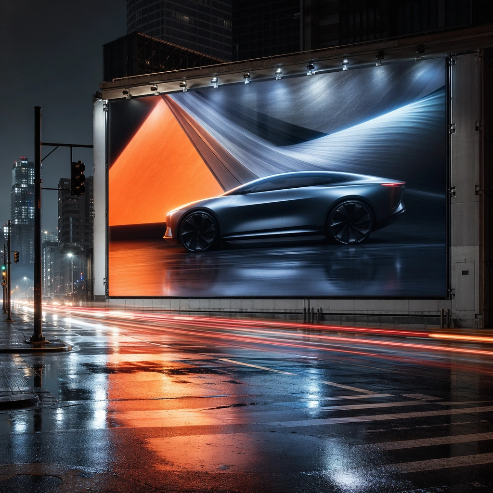

```text
Scene:
A square nighttime streetscape with one large illuminated billboard plane, wet reflections, controlled traffic traces, and premium city contrast. Compose the frame as a square key visual with disciplined camera placement, premium lighting control, and believable real-world scale. The tonal range should feel polished and intentional, with enough atmosphere to create depth without obscuring form. Keep contrast calibrated for launch, catalog, or research presentation use rather than casual snapshot aesthetics.

Subject:
Center an original vehicle hero artwork adapted onto a physical out-of-home display, plus the surrounding urban site context. Make the subject feel original, production-aware, and clearly grounded in New Car Launch Key Visual System. Treat this as an independent study that must feel complete and coherent without relying on any external reference image. The focal hierarchy should be immediate: primary form first, then material behavior, then supporting environmental cues that clarify use context and difficulty.

Important details:
Keep billboard content abstract and non-readable while the overall site feels plausible, premium, and useful for campaign planning. The mockup should sell placement quality and visual impact. The visual language should still feel native to New Car Launch Key Visual System, using disciplined industrial or campaign composition instead of generic stock photography. Use believable materials, engineering logic, and professional composition discipline. Reflections, shadows, edge breaks, texture scale, interface density, and small physical joints must all support realism. Avoid filler props, vague mood-board clutter, or any element that weakens the sense of a purpose-built industrial or automotive image.

Use case:
Car Launch single study 9/9 for New Car Launch Key Visual System, built as image support-five.

Constraints:
No readable text, no watermark, no logos, preserve exact 1:1 aspect ratio, no readable text, no logos, no badge lettering, no license plate numbers, no unrelated consumer clutter.
```

[Pinned source](https://github.com/ChaosRealmsAI/gpt-image-2-gallery/blob/5296db8c996e38776c83a0bc8c64f848dcd512b3/works/topics/new-car-launch-key-visual-system/packages/single-support-studies/images/support-five/meta.json) · GPT Image2 · 1024×1024 · No source-declared image dependencies. · ProjectD:[published and publicly accepted](https://aitoolsradar.com/en/prompts/c5b70d72136012)

## Tea House Launch · new-chinese-ink-poster/single-ink-poster-studies/02-tea-house-launch


```text
Scene:
A vertical 9:16 premium tea-brand launch poster, designed as a flat print on ivory rice paper. Keep the composition spacious, with roughly seventy percent quiet blank paper and a low-saturation palette of pale tea green, fog blue, charcoal ink, and faint warm gray. The poster should feel modern, expensive, and calm, with no photography frame and no decorative border.

Subject:
At the bottom left, a minimal ink silhouette of a mountain tea house sits beside a small reflective pond. Thin terraces climb into mist behind it, drawn with broken ink lines and diluted green wash. A single steam-like brushstroke rises upward, becoming part of the empty space. Place the readable Chinese title "云上问茶" in a small vertical block near the upper center-left, using refined modern calligraphic typography that is legible but not loud.

Important details:
The design must read as new Chinese commercial minimalism, not an old scroll reproduction. Typography, landscape, and blank space should form a clean hierarchy: title first, mist gesture second, tea house third. The tea house must be recognizable with a roofline, posts, and reflection, but it should stay tiny. Use one abstract red seal square without characters as a visual anchor. Do not add package copy, prices, dates, or brand logos.

Use case:
New Chinese Ink Poster single study 2/8, testing commercial tea-poster layout, small readable Chinese title, and disciplined negative space.

Constraints:
No readable text outside the specified Chinese title, no watermark, no logos, preserve exact 9:16 aspect ratio, no product package, no tea leaves close-up, no busy mountain village, no random seals, no illegible fake characters, no saturated gold luxury effects.
```

[Pinned source](https://github.com/ChaosRealmsAI/gpt-image-2-gallery/blob/5296db8c996e38776c83a0bc8c64f848dcd512b3/works/topics/new-chinese-ink-poster/packages/single-ink-poster-studies/images/02-tea-house-launch/meta.json) · GPT Image2 · 941×1672 · No source-declared image dependencies. · ProjectD:[published and publicly accepted](https://aitoolsradar.com/en/prompts/e81675743d9a9b)

## Residence Courtyard · new-chinese-ink-poster/single-ink-poster-studies/03-residence-courtyard


```text
Scene:
A vertical 9:16 real-estate cultural poster on pale gray-white textured paper, front-facing and gallery-clean. Use a low-saturation palette of mist blue, light stone gray, diluted ink, and subtle spring green. The top half must remain almost empty, while the lower half contains a calm architectural ink scene with enough breathing room for luxury positioning.

Subject:
A new Chinese courtyard residence is suggested with only a few precise elements: a white wall, dark tiled eave, moon gate, one pine branch, and a thin reflective water strip. Behind it, faint mountain silhouettes dissolve into pale wash. Place the readable Chinese title "山院有境" horizontally near the lower right, set in modern Song-style type with ample spacing and a quiet dark-ink tone. The title should feel like a property campaign headline without any brand mark.

Important details:
The poster must balance commercial mockup clarity with traditional ink restraint. Architecture should be elegant and minimal, not a detailed rendering. Keep the white wall and moon gate crisp enough to read, while the mountains stay atmospheric. No sales text, no phone numbers, no floor plans, and no logo. The title should be the only readable text, aligned cleanly to the geometry of the wall and waterline.

Use case:
New Chinese Ink Poster single study 3/8, testing real-estate poster structure, architectural minimalism, and controlled Chinese headline rendering.

Constraints:
No readable text outside the specified Chinese title, no watermark, no logos, preserve exact 9:16 aspect ratio, no people, no cars, no dense urban skyline, no ornate palace detail, no gold foil overload, no fake property data, no tilted perspective.
```

[Pinned source](https://github.com/ChaosRealmsAI/gpt-image-2-gallery/blob/5296db8c996e38776c83a0bc8c64f848dcd512b3/works/topics/new-chinese-ink-poster/packages/single-ink-poster-studies/images/03-residence-courtyard/meta.json) · GPT Image2 · 941×1672 · No source-declared image dependencies. · ProjectD:[published and publicly accepted](https://aitoolsradar.com/en/prompts/b56aca007b9160)

## Museum Night · new-chinese-ink-poster/single-ink-poster-studies/04-museum-night


```text
Scene:
A vertical 9:16 museum exhibition poster on cold white matte stock, composed with strong empty space and a refined night palette. Use ink black, mist blue, pale gray, and a very small amount of muted teal. The poster should feel like a contemporary cultural institution campaign, photographed flat with crisp paper edges and no visible wall or frame.

Subject:
A single ink-wash mountain ridge appears near the bottom, almost like a shadow. Above it floats a small moon reflected in a narrow lake band, leaving the majority of the poster open and silent. Place the readable Chinese title "墨山夜游" in a vertical column along the left third, using elegant high-contrast Chinese typography, stable baseline spacing, and dark gray ink. A tiny abstract red seal block may sit below the title, but it must contain no readable characters.

Important details:
The layout should show clear poster hierarchy without extra event details: title column, moon, lake reflection, ridge, and negative space. The mountain should be atmospheric rather than photorealistic; the moon should be subtle, not glowing like a fantasy planet. Preserve a premium museum tone, with precise margins and no crowded decoration. The title must be legible and not broken into random strokes.

Use case:
New Chinese Ink Poster single study 4/8, testing cultural poster hierarchy, night ink mood, and stable vertical Chinese title composition.

Constraints:
No readable text outside the specified Chinese title, no watermark, no logos, preserve exact 9:16 aspect ratio, no dates, no ticket prices, no museum emblem, no starry sky clutter, no neon glow, no heavy black background, no illegible calligraphy.
```

[Pinned source](https://github.com/ChaosRealmsAI/gpt-image-2-gallery/blob/5296db8c996e38776c83a0bc8c64f848dcd512b3/works/topics/new-chinese-ink-poster/packages/single-ink-poster-studies/images/04-museum-night/meta.json) · GPT Image2 · 941×1672 · No source-declared image dependencies. · ProjectD:[published and publicly accepted](https://aitoolsradar.com/en/prompts/8776a6f4f1e49c)

## Fragrance Bottle · new-chinese-ink-poster/single-ink-poster-studies/05-fragrance-bottle

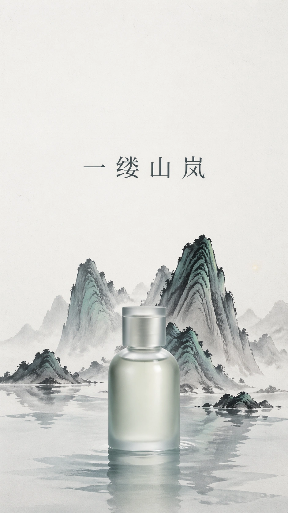

```text
Scene:
A vertical 9:16 luxury fragrance campaign poster printed on soft white paper, front-facing and minimal. Use a restrained palette of pale ink gray, mist blue, celadon green, and one extremely subtle warm highlight. The upper half should be almost empty, while the lower center holds a refined ink landscape and a small product-like silhouette without any brand identity.

Subject:
A translucent frosted glass fragrance bottle sits at the bottom center, simplified and unbranded, half emerging from a shallow ink lake. Behind it, a few steep ink mountains rise like a miniature stage set, with green mineral wash only on select ridges. Place the readable Chinese title "一缕山岚" horizontally above the bottle with careful modern Song-style letterforms, generous spacing, and a calm dark-gray tone. No other copy appears.

Important details:
This is a commercial mockup, but it must not become a logo advertisement. The bottle should be photoreal enough to show frosted glass, soft reflection, and a faint shadow on the paper, while the landscape remains ink-wash and flat. The title should align to the bottle axis without crowding it. Preserve sixty percent or more clean negative space, and make the transition between product object and painted lake feel elegant rather than surreal.

Use case:
New Chinese Ink Poster single study 5/8, testing luxury product-poster composition, restrained mixed media, and readable Chinese headline spacing.

Constraints:
No readable text outside the specified Chinese title, no watermark, no logos, preserve exact 9:16 aspect ratio, no brand label on the bottle, no barcode, no price copy, no ornate perfume cap, no saturated metallic gold, no cluttered floral background.
```

[Pinned source](https://github.com/ChaosRealmsAI/gpt-image-2-gallery/blob/5296db8c996e38776c83a0bc8c64f848dcd512b3/works/topics/new-chinese-ink-poster/packages/single-ink-poster-studies/images/05-fragrance-bottle/meta.json) · GPT Image2 · 941×1672 · No source-declared image dependencies. · ProjectD:[published and publicly accepted](https://aitoolsradar.com/en/prompts/1cc12f55ce9df1)

## Bamboo Rain · new-chinese-ink-poster/single-ink-poster-studies/06-bamboo-rain


```text
Scene:
A vertical 9:16 poster on cool off-white paper, designed with modern Chinese ink restraint and a rainy spring atmosphere. The page should be mostly blank, with thin vertical movement concentrated along the right edge and a low horizontal wash near the bottom. Use pale bamboo green, diluted ink black, fog blue, and light gray. The image must remain clean enough for a premium cultural brand poster.

Subject:
A sparse bamboo grove is suggested by five or six slender ink stalks and soft leaf clusters, leaving large open paper areas. Fine rain lines fall through the empty space but remain delicate, not noisy. A shallow lake wash at the bottom catches faint bamboo reflections. Place the readable Chinese title "听雨见竹" vertically near the left third, balanced against the bamboo on the right, using refined modern calligraphy with stable character shapes.

Important details:
The poster tests whether many fine lines can stay orderly in an extreme vertical composition. Rain, bamboo, title, and reflection must not merge into visual clutter. The Chinese title must remain the only readable text and should not look like random brush marks. Keep the luxury feeling through restraint: ample margins, balanced asymmetry, no decorative border, and one very small abstract red seal block without characters.

Use case:
New Chinese Ink Poster single study 6/8, testing fine-line ink structure, readable vertical Chinese type, and calm 9:16 negative-space control.

Constraints:
No readable text outside the specified Chinese title, no watermark, no logos, preserve exact 9:16 aspect ratio, no dense bamboo forest, no birds, no people, no storm clouds, no saturated emerald, no fake handwritten gibberish, no frame.
```

[Pinned source](https://github.com/ChaosRealmsAI/gpt-image-2-gallery/blob/5296db8c996e38776c83a0bc8c64f848dcd512b3/works/topics/new-chinese-ink-poster/packages/single-ink-poster-studies/images/06-bamboo-rain/meta.json) · GPT Image2 · 941×1672 · No source-declared image dependencies. · ProjectD:[published and publicly accepted](https://aitoolsradar.com/en/prompts/d39c39f131092c)

## Moon Bridge · new-chinese-ink-poster/single-ink-poster-studies/07-moon-bridge


```text
Scene:
A vertical 9:16 new Chinese ink poster on smooth rice-white paper, composed with a wide empty upper field and a quiet architectural scene near the lower third. Use low-saturation mist blue, pale gray, charcoal ink, and a small celadon accent. The poster should feel like a refined cultural travel campaign, but without any brand mark or destination logo.

Subject:
A single arched stone moon bridge crosses a narrow lake, drawn in minimal ink with softened edges and a faint mirrored reflection. Behind it, two distant mountains fade into mist and a small round moon hangs high in the open space. Place the readable Chinese title "月桥过水" horizontally below the moon but above the bridge, with elegant modern Song-style typography and exact spacing between the four characters.

Important details:
Keep the bridge simple and iconic, not a detailed tourist illustration. The open sky must remain mostly blank, with only the moon and title interrupting it. The title should be crisp, centered on a stable invisible grid, and the only readable text. The bridge reflection should align with the waterline, proving structured layout control. Add no explanatory copy; let the mountain, bridge, water, and title carry the poster.

Use case:
New Chinese Ink Poster single study 7/8, testing architectural ink iconography, centered Chinese headline rendering, and spacious vertical travel-poster composition.

Constraints:
No readable text outside the specified Chinese title, no watermark, no logos, preserve exact 9:16 aspect ratio, no tourists, no lantern festival clutter, no saturated sunset, no fake destination branding, no heavy border, no broken bridge reflection.
```

[Pinned source](https://github.com/ChaosRealmsAI/gpt-image-2-gallery/blob/5296db8c996e38776c83a0bc8c64f848dcd512b3/works/topics/new-chinese-ink-poster/packages/single-ink-poster-studies/images/07-moon-bridge/meta.json) · GPT Image2 · 941×1672 · No source-declared image dependencies. · ProjectD:[published and publicly accepted](https://aitoolsradar.com/en/prompts/489320622f4a7e)

## Snow Pavilion · new-chinese-ink-poster/single-ink-poster-studies/08-snow-pavilion

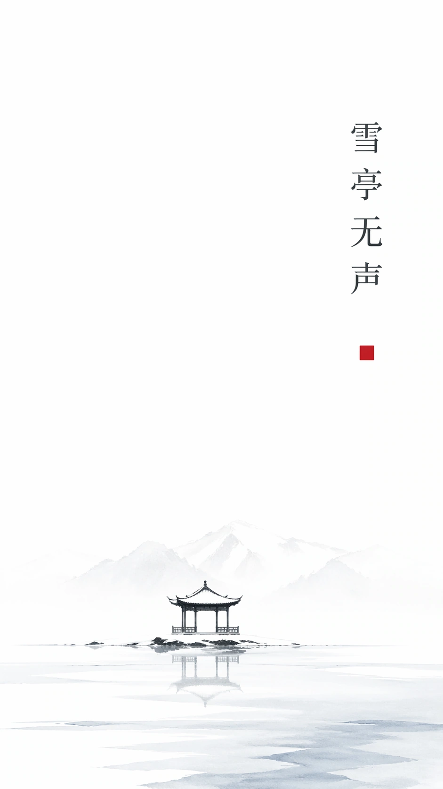

```text
Scene:
A vertical 9:16 winter ink poster on matte white paper, using extreme restraint and a cold low-saturation palette. Most of the page is untouched snow-white negative space, with pale ink gray and fog blue concentrated near the bottom. The lighting is even and quiet, like a premium seasonal cultural poster photographed straight-on for a design archive.

Subject:
A tiny lakeside pavilion sits in the lower center, drawn with a few black ink roof strokes and light gray posts. Snow-covered mountain shapes almost disappear behind it, and a narrow frozen lake reflects the pavilion with minimal detail. Place the readable Chinese title "雪亭无声" vertically near the upper right, using elegant dark-gray Song-style typography with ample spacing and exact character order.

Important details:
The poster must prove that minimal information can still feel complete. Snow is represented through blank paper, not white paint effects. The pavilion should be small but clear, the mountains nearly abstract, and the lake reflection calm. The Chinese title must stay crisp and readable, not broken into faux calligraphy. Keep the layout luxurious and quiet, with no extra copy, no logo, no decorative border, and only one small abstract red square without characters if needed for balance.

Use case:
New Chinese Ink Poster single study 8/8, testing extreme white-space control, winter ink mood, and clean vertical Chinese text rendering.

Constraints:
No readable text outside the specified Chinese title, no watermark, no logos, preserve exact 9:16 aspect ratio, no people, no animals, no heavy snowfall texture, no holiday decoration, no saturated red accents, no random calligraphy fragments, no picture frame.
```

[Pinned source](https://github.com/ChaosRealmsAI/gpt-image-2-gallery/blob/5296db8c996e38776c83a0bc8c64f848dcd512b3/works/topics/new-chinese-ink-poster/packages/single-ink-poster-studies/images/08-snow-pavilion/meta.json) · GPT Image2 · 941×1672 · No source-declared image dependencies. · ProjectD:[published and publicly accepted](https://aitoolsradar.com/en/prompts/9326acdea10f00)

## Print Proof Flatlay · new-wave-french-film-poster/single-poster-studies/02-print-proof-flatlay

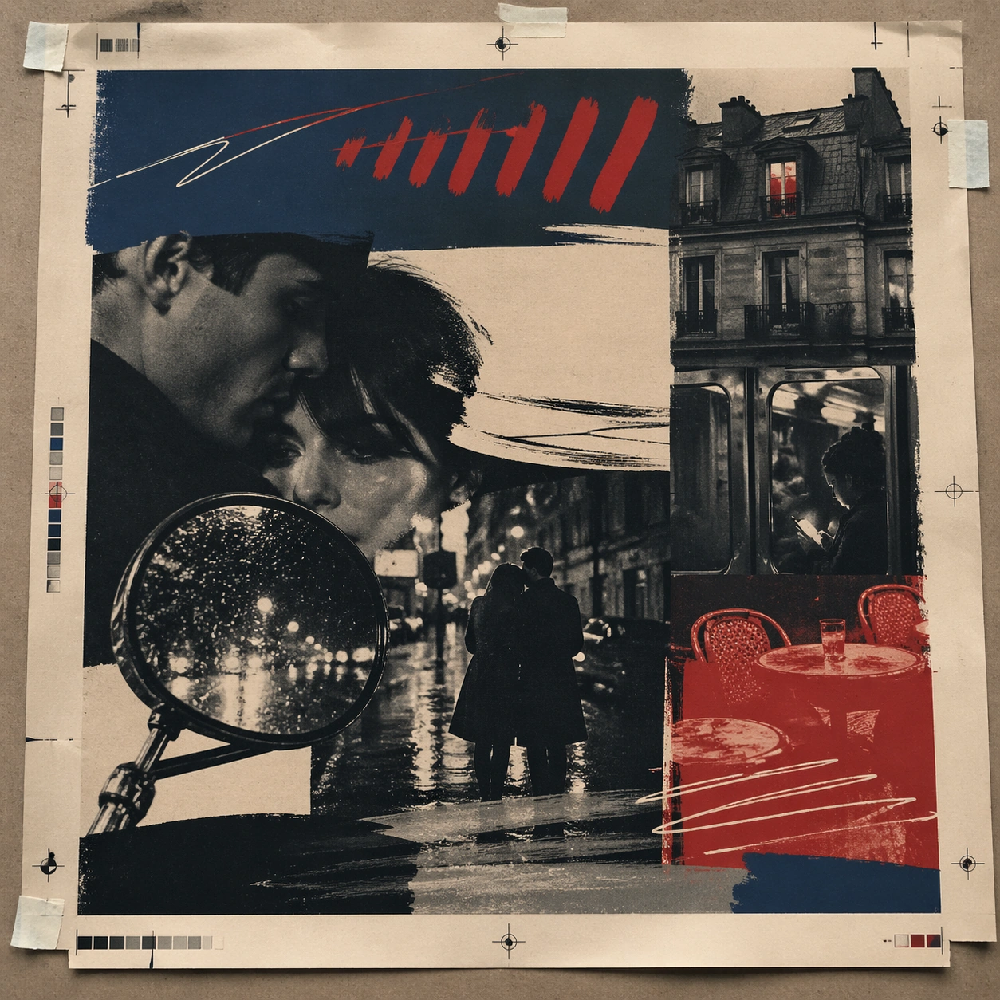

```text
Scene:
A square overhead tabletop photograph of a fresh poster proof on neutral worktable paper, lit by cool daylight, with crop marks, tape tabs, and slight paper bow visible around the sheet. The poster should express 1960s art-house poster grammar with radical photo crop, offset grain, hand-painted marks, and emotional empty space, using inky blue, carmine red, warm cream, charcoal, and cigarette-smoke gray and a tactile surface appropriate to the medium.

Subject:
Design the poster as a print-shop proof, preserving the same poster language while allowing production clues such as edge trims, registration targets, and process marks to frame the composition. Use street couples, scooter mirrors, apartment windows, rain-slick pavement, camera flash, and cafe tables as the main visual ingredients, and organize them with handwritten sweeps and sans blocks that feel gestural but stay non-readable. For the contemporary-subject axis, thread in a late-night metro ride and smartphone glow transformed into a melancholic art-house romance surface. The poster must feel like an original design object rather than a reproduction of any known work.

Important details:
The image must still read as a finished poster concept, but it should carry believable print-process evidence and material tactility instead of gallery-wall perfection. Preserve abrupt crop decisions, mood ambiguity, rough screen-print texture, and tension between photo and mark-making. Keep every letterform abstract and non-readable, as if it were a typographic texture rather than language. Make the style unmistakable through composition, palette, surface behavior, and symbolic compression. no blockbuster gloss, no readable credits, no hyper-polished skin retouching, no superhero spectacle.

Use case:
French New Wave single study 2/9, testing production realism and process evidence.

Constraints:
No readable text, no watermark, no logos, preserve exact 1:1 aspect ratio, no copyrighted characters, no real brand marks, no QR codes, no interface chrome, no accidental gibberish lettering.
```

[Pinned source](https://github.com/ChaosRealmsAI/gpt-image-2-gallery/blob/5296db8c996e38776c83a0bc8c64f848dcd512b3/works/topics/new-wave-french-film-poster/packages/single-poster-studies/images/02-print-proof-flatlay/meta.json) · GPT Image2 · 1254×1254 · No source-declared image dependencies. · ProjectD:[published and publicly accepted](https://aitoolsradar.com/en/prompts/abe629d2719823)

## Transit Lightbox · new-wave-french-film-poster/single-poster-studies/03-transit-lightbox

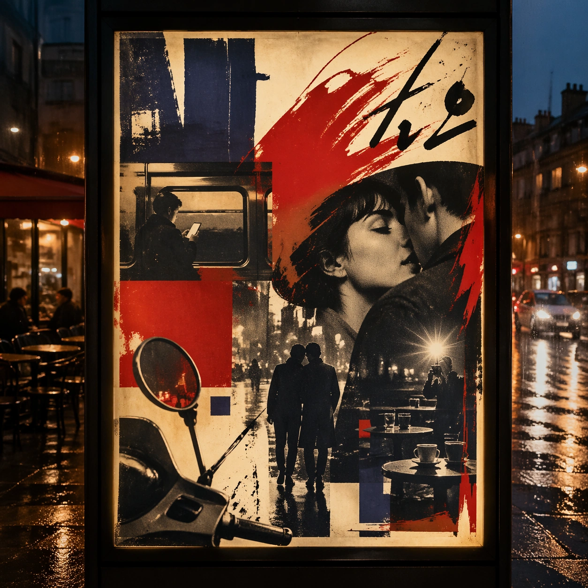

```text
Scene:
A square dusk street photograph of a backlit transit poster glowing inside glass, with faint rain reflections, soft city blur in the distance, and the poster remaining fully legible as a composition. The poster should express 1960s art-house poster grammar with radical photo crop, offset grain, hand-painted marks, and emotional empty space, using inky blue, carmine red, warm cream, charcoal, and cigarette-smoke gray and a tactile surface appropriate to the medium.

Subject:
Adapt the poster into a public-facing lightbox version that still honors the original style grammar while feeling bold enough to stop a passerby from several meters away. Use street couples, scooter mirrors, apartment windows, rain-slick pavement, camera flash, and cafe tables as the main visual ingredients, and organize them with handwritten sweeps and sans blocks that feel gestural but stay non-readable. For the contemporary-subject axis, thread in a late-night metro ride and smartphone glow transformed into a melancholic art-house romance surface. The poster must feel like an original design object rather than a reproduction of any known work.

Important details:
Let the style survive the illumination test: color blocking, silhouette contrast, and abstract lettering should stay controlled under bright internal light and reflective glass. Preserve abrupt crop decisions, mood ambiguity, rough screen-print texture, and tension between photo and mark-making. Keep every letterform abstract and non-readable, as if it were a typographic texture rather than language. Make the style unmistakable through composition, palette, surface behavior, and symbolic compression. no blockbuster gloss, no readable credits, no hyper-polished skin retouching, no superhero spectacle.

Use case:
French New Wave single study 3/9, testing distance readability in public display.

Constraints:
No readable text, no watermark, no logos, preserve exact 1:1 aspect ratio, no copyrighted characters, no real brand marks, no QR codes, no interface chrome, no accidental gibberish lettering.
```

[Pinned source](https://github.com/ChaosRealmsAI/gpt-image-2-gallery/blob/5296db8c996e38776c83a0bc8c64f848dcd512b3/works/topics/new-wave-french-film-poster/packages/single-poster-studies/images/03-transit-lightbox/meta.json) · GPT Image2 · 1254×1254 · No source-declared image dependencies. · ProjectD:[published and publicly accepted](https://aitoolsradar.com/en/prompts/0c4c1a0054d7ee)

## Wheatpaste Wall Layer · new-wave-french-film-poster/single-poster-studies/04-wheatpaste-wall

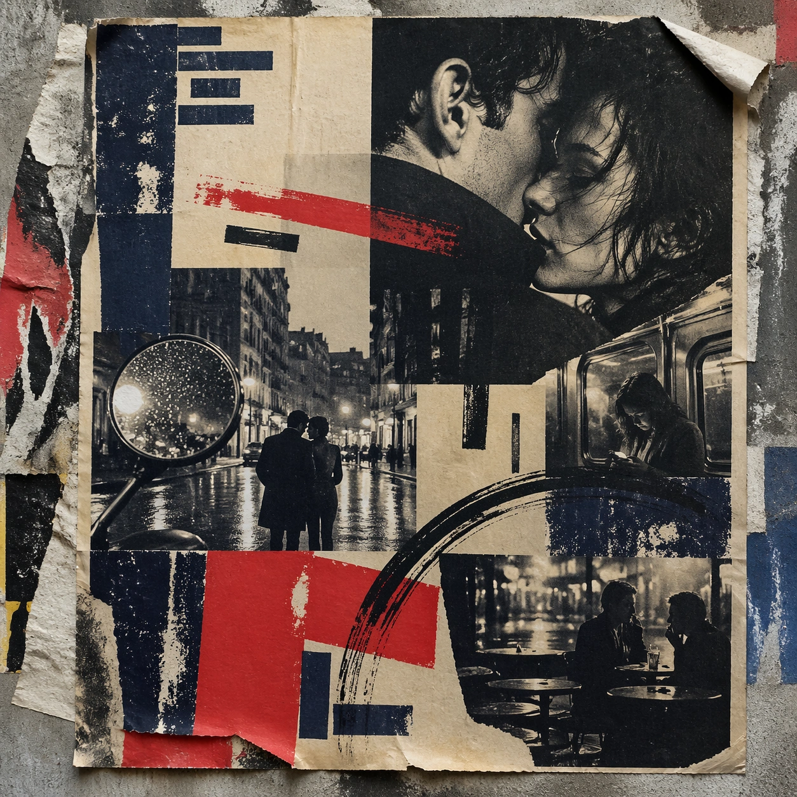

```text
Scene:
A square urban wall study with the poster pasted onto rough plaster among torn edges and older paper remnants, photographed in soft overcast light so texture, glue bubbles, and surface scars stay visible. The poster should express 1960s art-house poster grammar with radical photo crop, offset grain, hand-painted marks, and emotional empty space, using inky blue, carmine red, warm cream, charcoal, and cigarette-smoke gray and a tactile surface appropriate to the medium.

Subject:
Create a version that feels made for the street, with the poster carrying enough formal force to survive abrasion, layering, and imperfect placement without losing its visual identity. Use street couples, scooter mirrors, apartment windows, rain-slick pavement, camera flash, and cafe tables as the main visual ingredients, and organize them with handwritten sweeps and sans blocks that feel gestural but stay non-readable. For the contemporary-subject axis, thread in a late-night metro ride and smartphone glow transformed into a melancholic art-house romance surface. The poster must feel like an original design object rather than a reproduction of any known work.

Important details:
Keep the main design intact but let the environment add grit: lifted corners, tiny tears, wrinkled paper, and older color fragments around the perimeter should amplify the style rather than dilute it. Preserve abrupt crop decisions, mood ambiguity, rough screen-print texture, and tension between photo and mark-making. Keep every letterform abstract and non-readable, as if it were a typographic texture rather than language. Make the style unmistakable through composition, palette, surface behavior, and symbolic compression. no blockbuster gloss, no readable credits, no hyper-polished skin retouching, no superhero spectacle.

Use case:
French New Wave single study 4/9, testing street-life durability and layered context.

Constraints:
No readable text, no watermark, no logos, preserve exact 1:1 aspect ratio, no copyrighted characters, no real brand marks, no QR codes, no interface chrome, no accidental gibberish lettering.
```

[Pinned source](https://github.com/ChaosRealmsAI/gpt-image-2-gallery/blob/5296db8c996e38776c83a0bc8c64f848dcd512b3/works/topics/new-wave-french-film-poster/packages/single-poster-studies/images/04-wheatpaste-wall/meta.json) · GPT Image2 · 1254×1254 · No source-declared image dependencies. · ProjectD:[published and publicly accepted](https://aitoolsradar.com/en/prompts/a26439f3bbf428)

## Folded Archive Copy · new-wave-french-film-poster/single-poster-studies/05-folded-archive-copy

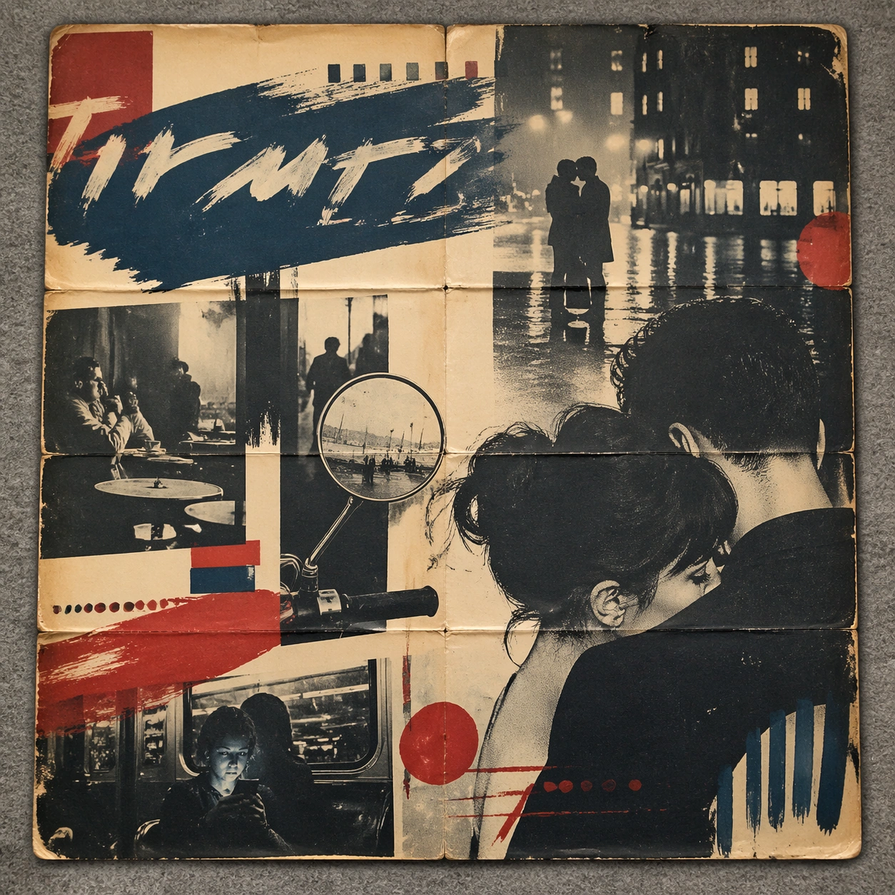

```text
Scene:
A square conservation-table view of a vintage poster laid on gray felt under raking light, with visible fold lines, softened corners, and subtle aging that still preserves the integrity of the image. The poster should express 1960s art-house poster grammar with radical photo crop, offset grain, hand-painted marks, and emotional empty space, using inky blue, carmine red, warm cream, charcoal, and cigarette-smoke gray and a tactile surface appropriate to the medium.

Subject:
Present the poster as an archive copy that has been stored, unfolded, and carefully documented, letting age and handling reveal how the design holds up across time. Use street couples, scooter mirrors, apartment windows, rain-slick pavement, camera flash, and cafe tables as the main visual ingredients, and organize them with handwritten sweeps and sans blocks that feel gestural but stay non-readable. For the contemporary-subject axis, thread in a late-night metro ride and smartphone glow transformed into a melancholic art-house romance surface. The poster must feel like an original design object rather than a reproduction of any known work.

Important details:
Aging must stay believable rather than theatrical: slight yellowing, fold memory, edge wear, and pigment variation should support the historical or crafted feeling of the style. Preserve abrupt crop decisions, mood ambiguity, rough screen-print texture, and tension between photo and mark-making. Keep every letterform abstract and non-readable, as if it were a typographic texture rather than language. Make the style unmistakable through composition, palette, surface behavior, and symbolic compression. no blockbuster gloss, no readable credits, no hyper-polished skin retouching, no superhero spectacle.

Use case:
French New Wave single study 5/9, testing archival endurance and age character.

Constraints:
No readable text, no watermark, no logos, preserve exact 1:1 aspect ratio, no copyrighted characters, no real brand marks, no QR codes, no interface chrome, no accidental gibberish lettering.
```

[Pinned source](https://github.com/ChaosRealmsAI/gpt-image-2-gallery/blob/5296db8c996e38776c83a0bc8c64f848dcd512b3/works/topics/new-wave-french-film-poster/packages/single-poster-studies/images/05-folded-archive-copy/meta.json) · GPT Image2 · 1254×1254 · No source-declared image dependencies. · ProjectD:[published and publicly accepted](https://aitoolsradar.com/en/prompts/3be0a0b07ab5e1)

## Twin Poster Diptych · new-wave-french-film-poster/single-poster-studies/06-twin-poster-diptych

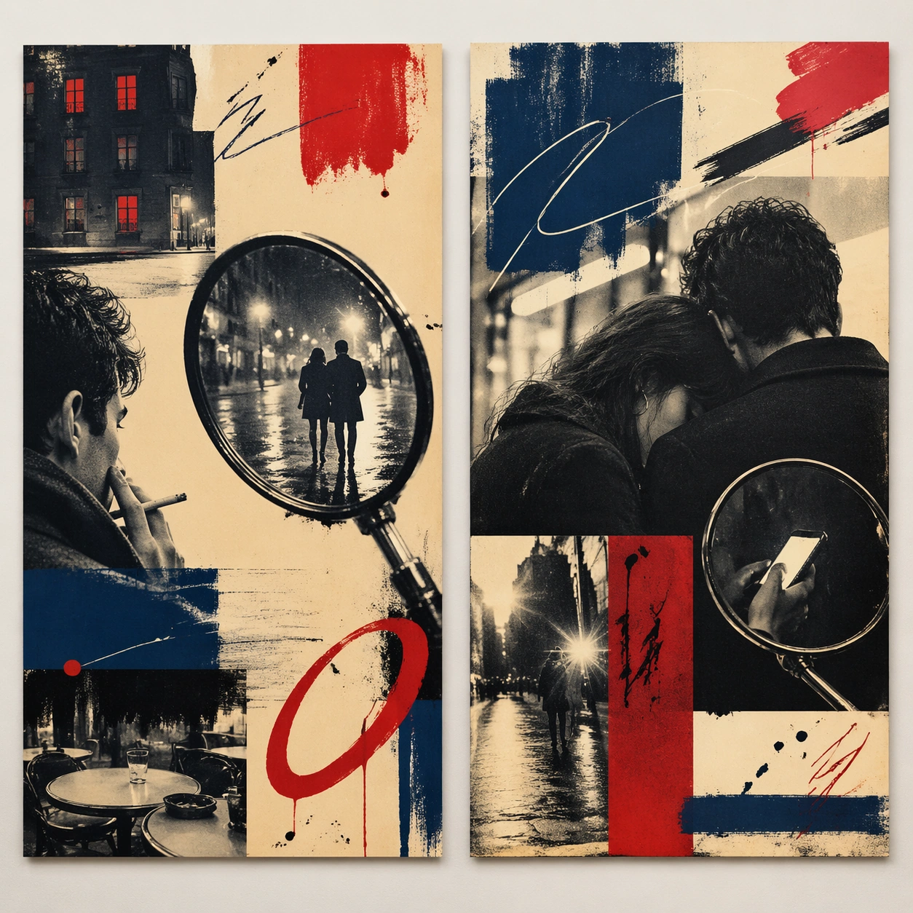

```text
Scene:
A square white-wall installation showing two companion posters hung side by side with equal spacing, photographed frontally so the pair reads as a designed conversation rather than two unrelated sheets. The poster should express 1960s art-house poster grammar with radical photo crop, offset grain, hand-painted marks, and emotional empty space, using inky blue, carmine red, warm cream, charcoal, and cigarette-smoke gray and a tactile surface appropriate to the medium.

Subject:
Compose a matched diptych: two posters sharing one style system while splitting the narrative across paired motifs, mirrored masses, or complementary color emphasis. Use street couples, scooter mirrors, apartment windows, rain-slick pavement, camera flash, and cafe tables as the main visual ingredients, and organize them with handwritten sweeps and sans blocks that feel gestural but stay non-readable. For the contemporary-subject axis, thread in a late-night metro ride and smartphone glow transformed into a melancholic art-house romance surface. The poster must feel like an original design object rather than a reproduction of any known work.

Important details:
Both halves should feel distinct yet inseparable. Preserve one coherent visual language, but let each sheet carry its own focal symbol and rhythm without readable wording. Preserve abrupt crop decisions, mood ambiguity, rough screen-print texture, and tension between photo and mark-making. Keep every letterform abstract and non-readable, as if it were a typographic texture rather than language. Make the style unmistakable through composition, palette, surface behavior, and symbolic compression. no blockbuster gloss, no readable credits, no hyper-polished skin retouching, no superhero spectacle.

Use case:
French New Wave single study 6/9, testing system flexibility across a paired set.

Constraints:
No readable text, no watermark, no logos, preserve exact 1:1 aspect ratio, no copyrighted characters, no real brand marks, no QR codes, no interface chrome, no accidental gibberish lettering.
```

[Pinned source](https://github.com/ChaosRealmsAI/gpt-image-2-gallery/blob/5296db8c996e38776c83a0bc8c64f848dcd512b3/works/topics/new-wave-french-film-poster/packages/single-poster-studies/images/06-twin-poster-diptych/meta.json) · GPT Image2 · 1254×1254 · No source-declared image dependencies. · ProjectD:[published and publicly accepted](https://aitoolsradar.com/en/prompts/1e0f5e6e8e5e25)

## Stacked Print Bundle · new-wave-french-film-poster/single-poster-studies/07-stacked-print-bundle

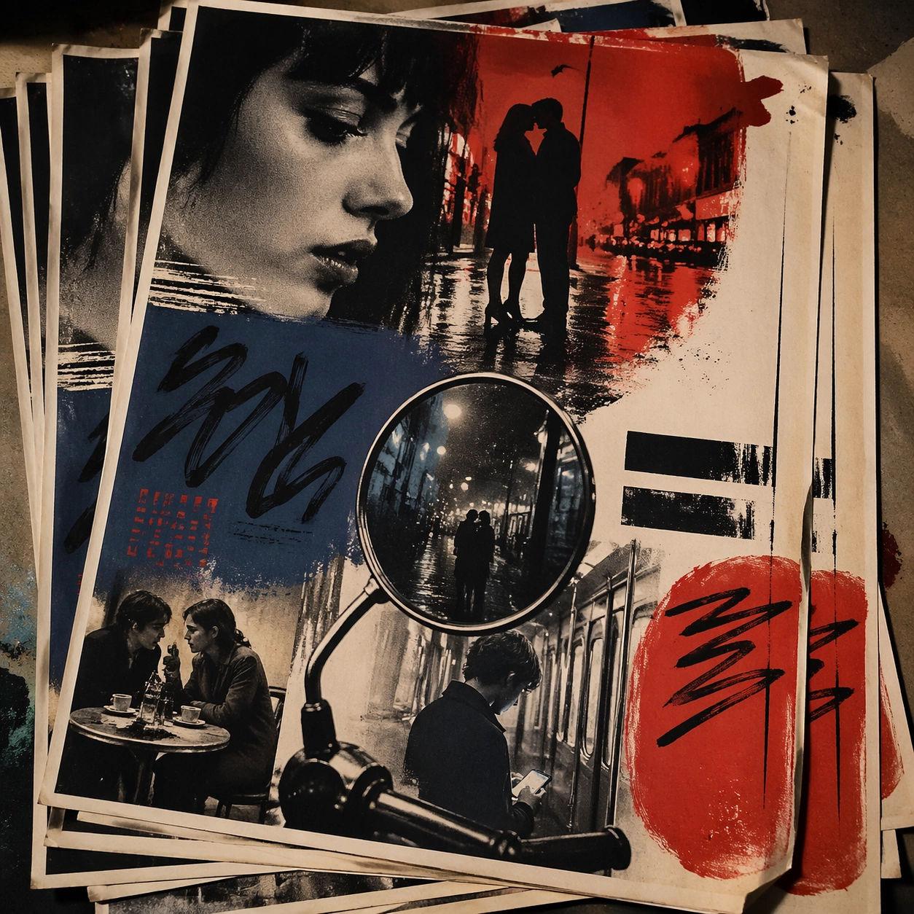

```text
Scene:
A square tabletop shot of several poster prints stacked and slightly fanned, with curled corners, offset edges, and soft directional light revealing paper thickness and ink behavior. The poster should express 1960s art-house poster grammar with radical photo crop, offset grain, hand-painted marks, and emotional empty space, using inky blue, carmine red, warm cream, charcoal, and cigarette-smoke gray and a tactile surface appropriate to the medium.

Subject:
Design the top poster to dominate while nearby duplicate sheets echo the same composition, creating a tactile print-run scene rather than a single isolated sheet. Use street couples, scooter mirrors, apartment windows, rain-slick pavement, camera flash, and cafe tables as the main visual ingredients, and organize them with handwritten sweeps and sans blocks that feel gestural but stay non-readable. For the contemporary-subject axis, thread in a late-night metro ride and smartphone glow transformed into a melancholic art-house romance surface. The poster must feel like an original design object rather than a reproduction of any known work.

Important details:
Use the stack to emphasize production character: edge shadows, repeated motifs peeking from beneath, and subtle misalignment should enrich the material reading without changing the core design. Preserve abrupt crop decisions, mood ambiguity, rough screen-print texture, and tension between photo and mark-making. Keep every letterform abstract and non-readable, as if it were a typographic texture rather than language. Make the style unmistakable through composition, palette, surface behavior, and symbolic compression. no blockbuster gloss, no readable credits, no hyper-polished skin retouching, no superhero spectacle.

Use case:
French New Wave single study 7/9, testing print-run tactility and repeat presence.

Constraints:
No readable text, no watermark, no logos, preserve exact 1:1 aspect ratio, no copyrighted characters, no real brand marks, no QR codes, no interface chrome, no accidental gibberish lettering.
```

[Pinned source](https://github.com/ChaosRealmsAI/gpt-image-2-gallery/blob/5296db8c996e38776c83a0bc8c64f848dcd512b3/works/topics/new-wave-french-film-poster/packages/single-poster-studies/images/07-stacked-print-bundle/meta.json) · GPT Image2 · 1254×1254 · No source-declared image dependencies. · ProjectD:[published and publicly accepted](https://aitoolsradar.com/en/prompts/140ee535cf479d)

## Kiosk Night Glow · new-wave-french-film-poster/single-poster-studies/08-kiosk-night-glow

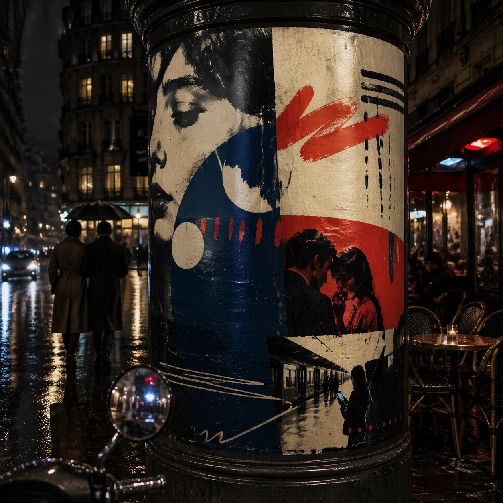

```text
Scene:
A square nighttime city view with the poster wrapping part of a cylindrical kiosk, wet pavement reflecting nearby light, and the composition holding together under moody urban illumination. The poster should express 1960s art-house poster grammar with radical photo crop, offset grain, hand-painted marks, and emotional empty space, using inky blue, carmine red, warm cream, charcoal, and cigarette-smoke gray and a tactile surface appropriate to the medium.

Subject:
Reframe the design for a dramatic street-placement context, where the poster has to project style and mood through reflection, curvature, and surrounding darkness. Use street couples, scooter mirrors, apartment windows, rain-slick pavement, camera flash, and cafe tables as the main visual ingredients, and organize them with handwritten sweeps and sans blocks that feel gestural but stay non-readable. For the contemporary-subject axis, thread in a late-night metro ride and smartphone glow transformed into a melancholic art-house romance surface. The poster must feel like an original design object rather than a reproduction of any known work.

Important details:
The design should remain instantly recognizable despite the cylindrical wrap. Preserve major blocks, symbolic shapes, and abstract title forms so the style still feels authoritative at night. Preserve abrupt crop decisions, mood ambiguity, rough screen-print texture, and tension between photo and mark-making. Keep every letterform abstract and non-readable, as if it were a typographic texture rather than language. Make the style unmistakable through composition, palette, surface behavior, and symbolic compression. no blockbuster gloss, no readable credits, no hyper-polished skin retouching, no superhero spectacle.

Use case:
French New Wave single study 8/9, testing atmospheric display under rain and glow.

Constraints:
No readable text, no watermark, no logos, preserve exact 1:1 aspect ratio, no copyrighted characters, no real brand marks, no QR codes, no interface chrome, no accidental gibberish lettering.
```

[Pinned source](https://github.com/ChaosRealmsAI/gpt-image-2-gallery/blob/5296db8c996e38776c83a0bc8c64f848dcd512b3/works/topics/new-wave-french-film-poster/packages/single-poster-studies/images/08-kiosk-night-glow/meta.json) · GPT Image2 · 1254×1254 · No source-declared image dependencies. · ProjectD:[published and publicly accepted](https://aitoolsradar.com/en/prompts/348461d6777685)

## Contemporary Remix · new-wave-french-film-poster/single-poster-studies/09-contemporary-remix

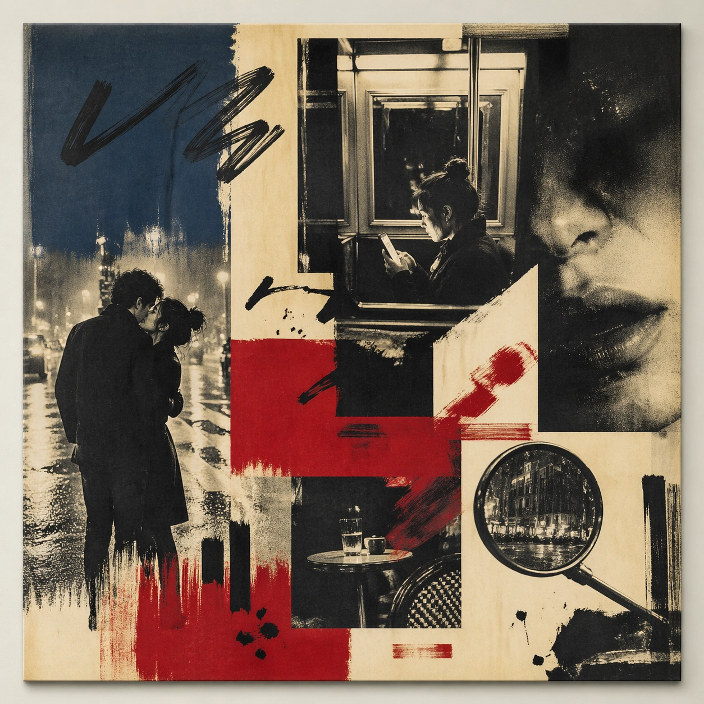

```text
Scene:
A square front-facing poster presentation on a clean neutral wall, lit like a premium print test, with crisp edges and a polished but still tactile finish appropriate to the style. The poster should express 1960s art-house poster grammar with radical photo crop, offset grain, hand-painted marks, and emotional empty space, using inky blue, carmine red, warm cream, charcoal, and cigarette-smoke gray and a tactile surface appropriate to the medium.

Subject:
Apply the historical poster language to a contemporary urban subject so the old visual grammar proves it can carry present-day themes without losing authenticity or formal discipline. Use street couples, scooter mirrors, apartment windows, rain-slick pavement, camera flash, and cafe tables as the main visual ingredients, and organize them with handwritten sweeps and sans blocks that feel gestural but stay non-readable. For the contemporary-subject axis, thread in a late-night metro ride and smartphone glow transformed into a melancholic art-house romance surface. The poster must feel like an original design object rather than a reproduction of any known work.

Important details:
This is not parody. The contemporary subject should feel genuinely absorbed into the style through palette, composition, symbolic compression, and non-readable lettering treatment. Preserve abrupt crop decisions, mood ambiguity, rough screen-print texture, and tension between photo and mark-making. Keep every letterform abstract and non-readable, as if it were a typographic texture rather than language. Make the style unmistakable through composition, palette, surface behavior, and symbolic compression. no blockbuster gloss, no readable credits, no hyper-polished skin retouching, no superhero spectacle.

Use case:
French New Wave single study 9/9, testing historical grammar on a present-day subject.

Constraints:
No readable text, no watermark, no logos, preserve exact 1:1 aspect ratio, no copyrighted characters, no real brand marks, no QR codes, no interface chrome, no accidental gibberish lettering.
```

[Pinned source](https://github.com/ChaosRealmsAI/gpt-image-2-gallery/blob/5296db8c996e38776c83a0bc8c64f848dcd512b3/works/topics/new-wave-french-film-poster/packages/single-poster-studies/images/09-contemporary-remix/meta.json) · GPT Image2 · 1254×1254 · No source-declared image dependencies. · ProjectD:[published and publicly accepted](https://aitoolsradar.com/en/prompts/2c35689b226bd5)

## Fresh Desk Anchor · new-year-renewal-campaign-family/series-renewal-rollout/01-fresh-desk-anchor

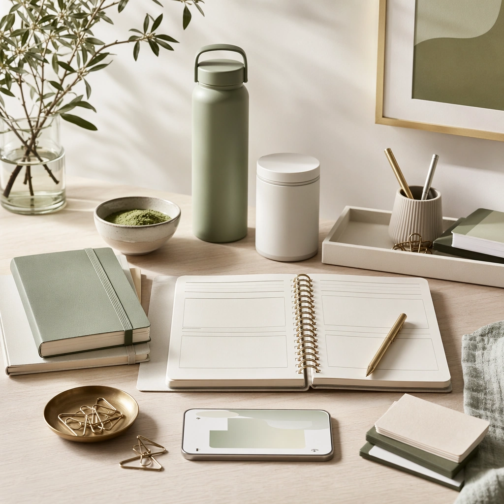

```text
Scene:
Create a square premium New Year campaign image filled with clean morning light, pale neutrals, soft green accents, and optimistic metallic details. The environment should feel like a polished reset moment rather than a party aftermath. Use an organized desk or lifestyle surface with depth, clarity, and enough spatial breathing room that the image can anchor a fresh-cycle campaign for brands focused on progress, structure, and new beginnings.

Subject:
Center a disciplined arrangement of planner-like materials without readable text, healthy product silhouettes, tidy containers, a phone or device-like object with abstract interface glow, and a few lifestyle cues that suggest ambition and reset. The objects should feel aspirational but practical, blending home, wellness, and productivity into one coherent New Year visual language rather than one narrow category.

Important details:
Lock the renewal grammar here: bright natural light, calm neutrals, soft green and brass accents, precise organization, and an atmosphere of achievable progress. Keep surfaces premium and modern, with believable materials and a balance between warmth and order. This anchor should feel reusable across fitness, home, learning, finance, and planning brands without losing its specific New Year reset energy.

Use case:
New Year Renewal series study 1/9.

Constraints:
No readable text, no watermark, no logos, preserve exact 1:1 aspect ratio, no fireworks, no party confetti, no readable planner text, no champagne cues, no overcrowded desk, no logo devices, no messy cables, no calendar numerals.
```

[Pinned source](https://github.com/ChaosRealmsAI/gpt-image-2-gallery/blob/5296db8c996e38776c83a0bc8c64f848dcd512b3/works/topics/new-year-renewal-campaign-family/packages/series-renewal-rollout/images/01-fresh-desk-anchor/meta.json) · GPT Image2 · 1024×1024 · No source-declared image dependencies. · ProjectD:[published and publicly accepted](https://aitoolsradar.com/en/prompts/ee7fe8bee0dd2a)

## Fitness Reset Variation · new-year-renewal-campaign-family/series-renewal-rollout/02-fitness-reset-variation

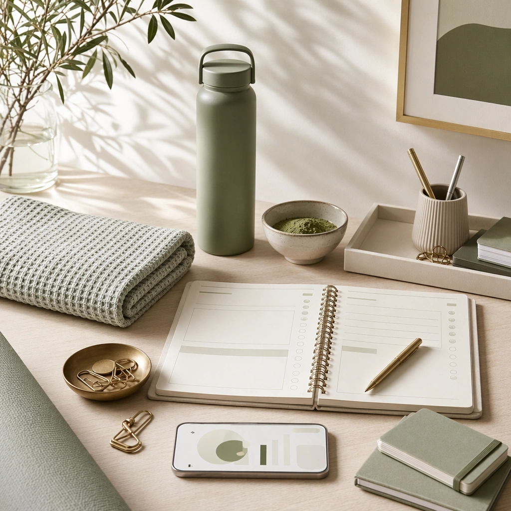

```text
Scene:
Create a square dependent campaign image in the exact same bright morning environment, with identical fresh neutrals, soft green accents, and disciplined surface styling from the reference image, but reframe slightly to introduce a wellness or movement emphasis. The image should still feel like part of the same campaign shoot, preserving the calm optimism of the anchor while shifting toward a more active reset story.

Subject:
Feature clean fitness-adjacent objects such as a towel, bottle, mat edge, neatly arranged essentials, and abstract planning or progress cues without readable text. Preserve the exact material language, light direction, and organized optimism from the reference model while changing the category focus to fitness renewal. The objects should feel premium, realistic, and highly reusable for a New Year wellness campaign.

Important details:
Preserve exact campaign identity from the reference image: same lighting, same palette, same surface cleanliness, and the same balance between aspiration and practicality. The scene should signal movement and habit formation through object choice and composition, not through slogans. Keep everything believable, minimal, and commercially sharp, with no generic gym clichés or overcharged sports styling.

Use case:
New Year Renewal series study 2/9.

Constraints:
No readable text, no watermark, no logos, preserve exact 1:1 aspect ratio, preserve exact campaign identity from the reference image, no readable app screens, no visible people, no dumbbells dominating frame, no neon gym light, no logos, no sweat drama, no party leftovers.
```

[Pinned source](https://github.com/ChaosRealmsAI/gpt-image-2-gallery/blob/5296db8c996e38776c83a0bc8c64f848dcd512b3/works/topics/new-year-renewal-campaign-family/packages/series-renewal-rollout/images/02-fitness-reset-variation/meta.json) · GPT Image2 · 1024×1024 · Reference images required. · ProjectD:[published and publicly accepted](https://aitoolsradar.com/en/prompts/7197bbb9ae8f2f)

## Home Reset Variation · new-year-renewal-campaign-family/series-renewal-rollout/03-home-reset-variation

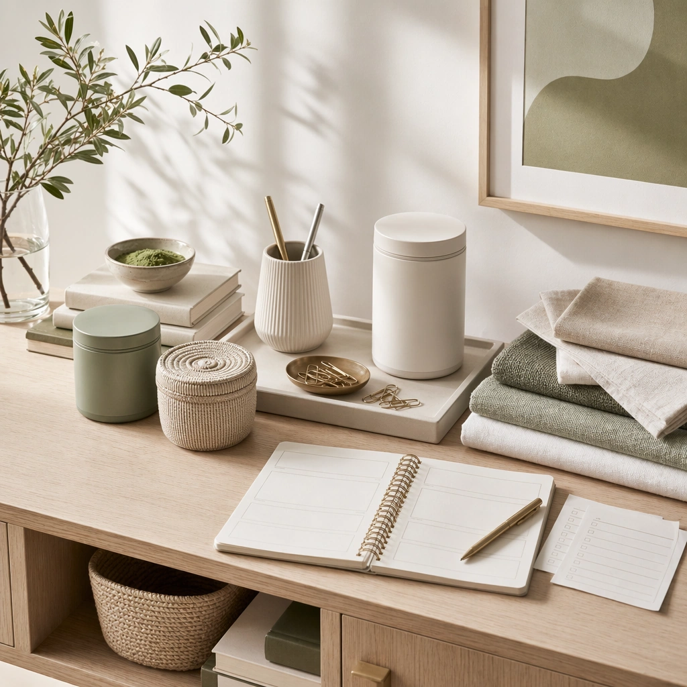

```text
Scene:
Create a square dependent image that remains in the same clean morning-lit environment, with the same pale palette, green accents, and polished organization from the reference image, but widen the composition to suggest a home-reset surface. The frame should still read as part of one campaign family while becoming more domestic and storage-oriented through subtle environmental cues.

Subject:
Show tidy storage vessels, folded textiles, a tray, plant or ceramic accents, and a few abstract planning or checklist cues with no readable language. Preserve exact visual identity from the reference image while changing the emphasis toward decluttering and home refresh. The scene should feel elevated, practical, and commercially applicable to home goods, organizational products, or wellness-adjacent brands.

Important details:
Continuity matters more than novelty. Keep the same calm optimism, the same light temperature, the same spacing discipline, and the same refined material palette from the reference model. Make storage and reset feel aspirational through order and texture rather than through staged perfection or unrealistic emptiness. The final image should behave like a reusable New Year home-refresh hero asset.

Use case:
New Year Renewal series study 3/9.

Constraints:
No readable text, no watermark, no logos, preserve exact 1:1 aspect ratio, preserve exact campaign identity from the reference image, no readable labels, no moving-box chaos, no family photo frames, no logos, no maximalist décor, no dark moody lighting, no party debris.
```

[Pinned source](https://github.com/ChaosRealmsAI/gpt-image-2-gallery/blob/5296db8c996e38776c83a0bc8c64f848dcd512b3/works/topics/new-year-renewal-campaign-family/packages/series-renewal-rollout/images/03-home-reset-variation/meta.json) · GPT Image2 · 1024×1024 · Reference images required. · ProjectD:[published and publicly accepted](https://aitoolsradar.com/en/prompts/6aae852ae54c7b)

## Learning Planner Variation · new-year-renewal-campaign-family/series-renewal-rollout/04-learning-planner-variation

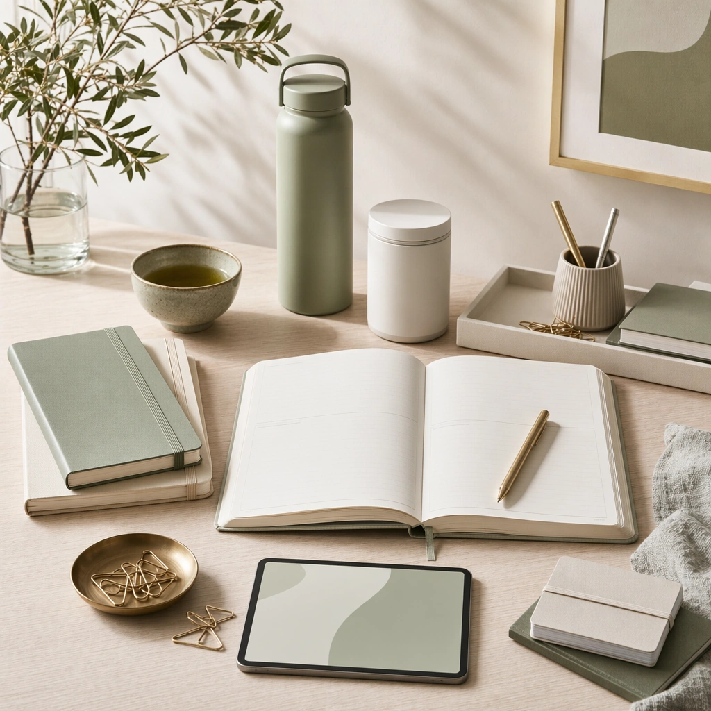

```text
Scene:
Create a square dependent campaign image within the same bright reset environment, preserving the exact morning light, pale neutrals, and quietly optimistic styling from the reference image, while shifting the composition toward learning and goal setting. Keep the space airy and precise, as if it were another deliverable from the same production day, with strong commercial polish and a clear premium-stationery feel.

Subject:
Feature notebooks without readable text, tidy pens, a device-like object, clean desk tools, and small ritual cues such as tea, glass, or plant life that support a learning reset story. Preserve exact palette blocking, material behavior, and compositional discipline from the reference image while changing the category emphasis. The arrangement should feel useful for education, productivity, or planning-led New Year campaigns.

Important details:
Hold continuity tightly. The difference should come from the tools of intention, not from a new aesthetic. Keep paper stock, pen finishes, ceramic texture, glass reflections, and soft daylight highly believable. The final result should communicate focus, structure, and fresh momentum without relying on readable resolutions, calendars, or motivational text.

Use case:
New Year Renewal series study 4/9.

Constraints:
No readable text, no watermark, no logos, preserve exact 1:1 aspect ratio, preserve exact campaign identity from the reference image, no readable notes, no visible year numerals, no party décor, no logo laptop, no messy desk, no dramatic night light, no academic classroom setting.
```

[Pinned source](https://github.com/ChaosRealmsAI/gpt-image-2-gallery/blob/5296db8c996e38776c83a0bc8c64f848dcd512b3/works/topics/new-year-renewal-campaign-family/packages/series-renewal-rollout/images/04-learning-planner-variation/meta.json) · GPT Image2 · 1024×1024 · Reference images required. · ProjectD:[published and publicly accepted](https://aitoolsradar.com/en/prompts/a6e044e7d69e1f)

## Organized Pantry Reset · new-year-renewal-campaign-family/single-fresh-cycle-studies/organized-pantry-reset

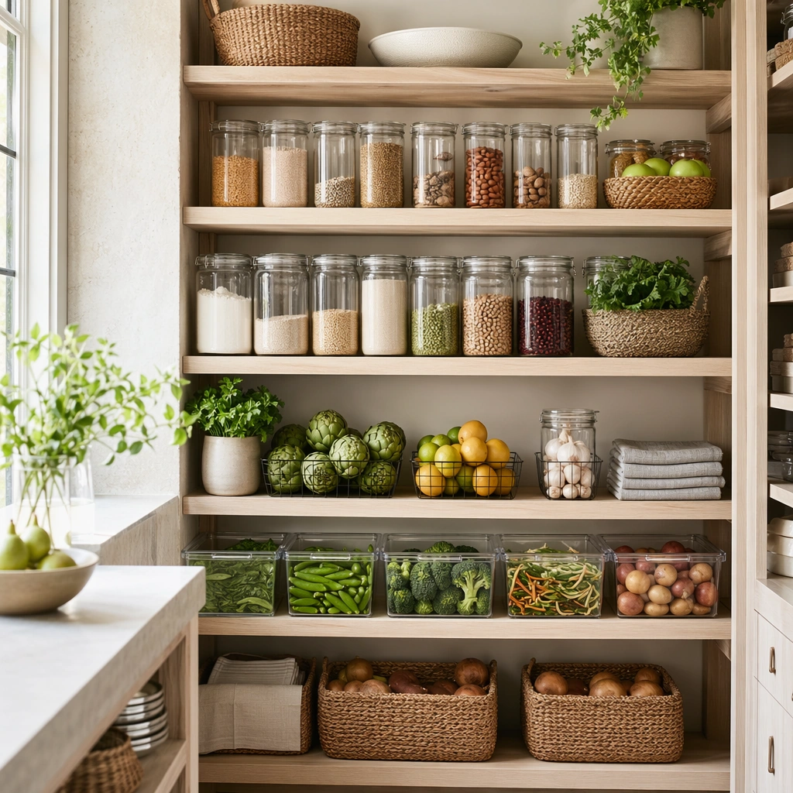

```text
Scene:
Create a square kitchen or pantry image with crisp daylight, tidy shelving, pale natural materials, and a fresh practical mood. The frame should feel like a campaign asset for organization, meal prep, or healthy routine, not a cookbook shot. Keep composition clean and balanced, with strong visual order and a believable domestic scale that supports New Year reset storytelling.

Subject:
Show neatly arranged jars without readable labels, fresh produce, folded linens, trays, and storage pieces organized into a persuasive pantry reset scene. The objects should imply discipline, nourishment, and a calmer household rhythm. Focus on cleanliness and planning through arrangement rather than on visible people or inspirational text.

Important details:
Surface logic matters: glass thickness, produce freshness, shelf materials, linen texture, and daylight should all read clearly. Avoid perfection so severe that the scene becomes lifeless, but keep enough order that the image carries a strong reset message. This should feel useful for grocery, home, appliance, or wellness-adjacent New Year campaigns.

Use case:
New Year Renewal single study 6/9.

Constraints:
No readable text, no watermark, no logos, preserve exact 1:1 aspect ratio, no readable labels, no family photos, no brand packaging, no chaotic grocery spill, no holiday leftovers, no neon food colors, no crowded kitchen tools, no visible recipe text.
```

[Pinned source](https://github.com/ChaosRealmsAI/gpt-image-2-gallery/blob/5296db8c996e38776c83a0bc8c64f848dcd512b3/works/topics/new-year-renewal-campaign-family/packages/single-fresh-cycle-studies/images/organized-pantry-reset/meta.json) · GPT Image2 · 1024×1024 · No source-declared image dependencies. · ProjectD:[published and publicly accepted](https://aitoolsradar.com/en/prompts/49049b14bfc3f4)

## Goal Board Object Study · new-year-renewal-campaign-family/single-fresh-cycle-studies/goal-board-object-study

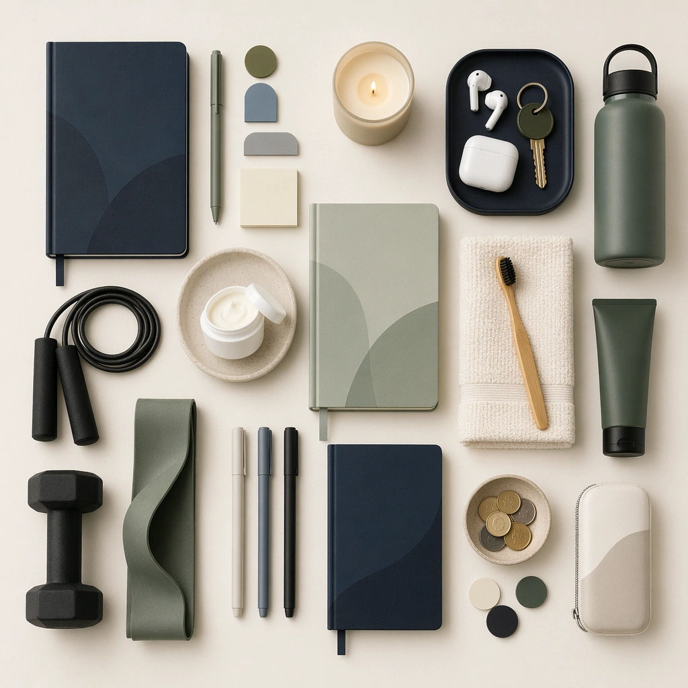

```text
Scene:
Create a square front-facing object board on a pale neutral background with crisp directional light and calm graphic structure. The image should feel like a premium planning concept board translated into physical objects, with clear grouping and abstraction. Use layout discipline rather than readable text to communicate ambition, progress, and the idea of a fresh annual cycle.

Subject:
Arrange notebooks without readable writing, markers, geometric tabs, personal-care cues, exercise objects, coins or budgeting tokens, and small lifestyle items into a coherent goal-board composition. Each cluster should imply a different reset domain without feeling literal or overcrowded. The subject should feel useful for campaign ideation, social storytelling, or editorial support around New Year intention-setting.

Important details:
Treat this as a design problem. Keep spacing, color balance, and object hierarchy precise. Materials should remain tactile and real, but the layout must be clean enough to read as one composed board. The image should communicate structured ambition and practical optimism without visible resolutions, dates, or slogans. It needs to look polished, current, and reusable.

Use case:
New Year Renewal single study 7/9.

Constraints:
No readable text, no watermark, no logos, preserve exact 1:1 aspect ratio, no readable notes, no year numerals, no logo products, no scrapbook mess, no motivational text, no glitter décor, no excessive props, no childish stickers.
```

[Pinned source](https://github.com/ChaosRealmsAI/gpt-image-2-gallery/blob/5296db8c996e38776c83a0bc8c64f848dcd512b3/works/topics/new-year-renewal-campaign-family/packages/single-fresh-cycle-studies/images/goal-board-object-study/meta.json) · GPT Image2 · 1024×1024 · No source-declared image dependencies. · ProjectD:[published and publicly accepted](https://aitoolsradar.com/en/prompts/9a4d5953916d78)

## Finance Clarity Desktop · new-year-renewal-campaign-family/single-fresh-cycle-studies/finance-clarity-desktop


```text
Scene:
Create a square desktop campaign image with calm morning light, pale gray and green accents, subtle metallic detail, and a precise high-trust layout. The environment should feel like a premium personal-finance or planning brand surface, but with no readable interface content. Keep the composition uncluttered, thoughtful, and quietly confident rather than aggressive or tech-bro flashy.

Subject:
Show a device-like screen with abstract chart shapes, notebook forms, pen, glass, card-like objects, and small organizing tools arranged into a financial reset scene. The subject should communicate budgeting, clarity, and controlled ambition through hierarchy and object choice. Everything must remain non-branded and free of readable numbers while still feeling like a genuine finance-adjacent campaign surface.

Important details:
Trust comes from control. Use soft light, crisp edges, believable reflections, and restrained data-like geometry. The image should feel useful for banking, fintech, or planning brands that want New Year momentum without shouting. Keep materials premium and familiar. The board should imply measurable progress without any actual ledger text or dashboard labels.

Use case:
New Year Renewal single study 8/9.

Constraints:
No readable text, no watermark, no logos, preserve exact 1:1 aspect ratio, no readable charts, no currency symbols, no logo cards, no crypto cliché, no neon tech glow, no messy receipts, no calculator with readable display, no office cubicle vibe.
```

[Pinned source](https://github.com/ChaosRealmsAI/gpt-image-2-gallery/blob/5296db8c996e38776c83a0bc8c64f848dcd512b3/works/topics/new-year-renewal-campaign-family/packages/single-fresh-cycle-studies/images/finance-clarity-desktop/meta.json) · GPT Image2 · 1024×1024 · No source-declared image dependencies. · ProjectD:[published and publicly accepted](https://aitoolsradar.com/en/prompts/8acf3b1dba93db)

## Running Start Corridor · new-year-renewal-campaign-family/single-fresh-cycle-studies/running-start-corridor

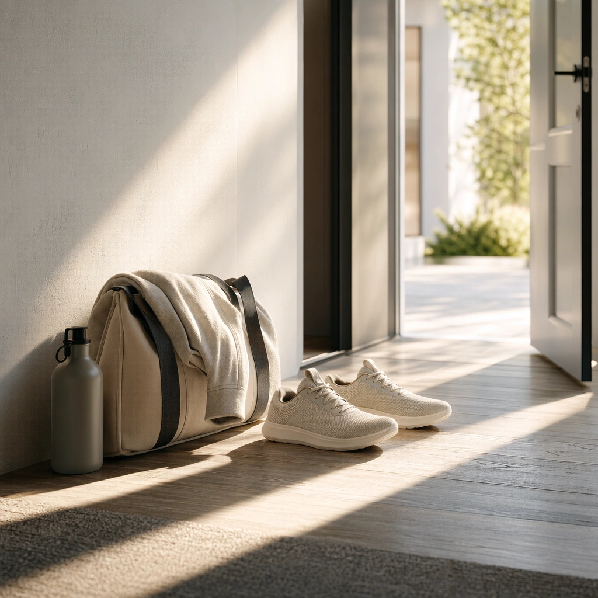

```text
Scene:
Create a square corridor or entryway image flooded with crisp morning light and a sense of forward motion. The frame should feel like a premium lifestyle campaign surface about getting moving, not a sports editorial. Use architecture, long shadows, and selective object placement to imply a strong first step into a renewed routine, with enough negative space and polish for commercial reuse.

Subject:
Show movement cues such as shoes, a bag, a folded layer, water bottle, or doorway threshold aligned into one clean narrative about leaving for a morning routine. Keep any human presence implied rather than central. The subject should communicate momentum, discipline, and readiness through objects, shadow, and spatial direction rather than visible slogans or athletics spectacle.

Important details:
Give the image confidence and calm. Light quality, floor texture, fabric, rubber, and wall material should all feel real. Avoid heroic sports clichés. This is a New Year momentum visual for wellness, lifestyle, education, or productivity brands that want to sell the promise of a clean start with authentic everyday specificity.

Use case:
New Year Renewal single study 9/9.

Constraints:
No readable text, no watermark, no logos, preserve exact 1:1 aspect ratio, no readable shoe branding, no visible athlete portrait, no gym crowd, no finish-line symbolism, no party confetti, no logo water bottle, no dramatic stadium lighting, no motivational text.
```

[Pinned source](https://github.com/ChaosRealmsAI/gpt-image-2-gallery/blob/5296db8c996e38776c83a0bc8c64f848dcd512b3/works/topics/new-year-renewal-campaign-family/packages/single-fresh-cycle-studies/images/running-start-corridor/meta.json) · GPT Image2 · 1024×1024 · No source-declared image dependencies. · ProjectD:[published and publicly accepted](https://aitoolsradar.com/en/prompts/bd2e46c9c80402)

## Reference Cover · new-yorker-editorial/series-cover-metaphors/01-reference-cover

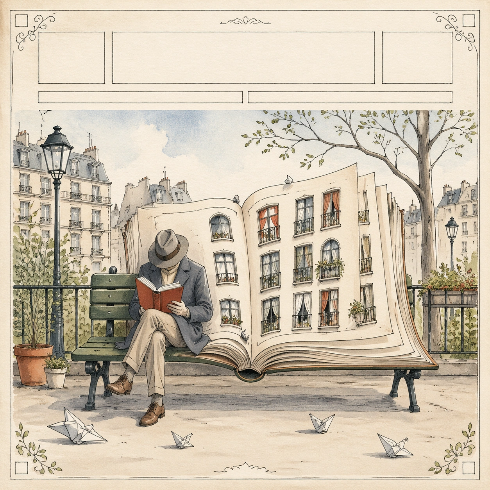

```text
Scene:
A square fictional highbrow magazine cover illustration, viewed perfectly straight-on as a finished printed page on warm off-white paper. Use thin graphite ink lines, transparent watercolor fills, gentle paper grain, and a quiet daylight palette of cream, slate, muted red, moss green, and pale blue. Leave a clean blank masthead band at the top made of abstract empty blocks, with a delicate hand-drawn ornamental border around the page.

Subject:
The central visual pun shows a lone city reader sitting on a park bench while the bench slowly becomes an open book, and the book pages turn into small apartment windows. The reader is simple and anonymous, drawn with elegant line economy, a coat, shoes, and a tilted hat. Around the figure, tiny balcony plants, street lamps, pigeons replaced by folded paper shapes, and window curtains create an urban literary world without clutter.

Important details:
This is the reference cover language for the series. Preserve square magazine-cover hierarchy, top blank masthead area, generous margins, ornamental corner flourishes, hand-drawn contour lines, restrained watercolor wash, and a single readable metaphor. All title areas, issue details, and cover lines must be blank bars or abstract marks, never real letters. The image should feel like an award-winning editorial cover rather than a poster template.

Use case:
New Yorker Editorial series study 1/8, establishing the shared magazine cover grammar for the fanout series.

Constraints:
No readable text, no watermark, no logos, preserve exact 1:1 aspect ratio, no real magazine name, no celebrity likeness, no dense typography, no glossy photo realism, no chaotic collage, no heavy black border.
```

[Pinned source](https://github.com/ChaosRealmsAI/gpt-image-2-gallery/blob/5296db8c996e38776c83a0bc8c64f848dcd512b3/works/topics/new-yorker-editorial/packages/series-cover-metaphors/images/01-reference-cover/meta.json) · GPT Image2 · 1254×1254 · No source-declared image dependencies. · ProjectD:[published and publicly accepted](https://aitoolsradar.com/en/prompts/7c1a8309d70734)

## AI Labor Desk · new-yorker-editorial/series-cover-metaphors/02-ai-labor-desk

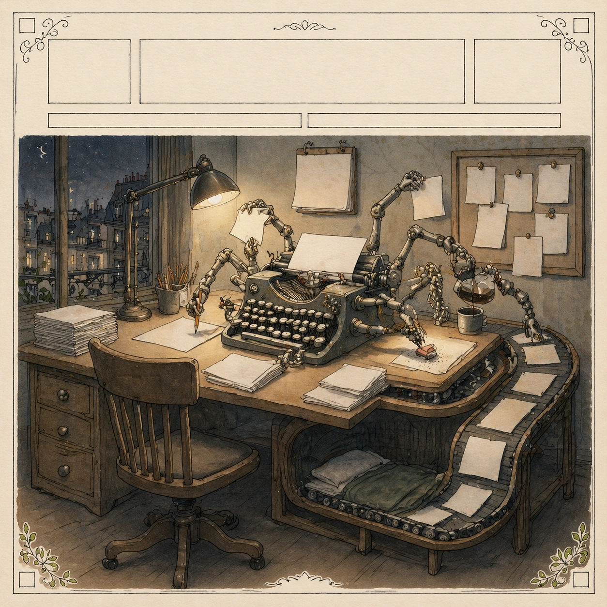

```text
Scene:
Use the reference cover as the primary guide for the same square fictional magazine-cover format: straight-on printed page, warm off-white paper, blank masthead band, delicate ornamental border, thin graphite linework, transparent watercolor fills, and calm editorial lighting. Keep the page hierarchy, margins, corner flourishes, and refined hand-drawn texture consistent with image 01.

Subject:
The new central metaphor shows a nighttime office desk where a human editor's chair is empty, but many tiny mechanical hands emerge from a typewriter-like machine to sort paper, sharpen pencils, pour coffee, erase mistakes, and pin blank notes. The desk surface bends into a conveyor belt, and the belt loops back into a small sleeping cot under the desk. One simple desk lamp lights the whole scene like a stage, making the labor cycle visible without any written labels.

Important details:
Preserve the shared cover language from the reference while changing the narrative to AI-era labor. The metaphor must be readable through objects: automation, invisible work, editorial production, exhaustion, and recursion. All papers, notes, calendar pages, screen areas, and typewriter keys must contain blank shapes or unreadable marks only. Keep the composition elegant and witty, with one central idea, controlled negative space, clear object silhouettes, and no software interface.

Use case:
New Yorker Editorial series study 2/8, testing whether the reference cover grammar can carry an AI labor metaphor.

Constraints:
No readable text, no watermark, no logos, preserve exact 1:1 aspect ratio, no real magazine name, no real AI product branding, no robot mascot, no cluttered office mess, no horror machinery, no photorealistic computer screen.
```

[Pinned source](https://github.com/ChaosRealmsAI/gpt-image-2-gallery/blob/5296db8c996e38776c83a0bc8c64f848dcd512b3/works/topics/new-yorker-editorial/packages/series-cover-metaphors/images/02-ai-labor-desk/meta.json) · GPT Image2 · 1254×1254 · Reference images required. · ProjectD:[published and publicly accepted](https://aitoolsradar.com/en/prompts/4f9f948b35d247)

## Social Window Grid · new-yorker-editorial/series-cover-metaphors/03-social-window-grid

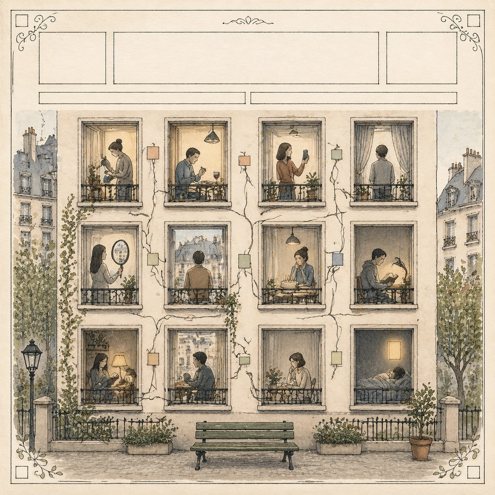

```text
Scene:
Use the reference cover as the primary guide for a square fictional magazine cover on off-white paper, with the same blank masthead band, thin ornamental border, graphite contour lines, transparent watercolor washes, and restrained urban palette. The camera is straight-on, the printed page is flat, and the margins remain generous and balanced.

Subject:
The central metaphor shows an apartment facade arranged like a social media grid, but every window contains a person alone in a different quiet pose. One person waters a plant, one eats dinner, one lifts a phone as if taking a picture, one waits beside a birthday cake with blank candles, one looks into a mirror that reflects another window, and one sleeps under a glowing rectangle of light. The window frames connect with thin vine-like notification shapes, yet no one actually meets. A small courtyard at the bottom contains a single shared bench that remains empty.

Important details:
Preserve the shared cover grammar from image 01 while making loneliness legible through layout. The grid must be structured and readable, not a busy comic page. Windows should align cleanly, figures should remain anonymous and simple, and phone screens or note areas must be abstract colored rectangles with no readable icons or letters. The humor should be melancholic and precise: connected frames, disconnected lives, delicate watercolor restraint.

Use case:
New Yorker Editorial series study 3/8, testing the reference cover system on a social-network loneliness metaphor.

Constraints:
No readable text, no watermark, no logos, preserve exact 1:1 aspect ratio, no real app interface, no brand colors, no speech bubbles, no dense crowd scene, no dark cyberpunk mood, no broken window grid.
```

[Pinned source](https://github.com/ChaosRealmsAI/gpt-image-2-gallery/blob/5296db8c996e38776c83a0bc8c64f848dcd512b3/works/topics/new-yorker-editorial/packages/series-cover-metaphors/images/03-social-window-grid/meta.json) · GPT Image2 · 1254×1254 · Reference images required. · ProjectD:[published and publicly accepted](https://aitoolsradar.com/en/prompts/147ae24ce4beff)

## Climate Umbrella · new-yorker-editorial/series-cover-metaphors/04-climate-umbrella

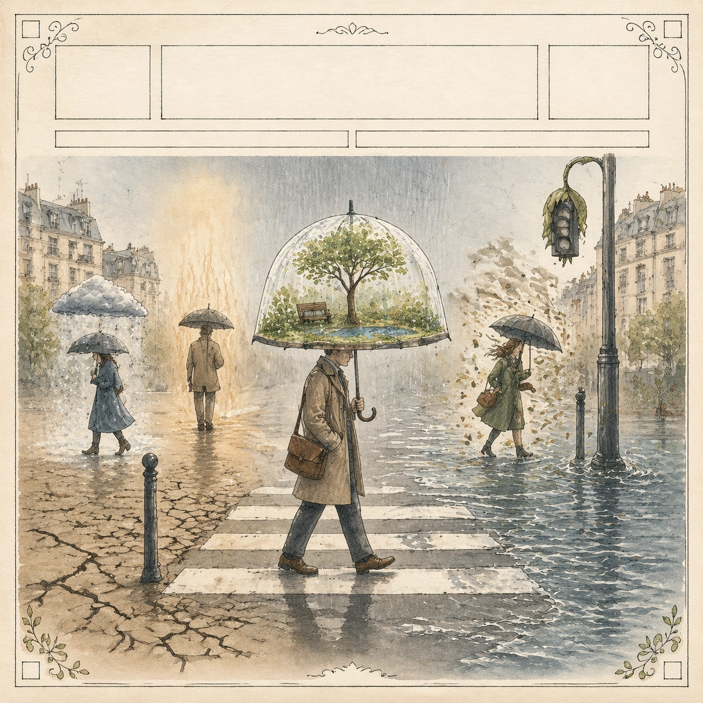

```text
Scene:
Use the reference cover as the primary guide for the same square fictional magazine-cover page: blank masthead band, warm paper, hand-drawn ornamental border, graphite linework, transparent watercolor, and quiet editorial contrast. Keep the page flat, centered, and refined, with no real typography and no glossy poster finish.

Subject:
The central metaphor shows a city crosswalk in soft rain where a commuter holds an umbrella that is actually a tiny greenhouse dome. Inside the transparent umbrella, a miniature garden thrives with a small tree, moss, a bench, and a blue puddle. Outside the umbrella, the street is dry and cracked on one side, flooded on the other, and a traffic light droops like a wilting flower. Other pedestrians carry normal umbrellas that cast little weather systems: one snow cloud, one heat shimmer, one gust of leaves. The main commuter remains calm but small against the city.

Important details:
Preserve the shared cover language from image 01 while expressing climate change through a clean visual pun, not disaster spectacle. The transparent greenhouse umbrella must be clear, delicate, and central. Use watercolor gradients for rain, heat, and floodwater, but keep boundaries readable. All signs, street markings, signal panels, and shop awnings must be blank or abstract. The page should feel witty, uneasy, and suitable for a serious editorial cover.

Use case:
New Yorker Editorial series study 4/8, testing the reference cover grammar on a climate anxiety metaphor.

Constraints:
No readable text, no watermark, no logos, preserve exact 1:1 aspect ratio, no real city brand, no apocalyptic firestorm, no crowded street chaos, no photorealistic weather render, no broken ornamental border, no heavy black sky.
```

[Pinned source](https://github.com/ChaosRealmsAI/gpt-image-2-gallery/blob/5296db8c996e38776c83a0bc8c64f848dcd512b3/works/topics/new-yorker-editorial/packages/series-cover-metaphors/images/04-climate-umbrella/meta.json) · GPT Image2 · 1254×1254 · Reference images required. · ProjectD:[published and publicly accepted](https://aitoolsradar.com/en/prompts/29f74b1c118618)

## Subway Notification Garden · new-yorker-editorial/single-editorial-studies/01-subway-notification-garden

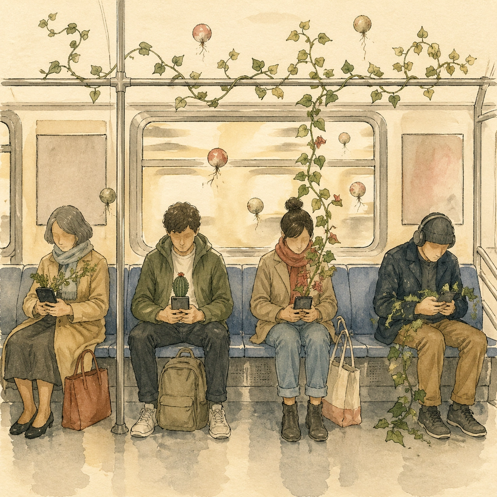

```text
Scene:
A square magazine-style editorial illustration of a subway car interior, viewed from a calm frontal angle with shallow perspective and soft morning light. Use hand-drawn graphite outlines, transparent watercolor fills, warm cream paper texture, muted transit colors, and a few restrained red and green accents. The composition should be organized like a single-panel magazine illustration, not a storyboard or advertising poster.

Subject:
Several anonymous commuters sit apart on a bench, each holding a small phone that has turned into a potted plant. One phone sprouts ivy around a wrist, another grows a tiny cactus, another has a flowering vine climbing toward the overhead rail. The rail itself bends into a trellis, and notification bubbles become round seed pods floating above the seats. The commuters look absorbed but gentle, as if tending private gardens without noticing one another. The subway windows show only abstract tunnel light.

Important details:
The visual pun must be immediate: attention economies as indoor gardening, connection as separate cultivation. Keep the layout structured, with clear bench rhythm, repeated phone-planter forms, and negative space around each figure. All route maps, signs, phone screens, ads, and labels must be blank blocks or unreadable decorative marks. Preserve editorial restraint, fine linework, pale watercolor shadows, and a witty melancholy mood.

Use case:
New Yorker Editorial single study 5/8, testing an independent social technology metaphor in hand-drawn magazine style.

Constraints:
No readable text, no watermark, no logos, preserve exact 1:1 aspect ratio, no real transit branding, no real app icons, no speech bubbles, no crowded subway crush, no photorealistic faces, no saturated neon palette.
```

[Pinned source](https://github.com/ChaosRealmsAI/gpt-image-2-gallery/blob/5296db8c996e38776c83a0bc8c64f848dcd512b3/works/topics/new-yorker-editorial/packages/single-editorial-studies/images/01-subway-notification-garden/meta.json) · GPT Image2 · 1254×1254 · No source-declared image dependencies. · ProjectD:[published and publicly accepted](https://aitoolsradar.com/en/prompts/59e00f8b44a5b1)

## Robot Copy Desk · new-yorker-editorial/single-editorial-studies/02-robot-copy-desk

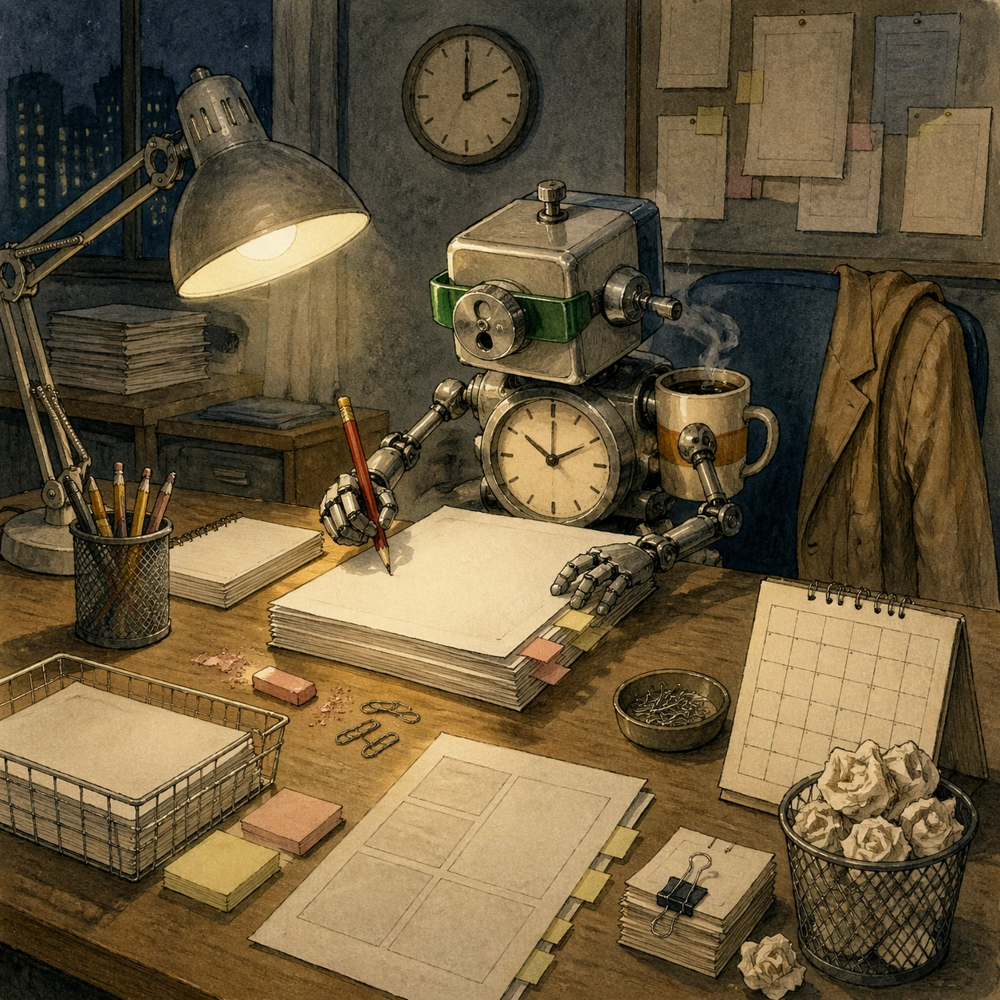

```text
Scene:
A square editorial illustration of a newspaper copy desk after midnight, drawn in fine graphite lines with muted watercolor washes on warm cream paper. The camera looks slightly down at a tidy but lived-in desk, with a lamp pool of yellow light, blue-gray shadows, and carefully organized objects. The image must read as a single polished magazine illustration with clear hierarchy and no readable printed matter.

Subject:
At the desk sits a small old-fashioned robot wearing a green visor, carefully editing a stack of blank pages with a red pencil. The robot's body is made from a pencil sharpener, a clock, and a coffee cup, suggesting human routines absorbed into a machine. Around it are neatly arranged style sheets, eraser crumbs, a blank calendar, paper clips, and a tiny wastebasket filled with crumpled pages that resemble wilted flowers. A human coat hangs on the chair back, implying the person has stepped away or been replaced.

Important details:
The metaphor should be layered but readable: automation doing editorial judgment, human craft displaced but not mocked, work culture continuing through objects. Keep the robot humble and mechanical, not cute branded merchandise. All papers, calendar blocks, sticky notes, and page marks must remain unreadable. Use precise object spacing, visible pencil texture, transparent watercolor, and a restrained palette. The scene should feel witty, humane, and slightly uneasy.

Use case:
New Yorker Editorial single study 6/8, testing AI-era labor as an independent editorial desk metaphor.

Constraints:
No readable text, no watermark, no logos, preserve exact 1:1 aspect ratio, no real newspaper name, no real AI product, no screen UI, no chrome sci-fi robot, no messy pileup, no dramatic horror lighting.
```

[Pinned source](https://github.com/ChaosRealmsAI/gpt-image-2-gallery/blob/5296db8c996e38776c83a0bc8c64f848dcd512b3/works/topics/new-yorker-editorial/packages/single-editorial-studies/images/02-robot-copy-desk/meta.json) · GPT Image2 · 1254×1254 · No source-declared image dependencies. · ProjectD:[published and publicly accepted](https://aitoolsradar.com/en/prompts/d5e8bebb603219)

## Flooded Boardroom · new-yorker-editorial/single-editorial-studies/03-flooded-boardroom

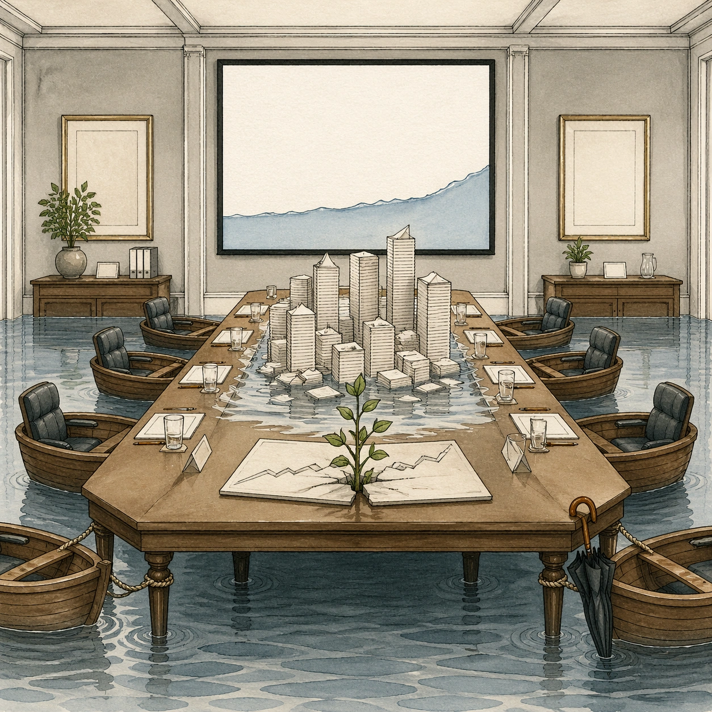

```text
Scene:
A square magazine editorial illustration of a corporate boardroom, drawn straight-on with calm architectural symmetry, fine ink outlines, transparent watercolor, and warm cream paper grain. The room is bright enough to inspect every symbolic detail, using soft gray walls, walnut table tones, pale blue water, and a few restrained green accents. The image should feel elegant and satirical rather than catastrophic.

Subject:
A long boardroom table sits in ankle-deep water, but the executives are absent. Their empty chairs have become small rowboats tied to the table legs. On the tabletop, a miniature city skyline made of stacked blank report pages slowly sinks into a shallow reflecting pool. A potted plant grows through a cracked financial chart shape that has no numbers. At the far wall, a large blank presentation screen shows only a simple rising blue waterline, not text. One umbrella hangs neatly from a chair as if prepared too late.

Important details:
The climate metaphor must be readable through structured objects: decision room, delayed response, rising water, fragile paper city, and empty authority. Keep the boardroom geometry precise and uncluttered. All documents, charts, plaques, name cards, and presentation areas must contain unreadable marks or blank shapes. Preserve editorial wit, disciplined layout, clean reflections, and watercolor softness. Avoid disaster-movie spectacle; this is a quiet institutional satire.

Use case:
New Yorker Editorial single study 7/8, testing climate-change reasoning through a structured boardroom metaphor.

Constraints:
No readable text, no watermark, no logos, preserve exact 1:1 aspect ratio, no real company branding, no visible stock ticker, no drowning people, no apocalyptic destruction, no photorealistic flood simulation, no chaotic debris.
```

[Pinned source](https://github.com/ChaosRealmsAI/gpt-image-2-gallery/blob/5296db8c996e38776c83a0bc8c64f848dcd512b3/works/topics/new-yorker-editorial/packages/single-editorial-studies/images/03-flooded-boardroom/meta.json) · GPT Image2 · 1254×1254 · No source-declared image dependencies. · ProjectD:[published and publicly accepted](https://aitoolsradar.com/en/prompts/d2c391454d9ab4)

## Magazine Cover Mockup · new-yorker-editorial/single-editorial-studies/04-magazine-cover-mockup

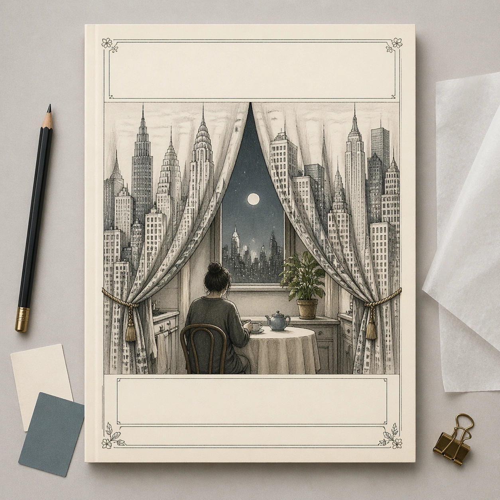

```text
Scene:
A square commercial mockup of a fictional literary magazine cover lying flat on a designer's review table, photographed straight-on with soft studio light. The cover itself is an editorial illustration in thin graphite line and restrained watercolor on cream paper. Around the page are only minimal physical review objects: a pencil, two blank color swatches, a folded tracing-paper overlay, and a small binder clip. Keep the whole composition clean, premium, and gallery-ready.

Subject:
The cover illustration shows a city skyline arranged as a set of theater curtains opening onto a tiny kitchen table scene. A single anonymous person sits at the table, while the skyscraper curtains reveal moonlight, a houseplant, and a tea cup, turning public city life into private domestic performance. The top masthead band and lower cover-line areas are present as elegant blank bars, and the decorative border uses tiny abstract floral corners. No letters, numbers, brand marks, or real publication identifiers appear anywhere.

Important details:
This image tests commercial mockup clarity without relying on actual typography. The viewer should understand it as a finished high-end editorial cover presentation through paper texture, precise margins, cover hierarchy, and surrounding design-review props. The cover art must still carry a readable metaphor: city as stage, private loneliness as performance. Keep the mockup straight, uncluttered, and plausible for a media pitch board.

Use case:
New Yorker Editorial single study 8/8, testing a commercial magazine-cover mockup with blank typography and editorial visual pun.

Constraints:
No readable text, no watermark, no logos, preserve exact 1:1 aspect ratio, no real magazine name, no fake barcode, no price tag, no UI screenshot, no angled perspective, no cluttered desk, no glossy plastic cover.
```

[Pinned source](https://github.com/ChaosRealmsAI/gpt-image-2-gallery/blob/5296db8c996e38776c83a0bc8c64f848dcd512b3/works/topics/new-yorker-editorial/packages/single-editorial-studies/images/04-magazine-cover-mockup/meta.json) · GPT Image2 · 1254×1254 · No source-declared image dependencies. · ProjectD:[published and publicly accepted](https://aitoolsradar.com/en/prompts/b2c417e2b8b895)

## Blue Hour Anchor · night-architecture-lighting-photography-set/series-spatial-language-lock/01-blue-hour-anchor

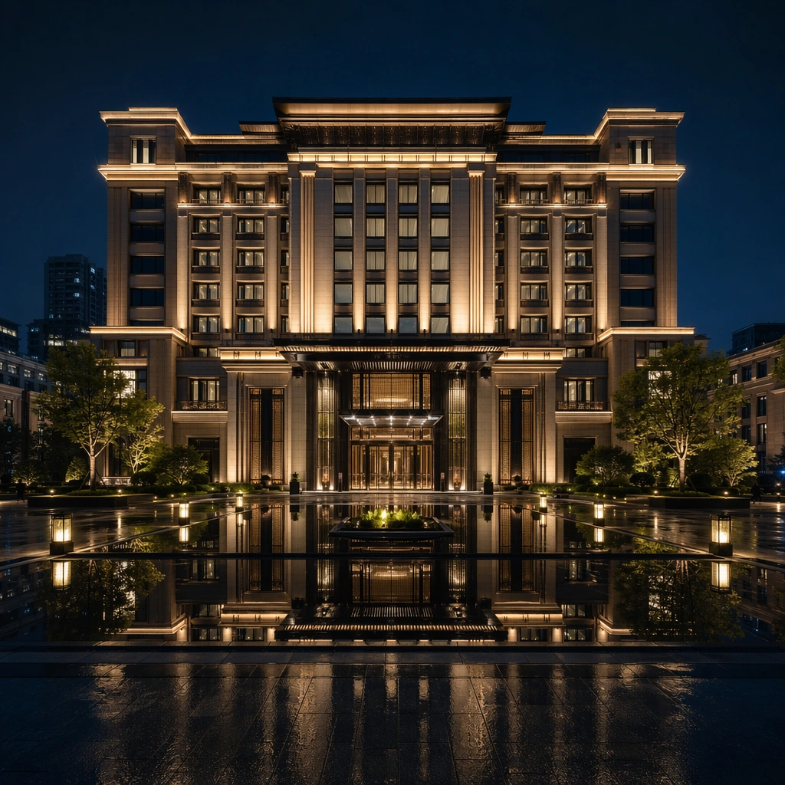

```text
Scene:
Create a square architectural reference still for Night Architecture Lighting Photography Set. Use a square blue-hour hero view with the full building reflected in wet paving or water and treat the frame like a premium interior or architecture editorial photograph with disciplined perspective, readable depth from foreground to background, and enough negative space for the spatial hierarchy to breathe. Light the scene so facade lighting, reflections, and civic nighttime atmosphere feel immediate, using deep blue-black night, warm gold light, cool silver reflections, and restrained amber interior spill as the governing tonal range. The composition must read as a high-end commercial image that could sit inside hospitality night campaigns, architecture editorials, lighting-design decks, and city-brand presentations.

Subject:
Show a night-architecture photography subject with layered facade lighting, wet pavement reflections, atmospheric civic calm, controlled interior glow, and a clearly recognizable silhouette. Center the project’s overall night identity, facade glow hierarchy, and calm civic setting. This is the canonical reference image for the package, so the major proportions, material transitions, fixture families, and circulation logic must feel highly specific and internally coherent rather than generic luxury styling. Let the viewer understand how the space is organized within a single glance, with foreground anchors, a clear middle zone, and a resolved background termination.

Important details:
Lock the building silhouette, lighting hierarchy, reflection logic, civic atmosphere, and disciplined night-photography realism. Surfaces should feel tactile and believable: stone veining must stay plausible, metals should have disciplined reflectance, fabrics should show natural weight, and concealed lighting should shape the volume instead of flattening it. Use abstract signage, menu, label, or caption zones only as unreadable graphic hints. The image should feel practical for downstream design reviews and polished enough for public-facing campaign use.

Use case:
Night Architecture Lighting Photography Set series study 1/9, establishing the canonical night-photography identity for the package.

Constraints:
No readable text, no watermark, no logos, preserve exact 1:1 aspect ratio, no fireworks, no traffic light streak overload, no readable signage, no festival screens, no people crowding the foreground, no giant moon effect.
```

[Pinned source](https://github.com/ChaosRealmsAI/gpt-image-2-gallery/blob/5296db8c996e38776c83a0bc8c64f848dcd512b3/works/topics/night-architecture-lighting-photography-set/packages/series-spatial-language-lock/images/01-blue-hour-anchor/meta.json) · GPT Image2 · 1024×1024 · No source-declared image dependencies. · ProjectD:[published and publicly accepted](https://aitoolsradar.com/en/prompts/ca165e73c9a9da)

## Facade Glow Close · night-architecture-lighting-photography-set/series-spatial-language-lock/02-facade-glow-close

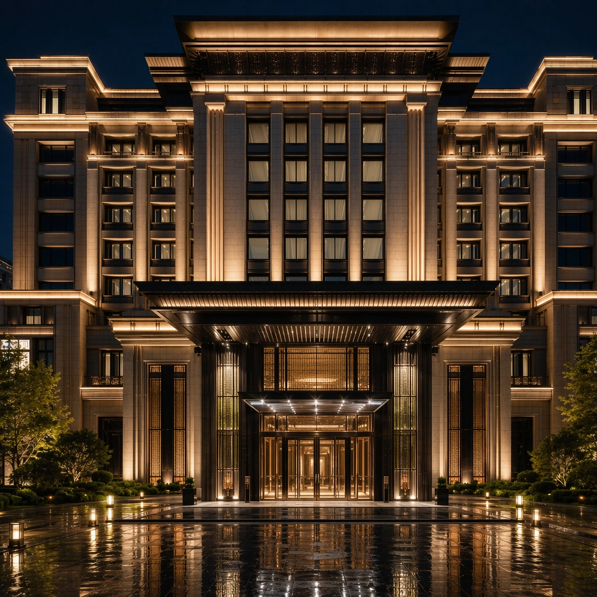

```text
Scene:
Create a square reference-dependent architecture still for Night Architecture Lighting Photography Set. Use a closer angle toward the lit facade planes and lower entry while keeping the same lens discipline, editorial polish, and material believability established by the reference image. The lighting can shift to support the intended mood, but the space must still feel like the same authored project with a stable viewpoint logic, convincing depth separation, and clean commercial-photography finish. Keep deep blue-black night, warm gold light, cool silver reflections, and restrained amber interior spill as the governing tonal range even when the emphasis changes.

Subject:
Show a night-architecture photography subject with layered facade lighting, wet pavement reflections, atmospheric civic calm, controlled interior glow, and a clearly recognizable silhouette. Focus on the exact same building from the reference image, now emphasizing layered lighting temperatures and detail visibility. Preserve exact architectural identity, plan logic, material palette, fixture family, and circulation cues from the reference image while changing only the intended emphasis described here. The viewer should immediately recognize the same project, not a loose cousin, with matching silhouette logic, aligned detailing, and consistent brand atmosphere.

Important details:
Preserve the building silhouette, lighting hierarchy, reflection logic, civic atmosphere, and disciplined night-photography realism. Any abstract wayfinding, menu, wall-label, or packaging zones must stay unreadable and subordinate to the spatial image. Joinery, edges, reflections, and lighting should remain realistic enough for an operator or design team to treat the image as a credible reference. The variation should feel deliberate and commercially useful, proving that one locked spatial language can flex across multiple campaign or editorial surfaces.

Use case:
Night Architecture Lighting Photography Set series study 2/9, extending facade-lighting nuance while preserving the same building identity.

Constraints:
No readable text, no watermark, no logos, preserve exact 1:1 aspect ratio, preserve exact architectural identity from the reference image, no fireworks, no traffic light streak overload, no readable signage, no festival screens, no people crowding the foreground, no lens flare overload.
```

[Pinned source](https://github.com/ChaosRealmsAI/gpt-image-2-gallery/blob/5296db8c996e38776c83a0bc8c64f848dcd512b3/works/topics/night-architecture-lighting-photography-set/packages/series-spatial-language-lock/images/02-facade-glow-close/meta.json) · GPT Image2 · 1024×1024 · Reference images required. · ProjectD:[published and publicly accepted](https://aitoolsradar.com/en/prompts/a77337e3d0b6a9)

## Bridge Reflection View · night-architecture-lighting-photography-set/series-spatial-language-lock/03-bridge-reflection-view

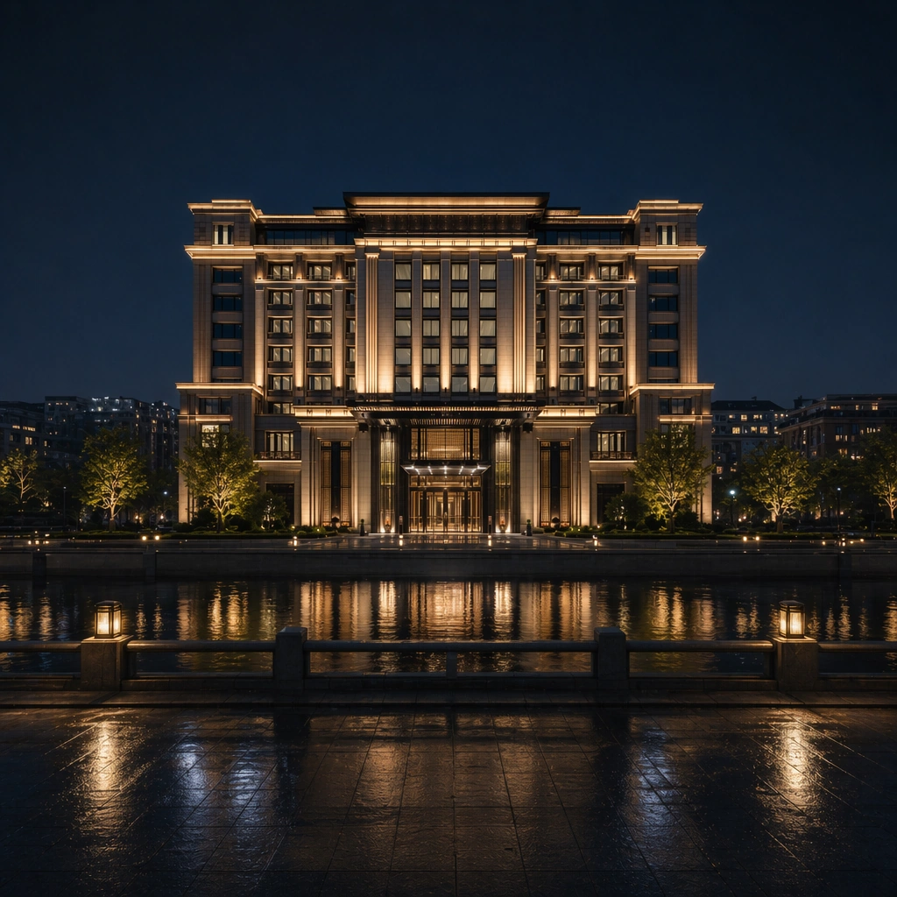

```text
Scene:
Create a square reference-dependent architecture still for Night Architecture Lighting Photography Set. Use a longer lens view from across a bridge, river edge, or reflective street plane while keeping the same lens discipline, editorial polish, and material believability established by the reference image. The lighting can shift to support the intended mood, but the space must still feel like the same authored project with a stable viewpoint logic, convincing depth separation, and clean commercial-photography finish. Keep deep blue-black night, warm gold light, cool silver reflections, and restrained amber interior spill as the governing tonal range even when the emphasis changes.

Subject:
Show a night-architecture photography subject with layered facade lighting, wet pavement reflections, atmospheric civic calm, controlled interior glow, and a clearly recognizable silhouette. Focus on the exact same building from the reference image, now emphasizing city context and reflected geometry. Preserve exact architectural identity, plan logic, material palette, fixture family, and circulation cues from the reference image while changing only the intended emphasis described here. The viewer should immediately recognize the same project, not a loose cousin, with matching silhouette logic, aligned detailing, and consistent brand atmosphere.

Important details:
Preserve the building silhouette, lighting hierarchy, reflection logic, civic atmosphere, and disciplined night-photography realism. Any abstract wayfinding, menu, wall-label, or packaging zones must stay unreadable and subordinate to the spatial image. Joinery, edges, reflections, and lighting should remain realistic enough for an operator or design team to treat the image as a credible reference. The variation should feel deliberate and commercially useful, proving that one locked spatial language can flex across multiple campaign or editorial surfaces.

Use case:
Night Architecture Lighting Photography Set series study 3/9, extending urban-night context inside the same lighting identity.

Constraints:
No readable text, no watermark, no logos, preserve exact 1:1 aspect ratio, preserve exact architectural identity from the reference image, no fireworks, no traffic light streak overload, no readable signage, no festival screens, no people crowding the foreground, no skyline clutter.
```

[Pinned source](https://github.com/ChaosRealmsAI/gpt-image-2-gallery/blob/5296db8c996e38776c83a0bc8c64f848dcd512b3/works/topics/night-architecture-lighting-photography-set/packages/series-spatial-language-lock/images/03-bridge-reflection-view/meta.json) · GPT Image2 · 1024×1024 · Reference images required. · ProjectD:[published and publicly accepted](https://aitoolsradar.com/en/prompts/5d84a8aa1a0f67)

## Entry Stair Light Wash · night-architecture-lighting-photography-set/series-spatial-language-lock/04-entry-stair-light-wash

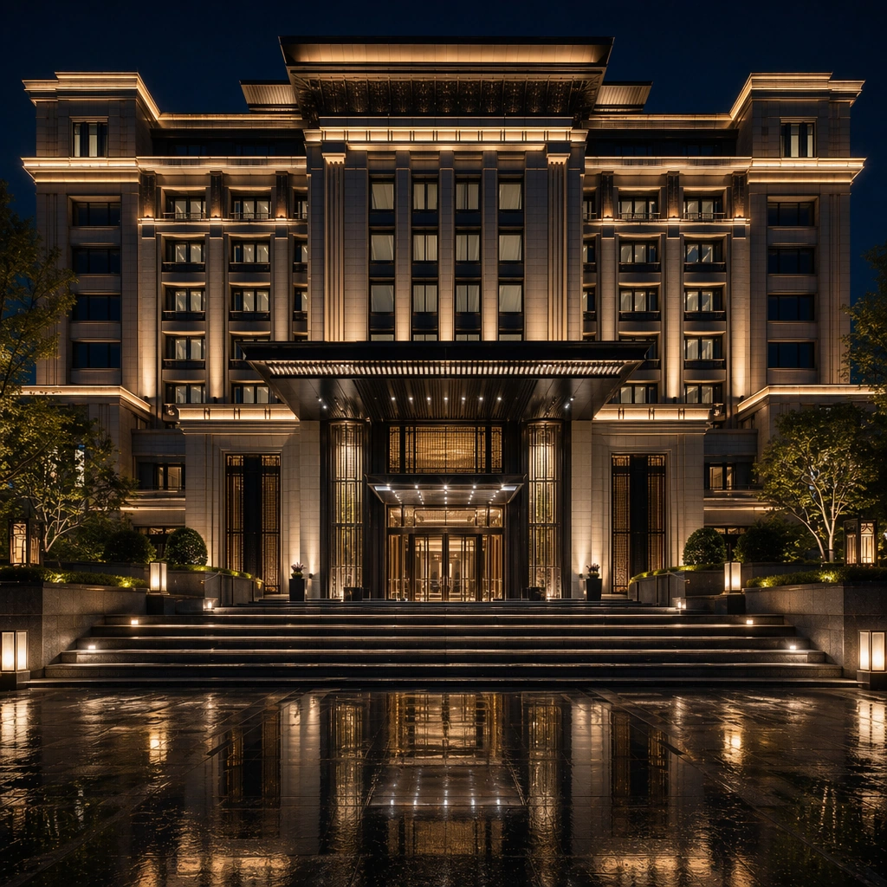

```text
Scene:
Create a square reference-dependent architecture still for Night Architecture Lighting Photography Set. Use a lower-angle composition toward the entry stair and illuminated wall surfaces while keeping the same lens discipline, editorial polish, and material believability established by the reference image. The lighting can shift to support the intended mood, but the space must still feel like the same authored project with a stable viewpoint logic, convincing depth separation, and clean commercial-photography finish. Keep deep blue-black night, warm gold light, cool silver reflections, and restrained amber interior spill as the governing tonal range even when the emphasis changes.

Subject:
Show a night-architecture photography subject with layered facade lighting, wet pavement reflections, atmospheric civic calm, controlled interior glow, and a clearly recognizable silhouette. Focus on the exact same building from the reference image, now emphasizing pedestrian-scale lighting and threshold drama. Preserve exact architectural identity, plan logic, material palette, fixture family, and circulation cues from the reference image while changing only the intended emphasis described here. The viewer should immediately recognize the same project, not a loose cousin, with matching silhouette logic, aligned detailing, and consistent brand atmosphere.

Important details:
Preserve the building silhouette, lighting hierarchy, reflection logic, civic atmosphere, and disciplined night-photography realism. Any abstract wayfinding, menu, wall-label, or packaging zones must stay unreadable and subordinate to the spatial image. Joinery, edges, reflections, and lighting should remain realistic enough for an operator or design team to treat the image as a credible reference. The variation should feel deliberate and commercially useful, proving that one locked spatial language can flex across multiple campaign or editorial surfaces.

Use case:
Night Architecture Lighting Photography Set series study 4/9, extending arrival lighting within the same nighttime system.

Constraints:
No readable text, no watermark, no logos, preserve exact 1:1 aspect ratio, preserve exact architectural identity from the reference image, no fireworks, no traffic light streak overload, no readable signage, no festival screens, no people crowding the foreground, no people on the steps.
```

[Pinned source](https://github.com/ChaosRealmsAI/gpt-image-2-gallery/blob/5296db8c996e38776c83a0bc8c64f848dcd512b3/works/topics/night-architecture-lighting-photography-set/packages/series-spatial-language-lock/images/04-entry-stair-light-wash/meta.json) · GPT Image2 · 1024×1024 · Reference images required. · ProjectD:[published and publicly accepted](https://aitoolsradar.com/en/prompts/b686b494d4b640)

## Wet Pavement Composition · night-architecture-lighting-photography-set/single-support-studies/02-wet-pavement-composition

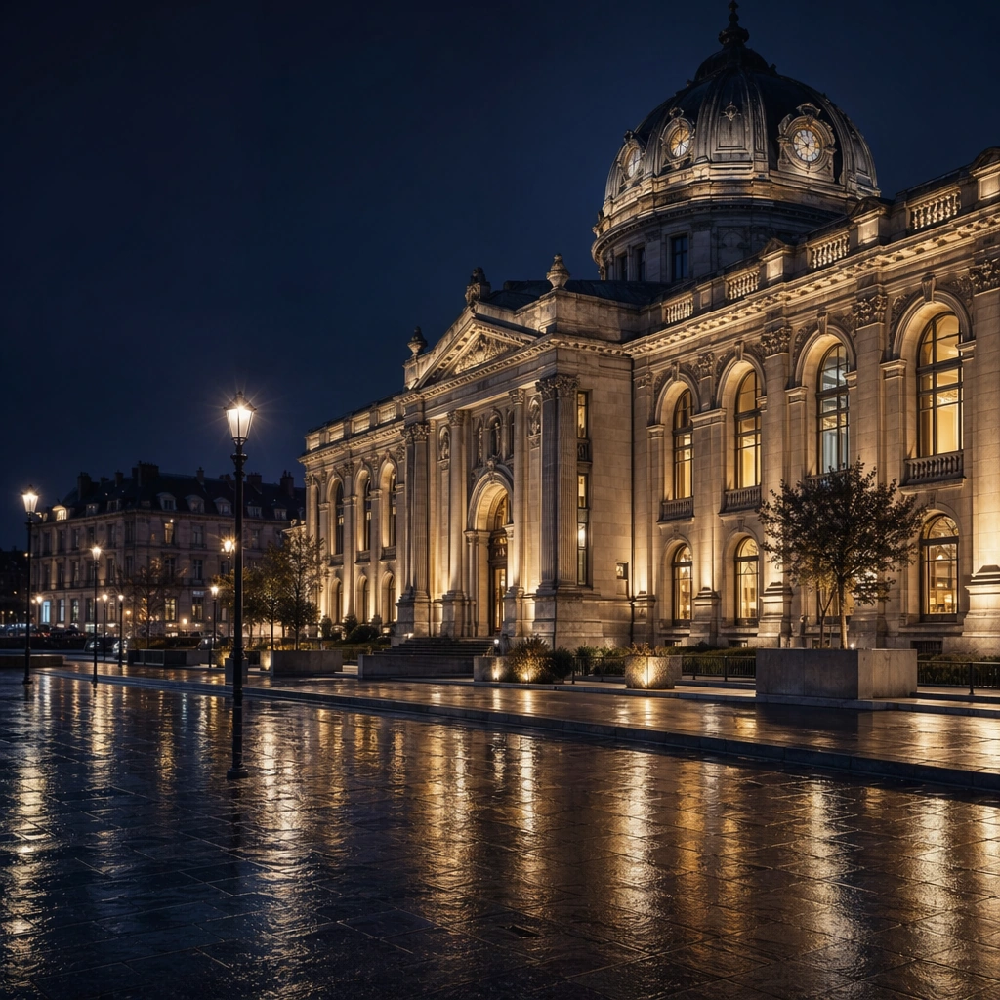

```text
Scene:
Create a square standalone support study for Night Architecture Lighting Photography Set. Use a composition where the building appears strongly through wet pavement reflections in the foreground and frame it like a premium commercial still or design-editorial crop with clear focal hierarchy, disciplined perspective, and enough breathing room for the materials and objects to read at both thumbnail and full size. Keep deep blue-black night, warm gold light, cool silver reflections, and restrained amber interior spill as the tonal guide so the image still belongs to the same theme family, and light the scene in a controlled way that emphasizes texture, edge quality, and authored atmosphere over spectacle.

Subject:
Show a night-architecture photography subject with layered facade lighting, wet pavement reflections, atmospheric civic calm, controlled interior glow, and a clearly recognizable silhouette. In this support study, focus on night reflection control, paving texture, and cinematic calm. The image should work independently, yet it must still feel like it belongs to the same broader world of Night Architecture. Make the space, props, and detailing useful for real campaign, editorial, or design-review contexts rather than moodboard abstraction.

Important details:
Carry forward the broader language of the building silhouette, lighting hierarchy, reflection logic, civic atmosphere, and disciplined night-photography realism, but let this image prove a new support surface or secondary deliverable. Material realism is essential: wood grain, metal sheen, glass edges, textiles, and stone should feel physically plausible and carefully art directed. Any graphic panels, labels, menus, packaging, or captions must stay abstract and unreadable. The overall result should feel reusable for hospitality night campaigns, architecture editorials, lighting-design decks, and city-brand presentations, with enough structure that a creative or operations team could build on it.

Use case:
Night Architecture Lighting Photography Set single study 6/9, exploring support still for campaign hero crops and editorials.

Constraints:
No readable text, no watermark, no logos, preserve exact 1:1 aspect ratio, no fireworks, no traffic light streak overload, no readable signage, no festival screens, no people crowding the foreground, no car headlights blasting the frame.
```

[Pinned source](https://github.com/ChaosRealmsAI/gpt-image-2-gallery/blob/5296db8c996e38776c83a0bc8c64f848dcd512b3/works/topics/night-architecture-lighting-photography-set/packages/single-support-studies/images/02-wet-pavement-composition/meta.json) · GPT Image2 · 1024×1024 · No source-declared image dependencies. · ProjectD:[published and publicly accepted](https://aitoolsradar.com/en/prompts/22ea8888d40a1d)

## Rooftop Light Crown · night-architecture-lighting-photography-set/single-support-studies/03-rooftop-light-crown

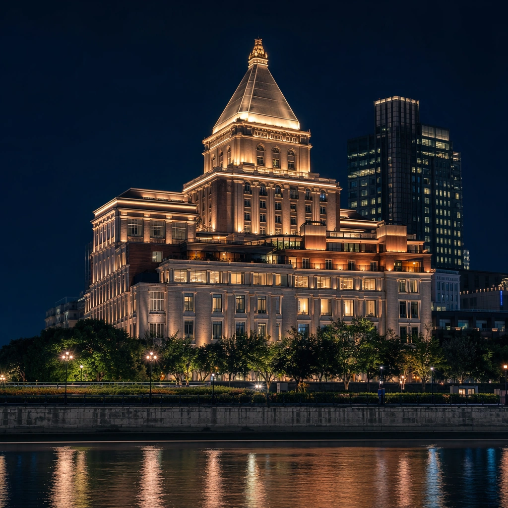

```text
Scene:
Create a square standalone support study for Night Architecture Lighting Photography Set. Use a telephoto study of the illuminated roofline or crown at night and frame it like a premium commercial still or design-editorial crop with clear focal hierarchy, disciplined perspective, and enough breathing room for the materials and objects to read at both thumbnail and full size. Keep deep blue-black night, warm gold light, cool silver reflections, and restrained amber interior spill as the tonal guide so the image still belongs to the same theme family, and light the scene in a controlled way that emphasizes texture, edge quality, and authored atmosphere over spectacle.

Subject:
Show a night-architecture photography subject with layered facade lighting, wet pavement reflections, atmospheric civic calm, controlled interior glow, and a clearly recognizable silhouette. In this support study, focus on top-of-building identity, restraint, and skyline legibility. The image should work independently, yet it must still feel like it belongs to the same broader world of Night Architecture. Make the space, props, and detailing useful for real campaign, editorial, or design-review contexts rather than moodboard abstraction.

Important details:
Carry forward the broader language of the building silhouette, lighting hierarchy, reflection logic, civic atmosphere, and disciplined night-photography realism, but let this image prove a new support surface or secondary deliverable. Material realism is essential: wood grain, metal sheen, glass edges, textiles, and stone should feel physically plausible and carefully art directed. Any graphic panels, labels, menus, packaging, or captions must stay abstract and unreadable. The overall result should feel reusable for hospitality night campaigns, architecture editorials, lighting-design decks, and city-brand presentations, with enough structure that a creative or operations team could build on it.

Use case:
Night Architecture Lighting Photography Set single study 7/9, exploring support image for lighting-designer presentations.

Constraints:
No readable text, no watermark, no logos, preserve exact 1:1 aspect ratio, no fireworks, no traffic light streak overload, no readable signage, no festival screens, no people crowding the foreground, no aircraft or drones.
```

[Pinned source](https://github.com/ChaosRealmsAI/gpt-image-2-gallery/blob/5296db8c996e38776c83a0bc8c64f848dcd512b3/works/topics/night-architecture-lighting-photography-set/packages/single-support-studies/images/03-rooftop-light-crown/meta.json) · GPT Image2 · 1024×1024 · No source-declared image dependencies. · ProjectD:[published and publicly accepted](https://aitoolsradar.com/en/prompts/0606002cec1da2)

## Courtyard Lantern Gradient · night-architecture-lighting-photography-set/single-support-studies/04-courtyard-lantern-gradient

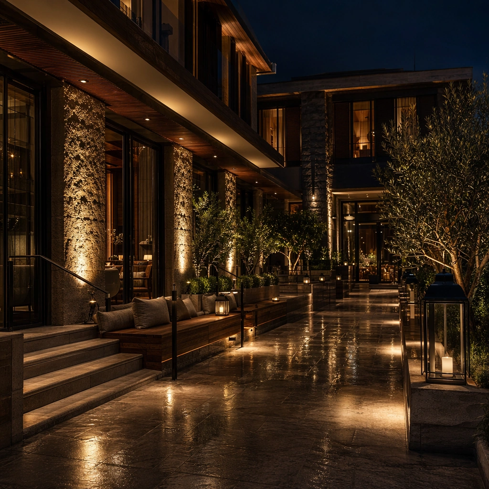

```text
Scene:
Create a square standalone support study for Night Architecture Lighting Photography Set. Use an intimate courtyard night still with subtle lantern layers and facade glow and frame it like a premium commercial still or design-editorial crop with clear focal hierarchy, disciplined perspective, and enough breathing room for the materials and objects to read at both thumbnail and full size. Keep deep blue-black night, warm gold light, cool silver reflections, and restrained amber interior spill as the tonal guide so the image still belongs to the same theme family, and light the scene in a controlled way that emphasizes texture, edge quality, and authored atmosphere over spectacle.

Subject:
Show a night-architecture photography subject with layered facade lighting, wet pavement reflections, atmospheric civic calm, controlled interior glow, and a clearly recognizable silhouette. In this support study, focus on human-scale warmth, shadow gradation, and nighttime hospitality atmosphere. The image should work independently, yet it must still feel like it belongs to the same broader world of Night Architecture. Make the space, props, and detailing useful for real campaign, editorial, or design-review contexts rather than moodboard abstraction.

Important details:
Carry forward the broader language of the building silhouette, lighting hierarchy, reflection logic, civic atmosphere, and disciplined night-photography realism, but let this image prove a new support surface or secondary deliverable. Material realism is essential: wood grain, metal sheen, glass edges, textiles, and stone should feel physically plausible and carefully art directed. Any graphic panels, labels, menus, packaging, or captions must stay abstract and unreadable. The overall result should feel reusable for hospitality night campaigns, architecture editorials, lighting-design decks, and city-brand presentations, with enough structure that a creative or operations team could build on it.

Use case:
Night Architecture Lighting Photography Set single study 8/9, exploring support still for exterior secondary-space lighting.

Constraints:
No readable text, no watermark, no logos, preserve exact 1:1 aspect ratio, no fireworks, no traffic light streak overload, no readable signage, no festival screens, no people crowding the foreground, no outdoor party setup.
```

[Pinned source](https://github.com/ChaosRealmsAI/gpt-image-2-gallery/blob/5296db8c996e38776c83a0bc8c64f848dcd512b3/works/topics/night-architecture-lighting-photography-set/packages/single-support-studies/images/04-courtyard-lantern-gradient/meta.json) · GPT Image2 · 1024×1024 · No source-declared image dependencies. · ProjectD:[published and publicly accepted](https://aitoolsradar.com/en/prompts/21573810540648)

## Distant Skyline Insert · night-architecture-lighting-photography-set/single-support-studies/05-distant-skyline-insert

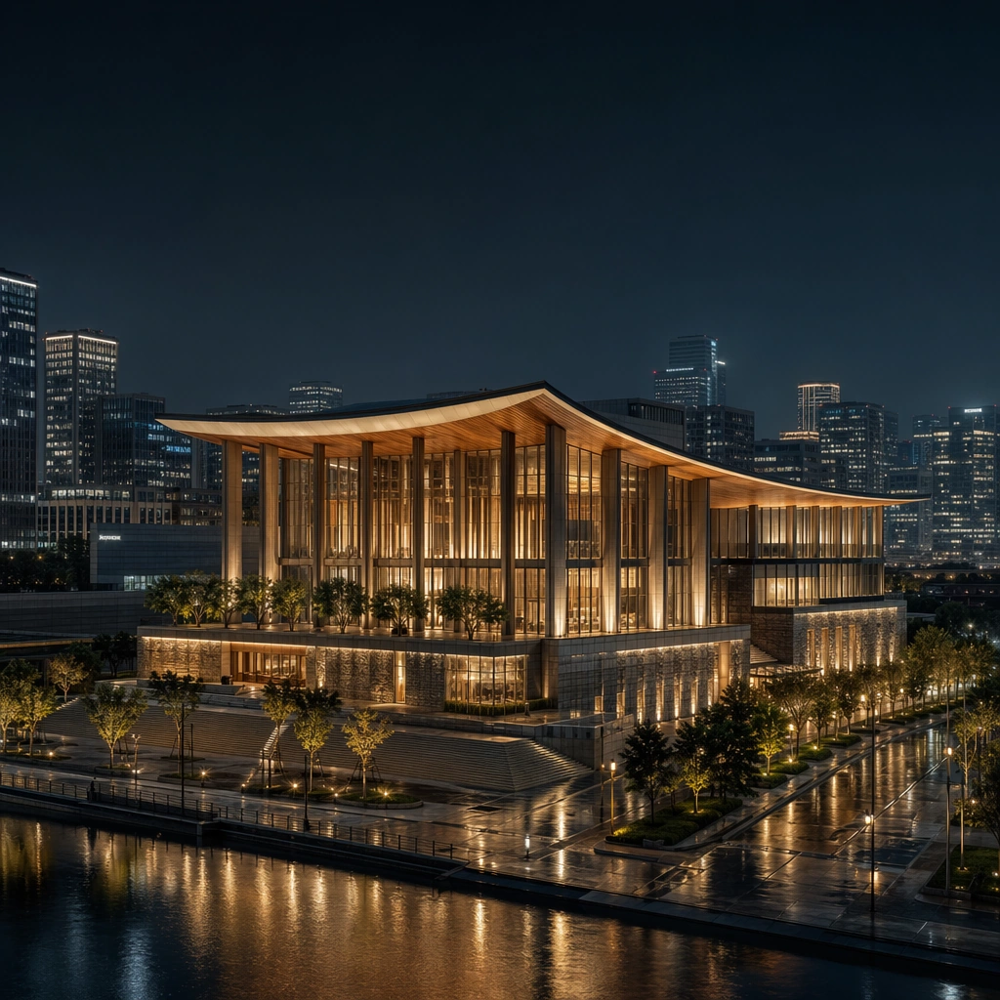

```text
Scene:
Create a square standalone support study for Night Architecture Lighting Photography Set. Use a more distant night view where the building sits within a broader urban skyline but remains the main focal point and frame it like a premium commercial still or design-editorial crop with clear focal hierarchy, disciplined perspective, and enough breathing room for the materials and objects to read at both thumbnail and full size. Keep deep blue-black night, warm gold light, cool silver reflections, and restrained amber interior spill as the tonal guide so the image still belongs to the same theme family, and light the scene in a controlled way that emphasizes texture, edge quality, and authored atmosphere over spectacle.

Subject:
Show a night-architecture photography subject with layered facade lighting, wet pavement reflections, atmospheric civic calm, controlled interior glow, and a clearly recognizable silhouette. In this support study, focus on city context, silhouette recognition, and disciplined exposure balance. The image should work independently, yet it must still feel like it belongs to the same broader world of Night Architecture. Make the space, props, and detailing useful for real campaign, editorial, or design-review contexts rather than moodboard abstraction.

Important details:
Carry forward the broader language of the building silhouette, lighting hierarchy, reflection logic, civic atmosphere, and disciplined night-photography realism, but let this image prove a new support surface or secondary deliverable. Material realism is essential: wood grain, metal sheen, glass edges, textiles, and stone should feel physically plausible and carefully art directed. Any graphic panels, labels, menus, packaging, or captions must stay abstract and unreadable. The overall result should feel reusable for hospitality night campaigns, architecture editorials, lighting-design decks, and city-brand presentations, with enough structure that a creative or operations team could build on it.

Use case:
Night Architecture Lighting Photography Set single study 9/9, exploring support image for city-brand and press uses.

Constraints:
No readable text, no watermark, no logos, preserve exact 1:1 aspect ratio, no fireworks, no traffic light streak overload, no readable signage, no festival screens, no people crowding the foreground, no other buildings with readable logos.
```

[Pinned source](https://github.com/ChaosRealmsAI/gpt-image-2-gallery/blob/5296db8c996e38776c83a0bc8c64f848dcd512b3/works/topics/night-architecture-lighting-photography-set/packages/single-support-studies/images/05-distant-skyline-insert/meta.json) · GPT Image2 · 1024×1024 · No source-declared image dependencies. · ProjectD:[published and publicly accepted](https://aitoolsradar.com/en/prompts/79db220f537fb3)

## Reference Idol Sheet · nine-expression-portrait-grid/series-idol-expression-lock/01-reference-idol-sheet

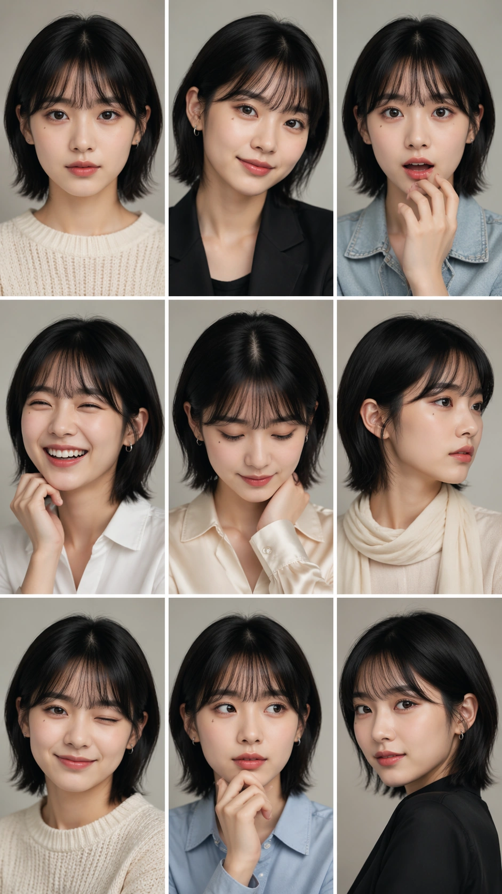

```text
Scene:
A vertical 9:16 portrait sheet arranged as an exact 3 by 3 grid with nine equal cells, thin white gutters, and a clean studio-photobook look. The background is soft warm gray in every cell, with consistent beauty lighting, shallow depth of field, and polished Korean idol portrait styling. The sheet has no readable captions, labels, numbers, or interface elements; the structure must be carried by the grid alone.

Subject:
One young adult performer appears in all nine cells as the same person: same oval face, clear skin texture, dark almond eyes, straight black chin-length hair with a soft fringe, small beauty mark below the left eye, and natural lip shape. The wardrobe is coordinated but varies subtly by cell: cream knit, black blazer, pale denim jacket, white shirt, satin collar, soft scarf, simple earrings, and no logos. Each cell shows a different expression and pose: calm front gaze, small smile, surprise, laughter, shy downward glance, serious profile, wink, thoughtful hand near chin, and confident three-quarter pose.

Important details:
This is the reference image for the series. The face must remain recognizably identical across all nine panels while expressions, head angles, hands, and outfit details change. Keep cell borders straight, cell sizes equal, and lighting direction coherent. Avoid turning the nine portraits into nine different people. The grid should read like an idol photobook contact sheet or social teaser, with precise static consistency rather than narrative action.

Use case:
Nine-Expression Portrait Grid series study 1/8, establishing the face identity and 3x3 layout reference.

Constraints:
No readable text, no watermark, no logos, preserve exact 9:16 vertical aspect ratio, no brand marks, no duplicate cropped heads outside cells, no mismatched eye color, no distorted hands, no broken gutters, no extra subjects.
```

[Pinned source](https://github.com/ChaosRealmsAI/gpt-image-2-gallery/blob/5296db8c996e38776c83a0bc8c64f848dcd512b3/works/topics/nine-expression-portrait-grid/packages/series-idol-expression-lock/images/01-reference-idol-sheet/meta.json) · GPT Image2 · 941×1672 · No source-declared image dependencies. · ProjectD:[published and publicly accepted](https://aitoolsradar.com/en/prompts/5c5ab2eff71421)

## Soft Album Sheet · nine-expression-portrait-grid/series-idol-expression-lock/03-soft-album-sheet

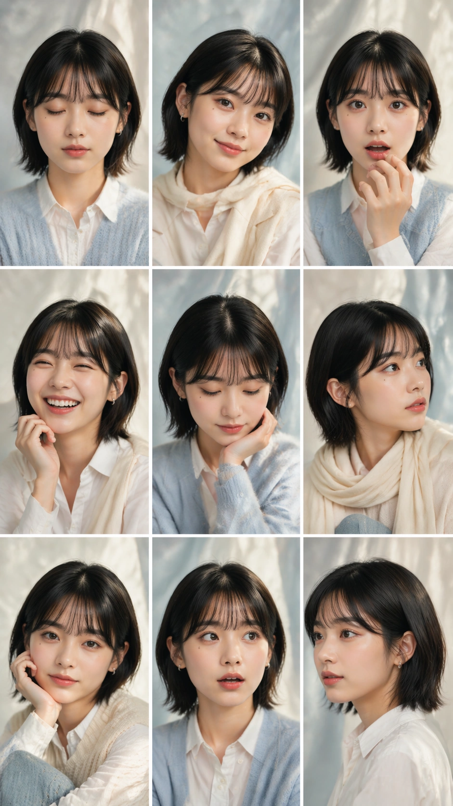

```text
Scene:
A vertical 9:16 soft album portrait sheet with the same exact 3 by 3 grid geometry as the reference: nine equal cells, thin white gutters, clean edges, no labels, and a quiet editorial rhythm. The background becomes pale cream and powder blue fabric, with diffused window light, gentle film grain, and a calm photobook mood. Every cell should feel like part of one album package rather than nine unrelated snapshots.

Subject:
Use the reference image as the primary guide for the same young performer's face, chin-length black hair, soft fringe, dark almond eyes, beauty mark below the left eye, lip shape, and facial proportions. The styling changes to a gentle album concept: white cotton shirt, light blue cardigan, cream scarf, pearl-like stud earring, pale denim, soft knit vest, and simple natural makeup. The nine expressions are sleepy calm, shy smile, wide laughter, quiet sadness, curious raised eyebrow, warm direct gaze, cheek-in-hand thoughtfulness, surprised open eyes, and serene profile.

Important details:
Identity consistency is the main challenge. The viewer must believe every panel shows the same person even as expression, head angle, crop, hand placement, and outfit layers shift. Keep the grid mathematically clean, with all gutters straight and all cells equally sized. Maintain consistent skin tone, eye shape, hair length, and beauty mark placement. Avoid magazine text, sticker decorations, duplicate faces outside the grid, or heavy retouching that erases the subject's stable features.

Use case:
Nine-Expression Portrait Grid series study 3/8, testing reference-based identity consistency in a soft album concept.

Constraints:
No readable text, no watermark, no logos, preserve exact 9:16 vertical aspect ratio, no brand marks, no changed face identity, no extra subjects, no broken cell sizes, no mismatched beauty mark, no distorted hands.
```

[Pinned source](https://github.com/ChaosRealmsAI/gpt-image-2-gallery/blob/5296db8c996e38776c83a0bc8c64f848dcd512b3/works/topics/nine-expression-portrait-grid/packages/series-idol-expression-lock/images/03-soft-album-sheet/meta.json) · GPT Image2 · 941×1672 · Reference images required. · ProjectD:[published and publicly accepted](https://aitoolsradar.com/en/prompts/8db9a5c9f9a7b8)

## Street Casting Sheet · nine-expression-portrait-grid/series-idol-expression-lock/04-street-casting-sheet

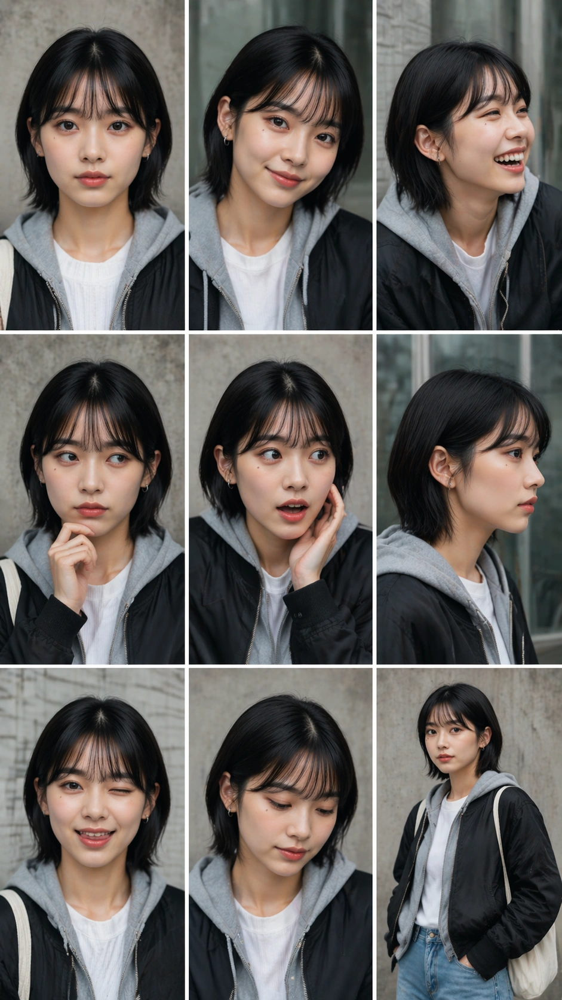

```text
Scene:
A vertical 9:16 street-casting portrait sheet using the same 3 by 3 grid structure as the reference image: nine equal cells, thin white gutters, clean border logic, and no readable captions. The setting changes to overcast urban daylight with neutral concrete walls, subway-tile texture, glass reflections, and a casual editorial street-casting mood. The layout must stay strict even though the portraits feel more spontaneous.

Subject:
Use the reference as the primary identity guide. The same young performer appears in all nine cells with the same oval face, dark almond eyes, chin-length black hair with soft fringe, beauty mark below the left eye, and stable lip shape. Styling becomes casual streetwear without logos: black bomber jacket, white ribbed tee, gray hoodie, washed denim, plain canvas tote strap, silver ear cuff, and minimal makeup. The nine expressions are neutral casting stare, quick grin, laughing side turn, skeptical eyebrow, surprised phone-call reaction without showing a phone, soft profile, playful tongue-in-cheek smile, thoughtful downward gaze, and confident hands-in-pockets pose.

Important details:
Preserve identity from image 01 while allowing street-style variation in pose and crop. Keep each cell a clean portrait or half-body portrait, not a full street scene. The face should not age, change ethnicity, change eye color, or change hair length. The grid must remain exact, with clear gutters and no overlapping panels. Backgrounds can vary slightly but should share one urban casting-session environment and consistent overcast light.

Use case:
Nine-Expression Portrait Grid series study 4/8, testing identity lock in a casual street-casting portrait sheet.

Constraints:
No readable text, no watermark, no logos, preserve exact 9:16 vertical aspect ratio, no brand marks, no changed face identity, no extra people, no broken grid alignment, no mismatched hair, no street signs.
```

[Pinned source](https://github.com/ChaosRealmsAI/gpt-image-2-gallery/blob/5296db8c996e38776c83a0bc8c64f848dcd512b3/works/topics/nine-expression-portrait-grid/packages/series-idol-expression-lock/images/04-street-casting-sheet/meta.json) · GPT Image2 · 941×1672 · Reference images required. · ProjectD:[published and publicly accepted](https://aitoolsradar.com/en/prompts/5e3103578d3d1a)

## Family Album Matriarch · nine-expression-portrait-grid/single-expression-grid-studies/01-family-album-matriarch

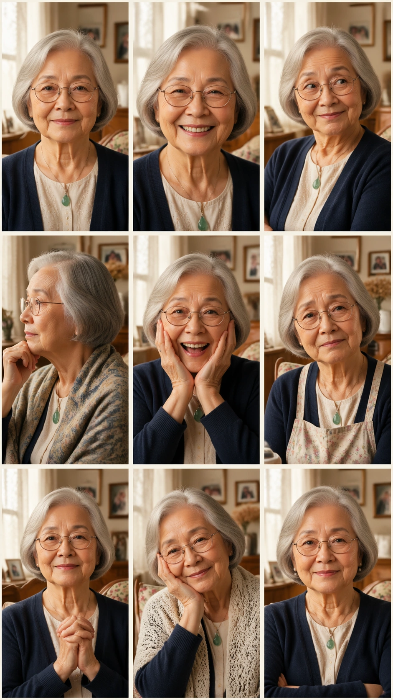

```text
Scene:
A vertical 9:16 family-album portrait sheet arranged as an exact 3 by 3 grid with nine equal cells, thin cream gutters, and warm domestic daylight. The cells share a tasteful living-room setting with linen curtains, framed family photographs rendered too soft to read, a wooden chair, and muted floral textiles. The overall image should feel like a carefully designed family archive page, but without any readable dates, captions, names, or labels.

Subject:
One elderly woman appears in all nine cells as the same person: silver bob haircut, warm brown eyes, fine smile lines, oval glasses, small jade pendant, and a navy cardigan over a pale blouse. The poses and expressions vary while identity remains stable: calm front portrait, broad grandmotherly smile, playful side-eye, thoughtful profile, surprised laugh, gentle sadness, hands folded with pride, cheek resting on hand, and confident direct gaze. Some cells show subtle wardrobe additions such as shawl, apron, or pearl-like earring, but the face and age remain unchanged.

Important details:
This is an independent same-subject consistency study. Every cell must show the same matriarch, not nine relatives. Keep glasses shape, hair length, skin tone, facial structure, and pendant consistent. The family-album mood should support the portrait grid without introducing extra people. Maintain exact grid geometry, equal cell sizes, clean gutters, and coherent warm light. The expressions should be emotionally distinct and easy to compare at a glance.

Use case:
Nine-Expression Portrait Grid single study 5/8, testing family-album identity consistency in a 3x3 portrait sheet.

Constraints:
No readable text, no watermark, no logos, preserve exact 9:16 vertical aspect ratio, no brand marks, no extra family members, no changed age, no broken grid gutters, no mismatched glasses, no duplicated background faces.
```

[Pinned source](https://github.com/ChaosRealmsAI/gpt-image-2-gallery/blob/5296db8c996e38776c83a0bc8c64f848dcd512b3/works/topics/nine-expression-portrait-grid/packages/single-expression-grid-studies/images/01-family-album-matriarch/meta.json) · GPT Image2 · 941×1672 · No source-declared image dependencies. · ProjectD:[published and publicly accepted](https://aitoolsradar.com/en/prompts/13344fdcd50686)

## Actor Audition Contact Sheet · nine-expression-portrait-grid/single-expression-grid-studies/02-actor-audition-contact-sheet

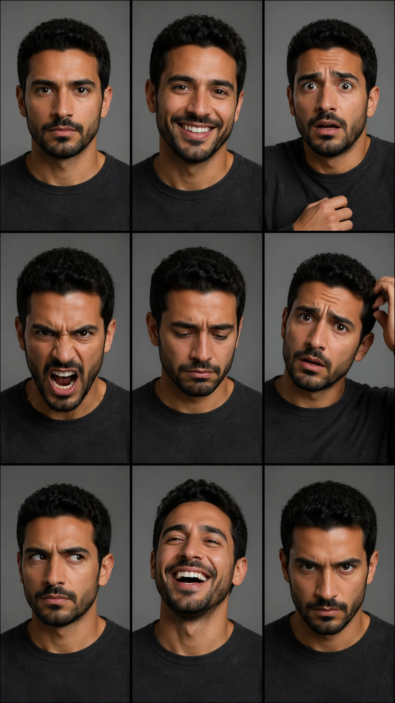

```text
Scene:
A vertical 9:16 actor audition contact sheet composed as a strict 3 by 3 grid with nine equal cells, thin black gutters, and neutral gray casting-studio backgrounds. The lighting is clean and practical, like professional headshot tests, with slight variation in intensity but no dramatic scene changes. There are no readable role labels, slate boards, names, numbers, or agency marks; the expressions and poses must carry the structure.

Subject:
One adult actor appears in all nine cells as the same person: medium skin tone, short curly dark hair, defined cheekbones, straight nose, close-trimmed beard, dark eyes, and a plain charcoal crewneck. The actor performs nine distinct audition beats: neutral slate gaze, warm commercial smile, fear, anger, quiet grief, comic confusion, suspicious side glance, relieved laugh, and intense heroic stare. Hands may enter some frames for acting gesture, but every cell should remain a portrait or chest-up crop.

Important details:
The contact sheet must demonstrate controlled expression variation while preserving the same face. Keep beard length, hairline, eye shape, facial proportions, and wardrobe consistent across all nine cells. The differences should be emotional performance, head angle, and pose, not identity drift. Maintain perfectly aligned grid gutters and equal cell sizes. The casting-studio realism should be plain and useful, not decorative, so evaluators can compare expression control clearly.

Use case:
Nine-Expression Portrait Grid single study 6/8, testing actor-audition expression range with strict identity consistency.

Constraints:
No readable text, no watermark, no logos, preserve exact 9:16 vertical aspect ratio, no brand marks, no slate text, no extra actors, no changing beard or hairline, no broken grid, no inconsistent clothing.
```

[Pinned source](https://github.com/ChaosRealmsAI/gpt-image-2-gallery/blob/5296db8c996e38776c83a0bc8c64f848dcd512b3/works/topics/nine-expression-portrait-grid/packages/single-expression-grid-studies/images/02-actor-audition-contact-sheet/meta.json) · GPT Image2 · 941×1672 · No source-declared image dependencies. · ProjectD:[published and publicly accepted](https://aitoolsradar.com/en/prompts/9ea79adc72de27)

## Athlete Media Day · nine-expression-portrait-grid/single-expression-grid-studies/03-athlete-media-day

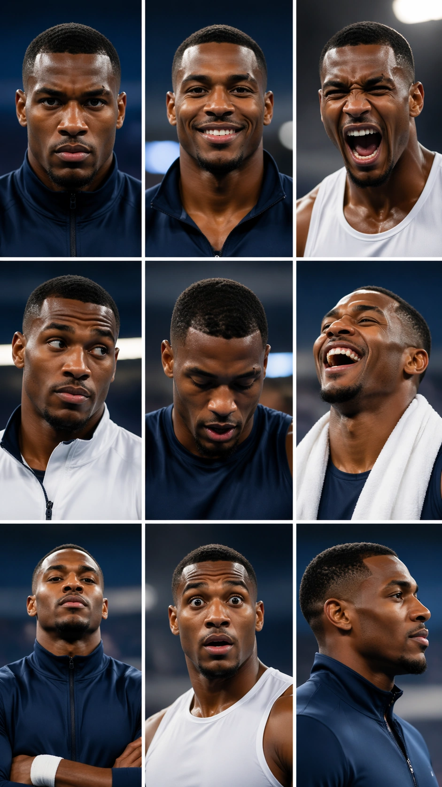

```text
Scene:
A vertical 9:16 sports media-day portrait sheet arranged as a precise 3 by 3 grid with nine equal cells, thin white gutters, and a clean arena back-wall environment. The background uses soft team-color lighting in navy, silver, and warm white, but contains no readable sponsor boards, team names, numbers, or logos. The sheet should feel like official pre-season media photography built for comparing one athlete's expressions.

Subject:
One professional athlete appears in all nine cells as the same person: athletic build, deep brown skin, close-cropped hair, strong jaw, small scar over the right eyebrow, and bright focused eyes. The outfit is a plain unbranded warm-up jacket or sleeveless training top in navy and white, varying only by zipped collar, towel, or wrist tape. The nine expressions and poses are game-face intensity, relaxed smile, roar of celebration, skeptical side look, focused downward breath, laughing with head tilted back, hands crossed with confidence, surprised raised brows, and calm profile.

Important details:
Identity consistency is essential: keep the scar, jawline, skin tone, haircut, and eye shape stable in every cell. Do not invent different teammates or change the athlete's sport-specific body language into unrelated costumes. The grid should remain perfectly aligned, with equal cells and consistent crop scale. Lighting can add energy, but the face must stay readable and photoreal. The absence of logos should not make the media-day setting vague; use posture, lighting, and athletic styling.

Use case:
Nine-Expression Portrait Grid single study 7/8, testing athlete media-day expression consistency in a structured 3x3 sheet.

Constraints:
No readable text, no watermark, no logos, preserve exact 9:16 vertical aspect ratio, no brand marks, no jersey numbers, no extra athletes, no changed scar placement, no broken gutters, no distorted hands.
```

[Pinned source](https://github.com/ChaosRealmsAI/gpt-image-2-gallery/blob/5296db8c996e38776c83a0bc8c64f848dcd512b3/works/topics/nine-expression-portrait-grid/packages/single-expression-grid-studies/images/03-athlete-media-day/meta.json) · GPT Image2 · 941×1672 · No source-declared image dependencies. · ProjectD:[published and publicly accepted](https://aitoolsradar.com/en/prompts/49c2fa5c9b2df7)

## Wedding Emotion Study · nine-expression-portrait-grid/single-expression-grid-studies/04-wedding-emotion-study

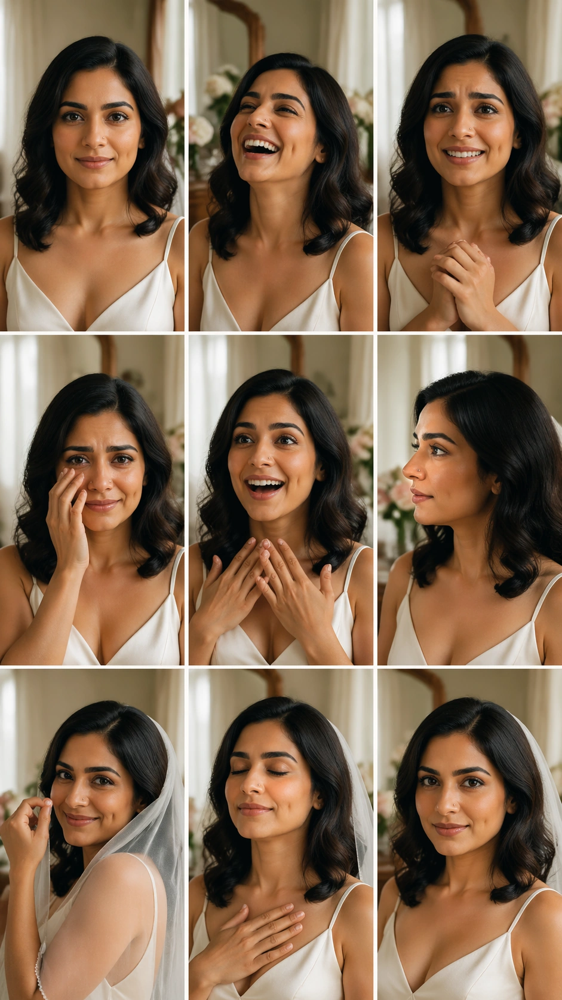

```text
Scene:
A vertical 9:16 wedding portrait emotion study arranged as an exact 3 by 3 grid with nine equal cells, thin ivory gutters, and soft natural window light. The background is a quiet bridal preparation room with sheer curtains, pale flowers, a wooden vanity, and blurred fabric textures. No invitations, vows, signage, dates, names, monograms, or readable decorations appear anywhere. The grid should feel elegant and emotionally clear.

Subject:
One bride appears in all nine cells as the same person: warm olive skin, dark wavy shoulder-length hair, arched brows, distinctive dimple on the right cheek, small nose stud, and a simple off-white satin dress with no brand details. The nine expressions and poses are serene front gaze, joyful laugh, nervous smile, tearful eyes, surprised delight, contemplative profile, playful veil gesture, deep breath with eyes closed, and confident direct gaze. Makeup, hair, jewelry, and dress remain consistent, with only veil position and hand pose changing.

Important details:
This independent study tests emotional range without identity drift. Keep the dimple, nose stud, brows, hair length, skin tone, and dress neckline stable in every cell. Each panel should show a distinct wedding-day feeling, not a different bride. Maintain equal cell dimensions, straight gutters, coherent soft light, and elegant crop scale. The subject can turn or gesture, but no bridesmaids, partners, photographers, or extra faces should enter the cells.

Use case:
Nine-Expression Portrait Grid single study 8/8, testing wedding portrait emotion range inside a structured 3x3 grid.

Constraints:
No readable text, no watermark, no logos, preserve exact 9:16 vertical aspect ratio, no brand marks, no extra people, no changed dress neckline, no missing dimple, no broken grid, no duplicated hands.
```

[Pinned source](https://github.com/ChaosRealmsAI/gpt-image-2-gallery/blob/5296db8c996e38776c83a0bc8c64f848dcd512b3/works/topics/nine-expression-portrait-grid/packages/single-expression-grid-studies/images/04-wedding-emotion-study/meta.json) · GPT Image2 · 941×1672 · No source-declared image dependencies. · ProjectD:[published and publicly accepted](https://aitoolsradar.com/en/prompts/4f9593a2ad9773)

## Reference Character Anchor · noir-character-poster-portraits/series-cinematic-portrait-lock/01-reference-character-anchor

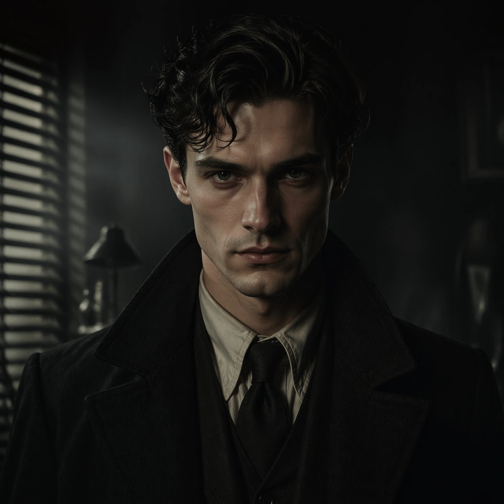

```text
Scene:
Create a square 1:1 portrait image for Noir Character Poster Portraits. Use a premium story-led portrait setup with calm atmosphere, cinematic light discipline, and enough detail to define the recurring character. The frame should feel like a finished professional deliverable rather than a casual snapshot, with clear lens discipline, believable light falloff, and a palette that directly supports Create moody noir-style character portraits that sit between still photography and key art, with shadow-led lighting and strong psychological framing.. Keep enough surrounding space and compositional control for gallery, research, campaign, or approval-board reuse while staying photoreal and human-scaled.

Subject:
Center one noir lead with pale skin, dark wavy hair, sharp cheekbones, and guarded eyes. Establish the exact face, hair base, body proportions, and costume baseline that later story beats must preserve. Use the example direction from the brief as grounding context: Create moody noir-style character portraits that sit between still photography and key art, with shadow-led lighting and strong psychological framing.. Wardrobe, lighting, environment, and pose may shift to serve this variation, but the viewer must immediately understand that the same reference identity is still in front of the camera.

Important details:
This backlog line is difficult because Create moody noir-style character portraits that sit between still photography and key art, with shadow-led lighting and strong psychological framing.. Preserve skin tone family, bone structure, eye spacing, nose shape, mouth shape, hairline logic, shoulder width, and overall body read across the entire series. preserve exact face / hair base / body proportions from the reference model. This is the anchor portrait for a narrative sequence, so recognition matters more than spectacle. Avoid the common failure described in the brief: ordinary image models often lose likeness once styling, lighting, or layout changes enter the frame. Success should feel like the result should feel professionally usable, coherent, and clearly built around one stable human identity.

Use case:
Noir Character Poster Portraits series study 1/9, the baseline character portrait.

Constraints:
No readable text, no watermark, no logos, preserve exact 1:1 aspect ratio, preserve exact face / hair base / body proportions from the reference model, no crowd, no unreadable poster text, no genre clutter, no face ambiguity.
```

[Pinned source](https://github.com/ChaosRealmsAI/gpt-image-2-gallery/blob/5296db8c996e38776c83a0bc8c64f848dcd512b3/works/topics/noir-character-poster-portraits/packages/series-cinematic-portrait-lock/images/01-reference-character-anchor/meta.json) · GPT Image2 · 1254×1254 · No source-declared image dependencies. · ProjectD:[published and publicly accepted](https://aitoolsradar.com/en/prompts/7f06a2b62ee63e)

## Interior Scene · noir-character-poster-portraits/series-cinematic-portrait-lock/02-interior-scene

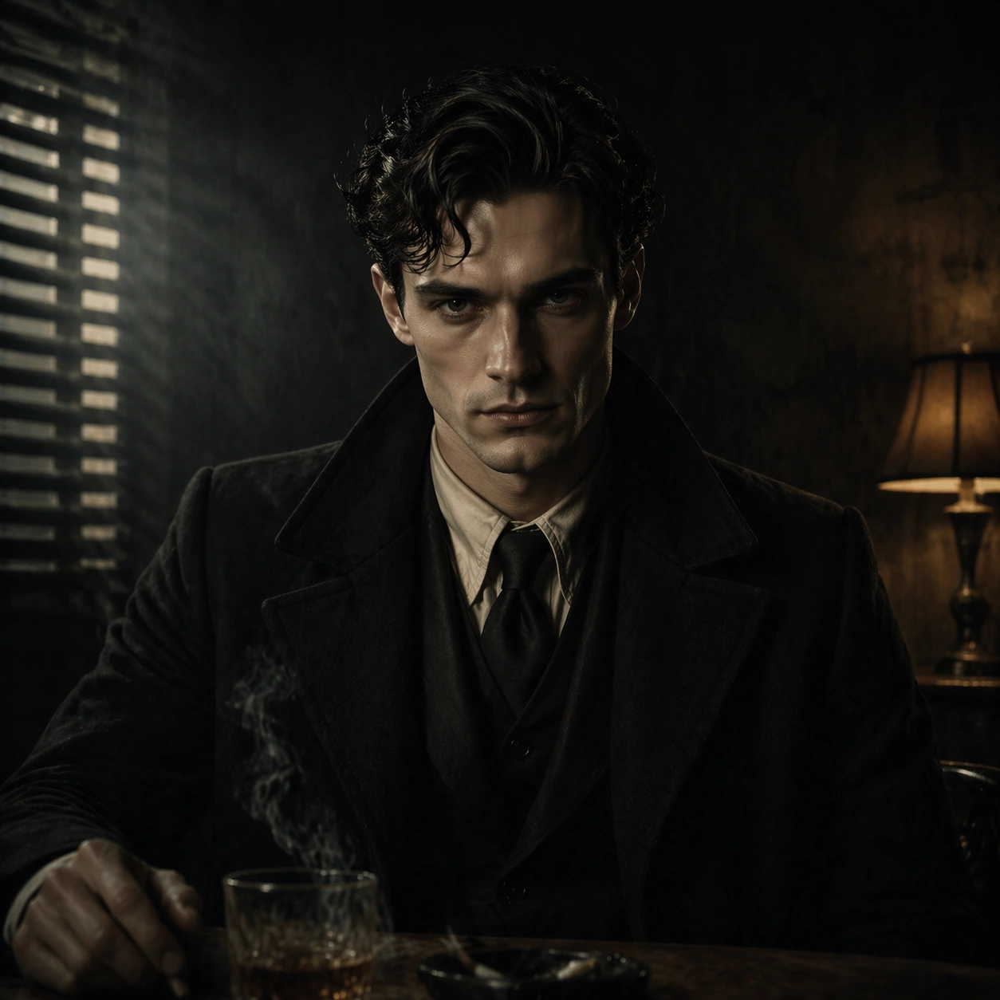

```text
Scene:
Create a square 1:1 portrait image for Noir Character Poster Portraits. Use a carefully staged room or interior with motivated light, layered depth, and one clear emotional focus. The frame should feel like a finished professional deliverable rather than a casual snapshot, with clear lens discipline, believable light falloff, and a palette that directly supports Create moody noir-style character portraits that sit between still photography and key art, with shadow-led lighting and strong psychological framing.. Keep enough surrounding space and compositional control for gallery, research, campaign, or approval-board reuse while staying photoreal and human-scaled.

Subject:
Center one noir lead with pale skin, dark wavy hair, sharp cheekbones, and guarded eyes. Place the same character into a story situation without changing who they are. Preserve the anchor identity even as costume texture or environment becomes richer. Use the example direction from the brief as grounding context: Create moody noir-style character portraits that sit between still photography and key art, with shadow-led lighting and strong psychological framing.. Wardrobe, lighting, environment, and pose may shift to serve this variation, but the viewer must immediately understand that the same reference identity is still in front of the camera.

Important details:
This backlog line is difficult because Create moody noir-style character portraits that sit between still photography and key art, with shadow-led lighting and strong psychological framing.. Preserve skin tone family, bone structure, eye spacing, nose shape, mouth shape, hairline logic, shoulder width, and overall body read across the entire series. preserve exact face / hair base / body proportions from the reference model. The scene may feel cinematic, but likeness still outranks atmosphere. Avoid the common failure described in the brief: ordinary image models often lose likeness once styling, lighting, or layout changes enter the frame. Success should feel like the result should feel professionally usable, coherent, and clearly built around one stable human identity.

Use case:
Noir Character Poster Portraits series study 2/9, an interior story beat.

Constraints:
No readable text, no watermark, no logos, preserve exact 1:1 aspect ratio, preserve exact face / hair base / body proportions from the reference model, no extra protagonists, no busy set dressing, no drastic age shift, no unrelated props.
```

[Pinned source](https://github.com/ChaosRealmsAI/gpt-image-2-gallery/blob/5296db8c996e38776c83a0bc8c64f848dcd512b3/works/topics/noir-character-poster-portraits/packages/series-cinematic-portrait-lock/images/02-interior-scene/meta.json) · GPT Image2 · 1254×1254 · Reference images required. · ProjectD:[published and publicly accepted](https://aitoolsradar.com/en/prompts/dfcb773c8594ca)

## Transition Pause · noir-character-poster-portraits/series-cinematic-portrait-lock/03-transition-pause

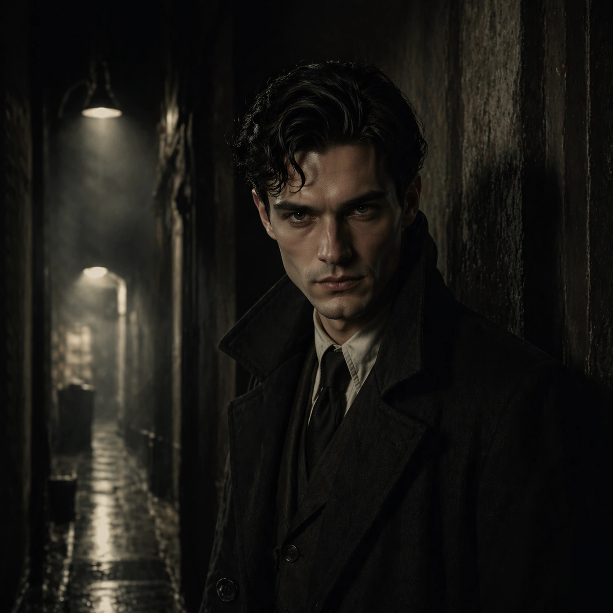

```text
Scene:
Create a square 1:1 portrait image for Noir Character Poster Portraits. Use a hallway, alley, corridor, or threshold frame with directional light and clean silhouette control. The frame should feel like a finished professional deliverable rather than a casual snapshot, with clear lens discipline, believable light falloff, and a palette that directly supports Create moody noir-style character portraits that sit between still photography and key art, with shadow-led lighting and strong psychological framing.. Keep enough surrounding space and compositional control for gallery, research, campaign, or approval-board reuse while staying photoreal and human-scaled.

Subject:
Center one noir lead with pale skin, dark wavy hair, sharp cheekbones, and guarded eyes. Use a transition space to show the same character in motion or pause while preserving exact face / hair base / body proportions from the reference model. Use the example direction from the brief as grounding context: Create moody noir-style character portraits that sit between still photography and key art, with shadow-led lighting and strong psychological framing.. Wardrobe, lighting, environment, and pose may shift to serve this variation, but the viewer must immediately understand that the same reference identity is still in front of the camera.

Important details:
This backlog line is difficult because Create moody noir-style character portraits that sit between still photography and key art, with shadow-led lighting and strong psychological framing.. Preserve skin tone family, bone structure, eye spacing, nose shape, mouth shape, hairline logic, shoulder width, and overall body read across the entire series. preserve exact face / hair base / body proportions from the reference model. This image should feel like the next shot in one film, not a new casting choice. Avoid the common failure described in the brief: ordinary image models often lose likeness once styling, lighting, or layout changes enter the frame. Success should feel like the result should feel professionally usable, coherent, and clearly built around one stable human identity.

Use case:
Noir Character Poster Portraits series study 3/9, a transitional pause portrait.

Constraints:
No readable text, no watermark, no logos, preserve exact 1:1 aspect ratio, preserve exact face / hair base / body proportions from the reference model, no hidden face, no body warp, no action blur, no background signage.
```

[Pinned source](https://github.com/ChaosRealmsAI/gpt-image-2-gallery/blob/5296db8c996e38776c83a0bc8c64f848dcd512b3/works/topics/noir-character-poster-portraits/packages/series-cinematic-portrait-lock/images/03-transition-pause/meta.json) · GPT Image2 · 1254×1254 · Reference images required. · ProjectD:[published and publicly accepted](https://aitoolsradar.com/en/prompts/fa02432716af68)

## Close-up Emotion · noir-character-poster-portraits/series-cinematic-portrait-lock/04-closeup-emotion

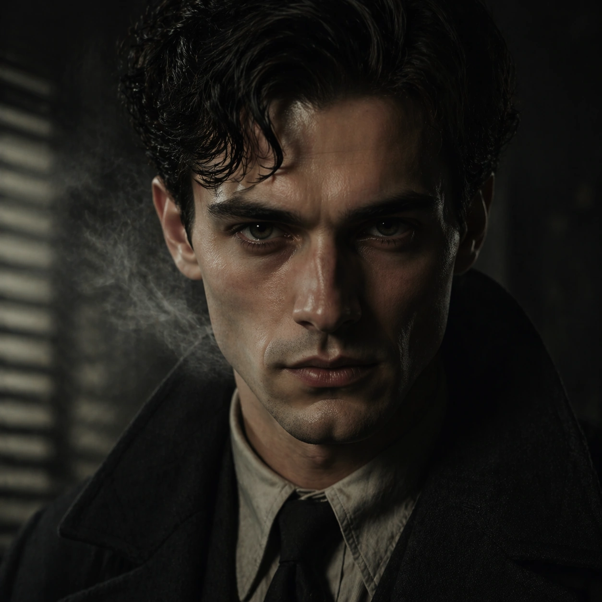

```text
Scene:
Create a square 1:1 portrait image for Noir Character Poster Portraits. Use a tighter crop with visible skin texture, lashes, breath, and emotional tension controlled by cinematic light. The frame should feel like a finished professional deliverable rather than a casual snapshot, with clear lens discipline, believable light falloff, and a palette that directly supports Create moody noir-style character portraits that sit between still photography and key art, with shadow-led lighting and strong psychological framing.. Keep enough surrounding space and compositional control for gallery, research, campaign, or approval-board reuse while staying photoreal and human-scaled.

Subject:
Center one noir lead with pale skin, dark wavy hair, sharp cheekbones, and guarded eyes. Move closer to the same face to test emotional precision without any identity drift. Use the example direction from the brief as grounding context: Create moody noir-style character portraits that sit between still photography and key art, with shadow-led lighting and strong psychological framing.. Wardrobe, lighting, environment, and pose may shift to serve this variation, but the viewer must immediately understand that the same reference identity is still in front of the camera.

Important details:
This backlog line is difficult because Create moody noir-style character portraits that sit between still photography and key art, with shadow-led lighting and strong psychological framing.. Preserve skin tone family, bone structure, eye spacing, nose shape, mouth shape, hairline logic, shoulder width, and overall body read across the entire series. preserve exact face / hair base / body proportions from the reference model. Every small facial marker should still match the reference anchor. Avoid the common failure described in the brief: ordinary image models often lose likeness once styling, lighting, or layout changes enter the frame. Success should feel like the result should feel professionally usable, coherent, and clearly built around one stable human identity.

Use case:
Noir Character Poster Portraits series study 4/9, a close emotional portrait.

Constraints:
No readable text, no watermark, no logos, preserve exact 1:1 aspect ratio, preserve exact face / hair base / body proportions from the reference model, no tears that melt features, no face reshaping, no extreme beauty retouching, no second person.
```

[Pinned source](https://github.com/ChaosRealmsAI/gpt-image-2-gallery/blob/5296db8c996e38776c83a0bc8c64f848dcd512b3/works/topics/noir-character-poster-portraits/packages/series-cinematic-portrait-lock/images/04-closeup-emotion/meta.json) · GPT Image2 · 1254×1254 · Reference images required. · ProjectD:[published and publicly accepted](https://aitoolsradar.com/en/prompts/464aee6767c380)

## Exterior Walk · noir-character-poster-portraits/series-cinematic-portrait-lock/05-exterior-walk

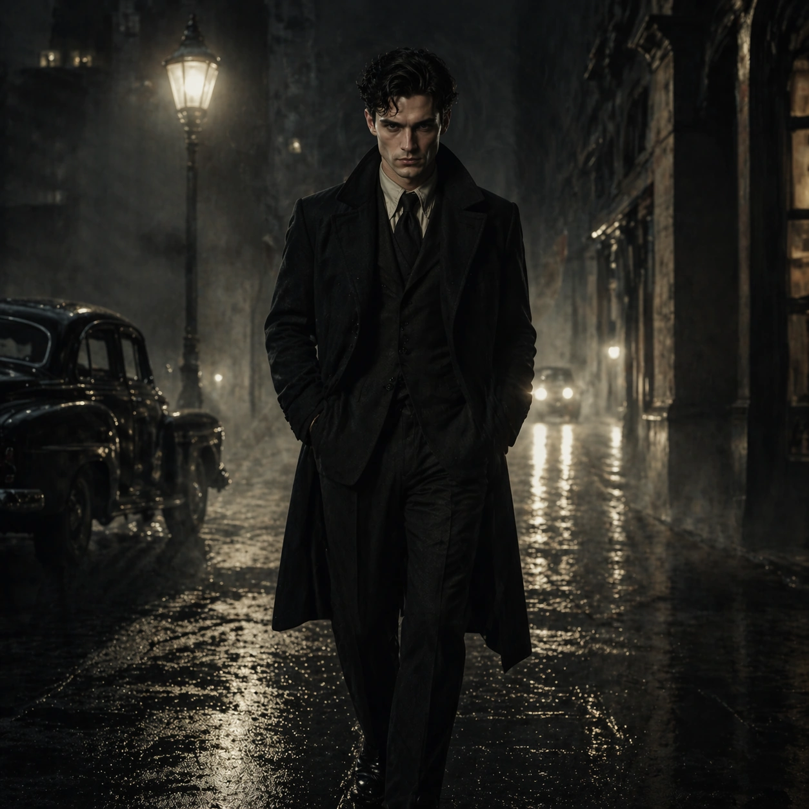

```text
Scene:
Create a square 1:1 portrait image for Noir Character Poster Portraits. Use a believable outdoor setup with motivated practical light and enough environment to imply story stakes. The frame should feel like a finished professional deliverable rather than a casual snapshot, with clear lens discipline, believable light falloff, and a palette that directly supports Create moody noir-style character portraits that sit between still photography and key art, with shadow-led lighting and strong psychological framing.. Keep enough surrounding space and compositional control for gallery, research, campaign, or approval-board reuse while staying photoreal and human-scaled.

Subject:
Center one noir lead with pale skin, dark wavy hair, sharp cheekbones, and guarded eyes. Keep the same character exact while expanding to a wider frame that shows gait, shoulders, and costume silhouette in context. Use the example direction from the brief as grounding context: Create moody noir-style character portraits that sit between still photography and key art, with shadow-led lighting and strong psychological framing.. Wardrobe, lighting, environment, and pose may shift to serve this variation, but the viewer must immediately understand that the same reference identity is still in front of the camera.

Important details:
This backlog line is difficult because Create moody noir-style character portraits that sit between still photography and key art, with shadow-led lighting and strong psychological framing.. Preserve skin tone family, bone structure, eye spacing, nose shape, mouth shape, hairline logic, shoulder width, and overall body read across the entire series. preserve exact face / hair base / body proportions from the reference model. Body proportions must stay stable even in motion-aware framing. Avoid the common failure described in the brief: ordinary image models often lose likeness once styling, lighting, or layout changes enter the frame. Success should feel like the result should feel professionally usable, coherent, and clearly built around one stable human identity.

Use case:
Noir Character Poster Portraits series study 5/9, an exterior walk or movement frame.

Constraints:
No readable text, no watermark, no logos, preserve exact 1:1 aspect ratio, preserve exact face / hair base / body proportions from the reference model, no action-movie explosion cliche, no giant environment spectacle, no body elongation, no crowd confusion.
```

[Pinned source](https://github.com/ChaosRealmsAI/gpt-image-2-gallery/blob/5296db8c996e38776c83a0bc8c64f848dcd512b3/works/topics/noir-character-poster-portraits/packages/series-cinematic-portrait-lock/images/05-exterior-walk/meta.json) · GPT Image2 · 1254×1254 · Reference images required. · ProjectD:[published and publicly accepted](https://aitoolsradar.com/en/prompts/b4e4b2873507f5)

## Profile Shadow · noir-character-poster-portraits/series-cinematic-portrait-lock/06-profile-shadow

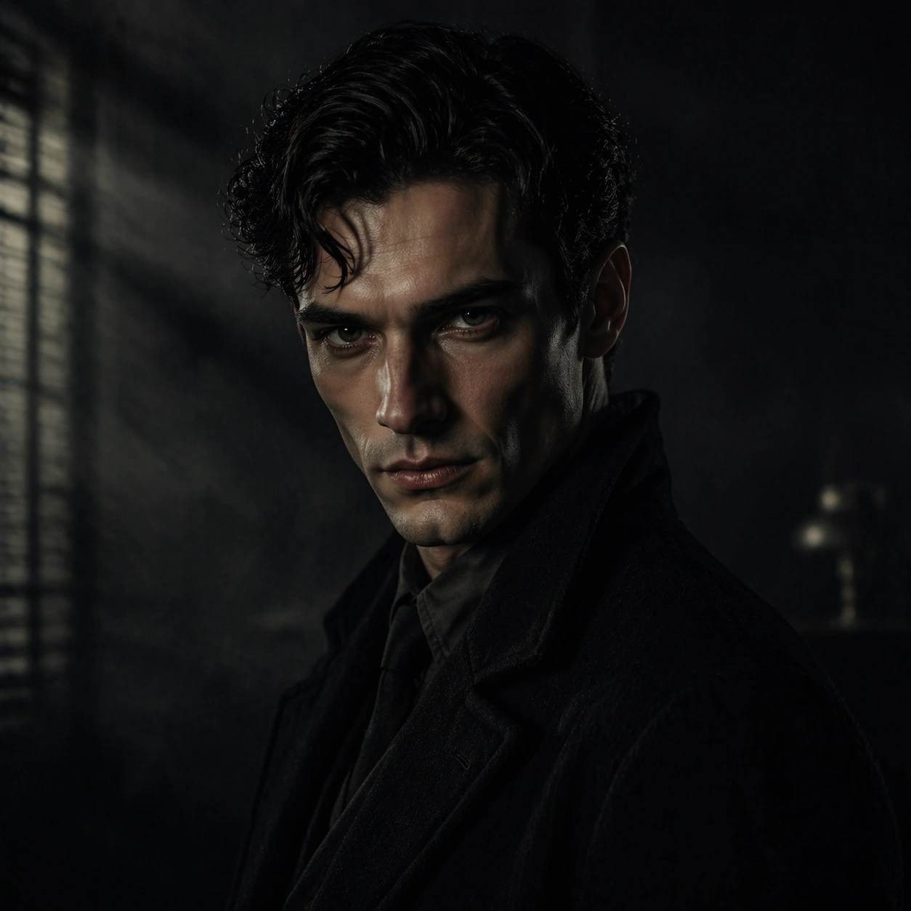

```text
Scene:
Create a square 1:1 portrait image for Noir Character Poster Portraits. Use a moody side-light frame with rich shadow design, clean negative space, and readable facial geometry. The frame should feel like a finished professional deliverable rather than a casual snapshot, with clear lens discipline, believable light falloff, and a palette that directly supports Create moody noir-style character portraits that sit between still photography and key art, with shadow-led lighting and strong psychological framing.. Keep enough surrounding space and compositional control for gallery, research, campaign, or approval-board reuse while staying photoreal and human-scaled.

Subject:
Center one noir lead with pale skin, dark wavy hair, sharp cheekbones, and guarded eyes. Use profile and shadow to deepen mood, but preserve the exact nose bridge, jawline, ear shape, and hair base from the reference. Use the example direction from the brief as grounding context: Create moody noir-style character portraits that sit between still photography and key art, with shadow-led lighting and strong psychological framing.. Wardrobe, lighting, environment, and pose may shift to serve this variation, but the viewer must immediately understand that the same reference identity is still in front of the camera.

Important details:
This backlog line is difficult because Create moody noir-style character portraits that sit between still photography and key art, with shadow-led lighting and strong psychological framing.. Preserve skin tone family, bone structure, eye spacing, nose shape, mouth shape, hairline logic, shoulder width, and overall body read across the entire series. preserve exact face / hair base / body proportions from the reference model. This should feel psychologically sharper, not visually inconsistent. Avoid the common failure described in the brief: ordinary image models often lose likeness once styling, lighting, or layout changes enter the frame. Success should feel like the result should feel professionally usable, coherent, and clearly built around one stable human identity.

Use case:
Noir Character Poster Portraits series study 6/9, a profile or shadow-driven portrait.

Constraints:
No readable text, no watermark, no logos, preserve exact 1:1 aspect ratio, preserve exact face / hair base / body proportions from the reference model, no crushed shadow mush, no altered profile, no costume reset, no thriller poster text.
```

[Pinned source](https://github.com/ChaosRealmsAI/gpt-image-2-gallery/blob/5296db8c996e38776c83a0bc8c64f848dcd512b3/works/topics/noir-character-poster-portraits/packages/series-cinematic-portrait-lock/images/06-profile-shadow/meta.json) · GPT Image2 · 1254×1254 · Reference images required. · ProjectD:[published and publicly accepted](https://aitoolsradar.com/en/prompts/3b421dceeb5cc2)

## Detail Prop Frame · noir-character-poster-portraits/series-cinematic-portrait-lock/07-detail-prop-frame

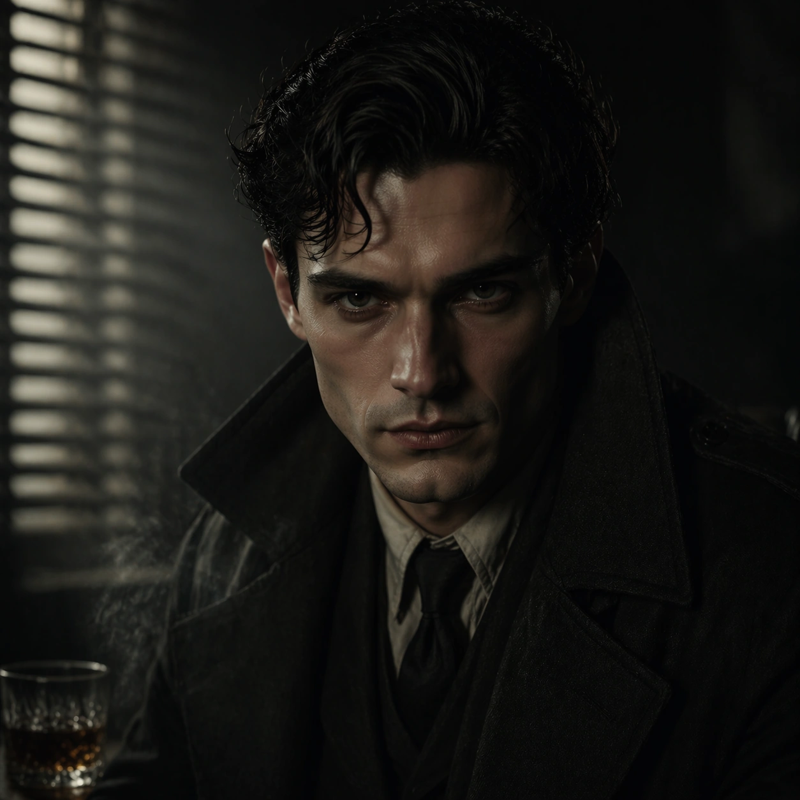

```text
Scene:
Create a square 1:1 portrait image for Noir Character Poster Portraits. Use a tighter narrative crop that lets one object, garment edge, or environmental clue support the portrait without stealing focus. The frame should feel like a finished professional deliverable rather than a casual snapshot, with clear lens discipline, believable light falloff, and a palette that directly supports Create moody noir-style character portraits that sit between still photography and key art, with shadow-led lighting and strong psychological framing.. Keep enough surrounding space and compositional control for gallery, research, campaign, or approval-board reuse while staying photoreal and human-scaled.

Subject:
Center one noir lead with pale skin, dark wavy hair, sharp cheekbones, and guarded eyes. Keep the same character identity dominant while allowing one prop or costume detail to strengthen the story world. Use the example direction from the brief as grounding context: Create moody noir-style character portraits that sit between still photography and key art, with shadow-led lighting and strong psychological framing.. Wardrobe, lighting, environment, and pose may shift to serve this variation, but the viewer must immediately understand that the same reference identity is still in front of the camera.

Important details:
This backlog line is difficult because Create moody noir-style character portraits that sit between still photography and key art, with shadow-led lighting and strong psychological framing.. Preserve skin tone family, bone structure, eye spacing, nose shape, mouth shape, hairline logic, shoulder width, and overall body read across the entire series. preserve exact face / hair base / body proportions from the reference model. The prop exists to deepen narrative context, not to distract from likeness. Avoid the common failure described in the brief: ordinary image models often lose likeness once styling, lighting, or layout changes enter the frame. Success should feel like the result should feel professionally usable, coherent, and clearly built around one stable human identity.

Use case:
Noir Character Poster Portraits series study 7/9, a detail frame with one prop or costume clue.

Constraints:
No readable text, no watermark, no logos, preserve exact 1:1 aspect ratio, preserve exact face / hair base / body proportions from the reference model, no branded props, no unreadable newspaper text, no weapon overload, no broken hands.
```

[Pinned source](https://github.com/ChaosRealmsAI/gpt-image-2-gallery/blob/5296db8c996e38776c83a0bc8c64f848dcd512b3/works/topics/noir-character-poster-portraits/packages/series-cinematic-portrait-lock/images/07-detail-prop-frame/meta.json) · GPT Image2 · 1254×1254 · Reference images required. · ProjectD:[published and publicly accepted](https://aitoolsradar.com/en/prompts/4890f161e86282)

## Poster Crop · noir-character-poster-portraits/series-cinematic-portrait-lock/08-poster-crop

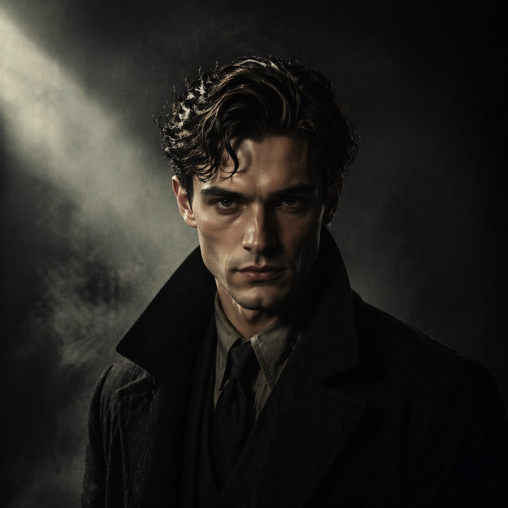

```text
Scene:
Create a square 1:1 portrait image for Noir Character Poster Portraits. Use a cleaner campaign or one-sheet style portrait with deliberate negative space and clear focal hierarchy. The frame should feel like a finished professional deliverable rather than a casual snapshot, with clear lens discipline, believable light falloff, and a palette that directly supports Create moody noir-style character portraits that sit between still photography and key art, with shadow-led lighting and strong psychological framing.. Keep enough surrounding space and compositional control for gallery, research, campaign, or approval-board reuse while staying photoreal and human-scaled.

Subject:
Center one noir lead with pale skin, dark wavy hair, sharp cheekbones, and guarded eyes. Turn the same character into a poster-worthy portrait without readable text or identity drift. Use the example direction from the brief as grounding context: Create moody noir-style character portraits that sit between still photography and key art, with shadow-led lighting and strong psychological framing.. Wardrobe, lighting, environment, and pose may shift to serve this variation, but the viewer must immediately understand that the same reference identity is still in front of the camera.

Important details:
This backlog line is difficult because Create moody noir-style character portraits that sit between still photography and key art, with shadow-led lighting and strong psychological framing.. Preserve skin tone family, bone structure, eye spacing, nose shape, mouth shape, hairline logic, shoulder width, and overall body read across the entire series. preserve exact face / hair base / body proportions from the reference model. This frame should feel usable for key art while staying true to the reference model. Avoid the common failure described in the brief: ordinary image models often lose likeness once styling, lighting, or layout changes enter the frame. Success should feel like the result should feel professionally usable, coherent, and clearly built around one stable human identity.

Use case:
Noir Character Poster Portraits series study 8/9, a poster-like hero crop.

Constraints:
No readable text, no watermark, no logos, preserve exact 1:1 aspect ratio, preserve exact face / hair base / body proportions from the reference model, no fake title text, no logo marks, no giant montage collage, no alternate casting.
```

[Pinned source](https://github.com/ChaosRealmsAI/gpt-image-2-gallery/blob/5296db8c996e38776c83a0bc8c64f848dcd512b3/works/topics/noir-character-poster-portraits/packages/series-cinematic-portrait-lock/images/08-poster-crop/meta.json) · GPT Image2 · 1254×1254 · Reference images required. · ProjectD:[published and publicly accepted](https://aitoolsradar.com/en/prompts/52bdf611881638)

## Finale Aftermath · noir-character-poster-portraits/series-cinematic-portrait-lock/09-finale-aftermath

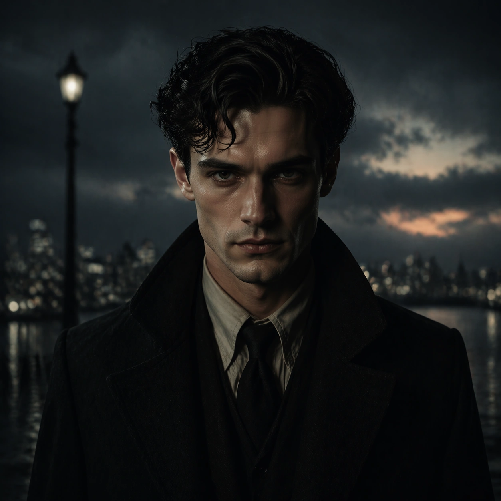

```text
Scene:
Create a square 1:1 portrait image for Noir Character Poster Portraits. Use a quieter cinematic frame with residue, dusk, or emotional calm, still anchored by precise portrait craft. The frame should feel like a finished professional deliverable rather than a casual snapshot, with clear lens discipline, believable light falloff, and a palette that directly supports Create moody noir-style character portraits that sit between still photography and key art, with shadow-led lighting and strong psychological framing.. Keep enough surrounding space and compositional control for gallery, research, campaign, or approval-board reuse while staying photoreal and human-scaled.

Subject:
Center one noir lead with pale skin, dark wavy hair, sharp cheekbones, and guarded eyes. Close the series on the same character, carrying all previous continuity into a final resolved image that still looks like part of the same story arc. Use the example direction from the brief as grounding context: Create moody noir-style character portraits that sit between still photography and key art, with shadow-led lighting and strong psychological framing.. Wardrobe, lighting, environment, and pose may shift to serve this variation, but the viewer must immediately understand that the same reference identity is still in front of the camera.

Important details:
This backlog line is difficult because Create moody noir-style character portraits that sit between still photography and key art, with shadow-led lighting and strong psychological framing.. Preserve skin tone family, bone structure, eye spacing, nose shape, mouth shape, hairline logic, shoulder width, and overall body read across the entire series. preserve exact face / hair base / body proportions from the reference model. Mood may soften or darken, but the same-person read cannot weaken. Avoid the common failure described in the brief: ordinary image models often lose likeness once styling, lighting, or layout changes enter the frame. Success should feel like the result should feel professionally usable, coherent, and clearly built around one stable human identity.

Use case:
Noir Character Poster Portraits series study 9/9, a resolved final aftermath portrait.

Constraints:
No readable text, no watermark, no logos, preserve exact 1:1 aspect ratio, preserve exact face / hair base / body proportions from the reference model, no sequel-bait crowd scene, no face drift, no genre jump, no decorative smoke overload.
```

[Pinned source](https://github.com/ChaosRealmsAI/gpt-image-2-gallery/blob/5296db8c996e38776c83a0bc8c64f848dcd512b3/works/topics/noir-character-poster-portraits/packages/series-cinematic-portrait-lock/images/09-finale-aftermath/meta.json) · GPT Image2 · 1254×1254 · Reference images required. · ProjectD:[published and publicly accepted](https://aitoolsradar.com/en/prompts/96f284d9b4a3e1)

## Reference Faction Overview · npc-faction-casting-sheet/series-faction-language-lock/01-reference-faction-overview


```text
Scene:
Build a square casting-board hero image viewed like a premium concept bible page pinned on a neutral studio wall, with structured compartments, clean margins, and strong central hierarchy. Keep the overall frame square, polished, and production-ready game art bible presentation with crisp panel rhythm, believable costume construction, and enough visual hierarchy for downstream UI or documentation reuse. Let materials, lighting, and spacing feel intentional enough for gallery, research, campaign, or approval-board reuse without depending on readable text.

Subject:
Present five archetypes from the same citadel faction in one frame: a gate guard, a water merchant, a field medic, a machine tender, and an elite captain. Ground the image inside a wind-carved desert citadel faction with oxidized bronze, indigo cloth, pale bone accents, practical leather, and a sun-faded military-monastic attitude. Use multiple adult NPC archetypes such as guard, quartermaster, medic, machinist, scout, priest, and captain, but keep them visually linked through the same regional craft language and social hierarchy. 

Important details:
Keep insignia geometry, rank markers, cloth layering, tool silhouettes, and color hierarchy coherent across every role so the cast reads like one population rather than unrelated hero concepts. Make the captain visibly higher rank without turning the others into extras. Every figure should feel game-usable, grounded, and distinct in job function. Use this frame to establish the reference system that later dependent images must preserve. Favor believable production craft, clean hierarchy, and reusable visual logic over empty spectacle or random decoration.

Use case:
NPC Faction Casting Sheet series study 1/9, the anchor board that defines the faction casting language.

Constraints:
No readable text, no watermark, no logos, preserve exact 1:1 aspect ratio, no unrelated fantasy races, no random neon tech, no comic exaggeration, no costume drift between roles.
```

[Pinned source](https://github.com/ChaosRealmsAI/gpt-image-2-gallery/blob/5296db8c996e38776c83a0bc8c64f848dcd512b3/works/topics/npc-faction-casting-sheet/packages/series-faction-language-lock/images/01-reference-faction-overview/meta.json) · GPT Image2 · 1254×1254 · No source-declared image dependencies. · ProjectD:[published and publicly accepted](https://aitoolsradar.com/en/prompts/f3d79e3565288a)

## Guard and Vendor Roster · npc-faction-casting-sheet/series-faction-language-lock/02-guard-vendor-roster


```text
Scene:
Compose a square roster plate with two tall character columns and smaller accessory callouts, like a studio-approved sheet for side-cast implementation. Keep the overall frame square, polished, and production-ready game art bible presentation with crisp panel rhythm, believable costume construction, and enough visual hierarchy for downstream UI or documentation reuse. Let materials, lighting, and spacing feel intentional enough for gallery, research, campaign, or approval-board reuse without depending on readable text.

Subject:
Focus on a gate guard, a market vendor, and a caravan clerk from the same faction, showing how civilian roles inherit the same insignia and materials with softer protection levels. Ground the image inside a wind-carved desert citadel faction with oxidized bronze, indigo cloth, pale bone accents, practical leather, and a sun-faded military-monastic attitude. Use multiple adult NPC archetypes such as guard, quartermaster, medic, machinist, scout, priest, and captain, but keep them visually linked through the same regional craft language and social hierarchy. 

Important details:
Keep insignia geometry, rank markers, cloth layering, tool silhouettes, and color hierarchy coherent across every role so the cast reads like one population rather than unrelated hero concepts. The sheet should prove that noncombat NPCs still belong to the same world. Use subtle prop logic such as ration satchels, water seals, and stamped cloth tabs. Treat this frame as reference-dependent on image 01 and preserve the same core system, hierarchy, and visual language. Favor believable production craft, clean hierarchy, and reusable visual logic over empty spectacle or random decoration.

Use case:
NPC Faction Casting Sheet series study 2/9, a civilian-versus-military roster comparison within one faction.

Constraints:
No readable text, no watermark, no logos, preserve exact 1:1 aspect ratio, no modern storefront cues, no unrelated luxury styling, no duplicate poses, no broken accessory scale.
```

[Pinned source](https://github.com/ChaosRealmsAI/gpt-image-2-gallery/blob/5296db8c996e38776c83a0bc8c64f848dcd512b3/works/topics/npc-faction-casting-sheet/packages/series-faction-language-lock/images/02-guard-vendor-roster/meta.json) · GPT Image2 · 1254×1254 · Reference images required. · ProjectD:[published and publicly accepted](https://aitoolsradar.com/en/prompts/2b5c80f7ee3ead)

## Medic and Engineer Pairing · npc-faction-casting-sheet/series-faction-language-lock/03-medic-engineer-pairing


```text
Scene:
Create a square pairing board with one medic and one engineer framed by modular equipment panels, soft shadowed paper layers, and tidy concept-art organization. Keep the overall frame square, polished, and production-ready game art bible presentation with crisp panel rhythm, believable costume construction, and enough visual hierarchy for downstream UI or documentation reuse. Let materials, lighting, and spacing feel intentional enough for gallery, research, campaign, or approval-board reuse without depending on readable text.

Subject:
Show how healing and repair roles diverge in tools and posture while still sharing the same citadel identity, cloth palette, rank notation, and survival pragmatism. Ground the image inside a wind-carved desert citadel faction with oxidized bronze, indigo cloth, pale bone accents, practical leather, and a sun-faded military-monastic attitude. Use multiple adult NPC archetypes such as guard, quartermaster, medic, machinist, scout, priest, and captain, but keep them visually linked through the same regional craft language and social hierarchy. 

Important details:
Keep insignia geometry, rank markers, cloth layering, tool silhouettes, and color hierarchy coherent across every role so the cast reads like one population rather than unrelated hero concepts. Let the medic carry field bandage gear and distilled-water pouches, while the engineer carries brass repair arms, lantern tools, and sand-resistant mechanics. Treat this frame as reference-dependent on image 01 and preserve the same core system, hierarchy, and visual language. Favor believable production craft, clean hierarchy, and reusable visual logic over empty spectacle or random decoration.

Use case:
NPC Faction Casting Sheet series study 3/9, a support-role pairing sheet for production alignment.

Constraints:
No readable text, no watermark, no logos, preserve exact 1:1 aspect ratio, no sci-fi holograms, no glossy superhero armor, no cute mascot styling, no chaotic diagram clutter.
```

[Pinned source](https://github.com/ChaosRealmsAI/gpt-image-2-gallery/blob/5296db8c996e38776c83a0bc8c64f848dcd512b3/works/topics/npc-faction-casting-sheet/packages/series-faction-language-lock/images/03-medic-engineer-pairing/meta.json) · GPT Image2 · 1254×1254 · Reference images required. · ProjectD:[published and publicly accepted](https://aitoolsradar.com/en/prompts/157135616eafd7)

## Elite Captain Command Board · npc-faction-casting-sheet/series-faction-language-lock/04-elite-captain-command-board


```text
Scene:
Design a square command-board finale with the elite captain dominant in frame, supported by smaller subordinate silhouettes and rank-emblem panels. Keep the overall frame square, polished, and production-ready game art bible presentation with crisp panel rhythm, believable costume construction, and enough visual hierarchy for downstream UI or documentation reuse. Let materials, lighting, and spacing feel intentional enough for gallery, research, campaign, or approval-board reuse without depending on readable text.

Subject:
Turn the elite captain into the highest-authority NPC of the same faction, with heavier ceremonial layers, tighter insignia, and command presence rather than monster-boss spectacle. Ground the image inside a wind-carved desert citadel faction with oxidized bronze, indigo cloth, pale bone accents, practical leather, and a sun-faded military-monastic attitude. Use multiple adult NPC archetypes such as guard, quartermaster, medic, machinist, scout, priest, and captain, but keep them visually linked through the same regional craft language and social hierarchy. 

Important details:
Keep insignia geometry, rank markers, cloth layering, tool silhouettes, and color hierarchy coherent across every role so the cast reads like one population rather than unrelated hero concepts. The hierarchy should feel clear enough for quest-giver, region-leader, or late-game ally use, while still matching the clothing logic and field-worn surfaces from image 01. Treat this frame as reference-dependent on image 01 and preserve the same core system, hierarchy, and visual language. Favor believable production craft, clean hierarchy, and reusable visual logic over empty spectacle or random decoration.

Use case:
NPC Faction Casting Sheet series study 4/9, the high-rank command variant for the same faction system.

Constraints:
No readable text, no watermark, no logos, preserve exact 1:1 aspect ratio, no throne-room excess, no villain parody, no floating magic overload, no off-theme luxury metals.
```

[Pinned source](https://github.com/ChaosRealmsAI/gpt-image-2-gallery/blob/5296db8c996e38776c83a0bc8c64f848dcd512b3/works/topics/npc-faction-casting-sheet/packages/series-faction-language-lock/images/04-elite-captain-command-board/meta.json) · GPT Image2 · 1254×1254 · Reference images required. · ProjectD:[published and publicly accepted](https://aitoolsradar.com/en/prompts/ff1499ad1cf49e)

## Quest Board Cast · npc-faction-casting-sheet/single-faction-support-sheets/02-quest-board-cast


```text
Scene:
Build a square quest-board casting sheet with pinned portrait cards, route markers, object evidence, and production-bible polish but no readable labels. Keep the overall frame square, polished, and production-ready game art bible presentation with crisp panel rhythm, believable costume construction, and enough visual hierarchy for downstream UI or documentation reuse. Let materials, lighting, and spacing feel intentional enough for gallery, research, campaign, or approval-board reuse without depending on readable text.

Subject:
Map out the faction's quest-facing cast: dispatcher, scout, medic, smuggler informant, and captain liaison. Ground the image inside a wind-carved desert citadel faction with oxidized bronze, indigo cloth, pale bone accents, practical leather, and a sun-faded military-monastic attitude. Use multiple adult NPC archetypes such as guard, quartermaster, medic, machinist, scout, priest, and captain, but keep them visually linked through the same regional craft language and social hierarchy. 

Important details:
Keep insignia geometry, rank markers, cloth layering, tool silhouettes, and color hierarchy coherent across every role so the cast reads like one population rather than unrelated hero concepts. The sheet should imply narrative relationships and gameplay handoff points without becoming a detective corkboard parody. Treat this frame as an independent study that still honors the same overall theme and production logic. Favor believable production craft, clean hierarchy, and reusable visual logic over empty spectacle or random decoration.

Use case:
NPC Faction Casting Sheet single study 6/9, a quest-facing cast relationship board.

Constraints:
No readable text, no watermark, no logos, preserve exact 1:1 aspect ratio, no readable mission text, no red string cliché overload, no horror crime tone, no unrelated civilians.
```

[Pinned source](https://github.com/ChaosRealmsAI/gpt-image-2-gallery/blob/5296db8c996e38776c83a0bc8c64f848dcd512b3/works/topics/npc-faction-casting-sheet/packages/single-faction-support-sheets/images/02-quest-board-cast/meta.json) · GPT Image2 · 1254×1254 · No source-declared image dependencies. · ProjectD:[published and publicly accepted](https://aitoolsradar.com/en/prompts/8932d0f815b25d)

## Patrol Lineup · npc-faction-casting-sheet/single-faction-support-sheets/03-patrol-lineup


```text
Scene:
Compose a square lineup board with five full-body NPCs in even spacing, neutral ground shadow, and side accessory strips like a shipping-ready art sheet. Keep the overall frame square, polished, and production-ready game art bible presentation with crisp panel rhythm, believable costume construction, and enough visual hierarchy for downstream UI or documentation reuse. Let materials, lighting, and spacing feel intentional enough for gallery, research, campaign, or approval-board reuse without depending on readable text.

Subject:
Show a patrol group from rookie to veteran, making armor density, carried tools, and posture clearly tiered. Ground the image inside a wind-carved desert citadel faction with oxidized bronze, indigo cloth, pale bone accents, practical leather, and a sun-faded military-monastic attitude. Use multiple adult NPC archetypes such as guard, quartermaster, medic, machinist, scout, priest, and captain, but keep them visually linked through the same regional craft language and social hierarchy. 

Important details:
Keep insignia geometry, rank markers, cloth layering, tool silhouettes, and color hierarchy coherent across every role so the cast reads like one population rather than unrelated hero concepts. Keep role readability strong enough for encounter design and side-quest casting while preserving one faction identity. Treat this frame as an independent study that still honors the same overall theme and production logic. Favor believable production craft, clean hierarchy, and reusable visual logic over empty spectacle or random decoration.

Use case:
NPC Faction Casting Sheet single study 7/9, patrol-tier lineup planning for encounter casting.

Constraints:
No readable text, no watermark, no logos, preserve exact 1:1 aspect ratio, no identical silhouettes, no extra monsters, no cinematic explosion backdrop, no broken spacing.
```

[Pinned source](https://github.com/ChaosRealmsAI/gpt-image-2-gallery/blob/5296db8c996e38776c83a0bc8c64f848dcd512b3/works/topics/npc-faction-casting-sheet/packages/single-faction-support-sheets/images/03-patrol-lineup/meta.json) · GPT Image2 · 1254×1254 · No source-declared image dependencies. · ProjectD:[published and publicly accepted](https://aitoolsradar.com/en/prompts/e543aff5f25786)

## Rank Insignia Comparison · npc-faction-casting-sheet/single-faction-support-sheets/04-rank-insignia-comparison


```text
Scene:
Design a square comparison board with busts, shoulder details, stitched insignia patches, and belt or scarf callouts arranged like a practical approval page. Keep the overall frame square, polished, and production-ready game art bible presentation with crisp panel rhythm, believable costume construction, and enough visual hierarchy for downstream UI or documentation reuse. Let materials, lighting, and spacing feel intentional enough for gallery, research, campaign, or approval-board reuse without depending on readable text.

Subject:
Explain how rank is communicated across the same faction through cloth trims, metallic pins, collar patterns, and weathered ceremonial accents. Ground the image inside a wind-carved desert citadel faction with oxidized bronze, indigo cloth, pale bone accents, practical leather, and a sun-faded military-monastic attitude. Use multiple adult NPC archetypes such as guard, quartermaster, medic, machinist, scout, priest, and captain, but keep them visually linked through the same regional craft language and social hierarchy. 

Important details:
Keep insignia geometry, rank markers, cloth layering, tool silhouettes, and color hierarchy coherent across every role so the cast reads like one population rather than unrelated hero concepts. Human figures must remain the focus, with insignia closeups acting as support evidence rather than replacing character design. Treat this frame as an independent study that still honors the same overall theme and production logic. Favor believable production craft, clean hierarchy, and reusable visual logic over empty spectacle or random decoration.

Use case:
NPC Faction Casting Sheet single study 8/9, rank communication reference for implementation teams.

Constraints:
No readable text, no watermark, no logos, preserve exact 1:1 aspect ratio, no abstract symbol-only poster, no unreadable tiny clutter, no glowing fantasy sigils everywhere, no modern medals.
```

[Pinned source](https://github.com/ChaosRealmsAI/gpt-image-2-gallery/blob/5296db8c996e38776c83a0bc8c64f848dcd512b3/works/topics/npc-faction-casting-sheet/packages/single-faction-support-sheets/images/04-rank-insignia-comparison/meta.json) · GPT Image2 · 1024×1024 · No source-declared image dependencies. · ProjectD:[published and publicly accepted](https://aitoolsradar.com/en/prompts/ae31de2b6b48fe)

## Field Dossier Table · npc-faction-casting-sheet/single-faction-support-sheets/05-field-dossier-table


```text
Scene:
Create a square tabletop dossier image with printed portrait cards, equipment strips, wax seals, map scraps, and orderly document layering photographed from above. Keep the overall frame square, polished, and production-ready game art bible presentation with crisp panel rhythm, believable costume construction, and enough visual hierarchy for downstream UI or documentation reuse. Let materials, lighting, and spacing feel intentional enough for gallery, research, campaign, or approval-board reuse without depending on readable text.

Subject:
The same faction appears through dossier fragments, selection portraits, and gear evidence, giving producers a believable documentation asset. Ground the image inside a wind-carved desert citadel faction with oxidized bronze, indigo cloth, pale bone accents, practical leather, and a sun-faded military-monastic attitude. Use multiple adult NPC archetypes such as guard, quartermaster, medic, machinist, scout, priest, and captain, but keep them visually linked through the same regional craft language and social hierarchy. 

Important details:
Keep insignia geometry, rank markers, cloth layering, tool silhouettes, and color hierarchy coherent across every role so the cast reads like one population rather than unrelated hero concepts. Everything should feel like one organized worldbuilding table, not a chaotic scrapbook. Surface wear and craft should stay grounded and tactile. Treat this frame as an independent study that still honors the same overall theme and production logic. Favor believable production craft, clean hierarchy, and reusable visual logic over empty spectacle or random decoration.

Use case:
NPC Faction Casting Sheet single study 9/9, field documentation support for faction worldbuilding.

Constraints:
No readable text, no watermark, no logos, preserve exact 1:1 aspect ratio, no readable paragraphs, no real-world passports, no brand stationery, no messy desk clutter.
```

[Pinned source](https://github.com/ChaosRealmsAI/gpt-image-2-gallery/blob/5296db8c996e38776c83a0bc8c64f848dcd512b3/works/topics/npc-faction-casting-sheet/packages/single-faction-support-sheets/images/05-field-dossier-table/meta.json) · GPT Image2 · 1254×1254 · No source-declared image dependencies. · ProjectD:[published and publicly accepted](https://aitoolsradar.com/en/prompts/bf3bcf698e3140)

## Coffee Chair · object-boardroom/series-executive-table/01-coffee-chair


```text
Scene:
A square photorealistic commercial photograph inside a luxury walnut boardroom at evening, camera at seated eye level across a polished table. Warm recessed ceiling lights and a cool city skyline through glass walls create precise reflections on wood, leather, porcelain, and metal. The room feels expensive and serious, with shallow depth of field but enough clarity to read the full meeting setup.

Subject:
At the head chair sits a porcelain coffee cup as the executive, wearing a perfectly tailored charcoal suit jacket built around the cup body. Steam rises naturally from the dark coffee surface like measured breath during a tense meeting. Cuff sleeves, lapels, and tie knot fit the cup without turning it into a cartoon body. Around the table, blurred empty executive chairs, folders without readable text, water glasses, and a silver conference speaker reinforce the boardroom scale.

Important details:
The cup must remain an actual porcelain cup with real thickness, handle, rim, liquid surface, condensation, and gravity. Anthropomorphism comes only from suit tailoring, chair placement, posture implied by composition, and executive staging. Keep hands, eyes, mouth, and facial features absent. Reflections on the table should mirror the cup, suit fabric, and ceiling lights believably. The humor should feel like a premium magazine advertisement, not a mascot illustration.

Use case:
Object Boardroom series study 1/8, establishing the reference boardroom, tailoring logic, camera height, and photoreal material standard for the series.

Constraints:
No readable text, no watermark, no logos, preserve exact 1:1 aspect ratio, no cartoon face, no human arms, no floating object, no impossible fabric clipping, no messy table clutter.
```

[Pinned source](https://github.com/ChaosRealmsAI/gpt-image-2-gallery/blob/5296db8c996e38776c83a0bc8c64f848dcd512b3/works/topics/object-boardroom/packages/series-executive-table/images/01-coffee-chair/meta.json) · GPT Image2 · 1254×1254 · No source-declared image dependencies. · ProjectD:[published and publicly accepted](https://aitoolsradar.com/en/prompts/0c6581df361a39)

## Cigar Chair · object-boardroom/series-executive-table/02-cigar-chair


```text
Scene:
A square photorealistic commercial photograph in the same luxury walnut boardroom as the reference image, preserving the seated eye-level camera, polished table reflections, warm ceiling light, and cool city skyline beyond the glass. The mood is late-evening executive drama, with controlled highlights on leather, metal trim, smoke, and glossy wood. The composition should clearly match the reference room while shifting the chair occupant.

Subject:
At the head chair sits a premium brown cigar as the executive, dressed in a tailored deep navy suit jacket scaled around the cigar body. The cigar rests upright in the chair with one end faintly glowing and a thin ribbon of smoke rising toward the ceiling, behaving like real smoke in still air. Its wrapper texture, band-free surface, ash edge, and cylindrical shape must stay physically credible. The suit collar and tie imply authority without adding a face or limbs.

Important details:
Use the reference boardroom geometry, table position, chair style, lighting direction, and premium advertising finish. The cigar must remain an actual cigar: veined tobacco wrapper, fragile ash, ember glow, smoke translucency, and grounded contact with the chair. Anthropomorphism comes from executive wardrobe and boardroom placement only. Avoid comedy props; the joke should be dry, elegant, and instantly legible. Table reflections should catch both the cigar silhouette and smoke softness.

Use case:
Object Boardroom series study 2/8, using the first image as continuity reference while testing smoke, ember light, tobacco texture, and suit integration.

Constraints:
No readable text, no watermark, no logos, preserve exact 1:1 aspect ratio, no cartoon face, no human arms, no floating cigar, no exaggerated smoke cloud, no brand band, no unsafe open flame beyond a small ember.
```

[Pinned source](https://github.com/ChaosRealmsAI/gpt-image-2-gallery/blob/5296db8c996e38776c83a0bc8c64f848dcd512b3/works/topics/object-boardroom/packages/series-executive-table/images/02-cigar-chair/meta.json) · GPT Image2 · 1254×1254 · Reference images required. · ProjectD:[published and publicly accepted](https://aitoolsradar.com/en/prompts/b61867bf0c97d9)

## Pen Chair · object-boardroom/series-executive-table/03-pen-chair


```text
Scene:
A square photorealistic commercial photograph set in the same walnut executive boardroom as the reference image. Keep the same eye-level boardroom perspective, polished table, glass skyline, warm overhead lighting, dark leather chairs, and premium corporate atmosphere. The lighting should create crisp specular highlights on lacquer, gold trim, polished wood, and suit fabric without making the scene look staged like a toy set.

Subject:
At the head chair sits a black lacquer fountain pen as the executive, dressed in a sharply tailored black suit with a narrow silk tie. The pen stands upright through the jacket as if seated in the chair, its gold nib angled slightly forward like a person leaning into negotiations. The cap, clip, nib slit, feed ribs, lacquer barrel, and tiny metal reflections must be clear and physically plausible. A closed folder, blank paper sheets, and water glass sit nearby without readable text.

Important details:
Use the reference image as the boardroom continuity anchor: same table scale, chair shape, reflective surface, and serious meeting mood. The pen must not become a humanoid; it remains a real fountain pen with accurate material transitions from lacquer to metal nib. Anthropomorphic authority is created by composition, wardrobe fit, upright posture, and the direction of the nib. The suit should wrap believably around a long cylindrical object without sleeves or hands.

Use case:
Object Boardroom series study 3/8, extending the reference boardroom while testing glossy lacquer, metal nib detail, and restrained executive anthropomorphism.

Constraints:
No readable text, no watermark, no logos, preserve exact 1:1 aspect ratio, no cartoon face, no human arms, no extra human figure, no leaking ink, no brand marks, no impossible bent pen.
```

[Pinned source](https://github.com/ChaosRealmsAI/gpt-image-2-gallery/blob/5296db8c996e38776c83a0bc8c64f848dcd512b3/works/topics/object-boardroom/packages/series-executive-table/images/03-pen-chair/meta.json) · GPT Image2 · 1254×1254 · Reference images required. · ProjectD:[published and publicly accepted](https://aitoolsradar.com/en/prompts/0dc0d2f30967ca)

## Key Chair · object-boardroom/series-executive-table/04-key-chair


```text
Scene:
A square photorealistic commercial photograph in the same luxury boardroom established by the reference image. Maintain the eye-level composition across the polished walnut table, warm downlights, glass wall with cool city bokeh, dark leather executive chairs, and controlled premium contrast. The scene should feel like a real photographed advertising concept with believable reflections and scale.

Subject:
At the head chair sits a heavy brass door key as the executive, wearing a tailored midnight blue suit jacket and understated tie. The key is upright, with the bow acting like a head-height silhouette but without any face, and the toothed bit grounded near the chair seat. Its brass surface shows scratches, worn edges, darker patina in recessed grooves, and warm highlights from the ceiling lights. The suit fits around the metal object as a bespoke costume rather than a cartoon body.

Important details:
Use the first image as the reference for room continuity, table geometry, lens height, chair placement, and serious boardroom mood. The key must retain actual metal weight and geometry: flat shaft, circular bow, cut teeth, worn brass, real contact shadows, and mirror-like table reflection. Anthropomorphism is implied through executive seating, suit tailoring, and negotiation posture. The visual joke should read as boardroom power and access control, not fantasy animation.

Use case:
Object Boardroom series study 4/8, preserving the reference boardroom while testing tarnished metal, hard reflections, scale control, and object-as-executive staging.

Constraints:
No readable text, no watermark, no logos, preserve exact 1:1 aspect ratio, no cartoon face, no human arms, no floating key, no extra keychain, no impossible soft metal bending, no cluttered documents.
```

[Pinned source](https://github.com/ChaosRealmsAI/gpt-image-2-gallery/blob/5296db8c996e38776c83a0bc8c64f848dcd512b3/works/topics/object-boardroom/packages/series-executive-table/images/04-key-chair/meta.json) · GPT Image2 · 1254×1254 · Reference images required. · ProjectD:[published and publicly accepted](https://aitoolsradar.com/en/prompts/6f928f5c7175e5)

## Glass CEO Vote · object-boardroom/single-object-negotiations/glass-ceo-vote


```text
Scene:
A square photorealistic commercial image in a bright modern boardroom with pale stone walls, a long white conference table, and morning sunlight cutting through vertical blinds. The camera looks diagonally across the table at chair height, creating a clean luxury consulting-firm atmosphere. Reflections on glass, chrome, and polished stone should be sharp enough to sell the physical set.

Subject:
A clear water glass is seated like a chief executive at the near end of the table, wearing a tailored light gray suit jacket shaped around the cylindrical glass. Water inside the glass bends the background through realistic refraction, and a meniscus catches the sun along the rim. Small condensation beads and caustic highlights fall onto the table. Other chairs are empty, but voting cards, blank paper stacks, and capped pens are arranged around the table like a high-stakes decision has just occurred.

Important details:
The glass must stay transparent and materially accurate: real rim thickness, waterline distortion, refraction through the suit edges, tabletop caustics, and gravity-consistent condensation. Anthropomorphism should be understated, created through executive seating, fitted tailoring, and the implied vote around it. Keep the image clean and premium, like a financial magazine cover or brand strategy campaign. No eyes, mouth, arms, or cartoon expression should appear.

Use case:
Object Boardroom single study 5/8, testing transparent material physics, refraction, and commercial boardroom storytelling without reference dependencies.

Constraints:
No readable text, no watermark, no logos, preserve exact 1:1 aspect ratio, no cartoon face, no human arms, no liquid spill, no branded stationery, no impossible glass deformation, no cluttered background.
```

[Pinned source](https://github.com/ChaosRealmsAI/gpt-image-2-gallery/blob/5296db8c996e38776c83a0bc8c64f848dcd512b3/works/topics/object-boardroom/packages/single-object-negotiations/images/glass-ceo-vote/meta.json) · GPT Image2 · 1254×1254 · No source-declared image dependencies. · ProjectD:[published and publicly accepted](https://aitoolsradar.com/en/prompts/652fae2ee37720)

## Candle Risk Briefing · object-boardroom/single-object-negotiations/candle-risk-briefing


```text
Scene:
A square photorealistic commercial photograph in a dark risk committee room, lit mostly by a single warm flame and soft overhead spill. The camera is close to table level, with a matte black conference surface, leather chairs fading into shadow, and faint city lights behind tinted glass. The image should feel cinematic, expensive, and physically believable rather than theatrical.

Subject:
A short ivory candle sits in the central executive chair, dressed in a black suit jacket tailored around the wax cylinder. Its small flame leans slightly as if air conditioning moves through the room, while melted wax pools down one side and hardens at the jacket edge without looking impossible. The candle is surrounded by blank charts, a closed laptop with no logo, a water glass, and a few dark folders, suggesting an emergency risk briefing after hours.

Important details:
The candle must remain a real burning candle with wax translucency, wick detail, flame core, orange glow, soot-soft shadows, and credible heat light on nearby table objects. Anthropomorphism is limited to boardroom seating, suit fit, and scene staging. The flame should cast a believable warm gradient across the wax, lapels, table, and surrounding chairs. The high-concept joke should feel like a premium campaign about pressure, burnout, or crisis management.

Use case:
Object Boardroom single study 6/8, testing flame light, wax material, shadow physics, and non-cartoon object anthropomorphism.

Constraints:
No readable text, no watermark, no logos, preserve exact 1:1 aspect ratio, no cartoon face, no human arms, no spreading fire, no melted suit fabric, no branded laptop, no fantasy glow, no messy props.
```

[Pinned source](https://github.com/ChaosRealmsAI/gpt-image-2-gallery/blob/5296db8c996e38776c83a0bc8c64f848dcd512b3/works/topics/object-boardroom/packages/single-object-negotiations/images/candle-risk-briefing/meta.json) · GPT Image2 · 1254×1254 · No source-declared image dependencies. · ProjectD:[published and publicly accepted](https://aitoolsradar.com/en/prompts/46f3ebb9eacd38)

## Scissors Merger Table · object-boardroom/single-object-negotiations/scissors-merger-table


```text
Scene:
A square photorealistic advertising photograph in a sleek merger negotiation room with brushed steel trim, a dark oak table, and cool afternoon light from a high window. The camera is centered across the table, slightly low, giving the object an imposing executive presence. The palette is disciplined: graphite, steel, white paper, dark wood, and one precise red accent from a wax seal without readable markings.

Subject:
A pair of polished tailor's scissors sits upright in the executive chair, wearing a narrow charcoal suit jacket fitted around the crossing handles and blades. The blades are partially open like a measured negotiation stance, but they remain grounded and safe on the chair and table edge. Reflections run along the sharpened metal, screws, bevels, and finger holes. Blank contract pages lie in two neat stacks on either side, suggesting a merger that may be cut, joined, or renegotiated.

Important details:
The scissors must stay physically real: metal thickness, hinge screw, bevel geometry, sharp blade edges, accurate contact shadows, and hard specular reflections. Anthropomorphism comes from the suit, chair position, symmetry, and business context, not from facial features or limbs. The image should communicate sophisticated corporate humor with a clean premium campaign finish. The jacket should not obscure the functional scissor anatomy; the tool must remain instantly recognizable.

Use case:
Object Boardroom single study 7/8, testing hard metal reflections, tool geometry, business symbolism, and photoreal object staging.

Constraints:
No readable text, no watermark, no logos, preserve exact 1:1 aspect ratio, no cartoon face, no human arms, no blood, no violence, no floating blades, no warped hinge, no brand marks, no cluttered paperwork.
```

[Pinned source](https://github.com/ChaosRealmsAI/gpt-image-2-gallery/blob/5296db8c996e38776c83a0bc8c64f848dcd512b3/works/topics/object-boardroom/packages/single-object-negotiations/images/scissors-merger-table/meta.json) · GPT Image2 · 1254×1254 · No source-declared image dependencies. · ProjectD:[published and publicly accepted](https://aitoolsradar.com/en/prompts/44b8ff8878f684)

## Umbrella Crisis Seat · object-boardroom/single-object-negotiations/umbrella-crisis-seat


```text
Scene:
A square photorealistic commercial image in a rainy glass-walled boardroom at dusk. City lights smear through wet windows, and cool blue ambient light mixes with warm table lamps. The camera is placed at chair height across a dark polished table, with subtle rain reflections and a serious corporate crisis atmosphere. The room should feel real, expensive, and quiet.

Subject:
A closed black umbrella sits in the lead executive chair, wearing a tailored dark suit jacket that wraps around the folded canopy and central shaft. The curved handle rests near the chair edge like a restrained gesture, while tiny raindrops bead on the waterproof fabric and drip onto a small floor mat below. Around the table are empty chairs, blank briefing sheets, a glass carafe, and a few closed folders, suggesting storm management without literal human participants.

Important details:
The umbrella must remain a real object with folded ribs, fabric seams, metal tip, curved handle, water beads, and credible contact shadows. Anthropomorphism comes only from suit fit, seated placement, and executive staging. The wet fabric should catch soft highlights; droplets should follow gravity along the folds rather than float randomly. Reflections on the table and windows should reinforce the rainy boardroom mood. The concept should read as crisis leadership, not a whimsical cartoon.

Use case:
Object Boardroom single study 8/8, testing waterproof fabric, rain reflections, folded object geometry, and high-concept commercial staging.

Constraints:
No readable text, no watermark, no logos, preserve exact 1:1 aspect ratio, no cartoon face, no human arms, no open umbrella indoors, no floating droplets, no puddle flood, no branded folders, no surreal storm inside the room.
```

[Pinned source](https://github.com/ChaosRealmsAI/gpt-image-2-gallery/blob/5296db8c996e38776c83a0bc8c64f848dcd512b3/works/topics/object-boardroom/packages/single-object-negotiations/images/umbrella-crisis-seat/meta.json) · GPT Image2 · 1254×1254 · No source-declared image dependencies. · ProjectD:[published and publicly accepted](https://aitoolsradar.com/en/prompts/0c1136aeddae46)

## Hero Model · octane-keyshot-render/single-octane-keyshot-render-studies/hero-model


```text
Scene:
A square CGI or design-visualization frame with calibrated lighting, intentional composition, and premium material rendering. Build the frame around a flagship render that establishes form, stance, and material identity. Keep the lighting, camera distance, and spatial organization tuned for a high-signal research image rather than a casual snapshot. The image belongs to the Octane KeyShot Render theme and should feel immediately legible as a prompt atlas theme for octane keyshot render, testing photorealism, physics-materials, editing-workflow, commercial-mockup with gpt image 2..

Subject:
Center the study on a flagship render that establishes form, stance, and material identity. Translate the theme into a concrete visual statement instead of an abstract mood board: the viewer should understand what kind of image this is, what is being tested, and why the composition is difficult. Use the slug idea of octane keyshot render as a literal guide for subject matter, materials, and staging.

Important details:
The model must feel engineered or art-directed rather than merely stylized: edges, seams, translucency, reflections, and scale cues should all hold up. Preserve a disciplined square composition, clear focal hierarchy, and enough secondary information to make the image feel complete rather than underspecified. The image should look polished, novel, and exhibition-ready, with topic-specific credibility coming from the way surfaces, structure, and visual language reinforce Octane KeyShot Render. Avoid generic filler elements that do not serve the main concept.

Use case:
Octane KeyShot Render single study 1/8, testing photorealism, physics-materials, editing-workflow, commercial-mockup through the hero model variation.

Constraints:
No readable text, no watermark, no logos, preserve exact 1:1 aspect ratio, no real brand logos, no low-poly shortcuts, no broken reflections, no muddy materials, no generic showroom clutter, no unreadable UI overlays.
```

[Pinned source](https://github.com/ChaosRealmsAI/gpt-image-2-gallery/blob/5296db8c996e38776c83a0bc8c64f848dcd512b3/works/topics/octane-keyshot-render/packages/single-octane-keyshot-render-studies/images/hero-model/meta.json) · GPT Image2 · 1254×1254 · No source-declared image dependencies. · ProjectD:[published and publicly accepted](https://aitoolsradar.com/en/prompts/476d0664199bef)

## Exploded Arrangement · octane-keyshot-render/single-octane-keyshot-render-studies/exploded-arrangement


```text
Scene:
A square CGI or design-visualization frame with calibrated lighting, intentional composition, and premium material rendering. Build the frame around components or accessories separated with clean studio logic. Keep the lighting, camera distance, and spatial organization tuned for a high-signal research image rather than a casual snapshot. The image belongs to the Octane KeyShot Render theme and should feel immediately legible as a prompt atlas theme for octane keyshot render, testing photorealism, physics-materials, editing-workflow, commercial-mockup with gpt image 2..

Subject:
Center the study on components or accessories separated with clean studio logic. Translate the theme into a concrete visual statement instead of an abstract mood board: the viewer should understand what kind of image this is, what is being tested, and why the composition is difficult. Use the slug idea of octane keyshot render as a literal guide for subject matter, materials, and staging.

Important details:
The model must feel engineered or art-directed rather than merely stylized: edges, seams, translucency, reflections, and scale cues should all hold up. Preserve a disciplined square composition, clear focal hierarchy, and enough secondary information to make the image feel complete rather than underspecified. The image should look polished, novel, and exhibition-ready, with topic-specific credibility coming from the way surfaces, structure, and visual language reinforce Octane KeyShot Render. Avoid generic filler elements that do not serve the main concept.

Use case:
Octane KeyShot Render single study 2/8, testing photorealism, physics-materials, editing-workflow, commercial-mockup through the exploded arrangement variation.

Constraints:
No readable text, no watermark, no logos, preserve exact 1:1 aspect ratio, no real brand logos, no low-poly shortcuts, no broken reflections, no muddy materials, no generic showroom clutter, no unreadable UI overlays.
```

[Pinned source](https://github.com/ChaosRealmsAI/gpt-image-2-gallery/blob/5296db8c996e38776c83a0bc8c64f848dcd512b3/works/topics/octane-keyshot-render/packages/single-octane-keyshot-render-studies/images/exploded-arrangement/meta.json) · GPT Image2 · 1254×1254 · No source-declared image dependencies. · ProjectD:[published and publicly accepted](https://aitoolsradar.com/en/prompts/85daf57c822333)

## Material Pass · octane-keyshot-render/single-octane-keyshot-render-studies/material-pass


```text
Scene:
A square CGI or design-visualization frame with calibrated lighting, intentional composition, and premium material rendering. Build the frame around the same design idea pushed through surface richness and shader control. Keep the lighting, camera distance, and spatial organization tuned for a high-signal research image rather than a casual snapshot. The image belongs to the Octane KeyShot Render theme and should feel immediately legible as a prompt atlas theme for octane keyshot render, testing photorealism, physics-materials, editing-workflow, commercial-mockup with gpt image 2..

Subject:
Center the study on the same design idea pushed through surface richness and shader control. Translate the theme into a concrete visual statement instead of an abstract mood board: the viewer should understand what kind of image this is, what is being tested, and why the composition is difficult. Use the slug idea of octane keyshot render as a literal guide for subject matter, materials, and staging.

Important details:
The model must feel engineered or art-directed rather than merely stylized: edges, seams, translucency, reflections, and scale cues should all hold up. Preserve a disciplined square composition, clear focal hierarchy, and enough secondary information to make the image feel complete rather than underspecified. The image should look polished, novel, and exhibition-ready, with topic-specific credibility coming from the way surfaces, structure, and visual language reinforce Octane KeyShot Render. Avoid generic filler elements that do not serve the main concept.

Use case:
Octane KeyShot Render single study 3/8, testing photorealism, physics-materials, editing-workflow, commercial-mockup through the material pass variation.

Constraints:
No readable text, no watermark, no logos, preserve exact 1:1 aspect ratio, no real brand logos, no low-poly shortcuts, no broken reflections, no muddy materials, no generic showroom clutter, no unreadable UI overlays.
```

[Pinned source](https://github.com/ChaosRealmsAI/gpt-image-2-gallery/blob/5296db8c996e38776c83a0bc8c64f848dcd512b3/works/topics/octane-keyshot-render/packages/single-octane-keyshot-render-studies/images/material-pass/meta.json) · GPT Image2 · 1254×1254 · No source-declared image dependencies. · ProjectD:[published and publicly accepted](https://aitoolsradar.com/en/prompts/6339e3855d9474)

## Studio Turn · octane-keyshot-render/single-octane-keyshot-render-studies/studio-turn


```text
Scene:
A square CGI or design-visualization frame with calibrated lighting, intentional composition, and premium material rendering. Build the frame around a presentation angle that reveals volume and silhouette clearly. Keep the lighting, camera distance, and spatial organization tuned for a high-signal research image rather than a casual snapshot. The image belongs to the Octane KeyShot Render theme and should feel immediately legible as a prompt atlas theme for octane keyshot render, testing photorealism, physics-materials, editing-workflow, commercial-mockup with gpt image 2..

Subject:
Center the study on a presentation angle that reveals volume and silhouette clearly. Translate the theme into a concrete visual statement instead of an abstract mood board: the viewer should understand what kind of image this is, what is being tested, and why the composition is difficult. Use the slug idea of octane keyshot render as a literal guide for subject matter, materials, and staging.

Important details:
The model must feel engineered or art-directed rather than merely stylized: edges, seams, translucency, reflections, and scale cues should all hold up. Preserve a disciplined square composition, clear focal hierarchy, and enough secondary information to make the image feel complete rather than underspecified. The image should look polished, novel, and exhibition-ready, with topic-specific credibility coming from the way surfaces, structure, and visual language reinforce Octane KeyShot Render. Avoid generic filler elements that do not serve the main concept.

Use case:
Octane KeyShot Render single study 4/8, testing photorealism, physics-materials, editing-workflow, commercial-mockup through the studio turn variation.

Constraints:
No readable text, no watermark, no logos, preserve exact 1:1 aspect ratio, no real brand logos, no low-poly shortcuts, no broken reflections, no muddy materials, no generic showroom clutter, no unreadable UI overlays.
```

[Pinned source](https://github.com/ChaosRealmsAI/gpt-image-2-gallery/blob/5296db8c996e38776c83a0bc8c64f848dcd512b3/works/topics/octane-keyshot-render/packages/single-octane-keyshot-render-studies/images/studio-turn/meta.json) · GPT Image2 · 1254×1254 · No source-declared image dependencies. · ProjectD:[published and publicly accepted](https://aitoolsradar.com/en/prompts/99d5a91ff09d90)

## Scale Comparison · octane-keyshot-render/single-octane-keyshot-render-studies/scale-comparison


```text
Scene:
A square CGI or design-visualization frame with calibrated lighting, intentional composition, and premium material rendering. Build the frame around supporting context that clarifies proportion and use without becoming literal advertising. Keep the lighting, camera distance, and spatial organization tuned for a high-signal research image rather than a casual snapshot. The image belongs to the Octane KeyShot Render theme and should feel immediately legible as a prompt atlas theme for octane keyshot render, testing photorealism, physics-materials, editing-workflow, commercial-mockup with gpt image 2..

Subject:
Center the study on supporting context that clarifies proportion and use without becoming literal advertising. Translate the theme into a concrete visual statement instead of an abstract mood board: the viewer should understand what kind of image this is, what is being tested, and why the composition is difficult. Use the slug idea of octane keyshot render as a literal guide for subject matter, materials, and staging.

Important details:
The model must feel engineered or art-directed rather than merely stylized: edges, seams, translucency, reflections, and scale cues should all hold up. Preserve a disciplined square composition, clear focal hierarchy, and enough secondary information to make the image feel complete rather than underspecified. The image should look polished, novel, and exhibition-ready, with topic-specific credibility coming from the way surfaces, structure, and visual language reinforce Octane KeyShot Render. Avoid generic filler elements that do not serve the main concept.

Use case:
Octane KeyShot Render single study 5/8, testing photorealism, physics-materials, editing-workflow, commercial-mockup through the scale comparison variation.

Constraints:
No readable text, no watermark, no logos, preserve exact 1:1 aspect ratio, no real brand logos, no low-poly shortcuts, no broken reflections, no muddy materials, no generic showroom clutter, no unreadable UI overlays.
```

[Pinned source](https://github.com/ChaosRealmsAI/gpt-image-2-gallery/blob/5296db8c996e38776c83a0bc8c64f848dcd512b3/works/topics/octane-keyshot-render/packages/single-octane-keyshot-render-studies/images/scale-comparison/meta.json) · GPT Image2 · 1254×1254 · No source-declared image dependencies. · ProjectD:[published and publicly accepted](https://aitoolsradar.com/en/prompts/cb592a3d148df5)

## Detail Closeup · octane-keyshot-render/single-octane-keyshot-render-studies/detail-closeup


```text
Scene:
A square CGI or design-visualization frame with calibrated lighting, intentional composition, and premium material rendering. Build the frame around macro rendering of joints, textures, or finish transitions. Keep the lighting, camera distance, and spatial organization tuned for a high-signal research image rather than a casual snapshot. The image belongs to the Octane KeyShot Render theme and should feel immediately legible as a prompt atlas theme for octane keyshot render, testing photorealism, physics-materials, editing-workflow, commercial-mockup with gpt image 2..

Subject:
Center the study on macro rendering of joints, textures, or finish transitions. Translate the theme into a concrete visual statement instead of an abstract mood board: the viewer should understand what kind of image this is, what is being tested, and why the composition is difficult. Use the slug idea of octane keyshot render as a literal guide for subject matter, materials, and staging.

Important details:
The model must feel engineered or art-directed rather than merely stylized: edges, seams, translucency, reflections, and scale cues should all hold up. Preserve a disciplined square composition, clear focal hierarchy, and enough secondary information to make the image feel complete rather than underspecified. The image should look polished, novel, and exhibition-ready, with topic-specific credibility coming from the way surfaces, structure, and visual language reinforce Octane KeyShot Render. Avoid generic filler elements that do not serve the main concept.

Use case:
Octane KeyShot Render single study 6/8, testing photorealism, physics-materials, editing-workflow, commercial-mockup through the detail closeup variation.

Constraints:
No readable text, no watermark, no logos, preserve exact 1:1 aspect ratio, no real brand logos, no low-poly shortcuts, no broken reflections, no muddy materials, no generic showroom clutter, no unreadable UI overlays.
```

[Pinned source](https://github.com/ChaosRealmsAI/gpt-image-2-gallery/blob/5296db8c996e38776c83a0bc8c64f848dcd512b3/works/topics/octane-keyshot-render/packages/single-octane-keyshot-render-studies/images/detail-closeup/meta.json) · GPT Image2 · 1254×1254 · No source-declared image dependencies. · ProjectD:[published and publicly accepted](https://aitoolsradar.com/en/prompts/f0a5c1273587a6)

## 环境展示 · octane-keyshot-render/single-octane-keyshot-render-studies/environment-presentation


```text
Scene:
A square CGI or design-visualization frame with calibrated lighting, intentional composition, and premium material rendering. Build the frame around the design placed into a context that tests realism and narrative. Keep the lighting, camera distance, and spatial organization tuned for a high-signal research image rather than a casual snapshot. The image belongs to the Octane KeyShot Render theme and should feel immediately legible as a prompt atlas theme for octane keyshot render, testing photorealism, physics-materials, editing-workflow, commercial-mockup with gpt image 2..

Subject:
Center the study on the design placed into a context that tests realism and narrative. Translate the theme into a concrete visual statement instead of an abstract mood board: the viewer should understand what kind of image this is, what is being tested, and why the composition is difficult. Use the slug idea of octane keyshot render as a literal guide for subject matter, materials, and staging.

Important details:
The model must feel engineered or art-directed rather than merely stylized: edges, seams, translucency, reflections, and scale cues should all hold up. Preserve a disciplined square composition, clear focal hierarchy, and enough secondary information to make the image feel complete rather than underspecified. The image should look polished, novel, and exhibition-ready, with topic-specific credibility coming from the way surfaces, structure, and visual language reinforce Octane KeyShot Render. Avoid generic filler elements that do not serve the main concept.

Use case:
Octane KeyShot Render single study 7/8, testing photorealism, physics-materials, editing-workflow, commercial-mockup through the 环境展示 variation.

Constraints:
No readable text, no watermark, no logos, preserve exact 1:1 aspect ratio, no real brand logos, no low-poly shortcuts, no broken reflections, no muddy materials, no generic showroom clutter, no unreadable UI overlays.
```

[Pinned source](https://github.com/ChaosRealmsAI/gpt-image-2-gallery/blob/5296db8c996e38776c83a0bc8c64f848dcd512b3/works/topics/octane-keyshot-render/packages/single-octane-keyshot-render-studies/images/environment-presentation/meta.json) · GPT Image2 · 1254×1254 · No source-declared image dependencies. · ProjectD:[published and publicly accepted](https://aitoolsradar.com/en/prompts/f4f7b1aa4dcc65)

## Signature Render · octane-keyshot-render/single-octane-keyshot-render-studies/signature-render


```text
Scene:
A square CGI or design-visualization frame with calibrated lighting, intentional composition, and premium material rendering. Build the frame around the most complete and persuasive final render for the theme. Keep the lighting, camera distance, and spatial organization tuned for a high-signal research image rather than a casual snapshot. The image belongs to the Octane KeyShot Render theme and should feel immediately legible as a prompt atlas theme for octane keyshot render, testing photorealism, physics-materials, editing-workflow, commercial-mockup with gpt image 2..

Subject:
Center the study on the most complete and persuasive final render for the theme. Translate the theme into a concrete visual statement instead of an abstract mood board: the viewer should understand what kind of image this is, what is being tested, and why the composition is difficult. Use the slug idea of octane keyshot render as a literal guide for subject matter, materials, and staging.

Important details:
The model must feel engineered or art-directed rather than merely stylized: edges, seams, translucency, reflections, and scale cues should all hold up. Preserve a disciplined square composition, clear focal hierarchy, and enough secondary information to make the image feel complete rather than underspecified. The image should look polished, novel, and exhibition-ready, with topic-specific credibility coming from the way surfaces, structure, and visual language reinforce Octane KeyShot Render. Avoid generic filler elements that do not serve the main concept.

Use case:
Octane KeyShot Render single study 8/8, testing photorealism, physics-materials, editing-workflow, commercial-mockup through the signature render variation.

Constraints:
No readable text, no watermark, no logos, preserve exact 1:1 aspect ratio, no real brand logos, no low-poly shortcuts, no broken reflections, no muddy materials, no generic showroom clutter, no unreadable UI overlays.
```

[Pinned source](https://github.com/ChaosRealmsAI/gpt-image-2-gallery/blob/5296db8c996e38776c83a0bc8c64f848dcd512b3/works/topics/octane-keyshot-render/packages/single-octane-keyshot-render-studies/images/signature-render/meta.json) · GPT Image2 · 1254×1254 · No source-declared image dependencies. · ProjectD:[published and publicly accepted](https://aitoolsradar.com/en/prompts/3eedb27eb430d4)

## Reference Anchor · office-microdrama-comedy-board/series-core-system/01-reference-anchor


```text
Scene:
Create a square reference image for Office Microdrama Comedy Board. Build a reference anchor establishing the core system with a premium, production-ready finish. Use a polished modular board or campaign surface with clean spacing, premium game-UI finish, and clear focal hierarchy. The composition should feel intentional, clean, and reusable for gallery, research, campaign, or internal handoff contexts. Lighting must support readability first, with the main forms clearly separated from the background and enough breathing room for the system to stay legible at both hero scale and thumbnail scale.

Subject:
Center a coherent original game-art system built for premium production and marketing surfaces. For this image, focus on reference anchor. Keep the same system logic stable across screenshots, cards, banners, and overview boards. This image is the canonical anchor that later series images must follow. The viewer should immediately understand what role this surface plays inside a cohesive game-production asset pack.

Important details:
Lock framing, icon grammar, palette blocking, and surface hierarchy so the kit feels production-ready and consistent. Preserve the core silhouette, framing language, and material logic from the reference image while each variation changes function. Keep materials believable, edge hierarchy disciplined, and the visual language consistent with Office Comedy. Use abstract interface blocks or diagram accents when helpful, but avoid any readable language. The final result should feel like a deliberate production asset rather than a random illustration.

Use case:
Office Microdrama Comedy Board series study 1/9, designed as reference anchor within a cohesive asset pack.

Constraints:
No readable text, no watermark, no logos, preserve exact 1:1 aspect ratio, no unrelated objects, no broken visual hierarchy, no malformed anatomy or broken perspective, no random decorative clutter.
```

[Pinned source](https://github.com/ChaosRealmsAI/gpt-image-2-gallery/blob/5296db8c996e38776c83a0bc8c64f848dcd512b3/works/topics/office-microdrama-comedy-board/packages/series-core-system/images/01-reference-anchor/meta.json) · GPT Image2 · 1254×1254 · No source-declared image dependencies. · ProjectD:[published and publicly accepted](https://aitoolsradar.com/en/prompts/7001cc747a69be)

## Variant One · office-microdrama-comedy-board/series-core-system/02-variant-one


```text
Scene:
Create a square dependent image for Office Microdrama Comedy Board. Build a first controlled variation in the same system with a premium, production-ready finish. Use a polished modular board or campaign surface with clean spacing, premium game-UI finish, and clear focal hierarchy. The composition should feel intentional, clean, and reusable for gallery, research, campaign, or internal handoff contexts. Lighting must support readability first, with the main forms clearly separated from the background and enough breathing room for the system to stay legible at both hero scale and thumbnail scale.

Subject:
Center a coherent original game-art system built for premium production and marketing surfaces. For this image, focus on the intended support surface. Keep the same system logic stable across screenshots, cards, banners, and overview boards. Preserve exact identity or system logic from the reference image while changing only the intended variation axis. The viewer should immediately understand what role this surface plays inside a cohesive game-production asset pack.

Important details:
Lock framing, icon grammar, palette blocking, and surface hierarchy so the kit feels production-ready and consistent. Preserve the core silhouette, framing language, and material logic from the reference image while each variation changes function. Keep materials believable, edge hierarchy disciplined, and the visual language consistent with Office Comedy. Use abstract interface blocks or diagram accents when helpful, but avoid any readable language. The final result should feel like a deliberate production asset rather than a random illustration.

Use case:
Office Microdrama Comedy Board series study 2/9, designed as variant one within a cohesive asset pack.

Constraints:
No readable text, no watermark, no logos, preserve exact 1:1 aspect ratio, no unrelated objects, no broken visual hierarchy, no malformed anatomy or broken perspective, no random decorative clutter.
```

[Pinned source](https://github.com/ChaosRealmsAI/gpt-image-2-gallery/blob/5296db8c996e38776c83a0bc8c64f848dcd512b3/works/topics/office-microdrama-comedy-board/packages/series-core-system/images/02-variant-one/meta.json) · GPT Image2 · 1254×1254 · Reference images required. · ProjectD:[published and publicly accepted](https://aitoolsradar.com/en/prompts/1f9bd5564aec75)

## Variant Two · office-microdrama-comedy-board/series-core-system/03-variant-two


```text
Scene:
Create a square dependent image for Office Microdrama Comedy Board. Build a second controlled variation in the same system with a premium, production-ready finish. Use a polished modular board or campaign surface with clean spacing, premium game-UI finish, and clear focal hierarchy. The composition should feel intentional, clean, and reusable for gallery, research, campaign, or internal handoff contexts. Lighting must support readability first, with the main forms clearly separated from the background and enough breathing room for the system to stay legible at both hero scale and thumbnail scale.

Subject:
Center a coherent original game-art system built for premium production and marketing surfaces. For this image, focus on the intended support surface. Keep the same system logic stable across screenshots, cards, banners, and overview boards. Preserve exact identity or system logic from the reference image while changing only the intended variation axis. The viewer should immediately understand what role this surface plays inside a cohesive game-production asset pack.

Important details:
Lock framing, icon grammar, palette blocking, and surface hierarchy so the kit feels production-ready and consistent. Preserve the core silhouette, framing language, and material logic from the reference image while each variation changes function. Keep materials believable, edge hierarchy disciplined, and the visual language consistent with Office Comedy. Use abstract interface blocks or diagram accents when helpful, but avoid any readable language. The final result should feel like a deliberate production asset rather than a random illustration.

Use case:
Office Microdrama Comedy Board series study 3/9, designed as variant two within a cohesive asset pack.

Constraints:
No readable text, no watermark, no logos, preserve exact 1:1 aspect ratio, no unrelated objects, no broken visual hierarchy, no malformed anatomy or broken perspective, no random decorative clutter.
```

[Pinned source](https://github.com/ChaosRealmsAI/gpt-image-2-gallery/blob/5296db8c996e38776c83a0bc8c64f848dcd512b3/works/topics/office-microdrama-comedy-board/packages/series-core-system/images/03-variant-two/meta.json) · GPT Image2 · 1254×1254 · Reference images required. · ProjectD:[published and publicly accepted](https://aitoolsradar.com/en/prompts/068192e6c74c07)

## Variant Three · office-microdrama-comedy-board/series-core-system/04-variant-three


```text
Scene:
Create a square dependent image for Office Microdrama Comedy Board. Build a third controlled variation in the same system with a premium, production-ready finish. Use a polished modular board or campaign surface with clean spacing, premium game-UI finish, and clear focal hierarchy. The composition should feel intentional, clean, and reusable for gallery, research, campaign, or internal handoff contexts. Lighting must support readability first, with the main forms clearly separated from the background and enough breathing room for the system to stay legible at both hero scale and thumbnail scale.

Subject:
Center a coherent original game-art system built for premium production and marketing surfaces. For this image, focus on the intended support surface. Keep the same system logic stable across screenshots, cards, banners, and overview boards. Preserve exact identity or system logic from the reference image while changing only the intended variation axis. The viewer should immediately understand what role this surface plays inside a cohesive game-production asset pack.

Important details:
Lock framing, icon grammar, palette blocking, and surface hierarchy so the kit feels production-ready and consistent. Preserve the core silhouette, framing language, and material logic from the reference image while each variation changes function. Keep materials believable, edge hierarchy disciplined, and the visual language consistent with Office Comedy. Use abstract interface blocks or diagram accents when helpful, but avoid any readable language. The final result should feel like a deliberate production asset rather than a random illustration.

Use case:
Office Microdrama Comedy Board series study 4/9, designed as variant three within a cohesive asset pack.

Constraints:
No readable text, no watermark, no logos, preserve exact 1:1 aspect ratio, no unrelated objects, no broken visual hierarchy, no malformed anatomy or broken perspective, no random decorative clutter.
```

[Pinned source](https://github.com/ChaosRealmsAI/gpt-image-2-gallery/blob/5296db8c996e38776c83a0bc8c64f848dcd512b3/works/topics/office-microdrama-comedy-board/packages/series-core-system/images/04-variant-three/meta.json) · GPT Image2 · 1254×1254 · Reference images required. · ProjectD:[published and publicly accepted](https://aitoolsradar.com/en/prompts/38f981efa0f4b6)

## Support One · office-microdrama-comedy-board/single-support-studies/support-one


```text
Scene:
Create a square standalone support image for Office Microdrama Comedy Board. Build a support-surface study with a clear focal hierarchy and a finished professional surface. Use a polished modular board or campaign surface with clean spacing, premium game-UI finish, and clear focal hierarchy. The frame should feel self-contained and polished, with enough structure to explain the system even without the reference series, yet still obviously belonging to the same theme and production world.

Subject:
Show a coherent original game-art system built for premium production and marketing surfaces in a way that emphasizes the intended support surface. Keep the same system logic stable across screenshots, cards, banners, and overview boards. Even though this image is independent, the viewer should still recognize the same universe, same commercial logic, and same production intent as the core package.

Important details:
Lock framing, icon grammar, palette blocking, and surface hierarchy so the kit feels production-ready and consistent. Preserve the broader theme language through color, framing, material choices, and modular composition. Use clean panel rhythm, premium asset presentation, and believable detail density. The image should work equally well as a gallery study, research reference, and mock production deliverable.

Use case:
Office Microdrama Comedy Board single study 5/9, exploring support one as a support surface.

Constraints:
No readable text, no watermark, no logos, preserve exact 1:1 aspect ratio, no unrelated objects, no broken visual hierarchy, no visual noise that obscures the main surface, no accidental brand resemblance.
```

[Pinned source](https://github.com/ChaosRealmsAI/gpt-image-2-gallery/blob/5296db8c996e38776c83a0bc8c64f848dcd512b3/works/topics/office-microdrama-comedy-board/packages/single-support-studies/images/support-one/meta.json) · GPT Image2 · 1254×1254 · No source-declared image dependencies. · ProjectD:[published and publicly accepted](https://aitoolsradar.com/en/prompts/4ab8e8c355ec00)

## Support Two · office-microdrama-comedy-board/single-support-studies/support-two


```text
Scene:
Create a square standalone support image for Office Microdrama Comedy Board. Build a second support-surface study with a clear focal hierarchy and a finished professional surface. Use a polished modular board or campaign surface with clean spacing, premium game-UI finish, and clear focal hierarchy. The frame should feel self-contained and polished, with enough structure to explain the system even without the reference series, yet still obviously belonging to the same theme and production world.

Subject:
Show a coherent original game-art system built for premium production and marketing surfaces in a way that emphasizes the intended support surface. Keep the same system logic stable across screenshots, cards, banners, and overview boards. Even though this image is independent, the viewer should still recognize the same universe, same commercial logic, and same production intent as the core package.

Important details:
Lock framing, icon grammar, palette blocking, and surface hierarchy so the kit feels production-ready and consistent. Preserve the broader theme language through color, framing, material choices, and modular composition. Use clean panel rhythm, premium asset presentation, and believable detail density. The image should work equally well as a gallery study, research reference, and mock production deliverable.

Use case:
Office Microdrama Comedy Board single study 6/9, exploring support two as a support surface.

Constraints:
No readable text, no watermark, no logos, preserve exact 1:1 aspect ratio, no unrelated objects, no broken visual hierarchy, no visual noise that obscures the main surface, no accidental brand resemblance.
```

[Pinned source](https://github.com/ChaosRealmsAI/gpt-image-2-gallery/blob/5296db8c996e38776c83a0bc8c64f848dcd512b3/works/topics/office-microdrama-comedy-board/packages/single-support-studies/images/support-two/meta.json) · GPT Image2 · 1254×1254 · No source-declared image dependencies. · ProjectD:[published and publicly accepted](https://aitoolsradar.com/en/prompts/1b5fa852970792)

## Support Three · office-microdrama-comedy-board/single-support-studies/support-three


```text
Scene:
Create a square standalone support image for Office Microdrama Comedy Board. Build a third support-surface study with a clear focal hierarchy and a finished professional surface. Use a polished modular board or campaign surface with clean spacing, premium game-UI finish, and clear focal hierarchy. The frame should feel self-contained and polished, with enough structure to explain the system even without the reference series, yet still obviously belonging to the same theme and production world.

Subject:
Show a coherent original game-art system built for premium production and marketing surfaces in a way that emphasizes the intended support surface. Keep the same system logic stable across screenshots, cards, banners, and overview boards. Even though this image is independent, the viewer should still recognize the same universe, same commercial logic, and same production intent as the core package.

Important details:
Lock framing, icon grammar, palette blocking, and surface hierarchy so the kit feels production-ready and consistent. Preserve the broader theme language through color, framing, material choices, and modular composition. Use clean panel rhythm, premium asset presentation, and believable detail density. The image should work equally well as a gallery study, research reference, and mock production deliverable.

Use case:
Office Microdrama Comedy Board single study 7/9, exploring support three as a support surface.

Constraints:
No readable text, no watermark, no logos, preserve exact 1:1 aspect ratio, no unrelated objects, no broken visual hierarchy, no visual noise that obscures the main surface, no accidental brand resemblance.
```

[Pinned source](https://github.com/ChaosRealmsAI/gpt-image-2-gallery/blob/5296db8c996e38776c83a0bc8c64f848dcd512b3/works/topics/office-microdrama-comedy-board/packages/single-support-studies/images/support-three/meta.json) · GPT Image2 · 1254×1254 · No source-declared image dependencies. · ProjectD:[published and publicly accepted](https://aitoolsradar.com/en/prompts/d6aa6e68a6a6cd)

## Support Four · office-microdrama-comedy-board/single-support-studies/support-four


```text
Scene:
Create a square standalone support image for Office Microdrama Comedy Board. Build a fourth support-surface study with a clear focal hierarchy and a finished professional surface. Use a polished modular board or campaign surface with clean spacing, premium game-UI finish, and clear focal hierarchy. The frame should feel self-contained and polished, with enough structure to explain the system even without the reference series, yet still obviously belonging to the same theme and production world.

Subject:
Show a coherent original game-art system built for premium production and marketing surfaces in a way that emphasizes the intended support surface. Keep the same system logic stable across screenshots, cards, banners, and overview boards. Even though this image is independent, the viewer should still recognize the same universe, same commercial logic, and same production intent as the core package.

Important details:
Lock framing, icon grammar, palette blocking, and surface hierarchy so the kit feels production-ready and consistent. Preserve the broader theme language through color, framing, material choices, and modular composition. Use clean panel rhythm, premium asset presentation, and believable detail density. The image should work equally well as a gallery study, research reference, and mock production deliverable.

Use case:
Office Microdrama Comedy Board single study 8/9, exploring support four as a support surface.

Constraints:
No readable text, no watermark, no logos, preserve exact 1:1 aspect ratio, no unrelated objects, no broken visual hierarchy, no visual noise that obscures the main surface, no accidental brand resemblance.
```

[Pinned source](https://github.com/ChaosRealmsAI/gpt-image-2-gallery/blob/5296db8c996e38776c83a0bc8c64f848dcd512b3/works/topics/office-microdrama-comedy-board/packages/single-support-studies/images/support-four/meta.json) · GPT Image2 · 1254×1254 · No source-declared image dependencies. · ProjectD:[published and publicly accepted](https://aitoolsradar.com/en/prompts/2eebed25b82441)

## Support Five · office-microdrama-comedy-board/single-support-studies/support-five


```text
Scene:
Create a square standalone support image for Office Microdrama Comedy Board. Build a fifth support-surface study with a clear focal hierarchy and a finished professional surface. Use a polished modular board or campaign surface with clean spacing, premium game-UI finish, and clear focal hierarchy. The frame should feel self-contained and polished, with enough structure to explain the system even without the reference series, yet still obviously belonging to the same theme and production world.

Subject:
Show a coherent original game-art system built for premium production and marketing surfaces in a way that emphasizes the intended support surface. Keep the same system logic stable across screenshots, cards, banners, and overview boards. Even though this image is independent, the viewer should still recognize the same universe, same commercial logic, and same production intent as the core package.

Important details:
Lock framing, icon grammar, palette blocking, and surface hierarchy so the kit feels production-ready and consistent. Preserve the broader theme language through color, framing, material choices, and modular composition. Use clean panel rhythm, premium asset presentation, and believable detail density. The image should work equally well as a gallery study, research reference, and mock production deliverable.

Use case:
Office Microdrama Comedy Board single study 9/9, exploring support five as a support surface.

Constraints:
No readable text, no watermark, no logos, preserve exact 1:1 aspect ratio, no unrelated objects, no broken visual hierarchy, no visual noise that obscures the main surface, no accidental brand resemblance.
```

[Pinned source](https://github.com/ChaosRealmsAI/gpt-image-2-gallery/blob/5296db8c996e38776c83a0bc8c64f848dcd512b3/works/topics/office-microdrama-comedy-board/packages/single-support-studies/images/support-five/meta.json) · GPT Image2 · 1254×1254 · No source-declared image dependencies. · ProjectD:[published and publicly accepted](https://aitoolsradar.com/en/prompts/60e224d757f60f)

## Variant Grid · old-newspaper-front-page/single-old-newspaper-front-page-studies/variant-grid


```text
Scene:
A square editorial or interface layout study with exact margins, confident grid structure, and premium print or screen presentation. Build the frame around multiple aligned variations sharing one disciplined layout system. Keep the lighting, camera distance, and spatial organization tuned for a high-signal research image rather than a casual snapshot. The image belongs to the Old Newspaper Front Page theme and should feel immediately legible as a prompt atlas theme for old newspaper front page, testing text-rendering, structured-layout, commercial-mockup with gpt image 2..

Subject:
Center the study on multiple aligned variations sharing one disciplined layout system. Translate the theme into a concrete visual statement instead of an abstract mood board: the viewer should understand what kind of image this is, what is being tested, and why the composition is difficult. Use the slug idea of old newspaper front page as a literal guide for subject matter, materials, and staging.

Important details:
Typography fields must stay unreadable, but hierarchy, rhythm, and page architecture should feel convincing enough for design review. Preserve a disciplined square composition, clear focal hierarchy, and enough secondary information to make the image feel complete rather than underspecified. The image should look polished, novel, and exhibition-ready, with topic-specific credibility coming from the way surfaces, structure, and visual language reinforce Old Newspaper Front Page. Avoid generic filler elements that do not serve the main concept.

Use case:
Old Newspaper Front Page single study 2/8, testing text-rendering, structured-layout, commercial-mockup through the variant grid variation.

Constraints:
No readable text, no watermark, no logos, preserve exact 1:1 aspect ratio, no readable text, no logo lockups from real brands, no broken grid, no arbitrary poster clutter, no malformed columns, no accidental lorem ipsum.
```

[Pinned source](https://github.com/ChaosRealmsAI/gpt-image-2-gallery/blob/5296db8c996e38776c83a0bc8c64f848dcd512b3/works/topics/old-newspaper-front-page/packages/single-old-newspaper-front-page-studies/images/variant-grid/meta.json) · GPT Image2 · 1254×1254 · No source-declared image dependencies. · ProjectD:[published and publicly accepted](https://aitoolsradar.com/en/prompts/382766498771e8)

## Desk Review · old-newspaper-front-page/single-old-newspaper-front-page-studies/desk-review


```text
Scene:
A square editorial or interface layout study with exact margins, confident grid structure, and premium print or screen presentation. Build the frame around a presentation context that shows the layout as a reviewed design object. Keep the lighting, camera distance, and spatial organization tuned for a high-signal research image rather than a casual snapshot. The image belongs to the Old Newspaper Front Page theme and should feel immediately legible as a prompt atlas theme for old newspaper front page, testing text-rendering, structured-layout, commercial-mockup with gpt image 2..

Subject:
Center the study on a presentation context that shows the layout as a reviewed design object. Translate the theme into a concrete visual statement instead of an abstract mood board: the viewer should understand what kind of image this is, what is being tested, and why the composition is difficult. Use the slug idea of old newspaper front page as a literal guide for subject matter, materials, and staging.

Important details:
Typography fields must stay unreadable, but hierarchy, rhythm, and page architecture should feel convincing enough for design review. Preserve a disciplined square composition, clear focal hierarchy, and enough secondary information to make the image feel complete rather than underspecified. The image should look polished, novel, and exhibition-ready, with topic-specific credibility coming from the way surfaces, structure, and visual language reinforce Old Newspaper Front Page. Avoid generic filler elements that do not serve the main concept.

Use case:
Old Newspaper Front Page single study 3/8, testing text-rendering, structured-layout, commercial-mockup through the desk review variation.

Constraints:
No readable text, no watermark, no logos, preserve exact 1:1 aspect ratio, no readable text, no logo lockups from real brands, no broken grid, no arbitrary poster clutter, no malformed columns, no accidental lorem ipsum.
```

[Pinned source](https://github.com/ChaosRealmsAI/gpt-image-2-gallery/blob/5296db8c996e38776c83a0bc8c64f848dcd512b3/works/topics/old-newspaper-front-page/packages/single-old-newspaper-front-page-studies/images/desk-review/meta.json) · GPT Image2 · 1254×1254 · No source-declared image dependencies. · ProjectD:[published and publicly accepted](https://aitoolsradar.com/en/prompts/09ddf754698523)

## Material Closeup · old-newspaper-front-page/single-old-newspaper-front-page-studies/material-closeup


```text
Scene:
A square editorial or interface layout study with exact margins, confident grid structure, and premium print or screen presentation. Build the frame around print grain, paper, or screen detail without losing overall composition. Keep the lighting, camera distance, and spatial organization tuned for a high-signal research image rather than a casual snapshot. The image belongs to the Old Newspaper Front Page theme and should feel immediately legible as a prompt atlas theme for old newspaper front page, testing text-rendering, structured-layout, commercial-mockup with gpt image 2..

Subject:
Center the study on print grain, paper, or screen detail without losing overall composition. Translate the theme into a concrete visual statement instead of an abstract mood board: the viewer should understand what kind of image this is, what is being tested, and why the composition is difficult. Use the slug idea of old newspaper front page as a literal guide for subject matter, materials, and staging.

Important details:
Typography fields must stay unreadable, but hierarchy, rhythm, and page architecture should feel convincing enough for design review. Preserve a disciplined square composition, clear focal hierarchy, and enough secondary information to make the image feel complete rather than underspecified. The image should look polished, novel, and exhibition-ready, with topic-specific credibility coming from the way surfaces, structure, and visual language reinforce Old Newspaper Front Page. Avoid generic filler elements that do not serve the main concept.

Use case:
Old Newspaper Front Page single study 4/8, testing text-rendering, structured-layout, commercial-mockup through the material closeup variation.

Constraints:
No readable text, no watermark, no logos, preserve exact 1:1 aspect ratio, no readable text, no logo lockups from real brands, no broken grid, no arbitrary poster clutter, no malformed columns, no accidental lorem ipsum.
```

[Pinned source](https://github.com/ChaosRealmsAI/gpt-image-2-gallery/blob/5296db8c996e38776c83a0bc8c64f848dcd512b3/works/topics/old-newspaper-front-page/packages/single-old-newspaper-front-page-studies/images/material-closeup/meta.json) · GPT Image2 · 1254×1254 · No source-declared image dependencies. · ProjectD:[published and publicly accepted](https://aitoolsradar.com/en/prompts/d074f15156dc6e)

## Archive Sheet · old-newspaper-front-page/single-old-newspaper-front-page-studies/archive-sheet


```text
Scene:
A square editorial or interface layout study with exact margins, confident grid structure, and premium print or screen presentation. Build the frame around a flat archival or proof-like sheet with modular content blocks. Keep the lighting, camera distance, and spatial organization tuned for a high-signal research image rather than a casual snapshot. The image belongs to the Old Newspaper Front Page theme and should feel immediately legible as a prompt atlas theme for old newspaper front page, testing text-rendering, structured-layout, commercial-mockup with gpt image 2..

Subject:
Center the study on a flat archival or proof-like sheet with modular content blocks. Translate the theme into a concrete visual statement instead of an abstract mood board: the viewer should understand what kind of image this is, what is being tested, and why the composition is difficult. Use the slug idea of old newspaper front page as a literal guide for subject matter, materials, and staging.

Important details:
Typography fields must stay unreadable, but hierarchy, rhythm, and page architecture should feel convincing enough for design review. Preserve a disciplined square composition, clear focal hierarchy, and enough secondary information to make the image feel complete rather than underspecified. The image should look polished, novel, and exhibition-ready, with topic-specific credibility coming from the way surfaces, structure, and visual language reinforce Old Newspaper Front Page. Avoid generic filler elements that do not serve the main concept.

Use case:
Old Newspaper Front Page single study 5/8, testing text-rendering, structured-layout, commercial-mockup through the archive sheet variation.

Constraints:
No readable text, no watermark, no logos, preserve exact 1:1 aspect ratio, no readable text, no logo lockups from real brands, no broken grid, no arbitrary poster clutter, no malformed columns, no accidental lorem ipsum.
```

[Pinned source](https://github.com/ChaosRealmsAI/gpt-image-2-gallery/blob/5296db8c996e38776c83a0bc8c64f848dcd512b3/works/topics/old-newspaper-front-page/packages/single-old-newspaper-front-page-studies/images/archive-sheet/meta.json) · GPT Image2 · 1254×1254 · No source-declared image dependencies. · ProjectD:[published and publicly accepted](https://aitoolsradar.com/en/prompts/e8ab561c49873e)

## 陈列展示 · old-newspaper-front-page/single-old-newspaper-front-page-studies/retail-presentation


```text
Scene:
A square editorial or interface layout study with exact margins, confident grid structure, and premium print or screen presentation. Build the frame around a polished display context that still preserves layout logic. Keep the lighting, camera distance, and spatial organization tuned for a high-signal research image rather than a casual snapshot. The image belongs to the Old Newspaper Front Page theme and should feel immediately legible as a prompt atlas theme for old newspaper front page, testing text-rendering, structured-layout, commercial-mockup with gpt image 2..

Subject:
Center the study on a polished display context that still preserves layout logic. Translate the theme into a concrete visual statement instead of an abstract mood board: the viewer should understand what kind of image this is, what is being tested, and why the composition is difficult. Use the slug idea of old newspaper front page as a literal guide for subject matter, materials, and staging.

Important details:
Typography fields must stay unreadable, but hierarchy, rhythm, and page architecture should feel convincing enough for design review. Preserve a disciplined square composition, clear focal hierarchy, and enough secondary information to make the image feel complete rather than underspecified. The image should look polished, novel, and exhibition-ready, with topic-specific credibility coming from the way surfaces, structure, and visual language reinforce Old Newspaper Front Page. Avoid generic filler elements that do not serve the main concept.

Use case:
Old Newspaper Front Page single study 6/8, testing text-rendering, structured-layout, commercial-mockup through the 陈列展示 variation.

Constraints:
No readable text, no watermark, no logos, preserve exact 1:1 aspect ratio, no readable text, no logo lockups from real brands, no broken grid, no arbitrary poster clutter, no malformed columns, no accidental lorem ipsum.
```

[Pinned source](https://github.com/ChaosRealmsAI/gpt-image-2-gallery/blob/5296db8c996e38776c83a0bc8c64f848dcd512b3/works/topics/old-newspaper-front-page/packages/single-old-newspaper-front-page-studies/images/retail-presentation/meta.json) · GPT Image2 · 1254×1254 · No source-declared image dependencies. · ProjectD:[published and publicly accepted](https://aitoolsradar.com/en/prompts/a21a119c7d7622)

## System Board · old-newspaper-front-page/single-old-newspaper-front-page-studies/system-board


```text
Scene:
A square editorial or interface layout study with exact margins, confident grid structure, and premium print or screen presentation. Build the frame around a family of elements organized into a coherent visual language. Keep the lighting, camera distance, and spatial organization tuned for a high-signal research image rather than a casual snapshot. The image belongs to the Old Newspaper Front Page theme and should feel immediately legible as a prompt atlas theme for old newspaper front page, testing text-rendering, structured-layout, commercial-mockup with gpt image 2..

Subject:
Center the study on a family of elements organized into a coherent visual language. Translate the theme into a concrete visual statement instead of an abstract mood board: the viewer should understand what kind of image this is, what is being tested, and why the composition is difficult. Use the slug idea of old newspaper front page as a literal guide for subject matter, materials, and staging.

Important details:
Typography fields must stay unreadable, but hierarchy, rhythm, and page architecture should feel convincing enough for design review. Preserve a disciplined square composition, clear focal hierarchy, and enough secondary information to make the image feel complete rather than underspecified. The image should look polished, novel, and exhibition-ready, with topic-specific credibility coming from the way surfaces, structure, and visual language reinforce Old Newspaper Front Page. Avoid generic filler elements that do not serve the main concept.

Use case:
Old Newspaper Front Page single study 7/8, testing text-rendering, structured-layout, commercial-mockup through the system board variation.

Constraints:
No readable text, no watermark, no logos, preserve exact 1:1 aspect ratio, no readable text, no logo lockups from real brands, no broken grid, no arbitrary poster clutter, no malformed columns, no accidental lorem ipsum.
```

[Pinned source](https://github.com/ChaosRealmsAI/gpt-image-2-gallery/blob/5296db8c996e38776c83a0bc8c64f848dcd512b3/works/topics/old-newspaper-front-page/packages/single-old-newspaper-front-page-studies/images/system-board/meta.json) · GPT Image2 · 1254×1254 · No source-declared image dependencies. · ProjectD:[published and publicly accepted](https://aitoolsradar.com/en/prompts/8e25668fad07eb)

## Signature Layout · old-newspaper-front-page/single-old-newspaper-front-page-studies/signature-layout


```text
Scene:
A square editorial or interface layout study with exact margins, confident grid structure, and premium print or screen presentation. Build the frame around the most distilled expression of the topic’s layout identity. Keep the lighting, camera distance, and spatial organization tuned for a high-signal research image rather than a casual snapshot. The image belongs to the Old Newspaper Front Page theme and should feel immediately legible as a prompt atlas theme for old newspaper front page, testing text-rendering, structured-layout, commercial-mockup with gpt image 2..

Subject:
Center the study on the most distilled expression of the topic’s layout identity. Translate the theme into a concrete visual statement instead of an abstract mood board: the viewer should understand what kind of image this is, what is being tested, and why the composition is difficult. Use the slug idea of old newspaper front page as a literal guide for subject matter, materials, and staging.

Important details:
Typography fields must stay unreadable, but hierarchy, rhythm, and page architecture should feel convincing enough for design review. Preserve a disciplined square composition, clear focal hierarchy, and enough secondary information to make the image feel complete rather than underspecified. The image should look polished, novel, and exhibition-ready, with topic-specific credibility coming from the way surfaces, structure, and visual language reinforce Old Newspaper Front Page. Avoid generic filler elements that do not serve the main concept.

Use case:
Old Newspaper Front Page single study 8/8, testing text-rendering, structured-layout, commercial-mockup through the signature layout variation.

Constraints:
No readable text, no watermark, no logos, preserve exact 1:1 aspect ratio, no readable text, no logo lockups from real brands, no broken grid, no arbitrary poster clutter, no malformed columns, no accidental lorem ipsum.
```

[Pinned source](https://github.com/ChaosRealmsAI/gpt-image-2-gallery/blob/5296db8c996e38776c83a0bc8c64f848dcd512b3/works/topics/old-newspaper-front-page/packages/single-old-newspaper-front-page-studies/images/signature-layout/meta.json) · GPT Image2 · 1254×1254 · No source-declared image dependencies. · ProjectD:[published and publicly accepted](https://aitoolsradar.com/en/prompts/9070f852e0e6a7)

## Reference Anchor · onboarding-empty-state-premium-kit/series-core-system/01-reference-anchor


```text
Scene:
Create a square reference image for Onboarding Empty State Premium Kit. Build a reference anchor establishing the core system with a premium, production-ready finish. Use a polished modular board or campaign surface with clean spacing, premium game-UI finish, and clear focal hierarchy. The composition should feel intentional, clean, and reusable for gallery, research, campaign, or internal handoff contexts. Lighting must support readability first, with the main forms clearly separated from the background and enough breathing room for the system to stay legible at both hero scale and thumbnail scale.

Subject:
Center a coherent original game-art system built for premium production and marketing surfaces. For this image, focus on reference anchor. Keep the same system logic stable across screenshots, cards, banners, and overview boards. This image is the canonical anchor that later series images must follow. The viewer should immediately understand what role this surface plays inside a cohesive game-production asset pack.

Important details:
Lock framing, icon grammar, palette blocking, and surface hierarchy so the kit feels production-ready and consistent. Preserve the core silhouette, framing language, and material logic from the reference image while each variation changes function. Keep materials believable, edge hierarchy disciplined, and the visual language consistent with Onboarding Kit. Use abstract interface blocks or diagram accents when helpful, but avoid any readable language. The final result should feel like a deliberate production asset rather than a random illustration.

Use case:
Onboarding Empty State Premium Kit series study 1/9, designed as reference anchor within a cohesive asset pack.

Constraints:
No readable text, no watermark, no logos, preserve exact 1:1 aspect ratio, no unrelated objects, no broken visual hierarchy, no malformed anatomy or broken perspective, no random decorative clutter.
```

[Pinned source](https://github.com/ChaosRealmsAI/gpt-image-2-gallery/blob/5296db8c996e38776c83a0bc8c64f848dcd512b3/works/topics/onboarding-empty-state-premium-kit/packages/series-core-system/images/01-reference-anchor/meta.json) · GPT Image2 · 1254×1254 · No source-declared image dependencies. · ProjectD:[published and publicly accepted](https://aitoolsradar.com/en/prompts/974fd51a3d1afb)

## Variant One · onboarding-empty-state-premium-kit/series-core-system/02-variant-one


```text
Scene:
Create a square dependent image for Onboarding Empty State Premium Kit. Build a first controlled variation in the same system with a premium, production-ready finish. Use a polished modular board or campaign surface with clean spacing, premium game-UI finish, and clear focal hierarchy. The composition should feel intentional, clean, and reusable for gallery, research, campaign, or internal handoff contexts. Lighting must support readability first, with the main forms clearly separated from the background and enough breathing room for the system to stay legible at both hero scale and thumbnail scale.

Subject:
Center a coherent original game-art system built for premium production and marketing surfaces. For this image, focus on the intended support surface. Keep the same system logic stable across screenshots, cards, banners, and overview boards. Preserve exact identity or system logic from the reference image while changing only the intended variation axis. The viewer should immediately understand what role this surface plays inside a cohesive game-production asset pack.

Important details:
Lock framing, icon grammar, palette blocking, and surface hierarchy so the kit feels production-ready and consistent. Preserve the core silhouette, framing language, and material logic from the reference image while each variation changes function. Keep materials believable, edge hierarchy disciplined, and the visual language consistent with Onboarding Kit. Use abstract interface blocks or diagram accents when helpful, but avoid any readable language. The final result should feel like a deliberate production asset rather than a random illustration.

Use case:
Onboarding Empty State Premium Kit series study 2/9, designed as variant one within a cohesive asset pack.

Constraints:
No readable text, no watermark, no logos, preserve exact 1:1 aspect ratio, no unrelated objects, no broken visual hierarchy, no malformed anatomy or broken perspective, no random decorative clutter.
```

[Pinned source](https://github.com/ChaosRealmsAI/gpt-image-2-gallery/blob/5296db8c996e38776c83a0bc8c64f848dcd512b3/works/topics/onboarding-empty-state-premium-kit/packages/series-core-system/images/02-variant-one/meta.json) · GPT Image2 · 1254×1254 · Reference images required. · ProjectD:[published and publicly accepted](https://aitoolsradar.com/en/prompts/f144c6d2c2acab)

## Variant Two · onboarding-empty-state-premium-kit/series-core-system/03-variant-two


```text
Scene:
Create a square dependent image for Onboarding Empty State Premium Kit. Build a second controlled variation in the same system with a premium, production-ready finish. Use a polished modular board or campaign surface with clean spacing, premium game-UI finish, and clear focal hierarchy. The composition should feel intentional, clean, and reusable for gallery, research, campaign, or internal handoff contexts. Lighting must support readability first, with the main forms clearly separated from the background and enough breathing room for the system to stay legible at both hero scale and thumbnail scale.

Subject:
Center a coherent original game-art system built for premium production and marketing surfaces. For this image, focus on the intended support surface. Keep the same system logic stable across screenshots, cards, banners, and overview boards. Preserve exact identity or system logic from the reference image while changing only the intended variation axis. The viewer should immediately understand what role this surface plays inside a cohesive game-production asset pack.

Important details:
Lock framing, icon grammar, palette blocking, and surface hierarchy so the kit feels production-ready and consistent. Preserve the core silhouette, framing language, and material logic from the reference image while each variation changes function. Keep materials believable, edge hierarchy disciplined, and the visual language consistent with Onboarding Kit. Use abstract interface blocks or diagram accents when helpful, but avoid any readable language. The final result should feel like a deliberate production asset rather than a random illustration.

Use case:
Onboarding Empty State Premium Kit series study 3/9, designed as variant two within a cohesive asset pack.

Constraints:
No readable text, no watermark, no logos, preserve exact 1:1 aspect ratio, no unrelated objects, no broken visual hierarchy, no malformed anatomy or broken perspective, no random decorative clutter.
```

[Pinned source](https://github.com/ChaosRealmsAI/gpt-image-2-gallery/blob/5296db8c996e38776c83a0bc8c64f848dcd512b3/works/topics/onboarding-empty-state-premium-kit/packages/series-core-system/images/03-variant-two/meta.json) · GPT Image2 · 1254×1254 · Reference images required. · ProjectD:[published and publicly accepted](https://aitoolsradar.com/en/prompts/73286f9b03ba65)

## Variant Three · onboarding-empty-state-premium-kit/series-core-system/04-variant-three


```text
Scene:
Create a square dependent image for Onboarding Empty State Premium Kit. Build a third controlled variation in the same system with a premium, production-ready finish. Use a polished modular board or campaign surface with clean spacing, premium game-UI finish, and clear focal hierarchy. The composition should feel intentional, clean, and reusable for gallery, research, campaign, or internal handoff contexts. Lighting must support readability first, with the main forms clearly separated from the background and enough breathing room for the system to stay legible at both hero scale and thumbnail scale.

Subject:
Center a coherent original game-art system built for premium production and marketing surfaces. For this image, focus on the intended support surface. Keep the same system logic stable across screenshots, cards, banners, and overview boards. Preserve exact identity or system logic from the reference image while changing only the intended variation axis. The viewer should immediately understand what role this surface plays inside a cohesive game-production asset pack.

Important details:
Lock framing, icon grammar, palette blocking, and surface hierarchy so the kit feels production-ready and consistent. Preserve the core silhouette, framing language, and material logic from the reference image while each variation changes function. Keep materials believable, edge hierarchy disciplined, and the visual language consistent with Onboarding Kit. Use abstract interface blocks or diagram accents when helpful, but avoid any readable language. The final result should feel like a deliberate production asset rather than a random illustration.

Use case:
Onboarding Empty State Premium Kit series study 4/9, designed as variant three within a cohesive asset pack.

Constraints:
No readable text, no watermark, no logos, preserve exact 1:1 aspect ratio, no unrelated objects, no broken visual hierarchy, no malformed anatomy or broken perspective, no random decorative clutter.
```

[Pinned source](https://github.com/ChaosRealmsAI/gpt-image-2-gallery/blob/5296db8c996e38776c83a0bc8c64f848dcd512b3/works/topics/onboarding-empty-state-premium-kit/packages/series-core-system/images/04-variant-three/meta.json) · GPT Image2 · 1254×1254 · Reference images required. · ProjectD:[published and publicly accepted](https://aitoolsradar.com/en/prompts/bfb99071519d76)

## Support One · onboarding-empty-state-premium-kit/single-support-studies/support-one


```text
Scene:
Create a square standalone support image for Onboarding Empty State Premium Kit. Build a support-surface study with a clear focal hierarchy and a finished professional surface. Use a polished modular board or campaign surface with clean spacing, premium game-UI finish, and clear focal hierarchy. The frame should feel self-contained and polished, with enough structure to explain the system even without the reference series, yet still obviously belonging to the same theme and production world.

Subject:
Show a coherent original game-art system built for premium production and marketing surfaces in a way that emphasizes the intended support surface. Keep the same system logic stable across screenshots, cards, banners, and overview boards. Even though this image is independent, the viewer should still recognize the same universe, same commercial logic, and same production intent as the core package.

Important details:
Lock framing, icon grammar, palette blocking, and surface hierarchy so the kit feels production-ready and consistent. Preserve the broader theme language through color, framing, material choices, and modular composition. Use clean panel rhythm, premium asset presentation, and believable detail density. The image should work equally well as a gallery study, research reference, and mock production deliverable.

Use case:
Onboarding Empty State Premium Kit single study 5/9, exploring support one as a support surface.

Constraints:
No readable text, no watermark, no logos, preserve exact 1:1 aspect ratio, no unrelated objects, no broken visual hierarchy, no visual noise that obscures the main surface, no accidental brand resemblance.
```

[Pinned source](https://github.com/ChaosRealmsAI/gpt-image-2-gallery/blob/5296db8c996e38776c83a0bc8c64f848dcd512b3/works/topics/onboarding-empty-state-premium-kit/packages/single-support-studies/images/support-one/meta.json) · GPT Image2 · 1254×1254 · No source-declared image dependencies. · ProjectD:[published and publicly accepted](https://aitoolsradar.com/en/prompts/07feeee2632558)

## Support Two · onboarding-empty-state-premium-kit/single-support-studies/support-two


```text
Scene:
Create a square standalone support image for Onboarding Empty State Premium Kit. Build a second support-surface study with a clear focal hierarchy and a finished professional surface. Use a polished modular board or campaign surface with clean spacing, premium game-UI finish, and clear focal hierarchy. The frame should feel self-contained and polished, with enough structure to explain the system even without the reference series, yet still obviously belonging to the same theme and production world.

Subject:
Show a coherent original game-art system built for premium production and marketing surfaces in a way that emphasizes the intended support surface. Keep the same system logic stable across screenshots, cards, banners, and overview boards. Even though this image is independent, the viewer should still recognize the same universe, same commercial logic, and same production intent as the core package.

Important details:
Lock framing, icon grammar, palette blocking, and surface hierarchy so the kit feels production-ready and consistent. Preserve the broader theme language through color, framing, material choices, and modular composition. Use clean panel rhythm, premium asset presentation, and believable detail density. The image should work equally well as a gallery study, research reference, and mock production deliverable.

Use case:
Onboarding Empty State Premium Kit single study 6/9, exploring support two as a support surface.

Constraints:
No readable text, no watermark, no logos, preserve exact 1:1 aspect ratio, no unrelated objects, no broken visual hierarchy, no visual noise that obscures the main surface, no accidental brand resemblance.
```

[Pinned source](https://github.com/ChaosRealmsAI/gpt-image-2-gallery/blob/5296db8c996e38776c83a0bc8c64f848dcd512b3/works/topics/onboarding-empty-state-premium-kit/packages/single-support-studies/images/support-two/meta.json) · GPT Image2 · 1254×1254 · No source-declared image dependencies. · ProjectD:[published and publicly accepted](https://aitoolsradar.com/en/prompts/0a4dd4bac74afe)

## Support Three · onboarding-empty-state-premium-kit/single-support-studies/support-three


```text
Scene:
Create a square standalone support image for Onboarding Empty State Premium Kit. Build a third support-surface study with a clear focal hierarchy and a finished professional surface. Use a polished modular board or campaign surface with clean spacing, premium game-UI finish, and clear focal hierarchy. The frame should feel self-contained and polished, with enough structure to explain the system even without the reference series, yet still obviously belonging to the same theme and production world.

Subject:
Show a coherent original game-art system built for premium production and marketing surfaces in a way that emphasizes the intended support surface. Keep the same system logic stable across screenshots, cards, banners, and overview boards. Even though this image is independent, the viewer should still recognize the same universe, same commercial logic, and same production intent as the core package.

Important details:
Lock framing, icon grammar, palette blocking, and surface hierarchy so the kit feels production-ready and consistent. Preserve the broader theme language through color, framing, material choices, and modular composition. Use clean panel rhythm, premium asset presentation, and believable detail density. The image should work equally well as a gallery study, research reference, and mock production deliverable.

Use case:
Onboarding Empty State Premium Kit single study 7/9, exploring support three as a support surface.

Constraints:
No readable text, no watermark, no logos, preserve exact 1:1 aspect ratio, no unrelated objects, no broken visual hierarchy, no visual noise that obscures the main surface, no accidental brand resemblance.
```

[Pinned source](https://github.com/ChaosRealmsAI/gpt-image-2-gallery/blob/5296db8c996e38776c83a0bc8c64f848dcd512b3/works/topics/onboarding-empty-state-premium-kit/packages/single-support-studies/images/support-three/meta.json) · GPT Image2 · 1024×1024 · No source-declared image dependencies. · ProjectD:[published and publicly accepted](https://aitoolsradar.com/en/prompts/55090ec525d12b)

## Support Four · onboarding-empty-state-premium-kit/single-support-studies/support-four


```text
Scene:
Create a square standalone support image for Onboarding Empty State Premium Kit. Build a fourth support-surface study with a clear focal hierarchy and a finished professional surface. Use a polished modular board or campaign surface with clean spacing, premium game-UI finish, and clear focal hierarchy. The frame should feel self-contained and polished, with enough structure to explain the system even without the reference series, yet still obviously belonging to the same theme and production world.

Subject:
Show a coherent original game-art system built for premium production and marketing surfaces in a way that emphasizes the intended support surface. Keep the same system logic stable across screenshots, cards, banners, and overview boards. Even though this image is independent, the viewer should still recognize the same universe, same commercial logic, and same production intent as the core package.

Important details:
Lock framing, icon grammar, palette blocking, and surface hierarchy so the kit feels production-ready and consistent. Preserve the broader theme language through color, framing, material choices, and modular composition. Use clean panel rhythm, premium asset presentation, and believable detail density. The image should work equally well as a gallery study, research reference, and mock production deliverable.

Use case:
Onboarding Empty State Premium Kit single study 8/9, exploring support four as a support surface.

Constraints:
No readable text, no watermark, no logos, preserve exact 1:1 aspect ratio, no unrelated objects, no broken visual hierarchy, no visual noise that obscures the main surface, no accidental brand resemblance.
```

[Pinned source](https://github.com/ChaosRealmsAI/gpt-image-2-gallery/blob/5296db8c996e38776c83a0bc8c64f848dcd512b3/works/topics/onboarding-empty-state-premium-kit/packages/single-support-studies/images/support-four/meta.json) · GPT Image2 · 1254×1254 · No source-declared image dependencies. · ProjectD:[published and publicly accepted](https://aitoolsradar.com/en/prompts/a905868eee038f)

## Support Five · onboarding-empty-state-premium-kit/single-support-studies/support-five


```text
Scene:
Create a square standalone support image for Onboarding Empty State Premium Kit. Build a fifth support-surface study with a clear focal hierarchy and a finished professional surface. Use a polished modular board or campaign surface with clean spacing, premium game-UI finish, and clear focal hierarchy. The frame should feel self-contained and polished, with enough structure to explain the system even without the reference series, yet still obviously belonging to the same theme and production world.

Subject:
Show a coherent original game-art system built for premium production and marketing surfaces in a way that emphasizes the intended support surface. Keep the same system logic stable across screenshots, cards, banners, and overview boards. Even though this image is independent, the viewer should still recognize the same universe, same commercial logic, and same production intent as the core package.

Important details:
Lock framing, icon grammar, palette blocking, and surface hierarchy so the kit feels production-ready and consistent. Preserve the broader theme language through color, framing, material choices, and modular composition. Use clean panel rhythm, premium asset presentation, and believable detail density. The image should work equally well as a gallery study, research reference, and mock production deliverable.

Use case:
Onboarding Empty State Premium Kit single study 9/9, exploring support five as a support surface.

Constraints:
No readable text, no watermark, no logos, preserve exact 1:1 aspect ratio, no unrelated objects, no broken visual hierarchy, no visual noise that obscures the main surface, no accidental brand resemblance.
```

[Pinned source](https://github.com/ChaosRealmsAI/gpt-image-2-gallery/blob/5296db8c996e38776c83a0bc8c64f848dcd512b3/works/topics/onboarding-empty-state-premium-kit/packages/single-support-studies/images/support-five/meta.json) · GPT Image2 · 1254×1254 · No source-declared image dependencies. · ProjectD:[published and publicly accepted](https://aitoolsradar.com/en/prompts/1229553d59ca9a)

## Hero Shot · orbital-earth-photography/single-orbital-earth-photography-studies/hero-shot


```text
Scene:
A square photographic image with intentional lens choice, coherent light, and a subject that feels observed rather than merely decorated. Build the frame around a definitive frame that establishes the subject’s strongest visual identity. Keep the lighting, camera distance, and spatial organization tuned for a high-signal research image rather than a casual snapshot. The image belongs to the Orbital Earth Photography theme and should feel immediately legible as a prompt atlas theme for orbital earth photography, testing photorealism, world-knowledge, style-transfer, editing-workflow with gpt image 2..

Subject:
Center the study on a definitive frame that establishes the subject’s strongest visual identity. Translate the theme into a concrete visual statement instead of an abstract mood board: the viewer should understand what kind of image this is, what is being tested, and why the composition is difficult. Use the slug idea of orbital earth photography as a literal guide for subject matter, materials, and staging. If helpful, borrow the broad visual cues suggested by NASA ISS, but keep the result original and specific to this study.

Important details:
The realism should come from timing, optics, and material response: atmosphere, contrast, depth, motion, and tiny physical cues all need to agree. Preserve a disciplined square composition, clear focal hierarchy, and enough secondary information to make the image feel complete rather than underspecified. The image should look polished, novel, and exhibition-ready, with topic-specific credibility coming from the way surfaces, structure, and visual language reinforce Orbital Earth Photography. Avoid generic filler elements that do not serve the main concept.

Use case:
Orbital Earth Photography single study 1/8, testing photorealism, world-knowledge, style-transfer, editing-workflow through the hero shot variation.

Constraints:
No readable text, no watermark, no logos, preserve exact 1:1 aspect ratio, no watermark, no cheap HDR excess, no unreadable signage, no fake stock-photo posing, no compositing seams, no arbitrary lens flare.
```

[Pinned source](https://github.com/ChaosRealmsAI/gpt-image-2-gallery/blob/5296db8c996e38776c83a0bc8c64f848dcd512b3/works/topics/orbital-earth-photography/packages/single-orbital-earth-photography-studies/images/hero-shot/meta.json) · GPT Image2 · 1254×1254 · No source-declared image dependencies. · ProjectD:[published and publicly accepted](https://aitoolsradar.com/en/prompts/223ec1cec479c7)

## Macro Study · orbital-earth-photography/single-orbital-earth-photography-studies/macro-study


```text
Scene:
A square photographic image with intentional lens choice, coherent light, and a subject that feels observed rather than merely decorated. Build the frame around closer observation that reveals fine structure and optical behavior. Keep the lighting, camera distance, and spatial organization tuned for a high-signal research image rather than a casual snapshot. The image belongs to the Orbital Earth Photography theme and should feel immediately legible as a prompt atlas theme for orbital earth photography, testing photorealism, world-knowledge, style-transfer, editing-workflow with gpt image 2..

Subject:
Center the study on closer observation that reveals fine structure and optical behavior. Translate the theme into a concrete visual statement instead of an abstract mood board: the viewer should understand what kind of image this is, what is being tested, and why the composition is difficult. Use the slug idea of orbital earth photography as a literal guide for subject matter, materials, and staging. If helpful, borrow the broad visual cues suggested by NASA ISS, but keep the result original and specific to this study.

Important details:
The realism should come from timing, optics, and material response: atmosphere, contrast, depth, motion, and tiny physical cues all need to agree. Preserve a disciplined square composition, clear focal hierarchy, and enough secondary information to make the image feel complete rather than underspecified. The image should look polished, novel, and exhibition-ready, with topic-specific credibility coming from the way surfaces, structure, and visual language reinforce Orbital Earth Photography. Avoid generic filler elements that do not serve the main concept.

Use case:
Orbital Earth Photography single study 2/8, testing photorealism, world-knowledge, style-transfer, editing-workflow through the macro study variation.

Constraints:
No readable text, no watermark, no logos, preserve exact 1:1 aspect ratio, no watermark, no cheap HDR excess, no unreadable signage, no fake stock-photo posing, no compositing seams, no arbitrary lens flare.
```

[Pinned source](https://github.com/ChaosRealmsAI/gpt-image-2-gallery/blob/5296db8c996e38776c83a0bc8c64f848dcd512b3/works/topics/orbital-earth-photography/packages/single-orbital-earth-photography-studies/images/macro-study/meta.json) · GPT Image2 · 1254×1254 · No source-declared image dependencies. · ProjectD:[published and publicly accepted](https://aitoolsradar.com/en/prompts/fb94eb69bbdab0)

## Side Light Study · orbital-earth-photography/single-orbital-earth-photography-studies/side-light-study


```text
Scene:
A square photographic image with intentional lens choice, coherent light, and a subject that feels observed rather than merely decorated. Build the frame around a directional-light treatment that increases form and drama. Keep the lighting, camera distance, and spatial organization tuned for a high-signal research image rather than a casual snapshot. The image belongs to the Orbital Earth Photography theme and should feel immediately legible as a prompt atlas theme for orbital earth photography, testing photorealism, world-knowledge, style-transfer, editing-workflow with gpt image 2..

Subject:
Center the study on a directional-light treatment that increases form and drama. Translate the theme into a concrete visual statement instead of an abstract mood board: the viewer should understand what kind of image this is, what is being tested, and why the composition is difficult. Use the slug idea of orbital earth photography as a literal guide for subject matter, materials, and staging. If helpful, borrow the broad visual cues suggested by NASA ISS, but keep the result original and specific to this study.

Important details:
The realism should come from timing, optics, and material response: atmosphere, contrast, depth, motion, and tiny physical cues all need to agree. Preserve a disciplined square composition, clear focal hierarchy, and enough secondary information to make the image feel complete rather than underspecified. The image should look polished, novel, and exhibition-ready, with topic-specific credibility coming from the way surfaces, structure, and visual language reinforce Orbital Earth Photography. Avoid generic filler elements that do not serve the main concept.

Use case:
Orbital Earth Photography single study 3/8, testing photorealism, world-knowledge, style-transfer, editing-workflow through the side light study variation.

Constraints:
No readable text, no watermark, no logos, preserve exact 1:1 aspect ratio, no watermark, no cheap HDR excess, no unreadable signage, no fake stock-photo posing, no compositing seams, no arbitrary lens flare.
```

[Pinned source](https://github.com/ChaosRealmsAI/gpt-image-2-gallery/blob/5296db8c996e38776c83a0bc8c64f848dcd512b3/works/topics/orbital-earth-photography/packages/single-orbital-earth-photography-studies/images/side-light-study/meta.json) · GPT Image2 · 1254×1254 · No source-declared image dependencies. · ProjectD:[published and publicly accepted](https://aitoolsradar.com/en/prompts/89677af6c551e0)

## Motion Moment · orbital-earth-photography/single-orbital-earth-photography-studies/motion-moment


```text
Scene:
A square photographic image with intentional lens choice, coherent light, and a subject that feels observed rather than merely decorated. Build the frame around a time-sensitive or kinetic phenomenon captured at the right instant. Keep the lighting, camera distance, and spatial organization tuned for a high-signal research image rather than a casual snapshot. The image belongs to the Orbital Earth Photography theme and should feel immediately legible as a prompt atlas theme for orbital earth photography, testing photorealism, world-knowledge, style-transfer, editing-workflow with gpt image 2..

Subject:
Center the study on a time-sensitive or kinetic phenomenon captured at the right instant. Translate the theme into a concrete visual statement instead of an abstract mood board: the viewer should understand what kind of image this is, what is being tested, and why the composition is difficult. Use the slug idea of orbital earth photography as a literal guide for subject matter, materials, and staging. If helpful, borrow the broad visual cues suggested by NASA ISS, but keep the result original and specific to this study.

Important details:
The realism should come from timing, optics, and material response: atmosphere, contrast, depth, motion, and tiny physical cues all need to agree. Preserve a disciplined square composition, clear focal hierarchy, and enough secondary information to make the image feel complete rather than underspecified. The image should look polished, novel, and exhibition-ready, with topic-specific credibility coming from the way surfaces, structure, and visual language reinforce Orbital Earth Photography. Avoid generic filler elements that do not serve the main concept.

Use case:
Orbital Earth Photography single study 4/8, testing photorealism, world-knowledge, style-transfer, editing-workflow through the motion moment variation.

Constraints:
No readable text, no watermark, no logos, preserve exact 1:1 aspect ratio, no watermark, no cheap HDR excess, no unreadable signage, no fake stock-photo posing, no compositing seams, no arbitrary lens flare.
```

[Pinned source](https://github.com/ChaosRealmsAI/gpt-image-2-gallery/blob/5296db8c996e38776c83a0bc8c64f848dcd512b3/works/topics/orbital-earth-photography/packages/single-orbital-earth-photography-studies/images/motion-moment/meta.json) · GPT Image2 · 1254×1254 · No source-declared image dependencies. · ProjectD:[published and publicly accepted](https://aitoolsradar.com/en/prompts/0742a1580e4d56)

## Low-Light Atlas · orbital-earth-photography/single-orbital-earth-photography-studies/low-light-atlas


```text
Scene:
A square photographic image with intentional lens choice, coherent light, and a subject that feels observed rather than merely decorated. Build the frame around a dusk, night, or low-light frame with disciplined exposure. Keep the lighting, camera distance, and spatial organization tuned for a high-signal research image rather than a casual snapshot. The image belongs to the Orbital Earth Photography theme and should feel immediately legible as a prompt atlas theme for orbital earth photography, testing photorealism, world-knowledge, style-transfer, editing-workflow with gpt image 2..

Subject:
Center the study on a dusk, night, or low-light frame with disciplined exposure. Translate the theme into a concrete visual statement instead of an abstract mood board: the viewer should understand what kind of image this is, what is being tested, and why the composition is difficult. Use the slug idea of orbital earth photography as a literal guide for subject matter, materials, and staging. If helpful, borrow the broad visual cues suggested by NASA ISS, but keep the result original and specific to this study.

Important details:
The realism should come from timing, optics, and material response: atmosphere, contrast, depth, motion, and tiny physical cues all need to agree. Preserve a disciplined square composition, clear focal hierarchy, and enough secondary information to make the image feel complete rather than underspecified. The image should look polished, novel, and exhibition-ready, with topic-specific credibility coming from the way surfaces, structure, and visual language reinforce Orbital Earth Photography. Avoid generic filler elements that do not serve the main concept.

Use case:
Orbital Earth Photography single study 5/8, testing photorealism, world-knowledge, style-transfer, editing-workflow through the low-light atlas variation.

Constraints:
No readable text, no watermark, no logos, preserve exact 1:1 aspect ratio, no watermark, no cheap HDR excess, no unreadable signage, no fake stock-photo posing, no compositing seams, no arbitrary lens flare.
```

[Pinned source](https://github.com/ChaosRealmsAI/gpt-image-2-gallery/blob/5296db8c996e38776c83a0bc8c64f848dcd512b3/works/topics/orbital-earth-photography/packages/single-orbital-earth-photography-studies/images/low-light-atlas/meta.json) · GPT Image2 · 1254×1254 · No source-declared image dependencies. · ProjectD:[published and publicly accepted](https://aitoolsradar.com/en/prompts/0da6f0cb826daa)

## Specimen Table · orbital-earth-photography/single-orbital-earth-photography-studies/specimen-table


```text
Scene:
A square photographic image with intentional lens choice, coherent light, and a subject that feels observed rather than merely decorated. Build the frame around a carefully arranged or comparative frame that still feels photographic. Keep the lighting, camera distance, and spatial organization tuned for a high-signal research image rather than a casual snapshot. The image belongs to the Orbital Earth Photography theme and should feel immediately legible as a prompt atlas theme for orbital earth photography, testing photorealism, world-knowledge, style-transfer, editing-workflow with gpt image 2..

Subject:
Center the study on a carefully arranged or comparative frame that still feels photographic. Translate the theme into a concrete visual statement instead of an abstract mood board: the viewer should understand what kind of image this is, what is being tested, and why the composition is difficult. Use the slug idea of orbital earth photography as a literal guide for subject matter, materials, and staging. If helpful, borrow the broad visual cues suggested by NASA ISS, but keep the result original and specific to this study.

Important details:
The realism should come from timing, optics, and material response: atmosphere, contrast, depth, motion, and tiny physical cues all need to agree. Preserve a disciplined square composition, clear focal hierarchy, and enough secondary information to make the image feel complete rather than underspecified. The image should look polished, novel, and exhibition-ready, with topic-specific credibility coming from the way surfaces, structure, and visual language reinforce Orbital Earth Photography. Avoid generic filler elements that do not serve the main concept.

Use case:
Orbital Earth Photography single study 6/8, testing photorealism, world-knowledge, style-transfer, editing-workflow through the specimen table variation.

Constraints:
No readable text, no watermark, no logos, preserve exact 1:1 aspect ratio, no watermark, no cheap HDR excess, no unreadable signage, no fake stock-photo posing, no compositing seams, no arbitrary lens flare.
```

[Pinned source](https://github.com/ChaosRealmsAI/gpt-image-2-gallery/blob/5296db8c996e38776c83a0bc8c64f848dcd512b3/works/topics/orbital-earth-photography/packages/single-orbital-earth-photography-studies/images/specimen-table/meta.json) · GPT Image2 · 1254×1254 · No source-declared image dependencies. · ProjectD:[published and publicly accepted](https://aitoolsradar.com/en/prompts/840145fb8dc6de)

## Atmospheric View · orbital-earth-photography/single-orbital-earth-photography-studies/atmospheric-view


```text
Scene:
A square photographic image with intentional lens choice, coherent light, and a subject that feels observed rather than merely decorated. Build the frame around weather, haze, or volumetric light used to deepen realism. Keep the lighting, camera distance, and spatial organization tuned for a high-signal research image rather than a casual snapshot. The image belongs to the Orbital Earth Photography theme and should feel immediately legible as a prompt atlas theme for orbital earth photography, testing photorealism, world-knowledge, style-transfer, editing-workflow with gpt image 2..

Subject:
Center the study on weather, haze, or volumetric light used to deepen realism. Translate the theme into a concrete visual statement instead of an abstract mood board: the viewer should understand what kind of image this is, what is being tested, and why the composition is difficult. Use the slug idea of orbital earth photography as a literal guide for subject matter, materials, and staging. If helpful, borrow the broad visual cues suggested by NASA ISS, but keep the result original and specific to this study.

Important details:
The realism should come from timing, optics, and material response: atmosphere, contrast, depth, motion, and tiny physical cues all need to agree. Preserve a disciplined square composition, clear focal hierarchy, and enough secondary information to make the image feel complete rather than underspecified. The image should look polished, novel, and exhibition-ready, with topic-specific credibility coming from the way surfaces, structure, and visual language reinforce Orbital Earth Photography. Avoid generic filler elements that do not serve the main concept.

Use case:
Orbital Earth Photography single study 7/8, testing photorealism, world-knowledge, style-transfer, editing-workflow through the atmospheric view variation.

Constraints:
No readable text, no watermark, no logos, preserve exact 1:1 aspect ratio, no watermark, no cheap HDR excess, no unreadable signage, no fake stock-photo posing, no compositing seams, no arbitrary lens flare.
```

[Pinned source](https://github.com/ChaosRealmsAI/gpt-image-2-gallery/blob/5296db8c996e38776c83a0bc8c64f848dcd512b3/works/topics/orbital-earth-photography/packages/single-orbital-earth-photography-studies/images/atmospheric-view/meta.json) · GPT Image2 · 1254×1254 · No source-declared image dependencies. · ProjectD:[published and publicly accepted](https://aitoolsradar.com/en/prompts/323c8bc361d725)

## Signature Frame · orbital-earth-photography/single-orbital-earth-photography-studies/signature-frame


```text
Scene:
A square photographic image with intentional lens choice, coherent light, and a subject that feels observed rather than merely decorated. Build the frame around the most memorable final image for the topic. Keep the lighting, camera distance, and spatial organization tuned for a high-signal research image rather than a casual snapshot. The image belongs to the Orbital Earth Photography theme and should feel immediately legible as a prompt atlas theme for orbital earth photography, testing photorealism, world-knowledge, style-transfer, editing-workflow with gpt image 2..

Subject:
Center the study on the most memorable final image for the topic. Translate the theme into a concrete visual statement instead of an abstract mood board: the viewer should understand what kind of image this is, what is being tested, and why the composition is difficult. Use the slug idea of orbital earth photography as a literal guide for subject matter, materials, and staging. If helpful, borrow the broad visual cues suggested by NASA ISS, but keep the result original and specific to this study.

Important details:
The realism should come from timing, optics, and material response: atmosphere, contrast, depth, motion, and tiny physical cues all need to agree. Preserve a disciplined square composition, clear focal hierarchy, and enough secondary information to make the image feel complete rather than underspecified. The image should look polished, novel, and exhibition-ready, with topic-specific credibility coming from the way surfaces, structure, and visual language reinforce Orbital Earth Photography. Avoid generic filler elements that do not serve the main concept.

Use case:
Orbital Earth Photography single study 8/8, testing photorealism, world-knowledge, style-transfer, editing-workflow through the signature frame variation.

Constraints:
No readable text, no watermark, no logos, preserve exact 1:1 aspect ratio, no watermark, no cheap HDR excess, no unreadable signage, no fake stock-photo posing, no compositing seams, no arbitrary lens flare.
```

[Pinned source](https://github.com/ChaosRealmsAI/gpt-image-2-gallery/blob/5296db8c996e38776c83a0bc8c64f848dcd512b3/works/topics/orbital-earth-photography/packages/single-orbital-earth-photography-studies/images/signature-frame/meta.json) · GPT Image2 · 1254×1254 · No source-declared image dependencies. · ProjectD:[published and publicly accepted](https://aitoolsradar.com/en/prompts/a0cf2681ee96b2)

## Planet Ring Anchor · orbital-megastructure-vista-system/series-core-system/01-planet-ring-anchor


```text
Scene:
Create a square cinematic concept-poster view of an orbital engineering landscape suspended above a luminous planet. The camera should feel slightly distant but still specific enough to read docking logic, structural depth, and scale cues from tiny service craft and maintenance windows. Use hard vacuum clarity, disciplined reflections on alloy surfaces, and the planet glow as the main light source. Frame the ring three-quarters across the square with a bright planet limb below and a tether port drifting in the near foreground.

Subject:
Center the composition on a coherent orbital megastructure language: a monumental ring habitat, tethered port geometry, segmented truss bands, docking petals, and believable traffic lanes for cargo shuttles. The architecture should read as designed by one civilization with clear engineering priorities rather than a random collage of science-fiction shapes. Establish one dominant habitable ring, one spoke cluster, one cargo docking crown, and a few tiny inspection craft so the infrastructure hierarchy resolves immediately.

Important details:
Keep engineering plausibility ahead of pure fantasy. Module spacing, rotational logic, light hierarchy, and human scale cues must all feel intentional. Use restrained graphite, silver, pale cyan, amber signal lights, and planetary blues so the set feels reusable across posters, key art, and worldbuilding decks. This is the anchor image for the fanout package, so the ring proportion, spoke cadence, and docking family must read cleanly at a glance and under close inspection. Resolve the anchor rules that later reference-dependent variants must inherit, especially the dominant ring silhouette, spoke spacing, dock petal rhythm, and cool-metal lighting hierarchy.

Use case:
Orbital Vistas series study 1/4, designed as a reusable core-system image for this topic.

Constraints:
No readable text, no watermark, no logos, preserve exact 1:1 aspect ratio, no fantasy throne shapes, no impossible gravity waterfalls, no chaotic ship clutter, no battle damage spectacle, no exaggerated lens flare.
```

[Pinned source](https://github.com/ChaosRealmsAI/gpt-image-2-gallery/blob/5296db8c996e38776c83a0bc8c64f848dcd512b3/works/topics/orbital-megastructure-vista-system/packages/series-core-system/images/01-planet-ring-anchor/meta.json) · GPT Image2 · 1024×1024 · No source-declared image dependencies. · ProjectD:[published and publicly accepted](https://aitoolsradar.com/en/prompts/7f90cbaf00e85a)

## Tether Port Dawn · orbital-megastructure-vista-system/series-core-system/02-tether-port-dawn


```text
Scene:
Create a square cinematic concept-poster view of an orbital engineering landscape suspended above a luminous planet. The camera should feel slightly distant but still specific enough to read docking logic, structural depth, and scale cues from tiny service craft and maintenance windows. Use hard vacuum clarity, disciplined reflections on alloy surfaces, and the planet glow as the main light source. Shift the camera toward the tether port at orbital sunrise so the planet atmosphere glows softly behind the structure and the ring arcs into the distance.

Subject:
Center the composition on a coherent orbital megastructure language: a monumental ring habitat, tethered port geometry, segmented truss bands, docking petals, and believable traffic lanes for cargo shuttles. The architecture should read as designed by one civilization with clear engineering priorities rather than a random collage of science-fiction shapes. Make the tether elevators, cargo airlocks, and service gantries more prominent while keeping the same parent ring, spoke pattern, and docking crown from the reference.

Important details:
Keep engineering plausibility ahead of pure fantasy. Module spacing, rotational logic, light hierarchy, and human scale cues must all feel intentional. Use restrained graphite, silver, pale cyan, amber signal lights, and planetary blues so the set feels reusable across posters, key art, and worldbuilding decks. Use low-angle dawn light to reveal panel seams and truss depth without breaking the established silhouette or replacing the main ring with a different megastructure family. Preserve the exact structural language established by the reference image, especially the dominant ring silhouette, spoke spacing, dock petal rhythm, and cool-metal lighting hierarchy.

Use case:
Orbital Vistas series study 2/4, designed as a reusable core-system image for this topic.

Constraints:
No readable text, no watermark, no logos, preserve exact 1:1 aspect ratio, no fantasy throne shapes, no impossible gravity waterfalls, no chaotic ship clutter, no battle damage spectacle, no sunrise clouds inside space.
```

[Pinned source](https://github.com/ChaosRealmsAI/gpt-image-2-gallery/blob/5296db8c996e38776c83a0bc8c64f848dcd512b3/works/topics/orbital-megastructure-vista-system/packages/series-core-system/images/02-tether-port-dawn/meta.json) · GPT Image2 · 1024×1024 · Reference images required. · ProjectD:[published and publicly accepted](https://aitoolsradar.com/en/prompts/1c1b98ea05e587)

## Eclipse Maintenance Span · orbital-megastructure-vista-system/series-core-system/03-eclipse-maintenance-span


```text
Scene:
Create a square cinematic concept-poster view of an orbital engineering landscape suspended above a luminous planet. The camera should feel slightly distant but still specific enough to read docking logic, structural depth, and scale cues from tiny service craft and maintenance windows. Use hard vacuum clarity, disciplined reflections on alloy surfaces, and the planet glow as the main light source. Stage the ring against a partial eclipse so one side falls into crisp shadow while maintenance lights trace along the service span in the foreground.

Subject:
Center the composition on a coherent orbital megastructure language: a monumental ring habitat, tethered port geometry, segmented truss bands, docking petals, and believable traffic lanes for cargo shuttles. The architecture should read as designed by one civilization with clear engineering priorities rather than a random collage of science-fiction shapes. Show repair platforms, articulated cranes, and tiny suited workers on an exterior span while the same ring and spoke geometry remains unmistakable in the background.

Important details:
Keep engineering plausibility ahead of pure fantasy. Module spacing, rotational logic, light hierarchy, and human scale cues must all feel intentional. Use restrained graphite, silver, pale cyan, amber signal lights, and planetary blues so the set feels reusable across posters, key art, and worldbuilding decks. The scene should feel operational rather than catastrophic, using shadow and work lights to expose engineering layers without inventing new architecture unrelated to the reference. Preserve the exact structural language established by the reference image, especially the dominant ring silhouette, spoke spacing, dock petal rhythm, and cool-metal lighting hierarchy.

Use case:
Orbital Vistas series study 3/4, designed as a reusable core-system image for this topic.

Constraints:
No readable text, no watermark, no logos, preserve exact 1:1 aspect ratio, no fantasy throne shapes, no impossible gravity waterfalls, no chaotic ship clutter, no battle damage spectacle, no explosion debris, no warfare mood.
```

[Pinned source](https://github.com/ChaosRealmsAI/gpt-image-2-gallery/blob/5296db8c996e38776c83a0bc8c64f848dcd512b3/works/topics/orbital-megastructure-vista-system/packages/series-core-system/images/03-eclipse-maintenance-span/meta.json) · GPT Image2 · 1024×1024 · Reference images required. · ProjectD:[published and publicly accepted](https://aitoolsradar.com/en/prompts/cd23d380ebfbe4)

## Cargo Orbit Approach · orbital-megastructure-vista-system/series-core-system/04-cargo-orbit-approach


```text
Scene:
Create a square cinematic concept-poster view of an orbital engineering landscape suspended above a luminous planet. The camera should feel slightly distant but still specific enough to read docking logic, structural depth, and scale cues from tiny service craft and maintenance windows. Use hard vacuum clarity, disciplined reflections on alloy surfaces, and the planet glow as the main light source. View the ring from a freight approach corridor where a few large cargo carriers drift toward marked berths and the planet curve fills one corner of the frame.

Subject:
Center the composition on a coherent orbital megastructure language: a monumental ring habitat, tethered port geometry, segmented truss bands, docking petals, and believable traffic lanes for cargo shuttles. The architecture should read as designed by one civilization with clear engineering priorities rather than a random collage of science-fiction shapes. Keep the same anchor megastructure language while emphasizing berthing rhythm, cargo logistics, and the scale difference between freighters and the permanent habitat.

Important details:
Keep engineering plausibility ahead of pure fantasy. Module spacing, rotational logic, light hierarchy, and human scale cues must all feel intentional. Use restrained graphite, silver, pale cyan, amber signal lights, and planetary blues so the set feels reusable across posters, key art, and worldbuilding decks. Traffic must feel sparse, deliberate, and believable, with lane spacing and docking choreography that read as real infrastructure instead of a battle scene. Preserve the exact structural language established by the reference image, especially the dominant ring silhouette, spoke spacing, dock petal rhythm, and cool-metal lighting hierarchy.

Use case:
Orbital Vistas series study 4/4, designed as a reusable core-system image for this topic.

Constraints:
No readable text, no watermark, no logos, preserve exact 1:1 aspect ratio, no fantasy throne shapes, no impossible gravity waterfalls, no chaotic ship clutter, no battle damage spectacle, no swarming fighter ships, no smoky exhaust plumes.
```

[Pinned source](https://github.com/ChaosRealmsAI/gpt-image-2-gallery/blob/5296db8c996e38776c83a0bc8c64f848dcd512b3/works/topics/orbital-megastructure-vista-system/packages/series-core-system/images/04-cargo-orbit-approach/meta.json) · GPT Image2 · 1024×1024 · Reference images required. · ProjectD:[published and publicly accepted](https://aitoolsradar.com/en/prompts/99613b14debcd1)

## Magnet Array Halo · orbital-megastructure-vista-system/single-support-studies/02-magnet-array-halo


```text
Scene:
Design a square key-art study for speculative orbital infrastructure with strong depth, silent space atmosphere, and enough detail to feel like a finished professional concept poster. Treat each image as a distinct program or mission context rather than a small variation on the same frame. Show a wide orbital halo floating in hard sunlight with slender magnet arcs bending around the frame and a distant debris field under control.

Subject:
Show one legible orbital typology with disciplined silhouette, clear traffic logic, and small human or vehicle cues that reveal the scale without turning the composition into a crowded fleet battle. The design should feel commercially useful for worldbuilding, editorial, or launch-visual surfaces. The structure should read as a functional orbital sanitation network with guide beacons, collection pods, and repair apertures rather than as a mystical ring.

Important details:
Favor sharp hierarchy, credible modular engineering, and a palette of cool metals balanced by one environmental accent color. Each image should feel singular, but it must still belong to the same broader orbital design category with believable infrastructure grammar. Use disciplined spacing, crisp negative space, and clear motion cues in the debris lanes so the concept feels like a real public infrastructure program. Preserve internal logic in docking, circulation, and maintenance access so the megastructure feels buildable rather than decorative.

Use case:
Orbital Vistas single study 2/5, designed as a self-contained support image for this topic.

Constraints:
No readable text, no watermark, no logos, preserve exact 1:1 aspect ratio, no fantasy insignia, no heroic movie-poster characters, no crowded battle fleets, no readable station markings, no glowing magic field bubbles.
```

[Pinned source](https://github.com/ChaosRealmsAI/gpt-image-2-gallery/blob/5296db8c996e38776c83a0bc8c64f848dcd512b3/works/topics/orbital-megastructure-vista-system/packages/single-support-studies/images/02-magnet-array-halo/meta.json) · GPT Image2 · 1024×1024 · No source-declared image dependencies. · ProjectD:[published and publicly accepted](https://aitoolsradar.com/en/prompts/bf4891621772be)

## Refugee Orbit Corridor · orbital-megastructure-vista-system/single-support-studies/03-refugee-orbit-corridor


```text
Scene:
Design a square key-art study for speculative orbital infrastructure with strong depth, silent space atmosphere, and enough detail to feel like a finished professional concept poster. Treat each image as a distinct program or mission context rather than a small variation on the same frame. Stage a calm transit corridor between habitation drums and medical docking arms with a planet sunrise far beyond the structure.

Subject:
Show one legible orbital typology with disciplined silhouette, clear traffic logic, and small human or vehicle cues that reveal the scale without turning the composition into a crowded fleet battle. The design should feel commercially useful for worldbuilding, editorial, or launch-visual surfaces. Include small transport craft, queueing berths, emergency greenhouse pods, and soft civic lighting so the megastructure reads as a humanitarian system instead of a fortress.

Important details:
Favor sharp hierarchy, credible modular engineering, and a palette of cool metals balanced by one environmental accent color. Each image should feel singular, but it must still belong to the same broader orbital design category with believable infrastructure grammar. Emphasize humane scale markers and orderly circulation while keeping the orbital setting vast, quiet, and engineering-driven. Preserve internal logic in docking, circulation, and maintenance access so the megastructure feels buildable rather than decorative.

Use case:
Orbital Vistas single study 3/5, designed as a self-contained support image for this topic.

Constraints:
No readable text, no watermark, no logos, preserve exact 1:1 aspect ratio, no fantasy insignia, no heroic movie-poster characters, no crowded battle fleets, no readable station markings, no military intimidation cues.
```

[Pinned source](https://github.com/ChaosRealmsAI/gpt-image-2-gallery/blob/5296db8c996e38776c83a0bc8c64f848dcd512b3/works/topics/orbital-megastructure-vista-system/packages/single-support-studies/images/03-refugee-orbit-corridor/meta.json) · GPT Image2 · 1024×1024 · No source-declared image dependencies. · ProjectD:[published and publicly accepted](https://aitoolsradar.com/en/prompts/406c3c9d361b67)

## Debris Cleanse Cathedral · orbital-megastructure-vista-system/single-support-studies/04-debris-cleanse-cathedral


```text
Scene:
Design a square key-art study for speculative orbital infrastructure with strong depth, silent space atmosphere, and enough detail to feel like a finished professional concept poster. Treat each image as a distinct program or mission context rather than a small variation on the same frame. Compose a square vertical-feeling view inside a giant recycler aperture where shredded orbital material travels along luminous conveyor arcs into a processing throat.

Subject:
Show one legible orbital typology with disciplined silhouette, clear traffic logic, and small human or vehicle cues that reveal the scale without turning the composition into a crowded fleet battle. The design should feel commercially useful for worldbuilding, editorial, or launch-visual surfaces. The main structure should feel like civic infrastructure at megastructure scale, with gantries, capture grids, and repair niches giving the scene believable industrial depth.

Important details:
Favor sharp hierarchy, credible modular engineering, and a palette of cool metals balanced by one environmental accent color. Each image should feel singular, but it must still belong to the same broader orbital design category with believable infrastructure grammar. Balance awe with function so the void feels impressive but still clearly engineered for recycling, sorting, and safe orbital cleanup. Preserve internal logic in docking, circulation, and maintenance access so the megastructure feels buildable rather than decorative.

Use case:
Orbital Vistas single study 4/5, designed as a self-contained support image for this topic.

Constraints:
No readable text, no watermark, no logos, preserve exact 1:1 aspect ratio, no fantasy insignia, no heroic movie-poster characters, no crowded battle fleets, no readable station markings, no religious iconography, no molten fantasy forge.
```

[Pinned source](https://github.com/ChaosRealmsAI/gpt-image-2-gallery/blob/5296db8c996e38776c83a0bc8c64f848dcd512b3/works/topics/orbital-megastructure-vista-system/packages/single-support-studies/images/04-debris-cleanse-cathedral/meta.json) · GPT Image2 · 1024×1024 · No source-declared image dependencies. · ProjectD:[published and publicly accepted](https://aitoolsradar.com/en/prompts/a55b0360d33060)

## Tourism Observation Rim · orbital-megastructure-vista-system/single-support-studies/05-tourism-observation-rim


```text
Scene:
Design a square key-art study for speculative orbital infrastructure with strong depth, silent space atmosphere, and enough detail to feel like a finished professional concept poster. Treat each image as a distinct program or mission context rather than a small variation on the same frame. Show a broad observation rim above a richly colored planet with glassy pressure galleries and small viewing lounges suspended along the curve.

Subject:
Show one legible orbital typology with disciplined silhouette, clear traffic logic, and small human or vehicle cues that reveal the scale without turning the composition into a crowded fleet battle. The design should feel commercially useful for worldbuilding, editorial, or launch-visual surfaces. The structure should feel luxurious but still engineered, using support trusses, safety airlocks, service rails, and controlled visitor pods instead of a hotel fantasy.

Important details:
Favor sharp hierarchy, credible modular engineering, and a palette of cool metals balanced by one environmental accent color. Each image should feel singular, but it must still belong to the same broader orbital design category with believable infrastructure grammar. Let civilian calm, elegant circulation, and premium materials define the mood while the scale remains unmistakably orbital and infrastructural. Preserve internal logic in docking, circulation, and maintenance access so the megastructure feels buildable rather than decorative.

Use case:
Orbital Vistas single study 5/5, designed as a self-contained support image for this topic.

Constraints:
No readable text, no watermark, no logos, preserve exact 1:1 aspect ratio, no fantasy insignia, no heroic movie-poster characters, no crowded battle fleets, no readable station markings, no casino styling, no readable ads.
```

[Pinned source](https://github.com/ChaosRealmsAI/gpt-image-2-gallery/blob/5296db8c996e38776c83a0bc8c64f848dcd512b3/works/topics/orbital-megastructure-vista-system/packages/single-support-studies/images/05-tourism-observation-rim/meta.json) · GPT Image2 · 1024×1024 · No source-declared image dependencies. · ProjectD:[published and publicly accepted](https://aitoolsradar.com/en/prompts/854deac7246c6d)

## Relic Core Anchor · organic-tech-interface-relic-system/series-core-system/01-relic-core-anchor


```text
Scene:
Create a square relic-device poster with enough atmosphere to imply archaeology, ritual, and lost interface logic while remaining visually precise. The scene can be staged on stone, resin, mineral, or ceremonial supports, but the framing should keep the device as the clear protagonist. Use directional light that reveals surface relief, embedded channels, and translucent organic layers without obscuring object structure. Stage an ovoid relic core on a carved plinth under angled light, with membrane windows, mineral ribs, and soft internal luminescence clearly visible.

Subject:
Center the composition on one biotech relic that fuses grown matter, carved mineral, membrane layers, luminous vessels, and interface surfaces into a coherent artifact. It should feel older than the viewer can fully understand, but still legible as a tool, console, or control core created by a sophisticated civilization. Establish the reference object family through one dominant core chamber, tactile interface hollows, channel veins, and supporting mineral frame.

Important details:
Prioritize object logic over mythology. Vein-like channels, tactile contact areas, hidden mechanisms, soft emissions, and material transitions should all suggest an organic user interface. The poster must feel commercially useful for prop design, worldbuilding boards, or key visual surfaces rather than as generic fantasy treasure. The anchor image should define the devices silhouette, material balance, and glow discipline so later variants can preserve the same relic language. Resolve the anchor rules that later reference-dependent variants must inherit, especially the ovoid core silhouette, vein-like circuitry, mineral-bone materials, and sacred device hierarchy.

Use case:
Organic Tech series study 1/4, designed as a reusable core-system image for this topic.

Constraints:
No readable text, no watermark, no logos, preserve exact 1:1 aspect ratio, no fantasy spell circles, no steampunk brass clutter, no readable glyph text, no obvious modern screens, no occult altar theatrics.
```

[Pinned source](https://github.com/ChaosRealmsAI/gpt-image-2-gallery/blob/5296db8c996e38776c83a0bc8c64f848dcd512b3/works/topics/organic-tech-interface-relic-system/packages/series-core-system/images/01-relic-core-anchor/meta.json) · GPT Image2 · 1024×1024 · No source-declared image dependencies. · ProjectD:[published and publicly accepted](https://aitoolsradar.com/en/prompts/b7c416473659f6)

## Awakened Circuit Bloom · organic-tech-interface-relic-system/series-core-system/02-awakened-circuit-bloom


```text
Scene:
Create a square relic-device poster with enough atmosphere to imply archaeology, ritual, and lost interface logic while remaining visually precise. The scene can be staged on stone, resin, mineral, or ceremonial supports, but the framing should keep the device as the clear protagonist. Use directional light that reveals surface relief, embedded channels, and translucent organic layers without obscuring object structure. Keep the same core geometry but open membrane petals and exposed channel blooms around the reference object under brighter internal light.

Subject:
Center the composition on one biotech relic that fuses grown matter, carved mineral, membrane layers, luminous vessels, and interface surfaces into a coherent artifact. It should feel older than the viewer can fully understand, but still legible as a tool, console, or control core created by a sophisticated civilization. Preserve the anchor silhouette and materials while revealing how the relic extends its interface surfaces during active use.

Important details:
Prioritize object logic over mythology. Vein-like channels, tactile contact areas, hidden mechanisms, soft emissions, and material transitions should all suggest an organic user interface. The poster must feel commercially useful for prop design, worldbuilding boards, or key visual surfaces rather than as generic fantasy treasure. Activation should feel biological and engineered, not magical, with channel growth and light flow following believable paths. Preserve the exact structural language established by the reference image, especially the ovoid core silhouette, vein-like circuitry, mineral-bone materials, and sacred device hierarchy.

Use case:
Organic Tech series study 2/4, designed as a reusable core-system image for this topic.

Constraints:
No readable text, no watermark, no logos, preserve exact 1:1 aspect ratio, no fantasy spell circles, no steampunk brass clutter, no readable glyph text, no obvious modern screens, no magic aura fog.
```

[Pinned source](https://github.com/ChaosRealmsAI/gpt-image-2-gallery/blob/5296db8c996e38776c83a0bc8c64f848dcd512b3/works/topics/organic-tech-interface-relic-system/packages/series-core-system/images/02-awakened-circuit-bloom/meta.json) · GPT Image2 · 1024×1024 · Reference images required. · ProjectD:[published and publicly accepted](https://aitoolsradar.com/en/prompts/f86bc9825127ed)

## Ritual Carried Console · organic-tech-interface-relic-system/series-core-system/03-ritual-carried-console


```text
Scene:
Create a square relic-device poster with enough atmosphere to imply archaeology, ritual, and lost interface logic while remaining visually precise. The scene can be staged on stone, resin, mineral, or ceremonial supports, but the framing should keep the device as the clear protagonist. Use directional light that reveals surface relief, embedded channels, and translucent organic layers without obscuring object structure. Render a carried console variant resting on textile supports or a transport frame while preserving the same core cavity, channels, and mineral-bone shell language.

Subject:
Center the composition on one biotech relic that fuses grown matter, carved mineral, membrane layers, luminous vessels, and interface surfaces into a coherent artifact. It should feel older than the viewer can fully understand, but still legible as a tool, console, or control core created by a sophisticated civilization. The object should clearly belong to the anchor family but compress into a more portable interface with grips, foldout membranes, and tactile activation zones.

Important details:
Prioritize object logic over mythology. Vein-like channels, tactile contact areas, hidden mechanisms, soft emissions, and material transitions should all suggest an organic user interface. The poster must feel commercially useful for prop design, worldbuilding boards, or key visual surfaces rather than as generic fantasy treasure. Portability must remain believable through weight cues, balance, and structural continuity, not through arbitrary miniaturization. Preserve the exact structural language established by the reference image, especially the ovoid core silhouette, vein-like circuitry, mineral-bone materials, and sacred device hierarchy.

Use case:
Organic Tech series study 3/4, designed as a reusable core-system image for this topic.

Constraints:
No readable text, no watermark, no logos, preserve exact 1:1 aspect ratio, no fantasy spell circles, no steampunk brass clutter, no readable glyph text, no obvious modern screens, no tablet-computer clichés.
```

[Pinned source](https://github.com/ChaosRealmsAI/gpt-image-2-gallery/blob/5296db8c996e38776c83a0bc8c64f848dcd512b3/works/topics/organic-tech-interface-relic-system/packages/series-core-system/images/03-ritual-carried-console/meta.json) · GPT Image2 · 1024×1024 · Reference images required. · ProjectD:[published and publicly accepted](https://aitoolsradar.com/en/prompts/f4a4d9268ab293)

## Ruined Sanctum Installation · organic-tech-interface-relic-system/series-core-system/04-ruined-sanctum-installation


```text
Scene:
Create a square relic-device poster with enough atmosphere to imply archaeology, ritual, and lost interface logic while remaining visually precise. The scene can be staged on stone, resin, mineral, or ceremonial supports, but the framing should keep the device as the clear protagonist. Use directional light that reveals surface relief, embedded channels, and translucent organic layers without obscuring object structure. Embed the familiar core silhouette into a weathered architectural niche where root-like channels spread through stone and preserved translucent organs remain active.

Subject:
Center the composition on one biotech relic that fuses grown matter, carved mineral, membrane layers, luminous vessels, and interface surfaces into a coherent artifact. It should feel older than the viewer can fully understand, but still legible as a tool, console, or control core created by a sophisticated civilization. Preserve the anchor material grammar while translating it into architectural scale, with the interface becoming a shrine-like control installation.

Important details:
Prioritize object logic over mythology. Vein-like channels, tactile contact areas, hidden mechanisms, soft emissions, and material transitions should all suggest an organic user interface. The poster must feel commercially useful for prop design, worldbuilding boards, or key visual surfaces rather than as generic fantasy treasure. The room can feel old and quiet, but the primary read must remain the coherent device family and its functional relationship to the space. Preserve the exact structural language established by the reference image, especially the ovoid core silhouette, vein-like circuitry, mineral-bone materials, and sacred device hierarchy.

Use case:
Organic Tech series study 4/4, designed as a reusable core-system image for this topic.

Constraints:
No readable text, no watermark, no logos, preserve exact 1:1 aspect ratio, no fantasy spell circles, no steampunk brass clutter, no readable glyph text, no obvious modern screens, no temple idol worship framing.
```

[Pinned source](https://github.com/ChaosRealmsAI/gpt-image-2-gallery/blob/5296db8c996e38776c83a0bc8c64f848dcd512b3/works/topics/organic-tech-interface-relic-system/packages/series-core-system/images/04-ruined-sanctum-installation/meta.json) · GPT Image2 · 1024×1024 · Reference images required. · ProjectD:[published and publicly accepted](https://aitoolsradar.com/en/prompts/05afbd68b6de90)

## Seed Vault Key · organic-tech-interface-relic-system/single-support-studies/01-seed-vault-key


```text
Scene:
Design a square prop-study image for one relic interface object or installation, using atmosphere only to support object readability and material storytelling. The composition should feel collectible, publishable, and specific. Compose a collectible prop shot of a small key artifact with layered membranes, mineral teeth, and dormant channel glow against a quiet studio-like surface.

Subject:
Show a complete biotech relic with a clear function such as navigation, memory storage, ritual control, environmental sensing, or sealing. It should appear ancient yet advanced through the logic of grown channels, touch surfaces, and preserved internal light. The object should feel intimate and precise, with clear grip zones and activation surfaces that imply ritualized practical use.

Important details:
Favor disciplined object hierarchy, tactile material contrast, and implied use over pure ornament. Every glow, crack, or surface transition should contribute to the story of function and age. Make scale, material age, and interaction points immediately legible without relying on readable symbols. Preserve believable interaction logic so the relic feels operable within its world rather than simply mysterious.

Use case:
Organic Tech single study 1/5, designed as a self-contained support image for this topic.

Constraints:
No readable text, no watermark, no logos, preserve exact 1:1 aspect ratio, no wizard props, no superhero sci-fi gadgets, no random glowing runes, no commercial logos, no fantasy amulet clichés.
```

[Pinned source](https://github.com/ChaosRealmsAI/gpt-image-2-gallery/blob/5296db8c996e38776c83a0bc8c64f848dcd512b3/works/topics/organic-tech-interface-relic-system/packages/single-support-studies/images/01-seed-vault-key/meta.json) · GPT Image2 · 1024×1024 · No source-declared image dependencies. · ProjectD:[published and publicly accepted](https://aitoolsradar.com/en/prompts/179535b16a0edf)

## Membrane Observatory Dial · organic-tech-interface-relic-system/single-support-studies/02-membrane-observatory-dial


```text
Scene:
Design a square prop-study image for one relic interface object or installation, using atmosphere only to support object readability and material storytelling. The composition should feel collectible, publishable, and specific. Show a dial-like relic laid open under sidelight, with translucent membranes, radial mineral vanes, and sensing cavities revealed in layers.

Subject:
Show a complete biotech relic with a clear function such as navigation, memory storage, ritual control, environmental sensing, or sealing. It should appear ancient yet advanced through the logic of grown channels, touch surfaces, and preserved internal light. Treat the device as an observation instrument rather than a clock, with environmental sensing logic baked into every surface.

Important details:
Favor disciplined object hierarchy, tactile material contrast, and implied use over pure ornament. Every glow, crack, or surface transition should contribute to the story of function and age. The board should emphasize tactile measurement and ancient precision rather than decorative symbolism. Preserve believable interaction logic so the relic feels operable within its world rather than simply mysterious.

Use case:
Organic Tech single study 2/5, designed as a self-contained support image for this topic.

Constraints:
No readable text, no watermark, no logos, preserve exact 1:1 aspect ratio, no wizard props, no superhero sci-fi gadgets, no random glowing runes, no commercial logos, no astrological chart look.
```

[Pinned source](https://github.com/ChaosRealmsAI/gpt-image-2-gallery/blob/5296db8c996e38776c83a0bc8c64f848dcd512b3/works/topics/organic-tech-interface-relic-system/packages/single-support-studies/images/02-membrane-observatory-dial/meta.json) · GPT Image2 · 1024×1024 · No source-declared image dependencies. · ProjectD:[published and publicly accepted](https://aitoolsradar.com/en/prompts/771f2e6452ec54)

## Funerary Memory Pod · organic-tech-interface-relic-system/single-support-studies/03-funerary-memory-pod


```text
Scene:
Design a square prop-study image for one relic interface object or installation, using atmosphere only to support object readability and material storytelling. The composition should feel collectible, publishable, and specific. Compose a solemn object study of an elongated pod with translucent chambers, preserved traces, and protective outer shell fractures.

Subject:
Show a complete biotech relic with a clear function such as navigation, memory storage, ritual control, environmental sensing, or sealing. It should appear ancient yet advanced through the logic of grown channels, touch surfaces, and preserved internal light. The relic should read as a memory-storage artifact tied to ceremony and care, not as a weapon or coffin cliché.

Important details:
Favor disciplined object hierarchy, tactile material contrast, and implied use over pure ornament. Every glow, crack, or surface transition should contribute to the story of function and age. Use quiet lighting and material tenderness to make the emotional function legible through form alone. Preserve believable interaction logic so the relic feels operable within its world rather than simply mysterious.

Use case:
Organic Tech single study 3/5, designed as a self-contained support image for this topic.

Constraints:
No readable text, no watermark, no logos, preserve exact 1:1 aspect ratio, no wizard props, no superhero sci-fi gadgets, no random glowing runes, no commercial logos, no horror corpse cues.
```

[Pinned source](https://github.com/ChaosRealmsAI/gpt-image-2-gallery/blob/5296db8c996e38776c83a0bc8c64f848dcd512b3/works/topics/organic-tech-interface-relic-system/packages/single-support-studies/images/03-funerary-memory-pod/meta.json) · GPT Image2 · 1024×1024 · No source-declared image dependencies. · ProjectD:[published and publicly accepted](https://aitoolsradar.com/en/prompts/29e87f4659f4a8)

## Tide Reading Altar · organic-tech-interface-relic-system/single-support-studies/04-tide-reading-altar


```text
Scene:
Design a square prop-study image for one relic interface object or installation, using atmosphere only to support object readability and material storytelling. The composition should feel collectible, publishable, and specific. Design a square environmental prop study where a low altar-like device sits beside mineral pools, with channel surfaces reacting to moisture and flow.

Subject:
Show a complete biotech relic with a clear function such as navigation, memory storage, ritual control, environmental sensing, or sealing. It should appear ancient yet advanced through the logic of grown channels, touch surfaces, and preserved internal light. The object should feel like a civic environmental instrument with ritual dignity, not a mystical magic prop.

Important details:
Favor disciplined object hierarchy, tactile material contrast, and implied use over pure ornament. Every glow, crack, or surface transition should contribute to the story of function and age. Let water traces, mineral residue, and sensing geometry explain purpose more than glow. Preserve believable interaction logic so the relic feels operable within its world rather than simply mysterious.

Use case:
Organic Tech single study 4/5, designed as a self-contained support image for this topic.

Constraints:
No readable text, no watermark, no logos, preserve exact 1:1 aspect ratio, no wizard props, no superhero sci-fi gadgets, no random glowing runes, no commercial logos, no spellcasting pose, no priest figures.
```

[Pinned source](https://github.com/ChaosRealmsAI/gpt-image-2-gallery/blob/5296db8c996e38776c83a0bc8c64f848dcd512b3/works/topics/organic-tech-interface-relic-system/packages/single-support-studies/images/04-tide-reading-altar/meta.json) · GPT Image2 · 1024×1024 · No source-declared image dependencies. · ProjectD:[published and publicly accepted](https://aitoolsradar.com/en/prompts/3c831d1d16fce5)

## Bio Crystal Navigation Rib · organic-tech-interface-relic-system/single-support-studies/05-bio-crystal-navigation-rib


```text
Scene:
Design a square prop-study image for one relic interface object or installation, using atmosphere only to support object readability and material storytelling. The composition should feel collectible, publishable, and specific. Compose a sharp prop poster with a rib-like device arcing across the square, translucent crystals nested in organic channels, and a quiet support cradle.

Subject:
Show a complete biotech relic with a clear function such as navigation, memory storage, ritual control, environmental sensing, or sealing. It should appear ancient yet advanced through the logic of grown channels, touch surfaces, and preserved internal light. The design should imply route selection, memory, and orientation through layered geometry and tactile touch points.

Important details:
Favor disciplined object hierarchy, tactile material contrast, and implied use over pure ornament. Every glow, crack, or surface transition should contribute to the story of function and age. Keep the object alien and elegant, with clear hierarchy between carrier shell, crystal logic, and user contact surfaces. Preserve believable interaction logic so the relic feels operable within its world rather than simply mysterious.

Use case:
Organic Tech single study 5/5, designed as a self-contained support image for this topic.

Constraints:
No readable text, no watermark, no logos, preserve exact 1:1 aspect ratio, no wizard props, no superhero sci-fi gadgets, no random glowing runes, no commercial logos, no spaceship dashboard interface panels.
```

[Pinned source](https://github.com/ChaosRealmsAI/gpt-image-2-gallery/blob/5296db8c996e38776c83a0bc8c64f848dcd512b3/works/topics/organic-tech-interface-relic-system/packages/single-support-studies/images/05-bio-crystal-navigation-rib/meta.json) · GPT Image2 · 1024×1024 · No source-declared image dependencies. · ProjectD:[published and publicly accepted](https://aitoolsradar.com/en/prompts/b3f2c09ed6b587)

## Reference Key Art · outdoor-billboard-story-set/series-key-art-pivot/01-reference-key-art


```text
Scene:
A square entertainment marketing key visual for Outdoor Billboard Story Set, designed like a polished campaign asset ready for posters, covers, feeds, or street placement. The composition should have immediate impact from a distance while still carrying layered detail up close. Keep the lighting dramatic, the hierarchy bold, and the framing tight enough to feel like real promotional art instead of a casual illustration.

Subject:
Center the piece on Reference Key Art, a frame that locks the cast hierarchy, focal rhythm, and signature sales composition for the series. Translate Extend one campaign idea into metro lightboxes, building screens, bus shelters, and event takeovers without losing clarity or impact. into a concrete campaign image with clear protagonist hierarchy, supporting world-building cues, and unmistakable promotional intent. The viewer should understand the genre, the ensemble relationships, and the commercial purpose at a glance without relying on readable text or existing brand marks.

Important details:
The challenge is disciplined hype. Preserve focal hierarchy, readable silhouette separation, strong foreground-background layering, and a convincing balance between character energy and structured layout. This theme studies commercial-mockup, structured-layout, world-knowledge, editing-workflow through a production-ready visual system. Even if typography is unreadable, space for title blocks, badges, or platform framing should feel intentionally designed. Aim for clear hierarchy, polished craft, and immediately usable campaign logic.

Use case:
Outdoor Billboard Story Set series study 1/4.

Constraints:
No readable text, no watermark, no logos, preserve exact 1:1 aspect ratio, no broken anatomy, no unreadable hierarchy collapse, no muddy montage, no accidental real movie logos, no random filler characters, no off-topic props.
```

[Pinned source](https://github.com/ChaosRealmsAI/gpt-image-2-gallery/blob/5296db8c996e38776c83a0bc8c64f848dcd512b3/works/topics/outdoor-billboard-story-set/packages/series-key-art-pivot/images/01-reference-key-art/meta.json) · GPT Image2 · 1254×1254 · No source-declared image dependencies. · ProjectD:[published and publicly accepted](https://aitoolsradar.com/en/prompts/0ec74b0c19112a)

## Character Surge · outdoor-billboard-story-set/series-key-art-pivot/02-character-surge


```text
Scene:
A square entertainment marketing key visual for Outdoor Billboard Story Set, designed like a polished campaign asset ready for posters, covers, feeds, or street placement. The composition should have immediate impact from a distance while still carrying layered detail up close. Keep the lighting dramatic, the hierarchy bold, and the framing tight enough to feel like real promotional art instead of a casual illustration.

Subject:
Center the piece on Character Surge, a frame that pushes the same poster language toward a more aggressive character-first emphasis. Translate Extend one campaign idea into metro lightboxes, building screens, bus shelters, and event takeovers without losing clarity or impact. into a concrete campaign image with clear protagonist hierarchy, supporting world-building cues, and unmistakable promotional intent. The viewer should understand the genre, the ensemble relationships, and the commercial purpose at a glance without relying on readable text or existing brand marks.

Important details:
The challenge is disciplined hype. Preserve focal hierarchy, readable silhouette separation, strong foreground-background layering, and a convincing balance between character energy and structured layout. This theme studies commercial-mockup, structured-layout, world-knowledge, editing-workflow through a production-ready visual system. Even if typography is unreadable, space for title blocks, badges, or platform framing should feel intentionally designed. Aim for clear hierarchy, polished craft, and immediately usable campaign logic.

Use case:
Outdoor Billboard Story Set series study 2/4.

Constraints:
No readable text, no watermark, no logos, preserve exact 1:1 aspect ratio, no broken anatomy, no unreadable hierarchy collapse, no muddy montage, no accidental real movie logos, no random filler characters, no off-topic props.
```

[Pinned source](https://github.com/ChaosRealmsAI/gpt-image-2-gallery/blob/5296db8c996e38776c83a0bc8c64f848dcd512b3/works/topics/outdoor-billboard-story-set/packages/series-key-art-pivot/images/02-character-surge/meta.json) · GPT Image2 · 1254×1254 · Reference images required. · ProjectD:[published and publicly accepted](https://aitoolsradar.com/en/prompts/df0c4b8c9f5394)

## Genre Pivot · outdoor-billboard-story-set/series-key-art-pivot/03-genre-pivot


```text
Scene:
A square entertainment marketing key visual for Outdoor Billboard Story Set, designed like a polished campaign asset ready for posters, covers, feeds, or street placement. The composition should have immediate impact from a distance while still carrying layered detail up close. Keep the lighting dramatic, the hierarchy bold, and the framing tight enough to feel like real promotional art instead of a casual illustration.

Subject:
Center the piece on Genre Pivot, a frame that keeps the hierarchy but bends color, props, and supporting scenes toward a different subgenre. Translate Extend one campaign idea into metro lightboxes, building screens, bus shelters, and event takeovers without losing clarity or impact. into a concrete campaign image with clear protagonist hierarchy, supporting world-building cues, and unmistakable promotional intent. The viewer should understand the genre, the ensemble relationships, and the commercial purpose at a glance without relying on readable text or existing brand marks.

Important details:
The challenge is disciplined hype. Preserve focal hierarchy, readable silhouette separation, strong foreground-background layering, and a convincing balance between character energy and structured layout. This theme studies commercial-mockup, structured-layout, world-knowledge, editing-workflow through a production-ready visual system. Even if typography is unreadable, space for title blocks, badges, or platform framing should feel intentionally designed. Aim for clear hierarchy, polished craft, and immediately usable campaign logic.

Use case:
Outdoor Billboard Story Set series study 3/4.

Constraints:
No readable text, no watermark, no logos, preserve exact 1:1 aspect ratio, no broken anatomy, no unreadable hierarchy collapse, no muddy montage, no accidental real movie logos, no random filler characters, no off-topic props.
```

[Pinned source](https://github.com/ChaosRealmsAI/gpt-image-2-gallery/blob/5296db8c996e38776c83a0bc8c64f848dcd512b3/works/topics/outdoor-billboard-story-set/packages/series-key-art-pivot/images/03-genre-pivot/meta.json) · GPT Image2 · 1254×1254 · Reference images required. · ProjectD:[published and publicly accepted](https://aitoolsradar.com/en/prompts/371d2c4dfdfc34)

## Finale Ensemble · outdoor-billboard-story-set/series-key-art-pivot/04-finale-ensemble


```text
Scene:
A square entertainment marketing key visual for Outdoor Billboard Story Set, designed like a polished campaign asset ready for posters, covers, feeds, or street placement. The composition should have immediate impact from a distance while still carrying layered detail up close. Keep the lighting dramatic, the hierarchy bold, and the framing tight enough to feel like real promotional art instead of a casual illustration.

Subject:
Center the piece on Finale Ensemble, a frame that expands the same layout into a climax-heavy ensemble poster without losing readability. Translate Extend one campaign idea into metro lightboxes, building screens, bus shelters, and event takeovers without losing clarity or impact. into a concrete campaign image with clear protagonist hierarchy, supporting world-building cues, and unmistakable promotional intent. The viewer should understand the genre, the ensemble relationships, and the commercial purpose at a glance without relying on readable text or existing brand marks.

Important details:
The challenge is disciplined hype. Preserve focal hierarchy, readable silhouette separation, strong foreground-background layering, and a convincing balance between character energy and structured layout. This theme studies commercial-mockup, structured-layout, world-knowledge, editing-workflow through a production-ready visual system. Even if typography is unreadable, space for title blocks, badges, or platform framing should feel intentionally designed. Aim for clear hierarchy, polished craft, and immediately usable campaign logic.

Use case:
Outdoor Billboard Story Set series study 4/4.

Constraints:
No readable text, no watermark, no logos, preserve exact 1:1 aspect ratio, no broken anatomy, no unreadable hierarchy collapse, no muddy montage, no accidental real movie logos, no random filler characters, no off-topic props.
```

[Pinned source](https://github.com/ChaosRealmsAI/gpt-image-2-gallery/blob/5296db8c996e38776c83a0bc8c64f848dcd512b3/works/topics/outdoor-billboard-story-set/packages/series-key-art-pivot/images/04-finale-ensemble/meta.json) · GPT Image2 · 1254×1254 · Reference images required. · ProjectD:[published and publicly accepted](https://aitoolsradar.com/en/prompts/a4b39e9620dfce)

## Teaser Card · outdoor-billboard-story-set/single-rollout-assets/teaser-card


```text
Scene:
A square entertainment marketing key visual for Outdoor Billboard Story Set, designed like a polished campaign asset ready for posters, covers, feeds, or street placement. The composition should have immediate impact from a distance while still carrying layered detail up close. Keep the lighting dramatic, the hierarchy bold, and the framing tight enough to feel like real promotional art instead of a casual illustration.

Subject:
Center the piece on Teaser Card, a frame that a compact mystery-first promo asset built for anticipation and visual tension. Translate Extend one campaign idea into metro lightboxes, building screens, bus shelters, and event takeovers without losing clarity or impact. into a concrete campaign image with clear protagonist hierarchy, supporting world-building cues, and unmistakable promotional intent. The viewer should understand the genre, the ensemble relationships, and the commercial purpose at a glance without relying on readable text or existing brand marks.

Important details:
The challenge is disciplined hype. Preserve focal hierarchy, readable silhouette separation, strong foreground-background layering, and a convincing balance between character energy and structured layout. This theme studies commercial-mockup, structured-layout, world-knowledge, editing-workflow through a production-ready visual system. Even if typography is unreadable, space for title blocks, badges, or platform framing should feel intentionally designed. Aim for clear hierarchy, polished craft, and immediately usable campaign logic.

Use case:
Outdoor Billboard Story Set single study 1/5.

Constraints:
No readable text, no watermark, no logos, preserve exact 1:1 aspect ratio, no broken anatomy, no unreadable hierarchy collapse, no muddy montage, no accidental real movie logos, no random filler characters, no off-topic props.
```

[Pinned source](https://github.com/ChaosRealmsAI/gpt-image-2-gallery/blob/5296db8c996e38776c83a0bc8c64f848dcd512b3/works/topics/outdoor-billboard-story-set/packages/single-rollout-assets/images/teaser-card/meta.json) · GPT Image2 · 1254×1254 · No source-declared image dependencies. · ProjectD:[published and publicly accepted](https://aitoolsradar.com/en/prompts/068d5ae783d846)

## Countdown Poster · outdoor-billboard-story-set/single-rollout-assets/countdown-poster


```text
Scene:
A square entertainment marketing key visual for Outdoor Billboard Story Set, designed like a polished campaign asset ready for posters, covers, feeds, or street placement. The composition should have immediate impact from a distance while still carrying layered detail up close. Keep the lighting dramatic, the hierarchy bold, and the framing tight enough to feel like real promotional art instead of a casual illustration.

Subject:
Center the piece on Countdown Poster, a frame that a countdown-ready campaign poster with bold hierarchy and tight emotional framing. Translate Extend one campaign idea into metro lightboxes, building screens, bus shelters, and event takeovers without losing clarity or impact. into a concrete campaign image with clear protagonist hierarchy, supporting world-building cues, and unmistakable promotional intent. The viewer should understand the genre, the ensemble relationships, and the commercial purpose at a glance without relying on readable text or existing brand marks.

Important details:
The challenge is disciplined hype. Preserve focal hierarchy, readable silhouette separation, strong foreground-background layering, and a convincing balance between character energy and structured layout. This theme studies commercial-mockup, structured-layout, world-knowledge, editing-workflow through a production-ready visual system. Even if typography is unreadable, space for title blocks, badges, or platform framing should feel intentionally designed. Aim for clear hierarchy, polished craft, and immediately usable campaign logic.

Use case:
Outdoor Billboard Story Set single study 2/5.

Constraints:
No readable text, no watermark, no logos, preserve exact 1:1 aspect ratio, no broken anatomy, no unreadable hierarchy collapse, no muddy montage, no accidental real movie logos, no random filler characters, no off-topic props.
```

[Pinned source](https://github.com/ChaosRealmsAI/gpt-image-2-gallery/blob/5296db8c996e38776c83a0bc8c64f848dcd512b3/works/topics/outdoor-billboard-story-set/packages/single-rollout-assets/images/countdown-poster/meta.json) · GPT Image2 · 1254×1254 · No source-declared image dependencies. · ProjectD:[published and publicly accepted](https://aitoolsradar.com/en/prompts/a51f3a52e9fe81)

## Platform Crop Board · outdoor-billboard-story-set/single-rollout-assets/platform-crop-board


```text
Scene:
A square entertainment marketing key visual for Outdoor Billboard Story Set, designed like a polished campaign asset ready for posters, covers, feeds, or street placement. The composition should have immediate impact from a distance while still carrying layered detail up close. Keep the lighting dramatic, the hierarchy bold, and the framing tight enough to feel like real promotional art instead of a casual illustration.

Subject:
Center the piece on Platform Crop Board, a frame that a preview board showing how one campaign reads across multiple crop logics. Translate Extend one campaign idea into metro lightboxes, building screens, bus shelters, and event takeovers without losing clarity or impact. into a concrete campaign image with clear protagonist hierarchy, supporting world-building cues, and unmistakable promotional intent. The viewer should understand the genre, the ensemble relationships, and the commercial purpose at a glance without relying on readable text or existing brand marks.

Important details:
The challenge is disciplined hype. Preserve focal hierarchy, readable silhouette separation, strong foreground-background layering, and a convincing balance between character energy and structured layout. This theme studies commercial-mockup, structured-layout, world-knowledge, editing-workflow through a production-ready visual system. Even if typography is unreadable, space for title blocks, badges, or platform framing should feel intentionally designed. Aim for clear hierarchy, polished craft, and immediately usable campaign logic.

Use case:
Outdoor Billboard Story Set single study 3/5.

Constraints:
No readable text, no watermark, no logos, preserve exact 1:1 aspect ratio, no broken anatomy, no unreadable hierarchy collapse, no muddy montage, no accidental real movie logos, no random filler characters, no off-topic props.
```

[Pinned source](https://github.com/ChaosRealmsAI/gpt-image-2-gallery/blob/5296db8c996e38776c83a0bc8c64f848dcd512b3/works/topics/outdoor-billboard-story-set/packages/single-rollout-assets/images/platform-crop-board/meta.json) · GPT Image2 · 1254×1254 · No source-declared image dependencies. · ProjectD:[published and publicly accepted](https://aitoolsradar.com/en/prompts/873a153721b3ac)

## Street Proof · outdoor-billboard-story-set/single-rollout-assets/street-proof


```text
Scene:
A square entertainment marketing key visual for Outdoor Billboard Story Set, designed like a polished campaign asset ready for posters, covers, feeds, or street placement. The composition should have immediate impact from a distance while still carrying layered detail up close. Keep the lighting dramatic, the hierarchy bold, and the framing tight enough to feel like real promotional art instead of a casual illustration.

Subject:
Center the piece on Street Proof, a frame that a public-facing proof image showing the campaign translated into a convincing real-world display. Translate Extend one campaign idea into metro lightboxes, building screens, bus shelters, and event takeovers without losing clarity or impact. into a concrete campaign image with clear protagonist hierarchy, supporting world-building cues, and unmistakable promotional intent. The viewer should understand the genre, the ensemble relationships, and the commercial purpose at a glance without relying on readable text or existing brand marks.

Important details:
The challenge is disciplined hype. Preserve focal hierarchy, readable silhouette separation, strong foreground-background layering, and a convincing balance between character energy and structured layout. This theme studies commercial-mockup, structured-layout, world-knowledge, editing-workflow through a production-ready visual system. Even if typography is unreadable, space for title blocks, badges, or platform framing should feel intentionally designed. Aim for clear hierarchy, polished craft, and immediately usable campaign logic.

Use case:
Outdoor Billboard Story Set single study 4/5.

Constraints:
No readable text, no watermark, no logos, preserve exact 1:1 aspect ratio, no broken anatomy, no unreadable hierarchy collapse, no muddy montage, no accidental real movie logos, no random filler characters, no off-topic props.
```

[Pinned source](https://github.com/ChaosRealmsAI/gpt-image-2-gallery/blob/5296db8c996e38776c83a0bc8c64f848dcd512b3/works/topics/outdoor-billboard-story-set/packages/single-rollout-assets/images/street-proof/meta.json) · GPT Image2 · 1254×1254 · No source-declared image dependencies. · ProjectD:[published and publicly accepted](https://aitoolsradar.com/en/prompts/71f60517ef87bb)

## Merch Sell Sheet · outdoor-billboard-story-set/single-rollout-assets/merch-sell-sheet


```text
Scene:
A square entertainment marketing key visual for Outdoor Billboard Story Set, designed like a polished campaign asset ready for posters, covers, feeds, or street placement. The composition should have immediate impact from a distance while still carrying layered detail up close. Keep the lighting dramatic, the hierarchy bold, and the framing tight enough to feel like real promotional art instead of a casual illustration.

Subject:
Center the piece on Merch Sell Sheet, a frame that a supporting sell-sheet style visual connecting the campaign to collectible or retail energy. Translate Extend one campaign idea into metro lightboxes, building screens, bus shelters, and event takeovers without losing clarity or impact. into a concrete campaign image with clear protagonist hierarchy, supporting world-building cues, and unmistakable promotional intent. The viewer should understand the genre, the ensemble relationships, and the commercial purpose at a glance without relying on readable text or existing brand marks.

Important details:
The challenge is disciplined hype. Preserve focal hierarchy, readable silhouette separation, strong foreground-background layering, and a convincing balance between character energy and structured layout. This theme studies commercial-mockup, structured-layout, world-knowledge, editing-workflow through a production-ready visual system. Even if typography is unreadable, space for title blocks, badges, or platform framing should feel intentionally designed. Aim for clear hierarchy, polished craft, and immediately usable campaign logic.

Use case:
Outdoor Billboard Story Set single study 5/5.

Constraints:
No readable text, no watermark, no logos, preserve exact 1:1 aspect ratio, no broken anatomy, no unreadable hierarchy collapse, no muddy montage, no accidental real movie logos, no random filler characters, no off-topic props.
```

[Pinned source](https://github.com/ChaosRealmsAI/gpt-image-2-gallery/blob/5296db8c996e38776c83a0bc8c64f848dcd512b3/works/topics/outdoor-billboard-story-set/packages/single-rollout-assets/images/merch-sell-sheet/meta.json) · GPT Image2 · 1254×1254 · No source-declared image dependencies. · ProjectD:[published and publicly accepted](https://aitoolsradar.com/en/prompts/12128f8bb40d68)

## Pantry Anchor · packaged-food-lifestyle-scene-system/series-core-system/01-pantry-anchor


```text
Scene:
Compose a square packaged-food lifestyle image that connects shelf-ready packaging with actual household use, serving, and meal preparation. The frame should feel commercially precise but lived in, showing how the package belongs inside a believable kitchen, pantry, or dining context rather than isolated white-background product photography. Use a square kitchen-counter composition with soft natural light, visible pantry shelving blur, and a balanced relationship between packaged product and plated food.

Subject:
The package must stay clearly visible and physically plausible, while the prepared food, ingredients, bowls, or serving scene demonstrate real usage and appetite appeal. Show one packaged food item beside a prepared serving in a bowl or plate, with ingredients or utensils suggesting real household use.

Important details:
This topic tests bridge-building between package design and lived food context. Preserve realistic kitchen materials, pantry organization, serving logic, and package handling so the brand feels trustworthy and useful. If abstract label areas appear, they must remain unreadable; trust should come from materials, cooking cues, and scene credibility rather than literal copy. This image establishes the reference system for the series, including camera height, tabletop discipline, prop family, and color control that later images must inherit. This anchor image must define the domestic visual system for the series: package readability without legible text, believable kitchen order, and appetite appeal grounded in everyday use.

Use case:
Food Package Scenes series study 1/9, built for Prompt Atlas coverage of a food and beverage commercial visual system.

Constraints:
No readable text, no watermark, no logos, preserve exact 1:1 aspect ratio, no readable text, no logos, no sterile white studio void, no messy family chaos, no unrealistic packaging scale, no cluttered supermarket shelf wall, no readable nutrition panel, no giant family spread, no messy sink or appliances.
```

[Pinned source](https://github.com/ChaosRealmsAI/gpt-image-2-gallery/blob/5296db8c996e38776c83a0bc8c64f848dcd512b3/works/topics/packaged-food-lifestyle-scene-system/packages/series-core-system/images/01-pantry-anchor/meta.json) · GPT Image2 · 1024×1024 · No source-declared image dependencies. · ProjectD:[published and publicly accepted](https://aitoolsradar.com/en/prompts/474181ae6cbeec)

## Breakfast Serve Bowl · packaged-food-lifestyle-scene-system/series-core-system/02-breakfast-serve-bowl


```text
Scene:
Compose a square packaged-food lifestyle image that connects shelf-ready packaging with actual household use, serving, and meal preparation. The frame should feel commercially precise but lived in, showing how the package belongs inside a believable kitchen, pantry, or dining context rather than isolated white-background product photography. Keep the same kitchen palette and household realism, but brighten the mood with early daylight, ceramic breakfast ware, and a calmer morning counter setup.

Subject:
The package must stay clearly visible and physically plausible, while the prepared food, ingredients, bowls, or serving scene demonstrate real usage and appetite appeal. Pair the packaged product with a freshly served breakfast bowl, cereal, granola, oats, or another relevant use case that feels natural for the pack type.

Important details:
This topic tests bridge-building between package design and lived food context. Preserve realistic kitchen materials, pantry organization, serving logic, and package handling so the brand feels trustworthy and useful. If abstract label areas appear, they must remain unreadable; trust should come from materials, cooking cues, and scene credibility rather than literal copy. Preserve the exact camera height, lens feel, prop family, tabletop scale, palette discipline, and brand logic established by 01-pantry-anchor. Preserve the anchor relationship between packaging and prepared food while emphasizing spoonable texture, bowl warmth, and morning ease.

Use case:
Food Package Scenes series study 2/9, built for Prompt Atlas coverage of a food and beverage commercial visual system.

Constraints:
No readable text, no watermark, no logos, preserve exact 1:1 aspect ratio, no readable text, no logos, no sterile white studio void, no messy family chaos, no unrealistic packaging scale, no cluttered supermarket shelf wall, no cereal-box mascot, no readable box copy, no kid-targeted cartoon styling.
```

[Pinned source](https://github.com/ChaosRealmsAI/gpt-image-2-gallery/blob/5296db8c996e38776c83a0bc8c64f848dcd512b3/works/topics/packaged-food-lifestyle-scene-system/packages/series-core-system/images/02-breakfast-serve-bowl/meta.json) · GPT Image2 · 1024×1024 · Reference images required. · ProjectD:[published and publicly accepted](https://aitoolsradar.com/en/prompts/3aa1261b71e278)

## Lunch Prep Counter · packaged-food-lifestyle-scene-system/series-core-system/03-lunch-prep-counter


```text
Scene:
Compose a square packaged-food lifestyle image that connects shelf-ready packaging with actual household use, serving, and meal preparation. The frame should feel commercially precise but lived in, showing how the package belongs inside a believable kitchen, pantry, or dining context rather than isolated white-background product photography. Maintain the same domestic counter and natural light feel, but introduce one board, one lunch container, and partial ingredient prep elements.

Subject:
The package must stay clearly visible and physically plausible, while the prepared food, ingredients, bowls, or serving scene demonstrate real usage and appetite appeal. Show the packaged food in the context of assembling a practical lunch or quick meal, with the prepared result clearly visible nearby.

Important details:
This topic tests bridge-building between package design and lived food context. Preserve realistic kitchen materials, pantry organization, serving logic, and package handling so the brand feels trustworthy and useful. If abstract label areas appear, they must remain unreadable; trust should come from materials, cooking cues, and scene credibility rather than literal copy. Preserve the exact camera height, lens feel, prop family, tabletop scale, palette discipline, and brand logic established by 01-pantry-anchor. The reference kitchen language should remain stable through surfaces, utensils, and palette, while the scene gains more task-oriented energy.

Use case:
Food Package Scenes series study 3/9, built for Prompt Atlas coverage of a food and beverage commercial visual system.

Constraints:
No readable text, no watermark, no logos, preserve exact 1:1 aspect ratio, no readable text, no logos, no sterile white studio void, no messy family chaos, no unrealistic packaging scale, no cluttered supermarket shelf wall, no full human face, no chaotic meal prep mess, no readable stickers.
```

[Pinned source](https://github.com/ChaosRealmsAI/gpt-image-2-gallery/blob/5296db8c996e38776c83a0bc8c64f848dcd512b3/works/topics/packaged-food-lifestyle-scene-system/packages/series-core-system/images/03-lunch-prep-counter/meta.json) · GPT Image2 · 1024×1024 · Reference images required. · ProjectD:[published and publicly accepted](https://aitoolsradar.com/en/prompts/f6e1f33e3aef3a)

## Family Style Finish · packaged-food-lifestyle-scene-system/series-core-system/04-family-style-finish


```text
Scene:
Compose a square packaged-food lifestyle image that connects shelf-ready packaging with actual household use, serving, and meal preparation. The frame should feel commercially precise but lived in, showing how the package belongs inside a believable kitchen, pantry, or dining context rather than isolated white-background product photography. Retain the same kitchen-to-dining-room material palette, but open the crop to include a larger serving vessel and a modest table context.

Subject:
The package must stay clearly visible and physically plausible, while the prepared food, ingredients, bowls, or serving scene demonstrate real usage and appetite appeal. Present the packaged product alongside a finished family-style serving, showing how the item scales from pantry object to shared meal centerpiece.

Important details:
This topic tests bridge-building between package design and lived food context. Preserve realistic kitchen materials, pantry organization, serving logic, and package handling so the brand feels trustworthy and useful. If abstract label areas appear, they must remain unreadable; trust should come from materials, cooking cues, and scene credibility rather than literal copy. Preserve the exact camera height, lens feel, prop family, tabletop scale, palette discipline, and brand logic established by 01-pantry-anchor. Continuity with the anchor image matters: package scale, home realism, and serving credibility should stay locked while the meal becomes more communal.

Use case:
Food Package Scenes series study 4/9, built for Prompt Atlas coverage of a food and beverage commercial visual system.

Constraints:
No readable text, no watermark, no logos, preserve exact 1:1 aspect ratio, no readable text, no logos, no sterile white studio void, no messy family chaos, no unrealistic packaging scale, no cluttered supermarket shelf wall, no banquet excess, no visible brand text, no party decorations.
```

[Pinned source](https://github.com/ChaosRealmsAI/gpt-image-2-gallery/blob/5296db8c996e38776c83a0bc8c64f848dcd512b3/works/topics/packaged-food-lifestyle-scene-system/packages/series-core-system/images/04-family-style-finish/meta.json) · GPT Image2 · 1024×1024 · Reference images required. · ProjectD:[published and publicly accepted](https://aitoolsradar.com/en/prompts/213765c362b427)

## Lunchbox Flatlay · packaged-food-lifestyle-scene-system/single-support-studies/lunchbox-flatlay


```text
Scene:
Compose a square packaged-food lifestyle image that connects shelf-ready packaging with actual household use, serving, and meal preparation. The frame should feel commercially precise but lived in, showing how the package belongs inside a believable kitchen, pantry, or dining context rather than isolated white-background product photography. Shoot from overhead on a clean kitchen surface with a lunchbox, one portioned serving, and the package arranged into a tidy square composition.

Subject:
The package must stay clearly visible and physically plausible, while the prepared food, ingredients, bowls, or serving scene demonstrate real usage and appetite appeal. Connect the original packaged product to a practical meal-prep outcome using clear portions and relatable household context.

Important details:
This topic tests bridge-building between package design and lived food context. Preserve realistic kitchen materials, pantry organization, serving logic, and package handling so the brand feels trustworthy and useful. If abstract label areas appear, they must remain unreadable; trust should come from materials, cooking cues, and scene credibility rather than literal copy. This image should feel fully self-contained while still belonging to the same broader topic and commercial world. Compartment logic, utensil placement, and ingredient color balance should all reinforce usefulness and appetite without losing package visibility.

Use case:
Food Package Scenes single study 6/9, built for Prompt Atlas coverage of a food and beverage commercial visual system.

Constraints:
No readable text, no watermark, no logos, preserve exact 1:1 aspect ratio, no readable text, no logos, no sterile white studio void, no messy family chaos, no unrealistic packaging scale, no cluttered supermarket shelf wall, no office desk clutter, no readable sticky notes, no cafeteria tray aesthetic.
```

[Pinned source](https://github.com/ChaosRealmsAI/gpt-image-2-gallery/blob/5296db8c996e38776c83a0bc8c64f848dcd512b3/works/topics/packaged-food-lifestyle-scene-system/packages/single-support-studies/images/lunchbox-flatlay/meta.json) · GPT Image2 · 1024×1024 · No source-declared image dependencies. · ProjectD:[published and publicly accepted](https://aitoolsradar.com/en/prompts/9f6e031ab2a972)

## Ingredient Spill Study · packaged-food-lifestyle-scene-system/single-support-studies/ingredient-spill-study


```text
Scene:
Compose a square packaged-food lifestyle image that connects shelf-ready packaging with actual household use, serving, and meal preparation. The frame should feel commercially precise but lived in, showing how the package belongs inside a believable kitchen, pantry, or dining context rather than isolated white-background product photography. Compose a square still life on a counter with the package partly opened and a controlled spill or arranged reveal of key ingredients.

Subject:
The package must stay clearly visible and physically plausible, while the prepared food, ingredients, bowls, or serving scene demonstrate real usage and appetite appeal. Keep the package visible while ingredients or product pieces form a small, carefully art-directed spread beside it.

Important details:
This topic tests bridge-building between package design and lived food context. Preserve realistic kitchen materials, pantry organization, serving logic, and package handling so the brand feels trustworthy and useful. If abstract label areas appear, they must remain unreadable; trust should come from materials, cooking cues, and scene credibility rather than literal copy. This image should feel fully self-contained while still belonging to the same broader topic and commercial world. The result should feel premium and informative without becoming an exploded technical diagram. Material realism, shadows, and packaging folds should carry the story.

Use case:
Food Package Scenes single study 7/9, built for Prompt Atlas coverage of a food and beverage commercial visual system.

Constraints:
No readable text, no watermark, no logos, preserve exact 1:1 aspect ratio, no readable text, no logos, no sterile white studio void, no messy family chaos, no unrealistic packaging scale, no cluttered supermarket shelf wall, no messy dump, no readable ingredient list, no sterile lab vibe.
```

[Pinned source](https://github.com/ChaosRealmsAI/gpt-image-2-gallery/blob/5296db8c996e38776c83a0bc8c64f848dcd512b3/works/topics/packaged-food-lifestyle-scene-system/packages/single-support-studies/images/ingredient-spill-study/meta.json) · GPT Image2 · 1024×1024 · No source-declared image dependencies. · ProjectD:[published and publicly accepted](https://aitoolsradar.com/en/prompts/363431910b22d2)

## Weeknight Cooking Scene · packaged-food-lifestyle-scene-system/single-support-studies/weeknight-cooking-scene


```text
Scene:
Compose a square packaged-food lifestyle image that connects shelf-ready packaging with actual household use, serving, and meal preparation. The frame should feel commercially precise but lived in, showing how the package belongs inside a believable kitchen, pantry, or dining context rather than isolated white-background product photography. Use a square crop of a stovetop-adjacent or prep-counter environment with warm domestic light and a sense of quick, practical cooking.

Subject:
The package must stay clearly visible and physically plausible, while the prepared food, ingredients, bowls, or serving scene demonstrate real usage and appetite appeal. Show the packaged food integrated into a nearly finished meal, with the pack nearby and one cooking vessel or utensil indicating active use.

Important details:
This topic tests bridge-building between package design and lived food context. Preserve realistic kitchen materials, pantry organization, serving logic, and package handling so the brand feels trustworthy and useful. If abstract label areas appear, they must remain unreadable; trust should come from materials, cooking cues, and scene credibility rather than literal copy. This image should feel fully self-contained while still belonging to the same broader topic and commercial world. The scene should feel lived in and efficient: minor traces of cooking are welcome, but the composition still needs commercial clarity and appetite appeal.

Use case:
Food Package Scenes single study 8/9, built for Prompt Atlas coverage of a food and beverage commercial visual system.

Constraints:
No readable text, no watermark, no logos, preserve exact 1:1 aspect ratio, no readable text, no logos, no sterile white studio void, no messy family chaos, no unrealistic packaging scale, no cluttered supermarket shelf wall, no dirty sink, no readable stovetop display, no chaotic family kitchen.
```

[Pinned source](https://github.com/ChaosRealmsAI/gpt-image-2-gallery/blob/5296db8c996e38776c83a0bc8c64f848dcd512b3/works/topics/packaged-food-lifestyle-scene-system/packages/single-support-studies/images/weeknight-cooking-scene/meta.json) · GPT Image2 · 1024×1024 · No source-declared image dependencies. · ProjectD:[published and publicly accepted](https://aitoolsradar.com/en/prompts/35b34c57faf45a)

## Serving Closeup Materials · packaged-food-lifestyle-scene-system/single-support-studies/serving-closeup-materials


```text
Scene:
Compose a square packaged-food lifestyle image that connects shelf-ready packaging with actual household use, serving, and meal preparation. The frame should feel commercially precise but lived in, showing how the package belongs inside a believable kitchen, pantry, or dining context rather than isolated white-background product photography. Move in close on a served portion with just enough of the package visible to connect the prepared food back to the product.

Subject:
The package must stay clearly visible and physically plausible, while the prepared food, ingredients, bowls, or serving scene demonstrate real usage and appetite appeal. Use texture as the hero: sauce sheen, grain, crunch, ceramic glaze, and package finish should all feel tactile and believable.

Important details:
This topic tests bridge-building between package design and lived food context. Preserve realistic kitchen materials, pantry organization, serving logic, and package handling so the brand feels trustworthy and useful. If abstract label areas appear, they must remain unreadable; trust should come from materials, cooking cues, and scene credibility rather than literal copy. This image should feel fully self-contained while still belonging to the same broader topic and commercial world. This is a material-credibility study. The image must sell the product through the physical truth of the serving moment rather than through copy.

Use case:
Food Package Scenes single study 9/9, built for Prompt Atlas coverage of a food and beverage commercial visual system.

Constraints:
No readable text, no watermark, no logos, preserve exact 1:1 aspect ratio, no readable text, no logos, no sterile white studio void, no messy family chaos, no unrealistic packaging scale, no cluttered supermarket shelf wall, no macro abstraction that hides the food, no fake CGI shine, no readable package panel.
```

[Pinned source](https://github.com/ChaosRealmsAI/gpt-image-2-gallery/blob/5296db8c996e38776c83a0bc8c64f848dcd512b3/works/topics/packaged-food-lifestyle-scene-system/packages/single-support-studies/images/serving-closeup-materials/meta.json) · GPT Image2 · 1024×1024 · No source-declared image dependencies. · ProjectD:[published and publicly accepted](https://aitoolsradar.com/en/prompts/bf49f47d4c8aeb)

## Reference Portrait Grid · painting-character-ootd/series-renaissance-ootd-grid/01-reference-portrait-grid


```text
Scene:
A square fashion editorial image that looks like a social media outfit-of-the-day grid, arranged as a clean 3 by 3 collage with thin ivory gutters and no readable interface text. The lighting is soft museum daylight mixed with modern studio fill. The palette combines aged varnish amber, deep green, warm black, cream, and muted denim blue, with the center panel slightly dominant but still locked into the grid.

Subject:
A Renaissance oil-painting sitter inspired by a famous half-length portrait: oval face, dark veil, softly folded hands, reserved enigmatic expression, and smoky sfumato skin tones. Keep the head, hair veil, gaze, and painterly face fully classical, but replace the torso with a carefully styled modern outfit: oversized charcoal coat, cream knit layer, relaxed dark trousers, plain pale sneakers, a small structured shoulder bag, and simple metal jewelry with no logos.

Important details:
The nine panels should read as one coherent OOTD post: center full-body fit check, corner crop of the painted face, shoe detail, sleeve texture, bag detail, mirror pose, seated pose, fabric close-up, and profile silhouette. Preserve the same sitter identity in every visible face. Use painted head and hands against believable modern garments, with clear fashion styling and precise grid hierarchy.

Use case:
Painting Character OOTD series study 1/8, establishing the identity and layout reference for later outfit edits.

Constraints:
No readable text, no watermark, no logos, preserve exact 1:1 aspect ratio, no brand marks, no distorted hands, no extra duplicate faces, no broken grid gutters, no photorealistic head replacement.
```

[Pinned source](https://github.com/ChaosRealmsAI/gpt-image-2-gallery/blob/5296db8c996e38776c83a0bc8c64f848dcd512b3/works/topics/painting-character-ootd/packages/series-renaissance-ootd-grid/images/01-reference-portrait-grid/meta.json) · GPT Image2 · 1254×1254 · No source-declared image dependencies. · ProjectD:[published and publicly accepted](https://aitoolsradar.com/en/prompts/a691d917d7937a)

## Streetwear Layering · painting-character-ootd/series-renaissance-ootd-grid/02-streetwear-layering


```text
Scene:
A square social-feed fashion collage using the same 3 by 3 grid structure as the reference image, with thin ivory gutters, balanced panel spacing, and no readable UI. The mood is late-afternoon city light outside a stone museum, mixing old master warmth with contemporary street photography. Keep the composition polished, editorial, and legible at thumbnail size.

Subject:
The same Renaissance oil-painting sitter from the reference image must appear across the grid with the identical oval face, dark veil, calm gaze, folded-hand poise, and softly modeled painterly skin. The clothing changes to modern streetwear layering: cropped technical jacket in moss green, long white shirt hem, wide washed-black trousers, understated court-style sneakers, canvas crossbody pouch, ribbed socks, and a matte charcoal scarf. The head remains painted and antique while the outfit materials read modern.

Important details:
Use the reference as the primary identity and layout guide. Preserve the sitter's face shape, veil silhouette, expression, and calm frontal presence across all visible panels. The grid should include a center full-body fit check, face crop, shoe crop, jacket detail, crossbody pouch detail, walking pose, seated curb pose, sleeve texture, and profile crop. Every panel must share one subject, one outfit system, and one coherent lighting direction.

Use case:
Painting Character OOTD series study 2/8, testing reference-based identity retention during a streetwear outfit edit.

Constraints:
No readable text, no watermark, no logos, preserve exact 1:1 aspect ratio, no brand marks, no changed face identity, no extra characters, no broken grid alignment, no modernizing the oil-painted head.
```

[Pinned source](https://github.com/ChaosRealmsAI/gpt-image-2-gallery/blob/5296db8c996e38776c83a0bc8c64f848dcd512b3/works/topics/painting-character-ootd/packages/series-renaissance-ootd-grid/images/02-streetwear-layering/meta.json) · GPT Image2 · 1254×1254 · Reference images required. · ProjectD:[published and publicly accepted](https://aitoolsradar.com/en/prompts/3e0ee3091566ff)

## Gallery Tailoring · painting-character-ootd/series-renaissance-ootd-grid/03-gallery-tailoring


```text
Scene:
A square nine-panel outfit collage set inside a quiet contemporary gallery with polished concrete, pale walls, and indirect skylight. Keep the same clean social-grid rhythm as the reference image: thin ivory gutters, no readable UI labels, and a dominant central fit-check panel surrounded by eight supporting fashion details. The color temperature is neutral, refined, and bright enough to show fabric texture.

Subject:
The same Renaissance oil-painting sitter from the reference image appears with unchanged painted head, dark veil, soft face modeling, calm gaze, and composed posture. The outfit becomes minimalist gallery tailoring: long ink-black wool overcoat, collarless ivory blouse, high-waisted charcoal pleated trousers, square-toe leather flats, slim sculptural belt, small brushed-metal clasp bag, and a single pearl-like earring. The face and veil remain old-master oil painting; the garments are contemporary and tactile.

Important details:
Use the reference to lock identity, face proportions, expression, veil outline, and 3 by 3 grid structure. The center panel is a full-body gallery fit check. Surrounding panels show a three-quarter portrait, sleeve drape, trouser pleats, flat shoe, bag clasp, mirror reflection, seated bench pose, and a close crop where painted hand meets modern wool. The grid must feel like one editorial post, not nine unrelated images.

Use case:
Painting Character OOTD series study 3/8, testing whether a refined tailoring edit can preserve the same painted character and structured layout.

Constraints:
No readable text, no watermark, no logos, preserve exact 1:1 aspect ratio, no brand marks, no face drift, no mismatched outfits between panels, no warped gallery architecture, no photorealistic replacement for the painted head.
```

[Pinned source](https://github.com/ChaosRealmsAI/gpt-image-2-gallery/blob/5296db8c996e38776c83a0bc8c64f848dcd512b3/works/topics/painting-character-ootd/packages/series-renaissance-ootd-grid/images/03-gallery-tailoring/meta.json) · GPT Image2 · 1254×1254 · Reference images required. · ProjectD:[published and publicly accepted](https://aitoolsradar.com/en/prompts/efe9599c598b8f)

## Studio Athleisure · painting-character-ootd/series-renaissance-ootd-grid/04-studio-athleisure


```text
Scene:
A square 3 by 3 outfit grid photographed in a clean daylight studio with pale paper backdrop, softbox reflections, and subtle floor shadows. Preserve the reference image's social-feed collage grammar: thin ivory gutters, central full-body panel, eight surrounding detail panels, no readable UI text, and a controlled editorial rhythm. The mood is lighter and more casual than the reference but still museum-aware.

Subject:
The same Renaissance oil-painting sitter from the reference image appears with the identical painted oval face, dark veil, softened sfumato features, quiet gaze, and composed hands. The outfit shifts to elevated athleisure: cropped oatmeal sweatshirt, long technical skirt in slate gray, ribbed leggings, minimal off-white trainers, quilted nylon belt bag, thin knit arm warmers, and a soft charcoal wrap. Keep the head antique and oil-painted while the clothing reads modern, tactile, and wearable.

Important details:
Use the first image as the primary reference for identity and grid layout. The center panel should be a full-body studio fit check; supporting panels show face crop, trainer detail, belt bag, knit sleeve, skirt fabric, standing side view, seated floor pose, and a painted hand resting against modern nylon. All panels must retain one consistent subject and outfit, with no drift in facial identity or garment color.

Use case:
Painting Character OOTD series study 4/8, testing casual modern outfit editing while preserving the painted portrait identity.

Constraints:
No readable text, no watermark, no logos, preserve exact 1:1 aspect ratio, no brand marks, no altered face, no extra models, no panel misalignment, no glossy synthetic skin, no replacing the oil-paint texture.
```

[Pinned source](https://github.com/ChaosRealmsAI/gpt-image-2-gallery/blob/5296db8c996e38776c83a0bc8c64f848dcd512b3/works/topics/painting-character-ootd/packages/series-renaissance-ootd-grid/images/04-studio-athleisure/meta.json) · GPT Image2 · 1254×1254 · Reference images required. · ProjectD:[published and publicly accepted](https://aitoolsradar.com/en/prompts/df86010e0105e7)

## Pearl Earring Fit Check · painting-character-ootd/single-art-history-ootd-studies/01-pearl-earring-fit-check


```text
Scene:
A square fashion collage arranged as a crisp 3 by 3 social-feed outfit grid with thin cream gutters, clean margins, and no readable interface text. The lighting echoes a northern studio: dark background, cool side light, luminous skin tones, and small highlights on fabric and jewelry. The full composition should feel like a luxury editorial post made from an old painting and a modern wardrobe session.

Subject:
A young painted portrait figure inspired by a Dutch golden-age tronie, with a blue-and-gold head wrap, pearl earring, turned shoulder, parted lips, and softly glazed face. Preserve the painted head and luminous old-master surface, but style the body in modern outfit pieces: cropped navy bomber, white ribbed tank, wide indigo denim, silver belt, pale low-profile sneakers, and a compact crescent bag. The sitter appears in multiple grid panels as the same person.

Important details:
Each panel should serve a fashion purpose: center full-body fit check, close-up of the head wrap and pearl, sneaker crop, bomber sleeve detail, bag silhouette, three-quarter portrait, seated pose, denim texture, and shadowed profile. The painted head must remain visibly historical while the garments read contemporary. Keep the nine panels aligned and visually related through consistent lighting, color, and identity.

Use case:
Painting Character OOTD single study 5/8, an independent art-history fit-check layout without reference dependencies.

Constraints:
No readable text, no watermark, no logos, preserve exact 1:1 aspect ratio, no brand marks, no extra people, no changed head wrap, no mismatched outfit pieces, no broken grid, no photographic face replacement.
```

[Pinned source](https://github.com/ChaosRealmsAI/gpt-image-2-gallery/blob/5296db8c996e38776c83a0bc8c64f848dcd512b3/works/topics/painting-character-ootd/packages/single-art-history-ootd-studies/images/01-pearl-earring-fit-check/meta.json) · GPT Image2 · 1254×1254 · No source-declared image dependencies. · ProjectD:[published and publicly accepted](https://aitoolsradar.com/en/prompts/9be4825381b957)

## Baroque Tailor Carousel · painting-character-ootd/single-art-history-ootd-studies/02-baroque-tailor-carousel


```text
Scene:
A square editorial image designed like a social media carousel preview collapsed into a 3 by 3 grid. Use dramatic Baroque chiaroscuro, warm candlelit highlights, deep umber shadows, and crisp ivory gutters between panels. The layout must feel controlled and modern even though the light and pose language are theatrical. No readable captions, icons, labels, or UI text should appear.

Subject:
A Baroque noble portrait figure with powdered skin, dark curled hair, lace collar remnants, intense side glance, and painterly brushwork. The head and hands remain old-master oil paint, but the outfit is modern architectural tailoring: black oversized blazer with sculptural shoulders, cream silk shirt, tapered cropped trousers, polished black loafers, narrow satin neck scarf, and a small hard-shell clutch. The same figure appears across all visible panels as one fashion subject.

Important details:
The grid should include center full-body stance, dramatic face crop, hand and cuff close-up, blazer shoulder profile, loafer crop, clutch detail, seated chair pose, walking cape-like silhouette, and fabric texture under candlelight. Preserve the contrast between historic painted flesh and contemporary garments. The composition tests structured layout, fashion styling, and style transfer, so each crop must be purposeful and cleanly separated.

Use case:
Painting Character OOTD single study 6/8, an independent Baroque tailoring translation for the outfit-grid theme.

Constraints:
No readable text, no watermark, no logos, preserve exact 1:1 aspect ratio, no brand marks, no extra models, no modern face retouching, no random costume armor, no broken panel gutters, no inconsistent outfit across panels.
```

[Pinned source](https://github.com/ChaosRealmsAI/gpt-image-2-gallery/blob/5296db8c996e38776c83a0bc8c64f848dcd512b3/works/topics/painting-character-ootd/packages/single-art-history-ootd-studies/images/02-baroque-tailor-carousel/meta.json) · GPT Image2 · 1254×1254 · No source-declared image dependencies. · ProjectD:[published and publicly accepted](https://aitoolsradar.com/en/prompts/6cb604081f061d)

## Ukiyo-e Street Style · painting-character-ootd/single-art-history-ootd-studies/03-ukiyo-e-street-style


```text
Scene:
A square fashion composition using a precise 3 by 3 outfit grid, with flat paper texture, pale washi gutters, and a palette of indigo, persimmon, black ink, cream, and muted concrete gray. The lighting is graphic and even, halfway between a woodblock print and a street-style editorial shoot. The grid must read as a modern social-feed OOTD layout without any readable text.

Subject:
A painted figure inspired by ukiyo-e portrait traditions: elegant profile, black lacquered hair shape, calm narrow eyes, pale face, and simplified ink contours. Keep the head and facial language visibly woodblock-like, but dress the body in contemporary city layers: oversized indigo chore jacket, cropped black trousers, cream high-neck knit, plain canvas sneakers, folded tote bag, patterned socks, and a persimmon scarf. The person repeats across panels as one consistent subject.

Important details:
The nine panels should balance flat graphic design with fashion utility: center full-body fit check, face profile crop, sneaker and sock detail, chore jacket sleeve, scarf knot, tote fold, walking crosswalk pose, seated step pose, and textile close-up. Preserve ukiyo-e line economy in the head and hair while making the clothing modern and wearable. Keep all gutters straight, all panel crops intentional, and all colors consistent.

Use case:
Painting Character OOTD single study 7/8, an independent woodblock-inspired street-style grid.

Constraints:
No readable text, no watermark, no logos, preserve exact 1:1 aspect ratio, no brand marks, no extra people, no anime style, no randomized print text, no broken grid, no replacing the woodblock head with a photographic face.
```

[Pinned source](https://github.com/ChaosRealmsAI/gpt-image-2-gallery/blob/5296db8c996e38776c83a0bc8c64f848dcd512b3/works/topics/painting-character-ootd/packages/single-art-history-ootd-studies/images/03-ukiyo-e-street-style/meta.json) · GPT Image2 · 1254×1254 · No source-declared image dependencies. · ProjectD:[published and publicly accepted](https://aitoolsradar.com/en/prompts/f6a3b8c3c448f4)

## Romantic Cloud Coat · painting-character-ootd/single-art-history-ootd-studies/04-romantic-cloud-coat


```text
Scene:
A square 3 by 3 fashion grid set against a stormy Romantic landscape background, with pale gutters, soft mist, windswept light, and dramatic cloud breaks. The image should feel like a museum painting escaped into a contemporary outerwear editorial. Keep the social-feed structure clear and modern, with no readable captions, handles, numbers, or interface labels.

Subject:
A Romantic-era painted wanderer with windblown hair, pale contemplative face, distant gaze, and brushy oil texture. The head and hands stay historical and painterly, but the outfit becomes contemporary cold-weather styling: long slate-blue technical raincoat, charcoal wool hood layer, cream thermal trousers, rugged plain hiking shoes, compact crossbody field bag, fingerless knit gloves, and a matte black umbrella used as a prop. The same person appears consistently in every face or body crop.

Important details:
Use the grid as an outfit breakdown: center full-body stance on a rocky overlook, face crop in wind, raincoat seam detail, hiking shoe crop, bag strap close-up, umbrella silhouette, seated boulder pose, gloved hand detail, and distant side profile. The historical head must contrast with modern weatherproof materials, while the cloudscape and fashion panels remain disciplined and readable. Avoid fantasy costume cues; this is an OOTD editorial.

Use case:
Painting Character OOTD single study 8/8, an independent Romantic landscape outerwear grid.

Constraints:
No readable text, no watermark, no logos, preserve exact 1:1 aspect ratio, no brand marks, no extra figures, no fantasy armor, no illegible panel structure, no changed face between panels, no photographic skin replacing the painted head.
```

[Pinned source](https://github.com/ChaosRealmsAI/gpt-image-2-gallery/blob/5296db8c996e38776c83a0bc8c64f848dcd512b3/works/topics/painting-character-ootd/packages/single-art-history-ootd-studies/images/04-romantic-cloud-coat/meta.json) · GPT Image2 · 1254×1254 · No source-declared image dependencies. · ProjectD:[published and publicly accepted](https://aitoolsradar.com/en/prompts/c88cbe7dc2b611)

## Reference Anchor · pakistani-truck-art-commercial-remix/series-core-system/01-reference-anchor


```text
Scene:
Create a square reference image for Pakistani Truck Art Commercial Remix. Build a reference anchor establishing the core system with a premium, production-ready finish. Use a polished modular board or campaign surface with clean spacing, premium game-UI finish, and clear focal hierarchy. The composition should feel intentional, clean, and reusable for gallery, research, campaign, or internal handoff contexts. Lighting must support readability first, with the main forms clearly separated from the background and enough breathing room for the system to stay legible at both hero scale and thumbnail scale.

Subject:
Center a coherent original game-art system built for premium production and marketing surfaces. For this image, focus on reference anchor. Keep the same system logic stable across screenshots, cards, banners, and overview boards. This image is the canonical anchor that later series images must follow. The viewer should immediately understand what role this surface plays inside a cohesive game-production asset pack.

Important details:
Lock framing, icon grammar, palette blocking, and surface hierarchy so the kit feels production-ready and consistent. Preserve the core silhouette, framing language, and material logic from the reference image while each variation changes function. Keep materials believable, edge hierarchy disciplined, and the visual language consistent with Truck Art. Use abstract interface blocks or diagram accents when helpful, but avoid any readable language. The final result should feel like a deliberate production asset rather than a random illustration.

Use case:
Pakistani Truck Art Commercial Remix series study 1/9, designed as reference anchor within a cohesive asset pack.

Constraints:
No readable text, no watermark, no logos, preserve exact 1:1 aspect ratio, no unrelated objects, no broken visual hierarchy, no malformed anatomy or broken perspective, no random decorative clutter.
```

[Pinned source](https://github.com/ChaosRealmsAI/gpt-image-2-gallery/blob/5296db8c996e38776c83a0bc8c64f848dcd512b3/works/topics/pakistani-truck-art-commercial-remix/packages/series-core-system/images/01-reference-anchor/meta.json) · GPT Image2 · 1254×1254 · No source-declared image dependencies. · ProjectD:[published and publicly accepted](https://aitoolsradar.com/en/prompts/f1da4dc4aff56b)

## Variant One · pakistani-truck-art-commercial-remix/series-core-system/02-variant-one


```text
Scene:
Create a square dependent image for Pakistani Truck Art Commercial Remix. Build a first controlled variation in the same system with a premium, production-ready finish. Use a polished modular board or campaign surface with clean spacing, premium game-UI finish, and clear focal hierarchy. The composition should feel intentional, clean, and reusable for gallery, research, campaign, or internal handoff contexts. Lighting must support readability first, with the main forms clearly separated from the background and enough breathing room for the system to stay legible at both hero scale and thumbnail scale.

Subject:
Center a coherent original game-art system built for premium production and marketing surfaces. For this image, focus on the intended support surface. Keep the same system logic stable across screenshots, cards, banners, and overview boards. Preserve exact identity or system logic from the reference image while changing only the intended variation axis. The viewer should immediately understand what role this surface plays inside a cohesive game-production asset pack.

Important details:
Lock framing, icon grammar, palette blocking, and surface hierarchy so the kit feels production-ready and consistent. Preserve the core silhouette, framing language, and material logic from the reference image while each variation changes function. Keep materials believable, edge hierarchy disciplined, and the visual language consistent with Truck Art. Use abstract interface blocks or diagram accents when helpful, but avoid any readable language. The final result should feel like a deliberate production asset rather than a random illustration.

Use case:
Pakistani Truck Art Commercial Remix series study 2/9, designed as variant one within a cohesive asset pack.

Constraints:
No readable text, no watermark, no logos, preserve exact 1:1 aspect ratio, no unrelated objects, no broken visual hierarchy, no malformed anatomy or broken perspective, no random decorative clutter.
```

[Pinned source](https://github.com/ChaosRealmsAI/gpt-image-2-gallery/blob/5296db8c996e38776c83a0bc8c64f848dcd512b3/works/topics/pakistani-truck-art-commercial-remix/packages/series-core-system/images/02-variant-one/meta.json) · GPT Image2 · 1254×1254 · Reference images required. · ProjectD:[published and publicly accepted](https://aitoolsradar.com/en/prompts/ed06f1340c1241)

## Variant Two · pakistani-truck-art-commercial-remix/series-core-system/03-variant-two


```text
Scene:
Create a square dependent image for Pakistani Truck Art Commercial Remix. Build a second controlled variation in the same system with a premium, production-ready finish. Use a polished modular board or campaign surface with clean spacing, premium game-UI finish, and clear focal hierarchy. The composition should feel intentional, clean, and reusable for gallery, research, campaign, or internal handoff contexts. Lighting must support readability first, with the main forms clearly separated from the background and enough breathing room for the system to stay legible at both hero scale and thumbnail scale.

Subject:
Center a coherent original game-art system built for premium production and marketing surfaces. For this image, focus on the intended support surface. Keep the same system logic stable across screenshots, cards, banners, and overview boards. Preserve exact identity or system logic from the reference image while changing only the intended variation axis. The viewer should immediately understand what role this surface plays inside a cohesive game-production asset pack.

Important details:
Lock framing, icon grammar, palette blocking, and surface hierarchy so the kit feels production-ready and consistent. Preserve the core silhouette, framing language, and material logic from the reference image while each variation changes function. Keep materials believable, edge hierarchy disciplined, and the visual language consistent with Truck Art. Use abstract interface blocks or diagram accents when helpful, but avoid any readable language. The final result should feel like a deliberate production asset rather than a random illustration.

Use case:
Pakistani Truck Art Commercial Remix series study 3/9, designed as variant two within a cohesive asset pack.

Constraints:
No readable text, no watermark, no logos, preserve exact 1:1 aspect ratio, no unrelated objects, no broken visual hierarchy, no malformed anatomy or broken perspective, no random decorative clutter.
```

[Pinned source](https://github.com/ChaosRealmsAI/gpt-image-2-gallery/blob/5296db8c996e38776c83a0bc8c64f848dcd512b3/works/topics/pakistani-truck-art-commercial-remix/packages/series-core-system/images/03-variant-two/meta.json) · GPT Image2 · 1254×1254 · Reference images required. · ProjectD:[published and publicly accepted](https://aitoolsradar.com/en/prompts/636e52afaf04d8)

## Variant Three · pakistani-truck-art-commercial-remix/series-core-system/04-variant-three


```text
Scene:
Create a square dependent image for Pakistani Truck Art Commercial Remix. Build a third controlled variation in the same system with a premium, production-ready finish. Use a polished modular board or campaign surface with clean spacing, premium game-UI finish, and clear focal hierarchy. The composition should feel intentional, clean, and reusable for gallery, research, campaign, or internal handoff contexts. Lighting must support readability first, with the main forms clearly separated from the background and enough breathing room for the system to stay legible at both hero scale and thumbnail scale.

Subject:
Center a coherent original game-art system built for premium production and marketing surfaces. For this image, focus on the intended support surface. Keep the same system logic stable across screenshots, cards, banners, and overview boards. Preserve exact identity or system logic from the reference image while changing only the intended variation axis. The viewer should immediately understand what role this surface plays inside a cohesive game-production asset pack.

Important details:
Lock framing, icon grammar, palette blocking, and surface hierarchy so the kit feels production-ready and consistent. Preserve the core silhouette, framing language, and material logic from the reference image while each variation changes function. Keep materials believable, edge hierarchy disciplined, and the visual language consistent with Truck Art. Use abstract interface blocks or diagram accents when helpful, but avoid any readable language. The final result should feel like a deliberate production asset rather than a random illustration.

Use case:
Pakistani Truck Art Commercial Remix series study 4/9, designed as variant three within a cohesive asset pack.

Constraints:
No readable text, no watermark, no logos, preserve exact 1:1 aspect ratio, no unrelated objects, no broken visual hierarchy, no malformed anatomy or broken perspective, no random decorative clutter.
```

[Pinned source](https://github.com/ChaosRealmsAI/gpt-image-2-gallery/blob/5296db8c996e38776c83a0bc8c64f848dcd512b3/works/topics/pakistani-truck-art-commercial-remix/packages/series-core-system/images/04-variant-three/meta.json) · GPT Image2 · 1254×1254 · Reference images required. · ProjectD:[published and publicly accepted](https://aitoolsradar.com/en/prompts/25238c8c9d4796)

## Support One · pakistani-truck-art-commercial-remix/single-support-studies/support-one


```text
Scene:
Create a square standalone support image for Pakistani Truck Art Commercial Remix. Build a support-surface study with a clear focal hierarchy and a finished professional surface. Use a polished modular board or campaign surface with clean spacing, premium game-UI finish, and clear focal hierarchy. The frame should feel self-contained and polished, with enough structure to explain the system even without the reference series, yet still obviously belonging to the same theme and production world.

Subject:
Show a coherent original game-art system built for premium production and marketing surfaces in a way that emphasizes the intended support surface. Keep the same system logic stable across screenshots, cards, banners, and overview boards. Even though this image is independent, the viewer should still recognize the same universe, same commercial logic, and same production intent as the core package.

Important details:
Lock framing, icon grammar, palette blocking, and surface hierarchy so the kit feels production-ready and consistent. Preserve the broader theme language through color, framing, material choices, and modular composition. Use clean panel rhythm, premium asset presentation, and believable detail density. The image should work equally well as a gallery study, research reference, and mock production deliverable.

Use case:
Pakistani Truck Art Commercial Remix single study 5/9, exploring support one as a support surface.

Constraints:
No readable text, no watermark, no logos, preserve exact 1:1 aspect ratio, no unrelated objects, no broken visual hierarchy, no visual noise that obscures the main surface, no accidental brand resemblance.
```

[Pinned source](https://github.com/ChaosRealmsAI/gpt-image-2-gallery/blob/5296db8c996e38776c83a0bc8c64f848dcd512b3/works/topics/pakistani-truck-art-commercial-remix/packages/single-support-studies/images/support-one/meta.json) · GPT Image2 · 1254×1254 · No source-declared image dependencies. · ProjectD:[published and publicly accepted](https://aitoolsradar.com/en/prompts/ab4c863c2c9a04)

## Support Two · pakistani-truck-art-commercial-remix/single-support-studies/support-two


```text
Scene:
Create a square standalone support image for Pakistani Truck Art Commercial Remix. Build a second support-surface study with a clear focal hierarchy and a finished professional surface. Use a polished modular board or campaign surface with clean spacing, premium game-UI finish, and clear focal hierarchy. The frame should feel self-contained and polished, with enough structure to explain the system even without the reference series, yet still obviously belonging to the same theme and production world.

Subject:
Show a coherent original game-art system built for premium production and marketing surfaces in a way that emphasizes the intended support surface. Keep the same system logic stable across screenshots, cards, banners, and overview boards. Even though this image is independent, the viewer should still recognize the same universe, same commercial logic, and same production intent as the core package.

Important details:
Lock framing, icon grammar, palette blocking, and surface hierarchy so the kit feels production-ready and consistent. Preserve the broader theme language through color, framing, material choices, and modular composition. Use clean panel rhythm, premium asset presentation, and believable detail density. The image should work equally well as a gallery study, research reference, and mock production deliverable.

Use case:
Pakistani Truck Art Commercial Remix single study 6/9, exploring support two as a support surface.

Constraints:
No readable text, no watermark, no logos, preserve exact 1:1 aspect ratio, no unrelated objects, no broken visual hierarchy, no visual noise that obscures the main surface, no accidental brand resemblance.
```

[Pinned source](https://github.com/ChaosRealmsAI/gpt-image-2-gallery/blob/5296db8c996e38776c83a0bc8c64f848dcd512b3/works/topics/pakistani-truck-art-commercial-remix/packages/single-support-studies/images/support-two/meta.json) · GPT Image2 · 1254×1254 · No source-declared image dependencies. · ProjectD:[published and publicly accepted](https://aitoolsradar.com/en/prompts/fe24b13112d54f)

## Support Three · pakistani-truck-art-commercial-remix/single-support-studies/support-three


```text
Scene:
Create a square standalone support image for Pakistani Truck Art Commercial Remix. Build a third support-surface study with a clear focal hierarchy and a finished professional surface. Use a polished modular board or campaign surface with clean spacing, premium game-UI finish, and clear focal hierarchy. The frame should feel self-contained and polished, with enough structure to explain the system even without the reference series, yet still obviously belonging to the same theme and production world.

Subject:
Show a coherent original game-art system built for premium production and marketing surfaces in a way that emphasizes the intended support surface. Keep the same system logic stable across screenshots, cards, banners, and overview boards. Even though this image is independent, the viewer should still recognize the same universe, same commercial logic, and same production intent as the core package.

Important details:
Lock framing, icon grammar, palette blocking, and surface hierarchy so the kit feels production-ready and consistent. Preserve the broader theme language through color, framing, material choices, and modular composition. Use clean panel rhythm, premium asset presentation, and believable detail density. The image should work equally well as a gallery study, research reference, and mock production deliverable.

Use case:
Pakistani Truck Art Commercial Remix single study 7/9, exploring support three as a support surface.

Constraints:
No readable text, no watermark, no logos, preserve exact 1:1 aspect ratio, no unrelated objects, no broken visual hierarchy, no visual noise that obscures the main surface, no accidental brand resemblance.
```

[Pinned source](https://github.com/ChaosRealmsAI/gpt-image-2-gallery/blob/5296db8c996e38776c83a0bc8c64f848dcd512b3/works/topics/pakistani-truck-art-commercial-remix/packages/single-support-studies/images/support-three/meta.json) · GPT Image2 · 1254×1254 · No source-declared image dependencies. · ProjectD:[published and publicly accepted](https://aitoolsradar.com/en/prompts/c6adede7943f16)

## Support Four · pakistani-truck-art-commercial-remix/single-support-studies/support-four


```text
Scene:
Create a square standalone support image for Pakistani Truck Art Commercial Remix. Build a fourth support-surface study with a clear focal hierarchy and a finished professional surface. Use a polished modular board or campaign surface with clean spacing, premium game-UI finish, and clear focal hierarchy. The frame should feel self-contained and polished, with enough structure to explain the system even without the reference series, yet still obviously belonging to the same theme and production world.

Subject:
Show a coherent original game-art system built for premium production and marketing surfaces in a way that emphasizes the intended support surface. Keep the same system logic stable across screenshots, cards, banners, and overview boards. Even though this image is independent, the viewer should still recognize the same universe, same commercial logic, and same production intent as the core package.

Important details:
Lock framing, icon grammar, palette blocking, and surface hierarchy so the kit feels production-ready and consistent. Preserve the broader theme language through color, framing, material choices, and modular composition. Use clean panel rhythm, premium asset presentation, and believable detail density. The image should work equally well as a gallery study, research reference, and mock production deliverable.

Use case:
Pakistani Truck Art Commercial Remix single study 8/9, exploring support four as a support surface.

Constraints:
No readable text, no watermark, no logos, preserve exact 1:1 aspect ratio, no unrelated objects, no broken visual hierarchy, no visual noise that obscures the main surface, no accidental brand resemblance.
```

[Pinned source](https://github.com/ChaosRealmsAI/gpt-image-2-gallery/blob/5296db8c996e38776c83a0bc8c64f848dcd512b3/works/topics/pakistani-truck-art-commercial-remix/packages/single-support-studies/images/support-four/meta.json) · GPT Image2 · 1254×1254 · No source-declared image dependencies. · ProjectD:[published and publicly accepted](https://aitoolsradar.com/en/prompts/17539524061791)

## Support Five · pakistani-truck-art-commercial-remix/single-support-studies/support-five


```text
Scene:
Create a square standalone support image for Pakistani Truck Art Commercial Remix. Build a fifth support-surface study with a clear focal hierarchy and a finished professional surface. Use a polished modular board or campaign surface with clean spacing, premium game-UI finish, and clear focal hierarchy. The frame should feel self-contained and polished, with enough structure to explain the system even without the reference series, yet still obviously belonging to the same theme and production world.

Subject:
Show a coherent original game-art system built for premium production and marketing surfaces in a way that emphasizes the intended support surface. Keep the same system logic stable across screenshots, cards, banners, and overview boards. Even though this image is independent, the viewer should still recognize the same universe, same commercial logic, and same production intent as the core package.

Important details:
Lock framing, icon grammar, palette blocking, and surface hierarchy so the kit feels production-ready and consistent. Preserve the broader theme language through color, framing, material choices, and modular composition. Use clean panel rhythm, premium asset presentation, and believable detail density. The image should work equally well as a gallery study, research reference, and mock production deliverable.

Use case:
Pakistani Truck Art Commercial Remix single study 9/9, exploring support five as a support surface.

Constraints:
No readable text, no watermark, no logos, preserve exact 1:1 aspect ratio, no unrelated objects, no broken visual hierarchy, no visual noise that obscures the main surface, no accidental brand resemblance.
```

[Pinned source](https://github.com/ChaosRealmsAI/gpt-image-2-gallery/blob/5296db8c996e38776c83a0bc8c64f848dcd512b3/works/topics/pakistani-truck-art-commercial-remix/packages/single-support-studies/images/support-five/meta.json) · GPT Image2 · 1254×1254 · No source-declared image dependencies. · ProjectD:[published and publicly accepted](https://aitoolsradar.com/en/prompts/152da16d7970af)

## Reference Anchor · panoramic-wallscape-continuity-system/series-core-system/01-reference-anchor


```text
Scene:
Create a square reference image for Panoramic Wallscape Continuity System. Build a reference anchor establishing the core system with a premium, production-ready finish. Use a polished modular board or campaign surface with clean spacing, premium game-UI finish, and clear focal hierarchy. The composition should feel intentional, clean, and reusable for gallery, research, campaign, or internal handoff contexts. Lighting must support readability first, with the main forms clearly separated from the background and enough breathing room for the system to stay legible at both hero scale and thumbnail scale.

Subject:
Center a coherent original game-art system built for premium production and marketing surfaces. For this image, focus on reference anchor. Keep the same system logic stable across screenshots, cards, banners, and overview boards. This image is the canonical anchor that later series images must follow. The viewer should immediately understand what role this surface plays inside a cohesive game-production asset pack.

Important details:
Lock framing, icon grammar, palette blocking, and surface hierarchy so the kit feels production-ready and consistent. Preserve the core silhouette, framing language, and material logic from the reference image while each variation changes function. Keep materials believable, edge hierarchy disciplined, and the visual language consistent with Panoramic Walls. Use abstract interface blocks or diagram accents when helpful, but avoid any readable language. The final result should feel like a deliberate production asset rather than a random illustration.

Use case:
Panoramic Wallscape Continuity System series study 1/9, designed as reference anchor within a cohesive asset pack.

Constraints:
No readable text, no watermark, no logos, preserve exact 1:1 aspect ratio, no unrelated objects, no broken visual hierarchy, no malformed anatomy or broken perspective, no random decorative clutter.
```

[Pinned source](https://github.com/ChaosRealmsAI/gpt-image-2-gallery/blob/5296db8c996e38776c83a0bc8c64f848dcd512b3/works/topics/panoramic-wallscape-continuity-system/packages/series-core-system/images/01-reference-anchor/meta.json) · GPT Image2 · 1254×1254 · No source-declared image dependencies. · ProjectD:[published and publicly accepted](https://aitoolsradar.com/en/prompts/1b493c7ebca650)

## Variant One · panoramic-wallscape-continuity-system/series-core-system/02-variant-one


```text
Scene:
Create a square dependent image for Panoramic Wallscape Continuity System. Build a first controlled variation in the same system with a premium, production-ready finish. Use a polished modular board or campaign surface with clean spacing, premium game-UI finish, and clear focal hierarchy. The composition should feel intentional, clean, and reusable for gallery, research, campaign, or internal handoff contexts. Lighting must support readability first, with the main forms clearly separated from the background and enough breathing room for the system to stay legible at both hero scale and thumbnail scale.

Subject:
Center a coherent original game-art system built for premium production and marketing surfaces. For this image, focus on the intended support surface. Keep the same system logic stable across screenshots, cards, banners, and overview boards. Preserve exact identity or system logic from the reference image while changing only the intended variation axis. The viewer should immediately understand what role this surface plays inside a cohesive game-production asset pack.

Important details:
Lock framing, icon grammar, palette blocking, and surface hierarchy so the kit feels production-ready and consistent. Preserve the core silhouette, framing language, and material logic from the reference image while each variation changes function. Keep materials believable, edge hierarchy disciplined, and the visual language consistent with Panoramic Walls. Use abstract interface blocks or diagram accents when helpful, but avoid any readable language. The final result should feel like a deliberate production asset rather than a random illustration.

Use case:
Panoramic Wallscape Continuity System series study 2/9, designed as variant one within a cohesive asset pack.

Constraints:
No readable text, no watermark, no logos, preserve exact 1:1 aspect ratio, no unrelated objects, no broken visual hierarchy, no malformed anatomy or broken perspective, no random decorative clutter.
```

[Pinned source](https://github.com/ChaosRealmsAI/gpt-image-2-gallery/blob/5296db8c996e38776c83a0bc8c64f848dcd512b3/works/topics/panoramic-wallscape-continuity-system/packages/series-core-system/images/02-variant-one/meta.json) · GPT Image2 · 1254×1254 · Reference images required. · ProjectD:[published and publicly accepted](https://aitoolsradar.com/en/prompts/c66c4e99898771)

## Variant Two · panoramic-wallscape-continuity-system/series-core-system/03-variant-two


```text
Scene:
Create a square dependent image for Panoramic Wallscape Continuity System. Build a second controlled variation in the same system with a premium, production-ready finish. Use a polished modular board or campaign surface with clean spacing, premium game-UI finish, and clear focal hierarchy. The composition should feel intentional, clean, and reusable for gallery, research, campaign, or internal handoff contexts. Lighting must support readability first, with the main forms clearly separated from the background and enough breathing room for the system to stay legible at both hero scale and thumbnail scale.

Subject:
Center a coherent original game-art system built for premium production and marketing surfaces. For this image, focus on the intended support surface. Keep the same system logic stable across screenshots, cards, banners, and overview boards. Preserve exact identity or system logic from the reference image while changing only the intended variation axis. The viewer should immediately understand what role this surface plays inside a cohesive game-production asset pack.

Important details:
Lock framing, icon grammar, palette blocking, and surface hierarchy so the kit feels production-ready and consistent. Preserve the core silhouette, framing language, and material logic from the reference image while each variation changes function. Keep materials believable, edge hierarchy disciplined, and the visual language consistent with Panoramic Walls. Use abstract interface blocks or diagram accents when helpful, but avoid any readable language. The final result should feel like a deliberate production asset rather than a random illustration.

Use case:
Panoramic Wallscape Continuity System series study 3/9, designed as variant two within a cohesive asset pack.

Constraints:
No readable text, no watermark, no logos, preserve exact 1:1 aspect ratio, no unrelated objects, no broken visual hierarchy, no malformed anatomy or broken perspective, no random decorative clutter.
```

[Pinned source](https://github.com/ChaosRealmsAI/gpt-image-2-gallery/blob/5296db8c996e38776c83a0bc8c64f848dcd512b3/works/topics/panoramic-wallscape-continuity-system/packages/series-core-system/images/03-variant-two/meta.json) · GPT Image2 · 1254×1254 · Reference images required. · ProjectD:[published and publicly accepted](https://aitoolsradar.com/en/prompts/7b1c71b53deca0)

## Variant Three · panoramic-wallscape-continuity-system/series-core-system/04-variant-three


```text
Scene:
Create a square dependent image for Panoramic Wallscape Continuity System. Build a third controlled variation in the same system with a premium, production-ready finish. Use a polished modular board or campaign surface with clean spacing, premium game-UI finish, and clear focal hierarchy. The composition should feel intentional, clean, and reusable for gallery, research, campaign, or internal handoff contexts. Lighting must support readability first, with the main forms clearly separated from the background and enough breathing room for the system to stay legible at both hero scale and thumbnail scale.

Subject:
Center a coherent original game-art system built for premium production and marketing surfaces. For this image, focus on the intended support surface. Keep the same system logic stable across screenshots, cards, banners, and overview boards. Preserve exact identity or system logic from the reference image while changing only the intended variation axis. The viewer should immediately understand what role this surface plays inside a cohesive game-production asset pack.

Important details:
Lock framing, icon grammar, palette blocking, and surface hierarchy so the kit feels production-ready and consistent. Preserve the core silhouette, framing language, and material logic from the reference image while each variation changes function. Keep materials believable, edge hierarchy disciplined, and the visual language consistent with Panoramic Walls. Use abstract interface blocks or diagram accents when helpful, but avoid any readable language. The final result should feel like a deliberate production asset rather than a random illustration.

Use case:
Panoramic Wallscape Continuity System series study 4/9, designed as variant three within a cohesive asset pack.

Constraints:
No readable text, no watermark, no logos, preserve exact 1:1 aspect ratio, no unrelated objects, no broken visual hierarchy, no malformed anatomy or broken perspective, no random decorative clutter.
```

[Pinned source](https://github.com/ChaosRealmsAI/gpt-image-2-gallery/blob/5296db8c996e38776c83a0bc8c64f848dcd512b3/works/topics/panoramic-wallscape-continuity-system/packages/series-core-system/images/04-variant-three/meta.json) · GPT Image2 · 1254×1254 · Reference images required. · ProjectD:[published and publicly accepted](https://aitoolsradar.com/en/prompts/a6612dd59dcaf1)

## Support One · panoramic-wallscape-continuity-system/single-support-studies/support-one


```text
Scene:
Create a square standalone support image for Panoramic Wallscape Continuity System. Build a support-surface study with a clear focal hierarchy and a finished professional surface. Use a polished modular board or campaign surface with clean spacing, premium game-UI finish, and clear focal hierarchy. The frame should feel self-contained and polished, with enough structure to explain the system even without the reference series, yet still obviously belonging to the same theme and production world.

Subject:
Show a coherent original game-art system built for premium production and marketing surfaces in a way that emphasizes the intended support surface. Keep the same system logic stable across screenshots, cards, banners, and overview boards. Even though this image is independent, the viewer should still recognize the same universe, same commercial logic, and same production intent as the core package.

Important details:
Lock framing, icon grammar, palette blocking, and surface hierarchy so the kit feels production-ready and consistent. Preserve the broader theme language through color, framing, material choices, and modular composition. Use clean panel rhythm, premium asset presentation, and believable detail density. The image should work equally well as a gallery study, research reference, and mock production deliverable.

Use case:
Panoramic Wallscape Continuity System single study 5/9, exploring support one as a support surface.

Constraints:
No readable text, no watermark, no logos, preserve exact 1:1 aspect ratio, no unrelated objects, no broken visual hierarchy, no visual noise that obscures the main surface, no accidental brand resemblance.
```

[Pinned source](https://github.com/ChaosRealmsAI/gpt-image-2-gallery/blob/5296db8c996e38776c83a0bc8c64f848dcd512b3/works/topics/panoramic-wallscape-continuity-system/packages/single-support-studies/images/support-one/meta.json) · GPT Image2 · 1254×1254 · No source-declared image dependencies. · ProjectD:[published and publicly accepted](https://aitoolsradar.com/en/prompts/d631fdfc88871d)

## Support Two · panoramic-wallscape-continuity-system/single-support-studies/support-two


```text
Scene:
Create a square standalone support image for Panoramic Wallscape Continuity System. Build a second support-surface study with a clear focal hierarchy and a finished professional surface. Use a polished modular board or campaign surface with clean spacing, premium game-UI finish, and clear focal hierarchy. The frame should feel self-contained and polished, with enough structure to explain the system even without the reference series, yet still obviously belonging to the same theme and production world.

Subject:
Show a coherent original game-art system built for premium production and marketing surfaces in a way that emphasizes the intended support surface. Keep the same system logic stable across screenshots, cards, banners, and overview boards. Even though this image is independent, the viewer should still recognize the same universe, same commercial logic, and same production intent as the core package.

Important details:
Lock framing, icon grammar, palette blocking, and surface hierarchy so the kit feels production-ready and consistent. Preserve the broader theme language through color, framing, material choices, and modular composition. Use clean panel rhythm, premium asset presentation, and believable detail density. The image should work equally well as a gallery study, research reference, and mock production deliverable.

Use case:
Panoramic Wallscape Continuity System single study 6/9, exploring support two as a support surface.

Constraints:
No readable text, no watermark, no logos, preserve exact 1:1 aspect ratio, no unrelated objects, no broken visual hierarchy, no visual noise that obscures the main surface, no accidental brand resemblance.
```

[Pinned source](https://github.com/ChaosRealmsAI/gpt-image-2-gallery/blob/5296db8c996e38776c83a0bc8c64f848dcd512b3/works/topics/panoramic-wallscape-continuity-system/packages/single-support-studies/images/support-two/meta.json) · GPT Image2 · 1254×1254 · No source-declared image dependencies. · ProjectD:[published and publicly accepted](https://aitoolsradar.com/en/prompts/1273d5de5e3fa6)

## Support Three · panoramic-wallscape-continuity-system/single-support-studies/support-three


```text
Scene:
Create a square standalone support image for Panoramic Wallscape Continuity System. Build a third support-surface study with a clear focal hierarchy and a finished professional surface. Use a polished modular board or campaign surface with clean spacing, premium game-UI finish, and clear focal hierarchy. The frame should feel self-contained and polished, with enough structure to explain the system even without the reference series, yet still obviously belonging to the same theme and production world.

Subject:
Show a coherent original game-art system built for premium production and marketing surfaces in a way that emphasizes the intended support surface. Keep the same system logic stable across screenshots, cards, banners, and overview boards. Even though this image is independent, the viewer should still recognize the same universe, same commercial logic, and same production intent as the core package.

Important details:
Lock framing, icon grammar, palette blocking, and surface hierarchy so the kit feels production-ready and consistent. Preserve the broader theme language through color, framing, material choices, and modular composition. Use clean panel rhythm, premium asset presentation, and believable detail density. The image should work equally well as a gallery study, research reference, and mock production deliverable.

Use case:
Panoramic Wallscape Continuity System single study 7/9, exploring support three as a support surface.

Constraints:
No readable text, no watermark, no logos, preserve exact 1:1 aspect ratio, no unrelated objects, no broken visual hierarchy, no visual noise that obscures the main surface, no accidental brand resemblance.
```

[Pinned source](https://github.com/ChaosRealmsAI/gpt-image-2-gallery/blob/5296db8c996e38776c83a0bc8c64f848dcd512b3/works/topics/panoramic-wallscape-continuity-system/packages/single-support-studies/images/support-three/meta.json) · GPT Image2 · 1254×1254 · No source-declared image dependencies. · ProjectD:[published and publicly accepted](https://aitoolsradar.com/en/prompts/ddc79a5ffc3e2c)

## Support Four · panoramic-wallscape-continuity-system/single-support-studies/support-four


```text
Scene:
Create a square standalone support image for Panoramic Wallscape Continuity System. Build a fourth support-surface study with a clear focal hierarchy and a finished professional surface. Use a polished modular board or campaign surface with clean spacing, premium game-UI finish, and clear focal hierarchy. The frame should feel self-contained and polished, with enough structure to explain the system even without the reference series, yet still obviously belonging to the same theme and production world.

Subject:
Show a coherent original game-art system built for premium production and marketing surfaces in a way that emphasizes the intended support surface. Keep the same system logic stable across screenshots, cards, banners, and overview boards. Even though this image is independent, the viewer should still recognize the same universe, same commercial logic, and same production intent as the core package.

Important details:
Lock framing, icon grammar, palette blocking, and surface hierarchy so the kit feels production-ready and consistent. Preserve the broader theme language through color, framing, material choices, and modular composition. Use clean panel rhythm, premium asset presentation, and believable detail density. The image should work equally well as a gallery study, research reference, and mock production deliverable.

Use case:
Panoramic Wallscape Continuity System single study 8/9, exploring support four as a support surface.

Constraints:
No readable text, no watermark, no logos, preserve exact 1:1 aspect ratio, no unrelated objects, no broken visual hierarchy, no visual noise that obscures the main surface, no accidental brand resemblance.
```

[Pinned source](https://github.com/ChaosRealmsAI/gpt-image-2-gallery/blob/5296db8c996e38776c83a0bc8c64f848dcd512b3/works/topics/panoramic-wallscape-continuity-system/packages/single-support-studies/images/support-four/meta.json) · GPT Image2 · 1254×1254 · No source-declared image dependencies. · ProjectD:[published and publicly accepted](https://aitoolsradar.com/en/prompts/b7c3102789adb3)

## Support Five · panoramic-wallscape-continuity-system/single-support-studies/support-five


```text
Scene:
Create a square standalone support image for Panoramic Wallscape Continuity System. Build a fifth support-surface study with a clear focal hierarchy and a finished professional surface. Use a polished modular board or campaign surface with clean spacing, premium game-UI finish, and clear focal hierarchy. The frame should feel self-contained and polished, with enough structure to explain the system even without the reference series, yet still obviously belonging to the same theme and production world.

Subject:
Show a coherent original game-art system built for premium production and marketing surfaces in a way that emphasizes the intended support surface. Keep the same system logic stable across screenshots, cards, banners, and overview boards. Even though this image is independent, the viewer should still recognize the same universe, same commercial logic, and same production intent as the core package.

Important details:
Lock framing, icon grammar, palette blocking, and surface hierarchy so the kit feels production-ready and consistent. Preserve the broader theme language through color, framing, material choices, and modular composition. Use clean panel rhythm, premium asset presentation, and believable detail density. The image should work equally well as a gallery study, research reference, and mock production deliverable.

Use case:
Panoramic Wallscape Continuity System single study 9/9, exploring support five as a support surface.

Constraints:
No readable text, no watermark, no logos, preserve exact 1:1 aspect ratio, no unrelated objects, no broken visual hierarchy, no visual noise that obscures the main surface, no accidental brand resemblance.
```

[Pinned source](https://github.com/ChaosRealmsAI/gpt-image-2-gallery/blob/5296db8c996e38776c83a0bc8c64f848dcd512b3/works/topics/panoramic-wallscape-continuity-system/packages/single-support-studies/images/support-five/meta.json) · GPT Image2 · 1254×1254 · No source-declared image dependencies. · ProjectD:[published and publicly accepted](https://aitoolsradar.com/en/prompts/44184a913f1e55)

## Estuary Host Entry · parasite-mutualism-life-cycle/single-parasite-cycle-studies/estuary-host-entry


```text
Scene:
Design a square educational poster with one dominant central illustration and supporting lifecycle panels arranged around it. Use a restrained medical-natural history palette on a pale background so the board feels publishable and clear without readable labels. Build the frame as a square natural history study with disciplined composition, believable lighting, and enough environmental evidence to explain how this organism or system functions without any caption. Keep the image polished, observational, and suitable for a research gallery rather than pulp fantasy spectacle.

Subject:
Focus on the first host-entry stage in an estuarine animal, showing free-swimming larvae, attachment anatomy, and the initial tissue interface. The board should combine environmental context with close-up anatomy, making the host relationship understandable at a glance. Show the anatomy, habitat interaction, and scale cues clearly so the viewer can infer locomotion, feeding, reproduction, or ecological role from the visual alone. Every visible structure should feel evolved for a purpose, with layered foreground, midground, and background information that rewards close inspection.

Important details:
Assume the organism changes ecological role by life stage. Early phases may exploit host tissue, later phases may provide immune modulation, pollination, cleaning, or nutrient transfer. The lifecycle must read as coherent biology rather than arbitrary plot twists. Sequence and credibility matter. Show how the organism locates the host, penetrates or adheres, and begins a parasitic phase using believable structures. Keep the host anatomy medically grounded and the parasite alien but plausible. Favor coherent biology over decorative excess: tissues, shells, membranes, spores, tendrils, fins, silica lattices, or atmospheric sacs should all follow one material logic. Preserve a convincing relationship between the environment and the body plan, use restrained color hierarchy, and make the image feel like a serious speculative field record rather than a random monster concept.

Use case:
Parasite-Mutualism Life Cycle Poster single study 1/9.

Constraints:
No readable text, no watermark, no logos, preserve exact 1:1 aspect ratio, no gore, no horror poster vibe, no readable arrows or captions, no cartoon simplification, no accidental brand resemblance, no direct copy of known terrestrial species, no cartoon simplification.
```

[Pinned source](https://github.com/ChaosRealmsAI/gpt-image-2-gallery/blob/5296db8c996e38776c83a0bc8c64f848dcd512b3/works/topics/parasite-mutualism-life-cycle/packages/single-parasite-cycle-studies/images/estuary-host-entry/meta.json) · GPT Image2 · 1024×1024 · No source-declared image dependencies. · ProjectD:[published and publicly accepted](https://aitoolsradar.com/en/prompts/ff6ec7cbf6b472)

## Gill Nursery Stage · parasite-mutualism-life-cycle/single-parasite-cycle-studies/gill-nursery-stage


```text
Scene:
Compose the poster around a cutaway view of a gill chamber on a pale clinical-natural history background. Supporting panels should radiate around the main cutaway in a clear but label-free layout, using shape and alignment to communicate order. Build the frame as a square natural history study with disciplined composition, believable lighting, and enough environmental evidence to explain how this organism or system functions without any caption. Keep the image polished, observational, and suitable for a research gallery rather than pulp fantasy spectacle.

Subject:
Show larvae lodged within protected gill folds, feeding lightly on host fluids while secreting compounds that reduce inflammation and improve oxygen exchange enough to keep the host alive. Include magnified insets of attachment organs and secretory tissue. Show the anatomy, habitat interaction, and scale cues clearly so the viewer can infer locomotion, feeding, reproduction, or ecological role from the visual alone. Every visible structure should feel evolved for a purpose, with layered foreground, midground, and background information that rewards close inspection.

Important details:
Assume the organism changes ecological role by life stage. Early phases may exploit host tissue, later phases may provide immune modulation, pollination, cleaning, or nutrient transfer. The lifecycle must read as coherent biology rather than arbitrary plot twists. The paradox of harm and benefit should be visible. The organism is parasitic, yet it must not destroy the host during this phase. Use anatomy and panel relationships to make that balance clear without text. Favor coherent biology over decorative excess: tissues, shells, membranes, spores, tendrils, fins, silica lattices, or atmospheric sacs should all follow one material logic. Preserve a convincing relationship between the environment and the body plan, use restrained color hierarchy, and make the image feel like a serious speculative field record rather than a random monster concept.

Use case:
Parasite-Mutualism Life Cycle Poster single study 2/9.

Constraints:
No readable text, no watermark, no logos, preserve exact 1:1 aspect ratio, no body-horror imagery, no blood emphasis, no readable notation, no glossy pharma ad style, no accidental brand resemblance, no direct copy of known terrestrial species, no cartoon simplification.
```

[Pinned source](https://github.com/ChaosRealmsAI/gpt-image-2-gallery/blob/5296db8c996e38776c83a0bc8c64f848dcd512b3/works/topics/parasite-mutualism-life-cycle/packages/single-parasite-cycle-studies/images/gill-nursery-stage/meta.json) · GPT Image2 · 1024×1024 · No source-declared image dependencies. · ProjectD:[published and publicly accepted](https://aitoolsradar.com/en/prompts/a35e18a73cc77b)

## Migratory Carrier Phase · parasite-mutualism-life-cycle/single-parasite-cycle-studies/migratory-carrier-phase


```text
Scene:
Create a square poster with a strong diagonal flow that implies movement from one habitat to another, while retaining a clean scientific layout. One major host figure should anchor the board, with smaller supporting panels clarifying transport-stage anatomy and dispersal context. Build the frame as a square natural history study with disciplined composition, believable lighting, and enough environmental evidence to explain how this organism or system functions without any caption. Keep the image polished, observational, and suitable for a research gallery rather than pulp fantasy spectacle.

Subject:
Focus on a migratory carrier animal that transports the organism externally or in a low-impact internal compartment. The parasite should appear dormant or streamlined during transit, visibly adapted for surviving host movement rather than active feeding. Show the anatomy, habitat interaction, and scale cues clearly so the viewer can infer locomotion, feeding, reproduction, or ecological role from the visual alone. Every visible structure should feel evolved for a purpose, with layered foreground, midground, and background information that rewards close inspection.

Important details:
Assume the organism changes ecological role by life stage. Early phases may exploit host tissue, later phases may provide immune modulation, pollination, cleaning, or nutrient transfer. The lifecycle must read as coherent biology rather than arbitrary plot twists. Explain the ecological logic of transport through composition. Distinct habitat fragments, body orientation, and developmental morphology should show why this host is useful in the life cycle and how the organism changes behavior during travel. Favor coherent biology over decorative excess: tissues, shells, membranes, spores, tendrils, fins, silica lattices, or atmospheric sacs should all follow one material logic. Preserve a convincing relationship between the environment and the body plan, use restrained color hierarchy, and make the image feel like a serious speculative field record rather than a random monster concept.

Use case:
Parasite-Mutualism Life Cycle Poster single study 3/9.

Constraints:
No readable text, no watermark, no logos, preserve exact 1:1 aspect ratio, no adventure-poster drama, no readable route maps, no random arrows, no cartoon host expression, no accidental brand resemblance, no direct copy of known terrestrial species, no cartoon simplification.
```

[Pinned source](https://github.com/ChaosRealmsAI/gpt-image-2-gallery/blob/5296db8c996e38776c83a0bc8c64f848dcd512b3/works/topics/parasite-mutualism-life-cycle/packages/single-parasite-cycle-studies/images/migratory-carrier-phase/meta.json) · GPT Image2 · 1024×1024 · No source-declared image dependencies. · ProjectD:[published and publicly accepted](https://aitoolsradar.com/en/prompts/5287f8082c7211)

## Pollen Broker Symbiosis · parasite-mutualism-life-cycle/single-parasite-cycle-studies/pollen-broker-symbiosis


```text
Scene:
Design a botanical-lifecycle poster on a bright but restrained field-guide background, with clean diagram zones arranged around a central adult-stage illustration. The composition should feel educational, elegant, and easy to parse without any written text. Build the frame as a square natural history study with disciplined composition, believable lighting, and enough environmental evidence to explain how this organism or system functions without any caption. Keep the image polished, observational, and suitable for a research gallery rather than pulp fantasy spectacle.

Subject:
Show the adult organism interacting with flowering or spore-bearing host structures in a way that benefits reproduction while also feeding itself. Include close views of carrying surfaces, release structures, and how the host tolerates or welcomes the visitor at this stage. Show the anatomy, habitat interaction, and scale cues clearly so the viewer can infer locomotion, feeding, reproduction, or ecological role from the visual alone. Every visible structure should feel evolved for a purpose, with layered foreground, midground, and background information that rewards close inspection.

Important details:
Assume the organism changes ecological role by life stage. Early phases may exploit host tissue, later phases may provide immune modulation, pollination, cleaning, or nutrient transfer. The lifecycle must read as coherent biology rather than arbitrary plot twists. The key idea is role reversal: the same lineage that harmed one host earlier now provides ecological service to another. Make this shift visible through anatomy, posture, and board sequencing. Favor coherent biology over decorative excess: tissues, shells, membranes, spores, tendrils, fins, silica lattices, or atmospheric sacs should all follow one material logic. Preserve a convincing relationship between the environment and the body plan, use restrained color hierarchy, and make the image feel like a serious speculative field record rather than a random monster concept.

Use case:
Parasite-Mutualism Life Cycle Poster single study 4/9.

Constraints:
No readable text, no watermark, no logos, preserve exact 1:1 aspect ratio, no butterfly copy, no decorative infographic icons, no readable arrows, no whimsical children-book style, no accidental brand resemblance, no direct copy of known terrestrial species, no cartoon simplification.
```

[Pinned source](https://github.com/ChaosRealmsAI/gpt-image-2-gallery/blob/5296db8c996e38776c83a0bc8c64f848dcd512b3/works/topics/parasite-mutualism-life-cycle/packages/single-parasite-cycle-studies/images/pollen-broker-symbiosis/meta.json) · GPT Image2 · 1024×1024 · No source-declared image dependencies. · ProjectD:[published and publicly accepted](https://aitoolsradar.com/en/prompts/f1a32f3ca1d2b3)

## Immune Truce Closeup · parasite-mutualism-life-cycle/single-parasite-cycle-studies/immune-truce-closeup


```text
Scene:
Center the poster on a magnified anatomical interface between host tissue and the organism, using a pale clinical background and clearly separated panel regions. The image should feel like a research explainer board translated into elegant visual form. Build the frame as a square natural history study with disciplined composition, believable lighting, and enough environmental evidence to explain how this organism or system functions without any caption. Keep the image polished, observational, and suitable for a research gallery rather than pulp fantasy spectacle.

Subject:
Depict attachment membranes, secretory nodules, and host tissue remodeling that together create a temporary stable relationship. Small supporting vignettes can compare inflamed versus stabilized states without relying on labels or numbers. Show the anatomy, habitat interaction, and scale cues clearly so the viewer can infer locomotion, feeding, reproduction, or ecological role from the visual alone. Every visible structure should feel evolved for a purpose, with layered foreground, midground, and background information that rewards close inspection.

Important details:
Assume the organism changes ecological role by life stage. Early phases may exploit host tissue, later phases may provide immune modulation, pollination, cleaning, or nutrient transfer. The lifecycle must read as coherent biology rather than arbitrary plot twists. This board should read as biological reasoning made visible. Micro-anatomy, color coding, and layout rhythm should communicate negotiation between damage and benefit without becoming abstract medical graphics. Favor coherent biology over decorative excess: tissues, shells, membranes, spores, tendrils, fins, silica lattices, or atmospheric sacs should all follow one material logic. Preserve a convincing relationship between the environment and the body plan, use restrained color hierarchy, and make the image feel like a serious speculative field record rather than a random monster concept.

Use case:
Parasite-Mutualism Life Cycle Poster single study 5/9.

Constraints:
No readable text, no watermark, no logos, preserve exact 1:1 aspect ratio, no readable captions, no horror flesh textures, no UI-dashboard look, no pharma-brand resemblance, no accidental brand resemblance, no direct copy of known terrestrial species, no cartoon simplification.
```

[Pinned source](https://github.com/ChaosRealmsAI/gpt-image-2-gallery/blob/5296db8c996e38776c83a0bc8c64f848dcd512b3/works/topics/parasite-mutualism-life-cycle/packages/single-parasite-cycle-studies/images/immune-truce-closeup/meta.json) · GPT Image2 · 1024×1024 · No source-declared image dependencies. · ProjectD:[published and publicly accepted](https://aitoolsradar.com/en/prompts/771b5a141b9fcd)

## Reproductive Release Diagram · parasite-mutualism-life-cycle/single-parasite-cycle-studies/reproductive-release-diagram


```text
Scene:
Arrange a square staged diagram board with a clear top-to-bottom or circular sequence, using shape and spacing to imply order without any text. Background tones should remain restrained so that anatomy and stage transitions stay easy to read. Build the frame as a square natural history study with disciplined composition, believable lighting, and enough environmental evidence to explain how this organism or system functions without any caption. Keep the image polished, observational, and suitable for a research gallery rather than pulp fantasy spectacle.

Subject:
Show mature adults producing or releasing propagules into water, air, or a substrate relevant to the next host stage. Each stage should reveal a meaningful morphological change tied to dispersal success. Show the anatomy, habitat interaction, and scale cues clearly so the viewer can infer locomotion, feeding, reproduction, or ecological role from the visual alone. Every visible structure should feel evolved for a purpose, with layered foreground, midground, and background information that rewards close inspection.

Important details:
Assume the organism changes ecological role by life stage. Early phases may exploit host tissue, later phases may provide immune modulation, pollination, cleaning, or nutrient transfer. The lifecycle must read as coherent biology rather than arbitrary plot twists. Sequence must be visually explicit. The board should explain timing, transformation, and release strategy through repeated forms, not through labels. Maintain medical-naturalist seriousness throughout. Favor coherent biology over decorative excess: tissues, shells, membranes, spores, tendrils, fins, silica lattices, or atmospheric sacs should all follow one material logic. Preserve a convincing relationship between the environment and the body plan, use restrained color hierarchy, and make the image feel like a serious speculative field record rather than a random monster concept.

Use case:
Parasite-Mutualism Life Cycle Poster single study 6/9.

Constraints:
No readable text, no watermark, no logos, preserve exact 1:1 aspect ratio, no readable numbering, no comic panels, no fantasy magic burst, no gore, no accidental brand resemblance, no direct copy of known terrestrial species, no cartoon simplification.
```

[Pinned source](https://github.com/ChaosRealmsAI/gpt-image-2-gallery/blob/5296db8c996e38776c83a0bc8c64f848dcd512b3/works/topics/parasite-mutualism-life-cycle/packages/single-parasite-cycle-studies/images/reproductive-release-diagram/meta.json) · GPT Image2 · 1024×1024 · No source-declared image dependencies. · ProjectD:[published and publicly accepted](https://aitoolsradar.com/en/prompts/a412aa42a03360)

## Multi Host Cycle Wheel · parasite-mutualism-life-cycle/single-parasite-cycle-studies/multi-host-cycle-wheel


```text
Scene:
Design a polished square board with a circular lifecycle composition occupying most of the frame on a pale scientific background. Each segment of the wheel should contain enough habitat and anatomical detail to explain one transition without relying on text. Build the frame as a square natural history study with disciplined composition, believable lighting, and enough environmental evidence to explain how this organism or system functions without any caption. Keep the image polished, observational, and suitable for a research gallery rather than pulp fantasy spectacle.

Subject:
Integrate aquatic entry, protected nursery, migratory transport, mutualistic adult phase, and reproductive release in one coherent cycle. Hosts should be visually distinct yet harmonized through color and layout so the system reads as one organism’s journey. Show the anatomy, habitat interaction, and scale cues clearly so the viewer can infer locomotion, feeding, reproduction, or ecological role from the visual alone. Every visible structure should feel evolved for a purpose, with layered foreground, midground, and background information that rewards close inspection.

Important details:
Assume the organism changes ecological role by life stage. Early phases may exploit host tissue, later phases may provide immune modulation, pollination, cleaning, or nutrient transfer. The lifecycle must read as coherent biology rather than arbitrary plot twists. The wheel must feel editorially clean and biologically rigorous. Use repetition, orientation, and contrast to show order, causality, and ecological role changes without becoming a generic infographic template. Favor coherent biology over decorative excess: tissues, shells, membranes, spores, tendrils, fins, silica lattices, or atmospheric sacs should all follow one material logic. Preserve a convincing relationship between the environment and the body plan, use restrained color hierarchy, and make the image feel like a serious speculative field record rather than a random monster concept.

Use case:
Parasite-Mutualism Life Cycle Poster single study 7/9.

Constraints:
No readable text, no watermark, no logos, preserve exact 1:1 aspect ratio, no readable arrows, no dashboard UI boxes, no flat iconography, no corporate presentation style, no accidental brand resemblance, no direct copy of known terrestrial species, no cartoon simplification.
```

[Pinned source](https://github.com/ChaosRealmsAI/gpt-image-2-gallery/blob/5296db8c996e38776c83a0bc8c64f848dcd512b3/works/topics/parasite-mutualism-life-cycle/packages/single-parasite-cycle-studies/images/multi-host-cycle-wheel/meta.json) · GPT Image2 · 1024×1024 · No source-declared image dependencies. · ProjectD:[published and publicly accepted](https://aitoolsradar.com/en/prompts/61f6490cc88ef1)

## Medical Comparison Plate · parasite-mutualism-life-cycle/single-parasite-cycle-studies/medical-comparison-plate


```text
Scene:
Compose a square comparison plate with three dominant anatomical states laid out cleanly on a pale neutral ground. The board should feel like a medical teaching aid elevated by careful illustration rather than by flashy layout tricks. Build the frame as a square natural history study with disciplined composition, believable lighting, and enough environmental evidence to explain how this organism or system functions without any caption. Keep the image polished, observational, and suitable for a research gallery rather than pulp fantasy spectacle.

Subject:
Show the same host structure in healthy condition, active parasitic burden, and stabilized mutualistic condition. Supporting close-ups can reveal the organism’s role in each state through texture and tissue interaction. Show the anatomy, habitat interaction, and scale cues clearly so the viewer can infer locomotion, feeding, reproduction, or ecological role from the visual alone. Every visible structure should feel evolved for a purpose, with layered foreground, midground, and background information that rewards close inspection.

Important details:
Assume the organism changes ecological role by life stage. Early phases may exploit host tissue, later phases may provide immune modulation, pollination, cleaning, or nutrient transfer. The lifecycle must read as coherent biology rather than arbitrary plot twists. This is about contrast and inference. The host tissue should remain recognizable across states, while the organism’s changing impact becomes the key educational insight of the board. Favor coherent biology over decorative excess: tissues, shells, membranes, spores, tendrils, fins, silica lattices, or atmospheric sacs should all follow one material logic. Preserve a convincing relationship between the environment and the body plan, use restrained color hierarchy, and make the image feel like a serious speculative field record rather than a random monster concept.

Use case:
Parasite-Mutualism Life Cycle Poster single study 8/9.

Constraints:
No readable text, no watermark, no logos, preserve exact 1:1 aspect ratio, no readable labels, no gore emphasis, no sterile UI mockup look, no simplistic cartoon organs, no accidental brand resemblance, no direct copy of known terrestrial species, no cartoon simplification.
```

[Pinned source](https://github.com/ChaosRealmsAI/gpt-image-2-gallery/blob/5296db8c996e38776c83a0bc8c64f848dcd512b3/works/topics/parasite-mutualism-life-cycle/packages/single-parasite-cycle-studies/images/medical-comparison-plate/meta.json) · GPT Image2 · 1024×1024 · No source-declared image dependencies. · ProjectD:**Held:** Source explicitly requests a medical teaching comparison of healthy/parasitic/mutualistic tissue. Core teaching accuracy is not verified for the invented organism and anatomy; held from public educational admission, complete original remains archived.

## Classroom Poster Finale · parasite-mutualism-life-cycle/single-parasite-cycle-studies/classroom-poster-finale


```text
Scene:
Finish with a fully composed classroom-style poster that balances a central hero diagram with smaller supporting lifecycle scenes, all inside a square educational layout. The board should feel complete, polished, and ready for gallery or research presentation. Build the frame as a square natural history study with disciplined composition, believable lighting, and enough environmental evidence to explain how this organism or system functions without any caption. Keep the image polished, observational, and suitable for a research gallery rather than pulp fantasy spectacle.

Subject:
Present the organism’s full ecological story across multiple hosts and roles while keeping anatomy credible and layout coherent. The composition should invite long study, with each region rewarding inspection even without readable text. Show the anatomy, habitat interaction, and scale cues clearly so the viewer can infer locomotion, feeding, reproduction, or ecological role from the visual alone. Every visible structure should feel evolved for a purpose, with layered foreground, midground, and background information that rewards close inspection.

Important details:
Assume the organism changes ecological role by life stage. Early phases may exploit host tissue, later phases may provide immune modulation, pollination, cleaning, or nutrient transfer. The lifecycle must read as coherent biology rather than arbitrary plot twists. Think like a natural history educator: clarity first, beauty second, but both should be present. The final poster should summarize the package without flattening it into sterile graphic design. Favor coherent biology over decorative excess: tissues, shells, membranes, spores, tendrils, fins, silica lattices, or atmospheric sacs should all follow one material logic. Preserve a convincing relationship between the environment and the body plan, use restrained color hierarchy, and make the image feel like a serious speculative field record rather than a random monster concept.

Use case:
Parasite-Mutualism Life Cycle Poster single study 9/9.

Constraints:
No readable text, no watermark, no logos, preserve exact 1:1 aspect ratio, no readable typography, no school-clipart style, no corporate infographic look, no horror poster cues, no accidental brand resemblance, no direct copy of known terrestrial species, no cartoon simplification.
```

[Pinned source](https://github.com/ChaosRealmsAI/gpt-image-2-gallery/blob/5296db8c996e38776c83a0bc8c64f848dcd512b3/works/topics/parasite-mutualism-life-cycle/packages/single-parasite-cycle-studies/images/classroom-poster-finale/meta.json) · GPT Image2 · 1024×1024 · No source-declared image dependencies. · ProjectD:[published and publicly accepted](https://aitoolsradar.com/en/prompts/6a85692b8be394)

## Reference Welcome Carousel · parent-communication-education-carousel/series-core-system/01-reference-welcome-carousel


```text
Scene:
Create a square social-carousel presentation showing four coordinated cards on a clean neutral backdrop, viewed straight-on with crisp print-and-screen realism. The cards should feel like polished parent-communication assets for a school or education brand, blending calm photography, icons, and blank editorial text zones. Keep the square frame balanced, calm, and production-ready so the asset can serve gallery review, research comparison, and real educational delivery at the same time.

Subject:
Focus the first set on a welcome or orientation message, using caring family imagery, classroom detail photos, routine icons, and modular content panels. The system should feel supportive and informative, not promotional or flashy. The subject matter should feel intentionally selected for a coherent curriculum family rather than like a random decorative assortment.

Important details:
Lock a repeatable communication design: stable margins, card corners, image-to-panel ratio, and a reassuring palette of soft navy, sage, peach, and cream. The carousel must look truly reusable across many school-home communication topics. Preserve the same square carousel-card frame, photo crop style, icon rhythm, blank headline areas, and family-trust color system from the reference card set. Use variation only in the teaching content, supporting props, and scene-specific mood while preserving the core visual system exactly.

Use case:
Parent Communication Education Carousel series study 1/4, reference welcome carousel.

Constraints:
No readable text, no watermark, no logos, preserve exact 1:1 aspect ratio, no readable social captions, no logos, no app-interface clutter, no influencer styling, no chaotic sticker overload, no celebrity likeness.
```

[Pinned source](https://github.com/ChaosRealmsAI/gpt-image-2-gallery/blob/5296db8c996e38776c83a0bc8c64f848dcd512b3/works/topics/parent-communication-education-carousel/packages/series-core-system/images/01-reference-welcome-carousel/meta.json) · GPT Image2 · 1024×1024 · No source-declared image dependencies. · ProjectD:[published and publicly accepted](https://aitoolsradar.com/en/prompts/5357287d669f58)

## Milestone Update Carousel · parent-communication-education-carousel/series-core-system/02-milestone-update-carousel


```text
Scene:
Keep the same square carousel-card presentation, straight-on viewpoint, and polished social-media mockup style from the reference image. The set should look like another post from the same school communications calendar, maintaining visual trust and brand continuity. Keep the square frame balanced, calm, and production-ready so the asset can serve gallery review, research comparison, and real educational delivery at the same time.

Subject:
Use progress icons, child activity photos, calm data-like shapes, and blank insight panels to suggest developmental milestones or learning moments without displaying any readable copy. The cards should balance warmth with professional clarity. The subject matter should feel intentionally selected for a coherent curriculum family rather than like a random decorative assortment.

Important details:
Preserve the reference system precisely: same card structure, palette, image crop logic, and icon weight. Variation should come from the message topic and supporting imagery, not from a new visual language. Preserve the same square carousel-card frame, photo crop style, icon rhythm, blank headline areas, and family-trust color system from the reference card set. Use variation only in the teaching content, supporting props, and scene-specific mood while preserving the core visual system exactly.

Use case:
Parent Communication Education Carousel series study 2/4, milestone update carousel.

Constraints:
No readable text, no watermark, no logos, preserve exact 1:1 aspect ratio, no readable social captions, no logos, no app-interface clutter, no influencer styling, no chaotic sticker overload, no celebrity likeness.
```

[Pinned source](https://github.com/ChaosRealmsAI/gpt-image-2-gallery/blob/5296db8c996e38776c83a0bc8c64f848dcd512b3/works/topics/parent-communication-education-carousel/packages/series-core-system/images/02-milestone-update-carousel/meta.json) · GPT Image2 · 1024×1024 · Reference images required. · ProjectD:[published and publicly accepted](https://aitoolsradar.com/en/prompts/7ee8e341ececfd)

## Home Practice Carousel · parent-communication-education-carousel/series-core-system/03-home-practice-carousel


```text
Scene:
Render the same square four-card carousel arrangement with identical spacing and polished presentation, now centered on home-learning support. The image should feel like a practical social post parents would save, though all copy areas remain blank. Keep the square frame balanced, calm, and production-ready so the asset can serve gallery review, research comparison, and real educational delivery at the same time.

Subject:
Use tabletop activity photos, gentle icon diagrams, visual routine steps, and blank checklist bars to suggest short at-home learning rituals. The content should feel specific, calm, and truly educational rather than like lifestyle fluff. The subject matter should feel intentionally selected for a coherent curriculum family rather than like a random decorative assortment.

Important details:
Keep the reference structure locked, especially the card framing, color hierarchy, and space for future typography. The carousel should prove the same template can handle instructional advice while staying highly approachable. Preserve the same square carousel-card frame, photo crop style, icon rhythm, blank headline areas, and family-trust color system from the reference card set. Use variation only in the teaching content, supporting props, and scene-specific mood while preserving the core visual system exactly.

Use case:
Parent Communication Education Carousel series study 3/4, home practice carousel.

Constraints:
No readable text, no watermark, no logos, preserve exact 1:1 aspect ratio, no readable social captions, no logos, no app-interface clutter, no influencer styling, no chaotic sticker overload, no celebrity likeness.
```

[Pinned source](https://github.com/ChaosRealmsAI/gpt-image-2-gallery/blob/5296db8c996e38776c83a0bc8c64f848dcd512b3/works/topics/parent-communication-education-carousel/packages/series-core-system/images/03-home-practice-carousel/meta.json) · GPT Image2 · 1024×1024 · Reference images required. · ProjectD:[published and publicly accepted](https://aitoolsradar.com/en/prompts/3352a3fab9ddda)

## Event Reminder Carousel · parent-communication-education-carousel/series-core-system/04-event-reminder-carousel


```text
Scene:
Return to the same square card-system presentation, straight-on mockup angle, and family-trust design language from the reference carousel. The set should feel like a coordinated reminder post for an upcoming school event or open classroom moment. Keep the square frame balanced, calm, and production-ready so the asset can serve gallery review, research comparison, and real educational delivery at the same time.

Subject:
Use calendar icons, photo snippets of classrooms and families, location markers, simple schedule blocks, and blank callout panels arranged for quick scanning. The communication should feel organized and reassuring, with no sense of commercial pressure. The subject matter should feel intentionally selected for a coherent curriculum family rather than like a random decorative assortment.

Important details:
Preserve the entire reference framework while shifting the content toward logistics and reminder cues. The final set should confirm that one disciplined carousel system can cover multiple high-frequency school-home communication needs. Preserve the same square carousel-card frame, photo crop style, icon rhythm, blank headline areas, and family-trust color system from the reference card set. Use variation only in the teaching content, supporting props, and scene-specific mood while preserving the core visual system exactly.

Use case:
Parent Communication Education Carousel series study 4/4, event reminder carousel.

Constraints:
No readable text, no watermark, no logos, preserve exact 1:1 aspect ratio, no readable social captions, no logos, no app-interface clutter, no influencer styling, no chaotic sticker overload, no celebrity likeness.
```

[Pinned source](https://github.com/ChaosRealmsAI/gpt-image-2-gallery/blob/5296db8c996e38776c83a0bc8c64f848dcd512b3/works/topics/parent-communication-education-carousel/packages/series-core-system/images/04-event-reminder-carousel/meta.json) · GPT Image2 · 1024×1024 · Reference images required. · ProjectD:[published and publicly accepted](https://aitoolsradar.com/en/prompts/88d89f14fe23b8)

## Square Quote Card · parent-communication-education-carousel/single-support-studies/02-square-quote-card


```text
Scene:
Show a square editorial social card floating on a minimal background with crisp lighting and premium digital-mockup polish. The composition should feel calm, expert, and suitable for a school or child-development content brand. Keep the square frame balanced, calm, and production-ready so the asset can serve gallery review, research comparison, and real educational delivery at the same time.

Subject:
Use one strong family or classroom image, a large blank quote area, and small icon accents that suggest expert advice or reflective guidance. The card should look polished and highly shareable without leaning into lifestyle-blog cliches. The subject arrangement should feel complete and self-contained, able to stand alone as a real supporting deliverable inside the same education business line.

Important details:
Favor compositional discipline and emotional trust. The design should prove that parent-facing advice can be made visually compelling without loud trends or heavy branding. Keep the visual hierarchy modular, commercially believable, and clearly tied to a real educational use case rather than a generic mood board.

Use case:
Parent Communication Education Carousel single study 2/5, square quote card.

Constraints:
No readable text, no watermark, no logos, preserve exact 1:1 aspect ratio, no readable copy, no logos, no influencer aesthetics, no chaotic collage clutter, no fake app badges, no celebrity faces.
```

[Pinned source](https://github.com/ChaosRealmsAI/gpt-image-2-gallery/blob/5296db8c996e38776c83a0bc8c64f848dcd512b3/works/topics/parent-communication-education-carousel/packages/single-support-studies/images/02-square-quote-card/meta.json) · GPT Image2 · 1024×1024 · No source-declared image dependencies. · ProjectD:[published and publicly accepted](https://aitoolsradar.com/en/prompts/35bc9145ad4060)

## Print Handout Adaptation · parent-communication-education-carousel/single-support-studies/03-print-handout-adaptation


```text
Scene:
Render a square top-down mockup of a printed parent handout on a desk with a clip, pencil, and a few supporting photo blocks. The image should look like a real school-home communication sheet prepared for backpacks, notice folders, or front-desk pickup. Keep the square frame balanced, calm, and production-ready so the asset can serve gallery review, research comparison, and real educational delivery at the same time.

Subject:
The handout should use modular photo areas, icon-led sections, blank advice blocks, and gentle hierarchy that turns a carousel topic into a printable format. It must feel substantial and trustworthy without becoming bureaucratic. The subject arrangement should feel complete and self-contained, able to stand alone as a real supporting deliverable inside the same education business line.

Important details:
Keep the layout airy, useful, and production-aware. The asset should show that one communication topic can translate smoothly between social and print surfaces. Keep the visual hierarchy modular, commercially believable, and clearly tied to a real educational use case rather than a generic mood board.

Use case:
Parent Communication Education Carousel single study 3/5, print handout adaptation.

Constraints:
No readable text, no watermark, no logos, preserve exact 1:1 aspect ratio, no readable copy, no logos, no influencer aesthetics, no chaotic collage clutter, no fake app badges, no celebrity faces.
```

[Pinned source](https://github.com/ChaosRealmsAI/gpt-image-2-gallery/blob/5296db8c996e38776c83a0bc8c64f848dcd512b3/works/topics/parent-communication-education-carousel/packages/single-support-studies/images/03-print-handout-adaptation/meta.json) · GPT Image2 · 1024×1024 · No source-declared image dependencies. · ProjectD:[published and publicly accepted](https://aitoolsradar.com/en/prompts/74cb876a077b41)

## Email Header Board · parent-communication-education-carousel/single-support-studies/04-email-header-board


```text
Scene:
Create a square editorial system board showing several email-header mockups, icon strips, and content modules pinned on a clean neutral background. The image should feel like a communications-design review artifact for an education organization. Keep the square frame balanced, calm, and production-ready so the asset can serve gallery review, research comparison, and real educational delivery at the same time.

Subject:
Use banner crops, family photos, calendar icons, reminder badges, and blank intro bands to suggest welcome emails, reminders, and milestone updates. The pieces should look modular enough to be assembled into a real campaign sequence. The subject arrangement should feel complete and self-contained, able to stand alone as a real supporting deliverable inside the same education business line.

Important details:
Keep the board structured and quiet, with obvious reuse logic. The design should read as serious communication infrastructure, not just decoration. Keep the visual hierarchy modular, commercially believable, and clearly tied to a real educational use case rather than a generic mood board.

Use case:
Parent Communication Education Carousel single study 4/5, email header board.

Constraints:
No readable text, no watermark, no logos, preserve exact 1:1 aspect ratio, no readable copy, no logos, no influencer aesthetics, no chaotic collage clutter, no fake app badges, no celebrity faces.
```

[Pinned source](https://github.com/ChaosRealmsAI/gpt-image-2-gallery/blob/5296db8c996e38776c83a0bc8c64f848dcd512b3/works/topics/parent-communication-education-carousel/packages/single-support-studies/images/04-email-header-board/meta.json) · GPT Image2 · 1024×1024 · No source-declared image dependencies. · ProjectD:[published and publicly accepted](https://aitoolsradar.com/en/prompts/79023c65f435cb)

## Community Bulletin Collage · parent-communication-education-carousel/single-support-studies/05-community-bulletin-collage


```text
Scene:
Show a square community bulletin board with pinned school notices, family photos, icon cards, and blank message panels under natural light. The composition should feel lived-in but still well designed, suitable for an entry hall or neighborhood learning center. Keep the square frame balanced, calm, and production-ready so the asset can serve gallery review, research comparison, and real educational delivery at the same time.

Subject:
Mix multiple card sizes and message types while keeping the hierarchy calm and comprehensible. The board should suggest updates, reminders, celebrations, and support resources without relying on readable copy. The subject arrangement should feel complete and self-contained, able to stand alone as a real supporting deliverable inside the same education business line.

Important details:
Use texture and layering carefully so the collage stays organized. The asset should prove the communication system can move off-screen into real shared spaces while keeping trust and clarity. Keep the visual hierarchy modular, commercially believable, and clearly tied to a real educational use case rather than a generic mood board.

Use case:
Parent Communication Education Carousel single study 5/5, community bulletin collage.

Constraints:
No readable text, no watermark, no logos, preserve exact 1:1 aspect ratio, no readable copy, no logos, no influencer aesthetics, no chaotic collage clutter, no fake app badges, no celebrity faces.
```

[Pinned source](https://github.com/ChaosRealmsAI/gpt-image-2-gallery/blob/5296db8c996e38776c83a0bc8c64f848dcd512b3/works/topics/parent-communication-education-carousel/packages/single-support-studies/images/05-community-bulletin-collage/meta.json) · GPT Image2 · 1024×1024 · No source-declared image dependencies. · ProjectD:[published and publicly accepted](https://aitoolsradar.com/en/prompts/9f498bd072cb52)

## Reference Anchor · parody-movie-poster-remix/series-core-system/01-reference-anchor


```text
Scene:
Create a square reference image for Parody Movie Poster Remix. Build a reference anchor establishing the core system with a premium, production-ready finish. Use a polished modular board or campaign surface with clean spacing, premium game-UI finish, and clear focal hierarchy. The composition should feel intentional, clean, and reusable for gallery, research, campaign, or internal handoff contexts. Lighting must support readability first, with the main forms clearly separated from the background and enough breathing room for the system to stay legible at both hero scale and thumbnail scale.

Subject:
Center a coherent original game-art system built for premium production and marketing surfaces. For this image, focus on reference anchor. Keep the same system logic stable across screenshots, cards, banners, and overview boards. This image is the canonical anchor that later series images must follow. The viewer should immediately understand what role this surface plays inside a cohesive game-production asset pack.

Important details:
Lock framing, icon grammar, palette blocking, and surface hierarchy so the kit feels production-ready and consistent. Preserve the core silhouette, framing language, and material logic from the reference image while each variation changes function. Keep materials believable, edge hierarchy disciplined, and the visual language consistent with Parody Poster. Use abstract interface blocks or diagram accents when helpful, but avoid any readable language. The final result should feel like a deliberate production asset rather than a random illustration.

Use case:
Parody Movie Poster Remix series study 1/9, designed as reference anchor within a cohesive asset pack.

Constraints:
No readable text, no watermark, no logos, preserve exact 1:1 aspect ratio, no unrelated objects, no broken visual hierarchy, no malformed anatomy or broken perspective, no random decorative clutter.
```

[Pinned source](https://github.com/ChaosRealmsAI/gpt-image-2-gallery/blob/5296db8c996e38776c83a0bc8c64f848dcd512b3/works/topics/parody-movie-poster-remix/packages/series-core-system/images/01-reference-anchor/meta.json) · GPT Image2 · 1254×1254 · No source-declared image dependencies. · ProjectD:[published and publicly accepted](https://aitoolsradar.com/en/prompts/da13d11c05b9ff)

## Variant One · parody-movie-poster-remix/series-core-system/02-variant-one


```text
Scene:
Create a square dependent image for Parody Movie Poster Remix. Build a first controlled variation in the same system with a premium, production-ready finish. Use a polished modular board or campaign surface with clean spacing, premium game-UI finish, and clear focal hierarchy. The composition should feel intentional, clean, and reusable for gallery, research, campaign, or internal handoff contexts. Lighting must support readability first, with the main forms clearly separated from the background and enough breathing room for the system to stay legible at both hero scale and thumbnail scale.

Subject:
Center a coherent original game-art system built for premium production and marketing surfaces. For this image, focus on the intended support surface. Keep the same system logic stable across screenshots, cards, banners, and overview boards. Preserve exact identity or system logic from the reference image while changing only the intended variation axis. The viewer should immediately understand what role this surface plays inside a cohesive game-production asset pack.

Important details:
Lock framing, icon grammar, palette blocking, and surface hierarchy so the kit feels production-ready and consistent. Preserve the core silhouette, framing language, and material logic from the reference image while each variation changes function. Keep materials believable, edge hierarchy disciplined, and the visual language consistent with Parody Poster. Use abstract interface blocks or diagram accents when helpful, but avoid any readable language. The final result should feel like a deliberate production asset rather than a random illustration.

Use case:
Parody Movie Poster Remix series study 2/9, designed as variant one within a cohesive asset pack.

Constraints:
No readable text, no watermark, no logos, preserve exact 1:1 aspect ratio, no unrelated objects, no broken visual hierarchy, no malformed anatomy or broken perspective, no random decorative clutter.
```

[Pinned source](https://github.com/ChaosRealmsAI/gpt-image-2-gallery/blob/5296db8c996e38776c83a0bc8c64f848dcd512b3/works/topics/parody-movie-poster-remix/packages/series-core-system/images/02-variant-one/meta.json) · GPT Image2 · 1254×1254 · Reference images required. · ProjectD:[published and publicly accepted](https://aitoolsradar.com/en/prompts/c8766f9724f620)

## Variant Two · parody-movie-poster-remix/series-core-system/03-variant-two


```text
Scene:
Create a square dependent image for Parody Movie Poster Remix. Build a second controlled variation in the same system with a premium, production-ready finish. Use a polished modular board or campaign surface with clean spacing, premium game-UI finish, and clear focal hierarchy. The composition should feel intentional, clean, and reusable for gallery, research, campaign, or internal handoff contexts. Lighting must support readability first, with the main forms clearly separated from the background and enough breathing room for the system to stay legible at both hero scale and thumbnail scale.

Subject:
Center a coherent original game-art system built for premium production and marketing surfaces. For this image, focus on the intended support surface. Keep the same system logic stable across screenshots, cards, banners, and overview boards. Preserve exact identity or system logic from the reference image while changing only the intended variation axis. The viewer should immediately understand what role this surface plays inside a cohesive game-production asset pack.

Important details:
Lock framing, icon grammar, palette blocking, and surface hierarchy so the kit feels production-ready and consistent. Preserve the core silhouette, framing language, and material logic from the reference image while each variation changes function. Keep materials believable, edge hierarchy disciplined, and the visual language consistent with Parody Poster. Use abstract interface blocks or diagram accents when helpful, but avoid any readable language. The final result should feel like a deliberate production asset rather than a random illustration.

Use case:
Parody Movie Poster Remix series study 3/9, designed as variant two within a cohesive asset pack.

Constraints:
No readable text, no watermark, no logos, preserve exact 1:1 aspect ratio, no unrelated objects, no broken visual hierarchy, no malformed anatomy or broken perspective, no random decorative clutter.
```

[Pinned source](https://github.com/ChaosRealmsAI/gpt-image-2-gallery/blob/5296db8c996e38776c83a0bc8c64f848dcd512b3/works/topics/parody-movie-poster-remix/packages/series-core-system/images/03-variant-two/meta.json) · GPT Image2 · 1254×1254 · Reference images required. · ProjectD:[published and publicly accepted](https://aitoolsradar.com/en/prompts/66b2841bd1e53d)

## Variant Three · parody-movie-poster-remix/series-core-system/04-variant-three


```text
Scene:
Create a square dependent image for Parody Movie Poster Remix. Build a third controlled variation in the same system with a premium, production-ready finish. Use a polished modular board or campaign surface with clean spacing, premium game-UI finish, and clear focal hierarchy. The composition should feel intentional, clean, and reusable for gallery, research, campaign, or internal handoff contexts. Lighting must support readability first, with the main forms clearly separated from the background and enough breathing room for the system to stay legible at both hero scale and thumbnail scale.

Subject:
Center a coherent original game-art system built for premium production and marketing surfaces. For this image, focus on the intended support surface. Keep the same system logic stable across screenshots, cards, banners, and overview boards. Preserve exact identity or system logic from the reference image while changing only the intended variation axis. The viewer should immediately understand what role this surface plays inside a cohesive game-production asset pack.

Important details:
Lock framing, icon grammar, palette blocking, and surface hierarchy so the kit feels production-ready and consistent. Preserve the core silhouette, framing language, and material logic from the reference image while each variation changes function. Keep materials believable, edge hierarchy disciplined, and the visual language consistent with Parody Poster. Use abstract interface blocks or diagram accents when helpful, but avoid any readable language. The final result should feel like a deliberate production asset rather than a random illustration.

Use case:
Parody Movie Poster Remix series study 4/9, designed as variant three within a cohesive asset pack.

Constraints:
No readable text, no watermark, no logos, preserve exact 1:1 aspect ratio, no unrelated objects, no broken visual hierarchy, no malformed anatomy or broken perspective, no random decorative clutter.
```

[Pinned source](https://github.com/ChaosRealmsAI/gpt-image-2-gallery/blob/5296db8c996e38776c83a0bc8c64f848dcd512b3/works/topics/parody-movie-poster-remix/packages/series-core-system/images/04-variant-three/meta.json) · GPT Image2 · 1254×1254 · Reference images required. · ProjectD:[published and publicly accepted](https://aitoolsradar.com/en/prompts/8f59d3b6d730c5)

## Support One · parody-movie-poster-remix/single-support-studies/support-one


```text
Scene:
Create a square standalone support image for Parody Movie Poster Remix. Build a support-surface study with a clear focal hierarchy and a finished professional surface. Use a polished modular board or campaign surface with clean spacing, premium game-UI finish, and clear focal hierarchy. The frame should feel self-contained and polished, with enough structure to explain the system even without the reference series, yet still obviously belonging to the same theme and production world.

Subject:
Show a coherent original game-art system built for premium production and marketing surfaces in a way that emphasizes the intended support surface. Keep the same system logic stable across screenshots, cards, banners, and overview boards. Even though this image is independent, the viewer should still recognize the same universe, same commercial logic, and same production intent as the core package.

Important details:
Lock framing, icon grammar, palette blocking, and surface hierarchy so the kit feels production-ready and consistent. Preserve the broader theme language through color, framing, material choices, and modular composition. Use clean panel rhythm, premium asset presentation, and believable detail density. The image should work equally well as a gallery study, research reference, and mock production deliverable.

Use case:
Parody Movie Poster Remix single study 5/9, exploring support one as a support surface.

Constraints:
No readable text, no watermark, no logos, preserve exact 1:1 aspect ratio, no unrelated objects, no broken visual hierarchy, no visual noise that obscures the main surface, no accidental brand resemblance.
```

[Pinned source](https://github.com/ChaosRealmsAI/gpt-image-2-gallery/blob/5296db8c996e38776c83a0bc8c64f848dcd512b3/works/topics/parody-movie-poster-remix/packages/single-support-studies/images/support-one/meta.json) · GPT Image2 · 1254×1254 · No source-declared image dependencies. · ProjectD:[published and publicly accepted](https://aitoolsradar.com/en/prompts/d082f3dfcd9188)

## Support Two · parody-movie-poster-remix/single-support-studies/support-two


```text
Scene:
Create a square standalone support image for Parody Movie Poster Remix. Build a second support-surface study with a clear focal hierarchy and a finished professional surface. Use a polished modular board or campaign surface with clean spacing, premium game-UI finish, and clear focal hierarchy. The frame should feel self-contained and polished, with enough structure to explain the system even without the reference series, yet still obviously belonging to the same theme and production world.

Subject:
Show a coherent original game-art system built for premium production and marketing surfaces in a way that emphasizes the intended support surface. Keep the same system logic stable across screenshots, cards, banners, and overview boards. Even though this image is independent, the viewer should still recognize the same universe, same commercial logic, and same production intent as the core package.

Important details:
Lock framing, icon grammar, palette blocking, and surface hierarchy so the kit feels production-ready and consistent. Preserve the broader theme language through color, framing, material choices, and modular composition. Use clean panel rhythm, premium asset presentation, and believable detail density. The image should work equally well as a gallery study, research reference, and mock production deliverable.

Use case:
Parody Movie Poster Remix single study 6/9, exploring support two as a support surface.

Constraints:
No readable text, no watermark, no logos, preserve exact 1:1 aspect ratio, no unrelated objects, no broken visual hierarchy, no visual noise that obscures the main surface, no accidental brand resemblance.
```

[Pinned source](https://github.com/ChaosRealmsAI/gpt-image-2-gallery/blob/5296db8c996e38776c83a0bc8c64f848dcd512b3/works/topics/parody-movie-poster-remix/packages/single-support-studies/images/support-two/meta.json) · GPT Image2 · 1024×1024 · No source-declared image dependencies. · ProjectD:[published and publicly accepted](https://aitoolsradar.com/en/prompts/875650c92827a0)

## Support Three · parody-movie-poster-remix/single-support-studies/support-three


```text
Scene:
Create a square standalone support image for Parody Movie Poster Remix. Build a third support-surface study with a clear focal hierarchy and a finished professional surface. Use a polished modular board or campaign surface with clean spacing, premium game-UI finish, and clear focal hierarchy. The frame should feel self-contained and polished, with enough structure to explain the system even without the reference series, yet still obviously belonging to the same theme and production world.

Subject:
Show a coherent original game-art system built for premium production and marketing surfaces in a way that emphasizes the intended support surface. Keep the same system logic stable across screenshots, cards, banners, and overview boards. Even though this image is independent, the viewer should still recognize the same universe, same commercial logic, and same production intent as the core package.

Important details:
Lock framing, icon grammar, palette blocking, and surface hierarchy so the kit feels production-ready and consistent. Preserve the broader theme language through color, framing, material choices, and modular composition. Use clean panel rhythm, premium asset presentation, and believable detail density. The image should work equally well as a gallery study, research reference, and mock production deliverable.

Use case:
Parody Movie Poster Remix single study 7/9, exploring support three as a support surface.

Constraints:
No readable text, no watermark, no logos, preserve exact 1:1 aspect ratio, no unrelated objects, no broken visual hierarchy, no visual noise that obscures the main surface, no accidental brand resemblance.
```

[Pinned source](https://github.com/ChaosRealmsAI/gpt-image-2-gallery/blob/5296db8c996e38776c83a0bc8c64f848dcd512b3/works/topics/parody-movie-poster-remix/packages/single-support-studies/images/support-three/meta.json) · GPT Image2 · 1254×1254 · No source-declared image dependencies. · ProjectD:[published and publicly accepted](https://aitoolsradar.com/en/prompts/37819a808d12e1)

## Support Four · parody-movie-poster-remix/single-support-studies/support-four


```text
Scene:
Create a square standalone support image for Parody Movie Poster Remix. Build a fourth support-surface study with a clear focal hierarchy and a finished professional surface. Use a polished modular board or campaign surface with clean spacing, premium game-UI finish, and clear focal hierarchy. The frame should feel self-contained and polished, with enough structure to explain the system even without the reference series, yet still obviously belonging to the same theme and production world.

Subject:
Show a coherent original game-art system built for premium production and marketing surfaces in a way that emphasizes the intended support surface. Keep the same system logic stable across screenshots, cards, banners, and overview boards. Even though this image is independent, the viewer should still recognize the same universe, same commercial logic, and same production intent as the core package.

Important details:
Lock framing, icon grammar, palette blocking, and surface hierarchy so the kit feels production-ready and consistent. Preserve the broader theme language through color, framing, material choices, and modular composition. Use clean panel rhythm, premium asset presentation, and believable detail density. The image should work equally well as a gallery study, research reference, and mock production deliverable.

Use case:
Parody Movie Poster Remix single study 8/9, exploring support four as a support surface.

Constraints:
No readable text, no watermark, no logos, preserve exact 1:1 aspect ratio, no unrelated objects, no broken visual hierarchy, no visual noise that obscures the main surface, no accidental brand resemblance.
```

[Pinned source](https://github.com/ChaosRealmsAI/gpt-image-2-gallery/blob/5296db8c996e38776c83a0bc8c64f848dcd512b3/works/topics/parody-movie-poster-remix/packages/single-support-studies/images/support-four/meta.json) · GPT Image2 · 1024×1024 · No source-declared image dependencies. · ProjectD:[published and publicly accepted](https://aitoolsradar.com/en/prompts/4edfeb228be5e1)

## Support Five · parody-movie-poster-remix/single-support-studies/support-five


```text
Scene:
Create a square standalone support image for Parody Movie Poster Remix. Build a fifth support-surface study with a clear focal hierarchy and a finished professional surface. Use a polished modular board or campaign surface with clean spacing, premium game-UI finish, and clear focal hierarchy. The frame should feel self-contained and polished, with enough structure to explain the system even without the reference series, yet still obviously belonging to the same theme and production world.

Subject:
Show a coherent original game-art system built for premium production and marketing surfaces in a way that emphasizes the intended support surface. Keep the same system logic stable across screenshots, cards, banners, and overview boards. Even though this image is independent, the viewer should still recognize the same universe, same commercial logic, and same production intent as the core package.

Important details:
Lock framing, icon grammar, palette blocking, and surface hierarchy so the kit feels production-ready and consistent. Preserve the broader theme language through color, framing, material choices, and modular composition. Use clean panel rhythm, premium asset presentation, and believable detail density. The image should work equally well as a gallery study, research reference, and mock production deliverable.

Use case:
Parody Movie Poster Remix single study 9/9, exploring support five as a support surface.

Constraints:
No readable text, no watermark, no logos, preserve exact 1:1 aspect ratio, no unrelated objects, no broken visual hierarchy, no visual noise that obscures the main surface, no accidental brand resemblance.
```

[Pinned source](https://github.com/ChaosRealmsAI/gpt-image-2-gallery/blob/5296db8c996e38776c83a0bc8c64f848dcd512b3/works/topics/parody-movie-poster-remix/packages/single-support-studies/images/support-five/meta.json) · GPT Image2 · 1254×1254 · No source-declared image dependencies. · ProjectD:[published and publicly accepted](https://aitoolsradar.com/en/prompts/ce708d68a198d9)

## Foreground Path · patagonian-spire-granite/single-landscape-studies/02-foreground-path


```text
Scene:
Create a square, photoreal landscape study of patagonian spire granite. Compose it as a ground-level entry path that pulls the viewer into the terrain, using a lower vantage with a strong foreground element such as a ridge line, shoreline, stream, boot track, or wet surface leading inward. Let the foreground remain tactile and detailed while the distance opens gradually Keep the frame cinematic but disciplined, with a clear foreground, middle distance, and far mass so the viewer can measure real depth. The image should feel like a field photograph made with patience, precision, and sublime restraint rather than a fantasy matte painting.

Subject:
Show jagged Patagonian granite spires rising through storm clouds, touched by rose dawn light above a glacier lake, with a lone climber silhouette on the approach. This variation should emphasize foreground-led composition. The main landform must dominate the composition, but secondary elements should quietly explain how the place works: water paths, sediment lines, snow bands, surf, ash, wind streaks, stars, or human traces where appropriate. Everything in the image should support the same idea of scale and climate, so the scene reads as one coherent environment rather than a stack of spectacular details.

Important details:
Preserve serrated granite geometry, storm-driven cloud movement, rose and steel-gray color contrast, glacial water reflection, and a harsh high-wind alpine atmosphere. The image should reward close looking through layered depth cues rather than pure spectacle alone. Keep geology, weather, and atmosphere physically believable. Use subtle micro-texture, tonal separation, and air perspective to reinforce distance. If a human, vehicle, tent, caravan, bird, or boat appears, it must remain tiny and subordinate to the landscape, functioning only as a scale witness. The composition should feel original, severe, and elegant, with no decorative filler and no imitation of any copyrighted visual property.

Use case:
Patagonian Spire Granite single study 2/9, exploring the foreground-led composition variation.

Constraints:
No readable text, no watermark, no logos, preserve exact 1:1 aspect ratio, no dense forest foreground, no cable cars, no fantasy castle ruins, no tropical haze, no blocked foreground, no random props, no awkward dead zone in the lower third, no kitsch color grading, no artificial border, no split-panel treatment.
```

[Pinned source](https://github.com/ChaosRealmsAI/gpt-image-2-gallery/blob/5296db8c996e38776c83a0bc8c64f848dcd512b3/works/topics/patagonian-spire-granite/packages/single-landscape-studies/images/02-foreground-path/meta.json) · GPT Image2 · 1254×1254 · No source-declared image dependencies. · ProjectD:[published and publicly accepted](https://aitoolsradar.com/en/prompts/b1f728985d2111)
