# ChaosRealmsAI GPT Image2 — source archive 13

**All items individually reviewed.** Current publication and held outcomes are recorded per item below; [complete review ledger](data/chaos-editorial-review-progress-2026-11-06.json). Full source prompts, model evidence, native dimensions, reference requirements and unchanged author-published2400px renditions are retained. These are GPT Image2, not2.6. Raw generation PNGs are absent from this source tree.

MIT · copyright2026 GPT Image2 Hub / ChaosRealmsAI. [Full source license](sources/chaos-gpt-image-2/LICENSE). Original external rights retained.

## Aerial Geometry · patagonian-spire-granite/single-landscape-studies/03-aerial-geometry


```text
Scene:
Create a square, photoreal landscape study of patagonian spire granite. Compose it as the planform geometry and overall shape logic of the landscape, using an elevated oblique aerial view that still preserves believable scale and natural topography. Let light reveal contour, fracture, and pattern instead of flattening the terrain Keep the frame cinematic but disciplined, with a clear foreground, middle distance, and far mass so the viewer can measure real depth. The image should feel like a field photograph made with patience, precision, and sublime restraint rather than a fantasy matte painting.

Subject:
Show jagged Patagonian granite spires rising through storm clouds, touched by rose dawn light above a glacier lake, with a lone climber silhouette on the approach. This variation should emphasize aerial scale read. The main landform must dominate the composition, but secondary elements should quietly explain how the place works: water paths, sediment lines, snow bands, surf, ash, wind streaks, stars, or human traces where appropriate. Everything in the image should support the same idea of scale and climate, so the scene reads as one coherent environment rather than a stack of spectacular details.

Important details:
Preserve serrated granite geometry, storm-driven cloud movement, rose and steel-gray color contrast, glacial water reflection, and a harsh high-wind alpine atmosphere. Emphasize rhythm, repetition, and large-form geometry without losing physical realism. Keep geology, weather, and atmosphere physically believable. Use subtle micro-texture, tonal separation, and air perspective to reinforce distance. If a human, vehicle, tent, caravan, bird, or boat appears, it must remain tiny and subordinate to the landscape, functioning only as a scale witness. The composition should feel original, severe, and elegant, with no decorative filler and no imitation of any copyrighted visual property.

Use case:
Patagonian Spire Granite single study 3/9, exploring the aerial scale read variation.

Constraints:
No readable text, no watermark, no logos, preserve exact 1:1 aspect ratio, no dense forest foreground, no cable cars, no fantasy castle ruins, no tropical haze, no map labels, no diagram arrows, no satellite-interface graphics, no kitsch color grading, no artificial border, no split-panel treatment.
```

[Pinned source](https://github.com/ChaosRealmsAI/gpt-image-2-gallery/blob/5296db8c996e38776c83a0bc8c64f848dcd512b3/works/topics/patagonian-spire-granite/packages/single-landscape-studies/images/03-aerial-geometry/meta.json) · GPT Image2 · 1254×1254 · No source-declared image dependencies. · ProjectD:[published and publicly accepted](https://aitoolsradar.com/en/prompts/92aba03401c4ce)

## Atmosphere Event · patagonian-spire-granite/single-landscape-studies/04-atmosphere-event


```text
Scene:
Create a square, photoreal landscape study of patagonian spire granite. Compose it as the moment when weather, particles, or moving air become the main dramatic agent, using a stable documentary framing that lets the environmental event stay legible. Let the air itself carry visible density through haze, spray, ash, dust, snow, or storm structure Keep the frame cinematic but disciplined, with a clear foreground, middle distance, and far mass so the viewer can measure real depth. The image should feel like a field photograph made with patience, precision, and sublime restraint rather than a fantasy matte painting.

Subject:
Show jagged Patagonian granite spires rising through storm clouds, touched by rose dawn light above a glacier lake, with a lone climber silhouette on the approach. This variation should emphasize weather-driven study. The main landform must dominate the composition, but secondary elements should quietly explain how the place works: water paths, sediment lines, snow bands, surf, ash, wind streaks, stars, or human traces where appropriate. Everything in the image should support the same idea of scale and climate, so the scene reads as one coherent environment rather than a stack of spectacular details.

Important details:
Preserve serrated granite geometry, storm-driven cloud movement, rose and steel-gray color contrast, glacial water reflection, and a harsh high-wind alpine atmosphere. The atmosphere must feel physically plausible and tied to terrain, wind direction, temperature, and moisture. Keep geology, weather, and atmosphere physically believable. Use subtle micro-texture, tonal separation, and air perspective to reinforce distance. If a human, vehicle, tent, caravan, bird, or boat appears, it must remain tiny and subordinate to the landscape, functioning only as a scale witness. The composition should feel original, severe, and elegant, with no decorative filler and no imitation of any copyrighted visual property.

Use case:
Patagonian Spire Granite single study 4/9, exploring the weather-driven study variation.

Constraints:
No readable text, no watermark, no logos, preserve exact 1:1 aspect ratio, no dense forest foreground, no cable cars, no fantasy castle ruins, no tropical haze, no disaster-movie excess, no impossible lightning clutter, no synthetic smoke plumes, no kitsch color grading, no artificial border, no split-panel treatment.
```

[Pinned source](https://github.com/ChaosRealmsAI/gpt-image-2-gallery/blob/5296db8c996e38776c83a0bc8c64f848dcd512b3/works/topics/patagonian-spire-granite/packages/single-landscape-studies/images/04-atmosphere-event/meta.json) · GPT Image2 · 1254×1254 · No source-declared image dependencies. · ProjectD:[published and publicly accepted](https://aitoolsradar.com/en/prompts/b1100d09df543d)

## Light Contrast · patagonian-spire-granite/single-landscape-studies/05-light-contrast


```text
Scene:
Create a square, photoreal landscape study of patagonian spire granite. Compose it as directional light carving sharp separation between illuminated and shadowed forms, using a composition built around light falloff, shadow shape, and reflective control rather than camera gimmicks. Let one strong light source create crisp hierarchy and believable color temperature shifts Keep the frame cinematic but disciplined, with a clear foreground, middle distance, and far mass so the viewer can measure real depth. The image should feel like a field photograph made with patience, precision, and sublime restraint rather than a fantasy matte painting.

Subject:
Show jagged Patagonian granite spires rising through storm clouds, touched by rose dawn light above a glacier lake, with a lone climber silhouette on the approach. This variation should emphasize light-structure study. The main landform must dominate the composition, but secondary elements should quietly explain how the place works: water paths, sediment lines, snow bands, surf, ash, wind streaks, stars, or human traces where appropriate. Everything in the image should support the same idea of scale and climate, so the scene reads as one coherent environment rather than a stack of spectacular details.

Important details:
Preserve serrated granite geometry, storm-driven cloud movement, rose and steel-gray color contrast, glacial water reflection, and a harsh high-wind alpine atmosphere. Surface brightness, shadow depth, and reflected light should all agree with the material and weather conditions. Keep geology, weather, and atmosphere physically believable. Use subtle micro-texture, tonal separation, and air perspective to reinforce distance. If a human, vehicle, tent, caravan, bird, or boat appears, it must remain tiny and subordinate to the landscape, functioning only as a scale witness. The composition should feel original, severe, and elegant, with no decorative filler and no imitation of any copyrighted visual property.

Use case:
Patagonian Spire Granite single study 5/9, exploring the light-structure study variation.

Constraints:
No readable text, no watermark, no logos, preserve exact 1:1 aspect ratio, no dense forest foreground, no cable cars, no fantasy castle ruins, no tropical haze, no blown highlights, no muddy blacks, no theatrical stage lighting, no kitsch color grading, no artificial border, no split-panel treatment.
```

[Pinned source](https://github.com/ChaosRealmsAI/gpt-image-2-gallery/blob/5296db8c996e38776c83a0bc8c64f848dcd512b3/works/topics/patagonian-spire-granite/packages/single-landscape-studies/images/05-light-contrast/meta.json) · GPT Image2 · 1254×1254 · No source-declared image dependencies. · ProjectD:[published and publicly accepted](https://aitoolsradar.com/en/prompts/7c2e92310dd2d0)

## Material Close · patagonian-spire-granite/single-landscape-studies/06-material-close


```text
Scene:
Create a square, photoreal landscape study of patagonian spire granite. Compose it as surface texture and material transitions while still keeping the full environment recognizable, using a tighter medium-wide crop that gives more area to texture, fracture, grain, water, ice, lava, salt, or stone. Let texture remain readable without making the scene feel like a macro shot Keep the frame cinematic but disciplined, with a clear foreground, middle distance, and far mass so the viewer can measure real depth. The image should feel like a field photograph made with patience, precision, and sublime restraint rather than a fantasy matte painting.

Subject:
Show jagged Patagonian granite spires rising through storm clouds, touched by rose dawn light above a glacier lake, with a lone climber silhouette on the approach. This variation should emphasize material realism check. The main landform must dominate the composition, but secondary elements should quietly explain how the place works: water paths, sediment lines, snow bands, surf, ash, wind streaks, stars, or human traces where appropriate. Everything in the image should support the same idea of scale and climate, so the scene reads as one coherent environment rather than a stack of spectacular details.

Important details:
Preserve serrated granite geometry, storm-driven cloud movement, rose and steel-gray color contrast, glacial water reflection, and a harsh high-wind alpine atmosphere. Micro-texture, edge wear, wetness, frost, dust, foam, or sediment should deepen realism rather than distract from scale. Keep geology, weather, and atmosphere physically believable. Use subtle micro-texture, tonal separation, and air perspective to reinforce distance. If a human, vehicle, tent, caravan, bird, or boat appears, it must remain tiny and subordinate to the landscape, functioning only as a scale witness. The composition should feel original, severe, and elegant, with no decorative filler and no imitation of any copyrighted visual property.

Use case:
Patagonian Spire Granite single study 6/9, exploring the material realism check variation.

Constraints:
No readable text, no watermark, no logos, preserve exact 1:1 aspect ratio, no dense forest foreground, no cable cars, no fantasy castle ruins, no tropical haze, no extreme macro abstraction, no plastic-looking surfaces, no shallow depth-of-field blur, no kitsch color grading, no artificial border, no split-panel treatment.
```

[Pinned source](https://github.com/ChaosRealmsAI/gpt-image-2-gallery/blob/5296db8c996e38776c83a0bc8c64f848dcd512b3/works/topics/patagonian-spire-granite/packages/single-landscape-studies/images/06-material-close/meta.json) · GPT Image2 · 1254×1254 · No source-declared image dependencies. · ProjectD:[published and publicly accepted](https://aitoolsradar.com/en/prompts/31de047ecad303)

## Scale Witness · patagonian-spire-granite/single-landscape-studies/07-scale-witness


```text
Scene:
Create a square, photoreal landscape study of patagonian spire granite. Compose it as a tiny human, animal, tent, vehicle, or craft that reveals the vastness of the environment, using a balanced frame where the witness remains small but unmistakable. Let the scale marker stay visible without becoming the true subject Keep the frame cinematic but disciplined, with a clear foreground, middle distance, and far mass so the viewer can measure real depth. The image should feel like a field photograph made with patience, precision, and sublime restraint rather than a fantasy matte painting.

Subject:
Show jagged Patagonian granite spires rising through storm clouds, touched by rose dawn light above a glacier lake, with a lone climber silhouette on the approach. This variation should emphasize scale comparison. The main landform must dominate the composition, but secondary elements should quietly explain how the place works: water paths, sediment lines, snow bands, surf, ash, wind streaks, stars, or human traces where appropriate. Everything in the image should support the same idea of scale and climate, so the scene reads as one coherent environment rather than a stack of spectacular details.

Important details:
Preserve serrated granite geometry, storm-driven cloud movement, rose and steel-gray color contrast, glacial water reflection, and a harsh high-wind alpine atmosphere. The viewer should understand the environment first and the witness second, with clean spatial separation between them. Keep geology, weather, and atmosphere physically believable. Use subtle micro-texture, tonal separation, and air perspective to reinforce distance. If a human, vehicle, tent, caravan, bird, or boat appears, it must remain tiny and subordinate to the landscape, functioning only as a scale witness. The composition should feel original, severe, and elegant, with no decorative filler and no imitation of any copyrighted visual property.

Use case:
Patagonian Spire Granite single study 7/9, exploring the scale comparison variation.

Constraints:
No readable text, no watermark, no logos, preserve exact 1:1 aspect ratio, no dense forest foreground, no cable cars, no fantasy castle ruins, no tropical haze, no crowd scenes, no heroic close-up character framing, no busy gear pile, no kitsch color grading, no artificial border, no split-panel treatment.
```

[Pinned source](https://github.com/ChaosRealmsAI/gpt-image-2-gallery/blob/5296db8c996e38776c83a0bc8c64f848dcd512b3/works/topics/patagonian-spire-granite/packages/single-landscape-studies/images/07-scale-witness/meta.json) · GPT Image2 · 1254×1254 · No source-declared image dependencies. · ProjectD:[published and publicly accepted](https://aitoolsradar.com/en/prompts/6532528364a2c9)

## Abstract Rhythm · patagonian-spire-granite/single-landscape-studies/08-abstract-rhythm


```text
Scene:
Create a square, photoreal landscape study of patagonian spire granite. Compose it as the near-abstract rhythm of repeated natural forms, lines, and tonal bands, using a disciplined crop that approaches abstraction while remaining unmistakably a real place. Let shape and tonal cadence dominate before small narrative details Keep the frame cinematic but disciplined, with a clear foreground, middle distance, and far mass so the viewer can measure real depth. The image should feel like a field photograph made with patience, precision, and sublime restraint rather than a fantasy matte painting.

Subject:
Show jagged Patagonian granite spires rising through storm clouds, touched by rose dawn light above a glacier lake, with a lone climber silhouette on the approach. This variation should emphasize formal composition study. The main landform must dominate the composition, but secondary elements should quietly explain how the place works: water paths, sediment lines, snow bands, surf, ash, wind streaks, stars, or human traces where appropriate. Everything in the image should support the same idea of scale and climate, so the scene reads as one coherent environment rather than a stack of spectacular details.

Important details:
Preserve serrated granite geometry, storm-driven cloud movement, rose and steel-gray color contrast, glacial water reflection, and a harsh high-wind alpine atmosphere. Pattern, repetition, and negative space should feel discovered in nature, not graphically imposed. Keep geology, weather, and atmosphere physically believable. Use subtle micro-texture, tonal separation, and air perspective to reinforce distance. If a human, vehicle, tent, caravan, bird, or boat appears, it must remain tiny and subordinate to the landscape, functioning only as a scale witness. The composition should feel original, severe, and elegant, with no decorative filler and no imitation of any copyrighted visual property.

Use case:
Patagonian Spire Granite single study 8/9, exploring the formal composition study variation.

Constraints:
No readable text, no watermark, no logos, preserve exact 1:1 aspect ratio, no dense forest foreground, no cable cars, no fantasy castle ruins, no tropical haze, no graphic overlays, no surreal floating elements, no ornamental symmetry cheats, no kitsch color grading, no artificial border, no split-panel treatment.
```

[Pinned source](https://github.com/ChaosRealmsAI/gpt-image-2-gallery/blob/5296db8c996e38776c83a0bc8c64f848dcd512b3/works/topics/patagonian-spire-granite/packages/single-landscape-studies/images/08-abstract-rhythm/meta.json) · GPT Image2 · 1254×1254 · No source-declared image dependencies. · ProjectD:[published and publicly accepted](https://aitoolsradar.com/en/prompts/31d7aafa24ae80)

## Final Iconic · patagonian-spire-granite/single-landscape-studies/09-final-iconic


```text
Scene:
Create a square, photoreal landscape study of patagonian spire granite. Compose it as the cleanest, most iconic summary of the whole landscape idea, using a distilled composition with one unforgettable silhouette or mass relationship and generous breathing room. Let the scene resolve into a memorable final image with strong legibility at thumbnail size Keep the frame cinematic but disciplined, with a clear foreground, middle distance, and far mass so the viewer can measure real depth. The image should feel like a field photograph made with patience, precision, and sublime restraint rather than a fantasy matte painting.

Subject:
Show jagged Patagonian granite spires rising through storm clouds, touched by rose dawn light above a glacier lake, with a lone climber silhouette on the approach. This variation should emphasize iconic final plate. The main landform must dominate the composition, but secondary elements should quietly explain how the place works: water paths, sediment lines, snow bands, surf, ash, wind streaks, stars, or human traces where appropriate. Everything in the image should support the same idea of scale and climate, so the scene reads as one coherent environment rather than a stack of spectacular details.

Important details:
Preserve serrated granite geometry, storm-driven cloud movement, rose and steel-gray color contrast, glacial water reflection, and a harsh high-wind alpine atmosphere. Keep the frame spare, confident, and monumental, with every element earning its place. Keep geology, weather, and atmosphere physically believable. Use subtle micro-texture, tonal separation, and air perspective to reinforce distance. If a human, vehicle, tent, caravan, bird, or boat appears, it must remain tiny and subordinate to the landscape, functioning only as a scale witness. The composition should feel original, severe, and elegant, with no decorative filler and no imitation of any copyrighted visual property.

Use case:
Patagonian Spire Granite single study 9/9, exploring the iconic final plate variation.

Constraints:
No readable text, no watermark, no logos, preserve exact 1:1 aspect ratio, no dense forest foreground, no cable cars, no fantasy castle ruins, no tropical haze, no cluttered edges, no competing focal points, no visual noise in empty space, no kitsch color grading, no artificial border, no split-panel treatment.
```

[Pinned source](https://github.com/ChaosRealmsAI/gpt-image-2-gallery/blob/5296db8c996e38776c83a0bc8c64f848dcd512b3/works/topics/patagonian-spire-granite/packages/single-landscape-studies/images/09-final-iconic/meta.json) · GPT Image2 · 1254×1254 · No source-declared image dependencies. · ProjectD:[published and publicly accepted](https://aitoolsradar.com/en/prompts/90e37d143c827a)

## Patch Hero Page · patch-notes-visual-explainer/single-patch-notes-studies/patch-hero-page

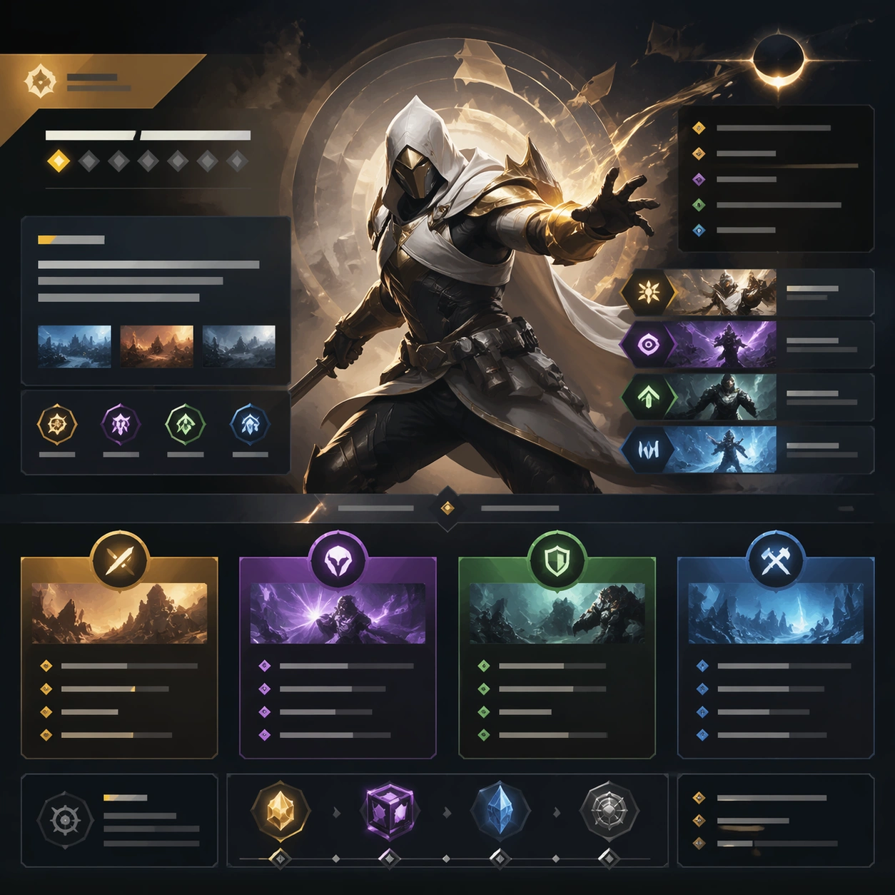

```text
Scene:
A square production-ready image designed for a game-art review wall and a commercial gallery at the same time. Frame a flagship patch-notes hero page framed like a polished product update cover with disciplined lighting, clean edge separation, and enough surrounding context to prove how the asset would behave in a real product surface. The camera, crop, and tonal balance should feel intentional rather than generic, with high readability at first glance and convincing material response under closer inspection.

Subject:
Center the study on a flagship patch-notes hero page framed like a polished product update cover. Translate the topic into a concrete, shippable visual statement instead of a loose mood board. Build layered object relationships, believable surface finish, and strong silhouette grouping so the image reads immediately as part of Patch Notes Visual Explainer. The subject should feel made for a live game pipeline: useful in store, UI, campaign, or art-review contexts, with visual hierarchy strong enough to survive aggressive cropping.

Important details:
make the page feel informative and spreadable even though all copy remains unreadable. Keep every supporting element subordinate to the main read, and make category separation obvious through form, color zoning, depth, and material logic rather than words. Where panels, cards, badges, or interface blocks appear, they must look professionally structured but remain unreadable. The visual language should feel premium, original, and coherent across this package, with no filler clutter and no accidental resemblance to a specific shipped game IP.

Use case:
Patch Notes Visual Explainer single study 1/9, focused on patch hero page.

Constraints:
No readable text, no watermark, no logos, preserve exact 1:1 aspect ratio, no readable version numbers, no logos, no broken hierarchy, no generic stock-photo staging, no accidental UI gibberish.
```

[Pinned source](https://github.com/ChaosRealmsAI/gpt-image-2-gallery/blob/5296db8c996e38776c83a0bc8c64f848dcd512b3/works/topics/patch-notes-visual-explainer/packages/single-patch-notes-studies/images/patch-hero-page/meta.json) · GPT Image2 · 1254×1254 · No source-declared image dependencies. · ProjectD:[published and publicly accepted](https://aitoolsradar.com/en/prompts/08a25ff0d30403)

## Weapon Buff Nerf Strip · patch-notes-visual-explainer/single-patch-notes-studies/weapon-buff-nerf-strip

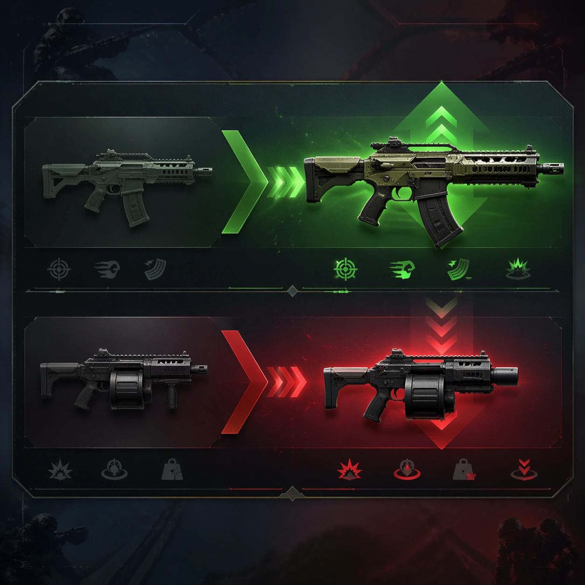

```text
Scene:
A square production-ready image designed for a game-art review wall and a commercial gallery at the same time. Frame a comparison strip visualizing one weapon buff and another nerf through silhouettes and arrows-like composition with disciplined lighting, clean edge separation, and enough surrounding context to prove how the asset would behave in a real product surface. The camera, crop, and tonal balance should feel intentional rather than generic, with high readability at first glance and convincing material response under closer inspection.

Subject:
Center the study on a comparison strip visualizing one weapon buff and another nerf through silhouettes and arrows-like composition. Translate the topic into a concrete, shippable visual statement instead of a loose mood board. Build layered object relationships, believable surface finish, and strong silhouette grouping so the image reads immediately as part of Patch Notes Visual Explainer. The subject should feel made for a live game pipeline: useful in store, UI, campaign, or art-review contexts, with visual hierarchy strong enough to survive aggressive cropping.

Important details:
balance change should read through graphics and object emphasis rather than text. Keep every supporting element subordinate to the main read, and make category separation obvious through form, color zoning, depth, and material logic rather than words. Where panels, cards, badges, or interface blocks appear, they must look professionally structured but remain unreadable. The visual language should feel premium, original, and coherent across this package, with no filler clutter and no accidental resemblance to a specific shipped game IP.

Use case:
Patch Notes Visual Explainer single study 2/9, focused on weapon buff nerf strip.

Constraints:
No readable text, no watermark, no logos, preserve exact 1:1 aspect ratio, no legible numbers, no bars with text, no broken hierarchy, no generic stock-photo staging, no accidental UI gibberish.
```

[Pinned source](https://github.com/ChaosRealmsAI/gpt-image-2-gallery/blob/5296db8c996e38776c83a0bc8c64f848dcd512b3/works/topics/patch-notes-visual-explainer/packages/single-patch-notes-studies/images/weapon-buff-nerf-strip/meta.json) · GPT Image2 · 1254×1254 · No source-declared image dependencies. · ProjectD:[published and publicly accepted](https://aitoolsradar.com/en/prompts/a414ce340566b9)

## New Mode Callout · patch-notes-visual-explainer/single-patch-notes-studies/new-mode-callout


```text
Scene:
A square production-ready image designed for a game-art review wall and a commercial gallery at the same time. Frame a callout surface for a new mode using environment, iconography, and reward mood to imply novelty with disciplined lighting, clean edge separation, and enough surrounding context to prove how the asset would behave in a real product surface. The camera, crop, and tonal balance should feel intentional rather than generic, with high readability at first glance and convincing material response under closer inspection.

Subject:
Center the study on a callout surface for a new mode using environment, iconography, and reward mood to imply novelty. Translate the topic into a concrete, shippable visual statement instead of a loose mood board. Build layered object relationships, believable surface finish, and strong silhouette grouping so the image reads immediately as part of Patch Notes Visual Explainer. The subject should feel made for a live game pipeline: useful in store, UI, campaign, or art-review contexts, with visual hierarchy strong enough to survive aggressive cropping.

Important details:
make the feature feel meaningful and polished without banner copy. Keep every supporting element subordinate to the main read, and make category separation obvious through form, color zoning, depth, and material logic rather than words. Where panels, cards, badges, or interface blocks appear, they must look professionally structured but remain unreadable. The visual language should feel premium, original, and coherent across this package, with no filler clutter and no accidental resemblance to a specific shipped game IP.

Use case:
Patch Notes Visual Explainer single study 3/9, focused on new mode callout.

Constraints:
No readable text, no watermark, no logos, preserve exact 1:1 aspect ratio, no readable headline, no logo, no broken hierarchy, no generic stock-photo staging, no accidental UI gibberish.
```

[Pinned source](https://github.com/ChaosRealmsAI/gpt-image-2-gallery/blob/5296db8c996e38776c83a0bc8c64f848dcd512b3/works/topics/patch-notes-visual-explainer/packages/single-patch-notes-studies/images/new-mode-callout/meta.json) · GPT Image2 · 1254×1254 · No source-declared image dependencies. · ProjectD:[published and publicly accepted](https://aitoolsradar.com/en/prompts/a3dad91e30d013)

## Ranked Reset Summary · patch-notes-visual-explainer/single-patch-notes-studies/ranked-reset-summary

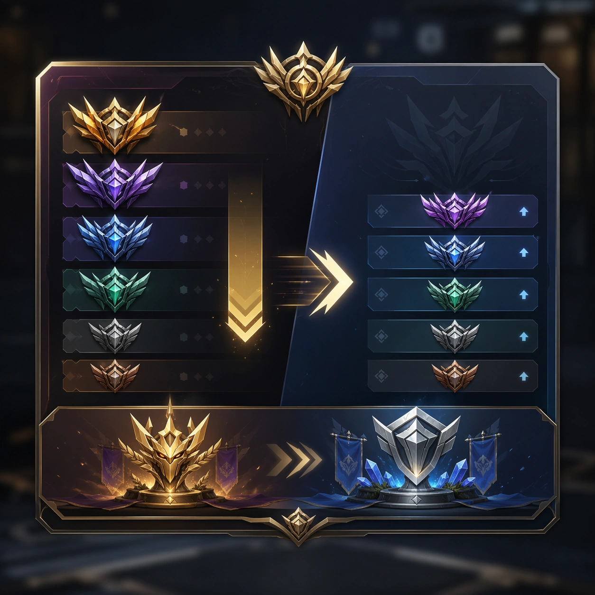

```text
Scene:
A square production-ready image designed for a game-art review wall and a commercial gallery at the same time. Frame a ranked-reset summary card built from abstract divisions, arrows, and season-end trophies with disciplined lighting, clean edge separation, and enough surrounding context to prove how the asset would behave in a real product surface. The camera, crop, and tonal balance should feel intentional rather than generic, with high readability at first glance and convincing material response under closer inspection.

Subject:
Center the study on a ranked-reset summary card built from abstract divisions, arrows, and season-end trophies. Translate the topic into a concrete, shippable visual statement instead of a loose mood board. Build layered object relationships, believable surface finish, and strong silhouette grouping so the image reads immediately as part of Patch Notes Visual Explainer. The subject should feel made for a live game pipeline: useful in store, UI, campaign, or art-review contexts, with visual hierarchy strong enough to survive aggressive cropping.

Important details:
the card should explain a status reset through shape hierarchy and progression cues only. Keep every supporting element subordinate to the main read, and make category separation obvious through form, color zoning, depth, and material logic rather than words. Where panels, cards, badges, or interface blocks appear, they must look professionally structured but remain unreadable. The visual language should feel premium, original, and coherent across this package, with no filler clutter and no accidental resemblance to a specific shipped game IP.

Use case:
Patch Notes Visual Explainer single study 4/9, focused on ranked reset summary.

Constraints:
No readable text, no watermark, no logos, preserve exact 1:1 aspect ratio, no readable ranks, no numerals, no broken hierarchy, no generic stock-photo staging, no accidental UI gibberish.
```

[Pinned source](https://github.com/ChaosRealmsAI/gpt-image-2-gallery/blob/5296db8c996e38776c83a0bc8c64f848dcd512b3/works/topics/patch-notes-visual-explainer/packages/single-patch-notes-studies/images/ranked-reset-summary/meta.json) · GPT Image2 · 1254×1254 · No source-declared image dependencies. · ProjectD:[published and publicly accepted](https://aitoolsradar.com/en/prompts/409354b56d9b92)

## Bug Fix Editorial Board · patch-notes-visual-explainer/single-patch-notes-studies/bug-fix-editorial-board

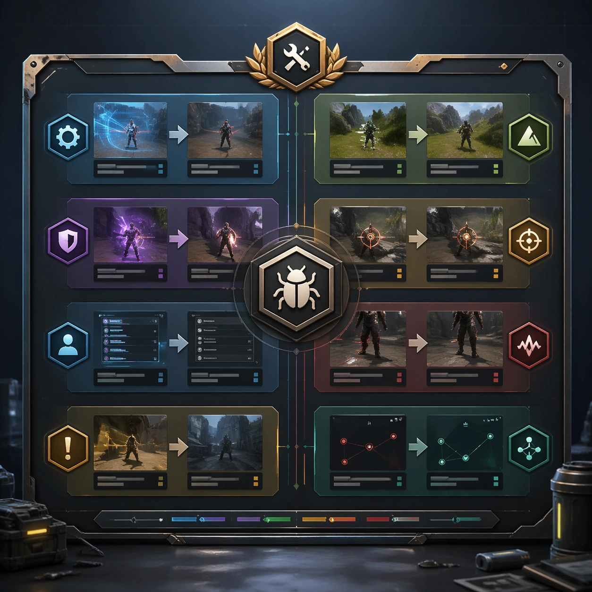

```text
Scene:
A square production-ready image designed for a game-art review wall and a commercial gallery at the same time. Frame an editorial board that turns multiple bug-fix themes into one clean information graphic with disciplined lighting, clean edge separation, and enough surrounding context to prove how the asset would behave in a real product surface. The camera, crop, and tonal balance should feel intentional rather than generic, with high readability at first glance and convincing material response under closer inspection.

Subject:
Center the study on an editorial board that turns multiple bug-fix themes into one clean information graphic. Translate the topic into a concrete, shippable visual statement instead of a loose mood board. Build layered object relationships, believable surface finish, and strong silhouette grouping so the image reads immediately as part of Patch Notes Visual Explainer. The subject should feel made for a live game pipeline: useful in store, UI, campaign, or art-review contexts, with visual hierarchy strong enough to survive aggressive cropping.

Important details:
organize improvements clearly while all text blocks stay abstract. Keep every supporting element subordinate to the main read, and make category separation obvious through form, color zoning, depth, and material logic rather than words. Where panels, cards, badges, or interface blocks appear, they must look professionally structured but remain unreadable. The visual language should feel premium, original, and coherent across this package, with no filler clutter and no accidental resemblance to a specific shipped game IP.

Use case:
Patch Notes Visual Explainer single study 5/9, focused on bug fix editorial board.

Constraints:
No readable text, no watermark, no logos, preserve exact 1:1 aspect ratio, no readable bullet points, no code blocks, no broken hierarchy, no generic stock-photo staging, no accidental UI gibberish.
```

[Pinned source](https://github.com/ChaosRealmsAI/gpt-image-2-gallery/blob/5296db8c996e38776c83a0bc8c64f848dcd512b3/works/topics/patch-notes-visual-explainer/packages/single-patch-notes-studies/images/bug-fix-editorial-board/meta.json) · GPT Image2 · 1254×1254 · No source-declared image dependencies. · ProjectD:[published and publicly accepted](https://aitoolsradar.com/en/prompts/c379ec079c0028)

## System Update Panel · patch-notes-visual-explainer/single-patch-notes-studies/system-update-panel

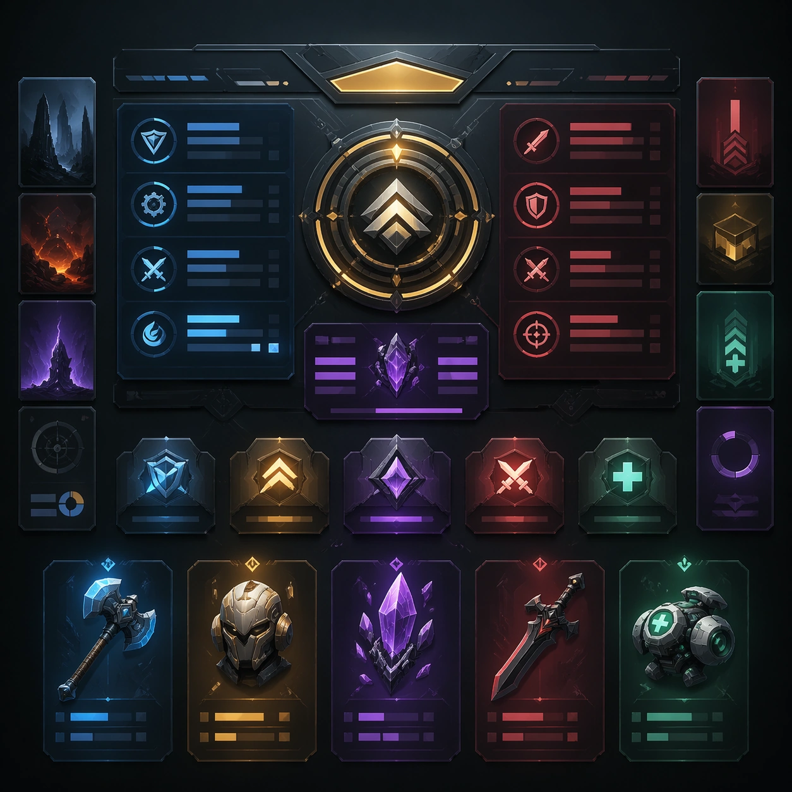

```text
Scene:
A square production-ready image designed for a game-art review wall and a commercial gallery at the same time. Frame a systems-focused update panel combining UI windows, item silhouettes, and abstract patch modules with disciplined lighting, clean edge separation, and enough surrounding context to prove how the asset would behave in a real product surface. The camera, crop, and tonal balance should feel intentional rather than generic, with high readability at first glance and convincing material response under closer inspection.

Subject:
Center the study on a systems-focused update panel combining UI windows, item silhouettes, and abstract patch modules. Translate the topic into a concrete, shippable visual statement instead of a loose mood board. Build layered object relationships, believable surface finish, and strong silhouette grouping so the image reads immediately as part of Patch Notes Visual Explainer. The subject should feel made for a live game pipeline: useful in store, UI, campaign, or art-review contexts, with visual hierarchy strong enough to survive aggressive cropping.

Important details:
the image should feel dense but ordered, like a polished internal explainer. Keep every supporting element subordinate to the main read, and make category separation obvious through form, color zoning, depth, and material logic rather than words. Where panels, cards, badges, or interface blocks appear, they must look professionally structured but remain unreadable. The visual language should feel premium, original, and coherent across this package, with no filler clutter and no accidental resemblance to a specific shipped game IP.

Use case:
Patch Notes Visual Explainer single study 6/9, focused on system update panel.

Constraints:
No readable text, no watermark, no logos, preserve exact 1:1 aspect ratio, no readable labels, no lorem ipsum, no broken hierarchy, no generic stock-photo staging, no accidental UI gibberish.
```

[Pinned source](https://github.com/ChaosRealmsAI/gpt-image-2-gallery/blob/5296db8c996e38776c83a0bc8c64f848dcd512b3/works/topics/patch-notes-visual-explainer/packages/single-patch-notes-studies/images/system-update-panel/meta.json) · GPT Image2 · 1254×1254 · No source-declared image dependencies. · ProjectD:[published and publicly accepted](https://aitoolsradar.com/en/prompts/95f3ba7f0dab30)

## Social Share Tile · patch-notes-visual-explainer/single-patch-notes-studies/social-share-tile

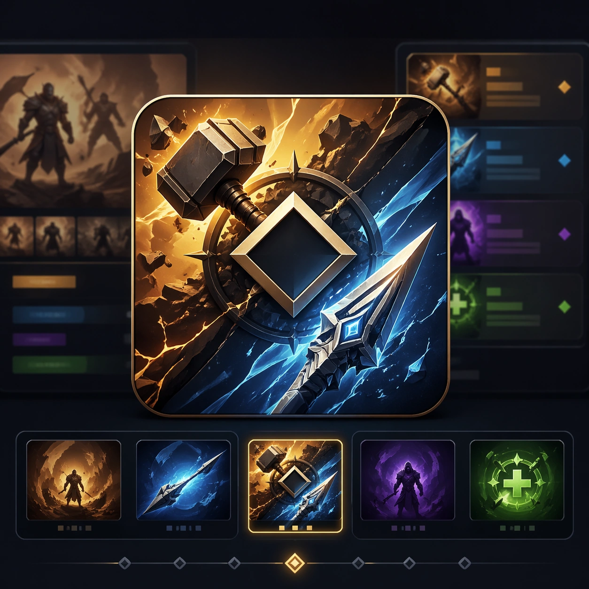

```text
Scene:
A square production-ready image designed for a game-art review wall and a commercial gallery at the same time. Frame a compact share tile that packages the patch into an instantly scannable social asset with disciplined lighting, clean edge separation, and enough surrounding context to prove how the asset would behave in a real product surface. The camera, crop, and tonal balance should feel intentional rather than generic, with high readability at first glance and convincing material response under closer inspection.

Subject:
Center the study on a compact share tile that packages the patch into an instantly scannable social asset. Translate the topic into a concrete, shippable visual statement instead of a loose mood board. Build layered object relationships, believable surface finish, and strong silhouette grouping so the image reads immediately as part of Patch Notes Visual Explainer. The subject should feel made for a live game pipeline: useful in store, UI, campaign, or art-review contexts, with visual hierarchy strong enough to survive aggressive cropping.

Important details:
it should survive mobile compression and still look premium. Keep every supporting element subordinate to the main read, and make category separation obvious through form, color zoning, depth, and material logic rather than words. Where panels, cards, badges, or interface blocks appear, they must look professionally structured but remain unreadable. The visual language should feel premium, original, and coherent across this package, with no filler clutter and no accidental resemblance to a specific shipped game IP.

Use case:
Patch Notes Visual Explainer single study 7/9, focused on social share tile.

Constraints:
No readable text, no watermark, no logos, preserve exact 1:1 aspect ratio, no hashtag text, no handles, no broken hierarchy, no generic stock-photo staging, no accidental UI gibberish.
```

[Pinned source](https://github.com/ChaosRealmsAI/gpt-image-2-gallery/blob/5296db8c996e38776c83a0bc8c64f848dcd512b3/works/topics/patch-notes-visual-explainer/packages/single-patch-notes-studies/images/social-share-tile/meta.json) · GPT Image2 · 1254×1254 · No source-declared image dependencies. · ProjectD:[published and publicly accepted](https://aitoolsradar.com/en/prompts/4dabf75246562f)

## Feature Comparison Board · patch-notes-visual-explainer/single-patch-notes-studies/feature-comparison-board

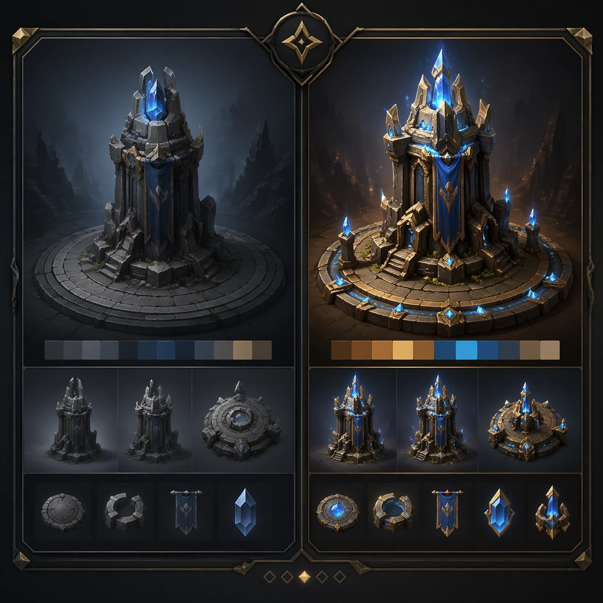

```text
Scene:
A square production-ready image designed for a game-art review wall and a commercial gallery at the same time. Frame a before-and-after style board showing how a feature changed across the patch with disciplined lighting, clean edge separation, and enough surrounding context to prove how the asset would behave in a real product surface. The camera, crop, and tonal balance should feel intentional rather than generic, with high readability at first glance and convincing material response under closer inspection.

Subject:
Center the study on a before-and-after style board showing how a feature changed across the patch. Translate the topic into a concrete, shippable visual statement instead of a loose mood board. Build layered object relationships, believable surface finish, and strong silhouette grouping so the image reads immediately as part of Patch Notes Visual Explainer. The subject should feel made for a live game pipeline: useful in store, UI, campaign, or art-review contexts, with visual hierarchy strong enough to survive aggressive cropping.

Important details:
comparison logic should be evident through layout and object choice without readable annotations. Keep every supporting element subordinate to the main read, and make category separation obvious through form, color zoning, depth, and material logic rather than words. Where panels, cards, badges, or interface blocks appear, they must look professionally structured but remain unreadable. The visual language should feel premium, original, and coherent across this package, with no filler clutter and no accidental resemblance to a specific shipped game IP.

Use case:
Patch Notes Visual Explainer single study 8/9, focused on feature comparison board.

Constraints:
No readable text, no watermark, no logos, preserve exact 1:1 aspect ratio, no labels, no arrows with text, no broken hierarchy, no generic stock-photo staging, no accidental UI gibberish.
```

[Pinned source](https://github.com/ChaosRealmsAI/gpt-image-2-gallery/blob/5296db8c996e38776c83a0bc8c64f848dcd512b3/works/topics/patch-notes-visual-explainer/packages/single-patch-notes-studies/images/feature-comparison-board/meta.json) · GPT Image2 · 1254×1254 · No source-declared image dependencies. · ProjectD:[published and publicly accepted](https://aitoolsradar.com/en/prompts/d5ce5d70c241c8)

## Maintenance Night Poster · patch-notes-visual-explainer/single-patch-notes-studies/maintenance-night-poster

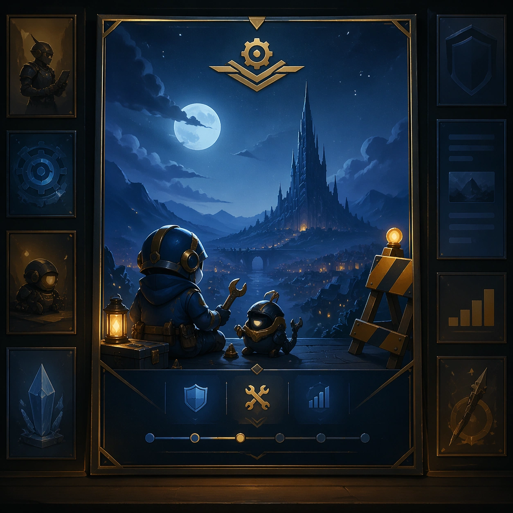

```text
Scene:
A square production-ready image designed for a game-art review wall and a commercial gallery at the same time. Frame a poster-like asset that turns maintenance downtime into a calm, trustworthy brand moment with disciplined lighting, clean edge separation, and enough surrounding context to prove how the asset would behave in a real product surface. The camera, crop, and tonal balance should feel intentional rather than generic, with high readability at first glance and convincing material response under closer inspection.

Subject:
Center the study on a poster-like asset that turns maintenance downtime into a calm, trustworthy brand moment. Translate the topic into a concrete, shippable visual statement instead of a loose mood board. Build layered object relationships, believable surface finish, and strong silhouette grouping so the image reads immediately as part of Patch Notes Visual Explainer. The subject should feel made for a live game pipeline: useful in store, UI, campaign, or art-review contexts, with visual hierarchy strong enough to survive aggressive cropping.

Important details:
the mood should feel polished and reassuring rather than empty or alarming. Keep every supporting element subordinate to the main read, and make category separation obvious through form, color zoning, depth, and material logic rather than words. Where panels, cards, badges, or interface blocks appear, they must look professionally structured but remain unreadable. The visual language should feel premium, original, and coherent across this package, with no filler clutter and no accidental resemblance to a specific shipped game IP.

Use case:
Patch Notes Visual Explainer single study 9/9, focused on maintenance night poster.

Constraints:
No readable text, no watermark, no logos, preserve exact 1:1 aspect ratio, no clock text, no apology copy, no broken hierarchy, no generic stock-photo staging, no accidental UI gibberish.
```

[Pinned source](https://github.com/ChaosRealmsAI/gpt-image-2-gallery/blob/5296db8c996e38776c83a0bc8c64f848dcd512b3/works/topics/patch-notes-visual-explainer/packages/single-patch-notes-studies/images/maintenance-night-poster/meta.json) · GPT Image2 · 1254×1254 · No source-declared image dependencies. · ProjectD:[published and publicly accepted](https://aitoolsradar.com/en/prompts/45329918f24640)

## First Visit Pathway Map · patient-journey-explainer-system/single-patient-journey-studies/first-visit-pathway-map


```text
Scene:
A square first-visit explainer board for Patient Journey Explainer System. Compose it as a structured map with numbered stages, room icons, and spatial waypoints arranged in a calm clockwise flow. Use a palette of soft white, mist blue, sea-glass green, muted coral accents, and warm neutral grays, even editorial lighting with crisp, low-anxiety contrast, and a mood of clear, supportive, and process-oriented. The frame should feel like a real healthcare communication asset art-directed for professional delivery, not a stock photo, speculative concept render, or generic corporate template. Keep the camera distance, negative space, and depth cues disciplined so the image reads immediately even at thumbnail size.

Subject:
Center on the journey from arrival and registration through triage, consultation, checkout, and follow-up setup presented as a single patient pathway. Show enough surrounding context that the viewer understands the intended service surface, user situation, and institutional setting. Every object, person, diagram, device crop, or spatial cue should support clarity, trust, and practical use. If people appear, keep them anonymous, natural, privacy-safe, and grounded in believable body language rather than promotional posing.

Important details:
Maintain patient-journey communication built from sequencing, touchpoint mapping, low-anxiety illustrations, and interface-like clarity without dense textbook complexity. Use human-friendly sequencing, soft environmental miniatures, and clear status markers so the process feels understandable at a glance. Use abstract icon shapes, color blocks, chart bars, interface modules, or non-legible placeholder microcopy whenever information structure is needed, but never readable text. Materials, spacing, lighting, and hierarchy should feel production-ready and healthcare-specific. Avoid generic lifestyle filler, decorative noise, or design gestures that do not reinforce the communication goal.

Use case:
Patient Journey single study 1/9 for a first-visit patient journey explainer.

Constraints:
No readable text, no watermark, no logos, preserve exact 1:1 aspect ratio, no graphic medical scenes, no confusing maze compositions, no dark fear-based tone, no overcrowded information walls, no transport-map complexity, no unreadable tiny modules.
```

[Pinned source](https://github.com/ChaosRealmsAI/gpt-image-2-gallery/blob/5296db8c996e38776c83a0bc8c64f848dcd512b3/works/topics/patient-journey-explainer-system/packages/single-patient-journey-studies/images/first-visit-pathway-map/meta.json) · GPT Image2 · 1024×1024 · No source-declared image dependencies. · ProjectD:[published and publicly accepted](https://aitoolsradar.com/en/prompts/8ac547b77796e4)

## Diagnostic Day Sequence · patient-journey-explainer-system/single-patient-journey-studies/diagnostic-day-sequence

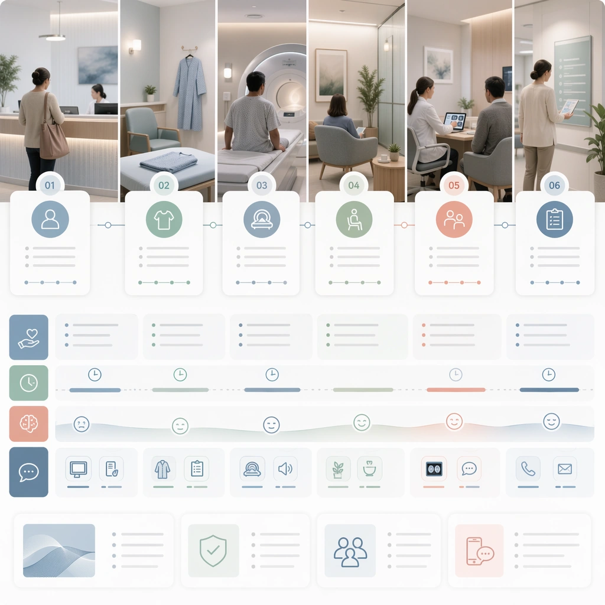

```text
Scene:
A square diagnostic-day sequence board for Patient Journey Explainer System. Compose it as a sequence of stages laid out from left to right with supportive side notes and room imagery. Use a palette of soft white, mist blue, sea-glass green, muted coral accents, and warm neutral grays, even editorial lighting with crisp, low-anxiety contrast, and a mood of clear, supportive, and process-oriented. The frame should feel like a real healthcare communication asset art-directed for professional delivery, not a stock photo, speculative concept render, or generic corporate template. Keep the camera distance, negative space, and depth cues disciplined so the image reads immediately even at thumbnail size.

Subject:
Center on a same-day diagnostics journey including arrival, prep, scan, waiting period, results conversation, and next-step guidance. Show enough surrounding context that the viewer understands the intended service surface, user situation, and institutional setting. Every object, person, diagram, device crop, or spatial cue should support clarity, trust, and practical use. If people appear, keep them anonymous, natural, privacy-safe, and grounded in believable body language rather than promotional posing.

Important details:
Maintain patient-journey communication built from sequencing, touchpoint mapping, low-anxiety illustrations, and interface-like clarity without dense textbook complexity. Communicate timing and emotional pacing through color and spacing rather than through literal text paragraphs. Use abstract icon shapes, color blocks, chart bars, interface modules, or non-legible placeholder microcopy whenever information structure is needed, but never readable text. Materials, spacing, lighting, and hierarchy should feel production-ready and healthcare-specific. Avoid generic lifestyle filler, decorative noise, or design gestures that do not reinforce the communication goal.

Use case:
Patient Journey single study 2/9 for a diagnostic visit preparation guide.

Constraints:
No readable text, no watermark, no logos, preserve exact 1:1 aspect ratio, no graphic medical scenes, no confusing maze compositions, no dark fear-based tone, no overcrowded information walls, no intimidating machine dominance, no anxiety-heavy visuals.
```

[Pinned source](https://github.com/ChaosRealmsAI/gpt-image-2-gallery/blob/5296db8c996e38776c83a0bc8c64f848dcd512b3/works/topics/patient-journey-explainer-system/packages/single-patient-journey-studies/images/diagnostic-day-sequence/meta.json) · GPT Image2 · 1024×1024 · No source-declared image dependencies. · ProjectD:[published and publicly accepted](https://aitoolsradar.com/en/prompts/6aad5f551d6786)

## Surgery Prep Checklist Board · patient-journey-explainer-system/single-patient-journey-studies/surgery-prep-checklist-board


```text
Scene:
A square pre-procedure checklist board for Patient Journey Explainer System. Compose it as a clean modular system with checklist cards, preparation objects, and timeline blocks. Use a palette of soft white, mist blue, sea-glass green, muted coral accents, and warm neutral grays, even editorial lighting with crisp, low-anxiety contrast, and a mood of clear, supportive, and process-oriented. The frame should feel like a real healthcare communication asset art-directed for professional delivery, not a stock photo, speculative concept render, or generic corporate template. Keep the camera distance, negative space, and depth cues disciplined so the image reads immediately even at thumbnail size.

Subject:
Center on the days-before and day-of preparation journey for a routine surgery, including fasting, transport, paperwork, arrival, and recovery handoff. Show enough surrounding context that the viewer understands the intended service surface, user situation, and institutional setting. Every object, person, diagram, device crop, or spatial cue should support clarity, trust, and practical use. If people appear, keep them anonymous, natural, privacy-safe, and grounded in believable body language rather than promotional posing.

Important details:
Maintain patient-journey communication built from sequencing, touchpoint mapping, low-anxiety illustrations, and interface-like clarity without dense textbook complexity. Keep the guide calm and practical, using icons, household objects, and abstract status chips instead of readable body text. Use abstract icon shapes, color blocks, chart bars, interface modules, or non-legible placeholder microcopy whenever information structure is needed, but never readable text. Materials, spacing, lighting, and hierarchy should feel production-ready and healthcare-specific. Avoid generic lifestyle filler, decorative noise, or design gestures that do not reinforce the communication goal.

Use case:
Patient Journey single study 3/9 for a pre-surgery patient education asset.

Constraints:
No readable text, no watermark, no logos, preserve exact 1:1 aspect ratio, no graphic medical scenes, no confusing maze compositions, no dark fear-based tone, no overcrowded information walls, no operating-room gore, no stern warning-poster tone.
```

[Pinned source](https://github.com/ChaosRealmsAI/gpt-image-2-gallery/blob/5296db8c996e38776c83a0bc8c64f848dcd512b3/works/topics/patient-journey-explainer-system/packages/single-patient-journey-studies/images/surgery-prep-checklist-board/meta.json) · GPT Image2 · 1024×1024 · No source-declared image dependencies. · ProjectD:[published and publicly accepted](https://aitoolsradar.com/en/prompts/a689490900640e)

## Discharge and Homecare Flow · patient-journey-explainer-system/single-patient-journey-studies/discharge-and-homecare-flow


```text
Scene:
A square discharge explainer system for Patient Journey Explainer System. Compose it as a branching but highly controlled flowchart translated into an editorial square board. Use a palette of soft white, mist blue, sea-glass green, muted coral accents, and warm neutral grays, even editorial lighting with crisp, low-anxiety contrast, and a mood of clear, supportive, and process-oriented. The frame should feel like a real healthcare communication asset art-directed for professional delivery, not a stock photo, speculative concept render, or generic corporate template. Keep the camera distance, negative space, and depth cues disciplined so the image reads immediately even at thumbnail size.

Subject:
Center on the transition from discharge desk to transportation, medication pickup, home setup, self-care checks, and follow-up contact. Show enough surrounding context that the viewer understands the intended service surface, user situation, and institutional setting. Every object, person, diagram, device crop, or spatial cue should support clarity, trust, and practical use. If people appear, keep them anonymous, natural, privacy-safe, and grounded in believable body language rather than promotional posing.

Important details:
Maintain patient-journey communication built from sequencing, touchpoint mapping, low-anxiety illustrations, and interface-like clarity without dense textbook complexity. Use environmental cues from home and clinic together so the handoff between settings feels explicit and reassuring. Use abstract icon shapes, color blocks, chart bars, interface modules, or non-legible placeholder microcopy whenever information structure is needed, but never readable text. Materials, spacing, lighting, and hierarchy should feel production-ready and healthcare-specific. Avoid generic lifestyle filler, decorative noise, or design gestures that do not reinforce the communication goal.

Use case:
Patient Journey single study 4/9 for a discharge and recovery journey guide.

Constraints:
No readable text, no watermark, no logos, preserve exact 1:1 aspect ratio, no graphic medical scenes, no confusing maze compositions, no dark fear-based tone, no overcrowded information walls, no hospital-maze confusion, no sharp warning colors.
```

[Pinned source](https://github.com/ChaosRealmsAI/gpt-image-2-gallery/blob/5296db8c996e38776c83a0bc8c64f848dcd512b3/works/topics/patient-journey-explainer-system/packages/single-patient-journey-studies/images/discharge-and-homecare-flow/meta.json) · GPT Image2 · 1024×1024 · No source-declared image dependencies. · ProjectD:[published and publicly accepted](https://aitoolsradar.com/en/prompts/54a6cd270dde2b)

## Rehab Milestone Card Set · patient-journey-explainer-system/single-patient-journey-studies/rehab-milestone-card-set


```text
Scene:
A square rehabilitation milestone card system for Patient Journey Explainer System. Compose it as a family of cards displayed together with progress rings, movement imagery, and support cues. Use a palette of soft white, mist blue, sea-glass green, muted coral accents, and warm neutral grays, even editorial lighting with crisp, low-anxiety contrast, and a mood of clear, supportive, and process-oriented. The frame should feel like a real healthcare communication asset art-directed for professional delivery, not a stock photo, speculative concept render, or generic corporate template. Keep the camera distance, negative space, and depth cues disciplined so the image reads immediately even at thumbnail size.

Subject:
Center on a rehabilitation journey represented by early, middle, and late-stage milestones with therapist support and home practice moments. Show enough surrounding context that the viewer understands the intended service surface, user situation, and institutional setting. Every object, person, diagram, device crop, or spatial cue should support clarity, trust, and practical use. If people appear, keep them anonymous, natural, privacy-safe, and grounded in believable body language rather than promotional posing.

Important details:
Maintain patient-journey communication built from sequencing, touchpoint mapping, low-anxiety illustrations, and interface-like clarity without dense textbook complexity. The cards should imply progress and patience without turning the recovery story into a competitive fitness narrative. Use abstract icon shapes, color blocks, chart bars, interface modules, or non-legible placeholder microcopy whenever information structure is needed, but never readable text. Materials, spacing, lighting, and hierarchy should feel production-ready and healthcare-specific. Avoid generic lifestyle filler, decorative noise, or design gestures that do not reinforce the communication goal.

Use case:
Patient Journey single study 5/9 for a rehab progress explainer card set.

Constraints:
No readable text, no watermark, no logos, preserve exact 1:1 aspect ratio, no graphic medical scenes, no confusing maze compositions, no dark fear-based tone, no overcrowded information walls, no sports-performance marketing tone, no exaggerated celebration poses.
```

[Pinned source](https://github.com/ChaosRealmsAI/gpt-image-2-gallery/blob/5296db8c996e38776c83a0bc8c64f848dcd512b3/works/topics/patient-journey-explainer-system/packages/single-patient-journey-studies/images/rehab-milestone-card-set/meta.json) · GPT Image2 · 1024×1024 · No source-declared image dependencies. · ProjectD:[published and publicly accepted](https://aitoolsradar.com/en/prompts/d2c5d061fa3d7f)

## Pediatric Visit Comfort Guide · patient-journey-explainer-system/single-patient-journey-studies/pediatric-visit-comfort-guide

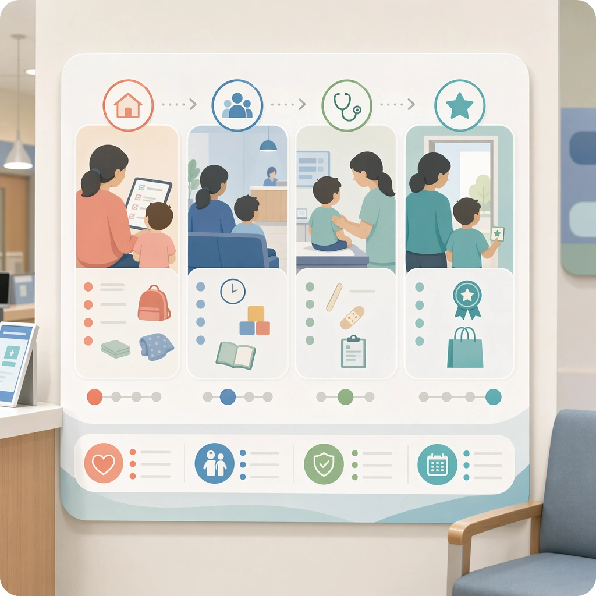

```text
Scene:
A square pediatric comfort journey board for Patient Journey Explainer System. Compose it with rounded modules, soft animal-free geometry, and a clear sequence from home prep to clinic exit. Use a palette of soft white, mist blue, sea-glass green, muted coral accents, and warm neutral grays, even editorial lighting with crisp, low-anxiety contrast, and a mood of clear, supportive, and process-oriented. The frame should feel like a real healthcare communication asset art-directed for professional delivery, not a stock photo, speculative concept render, or generic corporate template. Keep the camera distance, negative space, and depth cues disciplined so the image reads immediately even at thumbnail size.

Subject:
Center on a child-friendly visit guide showing parent preparation, waiting room comfort, examination steps, and reward-oriented completion cues. Show enough surrounding context that the viewer understands the intended service surface, user situation, and institutional setting. Every object, person, diagram, device crop, or spatial cue should support clarity, trust, and practical use. If people appear, keep them anonymous, natural, privacy-safe, and grounded in believable body language rather than promotional posing.

Important details:
Maintain patient-journey communication built from sequencing, touchpoint mapping, low-anxiety illustrations, and interface-like clarity without dense textbook complexity. Reduce anxiety through predictable sequencing, gentle illustration, and parent-child interaction cues rather than through mascots or cartoons. Use abstract icon shapes, color blocks, chart bars, interface modules, or non-legible placeholder microcopy whenever information structure is needed, but never readable text. Materials, spacing, lighting, and hierarchy should feel production-ready and healthcare-specific. Avoid generic lifestyle filler, decorative noise, or design gestures that do not reinforce the communication goal.

Use case:
Patient Journey single study 6/9 for a pediatric visit comfort explainer.

Constraints:
No readable text, no watermark, no logos, preserve exact 1:1 aspect ratio, no graphic medical scenes, no confusing maze compositions, no dark fear-based tone, no overcrowded information walls, no cartoon characters, no overbright theme-park colors.
```

[Pinned source](https://github.com/ChaosRealmsAI/gpt-image-2-gallery/blob/5296db8c996e38776c83a0bc8c64f848dcd512b3/works/topics/patient-journey-explainer-system/packages/single-patient-journey-studies/images/pediatric-visit-comfort-guide/meta.json) · GPT Image2 · 1024×1024 · No source-declared image dependencies. · ProjectD:[published and publicly accepted](https://aitoolsradar.com/en/prompts/568ff51677ad2b)

## Maternity Care Journey Wheel · patient-journey-explainer-system/single-patient-journey-studies/maternity-care-journey-wheel

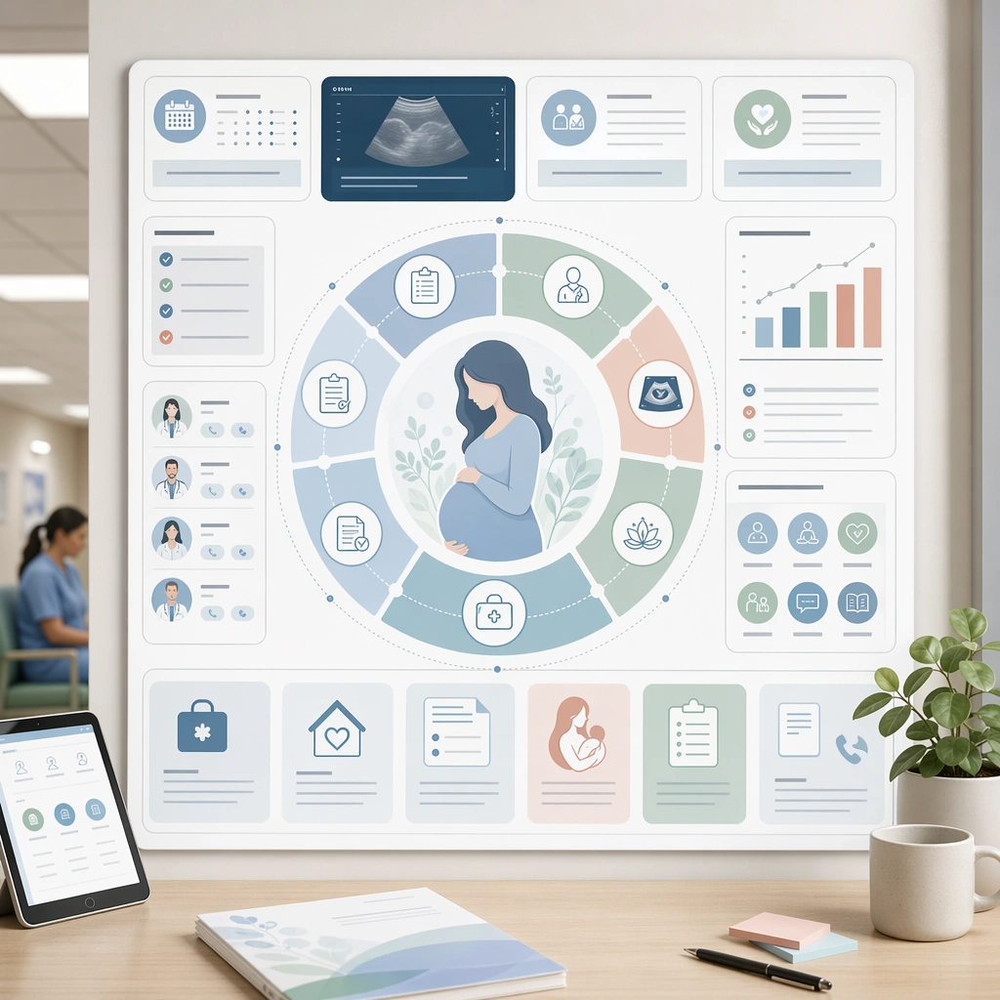

```text
Scene:
A square maternity journey wheel and support board for Patient Journey Explainer System. Compose it as a central circular timeline surrounded by appointment, imaging, and support-resource panels. Use a palette of soft white, mist blue, sea-glass green, muted coral accents, and warm neutral grays, even editorial lighting with crisp, low-anxiety contrast, and a mood of clear, supportive, and process-oriented. The frame should feel like a real healthcare communication asset art-directed for professional delivery, not a stock photo, speculative concept render, or generic corporate template. Keep the camera distance, negative space, and depth cues disciplined so the image reads immediately even at thumbnail size.

Subject:
Center on a maternity care pathway from intake and scans to classes, delivery prep, and postpartum follow-up. Show enough surrounding context that the viewer understands the intended service surface, user situation, and institutional setting. Every object, person, diagram, device crop, or spatial cue should support clarity, trust, and practical use. If people appear, keep them anonymous, natural, privacy-safe, and grounded in believable body language rather than promotional posing.

Important details:
Maintain patient-journey communication built from sequencing, touchpoint mapping, low-anxiety illustrations, and interface-like clarity without dense textbook complexity. The whole piece should feel nurturing and medically grounded, with soft iconography and realistic care touchpoints. Use abstract icon shapes, color blocks, chart bars, interface modules, or non-legible placeholder microcopy whenever information structure is needed, but never readable text. Materials, spacing, lighting, and hierarchy should feel production-ready and healthcare-specific. Avoid generic lifestyle filler, decorative noise, or design gestures that do not reinforce the communication goal.

Use case:
Patient Journey single study 7/9 for a maternity care pathway visual.

Constraints:
No readable text, no watermark, no logos, preserve exact 1:1 aspect ratio, no graphic medical scenes, no confusing maze compositions, no dark fear-based tone, no overcrowded information walls, no baby-brand retail cues, no sentimental overload.
```

[Pinned source](https://github.com/ChaosRealmsAI/gpt-image-2-gallery/blob/5296db8c996e38776c83a0bc8c64f848dcd512b3/works/topics/patient-journey-explainer-system/packages/single-patient-journey-studies/images/maternity-care-journey-wheel/meta.json) · GPT Image2 · 1024×1024 · No source-declared image dependencies. · ProjectD:[published and publicly accepted](https://aitoolsradar.com/en/prompts/32368d44f6227e)

## Chronic Care Touchpoint Map · patient-journey-explainer-system/single-patient-journey-studies/chronic-care-touchpoint-map


```text
Scene:
A square chronic-care touchpoint map for Patient Journey Explainer System. Compose it as an ecosystem board linking clinic visits, home routines, lab checks, messaging, and coaching touchpoints. Use a palette of soft white, mist blue, sea-glass green, muted coral accents, and warm neutral grays, even editorial lighting with crisp, low-anxiety contrast, and a mood of clear, supportive, and process-oriented. The frame should feel like a real healthcare communication asset art-directed for professional delivery, not a stock photo, speculative concept render, or generic corporate template. Keep the camera distance, negative space, and depth cues disciplined so the image reads immediately even at thumbnail size.

Subject:
Center on a long-term care management journey represented across digital, physical, and human support moments. Show enough surrounding context that the viewer understands the intended service surface, user situation, and institutional setting. Every object, person, diagram, device crop, or spatial cue should support clarity, trust, and practical use. If people appear, keep them anonymous, natural, privacy-safe, and grounded in believable body language rather than promotional posing.

Important details:
Maintain patient-journey communication built from sequencing, touchpoint mapping, low-anxiety illustrations, and interface-like clarity without dense textbook complexity. Make continuity and repetition feel manageable through rhythm, recurring symbols, and supportive environment fragments. Use abstract icon shapes, color blocks, chart bars, interface modules, or non-legible placeholder microcopy whenever information structure is needed, but never readable text. Materials, spacing, lighting, and hierarchy should feel production-ready and healthcare-specific. Avoid generic lifestyle filler, decorative noise, or design gestures that do not reinforce the communication goal.

Use case:
Patient Journey single study 8/9 for a chronic-care patient support map.

Constraints:
No readable text, no watermark, no logos, preserve exact 1:1 aspect ratio, no graphic medical scenes, no confusing maze compositions, no dark fear-based tone, no overcrowded information walls, no tech-startup app aesthetic, no overwhelming network complexity.
```

[Pinned source](https://github.com/ChaosRealmsAI/gpt-image-2-gallery/blob/5296db8c996e38776c83a0bc8c64f848dcd512b3/works/topics/patient-journey-explainer-system/packages/single-patient-journey-studies/images/chronic-care-touchpoint-map/meta.json) · GPT Image2 · 1024×1024 · No source-declared image dependencies. · ProjectD:[published and publicly accepted](https://aitoolsradar.com/en/prompts/1edf2d0168ec7d)

## Omnichannel Care Board · patient-journey-explainer-system/single-patient-journey-studies/omnichannel-care-board

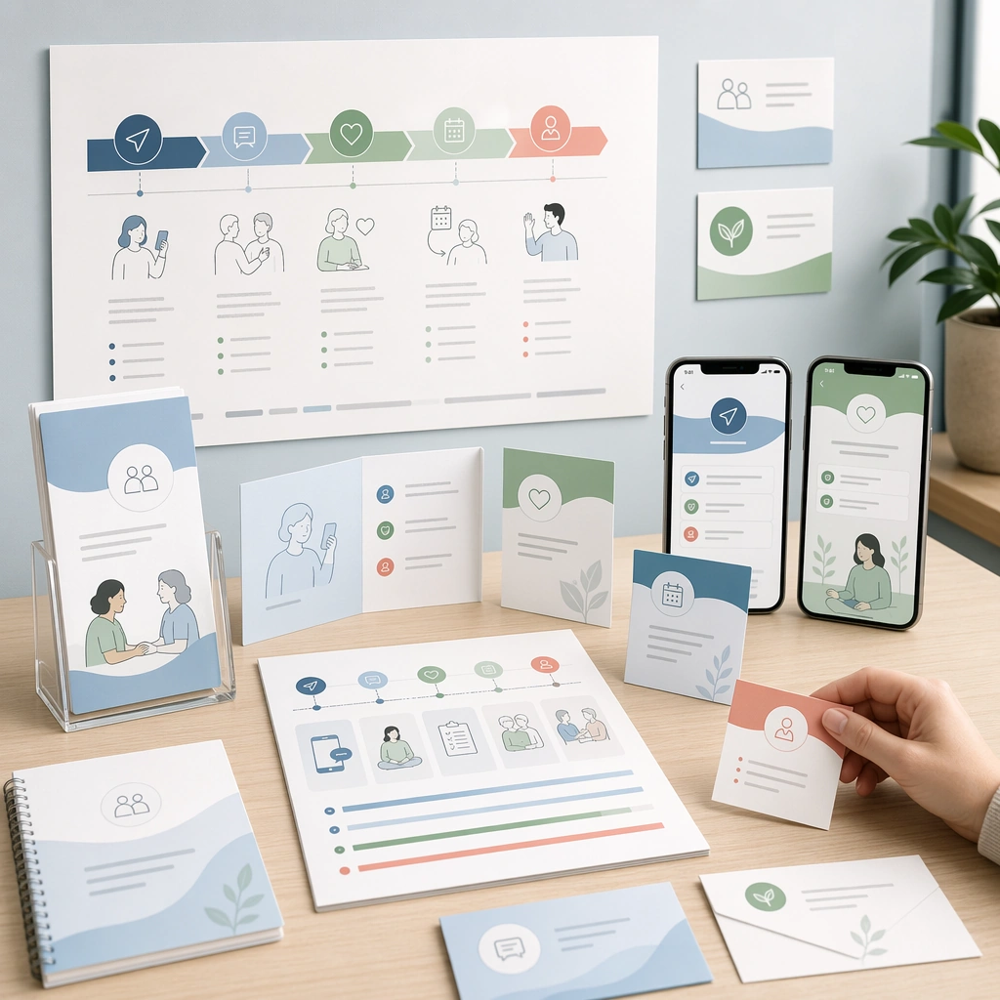

```text
Scene:
A square cross-channel patient journey summary board for Patient Journey Explainer System. Compose it as a high-level square toolkit showing print handouts, mobile screens, room signage, and follow-up cards together. Use a palette of soft white, mist blue, sea-glass green, muted coral accents, and warm neutral grays, even editorial lighting with crisp, low-anxiety contrast, and a mood of clear, supportive, and process-oriented. The frame should feel like a real healthcare communication asset art-directed for professional delivery, not a stock photo, speculative concept render, or generic corporate template. Keep the camera distance, negative space, and depth cues disciplined so the image reads immediately even at thumbnail size.

Subject:
Center on a complete patient journey system translated across multiple care surfaces but unified by one visual language. Show enough surrounding context that the viewer understands the intended service surface, user situation, and institutional setting. Every object, person, diagram, device crop, or spatial cue should support clarity, trust, and practical use. If people appear, keep them anonymous, natural, privacy-safe, and grounded in believable body language rather than promotional posing.

Important details:
Maintain patient-journey communication built from sequencing, touchpoint mapping, low-anxiety illustrations, and interface-like clarity without dense textbook complexity. The board should prove that one care process can stay coherent across channels without relying on literal body copy. Use abstract icon shapes, color blocks, chart bars, interface modules, or non-legible placeholder microcopy whenever information structure is needed, but never readable text. Materials, spacing, lighting, and hierarchy should feel production-ready and healthcare-specific. Avoid generic lifestyle filler, decorative noise, or design gestures that do not reinforce the communication goal.

Use case:
Patient Journey single study 9/9 for a full omnichannel care journey system summary.

Constraints:
No readable text, no watermark, no logos, preserve exact 1:1 aspect ratio, no graphic medical scenes, no confusing maze compositions, no dark fear-based tone, no overcrowded information walls, no random template collage, no inconsistent style shifts.
```

[Pinned source](https://github.com/ChaosRealmsAI/gpt-image-2-gallery/blob/5296db8c996e38776c83a0bc8c64f848dcd512b3/works/topics/patient-journey-explainer-system/packages/single-patient-journey-studies/images/omnichannel-care-board/meta.json) · GPT Image2 · 1024×1024 · No source-declared image dependencies. · ProjectD:[published and publicly accepted](https://aitoolsradar.com/en/prompts/bdd310eda51711)

## Cutaway Panel · pcb-board-layout/single-pcb-board-layout-studies/cutaway-panel

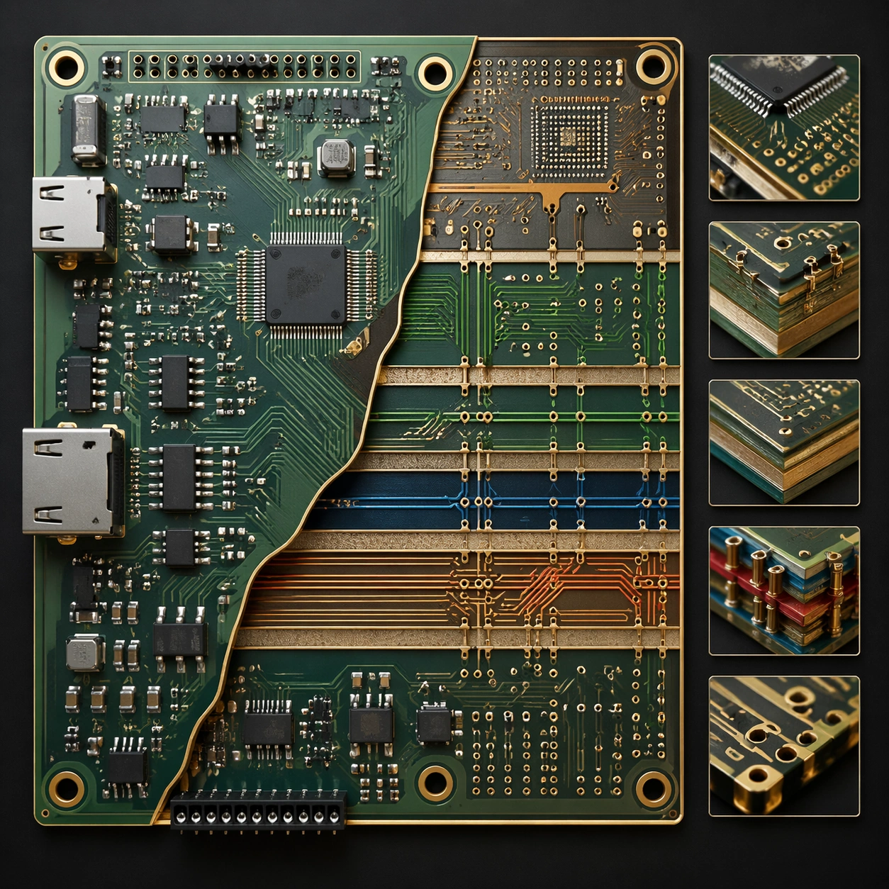

```text
Scene:
A square plate or board viewed straight-on, with crisp organization, disciplined spacing, and premium print clarity. Build the frame around a cutaway or sectional treatment that reveals interior logic without sacrificing readability. Keep the lighting, camera distance, and spatial organization tuned for a high-signal research image rather than a casual snapshot. The image belongs to the PCB Board Layout theme and should feel immediately legible as a prompt atlas theme for pcb board layout, testing structured-layout, photorealism, style-transfer, commercial-mockup with gpt image 2..

Subject:
Center the study on a cutaway or sectional treatment that reveals interior logic without sacrificing readability. Translate the theme into a concrete visual statement instead of an abstract mood board: the viewer should understand what kind of image this is, what is being tested, and why the composition is difficult. Use the slug idea of pcb board layout as a literal guide for subject matter, materials, and staging. If helpful, borrow the broad visual cues suggested by PCB, schematic, Arduino, but keep the result original and specific to this study.

Important details:
The image should communicate logic through grouping, hierarchy, callouts, insets, and believable professional layout discipline rather than decorative noise. Preserve a disciplined square composition, clear focal hierarchy, and enough secondary information to make the image feel complete rather than underspecified. The image should look polished, novel, and exhibition-ready, with topic-specific credibility coming from the way surfaces, structure, and visual language reinforce PCB Board Layout. Avoid generic filler elements that do not serve the main concept.

Use case:
PCB Board Layout single study 2/8, testing structured-layout, photorealism, style-transfer, commercial-mockup through the cutaway panel variation.

Constraints:
No readable text, no watermark, no logos, preserve exact 1:1 aspect ratio, no readable labels, no messy arrows, no random infographic decoration, no fake UI chrome unless the topic calls for it, no broken alignment, no meaningless clutter.
```

[Pinned source](https://github.com/ChaosRealmsAI/gpt-image-2-gallery/blob/5296db8c996e38776c83a0bc8c64f848dcd512b3/works/topics/pcb-board-layout/packages/single-pcb-board-layout-studies/images/cutaway-panel/meta.json) · GPT Image2 · 1254×1254 · No source-declared image dependencies. · ProjectD:[published and publicly accepted](https://aitoolsradar.com/en/prompts/bdcad8115c5107)

## Process Sequence · pcb-board-layout/single-pcb-board-layout-studies/process-sequence

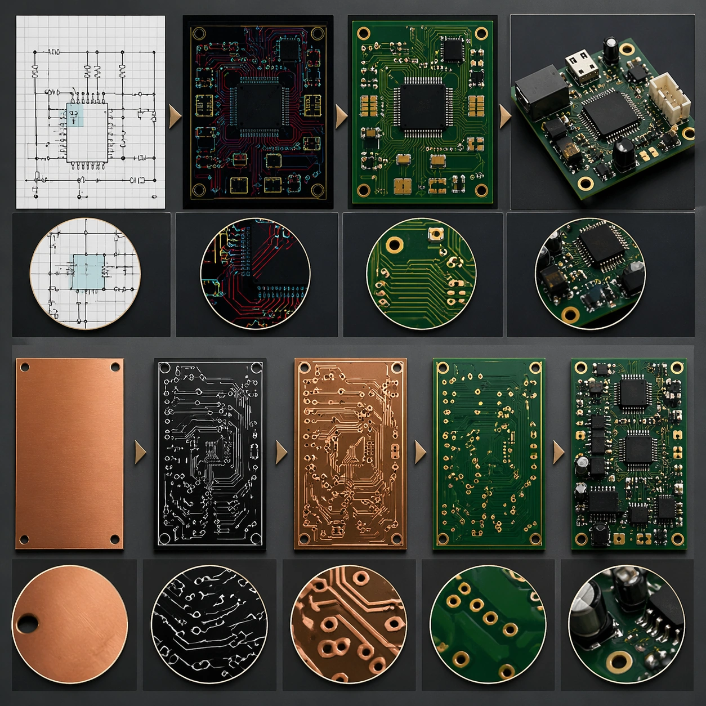

```text
Scene:
A square plate or board viewed straight-on, with crisp organization, disciplined spacing, and premium print clarity. Build the frame around a sequence of stages or states arranged in a disciplined progression. Keep the lighting, camera distance, and spatial organization tuned for a high-signal research image rather than a casual snapshot. The image belongs to the PCB Board Layout theme and should feel immediately legible as a prompt atlas theme for pcb board layout, testing structured-layout, photorealism, style-transfer, commercial-mockup with gpt image 2..

Subject:
Center the study on a sequence of stages or states arranged in a disciplined progression. Translate the theme into a concrete visual statement instead of an abstract mood board: the viewer should understand what kind of image this is, what is being tested, and why the composition is difficult. Use the slug idea of pcb board layout as a literal guide for subject matter, materials, and staging. If helpful, borrow the broad visual cues suggested by PCB, schematic, Arduino, but keep the result original and specific to this study.

Important details:
The image should communicate logic through grouping, hierarchy, callouts, insets, and believable professional layout discipline rather than decorative noise. Preserve a disciplined square composition, clear focal hierarchy, and enough secondary information to make the image feel complete rather than underspecified. The image should look polished, novel, and exhibition-ready, with topic-specific credibility coming from the way surfaces, structure, and visual language reinforce PCB Board Layout. Avoid generic filler elements that do not serve the main concept.

Use case:
PCB Board Layout single study 3/8, testing structured-layout, photorealism, style-transfer, commercial-mockup through the process sequence variation.

Constraints:
No readable text, no watermark, no logos, preserve exact 1:1 aspect ratio, no readable labels, no messy arrows, no random infographic decoration, no fake UI chrome unless the topic calls for it, no broken alignment, no meaningless clutter.
```

[Pinned source](https://github.com/ChaosRealmsAI/gpt-image-2-gallery/blob/5296db8c996e38776c83a0bc8c64f848dcd512b3/works/topics/pcb-board-layout/packages/single-pcb-board-layout-studies/images/process-sequence/meta.json) · GPT Image2 · 1254×1254 · No source-declared image dependencies. · ProjectD:[published and publicly accepted](https://aitoolsradar.com/en/prompts/9180b1545a84e4)

## Annotation Cluster · pcb-board-layout/single-pcb-board-layout-studies/annotation-cluster

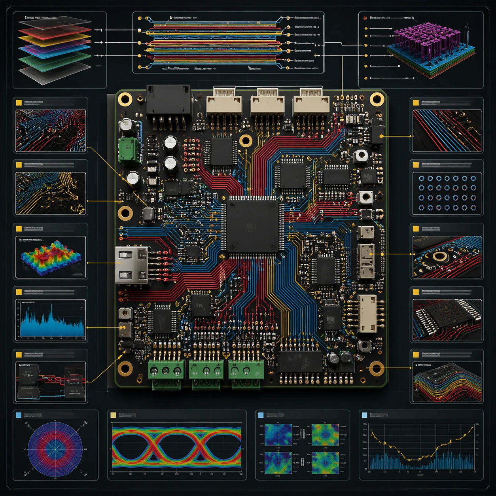

```text
Scene:
A square plate or board viewed straight-on, with crisp organization, disciplined spacing, and premium print clarity. Build the frame around dense callouts and side insets that feel scholarly while staying unreadable. Keep the lighting, camera distance, and spatial organization tuned for a high-signal research image rather than a casual snapshot. The image belongs to the PCB Board Layout theme and should feel immediately legible as a prompt atlas theme for pcb board layout, testing structured-layout, photorealism, style-transfer, commercial-mockup with gpt image 2..

Subject:
Center the study on dense callouts and side insets that feel scholarly while staying unreadable. Translate the theme into a concrete visual statement instead of an abstract mood board: the viewer should understand what kind of image this is, what is being tested, and why the composition is difficult. Use the slug idea of pcb board layout as a literal guide for subject matter, materials, and staging. If helpful, borrow the broad visual cues suggested by PCB, schematic, Arduino, but keep the result original and specific to this study.

Important details:
The image should communicate logic through grouping, hierarchy, callouts, insets, and believable professional layout discipline rather than decorative noise. Preserve a disciplined square composition, clear focal hierarchy, and enough secondary information to make the image feel complete rather than underspecified. The image should look polished, novel, and exhibition-ready, with topic-specific credibility coming from the way surfaces, structure, and visual language reinforce PCB Board Layout. Avoid generic filler elements that do not serve the main concept.

Use case:
PCB Board Layout single study 4/8, testing structured-layout, photorealism, style-transfer, commercial-mockup through the annotation cluster variation.

Constraints:
No readable text, no watermark, no logos, preserve exact 1:1 aspect ratio, no readable labels, no messy arrows, no random infographic decoration, no fake UI chrome unless the topic calls for it, no broken alignment, no meaningless clutter.
```

[Pinned source](https://github.com/ChaosRealmsAI/gpt-image-2-gallery/blob/5296db8c996e38776c83a0bc8c64f848dcd512b3/works/topics/pcb-board-layout/packages/single-pcb-board-layout-studies/images/annotation-cluster/meta.json) · GPT Image2 · 1254×1254 · No source-declared image dependencies. · ProjectD:[published and publicly accepted](https://aitoolsradar.com/en/prompts/93391cfcbee794)

## Comparison Board · pcb-board-layout/single-pcb-board-layout-studies/comparison-board

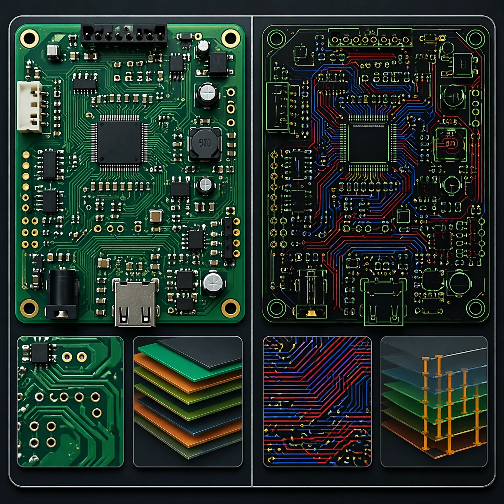

```text
Scene:
A square plate or board viewed straight-on, with crisp organization, disciplined spacing, and premium print clarity. Build the frame around a side-by-side comparison structure with strong contrast and equal visual weight. Keep the lighting, camera distance, and spatial organization tuned for a high-signal research image rather than a casual snapshot. The image belongs to the PCB Board Layout theme and should feel immediately legible as a prompt atlas theme for pcb board layout, testing structured-layout, photorealism, style-transfer, commercial-mockup with gpt image 2..

Subject:
Center the study on a side-by-side comparison structure with strong contrast and equal visual weight. Translate the theme into a concrete visual statement instead of an abstract mood board: the viewer should understand what kind of image this is, what is being tested, and why the composition is difficult. Use the slug idea of pcb board layout as a literal guide for subject matter, materials, and staging. If helpful, borrow the broad visual cues suggested by PCB, schematic, Arduino, but keep the result original and specific to this study.

Important details:
The image should communicate logic through grouping, hierarchy, callouts, insets, and believable professional layout discipline rather than decorative noise. Preserve a disciplined square composition, clear focal hierarchy, and enough secondary information to make the image feel complete rather than underspecified. The image should look polished, novel, and exhibition-ready, with topic-specific credibility coming from the way surfaces, structure, and visual language reinforce PCB Board Layout. Avoid generic filler elements that do not serve the main concept.

Use case:
PCB Board Layout single study 5/8, testing structured-layout, photorealism, style-transfer, commercial-mockup through the comparison board variation.

Constraints:
No readable text, no watermark, no logos, preserve exact 1:1 aspect ratio, no readable labels, no messy arrows, no random infographic decoration, no fake UI chrome unless the topic calls for it, no broken alignment, no meaningless clutter.
```

[Pinned source](https://github.com/ChaosRealmsAI/gpt-image-2-gallery/blob/5296db8c996e38776c83a0bc8c64f848dcd512b3/works/topics/pcb-board-layout/packages/single-pcb-board-layout-studies/images/comparison-board/meta.json) · GPT Image2 · 1254×1254 · No source-declared image dependencies. · ProjectD:[published and publicly accepted](https://aitoolsradar.com/en/prompts/202eb1b395eb0a)

## 材质标注 · pcb-board-layout/single-pcb-board-layout-studies/material-callout

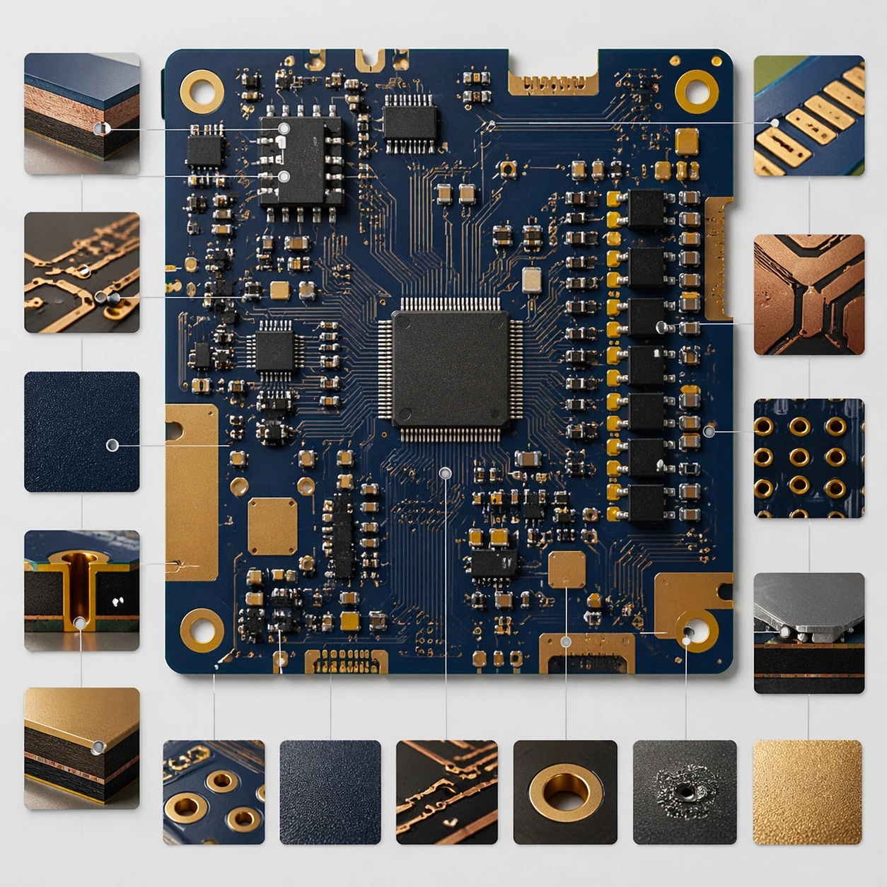

```text
Scene:
A square plate or board viewed straight-on, with crisp organization, disciplined spacing, and premium print clarity. Build the frame around specific texture or material evidence presented with controlled explanatory framing. Keep the lighting, camera distance, and spatial organization tuned for a high-signal research image rather than a casual snapshot. The image belongs to the PCB Board Layout theme and should feel immediately legible as a prompt atlas theme for pcb board layout, testing structured-layout, photorealism, style-transfer, commercial-mockup with gpt image 2..

Subject:
Center the study on specific texture or material evidence presented with controlled explanatory framing. Translate the theme into a concrete visual statement instead of an abstract mood board: the viewer should understand what kind of image this is, what is being tested, and why the composition is difficult. Use the slug idea of pcb board layout as a literal guide for subject matter, materials, and staging. If helpful, borrow the broad visual cues suggested by PCB, schematic, Arduino, but keep the result original and specific to this study.

Important details:
The image should communicate logic through grouping, hierarchy, callouts, insets, and believable professional layout discipline rather than decorative noise. Preserve a disciplined square composition, clear focal hierarchy, and enough secondary information to make the image feel complete rather than underspecified. The image should look polished, novel, and exhibition-ready, with topic-specific credibility coming from the way surfaces, structure, and visual language reinforce PCB Board Layout. Avoid generic filler elements that do not serve the main concept.

Use case:
PCB Board Layout single study 6/8, testing structured-layout, photorealism, style-transfer, commercial-mockup through the 材质标注 variation.

Constraints:
No readable text, no watermark, no logos, preserve exact 1:1 aspect ratio, no readable labels, no messy arrows, no random infographic decoration, no fake UI chrome unless the topic calls for it, no broken alignment, no meaningless clutter.
```

[Pinned source](https://github.com/ChaosRealmsAI/gpt-image-2-gallery/blob/5296db8c996e38776c83a0bc8c64f848dcd512b3/works/topics/pcb-board-layout/packages/single-pcb-board-layout-studies/images/material-callout/meta.json) · GPT Image2 · 1254×1254 · No source-declared image dependencies. · ProjectD:[published and publicly accepted](https://aitoolsradar.com/en/prompts/4181a63138bd75)

## Exploded System · pcb-board-layout/single-pcb-board-layout-studies/exploded-system

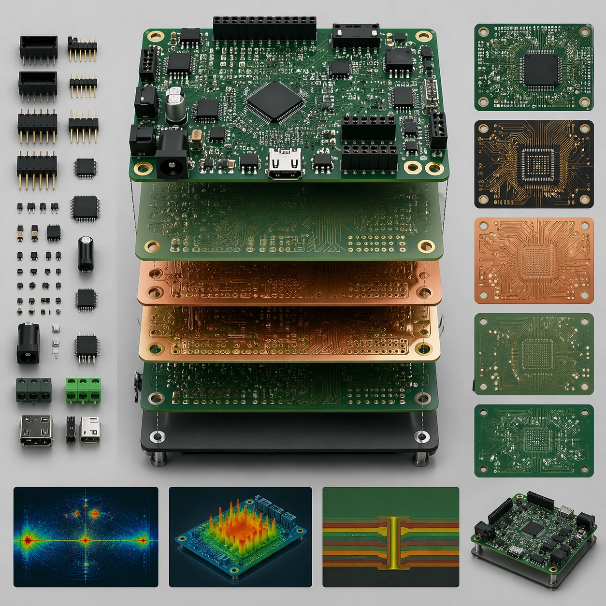

```text
Scene:
A square plate or board viewed straight-on, with crisp organization, disciplined spacing, and premium print clarity. Build the frame around components separated clearly enough to reveal construction and dependency. Keep the lighting, camera distance, and spatial organization tuned for a high-signal research image rather than a casual snapshot. The image belongs to the PCB Board Layout theme and should feel immediately legible as a prompt atlas theme for pcb board layout, testing structured-layout, photorealism, style-transfer, commercial-mockup with gpt image 2..

Subject:
Center the study on components separated clearly enough to reveal construction and dependency. Translate the theme into a concrete visual statement instead of an abstract mood board: the viewer should understand what kind of image this is, what is being tested, and why the composition is difficult. Use the slug idea of pcb board layout as a literal guide for subject matter, materials, and staging. If helpful, borrow the broad visual cues suggested by PCB, schematic, Arduino, but keep the result original and specific to this study.

Important details:
The image should communicate logic through grouping, hierarchy, callouts, insets, and believable professional layout discipline rather than decorative noise. Preserve a disciplined square composition, clear focal hierarchy, and enough secondary information to make the image feel complete rather than underspecified. The image should look polished, novel, and exhibition-ready, with topic-specific credibility coming from the way surfaces, structure, and visual language reinforce PCB Board Layout. Avoid generic filler elements that do not serve the main concept.

Use case:
PCB Board Layout single study 7/8, testing structured-layout, photorealism, style-transfer, commercial-mockup through the exploded system variation.

Constraints:
No readable text, no watermark, no logos, preserve exact 1:1 aspect ratio, no readable labels, no messy arrows, no random infographic decoration, no fake UI chrome unless the topic calls for it, no broken alignment, no meaningless clutter.
```

[Pinned source](https://github.com/ChaosRealmsAI/gpt-image-2-gallery/blob/5296db8c996e38776c83a0bc8c64f848dcd512b3/works/topics/pcb-board-layout/packages/single-pcb-board-layout-studies/images/exploded-system/meta.json) · GPT Image2 · 1254×1254 · No source-declared image dependencies. · ProjectD:[published and publicly accepted](https://aitoolsradar.com/en/prompts/450c1a296d21a9)

## Final Plate · pcb-board-layout/single-pcb-board-layout-studies/final-plate

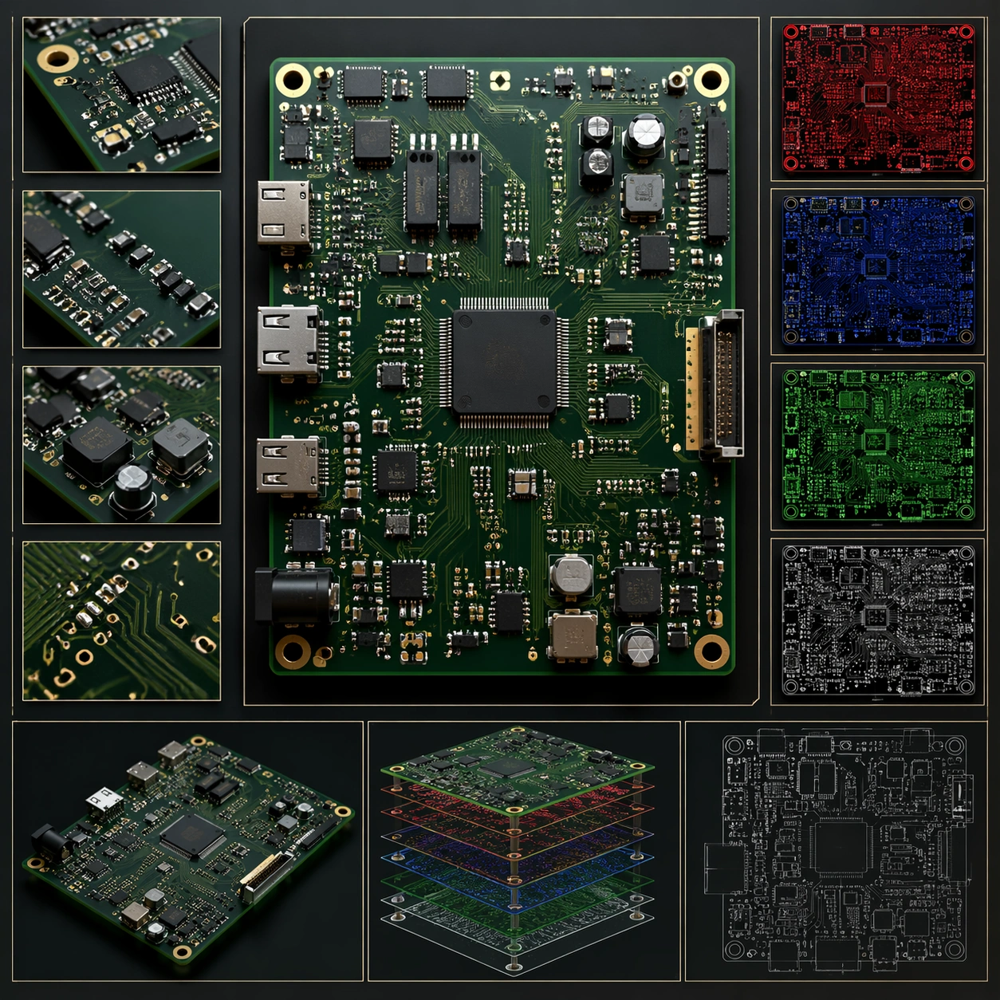

```text
Scene:
A square plate or board viewed straight-on, with crisp organization, disciplined spacing, and premium print clarity. Build the frame around a polished final technical plate that feels ready for a research deck or exhibition wall. Keep the lighting, camera distance, and spatial organization tuned for a high-signal research image rather than a casual snapshot. The image belongs to the PCB Board Layout theme and should feel immediately legible as a prompt atlas theme for pcb board layout, testing structured-layout, photorealism, style-transfer, commercial-mockup with gpt image 2..

Subject:
Center the study on a polished final technical plate that feels ready for a research deck or exhibition wall. Translate the theme into a concrete visual statement instead of an abstract mood board: the viewer should understand what kind of image this is, what is being tested, and why the composition is difficult. Use the slug idea of pcb board layout as a literal guide for subject matter, materials, and staging. If helpful, borrow the broad visual cues suggested by PCB, schematic, Arduino, but keep the result original and specific to this study.

Important details:
The image should communicate logic through grouping, hierarchy, callouts, insets, and believable professional layout discipline rather than decorative noise. Preserve a disciplined square composition, clear focal hierarchy, and enough secondary information to make the image feel complete rather than underspecified. The image should look polished, novel, and exhibition-ready, with topic-specific credibility coming from the way surfaces, structure, and visual language reinforce PCB Board Layout. Avoid generic filler elements that do not serve the main concept.

Use case:
PCB Board Layout single study 8/8, testing structured-layout, photorealism, style-transfer, commercial-mockup through the final plate variation.

Constraints:
No readable text, no watermark, no logos, preserve exact 1:1 aspect ratio, no readable labels, no messy arrows, no random infographic decoration, no fake UI chrome unless the topic calls for it, no broken alignment, no meaningless clutter.
```

[Pinned source](https://github.com/ChaosRealmsAI/gpt-image-2-gallery/blob/5296db8c996e38776c83a0bc8c64f848dcd512b3/works/topics/pcb-board-layout/packages/single-pcb-board-layout-studies/images/final-plate/meta.json) · GPT Image2 · 1254×1254 · No source-declared image dependencies. · ProjectD:[published and publicly accepted](https://aitoolsradar.com/en/prompts/7576c8ae5dde22)

## Reference Anchor · persian-miniature-editorial-modernization/series-core-system/01-reference-anchor

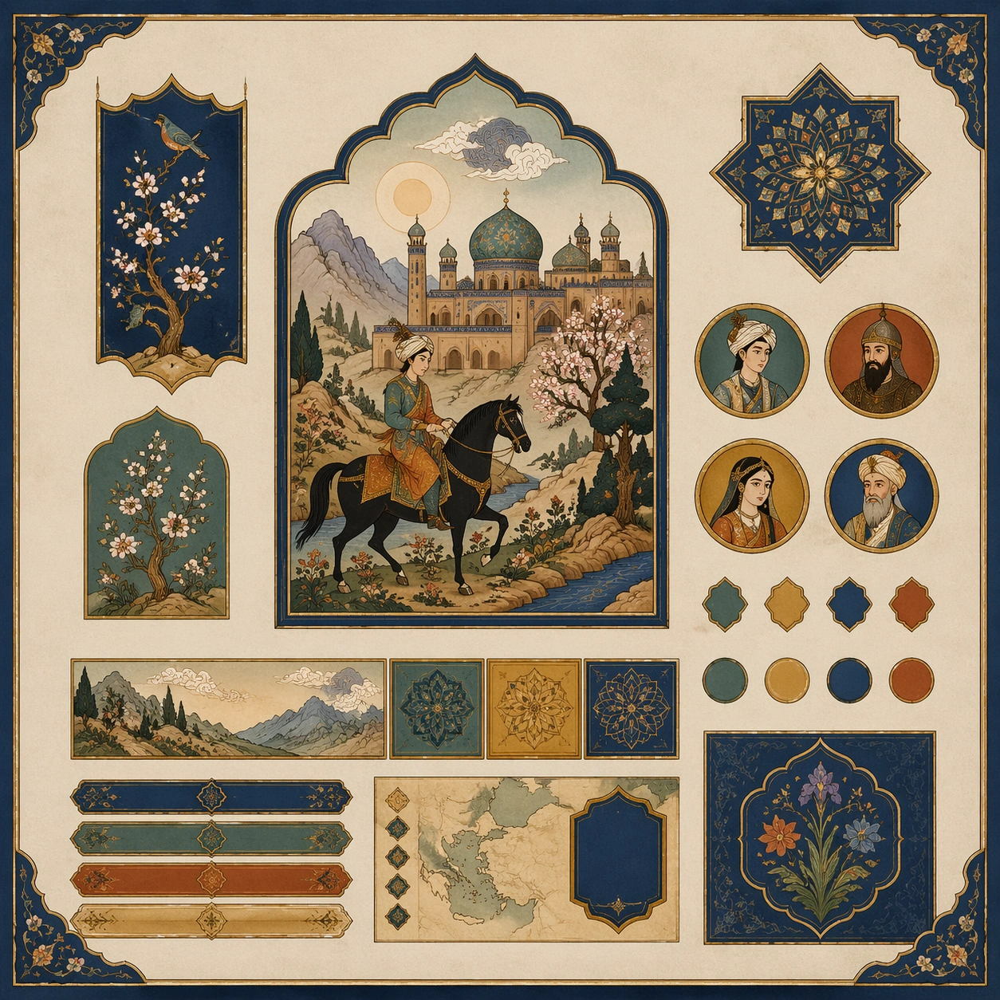

```text
Scene:
Create a square reference image for Persian Miniature Editorial Modernization. Build a reference anchor establishing the core system with a premium, production-ready finish. Use a polished modular board or campaign surface with clean spacing, premium game-UI finish, and clear focal hierarchy. The composition should feel intentional, clean, and reusable for gallery, research, campaign, or internal handoff contexts. Lighting must support readability first, with the main forms clearly separated from the background and enough breathing room for the system to stay legible at both hero scale and thumbnail scale.

Subject:
Center a coherent original game-art system built for premium production and marketing surfaces. For this image, focus on reference anchor. Keep the same system logic stable across screenshots, cards, banners, and overview boards. This image is the canonical anchor that later series images must follow. The viewer should immediately understand what role this surface plays inside a cohesive game-production asset pack.

Important details:
Lock framing, icon grammar, palette blocking, and surface hierarchy so the kit feels production-ready and consistent. Preserve the core silhouette, framing language, and material logic from the reference image while each variation changes function. Keep materials believable, edge hierarchy disciplined, and the visual language consistent with Persian Miniature. Use abstract interface blocks or diagram accents when helpful, but avoid any readable language. The final result should feel like a deliberate production asset rather than a random illustration.

Use case:
Persian Miniature Editorial Modernization series study 1/9, designed as reference anchor within a cohesive asset pack.

Constraints:
No readable text, no watermark, no logos, preserve exact 1:1 aspect ratio, no unrelated objects, no broken visual hierarchy, no malformed anatomy or broken perspective, no random decorative clutter.
```

[Pinned source](https://github.com/ChaosRealmsAI/gpt-image-2-gallery/blob/5296db8c996e38776c83a0bc8c64f848dcd512b3/works/topics/persian-miniature-editorial-modernization/packages/series-core-system/images/01-reference-anchor/meta.json) · GPT Image2 · 1254×1254 · No source-declared image dependencies. · ProjectD:[published and publicly accepted](https://aitoolsradar.com/en/prompts/16aa16c951ab41)

## Variant One · persian-miniature-editorial-modernization/series-core-system/02-variant-one

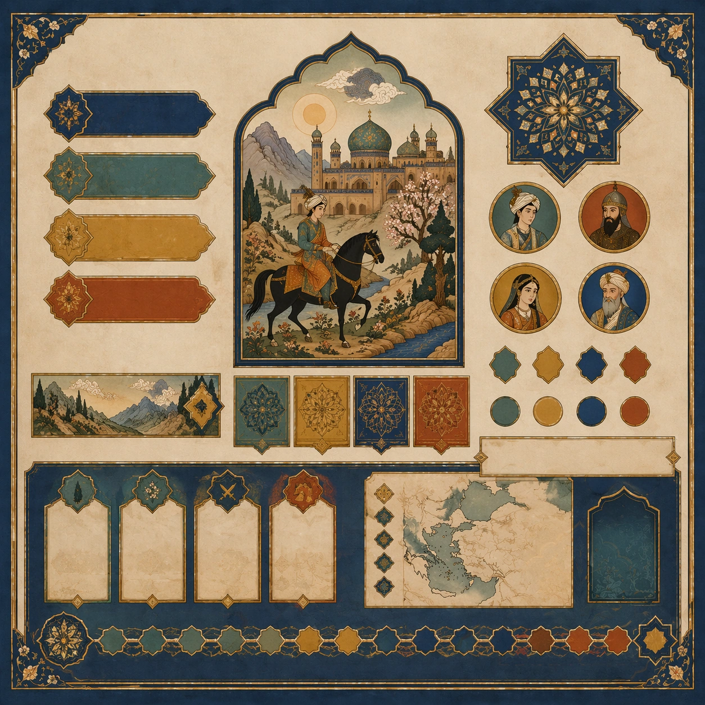

```text
Scene:
Create a square dependent image for Persian Miniature Editorial Modernization. Build a first controlled variation in the same system with a premium, production-ready finish. Use a polished modular board or campaign surface with clean spacing, premium game-UI finish, and clear focal hierarchy. The composition should feel intentional, clean, and reusable for gallery, research, campaign, or internal handoff contexts. Lighting must support readability first, with the main forms clearly separated from the background and enough breathing room for the system to stay legible at both hero scale and thumbnail scale.

Subject:
Center a coherent original game-art system built for premium production and marketing surfaces. For this image, focus on the intended support surface. Keep the same system logic stable across screenshots, cards, banners, and overview boards. Preserve exact identity or system logic from the reference image while changing only the intended variation axis. The viewer should immediately understand what role this surface plays inside a cohesive game-production asset pack.

Important details:
Lock framing, icon grammar, palette blocking, and surface hierarchy so the kit feels production-ready and consistent. Preserve the core silhouette, framing language, and material logic from the reference image while each variation changes function. Keep materials believable, edge hierarchy disciplined, and the visual language consistent with Persian Miniature. Use abstract interface blocks or diagram accents when helpful, but avoid any readable language. The final result should feel like a deliberate production asset rather than a random illustration.

Use case:
Persian Miniature Editorial Modernization series study 2/9, designed as variant one within a cohesive asset pack.

Constraints:
No readable text, no watermark, no logos, preserve exact 1:1 aspect ratio, no unrelated objects, no broken visual hierarchy, no malformed anatomy or broken perspective, no random decorative clutter.
```

[Pinned source](https://github.com/ChaosRealmsAI/gpt-image-2-gallery/blob/5296db8c996e38776c83a0bc8c64f848dcd512b3/works/topics/persian-miniature-editorial-modernization/packages/series-core-system/images/02-variant-one/meta.json) · GPT Image2 · 1254×1254 · Reference images required. · ProjectD:[published and publicly accepted](https://aitoolsradar.com/en/prompts/0fe36fcb9db685)

## Variant Two · persian-miniature-editorial-modernization/series-core-system/03-variant-two

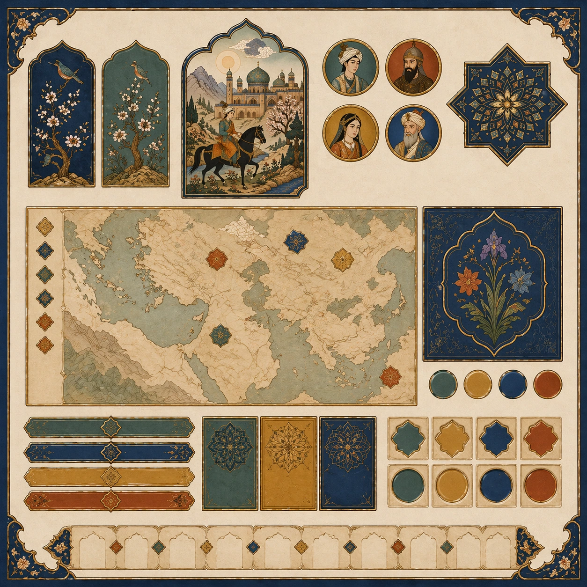

```text
Scene:
Create a square dependent image for Persian Miniature Editorial Modernization. Build a second controlled variation in the same system with a premium, production-ready finish. Use a polished modular board or campaign surface with clean spacing, premium game-UI finish, and clear focal hierarchy. The composition should feel intentional, clean, and reusable for gallery, research, campaign, or internal handoff contexts. Lighting must support readability first, with the main forms clearly separated from the background and enough breathing room for the system to stay legible at both hero scale and thumbnail scale.

Subject:
Center a coherent original game-art system built for premium production and marketing surfaces. For this image, focus on the intended support surface. Keep the same system logic stable across screenshots, cards, banners, and overview boards. Preserve exact identity or system logic from the reference image while changing only the intended variation axis. The viewer should immediately understand what role this surface plays inside a cohesive game-production asset pack.

Important details:
Lock framing, icon grammar, palette blocking, and surface hierarchy so the kit feels production-ready and consistent. Preserve the core silhouette, framing language, and material logic from the reference image while each variation changes function. Keep materials believable, edge hierarchy disciplined, and the visual language consistent with Persian Miniature. Use abstract interface blocks or diagram accents when helpful, but avoid any readable language. The final result should feel like a deliberate production asset rather than a random illustration.

Use case:
Persian Miniature Editorial Modernization series study 3/9, designed as variant two within a cohesive asset pack.

Constraints:
No readable text, no watermark, no logos, preserve exact 1:1 aspect ratio, no unrelated objects, no broken visual hierarchy, no malformed anatomy or broken perspective, no random decorative clutter.
```

[Pinned source](https://github.com/ChaosRealmsAI/gpt-image-2-gallery/blob/5296db8c996e38776c83a0bc8c64f848dcd512b3/works/topics/persian-miniature-editorial-modernization/packages/series-core-system/images/03-variant-two/meta.json) · GPT Image2 · 1254×1254 · Reference images required. · ProjectD:[published and publicly accepted](https://aitoolsradar.com/en/prompts/aca17aa346be01)

## Variant Three · persian-miniature-editorial-modernization/series-core-system/04-variant-three

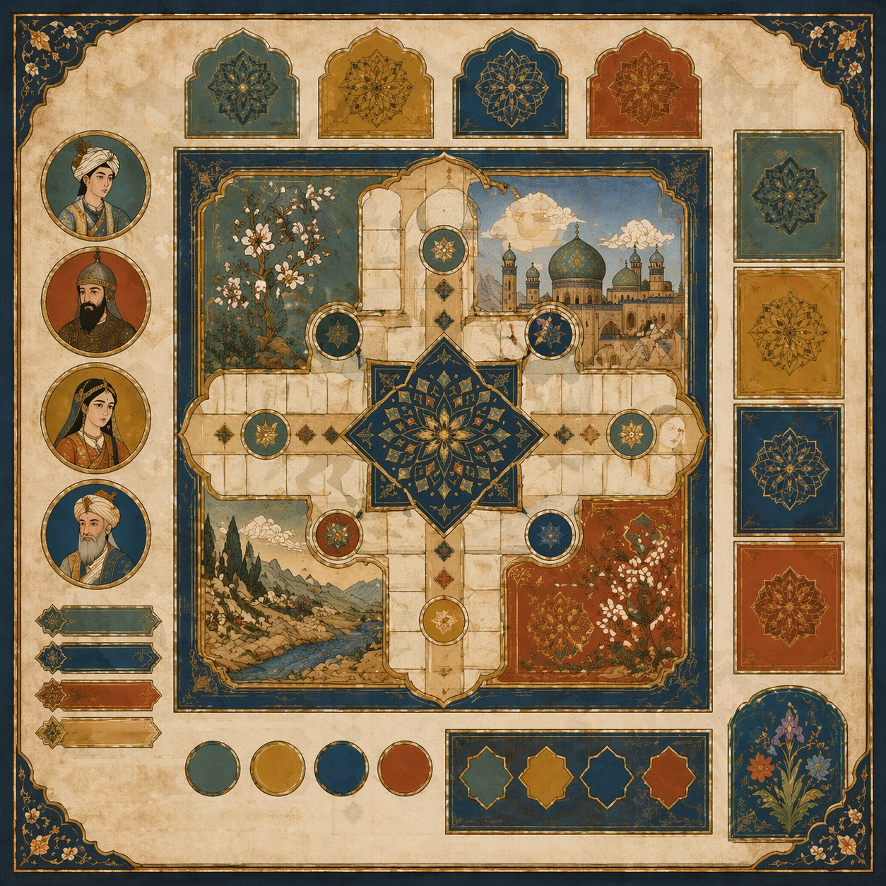

```text
Scene:
Create a square dependent image for Persian Miniature Editorial Modernization. Build a third controlled variation in the same system with a premium, production-ready finish. Use a polished modular board or campaign surface with clean spacing, premium game-UI finish, and clear focal hierarchy. The composition should feel intentional, clean, and reusable for gallery, research, campaign, or internal handoff contexts. Lighting must support readability first, with the main forms clearly separated from the background and enough breathing room for the system to stay legible at both hero scale and thumbnail scale.

Subject:
Center a coherent original game-art system built for premium production and marketing surfaces. For this image, focus on the intended support surface. Keep the same system logic stable across screenshots, cards, banners, and overview boards. Preserve exact identity or system logic from the reference image while changing only the intended variation axis. The viewer should immediately understand what role this surface plays inside a cohesive game-production asset pack.

Important details:
Lock framing, icon grammar, palette blocking, and surface hierarchy so the kit feels production-ready and consistent. Preserve the core silhouette, framing language, and material logic from the reference image while each variation changes function. Keep materials believable, edge hierarchy disciplined, and the visual language consistent with Persian Miniature. Use abstract interface blocks or diagram accents when helpful, but avoid any readable language. The final result should feel like a deliberate production asset rather than a random illustration.

Use case:
Persian Miniature Editorial Modernization series study 4/9, designed as variant three within a cohesive asset pack.

Constraints:
No readable text, no watermark, no logos, preserve exact 1:1 aspect ratio, no unrelated objects, no broken visual hierarchy, no malformed anatomy or broken perspective, no random decorative clutter.
```

[Pinned source](https://github.com/ChaosRealmsAI/gpt-image-2-gallery/blob/5296db8c996e38776c83a0bc8c64f848dcd512b3/works/topics/persian-miniature-editorial-modernization/packages/series-core-system/images/04-variant-three/meta.json) · GPT Image2 · 1254×1254 · Reference images required. · ProjectD:[published and publicly accepted](https://aitoolsradar.com/en/prompts/b61329681866a9)

## Support One · persian-miniature-editorial-modernization/single-support-studies/support-one

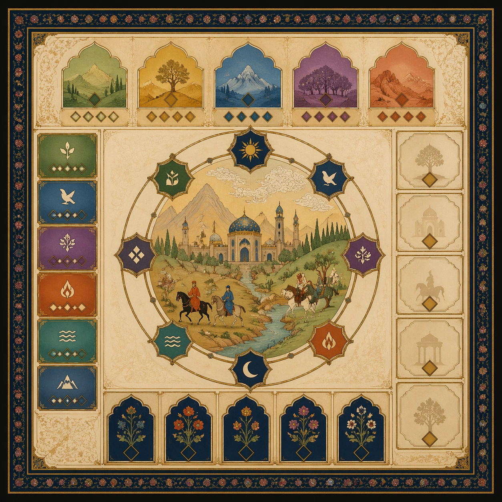

```text
Scene:
Create a square standalone support image for Persian Miniature Editorial Modernization. Build a support-surface study with a clear focal hierarchy and a finished professional surface. Use a polished modular board or campaign surface with clean spacing, premium game-UI finish, and clear focal hierarchy. The frame should feel self-contained and polished, with enough structure to explain the system even without the reference series, yet still obviously belonging to the same theme and production world.

Subject:
Show a coherent original game-art system built for premium production and marketing surfaces in a way that emphasizes the intended support surface. Keep the same system logic stable across screenshots, cards, banners, and overview boards. Even though this image is independent, the viewer should still recognize the same universe, same commercial logic, and same production intent as the core package.

Important details:
Lock framing, icon grammar, palette blocking, and surface hierarchy so the kit feels production-ready and consistent. Preserve the broader theme language through color, framing, material choices, and modular composition. Use clean panel rhythm, premium asset presentation, and believable detail density. The image should work equally well as a gallery study, research reference, and mock production deliverable.

Use case:
Persian Miniature Editorial Modernization single study 5/9, exploring support one as a support surface.

Constraints:
No readable text, no watermark, no logos, preserve exact 1:1 aspect ratio, no unrelated objects, no broken visual hierarchy, no visual noise that obscures the main surface, no accidental brand resemblance.
```

[Pinned source](https://github.com/ChaosRealmsAI/gpt-image-2-gallery/blob/5296db8c996e38776c83a0bc8c64f848dcd512b3/works/topics/persian-miniature-editorial-modernization/packages/single-support-studies/images/support-one/meta.json) · GPT Image2 · 1254×1254 · No source-declared image dependencies. · ProjectD:[published and publicly accepted](https://aitoolsradar.com/en/prompts/d8741e72167ef3)

## Support Two · persian-miniature-editorial-modernization/single-support-studies/support-two

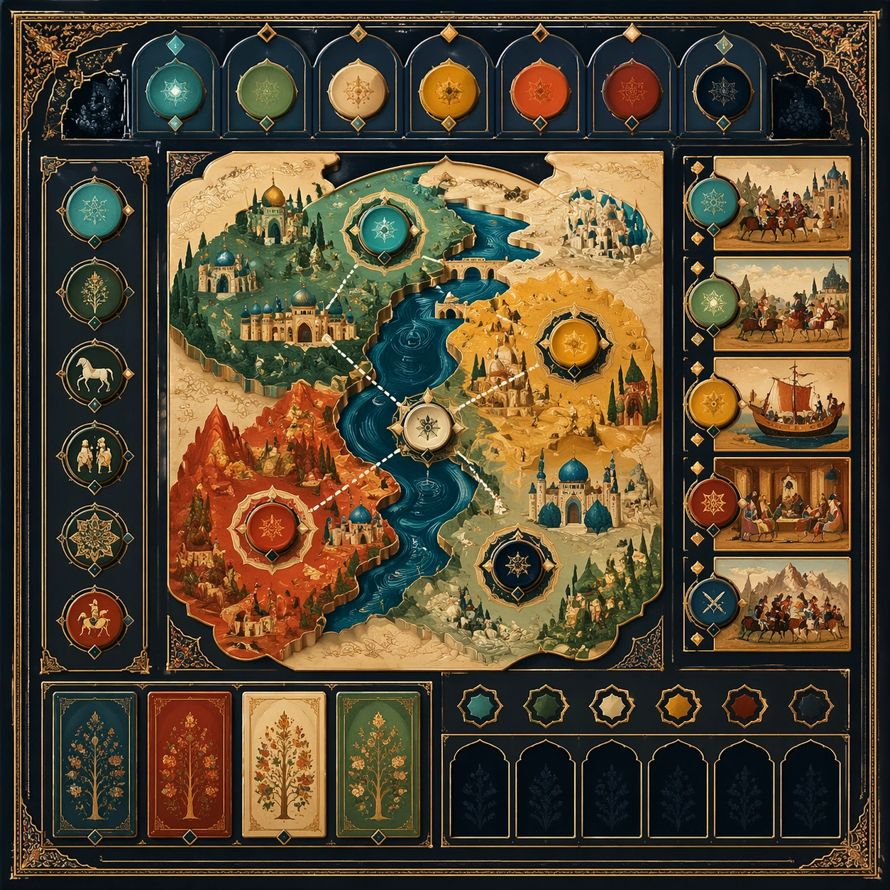

```text
Scene:
Create a square standalone support image for Persian Miniature Editorial Modernization. Build a second support-surface study with a clear focal hierarchy and a finished professional surface. Use a polished modular board or campaign surface with clean spacing, premium game-UI finish, and clear focal hierarchy. The frame should feel self-contained and polished, with enough structure to explain the system even without the reference series, yet still obviously belonging to the same theme and production world.

Subject:
Show a coherent original game-art system built for premium production and marketing surfaces in a way that emphasizes the intended support surface. Keep the same system logic stable across screenshots, cards, banners, and overview boards. Even though this image is independent, the viewer should still recognize the same universe, same commercial logic, and same production intent as the core package.

Important details:
Lock framing, icon grammar, palette blocking, and surface hierarchy so the kit feels production-ready and consistent. Preserve the broader theme language through color, framing, material choices, and modular composition. Use clean panel rhythm, premium asset presentation, and believable detail density. The image should work equally well as a gallery study, research reference, and mock production deliverable.

Use case:
Persian Miniature Editorial Modernization single study 6/9, exploring support two as a support surface.

Constraints:
No readable text, no watermark, no logos, preserve exact 1:1 aspect ratio, no unrelated objects, no broken visual hierarchy, no visual noise that obscures the main surface, no accidental brand resemblance.
```

[Pinned source](https://github.com/ChaosRealmsAI/gpt-image-2-gallery/blob/5296db8c996e38776c83a0bc8c64f848dcd512b3/works/topics/persian-miniature-editorial-modernization/packages/single-support-studies/images/support-two/meta.json) · GPT Image2 · 1254×1254 · No source-declared image dependencies. · ProjectD:[published and publicly accepted](https://aitoolsradar.com/en/prompts/66e800c9819136)

## Support Three · persian-miniature-editorial-modernization/single-support-studies/support-three

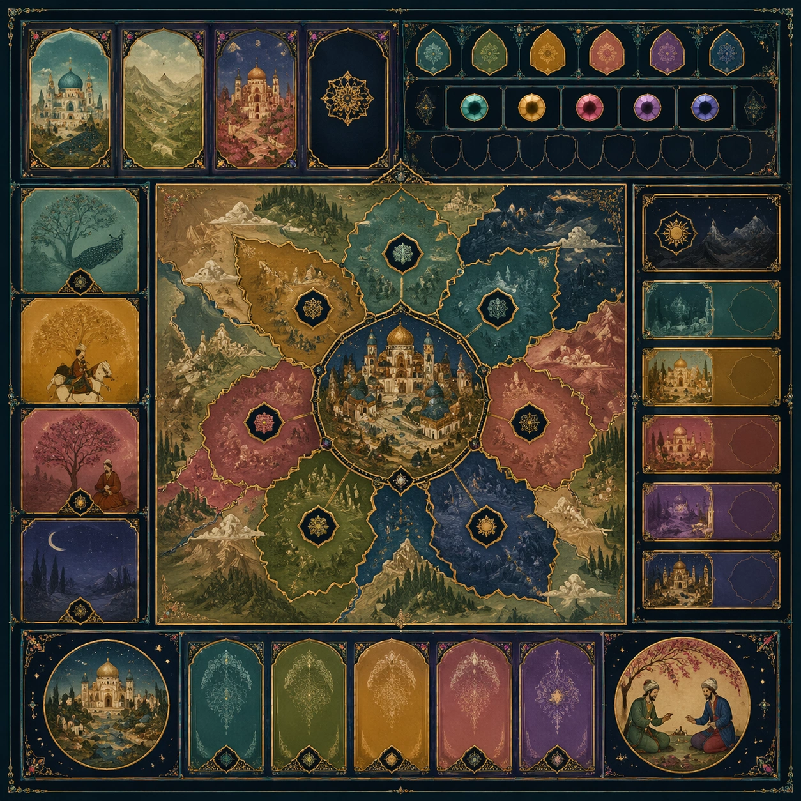

```text
Scene:
Create a square standalone support image for Persian Miniature Editorial Modernization. Build a third support-surface study with a clear focal hierarchy and a finished professional surface. Use a polished modular board or campaign surface with clean spacing, premium game-UI finish, and clear focal hierarchy. The frame should feel self-contained and polished, with enough structure to explain the system even without the reference series, yet still obviously belonging to the same theme and production world.

Subject:
Show a coherent original game-art system built for premium production and marketing surfaces in a way that emphasizes the intended support surface. Keep the same system logic stable across screenshots, cards, banners, and overview boards. Even though this image is independent, the viewer should still recognize the same universe, same commercial logic, and same production intent as the core package.

Important details:
Lock framing, icon grammar, palette blocking, and surface hierarchy so the kit feels production-ready and consistent. Preserve the broader theme language through color, framing, material choices, and modular composition. Use clean panel rhythm, premium asset presentation, and believable detail density. The image should work equally well as a gallery study, research reference, and mock production deliverable.

Use case:
Persian Miniature Editorial Modernization single study 7/9, exploring support three as a support surface.

Constraints:
No readable text, no watermark, no logos, preserve exact 1:1 aspect ratio, no unrelated objects, no broken visual hierarchy, no visual noise that obscures the main surface, no accidental brand resemblance.
```

[Pinned source](https://github.com/ChaosRealmsAI/gpt-image-2-gallery/blob/5296db8c996e38776c83a0bc8c64f848dcd512b3/works/topics/persian-miniature-editorial-modernization/packages/single-support-studies/images/support-three/meta.json) · GPT Image2 · 1254×1254 · No source-declared image dependencies. · ProjectD:[published and publicly accepted](https://aitoolsradar.com/en/prompts/e9569f97dbcaaf)

## Support Four · persian-miniature-editorial-modernization/single-support-studies/support-four

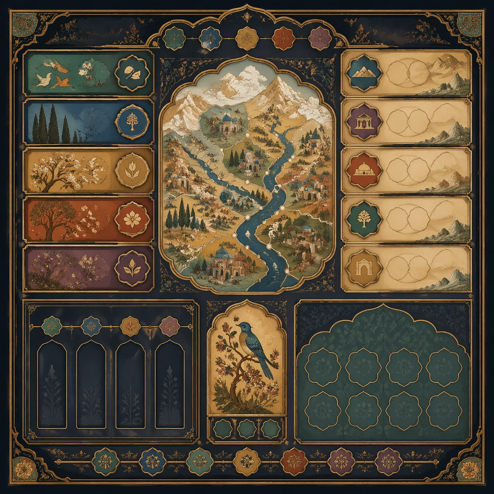

```text
Scene:
Create a square standalone support image for Persian Miniature Editorial Modernization. Build a fourth support-surface study with a clear focal hierarchy and a finished professional surface. Use a polished modular board or campaign surface with clean spacing, premium game-UI finish, and clear focal hierarchy. The frame should feel self-contained and polished, with enough structure to explain the system even without the reference series, yet still obviously belonging to the same theme and production world.

Subject:
Show a coherent original game-art system built for premium production and marketing surfaces in a way that emphasizes the intended support surface. Keep the same system logic stable across screenshots, cards, banners, and overview boards. Even though this image is independent, the viewer should still recognize the same universe, same commercial logic, and same production intent as the core package.

Important details:
Lock framing, icon grammar, palette blocking, and surface hierarchy so the kit feels production-ready and consistent. Preserve the broader theme language through color, framing, material choices, and modular composition. Use clean panel rhythm, premium asset presentation, and believable detail density. The image should work equally well as a gallery study, research reference, and mock production deliverable.

Use case:
Persian Miniature Editorial Modernization single study 8/9, exploring support four as a support surface.

Constraints:
No readable text, no watermark, no logos, preserve exact 1:1 aspect ratio, no unrelated objects, no broken visual hierarchy, no visual noise that obscures the main surface, no accidental brand resemblance.
```

[Pinned source](https://github.com/ChaosRealmsAI/gpt-image-2-gallery/blob/5296db8c996e38776c83a0bc8c64f848dcd512b3/works/topics/persian-miniature-editorial-modernization/packages/single-support-studies/images/support-four/meta.json) · GPT Image2 · 1254×1254 · No source-declared image dependencies. · ProjectD:[published and publicly accepted](https://aitoolsradar.com/en/prompts/8559eaf9b9f668)

## Support Five · persian-miniature-editorial-modernization/single-support-studies/support-five

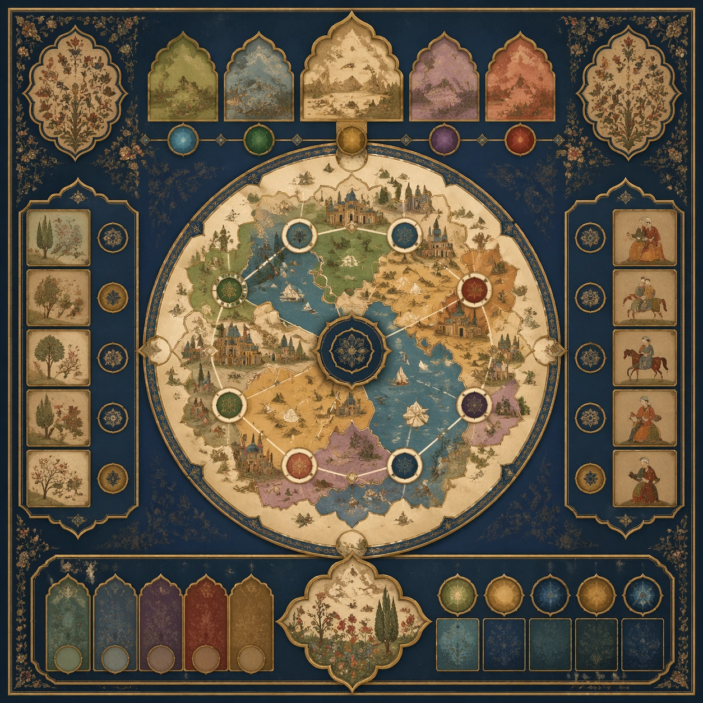

```text
Scene:
Create a square standalone support image for Persian Miniature Editorial Modernization. Build a fifth support-surface study with a clear focal hierarchy and a finished professional surface. Use a polished modular board or campaign surface with clean spacing, premium game-UI finish, and clear focal hierarchy. The frame should feel self-contained and polished, with enough structure to explain the system even without the reference series, yet still obviously belonging to the same theme and production world.

Subject:
Show a coherent original game-art system built for premium production and marketing surfaces in a way that emphasizes the intended support surface. Keep the same system logic stable across screenshots, cards, banners, and overview boards. Even though this image is independent, the viewer should still recognize the same universe, same commercial logic, and same production intent as the core package.

Important details:
Lock framing, icon grammar, palette blocking, and surface hierarchy so the kit feels production-ready and consistent. Preserve the broader theme language through color, framing, material choices, and modular composition. Use clean panel rhythm, premium asset presentation, and believable detail density. The image should work equally well as a gallery study, research reference, and mock production deliverable.

Use case:
Persian Miniature Editorial Modernization single study 9/9, exploring support five as a support surface.

Constraints:
No readable text, no watermark, no logos, preserve exact 1:1 aspect ratio, no unrelated objects, no broken visual hierarchy, no visual noise that obscures the main surface, no accidental brand resemblance.
```

[Pinned source](https://github.com/ChaosRealmsAI/gpt-image-2-gallery/blob/5296db8c996e38776c83a0bc8c64f848dcd512b3/works/topics/persian-miniature-editorial-modernization/packages/single-support-studies/images/support-five/meta.json) · GPT Image2 · 1254×1254 · No source-declared image dependencies. · ProjectD:[published and publicly accepted](https://aitoolsradar.com/en/prompts/67cd04c8091c3f)

## Reference Portrait Anchor · personal-brand-portrait-system/series-portrait-brand-system/01-reference-portrait-anchor


```text
Scene:
Create a square 1:1 portrait image for Personal Brand Portrait System. Use a clean studio anchor with balanced soft light, neutral gray or off-white backdrop, and premium agency-grade framing. The frame should feel like a finished professional deliverable rather than a casual snapshot, with clear lens discipline, believable light falloff, and a palette that directly supports Create a full portrait system for creators, consultants, and public-facing professionals across profile photos, website hero images, and keynote promos.. Keep enough surrounding space and compositional control for gallery, research, campaign, or approval-board reuse while staying photoreal and human-scaled.

Subject:
Center one creator-founder in their thirties with light brown skin, long dark hair tucked behind one ear, intelligent eyes, and an approachable but polished posture. Establish the exact identity, skin tone family, hair base, and body read that every later image must reuse. Let the styling stay minimal and believable so the series begins from an authoritative baseline. Use the example direction from the brief as grounding context: Create a full portrait system for creators, consultants, and public-facing professionals across profile photos, website hero images, and keynote promos.. Wardrobe, lighting, environment, and pose may shift to serve this variation, but the viewer must immediately understand that the same reference identity is still in front of the camera.

Important details:
This backlog line is difficult because Create a full portrait system for creators, consultants, and public-facing professionals across profile photos, website hero images, and keynote promos.. Preserve skin tone family, bone structure, eye spacing, nose shape, mouth shape, hairline logic, shoulder width, and overall body read across the entire series. preserve exact face / hair base / body proportions from the reference model. Keep the crop polished, the eye line steady, and the wardrobe simple enough to survive later changes without confusion. Avoid the common failure described in the brief: ordinary image models often lose likeness once styling, lighting, or layout changes enter the frame. Success should feel like the result should feel professionally usable, coherent, and clearly built around one stable human identity.

Use case:
Personal Brand Portrait System series study 1/9, the neutral baseline portrait proof.

Constraints:
No readable text, no watermark, no logos, preserve exact 1:1 aspect ratio, preserve exact face / hair base / body proportions from the reference model, no extra people, no hard fashion gimmicks, no exaggerated retouching, no broken eye alignment.
```

[Pinned source](https://github.com/ChaosRealmsAI/gpt-image-2-gallery/blob/5296db8c996e38776c83a0bc8c64f848dcd512b3/works/topics/personal-brand-portrait-system/packages/series-portrait-brand-system/images/01-reference-portrait-anchor/meta.json) · GPT Image2 · 1254×1254 · No source-declared image dependencies. · ProjectD:[published and publicly accepted](https://aitoolsradar.com/en/prompts/ede9307eeb22c6)

## Clean Headshot · personal-brand-portrait-system/series-portrait-brand-system/02-clean-headshot


```text
Scene:
Create a square 1:1 portrait image for Personal Brand Portrait System. Use a bright but controlled studio setup with crisp catchlights, smooth tonal falloff, and enough margin for usage as profile art. The frame should feel like a finished professional deliverable rather than a casual snapshot, with clear lens discipline, believable light falloff, and a palette that directly supports Create a full portrait system for creators, consultants, and public-facing professionals across profile photos, website hero images, and keynote promos.. Keep enough surrounding space and compositional control for gallery, research, campaign, or approval-board reuse while staying photoreal and human-scaled.

Subject:
Center one creator-founder in their thirties with light brown skin, long dark hair tucked behind one ear, intelligent eyes, and an approachable but polished posture. Preserve the same face while shifting the posture toward a more direct headshot deliverable. Styling may become slightly sharper, but the result still needs to read as the same person from image 01. Use the example direction from the brief as grounding context: Create a full portrait system for creators, consultants, and public-facing professionals across profile photos, website hero images, and keynote promos.. Wardrobe, lighting, environment, and pose may shift to serve this variation, but the viewer must immediately understand that the same reference identity is still in front of the camera.

Important details:
This backlog line is difficult because Create a full portrait system for creators, consultants, and public-facing professionals across profile photos, website hero images, and keynote promos.. Preserve skin tone family, bone structure, eye spacing, nose shape, mouth shape, hairline logic, shoulder width, and overall body read across the entire series. preserve exact face / hair base / body proportions from the reference model. This frame should feel reliable, publishable, and easy to crop for agency, website, or PR use. Avoid the common failure described in the brief: ordinary image models often lose likeness once styling, lighting, or layout changes enter the frame. Success should feel like the result should feel professionally usable, coherent, and clearly built around one stable human identity.

Use case:
Personal Brand Portrait System series study 2/9, a clean corporate or editorial headshot.

Constraints:
No readable text, no watermark, no logos, preserve exact 1:1 aspect ratio, preserve exact face / hair base / body proportions from the reference model, no drifting age, no different haircut, no over-smoothed skin, no random jewelry clutter.
```

[Pinned source](https://github.com/ChaosRealmsAI/gpt-image-2-gallery/blob/5296db8c996e38776c83a0bc8c64f848dcd512b3/works/topics/personal-brand-portrait-system/packages/series-portrait-brand-system/images/02-clean-headshot/meta.json) · GPT Image2 · 1254×1254 · Reference images required. · ProjectD:[published and publicly accepted](https://aitoolsradar.com/en/prompts/b858df34d2efac)

## Three-Quarter Hero · personal-brand-portrait-system/series-portrait-brand-system/03-three-quarter-hero


```text
Scene:
Create a square 1:1 portrait image for Personal Brand Portrait System. Use a sculpted key light with subtle shadow modeling, clean negative space, and a slightly wider crop that still favors the face. The frame should feel like a finished professional deliverable rather than a casual snapshot, with clear lens discipline, believable light falloff, and a palette that directly supports Create a full portrait system for creators, consultants, and public-facing professionals across profile photos, website hero images, and keynote promos.. Keep enough surrounding space and compositional control for gallery, research, campaign, or approval-board reuse while staying photoreal and human-scaled.

Subject:
Center one creator-founder in their thirties with light brown skin, long dark hair tucked behind one ear, intelligent eyes, and an approachable but polished posture. Use the same identity and wardrobe family while introducing stronger body language through shoulders, hands, or a turn of the torso. The viewer should immediately recognize the same subject even though the composition becomes more campaign-like. Use the example direction from the brief as grounding context: Create a full portrait system for creators, consultants, and public-facing professionals across profile photos, website hero images, and keynote promos.. Wardrobe, lighting, environment, and pose may shift to serve this variation, but the viewer must immediately understand that the same reference identity is still in front of the camera.

Important details:
This backlog line is difficult because Create a full portrait system for creators, consultants, and public-facing professionals across profile photos, website hero images, and keynote promos.. Preserve skin tone family, bone structure, eye spacing, nose shape, mouth shape, hairline logic, shoulder width, and overall body read across the entire series. preserve exact face / hair base / body proportions from the reference model. Keep proportions stable and let the pose feel intentional rather than theatrical. Avoid the common failure described in the brief: ordinary image models often lose likeness once styling, lighting, or layout changes enter the frame. Success should feel like the result should feel professionally usable, coherent, and clearly built around one stable human identity.

Use case:
Personal Brand Portrait System series study 3/9, a three-quarter portrait hero.

Constraints:
No readable text, no watermark, no logos, preserve exact 1:1 aspect ratio, preserve exact face / hair base / body proportions from the reference model, no warped arms, no off-model body shape, no new facial hair pattern, no unrelated props.
```

[Pinned source](https://github.com/ChaosRealmsAI/gpt-image-2-gallery/blob/5296db8c996e38776c83a0bc8c64f848dcd512b3/works/topics/personal-brand-portrait-system/packages/series-portrait-brand-system/images/03-three-quarter-hero/meta.json) · GPT Image2 · 1254×1254 · Reference images required. · ProjectD:[published and publicly accepted](https://aitoolsradar.com/en/prompts/1780fb2ecc2026)

## Profile Study · personal-brand-portrait-system/series-portrait-brand-system/04-profile-study


```text
Scene:
Create a square 1:1 portrait image for Personal Brand Portrait System. Use a disciplined side-light portrait with a smooth background, quiet contrast, and a calm editorial mood. The frame should feel like a finished professional deliverable rather than a casual snapshot, with clear lens discipline, believable light falloff, and a palette that directly supports Create a full portrait system for creators, consultants, and public-facing professionals across profile photos, website hero images, and keynote promos.. Keep enough surrounding space and compositional control for gallery, research, campaign, or approval-board reuse while staying photoreal and human-scaled.

Subject:
Center one creator-founder in their thirties with light brown skin, long dark hair tucked behind one ear, intelligent eyes, and an approachable but polished posture. Rotate the same person into a controlled profile study that proves nose bridge, jawline, ear shape, and hairline remain consistent with the reference model. Use the example direction from the brief as grounding context: Create a full portrait system for creators, consultants, and public-facing professionals across profile photos, website hero images, and keynote promos.. Wardrobe, lighting, environment, and pose may shift to serve this variation, but the viewer must immediately understand that the same reference identity is still in front of the camera.

Important details:
This backlog line is difficult because Create a full portrait system for creators, consultants, and public-facing professionals across profile photos, website hero images, and keynote promos.. Preserve skin tone family, bone structure, eye spacing, nose shape, mouth shape, hairline logic, shoulder width, and overall body read across the entire series. preserve exact face / hair base / body proportions from the reference model. Make the image useful for approval and continuity review, not merely stylistic for style alone. Avoid the common failure described in the brief: ordinary image models often lose likeness once styling, lighting, or layout changes enter the frame. Success should feel like the result should feel professionally usable, coherent, and clearly built around one stable human identity.

Use case:
Personal Brand Portrait System series study 4/9, a profile or near-profile study.

Constraints:
No readable text, no watermark, no logos, preserve exact 1:1 aspect ratio, preserve exact face / hair base / body proportions from the reference model, no profile drift, no altered nose length, no ears changing shape, no chaotic flyaway hair.
```

[Pinned source](https://github.com/ChaosRealmsAI/gpt-image-2-gallery/blob/5296db8c996e38776c83a0bc8c64f848dcd512b3/works/topics/personal-brand-portrait-system/packages/series-portrait-brand-system/images/04-profile-study/meta.json) · GPT Image2 · 1254×1254 · Reference images required. · ProjectD:[published and publicly accepted](https://aitoolsradar.com/en/prompts/04256de6d5b55d)

## Approachable Smile · personal-brand-portrait-system/series-portrait-brand-system/05-approachable-smile


```text
Scene:
Create a square 1:1 portrait image for Personal Brand Portrait System. Use a welcoming light setup with soft highlights, gentle warmth, and subtle environmental mood that still feels premium. The frame should feel like a finished professional deliverable rather than a casual snapshot, with clear lens discipline, believable light falloff, and a palette that directly supports Create a full portrait system for creators, consultants, and public-facing professionals across profile photos, website hero images, and keynote promos.. Keep enough surrounding space and compositional control for gallery, research, campaign, or approval-board reuse while staying photoreal and human-scaled.

Subject:
Center one creator-founder in their thirties with light brown skin, long dark hair tucked behind one ear, intelligent eyes, and an approachable but polished posture. Keep the same face and body proportions, but let the emotional register open up into a believable smile or softer public-facing energy. This should look like the same person relaxing, not a second talent hire. Use the example direction from the brief as grounding context: Create a full portrait system for creators, consultants, and public-facing professionals across profile photos, website hero images, and keynote promos.. Wardrobe, lighting, environment, and pose may shift to serve this variation, but the viewer must immediately understand that the same reference identity is still in front of the camera.

Important details:
This backlog line is difficult because Create a full portrait system for creators, consultants, and public-facing professionals across profile photos, website hero images, and keynote promos.. Preserve skin tone family, bone structure, eye spacing, nose shape, mouth shape, hairline logic, shoulder width, and overall body read across the entire series. preserve exact face / hair base / body proportions from the reference model. Expression change is allowed; identity change is not. Teeth, lips, eye crinkle, and cheeks should still fit the same bone structure. Avoid the common failure described in the brief: ordinary image models often lose likeness once styling, lighting, or layout changes enter the frame. Success should feel like the result should feel professionally usable, coherent, and clearly built around one stable human identity.

Use case:
Personal Brand Portrait System series study 5/9, a warmer, approachable expression variation.

Constraints:
No readable text, no watermark, no logos, preserve exact 1:1 aspect ratio, preserve exact face / hair base / body proportions from the reference model, no changed teeth shape, no exaggerated laugh lines, no glamour filter skin, no mismatched eye color.
```

[Pinned source](https://github.com/ChaosRealmsAI/gpt-image-2-gallery/blob/5296db8c996e38776c83a0bc8c64f848dcd512b3/works/topics/personal-brand-portrait-system/packages/series-portrait-brand-system/images/05-approachable-smile/meta.json) · GPT Image2 · 1254×1254 · Reference images required. · ProjectD:[published and publicly accepted](https://aitoolsradar.com/en/prompts/2e983c3074a4fd)

## Dark Backdrop Editorial · personal-brand-portrait-system/series-portrait-brand-system/06-dark-backdrop-editorial


```text
Scene:
Create a square 1:1 portrait image for Personal Brand Portrait System. Use a black or charcoal backdrop with controlled rim light, richer shadow depth, and a still-readable face. The frame should feel like a finished professional deliverable rather than a casual snapshot, with clear lens discipline, believable light falloff, and a palette that directly supports Create a full portrait system for creators, consultants, and public-facing professionals across profile photos, website hero images, and keynote promos.. Keep enough surrounding space and compositional control for gallery, research, campaign, or approval-board reuse while staying photoreal and human-scaled.

Subject:
Center one creator-founder in their thirties with light brown skin, long dark hair tucked behind one ear, intelligent eyes, and an approachable but polished posture. Use moodier lighting and slightly bolder styling while maintaining the same face geometry, hairstyle base, and shoulder width from the anchor portrait. Use the example direction from the brief as grounding context: Create a full portrait system for creators, consultants, and public-facing professionals across profile photos, website hero images, and keynote promos.. Wardrobe, lighting, environment, and pose may shift to serve this variation, but the viewer must immediately understand that the same reference identity is still in front of the camera.

Important details:
This backlog line is difficult because Create a full portrait system for creators, consultants, and public-facing professionals across profile photos, website hero images, and keynote promos.. Preserve skin tone family, bone structure, eye spacing, nose shape, mouth shape, hairline logic, shoulder width, and overall body read across the entire series. preserve exact face / hair base / body proportions from the reference model. The image should prove the subject survives a more dramatic public-facing treatment without becoming a different person. Avoid the common failure described in the brief: ordinary image models often lose likeness once styling, lighting, or layout changes enter the frame. Success should feel like the result should feel professionally usable, coherent, and clearly built around one stable human identity.

Use case:
Personal Brand Portrait System series study 6/9, a darker editorial portrait proof.

Constraints:
No readable text, no watermark, no logos, preserve exact 1:1 aspect ratio, preserve exact face / hair base / body proportions from the reference model, no crushed blacks, no hidden facial structure, no costume jump that breaks continuity, no dramatic age shift.
```

[Pinned source](https://github.com/ChaosRealmsAI/gpt-image-2-gallery/blob/5296db8c996e38776c83a0bc8c64f848dcd512b3/works/topics/personal-brand-portrait-system/packages/series-portrait-brand-system/images/06-dark-backdrop-editorial/meta.json) · GPT Image2 · 1254×1254 · Reference images required. · ProjectD:[published and publicly accepted](https://aitoolsradar.com/en/prompts/3b0941dfbfc816)

## Banner Crop Portrait · personal-brand-portrait-system/series-portrait-brand-system/07-banner-crop-portrait


```text
Scene:
Create a square 1:1 portrait image for Personal Brand Portrait System. Use a square frame that internally feels like a landscape-safe banner crop, with strong side negative space and a stable mid-shot. The frame should feel like a finished professional deliverable rather than a casual snapshot, with clear lens discipline, believable light falloff, and a palette that directly supports Create a full portrait system for creators, consultants, and public-facing professionals across profile photos, website hero images, and keynote promos.. Keep enough surrounding space and compositional control for gallery, research, campaign, or approval-board reuse while staying photoreal and human-scaled.

Subject:
Center one creator-founder in their thirties with light brown skin, long dark hair tucked behind one ear, intelligent eyes, and an approachable but polished posture. Keep the face exact, but compose the body and gaze so the portrait could be repurposed into website hero, interview banner, or campaign cover layouts. Use the example direction from the brief as grounding context: Create a full portrait system for creators, consultants, and public-facing professionals across profile photos, website hero images, and keynote promos.. Wardrobe, lighting, environment, and pose may shift to serve this variation, but the viewer must immediately understand that the same reference identity is still in front of the camera.

Important details:
This backlog line is difficult because Create a full portrait system for creators, consultants, and public-facing professionals across profile photos, website hero images, and keynote promos.. Preserve skin tone family, bone structure, eye spacing, nose shape, mouth shape, hairline logic, shoulder width, and overall body read across the entire series. preserve exact face / hair base / body proportions from the reference model. This image should feel adaptable, confident, and production-safe across multiple crop targets. Avoid the common failure described in the brief: ordinary image models often lose likeness once styling, lighting, or layout changes enter the frame. Success should feel like the result should feel professionally usable, coherent, and clearly built around one stable human identity.

Use case:
Personal Brand Portrait System series study 7/9, a wider crop meant to survive cover or banner usage.

Constraints:
No readable text, no watermark, no logos, preserve exact 1:1 aspect ratio, preserve exact face / hair base / body proportions from the reference model, no empty dead space, no floating hands, no distorted shoulders, no fake browser chrome.
```

[Pinned source](https://github.com/ChaosRealmsAI/gpt-image-2-gallery/blob/5296db8c996e38776c83a0bc8c64f848dcd512b3/works/topics/personal-brand-portrait-system/packages/series-portrait-brand-system/images/07-banner-crop-portrait/meta.json) · GPT Image2 · 1254×1254 · Reference images required. · ProjectD:[published and publicly accepted](https://aitoolsradar.com/en/prompts/637a017ec1fceb)

## Monochrome Alt · personal-brand-portrait-system/series-portrait-brand-system/08-monochrome-alt


```text
Scene:
Create a square 1:1 portrait image for Personal Brand Portrait System. Use a grayscale studio portrait with crisp tonal separation, refined skin rendering, and magazine-ready depth. The frame should feel like a finished professional deliverable rather than a casual snapshot, with clear lens discipline, believable light falloff, and a palette that directly supports Create a full portrait system for creators, consultants, and public-facing professionals across profile photos, website hero images, and keynote promos.. Keep enough surrounding space and compositional control for gallery, research, campaign, or approval-board reuse while staying photoreal and human-scaled.

Subject:
Center one creator-founder in their thirties with light brown skin, long dark hair tucked behind one ear, intelligent eyes, and an approachable but polished posture. Translate the same identity into a black-and-white treatment. The face, hair base, and body proportions must remain exact while color disappears and texture becomes more important. Use the example direction from the brief as grounding context: Create a full portrait system for creators, consultants, and public-facing professionals across profile photos, website hero images, and keynote promos.. Wardrobe, lighting, environment, and pose may shift to serve this variation, but the viewer must immediately understand that the same reference identity is still in front of the camera.

Important details:
This backlog line is difficult because Create a full portrait system for creators, consultants, and public-facing professionals across profile photos, website hero images, and keynote promos.. Preserve skin tone family, bone structure, eye spacing, nose shape, mouth shape, hairline logic, shoulder width, and overall body read across the entire series. preserve exact face / hair base / body proportions from the reference model. Do not let grayscale flatten the likeness; bone structure and micro-contrast must carry recognition. Avoid the common failure described in the brief: ordinary image models often lose likeness once styling, lighting, or layout changes enter the frame. Success should feel like the result should feel professionally usable, coherent, and clearly built around one stable human identity.

Use case:
Personal Brand Portrait System series study 8/9, a monochrome alternate portrait.

Constraints:
No readable text, no watermark, no logos, preserve exact 1:1 aspect ratio, preserve exact face / hair base / body proportions from the reference model, no muddy grayscale, no retro film scratches, no blown highlights, no new hairstyle volume.
```

[Pinned source](https://github.com/ChaosRealmsAI/gpt-image-2-gallery/blob/5296db8c996e38776c83a0bc8c64f848dcd512b3/works/topics/personal-brand-portrait-system/packages/series-portrait-brand-system/images/08-monochrome-alt/meta.json) · GPT Image2 · 1254×1254 · Reference images required. · ProjectD:[published and publicly accepted](https://aitoolsradar.com/en/prompts/57675d27d2f9f2)

## Approval Sheet Layout · personal-brand-portrait-system/series-portrait-brand-system/09-approval-sheet-layout


```text
Scene:
Create a square 1:1 portrait image for Personal Brand Portrait System. Use a square layout that still reads as photography first, with restrained panel logic, tidy spacing, and agency-grade presentation cues but no readable text. The frame should feel like a finished professional deliverable rather than a casual snapshot, with clear lens discipline, believable light falloff, and a palette that directly supports Create a full portrait system for creators, consultants, and public-facing professionals across profile photos, website hero images, and keynote promos.. Keep enough surrounding space and compositional control for gallery, research, campaign, or approval-board reuse while staying photoreal and human-scaled.

Subject:
Center one creator-founder in their thirties with light brown skin, long dark hair tucked behind one ear, intelligent eyes, and an approachable but polished posture. Combine the same identity into a structured final board or polished hero frame that implies contact-sheet usability, campaign approval, or press-kit readiness. Keep the subject dominant and recognizable within the layout. Use the example direction from the brief as grounding context: Create a full portrait system for creators, consultants, and public-facing professionals across profile photos, website hero images, and keynote promos.. Wardrobe, lighting, environment, and pose may shift to serve this variation, but the viewer must immediately understand that the same reference identity is still in front of the camera.

Important details:
This backlog line is difficult because Create a full portrait system for creators, consultants, and public-facing professionals across profile photos, website hero images, and keynote promos.. Preserve skin tone family, bone structure, eye spacing, nose shape, mouth shape, hairline logic, shoulder width, and overall body read across the entire series. preserve exact face / hair base / body proportions from the reference model. Structured presentation is allowed, but the face must still be the star. Preserve exact face / hair base / body proportions from the reference model while making the overall page logic convincing. Avoid the common failure described in the brief: ordinary image models often lose likeness once styling, lighting, or layout changes enter the frame. Success should feel like the result should feel professionally usable, coherent, and clearly built around one stable human identity.

Use case:
Personal Brand Portrait System series study 9/9, a polished approval-sheet or press-sheet finish.

Constraints:
No readable text, no watermark, no logos, preserve exact 1:1 aspect ratio, preserve exact face / hair base / body proportions from the reference model, no readable names, no slate numbers, no fake logos, no broken grid logic.
```

[Pinned source](https://github.com/ChaosRealmsAI/gpt-image-2-gallery/blob/5296db8c996e38776c83a0bc8c64f848dcd512b3/works/topics/personal-brand-portrait-system/packages/series-portrait-brand-system/images/09-approval-sheet-layout/meta.json) · GPT Image2 · 1254×1254 · Reference images required. · ProjectD:[published and publicly accepted](https://aitoolsradar.com/en/prompts/4c05c49656b588)

## Collar Launch Hero · pet-brand-merch-and-accessory-drop/single-accessory-drop-studies/01-collar-launch-hero

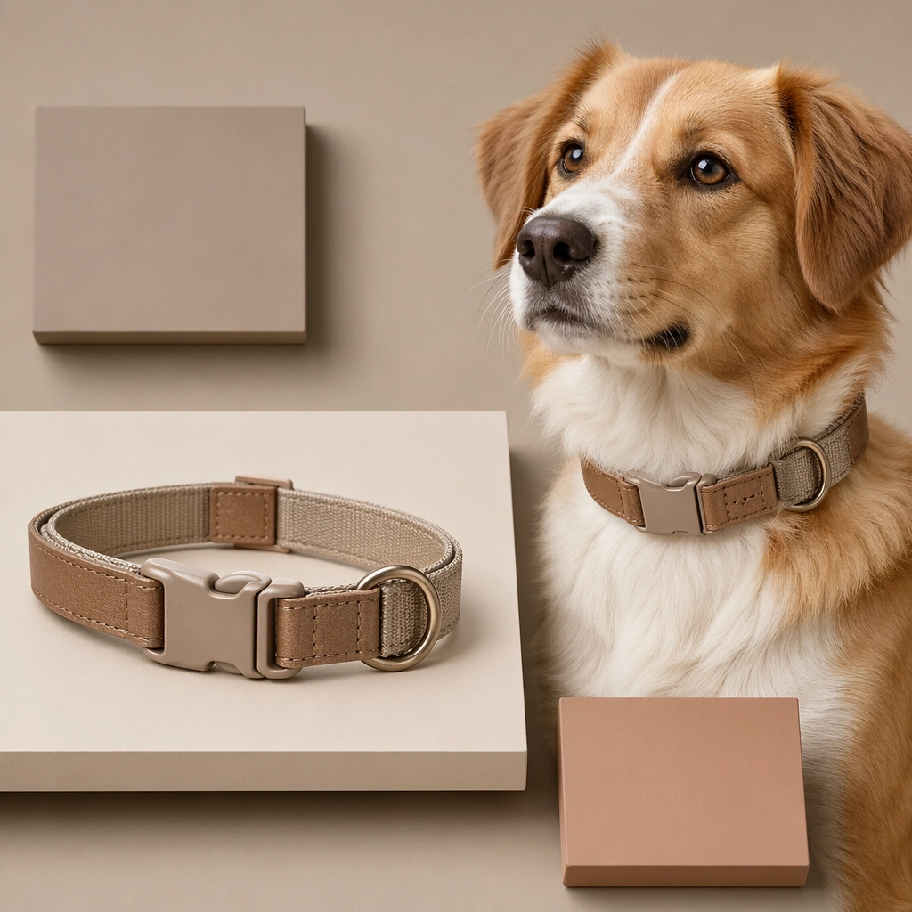

```text
Scene:
A square launch board for a pet lifestyle accessory brand, combining product hero presentation, tactile material realism, and polished commercial hierarchy. The image should feel ready for a launch drop, lookbook grid, or ecommerce campaign, with a disciplined palette and enough structure to support future text overlays outside the generated image. Keep the styling modern, giftable, and design conscious rather than generic pet store clutter. Use a soft neutral studio setup with floating shadow cards, one collar laid flat, and one dog portrait wearing the collar as the main proof point.

Subject:
Focus on one accessory story at a time: collars, bowls, carriers, apparel, charms, bedding, or matching human pet lifestyle pieces. Products must feel usable and materially believable. If a pet appears, the animal should reinforce scale, personality, and desirability without overshadowing the merchandise. The overall mood should balance warmth, quality, and retail polish. The collar should show leather or woven detail, clean buckle construction, and tasteful color blocking that feels premium but practical.

Important details:
Show material cues clearly such as leather grain, nylon webbing, ceramic glaze, coated canvas, quilted textiles, matte buckles, or brushed metal hardware. Use graphic framing only lightly so the product remains the hero. The result should look like something a modern direct-to-consumer brand could ship across social launches, product pages, collection decks, and campaign tiles. Balance fashion appeal with product clarity so the board works equally well for launch announcements, PDP crops, and brand feed storytelling.

Use case:
Pet Brand Merch and Accessory Drop single study 1/9, collar launch hero for a commercially reusable prompt atlas example.

Constraints:
No readable text, no watermark, no logos, preserve exact 1:1 aspect ratio, no readable logos, no overstuffed retail shelf clutter, no novelty toy overload, no unsafe pet styling, no generic discount store vibe, no fake luxury monogram, no studded punk cliché, no giant charms, no human fashion editorial overload.
```

[Pinned source](https://github.com/ChaosRealmsAI/gpt-image-2-gallery/blob/5296db8c996e38776c83a0bc8c64f848dcd512b3/works/topics/pet-brand-merch-and-accessory-drop/packages/single-accessory-drop-studies/images/01-collar-launch-hero/meta.json) · GPT Image2 · 1024×1024 · No source-declared image dependencies. · ProjectD:[published and publicly accepted](https://aitoolsradar.com/en/prompts/15091c5cb33ff4)

## Bowl and Placemat Set · pet-brand-merch-and-accessory-drop/single-accessory-drop-studies/02-bowl-and-placemat-set

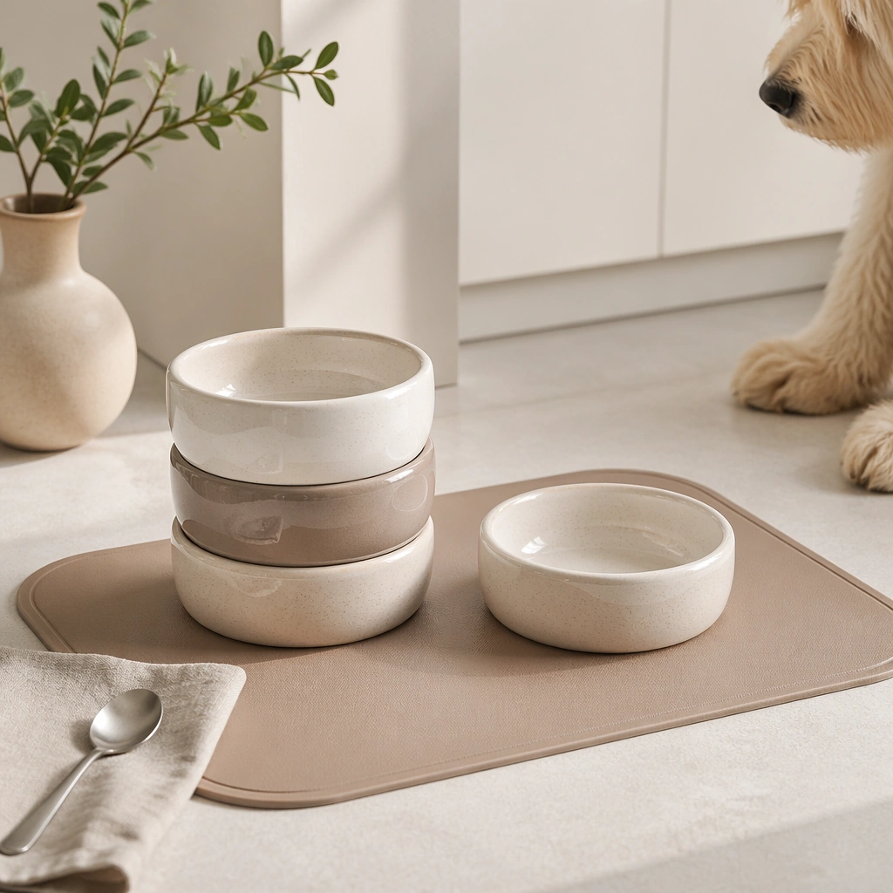

```text
Scene:
A square launch board for a pet lifestyle accessory brand, combining product hero presentation, tactile material realism, and polished commercial hierarchy. The image should feel ready for a launch drop, lookbook grid, or ecommerce campaign, with a disciplined palette and enough structure to support future text overlays outside the generated image. Keep the styling modern, giftable, and design conscious rather than generic pet store clutter. Compose a bright kitchen or studio tabletop with stacked ceramic bowls, one laid-out placemat, and a clean feeding corner aesthetic.

Subject:
Focus on one accessory story at a time: collars, bowls, carriers, apparel, charms, bedding, or matching human pet lifestyle pieces. Products must feel usable and materially believable. If a pet appears, the animal should reinforce scale, personality, and desirability without overshadowing the merchandise. The overall mood should balance warmth, quality, and retail polish. Let the ceramic glaze, shape, and coordinated surface textures drive the composition, with a pet entering only as a soft contextual cue.

Important details:
Show material cues clearly such as leather grain, nylon webbing, ceramic glaze, coated canvas, quilted textiles, matte buckles, or brushed metal hardware. Use graphic framing only lightly so the product remains the hero. The result should look like something a modern direct-to-consumer brand could ship across social launches, product pages, collection decks, and campaign tiles. The board should feel domestic, premium, and easy to reuse for catalog, ecommerce, and social drop posts.

Use case:
Pet Brand Merch and Accessory Drop single study 2/9, bowl and placemat set for a commercially reusable prompt atlas example.

Constraints:
No readable text, no watermark, no logos, preserve exact 1:1 aspect ratio, no readable logos, no overstuffed retail shelf clutter, no novelty toy overload, no unsafe pet styling, no generic discount store vibe, no fake luxury monogram, no food mess, no readable embossed branding, no farmhouse clutter.
```

[Pinned source](https://github.com/ChaosRealmsAI/gpt-image-2-gallery/blob/5296db8c996e38776c83a0bc8c64f848dcd512b3/works/topics/pet-brand-merch-and-accessory-drop/packages/single-accessory-drop-studies/images/02-bowl-and-placemat-set/meta.json) · GPT Image2 · 1024×1024 · No source-declared image dependencies. · ProjectD:[published and publicly accepted](https://aitoolsradar.com/en/prompts/5ebd1d5cef3375)

## Travel Carrier Lookbook Board · pet-brand-merch-and-accessory-drop/single-accessory-drop-studies/03-travel-carrier-lookbook-board

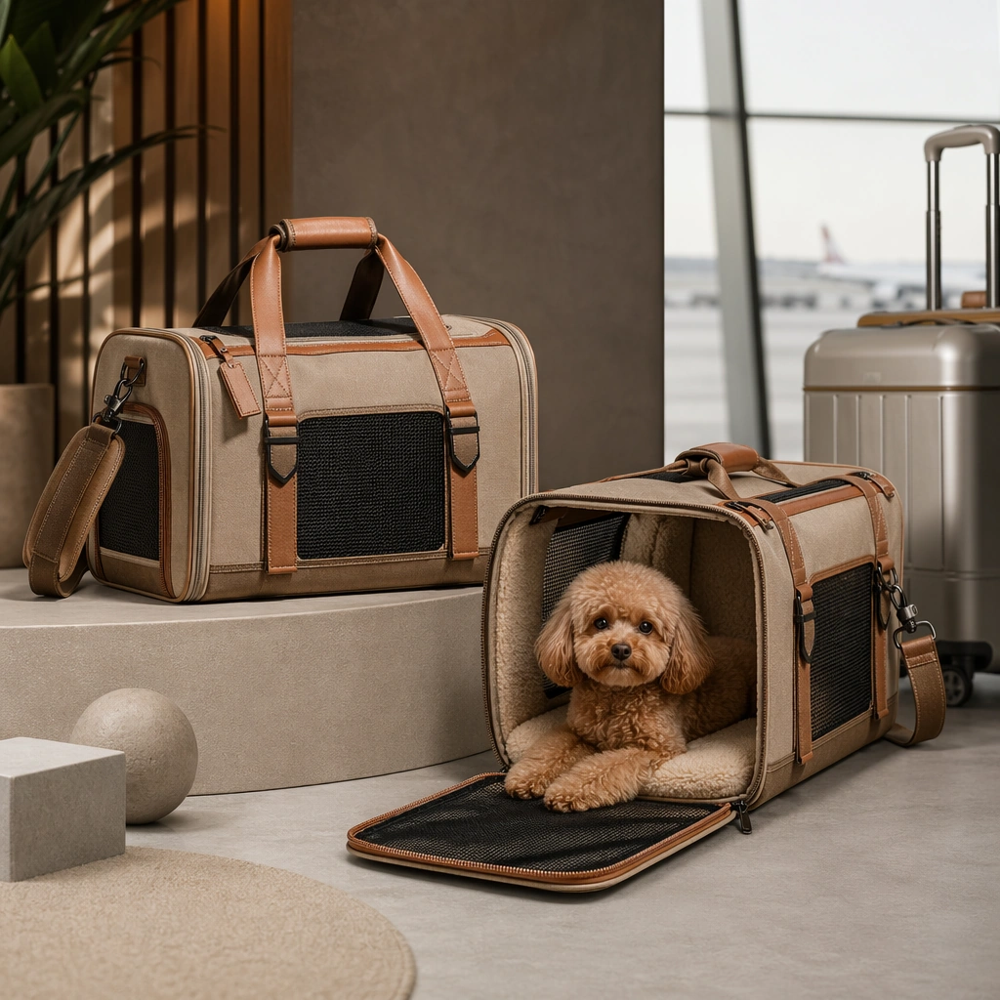

```text
Scene:
A square launch board for a pet lifestyle accessory brand, combining product hero presentation, tactile material realism, and polished commercial hierarchy. The image should feel ready for a launch drop, lookbook grid, or ecommerce campaign, with a disciplined palette and enough structure to support future text overlays outside the generated image. Keep the styling modern, giftable, and design conscious rather than generic pet store clutter. Use an airport-adjacent or studio travel set with rolling handle hints, clean flooring, and a balanced square layout centered on the carrier.

Subject:
Focus on one accessory story at a time: collars, bowls, carriers, apparel, charms, bedding, or matching human pet lifestyle pieces. Products must feel usable and materially believable. If a pet appears, the animal should reinforce scale, personality, and desirability without overshadowing the merchandise. The overall mood should balance warmth, quality, and retail polish. Show the carrier open and closed, with one pet comfortably visible to confirm size, ventilation, and calm use context.

Important details:
Show material cues clearly such as leather grain, nylon webbing, ceramic glaze, coated canvas, quilted textiles, matte buckles, or brushed metal hardware. Use graphic framing only lightly so the product remains the hero. The result should look like something a modern direct-to-consumer brand could ship across social launches, product pages, collection decks, and campaign tiles. The board should suggest urban mobility and premium utility, not frantic travel stress or luggage chaos.

Use case:
Pet Brand Merch and Accessory Drop single study 3/9, travel carrier lookbook board for a commercially reusable prompt atlas example.

Constraints:
No readable text, no watermark, no logos, preserve exact 1:1 aspect ratio, no readable logos, no overstuffed retail shelf clutter, no novelty toy overload, no unsafe pet styling, no generic discount store vibe, no fake luxury monogram, no airport crowd, no readable tags, no cramped uncomfortable posture.
```

[Pinned source](https://github.com/ChaosRealmsAI/gpt-image-2-gallery/blob/5296db8c996e38776c83a0bc8c64f848dcd512b3/works/topics/pet-brand-merch-and-accessory-drop/packages/single-accessory-drop-studies/images/03-travel-carrier-lookbook-board/meta.json) · GPT Image2 · 1024×1024 · No source-declared image dependencies. · ProjectD:[published and publicly accepted](https://aitoolsradar.com/en/prompts/29a86d2310accf)

## Raincoat Apparel Drop · pet-brand-merch-and-accessory-drop/single-accessory-drop-studies/04-raincoat-apparel-drop

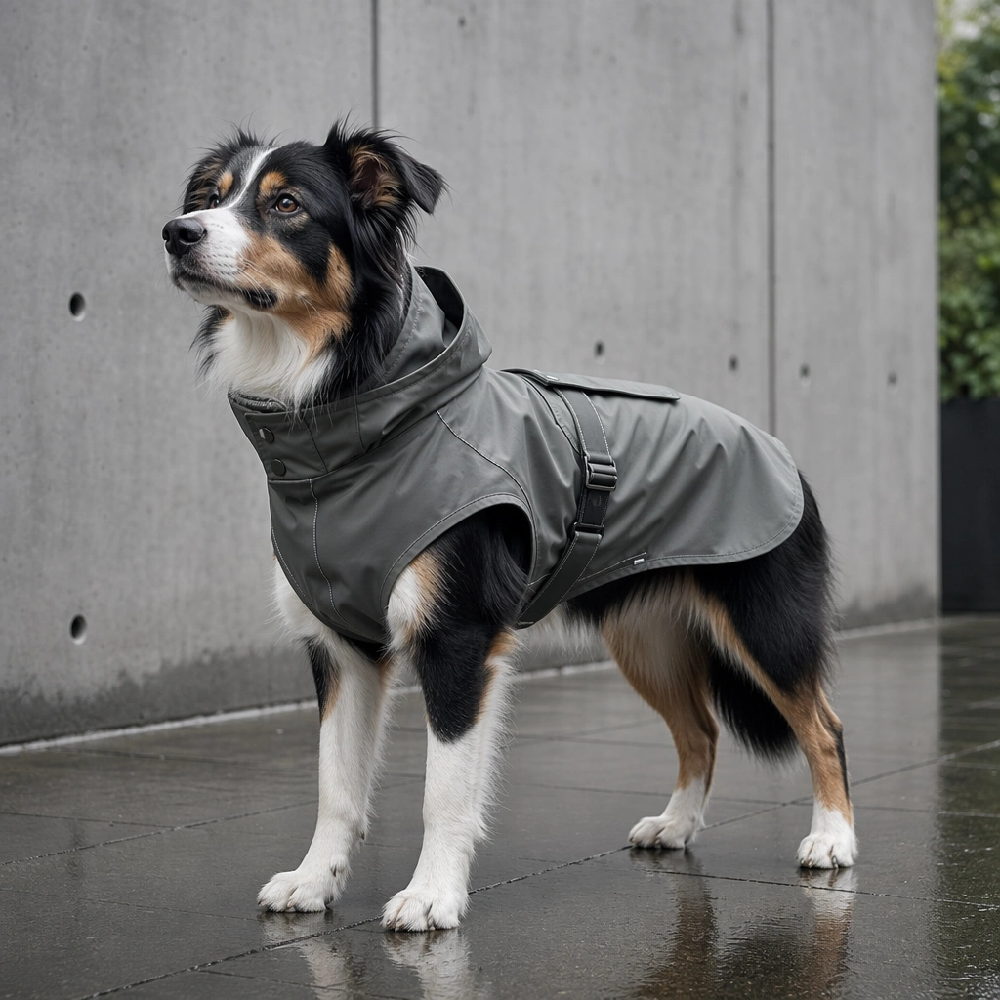

```text
Scene:
A square launch board for a pet lifestyle accessory brand, combining product hero presentation, tactile material realism, and polished commercial hierarchy. The image should feel ready for a launch drop, lookbook grid, or ecommerce campaign, with a disciplined palette and enough structure to support future text overlays outside the generated image. Keep the styling modern, giftable, and design conscious rather than generic pet store clutter. Frame the shot in a damp but clean city sidewalk or studio set with cool gray light, controlled reflections, and subtle product graphics.

Subject:
Focus on one accessory story at a time: collars, bowls, carriers, apparel, charms, bedding, or matching human pet lifestyle pieces. Products must feel usable and materially believable. If a pet appears, the animal should reinforce scale, personality, and desirability without overshadowing the merchandise. The overall mood should balance warmth, quality, and retail polish. Feature a dog wearing a fitted raincoat with visible stitching, closures, and safe coverage while standing confidently.

Important details:
Show material cues clearly such as leather grain, nylon webbing, ceramic glaze, coated canvas, quilted textiles, matte buckles, or brushed metal hardware. Use graphic framing only lightly so the product remains the hero. The result should look like something a modern direct-to-consumer brand could ship across social launches, product pages, collection decks, and campaign tiles. Let the product feel functional and fashionable at once, suitable for seasonal drop content and outdoor lifestyle branding.

Use case:
Pet Brand Merch and Accessory Drop single study 4/9, raincoat apparel drop for a commercially reusable prompt atlas example.

Constraints:
No readable text, no watermark, no logos, preserve exact 1:1 aspect ratio, no readable logos, no overstuffed retail shelf clutter, no novelty toy overload, no unsafe pet styling, no generic discount store vibe, no fake luxury monogram, no heavy rainstorm chaos, no human umbrella dominance, no costume cosplay mood.
```

[Pinned source](https://github.com/ChaosRealmsAI/gpt-image-2-gallery/blob/5296db8c996e38776c83a0bc8c64f848dcd512b3/works/topics/pet-brand-merch-and-accessory-drop/packages/single-accessory-drop-studies/images/04-raincoat-apparel-drop/meta.json) · GPT Image2 · 1024×1024 · No source-declared image dependencies. · ProjectD:[published and publicly accepted](https://aitoolsradar.com/en/prompts/2a8ac0e68ed01a)

## Leash Charm Bundle Board · pet-brand-merch-and-accessory-drop/single-accessory-drop-studies/05-leash-charm-bundle-board

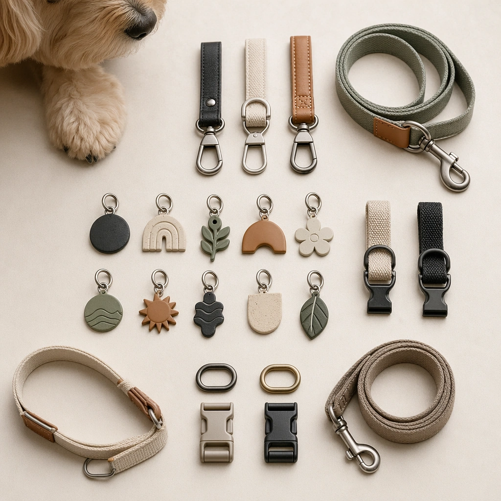

```text
Scene:
A square launch board for a pet lifestyle accessory brand, combining product hero presentation, tactile material realism, and polished commercial hierarchy. The image should feel ready for a launch drop, lookbook grid, or ecommerce campaign, with a disciplined palette and enough structure to support future text overlays outside the generated image. Keep the styling modern, giftable, and design conscious rather than generic pet store clutter. Use a close tabletop merchandising setup with metal hooks, straps, and small accessories arranged in a precise grid.

Subject:
Focus on one accessory story at a time: collars, bowls, carriers, apparel, charms, bedding, or matching human pet lifestyle pieces. Products must feel usable and materially believable. If a pet appears, the animal should reinforce scale, personality, and desirability without overshadowing the merchandise. The overall mood should balance warmth, quality, and retail polish. Focus on the accessory bundle itself while a pet portrait or cropped body remains secondary for scale and styling context.

Important details:
Show material cues clearly such as leather grain, nylon webbing, ceramic glaze, coated canvas, quilted textiles, matte buckles, or brushed metal hardware. Use graphic framing only lightly so the product remains the hero. The result should look like something a modern direct-to-consumer brand could ship across social launches, product pages, collection decks, and campaign tiles. The board should read as a collection drop, with clear variation, premium finish, and giftable organization.

Use case:
Pet Brand Merch and Accessory Drop single study 5/9, leash charm bundle board for a commercially reusable prompt atlas example.

Constraints:
No readable text, no watermark, no logos, preserve exact 1:1 aspect ratio, no readable logos, no overstuffed retail shelf clutter, no novelty toy overload, no unsafe pet styling, no generic discount store vibe, no fake luxury monogram, no jewelry brand imitation, no logo tags, no cluttered keychain pile.
```

[Pinned source](https://github.com/ChaosRealmsAI/gpt-image-2-gallery/blob/5296db8c996e38776c83a0bc8c64f848dcd512b3/works/topics/pet-brand-merch-and-accessory-drop/packages/single-accessory-drop-studies/images/05-leash-charm-bundle-board/meta.json) · GPT Image2 · 1024×1024 · No source-declared image dependencies. · ProjectD:[published and publicly accepted](https://aitoolsradar.com/en/prompts/ed8cd8c8c2cb3f)

## Sleep Bed Textile Line · pet-brand-merch-and-accessory-drop/single-accessory-drop-studies/06-sleep-bed-textile-line

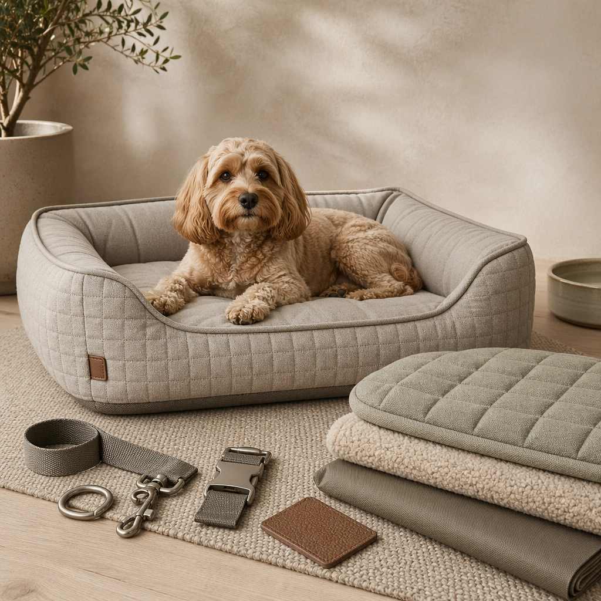

```text
Scene:
A square launch board for a pet lifestyle accessory brand, combining product hero presentation, tactile material realism, and polished commercial hierarchy. The image should feel ready for a launch drop, lookbook grid, or ecommerce campaign, with a disciplined palette and enough structure to support future text overlays outside the generated image. Keep the styling modern, giftable, and design conscious rather than generic pet store clutter. Stage a soft interior corner with one bed, folded textile samples, and a tidy palette story built into the square composition.

Subject:
Focus on one accessory story at a time: collars, bowls, carriers, apparel, charms, bedding, or matching human pet lifestyle pieces. Products must feel usable and materially believable. If a pet appears, the animal should reinforce scale, personality, and desirability without overshadowing the merchandise. The overall mood should balance warmth, quality, and retail polish. Show a pet comfortably resting on the bed, with enough visible product structure to communicate shape, cushioning, and fabric quality.

Important details:
Show material cues clearly such as leather grain, nylon webbing, ceramic glaze, coated canvas, quilted textiles, matte buckles, or brushed metal hardware. Use graphic framing only lightly so the product remains the hero. The result should look like something a modern direct-to-consumer brand could ship across social launches, product pages, collection decks, and campaign tiles. The mood should feel restful, tactile, and home-worthy, suitable for collection pages or nurture-focused campaign content.

Use case:
Pet Brand Merch and Accessory Drop single study 6/9, sleep bed textile line for a commercially reusable prompt atlas example.

Constraints:
No readable text, no watermark, no logos, preserve exact 1:1 aspect ratio, no readable logos, no overstuffed retail shelf clutter, no novelty toy overload, no unsafe pet styling, no generic discount store vibe, no fake luxury monogram, no messy bedroom, no blanket mountain, no sleepy blur.
```

[Pinned source](https://github.com/ChaosRealmsAI/gpt-image-2-gallery/blob/5296db8c996e38776c83a0bc8c64f848dcd512b3/works/topics/pet-brand-merch-and-accessory-drop/packages/single-accessory-drop-studies/images/06-sleep-bed-textile-line/meta.json) · GPT Image2 · 1024×1024 · No source-declared image dependencies. · ProjectD:[published and publicly accepted](https://aitoolsradar.com/en/prompts/1f52afd71d411b)

## Matching Owner Pet Tote Board · pet-brand-merch-and-accessory-drop/single-accessory-drop-studies/07-matching-owner-pet-tote-board

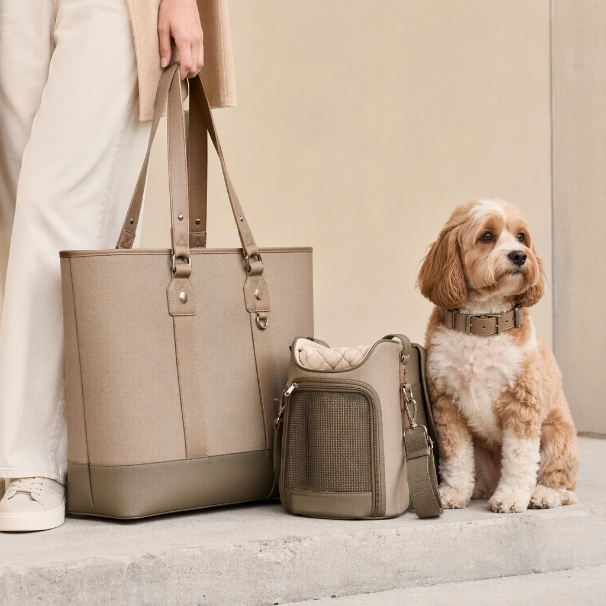

```text
Scene:
A square launch board for a pet lifestyle accessory brand, combining product hero presentation, tactile material realism, and polished commercial hierarchy. The image should feel ready for a launch drop, lookbook grid, or ecommerce campaign, with a disciplined palette and enough structure to support future text overlays outside the generated image. Keep the styling modern, giftable, and design conscious rather than generic pet store clutter. Use a clean studio or street-side setup with one tote, one pet accessory counterpart, and only partial owner presence for scale.

Subject:
Focus on one accessory story at a time: collars, bowls, carriers, apparel, charms, bedding, or matching human pet lifestyle pieces. Products must feel usable and materially believable. If a pet appears, the animal should reinforce scale, personality, and desirability without overshadowing the merchandise. The overall mood should balance warmth, quality, and retail polish. The product pairing should feel intentional and fashion-aware, with the pet wearing or sitting beside the coordinated accessory set.

Important details:
Show material cues clearly such as leather grain, nylon webbing, ceramic glaze, coated canvas, quilted textiles, matte buckles, or brushed metal hardware. Use graphic framing only lightly so the product remains the hero. The result should look like something a modern direct-to-consumer brand could ship across social launches, product pages, collection decks, and campaign tiles. The board should sell shared lifestyle identity and gifting appeal while keeping product surfaces and pet comfort clear.

Use case:
Pet Brand Merch and Accessory Drop single study 7/9, matching owner pet tote board for a commercially reusable prompt atlas example.

Constraints:
No readable text, no watermark, no logos, preserve exact 1:1 aspect ratio, no readable logos, no overstuffed retail shelf clutter, no novelty toy overload, no unsafe pet styling, no generic discount store vibe, no fake luxury monogram, no full fashion model takeover, no readable print slogans, no cluttered street background.
```

[Pinned source](https://github.com/ChaosRealmsAI/gpt-image-2-gallery/blob/5296db8c996e38776c83a0bc8c64f848dcd512b3/works/topics/pet-brand-merch-and-accessory-drop/packages/single-accessory-drop-studies/images/07-matching-owner-pet-tote-board/meta.json) · GPT Image2 · 1024×1024 · No source-declared image dependencies. · ProjectD:[published and publicly accepted](https://aitoolsradar.com/en/prompts/1b86506d0fd980)

## Seasonal Colorway Grid · pet-brand-merch-and-accessory-drop/single-accessory-drop-studies/08-seasonal-colorway-grid

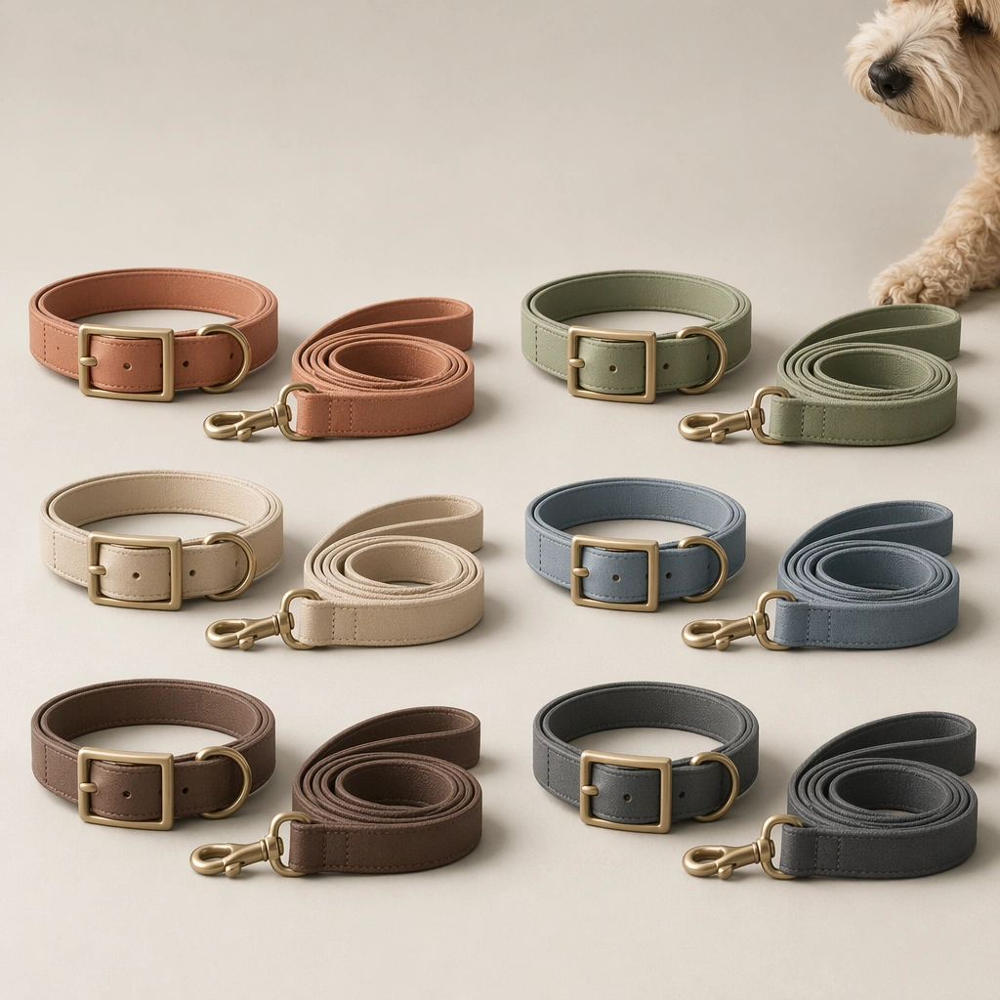

```text
Scene:
A square launch board for a pet lifestyle accessory brand, combining product hero presentation, tactile material realism, and polished commercial hierarchy. The image should feel ready for a launch drop, lookbook grid, or ecommerce campaign, with a disciplined palette and enough structure to support future text overlays outside the generated image. Keep the styling modern, giftable, and design conscious rather than generic pet store clutter. Compose a clean front-facing grid of collars, leashes, bowls, or apparel swatches on a neutral studio background with disciplined shadows.

Subject:
Focus on one accessory story at a time: collars, bowls, carriers, apparel, charms, bedding, or matching human pet lifestyle pieces. Products must feel usable and materially believable. If a pet appears, the animal should reinforce scale, personality, and desirability without overshadowing the merchandise. The overall mood should balance warmth, quality, and retail polish. Highlight coordinated product variants across four to six seasonal colors while a minimal pet cue keeps the category instantly recognizable.

Important details:
Show material cues clearly such as leather grain, nylon webbing, ceramic glaze, coated canvas, quilted textiles, matte buckles, or brushed metal hardware. Use graphic framing only lightly so the product remains the hero. The result should look like something a modern direct-to-consumer brand could ship across social launches, product pages, collection decks, and campaign tiles. The image is about system thinking: coherent palette families, repeatable materials, and brand-level assortment planning.

Use case:
Pet Brand Merch and Accessory Drop single study 8/9, seasonal colorway grid for a commercially reusable prompt atlas example.

Constraints:
No readable text, no watermark, no logos, preserve exact 1:1 aspect ratio, no readable logos, no overstuffed retail shelf clutter, no novelty toy overload, no unsafe pet styling, no generic discount store vibe, no fake luxury monogram, no rainbow overload, no readable collection labels, no cheap product packshot lighting.
```

[Pinned source](https://github.com/ChaosRealmsAI/gpt-image-2-gallery/blob/5296db8c996e38776c83a0bc8c64f848dcd512b3/works/topics/pet-brand-merch-and-accessory-drop/packages/single-accessory-drop-studies/images/08-seasonal-colorway-grid/meta.json) · GPT Image2 · 1024×1024 · No source-declared image dependencies. · ProjectD:[published and publicly accepted](https://aitoolsradar.com/en/prompts/710efa6431a789)

## Giftable Accessory Flatlay · pet-brand-merch-and-accessory-drop/single-accessory-drop-studies/09-giftable-accessory-flatlay

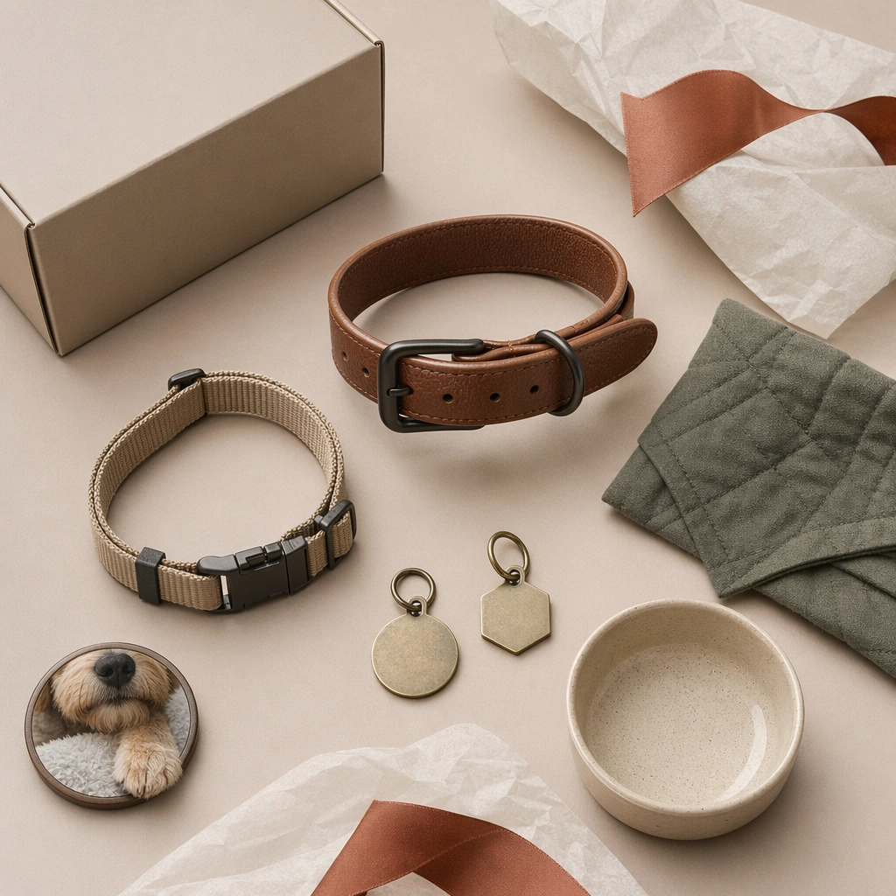

```text
Scene:
A square launch board for a pet lifestyle accessory brand, combining product hero presentation, tactile material realism, and polished commercial hierarchy. The image should feel ready for a launch drop, lookbook grid, or ecommerce campaign, with a disciplined palette and enough structure to support future text overlays outside the generated image. Keep the styling modern, giftable, and design conscious rather than generic pet store clutter. Use top-down photography with tissue paper, boxes, ribbon forms, and grouped accessories arranged in a controlled flatlay system.

Subject:
Focus on one accessory story at a time: collars, bowls, carriers, apparel, charms, bedding, or matching human pet lifestyle pieces. Products must feel usable and materially believable. If a pet appears, the animal should reinforce scale, personality, and desirability without overshadowing the merchandise. The overall mood should balance warmth, quality, and retail polish. Show a set of small accessories that feel ready to gift, with one subtle pet presence or portrait medallion to anchor the category.

Important details:
Show material cues clearly such as leather grain, nylon webbing, ceramic glaze, coated canvas, quilted textiles, matte buckles, or brushed metal hardware. Use graphic framing only lightly so the product remains the hero. The result should look like something a modern direct-to-consumer brand could ship across social launches, product pages, collection decks, and campaign tiles. The board should feel premium, editorial, and easy to adapt to gifting campaigns, registry content, or checkout upsell placements.

Use case:
Pet Brand Merch and Accessory Drop single study 9/9, giftable accessory flatlay for a commercially reusable prompt atlas example.

Constraints:
No readable text, no watermark, no logos, preserve exact 1:1 aspect ratio, no readable logos, no overstuffed retail shelf clutter, no novelty toy overload, no unsafe pet styling, no generic discount store vibe, no fake luxury monogram, no brand marks, no ribbon clutter, no scrapbook excess.
```

[Pinned source](https://github.com/ChaosRealmsAI/gpt-image-2-gallery/blob/5296db8c996e38776c83a0bc8c64f848dcd512b3/works/topics/pet-brand-merch-and-accessory-drop/packages/single-accessory-drop-studies/images/09-giftable-accessory-flatlay/meta.json) · GPT Image2 · 1024×1024 · No source-declared image dependencies. · ProjectD:[published and publicly accepted](https://aitoolsradar.com/en/prompts/37237880f0da37)

## Clinic Welcome Reception Board · pet-clinic-and-vet-trust-visuals/single-vet-trust-studies/01-clinic-welcome-reception-board

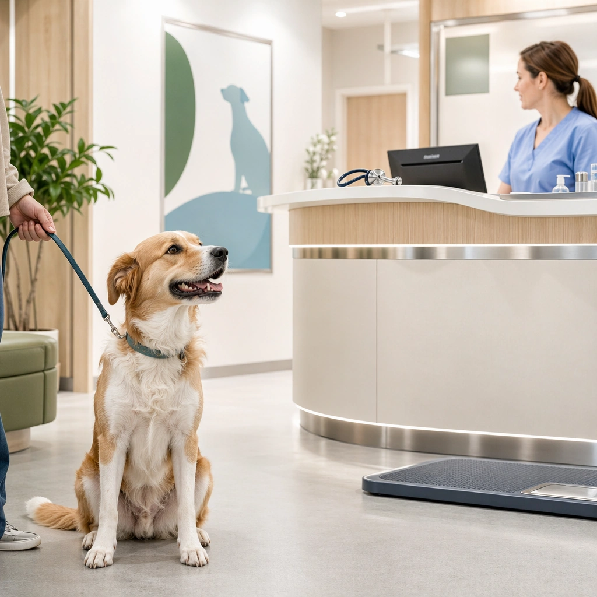

```text
Scene:
A square veterinary communication visual designed for clinic websites, social education posts, waiting room materials, or service pages. The image should combine modern clinical realism with calm emotional tone. Use clean surfaces, soft medical color palettes, and enough layout structure that the asset feels intentionally designed rather than captured spontaneously. Every scene must support trust, reassurance, and professional competence. Show a bright reception zone with curved desk edges, pale wood and white materials, one waiting pet, and abstract signage zones without readable copy.

Subject:
Focus on one pet care moment such as welcome, examination, vaccination, dental checking, diagnostics, recovery, or urgent intake. Animals should appear calm or gently supported, while any human presence remains partially framed, professional, and non dominant. Show believable equipment, treatment spaces, or clinic cues, but avoid frightening procedure intensity. The visual message is care, order, and transparency. Feature a calm dog near the reception area with a gentle handler implied off frame, making the space feel welcoming and organized.

Important details:
Use veterinary specific signals like stainless surfaces, examination mats, stethoscope curves, soft uniforms, scan monitors without readable data, or preventive care props. Keep everything polished, realistic, and emotionally safe. The image should feel useful for a real clinic marketing system and credible to pet owners who need both competence and warmth. Avoid generic hospital drama or sanitized emptiness. The message should be first impression trust: clean design, efficient flow, and emotional softness without resorting to hospitality clichés.

Use case:
Pet Clinic and Vet Trust Visuals single study 1/9, clinic welcome reception board for a commercially reusable prompt atlas example.

Constraints:
No readable text, no watermark, no logos, preserve exact 1:1 aspect ratio, no surgery gore, no visible needles entering skin, no readable charts, no emergency panic chaos, no harsh fluorescent ugliness, no fear based pet expressions, no crowded lobby, no anxious leash pulling, no visible paperwork text.
```

[Pinned source](https://github.com/ChaosRealmsAI/gpt-image-2-gallery/blob/5296db8c996e38776c83a0bc8c64f848dcd512b3/works/topics/pet-clinic-and-vet-trust-visuals/packages/single-vet-trust-studies/images/01-clinic-welcome-reception-board/meta.json) · GPT Image2 · 1024×1024 · No source-declared image dependencies. · ProjectD:[published and publicly accepted](https://aitoolsradar.com/en/prompts/6552145b7c0468)

## Gentle Exam Table Visual · pet-clinic-and-vet-trust-visuals/single-vet-trust-studies/02-gentle-exam-table-visual


```text
Scene:
A square veterinary communication visual designed for clinic websites, social education posts, waiting room materials, or service pages. The image should combine modern clinical realism with calm emotional tone. Use clean surfaces, soft medical color palettes, and enough layout structure that the asset feels intentionally designed rather than captured spontaneously. Every scene must support trust, reassurance, and professional competence. Use a tidy exam room with an elevated table, matte wall color, soft daylight balance, and one clinician figure partially visible in neutral scrubs.

Subject:
Focus on one pet care moment such as welcome, examination, vaccination, dental checking, diagnostics, recovery, or urgent intake. Animals should appear calm or gently supported, while any human presence remains partially framed, professional, and non dominant. Show believable equipment, treatment spaces, or clinic cues, but avoid frightening procedure intensity. The visual message is care, order, and transparency. Show a pet standing or seated comfortably on the exam table while the clinician offers calm touch and attention rather than active procedure drama.

Important details:
Use veterinary specific signals like stainless surfaces, examination mats, stethoscope curves, soft uniforms, scan monitors without readable data, or preventive care props. Keep everything polished, realistic, and emotionally safe. The image should feel useful for a real clinic marketing system and credible to pet owners who need both competence and warmth. Avoid generic hospital drama or sanitized emptiness. The image should communicate trust through posture, spacing, and environment. Everything should feel precise, warm, and medically credible.

Use case:
Pet Clinic and Vet Trust Visuals single study 2/9, gentle exam table visual for a commercially reusable prompt atlas example.

Constraints:
No readable text, no watermark, no logos, preserve exact 1:1 aspect ratio, no surgery gore, no visible needles entering skin, no readable charts, no emergency panic chaos, no harsh fluorescent ugliness, no fear based pet expressions, no restraint tension, no sharp tool focus, no crowded medical machines.
```

[Pinned source](https://github.com/ChaosRealmsAI/gpt-image-2-gallery/blob/5296db8c996e38776c83a0bc8c64f848dcd512b3/works/topics/pet-clinic-and-vet-trust-visuals/packages/single-vet-trust-studies/images/02-gentle-exam-table-visual/meta.json) · GPT Image2 · 1024×1024 · No source-declared image dependencies. · ProjectD:[published and publicly accepted](https://aitoolsradar.com/en/prompts/da66e1e3b2893d)

## Vaccination Reassurance Card · pet-clinic-and-vet-trust-visuals/single-vet-trust-studies/03-vaccination-reassurance-card

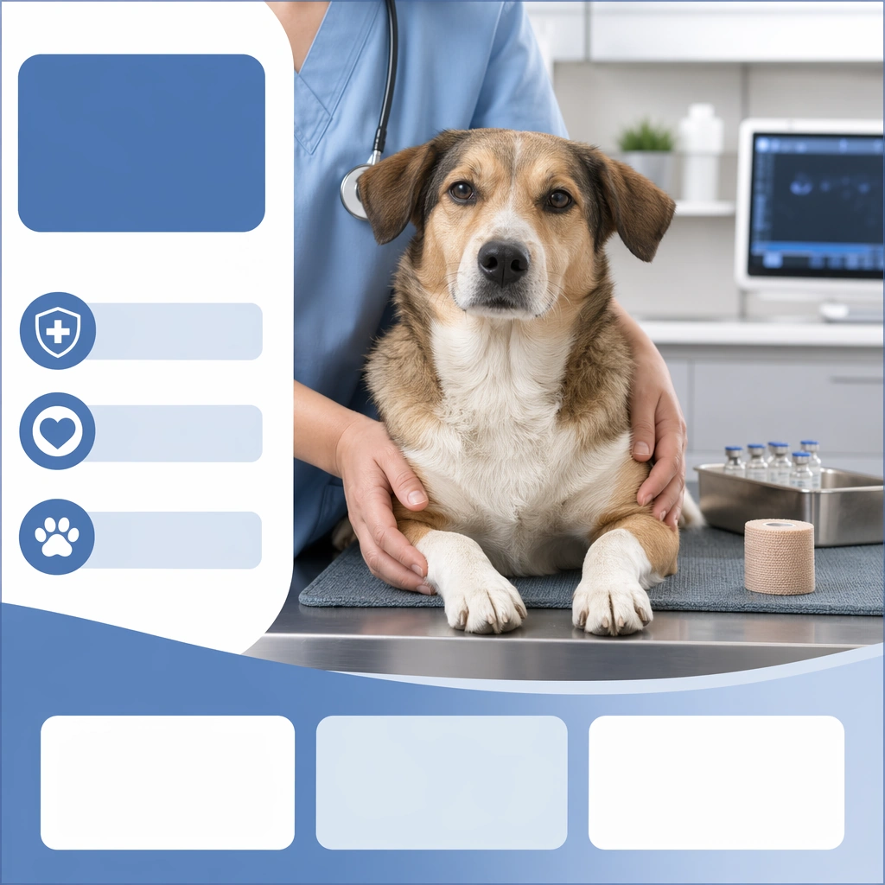

```text
Scene:
A square veterinary communication visual designed for clinic websites, social education posts, waiting room materials, or service pages. The image should combine modern clinical realism with calm emotional tone. Use clean surfaces, soft medical color palettes, and enough layout structure that the asset feels intentionally designed rather than captured spontaneously. Every scene must support trust, reassurance, and professional competence. Compose a clean square card with one prep area, soft clinic blue accents, and placeholder information bands arranged around the portrait.

Subject:
Focus on one pet care moment such as welcome, examination, vaccination, dental checking, diagnostics, recovery, or urgent intake. Animals should appear calm or gently supported, while any human presence remains partially framed, professional, and non dominant. Show believable equipment, treatment spaces, or clinic cues, but avoid frightening procedure intensity. The visual message is care, order, and transparency. Feature a pet being calmly held or comforted before or after a vaccination, with relaxed eyes and stable posture.

Important details:
Use veterinary specific signals like stainless surfaces, examination mats, stethoscope curves, soft uniforms, scan monitors without readable data, or preventive care props. Keep everything polished, realistic, and emotionally safe. The image should feel useful for a real clinic marketing system and credible to pet owners who need both competence and warmth. Avoid generic hospital drama or sanitized emptiness. The key is emotional reassurance, not the injection itself. Make the card feel educational, safe, and useful for clinic reminders.

Use case:
Pet Clinic and Vet Trust Visuals single study 3/9, vaccination reassurance card for a commercially reusable prompt atlas example.

Constraints:
No readable text, no watermark, no logos, preserve exact 1:1 aspect ratio, no surgery gore, no visible needles entering skin, no readable charts, no emergency panic chaos, no harsh fluorescent ugliness, no fear based pet expressions, no needle close up, no crying child analogies, no fear expression.
```

[Pinned source](https://github.com/ChaosRealmsAI/gpt-image-2-gallery/blob/5296db8c996e38776c83a0bc8c64f848dcd512b3/works/topics/pet-clinic-and-vet-trust-visuals/packages/single-vet-trust-studies/images/03-vaccination-reassurance-card/meta.json) · GPT Image2 · 1024×1024 · No source-declared image dependencies. · ProjectD:[published and publicly accepted](https://aitoolsradar.com/en/prompts/19e865d13bfa10)

## Dental Care Consult Panel · pet-clinic-and-vet-trust-visuals/single-vet-trust-studies/04-dental-care-consult-panel

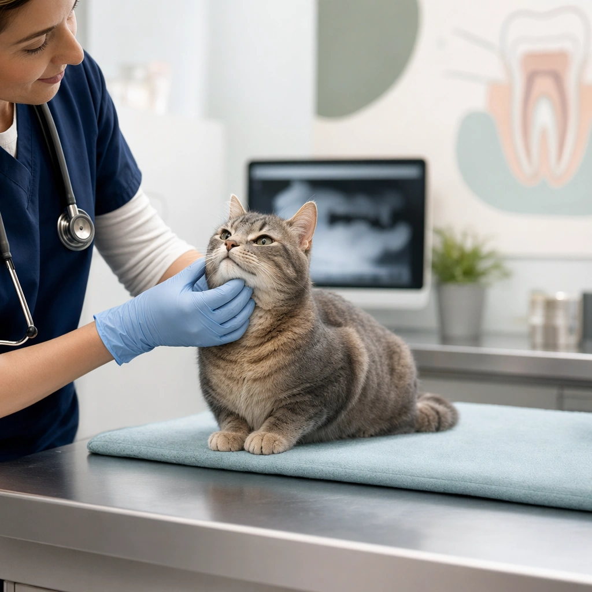

```text
Scene:
A square veterinary communication visual designed for clinic websites, social education posts, waiting room materials, or service pages. The image should combine modern clinical realism with calm emotional tone. Use clean surfaces, soft medical color palettes, and enough layout structure that the asset feels intentionally designed rather than captured spontaneously. Every scene must support trust, reassurance, and professional competence. Use a consultation room or exam corner with cool neutral tones, one dental illustration zone as abstract shapes, and a composed square layout.

Subject:
Focus on one pet care moment such as welcome, examination, vaccination, dental checking, diagnostics, recovery, or urgent intake. Animals should appear calm or gently supported, while any human presence remains partially framed, professional, and non dominant. Show believable equipment, treatment spaces, or clinic cues, but avoid frightening procedure intensity. The visual message is care, order, and transparency. Show a dog or cat with mouth closed, calm posture, and a veterinarian checking the face or jaw area in a non invasive way.

Important details:
Use veterinary specific signals like stainless surfaces, examination mats, stethoscope curves, soft uniforms, scan monitors without readable data, or preventive care props. Keep everything polished, realistic, and emotionally safe. The image should feel useful for a real clinic marketing system and credible to pet owners who need both competence and warmth. Avoid generic hospital drama or sanitized emptiness. The board should suggest routine dental care and preventative wellness rather than scary intervention or deep procedure imagery.

Use case:
Pet Clinic and Vet Trust Visuals single study 4/9, dental care consult panel for a commercially reusable prompt atlas example.

Constraints:
No readable text, no watermark, no logos, preserve exact 1:1 aspect ratio, no surgery gore, no visible needles entering skin, no readable charts, no emergency panic chaos, no harsh fluorescent ugliness, no fear based pet expressions, no open bloody mouth, no metal tool close up, no sedation cues.
```

[Pinned source](https://github.com/ChaosRealmsAI/gpt-image-2-gallery/blob/5296db8c996e38776c83a0bc8c64f848dcd512b3/works/topics/pet-clinic-and-vet-trust-visuals/packages/single-vet-trust-studies/images/04-dental-care-consult-panel/meta.json) · GPT Image2 · 1024×1024 · No source-declared image dependencies. · ProjectD:[published and publicly accepted](https://aitoolsradar.com/en/prompts/bc8f9b21185bf8)

## Recovery Room Comfort Board · pet-clinic-and-vet-trust-visuals/single-vet-trust-studies/05-recovery-room-comfort-board

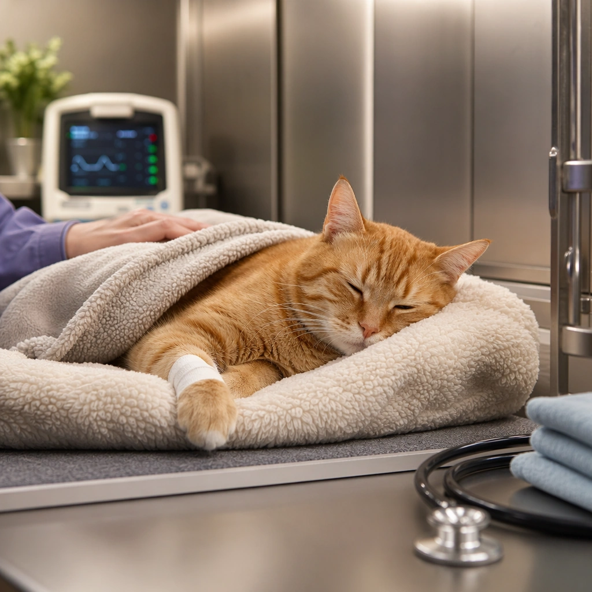

```text
Scene:
A square veterinary communication visual designed for clinic websites, social education posts, waiting room materials, or service pages. The image should combine modern clinical realism with calm emotional tone. Use clean surfaces, soft medical color palettes, and enough layout structure that the asset feels intentionally designed rather than captured spontaneously. Every scene must support trust, reassurance, and professional competence. Create a calm recovery corner with soft blankets, clean enclosure details, warm low contrast light, and a minimal monitoring cue in the background.

Subject:
Focus on one pet care moment such as welcome, examination, vaccination, dental checking, diagnostics, recovery, or urgent intake. Animals should appear calm or gently supported, while any human presence remains partially framed, professional, and non dominant. Show believable equipment, treatment spaces, or clinic cues, but avoid frightening procedure intensity. The visual message is care, order, and transparency. Feature a resting pet looking sleepy but comfortable, with careful bedding, clean fur, and an atmosphere of attentive aftercare.

Important details:
Use veterinary specific signals like stainless surfaces, examination mats, stethoscope curves, soft uniforms, scan monitors without readable data, or preventive care props. Keep everything polished, realistic, and emotionally safe. The image should feel useful for a real clinic marketing system and credible to pet owners who need both competence and warmth. Avoid generic hospital drama or sanitized emptiness. The image should reassure owners that recovery is quiet, observed, and compassionate, not sterile or frightening.

Use case:
Pet Clinic and Vet Trust Visuals single study 5/9, recovery room comfort board for a commercially reusable prompt atlas example.

Constraints:
No readable text, no watermark, no logos, preserve exact 1:1 aspect ratio, no surgery gore, no visible needles entering skin, no readable charts, no emergency panic chaos, no harsh fluorescent ugliness, no fear based pet expressions, no tubes dominating the frame, no distress posture, no dark ICU drama.
```

[Pinned source](https://github.com/ChaosRealmsAI/gpt-image-2-gallery/blob/5296db8c996e38776c83a0bc8c64f848dcd512b3/works/topics/pet-clinic-and-vet-trust-visuals/packages/single-vet-trust-studies/images/05-recovery-room-comfort-board/meta.json) · GPT Image2 · 1024×1024 · No source-declared image dependencies. · ProjectD:[published and publicly accepted](https://aitoolsradar.com/en/prompts/994929bfa03cbf)

## Diagnostic Lab Sample Board · pet-clinic-and-vet-trust-visuals/single-vet-trust-studies/06-diagnostic-lab-sample-board


```text
Scene:
A square veterinary communication visual designed for clinic websites, social education posts, waiting room materials, or service pages. The image should combine modern clinical realism with calm emotional tone. Use clean surfaces, soft medical color palettes, and enough layout structure that the asset feels intentionally designed rather than captured spontaneously. Every scene must support trust, reassurance, and professional competence. Frame a square board with labeled-shape placeholders, sample tray silhouettes, microscope form cues, and one pet portrait linked to the diagnostic context.

Subject:
Focus on one pet care moment such as welcome, examination, vaccination, dental checking, diagnostics, recovery, or urgent intake. Animals should appear calm or gently supported, while any human presence remains partially framed, professional, and non dominant. Show believable equipment, treatment spaces, or clinic cues, but avoid frightening procedure intensity. The visual message is care, order, and transparency. Show a pet calmly present in the foreground or side panel while the clinic environment and diagnostic tools remain secondary but clearly real.

Important details:
Use veterinary specific signals like stainless surfaces, examination mats, stethoscope curves, soft uniforms, scan monitors without readable data, or preventive care props. Keep everything polished, realistic, and emotionally safe. The image should feel useful for a real clinic marketing system and credible to pet owners who need both competence and warmth. Avoid generic hospital drama or sanitized emptiness. This should feel like a modern explanation asset for testing and diagnostics, visually credible without becoming technical or cold.

Use case:
Pet Clinic and Vet Trust Visuals single study 6/9, diagnostic lab sample board for a commercially reusable prompt atlas example.

Constraints:
No readable text, no watermark, no logos, preserve exact 1:1 aspect ratio, no surgery gore, no visible needles entering skin, no readable charts, no emergency panic chaos, no harsh fluorescent ugliness, no fear based pet expressions, no blood close up, no readable charts, no intimidating lab darkness.
```

[Pinned source](https://github.com/ChaosRealmsAI/gpt-image-2-gallery/blob/5296db8c996e38776c83a0bc8c64f848dcd512b3/works/topics/pet-clinic-and-vet-trust-visuals/packages/single-vet-trust-studies/images/06-diagnostic-lab-sample-board/meta.json) · GPT Image2 · 1024×1024 · No source-declared image dependencies. · ProjectD:[published and publicly accepted](https://aitoolsradar.com/en/prompts/730c0a4c316a2d)

## Telehealth Follow-Up Visual · pet-clinic-and-vet-trust-visuals/single-vet-trust-studies/07-telehealth-followup-visual


```text
Scene:
A square veterinary communication visual designed for clinic websites, social education posts, waiting room materials, or service pages. The image should combine modern clinical realism with calm emotional tone. Use clean surfaces, soft medical color palettes, and enough layout structure that the asset feels intentionally designed rather than captured spontaneously. Every scene must support trust, reassurance, and professional competence. Use a tidy home corner with laptop silhouette, clinic color accents, and structured layout panels that suggest continuity of care.

Subject:
Focus on one pet care moment such as welcome, examination, vaccination, dental checking, diagnostics, recovery, or urgent intake. Animals should appear calm or gently supported, while any human presence remains partially framed, professional, and non dominant. Show believable equipment, treatment spaces, or clinic cues, but avoid frightening procedure intensity. The visual message is care, order, and transparency. Feature a calm pet beside the remote setup, with one owner hand or arm implied only lightly and the pet still clearly central.

Important details:
Use veterinary specific signals like stainless surfaces, examination mats, stethoscope curves, soft uniforms, scan monitors without readable data, or preventive care props. Keep everything polished, realistic, and emotionally safe. The image should feel useful for a real clinic marketing system and credible to pet owners who need both competence and warmth. Avoid generic hospital drama or sanitized emptiness. The message should be convenience plus trust, linking clinic professionalism to home follow-up without becoming generic video call content.

Use case:
Pet Clinic and Vet Trust Visuals single study 7/9, telehealth follow-up visual for a commercially reusable prompt atlas example.

Constraints:
No readable text, no watermark, no logos, preserve exact 1:1 aspect ratio, no surgery gore, no visible needles entering skin, no readable charts, no emergency panic chaos, no harsh fluorescent ugliness, no fear based pet expressions, no readable screen UI, no messy living room, no dominant human portrait.
```

[Pinned source](https://github.com/ChaosRealmsAI/gpt-image-2-gallery/blob/5296db8c996e38776c83a0bc8c64f848dcd512b3/works/topics/pet-clinic-and-vet-trust-visuals/packages/single-vet-trust-studies/images/07-telehealth-followup-visual/meta.json) · GPT Image2 · 1024×1024 · No source-declared image dependencies. · ProjectD:[published and publicly accepted](https://aitoolsradar.com/en/prompts/838804c9540fd9)

## Preventive Care Plan Board · pet-clinic-and-vet-trust-visuals/single-vet-trust-studies/08-preventive-care-plan-board

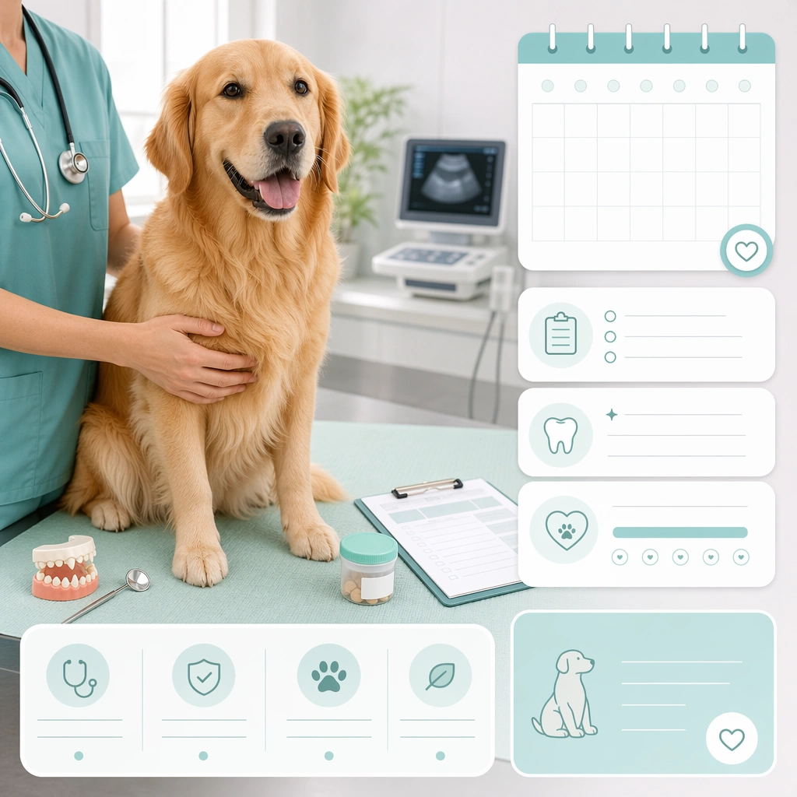

```text
Scene:
A square veterinary communication visual designed for clinic websites, social education posts, waiting room materials, or service pages. The image should combine modern clinical realism with calm emotional tone. Use clean surfaces, soft medical color palettes, and enough layout structure that the asset feels intentionally designed rather than captured spontaneously. Every scene must support trust, reassurance, and professional competence. Compose a clean board with one healthy pet portrait, calendar-like placeholder modules, and soft clinic greens or blues.

Subject:
Focus on one pet care moment such as welcome, examination, vaccination, dental checking, diagnostics, recovery, or urgent intake. Animals should appear calm or gently supported, while any human presence remains partially framed, professional, and non dominant. Show believable equipment, treatment spaces, or clinic cues, but avoid frightening procedure intensity. The visual message is care, order, and transparency. Show a well cared for adult pet looking relaxed and alert, positioned as the hero of an ongoing wellness journey rather than a sick patient.

Important details:
Use veterinary specific signals like stainless surfaces, examination mats, stethoscope curves, soft uniforms, scan monitors without readable data, or preventive care props. Keep everything polished, realistic, and emotionally safe. The image should feel useful for a real clinic marketing system and credible to pet owners who need both competence and warmth. Avoid generic hospital drama or sanitized emptiness. The board should feel subscription ready and retention friendly, useful for annual checkup, wellness plan, or reminder campaigns.

Use case:
Pet Clinic and Vet Trust Visuals single study 8/9, preventive care plan board for a commercially reusable prompt atlas example.

Constraints:
No readable text, no watermark, no logos, preserve exact 1:1 aspect ratio, no surgery gore, no visible needles entering skin, no readable charts, no emergency panic chaos, no harsh fluorescent ugliness, no fear based pet expressions, no disease scare motifs, no emergency red palette, no complicated medical diagrams.
```

[Pinned source](https://github.com/ChaosRealmsAI/gpt-image-2-gallery/blob/5296db8c996e38776c83a0bc8c64f848dcd512b3/works/topics/pet-clinic-and-vet-trust-visuals/packages/single-vet-trust-studies/images/08-preventive-care-plan-board/meta.json) · GPT Image2 · 1024×1024 · No source-declared image dependencies. · ProjectD:[published and publicly accepted](https://aitoolsradar.com/en/prompts/911e978227c6ff)

## Emergency Night Intake Scene · pet-clinic-and-vet-trust-visuals/single-vet-trust-studies/09-emergency-night-intake-scene

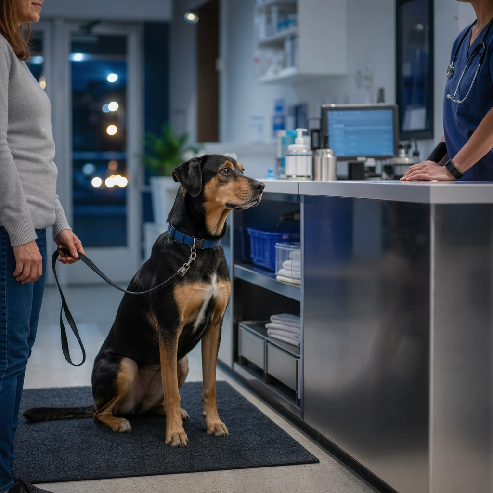

```text
Scene:
A square veterinary communication visual designed for clinic websites, social education posts, waiting room materials, or service pages. The image should combine modern clinical realism with calm emotional tone. Use clean surfaces, soft medical color palettes, and enough layout structure that the asset feels intentionally designed rather than captured spontaneously. Every scene must support trust, reassurance, and professional competence. Use a night clinic entrance or intake desk with cooler light, strong organization, and a focused composition that still feels controlled and humane.

Subject:
Focus on one pet care moment such as welcome, examination, vaccination, dental checking, diagnostics, recovery, or urgent intake. Animals should appear calm or gently supported, while any human presence remains partially framed, professional, and non dominant. Show believable equipment, treatment spaces, or clinic cues, but avoid frightening procedure intensity. The visual message is care, order, and transparency. Feature a pet arriving with owner support implied, while the clinic team and environment communicate readiness, steadiness, and care.

Important details:
Use veterinary specific signals like stainless surfaces, examination mats, stethoscope curves, soft uniforms, scan monitors without readable data, or preventive care props. Keep everything polished, realistic, and emotionally safe. The image should feel useful for a real clinic marketing system and credible to pet owners who need both competence and warmth. Avoid generic hospital drama or sanitized emptiness. The image should acknowledge urgency but lead with competence and reassurance, suitable for after-hours service pages or public trust campaigns.

Use case:
Pet Clinic and Vet Trust Visuals single study 9/9, emergency night intake scene for a commercially reusable prompt atlas example.

Constraints:
No readable text, no watermark, no logos, preserve exact 1:1 aspect ratio, no surgery gore, no visible needles entering skin, no readable charts, no emergency panic chaos, no harsh fluorescent ugliness, no fear based pet expressions, no chaos, no visible injury trauma, no alarm light theatrics.
```

[Pinned source](https://github.com/ChaosRealmsAI/gpt-image-2-gallery/blob/5296db8c996e38776c83a0bc8c64f848dcd512b3/works/topics/pet-clinic-and-vet-trust-visuals/packages/single-vet-trust-studies/images/09-emergency-night-intake-scene/meta.json) · GPT Image2 · 1024×1024 · No source-declared image dependencies. · ProjectD:[published and publicly accepted](https://aitoolsradar.com/en/prompts/a86f46c8c9dce6)

## Dry Food Bag and Bowl Hero · pet-food-packaging-and-bowl-scene-system/single-pet-food-system-studies/01-dry-food-bag-bowl-hero

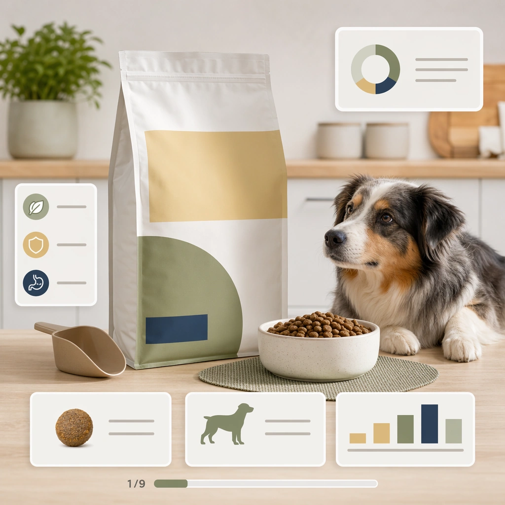

```text
Scene:
A square pet food marketing board that combines believable packaging forms, food texture realism, bowl presentation, and feeding context. The composition should feel useful for shelf mockups, product detail pages, retail social posts, and launch decks. Keep surfaces clean, lighting appetizing but not glossy in a human food luxury way, and layout structured enough to communicate trust even without readable labels. Use a bright kitchen counter or studio tabletop with soft daylight, one upright bag, one ceramic bowl, and abstract nutrition card shapes around them.

Subject:
Anchor each image around one pet nutrition scenario: dry food, wet food, treats, toppers, life stage feeding, or ingredient reassurance. Packaging should look generic but premium, using abstract label blocks instead of text. Bowl scenes must feel species appropriate, portion realistic, and visually clean. Any pet presence should reinforce feeding trust and appetite rather than dominate the composition. Show realistic dry kibble texture in the bowl, a tidy feeding mat, and a nearby dog or cat looking interested but calm rather than lunging.

Important details:
Use real category cues such as pouch stands, tray seals, scoop shapes, freeze dried pieces, feeding mats, ingredient bowls, and veterinary-adjacent cleanliness where relevant. The overall tone should signal industry knowledge and commercial usefulness. Avoid fake luxury extremes or cartoon kibble. Make the board easy to scan, with clear hero focus and believable product hierarchy across package, food, and setting. The board should feel shelf ready and digitally versatile, with enough category logic for a real ecommerce hero image.

Use case:
Pet Food Packaging and Bowl Scene System single study 1/9, dry food bag and bowl hero for a commercially reusable prompt atlas example.

Constraints:
No readable text, no watermark, no logos, preserve exact 1:1 aspect ratio, no readable package copy, no brand logos, no unrealistic human gourmet plating, no overflowing portions, no unsafe ingredients, no messy floor spills, no human hands pouring, no shiny metallic glare overload, no decorative herbs.
```

[Pinned source](https://github.com/ChaosRealmsAI/gpt-image-2-gallery/blob/5296db8c996e38776c83a0bc8c64f848dcd512b3/works/topics/pet-food-packaging-and-bowl-scene-system/packages/single-pet-food-system-studies/images/01-dry-food-bag-bowl-hero/meta.json) · GPT Image2 · 1024×1024 · No source-declared image dependencies. · ProjectD:[published and publicly accepted](https://aitoolsradar.com/en/prompts/58e95229861f9a)

## Wet Food Serving Board · pet-food-packaging-and-bowl-scene-system/single-pet-food-system-studies/02-wet-food-serving-board

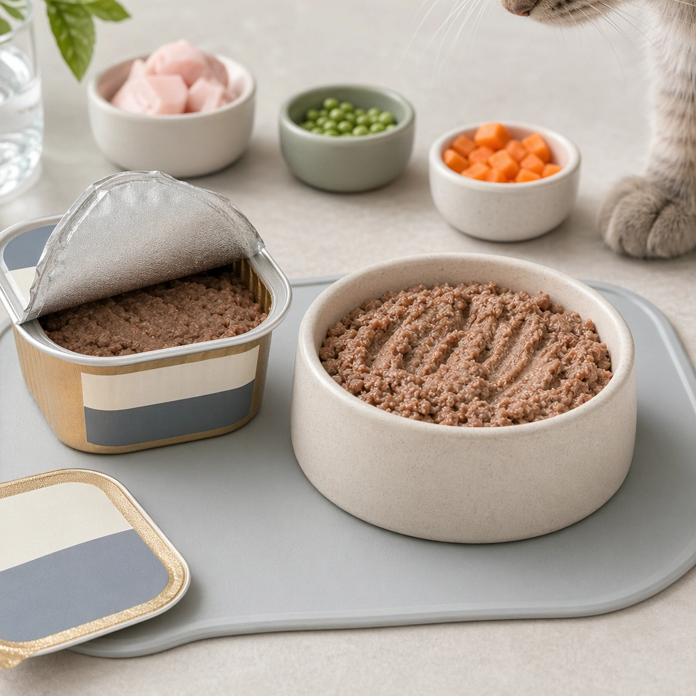

```text
Scene:
A square pet food marketing board that combines believable packaging forms, food texture realism, bowl presentation, and feeding context. The composition should feel useful for shelf mockups, product detail pages, retail social posts, and launch decks. Keep surfaces clean, lighting appetizing but not glossy in a human food luxury way, and layout structured enough to communicate trust even without readable labels. Frame a square serving setup with one opened tray or cup, one plated bowl portion, and a minimal cool neutral background.

Subject:
Anchor each image around one pet nutrition scenario: dry food, wet food, treats, toppers, life stage feeding, or ingredient reassurance. Packaging should look generic but premium, using abstract label blocks instead of text. Bowl scenes must feel species appropriate, portion realistic, and visually clean. Any pet presence should reinforce feeding trust and appetite rather than dominate the composition. The food should look moist, structured, and species appropriate, with clean spooning marks and realistic portion scale beside the package form.

Important details:
Use real category cues such as pouch stands, tray seals, scoop shapes, freeze dried pieces, feeding mats, ingredient bowls, and veterinary-adjacent cleanliness where relevant. The overall tone should signal industry knowledge and commercial usefulness. Avoid fake luxury extremes or cartoon kibble. Make the board easy to scan, with clear hero focus and believable product hierarchy across package, food, and setting. Keep the mood clinical enough to trust and appetizing enough to sell, without drifting into human restaurant styling.

Use case:
Pet Food Packaging and Bowl Scene System single study 2/9, wet food serving board for a commercially reusable prompt atlas example.

Constraints:
No readable text, no watermark, no logos, preserve exact 1:1 aspect ratio, no readable package copy, no brand logos, no unrealistic human gourmet plating, no overflowing portions, no unsafe ingredients, no messy floor spills, no garnish leaves, no silverware glamour, no human table dining context.
```

[Pinned source](https://github.com/ChaosRealmsAI/gpt-image-2-gallery/blob/5296db8c996e38776c83a0bc8c64f848dcd512b3/works/topics/pet-food-packaging-and-bowl-scene-system/packages/single-pet-food-system-studies/images/02-wet-food-serving-board/meta.json) · GPT Image2 · 1024×1024 · No source-declared image dependencies. · ProjectD:[published and publicly accepted](https://aitoolsradar.com/en/prompts/0def8c38c235b0)

## Treat Jar Flatlay System · pet-food-packaging-and-bowl-scene-system/single-pet-food-system-studies/03-treat-jar-flatlay-system

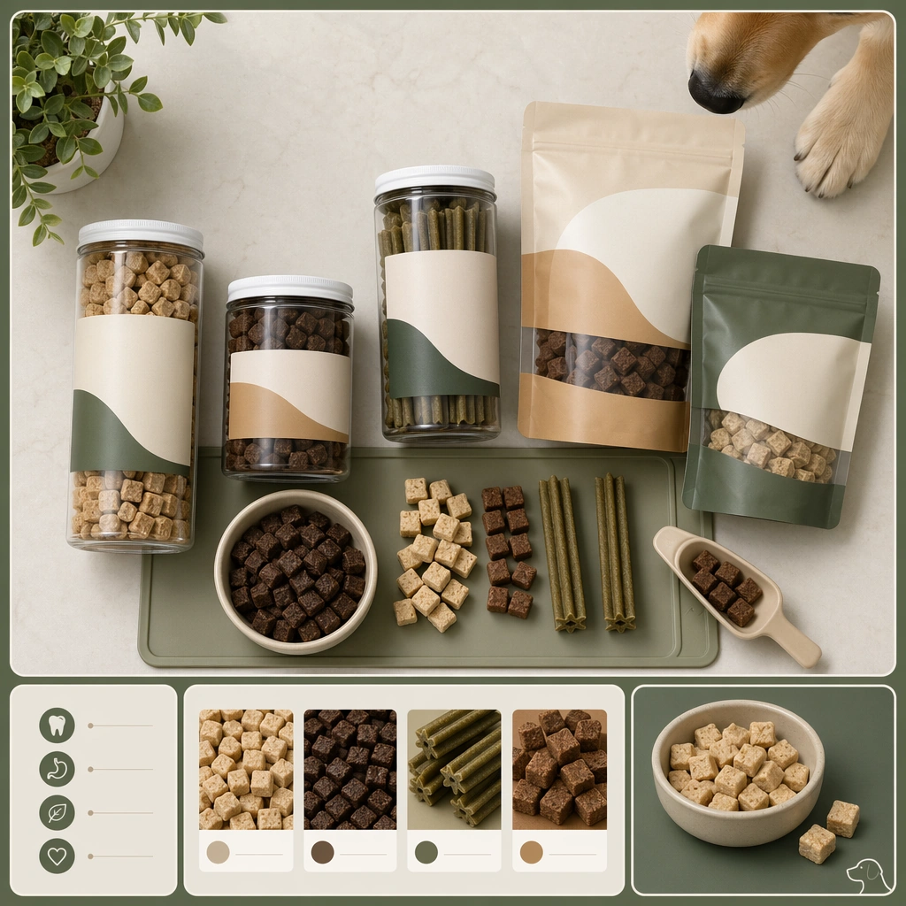

```text
Scene:
A square pet food marketing board that combines believable packaging forms, food texture realism, bowl presentation, and feeding context. The composition should feel useful for shelf mockups, product detail pages, retail social posts, and launch decks. Keep surfaces clean, lighting appetizing but not glossy in a human food luxury way, and layout structured enough to communicate trust even without readable labels. Use a front facing tabletop flatlay with jars or pouches, neatly grouped treat pieces, and modular graphic frames that create a catalog feel.

Subject:
Anchor each image around one pet nutrition scenario: dry food, wet food, treats, toppers, life stage feeding, or ingredient reassurance. Packaging should look generic but premium, using abstract label blocks instead of text. Bowl scenes must feel species appropriate, portion realistic, and visually clean. Any pet presence should reinforce feeding trust and appetite rather than dominate the composition. Focus on the packaging family and the physical treat forms, with perhaps one pet nose or paw entering in a controlled way to suggest appetite.

Important details:
Use real category cues such as pouch stands, tray seals, scoop shapes, freeze dried pieces, feeding mats, ingredient bowls, and veterinary-adjacent cleanliness where relevant. The overall tone should signal industry knowledge and commercial usefulness. Avoid fake luxury extremes or cartoon kibble. Make the board easy to scan, with clear hero focus and believable product hierarchy across package, food, and setting. The image should read as a system board for assorted treats or reward products, not as a messy snack explosion.

Use case:
Pet Food Packaging and Bowl Scene System single study 3/9, treat jar flatlay system for a commercially reusable prompt atlas example.

Constraints:
No readable text, no watermark, no logos, preserve exact 1:1 aspect ratio, no readable package copy, no brand logos, no unrealistic human gourmet plating, no overflowing portions, no unsafe ingredients, no messy floor spills, no human snack styling, no wrappers scattered everywhere, no glossy candy colors.
```

[Pinned source](https://github.com/ChaosRealmsAI/gpt-image-2-gallery/blob/5296db8c996e38776c83a0bc8c64f848dcd512b3/works/topics/pet-food-packaging-and-bowl-scene-system/packages/single-pet-food-system-studies/images/03-treat-jar-flatlay-system/meta.json) · GPT Image2 · 1024×1024 · No source-declared image dependencies. · ProjectD:[published and publicly accepted](https://aitoolsradar.com/en/prompts/73ab881ee08680)

## Ingredient Trust Composition · pet-food-packaging-and-bowl-scene-system/single-pet-food-system-studies/04-ingredient-trust-composition

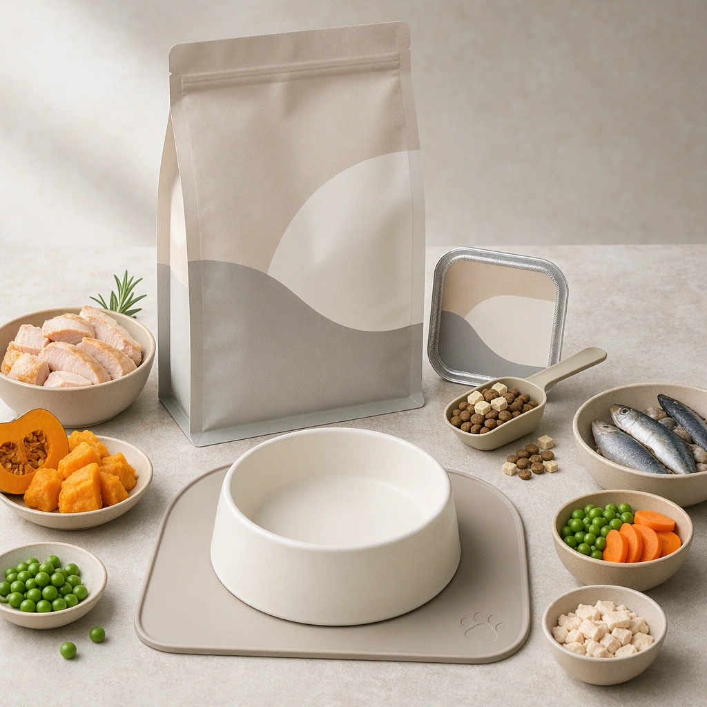

```text
Scene:
A square pet food marketing board that combines believable packaging forms, food texture realism, bowl presentation, and feeding context. The composition should feel useful for shelf mockups, product detail pages, retail social posts, and launch decks. Keep surfaces clean, lighting appetizing but not glossy in a human food luxury way, and layout structured enough to communicate trust even without readable labels. Arrange ingredient bowls, neutral packaging, and one empty ceramic serving dish on a pale stone surface with clinical soft light.

Subject:
Anchor each image around one pet nutrition scenario: dry food, wet food, treats, toppers, life stage feeding, or ingredient reassurance. Packaging should look generic but premium, using abstract label blocks instead of text. Bowl scenes must feel species appropriate, portion realistic, and visually clean. Any pet presence should reinforce feeding trust and appetite rather than dominate the composition. Show simple recognizably pet appropriate ingredient cues such as fish pieces, poultry cuts, pumpkin mash, or grain free vegetable accents in restrained amounts.

Important details:
Use real category cues such as pouch stands, tray seals, scoop shapes, freeze dried pieces, feeding mats, ingredient bowls, and veterinary-adjacent cleanliness where relevant. The overall tone should signal industry knowledge and commercial usefulness. Avoid fake luxury extremes or cartoon kibble. Make the board easy to scan, with clear hero focus and believable product hierarchy across package, food, and setting. The board should suggest transparency, formulation care, and premium sourcing without making claims through text.

Use case:
Pet Food Packaging and Bowl Scene System single study 4/9, ingredient trust composition for a commercially reusable prompt atlas example.

Constraints:
No readable text, no watermark, no logos, preserve exact 1:1 aspect ratio, no readable package copy, no brand logos, no unrealistic human gourmet plating, no overflowing portions, no unsafe ingredients, no messy floor spills, no raw bloodiness, no gourmet restaurant plating, no supplement bottle branding.
```

[Pinned source](https://github.com/ChaosRealmsAI/gpt-image-2-gallery/blob/5296db8c996e38776c83a0bc8c64f848dcd512b3/works/topics/pet-food-packaging-and-bowl-scene-system/packages/single-pet-food-system-studies/images/04-ingredient-trust-composition/meta.json) · GPT Image2 · 1024×1024 · No source-declared image dependencies. · ProjectD:[published and publicly accepted](https://aitoolsradar.com/en/prompts/46acf6d19c1a05)

## Kitten Starter Feeding Kit · pet-food-packaging-and-bowl-scene-system/single-pet-food-system-studies/05-kitten-starter-feeding-kit

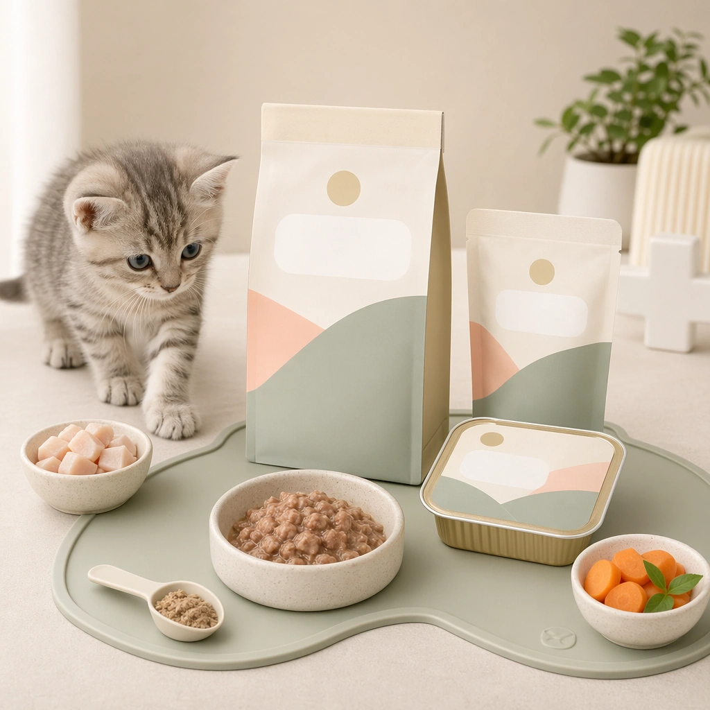

```text
Scene:
A square pet food marketing board that combines believable packaging forms, food texture realism, bowl presentation, and feeding context. The composition should feel useful for shelf mockups, product detail pages, retail social posts, and launch decks. Keep surfaces clean, lighting appetizing but not glossy in a human food luxury way, and layout structured enough to communicate trust even without readable labels. Use a bright pastel neutral setup with small bowls, a soft feeding mat, and compact package formats sized for starter products.

Subject:
Anchor each image around one pet nutrition scenario: dry food, wet food, treats, toppers, life stage feeding, or ingredient reassurance. Packaging should look generic but premium, using abstract label blocks instead of text. Bowl scenes must feel species appropriate, portion realistic, and visually clean. Any pet presence should reinforce feeding trust and appetite rather than dominate the composition. Include a curious kitten near the setup with one paw close to the mat, while the packages and bowl still remain the visual anchor.

Important details:
Use real category cues such as pouch stands, tray seals, scoop shapes, freeze dried pieces, feeding mats, ingredient bowls, and veterinary-adjacent cleanliness where relevant. The overall tone should signal industry knowledge and commercial usefulness. Avoid fake luxury extremes or cartoon kibble. Make the board easy to scan, with clear hero focus and believable product hierarchy across package, food, and setting. The proportions, serving size, and tone should clearly suggest early life nutrition rather than general adult food marketing.

Use case:
Pet Food Packaging and Bowl Scene System single study 5/9, kitten starter feeding kit for a commercially reusable prompt atlas example.

Constraints:
No readable text, no watermark, no logos, preserve exact 1:1 aspect ratio, no readable package copy, no brand logos, no unrealistic human gourmet plating, no overflowing portions, no unsafe ingredients, no messy floor spills, no baby human nursery styling, no oversized milk imagery, no toy clutter.
```

[Pinned source](https://github.com/ChaosRealmsAI/gpt-image-2-gallery/blob/5296db8c996e38776c83a0bc8c64f848dcd512b3/works/topics/pet-food-packaging-and-bowl-scene-system/packages/single-pet-food-system-studies/images/05-kitten-starter-feeding-kit/meta.json) · GPT Image2 · 1024×1024 · No source-declared image dependencies. · ProjectD:[published and publicly accepted](https://aitoolsradar.com/en/prompts/d49ca4c32bbae9)

## Senior Diet Counter Scene · pet-food-packaging-and-bowl-scene-system/single-pet-food-system-studies/06-senior-diet-counter-scene

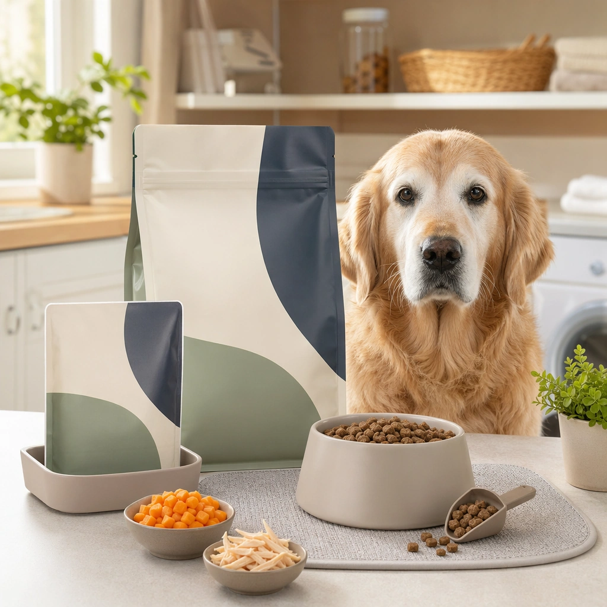

```text
Scene:
A square pet food marketing board that combines believable packaging forms, food texture realism, bowl presentation, and feeding context. The composition should feel useful for shelf mockups, product detail pages, retail social posts, and launch decks. Keep surfaces clean, lighting appetizing but not glossy in a human food luxury way, and layout structured enough to communicate trust even without readable labels. Set the board on a clean home counter with warm daylight, one mature pet nearby, and packaging that looks practical and premium.

Subject:
Anchor each image around one pet nutrition scenario: dry food, wet food, treats, toppers, life stage feeding, or ingredient reassurance. Packaging should look generic but premium, using abstract label blocks instead of text. Bowl scenes must feel species appropriate, portion realistic, and visually clean. Any pet presence should reinforce feeding trust and appetite rather than dominate the composition. Show a measured portion in a bowl beside a senior dog or cat with calm body language and visible age appropriate dignity.

Important details:
Use real category cues such as pouch stands, tray seals, scoop shapes, freeze dried pieces, feeding mats, ingredient bowls, and veterinary-adjacent cleanliness where relevant. The overall tone should signal industry knowledge and commercial usefulness. Avoid fake luxury extremes or cartoon kibble. Make the board easy to scan, with clear hero focus and believable product hierarchy across package, food, and setting. The visual message should be gentle support, digestibility, and trust, not exaggerated medical drama or luxury excess.

Use case:
Pet Food Packaging and Bowl Scene System single study 6/9, senior diet counter scene for a commercially reusable prompt atlas example.

Constraints:
No readable text, no watermark, no logos, preserve exact 1:1 aspect ratio, no readable package copy, no brand logos, no unrealistic human gourmet plating, no overflowing portions, no unsafe ingredients, no messy floor spills, no pills, no disease scare imagery, no kitchen mess.
```

[Pinned source](https://github.com/ChaosRealmsAI/gpt-image-2-gallery/blob/5296db8c996e38776c83a0bc8c64f848dcd512b3/works/topics/pet-food-packaging-and-bowl-scene-system/packages/single-pet-food-system-studies/images/06-senior-diet-counter-scene/meta.json) · GPT Image2 · 1024×1024 · No source-declared image dependencies. · ProjectD:[published and publicly accepted](https://aitoolsradar.com/en/prompts/8c0215e8e152b2)

## Freeze Dried Topper Study · pet-food-packaging-and-bowl-scene-system/single-pet-food-system-studies/07-freeze-dried-topper-study

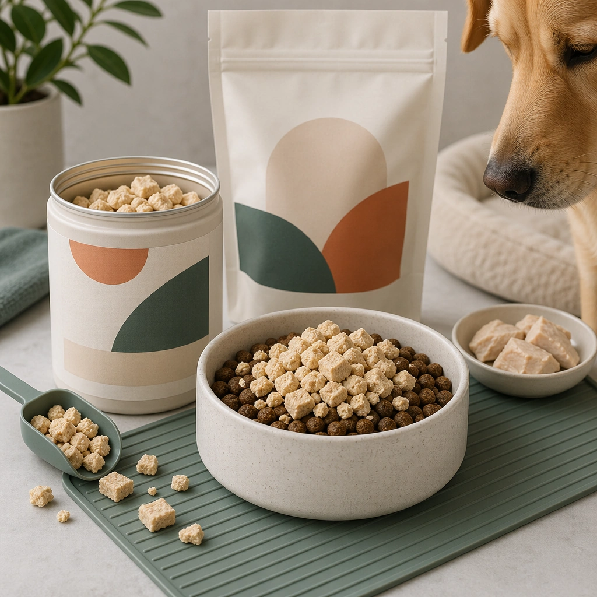

```text
Scene:
A square pet food marketing board that combines believable packaging forms, food texture realism, bowl presentation, and feeding context. The composition should feel useful for shelf mockups, product detail pages, retail social posts, and launch decks. Keep surfaces clean, lighting appetizing but not glossy in a human food luxury way, and layout structured enough to communicate trust even without readable labels. Compose a square board with one open topper container, scattered but controlled pieces, and a main bowl where the topper sits above kibble or wet food.

Subject:
Anchor each image around one pet nutrition scenario: dry food, wet food, treats, toppers, life stage feeding, or ingredient reassurance. Packaging should look generic but premium, using abstract label blocks instead of text. Bowl scenes must feel species appropriate, portion realistic, and visually clean. Any pet presence should reinforce feeding trust and appetite rather than dominate the composition. Make the topper texture highly legible, with believable crumb size and dry surface detail that reads premium and functional.

Important details:
Use real category cues such as pouch stands, tray seals, scoop shapes, freeze dried pieces, feeding mats, ingredient bowls, and veterinary-adjacent cleanliness where relevant. The overall tone should signal industry knowledge and commercial usefulness. Avoid fake luxury extremes or cartoon kibble. Make the board easy to scan, with clear hero focus and believable product hierarchy across package, food, and setting. The board should explain the category visually through hierarchy and context rather than text: base food, topper, package, and appetite cue.

Use case:
Pet Food Packaging and Bowl Scene System single study 7/9, freeze dried topper study for a commercially reusable prompt atlas example.

Constraints:
No readable text, no watermark, no logos, preserve exact 1:1 aspect ratio, no readable package copy, no brand logos, no unrealistic human gourmet plating, no overflowing portions, no unsafe ingredients, no messy floor spills, no crumb explosion, no camping aesthetic, no raw meat sensationalism.
```

[Pinned source](https://github.com/ChaosRealmsAI/gpt-image-2-gallery/blob/5296db8c996e38776c83a0bc8c64f848dcd512b3/works/topics/pet-food-packaging-and-bowl-scene-system/packages/single-pet-food-system-studies/images/07-freeze-dried-topper-study/meta.json) · GPT Image2 · 1024×1024 · No source-declared image dependencies. · ProjectD:[published and publicly accepted](https://aitoolsradar.com/en/prompts/b4186c38e3813f)

## Multi Flavor Shelf Family · pet-food-packaging-and-bowl-scene-system/single-pet-food-system-studies/08-multi-flavor-shelf-family


```text
Scene:
A square pet food marketing board that combines believable packaging forms, food texture realism, bowl presentation, and feeding context. The composition should feel useful for shelf mockups, product detail pages, retail social posts, and launch decks. Keep surfaces clean, lighting appetizing but not glossy in a human food luxury way, and layout structured enough to communicate trust even without readable labels. Use a front facing retail shelf or studio shelf simulation with four or five package variants arranged in a disciplined grid.

Subject:
Anchor each image around one pet nutrition scenario: dry food, wet food, treats, toppers, life stage feeding, or ingredient reassurance. Packaging should look generic but premium, using abstract label blocks instead of text. Bowl scenes must feel species appropriate, portion realistic, and visually clean. Any pet presence should reinforce feeding trust and appetite rather than dominate the composition. The package colors should vary in a controlled system while shape, material, and overall design language remain coherent across the set.

Important details:
Use real category cues such as pouch stands, tray seals, scoop shapes, freeze dried pieces, feeding mats, ingredient bowls, and veterinary-adjacent cleanliness where relevant. The overall tone should signal industry knowledge and commercial usefulness. Avoid fake luxury extremes or cartoon kibble. Make the board easy to scan, with clear hero focus and believable product hierarchy across package, food, and setting. This image is about product family logic and aisle readability, so keep the layout clear, premium, and generic enough for many brands.

Use case:
Pet Food Packaging and Bowl Scene System single study 8/9, multi flavor shelf family for a commercially reusable prompt atlas example.

Constraints:
No readable text, no watermark, no logos, preserve exact 1:1 aspect ratio, no readable package copy, no brand logos, no unrealistic human gourmet plating, no overflowing portions, no unsafe ingredients, no messy floor spills, no supermarket clutter, no loud price stickers, no readable flavor names.
```

[Pinned source](https://github.com/ChaosRealmsAI/gpt-image-2-gallery/blob/5296db8c996e38776c83a0bc8c64f848dcd512b3/works/topics/pet-food-packaging-and-bowl-scene-system/packages/single-pet-food-system-studies/images/08-multi-flavor-shelf-family/meta.json) · GPT Image2 · 1024×1024 · No source-declared image dependencies. · ProjectD:[published and publicly accepted](https://aitoolsradar.com/en/prompts/0652ddf2931b38)

## Night Feeding Routine Board · pet-food-packaging-and-bowl-scene-system/single-pet-food-system-studies/09-night-feeding-routine-board


```text
Scene:
A square pet food marketing board that combines believable packaging forms, food texture realism, bowl presentation, and feeding context. The composition should feel useful for shelf mockups, product detail pages, retail social posts, and launch decks. Keep surfaces clean, lighting appetizing but not glossy in a human food luxury way, and layout structured enough to communicate trust even without readable labels. Use warm evening interior light with a tidy feeding corner, one product package nearby, and a clean bowl scene on a mat.

Subject:
Anchor each image around one pet nutrition scenario: dry food, wet food, treats, toppers, life stage feeding, or ingredient reassurance. Packaging should look generic but premium, using abstract label blocks instead of text. Bowl scenes must feel species appropriate, portion realistic, and visually clean. Any pet presence should reinforce feeding trust and appetite rather than dominate the composition. Show a pet approaching or eating calmly, with measured portion size and a domestic atmosphere that feels cared for rather than staged.

Important details:
Use real category cues such as pouch stands, tray seals, scoop shapes, freeze dried pieces, feeding mats, ingredient bowls, and veterinary-adjacent cleanliness where relevant. The overall tone should signal industry knowledge and commercial usefulness. Avoid fake luxury extremes or cartoon kibble. Make the board easy to scan, with clear hero focus and believable product hierarchy across package, food, and setting. The board should connect product, ritual, and home life in a way that feels useful for DTC social content and retention messaging.

Use case:
Pet Food Packaging and Bowl Scene System single study 9/9, night feeding routine board for a commercially reusable prompt atlas example.

Constraints:
No readable text, no watermark, no logos, preserve exact 1:1 aspect ratio, no readable package copy, no brand logos, no unrealistic human gourmet plating, no overflowing portions, no unsafe ingredients, no messy floor spills, no messy leftover scraps, no dark gloomy kitchen, no human dinner table crossover.
```

[Pinned source](https://github.com/ChaosRealmsAI/gpt-image-2-gallery/blob/5296db8c996e38776c83a0bc8c64f848dcd512b3/works/topics/pet-food-packaging-and-bowl-scene-system/packages/single-pet-food-system-studies/images/09-night-feeding-routine-board/meta.json) · GPT Image2 · 1024×1024 · No source-declared image dependencies. · ProjectD:[published and publicly accepted](https://aitoolsradar.com/en/prompts/db79aa9e9af8ee)

## Poodle Makeover Proof Board · pet-grooming-before-after-campaign/single-grooming-proof-boards/01-poodle-makeover-proof-board


```text
Scene:
A square grooming campaign board designed for a premium pet salon, combining real pet photography with structured before after logic, service proof framing, and clear commercial hierarchy. The composition should feel like something a salon could use for social ads, in store signage, or booking pages. Keep the visual system clean, polished, and easy to scan, with split panels, small detail crops, or modular proof zones instead of clutter. Use a clean split board with warm ivory lighting, one slightly shaggy pre groom portrait, one precise after portrait, and tiny supporting detail insets.

Subject:
Focus on one grooming transformation or care result at a time. The pet must remain comfortable, dignified, and believable, with healthy fur texture, accurate anatomy, and emotionally safe handling implied by the scene. Before states should look natural and slightly unrefined, not neglected. After states should look skillful, fresh, and trustworthy rather than artificially over styled. Feature a poodle whose coat moves from soft overgrown fluff to a tidy sculpted trim with bright visible eyes and balanced face proportions.

Important details:
Use salon language visually: tidy tools, controlled backgrounds, clean towels, polished fur finish, and evidence driven close ups where needed. Any informational zones should remain abstract placeholder bands instead of words. The board should sell care, calm, and competence. Avoid manipulative makeover drama; the transformation needs to feel professional, humane, and repeatable in a real business setting. Make the transformation clear but kind, showing the value of revealing expression, shape, and hygiene rather than inventing a dramatic personality shift.

Use case:
Pet Grooming Before-After Campaign single study 1/9, poodle makeover proof board for a commercially reusable prompt atlas example.

Constraints:
No readable text, no watermark, no logos, preserve exact 1:1 aspect ratio, no visible abuse cues, no humiliating costume bows, no readable labels, no dirt grime sensationalism, no chaotic grooming room clutter, no distorted fur texture, no exaggerated glam lashes, no fake fashion accessories, no harsh contrast retouching.
```

[Pinned source](https://github.com/ChaosRealmsAI/gpt-image-2-gallery/blob/5296db8c996e38776c83a0bc8c64f848dcd512b3/works/topics/pet-grooming-before-after-campaign/packages/single-grooming-proof-boards/images/01-poodle-makeover-proof-board/meta.json) · GPT Image2 · 1024×1024 · No source-declared image dependencies. · ProjectD:[published and publicly accepted](https://aitoolsradar.com/en/prompts/7cfc8ddf8a7fd7)

## Deshedding Undercoat Result · pet-grooming-before-after-campaign/single-grooming-proof-boards/02-deshedding-undercoat-result


```text
Scene:
A square grooming campaign board designed for a premium pet salon, combining real pet photography with structured before after logic, service proof framing, and clear commercial hierarchy. The composition should feel like something a salon could use for social ads, in store signage, or booking pages. Keep the visual system clean, polished, and easy to scan, with split panels, small detail crops, or modular proof zones instead of clutter. Frame the dog on a neutral salon floor with side by side coat texture panels and one close crop showing the brushed finish.

Subject:
Focus on one grooming transformation or care result at a time. The pet must remain comfortable, dignified, and believable, with healthy fur texture, accurate anatomy, and emotionally safe handling implied by the scene. Before states should look natural and slightly unrefined, not neglected. After states should look skillful, fresh, and trustworthy rather than artificially over styled. Show a double coated dog before and after deshedding, keeping the animal calm and naturally posed while the coat becomes visibly cleaner and more even.

Important details:
Use salon language visually: tidy tools, controlled backgrounds, clean towels, polished fur finish, and evidence driven close ups where needed. Any informational zones should remain abstract placeholder bands instead of words. The board should sell care, calm, and competence. Avoid manipulative makeover drama; the transformation needs to feel professional, humane, and repeatable in a real business setting. Emphasize texture control, healthy shine, and reduced loose fur. The board should read as practical grooming value, not beauty pageant styling.

Use case:
Pet Grooming Before-After Campaign single study 2/9, deshedding undercoat result for a commercially reusable prompt atlas example.

Constraints:
No readable text, no watermark, no logos, preserve exact 1:1 aspect ratio, no visible abuse cues, no humiliating costume bows, no readable labels, no dirt grime sensationalism, no chaotic grooming room clutter, no distorted fur texture, no flying fur explosion, no vacuum gimmicks, no cartoon fluff clouds.
```

[Pinned source](https://github.com/ChaosRealmsAI/gpt-image-2-gallery/blob/5296db8c996e38776c83a0bc8c64f848dcd512b3/works/topics/pet-grooming-before-after-campaign/packages/single-grooming-proof-boards/images/02-deshedding-undercoat-result/meta.json) · GPT Image2 · 1024×1024 · No source-declared image dependencies. · ProjectD:[published and publicly accepted](https://aitoolsradar.com/en/prompts/73f13a5d552e0c)

## Face Trim Eye Reveal Board · pet-grooming-before-after-campaign/single-grooming-proof-boards/03-face-trim-eye-reveal-board


```text
Scene:
A square grooming campaign board designed for a premium pet salon, combining real pet photography with structured before after logic, service proof framing, and clear commercial hierarchy. The composition should feel like something a salon could use for social ads, in store signage, or booking pages. Keep the visual system clean, polished, and easy to scan, with split panels, small detail crops, or modular proof zones instead of clutter. Use a close portrait split with one pre trim face and one after trim face, supported by a tiny tool-free detail panel on a soft gray background.

Subject:
Focus on one grooming transformation or care result at a time. The pet must remain comfortable, dignified, and believable, with healthy fur texture, accurate anatomy, and emotionally safe handling implied by the scene. Before states should look natural and slightly unrefined, not neglected. After states should look skillful, fresh, and trustworthy rather than artificially over styled. Feature a shaggy small dog whose fringe initially covers the eyes, then after grooming reveals a clear open expression and balanced facial lines.

Important details:
Use salon language visually: tidy tools, controlled backgrounds, clean towels, polished fur finish, and evidence driven close ups where needed. Any informational zones should remain abstract placeholder bands instead of words. The board should sell care, calm, and competence. Avoid manipulative makeover drama; the transformation needs to feel professional, humane, and repeatable in a real business setting. The key selling point is emotional visibility. Make the result feel practical, safe, and comfort driven rather than makeover vanity.

Use case:
Pet Grooming Before-After Campaign single study 3/9, face trim eye reveal board for a commercially reusable prompt atlas example.

Constraints:
No readable text, no watermark, no logos, preserve exact 1:1 aspect ratio, no visible abuse cues, no humiliating costume bows, no readable labels, no dirt grime sensationalism, no chaotic grooming room clutter, no distorted fur texture, no scissors in action near the eye, no anxious expression, no over trimmed skin exposure.
```

[Pinned source](https://github.com/ChaosRealmsAI/gpt-image-2-gallery/blob/5296db8c996e38776c83a0bc8c64f848dcd512b3/works/topics/pet-grooming-before-after-campaign/packages/single-grooming-proof-boards/images/03-face-trim-eye-reveal-board/meta.json) · GPT Image2 · 1024×1024 · No source-declared image dependencies. · ProjectD:[published and publicly accepted](https://aitoolsradar.com/en/prompts/31d963badca799)

## Bath Dry Fluff Finish · pet-grooming-before-after-campaign/single-grooming-proof-boards/04-bath-dry-fluff-finish


```text
Scene:
A square grooming campaign board designed for a premium pet salon, combining real pet photography with structured before after logic, service proof framing, and clear commercial hierarchy. The composition should feel like something a salon could use for social ads, in store signage, or booking pages. Keep the visual system clean, polished, and easy to scan, with split panels, small detail crops, or modular proof zones instead of clutter. Create a bright grooming nook with white tile, folded towels, and a three panel layout that shows damp transition and finished fluff.

Subject:
Focus on one grooming transformation or care result at a time. The pet must remain comfortable, dignified, and believable, with healthy fur texture, accurate anatomy, and emotionally safe handling implied by the scene. Before states should look natural and slightly unrefined, not neglected. After states should look skillful, fresh, and trustworthy rather than artificially over styled. Show a medium dog moving from slightly damp and flat to freshly dried with lifted clean coat texture and relaxed posture.

Important details:
Use salon language visually: tidy tools, controlled backgrounds, clean towels, polished fur finish, and evidence driven close ups where needed. Any informational zones should remain abstract placeholder bands instead of words. The board should sell care, calm, and competence. Avoid manipulative makeover drama; the transformation needs to feel professional, humane, and repeatable in a real business setting. Keep the finish believable and touchable. The board should communicate hygiene, comfort, and salon competence more than theatrical fluff.

Use case:
Pet Grooming Before-After Campaign single study 4/9, bath dry fluff finish for a commercially reusable prompt atlas example.

Constraints:
No readable text, no watermark, no logos, preserve exact 1:1 aspect ratio, no visible abuse cues, no humiliating costume bows, no readable labels, no dirt grime sensationalism, no chaotic grooming room clutter, no distorted fur texture, no wet mess on the floor, no branded bottles, no wind tunnel blowout effect.
```

[Pinned source](https://github.com/ChaosRealmsAI/gpt-image-2-gallery/blob/5296db8c996e38776c83a0bc8c64f848dcd512b3/works/topics/pet-grooming-before-after-campaign/packages/single-grooming-proof-boards/images/04-bath-dry-fluff-finish/meta.json) · GPT Image2 · 1024×1024 · No source-declared image dependencies. · ProjectD:[published and publicly accepted](https://aitoolsradar.com/en/prompts/49c2365bb73a5d)

## Paw Pad Clean Detail Board · pet-grooming-before-after-campaign/single-grooming-proof-boards/05-paw-pad-clean-detail-board


```text
Scene:
A square grooming campaign board designed for a premium pet salon, combining real pet photography with structured before after logic, service proof framing, and clear commercial hierarchy. The composition should feel like something a salon could use for social ads, in store signage, or booking pages. Keep the visual system clean, polished, and easy to scan, with split panels, small detail crops, or modular proof zones instead of clutter. Use a macro plus portrait layout on a pale stone background, with the main image showing the pet calmly seated and a detail crop on the paws.

Subject:
Focus on one grooming transformation or care result at a time. The pet must remain comfortable, dignified, and believable, with healthy fur texture, accurate anatomy, and emotionally safe handling implied by the scene. Before states should look natural and slightly unrefined, not neglected. After states should look skillful, fresh, and trustworthy rather than artificially over styled. Feature a dog or cat with clearly groomed paw fur and clean pads, relaxed body language, and a healthy well maintained coat.

Important details:
Use salon language visually: tidy tools, controlled backgrounds, clean towels, polished fur finish, and evidence driven close ups where needed. Any informational zones should remain abstract placeholder bands instead of words. The board should sell care, calm, and competence. Avoid manipulative makeover drama; the transformation needs to feel professional, humane, and repeatable in a real business setting. Sell precision and everyday care rather than dramatic beauty. The macro detail should feel clinical enough to trust but warm enough for a pet audience.

Use case:
Pet Grooming Before-After Campaign single study 5/9, paw pad clean detail board for a commercially reusable prompt atlas example.

Constraints:
No readable text, no watermark, no logos, preserve exact 1:1 aspect ratio, no visible abuse cues, no humiliating costume bows, no readable labels, no dirt grime sensationalism, no chaotic grooming room clutter, no distorted fur texture, no medical procedure look, no sharp tool display, no dirty floor context.
```

[Pinned source](https://github.com/ChaosRealmsAI/gpt-image-2-gallery/blob/5296db8c996e38776c83a0bc8c64f848dcd512b3/works/topics/pet-grooming-before-after-campaign/packages/single-grooming-proof-boards/images/05-paw-pad-clean-detail-board/meta.json) · GPT Image2 · 1024×1024 · No source-declared image dependencies. · ProjectD:[published and publicly accepted](https://aitoolsradar.com/en/prompts/956f6a9b90b428)

## Salon Bow Finale Board · pet-grooming-before-after-campaign/single-grooming-proof-boards/06-salon-bow-finale-board


```text
Scene:
A square grooming campaign board designed for a premium pet salon, combining real pet photography with structured before after logic, service proof framing, and clear commercial hierarchy. The composition should feel like something a salon could use for social ads, in store signage, or booking pages. Keep the visual system clean, polished, and easy to scan, with split panels, small detail crops, or modular proof zones instead of clutter. Use a pale blush or cream studio setup with one hero portrait and smaller process cues arranged as a simple promotional board.

Subject:
Focus on one grooming transformation or care result at a time. The pet must remain comfortable, dignified, and believable, with healthy fur texture, accurate anatomy, and emotionally safe handling implied by the scene. Before states should look natural and slightly unrefined, not neglected. After states should look skillful, fresh, and trustworthy rather than artificially over styled. Show a freshly groomed small dog with a tiny tasteful bow or neck ribbon, sitting with direct eye contact and polished coat finish.

Important details:
Use salon language visually: tidy tools, controlled backgrounds, clean towels, polished fur finish, and evidence driven close ups where needed. Any informational zones should remain abstract placeholder bands instead of words. The board should sell care, calm, and competence. Avoid manipulative makeover drama; the transformation needs to feel professional, humane, and repeatable in a real business setting. The accessory is secondary; the true hero is the groom. Keep the result premium, tidy, and realistic for boutique salon marketing.

Use case:
Pet Grooming Before-After Campaign single study 6/9, salon bow finale board for a commercially reusable prompt atlas example.

Constraints:
No readable text, no watermark, no logos, preserve exact 1:1 aspect ratio, no visible abuse cues, no humiliating costume bows, no readable labels, no dirt grime sensationalism, no chaotic grooming room clutter, no distorted fur texture, no giant bows, no rhinestone overload, no toy display shelf.
```

[Pinned source](https://github.com/ChaosRealmsAI/gpt-image-2-gallery/blob/5296db8c996e38776c83a0bc8c64f848dcd512b3/works/topics/pet-grooming-before-after-campaign/packages/single-grooming-proof-boards/images/06-salon-bow-finale-board/meta.json) · GPT Image2 · 1024×1024 · No source-declared image dependencies. · ProjectD:[published and publicly accepted](https://aitoolsradar.com/en/prompts/3d223a5236f31c)

## Double Coat Lineup Board · pet-grooming-before-after-campaign/single-grooming-proof-boards/07-double-coat-lineup-board


```text
Scene:
A square grooming campaign board designed for a premium pet salon, combining real pet photography with structured before after logic, service proof framing, and clear commercial hierarchy. The composition should feel like something a salon could use for social ads, in store signage, or booking pages. Keep the visual system clean, polished, and easy to scan, with split panels, small detail crops, or modular proof zones instead of clutter. Compose a square board with one main full body dog portrait and several inset frames showing side profile, back coat texture, and clean silhouette improvement.

Subject:
Focus on one grooming transformation or care result at a time. The pet must remain comfortable, dignified, and believable, with healthy fur texture, accurate anatomy, and emotionally safe handling implied by the scene. Before states should look natural and slightly unrefined, not neglected. After states should look skillful, fresh, and trustworthy rather than artificially over styled. Feature a husky or shepherd type dog with freshly managed coat, tidy outline, and calm stand that shows the service result across multiple angles.

Important details:
Use salon language visually: tidy tools, controlled backgrounds, clean towels, polished fur finish, and evidence driven close ups where needed. Any informational zones should remain abstract placeholder bands instead of words. The board should sell care, calm, and competence. Avoid manipulative makeover drama; the transformation needs to feel professional, humane, and repeatable in a real business setting. The board should feel like a premium service explanation for heavy coat clients, using image evidence instead of text heavy claims.

Use case:
Pet Grooming Before-After Campaign single study 7/9, double coat lineup board for a commercially reusable prompt atlas example.

Constraints:
No readable text, no watermark, no logos, preserve exact 1:1 aspect ratio, no visible abuse cues, no humiliating costume bows, no readable labels, no dirt grime sensationalism, no chaotic grooming room clutter, no distorted fur texture, no snowy wilderness background, no action running pose, no excessive shedding debris.
```

[Pinned source](https://github.com/ChaosRealmsAI/gpt-image-2-gallery/blob/5296db8c996e38776c83a0bc8c64f848dcd512b3/works/topics/pet-grooming-before-after-campaign/packages/single-grooming-proof-boards/images/07-double-coat-lineup-board/meta.json) · GPT Image2 · 1024×1024 · No source-declared image dependencies. · ProjectD:[published and publicly accepted](https://aitoolsradar.com/en/prompts/bb5d13985a95d0)

## Cat Grooming Gentle Proof · pet-grooming-before-after-campaign/single-grooming-proof-boards/08-cat-grooming-gentle-proof


```text
Scene:
A square grooming campaign board designed for a premium pet salon, combining real pet photography with structured before after logic, service proof framing, and clear commercial hierarchy. The composition should feel like something a salon could use for social ads, in store signage, or booking pages. Keep the visual system clean, polished, and easy to scan, with split panels, small detail crops, or modular proof zones instead of clutter. Use soft neutral light with a quiet tabletop or grooming mat environment and a structured collage of hero portrait plus close fur detail.

Subject:
Focus on one grooming transformation or care result at a time. The pet must remain comfortable, dignified, and believable, with healthy fur texture, accurate anatomy, and emotionally safe handling implied by the scene. Before states should look natural and slightly unrefined, not neglected. After states should look skillful, fresh, and trustworthy rather than artificially over styled. Show a cat looking composed after grooming, with sleeker coat texture, tidy chest fur, and eyes that communicate comfort rather than stress.

Important details:
Use salon language visually: tidy tools, controlled backgrounds, clean towels, polished fur finish, and evidence driven close ups where needed. Any informational zones should remain abstract placeholder bands instead of words. The board should sell care, calm, and competence. Avoid manipulative makeover drama; the transformation needs to feel professional, humane, and repeatable in a real business setting. The key message is gentleness. Keep everything quiet, premium, and feline appropriate so the board feels credible to cautious cat owners.

Use case:
Pet Grooming Before-After Campaign single study 8/9, cat grooming gentle proof for a commercially reusable prompt atlas example.

Constraints:
No readable text, no watermark, no logos, preserve exact 1:1 aspect ratio, no visible abuse cues, no humiliating costume bows, no readable labels, no dirt grime sensationalism, no chaotic grooming room clutter, no distorted fur texture, no aggressive restraint cues, no dripping wet fur, no loud salon environment.
```

[Pinned source](https://github.com/ChaosRealmsAI/gpt-image-2-gallery/blob/5296db8c996e38776c83a0bc8c64f848dcd512b3/works/topics/pet-grooming-before-after-campaign/packages/single-grooming-proof-boards/images/08-cat-grooming-gentle-proof/meta.json) · GPT Image2 · 1024×1024 · No source-declared image dependencies. · ProjectD:[published and publicly accepted](https://aitoolsradar.com/en/prompts/1782be3c23f57e)

## Premium Spa Package Hero · pet-grooming-before-after-campaign/single-grooming-proof-boards/09-premium-spa-package-hero


```text
Scene:
A square grooming campaign board designed for a premium pet salon, combining real pet photography with structured before after logic, service proof framing, and clear commercial hierarchy. The composition should feel like something a salon could use for social ads, in store signage, or booking pages. Keep the visual system clean, polished, and easy to scan, with split panels, small detail crops, or modular proof zones instead of clutter. Stage the board as a premium service ad with warm stone colors, folded towels, ceramic bowls, and a central polished pet portrait.

Subject:
Focus on one grooming transformation or care result at a time. The pet must remain comfortable, dignified, and believable, with healthy fur texture, accurate anatomy, and emotionally safe handling implied by the scene. Before states should look natural and slightly unrefined, not neglected. After states should look skillful, fresh, and trustworthy rather than artificially over styled. Feature a well groomed dog in a relaxed seated or lying pose with exceptionally soft coat finish and calm luxurious mood.

Important details:
Use salon language visually: tidy tools, controlled backgrounds, clean towels, polished fur finish, and evidence driven close ups where needed. Any informational zones should remain abstract placeholder bands instead of words. The board should sell care, calm, and competence. Avoid manipulative makeover drama; the transformation needs to feel professional, humane, and repeatable in a real business setting. The board should suggest upgrade service, sensory comfort, and repeat booking value while staying realistic and uncluttered.

Use case:
Pet Grooming Before-After Campaign single study 9/9, premium spa package hero for a commercially reusable prompt atlas example.

Constraints:
No readable text, no watermark, no logos, preserve exact 1:1 aspect ratio, no visible abuse cues, no humiliating costume bows, no readable labels, no dirt grime sensationalism, no chaotic grooming room clutter, no distorted fur texture, no human spa parody, no cucumber eye joke, no scented candle overload.
```

[Pinned source](https://github.com/ChaosRealmsAI/gpt-image-2-gallery/blob/5296db8c996e38776c83a0bc8c64f848dcd512b3/works/topics/pet-grooming-before-after-campaign/packages/single-grooming-proof-boards/images/09-premium-spa-package-hero/meta.json) · GPT Image2 · 1024×1024 · No source-declared image dependencies. · ProjectD:[published and publicly accepted](https://aitoolsradar.com/en/prompts/af5cecbf23f8d5)

## Winter Knit Sweater Promo · pet-holiday-costume-promo-set/single-holiday-promo-studies/01-winter-knit-sweater-promo


```text
Scene:
A square pet holiday promo tile designed for brand campaigns, combining believable costume styling with feed friendly layout control and polished product marketing energy. The framing should feel commercial and celebratory rather than amateur party photography. Use clean seasonal props, soft placeholder graphic zones, and strong central subject clarity so the image can function across ads, organic social, and shop features. Use cool window light, a pale wood floor, and restrained evergreen or wool textures that suggest winter without turning the frame into a dense holiday set.

Subject:
Center one pet in a holiday outfit or themed accessory that looks comfortable, well fitted, and genuinely photographable. The animal must remain the hero, not the prop pile. Expression, posture, and styling should communicate the seasonal mood while preserving real anatomy, fur detail, and a sense of animal comfort. Avoid parody or heavy anthropomorphic comedy. Show a dog in a neatly fitted cream knit sweater, seated with composed eye contact and visible fabric texture across the shoulders and chest.

Important details:
Treat each image like a campaign key tile with a disciplined palette, controlled set dressing, and enough compositional breathing room for future text overlays outside the image generation. Holiday atmosphere can come from color, lighting, and a few strong props. Keep the tone premium, charming, and retailer ready. The result should feel useful for product pages, promo banners, and carousel campaigns. The garment should feel warm, giftable, and believable, with enough negative space for storefront adaptation and social post reuse.

Use case:
Pet Holiday Costume Promo Set single study 1/9, winter knit sweater promo for a commercially reusable prompt atlas example.

Constraints:
No readable text, no watermark, no logos, preserve exact 1:1 aspect ratio, no readable sale text, no oversized mascots, no heavy human costume parody, no chaotic party clutter, no unsafe accessories, no generic stock holiday card vibe, no fake snowstorm, no antler headbands, no fireplace overload.
```

[Pinned source](https://github.com/ChaosRealmsAI/gpt-image-2-gallery/blob/5296db8c996e38776c83a0bc8c64f848dcd512b3/works/topics/pet-holiday-costume-promo-set/packages/single-holiday-promo-studies/images/01-winter-knit-sweater-promo/meta.json) · GPT Image2 · 1024×1024 · No source-declared image dependencies. · ProjectD:[published and publicly accepted](https://aitoolsradar.com/en/prompts/c94714b540d261)

## Spooky Cape Night Promo · pet-holiday-costume-promo-set/single-holiday-promo-studies/02-spooky-cape-night-promo


```text
Scene:
A square pet holiday promo tile designed for brand campaigns, combining believable costume styling with feed friendly layout control and polished product marketing energy. The framing should feel commercial and celebratory rather than amateur party photography. Use clean seasonal props, soft placeholder graphic zones, and strong central subject clarity so the image can function across ads, organic social, and shop features. Stage a dark plum and charcoal set with a faint moonlit edge light, one pumpkin tone accent, and a minimal promo layout frame.

Subject:
Center one pet in a holiday outfit or themed accessory that looks comfortable, well fitted, and genuinely photographable. The animal must remain the hero, not the prop pile. Expression, posture, and styling should communicate the seasonal mood while preserving real anatomy, fur detail, and a sense of animal comfort. Avoid parody or heavy anthropomorphic comedy. Feature a cat or small dog in a simple velvet cape, posed upright with watchful eyes and a strong silhouette.

Important details:
Treat each image like a campaign key tile with a disciplined palette, controlled set dressing, and enough compositional breathing room for future text overlays outside the image generation. Holiday atmosphere can come from color, lighting, and a few strong props. Keep the tone premium, charming, and retailer ready. The result should feel useful for product pages, promo banners, and carousel campaigns. Keep the mood playful and elegant, suited for seasonal costume merchandising rather than haunted house theatrics.

Use case:
Pet Holiday Costume Promo Set single study 2/9, spooky cape night promo for a commercially reusable prompt atlas example.

Constraints:
No readable text, no watermark, no logos, preserve exact 1:1 aspect ratio, no readable sale text, no oversized mascots, no heavy human costume parody, no chaotic party clutter, no unsafe accessories, no generic stock holiday card vibe, no gore, no fake fangs close up, no children party chaos.
```

[Pinned source](https://github.com/ChaosRealmsAI/gpt-image-2-gallery/blob/5296db8c996e38776c83a0bc8c64f848dcd512b3/works/topics/pet-holiday-costume-promo-set/packages/single-holiday-promo-studies/images/02-spooky-cape-night-promo/meta.json) · GPT Image2 · 1024×1024 · No source-declared image dependencies. · ProjectD:[published and publicly accepted](https://aitoolsradar.com/en/prompts/3b99faa091894c)

## Birthday Crown Celebration Tile · pet-holiday-costume-promo-set/single-holiday-promo-studies/03-birthday-crown-celebration-tile


```text
Scene:
A square pet holiday promo tile designed for brand campaigns, combining believable costume styling with feed friendly layout control and polished product marketing energy. The framing should feel commercial and celebratory rather than amateur party photography. Use clean seasonal props, soft placeholder graphic zones, and strong central subject clarity so the image can function across ads, organic social, and shop features. Use pastel cream, soft coral, and tidy confetti graphics arranged around a simple pedestal for a premium birthday drop feel.

Subject:
Center one pet in a holiday outfit or themed accessory that looks comfortable, well fitted, and genuinely photographable. The animal must remain the hero, not the prop pile. Expression, posture, and styling should communicate the seasonal mood while preserving real anatomy, fur detail, and a sense of animal comfort. Avoid parody or heavy anthropomorphic comedy. Show a calm pet wearing a tiny crown or party band, sitting proudly with direct eye contact and polished fur detail.

Important details:
Treat each image like a campaign key tile with a disciplined palette, controlled set dressing, and enough compositional breathing room for future text overlays outside the image generation. Holiday atmosphere can come from color, lighting, and a few strong props. Keep the tone premium, charming, and retailer ready. The result should feel useful for product pages, promo banners, and carousel campaigns. The image should feel milestone ready, giftable, and clean enough for subscription perks, birthday reminders, and social promos.

Use case:
Pet Holiday Costume Promo Set single study 3/9, birthday crown celebration tile for a commercially reusable prompt atlas example.

Constraints:
No readable text, no watermark, no logos, preserve exact 1:1 aspect ratio, no readable sale text, no oversized mascots, no heavy human costume parody, no chaotic party clutter, no unsafe accessories, no generic stock holiday card vibe, no messy cake smash, no clown palette, no oversized helium balloons.
```

[Pinned source](https://github.com/ChaosRealmsAI/gpt-image-2-gallery/blob/5296db8c996e38776c83a0bc8c64f848dcd512b3/works/topics/pet-holiday-costume-promo-set/packages/single-holiday-promo-studies/images/03-birthday-crown-celebration-tile/meta.json) · GPT Image2 · 1024×1024 · No source-declared image dependencies. · ProjectD:[published and publicly accepted](https://aitoolsradar.com/en/prompts/6abf98db8bcee4)

## Lunar Red Scarf Portrait · pet-holiday-costume-promo-set/single-holiday-promo-studies/04-lunar-red-scarf-portrait


```text
Scene:
A square pet holiday promo tile designed for brand campaigns, combining believable costume styling with feed friendly layout control and polished product marketing energy. The framing should feel commercial and celebratory rather than amateur party photography. Use clean seasonal props, soft placeholder graphic zones, and strong central subject clarity so the image can function across ads, organic social, and shop features. Use warm neutral light with restrained red and gold props, matte paper textures, and a balanced portrait crop on a quiet backdrop.

Subject:
Center one pet in a holiday outfit or themed accessory that looks comfortable, well fitted, and genuinely photographable. The animal must remain the hero, not the prop pile. Expression, posture, and styling should communicate the seasonal mood while preserving real anatomy, fur detail, and a sense of animal comfort. Avoid parody or heavy anthropomorphic comedy. Feature a pet wearing a red scarf or collar ribbon, posed calmly with alert eyes and strong color separation from the background.

Important details:
Treat each image like a campaign key tile with a disciplined palette, controlled set dressing, and enough compositional breathing room for future text overlays outside the image generation. Holiday atmosphere can come from color, lighting, and a few strong props. Keep the tone premium, charming, and retailer ready. The result should feel useful for product pages, promo banners, and carousel campaigns. Let the color symbolism and polished portrait craft carry the festive mood; keep it respectful, clean, and widely reusable.

Use case:
Pet Holiday Costume Promo Set single study 4/9, lunar red scarf portrait for a commercially reusable prompt atlas example.

Constraints:
No readable text, no watermark, no logos, preserve exact 1:1 aspect ratio, no readable sale text, no oversized mascots, no heavy human costume parody, no chaotic party clutter, no unsafe accessories, no generic stock holiday card vibe, no fireworks, no readable banners, no crowded banquet setting.
```

[Pinned source](https://github.com/ChaosRealmsAI/gpt-image-2-gallery/blob/5296db8c996e38776c83a0bc8c64f848dcd512b3/works/topics/pet-holiday-costume-promo-set/packages/single-holiday-promo-studies/images/04-lunar-red-scarf-portrait/meta.json) · GPT Image2 · 1024×1024 · No source-declared image dependencies. · ProjectD:[published and publicly accepted](https://aitoolsradar.com/en/prompts/8fc4132240ac15)

## Spring Floral Picnic Promo · pet-holiday-costume-promo-set/single-holiday-promo-studies/05-spring-floral-picnic-promo


```text
Scene:
A square pet holiday promo tile designed for brand campaigns, combining believable costume styling with feed friendly layout control and polished product marketing energy. The framing should feel commercial and celebratory rather than amateur party photography. Use clean seasonal props, soft placeholder graphic zones, and strong central subject clarity so the image can function across ads, organic social, and shop features. Build a soft outdoor picnic scene with filtered daylight, pale florals, woven textures, and graphic frame elements that keep the square composition organized.

Subject:
Center one pet in a holiday outfit or themed accessory that looks comfortable, well fitted, and genuinely photographable. The animal must remain the hero, not the prop pile. Expression, posture, and styling should communicate the seasonal mood while preserving real anatomy, fur detail, and a sense of animal comfort. Avoid parody or heavy anthropomorphic comedy. Show a dog or rabbit wearing a light floral bandana or collar accessory, posed neatly beside the picnic styling.

Important details:
Treat each image like a campaign key tile with a disciplined palette, controlled set dressing, and enough compositional breathing room for future text overlays outside the image generation. Holiday atmosphere can come from color, lighting, and a few strong props. Keep the tone premium, charming, and retailer ready. The result should feel useful for product pages, promo banners, and carousel campaigns. The atmosphere should feel fresh and editorial, useful for spring launches, lifestyle brands, and pet accessory campaigns.

Use case:
Pet Holiday Costume Promo Set single study 5/9, spring floral picnic promo for a commercially reusable prompt atlas example.

Constraints:
No readable text, no watermark, no logos, preserve exact 1:1 aspect ratio, no readable sale text, no oversized mascots, no heavy human costume parody, no chaotic party clutter, no unsafe accessories, no generic stock holiday card vibe, no flower explosion, no muddy grass, no crowded park crowd.
```

[Pinned source](https://github.com/ChaosRealmsAI/gpt-image-2-gallery/blob/5296db8c996e38776c83a0bc8c64f848dcd512b3/works/topics/pet-holiday-costume-promo-set/packages/single-holiday-promo-studies/images/05-spring-floral-picnic-promo/meta.json) · GPT Image2 · 1024×1024 · No source-declared image dependencies. · ProjectD:[published and publicly accepted](https://aitoolsradar.com/en/prompts/1e0689a5234365)

## Summer Beach Shirt Post · pet-holiday-costume-promo-set/single-holiday-promo-studies/06-summer-beach-shirt-post


```text
Scene:
A square pet holiday promo tile designed for brand campaigns, combining believable costume styling with feed friendly layout control and polished product marketing energy. The framing should feel commercial and celebratory rather than amateur party photography. Use clean seasonal props, soft placeholder graphic zones, and strong central subject clarity so the image can function across ads, organic social, and shop features. Use bright coastal daylight, pale sand tones, and a minimal beach set with striped towel shapes and airy negative space.

Subject:
Center one pet in a holiday outfit or themed accessory that looks comfortable, well fitted, and genuinely photographable. The animal must remain the hero, not the prop pile. Expression, posture, and styling should communicate the seasonal mood while preserving real anatomy, fur detail, and a sense of animal comfort. Avoid parody or heavy anthropomorphic comedy. Feature a pet in a relaxed open shirt or lightweight neck scarf, seated confidently with coat detail preserved despite the brighter environment.

Important details:
Treat each image like a campaign key tile with a disciplined palette, controlled set dressing, and enough compositional breathing room for future text overlays outside the image generation. Holiday atmosphere can come from color, lighting, and a few strong props. Keep the tone premium, charming, and retailer ready. The result should feel useful for product pages, promo banners, and carousel campaigns. The image should feel vacation ready and playful while remaining polished enough for product drops and ad placements.

Use case:
Pet Holiday Costume Promo Set single study 6/9, summer beach shirt post for a commercially reusable prompt atlas example.

Constraints:
No readable text, no watermark, no logos, preserve exact 1:1 aspect ratio, no readable sale text, no oversized mascots, no heavy human costume parody, no chaotic party clutter, no unsafe accessories, no generic stock holiday card vibe, no surfboard overload, no sunglasses gag, no harsh midday burn.
```

[Pinned source](https://github.com/ChaosRealmsAI/gpt-image-2-gallery/blob/5296db8c996e38776c83a0bc8c64f848dcd512b3/works/topics/pet-holiday-costume-promo-set/packages/single-holiday-promo-studies/images/06-summer-beach-shirt-post/meta.json) · GPT Image2 · 1024×1024 · No source-declared image dependencies. · ProjectD:[published and publicly accepted](https://aitoolsradar.com/en/prompts/a041523b58c627)

## Harvest Plaid Basket Shot · pet-holiday-costume-promo-set/single-holiday-promo-studies/07-harvest-plaid-basket-shot


```text
Scene:
A square pet holiday promo tile designed for brand campaigns, combining believable costume styling with feed friendly layout control and polished product marketing energy. The framing should feel commercial and celebratory rather than amateur party photography. Use clean seasonal props, soft placeholder graphic zones, and strong central subject clarity so the image can function across ads, organic social, and shop features. Set the scene with straw colored light, wooden crate shapes, muted plaid textures, and one basket or blanket prop in a clean square composition.

Subject:
Center one pet in a holiday outfit or themed accessory that looks comfortable, well fitted, and genuinely photographable. The animal must remain the hero, not the prop pile. Expression, posture, and styling should communicate the seasonal mood while preserving real anatomy, fur detail, and a sense of animal comfort. Avoid parody or heavy anthropomorphic comedy. Show a pet wearing a plaid bandana or jacket accent, settled beside the harvest props with calm eye contact.

Important details:
Treat each image like a campaign key tile with a disciplined palette, controlled set dressing, and enough compositional breathing room for future text overlays outside the image generation. Holiday atmosphere can come from color, lighting, and a few strong props. Keep the tone premium, charming, and retailer ready. The result should feel useful for product pages, promo banners, and carousel campaigns. Keep the styling grounded and giftable rather than country fair caricature. The tile should feel rich, warm, and storefront ready.

Use case:
Pet Holiday Costume Promo Set single study 7/9, harvest plaid basket shot for a commercially reusable prompt atlas example.

Constraints:
No readable text, no watermark, no logos, preserve exact 1:1 aspect ratio, no readable sale text, no oversized mascots, no heavy human costume parody, no chaotic party clutter, no unsafe accessories, no generic stock holiday card vibe, no oversized pumpkin tower, no scarecrow joke, no muddy barn clutter.
```

[Pinned source](https://github.com/ChaosRealmsAI/gpt-image-2-gallery/blob/5296db8c996e38776c83a0bc8c64f848dcd512b3/works/topics/pet-holiday-costume-promo-set/packages/single-holiday-promo-studies/images/07-harvest-plaid-basket-shot/meta.json) · GPT Image2 · 1024×1024 · No source-declared image dependencies. · ProjectD:[published and publicly accepted](https://aitoolsradar.com/en/prompts/d7dd04443b9f99)

## New Year Party Collar Tile · pet-holiday-costume-promo-set/single-holiday-promo-studies/08-new-year-party-collar-tile


```text
Scene:
A square pet holiday promo tile designed for brand campaigns, combining believable costume styling with feed friendly layout control and polished product marketing energy. The framing should feel commercial and celebratory rather than amateur party photography. Use clean seasonal props, soft placeholder graphic zones, and strong central subject clarity so the image can function across ads, organic social, and shop features. Use dark navy studio mood with gold confetti hints, glossy reflections, and a crisp centered composition that feels ad ready.

Subject:
Center one pet in a holiday outfit or themed accessory that looks comfortable, well fitted, and genuinely photographable. The animal must remain the hero, not the prop pile. Expression, posture, and styling should communicate the seasonal mood while preserving real anatomy, fur detail, and a sense of animal comfort. Avoid parody or heavy anthropomorphic comedy. Feature a black or gray coated pet wearing a sleek metallic collar or ribbon detail, posed with elevated gaze and tidy posture.

Important details:
Treat each image like a campaign key tile with a disciplined palette, controlled set dressing, and enough compositional breathing room for future text overlays outside the image generation. Holiday atmosphere can come from color, lighting, and a few strong props. Keep the tone premium, charming, and retailer ready. The result should feel useful for product pages, promo banners, and carousel campaigns. The image should feel upscale and festive, suitable for year end gifting, campaign countdowns, and celebratory social drops.

Use case:
Pet Holiday Costume Promo Set single study 8/9, new year party collar tile for a commercially reusable prompt atlas example.

Constraints:
No readable text, no watermark, no logos, preserve exact 1:1 aspect ratio, no readable sale text, no oversized mascots, no heavy human costume parody, no chaotic party clutter, no unsafe accessories, no generic stock holiday card vibe, no champagne gag, no human hands cheering, no disco overload.
```

[Pinned source](https://github.com/ChaosRealmsAI/gpt-image-2-gallery/blob/5296db8c996e38776c83a0bc8c64f848dcd512b3/works/topics/pet-holiday-costume-promo-set/packages/single-holiday-promo-studies/images/08-new-year-party-collar-tile/meta.json) · GPT Image2 · 1024×1024 · No source-declared image dependencies. · ProjectD:[published and publicly accepted](https://aitoolsradar.com/en/prompts/e9117b39c3a1b0)

## Gift Box Bundle Holiday Board · pet-holiday-costume-promo-set/single-holiday-promo-studies/09-gift-box-bundle-holiday-board


```text
Scene:
A square pet holiday promo tile designed for brand campaigns, combining believable costume styling with feed friendly layout control and polished product marketing energy. The framing should feel commercial and celebratory rather than amateur party photography. Use clean seasonal props, soft placeholder graphic zones, and strong central subject clarity so the image can function across ads, organic social, and shop features. Compose a square tabletop set with wrapped boxes, tissue textures, soft ribbon forms, and one clear portrait space for the animal hero.

Subject:
Center one pet in a holiday outfit or themed accessory that looks comfortable, well fitted, and genuinely photographable. The animal must remain the hero, not the prop pile. Expression, posture, and styling should communicate the seasonal mood while preserving real anatomy, fur detail, and a sense of animal comfort. Avoid parody or heavy anthropomorphic comedy. Show a pet beside the gift arrangement, wearing a simple coordinated accessory and maintaining calm gift guide worthy eye contact.

Important details:
Treat each image like a campaign key tile with a disciplined palette, controlled set dressing, and enough compositional breathing room for future text overlays outside the image generation. Holiday atmosphere can come from color, lighting, and a few strong props. Keep the tone premium, charming, and retailer ready. The result should feel useful for product pages, promo banners, and carousel campaigns. The board should suggest a curated holiday bundle and premium gifting potential while keeping props secondary to the pet.

Use case:
Pet Holiday Costume Promo Set single study 9/9, gift box bundle holiday board for a commercially reusable prompt atlas example.

Constraints:
No readable text, no watermark, no logos, preserve exact 1:1 aspect ratio, no readable sale text, no oversized mascots, no heavy human costume parody, no chaotic party clutter, no unsafe accessories, no generic stock holiday card vibe, no brand packaging, no excessive ribbon tangle, no crowded retail shelf.
```

[Pinned source](https://github.com/ChaosRealmsAI/gpt-image-2-gallery/blob/5296db8c996e38776c83a0bc8c64f848dcd512b3/works/topics/pet-holiday-costume-promo-set/packages/single-holiday-promo-studies/images/09-gift-box-bundle-holiday-board/meta.json) · GPT Image2 · 1024×1024 · No source-declared image dependencies. · ProjectD:[published and publicly accepted](https://aitoolsradar.com/en/prompts/7adddbc75546d1)

## Confident Labrador Brand Hero · pet-portrait-personality-system/single-pet-portrait-brand-studies/01-confident-labrador-brand-hero


```text
Scene:
A square commercial pet portrait built like a premium asset from a modern animal lifestyle brand. Use controlled studio or window light, accurate fur rendering, and a clean background with enough breathing room for avatar, packaging, and merch crops. The frame should feel intentionally art directed, with believable lens depth and restrained color grading rather than sentimental snapshot energy. Set the dog against a matte oatmeal backdrop with gentle side light and a faint grounded floor shadow so the portrait feels premium but approachable.

Subject:
Photograph one pet as the clear hero and let its personality read through posture, eye expression, ear position, and grooming detail. The animal must feel real, well cared for, and emotionally specific, with anatomy, coat pattern, and whisker detail treated seriously. Avoid clownish costume logic; the character comes from attitude, styling restraint, and portrait craft. The Labrador sits upright with chest forward, glossy coat detail, relaxed mouth, alert ears, and a gaze that signals dependable friendliness.

Important details:
Keep the image commercially reusable: crisp edges, clean separation from the background, subtle brand polish, and enough negative space for later design systems. Props may appear only when they reinforce the personality cue. Maintain trustworthy realism, elegant light falloff, and a finish that could sit on a profile card, tote bag, clinic brochure, or premium social post without redesigning the core image. Allow one slim olive neck scarf as the only styling element, simple enough to remain useful for packaging cutouts and profile icons.

Use case:
Pet Portrait Personality System single study 1/9, confident labrador brand hero for a commercially reusable prompt atlas example.

Constraints:
No readable text, no watermark, no logos, preserve exact 1:1 aspect ratio, no chaotic home interiors, no novelty meme expressions, no distorted anatomy, no extra animals, no cluttered props, no cropped off ears unless intentionally close, no playful party props, no open mouth panting, no muddy paws.
```

[Pinned source](https://github.com/ChaosRealmsAI/gpt-image-2-gallery/blob/5296db8c996e38776c83a0bc8c64f848dcd512b3/works/topics/pet-portrait-personality-system/packages/single-pet-portrait-brand-studies/images/01-confident-labrador-brand-hero/meta.json) · GPT Image2 · 1024×1024 · No source-declared image dependencies. · ProjectD:[published and publicly accepted](https://aitoolsradar.com/en/prompts/60ca36ece4fb8c)

## Window Light Senior Cat Portrait · pet-portrait-personality-system/single-pet-portrait-brand-studies/02-window-light-senior-cat-portrait


```text
Scene:
A square commercial pet portrait built like a premium asset from a modern animal lifestyle brand. Use controlled studio or window light, accurate fur rendering, and a clean background with enough breathing room for avatar, packaging, and merch crops. The frame should feel intentionally art directed, with believable lens depth and restrained color grading rather than sentimental snapshot energy. Use a pale stone windowsill environment with diffused morning light and a soft neutral wall that keeps the composition quiet and editorial.

Subject:
Photograph one pet as the clear hero and let its personality read through posture, eye expression, ear position, and grooming detail. The animal must feel real, well cared for, and emotionally specific, with anatomy, coat pattern, and whisker detail treated seriously. Avoid clownish costume logic; the character comes from attitude, styling restraint, and portrait craft. Show an older long haired cat with silver whiskers, slightly weathered fur around the muzzle, calm seated posture, and intelligent half narrowed eyes.

Important details:
Keep the image commercially reusable: crisp edges, clean separation from the background, subtle brand polish, and enough negative space for later design systems. Props may appear only when they reinforce the personality cue. Maintain trustworthy realism, elegant light falloff, and a finish that could sit on a profile card, tote bag, clinic brochure, or premium social post without redesigning the core image. Honor age detail instead of hiding it; the portrait should feel tender, premium, and suitable for senior pet wellness or memorial adjacent branding.

Use case:
Pet Portrait Personality System single study 2/9, window light senior cat portrait for a commercially reusable prompt atlas example.

Constraints:
No readable text, no watermark, no logos, preserve exact 1:1 aspect ratio, no chaotic home interiors, no novelty meme expressions, no distorted anatomy, no extra animals, no cluttered props, no cropped off ears unless intentionally close, no kitten cues, no harsh glamour retouching, no ornate furniture.
```

[Pinned source](https://github.com/ChaosRealmsAI/gpt-image-2-gallery/blob/5296db8c996e38776c83a0bc8c64f848dcd512b3/works/topics/pet-portrait-personality-system/packages/single-pet-portrait-brand-studies/images/02-window-light-senior-cat-portrait/meta.json) · GPT Image2 · 1024×1024 · No source-declared image dependencies. · ProjectD:[published and publicly accepted](https://aitoolsradar.com/en/prompts/1a3070fd8d6806)

## Curious Rabbit Profile Badge · pet-portrait-personality-system/single-pet-portrait-brand-studies/03-curious-rabbit-profile-badge


```text
Scene:
A square commercial pet portrait built like a premium asset from a modern animal lifestyle brand. Use controlled studio or window light, accurate fur rendering, and a clean background with enough breathing room for avatar, packaging, and merch crops. The frame should feel intentionally art directed, with believable lens depth and restrained color grading rather than sentimental snapshot energy. Stage the rabbit on a pale sage paper sweep with even daylight style lighting that preserves the softness of the ears and nose contours.

Subject:
Photograph one pet as the clear hero and let its personality read through posture, eye expression, ear position, and grooming detail. The animal must feel real, well cared for, and emotionally specific, with anatomy, coat pattern, and whisker detail treated seriously. Avoid clownish costume logic; the character comes from attitude, styling restraint, and portrait craft. Feature a small rabbit in three quarter view with lifted ears, bright reflective eyes, fine whiskers, and a slight forward lean that suggests curiosity.

Important details:
Keep the image commercially reusable: crisp edges, clean separation from the background, subtle brand polish, and enough negative space for later design systems. Props may appear only when they reinforce the personality cue. Maintain trustworthy realism, elegant light falloff, and a finish that could sit on a profile card, tote bag, clinic brochure, or premium social post without redesigning the core image. Keep the paws tidy, the silhouette legible, and the tonal contrast strong enough for avatar use without losing natural fur texture.

Use case:
Pet Portrait Personality System single study 3/9, curious rabbit profile badge for a commercially reusable prompt atlas example.

Constraints:
No readable text, no watermark, no logos, preserve exact 1:1 aspect ratio, no chaotic home interiors, no novelty meme expressions, no distorted anatomy, no extra animals, no cluttered props, no cropped off ears unless intentionally close, no fantasy colors, no oversized carrots, no childish nursery styling.
```

[Pinned source](https://github.com/ChaosRealmsAI/gpt-image-2-gallery/blob/5296db8c996e38776c83a0bc8c64f848dcd512b3/works/topics/pet-portrait-personality-system/packages/single-pet-portrait-brand-studies/images/03-curious-rabbit-profile-badge/meta.json) · GPT Image2 · 1024×1024 · No source-declared image dependencies. · ProjectD:[published and publicly accepted](https://aitoolsradar.com/en/prompts/3a1a5087e6c7ec)

## Parrot Color Persona Portrait · pet-portrait-personality-system/single-pet-portrait-brand-studies/04-parrot-color-persona-portrait


```text
Scene:
A square commercial pet portrait built like a premium asset from a modern animal lifestyle brand. Use controlled studio or window light, accurate fur rendering, and a clean background with enough breathing room for avatar, packaging, and merch crops. The frame should feel intentionally art directed, with believable lens depth and restrained color grading rather than sentimental snapshot energy. Use a muted teal background with crisp yet soft directional light so the feathers glow without becoming neon or theatrical.

Subject:
Photograph one pet as the clear hero and let its personality read through posture, eye expression, ear position, and grooming detail. The animal must feel real, well cared for, and emotionally specific, with anatomy, coat pattern, and whisker detail treated seriously. Avoid clownish costume logic; the character comes from attitude, styling restraint, and portrait craft. Show a medium parrot perched on a minimal matte stand, head slightly tilted, with attentive eye contact and clearly separated feather planes.

Important details:
Keep the image commercially reusable: crisp edges, clean separation from the background, subtle brand polish, and enough negative space for later design systems. Props may appear only when they reinforce the personality cue. Maintain trustworthy realism, elegant light falloff, and a finish that could sit on a profile card, tote bag, clinic brochure, or premium social post without redesigning the core image. Let the bird provide the color story, but keep the grading controlled and commercial, avoiding zoo poster spectacle or cartoon exaggeration.

Use case:
Pet Portrait Personality System single study 4/9, parrot color persona portrait for a commercially reusable prompt atlas example.

Constraints:
No readable text, no watermark, no logos, preserve exact 1:1 aspect ratio, no chaotic home interiors, no novelty meme expressions, no distorted anatomy, no extra animals, no cluttered props, no cropped off ears unless intentionally close, no jungle overload, no screaming motion blur, no rainbow saturation spikes.
```

[Pinned source](https://github.com/ChaosRealmsAI/gpt-image-2-gallery/blob/5296db8c996e38776c83a0bc8c64f848dcd512b3/works/topics/pet-portrait-personality-system/packages/single-pet-portrait-brand-studies/images/04-parrot-color-persona-portrait/meta.json) · GPT Image2 · 1024×1024 · No source-declared image dependencies. · ProjectD:[published and publicly accepted](https://aitoolsradar.com/en/prompts/e8a8598bbcdb44)

## Exotic Shorthair Close Study · pet-portrait-personality-system/single-pet-portrait-brand-studies/05-exotic-shorthair-close-study


```text
Scene:
A square commercial pet portrait built like a premium asset from a modern animal lifestyle brand. Use controlled studio or window light, accurate fur rendering, and a clean background with enough breathing room for avatar, packaging, and merch crops. The frame should feel intentionally art directed, with believable lens depth and restrained color grading rather than sentimental snapshot energy. Frame the cat tightly against a warm gray seamless backdrop with very soft frontal light and delicate shadow under the chin.

Subject:
Photograph one pet as the clear hero and let its personality read through posture, eye expression, ear position, and grooming detail. The animal must feel real, well cared for, and emotionally specific, with anatomy, coat pattern, and whisker detail treated seriously. Avoid clownish costume logic; the character comes from attitude, styling restraint, and portrait craft. Show the broad face, plush short coat, small ears, and symmetrical gaze with enough breathing room that the portrait still feels luxurious rather than compressed.

Important details:
Keep the image commercially reusable: crisp edges, clean separation from the background, subtle brand polish, and enough negative space for later design systems. Props may appear only when they reinforce the personality cue. Maintain trustworthy realism, elegant light falloff, and a finish that could sit on a profile card, tote bag, clinic brochure, or premium social post without redesigning the core image. Use shallow depth only lightly; the viewer should still read fur detail, nose texture, and subtle color transitions across the face.

Use case:
Pet Portrait Personality System single study 5/9, exotic shorthair close study for a commercially reusable prompt atlas example.

Constraints:
No readable text, no watermark, no logos, preserve exact 1:1 aspect ratio, no chaotic home interiors, no novelty meme expressions, no distorted anatomy, no extra animals, no cluttered props, no cropped off ears unless intentionally close, no exaggerated baby filter look, no costume collars, no distorted flat face caricature.
```

[Pinned source](https://github.com/ChaosRealmsAI/gpt-image-2-gallery/blob/5296db8c996e38776c83a0bc8c64f848dcd512b3/works/topics/pet-portrait-personality-system/packages/single-pet-portrait-brand-studies/images/05-exotic-shorthair-close-study/meta.json) · GPT Image2 · 1024×1024 · No source-declared image dependencies. · ProjectD:[published and publicly accepted](https://aitoolsradar.com/en/prompts/e3dd676b1061b5)

## Border Collie Athletic Stance · pet-portrait-personality-system/single-pet-portrait-brand-studies/06-border-collie-athletic-stance


```text
Scene:
A square commercial pet portrait built like a premium asset from a modern animal lifestyle brand. Use controlled studio or window light, accurate fur rendering, and a clean background with enough breathing room for avatar, packaging, and merch crops. The frame should feel intentionally art directed, with believable lens depth and restrained color grading rather than sentimental snapshot energy. Set the portrait on a charcoal to fog gray studio floor and wall blend with directional side light that reveals musculature and coat contour.

Subject:
Photograph one pet as the clear hero and let its personality read through posture, eye expression, ear position, and grooming detail. The animal must feel real, well cared for, and emotionally specific, with anatomy, coat pattern, and whisker detail treated seriously. Avoid clownish costume logic; the character comes from attitude, styling restraint, and portrait craft. The dog stands in a balanced athletic stance with lifted head, focused expression, clean black and white markings, and healthy coat sheen.

Important details:
Keep the image commercially reusable: crisp edges, clean separation from the background, subtle brand polish, and enough negative space for later design systems. Props may appear only when they reinforce the personality cue. Maintain trustworthy realism, elegant light falloff, and a finish that could sit on a profile card, tote bag, clinic brochure, or premium social post without redesigning the core image. Keep the body fully legible for merch silhouettes and product banners while maintaining a realistic working dog presence.

Use case:
Pet Portrait Personality System single study 6/9, border collie athletic stance for a commercially reusable prompt atlas example.

Constraints:
No readable text, no watermark, no logos, preserve exact 1:1 aspect ratio, no chaotic home interiors, no novelty meme expressions, no distorted anatomy, no extra animals, no cluttered props, no cropped off ears unless intentionally close, no frisbee action blur, no human trainer, no outdoor sports clutter.
```

[Pinned source](https://github.com/ChaosRealmsAI/gpt-image-2-gallery/blob/5296db8c996e38776c83a0bc8c64f848dcd512b3/works/topics/pet-portrait-personality-system/packages/single-pet-portrait-brand-studies/images/06-border-collie-athletic-stance/meta.json) · GPT Image2 · 1024×1024 · No source-declared image dependencies. · ProjectD:[published and publicly accepted](https://aitoolsradar.com/en/prompts/1ca586e94b09d6)

## Basset Hound Soft Ear Study · pet-portrait-personality-system/single-pet-portrait-brand-studies/07-basset-hound-soft-ear-study


```text
Scene:
A square commercial pet portrait built like a premium asset from a modern animal lifestyle brand. Use controlled studio or window light, accurate fur rendering, and a clean background with enough breathing room for avatar, packaging, and merch crops. The frame should feel intentionally art directed, with believable lens depth and restrained color grading rather than sentimental snapshot energy. Use creamy low contrast studio light and a muted dusty blue backdrop that supports the drooping ear silhouette without turning cute into kitsch.

Subject:
Photograph one pet as the clear hero and let its personality read through posture, eye expression, ear position, and grooming detail. The animal must feel real, well cared for, and emotionally specific, with anatomy, coat pattern, and whisker detail treated seriously. Avoid clownish costume logic; the character comes from attitude, styling restraint, and portrait craft. Show a seated basset hound with long ears resting naturally, amber eyes, heavy brow, and a patient expression that feels gentle and slightly wistful.

Important details:
Keep the image commercially reusable: crisp edges, clean separation from the background, subtle brand polish, and enough negative space for later design systems. Props may appear only when they reinforce the personality cue. Maintain trustworthy realism, elegant light falloff, and a finish that could sit on a profile card, tote bag, clinic brochure, or premium social post without redesigning the core image. Allow subtle leather collar detail only if it remains secondary to the face and ear geometry; the mood should stay clean and premium.

Use case:
Pet Portrait Personality System single study 7/9, basset hound soft ear study for a commercially reusable prompt atlas example.

Constraints:
No readable text, no watermark, no logos, preserve exact 1:1 aspect ratio, no chaotic home interiors, no novelty meme expressions, no distorted anatomy, no extra animals, no cluttered props, no cropped off ears unless intentionally close, no comedic drool, no costume hats, no over sharpened fur.
```

[Pinned source](https://github.com/ChaosRealmsAI/gpt-image-2-gallery/blob/5296db8c996e38776c83a0bc8c64f848dcd512b3/works/topics/pet-portrait-personality-system/packages/single-pet-portrait-brand-studies/images/07-basset-hound-soft-ear-study/meta.json) · GPT Image2 · 1024×1024 · No source-declared image dependencies. · ProjectD:[published and publicly accepted](https://aitoolsradar.com/en/prompts/2c56143d467fd4)

## Schnauzer Classic Groomed Portrait · pet-portrait-personality-system/single-pet-portrait-brand-studies/08-schnauzer-classic-groomed-portrait


```text
Scene:
A square commercial pet portrait built like a premium asset from a modern animal lifestyle brand. Use controlled studio or window light, accurate fur rendering, and a clean background with enough breathing room for avatar, packaging, and merch crops. The frame should feel intentionally art directed, with believable lens depth and restrained color grading rather than sentimental snapshot energy. Place the dog against a pale graphite backdrop with clean top side lighting that reveals the beard, eyebrows, and clipped body texture.

Subject:
Photograph one pet as the clear hero and let its personality read through posture, eye expression, ear position, and grooming detail. The animal must feel real, well cared for, and emotionally specific, with anatomy, coat pattern, and whisker detail treated seriously. Avoid clownish costume logic; the character comes from attitude, styling restraint, and portrait craft. Show a miniature schnauzer in a straight seated posture with alert dark eyes and balanced symmetry across the face and chest.

Important details:
Keep the image commercially reusable: crisp edges, clean separation from the background, subtle brand polish, and enough negative space for later design systems. Props may appear only when they reinforce the personality cue. Maintain trustworthy realism, elegant light falloff, and a finish that could sit on a profile card, tote bag, clinic brochure, or premium social post without redesigning the core image. The trim should look skilled, believable, and premium, suitable for salon marketing, breed club imagery, or branded grooming cards.

Use case:
Pet Portrait Personality System single study 8/9, schnauzer classic groomed portrait for a commercially reusable prompt atlas example.

Constraints:
No readable text, no watermark, no logos, preserve exact 1:1 aspect ratio, no chaotic home interiors, no novelty meme expressions, no distorted anatomy, no extra animals, no cluttered props, no cropped off ears unless intentionally close, no bow overload, no fashion gimmicks, no toy dog proportions.
```

[Pinned source](https://github.com/ChaosRealmsAI/gpt-image-2-gallery/blob/5296db8c996e38776c83a0bc8c64f848dcd512b3/works/topics/pet-portrait-personality-system/packages/single-pet-portrait-brand-studies/images/08-schnauzer-classic-groomed-portrait/meta.json) · GPT Image2 · 1024×1024 · No source-declared image dependencies. · ProjectD:[published and publicly accepted](https://aitoolsradar.com/en/prompts/bb0dcccefb5696)

## Rescue Mixed Breed Trust Portrait · pet-portrait-personality-system/single-pet-portrait-brand-studies/09-rescue-mixed-breed-trust-portrait


```text
Scene:
A square commercial pet portrait built like a premium asset from a modern animal lifestyle brand. Use controlled studio or window light, accurate fur rendering, and a clean background with enough breathing room for avatar, packaging, and merch crops. The frame should feel intentionally art directed, with believable lens depth and restrained color grading rather than sentimental snapshot energy. Use soft outdoor shade or simulated open shade against a plain plaster wall so the portrait feels real world and grounded rather than studio precious.

Subject:
Photograph one pet as the clear hero and let its personality read through posture, eye expression, ear position, and grooming detail. The animal must feel real, well cared for, and emotionally specific, with anatomy, coat pattern, and whisker detail treated seriously. Avoid clownish costume logic; the character comes from attitude, styling restraint, and portrait craft. Feature a medium mixed breed dog with alert but gentle eyes, asymmetrical markings, and a relaxed standing pose that suggests resilience and trust.

Important details:
Keep the image commercially reusable: crisp edges, clean separation from the background, subtle brand polish, and enough negative space for later design systems. Props may appear only when they reinforce the personality cue. Maintain trustworthy realism, elegant light falloff, and a finish that could sit on a profile card, tote bag, clinic brochure, or premium social post without redesigning the core image. Keep the styling minimal and dignified; the emotion should come from honest presence, not pity cues or dramatic hardship staging.

Use case:
Pet Portrait Personality System single study 9/9, rescue mixed breed trust portrait for a commercially reusable prompt atlas example.

Constraints:
No readable text, no watermark, no logos, preserve exact 1:1 aspect ratio, no chaotic home interiors, no novelty meme expressions, no distorted anatomy, no extra animals, no cluttered props, no cropped off ears unless intentionally close, no chain fences, no visible neglect trauma, no gloomy disaster mood.
```

[Pinned source](https://github.com/ChaosRealmsAI/gpt-image-2-gallery/blob/5296db8c996e38776c83a0bc8c64f848dcd512b3/works/topics/pet-portrait-personality-system/packages/single-pet-portrait-brand-studies/images/09-rescue-mixed-breed-trust-portrait/meta.json) · GPT Image2 · 1024×1024 · No source-declared image dependencies. · ProjectD:[published and publicly accepted](https://aitoolsradar.com/en/prompts/e80e8ffc04de36)

## Reference Sound Sheet · phonics-and-reading-practice-sheet/series-core-system/01-reference-sound-sheet


```text
Scene:
Create a square top-down view of a beautifully printed phonics worksheet lying on a pale teacher desk, lit by clean morning classroom light. The page should feel like a real production proof with crisp margins, soft recycled-paper texture, and enough surrounding space for pencils, counters, and eraser crumbs without becoming messy. Keep the square frame balanced, calm, and production-ready so the asset can serve gallery review, research comparison, and real educational delivery at the same time.

Subject:
Design the worksheet around picture-led sound sorting, using rows of illustrated objects, blank letter tiles, empty tracing lanes, and large response boxes. The visual logic must feel approachable for early readers, with one clear task family repeated across the page so the system reads as usable rather than decorative. The subject matter should feel intentionally selected for a coherent curriculum family rather than like a random decorative assortment.

Important details:
Make the page highly structured: rounded section blocks, calm mint, peach, and sky accents, child-friendly icons, and empty headline zones where copy could be added later. The overall impression should be a premium literacy resource that balances pedagogy, print practicality, and visual warmth. Preserve the same worksheet margins, answer-box scale, icon cadence, divider rhythm, and blank title bars from the reference sheet. Use variation only in the teaching content, supporting props, and scene-specific mood while preserving the core visual system exactly.

Use case:
Phonics and Reading Practice Sheet series study 1/4, reference sound sheet.

Constraints:
No readable text, no watermark, no logos, preserve exact 1:1 aspect ratio, no readable letters, no real words, no teacher handwriting, no messy desk clutter, no adult branding, no distorted paper edges.
```

[Pinned source](https://github.com/ChaosRealmsAI/gpt-image-2-gallery/blob/5296db8c996e38776c83a0bc8c64f848dcd512b3/works/topics/phonics-and-reading-practice-sheet/packages/series-core-system/images/01-reference-sound-sheet/meta.json) · GPT Image2 · 1024×1024 · No source-declared image dependencies. · ProjectD:[published and publicly accepted](https://aitoolsradar.com/en/prompts/a8457c7310898e)

## Vowel Blend Sheet · phonics-and-reading-practice-sheet/series-core-system/02-vowel-blend-sheet


```text
Scene:
Keep the same square overhead proof-shot setup, identical paper stock, lighting softness, and desk styling from the reference worksheet. The image should look like the next page in a tightly art-directed literacy pack, maintaining precise margins, print realism, and the same calm elementary-classroom mood. Keep the square frame balanced, calm, and production-ready so the asset can serve gallery review, research comparison, and real educational delivery at the same time.

Subject:
Swap the exercise logic to blending practice using illustrated mouth shapes, picture cues, segmented sound chips, blank blend strips, and simple guided arrows that imply left-to-right reading without any actual alphabet characters. The worksheet should feel active and teachable, not abstract. The subject matter should feel intentionally selected for a coherent curriculum family rather than like a random decorative assortment.

Important details:
Preserve the structural system from the reference page exactly: same header band, module spacing, answer-box size, icon style, and empty prompt panels. Variation should come from the sound-building visuals and sequencing cues, while the worksheet still feels like part of one commercially viable phonics line. Preserve the same worksheet margins, answer-box scale, icon cadence, divider rhythm, and blank title bars from the reference sheet. Use variation only in the teaching content, supporting props, and scene-specific mood while preserving the core visual system exactly.

Use case:
Phonics and Reading Practice Sheet series study 2/4, vowel blend sheet.

Constraints:
No readable text, no watermark, no logos, preserve exact 1:1 aspect ratio, no readable letters, no real words, no teacher handwriting, no messy desk clutter, no adult branding, no distorted paper edges.
```

[Pinned source](https://github.com/ChaosRealmsAI/gpt-image-2-gallery/blob/5296db8c996e38776c83a0bc8c64f848dcd512b3/works/topics/phonics-and-reading-practice-sheet/packages/series-core-system/images/02-vowel-blend-sheet/meta.json) · GPT Image2 · 1024×1024 · Reference images required. · ProjectD:[published and publicly accepted](https://aitoolsradar.com/en/prompts/058a756be88f11)

## Syllable Clap Sheet · phonics-and-reading-practice-sheet/series-core-system/03-syllable-clap-sheet


```text
Scene:
Render the identical square print-proof photograph again, with the same desk crop, page scale, and soft classroom lighting. It should appear as another sheet from the same literacy unit, reviewed by a curriculum designer for consistency across a printable packet and digital download bundle. Keep the square frame balanced, calm, and production-ready so the asset can serve gallery review, research comparison, and real educational delivery at the same time.

Subject:
Build the page around clapping and segmentation cues: picture cards, empty beat circles, step markers, hand icons, and grouping brackets that help children feel parts of a spoken word without relying on actual text. Keep the picture support lively and age-appropriate, with familiar school and home objects. The subject matter should feel intentionally selected for a coherent curriculum family rather than like a random decorative assortment.

Important details:
The same system constraints must hold: matching margins, rounded activity blocks, pastel guidance colors, and blank instruction areas. The image should communicate pacing, repetition, and child accessibility through graphic rhythm alone, proving the worksheet family can handle multiple exercise types. Preserve the same worksheet margins, answer-box scale, icon cadence, divider rhythm, and blank title bars from the reference sheet. Use variation only in the teaching content, supporting props, and scene-specific mood while preserving the core visual system exactly.

Use case:
Phonics and Reading Practice Sheet series study 3/4, syllable clap sheet.

Constraints:
No readable text, no watermark, no logos, preserve exact 1:1 aspect ratio, no readable letters, no real words, no teacher handwriting, no messy desk clutter, no adult branding, no distorted paper edges.
```

[Pinned source](https://github.com/ChaosRealmsAI/gpt-image-2-gallery/blob/5296db8c996e38776c83a0bc8c64f848dcd512b3/works/topics/phonics-and-reading-practice-sheet/packages/series-core-system/images/03-syllable-clap-sheet/meta.json) · GPT Image2 · 1024×1024 · Reference images required. · ProjectD:[published and publicly accepted](https://aitoolsradar.com/en/prompts/c13896ca420b04)

## Guided Reading Sheet · phonics-and-reading-practice-sheet/series-core-system/04-guided-reading-sheet


```text
Scene:
Keep the same square overhead page proof and classroom desktop environment, with restrained props and meticulous spacing that mirror the reference sheet. The visual should feel like a polished handout cover image for a reading-intervention toolkit, practical enough for print and attractive enough for catalog display. Keep the square frame balanced, calm, and production-ready so the asset can serve gallery review, research comparison, and real educational delivery at the same time.

Subject:
Focus on short-sequence reading support using picture panels, empty sentence frames, direction arrows, listening icons, and response boxes for retelling order. The layout should encourage progression from image cue to spoken response to reading confidence, even though all textual areas stay intentionally blank. The subject matter should feel intentionally selected for a coherent curriculum family rather than like a random decorative assortment.

Important details:
Maintain the exact worksheet architecture from the reference page while changing only the pedagogical content. The shared header rhythm, module shapes, color coding, and answer-zone scale should make the four-page series feel ready for a real classroom literacy product line. Preserve the same worksheet margins, answer-box scale, icon cadence, divider rhythm, and blank title bars from the reference sheet. Use variation only in the teaching content, supporting props, and scene-specific mood while preserving the core visual system exactly.

Use case:
Phonics and Reading Practice Sheet series study 4/4, guided reading sheet.

Constraints:
No readable text, no watermark, no logos, preserve exact 1:1 aspect ratio, no readable letters, no real words, no teacher handwriting, no messy desk clutter, no adult branding, no distorted paper edges.
```

[Pinned source](https://github.com/ChaosRealmsAI/gpt-image-2-gallery/blob/5296db8c996e38776c83a0bc8c64f848dcd512b3/works/topics/phonics-and-reading-practice-sheet/packages/series-core-system/images/04-guided-reading-sheet/meta.json) · GPT Image2 · 1024×1024 · Reference images required. · ProjectD:[published and publicly accepted](https://aitoolsradar.com/en/prompts/fee996e82be70e)

## Small Group Teacher Board · phonics-and-reading-practice-sheet/single-support-studies/02-small-group-teacher-board


```text
Scene:
Show a square tabletop teaching setup with a compact instruction board, mini picture cards, counters, and a standing easel under soft classroom light. The composition should feel deliberate and organized, like a teacher-resource catalog image rather than a candid classroom photograph. Keep the square frame balanced, calm, and production-ready so the asset can serve gallery review, research comparison, and real educational delivery at the same time.

Subject:
Center a reusable board with sound boxes, mouth-shape icons, and blank modeling strips, surrounded by a few small manipulative pieces. The board should suggest how a teacher would guide three or four children through decoding practice while staying free of readable copy. The subject arrangement should feel complete and self-contained, able to stand alone as a real supporting deliverable inside the same education business line.

Important details:
Keep the material language realistic: laminated card stock, dry-erase surfaces, velcro dots, and color-coded modules. The instructional intent should be obvious through physical structure and pacing cues, not through text. Keep the visual hierarchy modular, commercially believable, and clearly tied to a real educational use case rather than a generic mood board.

Use case:
Phonics and Reading Practice Sheet single study 2/5, small group teacher board.

Constraints:
No readable text, no watermark, no logos, preserve exact 1:1 aspect ratio, no readable text, no real letters, no logos, no teacher scribbles, no chaotic classroom mess, no broken magnets.
```

[Pinned source](https://github.com/ChaosRealmsAI/gpt-image-2-gallery/blob/5296db8c996e38776c83a0bc8c64f848dcd512b3/works/topics/phonics-and-reading-practice-sheet/packages/single-support-studies/images/02-small-group-teacher-board/meta.json) · GPT Image2 · 1024×1024 · No source-declared image dependencies. · ProjectD:[published and publicly accepted](https://aitoolsradar.com/en/prompts/ce559f2412f3b8)

## Homework Folder Kit · phonics-and-reading-practice-sheet/single-support-studies/03-homework-folder-kit


```text
Scene:
Render a square parent-facing flatlay of a take-home phonics kit on a soft neutral background, styled like an educational ecommerce bundle. Include a tidy folder, clipped sheets, a small pouch of tokens, and picture cards arranged with catalog precision. Keep the square frame balanced, calm, and production-ready so the asset can serve gallery review, research comparison, and real educational delivery at the same time.

Subject:
The kit should clearly communicate repeatable home practice through blank instruction inserts, color-coded sections, and tactile components that align with early-reading pedagogy. Everything should feel durable, family-friendly, and easy to understand at a glance. The subject arrangement should feel complete and self-contained, able to stand alone as a real supporting deliverable inside the same education business line.

Important details:
Avoid the look of office supplies or generic school clutter. The hierarchy should be crisp, the palette supportive, and the components specific enough that a buyer could immediately imagine nightly reading practice without seeing any written directions. Keep the visual hierarchy modular, commercially believable, and clearly tied to a real educational use case rather than a generic mood board.

Use case:
Phonics and Reading Practice Sheet single study 3/5, homework folder kit.

Constraints:
No readable text, no watermark, no logos, preserve exact 1:1 aspect ratio, no readable text, no real letters, no logos, no teacher scribbles, no chaotic classroom mess, no broken magnets.
```

[Pinned source](https://github.com/ChaosRealmsAI/gpt-image-2-gallery/blob/5296db8c996e38776c83a0bc8c64f848dcd512b3/works/topics/phonics-and-reading-practice-sheet/packages/single-support-studies/images/03-homework-folder-kit/meta.json) · GPT Image2 · 1024×1024 · No source-declared image dependencies. · ProjectD:[published and publicly accepted](https://aitoolsradar.com/en/prompts/f03f66a7439c87)

## Magnetic Phoneme Tray · phonics-and-reading-practice-sheet/single-support-studies/04-magnetic-phoneme-tray


```text
Scene:
Create a square close top-down product shot of a magnetic literacy tray resting on a classroom table, with clean side light revealing soft plastic texture and tidy compartments. The image should feel like a new teaching tool launch visual rather than a casual desktop snapshot. Keep the square frame balanced, calm, and production-ready so the asset can serve gallery review, research comparison, and real educational delivery at the same time.

Subject:
Feature colored magnetic chips, picture tokens, empty sound slots, and movable divider bars that suggest phoneme sequencing and blending. The tray must look intuitive for children and clearly part of an educational tool ecosystem, even without actual letters. The subject arrangement should feel complete and self-contained, able to stand alone as a real supporting deliverable inside the same education business line.

Important details:
Use a restrained palette and very controlled object spacing so the product reads clearly. The modular compartments, rounded corners, and pictorial cues should do the instructional work that text would normally handle. Keep the visual hierarchy modular, commercially believable, and clearly tied to a real educational use case rather than a generic mood board.

Use case:
Phonics and Reading Practice Sheet single study 4/5, magnetic phoneme tray.

Constraints:
No readable text, no watermark, no logos, preserve exact 1:1 aspect ratio, no readable text, no real letters, no logos, no teacher scribbles, no chaotic classroom mess, no broken magnets.
```

[Pinned source](https://github.com/ChaosRealmsAI/gpt-image-2-gallery/blob/5296db8c996e38776c83a0bc8c64f848dcd512b3/works/topics/phonics-and-reading-practice-sheet/packages/single-support-studies/images/04-magnetic-phoneme-tray/meta.json) · GPT Image2 · 1024×1024 · No source-declared image dependencies. · ProjectD:[published and publicly accepted](https://aitoolsradar.com/en/prompts/deed9320e9ee06)

## Progress Reward Board · phonics-and-reading-practice-sheet/single-support-studies/05-progress-reward-board


```text
Scene:
Show a square wall-mounted progress board photographed straight-on in a sunny classroom nook, with soft cork texture, clipped cards, and a few dangling reward tokens. The board should feel like a parent-communication and classroom-management hybrid asset created by a high-quality education brand. Keep the square frame balanced, calm, and production-ready so the asset can serve gallery review, research comparison, and real educational delivery at the same time.

Subject:
Mix empty milestone circles, pictorial challenge badges, reading-timer icons, and neat places for removable stars or tokens. The board must look motivating and child-safe without becoming loud or gamified beyond educational credibility. The subject arrangement should feel complete and self-contained, able to stand alone as a real supporting deliverable inside the same education business line.

Important details:
Keep the layout modular and spacious, with obvious room for future customization. The asset should prove that the worksheet system can extend into motivation and routine support, still without requiring readable language. Keep the visual hierarchy modular, commercially believable, and clearly tied to a real educational use case rather than a generic mood board.

Use case:
Phonics and Reading Practice Sheet single study 5/5, progress reward board.

Constraints:
No readable text, no watermark, no logos, preserve exact 1:1 aspect ratio, no readable text, no real letters, no logos, no teacher scribbles, no chaotic classroom mess, no broken magnets.
```

[Pinned source](https://github.com/ChaosRealmsAI/gpt-image-2-gallery/blob/5296db8c996e38776c83a0bc8c64f848dcd512b3/works/topics/phonics-and-reading-practice-sheet/packages/single-support-studies/images/05-progress-reward-board/meta.json) · GPT Image2 · 1024×1024 · No source-declared image dependencies. · ProjectD:[published and publicly accepted](https://aitoolsradar.com/en/prompts/7ec0303a39a7fb)

## Frontier Habitat Anchor · planetary-outpost-and-frontier-base-set/series-core-system/01-frontier-habitat-anchor


```text
Scene:
Create a square planetary-outpost image with harsh environment readability and grounded survival engineering. The frame should capture both the base architecture and the environmental pressure around it, using dust, ice, darkness, or glare only as support for spatial clarity. Keep the camera near enough to read pipes, locks, and utility surfaces, but far enough to show how the base organizes itself against the landscape. Frame a modular desert outpost at late afternoon with one landing pad, one greenhouse spine, and layered dust ridges surrounding the main habitat cluster.

Subject:
Center the composition on a coherent frontier base language: pressure habitats, greenhouses, landing pads, drills, storage berms, utility corridors, rover access, and sheltered work zones. The base should feel assembled by necessity and maintained daily by real crews, not staged as a decorative movie backdrop. Establish the reference language through pressure modules, rover bays, solar berms, and exposed utility lines arranged in a clear survival hierarchy.

Important details:
Prioritize survivability, logistics, and modular continuity. Material weathering, suit-scale doors, thermal lighting, and utility routing should all help explain how the installation stays alive in a hostile world. Use disciplined industrial colors with one environmental accent so the package remains reusable across concept posters and design sheets. The first image must define proportions, material wear, and lighting discipline so later variants can preserve the same base family under changing conditions. Resolve the anchor rules that later reference-dependent variants must inherit, especially the habitat module proportions, airlock language, utility pipe routing, and survival-first lighting hierarchy.

Use case:
Frontier Base series study 1/4, designed as a reusable core-system image for this topic.

Constraints:
No readable text, no watermark, no logos, preserve exact 1:1 aspect ratio, no fantasy ruins, no military battle explosions, no giant heroic poses, no magical sky anomalies, no giant cinematic hero figure.
```

[Pinned source](https://github.com/ChaosRealmsAI/gpt-image-2-gallery/blob/5296db8c996e38776c83a0bc8c64f848dcd512b3/works/topics/planetary-outpost-and-frontier-base-set/packages/series-core-system/images/01-frontier-habitat-anchor/meta.json) · GPT Image2 · 1024×1024 · No source-declared image dependencies. · ProjectD:[published and publicly accepted](https://aitoolsradar.com/en/prompts/adf74d26120b75)

## Dust Storm Shield Mode · planetary-outpost-and-frontier-base-set/series-core-system/02-dust-storm-shield-mode


```text
Scene:
Create a square planetary-outpost image with harsh environment readability and grounded survival engineering. The frame should capture both the base architecture and the environmental pressure around it, using dust, ice, darkness, or glare only as support for spatial clarity. Keep the camera near enough to read pipes, locks, and utility surfaces, but far enough to show how the base organizes itself against the landscape. Keep the same habitat cluster but cover the scene with disciplined blowing dust and storm light so the shields and route markers become more visible.

Subject:
Center the composition on a coherent frontier base language: pressure habitats, greenhouses, landing pads, drills, storage berms, utility corridors, rover access, and sheltered work zones. The base should feel assembled by necessity and maintained daily by real crews, not staged as a decorative movie backdrop. Retain the exact module arrangement from the reference while showing storm shutters, tethered equipment, and emergency circulation paths in operation.

Important details:
Prioritize survivability, logistics, and modular continuity. Material weathering, suit-scale doors, thermal lighting, and utility routing should all help explain how the installation stays alive in a hostile world. Use disciplined industrial colors with one environmental accent so the package remains reusable across concept posters and design sheets. This should feel like a prepared survival system under stress, not a disaster image, with visibility managed through lighting and structural continuity. Preserve the exact structural language established by the reference image, especially the habitat module proportions, airlock language, utility pipe routing, and survival-first lighting hierarchy.

Use case:
Frontier Base series study 2/4, designed as a reusable core-system image for this topic.

Constraints:
No readable text, no watermark, no logos, preserve exact 1:1 aspect ratio, no fantasy ruins, no military battle explosions, no giant heroic poses, no magical sky anomalies, no collapsing structures, no panic crowd scene.
```

[Pinned source](https://github.com/ChaosRealmsAI/gpt-image-2-gallery/blob/5296db8c996e38776c83a0bc8c64f848dcd512b3/works/topics/planetary-outpost-and-frontier-base-set/packages/series-core-system/images/02-dust-storm-shield-mode/meta.json) · GPT Image2 · 1024×1024 · Reference images required. · ProjectD:[published and publicly accepted](https://aitoolsradar.com/en/prompts/11c91d9d220ee2)

## Night Reactor Watch · planetary-outpost-and-frontier-base-set/series-core-system/03-night-reactor-watch


```text
Scene:
Create a square planetary-outpost image with harsh environment readability and grounded survival engineering. The frame should capture both the base architecture and the environmental pressure around it, using dust, ice, darkness, or glare only as support for spatial clarity. Keep the camera near enough to read pipes, locks, and utility surfaces, but far enough to show how the base organizes itself against the landscape. Render the same outpost at deep night with cold terrain, warm windows, and one reactor service zone softly lighting the exterior paths.

Subject:
Center the composition on a coherent frontier base language: pressure habitats, greenhouses, landing pads, drills, storage berms, utility corridors, rover access, and sheltered work zones. The base should feel assembled by necessity and maintained daily by real crews, not staged as a decorative movie backdrop. Preserve the anchor base silhouette while emphasizing maintenance ladders, cable runs, reactor shielding, and a few tiny crew suits conducting routine work.

Important details:
Prioritize survivability, logistics, and modular continuity. Material weathering, suit-scale doors, thermal lighting, and utility routing should all help explain how the installation stays alive in a hostile world. Use disciplined industrial colors with one environmental accent so the package remains reusable across concept posters and design sheets. Night lighting should clarify function rather than create mystery, showing exactly how the installation stays alive after dark. Preserve the exact structural language established by the reference image, especially the habitat module proportions, airlock language, utility pipe routing, and survival-first lighting hierarchy.

Use case:
Frontier Base series study 3/4, designed as a reusable core-system image for this topic.

Constraints:
No readable text, no watermark, no logos, preserve exact 1:1 aspect ratio, no fantasy ruins, no military battle explosions, no giant heroic poses, no magical sky anomalies, no horror lighting, no emergency meltdown cues.
```

[Pinned source](https://github.com/ChaosRealmsAI/gpt-image-2-gallery/blob/5296db8c996e38776c83a0bc8c64f848dcd512b3/works/topics/planetary-outpost-and-frontier-base-set/packages/series-core-system/images/03-night-reactor-watch/meta.json) · GPT Image2 · 1024×1024 · Reference images required. · ProjectD:[published and publicly accepted](https://aitoolsradar.com/en/prompts/353919b24b0ca2)

## Relief Cargo Arrival · planetary-outpost-and-frontier-base-set/series-core-system/04-relief-cargo-arrival


```text
Scene:
Create a square planetary-outpost image with harsh environment readability and grounded survival engineering. The frame should capture both the base architecture and the environmental pressure around it, using dust, ice, darkness, or glare only as support for spatial clarity. Keep the camera near enough to read pipes, locks, and utility surfaces, but far enough to show how the base organizes itself against the landscape. Stage the habitat cluster during a controlled cargo arrival with one lander settling near the same pad and containers moving toward the service corridor.

Subject:
Center the composition on a coherent frontier base language: pressure habitats, greenhouses, landing pads, drills, storage berms, utility corridors, rover access, and sheltered work zones. The base should feel assembled by necessity and maintained daily by real crews, not staged as a decorative movie backdrop. Keep the original module family unchanged while foregrounding unloading cranes, transfer vehicles, and staged supply stacks.

Important details:
Prioritize survivability, logistics, and modular continuity. Material weathering, suit-scale doors, thermal lighting, and utility routing should all help explain how the installation stays alive in a hostile world. Use disciplined industrial colors with one environmental accent so the package remains reusable across concept posters and design sheets. The emphasis should be on calm logistical competence and believable infrastructure throughput instead of dramatic action. Preserve the exact structural language established by the reference image, especially the habitat module proportions, airlock language, utility pipe routing, and survival-first lighting hierarchy.

Use case:
Frontier Base series study 4/4, designed as a reusable core-system image for this topic.

Constraints:
No readable text, no watermark, no logos, preserve exact 1:1 aspect ratio, no fantasy ruins, no military battle explosions, no giant heroic poses, no magical sky anomalies, no combat dropship mood, no giant crowd.
```

[Pinned source](https://github.com/ChaosRealmsAI/gpt-image-2-gallery/blob/5296db8c996e38776c83a0bc8c64f848dcd512b3/works/topics/planetary-outpost-and-frontier-base-set/packages/series-core-system/images/04-relief-cargo-arrival/meta.json) · GPT Image2 · 1024×1024 · Reference images required. · ProjectD:[published and publicly accepted](https://aitoolsradar.com/en/prompts/a682c70ab8541e)

## Sulfur Swamp Extractor · planetary-outpost-and-frontier-base-set/single-support-studies/02-sulfur-swamp-extractor


```text
Scene:
Design a square concept image for one planetary survival installation, making the environment harsh but legible and the infrastructure specific enough for a real worldbuilding deck. The camera should always reveal at least one core habitat, one utility or extraction system, and one clear environmental stressor. Show a yellow-green swamp world where lifted habitat decks and extraction rigs stand above unstable chemical pools and vent plumes.

Subject:
Show a complete survival ecosystem with believable shelter, energy, mobility, and work routines. Small rovers or suited crew can appear as scale cues, but the installation itself should remain the main protagonist. Focus on corrosion protection, pipe routing, sealed work zones, and elevated maintenance walkways that explain how the base survives the terrain.

Important details:
Use pressure-rated geometry, practical weathering, and environmental contrast to distinguish climate, terrain, and base function. Each image should feel mission-specific while staying rooted in frontier engineering rather than fantasy spectacle. Use harsh color carefully so the installation still reads cleanly and professionally, not as a horror swamp. Preserve daily operational logic in shelter, energy, mobility, and maintenance so each base feels sustainably inhabited.

Use case:
Frontier Base single study 2/5, designed as a self-contained support image for this topic.

Constraints:
No readable text, no watermark, no logos, preserve exact 1:1 aspect ratio, no alien-monster attack scenes, no unreadable base markings, no generic movie war camp look, no decorative spaceship clutter, no monster lurkers, no gore cues.
```

[Pinned source](https://github.com/ChaosRealmsAI/gpt-image-2-gallery/blob/5296db8c996e38776c83a0bc8c64f848dcd512b3/works/topics/planetary-outpost-and-frontier-base-set/packages/single-support-studies/images/02-sulfur-swamp-extractor/meta.json) · GPT Image2 · 1024×1024 · No source-declared image dependencies. · ProjectD:[published and publicly accepted](https://aitoolsradar.com/en/prompts/58d638d7934766)

## High Wind Ridge Station · planetary-outpost-and-frontier-base-set/single-support-studies/03-high-wind-ridge-station


```text
Scene:
Design a square concept image for one planetary survival installation, making the environment harsh but legible and the infrastructure specific enough for a real worldbuilding deck. The camera should always reveal at least one core habitat, one utility or extraction system, and one clear environmental stressor. Frame a base along a narrow ridge with tether towers, wind harvesters, and low-slung habitat forms clinging to the terrain.

Subject:
Show a complete survival ecosystem with believable shelter, energy, mobility, and work routines. Small rovers or suited crew can appear as scale cues, but the installation itself should remain the main protagonist. The architecture should feel aerodynamically disciplined, with buried connectors, storm locks, and service paths that explain safe work in severe wind.

Important details:
Use pressure-rated geometry, practical weathering, and environmental contrast to distinguish climate, terrain, and base function. Each image should feel mission-specific while staying rooted in frontier engineering rather than fantasy spectacle. Let the wind become visible through snow, dust, or cloth markers while the base remains stable and readable. Preserve daily operational logic in shelter, energy, mobility, and maintenance so each base feels sustainably inhabited.

Use case:
Frontier Base single study 3/5, designed as a self-contained support image for this topic.

Constraints:
No readable text, no watermark, no logos, preserve exact 1:1 aspect ratio, no alien-monster attack scenes, no unreadable base markings, no generic movie war camp look, no decorative spaceship clutter, no dramatic crash scene.
```

[Pinned source](https://github.com/ChaosRealmsAI/gpt-image-2-gallery/blob/5296db8c996e38776c83a0bc8c64f848dcd512b3/works/topics/planetary-outpost-and-frontier-base-set/packages/single-support-studies/images/03-high-wind-ridge-station/meta.json) · GPT Image2 · 1024×1024 · No source-declared image dependencies. · ProjectD:[published and publicly accepted](https://aitoolsradar.com/en/prompts/6afd110fdca8bc)

## Canyon Mining Habitat · planetary-outpost-and-frontier-base-set/single-support-studies/04-canyon-mining-habitat


```text
Scene:
Design a square concept image for one planetary survival installation, making the environment harsh but legible and the infrastructure specific enough for a real worldbuilding deck. The camera should always reveal at least one core habitat, one utility or extraction system, and one clear environmental stressor. Look across a canyon wall where habitat pods, elevator spines, ore conveyors, and landing shelves carve a vertical industrial settlement into the rock.

Subject:
Show a complete survival ecosystem with believable shelter, energy, mobility, and work routines. Small rovers or suited crew can appear as scale cues, but the installation itself should remain the main protagonist. Show how extraction and living systems coexist through protected pods, haul routes, and vertical logistics.

Important details:
Use pressure-rated geometry, practical weathering, and environmental contrast to distinguish climate, terrain, and base function. Each image should feel mission-specific while staying rooted in frontier engineering rather than fantasy spectacle. Balance awe and practicality so the canyon is impressive but the mining habitat remains the primary organized system. Preserve daily operational logic in shelter, energy, mobility, and maintenance so each base feels sustainably inhabited.

Use case:
Frontier Base single study 4/5, designed as a self-contained support image for this topic.

Constraints:
No readable text, no watermark, no logos, preserve exact 1:1 aspect ratio, no alien-monster attack scenes, no unreadable base markings, no generic movie war camp look, no decorative spaceship clutter, no fantasy dwarf city cues.
```

[Pinned source](https://github.com/ChaosRealmsAI/gpt-image-2-gallery/blob/5296db8c996e38776c83a0bc8c64f848dcd512b3/works/topics/planetary-outpost-and-frontier-base-set/packages/single-support-studies/images/04-canyon-mining-habitat/meta.json) · GPT Image2 · 1024×1024 · No source-declared image dependencies. · ProjectD:[published and publicly accepted](https://aitoolsradar.com/en/prompts/eb81b55e9c290d)

## Subsurface Lava Observatory · planetary-outpost-and-frontier-base-set/single-support-studies/05-subsurface-lava-observatory


```text
Scene:
Design a square concept image for one planetary survival installation, making the environment harsh but legible and the infrastructure specific enough for a real worldbuilding deck. The camera should always reveal at least one core habitat, one utility or extraction system, and one clear environmental stressor. Compose a partially buried observatory overlooking a lava trench through armored glazing and thermal shields.

Subject:
Show a complete survival ecosystem with believable shelter, energy, mobility, and work routines. Small rovers or suited crew can appear as scale cues, but the installation itself should remain the main protagonist. The base should read as heat-resistant science infrastructure with cooling fins, drill probes, and controlled access tunnels.

Important details:
Use pressure-rated geometry, practical weathering, and environmental contrast to distinguish climate, terrain, and base function. Each image should feel mission-specific while staying rooted in frontier engineering rather than fantasy spectacle. Use orange lava as a secondary accent only; the main read should still be disciplined engineered shelter and scientific purpose. Preserve daily operational logic in shelter, energy, mobility, and maintenance so each base feels sustainably inhabited.

Use case:
Frontier Base single study 5/5, designed as a self-contained support image for this topic.

Constraints:
No readable text, no watermark, no logos, preserve exact 1:1 aspect ratio, no alien-monster attack scenes, no unreadable base markings, no generic movie war camp look, no decorative spaceship clutter, no apocalyptic inferno mood.
```

[Pinned source](https://github.com/ChaosRealmsAI/gpt-image-2-gallery/blob/5296db8c996e38776c83a0bc8c64f848dcd512b3/works/topics/planetary-outpost-and-frontier-base-set/packages/single-support-studies/images/05-subsurface-lava-observatory/meta.json) · GPT Image2 · 1024×1024 · No source-declared image dependencies. · ProjectD:[published and publicly accepted](https://aitoolsradar.com/en/prompts/3c3fb0aab10e35)

## Chef Table Anchor · plated-signature-dish-editorial/series-core-system/01-chef-table-anchor


```text
Scene:
Compose a square restaurant editorial food photograph with a controlled three-quarter camera angle, tactile linen, brushed metal cutlery used sparingly at the edge of frame, and lighting that feels like a real dining room service captured by a magazine photographer. Keep the tonal range warm, dimensional, and refined, with enough negative space around the plate for the image to function as a hero asset rather than a crowded snapshot. Use amber side light and a dark walnut tabletop with a soft bokeh falloff so the image feels intimate, premium, and ready for a menu hero or campaign cover.

Subject:
The food must read as a true signature dish developed by a serious kitchen: precise portions, believable sauce behavior, carefully considered garnish, and a table context that suggests a coherent restaurant identity instead of generic luxury styling. Feature a composed butter-glazed poultry dish with a silky puree, one crisp vegetable accent, and a clean arc of sauce placed with chef-level intent.

Important details:
Restaurant credibility matters more than spectacle. Preserve appetizing moisture, plausible ingredient hierarchy, and disciplined prop styling. Every crumb, herb leaf, ceramic reflection, and fold in the table linen should support the editorial story while keeping the dish unmistakably central. This image establishes the reference system for the series, including camera height, tabletop discipline, prop family, and color control that later images must inherit. The plate should introduce the full visual grammar for the series: generous margin, elegant asymmetry, crisp rim cleanliness, and service-level polish without feeling sterile.

Use case:
Signature Dishes series study 1/9, built for Prompt Atlas coverage of a food and beverage commercial visual system.

Constraints:
No readable text, no watermark, no logos, preserve exact 1:1 aspect ratio, no plastic-looking food, no overloaded garnish, no sloppy sauce smears, no cartoon color saturation, no stock-photo posing, no messy background clutter, no extra diners, no handheld utensils, no scattered crumbs.
```

[Pinned source](https://github.com/ChaosRealmsAI/gpt-image-2-gallery/blob/5296db8c996e38776c83a0bc8c64f848dcd512b3/works/topics/plated-signature-dish-editorial/packages/series-core-system/images/01-chef-table-anchor/meta.json) · GPT Image2 · 1024×1024 · No source-declared image dependencies. · ProjectD:[published and publicly accepted](https://aitoolsradar.com/en/prompts/0ea1e89c8e4dc5)

## Charred Lamb Composition · plated-signature-dish-editorial/series-core-system/03-charred-lamb-composition


```text
Scene:
Compose a square restaurant editorial food photograph with a controlled three-quarter camera angle, tactile linen, brushed metal cutlery used sparingly at the edge of frame, and lighting that feels like a real dining room service captured by a magazine photographer. Keep the tonal range warm, dimensional, and refined, with enough negative space around the plate for the image to function as a hero asset rather than a crowded snapshot. Maintain the same dining-room framing and rim visibility, but let the light catch a darker lacquer, ember tones, and stoneware texture for a more nocturnal mood.

Subject:
The food must read as a true signature dish developed by a serious kitchen: precise portions, believable sauce behavior, carefully considered garnish, and a table context that suggests a coherent restaurant identity instead of generic luxury styling. Present sliced charred lamb with smoked eggplant puree, compressed shallot petals, and a glossy reduced jus arranged with spacious discipline.

Important details:
Restaurant credibility matters more than spectacle. Preserve appetizing moisture, plausible ingredient hierarchy, and disciplined prop styling. Every crumb, herb leaf, ceramic reflection, and fold in the table linen should support the editorial story while keeping the dish unmistakably central. Preserve the exact camera height, lens feel, prop family, tabletop scale, palette discipline, and brand logic established by 01-chef-table-anchor. Keep the visual architecture from the anchor image intact: identical plate scale, camera distance, linen softness, and negative-space ratio, with added emphasis on char, glaze, and meat grain.

Use case:
Signature Dishes series study 3/9, built for Prompt Atlas coverage of a food and beverage commercial visual system.

Constraints:
No readable text, no watermark, no logos, preserve exact 1:1 aspect ratio, no plastic-looking food, no overloaded garnish, no sloppy sauce smears, no cartoon color saturation, no stock-photo posing, no messy background clutter, no carving board, no aggressive grill marks, no barbecue styling.
```

[Pinned source](https://github.com/ChaosRealmsAI/gpt-image-2-gallery/blob/5296db8c996e38776c83a0bc8c64f848dcd512b3/works/topics/plated-signature-dish-editorial/packages/series-core-system/images/03-charred-lamb-composition/meta.json) · GPT Image2 · 1024×1024 · Reference images required. · ProjectD:[published and publicly accepted](https://aitoolsradar.com/en/prompts/27bf5c84cb7a49)

## Heritage Tomato Tart · plated-signature-dish-editorial/series-core-system/04-heritage-tomato-tart


```text
Scene:
Compose a square restaurant editorial food photograph with a controlled three-quarter camera angle, tactile linen, brushed metal cutlery used sparingly at the edge of frame, and lighting that feels like a real dining room service captured by a magazine photographer. Keep the tonal range warm, dimensional, and refined, with enough negative space around the plate for the image to function as a hero asset rather than a crowded snapshot. Retain the same tabletop and lens relationship while increasing daylight freshness through tomato reds, pale pastry gold, and a cleaner summer brightness.

Subject:
The food must read as a true signature dish developed by a serious kitchen: precise portions, believable sauce behavior, carefully considered garnish, and a table context that suggests a coherent restaurant identity instead of generic luxury styling. Center a delicate savory tart with layered heritage tomato slices, whipped cheese, basil oil droplets, and tiny herb blossoms arranged with fine-dining control.

Important details:
Restaurant credibility matters more than spectacle. Preserve appetizing moisture, plausible ingredient hierarchy, and disciplined prop styling. Every crumb, herb leaf, ceramic reflection, and fold in the table linen should support the editorial story while keeping the dish unmistakably central. Preserve the exact camera height, lens feel, prop family, tabletop scale, palette discipline, and brand logic established by 01-chef-table-anchor. The reference system must remain visible in the spacing, plate diameter, and calm restaurant context, even as the ingredients move toward a lighter seasonal register.

Use case:
Signature Dishes series study 4/9, built for Prompt Atlas coverage of a food and beverage commercial visual system.

Constraints:
No readable text, no watermark, no logos, preserve exact 1:1 aspect ratio, no plastic-looking food, no overloaded garnish, no sloppy sauce smears, no cartoon color saturation, no stock-photo posing, no messy background clutter, no picnic cues, no pizza resemblance, no oversized salad garnish.
```

[Pinned source](https://github.com/ChaosRealmsAI/gpt-image-2-gallery/blob/5296db8c996e38776c83a0bc8c64f848dcd512b3/works/topics/plated-signature-dish-editorial/packages/series-core-system/images/04-heritage-tomato-tart/meta.json) · GPT Image2 · 1024×1024 · Reference images required. · ProjectD:[published and publicly accepted](https://aitoolsradar.com/en/prompts/2dc88202e07ec9)

## Braised Short Rib Spread · plated-signature-dish-editorial/single-support-studies/braised-short-rib-spread


```text
Scene:
Compose a square restaurant editorial food photograph with a controlled three-quarter camera angle, tactile linen, brushed metal cutlery used sparingly at the edge of frame, and lighting that feels like a real dining room service captured by a magazine photographer. Keep the tonal range warm, dimensional, and refined, with enough negative space around the plate for the image to function as a hero asset rather than a crowded snapshot. Use a slightly wider crop that still reads square, showing one hero plate and two supporting side dishes on a linen-covered table with warm evening light.

Subject:
The food must read as a true signature dish developed by a serious kitchen: precise portions, believable sauce behavior, carefully considered garnish, and a table context that suggests a coherent restaurant identity instead of generic luxury styling. Feature braised short rib on creamy mash with glazed vegetables, plus modest supporting bowls that build a believable restaurant set rather than a banquet.

Important details:
Restaurant credibility matters more than spectacle. Preserve appetizing moisture, plausible ingredient hierarchy, and disciplined prop styling. Every crumb, herb leaf, ceramic reflection, and fold in the table linen should support the editorial story while keeping the dish unmistakably central. This image should feel fully self-contained while still belonging to the same broader topic and commercial world. Comfort should come through tenderness, gloss, and deep color, but the layout still needs editorial hierarchy and carefully managed negative space.

Use case:
Signature Dishes single study 6/9, built for Prompt Atlas coverage of a food and beverage commercial visual system.

Constraints:
No readable text, no watermark, no logos, preserve exact 1:1 aspect ratio, no plastic-looking food, no overloaded garnish, no sloppy sauce smears, no cartoon color saturation, no stock-photo posing, no messy background clutter, no family-style chaos, no giant portions, no beer mugs.
```

[Pinned source](https://github.com/ChaosRealmsAI/gpt-image-2-gallery/blob/5296db8c996e38776c83a0bc8c64f848dcd512b3/works/topics/plated-signature-dish-editorial/packages/single-support-studies/images/braised-short-rib-spread/meta.json) · GPT Image2 · 1024×1024 · No source-declared image dependencies. · ProjectD:[published and publicly accepted](https://aitoolsradar.com/en/prompts/83cead734b471b)

## Hearth Roast Close-Up · plated-signature-dish-editorial/single-support-studies/hearth-roast-closeup


```text
Scene:
Compose a square restaurant editorial food photograph with a controlled three-quarter camera angle, tactile linen, brushed metal cutlery used sparingly at the edge of frame, and lighting that feels like a real dining room service captured by a magazine photographer. Keep the tonal range warm, dimensional, and refined, with enough negative space around the plate for the image to function as a hero asset rather than a crowded snapshot. Move closer to the food and compress the background, keeping only a sliver of tabletop, linen, and a softly glowing dining-room ambience.

Subject:
The food must read as a true signature dish developed by a serious kitchen: precise portions, believable sauce behavior, carefully considered garnish, and a table context that suggests a coherent restaurant identity instead of generic luxury styling. Show a roast bird or roast vegetable centerpiece with crisp skin, resting juices, and one elegant side garnish on a warm ceramic plate.

Important details:
Restaurant credibility matters more than spectacle. Preserve appetizing moisture, plausible ingredient hierarchy, and disciplined prop styling. Every crumb, herb leaf, ceramic reflection, and fold in the table linen should support the editorial story while keeping the dish unmistakably central. This image should feel fully self-contained while still belonging to the same broader topic and commercial world. Texture should carry the image: crackling skin, glossy jus, ceramic heat, and subtle steam, all rendered without making the composition feel greasy or casual.

Use case:
Signature Dishes single study 7/9, built for Prompt Atlas coverage of a food and beverage commercial visual system.

Constraints:
No readable text, no watermark, no logos, preserve exact 1:1 aspect ratio, no plastic-looking food, no overloaded garnish, no sloppy sauce smears, no cartoon color saturation, no stock-photo posing, no messy background clutter, no carving knife, no hands pulling meat, no campfire styling.
```

[Pinned source](https://github.com/ChaosRealmsAI/gpt-image-2-gallery/blob/5296db8c996e38776c83a0bc8c64f848dcd512b3/works/topics/plated-signature-dish-editorial/packages/single-support-studies/images/hearth-roast-closeup/meta.json) · GPT Image2 · 1024×1024 · No source-declared image dependencies. · ProjectD:[published and publicly accepted](https://aitoolsradar.com/en/prompts/bad244d2b111d5)

## Dessert Prelude Plate · plated-signature-dish-editorial/single-support-studies/dessert-prelude-plate


```text
Scene:
Compose a square restaurant editorial food photograph with a controlled three-quarter camera angle, tactile linen, brushed metal cutlery used sparingly at the edge of frame, and lighting that feels like a real dining room service captured by a magazine photographer. Keep the tonal range warm, dimensional, and refined, with enough negative space around the plate for the image to function as a hero asset rather than a crowded snapshot. Use a clean, quiet square composition with cooler dessert lighting, high plate visibility, and a polished tabletop that echoes the savory images without duplicating them.

Subject:
The food must read as a true signature dish developed by a serious kitchen: precise portions, believable sauce behavior, carefully considered garnish, and a table context that suggests a coherent restaurant identity instead of generic luxury styling. Present a small plated dessert with fruit gel, cream quenelle, crisp tuile, and one precise sauce stroke in a premium restaurant setting.

Important details:
Restaurant credibility matters more than spectacle. Preserve appetizing moisture, plausible ingredient hierarchy, and disciplined prop styling. Every crumb, herb leaf, ceramic reflection, and fold in the table linen should support the editorial story while keeping the dish unmistakably central. This image should feel fully self-contained while still belonging to the same broader topic and commercial world. The image should feel like the thoughtful final course of the same restaurant story, with restraint, clean geometry, and materially convincing sugar and cream textures.

Use case:
Signature Dishes single study 8/9, built for Prompt Atlas coverage of a food and beverage commercial visual system.

Constraints:
No readable text, no watermark, no logos, preserve exact 1:1 aspect ratio, no plastic-looking food, no overloaded garnish, no sloppy sauce smears, no cartoon color saturation, no stock-photo posing, no messy background clutter, no birthday cues, no sprinkles, no oversized cake slice.
```

[Pinned source](https://github.com/ChaosRealmsAI/gpt-image-2-gallery/blob/5296db8c996e38776c83a0bc8c64f848dcd512b3/works/topics/plated-signature-dish-editorial/packages/single-support-studies/images/dessert-prelude-plate/meta.json) · GPT Image2 · 1024×1024 · No source-declared image dependencies. · ProjectD:[published and publicly accepted](https://aitoolsradar.com/en/prompts/e05a61524ca938)

## Wine Pairing Table Story · plated-signature-dish-editorial/single-support-studies/wine-pairing-table-story


```text
Scene:
Compose a square restaurant editorial food photograph with a controlled three-quarter camera angle, tactile linen, brushed metal cutlery used sparingly at the edge of frame, and lighting that feels like a real dining room service captured by a magazine photographer. Keep the tonal range warm, dimensional, and refined, with enough negative space around the plate for the image to function as a hero asset rather than a crowded snapshot. Open the crop slightly to include one elegant wine glass and a folded napkin while keeping the dish dominant and the dining room atmospheric.

Subject:
The food must read as a true signature dish developed by a serious kitchen: precise portions, believable sauce behavior, carefully considered garnish, and a table context that suggests a coherent restaurant identity instead of generic luxury styling. Pair a composed main course with a partially poured glass of red wine and subtle service cues that suggest hospitality without showing staff.

Important details:
Restaurant credibility matters more than spectacle. Preserve appetizing moisture, plausible ingredient hierarchy, and disciplined prop styling. Every crumb, herb leaf, ceramic reflection, and fold in the table linen should support the editorial story while keeping the dish unmistakably central. This image should feel fully self-contained while still belonging to the same broader topic and commercial world. Balance the composition so the wine supports the dish instead of stealing the frame; stemware reflections, liquid level, and table etiquette all need to feel credible.

Use case:
Signature Dishes single study 9/9, built for Prompt Atlas coverage of a food and beverage commercial visual system.

Constraints:
No readable text, no watermark, no logos, preserve exact 1:1 aspect ratio, no plastic-looking food, no overloaded garnish, no sloppy sauce smears, no cartoon color saturation, no stock-photo posing, no messy background clutter, no visible bottle label, no toast gesture, no crowded table setting.
```

[Pinned source](https://github.com/ChaosRealmsAI/gpt-image-2-gallery/blob/5296db8c996e38776c83a0bc8c64f848dcd512b3/works/topics/plated-signature-dish-editorial/packages/single-support-studies/images/wine-pairing-table-story/meta.json) · GPT Image2 · 1024×1024 · No source-declared image dependencies. · ProjectD:[published and publicly accepted](https://aitoolsradar.com/en/prompts/b90bc136541a55)

## Rose Window Choir · platonic-solid-cathedral/single-platonic-cathedral-studies/01-rose-window-choir


```text
Scene:
Compose a square, front-facing architectural image that feels like a cathedral window system or a sacred stone drawing studied under calm, even light. The framing should emphasize symmetry, traceries, and the dialogue between luminous glass color and hard geometric armature, with enough precision that the solids feel intentionally projected rather than approximated. Render the piece as a jewel-like stained-glass front view with warm sunlight passing evenly through the panes. Keep the square crop exact, the camera flat, and the tonal design disciplined enough that structure stays clear at poster scale and under close inspection.

Subject:
Feature Platonic solids as the structural heart of the composition, using clean wire logic, face relationships, and measured symmetry. Surround them with rose-window spokes, gothic-like tracery arcs, panel subdivisions, and proof-like geometric seams so the whole image reads as a unified sacred architectural system rather than a pile of floating solids. Focus this variation on a central dodecahedron set inside a grand rose window with disciplined outer chapels for the remaining solids. The composition should feel complete and singular, as though one finished artifact has been resolved with full conviction rather than one fragment pulled from a larger sheet.

Important details:
Projection accuracy matters more than spectacle. Keep edges straight, face counts plausible, and radial subdivisions disciplined. Use stained color, lead lines, carved stone, or polished metal accents only to support hierarchy and clarify which geometry leads, which geometry echoes, and how light travels through the system. Lead lines should be fine but authoritative, and every subsidiary panel must relate back to the dominant central solid. Preserve crisp edge behavior, stable hierarchy, and enough fine information that the image rewards slow viewing without losing the main read from a distance.

Use case:
Platonic Cathedral single study 1/9, designed as a self-contained sacred-geometry image with a distinct material and compositional emphasis.

Constraints:
No readable text, no watermark, no logos, preserve exact 1:1 aspect ratio, no bent impossible edges, no random fantasy castle clutter, no figurative saints, no collapsed face perspective, no warped radial tracery, no readable inscriptions, no off-center hub, no sloppy lead joints, no random floral ornament.
```

[Pinned source](https://github.com/ChaosRealmsAI/gpt-image-2-gallery/blob/5296db8c996e38776c83a0bc8c64f848dcd512b3/works/topics/platonic-solid-cathedral/packages/single-platonic-cathedral-studies/images/01-rose-window-choir/meta.json) · GPT Image2 · 1254×1254 · No source-declared image dependencies. · ProjectD:**Held:** Core brief requires accurate Platonic-solid projection, face relationships and remaining-solid chapel set. Native output is fully archived but geometric correctness has not been established; hold from ProjectD.

## Dodecahedron Apse · platonic-solid-cathedral/single-platonic-cathedral-studies/02-dodecahedron-apse


```text
Scene:
Compose a square, front-facing architectural image that feels like a cathedral window system or a sacred stone drawing studied under calm, even light. The framing should emphasize symmetry, traceries, and the dialogue between luminous glass color and hard geometric armature, with enough precision that the solids feel intentionally projected rather than approximated. Keep the lighting reverent and balanced, with warm amber glass against cool stone recesses. Keep the square crop exact, the camera flat, and the tonal design disciplined enough that structure stays clear at poster scale and under close inspection.

Subject:
Feature Platonic solids as the structural heart of the composition, using clean wire logic, face relationships, and measured symmetry. Surround them with rose-window spokes, gothic-like tracery arcs, panel subdivisions, and proof-like geometric seams so the whole image reads as a unified sacred architectural system rather than a pile of floating solids. Focus this variation on a solemn apse-like composition where a large dodecahedron is nested within concentric stone and glass geometry. The composition should feel complete and singular, as though one finished artifact has been resolved with full conviction rather than one fragment pulled from a larger sheet.

Important details:
Projection accuracy matters more than spectacle. Keep edges straight, face counts plausible, and radial subdivisions disciplined. Use stained color, lead lines, carved stone, or polished metal accents only to support hierarchy and clarify which geometry leads, which geometry echoes, and how light travels through the system. Use the surrounding tracery to reinforce the pentagonal logic of the central form rather than compete with it. Preserve crisp edge behavior, stable hierarchy, and enough fine information that the image rewards slow viewing without losing the main read from a distance.

Use case:
Platonic Cathedral single study 2/9, designed as a self-contained sacred-geometry image with a distinct material and compositional emphasis.

Constraints:
No readable text, no watermark, no logos, preserve exact 1:1 aspect ratio, no bent impossible edges, no random fantasy castle clutter, no figurative saints, no collapsed face perspective, no warped radial tracery, no readable inscriptions, no distorted pentagons, no theatrical smoke, no human figures.
```

[Pinned source](https://github.com/ChaosRealmsAI/gpt-image-2-gallery/blob/5296db8c996e38776c83a0bc8c64f848dcd512b3/works/topics/platonic-solid-cathedral/packages/single-platonic-cathedral-studies/images/02-dodecahedron-apse/meta.json) · GPT Image2 · 1254×1254 · No source-declared image dependencies. · ProjectD:**Held:** Full native artwork and complete prompt reviewed. Brief makes exact solid projection, face-count and measured construction geometry central; that mathematical correctness has not been established, so keep archived and hold from ProjectD.

## Cube Transept · platonic-solid-cathedral/single-platonic-cathedral-studies/03-cube-transept


```text
Scene:
Compose a square, front-facing architectural image that feels like a cathedral window system or a sacred stone drawing studied under calm, even light. The framing should emphasize symmetry, traceries, and the dialogue between luminous glass color and hard geometric armature, with enough precision that the solids feel intentionally projected rather than approximated. Present the image like a rigorous design plate with stained light but little atmospheric haze. Keep the square crop exact, the camera flat, and the tonal design disciplined enough that structure stays clear at poster scale and under close inspection.

Subject:
Feature Platonic solids as the structural heart of the composition, using clean wire logic, face relationships, and measured symmetry. Surround them with rose-window spokes, gothic-like tracery arcs, panel subdivisions, and proof-like geometric seams so the whole image reads as a unified sacred architectural system rather than a pile of floating solids. Focus this variation on a square-within-square architectural study using the cube as the dominant order and the other solids as secondary chapels. The composition should feel complete and singular, as though one finished artifact has been resolved with full conviction rather than one fragment pulled from a larger sheet.

Important details:
Projection accuracy matters more than spectacle. Keep edges straight, face counts plausible, and radial subdivisions disciplined. Use stained color, lead lines, carved stone, or polished metal accents only to support hierarchy and clarify which geometry leads, which geometry echoes, and how light travels through the system. Preserve right angles, orthographic calm, and clear depth cues so the cube reads confidently as the governing spatial body. Preserve crisp edge behavior, stable hierarchy, and enough fine information that the image rewards slow viewing without losing the main read from a distance.

Use case:
Platonic Cathedral single study 3/9, designed as a self-contained sacred-geometry image with a distinct material and compositional emphasis.

Constraints:
No readable text, no watermark, no logos, preserve exact 1:1 aspect ratio, no bent impossible edges, no random fantasy castle clutter, no figurative saints, no collapsed face perspective, no warped radial tracery, no readable inscriptions, no impossible cube, no tilted horizon, no decorative confusion.
```

[Pinned source](https://github.com/ChaosRealmsAI/gpt-image-2-gallery/blob/5296db8c996e38776c83a0bc8c64f848dcd512b3/works/topics/platonic-solid-cathedral/packages/single-platonic-cathedral-studies/images/03-cube-transept/meta.json) · GPT Image2 · 1254×1254 · No source-declared image dependencies. · ProjectD:**Held:** Full native artwork and complete prompt reviewed. Brief makes exact solid projection, face-count and measured construction geometry central; that mathematical correctness has not been established, so keep archived and hold from ProjectD.

## Tetrahedral Lantern · platonic-solid-cathedral/single-platonic-cathedral-studies/04-tetrahedral-lantern


```text
Scene:
Compose a square, front-facing architectural image that feels like a cathedral window system or a sacred stone drawing studied under calm, even light. The framing should emphasize symmetry, traceries, and the dialogue between luminous glass color and hard geometric armature, with enough precision that the solids feel intentionally projected rather than approximated. Use cold-white illumination and ruby glass accents in a crisp frontal presentation. Keep the square crop exact, the camera flat, and the tonal design disciplined enough that structure stays clear at poster scale and under close inspection.

Subject:
Feature Platonic solids as the structural heart of the composition, using clean wire logic, face relationships, and measured symmetry. Surround them with rose-window spokes, gothic-like tracery arcs, panel subdivisions, and proof-like geometric seams so the whole image reads as a unified sacred architectural system rather than a pile of floating solids. Focus this variation on a sharper composition where nested tetrahedral frames and triangular tracery create a luminous suspended lantern effect. The composition should feel complete and singular, as though one finished artifact has been resolved with full conviction rather than one fragment pulled from a larger sheet.

Important details:
Projection accuracy matters more than spectacle. Keep edges straight, face counts plausible, and radial subdivisions disciplined. Use stained color, lead lines, carved stone, or polished metal accents only to support hierarchy and clarify which geometry leads, which geometry echoes, and how light travels through the system. Triangle hierarchy must remain exact, with no drifting apexes and no soft melted intersections. Preserve crisp edge behavior, stable hierarchy, and enough fine information that the image rewards slow viewing without losing the main read from a distance.

Use case:
Platonic Cathedral single study 4/9, designed as a self-contained sacred-geometry image with a distinct material and compositional emphasis.

Constraints:
No readable text, no watermark, no logos, preserve exact 1:1 aspect ratio, no bent impossible edges, no random fantasy castle clutter, no figurative saints, no collapsed face perspective, no warped radial tracery, no readable inscriptions, no jagged hand-drawn edges, no floating shards, no explosive action mood.
```

[Pinned source](https://github.com/ChaosRealmsAI/gpt-image-2-gallery/blob/5296db8c996e38776c83a0bc8c64f848dcd512b3/works/topics/platonic-solid-cathedral/packages/single-platonic-cathedral-studies/images/04-tetrahedral-lantern/meta.json) · GPT Image2 · 1254×1254 · No source-declared image dependencies. · ProjectD:**Held:** Full native artwork and complete prompt reviewed. Brief makes exact solid projection, face-count and measured construction geometry central; that mathematical correctness has not been established, so keep archived and hold from ProjectD.

## Octahedral Nave · platonic-solid-cathedral/single-platonic-cathedral-studies/05-octahedral-nave


```text
Scene:
Compose a square, front-facing architectural image that feels like a cathedral window system or a sacred stone drawing studied under calm, even light. The framing should emphasize symmetry, traceries, and the dialogue between luminous glass color and hard geometric armature, with enough precision that the solids feel intentionally projected rather than approximated. Keep the composition stately and centered, as if looking directly at a monumental sacred interior diagram. Keep the square crop exact, the camera flat, and the tonal design disciplined enough that structure stays clear at poster scale and under close inspection.

Subject:
Feature Platonic solids as the structural heart of the composition, using clean wire logic, face relationships, and measured symmetry. Surround them with rose-window spokes, gothic-like tracery arcs, panel subdivisions, and proof-like geometric seams so the whole image reads as a unified sacred architectural system rather than a pile of floating solids. Focus this variation on an axial nave study organized around the octahedron and mirrored diamond tracery. The composition should feel complete and singular, as though one finished artifact has been resolved with full conviction rather than one fragment pulled from a larger sheet.

Important details:
Projection accuracy matters more than spectacle. Keep edges straight, face counts plausible, and radial subdivisions disciplined. Use stained color, lead lines, carved stone, or polished metal accents only to support hierarchy and clarify which geometry leads, which geometry echoes, and how light travels through the system. Let mirrored diamond seams and cool shadow wells clarify the octahedral axis while stained panes provide controlled color rhythm. Preserve crisp edge behavior, stable hierarchy, and enough fine information that the image rewards slow viewing without losing the main read from a distance.

Use case:
Platonic Cathedral single study 5/9, designed as a self-contained sacred-geometry image with a distinct material and compositional emphasis.

Constraints:
No readable text, no watermark, no logos, preserve exact 1:1 aspect ratio, no bent impossible edges, no random fantasy castle clutter, no figurative saints, no collapsed face perspective, no warped radial tracery, no readable inscriptions, no asymmetrical side bays, no blurred seams, no baroque overload.
```

[Pinned source](https://github.com/ChaosRealmsAI/gpt-image-2-gallery/blob/5296db8c996e38776c83a0bc8c64f848dcd512b3/works/topics/platonic-solid-cathedral/packages/single-platonic-cathedral-studies/images/05-octahedral-nave/meta.json) · GPT Image2 · 1254×1254 · No source-declared image dependencies. · ProjectD:**Held:** Full native artwork and complete prompt reviewed. Brief makes exact solid projection, face-count and measured construction geometry central; that mathematical correctness has not been established, so keep archived and hold from ProjectD.

## Icosahedral Rose · platonic-solid-cathedral/single-platonic-cathedral-studies/06-icosahedral-rose


```text
Scene:
Compose a square, front-facing architectural image that feels like a cathedral window system or a sacred stone drawing studied under calm, even light. The framing should emphasize symmetry, traceries, and the dialogue between luminous glass color and hard geometric armature, with enough precision that the solids feel intentionally projected rather than approximated. Stage it with deep jewel color and luminous edge definition, like a precious lit window at dusk. Keep the square crop exact, the camera flat, and the tonal design disciplined enough that structure stays clear at poster scale and under close inspection.

Subject:
Feature Platonic solids as the structural heart of the composition, using clean wire logic, face relationships, and measured symmetry. Surround them with rose-window spokes, gothic-like tracery arcs, panel subdivisions, and proof-like geometric seams so the whole image reads as a unified sacred architectural system rather than a pile of floating solids. Focus this variation on a densely faceted rose-window image led by the icosahedron and echoed by repeating triangular perimeter cells. The composition should feel complete and singular, as though one finished artifact has been resolved with full conviction rather than one fragment pulled from a larger sheet.

Important details:
Projection accuracy matters more than spectacle. Keep edges straight, face counts plausible, and radial subdivisions disciplined. Use stained color, lead lines, carved stone, or polished metal accents only to support hierarchy and clarify which geometry leads, which geometry echoes, and how light travels through the system. Face cadence should stay believable even in the dense outer rings, and the central solid must remain readable at a glance. Preserve crisp edge behavior, stable hierarchy, and enough fine information that the image rewards slow viewing without losing the main read from a distance.

Use case:
Platonic Cathedral single study 6/9, designed as a self-contained sacred-geometry image with a distinct material and compositional emphasis.

Constraints:
No readable text, no watermark, no logos, preserve exact 1:1 aspect ratio, no bent impossible edges, no random fantasy castle clutter, no figurative saints, no collapsed face perspective, no warped radial tracery, no readable inscriptions, no face-count confusion, no random starbursts, no fuzzy facet boundaries.
```

[Pinned source](https://github.com/ChaosRealmsAI/gpt-image-2-gallery/blob/5296db8c996e38776c83a0bc8c64f848dcd512b3/works/topics/platonic-solid-cathedral/packages/single-platonic-cathedral-studies/images/06-icosahedral-rose/meta.json) · GPT Image2 · 1254×1254 · No source-declared image dependencies. · ProjectD:**Held:** Full native artwork and complete prompt reviewed. Brief makes exact solid projection, face-count and measured construction geometry central; that mathematical correctness has not been established, so keep archived and hold from ProjectD.

## Midnight Clerestory · platonic-solid-cathedral/single-platonic-cathedral-studies/07-midnight-clerestory


```text
Scene:
Compose a square, front-facing architectural image that feels like a cathedral window system or a sacred stone drawing studied under calm, even light. The framing should emphasize symmetry, traceries, and the dialogue between luminous glass color and hard geometric armature, with enough precision that the solids feel intentionally projected rather than approximated. Use moonlit stained-glass tonality with cool silvers and sparse warm glints, always from a straight-on view. Keep the square crop exact, the camera flat, and the tonal design disciplined enough that structure stays clear at poster scale and under close inspection.

Subject:
Feature Platonic solids as the structural heart of the composition, using clean wire logic, face relationships, and measured symmetry. Surround them with rose-window spokes, gothic-like tracery arcs, panel subdivisions, and proof-like geometric seams so the whole image reads as a unified sacred architectural system rather than a pile of floating solids. Focus this variation on a darker blue-black composition where the solids float within a disciplined clerestory of thin illuminated geometry. The composition should feel complete and singular, as though one finished artifact has been resolved with full conviction rather than one fragment pulled from a larger sheet.

Important details:
Projection accuracy matters more than spectacle. Keep edges straight, face counts plausible, and radial subdivisions disciplined. Use stained color, lead lines, carved stone, or polished metal accents only to support hierarchy and clarify which geometry leads, which geometry echoes, and how light travels through the system. The mood can be nocturnal, but the line work must stay exact enough for the projection logic to survive close inspection. Preserve crisp edge behavior, stable hierarchy, and enough fine information that the image rewards slow viewing without losing the main read from a distance.

Use case:
Platonic Cathedral single study 7/9, designed as a self-contained sacred-geometry image with a distinct material and compositional emphasis.

Constraints:
No readable text, no watermark, no logos, preserve exact 1:1 aspect ratio, no bent impossible edges, no random fantasy castle clutter, no figurative saints, no collapsed face perspective, no warped radial tracery, no readable inscriptions, no atmospheric fog obscuring edges, no lopsided windows, no celestial figurines.
```

[Pinned source](https://github.com/ChaosRealmsAI/gpt-image-2-gallery/blob/5296db8c996e38776c83a0bc8c64f848dcd512b3/works/topics/platonic-solid-cathedral/packages/single-platonic-cathedral-studies/images/07-midnight-clerestory/meta.json) · GPT Image2 · 1254×1254 · No source-declared image dependencies. · ProjectD:**Held:** Full native artwork and complete prompt reviewed. Brief makes exact solid projection, face-count and measured construction geometry central; that mathematical correctness has not been established, so keep archived and hold from ProjectD.

## Stone Tracery Blueprint · platonic-solid-cathedral/single-platonic-cathedral-studies/08-stone-tracery-blueprint


```text
Scene:
Compose a square, front-facing architectural image that feels like a cathedral window system or a sacred stone drawing studied under calm, even light. The framing should emphasize symmetry, traceries, and the dialogue between luminous glass color and hard geometric armature, with enough precision that the solids feel intentionally projected rather than approximated. Render it like a restoration drawing board with pale marks over dark stone and absolutely stable symmetry. Keep the square crop exact, the camera flat, and the tonal design disciplined enough that structure stays clear at poster scale and under close inspection.

Subject:
Feature Platonic solids as the structural heart of the composition, using clean wire logic, face relationships, and measured symmetry. Surround them with rose-window spokes, gothic-like tracery arcs, panel subdivisions, and proof-like geometric seams so the whole image reads as a unified sacred architectural system rather than a pile of floating solids. Focus this variation on a carved-stone and chalk blueprint interpretation where solids are embedded in measured construction geometry. The composition should feel complete and singular, as though one finished artifact has been resolved with full conviction rather than one fragment pulled from a larger sheet.

Important details:
Projection accuracy matters more than spectacle. Keep edges straight, face counts plausible, and radial subdivisions disciplined. Use stained color, lead lines, carved stone, or polished metal accents only to support hierarchy and clarify which geometry leads, which geometry echoes, and how light travels through the system. Use incision lines, compass arcs, and faint construction circles to explain the architecture without readable notation. Preserve crisp edge behavior, stable hierarchy, and enough fine information that the image rewards slow viewing without losing the main read from a distance.

Use case:
Platonic Cathedral single study 8/9, designed as a self-contained sacred-geometry image with a distinct material and compositional emphasis.

Constraints:
No readable text, no watermark, no logos, preserve exact 1:1 aspect ratio, no bent impossible edges, no random fantasy castle clutter, no figurative saints, no collapsed face perspective, no warped radial tracery, no readable inscriptions, no readable measurements, no rough sketchiness, no broken stone chunks.
```

[Pinned source](https://github.com/ChaosRealmsAI/gpt-image-2-gallery/blob/5296db8c996e38776c83a0bc8c64f848dcd512b3/works/topics/platonic-solid-cathedral/packages/single-platonic-cathedral-studies/images/08-stone-tracery-blueprint/meta.json) · GPT Image2 · 1254×1254 · No source-declared image dependencies. · ProjectD:**Held:** Full native artwork and complete prompt reviewed. Brief makes exact solid projection, face-count and measured construction geometry central; that mathematical correctness has not been established, so keep archived and hold from ProjectD.

## Candlelit Processional · platonic-solid-cathedral/single-platonic-cathedral-studies/09-candlelit-processional


```text
Scene:
Compose a square, front-facing architectural image that feels like a cathedral window system or a sacred stone drawing studied under calm, even light. The framing should emphasize symmetry, traceries, and the dialogue between luminous glass color and hard geometric armature, with enough precision that the solids feel intentionally projected rather than approximated. Keep the camera front-facing and the atmosphere candlelit yet controlled, with rich amber glass and disciplined darkness. Keep the square crop exact, the camera flat, and the tonal design disciplined enough that structure stays clear at poster scale and under close inspection.

Subject:
Feature Platonic solids as the structural heart of the composition, using clean wire logic, face relationships, and measured symmetry. Surround them with rose-window spokes, gothic-like tracery arcs, panel subdivisions, and proof-like geometric seams so the whole image reads as a unified sacred architectural system rather than a pile of floating solids. Focus this variation on a warm ceremonial plate where all five solids align along one sacred procession of nested window chambers. The composition should feel complete and singular, as though one finished artifact has been resolved with full conviction rather than one fragment pulled from a larger sheet.

Important details:
Projection accuracy matters more than spectacle. Keep edges straight, face counts plausible, and radial subdivisions disciplined. Use stained color, lead lines, carved stone, or polished metal accents only to support hierarchy and clarify which geometry leads, which geometry echoes, and how light travels through the system. Each solid should occupy a clearly ranked chamber, and the entire procession must feel mathematically ordered rather than narratively crowded. Preserve crisp edge behavior, stable hierarchy, and enough fine information that the image rewards slow viewing without losing the main read from a distance.

Use case:
Platonic Cathedral single study 9/9, designed as a self-contained sacred-geometry image with a distinct material and compositional emphasis.

Constraints:
No readable text, no watermark, no logos, preserve exact 1:1 aspect ratio, no bent impossible edges, no random fantasy castle clutter, no figurative saints, no collapsed face perspective, no warped radial tracery, no readable inscriptions, no human procession, no flames dominating the frame, no loose medieval clutter.
```

[Pinned source](https://github.com/ChaosRealmsAI/gpt-image-2-gallery/blob/5296db8c996e38776c83a0bc8c64f848dcd512b3/works/topics/platonic-solid-cathedral/packages/single-platonic-cathedral-studies/images/09-candlelit-processional/meta.json) · GPT Image2 · 1254×1254 · No source-declared image dependencies. · ProjectD:**Held:** Full native artwork and complete prompt reviewed. Brief makes exact solid projection, face-count and measured construction geometry central; that mathematical correctness has not been established, so keep archived and hold from ProjectD.

## Profile Hero Card · player-profile-achievement-card-set/single-player-profile-studies/profile-hero-card


```text
Scene:
A square production-ready image designed for a game-art review wall and a commercial gallery at the same time. Frame a flagship player profile hero card with portrait, crest, and status hierarchy with disciplined lighting, clean edge separation, and enough surrounding context to prove how the asset would behave in a real product surface. The camera, crop, and tonal balance should feel intentional rather than generic, with high readability at first glance and convincing material response under closer inspection.

Subject:
Center the study on a flagship player profile hero card with portrait, crest, and status hierarchy. Translate the topic into a concrete, shippable visual statement instead of a loose mood board. Build layered object relationships, believable surface finish, and strong silhouette grouping so the image reads immediately as part of Player Profile Achievement Card Set. The subject should feel made for a live game pipeline: useful in store, UI, campaign, or art-review contexts, with visual hierarchy strong enough to survive aggressive cropping.

Important details:
the card should feel personal and prestigious without any readable name fields. Keep every supporting element subordinate to the main read, and make category separation obvious through form, color zoning, depth, and material logic rather than words. Where panels, cards, badges, or interface blocks appear, they must look professionally structured but remain unreadable. The visual language should feel premium, original, and coherent across this package, with no filler clutter and no accidental resemblance to a specific shipped game IP.

Use case:
Player Profile Achievement Card Set single study 1/9, focused on profile hero card.

Constraints:
No readable text, no watermark, no logos, preserve exact 1:1 aspect ratio, no readable username, no numbers, no broken hierarchy, no generic stock-photo staging, no accidental UI gibberish.
```

[Pinned source](https://github.com/ChaosRealmsAI/gpt-image-2-gallery/blob/5296db8c996e38776c83a0bc8c64f848dcd512b3/works/topics/player-profile-achievement-card-set/packages/single-player-profile-studies/images/profile-hero-card/meta.json) · GPT Image2 · 1254×1254 · No source-declared image dependencies. · ProjectD:[published and publicly accepted](https://aitoolsradar.com/en/prompts/0123abaea02a87)

## Ranked Season Recap · player-profile-achievement-card-set/single-player-profile-studies/ranked-season-recap


```text
Scene:
A square production-ready image designed for a game-art review wall and a commercial gallery at the same time. Frame a season-recap card that visualizes climb, rank feel, and earned prestige through abstract badges and routes with disciplined lighting, clean edge separation, and enough surrounding context to prove how the asset would behave in a real product surface. The camera, crop, and tonal balance should feel intentional rather than generic, with high readability at first glance and convincing material response under closer inspection.

Subject:
Center the study on a season-recap card that visualizes climb, rank feel, and earned prestige through abstract badges and routes. Translate the topic into a concrete, shippable visual statement instead of a loose mood board. Build layered object relationships, believable surface finish, and strong silhouette grouping so the image reads immediately as part of Player Profile Achievement Card Set. The subject should feel made for a live game pipeline: useful in store, UI, campaign, or art-review contexts, with visual hierarchy strong enough to survive aggressive cropping.

Important details:
the result should feel emotionally rewarding and shareable without text. Keep every supporting element subordinate to the main read, and make category separation obvious through form, color zoning, depth, and material logic rather than words. Where panels, cards, badges, or interface blocks appear, they must look professionally structured but remain unreadable. The visual language should feel premium, original, and coherent across this package, with no filler clutter and no accidental resemblance to a specific shipped game IP.

Use case:
Player Profile Achievement Card Set single study 2/9, focused on ranked season recap.

Constraints:
No readable text, no watermark, no logos, preserve exact 1:1 aspect ratio, no readable rank names, no numerals, no broken hierarchy, no generic stock-photo staging, no accidental UI gibberish.
```

[Pinned source](https://github.com/ChaosRealmsAI/gpt-image-2-gallery/blob/5296db8c996e38776c83a0bc8c64f848dcd512b3/works/topics/player-profile-achievement-card-set/packages/single-player-profile-studies/images/ranked-season-recap/meta.json) · GPT Image2 · 1254×1254 · No source-declared image dependencies. · ProjectD:[published and publicly accepted](https://aitoolsradar.com/en/prompts/a5cb9ac488ed2f)

## Achievement Unlock Tile · player-profile-achievement-card-set/single-player-profile-studies/achievement-unlock-tile


```text
Scene:
A square production-ready image designed for a game-art review wall and a commercial gallery at the same time. Frame an unlock tile centered on a newly earned achievement with celebratory polish and badge clarity with disciplined lighting, clean edge separation, and enough surrounding context to prove how the asset would behave in a real product surface. The camera, crop, and tonal balance should feel intentional rather than generic, with high readability at first glance and convincing material response under closer inspection.

Subject:
Center the study on an unlock tile centered on a newly earned achievement with celebratory polish and badge clarity. Translate the topic into a concrete, shippable visual statement instead of a loose mood board. Build layered object relationships, believable surface finish, and strong silhouette grouping so the image reads immediately as part of Player Profile Achievement Card Set. The subject should feel made for a live game pipeline: useful in store, UI, campaign, or art-review contexts, with visual hierarchy strong enough to survive aggressive cropping.

Important details:
make the reward feel meaningful and collectible, not generic toast UI. Keep every supporting element subordinate to the main read, and make category separation obvious through form, color zoning, depth, and material logic rather than words. Where panels, cards, badges, or interface blocks appear, they must look professionally structured but remain unreadable. The visual language should feel premium, original, and coherent across this package, with no filler clutter and no accidental resemblance to a specific shipped game IP.

Use case:
Player Profile Achievement Card Set single study 3/9, focused on achievement unlock tile.

Constraints:
No readable text, no watermark, no logos, preserve exact 1:1 aspect ratio, no readable achievement title, no XP numbers, no broken hierarchy, no generic stock-photo staging, no accidental UI gibberish.
```

[Pinned source](https://github.com/ChaosRealmsAI/gpt-image-2-gallery/blob/5296db8c996e38776c83a0bc8c64f848dcd512b3/works/topics/player-profile-achievement-card-set/packages/single-player-profile-studies/images/achievement-unlock-tile/meta.json) · GPT Image2 · 1254×1254 · No source-declared image dependencies. · ProjectD:[published and publicly accepted](https://aitoolsradar.com/en/prompts/ace3a75bb8154a)

## End Of Season Share Card · player-profile-achievement-card-set/single-player-profile-studies/end-of-season-share-card


```text
Scene:
A square production-ready image designed for a game-art review wall and a commercial gallery at the same time. Frame a social-ready end-of-season card designed for external sharing and profile pride with disciplined lighting, clean edge separation, and enough surrounding context to prove how the asset would behave in a real product surface. The camera, crop, and tonal balance should feel intentional rather than generic, with high readability at first glance and convincing material response under closer inspection.

Subject:
Center the study on a social-ready end-of-season card designed for external sharing and profile pride. Translate the topic into a concrete, shippable visual statement instead of a loose mood board. Build layered object relationships, believable surface finish, and strong silhouette grouping so the image reads immediately as part of Player Profile Achievement Card Set. The subject should feel made for a live game pipeline: useful in store, UI, campaign, or art-review contexts, with visual hierarchy strong enough to survive aggressive cropping.

Important details:
the composition should survive mobile compression and still signal accomplishment. Keep every supporting element subordinate to the main read, and make category separation obvious through form, color zoning, depth, and material logic rather than words. Where panels, cards, badges, or interface blocks appear, they must look professionally structured but remain unreadable. The visual language should feel premium, original, and coherent across this package, with no filler clutter and no accidental resemblance to a specific shipped game IP.

Use case:
Player Profile Achievement Card Set single study 4/9, focused on end of season share card.

Constraints:
No readable text, no watermark, no logos, preserve exact 1:1 aspect ratio, no hashtags, no handles, no broken hierarchy, no generic stock-photo staging, no accidental UI gibberish.
```

[Pinned source](https://github.com/ChaosRealmsAI/gpt-image-2-gallery/blob/5296db8c996e38776c83a0bc8c64f848dcd512b3/works/topics/player-profile-achievement-card-set/packages/single-player-profile-studies/images/end-of-season-share-card/meta.json) · GPT Image2 · 1254×1254 · No source-declared image dependencies. · ProjectD:[published and publicly accepted](https://aitoolsradar.com/en/prompts/6a827b055e308b)

## Profile Badge Wall · player-profile-achievement-card-set/single-player-profile-studies/profile-badge-wall


```text
Scene:
A square production-ready image designed for a game-art review wall and a commercial gallery at the same time. Frame a badge-wall style board that arranges multiple achievements inside a coherent profile system with disciplined lighting, clean edge separation, and enough surrounding context to prove how the asset would behave in a real product surface. The camera, crop, and tonal balance should feel intentional rather than generic, with high readability at first glance and convincing material response under closer inspection.

Subject:
Center the study on a badge-wall style board that arranges multiple achievements inside a coherent profile system. Translate the topic into a concrete, shippable visual statement instead of a loose mood board. Build layered object relationships, believable surface finish, and strong silhouette grouping so the image reads immediately as part of Player Profile Achievement Card Set. The subject should feel made for a live game pipeline: useful in store, UI, campaign, or art-review contexts, with visual hierarchy strong enough to survive aggressive cropping.

Important details:
badge diversity and completion feeling should read instantly. Keep every supporting element subordinate to the main read, and make category separation obvious through form, color zoning, depth, and material logic rather than words. Where panels, cards, badges, or interface blocks appear, they must look professionally structured but remain unreadable. The visual language should feel premium, original, and coherent across this package, with no filler clutter and no accidental resemblance to a specific shipped game IP.

Use case:
Player Profile Achievement Card Set single study 5/9, focused on profile badge wall.

Constraints:
No readable text, no watermark, no logos, preserve exact 1:1 aspect ratio, no labels, no text, no broken hierarchy, no generic stock-photo staging, no accidental UI gibberish.
```

[Pinned source](https://github.com/ChaosRealmsAI/gpt-image-2-gallery/blob/5296db8c996e38776c83a0bc8c64f848dcd512b3/works/topics/player-profile-achievement-card-set/packages/single-player-profile-studies/images/profile-badge-wall/meta.json) · GPT Image2 · 1254×1254 · No source-declared image dependencies. · ProjectD:[published and publicly accepted](https://aitoolsradar.com/en/prompts/89212296f5bfa3)

## Career Stats Abstract · player-profile-achievement-card-set/single-player-profile-studies/career-stats-abstract


```text
Scene:
A square production-ready image designed for a game-art review wall and a commercial gallery at the same time. Frame an abstracted career-stats board built from bars, rings, and icon rhythm rather than readable numbers with disciplined lighting, clean edge separation, and enough surrounding context to prove how the asset would behave in a real product surface. The camera, crop, and tonal balance should feel intentional rather than generic, with high readability at first glance and convincing material response under closer inspection.

Subject:
Center the study on an abstracted career-stats board built from bars, rings, and icon rhythm rather than readable numbers. Translate the topic into a concrete, shippable visual statement instead of a loose mood board. Build layered object relationships, believable surface finish, and strong silhouette grouping so the image reads immediately as part of Player Profile Achievement Card Set. The subject should feel made for a live game pipeline: useful in store, UI, campaign, or art-review contexts, with visual hierarchy strong enough to survive aggressive cropping.

Important details:
make it feel credible and information-rich without actual statistics. Keep every supporting element subordinate to the main read, and make category separation obvious through form, color zoning, depth, and material logic rather than words. Where panels, cards, badges, or interface blocks appear, they must look professionally structured but remain unreadable. The visual language should feel premium, original, and coherent across this package, with no filler clutter and no accidental resemblance to a specific shipped game IP.

Use case:
Player Profile Achievement Card Set single study 6/9, focused on career stats abstract.

Constraints:
No readable text, no watermark, no logos, preserve exact 1:1 aspect ratio, no numerals, no chart labels, no broken hierarchy, no generic stock-photo staging, no accidental UI gibberish.
```

[Pinned source](https://github.com/ChaosRealmsAI/gpt-image-2-gallery/blob/5296db8c996e38776c83a0bc8c64f848dcd512b3/works/topics/player-profile-achievement-card-set/packages/single-player-profile-studies/images/career-stats-abstract/meta.json) · GPT Image2 · 1254×1254 · No source-declared image dependencies. · ProjectD:[published and publicly accepted](https://aitoolsradar.com/en/prompts/594466b387e807)

## Cosmetic Showcase Panel · player-profile-achievement-card-set/single-player-profile-studies/cosmetic-showcase-panel


```text
Scene:
A square production-ready image designed for a game-art review wall and a commercial gallery at the same time. Frame a profile-adjacent panel that packages player cosmetics, frames, and chosen flair items with disciplined lighting, clean edge separation, and enough surrounding context to prove how the asset would behave in a real product surface. The camera, crop, and tonal balance should feel intentional rather than generic, with high readability at first glance and convincing material response under closer inspection.

Subject:
Center the study on a profile-adjacent panel that packages player cosmetics, frames, and chosen flair items. Translate the topic into a concrete, shippable visual statement instead of a loose mood board. Build layered object relationships, believable surface finish, and strong silhouette grouping so the image reads immediately as part of Player Profile Achievement Card Set. The subject should feel made for a live game pipeline: useful in store, UI, campaign, or art-review contexts, with visual hierarchy strong enough to survive aggressive cropping.

Important details:
the panel should feel aspirational and identity-rich while staying clean. Keep every supporting element subordinate to the main read, and make category separation obvious through form, color zoning, depth, and material logic rather than words. Where panels, cards, badges, or interface blocks appear, they must look professionally structured but remain unreadable. The visual language should feel premium, original, and coherent across this package, with no filler clutter and no accidental resemblance to a specific shipped game IP.

Use case:
Player Profile Achievement Card Set single study 7/9, focused on cosmetic showcase panel.

Constraints:
No readable text, no watermark, no logos, preserve exact 1:1 aspect ratio, no labels, no brand marks, no broken hierarchy, no generic stock-photo staging, no accidental UI gibberish.
```

[Pinned source](https://github.com/ChaosRealmsAI/gpt-image-2-gallery/blob/5296db8c996e38776c83a0bc8c64f848dcd512b3/works/topics/player-profile-achievement-card-set/packages/single-player-profile-studies/images/cosmetic-showcase-panel/meta.json) · GPT Image2 · 1254×1254 · No source-declared image dependencies. · ProjectD:[published and publicly accepted](https://aitoolsradar.com/en/prompts/3f914fccfc9ec9)

## Guild Social Card · player-profile-achievement-card-set/single-player-profile-studies/guild-social-card


```text
Scene:
A square production-ready image designed for a game-art review wall and a commercial gallery at the same time. Frame a social-facing card tying player identity to a guild, party, or shared community badge system with disciplined lighting, clean edge separation, and enough surrounding context to prove how the asset would behave in a real product surface. The camera, crop, and tonal balance should feel intentional rather than generic, with high readability at first glance and convincing material response under closer inspection.

Subject:
Center the study on a social-facing card tying player identity to a guild, party, or shared community badge system. Translate the topic into a concrete, shippable visual statement instead of a loose mood board. Build layered object relationships, believable surface finish, and strong silhouette grouping so the image reads immediately as part of Player Profile Achievement Card Set. The subject should feel made for a live game pipeline: useful in store, UI, campaign, or art-review contexts, with visual hierarchy strong enough to survive aggressive cropping.

Important details:
community belonging should come through composition and emblem language, not text. Keep every supporting element subordinate to the main read, and make category separation obvious through form, color zoning, depth, and material logic rather than words. Where panels, cards, badges, or interface blocks appear, they must look professionally structured but remain unreadable. The visual language should feel premium, original, and coherent across this package, with no filler clutter and no accidental resemblance to a specific shipped game IP.

Use case:
Player Profile Achievement Card Set single study 8/9, focused on guild social card.

Constraints:
No readable text, no watermark, no logos, preserve exact 1:1 aspect ratio, no readable guild name, no logos, no broken hierarchy, no generic stock-photo staging, no accidental UI gibberish.
```

[Pinned source](https://github.com/ChaosRealmsAI/gpt-image-2-gallery/blob/5296db8c996e38776c83a0bc8c64f848dcd512b3/works/topics/player-profile-achievement-card-set/packages/single-player-profile-studies/images/guild-social-card/meta.json) · GPT Image2 · 1254×1254 · No source-declared image dependencies. · ProjectD:[published and publicly accepted](https://aitoolsradar.com/en/prompts/9230ffe045cbb4)

## Legacy Trophy Poster · player-profile-achievement-card-set/single-player-profile-studies/legacy-trophy-poster


```text
Scene:
A square production-ready image designed for a game-art review wall and a commercial gallery at the same time. Frame a poster-like profile asset built around trophies, seasonal badges, and long-term legacy with disciplined lighting, clean edge separation, and enough surrounding context to prove how the asset would behave in a real product surface. The camera, crop, and tonal balance should feel intentional rather than generic, with high readability at first glance and convincing material response under closer inspection.

Subject:
Center the study on a poster-like profile asset built around trophies, seasonal badges, and long-term legacy. Translate the topic into a concrete, shippable visual statement instead of a loose mood board. Build layered object relationships, believable surface finish, and strong silhouette grouping so the image reads immediately as part of Player Profile Achievement Card Set. The subject should feel made for a live game pipeline: useful in store, UI, campaign, or art-review contexts, with visual hierarchy strong enough to survive aggressive cropping.

Important details:
the mood should feel commemorative and premium rather than cluttered. Keep every supporting element subordinate to the main read, and make category separation obvious through form, color zoning, depth, and material logic rather than words. Where panels, cards, badges, or interface blocks appear, they must look professionally structured but remain unreadable. The visual language should feel premium, original, and coherent across this package, with no filler clutter and no accidental resemblance to a specific shipped game IP.

Use case:
Player Profile Achievement Card Set single study 9/9, focused on legacy trophy poster.

Constraints:
No readable text, no watermark, no logos, preserve exact 1:1 aspect ratio, no readable years, no slogan, no broken hierarchy, no generic stock-photo staging, no accidental UI gibberish.
```

[Pinned source](https://github.com/ChaosRealmsAI/gpt-image-2-gallery/blob/5296db8c996e38776c83a0bc8c64f848dcd512b3/works/topics/player-profile-achievement-card-set/packages/single-player-profile-studies/images/legacy-trophy-poster/meta.json) · GPT Image2 · 1254×1254 · No source-declared image dependencies. · ProjectD:[published and publicly accepted](https://aitoolsradar.com/en/prompts/f49c0fa92baa73)

## Print Proof Flatlay · polish-poster-surrealist/single-poster-studies/02-print-proof-flatlay


```text
Scene:
A square overhead tabletop photograph of a fresh poster proof on neutral worktable paper, lit by cool daylight, with crop marks, tape tabs, and slight paper bow visible around the sheet. The poster should express dry surreal theatre-poster logic using one impossible symbol, large mute fields, and an intellectual deadpan mood, using ash gray, olive, umber, bone, and a single acid orange or neon pink accent and a tactile surface appropriate to the medium.

Subject:
Design the poster as a print-shop proof, preserving the same poster language while allowing production clues such as edge trims, registration targets, and process marks to frame the composition. Use elongated limbs, bird cages, eggs, microphones, masks, curtains, keys, and impossible body-object hybrids as the main visual ingredients, and organize them with quiet hand-drawn title blocks used as texture and spacing devices rather than readable type. For the contemporary-subject axis, thread in remote-work objects, earbuds, and subway handles fused into a deadpan surreal theatre metaphor. The poster must feel like an original design object rather than a reproduction of any known work.

Important details:
The image must still read as a finished poster concept, but it should carry believable print-process evidence and material tactility instead of gallery-wall perfection. Preserve symbolic compression, painterly paper tooth, sparse composition, and one decisive accent color. Keep every letterform abstract and non-readable, as if it were a typographic texture rather than language. Make the style unmistakable through composition, palette, surface behavior, and symbolic compression. no crowded collage, no glamour sheen, no literal plot illustration, no cheerful advertising tone.

Use case:
Polish Surrealist single study 2/9, testing production realism and process evidence.

Constraints:
No readable text, no watermark, no logos, preserve exact 1:1 aspect ratio, no copyrighted characters, no real brand marks, no QR codes, no interface chrome, no accidental gibberish lettering.
```

[Pinned source](https://github.com/ChaosRealmsAI/gpt-image-2-gallery/blob/5296db8c996e38776c83a0bc8c64f848dcd512b3/works/topics/polish-poster-surrealist/packages/single-poster-studies/images/02-print-proof-flatlay/meta.json) · GPT Image2 · 1254×1254 · No source-declared image dependencies. · ProjectD:[published and publicly accepted](https://aitoolsradar.com/en/prompts/b1ba0835ccb6ac)

## Transit Lightbox · polish-poster-surrealist/single-poster-studies/03-transit-lightbox


```text
Scene:
A square dusk street photograph of a backlit transit poster glowing inside glass, with faint rain reflections, soft city blur in the distance, and the poster remaining fully legible as a composition. The poster should express dry surreal theatre-poster logic using one impossible symbol, large mute fields, and an intellectual deadpan mood, using ash gray, olive, umber, bone, and a single acid orange or neon pink accent and a tactile surface appropriate to the medium.

Subject:
Adapt the poster into a public-facing lightbox version that still honors the original style grammar while feeling bold enough to stop a passerby from several meters away. Use elongated limbs, bird cages, eggs, microphones, masks, curtains, keys, and impossible body-object hybrids as the main visual ingredients, and organize them with quiet hand-drawn title blocks used as texture and spacing devices rather than readable type. For the contemporary-subject axis, thread in remote-work objects, earbuds, and subway handles fused into a deadpan surreal theatre metaphor. The poster must feel like an original design object rather than a reproduction of any known work.

Important details:
Let the style survive the illumination test: color blocking, silhouette contrast, and abstract lettering should stay controlled under bright internal light and reflective glass. Preserve symbolic compression, painterly paper tooth, sparse composition, and one decisive accent color. Keep every letterform abstract and non-readable, as if it were a typographic texture rather than language. Make the style unmistakable through composition, palette, surface behavior, and symbolic compression. no crowded collage, no glamour sheen, no literal plot illustration, no cheerful advertising tone.

Use case:
Polish Surrealist single study 3/9, testing distance readability in public display.

Constraints:
No readable text, no watermark, no logos, preserve exact 1:1 aspect ratio, no copyrighted characters, no real brand marks, no QR codes, no interface chrome, no accidental gibberish lettering.
```

[Pinned source](https://github.com/ChaosRealmsAI/gpt-image-2-gallery/blob/5296db8c996e38776c83a0bc8c64f848dcd512b3/works/topics/polish-poster-surrealist/packages/single-poster-studies/images/03-transit-lightbox/meta.json) · GPT Image2 · 1254×1254 · No source-declared image dependencies. · ProjectD:[published and publicly accepted](https://aitoolsradar.com/en/prompts/745d164daea9b4)

## Wheatpaste Wall Layer · polish-poster-surrealist/single-poster-studies/04-wheatpaste-wall


```text
Scene:
A square urban wall study with the poster pasted onto rough plaster among torn edges and older paper remnants, photographed in soft overcast light so texture, glue bubbles, and surface scars stay visible. The poster should express dry surreal theatre-poster logic using one impossible symbol, large mute fields, and an intellectual deadpan mood, using ash gray, olive, umber, bone, and a single acid orange or neon pink accent and a tactile surface appropriate to the medium.

Subject:
Create a version that feels made for the street, with the poster carrying enough formal force to survive abrasion, layering, and imperfect placement without losing its visual identity. Use elongated limbs, bird cages, eggs, microphones, masks, curtains, keys, and impossible body-object hybrids as the main visual ingredients, and organize them with quiet hand-drawn title blocks used as texture and spacing devices rather than readable type. For the contemporary-subject axis, thread in remote-work objects, earbuds, and subway handles fused into a deadpan surreal theatre metaphor. The poster must feel like an original design object rather than a reproduction of any known work.

Important details:
Keep the main design intact but let the environment add grit: lifted corners, tiny tears, wrinkled paper, and older color fragments around the perimeter should amplify the style rather than dilute it. Preserve symbolic compression, painterly paper tooth, sparse composition, and one decisive accent color. Keep every letterform abstract and non-readable, as if it were a typographic texture rather than language. Make the style unmistakable through composition, palette, surface behavior, and symbolic compression. no crowded collage, no glamour sheen, no literal plot illustration, no cheerful advertising tone.

Use case:
Polish Surrealist single study 4/9, testing street-life durability and layered context.

Constraints:
No readable text, no watermark, no logos, preserve exact 1:1 aspect ratio, no copyrighted characters, no real brand marks, no QR codes, no interface chrome, no accidental gibberish lettering.
```

[Pinned source](https://github.com/ChaosRealmsAI/gpt-image-2-gallery/blob/5296db8c996e38776c83a0bc8c64f848dcd512b3/works/topics/polish-poster-surrealist/packages/single-poster-studies/images/04-wheatpaste-wall/meta.json) · GPT Image2 · 1254×1254 · No source-declared image dependencies. · ProjectD:[published and publicly accepted](https://aitoolsradar.com/en/prompts/a32c0782c39fc0)

## Folded Archive Copy · polish-poster-surrealist/single-poster-studies/05-folded-archive-copy


```text
Scene:
A square conservation-table view of a vintage poster laid on gray felt under raking light, with visible fold lines, softened corners, and subtle aging that still preserves the integrity of the image. The poster should express dry surreal theatre-poster logic using one impossible symbol, large mute fields, and an intellectual deadpan mood, using ash gray, olive, umber, bone, and a single acid orange or neon pink accent and a tactile surface appropriate to the medium.

Subject:
Present the poster as an archive copy that has been stored, unfolded, and carefully documented, letting age and handling reveal how the design holds up across time. Use elongated limbs, bird cages, eggs, microphones, masks, curtains, keys, and impossible body-object hybrids as the main visual ingredients, and organize them with quiet hand-drawn title blocks used as texture and spacing devices rather than readable type. For the contemporary-subject axis, thread in remote-work objects, earbuds, and subway handles fused into a deadpan surreal theatre metaphor. The poster must feel like an original design object rather than a reproduction of any known work.

Important details:
Aging must stay believable rather than theatrical: slight yellowing, fold memory, edge wear, and pigment variation should support the historical or crafted feeling of the style. Preserve symbolic compression, painterly paper tooth, sparse composition, and one decisive accent color. Keep every letterform abstract and non-readable, as if it were a typographic texture rather than language. Make the style unmistakable through composition, palette, surface behavior, and symbolic compression. no crowded collage, no glamour sheen, no literal plot illustration, no cheerful advertising tone.

Use case:
Polish Surrealist single study 5/9, testing archival endurance and age character.

Constraints:
No readable text, no watermark, no logos, preserve exact 1:1 aspect ratio, no copyrighted characters, no real brand marks, no QR codes, no interface chrome, no accidental gibberish lettering.
```

[Pinned source](https://github.com/ChaosRealmsAI/gpt-image-2-gallery/blob/5296db8c996e38776c83a0bc8c64f848dcd512b3/works/topics/polish-poster-surrealist/packages/single-poster-studies/images/05-folded-archive-copy/meta.json) · GPT Image2 · 1254×1254 · No source-declared image dependencies. · ProjectD:[published and publicly accepted](https://aitoolsradar.com/en/prompts/4ff766c6738700)

## Twin Poster Diptych · polish-poster-surrealist/single-poster-studies/06-twin-poster-diptych


```text
Scene:
A square white-wall installation showing two companion posters hung side by side with equal spacing, photographed frontally so the pair reads as a designed conversation rather than two unrelated sheets. The poster should express dry surreal theatre-poster logic using one impossible symbol, large mute fields, and an intellectual deadpan mood, using ash gray, olive, umber, bone, and a single acid orange or neon pink accent and a tactile surface appropriate to the medium.

Subject:
Compose a matched diptych: two posters sharing one style system while splitting the narrative across paired motifs, mirrored masses, or complementary color emphasis. Use elongated limbs, bird cages, eggs, microphones, masks, curtains, keys, and impossible body-object hybrids as the main visual ingredients, and organize them with quiet hand-drawn title blocks used as texture and spacing devices rather than readable type. For the contemporary-subject axis, thread in remote-work objects, earbuds, and subway handles fused into a deadpan surreal theatre metaphor. The poster must feel like an original design object rather than a reproduction of any known work.

Important details:
Both halves should feel distinct yet inseparable. Preserve one coherent visual language, but let each sheet carry its own focal symbol and rhythm without readable wording. Preserve symbolic compression, painterly paper tooth, sparse composition, and one decisive accent color. Keep every letterform abstract and non-readable, as if it were a typographic texture rather than language. Make the style unmistakable through composition, palette, surface behavior, and symbolic compression. no crowded collage, no glamour sheen, no literal plot illustration, no cheerful advertising tone.

Use case:
Polish Surrealist single study 6/9, testing system flexibility across a paired set.

Constraints:
No readable text, no watermark, no logos, preserve exact 1:1 aspect ratio, no copyrighted characters, no real brand marks, no QR codes, no interface chrome, no accidental gibberish lettering.
```

[Pinned source](https://github.com/ChaosRealmsAI/gpt-image-2-gallery/blob/5296db8c996e38776c83a0bc8c64f848dcd512b3/works/topics/polish-poster-surrealist/packages/single-poster-studies/images/06-twin-poster-diptych/meta.json) · GPT Image2 · 1254×1254 · No source-declared image dependencies. · ProjectD:[published and publicly accepted](https://aitoolsradar.com/en/prompts/aa86402554cfaa)

## Stacked Print Bundle · polish-poster-surrealist/single-poster-studies/07-stacked-print-bundle


```text
Scene:
A square tabletop shot of several poster prints stacked and slightly fanned, with curled corners, offset edges, and soft directional light revealing paper thickness and ink behavior. The poster should express dry surreal theatre-poster logic using one impossible symbol, large mute fields, and an intellectual deadpan mood, using ash gray, olive, umber, bone, and a single acid orange or neon pink accent and a tactile surface appropriate to the medium.

Subject:
Design the top poster to dominate while nearby duplicate sheets echo the same composition, creating a tactile print-run scene rather than a single isolated sheet. Use elongated limbs, bird cages, eggs, microphones, masks, curtains, keys, and impossible body-object hybrids as the main visual ingredients, and organize them with quiet hand-drawn title blocks used as texture and spacing devices rather than readable type. For the contemporary-subject axis, thread in remote-work objects, earbuds, and subway handles fused into a deadpan surreal theatre metaphor. The poster must feel like an original design object rather than a reproduction of any known work.

Important details:
Use the stack to emphasize production character: edge shadows, repeated motifs peeking from beneath, and subtle misalignment should enrich the material reading without changing the core design. Preserve symbolic compression, painterly paper tooth, sparse composition, and one decisive accent color. Keep every letterform abstract and non-readable, as if it were a typographic texture rather than language. Make the style unmistakable through composition, palette, surface behavior, and symbolic compression. no crowded collage, no glamour sheen, no literal plot illustration, no cheerful advertising tone.

Use case:
Polish Surrealist single study 7/9, testing print-run tactility and repeat presence.

Constraints:
No readable text, no watermark, no logos, preserve exact 1:1 aspect ratio, no copyrighted characters, no real brand marks, no QR codes, no interface chrome, no accidental gibberish lettering.
```

[Pinned source](https://github.com/ChaosRealmsAI/gpt-image-2-gallery/blob/5296db8c996e38776c83a0bc8c64f848dcd512b3/works/topics/polish-poster-surrealist/packages/single-poster-studies/images/07-stacked-print-bundle/meta.json) · GPT Image2 · 1254×1254 · No source-declared image dependencies. · ProjectD:[published and publicly accepted](https://aitoolsradar.com/en/prompts/85701f85dd70ac)

## Kiosk Night Glow · polish-poster-surrealist/single-poster-studies/08-kiosk-night-glow


```text
Scene:
A square nighttime city view with the poster wrapping part of a cylindrical kiosk, wet pavement reflecting nearby light, and the composition holding together under moody urban illumination. The poster should express dry surreal theatre-poster logic using one impossible symbol, large mute fields, and an intellectual deadpan mood, using ash gray, olive, umber, bone, and a single acid orange or neon pink accent and a tactile surface appropriate to the medium.

Subject:
Reframe the design for a dramatic street-placement context, where the poster has to project style and mood through reflection, curvature, and surrounding darkness. Use elongated limbs, bird cages, eggs, microphones, masks, curtains, keys, and impossible body-object hybrids as the main visual ingredients, and organize them with quiet hand-drawn title blocks used as texture and spacing devices rather than readable type. For the contemporary-subject axis, thread in remote-work objects, earbuds, and subway handles fused into a deadpan surreal theatre metaphor. The poster must feel like an original design object rather than a reproduction of any known work.

Important details:
The design should remain instantly recognizable despite the cylindrical wrap. Preserve major blocks, symbolic shapes, and abstract title forms so the style still feels authoritative at night. Preserve symbolic compression, painterly paper tooth, sparse composition, and one decisive accent color. Keep every letterform abstract and non-readable, as if it were a typographic texture rather than language. Make the style unmistakable through composition, palette, surface behavior, and symbolic compression. no crowded collage, no glamour sheen, no literal plot illustration, no cheerful advertising tone.

Use case:
Polish Surrealist single study 8/9, testing atmospheric display under rain and glow.

Constraints:
No readable text, no watermark, no logos, preserve exact 1:1 aspect ratio, no copyrighted characters, no real brand marks, no QR codes, no interface chrome, no accidental gibberish lettering.
```

[Pinned source](https://github.com/ChaosRealmsAI/gpt-image-2-gallery/blob/5296db8c996e38776c83a0bc8c64f848dcd512b3/works/topics/polish-poster-surrealist/packages/single-poster-studies/images/08-kiosk-night-glow/meta.json) · GPT Image2 · 1254×1254 · No source-declared image dependencies. · ProjectD:[published and publicly accepted](https://aitoolsradar.com/en/prompts/d4ff77a82ae0ea)

## Contemporary Remix · polish-poster-surrealist/single-poster-studies/09-contemporary-remix


```text
Scene:
A square front-facing poster presentation on a clean neutral wall, lit like a premium print test, with crisp edges and a polished but still tactile finish appropriate to the style. The poster should express dry surreal theatre-poster logic using one impossible symbol, large mute fields, and an intellectual deadpan mood, using ash gray, olive, umber, bone, and a single acid orange or neon pink accent and a tactile surface appropriate to the medium.

Subject:
Apply the historical poster language to a contemporary urban subject so the old visual grammar proves it can carry present-day themes without losing authenticity or formal discipline. Use elongated limbs, bird cages, eggs, microphones, masks, curtains, keys, and impossible body-object hybrids as the main visual ingredients, and organize them with quiet hand-drawn title blocks used as texture and spacing devices rather than readable type. For the contemporary-subject axis, thread in remote-work objects, earbuds, and subway handles fused into a deadpan surreal theatre metaphor. The poster must feel like an original design object rather than a reproduction of any known work.

Important details:
This is not parody. The contemporary subject should feel genuinely absorbed into the style through palette, composition, symbolic compression, and non-readable lettering treatment. Preserve symbolic compression, painterly paper tooth, sparse composition, and one decisive accent color. Keep every letterform abstract and non-readable, as if it were a typographic texture rather than language. Make the style unmistakable through composition, palette, surface behavior, and symbolic compression. no crowded collage, no glamour sheen, no literal plot illustration, no cheerful advertising tone.

Use case:
Polish Surrealist single study 9/9, testing historical grammar on a present-day subject.

Constraints:
No readable text, no watermark, no logos, preserve exact 1:1 aspect ratio, no copyrighted characters, no real brand marks, no QR codes, no interface chrome, no accidental gibberish lettering.
```

[Pinned source](https://github.com/ChaosRealmsAI/gpt-image-2-gallery/blob/5296db8c996e38776c83a0bc8c64f848dcd512b3/works/topics/polish-poster-surrealist/packages/single-poster-studies/images/09-contemporary-remix/meta.json) · GPT Image2 · 1254×1254 · No source-declared image dependencies. · ProjectD:[published and publicly accepted](https://aitoolsradar.com/en/prompts/29b7497eaa1dc5)

## Streetfront Anchor · pop-up-shop-and-event-installation-kit/series-spatial-language-lock/01-streetfront-anchor


```text
Scene:
Create a square architectural reference still for Pop-up Shop and Event Installation Kit. Use a square streetfront hero still showing the full pop-up envelope and entry queue logic and treat the frame like a premium interior or architecture editorial photograph with disciplined perspective, readable depth from foreground to background, and enough negative space for the spatial hierarchy to breathe. Light the scene so photo moments, modular display, and high-recall activation design feel immediate, using soft neutral base with one strong accent color, translucent whites, brushed metal, and controlled event lighting as the governing tonal range. The composition must read as a high-end commercial image that could sit inside brand activations, launch events, campaign recaps, and experiential pitch decks.

Subject:
Show a modular pop-up and event installation built from tubular frames, translucent panels, bold but refined color blocks, sculpted counters, photo-op arches, and a circulation path designed for sharing and recall. Center the activation’s main recognizability, photo-op shape, and circulation invitation. This is the canonical reference image for the package, so the major proportions, material transitions, fixture families, and circulation logic must feel highly specific and internally coherent rather than generic luxury styling. Let the viewer understand how the space is organized within a single glance, with foreground anchors, a clear middle zone, and a resolved background termination.

Important details:
Lock the tubular frame language, translucent panel system, accent-color blocking, modular counters, and camera-friendly circulation. Surfaces should feel tactile and believable: stone veining must stay plausible, metals should have disciplined reflectance, fabrics should show natural weight, and concealed lighting should shape the volume instead of flattening it. Use abstract signage, menu, label, or caption zones only as unreadable graphic hints. The image should feel practical for downstream design reviews and polished enough for public-facing campaign use.

Use case:
Pop-up Shop and Event Installation Kit series study 1/9, establishing the canonical pop-up identity for the package.

Constraints:
No readable text, no watermark, no logos, preserve exact 1:1 aspect ratio, no crowds, no branded slogans, no cheap balloon decor, no stage truss overload, no festival chaos, no city ads stealing focus.
```

[Pinned source](https://github.com/ChaosRealmsAI/gpt-image-2-gallery/blob/5296db8c996e38776c83a0bc8c64f848dcd512b3/works/topics/pop-up-shop-and-event-installation-kit/packages/series-spatial-language-lock/images/01-streetfront-anchor/meta.json) · GPT Image2 · 1024×1024 · No source-declared image dependencies. · ProjectD:[published and publicly accepted](https://aitoolsradar.com/en/prompts/eab202bc711ba3)

## Hero Photo Zone · pop-up-shop-and-event-installation-kit/series-spatial-language-lock/02-hero-photo-zone


```text
Scene:
Create a square reference-dependent architecture still for Pop-up Shop and Event Installation Kit. Use a composition centered on the main photo-op zone and adjacent product staging while keeping the same lens discipline, editorial polish, and material believability established by the reference image. The lighting can shift to support the intended mood, but the space must still feel like the same authored project with a stable viewpoint logic, convincing depth separation, and clean commercial-photography finish. Keep soft neutral base with one strong accent color, translucent whites, brushed metal, and controlled event lighting as the governing tonal range even when the emphasis changes.

Subject:
Show a modular pop-up and event installation built from tubular frames, translucent panels, bold but refined color blocks, sculpted counters, photo-op arches, and a circulation path designed for sharing and recall. Focus on the exact same pop-up from the reference image, now emphasizing shareable framing and event drama. Preserve exact architectural identity, plan logic, material palette, fixture family, and circulation cues from the reference image while changing only the intended emphasis described here. The viewer should immediately recognize the same project, not a loose cousin, with matching silhouette logic, aligned detailing, and consistent brand atmosphere.

Important details:
Preserve the tubular frame language, translucent panel system, accent-color blocking, modular counters, and camera-friendly circulation. Any abstract wayfinding, menu, wall-label, or packaging zones must stay unreadable and subordinate to the spatial image. Joinery, edges, reflections, and lighting should remain realistic enough for an operator or design team to treat the image as a credible reference. The variation should feel deliberate and commercially useful, proving that one locked spatial language can flex across multiple campaign or editorial surfaces.

Use case:
Pop-up Shop and Event Installation Kit series study 2/9, extending the social-photo magnet while preserving the same activation identity.

Constraints:
No readable text, no watermark, no logos, preserve exact 1:1 aspect ratio, preserve exact architectural identity from the reference image, no crowds, no branded slogans, no cheap balloon decor, no stage truss overload, no festival chaos, no people posing.
```

[Pinned source](https://github.com/ChaosRealmsAI/gpt-image-2-gallery/blob/5296db8c996e38776c83a0bc8c64f848dcd512b3/works/topics/pop-up-shop-and-event-installation-kit/packages/series-spatial-language-lock/images/02-hero-photo-zone/meta.json) · GPT Image2 · 1024×1024 · Reference images required. · ProjectD:[published and publicly accepted](https://aitoolsradar.com/en/prompts/0b706c5c291521)

## Retail Counter Module · pop-up-shop-and-event-installation-kit/series-spatial-language-lock/03-retail-counter-module


```text
Scene:
Create a square reference-dependent architecture still for Pop-up Shop and Event Installation Kit. Use a view focused on the modular counter and shelving system within the pop-up while keeping the same lens discipline, editorial polish, and material believability established by the reference image. The lighting can shift to support the intended mood, but the space must still feel like the same authored project with a stable viewpoint logic, convincing depth separation, and clean commercial-photography finish. Keep soft neutral base with one strong accent color, translucent whites, brushed metal, and controlled event lighting as the governing tonal range even when the emphasis changes.

Subject:
Show a modular pop-up and event installation built from tubular frames, translucent panels, bold but refined color blocks, sculpted counters, photo-op arches, and a circulation path designed for sharing and recall. Focus on the exact same pop-up from the reference image, now emphasizing transaction surfaces and product handling zones. Preserve exact architectural identity, plan logic, material palette, fixture family, and circulation cues from the reference image while changing only the intended emphasis described here. The viewer should immediately recognize the same project, not a loose cousin, with matching silhouette logic, aligned detailing, and consistent brand atmosphere.

Important details:
Preserve the tubular frame language, translucent panel system, accent-color blocking, modular counters, and camera-friendly circulation. Any abstract wayfinding, menu, wall-label, or packaging zones must stay unreadable and subordinate to the spatial image. Joinery, edges, reflections, and lighting should remain realistic enough for an operator or design team to treat the image as a credible reference. The variation should feel deliberate and commercially useful, proving that one locked spatial language can flex across multiple campaign or editorial surfaces.

Use case:
Pop-up Shop and Event Installation Kit series study 3/9, extending sell-through functionality within the same event language.

Constraints:
No readable text, no watermark, no logos, preserve exact 1:1 aspect ratio, preserve exact architectural identity from the reference image, no crowds, no branded slogans, no cheap balloon decor, no stage truss overload, no festival chaos, no payment terminal UI.
```

[Pinned source](https://github.com/ChaosRealmsAI/gpt-image-2-gallery/blob/5296db8c996e38776c83a0bc8c64f848dcd512b3/works/topics/pop-up-shop-and-event-installation-kit/packages/series-spatial-language-lock/images/03-retail-counter-module/meta.json) · GPT Image2 · 1024×1024 · Reference images required. · ProjectD:[published and publicly accepted](https://aitoolsradar.com/en/prompts/e5da550ab48409)

## Exit Gift Sequence · pop-up-shop-and-event-installation-kit/series-spatial-language-lock/04-exit-gift-sequence


```text
Scene:
Create a square reference-dependent architecture still for Pop-up Shop and Event Installation Kit. Use a final sequence near the exit with tote forms, shelving, and closing visual rhythm while keeping the same lens discipline, editorial polish, and material believability established by the reference image. The lighting can shift to support the intended mood, but the space must still feel like the same authored project with a stable viewpoint logic, convincing depth separation, and clean commercial-photography finish. Keep soft neutral base with one strong accent color, translucent whites, brushed metal, and controlled event lighting as the governing tonal range even when the emphasis changes.

Subject:
Show a modular pop-up and event installation built from tubular frames, translucent panels, bold but refined color blocks, sculpted counters, photo-op arches, and a circulation path designed for sharing and recall. Focus on the exact same pop-up from the reference image, now emphasizing memory objects and a clean departure experience. Preserve exact architectural identity, plan logic, material palette, fixture family, and circulation cues from the reference image while changing only the intended emphasis described here. The viewer should immediately recognize the same project, not a loose cousin, with matching silhouette logic, aligned detailing, and consistent brand atmosphere.

Important details:
Preserve the tubular frame language, translucent panel system, accent-color blocking, modular counters, and camera-friendly circulation. Any abstract wayfinding, menu, wall-label, or packaging zones must stay unreadable and subordinate to the spatial image. Joinery, edges, reflections, and lighting should remain realistic enough for an operator or design team to treat the image as a credible reference. The variation should feel deliberate and commercially useful, proving that one locked spatial language can flex across multiple campaign or editorial surfaces.

Use case:
Pop-up Shop and Event Installation Kit series study 4/9, extending the closing activation beat inside the same system.

Constraints:
No readable text, no watermark, no logos, preserve exact 1:1 aspect ratio, preserve exact architectural identity from the reference image, no crowds, no branded slogans, no cheap balloon decor, no stage truss overload, no festival chaos, no readable tote text.
```

[Pinned source](https://github.com/ChaosRealmsAI/gpt-image-2-gallery/blob/5296db8c996e38776c83a0bc8c64f848dcd512b3/works/topics/pop-up-shop-and-event-installation-kit/packages/series-spatial-language-lock/images/04-exit-gift-sequence/meta.json) · GPT Image2 · 1024×1024 · Reference images required. · ProjectD:[published and publicly accepted](https://aitoolsradar.com/en/prompts/1722db0da436cb)

## Ceiling Banner Cluster · pop-up-shop-and-event-installation-kit/single-support-studies/02-ceiling-banner-cluster


```text
Scene:
Create a square standalone support study for Pop-up Shop and Event Installation Kit. Use an upward-looking composition of suspended panels and lighting bands and frame it like a premium commercial still or design-editorial crop with clear focal hierarchy, disciplined perspective, and enough breathing room for the materials and objects to read at both thumbnail and full size. Keep soft neutral base with one strong accent color, translucent whites, brushed metal, and controlled event lighting as the tonal guide so the image still belongs to the same theme family, and light the scene in a controlled way that emphasizes texture, edge quality, and authored atmosphere over spectacle.

Subject:
Show a modular pop-up and event installation built from tubular frames, translucent panels, bold but refined color blocks, sculpted counters, photo-op arches, and a circulation path designed for sharing and recall. In this support study, focus on event atmosphere, vertical layering, and camera drama. The image should work independently, yet it must still feel like it belongs to the same broader world of Pop-up Kit. Make the space, props, and detailing useful for real campaign, editorial, or design-review contexts rather than moodboard abstraction.

Important details:
Carry forward the broader language of the tubular frame language, translucent panel system, accent-color blocking, modular counters, and camera-friendly circulation, but let this image prove a new support surface or secondary deliverable. Material realism is essential: wood grain, metal sheen, glass edges, textiles, and stone should feel physically plausible and carefully art directed. Any graphic panels, labels, menus, packaging, or captions must stay abstract and unreadable. The overall result should feel reusable for brand activations, launch events, campaign recaps, and experiential pitch decks, with enough structure that a creative or operations team could build on it.

Use case:
Pop-up Shop and Event Installation Kit single study 6/9, exploring support still for activation overhead systems.

Constraints:
No readable text, no watermark, no logos, preserve exact 1:1 aspect ratio, no crowds, no branded slogans, no cheap balloon decor, no stage truss overload, no festival chaos, no hanging text banners.
```

[Pinned source](https://github.com/ChaosRealmsAI/gpt-image-2-gallery/blob/5296db8c996e38776c83a0bc8c64f848dcd512b3/works/topics/pop-up-shop-and-event-installation-kit/packages/single-support-studies/images/02-ceiling-banner-cluster/meta.json) · GPT Image2 · 1024×1024 · No source-declared image dependencies. · ProjectD:[published and publicly accepted](https://aitoolsradar.com/en/prompts/62285c2ae349cd)

## Fitting Pod Module · pop-up-shop-and-event-installation-kit/single-support-studies/03-fitting-pod-module


```text
Scene:
Create a square standalone support study for Pop-up Shop and Event Installation Kit. Use a compact fitting pod or private demo module integrated into the installation and frame it like a premium commercial still or design-editorial crop with clear focal hierarchy, disciplined perspective, and enough breathing room for the materials and objects to read at both thumbnail and full size. Keep soft neutral base with one strong accent color, translucent whites, brushed metal, and controlled event lighting as the tonal guide so the image still belongs to the same theme family, and light the scene in a controlled way that emphasizes texture, edge quality, and authored atmosphere over spectacle.

Subject:
Show a modular pop-up and event installation built from tubular frames, translucent panels, bold but refined color blocks, sculpted counters, photo-op arches, and a circulation path designed for sharing and recall. In this support study, focus on privacy, modular construction, and brand continuity. The image should work independently, yet it must still feel like it belongs to the same broader world of Pop-up Kit. Make the space, props, and detailing useful for real campaign, editorial, or design-review contexts rather than moodboard abstraction.

Important details:
Carry forward the broader language of the tubular frame language, translucent panel system, accent-color blocking, modular counters, and camera-friendly circulation, but let this image prove a new support surface or secondary deliverable. Material realism is essential: wood grain, metal sheen, glass edges, textiles, and stone should feel physically plausible and carefully art directed. Any graphic panels, labels, menus, packaging, or captions must stay abstract and unreadable. The overall result should feel reusable for brand activations, launch events, campaign recaps, and experiential pitch decks, with enough structure that a creative or operations team could build on it.

Use case:
Pop-up Shop and Event Installation Kit single study 7/9, exploring support image for experiential trial zones.

Constraints:
No readable text, no watermark, no logos, preserve exact 1:1 aspect ratio, no crowds, no branded slogans, no cheap balloon decor, no stage truss overload, no festival chaos, no readable instructions.
```

[Pinned source](https://github.com/ChaosRealmsAI/gpt-image-2-gallery/blob/5296db8c996e38776c83a0bc8c64f848dcd512b3/works/topics/pop-up-shop-and-event-installation-kit/packages/single-support-studies/images/03-fitting-pod-module/meta.json) · GPT Image2 · 1024×1024 · No source-declared image dependencies. · ProjectD:[published and publicly accepted](https://aitoolsradar.com/en/prompts/82babe5def231e)

## Night Event Activation · pop-up-shop-and-event-installation-kit/single-support-studies/04-night-event-activation


```text
Scene:
Create a square standalone support study for Pop-up Shop and Event Installation Kit. Use a dusk-to-night still of the activation glowing under event lighting and frame it like a premium commercial still or design-editorial crop with clear focal hierarchy, disciplined perspective, and enough breathing room for the materials and objects to read at both thumbnail and full size. Keep soft neutral base with one strong accent color, translucent whites, brushed metal, and controlled event lighting as the tonal guide so the image still belongs to the same theme family, and light the scene in a controlled way that emphasizes texture, edge quality, and authored atmosphere over spectacle.

Subject:
Show a modular pop-up and event installation built from tubular frames, translucent panels, bold but refined color blocks, sculpted counters, photo-op arches, and a circulation path designed for sharing and recall. In this support study, focus on temporary-event energy, translucent glow, and city-context recall. The image should work independently, yet it must still feel like it belongs to the same broader world of Pop-up Kit. Make the space, props, and detailing useful for real campaign, editorial, or design-review contexts rather than moodboard abstraction.

Important details:
Carry forward the broader language of the tubular frame language, translucent panel system, accent-color blocking, modular counters, and camera-friendly circulation, but let this image prove a new support surface or secondary deliverable. Material realism is essential: wood grain, metal sheen, glass edges, textiles, and stone should feel physically plausible and carefully art directed. Any graphic panels, labels, menus, packaging, or captions must stay abstract and unreadable. The overall result should feel reusable for brand activations, launch events, campaign recaps, and experiential pitch decks, with enough structure that a creative or operations team could build on it.

Use case:
Pop-up Shop and Event Installation Kit single study 8/9, exploring support imagery for press recaps and launch nights.

Constraints:
No readable text, no watermark, no logos, preserve exact 1:1 aspect ratio, no crowds, no branded slogans, no cheap balloon decor, no stage truss overload, no festival chaos, no crowding or security barricades.
```

[Pinned source](https://github.com/ChaosRealmsAI/gpt-image-2-gallery/blob/5296db8c996e38776c83a0bc8c64f848dcd512b3/works/topics/pop-up-shop-and-event-installation-kit/packages/single-support-studies/images/04-night-event-activation/meta.json) · GPT Image2 · 1024×1024 · No source-declared image dependencies. · ProjectD:[published and publicly accepted](https://aitoolsradar.com/en/prompts/dbf5968ea2fa3b)

## Crate to Display Transition · pop-up-shop-and-event-installation-kit/single-support-studies/05-crate-to-display-transition


```text
Scene:
Create a square standalone support study for Pop-up Shop and Event Installation Kit. Use a backstage-inspired still showing shipping-crate logic transformed into polished display furniture and frame it like a premium commercial still or design-editorial crop with clear focal hierarchy, disciplined perspective, and enough breathing room for the materials and objects to read at both thumbnail and full size. Keep soft neutral base with one strong accent color, translucent whites, brushed metal, and controlled event lighting as the tonal guide so the image still belongs to the same theme family, and light the scene in a controlled way that emphasizes texture, edge quality, and authored atmosphere over spectacle.

Subject:
Show a modular pop-up and event installation built from tubular frames, translucent panels, bold but refined color blocks, sculpted counters, photo-op arches, and a circulation path designed for sharing and recall. In this support study, focus on modularity, build efficiency, and clever event-system thinking. The image should work independently, yet it must still feel like it belongs to the same broader world of Pop-up Kit. Make the space, props, and detailing useful for real campaign, editorial, or design-review contexts rather than moodboard abstraction.

Important details:
Carry forward the broader language of the tubular frame language, translucent panel system, accent-color blocking, modular counters, and camera-friendly circulation, but let this image prove a new support surface or secondary deliverable. Material realism is essential: wood grain, metal sheen, glass edges, textiles, and stone should feel physically plausible and carefully art directed. Any graphic panels, labels, menus, packaging, or captions must stay abstract and unreadable. The overall result should feel reusable for brand activations, launch events, campaign recaps, and experiential pitch decks, with enough structure that a creative or operations team could build on it.

Use case:
Pop-up Shop and Event Installation Kit single study 9/9, exploring support image for production-minded activation design.

Constraints:
No readable text, no watermark, no logos, preserve exact 1:1 aspect ratio, no crowds, no branded slogans, no cheap balloon decor, no stage truss overload, no festival chaos, no shipping logos.
```

[Pinned source](https://github.com/ChaosRealmsAI/gpt-image-2-gallery/blob/5296db8c996e38776c83a0bc8c64f848dcd512b3/works/topics/pop-up-shop-and-event-installation-kit/packages/single-support-studies/images/05-crate-to-display-transition/meta.json) · GPT Image2 · 1024×1024 · No source-declared image dependencies. · ProjectD:[published and publicly accepted](https://aitoolsradar.com/en/prompts/27e9bcf79c7ac7)

## Cutaway Panel · precision-mechanical-exploded-view/single-precision-mechanical-exploded-view-studies/cutaway-panel


```text
Scene:
A square plate or board viewed straight-on, with crisp organization, disciplined spacing, and premium print clarity. Build the frame around a cutaway or sectional treatment that reveals interior logic without sacrificing readability. Keep the lighting, camera distance, and spatial organization tuned for a high-signal research image rather than a casual snapshot. The image belongs to the Precision Mechanical Exploded View theme and should feel immediately legible as a prompt atlas theme for precision mechanical exploded view, testing multi-image-reference, physics-materials, technical-diagram, commercial-mockup with gpt image 2..

Subject:
Center the study on a cutaway or sectional treatment that reveals interior logic without sacrificing readability. Translate the theme into a concrete visual statement instead of an abstract mood board: the viewer should understand what kind of image this is, what is being tested, and why the composition is difficult. Use the slug idea of precision mechanical exploded view as a literal guide for subject matter, materials, and staging. If helpful, borrow the broad visual cues suggested by exploded view, but keep the result original and specific to this study.

Important details:
The image should communicate logic through grouping, hierarchy, callouts, insets, and believable professional layout discipline rather than decorative noise. Preserve a disciplined square composition, clear focal hierarchy, and enough secondary information to make the image feel complete rather than underspecified. The image should look polished, novel, and exhibition-ready, with topic-specific credibility coming from the way surfaces, structure, and visual language reinforce Precision Mechanical Exploded View. Avoid generic filler elements that do not serve the main concept.

Use case:
Precision Mechanical Exploded View single study 2/8, testing multi-image-reference, physics-materials, technical-diagram, commercial-mockup through the cutaway panel variation.

Constraints:
No readable text, no watermark, no logos, preserve exact 1:1 aspect ratio, no readable labels, no messy arrows, no random infographic decoration, no fake UI chrome unless the topic calls for it, no broken alignment, no meaningless clutter.
```

[Pinned source](https://github.com/ChaosRealmsAI/gpt-image-2-gallery/blob/5296db8c996e38776c83a0bc8c64f848dcd512b3/works/topics/precision-mechanical-exploded-view/packages/single-precision-mechanical-exploded-view-studies/images/cutaway-panel/meta.json) · GPT Image2 · 1254×1254 · No source-declared image dependencies. · ProjectD:[published and publicly accepted](https://aitoolsradar.com/en/prompts/af0cb297c4a48d)

## Process Sequence · precision-mechanical-exploded-view/single-precision-mechanical-exploded-view-studies/process-sequence


```text
Scene:
A square plate or board viewed straight-on, with crisp organization, disciplined spacing, and premium print clarity. Build the frame around a sequence of stages or states arranged in a disciplined progression. Keep the lighting, camera distance, and spatial organization tuned for a high-signal research image rather than a casual snapshot. The image belongs to the Precision Mechanical Exploded View theme and should feel immediately legible as a prompt atlas theme for precision mechanical exploded view, testing multi-image-reference, physics-materials, technical-diagram, commercial-mockup with gpt image 2..

Subject:
Center the study on a sequence of stages or states arranged in a disciplined progression. Translate the theme into a concrete visual statement instead of an abstract mood board: the viewer should understand what kind of image this is, what is being tested, and why the composition is difficult. Use the slug idea of precision mechanical exploded view as a literal guide for subject matter, materials, and staging. If helpful, borrow the broad visual cues suggested by exploded view, but keep the result original and specific to this study.

Important details:
The image should communicate logic through grouping, hierarchy, callouts, insets, and believable professional layout discipline rather than decorative noise. Preserve a disciplined square composition, clear focal hierarchy, and enough secondary information to make the image feel complete rather than underspecified. The image should look polished, novel, and exhibition-ready, with topic-specific credibility coming from the way surfaces, structure, and visual language reinforce Precision Mechanical Exploded View. Avoid generic filler elements that do not serve the main concept.

Use case:
Precision Mechanical Exploded View single study 3/8, testing multi-image-reference, physics-materials, technical-diagram, commercial-mockup through the process sequence variation.

Constraints:
No readable text, no watermark, no logos, preserve exact 1:1 aspect ratio, no readable labels, no messy arrows, no random infographic decoration, no fake UI chrome unless the topic calls for it, no broken alignment, no meaningless clutter.
```

[Pinned source](https://github.com/ChaosRealmsAI/gpt-image-2-gallery/blob/5296db8c996e38776c83a0bc8c64f848dcd512b3/works/topics/precision-mechanical-exploded-view/packages/single-precision-mechanical-exploded-view-studies/images/process-sequence/meta.json) · GPT Image2 · 1254×1254 · No source-declared image dependencies. · ProjectD:[published and publicly accepted](https://aitoolsradar.com/en/prompts/4297b402baf5ac)

## Annotation Cluster · precision-mechanical-exploded-view/single-precision-mechanical-exploded-view-studies/annotation-cluster


```text
Scene:
A square plate or board viewed straight-on, with crisp organization, disciplined spacing, and premium print clarity. Build the frame around dense callouts and side insets that feel scholarly while staying unreadable. Keep the lighting, camera distance, and spatial organization tuned for a high-signal research image rather than a casual snapshot. The image belongs to the Precision Mechanical Exploded View theme and should feel immediately legible as a prompt atlas theme for precision mechanical exploded view, testing multi-image-reference, physics-materials, technical-diagram, commercial-mockup with gpt image 2..

Subject:
Center the study on dense callouts and side insets that feel scholarly while staying unreadable. Translate the theme into a concrete visual statement instead of an abstract mood board: the viewer should understand what kind of image this is, what is being tested, and why the composition is difficult. Use the slug idea of precision mechanical exploded view as a literal guide for subject matter, materials, and staging. If helpful, borrow the broad visual cues suggested by exploded view, but keep the result original and specific to this study.

Important details:
The image should communicate logic through grouping, hierarchy, callouts, insets, and believable professional layout discipline rather than decorative noise. Preserve a disciplined square composition, clear focal hierarchy, and enough secondary information to make the image feel complete rather than underspecified. The image should look polished, novel, and exhibition-ready, with topic-specific credibility coming from the way surfaces, structure, and visual language reinforce Precision Mechanical Exploded View. Avoid generic filler elements that do not serve the main concept.

Use case:
Precision Mechanical Exploded View single study 4/8, testing multi-image-reference, physics-materials, technical-diagram, commercial-mockup through the annotation cluster variation.

Constraints:
No readable text, no watermark, no logos, preserve exact 1:1 aspect ratio, no readable labels, no messy arrows, no random infographic decoration, no fake UI chrome unless the topic calls for it, no broken alignment, no meaningless clutter.
```

[Pinned source](https://github.com/ChaosRealmsAI/gpt-image-2-gallery/blob/5296db8c996e38776c83a0bc8c64f848dcd512b3/works/topics/precision-mechanical-exploded-view/packages/single-precision-mechanical-exploded-view-studies/images/annotation-cluster/meta.json) · GPT Image2 · 1254×1254 · No source-declared image dependencies. · ProjectD:[published and publicly accepted](https://aitoolsradar.com/en/prompts/bbb53748731daf)

## Comparison Board · precision-mechanical-exploded-view/single-precision-mechanical-exploded-view-studies/comparison-board


```text
Scene:
A square plate or board viewed straight-on, with crisp organization, disciplined spacing, and premium print clarity. Build the frame around a side-by-side comparison structure with strong contrast and equal visual weight. Keep the lighting, camera distance, and spatial organization tuned for a high-signal research image rather than a casual snapshot. The image belongs to the Precision Mechanical Exploded View theme and should feel immediately legible as a prompt atlas theme for precision mechanical exploded view, testing multi-image-reference, physics-materials, technical-diagram, commercial-mockup with gpt image 2..

Subject:
Center the study on a side-by-side comparison structure with strong contrast and equal visual weight. Translate the theme into a concrete visual statement instead of an abstract mood board: the viewer should understand what kind of image this is, what is being tested, and why the composition is difficult. Use the slug idea of precision mechanical exploded view as a literal guide for subject matter, materials, and staging. If helpful, borrow the broad visual cues suggested by exploded view, but keep the result original and specific to this study.

Important details:
The image should communicate logic through grouping, hierarchy, callouts, insets, and believable professional layout discipline rather than decorative noise. Preserve a disciplined square composition, clear focal hierarchy, and enough secondary information to make the image feel complete rather than underspecified. The image should look polished, novel, and exhibition-ready, with topic-specific credibility coming from the way surfaces, structure, and visual language reinforce Precision Mechanical Exploded View. Avoid generic filler elements that do not serve the main concept.

Use case:
Precision Mechanical Exploded View single study 5/8, testing multi-image-reference, physics-materials, technical-diagram, commercial-mockup through the comparison board variation.

Constraints:
No readable text, no watermark, no logos, preserve exact 1:1 aspect ratio, no readable labels, no messy arrows, no random infographic decoration, no fake UI chrome unless the topic calls for it, no broken alignment, no meaningless clutter.
```

[Pinned source](https://github.com/ChaosRealmsAI/gpt-image-2-gallery/blob/5296db8c996e38776c83a0bc8c64f848dcd512b3/works/topics/precision-mechanical-exploded-view/packages/single-precision-mechanical-exploded-view-studies/images/comparison-board/meta.json) · GPT Image2 · 1254×1254 · No source-declared image dependencies. · ProjectD:[published and publicly accepted](https://aitoolsradar.com/en/prompts/0caf766be75ec1)

## 材质标注 · precision-mechanical-exploded-view/single-precision-mechanical-exploded-view-studies/material-callout


```text
Scene:
A square plate or board viewed straight-on, with crisp organization, disciplined spacing, and premium print clarity. Build the frame around specific texture or material evidence presented with controlled explanatory framing. Keep the lighting, camera distance, and spatial organization tuned for a high-signal research image rather than a casual snapshot. The image belongs to the Precision Mechanical Exploded View theme and should feel immediately legible as a prompt atlas theme for precision mechanical exploded view, testing multi-image-reference, physics-materials, technical-diagram, commercial-mockup with gpt image 2..

Subject:
Center the study on specific texture or material evidence presented with controlled explanatory framing. Translate the theme into a concrete visual statement instead of an abstract mood board: the viewer should understand what kind of image this is, what is being tested, and why the composition is difficult. Use the slug idea of precision mechanical exploded view as a literal guide for subject matter, materials, and staging. If helpful, borrow the broad visual cues suggested by exploded view, but keep the result original and specific to this study.

Important details:
The image should communicate logic through grouping, hierarchy, callouts, insets, and believable professional layout discipline rather than decorative noise. Preserve a disciplined square composition, clear focal hierarchy, and enough secondary information to make the image feel complete rather than underspecified. The image should look polished, novel, and exhibition-ready, with topic-specific credibility coming from the way surfaces, structure, and visual language reinforce Precision Mechanical Exploded View. Avoid generic filler elements that do not serve the main concept.

Use case:
Precision Mechanical Exploded View single study 6/8, testing multi-image-reference, physics-materials, technical-diagram, commercial-mockup through the 材质标注 variation.

Constraints:
No readable text, no watermark, no logos, preserve exact 1:1 aspect ratio, no readable labels, no messy arrows, no random infographic decoration, no fake UI chrome unless the topic calls for it, no broken alignment, no meaningless clutter.
```

[Pinned source](https://github.com/ChaosRealmsAI/gpt-image-2-gallery/blob/5296db8c996e38776c83a0bc8c64f848dcd512b3/works/topics/precision-mechanical-exploded-view/packages/single-precision-mechanical-exploded-view-studies/images/material-callout/meta.json) · GPT Image2 · 1254×1254 · No source-declared image dependencies. · ProjectD:[published and publicly accepted](https://aitoolsradar.com/en/prompts/7ecd26b341f3f9)

## Exploded System · precision-mechanical-exploded-view/single-precision-mechanical-exploded-view-studies/exploded-system


```text
Scene:
A square plate or board viewed straight-on, with crisp organization, disciplined spacing, and premium print clarity. Build the frame around components separated clearly enough to reveal construction and dependency. Keep the lighting, camera distance, and spatial organization tuned for a high-signal research image rather than a casual snapshot. The image belongs to the Precision Mechanical Exploded View theme and should feel immediately legible as a prompt atlas theme for precision mechanical exploded view, testing multi-image-reference, physics-materials, technical-diagram, commercial-mockup with gpt image 2..

Subject:
Center the study on components separated clearly enough to reveal construction and dependency. Translate the theme into a concrete visual statement instead of an abstract mood board: the viewer should understand what kind of image this is, what is being tested, and why the composition is difficult. Use the slug idea of precision mechanical exploded view as a literal guide for subject matter, materials, and staging. If helpful, borrow the broad visual cues suggested by exploded view, but keep the result original and specific to this study.

Important details:
The image should communicate logic through grouping, hierarchy, callouts, insets, and believable professional layout discipline rather than decorative noise. Preserve a disciplined square composition, clear focal hierarchy, and enough secondary information to make the image feel complete rather than underspecified. The image should look polished, novel, and exhibition-ready, with topic-specific credibility coming from the way surfaces, structure, and visual language reinforce Precision Mechanical Exploded View. Avoid generic filler elements that do not serve the main concept.

Use case:
Precision Mechanical Exploded View single study 7/8, testing multi-image-reference, physics-materials, technical-diagram, commercial-mockup through the exploded system variation.

Constraints:
No readable text, no watermark, no logos, preserve exact 1:1 aspect ratio, no readable labels, no messy arrows, no random infographic decoration, no fake UI chrome unless the topic calls for it, no broken alignment, no meaningless clutter.
```

[Pinned source](https://github.com/ChaosRealmsAI/gpt-image-2-gallery/blob/5296db8c996e38776c83a0bc8c64f848dcd512b3/works/topics/precision-mechanical-exploded-view/packages/single-precision-mechanical-exploded-view-studies/images/exploded-system/meta.json) · GPT Image2 · 1254×1254 · No source-declared image dependencies. · ProjectD:[published and publicly accepted](https://aitoolsradar.com/en/prompts/dd437e282f9c1f)

## Final Plate · precision-mechanical-exploded-view/single-precision-mechanical-exploded-view-studies/final-plate


```text
Scene:
A square plate or board viewed straight-on, with crisp organization, disciplined spacing, and premium print clarity. Build the frame around a polished final technical plate that feels ready for a research deck or exhibition wall. Keep the lighting, camera distance, and spatial organization tuned for a high-signal research image rather than a casual snapshot. The image belongs to the Precision Mechanical Exploded View theme and should feel immediately legible as a prompt atlas theme for precision mechanical exploded view, testing multi-image-reference, physics-materials, technical-diagram, commercial-mockup with gpt image 2..

Subject:
Center the study on a polished final technical plate that feels ready for a research deck or exhibition wall. Translate the theme into a concrete visual statement instead of an abstract mood board: the viewer should understand what kind of image this is, what is being tested, and why the composition is difficult. Use the slug idea of precision mechanical exploded view as a literal guide for subject matter, materials, and staging. If helpful, borrow the broad visual cues suggested by exploded view, but keep the result original and specific to this study.

Important details:
The image should communicate logic through grouping, hierarchy, callouts, insets, and believable professional layout discipline rather than decorative noise. Preserve a disciplined square composition, clear focal hierarchy, and enough secondary information to make the image feel complete rather than underspecified. The image should look polished, novel, and exhibition-ready, with topic-specific credibility coming from the way surfaces, structure, and visual language reinforce Precision Mechanical Exploded View. Avoid generic filler elements that do not serve the main concept.

Use case:
Precision Mechanical Exploded View single study 8/8, testing multi-image-reference, physics-materials, technical-diagram, commercial-mockup through the final plate variation.

Constraints:
No readable text, no watermark, no logos, preserve exact 1:1 aspect ratio, no readable labels, no messy arrows, no random infographic decoration, no fake UI chrome unless the topic calls for it, no broken alignment, no meaningless clutter.
```

[Pinned source](https://github.com/ChaosRealmsAI/gpt-image-2-gallery/blob/5296db8c996e38776c83a0bc8c64f848dcd512b3/works/topics/precision-mechanical-exploded-view/packages/single-precision-mechanical-exploded-view-studies/images/final-plate/meta.json) · GPT Image2 · 1254×1254 · No source-declared image dependencies. · ProjectD:[published and publicly accepted](https://aitoolsradar.com/en/prompts/c98afece6bb18f)

## Countertop Hero · premium-appliance-lifestyle-launch-set/series-core-system/01-reference-anchor


```text
Scene:
A square premium kitchen-counter scene with morning window light, soft shadows, and a calm warm-neutral palette. Compose the frame as a square key visual with disciplined camera placement, premium lighting control, and believable real-world scale. The tonal range should feel polished and intentional, with enough atmosphere to create depth without obscuring form. Keep contrast calibrated for launch, catalog, or research presentation use rather than casual snapshot aesthetics.

Subject:
Center an original premium countertop coffee system with a brushed metal body, matte ceramic touch surfaces, precise spout, compact water reservoir, and subtle warm status lighting. Make the subject feel original, production-aware, and clearly grounded in Premium Appliance Lifestyle Launch Set. For this series image, preserve exact core subject identity, proportions, base geometry, and material language from the reference image whenever continuity matters. The focal hierarchy should be immediate: primary form first, then material behavior, then supporting environmental cues that clarify use context and difficulty.

Important details:
Show the full appliance clearly on a refined counter with believable adjacent materials and restrained styling. The result should feel launch-ready and genuinely desirable. Preserve exact appliance silhouette, control placement, finish palette, and countertop footprint across the series. Domestic context should feel real, calm, and aspirational without becoming generic lifestyle advertising. Use believable materials, engineering logic, and professional composition discipline. Reflections, shadows, edge breaks, texture scale, interface density, and small physical joints must all support realism. Avoid filler props, vague mood-board clutter, or any element that weakens the sense of a purpose-built industrial or automotive image.

Use case:
Appliance Launch series study 1/9 for Premium Appliance Lifestyle Launch Set, built as image 01-reference-anchor.

Constraints:
No readable text, no watermark, no logos, preserve exact 1:1 aspect ratio, no brand logos, no readable labels, no visible trademarks, no messy kitchen clutter, no food-brand packaging, no exaggerated steam.
```

[Pinned source](https://github.com/ChaosRealmsAI/gpt-image-2-gallery/blob/5296db8c996e38776c83a0bc8c64f848dcd512b3/works/topics/premium-appliance-lifestyle-launch-set/packages/series-core-system/images/01-reference-anchor/meta.json) · GPT Image2 · 1024×1024 · No source-declared image dependencies. · ProjectD:[published and publicly accepted](https://aitoolsradar.com/en/prompts/8f59c594e6b519)

## Use Moment · premium-appliance-lifestyle-launch-set/series-core-system/02-context-shift


```text
Scene:
A square domestic close scene with warm daylight, subtle steam, soft ceramic surfaces, and restrained hand presence. Compose the frame as a square key visual with disciplined camera placement, premium lighting control, and believable real-world scale. The tonal range should feel polished and intentional, with enough atmosphere to create depth without obscuring form. Keep contrast calibrated for launch, catalog, or research presentation use rather than casual snapshot aesthetics.

Subject:
Center an original premium countertop coffee system with a brushed metal body, matte ceramic touch surfaces, precise spout, compact water reservoir, and subtle warm status lighting. Make the subject feel original, production-aware, and clearly grounded in Premium Appliance Lifestyle Launch Set. For this series image, preserve exact core subject identity, proportions, base geometry, and material language from the reference image whenever continuity matters. The focal hierarchy should be immediate: primary form first, then material behavior, then supporting environmental cues that clarify use context and difficulty.

Important details:
Keep the exact appliance identity while emphasizing tactility, ritual, and calm usability. The scene should feel intimate and premium rather than over-staged. Preserve exact appliance silhouette, control placement, finish palette, and countertop footprint across the series. Domestic context should feel real, calm, and aspirational without becoming generic lifestyle advertising. Use believable materials, engineering logic, and professional composition discipline. Reflections, shadows, edge breaks, texture scale, interface density, and small physical joints must all support realism. Avoid filler props, vague mood-board clutter, or any element that weakens the sense of a purpose-built industrial or automotive image.

Use case:
Appliance Launch series study 2/9 for Premium Appliance Lifestyle Launch Set, built as image 02-context-shift.

Constraints:
No readable text, no watermark, no logos, preserve exact 1:1 aspect ratio, no brand logos, no readable labels, no visible trademarks, no messy kitchen clutter, no food-brand packaging, no exaggerated steam.
```

[Pinned source](https://github.com/ChaosRealmsAI/gpt-image-2-gallery/blob/5296db8c996e38776c83a0bc8c64f848dcd512b3/works/topics/premium-appliance-lifestyle-launch-set/packages/series-core-system/images/02-context-shift/meta.json) · GPT Image2 · 1024×1024 · Reference images required. · ProjectD:[published and publicly accepted](https://aitoolsradar.com/en/prompts/70a6144c4be04e)

## Evening Ambience · premium-appliance-lifestyle-launch-set/series-core-system/03-surface-study


```text
Scene:
A square evening kitchen scene with warm task lights, quiet reflections, and low-contrast domestic atmosphere. Compose the frame as a square key visual with disciplined camera placement, premium lighting control, and believable real-world scale. The tonal range should feel polished and intentional, with enough atmosphere to create depth without obscuring form. Keep contrast calibrated for launch, catalog, or research presentation use rather than casual snapshot aesthetics.

Subject:
Center an original premium countertop coffee system with a brushed metal body, matte ceramic touch surfaces, precise spout, compact water reservoir, and subtle warm status lighting. Make the subject feel original, production-aware, and clearly grounded in Premium Appliance Lifestyle Launch Set. For this series image, preserve exact core subject identity, proportions, base geometry, and material language from the reference image whenever continuity matters. The focal hierarchy should be immediate: primary form first, then material behavior, then supporting environmental cues that clarify use context and difficulty.

Important details:
Highlight metal finish, soft indicator glow, and home atmosphere while keeping the product crisp and identically recognizable. The appeal should come from ownership mood, not decoration overload. Preserve exact appliance silhouette, control placement, finish palette, and countertop footprint across the series. Domestic context should feel real, calm, and aspirational without becoming generic lifestyle advertising. Use believable materials, engineering logic, and professional composition discipline. Reflections, shadows, edge breaks, texture scale, interface density, and small physical joints must all support realism. Avoid filler props, vague mood-board clutter, or any element that weakens the sense of a purpose-built industrial or automotive image.

Use case:
Appliance Launch series study 3/9 for Premium Appliance Lifestyle Launch Set, built as image 03-surface-study.

Constraints:
No readable text, no watermark, no logos, preserve exact 1:1 aspect ratio, no brand logos, no readable labels, no visible trademarks, no messy kitchen clutter, no food-brand packaging, no exaggerated steam.
```

[Pinned source](https://github.com/ChaosRealmsAI/gpt-image-2-gallery/blob/5296db8c996e38776c83a0bc8c64f848dcd512b3/works/topics/premium-appliance-lifestyle-launch-set/packages/series-core-system/images/03-surface-study/meta.json) · GPT Image2 · 1024×1024 · Reference images required. · ProjectD:[published and publicly accepted](https://aitoolsradar.com/en/prompts/f00b1f85bd48f8)

## Retail Display Corner · premium-appliance-lifestyle-launch-set/series-core-system/04-presentation-master


```text
Scene:
A square boutique-appliance display corner with clean shelving, focused spotlights, premium stone and wood surfaces, and precise negative space. Compose the frame as a square key visual with disciplined camera placement, premium lighting control, and believable real-world scale. The tonal range should feel polished and intentional, with enough atmosphere to create depth without obscuring form. Keep contrast calibrated for launch, catalog, or research presentation use rather than casual snapshot aesthetics.

Subject:
Center an original premium countertop coffee system with a brushed metal body, matte ceramic touch surfaces, precise spout, compact water reservoir, and subtle warm status lighting. Make the subject feel original, production-aware, and clearly grounded in Premium Appliance Lifestyle Launch Set. For this series image, preserve exact core subject identity, proportions, base geometry, and material language from the reference image whenever continuity matters. The focal hierarchy should be immediate: primary form first, then material behavior, then supporting environmental cues that clarify use context and difficulty.

Important details:
Keep the same appliance exact while turning the scene into sellable retail communication. The image should balance domestic familiarity with aspirational presentation polish. Preserve exact appliance silhouette, control placement, finish palette, and countertop footprint across the series. Domestic context should feel real, calm, and aspirational without becoming generic lifestyle advertising. Use believable materials, engineering logic, and professional composition discipline. Reflections, shadows, edge breaks, texture scale, interface density, and small physical joints must all support realism. Avoid filler props, vague mood-board clutter, or any element that weakens the sense of a purpose-built industrial or automotive image.

Use case:
Appliance Launch series study 4/9 for Premium Appliance Lifestyle Launch Set, built as image 04-presentation-master.

Constraints:
No readable text, no watermark, no logos, preserve exact 1:1 aspect ratio, no brand logos, no readable labels, no visible trademarks, no messy kitchen clutter, no food-brand packaging, no exaggerated steam.
```

[Pinned source](https://github.com/ChaosRealmsAI/gpt-image-2-gallery/blob/5296db8c996e38776c83a0bc8c64f848dcd512b3/works/topics/premium-appliance-lifestyle-launch-set/packages/series-core-system/images/04-presentation-master/meta.json) · GPT Image2 · 1024×1024 · Reference images required. · ProjectD:[published and publicly accepted](https://aitoolsradar.com/en/prompts/d39956eef8c35c)

## Appliance Family Lineup · premium-appliance-lifestyle-launch-set/single-support-studies/support-two


```text
Scene:
A square clean studio lineup with a warm neutral background, disciplined spacing, and even premium lighting across multiple products. Compose the frame as a square key visual with disciplined camera placement, premium lighting control, and believable real-world scale. The tonal range should feel polished and intentional, with enough atmosphere to create depth without obscuring form. Keep contrast calibrated for launch, catalog, or research presentation use rather than casual snapshot aesthetics.

Subject:
Center an original appliance family including a coffee system, kettle, grinder, purifier, and related domestic devices. Make the subject feel original, production-aware, and clearly grounded in Premium Appliance Lifestyle Launch Set. Treat this as an independent study that must feel complete and coherent without relying on any external reference image. The focal hierarchy should be immediate: primary form first, then material behavior, then supporting environmental cues that clarify use context and difficulty.

Important details:
Focus on coherent brandless design language, premium proportion control, and quiet domestic sophistication. The lineup should feel platform-driven and intentional. The visual language should still feel native to Premium Appliance Lifestyle Launch Set, using disciplined industrial or campaign composition instead of generic stock photography. Use believable materials, engineering logic, and professional composition discipline. Reflections, shadows, edge breaks, texture scale, interface density, and small physical joints must all support realism. Avoid filler props, vague mood-board clutter, or any element that weakens the sense of a purpose-built industrial or automotive image.

Use case:
Appliance Launch single study 6/9 for Premium Appliance Lifestyle Launch Set, built as image support-two.

Constraints:
No readable text, no watermark, no logos, preserve exact 1:1 aspect ratio, no logos, no readable labels, no food-brand packaging, no influencer clutter, no unrealistic steam, no decorative overload.
```

[Pinned source](https://github.com/ChaosRealmsAI/gpt-image-2-gallery/blob/5296db8c996e38776c83a0bc8c64f848dcd512b3/works/topics/premium-appliance-lifestyle-launch-set/packages/single-support-studies/images/support-two/meta.json) · GPT Image2 · 1024×1024 · No source-declared image dependencies. · ProjectD:[published and publicly accepted](https://aitoolsradar.com/en/prompts/ffe4ca2b7d0610)

## Kitchen Style Board · premium-appliance-lifestyle-launch-set/single-support-studies/support-three


```text
Scene:
A square design board with interior materials, cropped appliance views, warm daylight, and organized domestic samples. Compose the frame as a square key visual with disciplined camera placement, premium lighting control, and believable real-world scale. The tonal range should feel polished and intentional, with enough atmosphere to create depth without obscuring form. Keep contrast calibrated for launch, catalog, or research presentation use rather than casual snapshot aesthetics.

Subject:
Center an original appliance and complementary kitchen finishes arranged into a persuasive domestic concept sheet. Make the subject feel original, production-aware, and clearly grounded in Premium Appliance Lifestyle Launch Set. Treat this as an independent study that must feel complete and coherent without relying on any external reference image. The focal hierarchy should be immediate: primary form first, then material behavior, then supporting environmental cues that clarify use context and difficulty.

Important details:
Keep the board premium and non-readable, avoiding generic catalog tropes. It should feel like a serious home-product direction study. The visual language should still feel native to Premium Appliance Lifestyle Launch Set, using disciplined industrial or campaign composition instead of generic stock photography. Use believable materials, engineering logic, and professional composition discipline. Reflections, shadows, edge breaks, texture scale, interface density, and small physical joints must all support realism. Avoid filler props, vague mood-board clutter, or any element that weakens the sense of a purpose-built industrial or automotive image.

Use case:
Appliance Launch single study 7/9 for Premium Appliance Lifestyle Launch Set, built as image support-three.

Constraints:
No readable text, no watermark, no logos, preserve exact 1:1 aspect ratio, no logos, no readable labels, no food-brand packaging, no influencer clutter, no unrealistic steam, no decorative overload.
```

[Pinned source](https://github.com/ChaosRealmsAI/gpt-image-2-gallery/blob/5296db8c996e38776c83a0bc8c64f848dcd512b3/works/topics/premium-appliance-lifestyle-launch-set/packages/single-support-studies/images/support-three/meta.json) · GPT Image2 · 1024×1024 · No source-declared image dependencies. · ProjectD:[published and publicly accepted](https://aitoolsradar.com/en/prompts/dc3381e2254af0)

## Unboxing Mockup · premium-appliance-lifestyle-launch-set/single-support-studies/support-four


```text
Scene:
A square tabletop scene with premium packaging volumes, molded inserts, soft retail lighting, and careful shadow control. Compose the frame as a square key visual with disciplined camera placement, premium lighting control, and believable real-world scale. The tonal range should feel polished and intentional, with enough atmosphere to create depth without obscuring form. Keep contrast calibrated for launch, catalog, or research presentation use rather than casual snapshot aesthetics.

Subject:
Center an original appliance partially unboxed with accessories, packaging supports, and a refined premium presentation rhythm. Make the subject feel original, production-aware, and clearly grounded in Premium Appliance Lifestyle Launch Set. Treat this as an independent study that must feel complete and coherent without relying on any external reference image. The focal hierarchy should be immediate: primary form first, then material behavior, then supporting environmental cues that clarify use context and difficulty.

Important details:
Make the packaging abstract and logo-free but believable as a retail artifact. The scene should emphasize care, protection, and product quality. The visual language should still feel native to Premium Appliance Lifestyle Launch Set, using disciplined industrial or campaign composition instead of generic stock photography. Use believable materials, engineering logic, and professional composition discipline. Reflections, shadows, edge breaks, texture scale, interface density, and small physical joints must all support realism. Avoid filler props, vague mood-board clutter, or any element that weakens the sense of a purpose-built industrial or automotive image.

Use case:
Appliance Launch single study 8/9 for Premium Appliance Lifestyle Launch Set, built as image support-four.

Constraints:
No readable text, no watermark, no logos, preserve exact 1:1 aspect ratio, no logos, no readable labels, no food-brand packaging, no influencer clutter, no unrealistic steam, no decorative overload.
```

[Pinned source](https://github.com/ChaosRealmsAI/gpt-image-2-gallery/blob/5296db8c996e38776c83a0bc8c64f848dcd512b3/works/topics/premium-appliance-lifestyle-launch-set/packages/single-support-studies/images/support-four/meta.json) · GPT Image2 · 1024×1024 · No source-declared image dependencies. · ProjectD:[published and publicly accepted](https://aitoolsradar.com/en/prompts/2d3faa2c82a9e6)

## Domestic Ownership Scene · premium-appliance-lifestyle-launch-set/single-support-studies/support-five


```text
Scene:
A square domestic counter scene with soft daylight, minimal props, tidy spatial rhythm, and a sense of quiet order after use. Compose the frame as a square key visual with disciplined camera placement, premium lighting control, and believable real-world scale. The tonal range should feel polished and intentional, with enough atmosphere to create depth without obscuring form. Keep contrast calibrated for launch, catalog, or research presentation use rather than casual snapshot aesthetics.

Subject:
Center an original appliance with a few realistic accessories arranged in a clean post-use domestic composition. Make the subject feel original, production-aware, and clearly grounded in Premium Appliance Lifestyle Launch Set. Treat this as an independent study that must feel complete and coherent without relying on any external reference image. The focal hierarchy should be immediate: primary form first, then material behavior, then supporting environmental cues that clarify use context and difficulty.

Important details:
Sell ownership satisfaction and domestic order rather than stylized clutter. The image should feel lived-in but premium, calm, and product-centered. The visual language should still feel native to Premium Appliance Lifestyle Launch Set, using disciplined industrial or campaign composition instead of generic stock photography. Use believable materials, engineering logic, and professional composition discipline. Reflections, shadows, edge breaks, texture scale, interface density, and small physical joints must all support realism. Avoid filler props, vague mood-board clutter, or any element that weakens the sense of a purpose-built industrial or automotive image.

Use case:
Appliance Launch single study 9/9 for Premium Appliance Lifestyle Launch Set, built as image support-five.

Constraints:
No readable text, no watermark, no logos, preserve exact 1:1 aspect ratio, no logos, no readable labels, no food-brand packaging, no influencer clutter, no unrealistic steam, no decorative overload.
```

[Pinned source](https://github.com/ChaosRealmsAI/gpt-image-2-gallery/blob/5296db8c996e38776c83a0bc8c64f848dcd512b3/works/topics/premium-appliance-lifestyle-launch-set/packages/single-support-studies/images/support-five/meta.json) · GPT Image2 · 1024×1024 · No source-declared image dependencies. · ProjectD:[published and publicly accepted](https://aitoolsradar.com/en/prompts/72d23a945b90c3)

## Titanium Headphone Hero · premium-product-landing-page/single-product-launch-studies/titanium-headphone-hero


```text
Scene:
A square premium landing-page still for a flagship over-ear headphone, composed like the first viewport of a hardware launch website. The page is shown front-on with crisp vertical rhythm, a pale graphite background fading into warm stone gray, and a controlled studio-light glow that makes the page feel expensive rather than flashy. The upper half should read like a hero section, while the lower half suggests supporting modules and CTA blocks. Keep the lighting bright enough to reveal materials, with subtle reflections and disciplined shadows.

Subject:
Center a titanium over-ear headphone with a floating three-quarter view, slightly larger than life, showing the brushed metal yoke, perforated ear cushions, fine seam lines, and a soft matte headband interior. Around the product, build an elegant landing-page hierarchy using abstract headline bars, short paragraph blocks, pill-shaped CTA zones, and two or three clean value cards that imply features like comfort, acoustic isolation, and battery life without containing readable words. Add one smaller secondary render of the headphone folded flat to suggest portability.

Important details:
The image must feel like a real premium product launch page, not a random UI mockup. Product photography is the hero; typography zones, spacing, and module cadence support it. Preserve believable industrial design proportions, distinct titanium texture, soft black fabric, and restrained monochrome accents. Use generous margins, precise alignment, and a convincing rhythm from hero to feature modules to specification snippets.

Use case:
Premium Product Landing Page single study 1/9, testing a premium headphone hero frame with strong product-first web hierarchy.

Constraints:
No readable text, no watermark, no logos, preserve exact 1:1 aspect ratio, no browser chrome, no cluttered ecommerce thumbnails, no human model, no exploded parts, no neon gamer styling, no distorted headphone anatomy.
```

[Pinned source](https://github.com/ChaosRealmsAI/gpt-image-2-gallery/blob/5296db8c996e38776c83a0bc8c64f848dcd512b3/works/topics/premium-product-landing-page/packages/single-product-launch-studies/images/titanium-headphone-hero/meta.json) · GPT Image2 · 1254×1254 · No source-declared image dependencies. · ProjectD:[published and publicly accepted](https://aitoolsradar.com/en/prompts/a5aabecba30b4c)

## Transparent Speaker Story · premium-product-landing-page/single-product-launch-studies/transparent-speaker-story


```text
Scene:
A square web-launch still for a transparent desktop speaker system, presented as a polished premium landing page. The layout feels airy and editorial, with an off-white background that grades into faint ice gray, minimal grid lines, and a calm daylight tone. The composition should suggest stacked website sections inside one frame: a hero band at the top, a storytelling middle section, and compact feature tiles below. Everything is aligned, spacious, and highly intentional.

Subject:
Feature a pair of transparent acrylic speakers with visible internal drivers, aluminum knobs, and smoked glass edges. One speaker stands upright as the main hero object; the second sits slightly behind it for depth. Construct the surrounding landing-page layout from abstract headline blocks, specification ribbons, icon-like markers, and modular content cards that imply acoustic tuning, transparent construction, and room presence. Include one close-up crop of the circular driver housing and one narrow band that suggests a lifestyle scene without showing a full room.

Important details:
This should feel like a launch page for a design-forward audio brand. Transparency, edge highlights, screws, driver cones, and acrylic thickness must be rendered credibly. The page hierarchy should have a strong beat: hero, material story, internal detail, feature row, CTA. Keep the system elegant and premium rather than playful. Use negative space, thin dividers, and quiet contrast to make the composition readable at a glance.

Use case:
Premium Product Landing Page single study 2/9, testing transparent hardware presentation and story-module rhythm in one premium web frame.

Constraints:
No readable text, no watermark, no logos, preserve exact 1:1 aspect ratio, no browser chrome, no crowded furniture scene, no random equalizer graphics, no exaggerated RGB lighting, no warped acrylic geometry, no cheap retail packaging.
```

[Pinned source](https://github.com/ChaosRealmsAI/gpt-image-2-gallery/blob/5296db8c996e38776c83a0bc8c64f848dcd512b3/works/topics/premium-product-landing-page/packages/single-product-launch-studies/images/transparent-speaker-story/meta.json) · GPT Image2 · 1254×1254 · No source-declared image dependencies. · ProjectD:[published and publicly accepted](https://aitoolsradar.com/en/prompts/9289d6c7f4e638)

## Modular Camera Showcase · premium-product-landing-page/single-product-launch-studies/modular-camera-showcase


```text
Scene:
A square premium web still for a modular compact camera system, laid out like a high-end product landing page with crisp art direction. The palette combines matte charcoal, silver aluminum, and muted sandstone highlights, with lighting that feels like a blend of studio catalog photography and editorial design. The frame should contain a dominant hero section above a sequence of tightly designed feature areas and specification blocks, all arranged in a precise vertical cadence.

Subject:
Show a compact modular camera body with interchangeable lens modules and an attachable grip, rendered with believable machined edges, knurled dials, textured buttons, and a soft shadow beneath the main hero object. Surround it with abstract headline bars, feature panels, small diagram-like callout zones, and cropped detail windows revealing the lens mount, tactile controls, and modular seams. One supporting module can show two lens units aligned side by side to imply system versatility, but the central product body remains the main focal point.

Important details:
The page must communicate that the product is a premium camera ecosystem. Emphasize industrial precision, material fidelity, and clean hierarchy from hero render to feature explanation to specs. The composition should feel design-agency polished: sharp alignment, elegant spacing, and convincing relationships between large product renders and smaller supporting modules. Use restrained contrast and avoid noisy interface clutter.

Use case:
Premium Product Landing Page single study 3/9, testing camera-system storytelling with product photography, module hierarchy, and diagram-like feature framing.

Constraints:
No readable text, no watermark, no logos, preserve exact 1:1 aspect ratio, no browser chrome, no photographer model, no oversized lens flare, no chaotic accessory pile, no fake retro film nostalgia, no distorted camera proportions.
```

[Pinned source](https://github.com/ChaosRealmsAI/gpt-image-2-gallery/blob/5296db8c996e38776c83a0bc8c64f848dcd512b3/works/topics/premium-product-landing-page/packages/single-product-launch-studies/images/modular-camera-showcase/meta.json) · GPT Image2 · 1254×1254 · No source-declared image dependencies. · ProjectD:[published and publicly accepted](https://aitoolsradar.com/en/prompts/25686d9a6ee7d3)

## Handheld Console Launch · premium-product-landing-page/single-product-launch-studies/handheld-console-launch


```text
Scene:
A square launch-page still for a premium handheld gaming console, framed like a polished web campaign rather than a store listing. The page uses a deep charcoal-to-graphite background with controlled pools of light, clean module spacing, and a dramatic but disciplined contrast structure. The composition should read as a hero banner at the top flowing into performance, ergonomics, and portability sections below, all within one coherent square crop.

Subject:
Place a premium handheld console in the center, angled slightly to reveal its screen, analog sticks, shoulder curve, vents, and finely machined frame. The screen may show non-readable geometric game imagery, but the device body should remain the main subject. Around it, design a believable landing-page system with abstract headline bars, performance cards, small benchmark-style panels, ergonomic callout zones, and one lower strip showing the console docked beside a slim case or charging cradle. Keep every supporting element subordinate to the hero hardware render.

Important details:
The image should feel like a proposal for a luxury consumer-electronics launch page. Industrial design must be credible: balanced proportions, tactile buttons, realistic screen glass, subtle venting, and premium surface finishes. The web layout needs a strong hierarchy from hero to feature tiles to compact spec grid, using generous spacing, crisp edge alignment, and a visually persuasive cadence. Avoid generic gamer chaos; keep it premium, mature, and art directed.

Use case:
Premium Product Landing Page single study 4/9, testing premium gaming-device presentation with strong hero hardware and supporting feature modules.

Constraints:
No readable text, no watermark, no logos, preserve exact 1:1 aspect ratio, no browser chrome, no chaotic esports graphics, no anime characters on screen, no RGB overload, no toy-like proportions, no messy accessory pile, no distorted controls.
```

[Pinned source](https://github.com/ChaosRealmsAI/gpt-image-2-gallery/blob/5296db8c996e38776c83a0bc8c64f848dcd512b3/works/topics/premium-product-landing-page/packages/single-product-launch-studies/images/handheld-console-launch/meta.json) · GPT Image2 · 1254×1254 · No source-declared image dependencies. · ProjectD:[published and publicly accepted](https://aitoolsradar.com/en/prompts/a787ccf03918cf)

## Desktop Synth Arrangement · premium-product-landing-page/single-product-launch-studies/desktop-synth-arrangement


```text
Scene:
A square premium landing-page still for a boutique desktop synthesizer, composed like a sophisticated music-technology website. The visual tone is warm industrial: bone white, muted orange, brushed aluminum, and soft black accents, with diffuse studio lighting and a neat modular grid. The page should feel like an art-directed launch page with a hero zone up top and a sequence of feature sections below, all contained in a balanced square frame.

Subject:
Present a compact desktop synthesizer with clean knobs, sliders, a small non-readable display area, speaker perforations, and a carefully machined chassis. The main hero render sits slightly off-center to create motion, while surrounding layout elements suggest feature stories, signal-path modules, tactile control explanations, and a slim accessory strip. Add one cropped macro panel showing the fader caps and one secondary angle of the synth from above, but keep the dominant focus on the central hardware object and the premium page hierarchy built around it.

Important details:
This must look like a creative-tech launch page for a serious design-led brand. The hardware needs authentic industrial design cues: measured proportions, believable materials, crisp edges, and tactile knobs that feel manufacturable. The landing-page composition should rely on elegant spacing, modular alignment, and a clear flow from hero to feature storytelling to condensed specification grid. Aim for premium calm, not retro clutter or maximalist music-poster energy.

Use case:
Premium Product Landing Page single study 5/9, testing a boutique synthesizer launch page with tactile product detail and refined module rhythm.

Constraints:
No readable text, no watermark, no logos, preserve exact 1:1 aspect ratio, no browser chrome, no crowded studio desk, no musician portrait, no excessive cables, no vintage grime, no chaotic patch-bay spaghetti, no malformed knobs or keys.
```

[Pinned source](https://github.com/ChaosRealmsAI/gpt-image-2-gallery/blob/5296db8c996e38776c83a0bc8c64f848dcd512b3/works/topics/premium-product-landing-page/packages/single-product-launch-studies/images/desktop-synth-arrangement/meta.json) · GPT Image2 · 1254×1254 · No source-declared image dependencies. · ProjectD:[published and publicly accepted](https://aitoolsradar.com/en/prompts/9bb5d4ef0dcdd1)

## Smartwatch Material Cutaway · premium-product-landing-page/single-product-launch-studies/smartwatch-material-cutaway


```text
Scene:
A square premium landing-page still for a luxury smartwatch, designed as an immaculate product website section stack. The palette uses silver steel, off-white, soft graphite, and a restrained cool-blue highlight. Lighting is bright, clean, and luxurious, with a catalog-photography feel that transitions into elegant webpage blocks and module separators. The top half should read like a hero section, while the lower half transitions into material story, internal engineering, and strap-system segments.

Subject:
Show a brushed-steel smartwatch with a sculpted case, subtle crown, precision chamfers, and a premium woven strap. The main watch render floats in front of delicate abstract page elements. Around it, build landing-page modules from abstract headline bars, slim comparison rows, circular callout markers, and one cutaway-style detail panel hinting at layered materials or sensor architecture. Include a secondary strap color variation and a close crop of the case edge to emphasize finish quality, but preserve the watch face and body as the dominant focus.

Important details:
The composition should sell luxury engineering and refinement. Case thickness, lugs, strap attachment, glass curvature, and brushed metal finish must feel believable. The page hierarchy needs to communicate hero, material story, engineering depth, and CTA in a single frame without becoming cluttered. Use premium spacing, gentle contrast, and polished alignment. The design language should feel closer to a launch keynote website than a generic watch-store page.

Use case:
Premium Product Landing Page single study 6/9, testing luxury wearable presentation with material storytelling and cutaway-inspired page modules.

Constraints:
No readable text, no watermark, no logos, preserve exact 1:1 aspect ratio, no browser chrome, no wrist on human skin, no fake app screenshots, no oversized fitness icons, no jewelry clutter, no distorted watch anatomy, no cheap sport-watch styling.
```

[Pinned source](https://github.com/ChaosRealmsAI/gpt-image-2-gallery/blob/5296db8c996e38776c83a0bc8c64f848dcd512b3/works/topics/premium-product-landing-page/packages/single-product-launch-studies/images/smartwatch-material-cutaway/meta.json) · GPT Image2 · 1254×1254 · No source-declared image dependencies. · ProjectD:[published and publicly accepted](https://aitoolsradar.com/en/prompts/4e848e49914b2e)

## Precision Coffee Launch · premium-product-landing-page/single-product-launch-studies/precision-coffee-launch


```text
Scene:
A square premium web-launch still for a precision coffee device, staged like the hero and feature stack of a design-led appliance landing page. The palette combines soft cream, matte black, brushed stainless steel, and warm walnut. Lighting feels like bright editorial product photography, while the page structure uses calm white space, thin dividing rules, and a refined sequence of content bands arranged within one square frame.

Subject:
Center a premium countertop coffee machine with an integrated grinder, precise spout, tactile control dial, and a clean geometric body. The hero render should feel substantial and beautifully manufactured. Around it, build a landing-page composition from abstract headline bars, ingredient-free feature cards, brewing-process strips, and compact spec rows. Include one close-up of the metal dial and one lower module showing the machine beside a matching cup and a neat tray, but keep the product itself dominant. The layout should imply craftsmanship, precision extraction, and everyday ritual.

Important details:
This should look like a serious premium appliance launch, not a kitchen catalog collage. Material fidelity matters: brushed metal, walnut trim, subtle seams, and precision-fitted panels should all feel real. The webpage hierarchy should move clearly from hero to ritual story to control detail to specs and CTA. Use premium restraint, careful spacing, and believable industrial design to maintain the illusion of a real brand presentation.

Use case:
Premium Product Landing Page single study 7/9, testing a luxury coffee-device launch page with ritual storytelling and premium appliance detail.

Constraints:
No readable text, no watermark, no logos, preserve exact 1:1 aspect ratio, no browser chrome, no messy cafe background, no overflowing coffee splash, no barista portrait, no fake packaging copy, no oversized beans, no distorted machine geometry.
```

[Pinned source](https://github.com/ChaosRealmsAI/gpt-image-2-gallery/blob/5296db8c996e38776c83a0bc8c64f848dcd512b3/works/topics/premium-product-landing-page/packages/single-product-launch-studies/images/precision-coffee-launch/meta.json) · GPT Image2 · 1254×1254 · No source-declared image dependencies. · ProjectD:[published and publicly accepted](https://aitoolsradar.com/en/prompts/b0a52c0dc9c063)

## Portable Projector Night Scene · premium-product-landing-page/single-product-launch-studies/portable-projector-night-scene


```text
Scene:
A square premium landing-page still for a portable projector, designed as a cinematic product website frame. The page should blend low-light atmosphere with clean web hierarchy: a dark slate background, soft warm projection glow, and crisp layout bands that imply hero, use-case story, and compact specifications. The composition remains front-on and square, but it should feel immersive and brand-polished rather than flat.

Subject:
Place a small premium projector on a low surface, angled so its lens, perforated vents, and sculpted housing are clearly visible. A subtle beam of light can suggest projection without overpowering the page. Build the surrounding landing-page system from abstract headline bars, lifestyle-image placeholders, benefit cards, and spec strips. Include one supporting module showing a minimal night-room scene with a projected abstract image on a wall, plus one close crop of the lens assembly or vent pattern. The projector remains the central hardware hero, with the layout reinforcing portability and cinematic experience.

Important details:
The challenge is balancing ambience and clarity. The projector should feel beautifully manufactured, with real materials, vent geometry, and lens detail, while the webpage still reads cleanly. The layout needs clear section rhythm from hero to use-case story to technical detail to CTA. Keep the visual language premium and restrained, avoiding gadget-store clutter or exaggerated sci-fi glow. The page must feel like something a refined consumer-tech brand would present to investors or clients.

Use case:
Premium Product Landing Page single study 8/9, testing a portable projector launch page with atmospheric lifestyle context and disciplined module hierarchy.

Constraints:
No readable text, no watermark, no logos, preserve exact 1:1 aspect ratio, no browser chrome, no crowded living room, no movie characters on the wall, no laser-beam exaggeration, no toy projector styling, no chaotic app UI overlays, no distorted lens housing.
```

[Pinned source](https://github.com/ChaosRealmsAI/gpt-image-2-gallery/blob/5296db8c996e38776c83a0bc8c64f848dcd512b3/works/topics/premium-product-landing-page/packages/single-product-launch-studies/images/portable-projector-night-scene/meta.json) · GPT Image2 · 1254×1254 · No source-declared image dependencies. · ProjectD:[published and publicly accepted](https://aitoolsradar.com/en/prompts/50f4f3743b2239)

## Mesh Router Spec Grid · premium-product-landing-page/single-product-launch-studies/mesh-router-spec-grid


```text
Scene:
A square premium landing-page still for a mesh-router system, arranged like a high-end networking product website. The page uses a restrained palette of matte white, soft gray, pale blue, and graphite, with a bright minimal background and precise grid discipline. The composition should imply a hero section at the top, then a network-coverage story, then a performance-and-specification row below, all integrated into one square frame with elegant whitespace.

Subject:
Feature a set of sculptural mesh-router units with rounded edges, vent detailing, and a refined industrial form, arranged as a hero trio with one main unit forward and two supporting nodes behind it. Surround them with a landing-page layout built from abstract headline blocks, network-diagram panels, signal-zone cards, and a precise specification grid made of clean rectangular modules without readable words. Add one simplified top-down coverage visualization using glowing nodes and lines, and one close crop revealing vent texture and material finish. The hardware objects should remain the primary focal point.

Important details:
This should feel like premium infrastructure branding, not commodity electronics marketing. The routers must look believable, sculpted, and desirable, with careful seams, venting, and premium matte material treatment. The webpage layout should communicate trust, coverage, and system elegance through hierarchy, spacing, and well-controlled module rhythm. Keep the image minimal, confident, and visually intelligent, with no unnecessary clutter or generic smart-home clichés.

Use case:
Premium Product Landing Page single study 9/9, testing a mesh-network launch page with product grouping, coverage storytelling, and a clean premium spec grid.

Constraints:
No readable text, no watermark, no logos, preserve exact 1:1 aspect ratio, no browser chrome, no server-rack environment, no cartoon wifi icons, no smart-home family photo, no excessive blue glow, no cheap plastic feel, no distorted router geometry.
```

[Pinned source](https://github.com/ChaosRealmsAI/gpt-image-2-gallery/blob/5296db8c996e38776c83a0bc8c64f848dcd512b3/works/topics/premium-product-landing-page/packages/single-product-launch-studies/images/mesh-router-spec-grid/meta.json) · GPT Image2 · 1254×1254 · No source-declared image dependencies. · ProjectD:[published and publicly accepted](https://aitoolsradar.com/en/prompts/4f8f0471e84bb3)

## Penthouse Lineup · prestige-tv-key-art-remix/series-cold-dynasty-campaign/01-penthouse-lineup


```text
Scene:
A square premium-streaming key art composition staged inside a glass-walled penthouse above a winter city skyline at blue hour. The frame is cool, polished, and austere, with silver reflections, pale marble, smoked glass, and a disciplined balance of shadow and controlled highlights. The camera is frontal and slightly elevated so the whole group reads like an official campaign image rather than a candid scene.

Subject:
Create a fictional prestige-drama ensemble of six people arranged in a strict power pyramid. At the center sits an older matriarch in an ivory suit on a low modern chair, perfectly still and clearly dominant. Behind her stands the chosen heir in a dark charcoal suit, tense but composed. To one side, a sharp younger daughter leans against the window with a guarded stare; opposite her, an outsider son-in-law stands half a step back, uncertain but ambitious. Slightly behind them, a discreet fixer and a silent bodyguard complete the composition. Their expressions must suggest inheritance battles, private grievances, and long family memory without melodrama.

Important details:
This is the reference image for the series, so face identities, hair silhouettes, wardrobe palette, and precise spacing between figures must be memorable and reusable. The visual language must feel like an awards-season streamer campaign: clean negative space, expensive tailoring, subtle environmental storytelling, and unmistakable role hierarchy. Preserve believable anatomy, consistent eye lines, and enough empty space around the ensemble for future crop logic.

Use case:
Prestige TV Key Art Remix series study 1/9, establishing the core cast hierarchy for a fictional streaming dynasty drama.

Constraints:
No readable text, no watermark, no logos, preserve exact 1:1 aspect ratio, no comedy energy, no crowded props, no extra background people, no exaggerated action poses, no cheap soap-opera styling.
```

[Pinned source](https://github.com/ChaosRealmsAI/gpt-image-2-gallery/blob/5296db8c996e38776c83a0bc8c64f848dcd512b3/works/topics/prestige-tv-key-art-remix/packages/series-cold-dynasty-campaign/images/01-penthouse-lineup/meta.json) · GPT Image2 · 1254×1254 · No source-declared image dependencies. · ProjectD:[published and publicly accepted](https://aitoolsradar.com/en/prompts/cdf3df453ac7b9)

## Awards Portrait · prestige-tv-key-art-remix/series-cold-dynasty-campaign/02-awards-portrait


```text
Scene:
Use the reference ensemble key art as the source of identity, wardrobe, and hierarchy. Create a square awards-season portrait adaptation set in a muted cream photo studio with soft architectural shadows, brushed metal panels, and controlled spotlight falloff. The mood is formal, expensive, and magazine-grade, as if the platform commissioned a prestige press image derived from the same series campaign.

Subject:
Show the same six characters from the reference with preserved faces, hairstyles, clothing language, and relationship structure. The matriarch remains the visual center, now standing instead of sitting, while the heir is placed close enough to imply succession but still clearly subordinate. The daughter and outsider son-in-law form opposing diagonals that create tension across the frame. The fixer and bodyguard stay slightly recessed, still readable but not competing for dominance. Use small shifts in shoulder angle, eye direction, and hand placement to intensify status and distrust without changing who each person is.

Important details:
Preserve exact identity continuity from image 01. This variant tests whether a campaign can tighten the crop and simplify the background while keeping the same power map. Maintain luxury tailoring, restrained color palette, and premium retouching discipline. The image should still read instantly as the same fictional series, not a new cast or unrelated editorial portrait. Avoid clutter; the hierarchy must come from spacing, posture, gaze, and tonal contrast.

Use case:
Prestige TV Key Art Remix series study 2/9, adapting the same fictional ensemble into a formal awards-campaign portrait.

Constraints:
No readable text, no watermark, no logos, preserve exact 1:1 aspect ratio, no cast reshuffle, no extra jewelry spectacle, no broad smiles, no busy set dressing, no fashion-editorial exaggeration that breaks the prestige-drama tone.
```

[Pinned source](https://github.com/ChaosRealmsAI/gpt-image-2-gallery/blob/5296db8c996e38776c83a0bc8c64f848dcd512b3/works/topics/prestige-tv-key-art-remix/packages/series-cold-dynasty-campaign/images/02-awards-portrait/meta.json) · GPT Image2 · 1254×1254 · Reference images required. · ProjectD:[published and publicly accepted](https://aitoolsradar.com/en/prompts/880699cc957cde)

## Resort Fracture · prestige-tv-key-art-remix/series-cold-dynasty-campaign/03-resort-fracture


```text
Scene:
Use the reference ensemble key art as the identity source. Create a square prestige-series campaign variant on a luxury seaside resort terrace at noon, with bleached stone, pale water, and a deceptively serene brightness. The frame should feel sunlit but emotionally cold, with crisp shadows and enough architectural depth to imply wealth, surveillance, and private agendas beneath a vacation surface.

Subject:
Show the same six characters from image 01 with preserved faces, clothing signatures, and role order, but redistribute them across a terrace composition that suggests temporary alliance and fracture. The matriarch occupies the central shaded seat near a stone table; the heir stands nearest to her, visibly protective but constrained. The daughter watches from a bright edge near the pool; the outsider son-in-law is separated by a table corner and a visible gap, hinting at exclusion. The fixer and bodyguard remain in supporting positions, one near a doorway, one near a reflective glass panel. Every pose should feel controlled, minimal, and loaded with subtext.

Important details:
The core task is to preserve campaign recognizability while changing environment and temperature. The same family must remain instantly identifiable from image 01, and their power geometry must still read clearly even in a wider, sunnier setting. Keep wardrobe in the same luxury neutral palette, maintain serious expressions, and use resort props sparingly so the image never becomes travel advertising. The visual message is privilege under pressure.

Use case:
Prestige TV Key Art Remix series study 3/9, translating the same fictional ensemble into a luxury-resort fracture variant.

Constraints:
No readable text, no watermark, no logos, preserve exact 1:1 aspect ratio, no tropical postcard cheer, no swimwear, no extra hotel guests, no slapstick body language, no dramatic wind effects that break identity continuity.
```

[Pinned source](https://github.com/ChaosRealmsAI/gpt-image-2-gallery/blob/5296db8c996e38776c83a0bc8c64f848dcd512b3/works/topics/prestige-tv-key-art-remix/packages/series-cold-dynasty-campaign/images/03-resort-fracture/meta.json) · GPT Image2 · 1024×1024 · Reference images required. · ProjectD:[published and publicly accepted](https://aitoolsradar.com/en/prompts/8b1445585f1ffd)

## Night Window Truce · prestige-tv-key-art-remix/series-cold-dynasty-campaign/04-night-window-truce


```text
Scene:
Use the reference ensemble key art as the campaign identity source. Create a square night variant inside the same penthouse world, now lit by rain-streaked windows, distant city bokeh, and a narrow pool of tungsten light across dark flooring. The atmosphere is tense and intimate, with most of the frame held in deep shadow so faces and posture carry the drama.

Subject:
Show the same six characters from image 01 with preserved identities, tailoring, and rank order, arranged around the window line as if a temporary truce is being negotiated. The matriarch remains dominant near the center, still the brightest face. The heir stands close but slightly behind, ready to step in. The daughter and outsider son-in-law occupy opposite sides of the frame, creating a visual split through opposing gazes. The fixer hovers between camps, while the bodyguard is almost absorbed into shadow yet still structurally important. Keep gestures minimal: a hand on a chair back, a chin tilt, a slight lean toward or away from the others.

Important details:
This image tests whether the same prestige ensemble can survive a darker, moodier campaign treatment without losing clarity. Preserve the recognizable faces, hairstyle outlines, and wardrobe tones from image 01. Use reflections and rain only as atmosphere, never as distraction. The power dynamics must remain legible in silhouette, spacing, and light hierarchy. The result should feel like a premium streaming finale poster cropped to a square social key art format.

Use case:
Prestige TV Key Art Remix series study 4/9, turning the same fictional dynasty cast into a darker night-truce campaign variant.

Constraints:
No readable text, no watermark, no logos, preserve exact 1:1 aspect ratio, no action-scene chaos, no lightning theatrics, no extra weapons, no horror styling, no obscure faces hidden beyond recognition.
```

[Pinned source](https://github.com/ChaosRealmsAI/gpt-image-2-gallery/blob/5296db8c996e38776c83a0bc8c64f848dcd512b3/works/topics/prestige-tv-key-art-remix/packages/series-cold-dynasty-campaign/images/04-night-window-truce/meta.json) · GPT Image2 · 1254×1254 · Reference images required. · ProjectD:[published and publicly accepted](https://aitoolsradar.com/en/prompts/6f7f0c698ad32f)

## Council of Heirs · prestige-tv-key-art-remix/single-ensemble-remix-studies/council-of-heirs


```text
Scene:
A square prestige-streaming key art image set in a monumental ancestral council chamber with polished stone floors, candlelike side lighting, and towering carved walls that imply dynastic history without turning into fantasy spectacle. The palette is restrained: black, deep oxblood, parchment ivory, and muted brass. The frame should feel ceremonial, cold, and platform-ready, with a polished photographic finish rather than a painted tableau.

Subject:
Create a fictional ensemble of five heirs competing for control of an old empire. A stern eldest daughter sits in the central chair as the implied lead. Around her stand four rivals: a military brother in severe uniform, a scholar-sister holding a sealed document, a charming reformist cousin half turned away, and an elderly advisor whose presence is quiet but destabilizing. Arrange them so hierarchy is instantly readable: the lead is central and calm, the others orbit with distinct amounts of threat, resentment, and opportunism. Their faces and costumes should feel specific and believable, not generic fantasy cosplay.

Important details:
The key challenge is prestige-TV ensemble grammar applied to a historical power struggle. Use spacing, gaze direction, and subtle prop logic to show alliances and succession pressure. Keep the environment luxurious but understated so the cast remains the focus. This should feel like official campaign art for a serious serialized drama, not an adventure poster. Facial realism, wardrobe finish, and negative space discipline are critical.

Use case:
Prestige TV Key Art Remix single study 5/9, testing a dynastic council ensemble in premium streaming campaign language.

Constraints:
No readable text, no watermark, no logos, preserve exact 1:1 aspect ratio, no swords drawn, no fantasy creature elements, no cluttered throne-room excess, no camp theatricality, no chaotic crowd scene.
```

[Pinned source](https://github.com/ChaosRealmsAI/gpt-image-2-gallery/blob/5296db8c996e38776c83a0bc8c64f848dcd512b3/works/topics/prestige-tv-key-art-remix/packages/single-ensemble-remix-studies/images/council-of-heirs/meta.json) · GPT Image2 · 1254×1254 · No source-declared image dependencies. · ProjectD:[published and publicly accepted](https://aitoolsradar.com/en/prompts/5e35415ed01a81)

## Orbital Diplomats · prestige-tv-key-art-remix/single-ensemble-remix-studies/orbital-diplomats


```text
Scene:
A square premium-series key art composition inside a circular orbital negotiation chamber overlooking Earth. Use dim cobalt light, brushed titanium, soft screen glow without readable interface text, and a large observation window that gives the frame depth and status. The image must feel like campaign photography for a cerebral sci-fi drama, not an action blockbuster.

Subject:
Create a fictional ensemble of six diplomats and security figures during a fragile interplanetary treaty. At the center stands a composed female envoy in a sharply tailored pale suit, clearly the protagonist. To her left is an aging admiral whose medals and rigid stance imply old power; to her right is a young rival ambassador with concealed ambition. Behind them stand a translator with augmented eyes, a corporate observer in immaculate dark clothing, and a bodyguard whose stillness adds pressure. Their arrangement should communicate protocol, suspicion, and strategic dependency. Every face should be distinct and believable, with subtle differences in age, nationality cues, and professional role.

Important details:
The visual problem is ensemble diplomacy, not spectacle. Use spacing, eye lines, and glass reflections to suggest political tension. Keep the sci-fi design expensive but spare, with no crowded control room clutter. The campaign grammar must remain prestige-streaming: clear lead, supporting hierarchy, quiet menace, and a unified polished finish suitable for platform thumbnails, banners, and awards-season ads.

Use case:
Prestige TV Key Art Remix single study 6/9, testing orbital diplomacy as a premium ensemble key art system.

Constraints:
No readable text, no watermark, no logos, preserve exact 1:1 aspect ratio, no battle damage, no laser action, no generic spaceship cockpit clutter, no comic-book exaggeration, no extra background crew.
```

[Pinned source](https://github.com/ChaosRealmsAI/gpt-image-2-gallery/blob/5296db8c996e38776c83a0bc8c64f848dcd512b3/works/topics/prestige-tv-key-art-remix/packages/single-ensemble-remix-studies/images/orbital-diplomats/meta.json) · GPT Image2 · 1254×1254 · No source-declared image dependencies. · ProjectD:[published and publicly accepted](https://aitoolsradar.com/en/prompts/1db4060b1712d7)

## Monastery Conspirators · prestige-tv-key-art-remix/single-ensemble-remix-studies/monastery-conspirators


```text
Scene:
A square prestige-series key art image inside a mountain monastery archive lit by cold dawn light from high windows and a few warm practical lamps. Stone columns, paper screens, and tiered shelves create a disciplined architectural frame. The mood is contemplative but dangerous, with heavy silence and a premium photographic finish that suggests serious serialized drama rather than mystical fantasy.

Subject:
Create a fictional ensemble of five conspirators embedded inside a religious institution. The lead is a young abbess in layered charcoal robes, centered and poised, holding neither weapon nor scripture but commanding the scene through stillness. Around her stand a war-scarred monk, an aristocratic donor in understated silk, a novice archivist with divided loyalty, and a severe investigator from the capital. Arrange them so the abbess is clearly the emotional center while the others form a network of suspicion and dependency. Their faces must feel lived-in, subtle, and complex, avoiding caricature.

Important details:
This study depends on relationship geometry more than overt plot props. Use posture, depth, and gaze to imply secret factions inside a closed institution. Maintain a restrained palette and sparse set dressing so the image reads like premium key art. The environment should feel real and expensive, not stagey. Keep clothing textures, age differences, and personal histories legible at thumbnail scale.

Use case:
Prestige TV Key Art Remix single study 7/9, exploring monastery intrigue through prestige ensemble campaign language.

Constraints:
No readable text, no watermark, no logos, preserve exact 1:1 aspect ratio, no glowing magic effects, no chanting crowd, no overt battle scene, no camp villain expressions, no fantasy-world excess.
```

[Pinned source](https://github.com/ChaosRealmsAI/gpt-image-2-gallery/blob/5296db8c996e38776c83a0bc8c64f848dcd512b3/works/topics/prestige-tv-key-art-remix/packages/single-ensemble-remix-studies/images/monastery-conspirators/meta.json) · GPT Image2 · 1254×1254 · No source-declared image dependencies. · ProjectD:[published and publicly accepted](https://aitoolsradar.com/en/prompts/0717c5ce62ae7c)

## Desert Empire Board · prestige-tv-key-art-remix/single-ensemble-remix-studies/desert-empire-board


```text
Scene:
A square streaming-series key art setup inside a desert-capital strategy room with sand-colored concrete, shaded lattice windows, and late-afternoon amber light cutting clean geometric shapes across the floor. The atmosphere should feel expensive, modern, and politically loaded. The space is minimal enough to keep focus on the cast, but rich enough to imply money, extraction, and statecraft.

Subject:
Create a fictional ensemble of six people controlling an energy empire. The lead is a young executive woman in a cream tailored suit standing at the head of a low table. Around her are an older patriarch in a wheelchair, a military liaison in dark uniform, a younger half-brother in relaxed luxury attire, a legal strategist with a tablet held dark and unreadable, and a desert field operator in dust-marked formalwear. Their arrangement should clearly suggest succession anxiety, public image management, and regional power. The lead must dominate the frame through posture and light, while every supporting character carries a distinct threat or dependency.

Important details:
Treat this as official platform key art for a modern geopolitical family drama. Use spacing and body language to communicate ownership, rivalry, and strategic containment. Keep surfaces tactile and believable, with high-end wardrobe styling and restrained props. The composition must avoid generic corporate-photo symmetry; instead it should feel intentionally dramatic, with a real sense of private history between people.

Use case:
Prestige TV Key Art Remix single study 8/9, testing a desert-capital power board as a premium ensemble campaign image.

Constraints:
No readable text, no watermark, no logos, preserve exact 1:1 aspect ratio, no war-zone chaos, no oil-rig spectacle, no extra attendants, no broad grin advertising tone, no cheap action-thriller clichés.
```

[Pinned source](https://github.com/ChaosRealmsAI/gpt-image-2-gallery/blob/5296db8c996e38776c83a0bc8c64f848dcd512b3/works/topics/prestige-tv-key-art-remix/packages/single-ensemble-remix-studies/images/desert-empire-board/meta.json) · GPT Image2 · 1254×1254 · No source-declared image dependencies. · ProjectD:[published and publicly accepted](https://aitoolsradar.com/en/prompts/b3151673bb6b7a)

## Coastal Mystery Cast · prestige-tv-key-art-remix/single-ensemble-remix-studies/coastal-mystery-cast


```text
Scene:
A square prestige-streaming key art image on the terrace of a decaying coastal estate at overcast dusk. Sea mist, weathered stone, slate-blue water, and dim interior lamps create a restrained gothic atmosphere without turning supernatural. The composition should feel expensive and carefully art-directed, like a premium ensemble mystery limited series intended for platform homepages and awards-season press kits.

Subject:
Create a fictional ensemble of five suspects linked by an old disappearance. At the center stands a composed middle-aged woman in a dark tailored coat, clearly the lead and emotional anchor. Around her are a younger brother with exhausted wealth, a local detective in plain dark wool, an elegant outsider bride with unreadable motives, and a housekeeper who has seen everything but reveals nothing. Arrange them so the lead is central while the others create asymmetrical tension through distance, half-turns, and withheld eye contact. Every face should feel specific, weathered, and capable of carrying a long-form mystery drama.

Important details:
The success condition is campaign-grade suspicion, not horror. Use architectural lines, sea horizon, and subtle depth separation to make the relationships legible. Keep costumes grounded, tasteful, and regionally believable. The image must look like a serious ensemble key art poster without relying on text or obvious crime-scene props. Preserve strong thumbnail readability and a refined prestige-series finish.

Use case:
Prestige TV Key Art Remix single study 9/9, testing a coastal mystery ensemble in premium key art form.

Constraints:
No readable text, no watermark, no logos, preserve exact 1:1 aspect ratio, no ghost effects, no jump-scare horror cues, no police tape, no melodramatic storm action, no cluttered prop table.
```

[Pinned source](https://github.com/ChaosRealmsAI/gpt-image-2-gallery/blob/5296db8c996e38776c83a0bc8c64f848dcd512b3/works/topics/prestige-tv-key-art-remix/packages/single-ensemble-remix-studies/images/coastal-mystery-cast/meta.json) · GPT Image2 · 1254×1254 · No source-declared image dependencies. · ProjectD:[published and publicly accepted](https://aitoolsradar.com/en/prompts/f038af9ab23e63)

## Reference Anchor · product-comparison-benefit-board/series-core-system/01-reference-anchor


```text
Scene:
Create a square reference image for Product Comparison Benefit Board. Build a reference anchor establishing the core system with a premium, production-ready finish. Use a polished modular board or campaign surface with clean spacing, premium game-UI finish, and clear focal hierarchy. The composition should feel intentional, clean, and reusable for gallery, research, campaign, or internal handoff contexts. Lighting must support readability first, with the main forms clearly separated from the background and enough breathing room for the system to stay legible at both hero scale and thumbnail scale.

Subject:
Center a coherent original game-art system built for premium production and marketing surfaces. For this image, focus on reference anchor. Keep the same system logic stable across screenshots, cards, banners, and overview boards. This image is the canonical anchor that later series images must follow. The viewer should immediately understand what role this surface plays inside a cohesive game-production asset pack.

Important details:
Lock framing, icon grammar, palette blocking, and surface hierarchy so the kit feels production-ready and consistent. Preserve the core silhouette, framing language, and material logic from the reference image while each variation changes function. Keep materials believable, edge hierarchy disciplined, and the visual language consistent with Compare Board. Use abstract interface blocks or diagram accents when helpful, but avoid any readable language. The final result should feel like a deliberate production asset rather than a random illustration.

Use case:
Product Comparison Benefit Board series study 1/9, designed as reference anchor within a cohesive asset pack.

Constraints:
No readable text, no watermark, no logos, preserve exact 1:1 aspect ratio, no unrelated objects, no broken visual hierarchy, no malformed anatomy or broken perspective, no random decorative clutter.
```

[Pinned source](https://github.com/ChaosRealmsAI/gpt-image-2-gallery/blob/5296db8c996e38776c83a0bc8c64f848dcd512b3/works/topics/product-comparison-benefit-board/packages/series-core-system/images/01-reference-anchor/meta.json) · GPT Image2 · 1254×1254 · No source-declared image dependencies. · ProjectD:[published and publicly accepted](https://aitoolsradar.com/en/prompts/162e370fd45ac5)

## Variant One · product-comparison-benefit-board/series-core-system/02-variant-one


```text
Scene:
Create a square dependent image for Product Comparison Benefit Board. Build a first controlled variation in the same system with a premium, production-ready finish. Use a polished modular board or campaign surface with clean spacing, premium game-UI finish, and clear focal hierarchy. The composition should feel intentional, clean, and reusable for gallery, research, campaign, or internal handoff contexts. Lighting must support readability first, with the main forms clearly separated from the background and enough breathing room for the system to stay legible at both hero scale and thumbnail scale.

Subject:
Center a coherent original game-art system built for premium production and marketing surfaces. For this image, focus on the intended support surface. Keep the same system logic stable across screenshots, cards, banners, and overview boards. Preserve exact identity or system logic from the reference image while changing only the intended variation axis. The viewer should immediately understand what role this surface plays inside a cohesive game-production asset pack.

Important details:
Lock framing, icon grammar, palette blocking, and surface hierarchy so the kit feels production-ready and consistent. Preserve the core silhouette, framing language, and material logic from the reference image while each variation changes function. Keep materials believable, edge hierarchy disciplined, and the visual language consistent with Compare Board. Use abstract interface blocks or diagram accents when helpful, but avoid any readable language. The final result should feel like a deliberate production asset rather than a random illustration.

Use case:
Product Comparison Benefit Board series study 2/9, designed as variant one within a cohesive asset pack.

Constraints:
No readable text, no watermark, no logos, preserve exact 1:1 aspect ratio, no unrelated objects, no broken visual hierarchy, no malformed anatomy or broken perspective, no random decorative clutter.
```

[Pinned source](https://github.com/ChaosRealmsAI/gpt-image-2-gallery/blob/5296db8c996e38776c83a0bc8c64f848dcd512b3/works/topics/product-comparison-benefit-board/packages/series-core-system/images/02-variant-one/meta.json) · GPT Image2 · 1254×1254 · Reference images required. · ProjectD:[published and publicly accepted](https://aitoolsradar.com/en/prompts/771235cfd9a99f)

## Variant Two · product-comparison-benefit-board/series-core-system/03-variant-two


```text
Scene:
Create a square dependent image for Product Comparison Benefit Board. Build a second controlled variation in the same system with a premium, production-ready finish. Use a polished modular board or campaign surface with clean spacing, premium game-UI finish, and clear focal hierarchy. The composition should feel intentional, clean, and reusable for gallery, research, campaign, or internal handoff contexts. Lighting must support readability first, with the main forms clearly separated from the background and enough breathing room for the system to stay legible at both hero scale and thumbnail scale.

Subject:
Center a coherent original game-art system built for premium production and marketing surfaces. For this image, focus on the intended support surface. Keep the same system logic stable across screenshots, cards, banners, and overview boards. Preserve exact identity or system logic from the reference image while changing only the intended variation axis. The viewer should immediately understand what role this surface plays inside a cohesive game-production asset pack.

Important details:
Lock framing, icon grammar, palette blocking, and surface hierarchy so the kit feels production-ready and consistent. Preserve the core silhouette, framing language, and material logic from the reference image while each variation changes function. Keep materials believable, edge hierarchy disciplined, and the visual language consistent with Compare Board. Use abstract interface blocks or diagram accents when helpful, but avoid any readable language. The final result should feel like a deliberate production asset rather than a random illustration.

Use case:
Product Comparison Benefit Board series study 3/9, designed as variant two within a cohesive asset pack.

Constraints:
No readable text, no watermark, no logos, preserve exact 1:1 aspect ratio, no unrelated objects, no broken visual hierarchy, no malformed anatomy or broken perspective, no random decorative clutter.
```

[Pinned source](https://github.com/ChaosRealmsAI/gpt-image-2-gallery/blob/5296db8c996e38776c83a0bc8c64f848dcd512b3/works/topics/product-comparison-benefit-board/packages/series-core-system/images/03-variant-two/meta.json) · GPT Image2 · 1254×1254 · Reference images required. · ProjectD:[published and publicly accepted](https://aitoolsradar.com/en/prompts/bd10eed0475449)

## Variant Three · product-comparison-benefit-board/series-core-system/04-variant-three


```text
Scene:
Create a square dependent image for Product Comparison Benefit Board. Build a third controlled variation in the same system with a premium, production-ready finish. Use a polished modular board or campaign surface with clean spacing, premium game-UI finish, and clear focal hierarchy. The composition should feel intentional, clean, and reusable for gallery, research, campaign, or internal handoff contexts. Lighting must support readability first, with the main forms clearly separated from the background and enough breathing room for the system to stay legible at both hero scale and thumbnail scale.

Subject:
Center a coherent original game-art system built for premium production and marketing surfaces. For this image, focus on the intended support surface. Keep the same system logic stable across screenshots, cards, banners, and overview boards. Preserve exact identity or system logic from the reference image while changing only the intended variation axis. The viewer should immediately understand what role this surface plays inside a cohesive game-production asset pack.

Important details:
Lock framing, icon grammar, palette blocking, and surface hierarchy so the kit feels production-ready and consistent. Preserve the core silhouette, framing language, and material logic from the reference image while each variation changes function. Keep materials believable, edge hierarchy disciplined, and the visual language consistent with Compare Board. Use abstract interface blocks or diagram accents when helpful, but avoid any readable language. The final result should feel like a deliberate production asset rather than a random illustration.

Use case:
Product Comparison Benefit Board series study 4/9, designed as variant three within a cohesive asset pack.

Constraints:
No readable text, no watermark, no logos, preserve exact 1:1 aspect ratio, no unrelated objects, no broken visual hierarchy, no malformed anatomy or broken perspective, no random decorative clutter.
```

[Pinned source](https://github.com/ChaosRealmsAI/gpt-image-2-gallery/blob/5296db8c996e38776c83a0bc8c64f848dcd512b3/works/topics/product-comparison-benefit-board/packages/series-core-system/images/04-variant-three/meta.json) · GPT Image2 · 1254×1254 · Reference images required. · ProjectD:[published and publicly accepted](https://aitoolsradar.com/en/prompts/dee4e1938e91fc)

## Support One · product-comparison-benefit-board/single-support-studies/support-one


```text
Scene:
Create a square standalone support image for Product Comparison Benefit Board. Build a support-surface study with a clear focal hierarchy and a finished professional surface. Use a polished modular board or campaign surface with clean spacing, premium game-UI finish, and clear focal hierarchy. The frame should feel self-contained and polished, with enough structure to explain the system even without the reference series, yet still obviously belonging to the same theme and production world.

Subject:
Show a coherent original game-art system built for premium production and marketing surfaces in a way that emphasizes the intended support surface. Keep the same system logic stable across screenshots, cards, banners, and overview boards. Even though this image is independent, the viewer should still recognize the same universe, same commercial logic, and same production intent as the core package.

Important details:
Lock framing, icon grammar, palette blocking, and surface hierarchy so the kit feels production-ready and consistent. Preserve the broader theme language through color, framing, material choices, and modular composition. Use clean panel rhythm, premium asset presentation, and believable detail density. The image should work equally well as a gallery study, research reference, and mock production deliverable.

Use case:
Product Comparison Benefit Board single study 5/9, exploring support one as a support surface.

Constraints:
No readable text, no watermark, no logos, preserve exact 1:1 aspect ratio, no unrelated objects, no broken visual hierarchy, no visual noise that obscures the main surface, no accidental brand resemblance.
```

[Pinned source](https://github.com/ChaosRealmsAI/gpt-image-2-gallery/blob/5296db8c996e38776c83a0bc8c64f848dcd512b3/works/topics/product-comparison-benefit-board/packages/single-support-studies/images/support-one/meta.json) · GPT Image2 · 1254×1254 · No source-declared image dependencies. · ProjectD:[published and publicly accepted](https://aitoolsradar.com/en/prompts/d34522003eeea5)

## Support Two · product-comparison-benefit-board/single-support-studies/support-two


```text
Scene:
Create a square standalone support image for Product Comparison Benefit Board. Build a second support-surface study with a clear focal hierarchy and a finished professional surface. Use a polished modular board or campaign surface with clean spacing, premium game-UI finish, and clear focal hierarchy. The frame should feel self-contained and polished, with enough structure to explain the system even without the reference series, yet still obviously belonging to the same theme and production world.

Subject:
Show a coherent original game-art system built for premium production and marketing surfaces in a way that emphasizes the intended support surface. Keep the same system logic stable across screenshots, cards, banners, and overview boards. Even though this image is independent, the viewer should still recognize the same universe, same commercial logic, and same production intent as the core package.

Important details:
Lock framing, icon grammar, palette blocking, and surface hierarchy so the kit feels production-ready and consistent. Preserve the broader theme language through color, framing, material choices, and modular composition. Use clean panel rhythm, premium asset presentation, and believable detail density. The image should work equally well as a gallery study, research reference, and mock production deliverable.

Use case:
Product Comparison Benefit Board single study 6/9, exploring support two as a support surface.

Constraints:
No readable text, no watermark, no logos, preserve exact 1:1 aspect ratio, no unrelated objects, no broken visual hierarchy, no visual noise that obscures the main surface, no accidental brand resemblance.
```

[Pinned source](https://github.com/ChaosRealmsAI/gpt-image-2-gallery/blob/5296db8c996e38776c83a0bc8c64f848dcd512b3/works/topics/product-comparison-benefit-board/packages/single-support-studies/images/support-two/meta.json) · GPT Image2 · 1254×1254 · No source-declared image dependencies. · ProjectD:[published and publicly accepted](https://aitoolsradar.com/en/prompts/56150ea974ca25)
