# ChaosRealmsAI GPT Image2 — source archive 14

**Source-paired archive; all items here await individual ProjectD editorial review.** Full source prompts, model evidence, native dimensions, reference requirements and unchanged author-published2400px renditions are retained. These are GPT Image2, not2.6. Raw generation PNGs are absent from this source tree.

MIT · copyright2026 GPT Image2 Hub / ChaosRealmsAI. [Full source license](sources/chaos-gpt-image-2/LICENSE). Original external rights retained.

## Support Three · product-comparison-benefit-board/single-support-studies/support-three

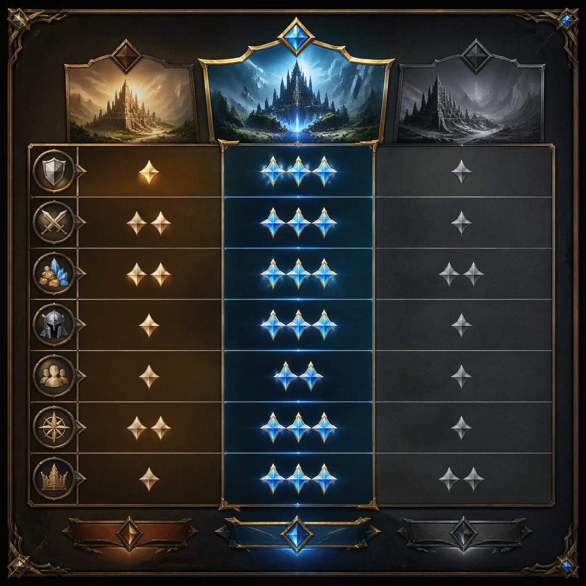

```text
Scene:
Create a square standalone support image for Product Comparison Benefit Board. Build a third support-surface study with a clear focal hierarchy and a finished professional surface. Use a polished modular board or campaign surface with clean spacing, premium game-UI finish, and clear focal hierarchy. The frame should feel self-contained and polished, with enough structure to explain the system even without the reference series, yet still obviously belonging to the same theme and production world.

Subject:
Show a coherent original game-art system built for premium production and marketing surfaces in a way that emphasizes the intended support surface. Keep the same system logic stable across screenshots, cards, banners, and overview boards. Even though this image is independent, the viewer should still recognize the same universe, same commercial logic, and same production intent as the core package.

Important details:
Lock framing, icon grammar, palette blocking, and surface hierarchy so the kit feels production-ready and consistent. Preserve the broader theme language through color, framing, material choices, and modular composition. Use clean panel rhythm, premium asset presentation, and believable detail density. The image should work equally well as a gallery study, research reference, and mock production deliverable.

Use case:
Product Comparison Benefit Board single study 7/9, exploring support three as a support surface.

Constraints:
No readable text, no watermark, no logos, preserve exact 1:1 aspect ratio, no unrelated objects, no broken visual hierarchy, no visual noise that obscures the main surface, no accidental brand resemblance.
```

[Pinned source](https://github.com/ChaosRealmsAI/gpt-image-2-gallery/blob/5296db8c996e38776c83a0bc8c64f848dcd512b3/works/topics/product-comparison-benefit-board/packages/single-support-studies/images/support-three/meta.json) · GPT Image2 · 1254×1254 · No source-declared image dependencies. · ProjectD:pending individual review.

## Support Four · product-comparison-benefit-board/single-support-studies/support-four

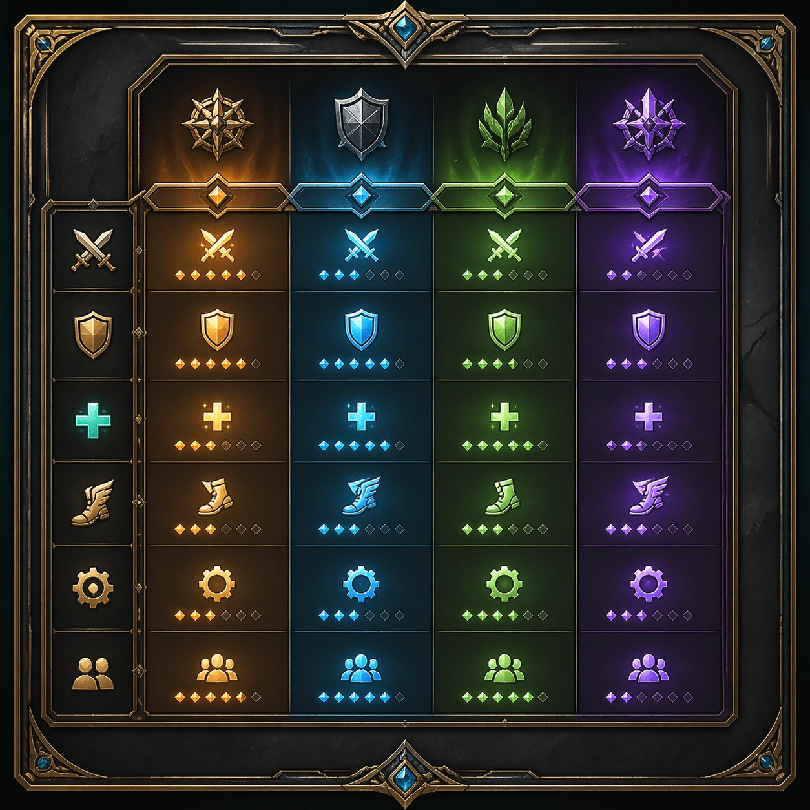

```text
Scene:
Create a square standalone support image for Product Comparison Benefit Board. Build a fourth support-surface study with a clear focal hierarchy and a finished professional surface. Use a polished modular board or campaign surface with clean spacing, premium game-UI finish, and clear focal hierarchy. The frame should feel self-contained and polished, with enough structure to explain the system even without the reference series, yet still obviously belonging to the same theme and production world.

Subject:
Show a coherent original game-art system built for premium production and marketing surfaces in a way that emphasizes the intended support surface. Keep the same system logic stable across screenshots, cards, banners, and overview boards. Even though this image is independent, the viewer should still recognize the same universe, same commercial logic, and same production intent as the core package.

Important details:
Lock framing, icon grammar, palette blocking, and surface hierarchy so the kit feels production-ready and consistent. Preserve the broader theme language through color, framing, material choices, and modular composition. Use clean panel rhythm, premium asset presentation, and believable detail density. The image should work equally well as a gallery study, research reference, and mock production deliverable.

Use case:
Product Comparison Benefit Board single study 8/9, exploring support four as a support surface.

Constraints:
No readable text, no watermark, no logos, preserve exact 1:1 aspect ratio, no unrelated objects, no broken visual hierarchy, no visual noise that obscures the main surface, no accidental brand resemblance.
```

[Pinned source](https://github.com/ChaosRealmsAI/gpt-image-2-gallery/blob/5296db8c996e38776c83a0bc8c64f848dcd512b3/works/topics/product-comparison-benefit-board/packages/single-support-studies/images/support-four/meta.json) · GPT Image2 · 1254×1254 · No source-declared image dependencies. · ProjectD:pending individual review.

## Support Five · product-comparison-benefit-board/single-support-studies/support-five

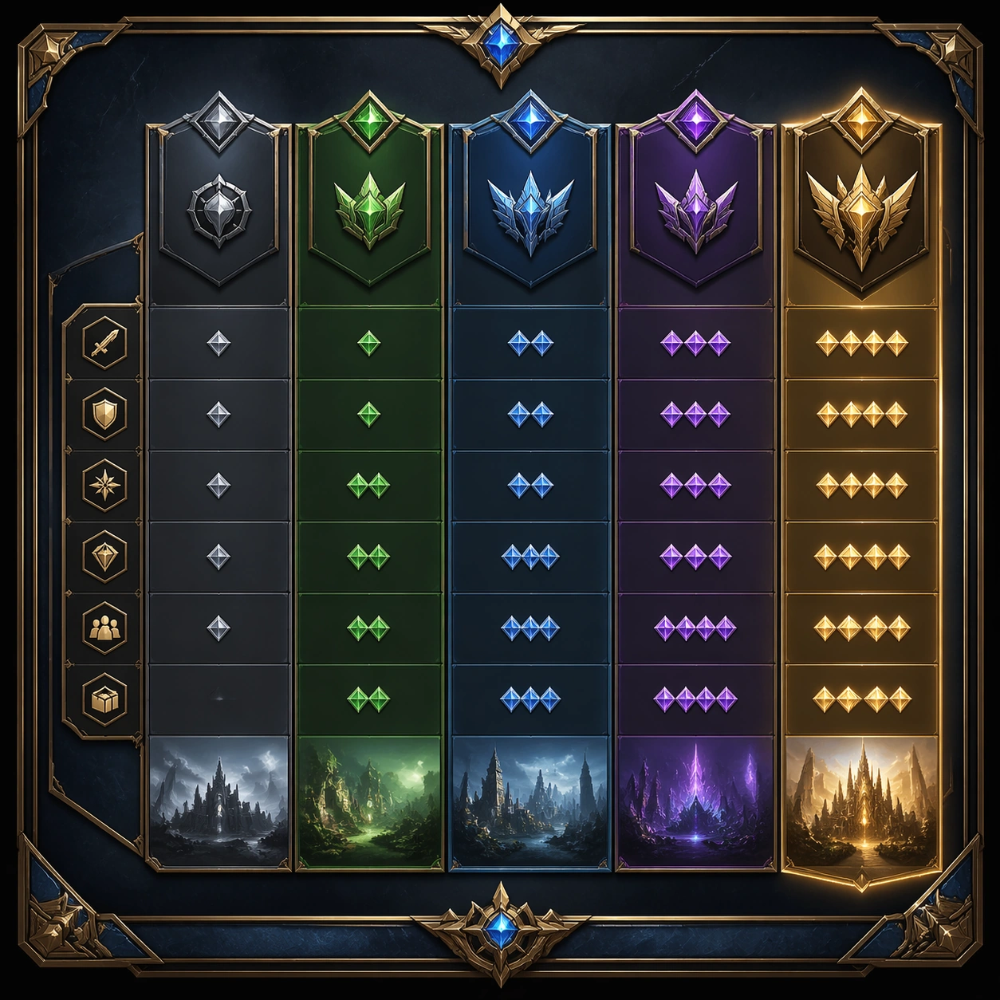

```text
Scene:
Create a square standalone support image for Product Comparison Benefit Board. Build a fifth support-surface study with a clear focal hierarchy and a finished professional surface. Use a polished modular board or campaign surface with clean spacing, premium game-UI finish, and clear focal hierarchy. The frame should feel self-contained and polished, with enough structure to explain the system even without the reference series, yet still obviously belonging to the same theme and production world.

Subject:
Show a coherent original game-art system built for premium production and marketing surfaces in a way that emphasizes the intended support surface. Keep the same system logic stable across screenshots, cards, banners, and overview boards. Even though this image is independent, the viewer should still recognize the same universe, same commercial logic, and same production intent as the core package.

Important details:
Lock framing, icon grammar, palette blocking, and surface hierarchy so the kit feels production-ready and consistent. Preserve the broader theme language through color, framing, material choices, and modular composition. Use clean panel rhythm, premium asset presentation, and believable detail density. The image should work equally well as a gallery study, research reference, and mock production deliverable.

Use case:
Product Comparison Benefit Board single study 9/9, exploring support five as a support surface.

Constraints:
No readable text, no watermark, no logos, preserve exact 1:1 aspect ratio, no unrelated objects, no broken visual hierarchy, no visual noise that obscures the main surface, no accidental brand resemblance.
```

[Pinned source](https://github.com/ChaosRealmsAI/gpt-image-2-gallery/blob/5296db8c996e38776c83a0bc8c64f848dcd512b3/works/topics/product-comparison-benefit-board/packages/single-support-studies/images/support-five/meta.json) · GPT Image2 · 1254×1254 · No source-declared image dependencies. · ProjectD:pending individual review.

## Hero Mockup · product-packaging-studio-mockup/single-product-packaging-studio-mockup-studies/hero-mockup


```text
Scene:
A square commercial presentation with realistic materials, clean staging, and believable product photography or retail lighting. Build the frame around a flagship hero setup that sells the overall system immediately. Keep the lighting, camera distance, and spatial organization tuned for a high-signal research image rather than a casual snapshot. The image belongs to the Product Packaging Studio Mockup theme and should feel immediately legible as a prompt atlas theme for product packaging studio mockup, testing photorealism, physics-materials, editing-workflow, commercial-mockup with gpt image 2..

Subject:
Center the study on a flagship hero setup that sells the overall system immediately. Translate the theme into a concrete visual statement instead of an abstract mood board: the viewer should understand what kind of image this is, what is being tested, and why the composition is difficult. Use the slug idea of product packaging studio mockup as a literal guide for subject matter, materials, and staging. If helpful, borrow the broad visual cues suggested by studio, but keep the result original and specific to this study.

Important details:
The mockup should feel saleable and design-ready: sharp edges, controlled reflections, credible paper or plastic behavior, and precise placement. Preserve a disciplined square composition, clear focal hierarchy, and enough secondary information to make the image feel complete rather than underspecified. The image should look polished, novel, and exhibition-ready, with topic-specific credibility coming from the way surfaces, structure, and visual language reinforce Product Packaging Studio Mockup. Avoid generic filler elements that do not serve the main concept.

Use case:
Product Packaging Studio Mockup single study 1/8, testing photorealism, physics-materials, editing-workflow, commercial-mockup through the hero mockup variation.

Constraints:
No readable text, no watermark, no logos, preserve exact 1:1 aspect ratio, no real brand names, no cheap stock-photo styling, no broken perspective, no watermark, no accidental readable packaging copy, no cluttered retail shelf unless intended.
```

[Pinned source](https://github.com/ChaosRealmsAI/gpt-image-2-gallery/blob/5296db8c996e38776c83a0bc8c64f848dcd512b3/works/topics/product-packaging-studio-mockup/packages/single-product-packaging-studio-mockup-studies/images/hero-mockup/meta.json) · GPT Image2 · 1254×1254 · No source-declared image dependencies. · ProjectD:pending individual review.

## Variant Grid · product-packaging-studio-mockup/single-product-packaging-studio-mockup-studies/variant-grid


```text
Scene:
A square commercial presentation with realistic materials, clean staging, and believable product photography or retail lighting. Build the frame around a disciplined family of variants presented as one product language. Keep the lighting, camera distance, and spatial organization tuned for a high-signal research image rather than a casual snapshot. The image belongs to the Product Packaging Studio Mockup theme and should feel immediately legible as a prompt atlas theme for product packaging studio mockup, testing photorealism, physics-materials, editing-workflow, commercial-mockup with gpt image 2..

Subject:
Center the study on a disciplined family of variants presented as one product language. Translate the theme into a concrete visual statement instead of an abstract mood board: the viewer should understand what kind of image this is, what is being tested, and why the composition is difficult. Use the slug idea of product packaging studio mockup as a literal guide for subject matter, materials, and staging. If helpful, borrow the broad visual cues suggested by studio, but keep the result original and specific to this study.

Important details:
The mockup should feel saleable and design-ready: sharp edges, controlled reflections, credible paper or plastic behavior, and precise placement. Preserve a disciplined square composition, clear focal hierarchy, and enough secondary information to make the image feel complete rather than underspecified. The image should look polished, novel, and exhibition-ready, with topic-specific credibility coming from the way surfaces, structure, and visual language reinforce Product Packaging Studio Mockup. Avoid generic filler elements that do not serve the main concept.

Use case:
Product Packaging Studio Mockup single study 2/8, testing photorealism, physics-materials, editing-workflow, commercial-mockup through the variant grid variation.

Constraints:
No readable text, no watermark, no logos, preserve exact 1:1 aspect ratio, no real brand names, no cheap stock-photo styling, no broken perspective, no watermark, no accidental readable packaging copy, no cluttered retail shelf unless intended.
```

[Pinned source](https://github.com/ChaosRealmsAI/gpt-image-2-gallery/blob/5296db8c996e38776c83a0bc8c64f848dcd512b3/works/topics/product-packaging-studio-mockup/packages/single-product-packaging-studio-mockup-studies/images/variant-grid/meta.json) · GPT Image2 · 1254×1254 · No source-declared image dependencies. · ProjectD:pending individual review.

## Desk Review · product-packaging-studio-mockup/single-product-packaging-studio-mockup-studies/desk-review

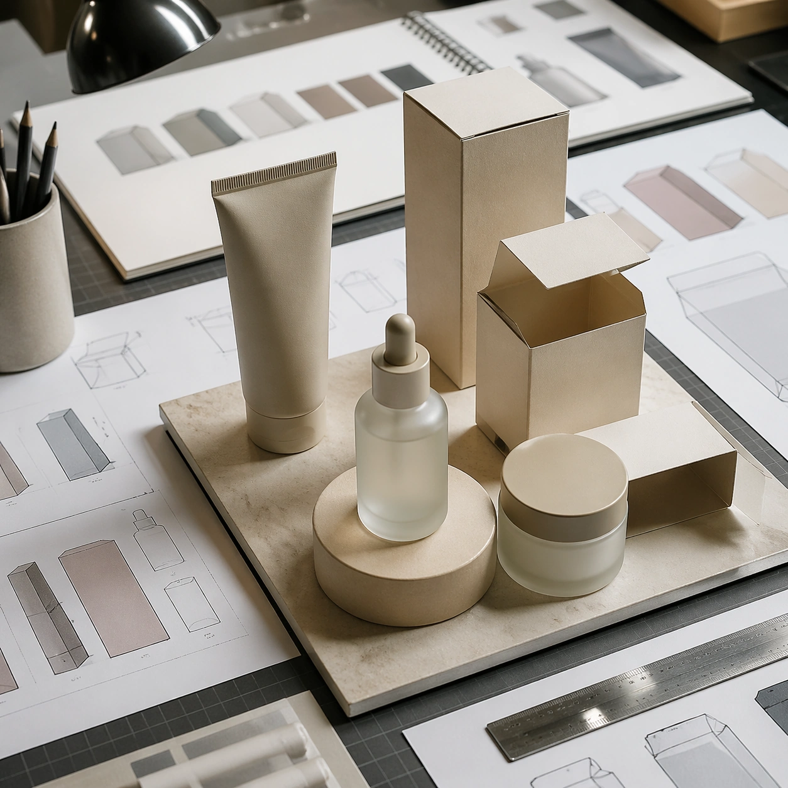

```text
Scene:
A square commercial presentation with realistic materials, clean staging, and believable product photography or retail lighting. Build the frame around the system reviewed on a designer’s table with believable supporting objects. Keep the lighting, camera distance, and spatial organization tuned for a high-signal research image rather than a casual snapshot. The image belongs to the Product Packaging Studio Mockup theme and should feel immediately legible as a prompt atlas theme for product packaging studio mockup, testing photorealism, physics-materials, editing-workflow, commercial-mockup with gpt image 2..

Subject:
Center the study on the system reviewed on a designer’s table with believable supporting objects. Translate the theme into a concrete visual statement instead of an abstract mood board: the viewer should understand what kind of image this is, what is being tested, and why the composition is difficult. Use the slug idea of product packaging studio mockup as a literal guide for subject matter, materials, and staging. If helpful, borrow the broad visual cues suggested by studio, but keep the result original and specific to this study.

Important details:
The mockup should feel saleable and design-ready: sharp edges, controlled reflections, credible paper or plastic behavior, and precise placement. Preserve a disciplined square composition, clear focal hierarchy, and enough secondary information to make the image feel complete rather than underspecified. The image should look polished, novel, and exhibition-ready, with topic-specific credibility coming from the way surfaces, structure, and visual language reinforce Product Packaging Studio Mockup. Avoid generic filler elements that do not serve the main concept.

Use case:
Product Packaging Studio Mockup single study 3/8, testing photorealism, physics-materials, editing-workflow, commercial-mockup through the desk review variation.

Constraints:
No readable text, no watermark, no logos, preserve exact 1:1 aspect ratio, no real brand names, no cheap stock-photo styling, no broken perspective, no watermark, no accidental readable packaging copy, no cluttered retail shelf unless intended.
```

[Pinned source](https://github.com/ChaosRealmsAI/gpt-image-2-gallery/blob/5296db8c996e38776c83a0bc8c64f848dcd512b3/works/topics/product-packaging-studio-mockup/packages/single-product-packaging-studio-mockup-studies/images/desk-review/meta.json) · GPT Image2 · 1254×1254 · No source-declared image dependencies. · ProjectD:pending individual review.

## Material Closeup · product-packaging-studio-mockup/single-product-packaging-studio-mockup-studies/material-closeup

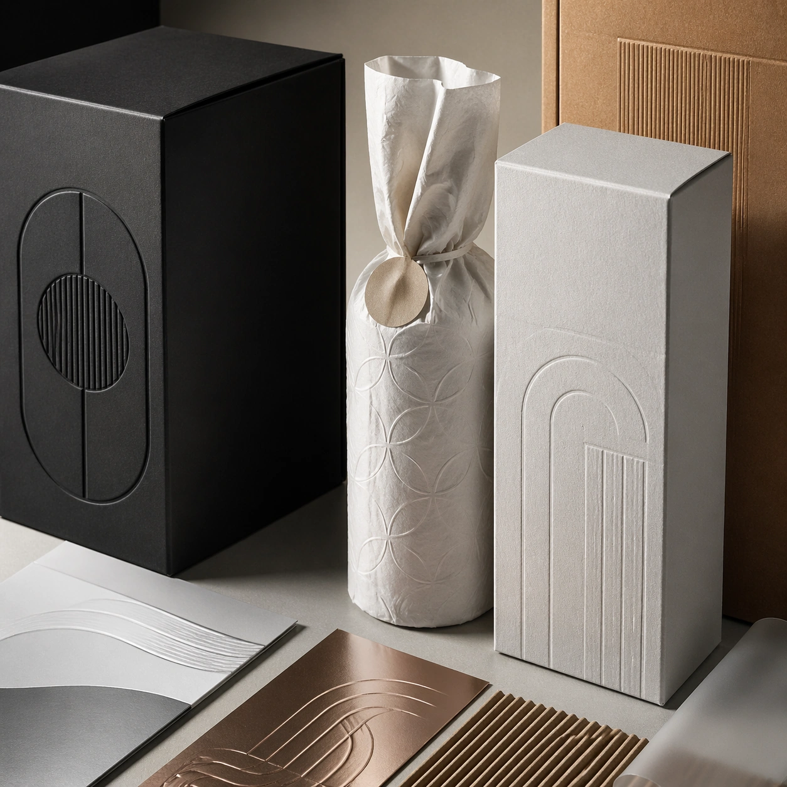

```text
Scene:
A square commercial presentation with realistic materials, clean staging, and believable product photography or retail lighting. Build the frame around tactile finish, emboss, print, foil, or substrate behavior. Keep the lighting, camera distance, and spatial organization tuned for a high-signal research image rather than a casual snapshot. The image belongs to the Product Packaging Studio Mockup theme and should feel immediately legible as a prompt atlas theme for product packaging studio mockup, testing photorealism, physics-materials, editing-workflow, commercial-mockup with gpt image 2..

Subject:
Center the study on tactile finish, emboss, print, foil, or substrate behavior. Translate the theme into a concrete visual statement instead of an abstract mood board: the viewer should understand what kind of image this is, what is being tested, and why the composition is difficult. Use the slug idea of product packaging studio mockup as a literal guide for subject matter, materials, and staging. If helpful, borrow the broad visual cues suggested by studio, but keep the result original and specific to this study.

Important details:
The mockup should feel saleable and design-ready: sharp edges, controlled reflections, credible paper or plastic behavior, and precise placement. Preserve a disciplined square composition, clear focal hierarchy, and enough secondary information to make the image feel complete rather than underspecified. The image should look polished, novel, and exhibition-ready, with topic-specific credibility coming from the way surfaces, structure, and visual language reinforce Product Packaging Studio Mockup. Avoid generic filler elements that do not serve the main concept.

Use case:
Product Packaging Studio Mockup single study 4/8, testing photorealism, physics-materials, editing-workflow, commercial-mockup through the material closeup variation.

Constraints:
No readable text, no watermark, no logos, preserve exact 1:1 aspect ratio, no real brand names, no cheap stock-photo styling, no broken perspective, no watermark, no accidental readable packaging copy, no cluttered retail shelf unless intended.
```

[Pinned source](https://github.com/ChaosRealmsAI/gpt-image-2-gallery/blob/5296db8c996e38776c83a0bc8c64f848dcd512b3/works/topics/product-packaging-studio-mockup/packages/single-product-packaging-studio-mockup-studies/images/material-closeup/meta.json) · GPT Image2 · 1254×1254 · No source-declared image dependencies. · ProjectD:pending individual review.

## Archive Proof · product-packaging-studio-mockup/single-product-packaging-studio-mockup-studies/archive-proof

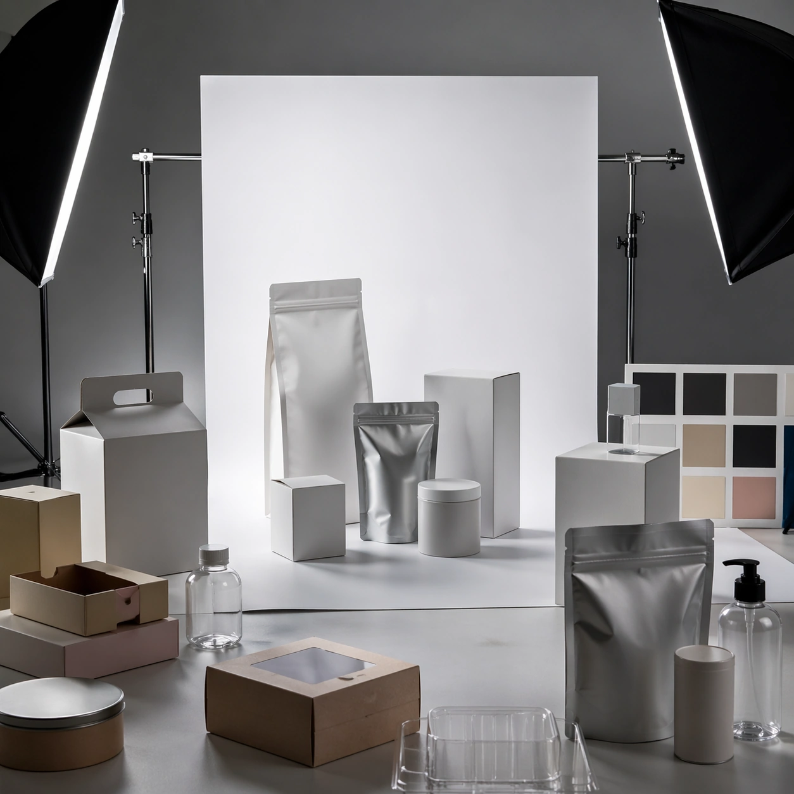

```text
Scene:
A square commercial presentation with realistic materials, clean staging, and believable product photography or retail lighting. Build the frame around proof-like presentation that emphasizes production precision. Keep the lighting, camera distance, and spatial organization tuned for a high-signal research image rather than a casual snapshot. The image belongs to the Product Packaging Studio Mockup theme and should feel immediately legible as a prompt atlas theme for product packaging studio mockup, testing photorealism, physics-materials, editing-workflow, commercial-mockup with gpt image 2..

Subject:
Center the study on proof-like presentation that emphasizes production precision. Translate the theme into a concrete visual statement instead of an abstract mood board: the viewer should understand what kind of image this is, what is being tested, and why the composition is difficult. Use the slug idea of product packaging studio mockup as a literal guide for subject matter, materials, and staging. If helpful, borrow the broad visual cues suggested by studio, but keep the result original and specific to this study.

Important details:
The mockup should feel saleable and design-ready: sharp edges, controlled reflections, credible paper or plastic behavior, and precise placement. Preserve a disciplined square composition, clear focal hierarchy, and enough secondary information to make the image feel complete rather than underspecified. The image should look polished, novel, and exhibition-ready, with topic-specific credibility coming from the way surfaces, structure, and visual language reinforce Product Packaging Studio Mockup. Avoid generic filler elements that do not serve the main concept.

Use case:
Product Packaging Studio Mockup single study 5/8, testing photorealism, physics-materials, editing-workflow, commercial-mockup through the archive proof variation.

Constraints:
No readable text, no watermark, no logos, preserve exact 1:1 aspect ratio, no real brand names, no cheap stock-photo styling, no broken perspective, no watermark, no accidental readable packaging copy, no cluttered retail shelf unless intended.
```

[Pinned source](https://github.com/ChaosRealmsAI/gpt-image-2-gallery/blob/5296db8c996e38776c83a0bc8c64f848dcd512b3/works/topics/product-packaging-studio-mockup/packages/single-product-packaging-studio-mockup-studies/images/archive-proof/meta.json) · GPT Image2 · 1254×1254 · No source-declared image dependencies. · ProjectD:pending individual review.

## Retail Shelf · product-packaging-studio-mockup/single-product-packaging-studio-mockup-studies/retail-shelf

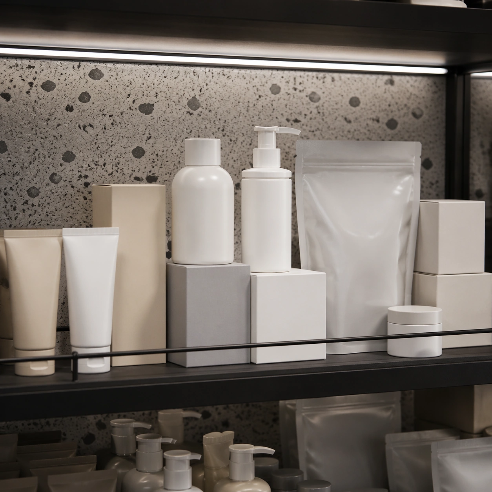

```text
Scene:
A square commercial presentation with realistic materials, clean staging, and believable product photography or retail lighting. Build the frame around a retail-context display that still keeps the product language primary. Keep the lighting, camera distance, and spatial organization tuned for a high-signal research image rather than a casual snapshot. The image belongs to the Product Packaging Studio Mockup theme and should feel immediately legible as a prompt atlas theme for product packaging studio mockup, testing photorealism, physics-materials, editing-workflow, commercial-mockup with gpt image 2..

Subject:
Center the study on a retail-context display that still keeps the product language primary. Translate the theme into a concrete visual statement instead of an abstract mood board: the viewer should understand what kind of image this is, what is being tested, and why the composition is difficult. Use the slug idea of product packaging studio mockup as a literal guide for subject matter, materials, and staging. If helpful, borrow the broad visual cues suggested by studio, but keep the result original and specific to this study.

Important details:
The mockup should feel saleable and design-ready: sharp edges, controlled reflections, credible paper or plastic behavior, and precise placement. Preserve a disciplined square composition, clear focal hierarchy, and enough secondary information to make the image feel complete rather than underspecified. The image should look polished, novel, and exhibition-ready, with topic-specific credibility coming from the way surfaces, structure, and visual language reinforce Product Packaging Studio Mockup. Avoid generic filler elements that do not serve the main concept.

Use case:
Product Packaging Studio Mockup single study 6/8, testing photorealism, physics-materials, editing-workflow, commercial-mockup through the retail shelf variation.

Constraints:
No readable text, no watermark, no logos, preserve exact 1:1 aspect ratio, no real brand names, no cheap stock-photo styling, no broken perspective, no watermark, no accidental readable packaging copy, no cluttered retail shelf unless intended.
```

[Pinned source](https://github.com/ChaosRealmsAI/gpt-image-2-gallery/blob/5296db8c996e38776c83a0bc8c64f848dcd512b3/works/topics/product-packaging-studio-mockup/packages/single-product-packaging-studio-mockup-studies/images/retail-shelf/meta.json) · GPT Image2 · 1254×1254 · No source-declared image dependencies. · ProjectD:pending individual review.

## System Board · product-packaging-studio-mockup/single-product-packaging-studio-mockup-studies/system-board

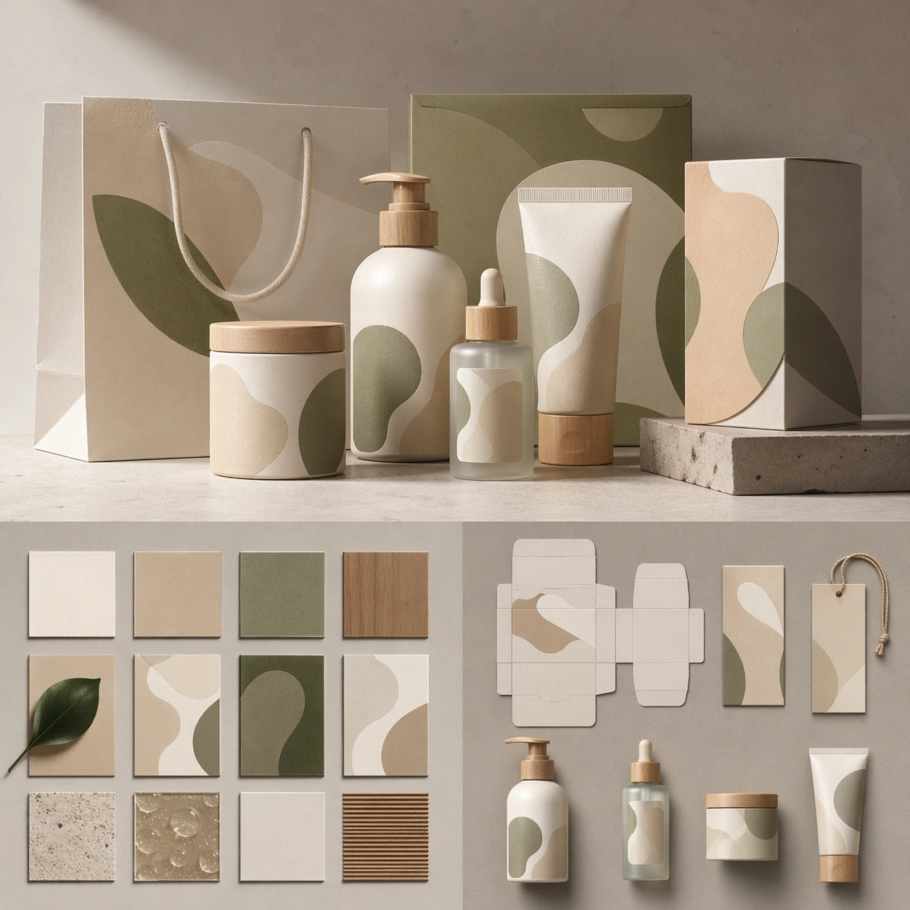

```text
Scene:
A square commercial presentation with realistic materials, clean staging, and believable product photography or retail lighting. Build the frame around multiple assets aligned into one coherent identity or packaging system. Keep the lighting, camera distance, and spatial organization tuned for a high-signal research image rather than a casual snapshot. The image belongs to the Product Packaging Studio Mockup theme and should feel immediately legible as a prompt atlas theme for product packaging studio mockup, testing photorealism, physics-materials, editing-workflow, commercial-mockup with gpt image 2..

Subject:
Center the study on multiple assets aligned into one coherent identity or packaging system. Translate the theme into a concrete visual statement instead of an abstract mood board: the viewer should understand what kind of image this is, what is being tested, and why the composition is difficult. Use the slug idea of product packaging studio mockup as a literal guide for subject matter, materials, and staging. If helpful, borrow the broad visual cues suggested by studio, but keep the result original and specific to this study.

Important details:
The mockup should feel saleable and design-ready: sharp edges, controlled reflections, credible paper or plastic behavior, and precise placement. Preserve a disciplined square composition, clear focal hierarchy, and enough secondary information to make the image feel complete rather than underspecified. The image should look polished, novel, and exhibition-ready, with topic-specific credibility coming from the way surfaces, structure, and visual language reinforce Product Packaging Studio Mockup. Avoid generic filler elements that do not serve the main concept.

Use case:
Product Packaging Studio Mockup single study 7/8, testing photorealism, physics-materials, editing-workflow, commercial-mockup through the system board variation.

Constraints:
No readable text, no watermark, no logos, preserve exact 1:1 aspect ratio, no real brand names, no cheap stock-photo styling, no broken perspective, no watermark, no accidental readable packaging copy, no cluttered retail shelf unless intended.
```

[Pinned source](https://github.com/ChaosRealmsAI/gpt-image-2-gallery/blob/5296db8c996e38776c83a0bc8c64f848dcd512b3/works/topics/product-packaging-studio-mockup/packages/single-product-packaging-studio-mockup-studies/images/system-board/meta.json) · GPT Image2 · 1254×1254 · No source-declared image dependencies. · ProjectD:pending individual review.

## Signature Mockup · product-packaging-studio-mockup/single-product-packaging-studio-mockup-studies/signature-mockup


```text
Scene:
A square commercial presentation with realistic materials, clean staging, and believable product photography or retail lighting. Build the frame around the strongest single commercial frame for the topic. Keep the lighting, camera distance, and spatial organization tuned for a high-signal research image rather than a casual snapshot. The image belongs to the Product Packaging Studio Mockup theme and should feel immediately legible as a prompt atlas theme for product packaging studio mockup, testing photorealism, physics-materials, editing-workflow, commercial-mockup with gpt image 2..

Subject:
Center the study on the strongest single commercial frame for the topic. Translate the theme into a concrete visual statement instead of an abstract mood board: the viewer should understand what kind of image this is, what is being tested, and why the composition is difficult. Use the slug idea of product packaging studio mockup as a literal guide for subject matter, materials, and staging. If helpful, borrow the broad visual cues suggested by studio, but keep the result original and specific to this study.

Important details:
The mockup should feel saleable and design-ready: sharp edges, controlled reflections, credible paper or plastic behavior, and precise placement. Preserve a disciplined square composition, clear focal hierarchy, and enough secondary information to make the image feel complete rather than underspecified. The image should look polished, novel, and exhibition-ready, with topic-specific credibility coming from the way surfaces, structure, and visual language reinforce Product Packaging Studio Mockup. Avoid generic filler elements that do not serve the main concept.

Use case:
Product Packaging Studio Mockup single study 8/8, testing photorealism, physics-materials, editing-workflow, commercial-mockup through the signature mockup variation.

Constraints:
No readable text, no watermark, no logos, preserve exact 1:1 aspect ratio, no real brand names, no cheap stock-photo styling, no broken perspective, no watermark, no accidental readable packaging copy, no cluttered retail shelf unless intended.
```

[Pinned source](https://github.com/ChaosRealmsAI/gpt-image-2-gallery/blob/5296db8c996e38776c83a0bc8c64f848dcd512b3/works/topics/product-packaging-studio-mockup/packages/single-product-packaging-studio-mockup-studies/images/signature-mockup/meta.json) · GPT Image2 · 1254×1254 · No source-declared image dependencies. · ProjectD:pending individual review.

## Reference Natural Base · profession-age-mood-transform-board/series-identity-switchboard/01-reference-natural-base


```text
Scene:
Create a square 1:1 portrait image for Profession Age Mood Transform Board. Use a clean approval-style studio portrait with neutral light, simple wardrobe, and enough facial visibility to lock identity perfectly. The frame should feel like a finished professional deliverable rather than a casual snapshot, with clear lens discipline, believable light falloff, and a palette that directly supports Push one identity through profession, age, and mood transformations without losing the core face, producing a believable character-styling matrix.. Keep enough surrounding space and compositional control for gallery, research, campaign, or approval-board reuse while staying photoreal and human-scaled.

Subject:
Center one identity-locked adult with warm beige skin, dark hair, intelligent eyes, and adaptable posture that can shift profession, age, and mood cues. Establish the exact same face, hair base, skin tone family, and body proportions that every transformation image must preserve. Use the example direction from the brief as grounding context: Push one identity through profession, age, and mood transformations without losing the core face, producing a believable character-styling matrix.. Wardrobe, lighting, environment, and pose may shift to serve this variation, but the viewer must immediately understand that the same reference identity is still in front of the camera.

Important details:
This backlog line is difficult because Push one identity through profession, age, and mood transformations without losing the core face, producing a believable character-styling matrix.. Preserve skin tone family, bone structure, eye spacing, nose shape, mouth shape, hairline logic, shoulder width, and overall body read across the entire series. preserve exact face / hair base / body proportions from the reference model. This baseline must read like the trustworthy approval frame before switching anything. Avoid the common failure described in the brief: ordinary image models often lose likeness once styling, lighting, or layout changes enter the frame. Success should feel like the result should feel professionally usable, coherent, and clearly built around one stable human identity.

Use case:
Profession Age Mood Transform Board series study 1/9, the natural baseline look.

Constraints:
No readable text, no watermark, no logos, preserve exact 1:1 aspect ratio, preserve exact face / hair base / body proportions from the reference model, no heavy styling, no logo wardrobe, no beauty filter, no extra subjects.
```

[Pinned source](https://github.com/ChaosRealmsAI/gpt-image-2-gallery/blob/5296db8c996e38776c83a0bc8c64f848dcd512b3/works/topics/profession-age-mood-transform-board/packages/series-identity-switchboard/images/01-reference-natural-base/meta.json) · GPT Image2 · 1254×1254 · No source-declared image dependencies. · ProjectD:pending individual review.

## Look Switch One · profession-age-mood-transform-board/series-identity-switchboard/02-look-switch-one


```text
Scene:
Create a square 1:1 portrait image for Profession Age Mood Transform Board. Use a premium portrait frame with one clear change direction and enough negative space to judge styling cleanly. The frame should feel like a finished professional deliverable rather than a casual snapshot, with clear lens discipline, believable light falloff, and a palette that directly supports Push one identity through profession, age, and mood transformations without losing the core face, producing a believable character-styling matrix.. Keep enough surrounding space and compositional control for gallery, research, campaign, or approval-board reuse while staying photoreal and human-scaled.

Subject:
Center one identity-locked adult with warm beige skin, dark hair, intelligent eyes, and adaptable posture that can shift profession, age, and mood cues. Keep the exact same person from the reference while executing the first major change requested by the topic, whether hair, makeup, wardrobe, grooming, or professional read. Use the example direction from the brief as grounding context: Push one identity through profession, age, and mood transformations without losing the core face, producing a believable character-styling matrix.. Wardrobe, lighting, environment, and pose may shift to serve this variation, but the viewer must immediately understand that the same reference identity is still in front of the camera.

Important details:
This backlog line is difficult because Push one identity through profession, age, and mood transformations without losing the core face, producing a believable character-styling matrix.. Preserve skin tone family, bone structure, eye spacing, nose shape, mouth shape, hairline logic, shoulder width, and overall body read across the entire series. preserve exact face / hair base / body proportions from the reference model. The switch must be obvious, but the identity must remain stronger than the styling change. Avoid the common failure described in the brief: ordinary image models often lose likeness once styling, lighting, or layout changes enter the frame. Success should feel like the result should feel professionally usable, coherent, and clearly built around one stable human identity.

Use case:
Profession Age Mood Transform Board series study 2/9, the first controlled transformation.

Constraints:
No readable text, no watermark, no logos, preserve exact 1:1 aspect ratio, preserve exact face / hair base / body proportions from the reference model, no face redraw, no changed age unless explicitly asked, no costume-party exaggeration, no new body shape.
```

[Pinned source](https://github.com/ChaosRealmsAI/gpt-image-2-gallery/blob/5296db8c996e38776c83a0bc8c64f848dcd512b3/works/topics/profession-age-mood-transform-board/packages/series-identity-switchboard/images/02-look-switch-one/meta.json) · GPT Image2 · 1254×1254 · Reference images required. · ProjectD:pending individual review.

## Look Switch Two · profession-age-mood-transform-board/series-identity-switchboard/03-look-switch-two


```text
Scene:
Create a square 1:1 portrait image for Profession Age Mood Transform Board. Use a square commercial portrait proof with similar camera logic and controlled light. The frame should feel like a finished professional deliverable rather than a casual snapshot, with clear lens discipline, believable light falloff, and a palette that directly supports Push one identity through profession, age, and mood transformations without losing the core face, producing a believable character-styling matrix.. Keep enough surrounding space and compositional control for gallery, research, campaign, or approval-board reuse while staying photoreal and human-scaled.

Subject:
Center one identity-locked adult with warm beige skin, dark hair, intelligent eyes, and adaptable posture that can shift profession, age, and mood cues. Preserve the same face and body while moving to a second transformation state that still feels plausible for the same person. Use the example direction from the brief as grounding context: Push one identity through profession, age, and mood transformations without losing the core face, producing a believable character-styling matrix.. Wardrobe, lighting, environment, and pose may shift to serve this variation, but the viewer must immediately understand that the same reference identity is still in front of the camera.

Important details:
This backlog line is difficult because Push one identity through profession, age, and mood transformations without losing the core face, producing a believable character-styling matrix.. Preserve skin tone family, bone structure, eye spacing, nose shape, mouth shape, hairline logic, shoulder width, and overall body read across the entire series. preserve exact face / hair base / body proportions from the reference model. Hairline logic, eye spacing, lip shape, and shoulder width must remain exact. Avoid the common failure described in the brief: ordinary image models often lose likeness once styling, lighting, or layout changes enter the frame. Success should feel like the result should feel professionally usable, coherent, and clearly built around one stable human identity.

Use case:
Profession Age Mood Transform Board series study 3/9, the second controlled transformation.

Constraints:
No readable text, no watermark, no logos, preserve exact 1:1 aspect ratio, preserve exact face / hair base / body proportions from the reference model, no hairstyle that changes skull shape, no enlarged eyes, no body morphing, no logo props.
```

[Pinned source](https://github.com/ChaosRealmsAI/gpt-image-2-gallery/blob/5296db8c996e38776c83a0bc8c64f848dcd512b3/works/topics/profession-age-mood-transform-board/packages/series-identity-switchboard/images/03-look-switch-two/meta.json) · GPT Image2 · 1254×1254 · Reference images required. · ProjectD:pending individual review.

## Look Switch Three · profession-age-mood-transform-board/series-identity-switchboard/04-look-switch-three


```text
Scene:
Create a square 1:1 portrait image for Profession Age Mood Transform Board. Use a slightly bolder campaign-like frame with disciplined crop and clean light falloff. The frame should feel like a finished professional deliverable rather than a casual snapshot, with clear lens discipline, believable light falloff, and a palette that directly supports Push one identity through profession, age, and mood transformations without losing the core face, producing a believable character-styling matrix.. Keep enough surrounding space and compositional control for gallery, research, campaign, or approval-board reuse while staying photoreal and human-scaled.

Subject:
Center one identity-locked adult with warm beige skin, dark hair, intelligent eyes, and adaptable posture that can shift profession, age, and mood cues. Apply a third styling direction while holding the same reference identity with no drift in age, ethnicity, or face structure. Use the example direction from the brief as grounding context: Push one identity through profession, age, and mood transformations without losing the core face, producing a believable character-styling matrix.. Wardrobe, lighting, environment, and pose may shift to serve this variation, but the viewer must immediately understand that the same reference identity is still in front of the camera.

Important details:
This backlog line is difficult because Push one identity through profession, age, and mood transformations without losing the core face, producing a believable character-styling matrix.. Preserve skin tone family, bone structure, eye spacing, nose shape, mouth shape, hairline logic, shoulder width, and overall body read across the entire series. preserve exact face / hair base / body proportions from the reference model. The image should prove range under control rather than spectacle for spectacle alone. Avoid the common failure described in the brief: ordinary image models often lose likeness once styling, lighting, or layout changes enter the frame. Success should feel like the result should feel professionally usable, coherent, and clearly built around one stable human identity.

Use case:
Profession Age Mood Transform Board series study 4/9, the third controlled transformation.

Constraints:
No readable text, no watermark, no logos, preserve exact 1:1 aspect ratio, preserve exact face / hair base / body proportions from the reference model, no gimmick costume, no false lashes that change eye shape, no surreal hair physics, no second person.
```

[Pinned source](https://github.com/ChaosRealmsAI/gpt-image-2-gallery/blob/5296db8c996e38776c83a0bc8c64f848dcd512b3/works/topics/profession-age-mood-transform-board/packages/series-identity-switchboard/images/04-look-switch-three/meta.json) · GPT Image2 · 1254×1254 · Reference images required. · ProjectD:pending individual review.

## Look Switch Four · profession-age-mood-transform-board/series-identity-switchboard/05-look-switch-four


```text
Scene:
Create a square 1:1 portrait image for Profession Age Mood Transform Board. Use a close or mid-shot portrait that privileges detail and approval clarity over background storytelling. The frame should feel like a finished professional deliverable rather than a casual snapshot, with clear lens discipline, believable light falloff, and a palette that directly supports Push one identity through profession, age, and mood transformations without losing the core face, producing a believable character-styling matrix.. Keep enough surrounding space and compositional control for gallery, research, campaign, or approval-board reuse while staying photoreal and human-scaled.

Subject:
Center one identity-locked adult with warm beige skin, dark hair, intelligent eyes, and adaptable posture that can shift profession, age, and mood cues. Keep the same exact subject while introducing another visible shift in style language, finish, or mood tied directly to the topic brief. Use the example direction from the brief as grounding context: Push one identity through profession, age, and mood transformations without losing the core face, producing a believable character-styling matrix.. Wardrobe, lighting, environment, and pose may shift to serve this variation, but the viewer must immediately understand that the same reference identity is still in front of the camera.

Important details:
This backlog line is difficult because Push one identity through profession, age, and mood transformations without losing the core face, producing a believable character-styling matrix.. Preserve skin tone family, bone structure, eye spacing, nose shape, mouth shape, hairline logic, shoulder width, and overall body read across the entire series. preserve exact face / hair base / body proportions from the reference model. Micro-details may change, but likeness, skin tone family, and body read cannot. Avoid the common failure described in the brief: ordinary image models often lose likeness once styling, lighting, or layout changes enter the frame. Success should feel like the result should feel professionally usable, coherent, and clearly built around one stable human identity.

Use case:
Profession Age Mood Transform Board series study 5/9, the fourth controlled transformation.

Constraints:
No readable text, no watermark, no logos, preserve exact 1:1 aspect ratio, preserve exact face / hair base / body proportions from the reference model, no retouch blur, no facial asymmetry drift, no extra accessories noise, no unreadable product text.
```

[Pinned source](https://github.com/ChaosRealmsAI/gpt-image-2-gallery/blob/5296db8c996e38776c83a0bc8c64f848dcd512b3/works/topics/profession-age-mood-transform-board/packages/series-identity-switchboard/images/05-look-switch-four/meta.json) · GPT Image2 · 1254×1254 · Reference images required. · ProjectD:pending individual review.

## Look Switch Five · profession-age-mood-transform-board/series-identity-switchboard/06-look-switch-five


```text
Scene:
Create a square 1:1 portrait image for Profession Age Mood Transform Board. Use a square portrait with polished commercial finish and enough room to see styling structure clearly. The frame should feel like a finished professional deliverable rather than a casual snapshot, with clear lens discipline, believable light falloff, and a palette that directly supports Push one identity through profession, age, and mood transformations without losing the core face, producing a believable character-styling matrix.. Keep enough surrounding space and compositional control for gallery, research, campaign, or approval-board reuse while staying photoreal and human-scaled.

Subject:
Center one identity-locked adult with warm beige skin, dark hair, intelligent eyes, and adaptable posture that can shift profession, age, and mood cues. Push to a fifth variation while preserving exact face / hair base / body proportions from the reference model. This should still feel like one person being art-directed, not re-generated from scratch. Use the example direction from the brief as grounding context: Push one identity through profession, age, and mood transformations without losing the core face, producing a believable character-styling matrix.. Wardrobe, lighting, environment, and pose may shift to serve this variation, but the viewer must immediately understand that the same reference identity is still in front of the camera.

Important details:
This backlog line is difficult because Push one identity through profession, age, and mood transformations without losing the core face, producing a believable character-styling matrix.. Preserve skin tone family, bone structure, eye spacing, nose shape, mouth shape, hairline logic, shoulder width, and overall body read across the entire series. preserve exact face / hair base / body proportions from the reference model. Keep continuity stronger than novelty. Avoid the common failure described in the brief: ordinary image models often lose likeness once styling, lighting, or layout changes enter the frame. Success should feel like the result should feel professionally usable, coherent, and clearly built around one stable human identity.

Use case:
Profession Age Mood Transform Board series study 6/9, the fifth controlled transformation.

Constraints:
No readable text, no watermark, no logos, preserve exact 1:1 aspect ratio, preserve exact face / hair base / body proportions from the reference model, no gender drift unless explicitly relevant, no unrelated props, no costume confusion, no body-scale jump.
```

[Pinned source](https://github.com/ChaosRealmsAI/gpt-image-2-gallery/blob/5296db8c996e38776c83a0bc8c64f848dcd512b3/works/topics/profession-age-mood-transform-board/packages/series-identity-switchboard/images/06-look-switch-five/meta.json) · GPT Image2 · 1254×1254 · Reference images required. · ProjectD:pending individual review.

## Look Switch Six · profession-age-mood-transform-board/series-identity-switchboard/07-look-switch-six


```text
Scene:
Create a square 1:1 portrait image for Profession Age Mood Transform Board. Use a final single-look variation with confident but restrained campaign polish. The frame should feel like a finished professional deliverable rather than a casual snapshot, with clear lens discipline, believable light falloff, and a palette that directly supports Push one identity through profession, age, and mood transformations without losing the core face, producing a believable character-styling matrix.. Keep enough surrounding space and compositional control for gallery, research, campaign, or approval-board reuse while staying photoreal and human-scaled.

Subject:
Center one identity-locked adult with warm beige skin, dark hair, intelligent eyes, and adaptable posture that can shift profession, age, and mood cues. Use the same person again in a sixth styling state, making sure recognition is instant before the viewer notices what changed. Use the example direction from the brief as grounding context: Push one identity through profession, age, and mood transformations without losing the core face, producing a believable character-styling matrix.. Wardrobe, lighting, environment, and pose may shift to serve this variation, but the viewer must immediately understand that the same reference identity is still in front of the camera.

Important details:
This backlog line is difficult because Push one identity through profession, age, and mood transformations without losing the core face, producing a believable character-styling matrix.. Preserve skin tone family, bone structure, eye spacing, nose shape, mouth shape, hairline logic, shoulder width, and overall body read across the entire series. preserve exact face / hair base / body proportions from the reference model. The transformation should feel deliberate, premium, and usable in a real salon, beauty, fashion, or casting workflow. Avoid the common failure described in the brief: ordinary image models often lose likeness once styling, lighting, or layout changes enter the frame. Success should feel like the result should feel professionally usable, coherent, and clearly built around one stable human identity.

Use case:
Profession Age Mood Transform Board series study 7/9, the sixth controlled transformation.

Constraints:
No readable text, no watermark, no logos, preserve exact 1:1 aspect ratio, preserve exact face / hair base / body proportions from the reference model, no hidden face, no perspective warp, no dramatic environment change, no AI-gloss artifacts.
```

[Pinned source](https://github.com/ChaosRealmsAI/gpt-image-2-gallery/blob/5296db8c996e38776c83a0bc8c64f848dcd512b3/works/topics/profession-age-mood-transform-board/packages/series-identity-switchboard/images/07-look-switch-six/meta.json) · GPT Image2 · 1254×1254 · Reference images required. · ProjectD:pending individual review.

## Detail Proof Board · profession-age-mood-transform-board/series-identity-switchboard/08-detail-proof-board

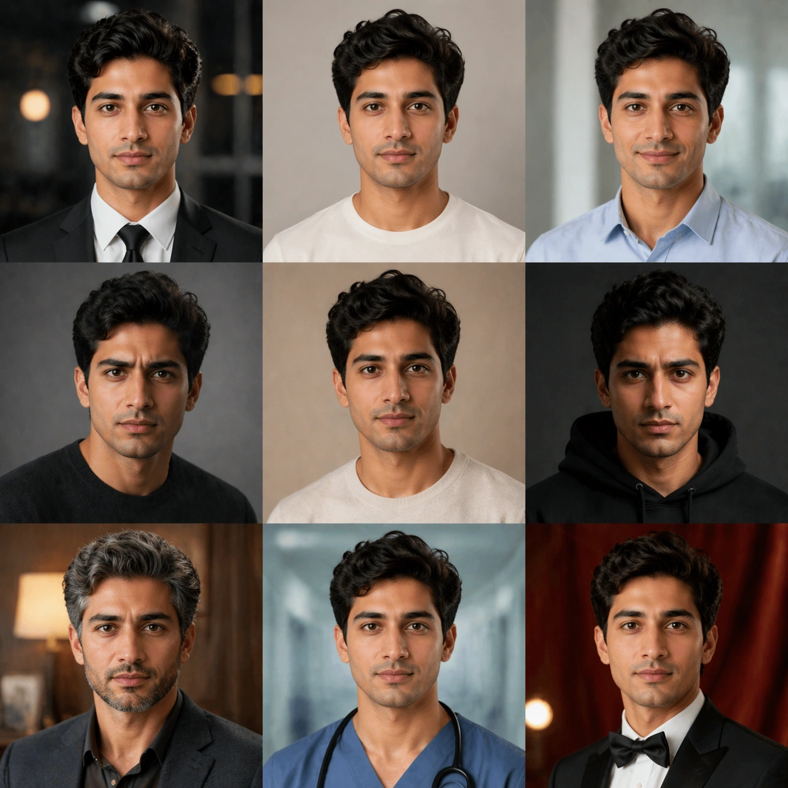

```text
Scene:
Create a square 1:1 portrait image for Profession Age Mood Transform Board. Use a square composition that can include multiple tight crops or one richer close-up, but still reads as one coherent portrait asset. The frame should feel like a finished professional deliverable rather than a casual snapshot, with clear lens discipline, believable light falloff, and a palette that directly supports Push one identity through profession, age, and mood transformations without losing the core face, producing a believable character-styling matrix.. Keep enough surrounding space and compositional control for gallery, research, campaign, or approval-board reuse while staying photoreal and human-scaled.

Subject:
Center one identity-locked adult with warm beige skin, dark hair, intelligent eyes, and adaptable posture that can shift profession, age, and mood cues. Stay locked to the same identity while emphasizing the evidence of the switch: hair texture, makeup finish, beard line, garment detail, or aging cues depending on the topic. Use the example direction from the brief as grounding context: Push one identity through profession, age, and mood transformations without losing the core face, producing a believable character-styling matrix.. Wardrobe, lighting, environment, and pose may shift to serve this variation, but the viewer must immediately understand that the same reference identity is still in front of the camera.

Important details:
This backlog line is difficult because Push one identity through profession, age, and mood transformations without losing the core face, producing a believable character-styling matrix.. Preserve skin tone family, bone structure, eye spacing, nose shape, mouth shape, hairline logic, shoulder width, and overall body read across the entire series. preserve exact face / hair base / body proportions from the reference model. This frame should support professional review and decision making without readable text. Avoid the common failure described in the brief: ordinary image models often lose likeness once styling, lighting, or layout changes enter the frame. Success should feel like the result should feel professionally usable, coherent, and clearly built around one stable human identity.

Use case:
Profession Age Mood Transform Board series study 8/9, a detail-proof or comparison board.

Constraints:
No readable text, no watermark, no logos, preserve exact 1:1 aspect ratio, preserve exact face / hair base / body proportions from the reference model, no readable labels, no broken panel alignment, no detached close-up fragments, no face drift.
```

[Pinned source](https://github.com/ChaosRealmsAI/gpt-image-2-gallery/blob/5296db8c996e38776c83a0bc8c64f848dcd512b3/works/topics/profession-age-mood-transform-board/packages/series-identity-switchboard/images/08-detail-proof-board/meta.json) · GPT Image2 · 1254×1254 · Reference images required. · ProjectD:pending individual review.

## Campaign Finale · profession-age-mood-transform-board/series-identity-switchboard/09-campaign-finale

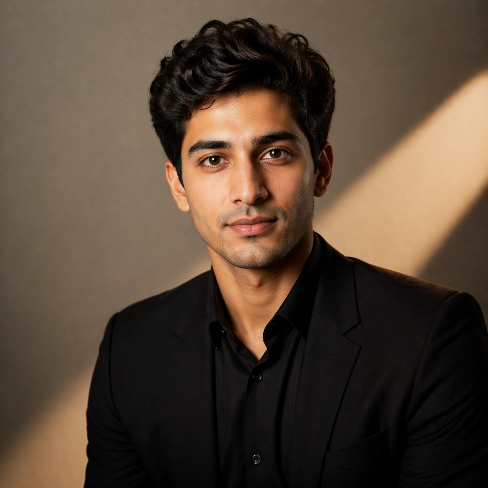

```text
Scene:
Create a square 1:1 portrait image for Profession Age Mood Transform Board. Use a square commercial finish with strong portrait presence, premium negative space, and final-asset confidence. The frame should feel like a finished professional deliverable rather than a casual snapshot, with clear lens discipline, believable light falloff, and a palette that directly supports Push one identity through profession, age, and mood transformations without losing the core face, producing a believable character-styling matrix.. Keep enough surrounding space and compositional control for gallery, research, campaign, or approval-board reuse while staying photoreal and human-scaled.

Subject:
Center one identity-locked adult with warm beige skin, dark hair, intelligent eyes, and adaptable posture that can shift profession, age, and mood cues. Resolve the same identity into a final hero image that proves the transformation line can ship as a real campaign, promo board, or salon approval visual. Use the example direction from the brief as grounding context: Push one identity through profession, age, and mood transformations without losing the core face, producing a believable character-styling matrix.. Wardrobe, lighting, environment, and pose may shift to serve this variation, but the viewer must immediately understand that the same reference identity is still in front of the camera.

Important details:
This backlog line is difficult because Push one identity through profession, age, and mood transformations without losing the core face, producing a believable character-styling matrix.. Preserve skin tone family, bone structure, eye spacing, nose shape, mouth shape, hairline logic, shoulder width, and overall body read across the entire series. preserve exact face / hair base / body proportions from the reference model. The final degree of polish cannot erase the exact same-person read established in image 01. Avoid the common failure described in the brief: ordinary image models often lose likeness once styling, lighting, or layout changes enter the frame. Success should feel like the result should feel professionally usable, coherent, and clearly built around one stable human identity.

Use case:
Profession Age Mood Transform Board series study 9/9, a polished campaign finale.

Constraints:
No readable text, no watermark, no logos, preserve exact 1:1 aspect ratio, preserve exact face / hair base / body proportions from the reference model, no readable copy, no logos, no poster clutter, no identity reset.
```

[Pinned source](https://github.com/ChaosRealmsAI/gpt-image-2-gallery/blob/5296db8c996e38776c83a0bc8c64f848dcd512b3/works/topics/profession-age-mood-transform-board/packages/series-identity-switchboard/images/09-campaign-finale/meta.json) · GPT Image2 · 1254×1254 · Reference images required. · ProjectD:pending individual review.

## Civic Recruitment Hand · propaganda-poster-history/single-poster-history-studies/02-civic-recruitment-hand

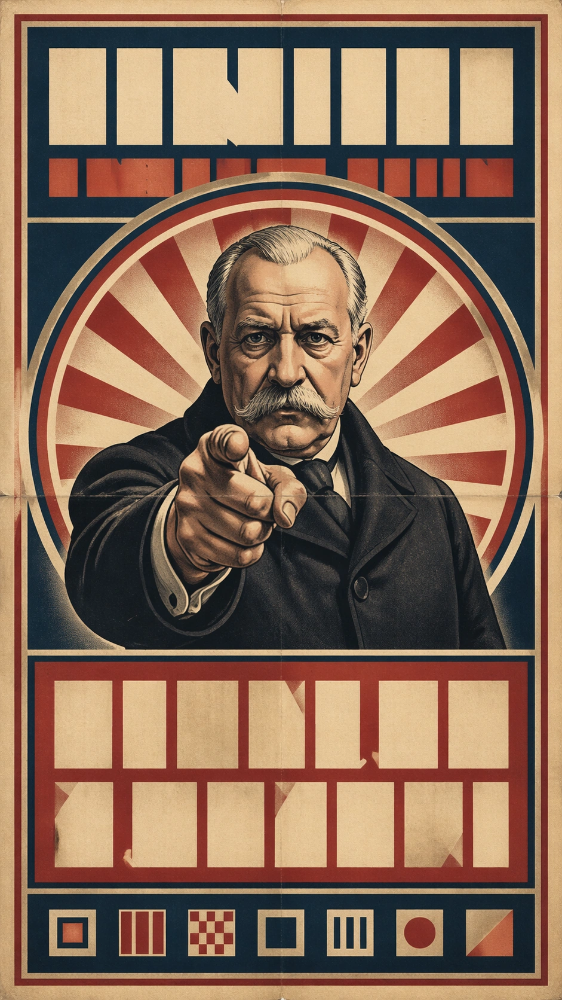

```text
Scene:
A vertical 9:16 fictional museum-study poster inspired by early twentieth-century wartime civic recruitment design, using cream paper, navy blue, muted red, and aged lithographic ink. The composition centers on a pointing hand and direct frontal gaze, but all headline and footer areas are filled with unreadable block-letter placeholders. The poster should feel historically recognizable as a design language study without recruiting for any real cause.

Subject:
An invented older civic figure in a plain dark coat points outward from the center, framed by a circular burst and stacked border bands. The face is generic and not a real person; no national flags, official seals, military insignia, or actual campaign marks appear. The lower half contains a large blank slogan band rendered as non-readable lettering shapes and a row of small abstract poster-registration marks. Paper wear, fold creases, and offset ink texture are visible.

Important details:
Capture the poster grammar: frontal address, commanding hand gesture, strong eye contact, centered figure, thick headline band, restrained patriotic-era palette, and lithographic texture. Keep the invented figure respectful and non-caricatured. The visual power should come from composition and historical design conventions, not from readable persuasion. Make the text fields look deliberately placed, but prevent any actual words, numbers, or recognizable slogans from forming.

Use case:
Propaganda Poster History single study 2/8, an independent civic recruitment poster-language specimen for design-history comparison.

Constraints:
No readable text, no watermark, no logos, preserve exact 9:16 vertical aspect ratio, no real flags, no real military insignia, no actual recruitment slogan, no real public figure likeness, no modern political reference.
```

[Pinned source](https://github.com/ChaosRealmsAI/gpt-image-2-gallery/blob/5296db8c996e38776c83a0bc8c64f848dcd512b3/works/topics/propaganda-poster-history/packages/single-poster-history-studies/images/02-civic-recruitment-hand/meta.json) · GPT Image2 · 941×1672 · No source-declared image dependencies. · ProjectD:pending individual review.

## Industrial Harvest Mural · propaganda-poster-history/single-poster-history-studies/03-industrial-harvest-mural

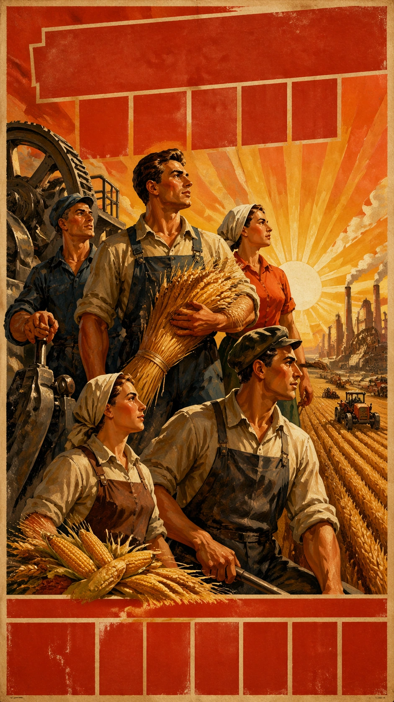

```text
Scene:
A vertical 9:16 fictional poster study inspired by mid-century socialist realist agricultural and industrial mural language. The page has a heroic low angle, warm sunrise, red-orange sky, golden grain, steel machinery, and thick painted brush texture. Large banner-like type fields sit at the top and bottom as unreadable block shapes, aged by paper fibers and offset ink. The result should read as educational visual-history reconstruction, not a real political message.

Subject:
A group of invented workers and farmers stand together in a sweeping composition: one person holds a sheaf of grain, another guides a factory lever, another looks toward distant tractors and chimneys. Their clothing is simplified workwear without real badges, flags, or party emblems. The faces are idealized but generic. Industrial wheels and harvest rows converge behind them, linking agriculture and factory production in one theatrical poster image.

Important details:
Emphasize the visual grammar of socialist-realist poster art: heroic upward gaze, muscular silhouettes, red-gold palette, sunrise symbolism, synchronized bodies, monumental scale, painterly realism, and strong central hierarchy. Keep every political identifier fictional or absent. The headline fields should look historically plausible but remain unreadable. Avoid copying any known poster or depicting a real leader. The subject is style-transfer and world-knowledge research.

Use case:
Propaganda Poster History single study 3/8, an independent industrial-harvest poster-language specimen for design-history comparison.

Constraints:
No readable text, no watermark, no logos, preserve exact 9:16 vertical aspect ratio, no real party symbols, no real leader likeness, no actual slogan, no national flags, no contemporary political reference.
```

[Pinned source](https://github.com/ChaosRealmsAI/gpt-image-2-gallery/blob/5296db8c996e38776c83a0bc8c64f848dcd512b3/works/topics/propaganda-poster-history/packages/single-poster-history-studies/images/03-industrial-harvest-mural/meta.json) · GPT Image2 · 941×1672 · No source-declared image dependencies. · ProjectD:pending individual review.

## Revolution Portrait Study · propaganda-poster-history/single-poster-history-studies/04-revolution-portrait-study

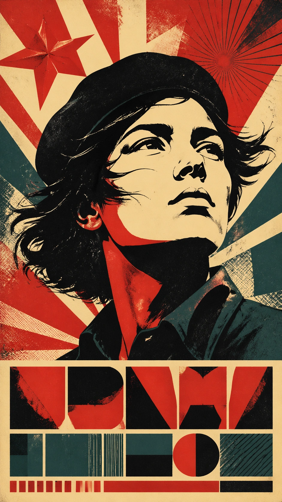

```text
Scene:
A vertical 9:16 fictional poster study inspired by high-contrast revolutionary portrait screenprints and mid-century Latin American graphic poster traditions. The paper is rough, ink is limited to black, red, cream, and deep teal, and the composition uses a single monumental head, radiating background shapes, and a lower block of unreadable title forms. It should look like a museum-safe style study, not a real movement poster.

Subject:
An invented anonymous young organizer wearing a plain dark beret appears in a bold graphic portrait. The face is not based on any real person and avoids recognizable historical likeness. Wind-shifted hair, a stern upward gaze, and simplified facial planes create an iconic poster silhouette. Behind the portrait are abstract stars, sunburst shards, and screenprint misregistration, but no real flags, names, party emblems, weapons, or actual slogans.

Important details:
Capture the design grammar often associated with revolutionary portrait posters: flat high-contrast face planes, limited ink palette, heroic upward gaze, hard poster crop, visible screenprint texture, and strong title block hierarchy. The type areas must look intentionally designed but remain unreadable. Keep the work fictional and educational; do not reproduce famous portraits, real leaders, real symbols, or specific campaign names. The image should support visual-history analysis of style transfer and structured layout.

Use case:
Propaganda Poster History single study 4/8, an independent revolutionary portrait poster-language specimen for design-history comparison.

Constraints:
No readable text, no watermark, no logos, preserve exact 9:16 vertical aspect ratio, no real leader likeness, no real party symbols, no actual slogan, no weapons, no contemporary political reference.
```

[Pinned source](https://github.com/ChaosRealmsAI/gpt-image-2-gallery/blob/5296db8c996e38776c83a0bc8c64f848dcd512b3/works/topics/propaganda-poster-history/packages/single-poster-history-studies/images/04-revolution-portrait-study/meta.json) · GPT Image2 · 941×1672 · No source-declared image dependencies. · ProjectD:pending individual review.

## Space Race Optimism · propaganda-poster-history/single-poster-history-studies/05-space-race-optimism

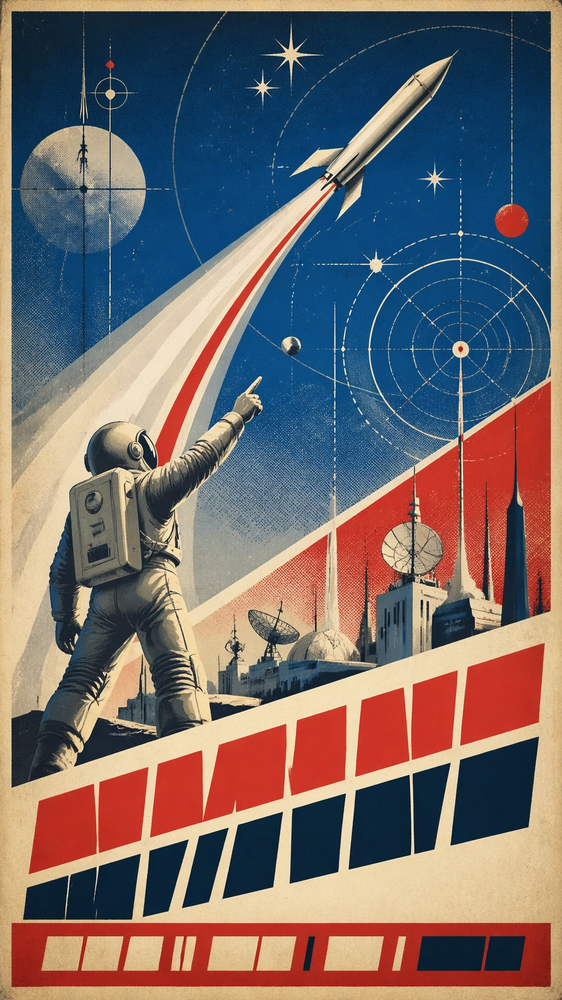

```text
Scene:
A vertical 9:16 fictional poster study inspired by mid-century space-race optimism and state science promotion graphics. The design uses deep cobalt, bright red, cream, silver, and aged offset texture. A rocket arc cuts upward through geometric stars, while large unreadable headline blocks occupy a diagonal band and a footer strip. The poster should feel like a historical design artifact for classroom analysis, not a real national campaign.

Subject:
An invented astronaut-like figure in a simplified pressure suit points toward a stylized orbit path above a city of antennas, observatories, and abstract industrial roofs. The rocket is generic, with no national insignia, agency logos, real mission markings, flags, or readable numbers. The figure's face is obscured by a reflective visor. Concentric orbital lines, starbursts, and technical diagram circles create a sense of scientific progress.

Important details:
Emphasize historical poster cues: space-age geometry, optimistic upward diagonals, simplified industrial skyline, flat color separations, halftone grain, registration shifts, and bold typography fields. The type blocks should be visually convincing but unreadable. Do not include real mission patches, specific spacecraft names, or identifiable political symbols. The image should test world-knowledge style transfer, structured layout, and poster hierarchy while staying fictional and non-persuasive.

Use case:
Propaganda Poster History single study 5/8, an independent space-race poster-language specimen for design-history comparison.

Constraints:
No readable text, no watermark, no logos, preserve exact 9:16 vertical aspect ratio, no real space agency marks, no national flags, no actual slogan, no real leader likeness, no contemporary political reference.
```

[Pinned source](https://github.com/ChaosRealmsAI/gpt-image-2-gallery/blob/5296db8c996e38776c83a0bc8c64f848dcd512b3/works/topics/propaganda-poster-history/packages/single-poster-history-studies/images/05-space-race-optimism/meta.json) · GPT Image2 · 941×1672 · No source-declared image dependencies. · ProjectD:pending individual review.

## Public Health Modernist · propaganda-poster-history/single-poster-history-studies/06-public-health-modernist

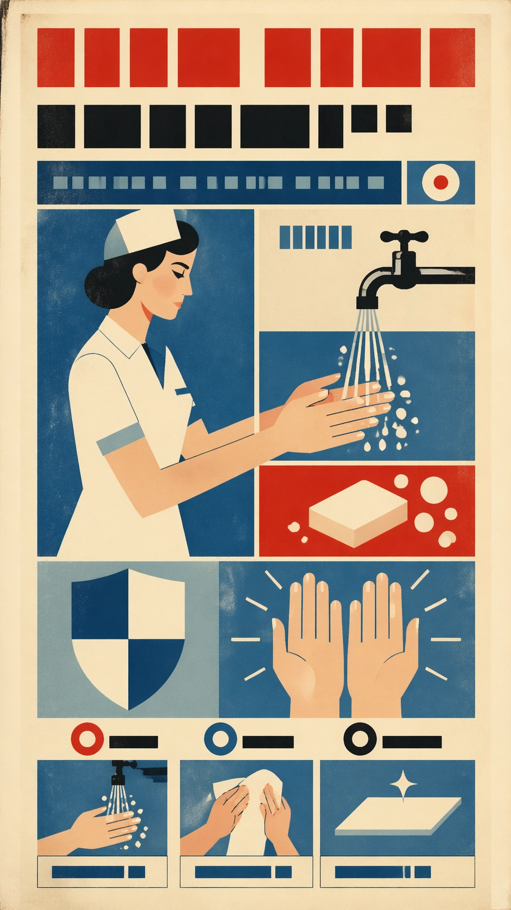

```text
Scene:
A vertical 9:16 fictional public-health poster study inspired by international modernist information campaigns from the mid twentieth century. The style is clean and didactic: flat pastel background, limited red, blue, black, and cream palette, strong grid, simplified pictograms, and a prominent headline field made from unreadable block shapes. The poster should read as historical visual communication research, not as current medical advice.

Subject:
A simplified nurse-like figure, water faucet, soap, clean hands, and a shield-like abstract shape are arranged in a modernist grid. The figures are invented and generic, with no real health agency emblem, no medical logo, no country symbol, and no actual instruction text. The bottom area contains small diagram panels showing washing, drying, and clean surface icons, but all labels are blank bars or pseudo-letter marks.

Important details:
Focus on structured-layout and text-field discipline: modular grid, clear pictogram hierarchy, high-contrast headline area, numbered-looking circles that are not readable numbers, and subtle vintage print grain. Preserve the design-history angle by using period-appropriate flat shapes and lithographic texture. Avoid modern app UI, contemporary public-health slogans, or realistic disease imagery. The poster should be safe, fictional, and analytical rather than prescriptive.

Use case:
Propaganda Poster History single study 6/8, an independent modernist public-health poster-language specimen for design-history comparison.

Constraints:
No readable text, no watermark, no logos, preserve exact 9:16 vertical aspect ratio, no real health agency marks, no actual medical instruction, no current public-policy slogan, no national flag, no frightening disease imagery.
```

[Pinned source](https://github.com/ChaosRealmsAI/gpt-image-2-gallery/blob/5296db8c996e38776c83a0bc8c64f848dcd512b3/works/topics/propaganda-poster-history/packages/single-poster-history-studies/images/06-public-health-modernist/meta.json) · GPT Image2 · 941×1672 · No source-declared image dependencies. · ProjectD:pending individual review.

## Woodcut Crowd March · propaganda-poster-history/single-poster-history-studies/07-woodcut-crowd-march

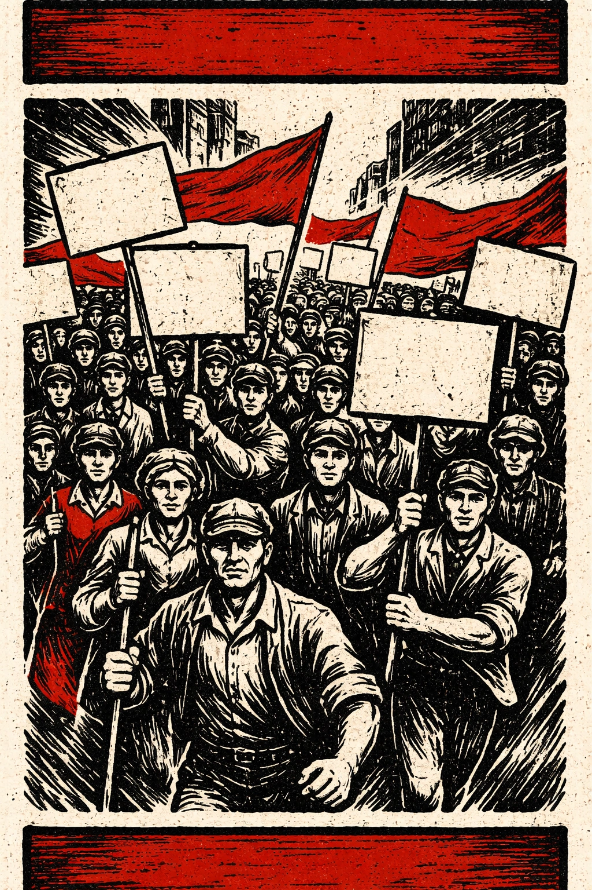

```text
Scene:
A vertical 9:16 fictional poster study inspired by twentieth-century political woodcut and mass-movement print traditions. The page uses rough black ink, red spot color, cream paper, carved line texture, and a high-contrast crowd composition. The headline and side-caption fields are rendered as unreadable carved blocks, keeping the focus on historical print language rather than actual persuasion.

Subject:
A group of anonymous workers, students, and villagers march through a simplified street, each holding blank banners or abstract rectangular placards with no readable marks. The people are invented, not based on real leaders or specific organizations. Their faces are simplified by woodcut marks, with varied ages and clothing but no real emblems, flags, party badges, or national symbols. The central gesture is collective movement, not a call to a real action.

Important details:
Emphasize carved print materiality: gouged black lines, uneven red overprint, rough paper tooth, strong diagonals, stacked silhouettes, simplified hands, and poster hierarchy. The composition should demonstrate how woodcut visual language builds urgency through rhythm and contrast. Keep all banners blank or filled with non-readable texture. Do not include real slogans, real historical leaders, or modern protest references. This is a design-history specimen.

Use case:
Propaganda Poster History single study 7/8, an independent woodcut crowd poster-language specimen for design-history comparison.

Constraints:
No readable text, no watermark, no logos, preserve exact 9:16 vertical aspect ratio, no real party symbols, no real leader likeness, no actual protest slogan, no national flags, no contemporary political reference.
```

[Pinned source](https://github.com/ChaosRealmsAI/gpt-image-2-gallery/blob/5296db8c996e38776c83a0bc8c64f848dcd512b3/works/topics/propaganda-poster-history/packages/single-poster-history-studies/images/07-woodcut-crowd-march/meta.json) · GPT Image2 · 1024×1536 · No source-declared image dependencies. · ProjectD:pending individual review.

## Civil Defense Broadcast · propaganda-poster-history/single-poster-history-studies/08-civil-defense-broadcast

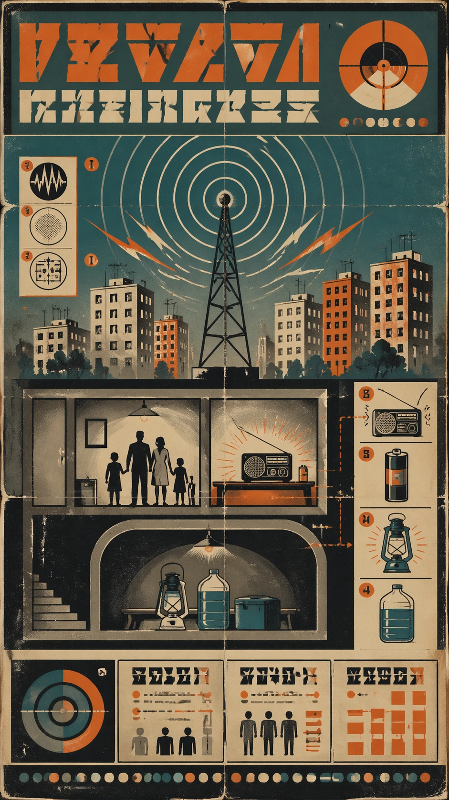

```text
Scene:
A vertical 9:16 fictional poster study inspired by mid-century civil-defense and broadcast-information graphics. The palette is faded teal, orange, black, cream, and gray, with screenprint grain, folded paper creases, and modular diagram panels. A large headline region at the top and a footer instruction strip are filled with unreadable pseudo-letter blocks. The poster must feel like a historical museum artifact, not present-day emergency guidance.

Subject:
A generic radio tower emits concentric signal rings over a simplified city cutaway: apartment blocks, basement shelter icon, family silhouettes, battery lamp, water jug, and a small tabletop radio. All elements are invented and unbranded. No government seal, national emblem, real agency name, warning code, or readable instruction appears. The layout uses diagram arrows and numbered-looking circles, but they remain abstract and non-readable.

Important details:
Capture civil-defense poster grammar: anxious but orderly information design, bold icon system, practical object diagrams, signal waves, limited screenprint colors, and strong modular hierarchy. Keep the educational design-history lens clear by avoiding real instructions or current hazards. The diagram should be visually plausible while preventing actual public-safety advice from being readable. Use aging, ink misregistration, and paper texture to ground the period style.

Use case:
Propaganda Poster History single study 8/8, an independent civil-defense broadcast poster-language specimen for design-history comparison.

Constraints:
No readable text, no watermark, no logos, preserve exact 9:16 vertical aspect ratio, no real government seal, no actual emergency instruction, no real warning code, no national flag, no contemporary political or disaster reference.
```

[Pinned source](https://github.com/ChaosRealmsAI/gpt-image-2-gallery/blob/5296db8c996e38776c83a0bc8c64f848dcd512b3/works/topics/propaganda-poster-history/packages/single-poster-history-studies/images/08-civil-defense-broadcast/meta.json) · GPT Image2 · 941×1672 · No source-declared image dependencies. · ProjectD:pending individual review.

## Passport Stamp Spread · pseudo-real-documents/single-document-specimens/passport-stamp-spread

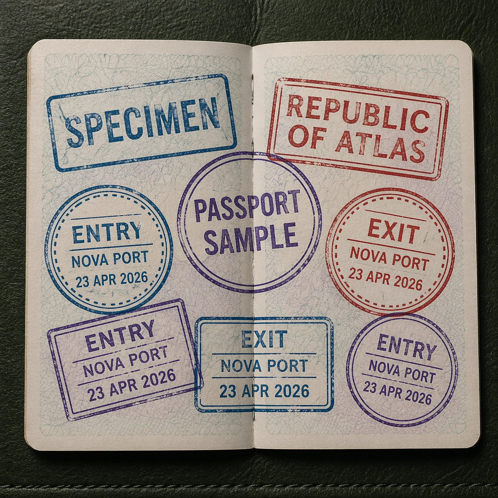

```text
Scene:
A square photorealistic tabletop image of an open fictional passport specimen page on a dark green leather desk pad. The paper has security-fiber texture, subtle guilloche background, rounded page corners, and soft window light crossing the fold. The camera is straight down so the stamp layout is easy to inspect.

Subject:
Show a clearly fictional passport-style spread, not a real travel document. The exact readable text should include: SPECIMEN, REPUBLIC OF ATLAS, PASSPORT SAMPLE, ENTRY, EXIT, NOVA PORT, 23 APR 2026. Add several overlapping immigration-style stamps in blue, red, and violet ink, with circular and rectangular borders, but no real country seals, no portrait photo, no machine-readable zone, no passport number, and no personal data. Stamps should look rubber-pressed, imperfect, and tactile.

Important details:
The challenge is official-document texture without creating a usable credential. Preserve high-fidelity paper fibers, faint security pattern, ink bleed at stamp edges, fold shadow, and realistic overlapping opacity. The specimen text must be readable and visually dominant enough to mark the document as fake. The spread should communicate travel-document aesthetics through materials and stamp geometry, while avoiding real emblems, official seals, serial fields, or scannable code.

Use case:
Pseudo-Real Documents single study 2/8, testing passport-like paper realism, rubber stamp layering, and safe fictional document structure.

Constraints:
No readable text except the specified fictional passport and stamp strings, no watermark, no logos, preserve exact 1:1 aspect ratio, no real country name, no real government seal, no portrait photo, no passport number, no machine-readable zone, no visa number, no scannable code.
```

[Pinned source](https://github.com/ChaosRealmsAI/gpt-image-2-gallery/blob/5296db8c996e38776c83a0bc8c64f848dcd512b3/works/topics/pseudo-real-documents/packages/single-document-specimens/images/passport-stamp-spread/meta.json) · GPT Image2 · 1254×1254 · No source-declared image dependencies. · ProjectD:pending individual review.

## Herbal Study Note · pseudo-real-documents/single-document-specimens/tcm-herbal-note

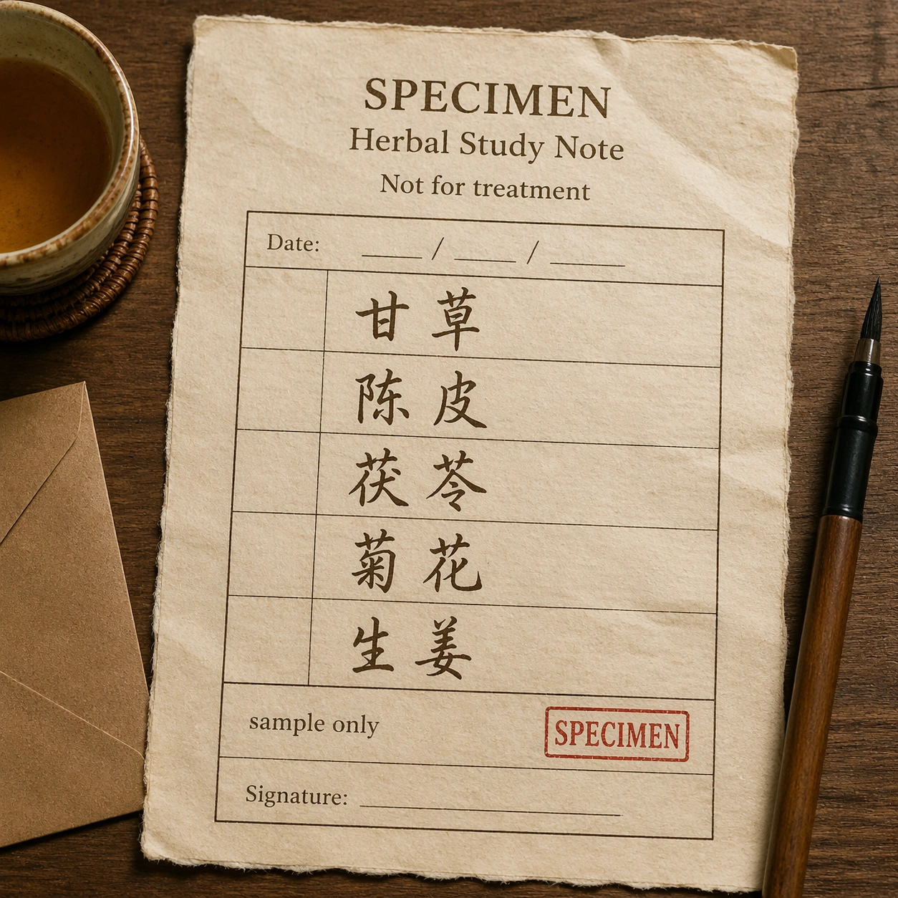

```text
Scene:
A square photorealistic overhead photograph of a fictional herbal study note on warm cream prescription-style paper, placed beside a ceramic tea cup, blank kraft envelope, and a brush pen. The paper has slight wrinkles, deckled fiber edges, and a red specimen chop mark. Lighting is soft and domestic, like a careful product shot for cultural stationery.

Subject:
Create a fictional traditional-herbal note, explicitly not a medical prescription. The exact readable text should include: SPECIMEN, Herbal Study Note, Not for treatment, 甘草, 陈皮, 茯苓, 菊花, 生姜, sample only. Mix tidy printed form fields with expressive handwritten Chinese herb names, using dark brown ink and a red square stamp reading SPECIMEN. Do not include patient name, doctor name, diagnosis, dosage, pharmacy, license number, or instructions for use.

Important details:
The visual goal is document-level precision: ruled boxes, date area left blank, blank signature line, ink pressure changes, brush-pen pooling, paper translucency, red stamp texture, and believable stationery shadows. The Chinese characters should be readable and beautiful, but the content must remain a non-actionable study sample. Keep the note materially convincing while making its specimen and non-treatment status unambiguous.

Use case:
Pseudo-Real Documents single study 3/8, testing handwritten document realism, Chinese character rendering, paper fibers, and safe non-medical framing.

Constraints:
No readable text except the specified herbal study strings, no watermark, no logos, preserve exact 1:1 aspect ratio, no patient data, no doctor signature, no dosage, no treatment directions, no real clinic name, no pharmacy seal, no scannable code.
```

[Pinned source](https://github.com/ChaosRealmsAI/gpt-image-2-gallery/blob/5296db8c996e38776c83a0bc8c64f848dcd512b3/works/topics/pseudo-real-documents/packages/single-document-specimens/images/tcm-herbal-note/meta.json) · GPT Image2 · 1254×1254 · No source-declared image dependencies. · ProjectD:pending individual review.

## Calligraphy Copybook · pseudo-real-documents/single-document-specimens/calligraphy-copybook

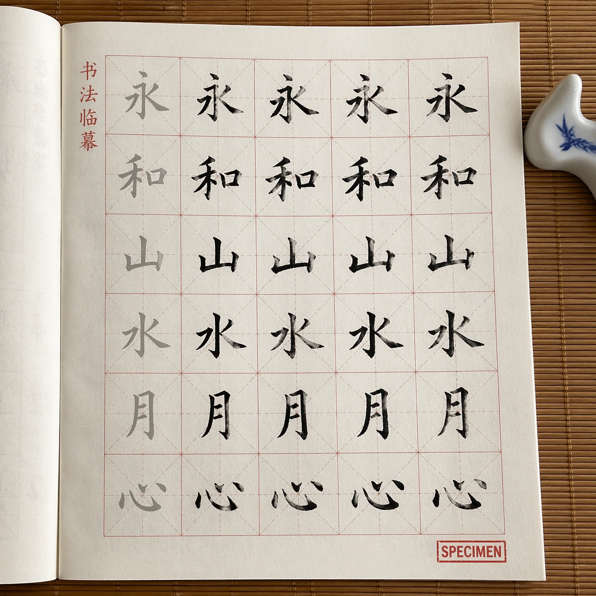

```text
Scene:
A square photorealistic studio photograph of a Chinese calligraphy practice copybook opened flat on a bamboo desk. The page is printed on thin ivory practice paper with faint red grid lines, gray model characters, black student brush strokes, ink feathering, and a small ceramic brush rest. The camera is top-down with gentle daylight and crisp page texture.

Subject:
Show a fictional calligraphy copybook page. The exact readable text should include: 书法临摹, 永, 和, 山, 水, 月, 心, SPECIMEN. Arrange the characters in repeated practice boxes: pale gray model characters in the first column, darker traced attempts beside them, and one red rectangular specimen stamp in a corner. No school name, real teacher name, grading score, student identity, or publication imprint.

Important details:
The test is text rendering plus paper physics. Grid lines must align consistently, characters must sit inside boxes, brush strokes should show pressure, dry-brush texture, ink pooling, and slightly uneven human practice. The printed model characters should be cleaner than the practice strokes. Keep the page believable as a cultural stationery product and not as a certificate. The specified characters should remain readable at thumbnail scale.

Use case:
Pseudo-Real Documents single study 4/8, testing copybook grid precision, Chinese character readability, brush texture, and thin practice paper realism.

Constraints:
No readable text except the specified copybook strings, no watermark, no logos, preserve exact 1:1 aspect ratio, no real school name, no personal name, no grading marks, no publisher imprint, no random extra characters, no unreadable ink blot covering the models.
```

[Pinned source](https://github.com/ChaosRealmsAI/gpt-image-2-gallery/blob/5296db8c996e38776c83a0bc8c64f848dcd512b3/works/topics/pseudo-real-documents/packages/single-document-specimens/images/calligraphy-copybook/meta.json) · GPT Image2 · 1254×1254 · No source-declared image dependencies. · ProjectD:pending individual review.

## Palm Reading Report · pseudo-real-documents/single-document-specimens/palm-reading-report

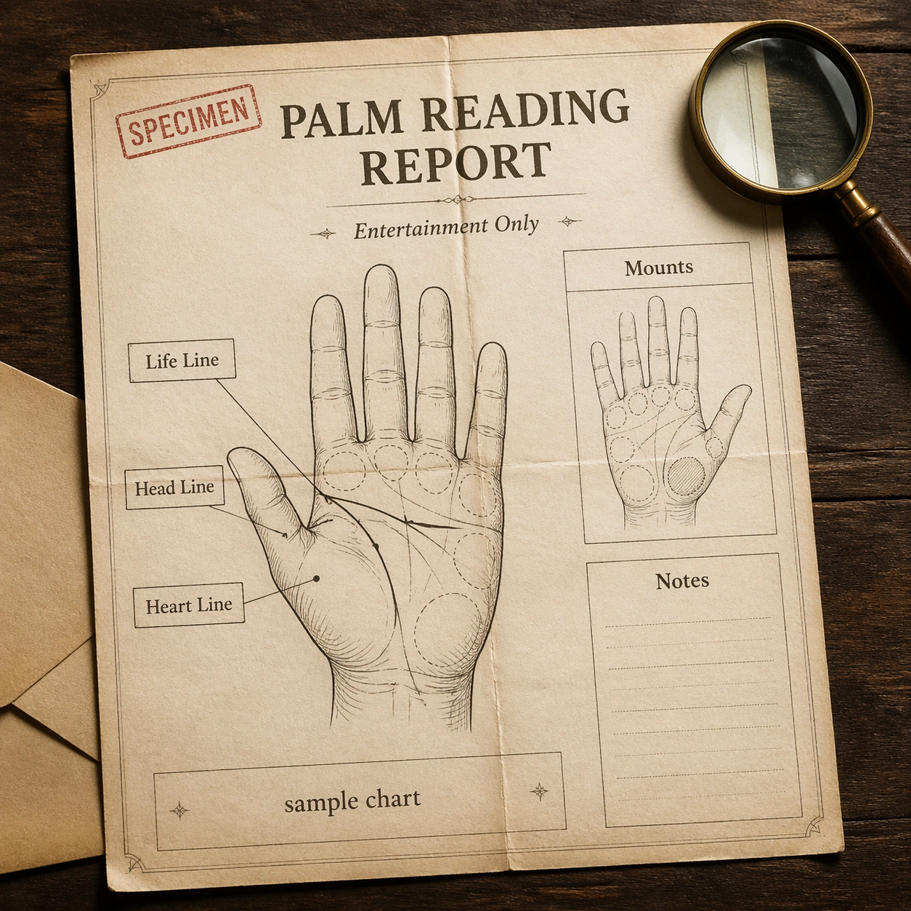

```text
Scene:
A square photorealistic product mockup of a fictional palm-reading report sheet on lightly textured parchment paper, photographed on a dark wooden table with a magnifying glass and blank envelope as props. The sheet has a clean consulting-report layout, soft sepia ink, thin diagram lines, and one pressed paper crease.

Subject:
Create an entertainment-only palm analysis document. The exact readable text should include: SPECIMEN, PALM READING REPORT, Entertainment Only, Life Line, Head Line, Heart Line, Mounts, Notes, sample chart. Show a line drawing of a palm with labeled regions, small annotation boxes, and a neat report grid. Do not include a real client name, birth date, address, phone number, signature, payment field, or predictive claims.

Important details:
The document should look convincingly printed and handled: letterpress-like header, thin gray rule lines, subtle ink spread, hand-drawn palm diagram texture, corner shadow, and slightly uneven paper grain. The hierarchy must be readable: title, diagram, labels, notes area, and specimen mark. Keep the tone mystical but restrained, like boutique stationery, not a legal or medical report. The entertainment disclaimer should be clear.

Use case:
Pseudo-Real Documents single study 5/8, testing report-layout readability, diagram labels, parchment material, and safe fictional entertainment framing.

Constraints:
No readable text except the specified palm report strings, no watermark, no logos, preserve exact 1:1 aspect ratio, no real person data, no signature, no phone number, no address, no payment details, no medical claims, no legal certification, no extra prophecy text.
```

[Pinned source](https://github.com/ChaosRealmsAI/gpt-image-2-gallery/blob/5296db8c996e38776c83a0bc8c64f848dcd512b3/works/topics/pseudo-real-documents/packages/single-document-specimens/images/palm-reading-report/meta.json) · GPT Image2 · 1254×1254 · No source-declared image dependencies. · ProjectD:pending individual review.

## Museum Ticket Receipt · pseudo-real-documents/single-document-specimens/museum-ticket-receipt

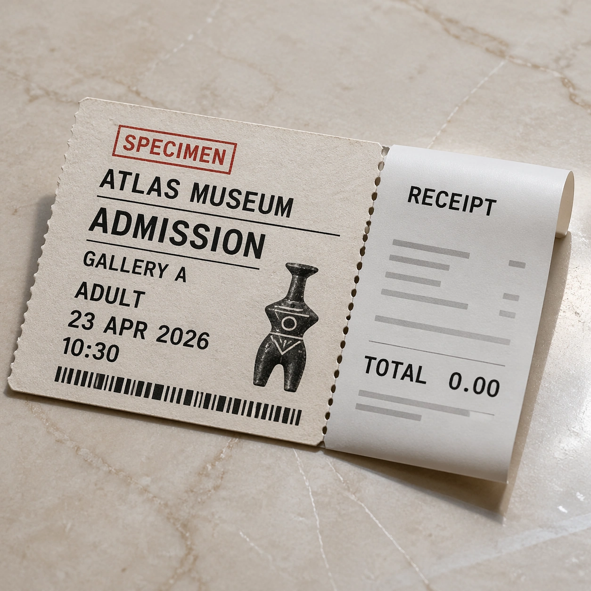

```text
Scene:
A square photorealistic still life of a fictional museum ticket and attached receipt on a pale stone counter. The ticket stock is thick matte paper with a torn perforated edge, while the receipt is thin curled thermal paper. Soft gallery light, tiny shadows, and paper fibers should make both materials distinct.

Subject:
Create a fictional museum admission specimen. The exact readable text should include: SPECIMEN, ATLAS MUSEUM, ADMISSION, GALLERY A, ADULT, 23 APR 2026, 10:30, RECEIPT, TOTAL 0.00. Include a decorative non-scannable barcode-like strip and a small abstract artifact icon, but no real museum logo, no QR code, no payment card digits, no transaction ID, and no address. The receipt can show short gray placeholder rules as unreadable texture.

Important details:
This image tests two paper systems in one composition: heavier ticket stock versus slick thermal receipt. Keep typography aligned, with readable hierarchy on the ticket and receipt. The perforation, ink density, paper curl, and stone-counter reflections should feel physically plausible. The specimen mark and zero-total value make the document safe and non-operational while retaining museum-product realism.

Use case:
Pseudo-Real Documents single study 6/8, testing ticket and receipt typography, paper-material contrast, and fictional commercial mockup realism.

Constraints:
No readable text except the specified museum ticket and receipt strings, no watermark, no logos, preserve exact 1:1 aspect ratio, no real museum name, no QR code, no scannable barcode, no credit card digits, no transaction number, no address, no extra pricing lines.
```

[Pinned source](https://github.com/ChaosRealmsAI/gpt-image-2-gallery/blob/5296db8c996e38776c83a0bc8c64f848dcd512b3/works/topics/pseudo-real-documents/packages/single-document-specimens/images/museum-ticket-receipt/meta.json) · GPT Image2 · 1254×1254 · No source-declared image dependencies. · ProjectD:pending individual review.

## Hotel Invoice Folio · pseudo-real-documents/single-document-specimens/hotel-invoice-folio

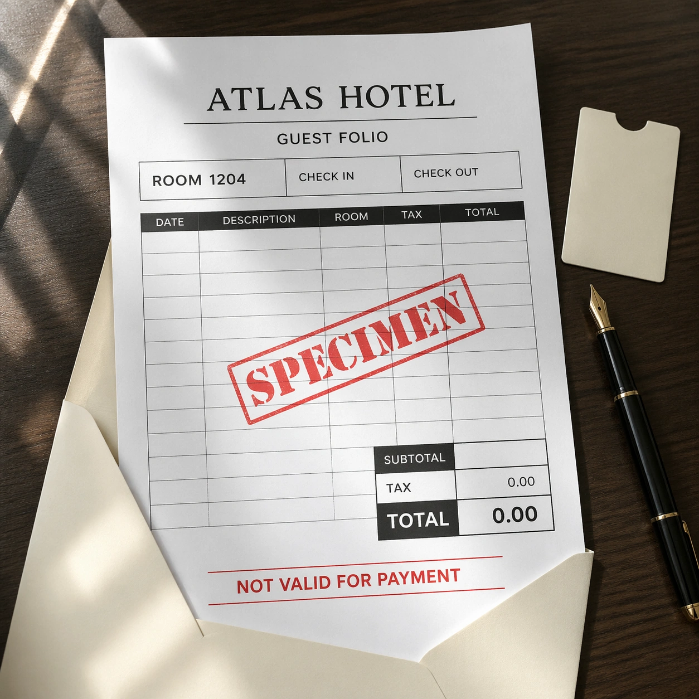

```text
Scene:
A square photorealistic overhead mockup of a fictional hotel invoice folio on crisp white letter paper, partly tucked into a cream envelope on a dark walnut desk. Add a fountain pen with no visible brand, a blank key sleeve, and morning window light. The paper should show fine fibers, sharp folds, and slight toner texture.

Subject:
Create a fictional non-payable hotel folio. The exact readable text should include: SPECIMEN, ATLAS HOTEL, GUEST FOLIO, ROOM 1204, CHECK IN, CHECK OUT, ROOM, TAX, TOTAL 0.00, NOT VALID FOR PAYMENT. Use a neat table with columns, a subtotal area, and a red diagonal specimen stamp. Do not include guest name, address, phone, email, payment card, folio number, tax ID, QR code, or real hotel logo.

Important details:
The document should look operational in layout but impossible to use: no identity fields, no payment details, zero total, and clear specimen marking. Preserve business-document precision: aligned columns, crisp rules, subtle paper curl, envelope shadow, toner edge softness, and believable desk reflections. The mockup should feel like a hospitality product-design sample, not a real bill.

Use case:
Pseudo-Real Documents single study 7/8, testing invoice table readability, office-paper material, specimen stamp, and safe non-payable commercial document design.

Constraints:
No readable text except the specified hotel folio strings, no watermark, no logos, preserve exact 1:1 aspect ratio, no real hotel name, no guest personal data, no payment card digits, no invoice number, no tax ID, no QR code, no payable amount, no signature.
```

[Pinned source](https://github.com/ChaosRealmsAI/gpt-image-2-gallery/blob/5296db8c996e38776c83a0bc8c64f848dcd512b3/works/topics/pseudo-real-documents/packages/single-document-specimens/images/hotel-invoice-folio/meta.json) · GPT Image2 · 1254×1254 · No source-declared image dependencies. · ProjectD:pending individual review.

## Train Seat Reservation · pseudo-real-documents/single-document-specimens/train-seat-reservation

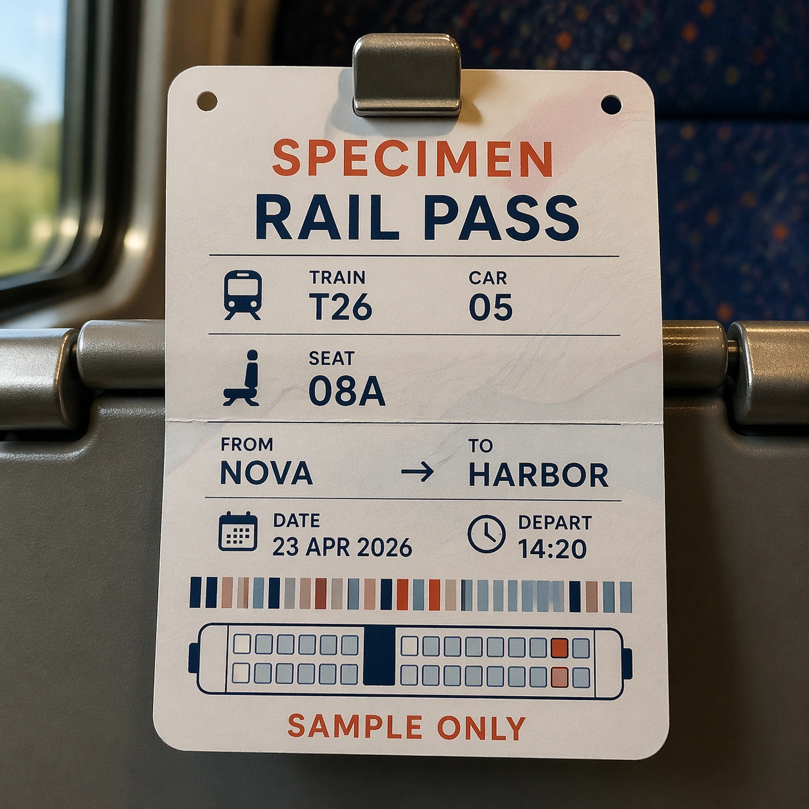

```text
Scene:
A square photorealistic image of a fictional rail seat reservation card clipped to a train seatback tray. The card is printed on satin paper with rounded corners, tiny punched holes, and a folded crease. Behind it, the train interior is softly blurred: fabric seat, window light, and a metal tray hinge. The camera is front-facing so the text plane is readable.

Subject:
Create a fictional rail reservation specimen. The exact readable text should include: SPECIMEN, RAIL PASS, TRAIN T26, CAR 05, SEAT 08A, FROM NOVA, TO HARBOR, DATE 23 APR 2026, DEPART 14:20, SAMPLE ONLY. Add a decorative non-scannable barcode-like strip and a simple carriage seat diagram made of rectangles. Do not include real railway operators, real station names, passenger name, ticket number, QR code, payment data, or terms and conditions.

Important details:
The test is transit-document realism in context: crisp ticket typography, small icon alignment, paper thickness, punched holes, clip shadow, mild paper bend, and believable train-seat materials. The reservation must look product-real but clearly fictional and non-operational. Keep the specified route and seat fields readable; all other background marks should be abstract texture. No real transport brand identity should appear.

Use case:
Pseudo-Real Documents single study 8/8, testing readable rail reservation layout, satin card material, transport context, and safe fictional ticket design.

Constraints:
No readable text except the specified rail reservation strings, no watermark, no logos, preserve exact 1:1 aspect ratio, no real rail company, no real station names, no passenger name, no ticket number, no QR code, no scannable barcode, no payment data, no extra schedule text.
```

[Pinned source](https://github.com/ChaosRealmsAI/gpt-image-2-gallery/blob/5296db8c996e38776c83a0bc8c64f848dcd512b3/works/topics/pseudo-real-documents/packages/single-document-specimens/images/train-seat-reservation/meta.json) · GPT Image2 · 1254×1254 · No source-declared image dependencies. · ProjectD:pending individual review.

## Print Proof Flatlay · psychedelic-rock-concert-1960s/single-poster-studies/02-print-proof-flatlay

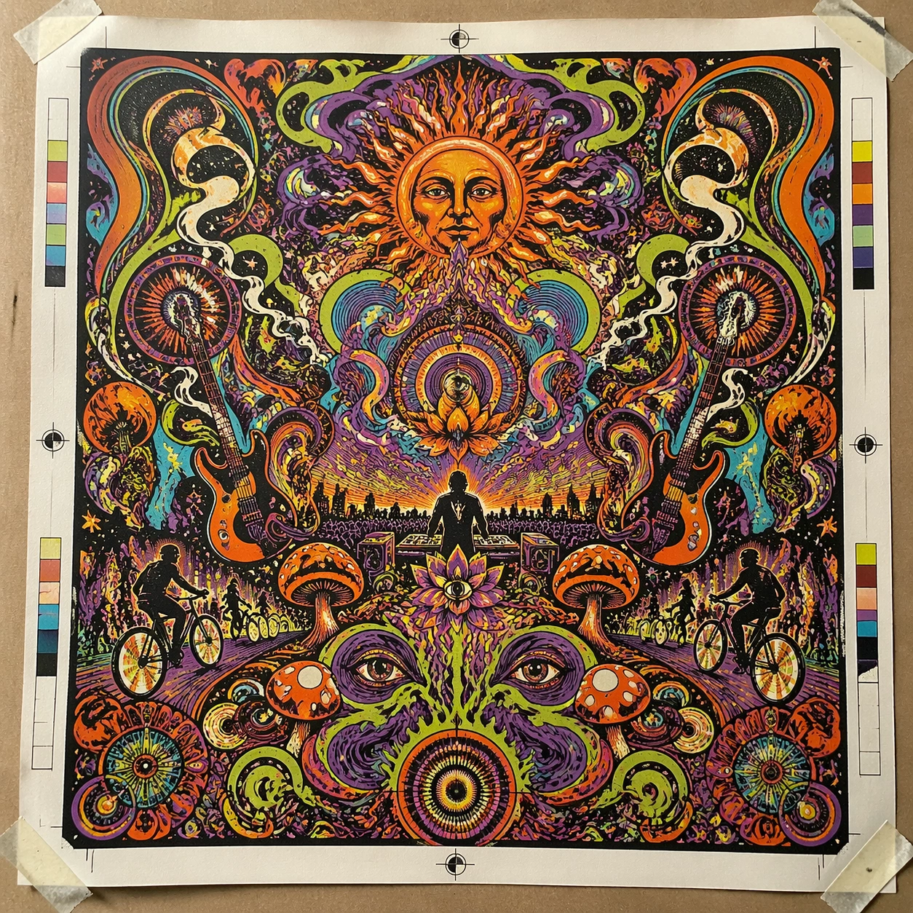

```text
Scene:
A square overhead tabletop photograph of a fresh poster proof on neutral worktable paper, lit by cool daylight, with crop marks, tape tabs, and slight paper bow visible around the sheet. The poster should express late-1960s psychedelic poster language with liquid swirls, floral mandala density, vibrating contours, and molten ornamental framing, using acid orange, violet, lime, cyan, cream, and deep black and a tactile surface appropriate to the medium.

Subject:
Design the poster as a print-shop proof, preserving the same poster language while allowing production clues such as edge trims, registration targets, and process marks to frame the composition. Use sun faces, paisley smoke, guitars, mushrooms, stars, lotus petals, and concentric wave rings as the main visual ingredients, and organize them with ornamental pseudo-lettering that feels lavish and tangled while remaining unreadable. For the contemporary-subject axis, thread in a rooftop electronic set, bike lights, and crowd motion translated into a hallucinatory hand-drawn poster field. The poster must feel like an original design object rather than a reproduction of any known work.

Important details:
The image must still read as a finished poster concept, but it should carry believable print-process evidence and material tactility instead of gallery-wall perfection. Preserve dense symmetry, nested curves, optical vibration, and saturated color friction across the whole sheet. Keep every letterform abstract and non-readable, as if it were a typographic texture rather than language. Make the style unmistakable through composition, palette, surface behavior, and symbolic compression. no plain corporate layout, no dead empty zones, no restrained minimalist spacing, no clean sans-serif blocks.

Use case:
Psychedelic 60s single study 2/9, testing production realism and process evidence.

Constraints:
No readable text, no watermark, no logos, preserve exact 1:1 aspect ratio, no copyrighted characters, no real brand marks, no QR codes, no interface chrome, no accidental gibberish lettering.
```

[Pinned source](https://github.com/ChaosRealmsAI/gpt-image-2-gallery/blob/5296db8c996e38776c83a0bc8c64f848dcd512b3/works/topics/psychedelic-rock-concert-1960s/packages/single-poster-studies/images/02-print-proof-flatlay/meta.json) · GPT Image2 · 1254×1254 · No source-declared image dependencies. · ProjectD:pending individual review.

## Transit Lightbox · psychedelic-rock-concert-1960s/single-poster-studies/03-transit-lightbox

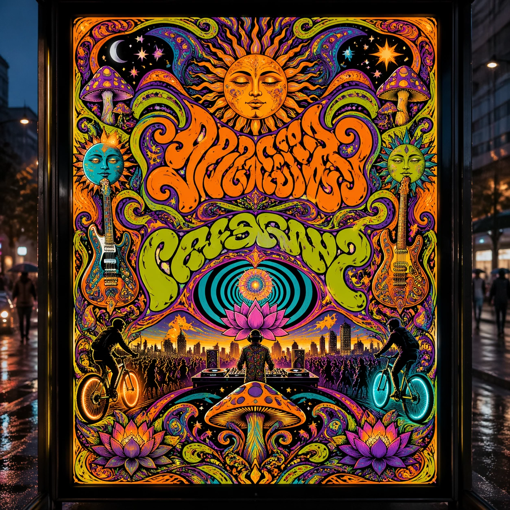

```text
Scene:
A square dusk street photograph of a backlit transit poster glowing inside glass, with faint rain reflections, soft city blur in the distance, and the poster remaining fully legible as a composition. The poster should express late-1960s psychedelic poster language with liquid swirls, floral mandala density, vibrating contours, and molten ornamental framing, using acid orange, violet, lime, cyan, cream, and deep black and a tactile surface appropriate to the medium.

Subject:
Adapt the poster into a public-facing lightbox version that still honors the original style grammar while feeling bold enough to stop a passerby from several meters away. Use sun faces, paisley smoke, guitars, mushrooms, stars, lotus petals, and concentric wave rings as the main visual ingredients, and organize them with ornamental pseudo-lettering that feels lavish and tangled while remaining unreadable. For the contemporary-subject axis, thread in a rooftop electronic set, bike lights, and crowd motion translated into a hallucinatory hand-drawn poster field. The poster must feel like an original design object rather than a reproduction of any known work.

Important details:
Let the style survive the illumination test: color blocking, silhouette contrast, and abstract lettering should stay controlled under bright internal light and reflective glass. Preserve dense symmetry, nested curves, optical vibration, and saturated color friction across the whole sheet. Keep every letterform abstract and non-readable, as if it were a typographic texture rather than language. Make the style unmistakable through composition, palette, surface behavior, and symbolic compression. no plain corporate layout, no dead empty zones, no restrained minimalist spacing, no clean sans-serif blocks.

Use case:
Psychedelic 60s single study 3/9, testing distance readability in public display.

Constraints:
No readable text, no watermark, no logos, preserve exact 1:1 aspect ratio, no copyrighted characters, no real brand marks, no QR codes, no interface chrome, no accidental gibberish lettering.
```

[Pinned source](https://github.com/ChaosRealmsAI/gpt-image-2-gallery/blob/5296db8c996e38776c83a0bc8c64f848dcd512b3/works/topics/psychedelic-rock-concert-1960s/packages/single-poster-studies/images/03-transit-lightbox/meta.json) · GPT Image2 · 1254×1254 · No source-declared image dependencies. · ProjectD:pending individual review.

## Wheatpaste Wall Layer · psychedelic-rock-concert-1960s/single-poster-studies/04-wheatpaste-wall

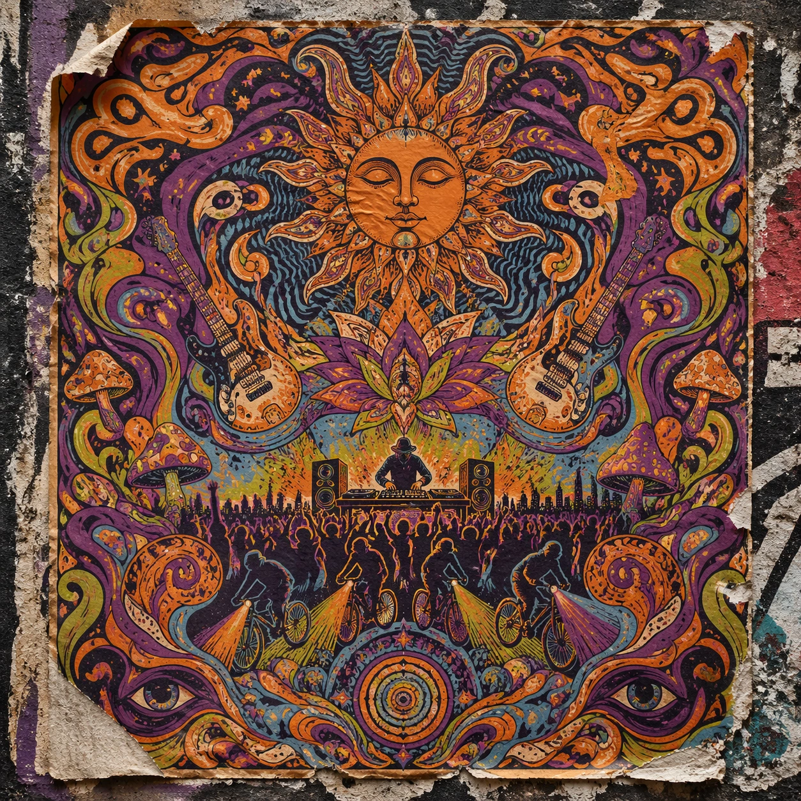

```text
Scene:
A square urban wall study with the poster pasted onto rough plaster among torn edges and older paper remnants, photographed in soft overcast light so texture, glue bubbles, and surface scars stay visible. The poster should express late-1960s psychedelic poster language with liquid swirls, floral mandala density, vibrating contours, and molten ornamental framing, using acid orange, violet, lime, cyan, cream, and deep black and a tactile surface appropriate to the medium.

Subject:
Create a version that feels made for the street, with the poster carrying enough formal force to survive abrasion, layering, and imperfect placement without losing its visual identity. Use sun faces, paisley smoke, guitars, mushrooms, stars, lotus petals, and concentric wave rings as the main visual ingredients, and organize them with ornamental pseudo-lettering that feels lavish and tangled while remaining unreadable. For the contemporary-subject axis, thread in a rooftop electronic set, bike lights, and crowd motion translated into a hallucinatory hand-drawn poster field. The poster must feel like an original design object rather than a reproduction of any known work.

Important details:
Keep the main design intact but let the environment add grit: lifted corners, tiny tears, wrinkled paper, and older color fragments around the perimeter should amplify the style rather than dilute it. Preserve dense symmetry, nested curves, optical vibration, and saturated color friction across the whole sheet. Keep every letterform abstract and non-readable, as if it were a typographic texture rather than language. Make the style unmistakable through composition, palette, surface behavior, and symbolic compression. no plain corporate layout, no dead empty zones, no restrained minimalist spacing, no clean sans-serif blocks.

Use case:
Psychedelic 60s single study 4/9, testing street-life durability and layered context.

Constraints:
No readable text, no watermark, no logos, preserve exact 1:1 aspect ratio, no copyrighted characters, no real brand marks, no QR codes, no interface chrome, no accidental gibberish lettering.
```

[Pinned source](https://github.com/ChaosRealmsAI/gpt-image-2-gallery/blob/5296db8c996e38776c83a0bc8c64f848dcd512b3/works/topics/psychedelic-rock-concert-1960s/packages/single-poster-studies/images/04-wheatpaste-wall/meta.json) · GPT Image2 · 1254×1254 · No source-declared image dependencies. · ProjectD:pending individual review.

## Folded Archive Copy · psychedelic-rock-concert-1960s/single-poster-studies/05-folded-archive-copy

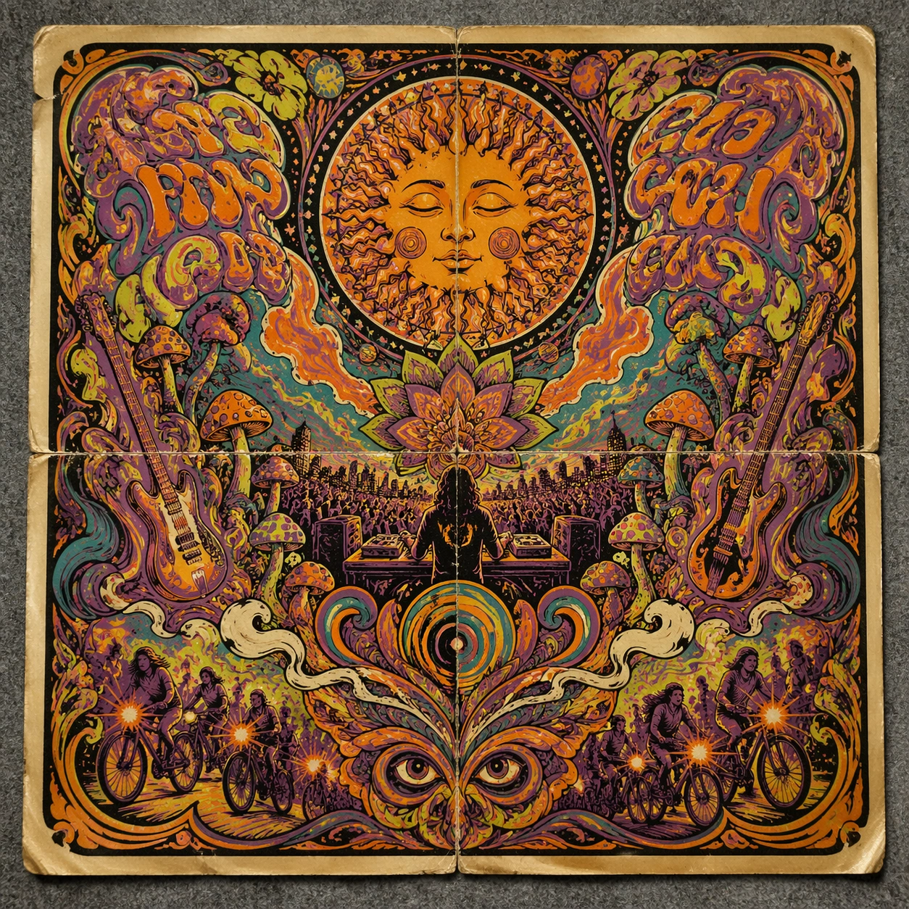

```text
Scene:
A square conservation-table view of a vintage poster laid on gray felt under raking light, with visible fold lines, softened corners, and subtle aging that still preserves the integrity of the image. The poster should express late-1960s psychedelic poster language with liquid swirls, floral mandala density, vibrating contours, and molten ornamental framing, using acid orange, violet, lime, cyan, cream, and deep black and a tactile surface appropriate to the medium.

Subject:
Present the poster as an archive copy that has been stored, unfolded, and carefully documented, letting age and handling reveal how the design holds up across time. Use sun faces, paisley smoke, guitars, mushrooms, stars, lotus petals, and concentric wave rings as the main visual ingredients, and organize them with ornamental pseudo-lettering that feels lavish and tangled while remaining unreadable. For the contemporary-subject axis, thread in a rooftop electronic set, bike lights, and crowd motion translated into a hallucinatory hand-drawn poster field. The poster must feel like an original design object rather than a reproduction of any known work.

Important details:
Aging must stay believable rather than theatrical: slight yellowing, fold memory, edge wear, and pigment variation should support the historical or crafted feeling of the style. Preserve dense symmetry, nested curves, optical vibration, and saturated color friction across the whole sheet. Keep every letterform abstract and non-readable, as if it were a typographic texture rather than language. Make the style unmistakable through composition, palette, surface behavior, and symbolic compression. no plain corporate layout, no dead empty zones, no restrained minimalist spacing, no clean sans-serif blocks.

Use case:
Psychedelic 60s single study 5/9, testing archival endurance and age character.

Constraints:
No readable text, no watermark, no logos, preserve exact 1:1 aspect ratio, no copyrighted characters, no real brand marks, no QR codes, no interface chrome, no accidental gibberish lettering.
```

[Pinned source](https://github.com/ChaosRealmsAI/gpt-image-2-gallery/blob/5296db8c996e38776c83a0bc8c64f848dcd512b3/works/topics/psychedelic-rock-concert-1960s/packages/single-poster-studies/images/05-folded-archive-copy/meta.json) · GPT Image2 · 1254×1254 · No source-declared image dependencies. · ProjectD:pending individual review.

## Twin Poster Diptych · psychedelic-rock-concert-1960s/single-poster-studies/06-twin-poster-diptych

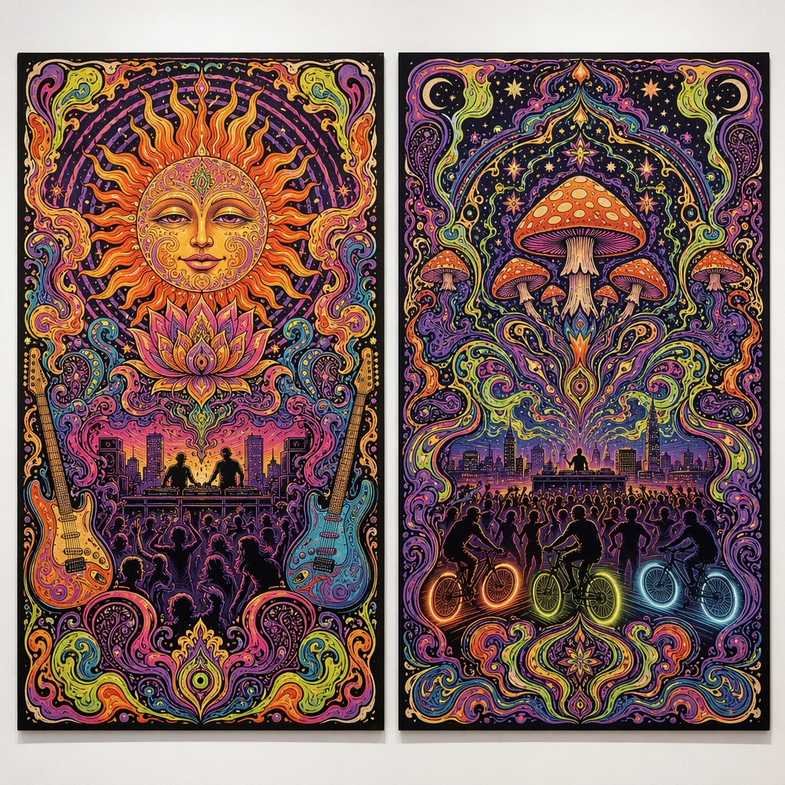

```text
Scene:
A square white-wall installation showing two companion posters hung side by side with equal spacing, photographed frontally so the pair reads as a designed conversation rather than two unrelated sheets. The poster should express late-1960s psychedelic poster language with liquid swirls, floral mandala density, vibrating contours, and molten ornamental framing, using acid orange, violet, lime, cyan, cream, and deep black and a tactile surface appropriate to the medium.

Subject:
Compose a matched diptych: two posters sharing one style system while splitting the narrative across paired motifs, mirrored masses, or complementary color emphasis. Use sun faces, paisley smoke, guitars, mushrooms, stars, lotus petals, and concentric wave rings as the main visual ingredients, and organize them with ornamental pseudo-lettering that feels lavish and tangled while remaining unreadable. For the contemporary-subject axis, thread in a rooftop electronic set, bike lights, and crowd motion translated into a hallucinatory hand-drawn poster field. The poster must feel like an original design object rather than a reproduction of any known work.

Important details:
Both halves should feel distinct yet inseparable. Preserve one coherent visual language, but let each sheet carry its own focal symbol and rhythm without readable wording. Preserve dense symmetry, nested curves, optical vibration, and saturated color friction across the whole sheet. Keep every letterform abstract and non-readable, as if it were a typographic texture rather than language. Make the style unmistakable through composition, palette, surface behavior, and symbolic compression. no plain corporate layout, no dead empty zones, no restrained minimalist spacing, no clean sans-serif blocks.

Use case:
Psychedelic 60s single study 6/9, testing system flexibility across a paired set.

Constraints:
No readable text, no watermark, no logos, preserve exact 1:1 aspect ratio, no copyrighted characters, no real brand marks, no QR codes, no interface chrome, no accidental gibberish lettering.
```

[Pinned source](https://github.com/ChaosRealmsAI/gpt-image-2-gallery/blob/5296db8c996e38776c83a0bc8c64f848dcd512b3/works/topics/psychedelic-rock-concert-1960s/packages/single-poster-studies/images/06-twin-poster-diptych/meta.json) · GPT Image2 · 1024×1024 · No source-declared image dependencies. · ProjectD:pending individual review.

## Stacked Print Bundle · psychedelic-rock-concert-1960s/single-poster-studies/07-stacked-print-bundle

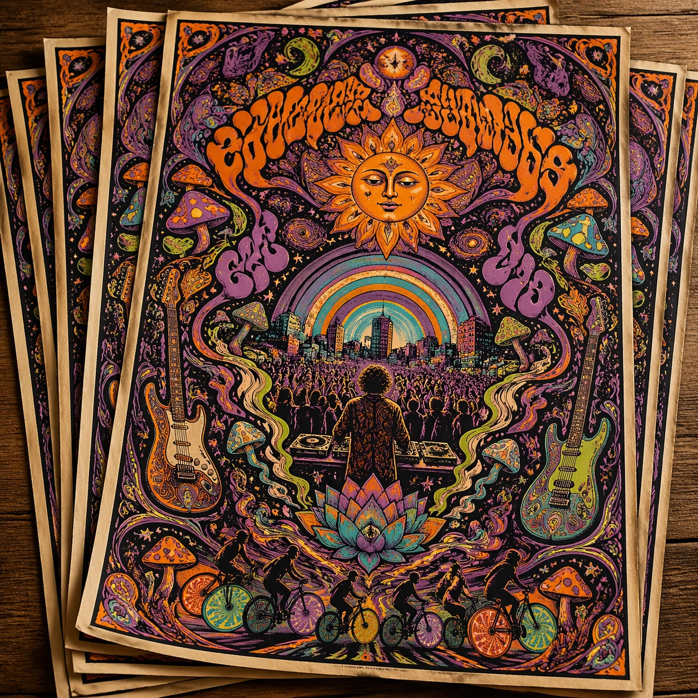

```text
Scene:
A square tabletop shot of several poster prints stacked and slightly fanned, with curled corners, offset edges, and soft directional light revealing paper thickness and ink behavior. The poster should express late-1960s psychedelic poster language with liquid swirls, floral mandala density, vibrating contours, and molten ornamental framing, using acid orange, violet, lime, cyan, cream, and deep black and a tactile surface appropriate to the medium.

Subject:
Design the top poster to dominate while nearby duplicate sheets echo the same composition, creating a tactile print-run scene rather than a single isolated sheet. Use sun faces, paisley smoke, guitars, mushrooms, stars, lotus petals, and concentric wave rings as the main visual ingredients, and organize them with ornamental pseudo-lettering that feels lavish and tangled while remaining unreadable. For the contemporary-subject axis, thread in a rooftop electronic set, bike lights, and crowd motion translated into a hallucinatory hand-drawn poster field. The poster must feel like an original design object rather than a reproduction of any known work.

Important details:
Use the stack to emphasize production character: edge shadows, repeated motifs peeking from beneath, and subtle misalignment should enrich the material reading without changing the core design. Preserve dense symmetry, nested curves, optical vibration, and saturated color friction across the whole sheet. Keep every letterform abstract and non-readable, as if it were a typographic texture rather than language. Make the style unmistakable through composition, palette, surface behavior, and symbolic compression. no plain corporate layout, no dead empty zones, no restrained minimalist spacing, no clean sans-serif blocks.

Use case:
Psychedelic 60s single study 7/9, testing print-run tactility and repeat presence.

Constraints:
No readable text, no watermark, no logos, preserve exact 1:1 aspect ratio, no copyrighted characters, no real brand marks, no QR codes, no interface chrome, no accidental gibberish lettering.
```

[Pinned source](https://github.com/ChaosRealmsAI/gpt-image-2-gallery/blob/5296db8c996e38776c83a0bc8c64f848dcd512b3/works/topics/psychedelic-rock-concert-1960s/packages/single-poster-studies/images/07-stacked-print-bundle/meta.json) · GPT Image2 · 1254×1254 · No source-declared image dependencies. · ProjectD:pending individual review.

## Kiosk Night Glow · psychedelic-rock-concert-1960s/single-poster-studies/08-kiosk-night-glow

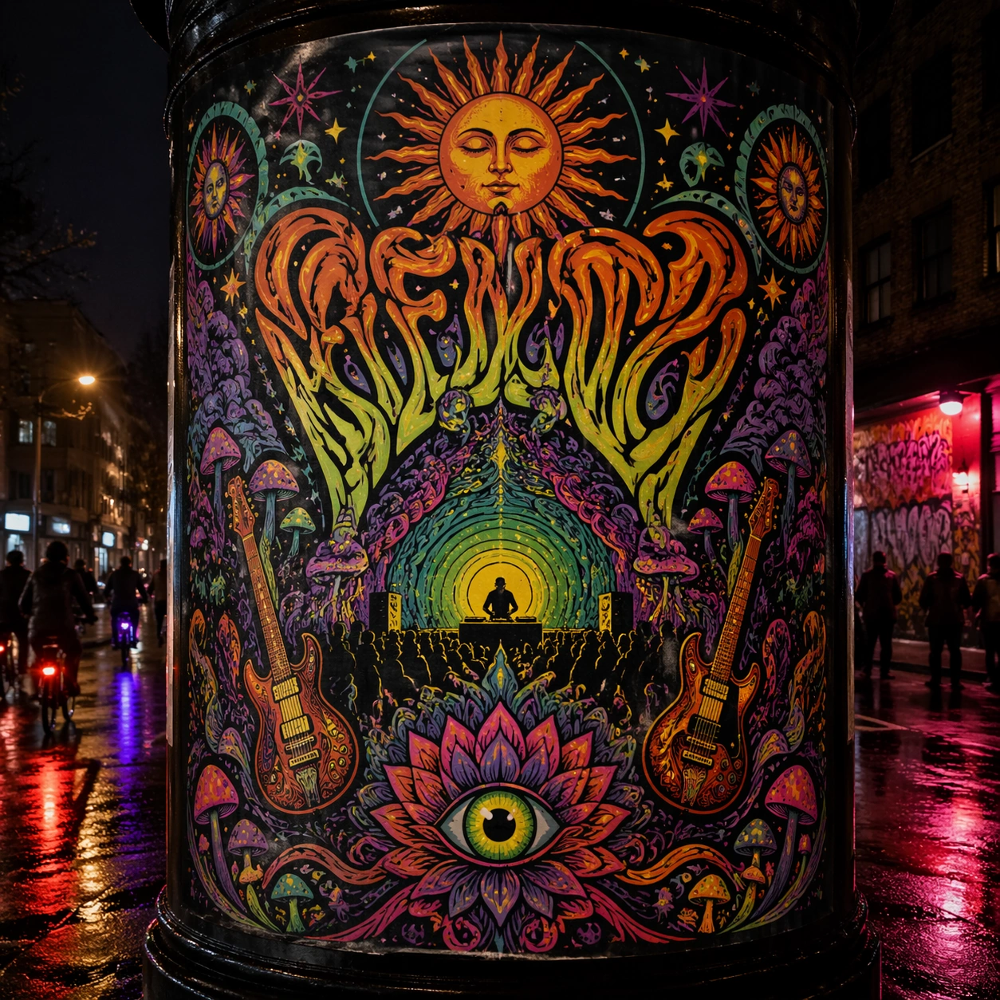

```text
Scene:
A square nighttime city view with the poster wrapping part of a cylindrical kiosk, wet pavement reflecting nearby light, and the composition holding together under moody urban illumination. The poster should express late-1960s psychedelic poster language with liquid swirls, floral mandala density, vibrating contours, and molten ornamental framing, using acid orange, violet, lime, cyan, cream, and deep black and a tactile surface appropriate to the medium.

Subject:
Reframe the design for a dramatic street-placement context, where the poster has to project style and mood through reflection, curvature, and surrounding darkness. Use sun faces, paisley smoke, guitars, mushrooms, stars, lotus petals, and concentric wave rings as the main visual ingredients, and organize them with ornamental pseudo-lettering that feels lavish and tangled while remaining unreadable. For the contemporary-subject axis, thread in a rooftop electronic set, bike lights, and crowd motion translated into a hallucinatory hand-drawn poster field. The poster must feel like an original design object rather than a reproduction of any known work.

Important details:
The design should remain instantly recognizable despite the cylindrical wrap. Preserve major blocks, symbolic shapes, and abstract title forms so the style still feels authoritative at night. Preserve dense symmetry, nested curves, optical vibration, and saturated color friction across the whole sheet. Keep every letterform abstract and non-readable, as if it were a typographic texture rather than language. Make the style unmistakable through composition, palette, surface behavior, and symbolic compression. no plain corporate layout, no dead empty zones, no restrained minimalist spacing, no clean sans-serif blocks.

Use case:
Psychedelic 60s single study 8/9, testing atmospheric display under rain and glow.

Constraints:
No readable text, no watermark, no logos, preserve exact 1:1 aspect ratio, no copyrighted characters, no real brand marks, no QR codes, no interface chrome, no accidental gibberish lettering.
```

[Pinned source](https://github.com/ChaosRealmsAI/gpt-image-2-gallery/blob/5296db8c996e38776c83a0bc8c64f848dcd512b3/works/topics/psychedelic-rock-concert-1960s/packages/single-poster-studies/images/08-kiosk-night-glow/meta.json) · GPT Image2 · 1254×1254 · No source-declared image dependencies. · ProjectD:pending individual review.

## Contemporary Remix · psychedelic-rock-concert-1960s/single-poster-studies/09-contemporary-remix

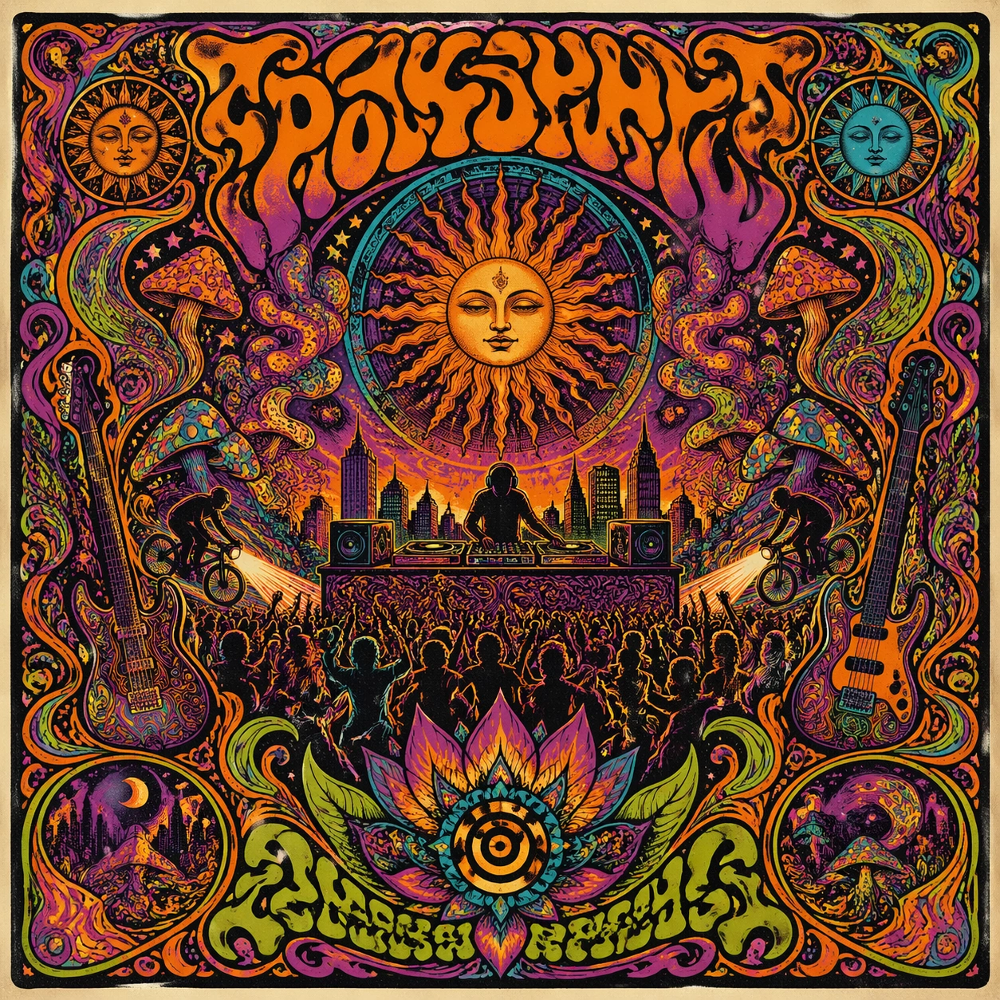

```text
Scene:
A square front-facing poster presentation on a clean neutral wall, lit like a premium print test, with crisp edges and a polished but still tactile finish appropriate to the style. The poster should express late-1960s psychedelic poster language with liquid swirls, floral mandala density, vibrating contours, and molten ornamental framing, using acid orange, violet, lime, cyan, cream, and deep black and a tactile surface appropriate to the medium.

Subject:
Apply the historical poster language to a contemporary urban subject so the old visual grammar proves it can carry present-day themes without losing authenticity or formal discipline. Use sun faces, paisley smoke, guitars, mushrooms, stars, lotus petals, and concentric wave rings as the main visual ingredients, and organize them with ornamental pseudo-lettering that feels lavish and tangled while remaining unreadable. For the contemporary-subject axis, thread in a rooftop electronic set, bike lights, and crowd motion translated into a hallucinatory hand-drawn poster field. The poster must feel like an original design object rather than a reproduction of any known work.

Important details:
This is not parody. The contemporary subject should feel genuinely absorbed into the style through palette, composition, symbolic compression, and non-readable lettering treatment. Preserve dense symmetry, nested curves, optical vibration, and saturated color friction across the whole sheet. Keep every letterform abstract and non-readable, as if it were a typographic texture rather than language. Make the style unmistakable through composition, palette, surface behavior, and symbolic compression. no plain corporate layout, no dead empty zones, no restrained minimalist spacing, no clean sans-serif blocks.

Use case:
Psychedelic 60s single study 9/9, testing historical grammar on a present-day subject.

Constraints:
No readable text, no watermark, no logos, preserve exact 1:1 aspect ratio, no copyrighted characters, no real brand marks, no QR codes, no interface chrome, no accidental gibberish lettering.
```

[Pinned source](https://github.com/ChaosRealmsAI/gpt-image-2-gallery/blob/5296db8c996e38776c83a0bc8c64f848dcd512b3/works/topics/psychedelic-rock-concert-1960s/packages/single-poster-studies/images/09-contemporary-remix/meta.json) · GPT Image2 · 1254×1254 · No source-declared image dependencies. · ProjectD:pending individual review.

## Diner Booth Aftermath · pulpy-typography-violence-poster/single-pulpy-typography-violence-poster/01-diner-booth-aftermath

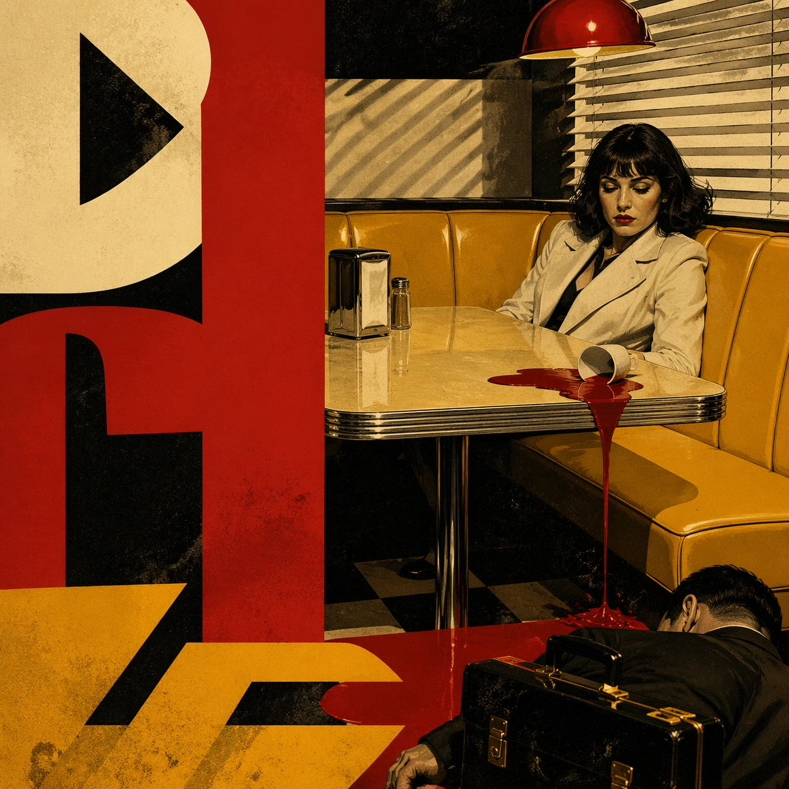

```text
Scene:
A square poster-like composition with loud red, tobacco yellow, nicotine cream, and deep black arranged in flat graphic blocks over a staged crime tableau. The lighting should feel hard and directional, but the overall image should still read as a designed print object rather than a literal movie still. Place the action in a diner booth with laminated tabletop reflections, a yellow banquette, and a vertical red block slicing the frame like a fake headline column.

Subject:
Focus on an implied act of violence or aftermath through frozen props, bodies held in stiff poses, diner booths, cheap motel details, briefcases, dashboard reflections, or nightclub furniture. The people should feel iconic and deadpan, with tension communicated through placement and color rather than explicit gore. A woman in a cream jacket sits motionless beside an overturned coffee cup while a crimson spill crawls across the table edge toward the floor.

Important details:
The crucial visual rule is the collision of graphic poster language and static pulp staging. Use oversized non-readable letterform-like shapes, caption bars, drop-shadow slabs, and paper-print textures without introducing actual words. Preserve bold silhouette hierarchy, cropped tension, and cynical cool. Treat the spill as a graphic shape, not a medical detail, and let chrome napkin holders and blinds reinforce the print-like composition.

Use case:
Pulpy Typography Over Violent Tableau single study 1/9.

Constraints:
No readable text, no watermark, no logos, preserve exact 1:1 aspect ratio, no readable text, no logos, no explicit gore, no dismemberment, no recognizable brand packaging, no comic speech balloons, no broken anatomy, no low-detail background, no accidental text fragments.
```

[Pinned source](https://github.com/ChaosRealmsAI/gpt-image-2-gallery/blob/5296db8c996e38776c83a0bc8c64f848dcd512b3/works/topics/pulpy-typography-violence-poster/packages/single-pulpy-typography-violence-poster/images/01-diner-booth-aftermath/meta.json) · GPT Image2 · 1254×1254 · No source-declared image dependencies. · ProjectD:pending individual review.

## Motel Corridor Freeze · pulpy-typography-violence-poster/single-pulpy-typography-violence-poster/02-motel-corridor-freeze

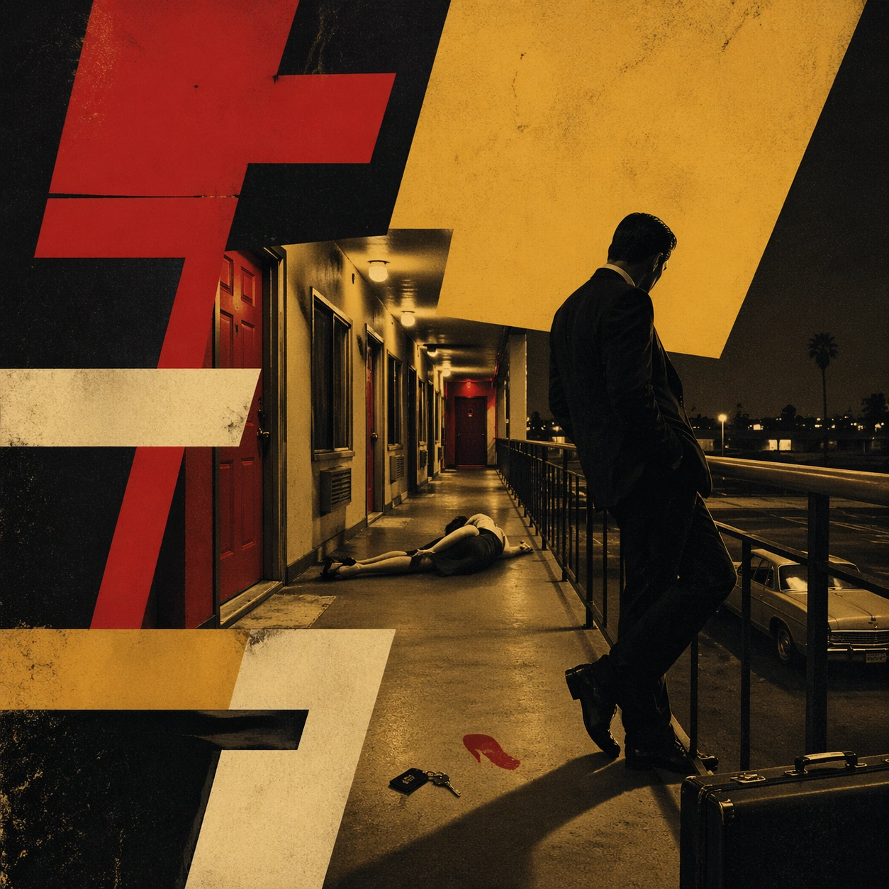

```text
Scene:
A square poster-like composition with loud red, tobacco yellow, nicotine cream, and deep black arranged in flat graphic blocks over a staged crime tableau. The lighting should feel hard and directional, but the overall image should still read as a designed print object rather than a literal movie still. Use a cheap motel exterior corridor at night, with doorways receding along one side and a giant mustard color slab masking part of the sky.

Subject:
Focus on an implied act of violence or aftermath through frozen props, bodies held in stiff poses, diner booths, cheap motel details, briefcases, dashboard reflections, or nightclub furniture. The people should feel iconic and deadpan, with tension communicated through placement and color rather than explicit gore. A man in a dark suit leans against the railing while a dropped room key and a crimson heel mark imply a sudden unseen event.

Important details:
The crucial visual rule is the collision of graphic poster language and static pulp staging. Use oversized non-readable letterform-like shapes, caption bars, drop-shadow slabs, and paper-print textures without introducing actual words. Preserve bold silhouette hierarchy, cropped tension, and cynical cool. The palette should feel sun-faded even at night, with grainy paper texture and non-readable graphic bars interrupting the realism.

Use case:
Pulpy Typography Over Violent Tableau single study 2/9.

Constraints:
No readable text, no watermark, no logos, preserve exact 1:1 aspect ratio, no readable text, no logos, no explicit gore, no dismemberment, no recognizable brand packaging, no comic speech balloons, no broken anatomy, no low-detail background, no accidental text fragments.
```

[Pinned source](https://github.com/ChaosRealmsAI/gpt-image-2-gallery/blob/5296db8c996e38776c83a0bc8c64f848dcd512b3/works/topics/pulpy-typography-violence-poster/packages/single-pulpy-typography-violence-poster/images/02-motel-corridor-freeze/meta.json) · GPT Image2 · 1254×1254 · No source-declared image dependencies. · ProjectD:pending individual review.

## Trunk Light Tableau · pulpy-typography-violence-poster/single-pulpy-typography-violence-poster/03-trunk-light-tableau

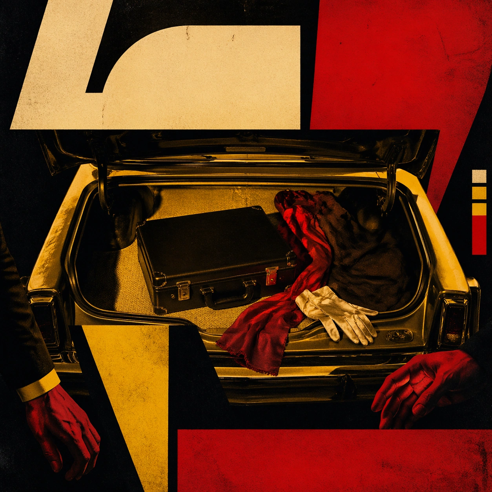

```text
Scene:
A square poster-like composition with loud red, tobacco yellow, nicotine cream, and deep black arranged in flat graphic blocks over a staged crime tableau. The lighting should feel hard and directional, but the overall image should still read as a designed print object rather than a literal movie still. Frame an open car trunk from slightly above so the rectangular lid becomes part of the poster geometry, with deep black surrounding a hot yellow light source.

Subject:
Focus on an implied act of violence or aftermath through frozen props, bodies held in stiff poses, diner booths, cheap motel details, briefcases, dashboard reflections, or nightclub furniture. The people should feel iconic and deadpan, with tension communicated through placement and color rather than explicit gore. A briefcase, satin gloves, and a crimson scarf sit inside the trunk while two hands hover just outside the edge of the frame.

Important details:
The crucial visual rule is the collision of graphic poster language and static pulp staging. Use oversized non-readable letterform-like shapes, caption bars, drop-shadow slabs, and paper-print textures without introducing actual words. Preserve bold silhouette hierarchy, cropped tension, and cynical cool. Make every object feel loaded with narrative, but keep the layout static and graphically controlled rather than frantic.

Use case:
Pulpy Typography Over Violent Tableau single study 3/9.

Constraints:
No readable text, no watermark, no logos, preserve exact 1:1 aspect ratio, no readable text, no logos, no explicit gore, no dismemberment, no recognizable brand packaging, no comic speech balloons, no broken anatomy, no low-detail background, no accidental text fragments.
```

[Pinned source](https://github.com/ChaosRealmsAI/gpt-image-2-gallery/blob/5296db8c996e38776c83a0bc8c64f848dcd512b3/works/topics/pulpy-typography-violence-poster/packages/single-pulpy-typography-violence-poster/images/03-trunk-light-tableau/meta.json) · GPT Image2 · 1254×1254 · No source-declared image dependencies. · ProjectD:pending individual review.

## Alley Briefcase Spill · pulpy-typography-violence-poster/single-pulpy-typography-violence-poster/04-alley-briefcase-spill

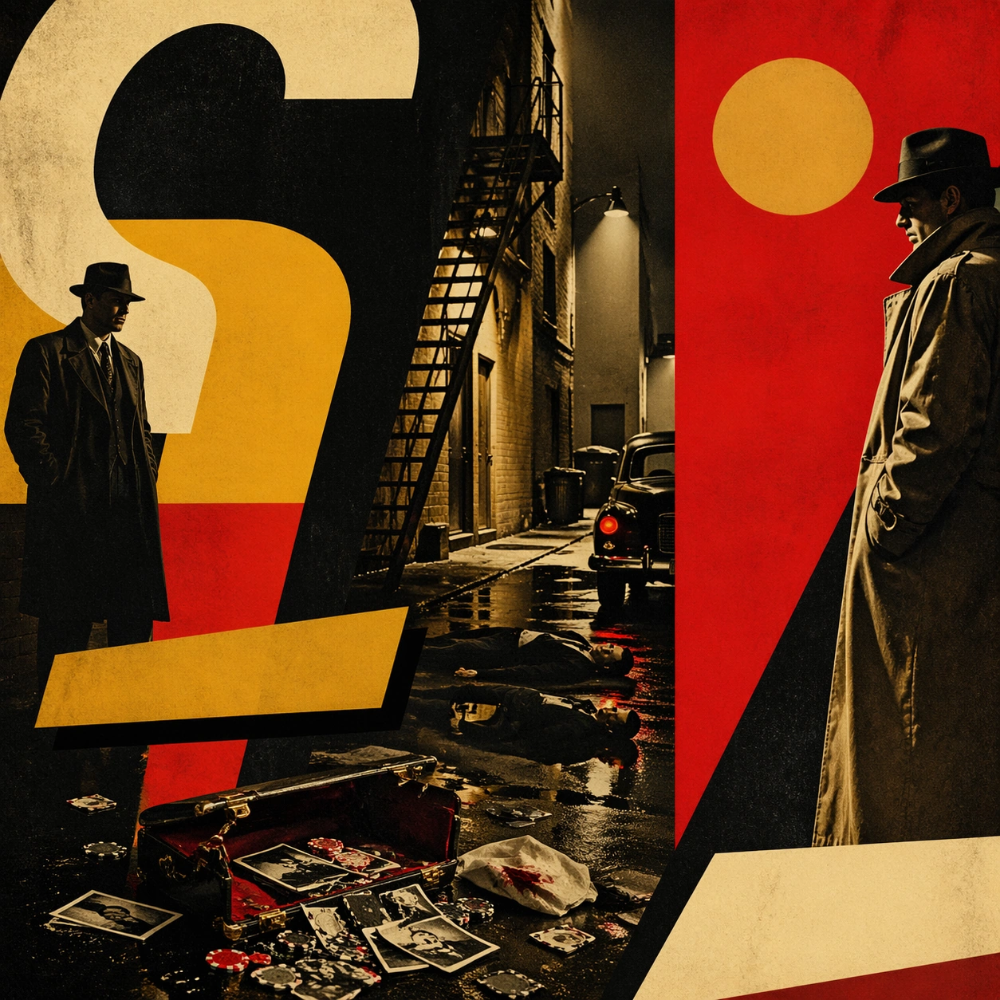

```text
Scene:
A square poster-like composition with loud red, tobacco yellow, nicotine cream, and deep black arranged in flat graphic blocks over a staged crime tableau. The lighting should feel hard and directional, but the overall image should still read as a designed print object rather than a literal movie still. Set the image in a narrow back alley with wet asphalt, one fire stair, and a huge red vertical panel that crops the space like pasted print stock.

Subject:
Focus on an implied act of violence or aftermath through frozen props, bodies held in stiff poses, diner booths, cheap motel details, briefcases, dashboard reflections, or nightclub furniture. The people should feel iconic and deadpan, with tension communicated through placement and color rather than explicit gore. An exploded briefcase spills casino chips, photos, and a red-stained handkerchief while two figures hold a silent standoff at opposite edges.

Important details:
The crucial visual rule is the collision of graphic poster language and static pulp staging. Use oversized non-readable letterform-like shapes, caption bars, drop-shadow slabs, and paper-print textures without introducing actual words. Preserve bold silhouette hierarchy, cropped tension, and cynical cool. The props should read crisply enough for narrative, yet the composition must stay closer to editorial design than documentary realism.

Use case:
Pulpy Typography Over Violent Tableau single study 4/9.

Constraints:
No readable text, no watermark, no logos, preserve exact 1:1 aspect ratio, no readable text, no logos, no explicit gore, no dismemberment, no recognizable brand packaging, no comic speech balloons, no broken anatomy, no low-detail background, no accidental text fragments.
```

[Pinned source](https://github.com/ChaosRealmsAI/gpt-image-2-gallery/blob/5296db8c996e38776c83a0bc8c64f848dcd512b3/works/topics/pulpy-typography-violence-poster/packages/single-pulpy-typography-violence-poster/images/04-alley-briefcase-spill/meta.json) · GPT Image2 · 1254×1254 · No source-declared image dependencies. · ProjectD:pending individual review.

## Pool Cue Interrogation · pulpy-typography-violence-poster/single-pulpy-typography-violence-poster/05-pool-cue-interrogation

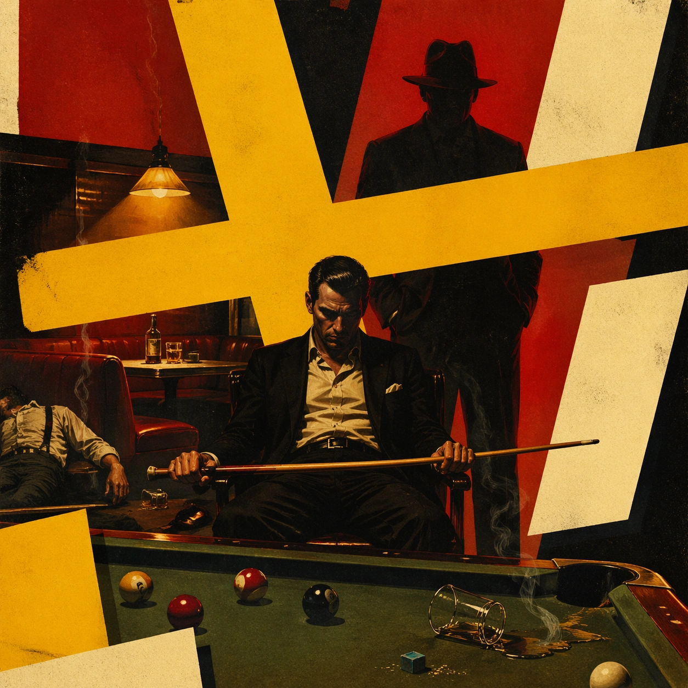

```text
Scene:
A square poster-like composition with loud red, tobacco yellow, nicotine cream, and deep black arranged in flat graphic blocks over a staged crime tableau. The lighting should feel hard and directional, but the overall image should still read as a designed print object rather than a literal movie still. Use a smoky billiards room with green felt, amber wall lamps, and thick yellow bars crossing the frame like oversized printed title blocks.

Subject:
Focus on an implied act of violence or aftermath through frozen props, bodies held in stiff poses, diner booths, cheap motel details, briefcases, dashboard reflections, or nightclub furniture. The people should feel iconic and deadpan, with tension communicated through placement and color rather than explicit gore. One seated figure grips a pool cue horizontally while another stands behind in silhouette, both frozen in tense theatrical stillness.

Important details:
The crucial visual rule is the collision of graphic poster language and static pulp staging. Use oversized non-readable letterform-like shapes, caption bars, drop-shadow slabs, and paper-print textures without introducing actual words. Preserve bold silhouette hierarchy, cropped tension, and cynical cool. Keep the violence implied through posture, broken chalk dust, and a toppled glass rather than facial injury or gore.

Use case:
Pulpy Typography Over Violent Tableau single study 5/9.

Constraints:
No readable text, no watermark, no logos, preserve exact 1:1 aspect ratio, no readable text, no logos, no explicit gore, no dismemberment, no recognizable brand packaging, no comic speech balloons, no broken anatomy, no low-detail background, no accidental text fragments.
```

[Pinned source](https://github.com/ChaosRealmsAI/gpt-image-2-gallery/blob/5296db8c996e38776c83a0bc8c64f848dcd512b3/works/topics/pulpy-typography-violence-poster/packages/single-pulpy-typography-violence-poster/images/05-pool-cue-interrogation/meta.json) · GPT Image2 · 1254×1254 · No source-declared image dependencies. · ProjectD:pending individual review.

## Neon Lounge Standoff · pulpy-typography-violence-poster/single-pulpy-typography-violence-poster/06-neon-lounge-standoff

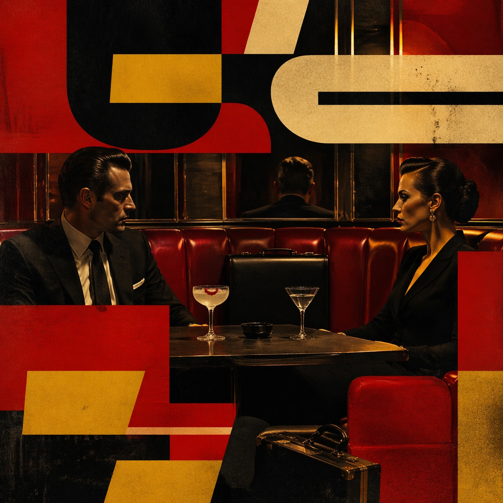

```text
Scene:
A square poster-like composition with loud red, tobacco yellow, nicotine cream, and deep black arranged in flat graphic blocks over a staged crime tableau. The lighting should feel hard and directional, but the overall image should still read as a designed print object rather than a literal movie still. Create a low-lit cocktail lounge with ruby banquettes, mirrored wall strips, and hard rectangular overlays that feel like printed typography stripped of letters.

Subject:
Focus on an implied act of violence or aftermath through frozen props, bodies held in stiff poses, diner booths, cheap motel details, briefcases, dashboard reflections, or nightclub furniture. The people should feel iconic and deadpan, with tension communicated through placement and color rather than explicit gore. Two sharply dressed figures face each other across a table with one untouched drink and one scarlet lipstick smear on the rim.

Important details:
The crucial visual rule is the collision of graphic poster language and static pulp staging. Use oversized non-readable letterform-like shapes, caption bars, drop-shadow slabs, and paper-print textures without introducing actual words. Preserve bold silhouette hierarchy, cropped tension, and cynical cool. Use the overlays to punch the image into poster space while the lounge remains tactile, cynical, and still.

Use case:
Pulpy Typography Over Violent Tableau single study 6/9.

Constraints:
No readable text, no watermark, no logos, preserve exact 1:1 aspect ratio, no readable text, no logos, no explicit gore, no dismemberment, no recognizable brand packaging, no comic speech balloons, no broken anatomy, no low-detail background, no accidental text fragments.
```

[Pinned source](https://github.com/ChaosRealmsAI/gpt-image-2-gallery/blob/5296db8c996e38776c83a0bc8c64f848dcd512b3/works/topics/pulpy-typography-violence-poster/packages/single-pulpy-typography-violence-poster/images/06-neon-lounge-standoff/meta.json) · GPT Image2 · 1254×1254 · No source-declared image dependencies. · ProjectD:pending individual review.

## Dashboard Escape · pulpy-typography-violence-poster/single-pulpy-typography-violence-poster/07-dashboard-escape

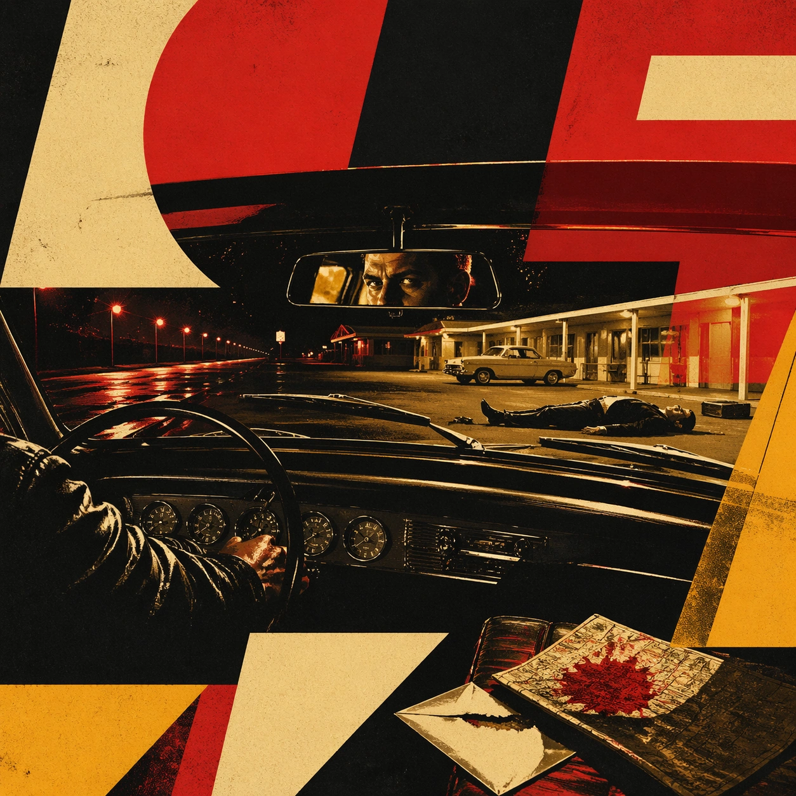

```text
Scene:
A square poster-like composition with loud red, tobacco yellow, nicotine cream, and deep black arranged in flat graphic blocks over a staged crime tableau. The lighting should feel hard and directional, but the overall image should still read as a designed print object rather than a literal movie still. Shoot through a windshield at night so dashboard chrome, wiper arcs, and streetlights become graphic bands over a dark road.

Subject:
Focus on an implied act of violence or aftermath through frozen props, bodies held in stiff poses, diner booths, cheap motel details, briefcases, dashboard reflections, or nightclub furniture. The people should feel iconic and deadpan, with tension communicated through placement and color rather than explicit gore. A driver glances into the mirror while a passenger seat holds a torn envelope and a red stain on folded maps.

Important details:
The crucial visual rule is the collision of graphic poster language and static pulp staging. Use oversized non-readable letterform-like shapes, caption bars, drop-shadow slabs, and paper-print textures without introducing actual words. Preserve bold silhouette hierarchy, cropped tension, and cynical cool. Let the car interior remain sharply arranged, with the sense of danger coming from color placement and cropping rather than motion blur.

Use case:
Pulpy Typography Over Violent Tableau single study 7/9.

Constraints:
No readable text, no watermark, no logos, preserve exact 1:1 aspect ratio, no readable text, no logos, no explicit gore, no dismemberment, no recognizable brand packaging, no comic speech balloons, no broken anatomy, no low-detail background, no accidental text fragments.
```

[Pinned source](https://github.com/ChaosRealmsAI/gpt-image-2-gallery/blob/5296db8c996e38776c83a0bc8c64f848dcd512b3/works/topics/pulpy-typography-violence-poster/packages/single-pulpy-typography-violence-poster/images/07-dashboard-escape/meta.json) · GPT Image2 · 1254×1254 · No source-declared image dependencies. · ProjectD:pending individual review.

## Butcher Paper Wall · pulpy-typography-violence-poster/single-pulpy-typography-violence-poster/08-butcher-paper-wall

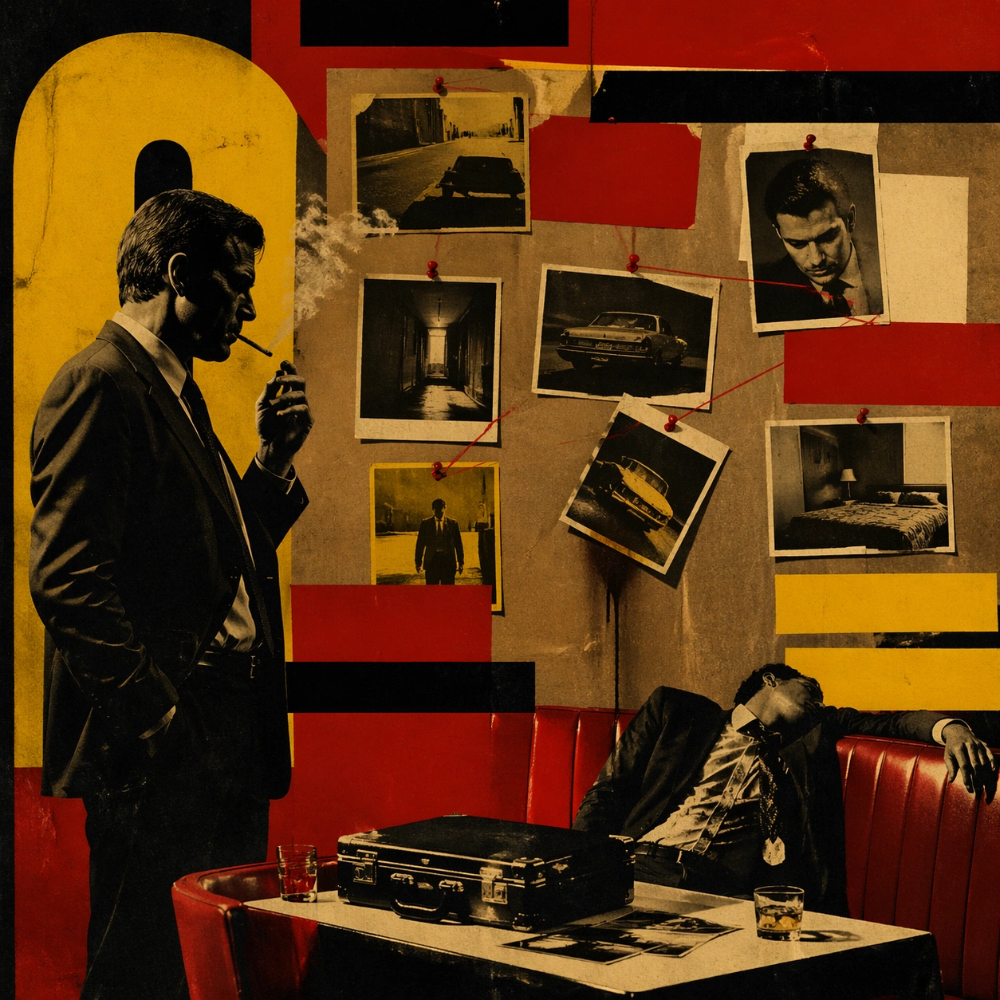

```text
Scene:
A square poster-like composition with loud red, tobacco yellow, nicotine cream, and deep black arranged in flat graphic blocks over a staged crime tableau. The lighting should feel hard and directional, but the overall image should still read as a designed print object rather than a literal movie still. Build a back-room evidence wall from brown butcher paper, taped photographs, pushpins, and flat blocks of yellow and red that mimic aggressive poster typography.

Subject:
Focus on an implied act of violence or aftermath through frozen props, bodies held in stiff poses, diner booths, cheap motel details, briefcases, dashboard reflections, or nightclub furniture. The people should feel iconic and deadpan, with tension communicated through placement and color rather than explicit gore. A single investigator stands in profile smoking beside the wall while one pinned photo droops and leaves a dark stain beneath it.

Important details:
The crucial visual rule is the collision of graphic poster language and static pulp staging. Use oversized non-readable letterform-like shapes, caption bars, drop-shadow slabs, and paper-print textures without introducing actual words. Preserve bold silhouette hierarchy, cropped tension, and cynical cool. The board should feel designed, not chaotic, with hard spacing and strong planar hierarchy dominating the narrative clues.

Use case:
Pulpy Typography Over Violent Tableau single study 8/9.

Constraints:
No readable text, no watermark, no logos, preserve exact 1:1 aspect ratio, no readable text, no logos, no explicit gore, no dismemberment, no recognizable brand packaging, no comic speech balloons, no broken anatomy, no low-detail background, no accidental text fragments.
```

[Pinned source](https://github.com/ChaosRealmsAI/gpt-image-2-gallery/blob/5296db8c996e38776c83a0bc8c64f848dcd512b3/works/topics/pulpy-typography-violence-poster/packages/single-pulpy-typography-violence-poster/images/08-butcher-paper-wall/meta.json) · GPT Image2 · 1254×1254 · No source-declared image dependencies. · ProjectD:pending individual review.

## Roulette Freeze · pulpy-typography-violence-poster/single-pulpy-typography-violence-poster/09-roulette-freeze

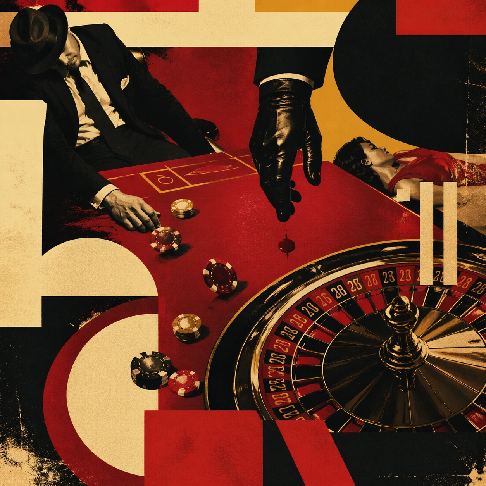

```text
Scene:
A square poster-like composition with loud red, tobacco yellow, nicotine cream, and deep black arranged in flat graphic blocks over a staged crime tableau. The lighting should feel hard and directional, but the overall image should still read as a designed print object rather than a literal movie still. Use a casino roulette table from above at a slight diagonal, with concentric circles and bold cream bars compressing the image into a printed cover aesthetic.

Subject:
Focus on an implied act of violence or aftermath through frozen props, bodies held in stiff poses, diner booths, cheap motel details, briefcases, dashboard reflections, or nightclub furniture. The people should feel iconic and deadpan, with tension communicated through placement and color rather than explicit gore. A gloved hand hangs above scattered chips while a dark crimson droplet on the felt suggests the exact instant after a silent betrayal.

Important details:
The crucial visual rule is the collision of graphic poster language and static pulp staging. Use oversized non-readable letterform-like shapes, caption bars, drop-shadow slabs, and paper-print textures without introducing actual words. Preserve bold silhouette hierarchy, cropped tension, and cynical cool. Keep the scene elegant, graphic, and cynical, emphasizing controlled shapes over explicit brutality.

Use case:
Pulpy Typography Over Violent Tableau single study 9/9.

Constraints:
No readable text, no watermark, no logos, preserve exact 1:1 aspect ratio, no readable text, no logos, no explicit gore, no dismemberment, no recognizable brand packaging, no comic speech balloons, no broken anatomy, no low-detail background, no accidental text fragments.
```

[Pinned source](https://github.com/ChaosRealmsAI/gpt-image-2-gallery/blob/5296db8c996e38776c83a0bc8c64f848dcd512b3/works/topics/pulpy-typography-violence-poster/packages/single-pulpy-typography-violence-poster/images/09-roulette-freeze/meta.json) · GPT Image2 · 1254×1254 · No source-declared image dependencies. · ProjectD:pending individual review.

## Radial Crown Plate · radiolarian-marine-sculpture/single-radiolarian-atlas/radial-crown-plate

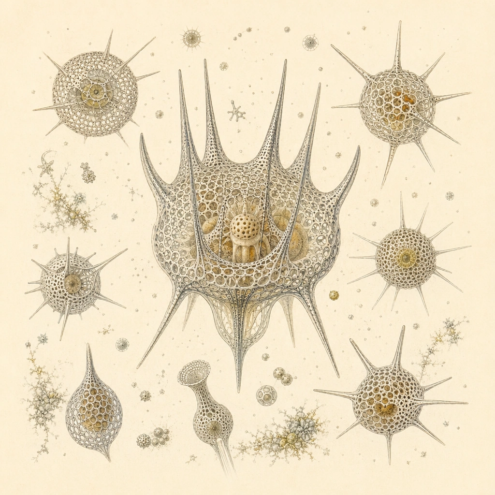

```text
Scene:
Create a square scientific plate on warm cream paper, viewed straight on with disciplined museum lighting and no environmental clutter. Several crown-like silica skeletons should be spaced evenly with enough breathing room to admire their architecture without flattening them into decorative wallpaper. Build the frame as a square natural history study with disciplined composition, believable lighting, and enough environmental evidence to explain how this organism or system functions without any caption. Keep the image polished, observational, and suitable for a research gallery rather than pulp fantasy spectacle.

Subject:
Feature related radiolarian forms built from radial spokes, perforated shells, and fine spines that suggest both buoyancy control and predator deterrence. One larger specimen can anchor the plate while smaller companions reveal variation in crown density, symmetry, and pore size. Show the anatomy, habitat interaction, and scale cues clearly so the viewer can infer locomotion, feeding, reproduction, or ecological role from the visual alone. Every visible structure should feel evolved for a purpose, with layered foreground, midground, and background information that rewards close inspection.

Important details:
Treat radiolarians as silica-skeleton plankton whose geometry serves buoyancy, defense, feeding, and reproduction. Even the most ornate forms should follow repeatable structural rules, radial symmetry variants, lattice thickness logic, and believable microscopic scale. Use microscopy precision in line weight, surface porosity, and translucency. The image should feel biologically exacting, with every silica lattice appearing deposited by growth rather than manufactured as ornament. Favor coherent biology over decorative excess: tissues, shells, membranes, spores, tendrils, fins, silica lattices, or atmospheric sacs should all follow one material logic. Preserve a convincing relationship between the environment and the body plan, use restrained color hierarchy, and make the image feel like a serious speculative field record rather than a random monster concept.

Use case:
Radiolarian Marine Sculpture Atlas single study 1/9.

Constraints:
No readable text, no watermark, no logos, preserve exact 1:1 aspect ratio, no readable labels, no jewelry catalog styling, no fantasy mandala effects, no metallic shine, no accidental brand resemblance, no direct copy of known terrestrial species, no cartoon simplification.
```

[Pinned source](https://github.com/ChaosRealmsAI/gpt-image-2-gallery/blob/5296db8c996e38776c83a0bc8c64f848dcd512b3/works/topics/radiolarian-marine-sculpture/packages/single-radiolarian-atlas/images/radial-crown-plate/meta.json) · GPT Image2 · 1024×1024 · No source-declared image dependencies. · ProjectD:pending individual review.

## Lattice Spear Array · radiolarian-marine-sculpture/single-radiolarian-atlas/lattice-spear-array

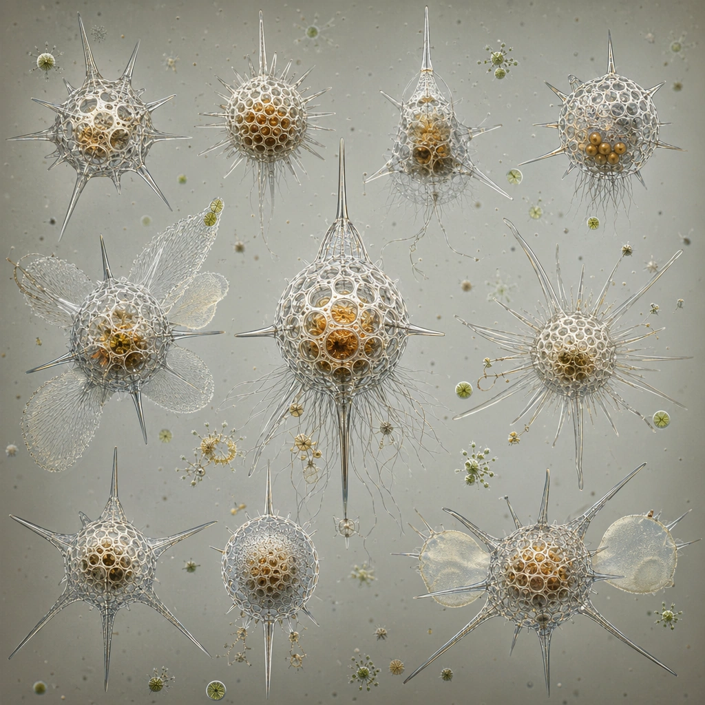

```text
Scene:
Arrange the image as a clean array on a muted neutral background, with slight drop shadows or tonal depth that keep the specimens dimensional but not theatrical. The square should read like a comparative microscopy board prepared for publication. Build the frame as a square natural history study with disciplined composition, believable lighting, and enough environmental evidence to explain how this organism or system functions without any caption. Keep the image polished, observational, and suitable for a research gallery rather than pulp fantasy spectacle.

Subject:
Present several spear-rayed shell types whose extended spines create different defensive and drifting strategies. Each specimen should be clearly distinct while remaining part of one lineage. Show the anatomy, habitat interaction, and scale cues clearly so the viewer can infer locomotion, feeding, reproduction, or ecological role from the visual alone. Every visible structure should feel evolved for a purpose, with layered foreground, midground, and background information that rewards close inspection.

Important details:
Treat radiolarians as silica-skeleton plankton whose geometry serves buoyancy, defense, feeding, and reproduction. Even the most ornate forms should follow repeatable structural rules, radial symmetry variants, lattice thickness logic, and believable microscopic scale. Maintain structural rigor in spine thickness, node repetition, and shell porosity. Decorative beauty is welcome, but it must arise from credible skeleton growth and ecological logic, not arbitrary filigree. Favor coherent biology over decorative excess: tissues, shells, membranes, spores, tendrils, fins, silica lattices, or atmospheric sacs should all follow one material logic. Preserve a convincing relationship between the environment and the body plan, use restrained color hierarchy, and make the image feel like a serious speculative field record rather than a random monster concept.

Use case:
Radiolarian Marine Sculpture Atlas single study 2/9.

Constraints:
No readable text, no watermark, no logos, preserve exact 1:1 aspect ratio, no ornamental wallpaper repeat, no gemstones, no readable grid numbers, no shiny chrome, no accidental brand resemblance, no direct copy of known terrestrial species, no cartoon simplification.
```

[Pinned source](https://github.com/ChaosRealmsAI/gpt-image-2-gallery/blob/5296db8c996e38776c83a0bc8c64f848dcd512b3/works/topics/radiolarian-marine-sculpture/packages/single-radiolarian-atlas/images/lattice-spear-array/meta.json) · GPT Image2 · 1024×1024 · No source-declared image dependencies. · ProjectD:pending individual review.

## Colonial Drift Grid · radiolarian-marine-sculpture/single-radiolarian-atlas/colonial-drift-grid

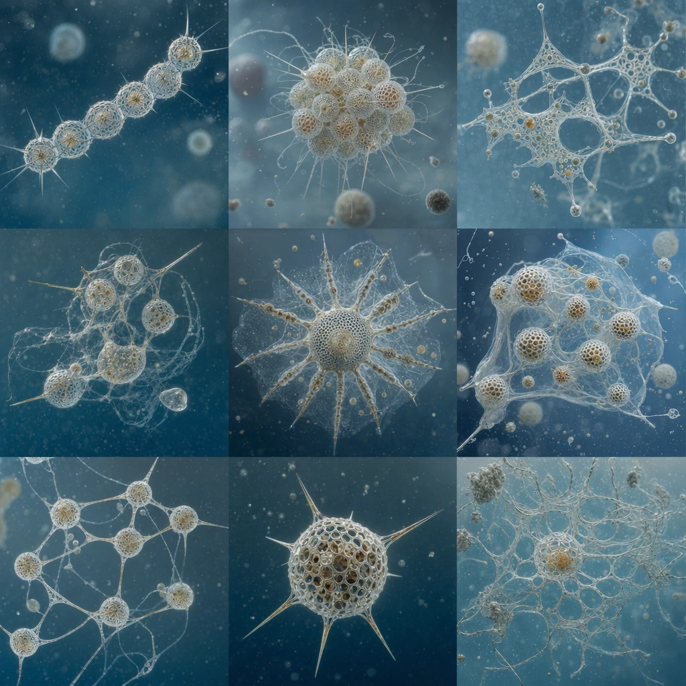

```text
Scene:
Build a square grid composition where each cell-like zone contains a different colonial radiolarian cluster suspended in subtle water-toned space. The board should remain highly organized while still suggesting microscopic life in fluid rather than dead specimens on paper. Build the frame as a square natural history study with disciplined composition, believable lighting, and enough environmental evidence to explain how this organism or system functions without any caption. Keep the image polished, observational, and suitable for a research gallery rather than pulp fantasy spectacle.

Subject:
Show linked chains, clustered spheres, and netted colonies whose shared silica structures suggest cooperation in buoyancy or feeding. Variations between colonies should be legible through architecture, not through random color shifts. Show the anatomy, habitat interaction, and scale cues clearly so the viewer can infer locomotion, feeding, reproduction, or ecological role from the visual alone. Every visible structure should feel evolved for a purpose, with layered foreground, midground, and background information that rewards close inspection.

Important details:
Treat radiolarians as silica-skeleton plankton whose geometry serves buoyancy, defense, feeding, and reproduction. Even the most ornate forms should follow repeatable structural rules, radial symmetry variants, lattice thickness logic, and believable microscopic scale. Use spacing, translucency, and scale with scientific restraint. The clusters should feel delicate and plausible, with connective elements that look grown and secreted, not welded or digitally constructed. Favor coherent biology over decorative excess: tissues, shells, membranes, spores, tendrils, fins, silica lattices, or atmospheric sacs should all follow one material logic. Preserve a convincing relationship between the environment and the body plan, use restrained color hierarchy, and make the image feel like a serious speculative field record rather than a random monster concept.

Use case:
Radiolarian Marine Sculpture Atlas single study 3/9.

Constraints:
No readable text, no watermark, no logos, preserve exact 1:1 aspect ratio, no infographic labels, no abstract data-art look, no bright candy palette, no decorative symmetry for its own sake, no accidental brand resemblance, no direct copy of known terrestrial species, no cartoon simplification.
```

[Pinned source](https://github.com/ChaosRealmsAI/gpt-image-2-gallery/blob/5296db8c996e38776c83a0bc8c64f848dcd512b3/works/topics/radiolarian-marine-sculpture/packages/single-radiolarian-atlas/images/colonial-drift-grid/meta.json) · GPT Image2 · 1024×1024 · No source-declared image dependencies. · ProjectD:pending individual review.

## Silica Spine Rosette · radiolarian-marine-sculpture/single-radiolarian-atlas/silica-spine-rosette


```text
Scene:
Compose a polished plate around one dominant rosette specimen surrounded by a few smaller relatives on a softly toned background. The overall mood should be archival, delicate, and exact, like a flagship plate from a marine microfauna atlas. Build the frame as a square natural history study with disciplined composition, believable lighting, and enough environmental evidence to explain how this organism or system functions without any caption. Keep the image polished, observational, and suitable for a research gallery rather than pulp fantasy spectacle.

Subject:
Center on dense spoke patterns, nested shells, and radiating spines that imply anti-predator architecture and drag control in the water column. The smaller companion forms should help the viewer compare how rosette geometry can diversify. Show the anatomy, habitat interaction, and scale cues clearly so the viewer can infer locomotion, feeding, reproduction, or ecological role from the visual alone. Every visible structure should feel evolved for a purpose, with layered foreground, midground, and background information that rewards close inspection.

Important details:
Treat radiolarians as silica-skeleton plankton whose geometry serves buoyancy, defense, feeding, and reproduction. Even the most ornate forms should follow repeatable structural rules, radial symmetry variants, lattice thickness logic, and believable microscopic scale. Emphasize the silica material itself: translucent, brittle, porous, and mathematically ordered but biologically grown. Avoid floral sentimentality and keep the structures unmistakably microscopic and marine. Favor coherent biology over decorative excess: tissues, shells, membranes, spores, tendrils, fins, silica lattices, or atmospheric sacs should all follow one material logic. Preserve a convincing relationship between the environment and the body plan, use restrained color hierarchy, and make the image feel like a serious speculative field record rather than a random monster concept.

Use case:
Radiolarian Marine Sculpture Atlas single study 4/9.

Constraints:
No readable text, no watermark, no logos, preserve exact 1:1 aspect ratio, no flower petals, no mandala abstraction, no polished metal, no readable captions, no accidental brand resemblance, no direct copy of known terrestrial species, no cartoon simplification.
```

[Pinned source](https://github.com/ChaosRealmsAI/gpt-image-2-gallery/blob/5296db8c996e38776c83a0bc8c64f848dcd512b3/works/topics/radiolarian-marine-sculpture/packages/single-radiolarian-atlas/images/silica-spine-rosette/meta.json) · GPT Image2 · 1024×1024 · No source-declared image dependencies. · ProjectD:pending individual review.

## Predator Cage Form · radiolarian-marine-sculpture/single-radiolarian-atlas/predator-cage-form

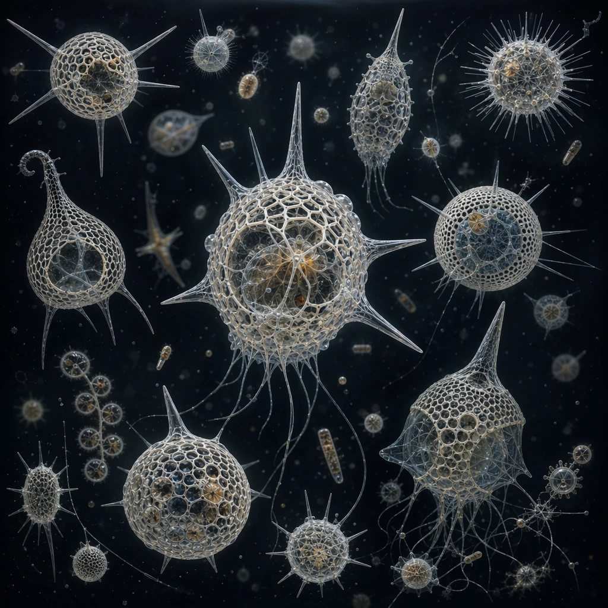

```text
Scene:
Use a dark neutral microscopy backdrop rather than cream paper for this plate, letting pale silica skeletons glow softly against the depth. The square composition should still feel organized and scientific, with careful specimen spacing and subtle sense of suspension. Build the frame as a square natural history study with disciplined composition, believable lighting, and enough environmental evidence to explain how this organism or system functions without any caption. Keep the image polished, observational, and suitable for a research gallery rather than pulp fantasy spectacle.

Subject:
Feature cage-like shell forms with inward-pointing spines, feeding chambers, and trap geometries suggesting micro-predation. Include a few related variants to show how the cage strategy can diversify across lineages. Show the anatomy, habitat interaction, and scale cues clearly so the viewer can infer locomotion, feeding, reproduction, or ecological role from the visual alone. Every visible structure should feel evolved for a purpose, with layered foreground, midground, and background information that rewards close inspection.

Important details:
Treat radiolarians as silica-skeleton plankton whose geometry serves buoyancy, defense, feeding, and reproduction. Even the most ornate forms should follow repeatable structural rules, radial symmetry variants, lattice thickness logic, and believable microscopic scale. Keep the specimens elegant but not sinister. Their predatory function should be legible through geometry and pore arrangement, while the microscopy atmosphere remains cool and disciplined. Favor coherent biology over decorative excess: tissues, shells, membranes, spores, tendrils, fins, silica lattices, or atmospheric sacs should all follow one material logic. Preserve a convincing relationship between the environment and the body plan, use restrained color hierarchy, and make the image feel like a serious speculative field record rather than a random monster concept.

Use case:
Radiolarian Marine Sculpture Atlas single study 5/9.

Constraints:
No readable text, no watermark, no logos, preserve exact 1:1 aspect ratio, no horror vibe, no monster-face illusion, no neon glow, no sci-fi mechanical cages, no accidental brand resemblance, no direct copy of known terrestrial species, no cartoon simplification.
```

[Pinned source](https://github.com/ChaosRealmsAI/gpt-image-2-gallery/blob/5296db8c996e38776c83a0bc8c64f848dcd512b3/works/topics/radiolarian-marine-sculpture/packages/single-radiolarian-atlas/images/predator-cage-form/meta.json) · GPT Image2 · 1024×1024 · No source-declared image dependencies. · ProjectD:pending individual review.

## Reproductive Bloom Sheet · radiolarian-marine-sculpture/single-radiolarian-atlas/reproductive-bloom-sheet

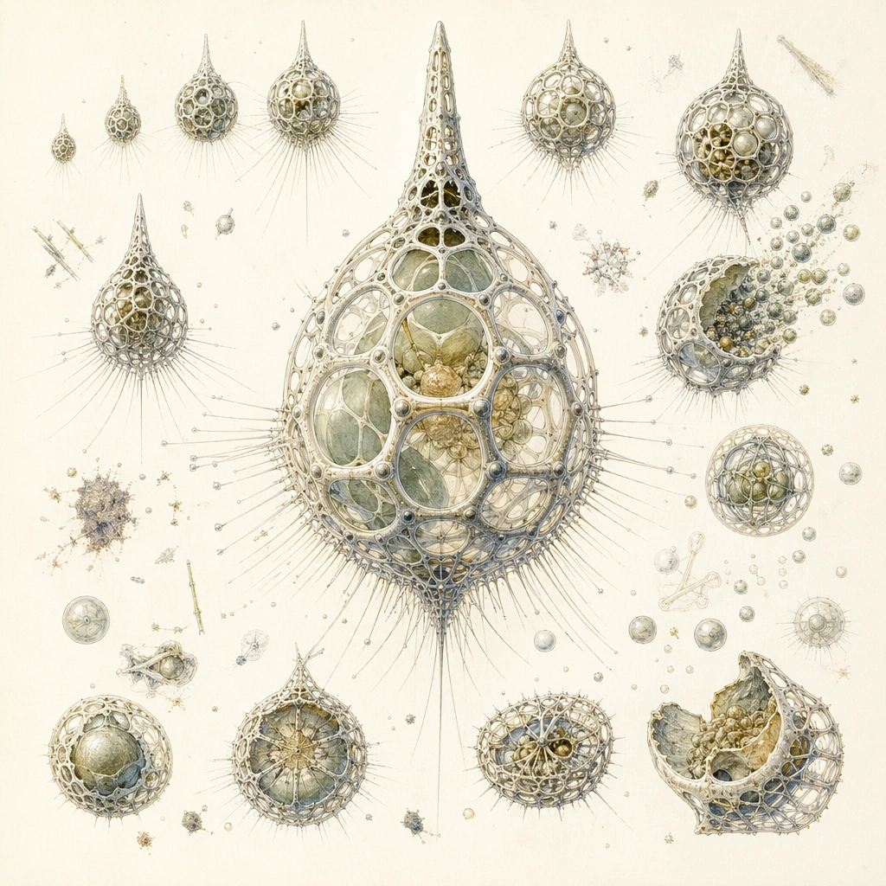

```text
Scene:
Arrange a cream scientific sheet that compares several growth or reproductive states of one radiolarian lineage. The page should feel careful and developmental, with one main mature form and surrounding earlier or altered states. Build the frame as a square natural history study with disciplined composition, believable lighting, and enough environmental evidence to explain how this organism or system functions without any caption. Keep the image polished, observational, and suitable for a research gallery rather than pulp fantasy spectacle.

Subject:
Show budding lattice expansion, spore-like release bodies, and shell remodeling that supports reproduction or seasonal bloom formation. The specimens should remain clearly related while displaying meaningful structural change. Show the anatomy, habitat interaction, and scale cues clearly so the viewer can infer locomotion, feeding, reproduction, or ecological role from the visual alone. Every visible structure should feel evolved for a purpose, with layered foreground, midground, and background information that rewards close inspection.

Important details:
Treat radiolarians as silica-skeleton plankton whose geometry serves buoyancy, defense, feeding, and reproduction. Even the most ornate forms should follow repeatable structural rules, radial symmetry variants, lattice thickness logic, and believable microscopic scale. The comparative logic matters more than visual spectacle. Use consistent scale cues, line discipline, and silica texture so the sheet reads as a developmental study rather than decorative variation. Favor coherent biology over decorative excess: tissues, shells, membranes, spores, tendrils, fins, silica lattices, or atmospheric sacs should all follow one material logic. Preserve a convincing relationship between the environment and the body plan, use restrained color hierarchy, and make the image feel like a serious speculative field record rather than a random monster concept.

Use case:
Radiolarian Marine Sculpture Atlas single study 6/9.

Constraints:
No readable text, no watermark, no logos, preserve exact 1:1 aspect ratio, no readable annotations, no infographic arrows, no fantasy blossom metaphor, no unrelated background scenery, no accidental brand resemblance, no direct copy of known terrestrial species, no cartoon simplification.
```

[Pinned source](https://github.com/ChaosRealmsAI/gpt-image-2-gallery/blob/5296db8c996e38776c83a0bc8c64f848dcd512b3/works/topics/radiolarian-marine-sculpture/packages/single-radiolarian-atlas/images/reproductive-bloom-sheet/meta.json) · GPT Image2 · 1024×1024 · No source-declared image dependencies. · ProjectD:pending individual review.

## Abyssal Snow Cluster · radiolarian-marine-sculpture/single-radiolarian-atlas/abyssal-snow-cluster

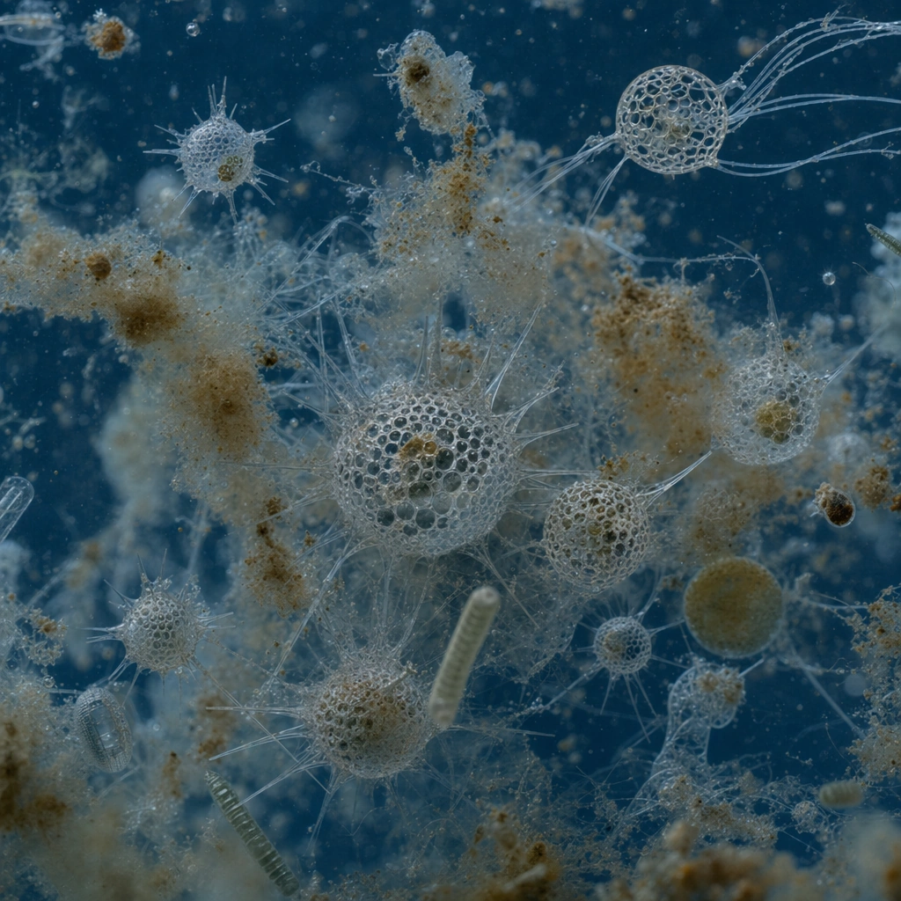

```text
Scene:
Create a microscopy-style scene with a dim blue water background, where marine-snow particles and several delicate radiolarian clusters drift together. The square frame should feel like a live microscopic field rather than a museum plate, but still maintain composition discipline. Build the frame as a square natural history study with disciplined composition, believable lighting, and enough environmental evidence to explain how this organism or system functions without any caption. Keep the image polished, observational, and suitable for a research gallery rather than pulp fantasy spectacle.

Subject:
Focus on how fragile skeletal forms travel with organic debris and planktonic aggregates. Some specimens can be partially occluded by marine snow to reinforce the sense of active suspension. Show the anatomy, habitat interaction, and scale cues clearly so the viewer can infer locomotion, feeding, reproduction, or ecological role from the visual alone. Every visible structure should feel evolved for a purpose, with layered foreground, midground, and background information that rewards close inspection.

Important details:
Treat radiolarians as silica-skeleton plankton whose geometry serves buoyancy, defense, feeding, and reproduction. Even the most ornate forms should follow repeatable structural rules, radial symmetry variants, lattice thickness logic, and believable microscopic scale. Keep the scene subtle and scientific. The contrast between drifting particulate matter and precise silica architecture should create the beauty, not dramatic lighting or fantasy effects. Favor coherent biology over decorative excess: tissues, shells, membranes, spores, tendrils, fins, silica lattices, or atmospheric sacs should all follow one material logic. Preserve a convincing relationship between the environment and the body plan, use restrained color hierarchy, and make the image feel like a serious speculative field record rather than a random monster concept.

Use case:
Radiolarian Marine Sculpture Atlas single study 7/9.

Constraints:
No readable text, no watermark, no logos, preserve exact 1:1 aspect ratio, no space-scene resemblance, no starfield abstraction, no neon glows, no readable overlays, no accidental brand resemblance, no direct copy of known terrestrial species, no cartoon simplification.
```

[Pinned source](https://github.com/ChaosRealmsAI/gpt-image-2-gallery/blob/5296db8c996e38776c83a0bc8c64f848dcd512b3/works/topics/radiolarian-marine-sculpture/packages/single-radiolarian-atlas/images/abyssal-snow-cluster/meta.json) · GPT Image2 · 1024×1024 · No source-declared image dependencies. · ProjectD:pending individual review.

## Comparative Morphology Board · radiolarian-marine-sculpture/single-radiolarian-atlas/comparative-morphology-board

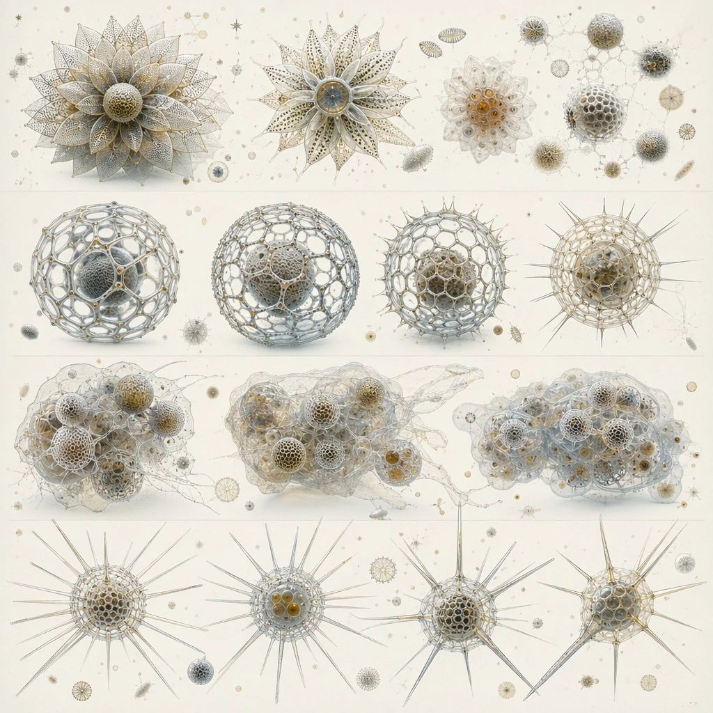

```text
Scene:
Build a highly legible square comparison board on cream or pale gray, with specimens arranged so the eye can move from simple shells to complex lattices. The layout should feel editorially clean but still unmistakably scientific. Build the frame as a square natural history study with disciplined composition, believable lighting, and enough environmental evidence to explain how this organism or system functions without any caption. Keep the image polished, observational, and suitable for a research gallery rather than pulp fantasy spectacle.

Subject:
Include at least four distinct skeleton strategies: rosette, cage, colonial, and spear-rayed forms. Each should occupy a clear zone of the board and feel related through material but different in function. Show the anatomy, habitat interaction, and scale cues clearly so the viewer can infer locomotion, feeding, reproduction, or ecological role from the visual alone. Every visible structure should feel evolved for a purpose, with layered foreground, midground, and background information that rewards close inspection.

Important details:
Treat radiolarians as silica-skeleton plankton whose geometry serves buoyancy, defense, feeding, and reproduction. Even the most ornate forms should follow repeatable structural rules, radial symmetry variants, lattice thickness logic, and believable microscopic scale. Clarity is the goal. Preserve fine pores, translucency, and repeating structural motifs while preventing the board from becoming crowded or purely ornamental. Favor coherent biology over decorative excess: tissues, shells, membranes, spores, tendrils, fins, silica lattices, or atmospheric sacs should all follow one material logic. Preserve a convincing relationship between the environment and the body plan, use restrained color hierarchy, and make the image feel like a serious speculative field record rather than a random monster concept.

Use case:
Radiolarian Marine Sculpture Atlas single study 8/9.

Constraints:
No readable text, no watermark, no logos, preserve exact 1:1 aspect ratio, no text labels, no UI cards, no decorative wallpaper rhythm, no metallic highlights, no accidental brand resemblance, no direct copy of known terrestrial species, no cartoon simplification.
```

[Pinned source](https://github.com/ChaosRealmsAI/gpt-image-2-gallery/blob/5296db8c996e38776c83a0bc8c64f848dcd512b3/works/topics/radiolarian-marine-sculpture/packages/single-radiolarian-atlas/images/comparative-morphology-board/meta.json) · GPT Image2 · 1024×1024 · No source-declared image dependencies. · ProjectD:pending individual review.

## Museum Atlas Cover · radiolarian-marine-sculpture/single-radiolarian-atlas/museum-atlas-cover

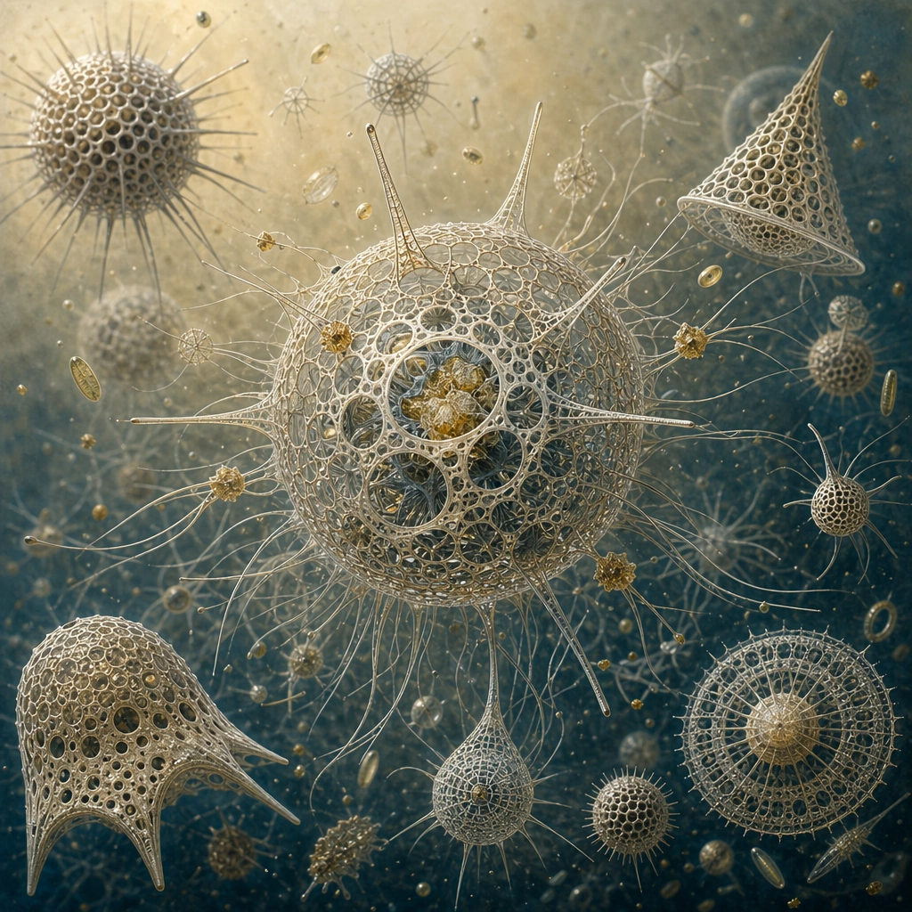

```text
Scene:
Finish with a refined atlas-cover composition that gathers several iconic radiolarian forms into one square image on a warm archival ground. The balance should feel curatorial and elegant, like the frontispiece of a prestigious marine microfauna volume. Build the frame as a square natural history study with disciplined composition, believable lighting, and enough environmental evidence to explain how this organism or system functions without any caption. Keep the image polished, observational, and suitable for a research gallery rather than pulp fantasy spectacle.

Subject:
Arrange a dominant centerpiece specimen with supporting forms around it, maintaining depth and relation without turning them into cutout stickers. The composition should synthesize the package while preserving scientific seriousness. Show the anatomy, habitat interaction, and scale cues clearly so the viewer can infer locomotion, feeding, reproduction, or ecological role from the visual alone. Every visible structure should feel evolved for a purpose, with layered foreground, midground, and background information that rewards close inspection.

Important details:
Treat radiolarians as silica-skeleton plankton whose geometry serves buoyancy, defense, feeding, and reproduction. Even the most ornate forms should follow repeatable structural rules, radial symmetry variants, lattice thickness logic, and believable microscopic scale. Beauty should come from precision, spacing, and silica geometry. The image must feel like a real scientific-art object, not a decorative poster using microscopic motifs as ornament. Favor coherent biology over decorative excess: tissues, shells, membranes, spores, tendrils, fins, silica lattices, or atmospheric sacs should all follow one material logic. Preserve a convincing relationship between the environment and the body plan, use restrained color hierarchy, and make the image feel like a serious speculative field record rather than a random monster concept.

Use case:
Radiolarian Marine Sculpture Atlas single study 9/9.

Constraints:
No readable text, no watermark, no logos, preserve exact 1:1 aspect ratio, no readable title text, no fashion-editorial styling, no abstract mandala cover, no flat icon treatment, no accidental brand resemblance, no direct copy of known terrestrial species, no cartoon simplification.
```

[Pinned source](https://github.com/ChaosRealmsAI/gpt-image-2-gallery/blob/5296db8c996e38776c83a0bc8c64f848dcd512b3/works/topics/radiolarian-marine-sculpture/packages/single-radiolarian-atlas/images/museum-atlas-cover/meta.json) · GPT Image2 · 1024×1024 · No source-declared image dependencies. · ProjectD:pending individual review.

## Flooded Plain Stand · rain-wind-samurai-duel/single-rain-wind-samurai-duel/01-flooded-plain-stand

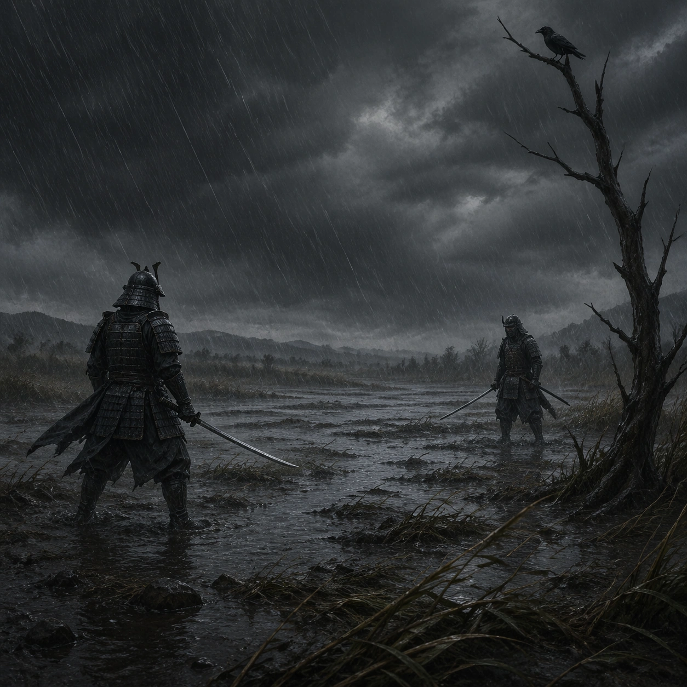

```text
Scene:
A square outdoor battlefield image shaped by violent weather: slanting rain, flattened reeds, mud spray, charcoal clouds, and wind carving motion through fabric and grass. The palette should stay restrained in charcoal, wet brown, muted steel, and deep moss, with nature overpowering the people within it. Show a wide flooded plain under hard slant rain, with shallow water rippling around the duel ground and one dead branch rising at the edge.

Subject:
The subject is two lone armored duelists facing each other across open ground, bamboo edges, flooded fields, or broken terrain. Their poses should feel precise and ritualized, with tension coming from stance, distance, and weather rather than from explicit impact. Two armored fighters face each other at measured distance, knees soft and blades low, while a crow waits on the branch.

Important details:
The core language is discipline against elemental force. Preserve historically inspired layered armor, soaked cloth, muddy terrain, reeds bent by wind, and the sense that rain itself is a character. Avoid fantasy powers, impossible weapons, or decorative heroic posing. The emotional weight should come from the rain, the silence before motion, and the tiny human scale inside the weather.

Use case:
Rain Wind Samurai Duel Field single study 1/9.

Constraints:
No readable text, no watermark, no logos, preserve exact 1:1 aspect ratio, no readable banners, no bright saturated armor, no fantasy monsters, no gore splatter, no stylized comic effects, no broken anatomy, no low-detail background, no accidental text fragments.
```

[Pinned source](https://github.com/ChaosRealmsAI/gpt-image-2-gallery/blob/5296db8c996e38776c83a0bc8c64f848dcd512b3/works/topics/rain-wind-samurai-duel/packages/single-rain-wind-samurai-duel/images/01-flooded-plain-stand/meta.json) · GPT Image2 · 1254×1254 · No source-declared image dependencies. · ProjectD:pending individual review.

## Reed Marsh Draw · rain-wind-samurai-duel/single-rain-wind-samurai-duel/02-reed-marsh-draw


```text
Scene:
A square outdoor battlefield image shaped by violent weather: slanting rain, flattened reeds, mud spray, charcoal clouds, and wind carving motion through fabric and grass. The palette should stay restrained in charcoal, wet brown, muted steel, and deep moss, with nature overpowering the people within it. Use a marsh of bending reeds and black water channels, with wind flattening the plants into long diagonal strokes.

Subject:
The subject is two lone armored duelists facing each other across open ground, bamboo edges, flooded fields, or broken terrain. Their poses should feel precise and ritualized, with tension coming from stance, distance, and weather rather than from explicit impact. One duelist has just begun to draw their blade while the other remains perfectly still across the mud.

Important details:
The core language is discipline against elemental force. Preserve historically inspired layered armor, soaked cloth, muddy terrain, reeds bent by wind, and the sense that rain itself is a character. Avoid fantasy powers, impossible weapons, or decorative heroic posing. Keep the gesture minimal and precise, making the reeds and rain carry most of the kinetic energy.

Use case:
Rain Wind Samurai Duel Field single study 2/9.

Constraints:
No readable text, no watermark, no logos, preserve exact 1:1 aspect ratio, no readable banners, no bright saturated armor, no fantasy monsters, no gore splatter, no stylized comic effects, no broken anatomy, no low-detail background, no accidental text fragments.
```

[Pinned source](https://github.com/ChaosRealmsAI/gpt-image-2-gallery/blob/5296db8c996e38776c83a0bc8c64f848dcd512b3/works/topics/rain-wind-samurai-duel/packages/single-rain-wind-samurai-duel/images/02-reed-marsh-draw/meta.json) · GPT Image2 · 1254×1254 · No source-declared image dependencies. · ProjectD:pending individual review.

## Bamboo Ridge · rain-wind-samurai-duel/single-rain-wind-samurai-duel/03-bamboo-ridge


```text
Scene:
A square outdoor battlefield image shaped by violent weather: slanting rain, flattened reeds, mud spray, charcoal clouds, and wind carving motion through fabric and grass. The palette should stay restrained in charcoal, wet brown, muted steel, and deep moss, with nature overpowering the people within it. Place the confrontation on a muddy ridge below dark bamboo, with rain streaking almost sideways through the trunks.

Subject:
The subject is two lone armored duelists facing each other across open ground, bamboo edges, flooded fields, or broken terrain. Their poses should feel precise and ritualized, with tension coming from stance, distance, and weather rather than from explicit impact. Two figures in traditional armor stand offset on the ridge, cloaks snapping in opposite directions from the wind.

Important details:
The core language is discipline against elemental force. Preserve historically inspired layered armor, soaked cloth, muddy terrain, reeds bent by wind, and the sense that rain itself is a character. Avoid fantasy powers, impossible weapons, or decorative heroic posing. The bamboo should frame but not decorate, reinforcing the disciplined vertical rhythm of the scene.

Use case:
Rain Wind Samurai Duel Field single study 3/9.

Constraints:
No readable text, no watermark, no logos, preserve exact 1:1 aspect ratio, no readable banners, no bright saturated armor, no fantasy monsters, no gore splatter, no stylized comic effects, no broken anatomy, no low-detail background, no accidental text fragments.
```

[Pinned source](https://github.com/ChaosRealmsAI/gpt-image-2-gallery/blob/5296db8c996e38776c83a0bc8c64f848dcd512b3/works/topics/rain-wind-samurai-duel/packages/single-rain-wind-samurai-duel/images/03-bamboo-ridge/meta.json) · GPT Image2 · 1254×1254 · No source-declared image dependencies. · ProjectD:pending individual review.

## Broken Fence Crossing · rain-wind-samurai-duel/single-rain-wind-samurai-duel/04-broken-fence-crossing


```text
Scene:
A square outdoor battlefield image shaped by violent weather: slanting rain, flattened reeds, mud spray, charcoal clouds, and wind carving motion through fabric and grass. The palette should stay restrained in charcoal, wet brown, muted steel, and deep moss, with nature overpowering the people within it. Show a field cut by a broken fence line and puddled track, with heavy rain turning the soil black and reflective.

Subject:
The subject is two lone armored duelists facing each other across open ground, bamboo edges, flooded fields, or broken terrain. Their poses should feel precise and ritualized, with tension coming from stance, distance, and weather rather than from explicit impact. The duelists stand on opposite sides of the broken fence opening, sharing one invisible line of movement through the gap.

Important details:
The core language is discipline against elemental force. Preserve historically inspired layered armor, soaked cloth, muddy terrain, reeds bent by wind, and the sense that rain itself is a character. Avoid fantasy powers, impossible weapons, or decorative heroic posing. Let the fence fragments and puddles deepen the composition without distracting from the poised bodies.

Use case:
Rain Wind Samurai Duel Field single study 4/9.

Constraints:
No readable text, no watermark, no logos, preserve exact 1:1 aspect ratio, no readable banners, no bright saturated armor, no fantasy monsters, no gore splatter, no stylized comic effects, no broken anatomy, no low-detail background, no accidental text fragments.
```

[Pinned source](https://github.com/ChaosRealmsAI/gpt-image-2-gallery/blob/5296db8c996e38776c83a0bc8c64f848dcd512b3/works/topics/rain-wind-samurai-duel/packages/single-rain-wind-samurai-duel/images/04-broken-fence-crossing/meta.json) · GPT Image2 · 1024×1024 · No source-declared image dependencies. · ProjectD:pending individual review.

## Shrine Gate Distance · rain-wind-samurai-duel/single-rain-wind-samurai-duel/05-shrine-gate-distance


```text
Scene:
A square outdoor battlefield image shaped by violent weather: slanting rain, flattened reeds, mud spray, charcoal clouds, and wind carving motion through fabric and grass. The palette should stay restrained in charcoal, wet brown, muted steel, and deep moss, with nature overpowering the people within it. Use a weathered gate on the far horizon, barely visible through rain, while the duel takes place on open muddy ground in front of it.

Subject:
The subject is two lone armored duelists facing each other across open ground, bamboo edges, flooded fields, or broken terrain. Their poses should feel precise and ritualized, with tension coming from stance, distance, and weather rather than from explicit impact. The two fighters stand far apart enough that the distance itself feels like part of the ritual.

Important details:
The core language is discipline against elemental force. Preserve historically inspired layered armor, soaked cloth, muddy terrain, reeds bent by wind, and the sense that rain itself is a character. Avoid fantasy powers, impossible weapons, or decorative heroic posing. Keep the gate modest and atmospheric, with the open field and rain curtain doing the main dramatic work.

Use case:
Rain Wind Samurai Duel Field single study 5/9.

Constraints:
No readable text, no watermark, no logos, preserve exact 1:1 aspect ratio, no readable banners, no bright saturated armor, no fantasy monsters, no gore splatter, no stylized comic effects, no broken anatomy, no low-detail background, no accidental text fragments.
```

[Pinned source](https://github.com/ChaosRealmsAI/gpt-image-2-gallery/blob/5296db8c996e38776c83a0bc8c64f848dcd512b3/works/topics/rain-wind-samurai-duel/packages/single-rain-wind-samurai-duel/images/05-shrine-gate-distance/meta.json) · GPT Image2 · 1254×1254 · No source-declared image dependencies. · ProjectD:pending individual review.

## Wind Bent Grass · rain-wind-samurai-duel/single-rain-wind-samurai-duel/06-wind-bent-grass


```text
Scene:
A square outdoor battlefield image shaped by violent weather: slanting rain, flattened reeds, mud spray, charcoal clouds, and wind carving motion through fabric and grass. The palette should stay restrained in charcoal, wet brown, muted steel, and deep moss, with nature overpowering the people within it. Set the scene in tall wet grass bent nearly flat by wind, with low dark sky and water beading along every blade.

Subject:
The subject is two lone armored duelists facing each other across open ground, bamboo edges, flooded fields, or broken terrain. Their poses should feel precise and ritualized, with tension coming from stance, distance, and weather rather than from explicit impact. The duelists stand in opposing profiles, blades still sheathed, communicating pressure through stance alone.

Important details:
The core language is discipline against elemental force. Preserve historically inspired layered armor, soaked cloth, muddy terrain, reeds bent by wind, and the sense that rain itself is a character. Avoid fantasy powers, impossible weapons, or decorative heroic posing. Make the grass movement directional and forceful so the weather feels stronger than the people.

Use case:
Rain Wind Samurai Duel Field single study 6/9.

Constraints:
No readable text, no watermark, no logos, preserve exact 1:1 aspect ratio, no readable banners, no bright saturated armor, no fantasy monsters, no gore splatter, no stylized comic effects, no broken anatomy, no low-detail background, no accidental text fragments.
```

[Pinned source](https://github.com/ChaosRealmsAI/gpt-image-2-gallery/blob/5296db8c996e38776c83a0bc8c64f848dcd512b3/works/topics/rain-wind-samurai-duel/packages/single-rain-wind-samurai-duel/images/06-wind-bent-grass/meta.json) · GPT Image2 · 1254×1254 · No source-declared image dependencies. · ProjectD:pending individual review.

## Mud Splash Charge · rain-wind-samurai-duel/single-rain-wind-samurai-duel/07-mud-splash-charge


```text
Scene:
A square outdoor battlefield image shaped by violent weather: slanting rain, flattened reeds, mud spray, charcoal clouds, and wind carving motion through fabric and grass. The palette should stay restrained in charcoal, wet brown, muted steel, and deep moss, with nature overpowering the people within it. Capture the first instant of motion on a muddy field where both fighters surge forward and the rain explodes off the ground in dark spray.

Subject:
The subject is two lone armored duelists facing each other across open ground, bamboo edges, flooded fields, or broken terrain. Their poses should feel precise and ritualized, with tension coming from stance, distance, and weather rather than from explicit impact. The bodies remain readable and disciplined, not acrobatic, with one committed forward step from each side.

Important details:
The core language is discipline against elemental force. Preserve historically inspired layered armor, soaked cloth, muddy terrain, reeds bent by wind, and the sense that rain itself is a character. Avoid fantasy powers, impossible weapons, or decorative heroic posing. The energy should still feel heavy and real, driven by footing, rain, and cloth weight rather than fantasy speed.

Use case:
Rain Wind Samurai Duel Field single study 7/9.

Constraints:
No readable text, no watermark, no logos, preserve exact 1:1 aspect ratio, no readable banners, no bright saturated armor, no fantasy monsters, no gore splatter, no stylized comic effects, no broken anatomy, no low-detail background, no accidental text fragments.
```

[Pinned source](https://github.com/ChaosRealmsAI/gpt-image-2-gallery/blob/5296db8c996e38776c83a0bc8c64f848dcd512b3/works/topics/rain-wind-samurai-duel/packages/single-rain-wind-samurai-duel/images/07-mud-splash-charge/meta.json) · GPT Image2 · 1254×1254 · No source-declared image dependencies. · ProjectD:pending individual review.

## Sword Lock In Rain · rain-wind-samurai-duel/single-rain-wind-samurai-duel/08-sword-lock-in-rain


```text
Scene:
A square outdoor battlefield image shaped by violent weather: slanting rain, flattened reeds, mud spray, charcoal clouds, and wind carving motion through fabric and grass. The palette should stay restrained in charcoal, wet brown, muted steel, and deep moss, with nature overpowering the people within it. Use a close mid-distance frame where the fighters finally meet in a crossed-blade lock amid streaming rain and blowing reeds.

Subject:
The subject is two lone armored duelists facing each other across open ground, bamboo edges, flooded fields, or broken terrain. Their poses should feel precise and ritualized, with tension coming from stance, distance, and weather rather than from explicit impact. Both helmets and soaked armor remain visible, but the weather and tension of the locked blades dominate the emotion.

Important details:
The core language is discipline against elemental force. Preserve historically inspired layered armor, soaked cloth, muddy terrain, reeds bent by wind, and the sense that rain itself is a character. Avoid fantasy powers, impossible weapons, or decorative heroic posing. Preserve the physical strain of stance and footing without introducing graphic injury or spectacle excess.

Use case:
Rain Wind Samurai Duel Field single study 8/9.

Constraints:
No readable text, no watermark, no logos, preserve exact 1:1 aspect ratio, no readable banners, no bright saturated armor, no fantasy monsters, no gore splatter, no stylized comic effects, no broken anatomy, no low-detail background, no accidental text fragments.
```

[Pinned source](https://github.com/ChaosRealmsAI/gpt-image-2-gallery/blob/5296db8c996e38776c83a0bc8c64f848dcd512b3/works/topics/rain-wind-samurai-duel/packages/single-rain-wind-samurai-duel/images/08-sword-lock-in-rain/meta.json) · GPT Image2 · 1254×1254 · No source-declared image dependencies. · ProjectD:pending individual review.

## Crow Aftermath · rain-wind-samurai-duel/single-rain-wind-samurai-duel/09-crow-aftermath


```text
Scene:
A square outdoor battlefield image shaped by violent weather: slanting rain, flattened reeds, mud spray, charcoal clouds, and wind carving motion through fabric and grass. The palette should stay restrained in charcoal, wet brown, muted steel, and deep moss, with nature overpowering the people within it. End on the muddy field moments after the clash, with rain still falling hard, one crow dropping from a dead branch, and the ground showing fresh slide marks.

Subject:
The subject is two lone armored duelists facing each other across open ground, bamboo edges, flooded fields, or broken terrain. Their poses should feel precise and ritualized, with tension coming from stance, distance, and weather rather than from explicit impact. The two duelists stand separated again, one slightly bowed, the other holding still, leaving the outcome unresolved.

Important details:
The core language is discipline against elemental force. Preserve historically inspired layered armor, soaked cloth, muddy terrain, reeds bent by wind, and the sense that rain itself is a character. Avoid fantasy powers, impossible weapons, or decorative heroic posing. Keep the ambiguity and weather stronger than any triumph, so the final image feels tragic and elemental.

Use case:
Rain Wind Samurai Duel Field single study 9/9.

Constraints:
No readable text, no watermark, no logos, preserve exact 1:1 aspect ratio, no readable banners, no bright saturated armor, no fantasy monsters, no gore splatter, no stylized comic effects, no broken anatomy, no low-detail background, no accidental text fragments.
```

[Pinned source](https://github.com/ChaosRealmsAI/gpt-image-2-gallery/blob/5296db8c996e38776c83a0bc8c64f848dcd512b3/works/topics/rain-wind-samurai-duel/packages/single-rain-wind-samurai-duel/images/09-crow-aftermath/meta.json) · GPT Image2 · 1254×1254 · No source-declared image dependencies. · ProjectD:pending individual review.

## Reference Anchor · rain-window-memory/series-core-system/01-reference-anchor


```text
Scene:
Create a square cinematic still for Rain Window Memory. Use production-grade photoreal lighting, disciplined lens behavior, and a composition that feels like a finished key frame from an original film rather than a casual snapshot. A rain-covered window fills much of the frame while the city outside dissolves into cool bokeh circles and smeared light trails, and a warm interior lamp reflection hovers on the glass without overpowering the weathered surface. Keep the camera in a disciplined anchor position so the full lighting event and the main spatial structure are immediately legible from edge to edge.

Subject:
Build a coherent original scene whose emotional center comes from atmosphere, light physics, and spatial clarity. Avoid relying on celebrity likeness, franchise iconography, or stylized illustration shortcuts. The subject is the interaction of droplets, finger-smear traces, condensation, reflected room light, and soft urban color beyond the pane, with any human presence implied indirectly rather than shown as a posed portrait. This frame should lock the canonical arrangement, scale relationship, and emotional tone that the later dependent images inherit.

Important details:
Preserve a believable physical world with strong depth layering, careful color separation, and premium image discipline. Render droplet scale, gravity-driven streaking, condensation edges, and double reflections with high fidelity, preserving a restrained emotional intimacy that feels personal and cinematic instead of sentimental or glossy. Use this image to establish the authoritative direction of light, atmospheric density, and structural silhouette for the package.

Use case:
Rain Window series study 1/9.

Constraints:
No readable text, no watermark, no logos, preserve exact 1:1 aspect ratio, no readable street signs, no brand logos, no full face pressed to the glass, no cartoon heart iconography, no perfect symmetrical droplets.
```

[Pinned source](https://github.com/ChaosRealmsAI/gpt-image-2-gallery/blob/5296db8c996e38776c83a0bc8c64f848dcd512b3/works/topics/rain-window-memory/packages/series-core-system/images/01-reference-anchor/meta.json) · GPT Image2 · 1254×1254 · No source-declared image dependencies. · ProjectD:pending individual review.

## Closer Frame · rain-window-memory/series-core-system/02-closer-frame


```text
Scene:
Create a square cinematic still for Rain Window Memory. Use production-grade photoreal lighting, disciplined lens behavior, and a composition that feels like a finished key frame from an original film rather than a casual snapshot. A rain-covered window fills much of the frame while the city outside dissolves into cool bokeh circles and smeared light trails, and a warm interior lamp reflection hovers on the glass without overpowering the weathered surface. Move the camera closer or lower so the viewer feels more embedded inside the atmosphere while the same light direction and environment remain intact.

Subject:
Build a coherent original scene whose emotional center comes from atmosphere, light physics, and spatial clarity. Avoid relying on celebrity likeness, franchise iconography, or stylized illustration shortcuts. The subject is the interaction of droplets, finger-smear traces, condensation, reflected room light, and soft urban color beyond the pane, with any human presence implied indirectly rather than shown as a posed portrait. Preserve the same world logic from the reference and let one human-scale or material-scale element become more prominent without stealing focus from the atmosphere.

Important details:
Preserve a believable physical world with strong depth layering, careful color separation, and premium image discipline. Render droplet scale, gravity-driven streaking, condensation edges, and double reflections with high fidelity, preserving a restrained emotional intimacy that feels personal and cinematic instead of sentimental or glossy. Keep the palette family, structural read, and light behavior from image 01 while increasing immediacy and tactile presence.

Use case:
Rain Window series study 2/9.

Constraints:
No readable text, no watermark, no logos, preserve exact 1:1 aspect ratio, no readable street signs, no brand logos, no full face pressed to the glass, no cartoon heart iconography, no perfect symmetrical droplets.
```

[Pinned source](https://github.com/ChaosRealmsAI/gpt-image-2-gallery/blob/5296db8c996e38776c83a0bc8c64f848dcd512b3/works/topics/rain-window-memory/packages/series-core-system/images/02-closer-frame/meta.json) · GPT Image2 · 1254×1254 · Reference images required. · ProjectD:pending individual review.

## Spatial Counterpoint · rain-window-memory/series-core-system/03-spatial-counterpoint


```text
Scene:
Create a square cinematic still for Rain Window Memory. Use production-grade photoreal lighting, disciplined lens behavior, and a composition that feels like a finished key frame from an original film rather than a casual snapshot. A rain-covered window fills much of the frame while the city outside dissolves into cool bokeh circles and smeared light trails, and a warm interior lamp reflection hovers on the glass without overpowering the weathered surface. Shift to an oblique or lateral point of view that reveals different depth layers while staying inside the same place and the same atmospheric event.

Subject:
Build a coherent original scene whose emotional center comes from atmosphere, light physics, and spatial clarity. Avoid relying on celebrity likeness, franchise iconography, or stylized illustration shortcuts. The subject is the interaction of droplets, finger-smear traces, condensation, reflected room light, and soft urban color beyond the pane, with any human presence implied indirectly rather than shown as a posed portrait. Hold the reference structure, but use the new angle to show secondary planes, foreground interruption, or a changed distance relationship.

Important details:
Preserve a believable physical world with strong depth layering, careful color separation, and premium image discipline. Render droplet scale, gravity-driven streaking, condensation edges, and double reflections with high fidelity, preserving a restrained emotional intimacy that feels personal and cinematic instead of sentimental or glossy. The success condition is continuity with the reference plus a richer sense of depth, not a new location or a new lighting system.

Use case:
Rain Window series study 3/9.

Constraints:
No readable text, no watermark, no logos, preserve exact 1:1 aspect ratio, no readable street signs, no brand logos, no full face pressed to the glass, no cartoon heart iconography, no perfect symmetrical droplets.
```

[Pinned source](https://github.com/ChaosRealmsAI/gpt-image-2-gallery/blob/5296db8c996e38776c83a0bc8c64f848dcd512b3/works/topics/rain-window-memory/packages/series-core-system/images/03-spatial-counterpoint/meta.json) · GPT Image2 · 1254×1254 · Reference images required. · ProjectD:pending individual review.

## Climax Frame · rain-window-memory/series-core-system/04-climax-frame


```text
Scene:
Create a square cinematic still for Rain Window Memory. Use production-grade photoreal lighting, disciplined lens behavior, and a composition that feels like a finished key frame from an original film rather than a casual snapshot. A rain-covered window fills much of the frame while the city outside dissolves into cool bokeh circles and smeared light trails, and a warm interior lamp reflection hovers on the glass without overpowering the weathered surface. Push the composition toward the emotional peak of the same setup, with the most dramatic balance of brightness, shadow, or atmospheric density inside the established world.

Subject:
Build a coherent original scene whose emotional center comes from atmosphere, light physics, and spatial clarity. Avoid relying on celebrity likeness, franchise iconography, or stylized illustration shortcuts. The subject is the interaction of droplets, finger-smear traces, condensation, reflected room light, and soft urban color beyond the pane, with any human presence implied indirectly rather than shown as a posed portrait. Everything should still read as the same location and same event, but framed for maximum narrative force and visual closure.

Important details:
Preserve a believable physical world with strong depth layering, careful color separation, and premium image discipline. Render droplet scale, gravity-driven streaking, condensation edges, and double reflections with high fidelity, preserving a restrained emotional intimacy that feels personal and cinematic instead of sentimental or glossy. Make it feel like the strongest hero frame of the sequence without breaking continuity or introducing a new design language.

Use case:
Rain Window series study 4/9.

Constraints:
No readable text, no watermark, no logos, preserve exact 1:1 aspect ratio, no readable street signs, no brand logos, no full face pressed to the glass, no cartoon heart iconography, no perfect symmetrical droplets.
```

[Pinned source](https://github.com/ChaosRealmsAI/gpt-image-2-gallery/blob/5296db8c996e38776c83a0bc8c64f848dcd512b3/works/topics/rain-window-memory/packages/series-core-system/images/04-climax-frame/meta.json) · GPT Image2 · 1254×1254 · Reference images required. · ProjectD:pending individual review.

## Surface Study · rain-window-memory/single-support-studies/surface-study


```text
Scene:
Create a square cinematic still for Rain Window Memory. Use production-grade photoreal lighting, disciplined lens behavior, and a composition that feels like a finished key frame from an original film rather than a casual snapshot. A rain-covered window fills much of the frame while the city outside dissolves into cool bokeh circles and smeared light trails, and a warm interior lamp reflection hovers on the glass without overpowering the weathered surface. Build an independent square study around the way atmosphere interacts with surfaces, keeping enough environmental context for the image to feel finished rather than cropped at random.

Subject:
Build a coherent original scene whose emotional center comes from atmosphere, light physics, and spatial clarity. Avoid relying on celebrity likeness, franchise iconography, or stylized illustration shortcuts. The subject is the interaction of droplets, finger-smear traces, condensation, reflected room light, and soft urban color beyond the pane, with any human presence implied indirectly rather than shown as a posed portrait. Let textures, reflections, residue, moisture, dust, or particulate response become primary, while the broader setting remains clearly implied.

Important details:
Preserve a believable physical world with strong depth layering, careful color separation, and premium image discipline. Render droplet scale, gravity-driven streaking, condensation edges, and double reflections with high fidelity, preserving a restrained emotional intimacy that feels personal and cinematic instead of sentimental or glossy. The key is material credibility under dramatic light, with micro-contrast and controlled mood supporting the theme.

Use case:
Rain Window single study 5/9.

Constraints:
No readable text, no watermark, no logos, preserve exact 1:1 aspect ratio, no readable street signs, no brand logos, no full face pressed to the glass, no cartoon heart iconography, no perfect symmetrical droplets.
```

[Pinned source](https://github.com/ChaosRealmsAI/gpt-image-2-gallery/blob/5296db8c996e38776c83a0bc8c64f848dcd512b3/works/topics/rain-window-memory/packages/single-support-studies/images/surface-study/meta.json) · GPT Image2 · 1254×1254 · No source-declared image dependencies. · ProjectD:pending individual review.

## Silhouette Study · rain-window-memory/single-support-studies/silhouette-study


```text
Scene:
Create a square cinematic still for Rain Window Memory. Use production-grade photoreal lighting, disciplined lens behavior, and a composition that feels like a finished key frame from an original film rather than a casual snapshot. A rain-covered window fills much of the frame while the city outside dissolves into cool bokeh circles and smeared light trails, and a warm interior lamp reflection hovers on the glass without overpowering the weathered surface. Compose an independent frame where one human, animal, or object silhouette negotiates with the atmospheric light event in a clean, readable way.

Subject:
Build a coherent original scene whose emotional center comes from atmosphere, light physics, and spatial clarity. Avoid relying on celebrity likeness, franchise iconography, or stylized illustration shortcuts. The subject is the interaction of droplets, finger-smear traces, condensation, reflected room light, and soft urban color beyond the pane, with any human presence implied indirectly rather than shown as a posed portrait. The silhouette should supply scale and emotional orientation, but the environment still needs to carry most of the storytelling weight.

Important details:
Preserve a believable physical world with strong depth layering, careful color separation, and premium image discipline. Render droplet scale, gravity-driven streaking, condensation edges, and double reflections with high fidelity, preserving a restrained emotional intimacy that feels personal and cinematic instead of sentimental or glossy. Keep the silhouette simple and believable, avoiding poster-like graphic flattening while preserving strong contrast.

Use case:
Rain Window single study 6/9.

Constraints:
No readable text, no watermark, no logos, preserve exact 1:1 aspect ratio, no readable street signs, no brand logos, no full face pressed to the glass, no cartoon heart iconography, no perfect symmetrical droplets.
```

[Pinned source](https://github.com/ChaosRealmsAI/gpt-image-2-gallery/blob/5296db8c996e38776c83a0bc8c64f848dcd512b3/works/topics/rain-window-memory/packages/single-support-studies/images/silhouette-study/meta.json) · GPT Image2 · 1254×1254 · No source-declared image dependencies. · ProjectD:pending individual review.

## Transition Study · rain-window-memory/single-support-studies/transition-study


```text
Scene:
Create a square cinematic still for Rain Window Memory. Use production-grade photoreal lighting, disciplined lens behavior, and a composition that feels like a finished key frame from an original film rather than a casual snapshot. A rain-covered window fills much of the frame while the city outside dissolves into cool bokeh circles and smeared light trails, and a warm interior lamp reflection hovers on the glass without overpowering the weathered surface. Treat this as an adjacent moment before or after the main event, preserving the same topic language while letting the atmosphere shift slightly in intensity or position.

Subject:
Build a coherent original scene whose emotional center comes from atmosphere, light physics, and spatial clarity. Avoid relying on celebrity likeness, franchise iconography, or stylized illustration shortcuts. The subject is the interaction of droplets, finger-smear traces, condensation, reflected room light, and soft urban color beyond the pane, with any human presence implied indirectly rather than shown as a posed portrait. Show the environment in transition, with clear evidence of recent motion, changing weather, or fading light, but without turning it into action spectacle.

Important details:
Preserve a believable physical world with strong depth layering, careful color separation, and premium image discipline. Render droplet scale, gravity-driven streaking, condensation edges, and double reflections with high fidelity, preserving a restrained emotional intimacy that feels personal and cinematic instead of sentimental or glossy. Subtle temporal storytelling matters here more than maximal drama, so let traces, gradients, and environmental residue do the work.

Use case:
Rain Window single study 7/9.

Constraints:
No readable text, no watermark, no logos, preserve exact 1:1 aspect ratio, no readable street signs, no brand logos, no full face pressed to the glass, no cartoon heart iconography, no perfect symmetrical droplets.
```

[Pinned source](https://github.com/ChaosRealmsAI/gpt-image-2-gallery/blob/5296db8c996e38776c83a0bc8c64f848dcd512b3/works/topics/rain-window-memory/packages/single-support-studies/images/transition-study/meta.json) · GPT Image2 · 1254×1254 · No source-declared image dependencies. · ProjectD:pending individual review.

## Wide Study · rain-window-memory/single-support-studies/wide-study


```text
Scene:
Create a square cinematic still for Rain Window Memory. Use production-grade photoreal lighting, disciplined lens behavior, and a composition that feels like a finished key frame from an original film rather than a casual snapshot. A rain-covered window fills much of the frame while the city outside dissolves into cool bokeh circles and smeared light trails, and a warm interior lamp reflection hovers on the glass without overpowering the weathered surface. Pull back enough to explain the broader geography or architectural envelope while keeping the square crop intentional and balanced.

Subject:
Build a coherent original scene whose emotional center comes from atmosphere, light physics, and spatial clarity. Avoid relying on celebrity likeness, franchise iconography, or stylized illustration shortcuts. The subject is the interaction of droplets, finger-smear traces, condensation, reflected room light, and soft urban color beyond the pane, with any human presence implied indirectly rather than shown as a posed portrait. The wider frame should reveal how the main light or weather phenomenon organizes the surrounding world and not just the immediate subject.

Important details:
Preserve a believable physical world with strong depth layering, careful color separation, and premium image discipline. Render droplet scale, gravity-driven streaking, condensation edges, and double reflections with high fidelity, preserving a restrained emotional intimacy that feels personal and cinematic instead of sentimental or glossy. Make scale legible through spacing, horizon control, and foreground-to-background separation rather than through extra props.

Use case:
Rain Window single study 8/9.

Constraints:
No readable text, no watermark, no logos, preserve exact 1:1 aspect ratio, no readable street signs, no brand logos, no full face pressed to the glass, no cartoon heart iconography, no perfect symmetrical droplets.
```

[Pinned source](https://github.com/ChaosRealmsAI/gpt-image-2-gallery/blob/5296db8c996e38776c83a0bc8c64f848dcd512b3/works/topics/rain-window-memory/packages/single-support-studies/images/wide-study/meta.json) · GPT Image2 · 1254×1254 · No source-declared image dependencies. · ProjectD:pending individual review.

## Afterglow Study · rain-window-memory/single-support-studies/afterglow-study


```text
Scene:
Create a square cinematic still for Rain Window Memory. Use production-grade photoreal lighting, disciplined lens behavior, and a composition that feels like a finished key frame from an original film rather than a casual snapshot. A rain-covered window fills much of the frame while the city outside dissolves into cool bokeh circles and smeared light trails, and a warm interior lamp reflection hovers on the glass without overpowering the weathered surface. End on a quieter independent image that holds the residue of the topic atmosphere after its loudest moment has passed, while still feeling complete and exhibition-ready.

Subject:
Build a coherent original scene whose emotional center comes from atmosphere, light physics, and spatial clarity. Avoid relying on celebrity likeness, franchise iconography, or stylized illustration shortcuts. The subject is the interaction of droplets, finger-smear traces, condensation, reflected room light, and soft urban color beyond the pane, with any human presence implied indirectly rather than shown as a posed portrait. The frame should suggest memory, aftermath, or lingering presence through environment first and only secondarily through any figure or object.

Important details:
Preserve a believable physical world with strong depth layering, careful color separation, and premium image discipline. Render droplet scale, gravity-driven streaking, condensation edges, and double reflections with high fidelity, preserving a restrained emotional intimacy that feels personal and cinematic instead of sentimental or glossy. Favor restraint, believable light decay, and subtle narrative closure over spectacle or decorative excess.

Use case:
Rain Window single study 9/9.

Constraints:
No readable text, no watermark, no logos, preserve exact 1:1 aspect ratio, no readable street signs, no brand logos, no full face pressed to the glass, no cartoon heart iconography, no perfect symmetrical droplets.
```

[Pinned source](https://github.com/ChaosRealmsAI/gpt-image-2-gallery/blob/5296db8c996e38776c83a0bc8c64f848dcd512b3/works/topics/rain-window-memory/packages/single-support-studies/images/afterglow-study/meta.json) · GPT Image2 · 1254×1254 · No source-declared image dependencies. · ProjectD:pending individual review.

## Evening Table Anchor · ramadan-and-eid-hospitality-campaign/series-hospitality-evening-system/01-evening-table-anchor


```text
Scene:
Create a square premium hospitality campaign image at evening with warm lantern light, deep blue twilight shadows, gold accents, and refined architectural calm. The environment should feel respectful, welcoming, and commercially polished, suitable for hotels, dining brands, or gifting campaigns around Ramadan and Eid. Use a table or hosting surface with believable spatial depth and a serene atmosphere rather than spectacle.

Subject:
Center a carefully arranged hospitality scene with dates, tableware, textiles, lantern-adjacent lighting, elegant serving pieces, and one or two gift elements. The objects should communicate generosity, evening gathering, and thoughtful presentation. Keep the composition grounded in hospitality and care, with no readable script and no generic luxury clichés that erase cultural specificity.

Important details:
Lock the campaign grammar here: warm evening glow, calm blue depth, refined geometry, rich but respectful textiles, hospitality-first composition, and premium material realism. The anchor should feel culturally aware and operationally flexible across hotel, retail, dining, or gifting campaign surfaces. Avoid decorative excess. Let dignity, warmth, and generosity carry the image.

Use case:
Ramadan/Eid series study 1/9.

Constraints:
No readable text, no watermark, no logos, preserve exact 1:1 aspect ratio, no readable calligraphy, no logo packaging, no crowd, no fantasy palace set, no stereotype overload, no stage-performance lighting, no visible alcohol, no kitsch lantern tunnel.
```

[Pinned source](https://github.com/ChaosRealmsAI/gpt-image-2-gallery/blob/5296db8c996e38776c83a0bc8c64f848dcd512b3/works/topics/ramadan-and-eid-hospitality-campaign/packages/series-hospitality-evening-system/images/01-evening-table-anchor/meta.json) · GPT Image2 · 1024×1024 · No source-declared image dependencies. · ProjectD:pending individual review.

## Hotel Iftar Variation · ramadan-and-eid-hospitality-campaign/series-hospitality-evening-system/02-hotel-iftar-variation


```text
Scene:
Create a square dependent hospitality image in the exact same evening-lit world, preserving the same warm lantern glow, blue shadow depth, gold accents, and calm respect from the reference image, but widen the composition into a polished hotel iftar setting. The frame should remain unmistakably part of the same campaign family while becoming more architectural and table-service oriented.

Subject:
Show an elegant iftar table or lounge setup with serving pieces, dates, glassware, textiles, and subtle gift-ready elements. Preserve exact lighting, palette, and hospitality identity from the reference model while shifting emphasis toward hotel service and evening gathering. The scene should feel welcoming, premium, and suitable for real hospitality marketing.

Important details:
Preserve exact campaign identity from the reference image. The variation should deepen the hosting context without changing the visual language. Make stone, metal, glass, woven fabric, and ambient light all feel convincing. Avoid generic luxury clichés and keep the mood respectful, serene, and commercially useful for seasonal hospitality rollout.

Use case:
Ramadan/Eid series study 2/9.

Constraints:
No readable text, no watermark, no logos, preserve exact 1:1 aspect ratio, preserve exact campaign identity from the reference image, no readable menus, no crowd, no logo tableware, no alcohol, no palace fantasy, no overdecorated stage feel, no stereotype caricature.
```

[Pinned source](https://github.com/ChaosRealmsAI/gpt-image-2-gallery/blob/5296db8c996e38776c83a0bc8c64f848dcd512b3/works/topics/ramadan-and-eid-hospitality-campaign/packages/series-hospitality-evening-system/images/02-hotel-iftar-variation/meta.json) · GPT Image2 · 1024×1024 · Reference images required. · ProjectD:pending individual review.

## Perfume Hamper Variation · ramadan-and-eid-hospitality-campaign/series-hospitality-evening-system/03-perfume-hamper-variation


```text
Scene:
Create a square dependent gifting image within the same respectful evening campaign world, keeping the exact warm lantern light, blue shadow balance, gold accents, and premium calm from the reference image, but tighten the composition around a gift hamper or tray. The visual continuity should feel exact, as if the same brand world has simply focused on gifting for Eid or evening hospitality.

Subject:
Center an elegant hamper or tray containing fragrance-like bottles, textiles, dates or sweets, serving pieces, and premium gift packaging arranged into a cohesive offering. Preserve exact hospitality mood, palette, and material language from the reference model while shifting toward gifting. The result should remain brand-neutral, respectful, and commercially plausible for upscale seasonal gifting.

Important details:
Maintain the reference identity precisely. The gifting tier can rise, but the tone must stay calm and dignified. Make glass, metal, paper, fabric, and ambient light highly believable. Avoid logo dependence or luxury clichés that feel disconnected from hospitality. The scene should work for retail, hotel gifting, or premium seasonal commerce.

Use case:
Ramadan/Eid series study 3/9.

Constraints:
No readable text, no watermark, no logos, preserve exact 1:1 aspect ratio, preserve exact campaign identity from the reference image, no readable labels, no logo boxes, no alcohol bottles, no crowd, no fantasy palace, no gaudy gold overload, no stereotype props.
```

[Pinned source](https://github.com/ChaosRealmsAI/gpt-image-2-gallery/blob/5296db8c996e38776c83a0bc8c64f848dcd512b3/works/topics/ramadan-and-eid-hospitality-campaign/packages/series-hospitality-evening-system/images/03-perfume-hamper-variation/meta.json) · GPT Image2 · 1024×1024 · Reference images required. · ProjectD:pending individual review.

## Dessert Spread Variation · ramadan-and-eid-hospitality-campaign/series-hospitality-evening-system/04-dessert-spread-variation


```text
Scene:
Create a square dependent hospitality image in the same evening-lit environment, preserving the exact warm lantern glow, blue ambient depth, and refined textile-material language from the reference image, but organize the composition around a dessert and serving spread. The scene should still feel clearly connected to the anchor while becoming more table-rich and abundance-focused.

Subject:
Show a composed spread of sweets, dates, tea or coffee service, serving vessels, and one subtle gift element arranged into a premium hosting image. Preserve exact campaign identity from the reference model while changing the emphasis toward celebratory food and hospitality. The spread should look real, respectful, and suitable for hospitality or retail communication during the season.

Important details:
Keep the mood generous but measured. Surface realism matters: glaze, metal, pastry texture, fabric weave, and lantern light should all feel persuasive. The image should behave like a premium seasonal asset for restaurants, hotels, or gifting brands. It must remain calm, culturally informed, and free of spectacle-heavy distraction.

Use case:
Ramadan/Eid series study 4/9.

Constraints:
No readable text, no watermark, no logos, preserve exact 1:1 aspect ratio, preserve exact campaign identity from the reference image, no readable menu cards, no alcohol, no crowd, no logo plates, no fantasy palace, no overdecorated stage set, no stereotype props.
```

[Pinned source](https://github.com/ChaosRealmsAI/gpt-image-2-gallery/blob/5296db8c996e38776c83a0bc8c64f848dcd512b3/works/topics/ramadan-and-eid-hospitality-campaign/packages/series-hospitality-evening-system/images/04-dessert-spread-variation/meta.json) · GPT Image2 · 1024×1024 · Reference images required. · ProjectD:pending individual review.

## Crescent Window Suhoor · ramadan-and-eid-hospitality-campaign/single-respectful-context-studies/crescent-window-suhour


```text
Scene:
Create a square pre-dawn hospitality image with cool blue window light, soft warm interior lamp glow, and a calm intimate atmosphere. The frame should feel contemplative and premium rather than dramatic. Use a small table or tray setup with careful spacing and believable architectural context so the scene can support respectful seasonal storytelling or hospitality communication.

Subject:
Show a simple but elegant pre-dawn meal or preparation setup with tableware, dates, beverage vessel, folded textile, and one subtle decorative or gifting element. The subject should communicate care, quiet routine, and gentle anticipation through object arrangement. Keep everything original, non-branded, and free of readable script.

Important details:
Restraint matters. Use light, reflection, textile texture, and the contrast between cool dawn and warm interior tones to create emotional depth. The image should feel suitable for hospitality, lifestyle, or campaign storytelling around early-morning ritual and care. Avoid spectacle and avoid flattening the scene into generic minimalism. Keep the frame precise enough for gallery, research, and campaign reuse, with believable materials and a strong thumbnail read.

Use case:
Ramadan/Eid single study 5/9.

Constraints:
No readable text, no watermark, no logos, preserve exact 1:1 aspect ratio, no readable script, no logo packaging, no crowd, no fantasy palace, no alcohol, no stage-lighting drama, no cliché moon cartoon, no exaggerated luxury clutter.
```

[Pinned source](https://github.com/ChaosRealmsAI/gpt-image-2-gallery/blob/5296db8c996e38776c83a0bc8c64f848dcd512b3/works/topics/ramadan-and-eid-hospitality-campaign/packages/single-respectful-context-studies/images/crescent-window-suhour/meta.json) · GPT Image2 · 1024×1024 · No source-declared image dependencies. · ProjectD:pending individual review.

## Serving Tray Closeup · ramadan-and-eid-hospitality-campaign/single-respectful-context-studies/serving-tray-closeup


```text
Scene:
Create a square close-up hospitality image with warm evening light, shallow but believable depth of field, and strong tactile focus. The crop should feel like a premium editorial detail from a larger campaign, not a random macro shot. Keep the tray and surrounding surfaces legible enough that the hospitality context remains clear and usable for campaign support.

Subject:
Focus on a serving tray with dates, cups, small sweets, textile edge, and one gift-ready packaging or fragrance silhouette nearby. The arrangement should communicate care, hosting, and refinement through a small number of objects. Emphasize craftsmanship, table discipline, and the dignity of presentation rather than decorative excess.

Important details:
Micro-texture carries the frame. Metal, ceramic, woven fabric, food surfaces, and warm light must all feel real. The image should support premium hospitality, gifting, or editorial campaign use during Ramadan and Eid season. Keep it respectful and elevated, avoiding stereotype overload or generic luxury noise. Keep the frame precise enough for gallery, research, and campaign reuse, with believable materials and a strong thumbnail read.

Use case:
Ramadan/Eid single study 6/9.

Constraints:
No readable text, no watermark, no logos, preserve exact 1:1 aspect ratio, no readable labels, no logo cups, no alcohol, no crowded buffet, no fantasy props, no stage-lit glamour, no hands dominating frame, no exaggerated ornament overload.
```

[Pinned source](https://github.com/ChaosRealmsAI/gpt-image-2-gallery/blob/5296db8c996e38776c83a0bc8c64f848dcd512b3/works/topics/ramadan-and-eid-hospitality-campaign/packages/single-respectful-context-studies/images/serving-tray-closeup/meta.json) · GPT Image2 · 1024×1024 · No source-declared image dependencies. · ProjectD:pending individual review.

## Family Place Setting · ramadan-and-eid-hospitality-campaign/single-respectful-context-studies/family-place-setting


```text
Scene:
Create a square table-setting campaign image with warm evening light, calm blue-shadow depth, and a home-hospitality atmosphere that feels premium and respectful. The frame should suggest a family gathering without showing many faces. Use elegant composition, polished tableware, and believable room context so the image can support hospitality, retail, or lifestyle messaging.

Subject:
Show several place settings, serving pieces, dates, beverage vessels, folded textiles, and one subtle gifting cue arranged for shared evening hospitality. The table should feel ready and welcoming, not already in use. Focus on generosity, order, and care through the arrangement of objects and spatial rhythm rather than through portrait emotion or readable notes.

Important details:
Material accuracy and cultural respect matter. Keep linens, ceramics, metal, food texture, and ambient light all persuasive. The image should feel useful for hotels, supermarkets, dining brands, or premium retailers speaking about togetherness and hosting during the season. Avoid clichés and avoid flattening the scene into anonymous luxury minimalism.

Use case:
Ramadan/Eid single study 7/9.

Constraints:
No readable text, no watermark, no logos, preserve exact 1:1 aspect ratio, no readable cards, no crowd, no logo plates, no alcohol, no fantasy palace, no stage-lit spectacle, no stereotype props, no visible TV or modern clutter.
```

[Pinned source](https://github.com/ChaosRealmsAI/gpt-image-2-gallery/blob/5296db8c996e38776c83a0bc8c64f848dcd512b3/works/topics/ramadan-and-eid-hospitality-campaign/packages/single-respectful-context-studies/images/family-place-setting/meta.json) · GPT Image2 · 1024×1024 · No source-declared image dependencies. · ProjectD:pending individual review.

## Boutique Gift Display · ramadan-and-eid-hospitality-campaign/single-respectful-context-studies/boutique-gift-display


```text
Scene:
Create a square boutique display image with refined evening light, premium shelving or plinths, and a calm sense of generosity. The frame should feel like a campaign visual for upscale retail during Ramadan and Eid, not a mall snapshot. Use composed architecture, elegant packaging density, and a palette that supports warmth and respect without becoming flashy.

Subject:
Show a display of gift boxes, fragrance or care silhouettes, textile accents, serving pieces, and lantern-adjacent light arranged into a curated retail story. The subject should communicate thoughtful gifting and hospitality through presentation quality. Keep everything non-branded, original, and free of readable script or overt religious text.

Important details:
Display logic matters: spacing, height variation, material contrast, and lighting should all feel intentional and premium. The image should work for retail, hotel boutique, or lifestyle-brand campaigns during the season. Preserve dignity and specificity through object choice and atmosphere rather than through cliché decoration. Keep the frame precise enough for gallery, research, and campaign reuse, with believable materials and a strong thumbnail read.

Use case:
Ramadan/Eid single study 8/9.

Constraints:
No readable text, no watermark, no logos, preserve exact 1:1 aspect ratio, no readable script, no logo packaging, no alcohol, no crowd, no glitter overload, no fantasy palace, no mascot décor, no generic luxury clutter.
```

[Pinned source](https://github.com/ChaosRealmsAI/gpt-image-2-gallery/blob/5296db8c996e38776c83a0bc8c64f848dcd512b3/works/topics/ramadan-and-eid-hospitality-campaign/packages/single-respectful-context-studies/images/boutique-gift-display/meta.json) · GPT Image2 · 1024×1024 · No source-declared image dependencies. · ProjectD:pending individual review.

## Courtyard Evening Lanterns · ramadan-and-eid-hospitality-campaign/single-respectful-context-studies/courtyard-evening-lanterns


```text
Scene:
Create a square courtyard-at-evening image with warm lantern light, blue twilight sky, elegant stone or plaster architecture, and a quiet atmosphere of gathering. The frame should feel premium and real, suitable for hospitality or travel campaigns. Use architectural depth, soft reflections, and restrained seasonal details to create a powerful yet respectful evening scene.

Subject:
Show a courtyard with seating or low tables, lantern glow, textiles, greenery, and one or two hospitality cues that suggest shared evening welcome. Keep people minimal or absent. The subject should communicate place, warmth, and generosity through architecture and staging rather than through readable signage or spectacle-heavy décor.

Important details:
Architecture and light quality must feel convincing. Stone, plaster, textiles, plant life, and lantern metal should all read clearly. The image should support hotel, travel, dining, or lifestyle campaigns during Ramadan and Eid. Keep the tone serene, premium, and grounded, never theme-park exoticized or overly generic. Keep the frame precise enough for gallery, research, and campaign reuse, with believable materials and a strong thumbnail read.

Use case:
Ramadan/Eid single study 9/9.

Constraints:
No readable text, no watermark, no logos, preserve exact 1:1 aspect ratio, no readable signage, no logo décor, no fantasy palace excess, no crowd, no alcohol, no stage performance, no stereotype overload, no fireworks.
```

[Pinned source](https://github.com/ChaosRealmsAI/gpt-image-2-gallery/blob/5296db8c996e38776c83a0bc8c64f848dcd512b3/works/topics/ramadan-and-eid-hospitality-campaign/packages/single-respectful-context-studies/images/courtyard-evening-lanterns/meta.json) · GPT Image2 · 1024×1024 · No source-declared image dependencies. · ProjectD:pending individual review.

## Reference Anchor · reaction-meme-still-system/series-core-system/01-reference-anchor


```text
Scene:
Create a square reference image for Reaction Meme Still System. Build a reference anchor establishing the core system with a premium, production-ready finish. Use a polished modular board or campaign surface with clean spacing, premium game-UI finish, and clear focal hierarchy. The composition should feel intentional, clean, and reusable for gallery, research, campaign, or internal handoff contexts. Lighting must support readability first, with the main forms clearly separated from the background and enough breathing room for the system to stay legible at both hero scale and thumbnail scale.

Subject:
Center a coherent original game-art system built for premium production and marketing surfaces. For this image, focus on reference anchor. Keep the same system logic stable across screenshots, cards, banners, and overview boards. This image is the canonical anchor that later series images must follow. The viewer should immediately understand what role this surface plays inside a cohesive game-production asset pack.

Important details:
Lock framing, icon grammar, palette blocking, and surface hierarchy so the kit feels production-ready and consistent. Preserve the core silhouette, framing language, and material logic from the reference image while each variation changes function. Keep materials believable, edge hierarchy disciplined, and the visual language consistent with Reaction Memes. Use abstract interface blocks or diagram accents when helpful, but avoid any readable language. The final result should feel like a deliberate production asset rather than a random illustration.

Use case:
Reaction Meme Still System series study 1/9, designed as reference anchor within a cohesive asset pack.

Constraints:
No readable text, no watermark, no logos, preserve exact 1:1 aspect ratio, no unrelated objects, no broken visual hierarchy, no malformed anatomy or broken perspective, no random decorative clutter.
```

[Pinned source](https://github.com/ChaosRealmsAI/gpt-image-2-gallery/blob/5296db8c996e38776c83a0bc8c64f848dcd512b3/works/topics/reaction-meme-still-system/packages/series-core-system/images/01-reference-anchor/meta.json) · GPT Image2 · 1254×1254 · No source-declared image dependencies. · ProjectD:pending individual review.

## Variant One · reaction-meme-still-system/series-core-system/02-variant-one


```text
Scene:
Create a square dependent image for Reaction Meme Still System. Build a first controlled variation in the same system with a premium, production-ready finish. Use a polished modular board or campaign surface with clean spacing, premium game-UI finish, and clear focal hierarchy. The composition should feel intentional, clean, and reusable for gallery, research, campaign, or internal handoff contexts. Lighting must support readability first, with the main forms clearly separated from the background and enough breathing room for the system to stay legible at both hero scale and thumbnail scale.

Subject:
Center a coherent original game-art system built for premium production and marketing surfaces. For this image, focus on the intended support surface. Keep the same system logic stable across screenshots, cards, banners, and overview boards. Preserve exact identity or system logic from the reference image while changing only the intended variation axis. The viewer should immediately understand what role this surface plays inside a cohesive game-production asset pack.

Important details:
Lock framing, icon grammar, palette blocking, and surface hierarchy so the kit feels production-ready and consistent. Preserve the core silhouette, framing language, and material logic from the reference image while each variation changes function. Keep materials believable, edge hierarchy disciplined, and the visual language consistent with Reaction Memes. Use abstract interface blocks or diagram accents when helpful, but avoid any readable language. The final result should feel like a deliberate production asset rather than a random illustration.

Use case:
Reaction Meme Still System series study 2/9, designed as variant one within a cohesive asset pack.

Constraints:
No readable text, no watermark, no logos, preserve exact 1:1 aspect ratio, no unrelated objects, no broken visual hierarchy, no malformed anatomy or broken perspective, no random decorative clutter.
```

[Pinned source](https://github.com/ChaosRealmsAI/gpt-image-2-gallery/blob/5296db8c996e38776c83a0bc8c64f848dcd512b3/works/topics/reaction-meme-still-system/packages/series-core-system/images/02-variant-one/meta.json) · GPT Image2 · 1254×1254 · Reference images required. · ProjectD:pending individual review.

## Variant Two · reaction-meme-still-system/series-core-system/03-variant-two


```text
Scene:
Create a square dependent image for Reaction Meme Still System. Build a second controlled variation in the same system with a premium, production-ready finish. Use a polished modular board or campaign surface with clean spacing, premium game-UI finish, and clear focal hierarchy. The composition should feel intentional, clean, and reusable for gallery, research, campaign, or internal handoff contexts. Lighting must support readability first, with the main forms clearly separated from the background and enough breathing room for the system to stay legible at both hero scale and thumbnail scale.

Subject:
Center a coherent original game-art system built for premium production and marketing surfaces. For this image, focus on the intended support surface. Keep the same system logic stable across screenshots, cards, banners, and overview boards. Preserve exact identity or system logic from the reference image while changing only the intended variation axis. The viewer should immediately understand what role this surface plays inside a cohesive game-production asset pack.

Important details:
Lock framing, icon grammar, palette blocking, and surface hierarchy so the kit feels production-ready and consistent. Preserve the core silhouette, framing language, and material logic from the reference image while each variation changes function. Keep materials believable, edge hierarchy disciplined, and the visual language consistent with Reaction Memes. Use abstract interface blocks or diagram accents when helpful, but avoid any readable language. The final result should feel like a deliberate production asset rather than a random illustration.

Use case:
Reaction Meme Still System series study 3/9, designed as variant two within a cohesive asset pack.

Constraints:
No readable text, no watermark, no logos, preserve exact 1:1 aspect ratio, no unrelated objects, no broken visual hierarchy, no malformed anatomy or broken perspective, no random decorative clutter.
```

[Pinned source](https://github.com/ChaosRealmsAI/gpt-image-2-gallery/blob/5296db8c996e38776c83a0bc8c64f848dcd512b3/works/topics/reaction-meme-still-system/packages/series-core-system/images/03-variant-two/meta.json) · GPT Image2 · 1254×1254 · Reference images required. · ProjectD:pending individual review.

## Variant Three · reaction-meme-still-system/series-core-system/04-variant-three


```text
Scene:
Create a square dependent image for Reaction Meme Still System. Build a third controlled variation in the same system with a premium, production-ready finish. Use a polished modular board or campaign surface with clean spacing, premium game-UI finish, and clear focal hierarchy. The composition should feel intentional, clean, and reusable for gallery, research, campaign, or internal handoff contexts. Lighting must support readability first, with the main forms clearly separated from the background and enough breathing room for the system to stay legible at both hero scale and thumbnail scale.

Subject:
Center a coherent original game-art system built for premium production and marketing surfaces. For this image, focus on the intended support surface. Keep the same system logic stable across screenshots, cards, banners, and overview boards. Preserve exact identity or system logic from the reference image while changing only the intended variation axis. The viewer should immediately understand what role this surface plays inside a cohesive game-production asset pack.

Important details:
Lock framing, icon grammar, palette blocking, and surface hierarchy so the kit feels production-ready and consistent. Preserve the core silhouette, framing language, and material logic from the reference image while each variation changes function. Keep materials believable, edge hierarchy disciplined, and the visual language consistent with Reaction Memes. Use abstract interface blocks or diagram accents when helpful, but avoid any readable language. The final result should feel like a deliberate production asset rather than a random illustration.

Use case:
Reaction Meme Still System series study 4/9, designed as variant three within a cohesive asset pack.

Constraints:
No readable text, no watermark, no logos, preserve exact 1:1 aspect ratio, no unrelated objects, no broken visual hierarchy, no malformed anatomy or broken perspective, no random decorative clutter.
```

[Pinned source](https://github.com/ChaosRealmsAI/gpt-image-2-gallery/blob/5296db8c996e38776c83a0bc8c64f848dcd512b3/works/topics/reaction-meme-still-system/packages/series-core-system/images/04-variant-three/meta.json) · GPT Image2 · 1254×1254 · Reference images required. · ProjectD:pending individual review.

## Support One · reaction-meme-still-system/single-support-studies/support-one


```text
Scene:
Create a square standalone support image for Reaction Meme Still System. Build a support-surface study with a clear focal hierarchy and a finished professional surface. Use a polished modular board or campaign surface with clean spacing, premium game-UI finish, and clear focal hierarchy. The frame should feel self-contained and polished, with enough structure to explain the system even without the reference series, yet still obviously belonging to the same theme and production world.

Subject:
Show a coherent original game-art system built for premium production and marketing surfaces in a way that emphasizes the intended support surface. Keep the same system logic stable across screenshots, cards, banners, and overview boards. Even though this image is independent, the viewer should still recognize the same universe, same commercial logic, and same production intent as the core package.

Important details:
Lock framing, icon grammar, palette blocking, and surface hierarchy so the kit feels production-ready and consistent. Preserve the broader theme language through color, framing, material choices, and modular composition. Use clean panel rhythm, premium asset presentation, and believable detail density. The image should work equally well as a gallery study, research reference, and mock production deliverable.

Use case:
Reaction Meme Still System single study 5/9, exploring support one as a support surface.

Constraints:
No readable text, no watermark, no logos, preserve exact 1:1 aspect ratio, no unrelated objects, no broken visual hierarchy, no visual noise that obscures the main surface, no accidental brand resemblance.
```

[Pinned source](https://github.com/ChaosRealmsAI/gpt-image-2-gallery/blob/5296db8c996e38776c83a0bc8c64f848dcd512b3/works/topics/reaction-meme-still-system/packages/single-support-studies/images/support-one/meta.json) · GPT Image2 · 1254×1254 · No source-declared image dependencies. · ProjectD:pending individual review.

## Support Two · reaction-meme-still-system/single-support-studies/support-two


```text
Scene:
Create a square standalone support image for Reaction Meme Still System. Build a second support-surface study with a clear focal hierarchy and a finished professional surface. Use a polished modular board or campaign surface with clean spacing, premium game-UI finish, and clear focal hierarchy. The frame should feel self-contained and polished, with enough structure to explain the system even without the reference series, yet still obviously belonging to the same theme and production world.

Subject:
Show a coherent original game-art system built for premium production and marketing surfaces in a way that emphasizes the intended support surface. Keep the same system logic stable across screenshots, cards, banners, and overview boards. Even though this image is independent, the viewer should still recognize the same universe, same commercial logic, and same production intent as the core package.

Important details:
Lock framing, icon grammar, palette blocking, and surface hierarchy so the kit feels production-ready and consistent. Preserve the broader theme language through color, framing, material choices, and modular composition. Use clean panel rhythm, premium asset presentation, and believable detail density. The image should work equally well as a gallery study, research reference, and mock production deliverable.

Use case:
Reaction Meme Still System single study 6/9, exploring support two as a support surface.

Constraints:
No readable text, no watermark, no logos, preserve exact 1:1 aspect ratio, no unrelated objects, no broken visual hierarchy, no visual noise that obscures the main surface, no accidental brand resemblance.
```

[Pinned source](https://github.com/ChaosRealmsAI/gpt-image-2-gallery/blob/5296db8c996e38776c83a0bc8c64f848dcd512b3/works/topics/reaction-meme-still-system/packages/single-support-studies/images/support-two/meta.json) · GPT Image2 · 1254×1254 · No source-declared image dependencies. · ProjectD:pending individual review.

## Support Three · reaction-meme-still-system/single-support-studies/support-three


```text
Scene:
Create a square standalone support image for Reaction Meme Still System. Build a third support-surface study with a clear focal hierarchy and a finished professional surface. Use a polished modular board or campaign surface with clean spacing, premium game-UI finish, and clear focal hierarchy. The frame should feel self-contained and polished, with enough structure to explain the system even without the reference series, yet still obviously belonging to the same theme and production world.

Subject:
Show a coherent original game-art system built for premium production and marketing surfaces in a way that emphasizes the intended support surface. Keep the same system logic stable across screenshots, cards, banners, and overview boards. Even though this image is independent, the viewer should still recognize the same universe, same commercial logic, and same production intent as the core package.

Important details:
Lock framing, icon grammar, palette blocking, and surface hierarchy so the kit feels production-ready and consistent. Preserve the broader theme language through color, framing, material choices, and modular composition. Use clean panel rhythm, premium asset presentation, and believable detail density. The image should work equally well as a gallery study, research reference, and mock production deliverable.

Use case:
Reaction Meme Still System single study 7/9, exploring support three as a support surface.

Constraints:
No readable text, no watermark, no logos, preserve exact 1:1 aspect ratio, no unrelated objects, no broken visual hierarchy, no visual noise that obscures the main surface, no accidental brand resemblance.
```

[Pinned source](https://github.com/ChaosRealmsAI/gpt-image-2-gallery/blob/5296db8c996e38776c83a0bc8c64f848dcd512b3/works/topics/reaction-meme-still-system/packages/single-support-studies/images/support-three/meta.json) · GPT Image2 · 1254×1254 · No source-declared image dependencies. · ProjectD:pending individual review.

## Support Four · reaction-meme-still-system/single-support-studies/support-four


```text
Scene:
Create a square standalone support image for Reaction Meme Still System. Build a fourth support-surface study with a clear focal hierarchy and a finished professional surface. Use a polished modular board or campaign surface with clean spacing, premium game-UI finish, and clear focal hierarchy. The frame should feel self-contained and polished, with enough structure to explain the system even without the reference series, yet still obviously belonging to the same theme and production world.

Subject:
Show a coherent original game-art system built for premium production and marketing surfaces in a way that emphasizes the intended support surface. Keep the same system logic stable across screenshots, cards, banners, and overview boards. Even though this image is independent, the viewer should still recognize the same universe, same commercial logic, and same production intent as the core package.

Important details:
Lock framing, icon grammar, palette blocking, and surface hierarchy so the kit feels production-ready and consistent. Preserve the broader theme language through color, framing, material choices, and modular composition. Use clean panel rhythm, premium asset presentation, and believable detail density. The image should work equally well as a gallery study, research reference, and mock production deliverable.

Use case:
Reaction Meme Still System single study 8/9, exploring support four as a support surface.

Constraints:
No readable text, no watermark, no logos, preserve exact 1:1 aspect ratio, no unrelated objects, no broken visual hierarchy, no visual noise that obscures the main surface, no accidental brand resemblance.
```

[Pinned source](https://github.com/ChaosRealmsAI/gpt-image-2-gallery/blob/5296db8c996e38776c83a0bc8c64f848dcd512b3/works/topics/reaction-meme-still-system/packages/single-support-studies/images/support-four/meta.json) · GPT Image2 · 1254×1254 · No source-declared image dependencies. · ProjectD:pending individual review.

## Support Five · reaction-meme-still-system/single-support-studies/support-five


```text
Scene:
Create a square standalone support image for Reaction Meme Still System. Build a fifth support-surface study with a clear focal hierarchy and a finished professional surface. Use a polished modular board or campaign surface with clean spacing, premium game-UI finish, and clear focal hierarchy. The frame should feel self-contained and polished, with enough structure to explain the system even without the reference series, yet still obviously belonging to the same theme and production world.

Subject:
Show a coherent original game-art system built for premium production and marketing surfaces in a way that emphasizes the intended support surface. Keep the same system logic stable across screenshots, cards, banners, and overview boards. Even though this image is independent, the viewer should still recognize the same universe, same commercial logic, and same production intent as the core package.

Important details:
Lock framing, icon grammar, palette blocking, and surface hierarchy so the kit feels production-ready and consistent. Preserve the broader theme language through color, framing, material choices, and modular composition. Use clean panel rhythm, premium asset presentation, and believable detail density. The image should work equally well as a gallery study, research reference, and mock production deliverable.

Use case:
Reaction Meme Still System single study 9/9, exploring support five as a support surface.

Constraints:
No readable text, no watermark, no logos, preserve exact 1:1 aspect ratio, no unrelated objects, no broken visual hierarchy, no visual noise that obscures the main surface, no accidental brand resemblance.
```

[Pinned source](https://github.com/ChaosRealmsAI/gpt-image-2-gallery/blob/5296db8c996e38776c83a0bc8c64f848dcd512b3/works/topics/reaction-meme-still-system/packages/single-support-studies/images/support-five/meta.json) · GPT Image2 · 1254×1254 · No source-declared image dependencies. · ProjectD:pending individual review.

## Reference Pair Anchor · relationship-portrait-series/series-relationship-portrait-lock/01-reference-pair-anchor


```text
Scene:
Create a square 1:1 portrait image for Relationship Portrait Series. Use a clean portrait setup with enough room for two bodies, stable spacing, and honest emotional neutrality. The frame should feel like a finished professional deliverable rather than a casual snapshot, with clear lens discipline, believable light falloff, and a palette that directly supports Photograph pairs or small groups in ways that reveal intimacy, tension, friendship, or shared history through pose, distance, and gaze.. Keep enough surrounding space and compositional control for gallery, research, campaign, or approval-board reuse while staying photoreal and human-scaled.

Subject:
Center the same recurring pair: a woman with golden-brown skin and a curly bob, and her partner with warm brown skin, cropped hair, and a relaxed upright build. Establish the same recurring pair and especially the same primary reference model so later relationship beats can shift emotion without changing identity. Use the example direction from the brief as grounding context: Photograph pairs or small groups in ways that reveal intimacy, tension, friendship, or shared history through pose, distance, and gaze.. Wardrobe, lighting, environment, and pose may shift to serve this variation, but the viewer must immediately understand that the same reference identity is still in front of the camera.

Important details:
This backlog line is difficult because Photograph pairs or small groups in ways that reveal intimacy, tension, friendship, or shared history through pose, distance, and gaze.. Preserve skin tone family, bone structure, eye spacing, nose shape, mouth shape, hairline logic, shoulder width, and overall body read across the entire series. preserve exact face / hair base / body proportions from the reference model. The body spacing, height difference, and facial recognition of both people should lock in here. Avoid the common failure described in the brief: ordinary image models often lose likeness once styling, lighting, or layout changes enter the frame. Success should feel like the result should feel professionally usable, coherent, and clearly built around one stable human identity.

Use case:
Relationship Portrait Series series study 1/9, the baseline pair portrait.

Constraints:
No readable text, no watermark, no logos, preserve exact 1:1 aspect ratio, preserve exact face / hair base / body proportions from the reference model, no extra friends, no wedding-style decor unless relevant, no readable text, no generic stock smile.
```

[Pinned source](https://github.com/ChaosRealmsAI/gpt-image-2-gallery/blob/5296db8c996e38776c83a0bc8c64f848dcd512b3/works/topics/relationship-portrait-series/packages/series-relationship-portrait-lock/images/01-reference-pair-anchor/meta.json) · GPT Image2 · 1254×1254 · No source-declared image dependencies. · ProjectD:pending individual review.

## Closeness Shot · relationship-portrait-series/series-relationship-portrait-lock/02-closeness-shot


```text
Scene:
Create a square 1:1 portrait image for Relationship Portrait Series. Use a warm intimate frame with subtle touch, soft light, and premium but believable portrait craft. The frame should feel like a finished professional deliverable rather than a casual snapshot, with clear lens discipline, believable light falloff, and a palette that directly supports Photograph pairs or small groups in ways that reveal intimacy, tension, friendship, or shared history through pose, distance, and gaze.. Keep enough surrounding space and compositional control for gallery, research, campaign, or approval-board reuse while staying photoreal and human-scaled.

Subject:
Center the same recurring pair: a woman with golden-brown skin and a curly bob, and her partner with warm brown skin, cropped hair, and a relaxed upright build. Keep the same two people exact while bringing them physically closer and emotionally warmer than the anchor frame. Use the example direction from the brief as grounding context: Photograph pairs or small groups in ways that reveal intimacy, tension, friendship, or shared history through pose, distance, and gaze.. Wardrobe, lighting, environment, and pose may shift to serve this variation, but the viewer must immediately understand that the same reference identity is still in front of the camera.

Important details:
This backlog line is difficult because Photograph pairs or small groups in ways that reveal intimacy, tension, friendship, or shared history through pose, distance, and gaze.. Preserve skin tone family, bone structure, eye spacing, nose shape, mouth shape, hairline logic, shoulder width, and overall body read across the entire series. preserve exact face / hair base / body proportions from the reference model. Touch and pose can evolve, but both identities must remain stable and recognizable. Avoid the common failure described in the brief: ordinary image models often lose likeness once styling, lighting, or layout changes enter the frame. Success should feel like the result should feel professionally usable, coherent, and clearly built around one stable human identity.

Use case:
Relationship Portrait Series series study 2/9, a closeness portrait.

Constraints:
No readable text, no watermark, no logos, preserve exact 1:1 aspect ratio, preserve exact face / hair base / body proportions from the reference model, no merged limbs, no face drift, no melodramatic romance props, no third person.
```

[Pinned source](https://github.com/ChaosRealmsAI/gpt-image-2-gallery/blob/5296db8c996e38776c83a0bc8c64f848dcd512b3/works/topics/relationship-portrait-series/packages/series-relationship-portrait-lock/images/02-closeness-shot/meta.json) · GPT Image2 · 1254×1254 · Reference images required. · ProjectD:pending individual review.

## Tension Shot · relationship-portrait-series/series-relationship-portrait-lock/03-tension-shot


```text
Scene:
Create a square 1:1 portrait image for Relationship Portrait Series. Use a cleaner portrait frame with more distance, directional light, and readable emotional friction in body language. The frame should feel like a finished professional deliverable rather than a casual snapshot, with clear lens discipline, believable light falloff, and a palette that directly supports Photograph pairs or small groups in ways that reveal intimacy, tension, friendship, or shared history through pose, distance, and gaze.. Keep enough surrounding space and compositional control for gallery, research, campaign, or approval-board reuse while staying photoreal and human-scaled.

Subject:
Center the same recurring pair: a woman with golden-brown skin and a curly bob, and her partner with warm brown skin, cropped hair, and a relaxed upright build. Use posture, gaze, and spacing to create tension while preserving the same exact pair from the reference. Use the example direction from the brief as grounding context: Photograph pairs or small groups in ways that reveal intimacy, tension, friendship, or shared history through pose, distance, and gaze.. Wardrobe, lighting, environment, and pose may shift to serve this variation, but the viewer must immediately understand that the same reference identity is still in front of the camera.

Important details:
This backlog line is difficult because Photograph pairs or small groups in ways that reveal intimacy, tension, friendship, or shared history through pose, distance, and gaze.. Preserve skin tone family, bone structure, eye spacing, nose shape, mouth shape, hairline logic, shoulder width, and overall body read across the entire series. preserve exact face / hair base / body proportions from the reference model. The relationship changes here, not the people. Avoid the common failure described in the brief: ordinary image models often lose likeness once styling, lighting, or layout changes enter the frame. Success should feel like the result should feel professionally usable, coherent, and clearly built around one stable human identity.

Use case:
Relationship Portrait Series series study 3/9, a tension portrait.

Constraints:
No readable text, no watermark, no logos, preserve exact 1:1 aspect ratio, preserve exact face / hair base / body proportions from the reference model, no argument theatrics, no screaming faces, no identity swap, no costume reset.
```

[Pinned source](https://github.com/ChaosRealmsAI/gpt-image-2-gallery/blob/5296db8c996e38776c83a0bc8c64f848dcd512b3/works/topics/relationship-portrait-series/packages/series-relationship-portrait-lock/images/03-tension-shot/meta.json) · GPT Image2 · 1254×1254 · Reference images required. · ProjectD:pending individual review.

## Walking Side By Side · relationship-portrait-series/series-relationship-portrait-lock/04-walking-side-by-side


```text
Scene:
Create a square 1:1 portrait image for Relationship Portrait Series. Use a square environmental portrait that captures walking or turning together without losing face clarity. The frame should feel like a finished professional deliverable rather than a casual snapshot, with clear lens discipline, believable light falloff, and a palette that directly supports Photograph pairs or small groups in ways that reveal intimacy, tension, friendship, or shared history through pose, distance, and gaze.. Keep enough surrounding space and compositional control for gallery, research, campaign, or approval-board reuse while staying photoreal and human-scaled.

Subject:
Center the same recurring pair: a woman with golden-brown skin and a curly bob, and her partner with warm brown skin, cropped hair, and a relaxed upright build. Show the same couple in motion while keeping proportions, height difference, and facial markers exact. Use the example direction from the brief as grounding context: Photograph pairs or small groups in ways that reveal intimacy, tension, friendship, or shared history through pose, distance, and gaze.. Wardrobe, lighting, environment, and pose may shift to serve this variation, but the viewer must immediately understand that the same reference identity is still in front of the camera.

Important details:
This backlog line is difficult because Photograph pairs or small groups in ways that reveal intimacy, tension, friendship, or shared history through pose, distance, and gaze.. Preserve skin tone family, bone structure, eye spacing, nose shape, mouth shape, hairline logic, shoulder width, and overall body read across the entire series. preserve exact face / hair base / body proportions from the reference model. This image should feel candid but still art-directed enough for campaign or editorial use. Avoid the common failure described in the brief: ordinary image models often lose likeness once styling, lighting, or layout changes enter the frame. Success should feel like the result should feel professionally usable, coherent, and clearly built around one stable human identity.

Use case:
Relationship Portrait Series series study 4/9, a movement-aware pair portrait.

Constraints:
No readable text, no watermark, no logos, preserve exact 1:1 aspect ratio, preserve exact face / hair base / body proportions from the reference model, no motion blur mush, no duplicated limbs, no crowd, no changed hairstyles.
```

[Pinned source](https://github.com/ChaosRealmsAI/gpt-image-2-gallery/blob/5296db8c996e38776c83a0bc8c64f848dcd512b3/works/topics/relationship-portrait-series/packages/series-relationship-portrait-lock/images/04-walking-side-by-side/meta.json) · GPT Image2 · 1254×1254 · Reference images required. · ProjectD:pending individual review.

## Shared Laugh Candid · relationship-portrait-series/series-relationship-portrait-lock/05-shared-laugh-candid


```text
Scene:
Create a square 1:1 portrait image for Relationship Portrait Series. Use a natural-light or soft practical-light frame with believable candid energy and controlled composition. The frame should feel like a finished professional deliverable rather than a casual snapshot, with clear lens discipline, believable light falloff, and a palette that directly supports Photograph pairs or small groups in ways that reveal intimacy, tension, friendship, or shared history through pose, distance, and gaze.. Keep enough surrounding space and compositional control for gallery, research, campaign, or approval-board reuse while staying photoreal and human-scaled.

Subject:
Center the same recurring pair: a woman with golden-brown skin and a curly bob, and her partner with warm brown skin, cropped hair, and a relaxed upright build. Keep the same pair exact while opening the mood into laughter or a lighter candid beat. Use the example direction from the brief as grounding context: Photograph pairs or small groups in ways that reveal intimacy, tension, friendship, or shared history through pose, distance, and gaze.. Wardrobe, lighting, environment, and pose may shift to serve this variation, but the viewer must immediately understand that the same reference identity is still in front of the camera.

Important details:
This backlog line is difficult because Photograph pairs or small groups in ways that reveal intimacy, tension, friendship, or shared history through pose, distance, and gaze.. Preserve skin tone family, bone structure, eye spacing, nose shape, mouth shape, hairline logic, shoulder width, and overall body read across the entire series. preserve exact face / hair base / body proportions from the reference model. Even candid emotion must not loosen identity consistency. Avoid the common failure described in the brief: ordinary image models often lose likeness once styling, lighting, or layout changes enter the frame. Success should feel like the result should feel professionally usable, coherent, and clearly built around one stable human identity.

Use case:
Relationship Portrait Series series study 5/9, a candid shared-laugh portrait.

Constraints:
No readable text, no watermark, no logos, preserve exact 1:1 aspect ratio, preserve exact face / hair base / body proportions from the reference model, no random bystanders, no exaggerated open-mouth distortion, no new wardrobe family, no face drift.
```

[Pinned source](https://github.com/ChaosRealmsAI/gpt-image-2-gallery/blob/5296db8c996e38776c83a0bc8c64f848dcd512b3/works/topics/relationship-portrait-series/packages/series-relationship-portrait-lock/images/05-shared-laugh-candid/meta.json) · GPT Image2 · 1254×1254 · Reference images required. · ProjectD:pending individual review.

## Quiet Silence Frame · relationship-portrait-series/series-relationship-portrait-lock/06-quiet-silence-frame


```text
Scene:
Create a square 1:1 portrait image for Relationship Portrait Series. Use a restrained frame with modest distance, calm background, and emotionally loaded stillness. The frame should feel like a finished professional deliverable rather than a casual snapshot, with clear lens discipline, believable light falloff, and a palette that directly supports Photograph pairs or small groups in ways that reveal intimacy, tension, friendship, or shared history through pose, distance, and gaze.. Keep enough surrounding space and compositional control for gallery, research, campaign, or approval-board reuse while staying photoreal and human-scaled.

Subject:
Center the same recurring pair: a woman with golden-brown skin and a curly bob, and her partner with warm brown skin, cropped hair, and a relaxed upright build. Preserve the same pair while shifting the scene toward quiet, pause, and emotional ambiguity. Use the example direction from the brief as grounding context: Photograph pairs or small groups in ways that reveal intimacy, tension, friendship, or shared history through pose, distance, and gaze.. Wardrobe, lighting, environment, and pose may shift to serve this variation, but the viewer must immediately understand that the same reference identity is still in front of the camera.

Important details:
This backlog line is difficult because Photograph pairs or small groups in ways that reveal intimacy, tension, friendship, or shared history through pose, distance, and gaze.. Preserve skin tone family, bone structure, eye spacing, nose shape, mouth shape, hairline logic, shoulder width, and overall body read across the entire series. preserve exact face / hair base / body proportions from the reference model. The relation should deepen through pose and spacing, not through swapping people or costumes. Avoid the common failure described in the brief: ordinary image models often lose likeness once styling, lighting, or layout changes enter the frame. Success should feel like the result should feel professionally usable, coherent, and clearly built around one stable human identity.

Use case:
Relationship Portrait Series series study 6/9, a quiet stillness portrait.

Constraints:
No readable text, no watermark, no logos, preserve exact 1:1 aspect ratio, preserve exact face / hair base / body proportions from the reference model, no melodrama, no fake tears, no extra props, no age drift.
```

[Pinned source](https://github.com/ChaosRealmsAI/gpt-image-2-gallery/blob/5296db8c996e38776c83a0bc8c64f848dcd512b3/works/topics/relationship-portrait-series/packages/series-relationship-portrait-lock/images/06-quiet-silence-frame/meta.json) · GPT Image2 · 1254×1254 · Reference images required. · ProjectD:pending individual review.

## Hands And Detail · relationship-portrait-series/series-relationship-portrait-lock/07-hands-and-detail


```text
Scene:
Create a square 1:1 portrait image for Relationship Portrait Series. Use a closer frame where hands, shoulder contact, jewelry-free gesture, and face share the composition. The frame should feel like a finished professional deliverable rather than a casual snapshot, with clear lens discipline, believable light falloff, and a palette that directly supports Photograph pairs or small groups in ways that reveal intimacy, tension, friendship, or shared history through pose, distance, and gaze.. Keep enough surrounding space and compositional control for gallery, research, campaign, or approval-board reuse while staying photoreal and human-scaled.

Subject:
Center the same recurring pair: a woman with golden-brown skin and a curly bob, and her partner with warm brown skin, cropped hair, and a relaxed upright build. Use tactile detail to sell relationship intimacy while preserving exact face / hair base / body proportions from the reference model and keeping the partner stable too. Use the example direction from the brief as grounding context: Photograph pairs or small groups in ways that reveal intimacy, tension, friendship, or shared history through pose, distance, and gaze.. Wardrobe, lighting, environment, and pose may shift to serve this variation, but the viewer must immediately understand that the same reference identity is still in front of the camera.

Important details:
This backlog line is difficult because Photograph pairs or small groups in ways that reveal intimacy, tension, friendship, or shared history through pose, distance, and gaze.. Preserve skin tone family, bone structure, eye spacing, nose shape, mouth shape, hairline logic, shoulder width, and overall body read across the entire series. preserve exact face / hair base / body proportions from the reference model. Hands must feel connected, intentional, and anatomically correct. Avoid the common failure described in the brief: ordinary image models often lose likeness once styling, lighting, or layout changes enter the frame. Success should feel like the result should feel professionally usable, coherent, and clearly built around one stable human identity.

Use case:
Relationship Portrait Series series study 7/9, a detail-oriented relationship crop.

Constraints:
No readable text, no watermark, no logos, preserve exact 1:1 aspect ratio, preserve exact face / hair base / body proportions from the reference model, no broken fingers, no wedding ring logos, no cropped-off faces, no identity confusion.
```

[Pinned source](https://github.com/ChaosRealmsAI/gpt-image-2-gallery/blob/5296db8c996e38776c83a0bc8c64f848dcd512b3/works/topics/relationship-portrait-series/packages/series-relationship-portrait-lock/images/07-hands-and-detail/meta.json) · GPT Image2 · 1254×1254 · Reference images required. · ProjectD:pending individual review.

## Poster Hero Pair · relationship-portrait-series/series-relationship-portrait-lock/08-poster-hero-pair


```text
Scene:
Create a square 1:1 portrait image for Relationship Portrait Series. Use a cleaner campaign or poster composition with negative space and unmistakable pair hierarchy. The frame should feel like a finished professional deliverable rather than a casual snapshot, with clear lens discipline, believable light falloff, and a palette that directly supports Photograph pairs or small groups in ways that reveal intimacy, tension, friendship, or shared history through pose, distance, and gaze.. Keep enough surrounding space and compositional control for gallery, research, campaign, or approval-board reuse while staying photoreal and human-scaled.

Subject:
Center the same recurring pair: a woman with golden-brown skin and a curly bob, and her partner with warm brown skin, cropped hair, and a relaxed upright build. Turn the same relationship into a hero portrait that feels publishable as cover art, festival key art, or brand story visual. Use the example direction from the brief as grounding context: Photograph pairs or small groups in ways that reveal intimacy, tension, friendship, or shared history through pose, distance, and gaze.. Wardrobe, lighting, environment, and pose may shift to serve this variation, but the viewer must immediately understand that the same reference identity is still in front of the camera.

Important details:
This backlog line is difficult because Photograph pairs or small groups in ways that reveal intimacy, tension, friendship, or shared history through pose, distance, and gaze.. Preserve skin tone family, bone structure, eye spacing, nose shape, mouth shape, hairline logic, shoulder width, and overall body read across the entire series. preserve exact face / hair base / body proportions from the reference model. The pair dynamic can intensify, but the exact same people must still lead the frame. Avoid the common failure described in the brief: ordinary image models often lose likeness once styling, lighting, or layout changes enter the frame. Success should feel like the result should feel professionally usable, coherent, and clearly built around one stable human identity.

Use case:
Relationship Portrait Series series study 8/9, a poster-like pair hero.

Constraints:
No readable text, no watermark, no logos, preserve exact 1:1 aspect ratio, preserve exact face / hair base / body proportions from the reference model, no fake title text, no montage collage, no extra cast, no costume discontinuity.
```

[Pinned source](https://github.com/ChaosRealmsAI/gpt-image-2-gallery/blob/5296db8c996e38776c83a0bc8c64f848dcd512b3/works/topics/relationship-portrait-series/packages/series-relationship-portrait-lock/images/08-poster-hero-pair/meta.json) · GPT Image2 · 1254×1254 · Reference images required. · ProjectD:pending individual review.

## Monochrome Afterglow · relationship-portrait-series/series-relationship-portrait-lock/09-monochrome-afterglow


```text
Scene:
Create a square 1:1 portrait image for Relationship Portrait Series. Use a grayscale intimate frame with refined tonal separation and quietly resolved emotional mood. The frame should feel like a finished professional deliverable rather than a casual snapshot, with clear lens discipline, believable light falloff, and a palette that directly supports Photograph pairs or small groups in ways that reveal intimacy, tension, friendship, or shared history through pose, distance, and gaze.. Keep enough surrounding space and compositional control for gallery, research, campaign, or approval-board reuse while staying photoreal and human-scaled.

Subject:
Center the same recurring pair: a woman with golden-brown skin and a curly bob, and her partner with warm brown skin, cropped hair, and a relaxed upright build. Close on the same pair in black and white, preserving recognition, proportion, and emotional history from the prior frames. Use the example direction from the brief as grounding context: Photograph pairs or small groups in ways that reveal intimacy, tension, friendship, or shared history through pose, distance, and gaze.. Wardrobe, lighting, environment, and pose may shift to serve this variation, but the viewer must immediately understand that the same reference identity is still in front of the camera.

Important details:
This backlog line is difficult because Photograph pairs or small groups in ways that reveal intimacy, tension, friendship, or shared history through pose, distance, and gaze.. Preserve skin tone family, bone structure, eye spacing, nose shape, mouth shape, hairline logic, shoulder width, and overall body read across the entire series. preserve exact face / hair base / body proportions from the reference model. This should feel like the last image in a relationship portrait essay. Avoid the common failure described in the brief: ordinary image models often lose likeness once styling, lighting, or layout changes enter the frame. Success should feel like the result should feel professionally usable, coherent, and clearly built around one stable human identity.

Use case:
Relationship Portrait Series series study 9/9, a monochrome closing portrait.

Constraints:
No readable text, no watermark, no logos, preserve exact 1:1 aspect ratio, preserve exact face / hair base / body proportions from the reference model, no muddy grayscale, no vintage scratches, no second-couple substitution, no drift in scale.
```

[Pinned source](https://github.com/ChaosRealmsAI/gpt-image-2-gallery/blob/5296db8c996e38776c83a0bc8c64f848dcd512b3/works/topics/relationship-portrait-series/packages/series-relationship-portrait-lock/images/09-monochrome-afterglow/meta.json) · GPT Image2 · 1254×1254 · Reference images required. · ProjectD:pending individual review.

## Royal Tide Seal · relic-artifact-lore-card-set/single-relic-codex-studies/royal-tide-seal


```text
Scene:
Create a square collectible lore card with a polished archive layout, pale shell-like highlights, and a formal frame that suggests court provenance. Use a cool marine palette of pearl, indigo, oxidized silver, and muted sea green. The object should sit in the center over layered velvet and parchment shapes, with blank crest plates and subtle ornamental corners that imply rarity without any words.

Subject:
The relic is a royal tide seal once used to authorize oceanic decrees. It combines a silver signet handle, a flattened oval stamp face made of nacre and dark steel, and a ring of wave-cut inlays around the edge. Salt deposits gather in seams, and one corner carries a tiny fracture filled with blue resin from an old repair. The stamp face should show abstract emblem geometry but no readable heraldry. It must feel ceremonial, administrative, and heavy with the politics of a drowned court.

Important details:
The seal should communicate rank and history through craft. Make the nacre shimmer softly, the silver feel worn by generations of hands, and the salt residue indicate long burial near water. The card frame must remain unified with the other relic studies, but the object should stand apart through elegant proportions and ocean-derived material language. Keep the composition organized enough for a codex, reward card, or collection page. Avoid generic pirate clichés; this is a state artifact, not a tavern prop.

Use case:
Relic Artifact Lore Card Set single study 2/9.

Constraints:
No readable text, no watermark, no logos, preserve exact 1:1 aspect ratio, no crown icon with readable initials, no pirate flags, no modern office stamp, no seashell clutter, no broken symmetry, no cheap jewelry styling.
```

[Pinned source](https://github.com/ChaosRealmsAI/gpt-image-2-gallery/blob/5296db8c996e38776c83a0bc8c64f848dcd512b3/works/topics/relic-artifact-lore-card-set/packages/single-relic-codex-studies/images/royal-tide-seal/meta.json) · GPT Image2 · 1254×1254 · No source-declared image dependencies. · ProjectD:pending individual review.

## Fallen Observatory Tablet · relic-artifact-lore-card-set/single-relic-codex-studies/fallen-observatory-tablet


```text
Scene:
Create a square lore-card composition that feels like an astronomical codex page recovered from ruins. Use a dry midnight palette with desaturated stone, dim gold leaf, and faint star-blue illumination. The card should feature a central broken tablet suspended over a sober frame system with empty diagram panels, thin radial accents, and a muted glow that implies celestial importance without readable labels.

Subject:
The relic is a fallen observatory tablet carved from dark basalt and inlaid with tiny brass star pins. One corner is snapped away, exposing fresh stone beneath older weathering. The front surface contains circular orbit grooves, eclipse notches, and abstract constellation channels that suggest a predictive instrument rather than decorative carving. Dust lingers in the recesses, and a few hairline fractures cross the outer ring. It should feel like a device scholars used to map the heavens before a catastrophe destroyed the tower that housed it.

Important details:
The tablet must feel functional and mythic at the same time. Keep the orbital grooves precise, the brass pins subtly reflective, and the missing fragment visually important enough to imply incomplete knowledge. The card frame should support the storytelling with archive-like geometry, but never overpower the object. Make the object read clearly at thumbnail size, with a strong round-to-square contrast between relic and card. Avoid real zodiac symbols, readable star names, or generic sci-fi circuitry.

Use case:
Relic Artifact Lore Card Set single study 3/9.

Constraints:
No readable text, no watermark, no logos, preserve exact 1:1 aspect ratio, no real astronomy symbols, no modern circuit board look, no floating magical spellbook pages, no random planets, no cartoon ruin debris, no cracked-screen effect.
```

[Pinned source](https://github.com/ChaosRealmsAI/gpt-image-2-gallery/blob/5296db8c996e38776c83a0bc8c64f848dcd512b3/works/topics/relic-artifact-lore-card-set/packages/single-relic-codex-studies/images/fallen-observatory-tablet/meta.json) · GPT Image2 · 1254×1254 · No source-declared image dependencies. · ProjectD:pending individual review.

## Boss Core Reliquary · relic-artifact-lore-card-set/single-relic-codex-studies/boss-core-reliquary


```text
Scene:
Create a square reward-card style composition with stronger glow and more dramatic contrast than the previous relics, while keeping the same codex frame language. Use volcanic reds, charred steel, deep plum shadows, and a focused halo around the object. The central relic should sit inside a ceremonial display cradle, surrounded by blank rarity plates and controlled ember particles that never obscure the silhouette.

Subject:
The relic is a boss core reliquary containing the stabilized heart of a defeated giant construct. At the center floats a cracked crystal core with molten seams and a faint rotating inner geometry. Around it sits a black iron cage with mechanical brackets, heat-scored hinges, and two cooling fins shaped like ritual blades. The relic should feel equal parts trophy, power source, and warning. It belongs in a collection as proof of conquest but still hints that it could awaken again.

Important details:
Make the crystal core luminous and layered, but keep the materials physically believable. The iron cage should show wear, scale, and heat damage. The card must read as high rarity through composition, color hierarchy, and finish instead of text. Ensure the relic feels engineered for containment rather than randomly floating magic. This image should work for a drop reward card, codex trophy entry, or event unlock surface. Avoid generic loot-chest clichés and keep the object design specific enough to imply encounter history.

Use case:
Relic Artifact Lore Card Set single study 4/9.

Constraints:
No readable text, no watermark, no logos, preserve exact 1:1 aspect ratio, no monster corpse, no generic gem on a pedestal, no cartoon fire burst, no sci-fi reactor labels, no extra weapons, no blown-out glow that hides detail.
```

[Pinned source](https://github.com/ChaosRealmsAI/gpt-image-2-gallery/blob/5296db8c996e38776c83a0bc8c64f848dcd512b3/works/topics/relic-artifact-lore-card-set/packages/single-relic-codex-studies/images/boss-core-reliquary/meta.json) · GPT Image2 · 1254×1254 · No source-declared image dependencies. · ProjectD:pending individual review.

## Memory Shard Rosary · relic-artifact-lore-card-set/single-relic-codex-studies/memory-shard-rosary


```text
Scene:
Create a square lore card with a contemplative, almost sacred archive tone. Use pale stone, silver-blue haze, and warm candlelike highlights within the same codex frame grammar used across the set. The relic should rest in the center over layered vellum panels and a faint ornamental halo, with empty icon slots and a quiet border that feels collectible but not gaudy.

Subject:
The relic is a memory shard rosary: a chain of translucent crystal fragments linked by tarnished silver, ending in a small tear-shaped pendant. Each shard holds a different foggy scene within it, like frozen echoes seen through frosted glass. Some fragments are chipped, one link has been repaired with thread, and the pendant carries a tiny sealed cavity holding a curl of hair or parchment fiber. The object should feel intimate and emotionally charged, something pilgrims or mourners would cherish as both relic and burden.

Important details:
This card should communicate story through material nuance instead of spectacle. Make the crystal fragments semi-opaque and layered, with subtle inner light and hints of trapped imagery that never become readable pictures. The silver should feel old and softly handled, not newly polished. Keep the silhouette elegant and slightly asymmetrical, as if the rosary evolved through use and repair. The collectible card must still feel systematized and ready for a codex or event reward, but the emotional tone should distinguish it from the more martial relics in the set.

Use case:
Relic Artifact Lore Card Set single study 5/9.

Constraints:
No readable text, no watermark, no logos, preserve exact 1:1 aspect ratio, no overt religious icon copying, no character hands, no gemstone-jewelry glamour shot, no excessive glow, no cluttered background props, no modern chain hardware.
```

[Pinned source](https://github.com/ChaosRealmsAI/gpt-image-2-gallery/blob/5296db8c996e38776c83a0bc8c64f848dcd512b3/works/topics/relic-artifact-lore-card-set/packages/single-relic-codex-studies/images/memory-shard-rosary/meta.json) · GPT Image2 · 1254×1254 · No source-declared image dependencies. · ProjectD:pending individual review.

## Frostbound Treaty Ring · relic-artifact-lore-card-set/single-relic-codex-studies/frostbound-treaty-ring


```text
Scene:
Create a square collectible relic card with an austere diplomatic mood. Use cold silver light, deep navy shadows, and pale frost texture within a disciplined codex frame. The central object should sit over layered archival paper and velvet forms, surrounded by quiet geometric corners and blank insignia plates that imply ceremonial classification. Keep the presentation elegant, stable, and slightly severe.

Subject:
The relic is a frostbound treaty ring forged to seal peace between rival winter kingdoms. It is a broad signet ring made of pallid white metal with a translucent ice-blue stone trapped inside the band rather than mounted above it. The metal carries faint stress cracks from repeated freezing and thawing. On the inside edge, there are abstract incisions that remain unreadable but imply formal ritual language. One side of the ring shows a seam where the band was once broken and repaired, suggesting the treaty itself was violated and later renewed.

Important details:
The ring must feel politically important, not merely luxurious. Emphasize weight, temperature, and restrained symbolism. The ice caught inside the band should feel ancient and impossible, while the metal repair seam adds history. Keep the silhouette bold enough for card readability and the material behavior credible under cold light. The card frame should echo the set's collectible language yet stay quieter than the boss core or lantern card. Avoid modern jewelry advertising, wedding-ring clichés, or glossy fashion styling.

Use case:
Relic Artifact Lore Card Set single study 6/9.

Constraints:
No readable text, no watermark, no logos, preserve exact 1:1 aspect ratio, no modern diamond ring design, no luxury brand cues, no snowstorm clutter, no extra crown props, no cartoon ice spikes, no overpolished metal.
```

[Pinned source](https://github.com/ChaosRealmsAI/gpt-image-2-gallery/blob/5296db8c996e38776c83a0bc8c64f848dcd512b3/works/topics/relic-artifact-lore-card-set/packages/single-relic-codex-studies/images/frostbound-treaty-ring/meta.json) · GPT Image2 · 1254×1254 · No source-declared image dependencies. · ProjectD:pending individual review.

## Sunken Court Compass · relic-artifact-lore-card-set/single-relic-codex-studies/sunken-court-compass


```text
Scene:
Create a square lore card with a maritime navigation mood and a high-end codex frame. Use a moody seabed palette of verdigris, deep teal, pearl gray, and muted gold. The card should feel like a collectible navigation relic recovered from a drowned palace archive: centered object, restrained corner ornaments, empty plaque strips, and a subtle halo that suggests importance without turning into treasure-ad spectacle.

Subject:
The relic is a sunken court compass with a heavy bronze housing, a cracked crystal cover, and a floating needle shaped like a narrow fin rather than a standard pointer. Instead of cardinal letters, the dial uses abstract tide marks and courtly geometry that remain unreadable. Barnacle scars, velvet algae traces, and a missing hinge pin imply centuries underwater. The compass must feel ceremonial as well as practical, perhaps used by envoys navigating flooded halls or hidden canals rather than open oceans.

Important details:
Let the materials carry the fiction. Verdigris should bloom around edges, crystal should show stress and salt clouding, and the dial should be precise enough to imply true navigational logic even without readable symbols. Keep the collectible card structure unified with the rest of the package, but let the object's shape, corrosion, and water history make it distinct. This should feel appropriate for a codex entry, rare quest reward, or collection interface. Avoid pirate-map clichés, ship wheel clutter, or generic steampunk gauges.

Use case:
Relic Artifact Lore Card Set single study 7/9.

Constraints:
No readable text, no watermark, no logos, preserve exact 1:1 aspect ratio, no modern compass letters, no pirate coins, no anchor icon overload, no fish characters, no ocean splash spectacle, no broken object silhouette.
```

[Pinned source](https://github.com/ChaosRealmsAI/gpt-image-2-gallery/blob/5296db8c996e38776c83a0bc8c64f848dcd512b3/works/topics/relic-artifact-lore-card-set/packages/single-relic-codex-studies/images/sunken-court-compass/meta.json) · GPT Image2 · 1254×1254 · No source-declared image dependencies. · ProjectD:pending individual review.

## Pilgrim Bone Flute · relic-artifact-lore-card-set/single-relic-codex-studies/pilgrim-bone-flute


```text
Scene:
Create a square relic card with a pilgrim-travel archive mood, using dusty ivory, muted ochre, weathered leather brown, and soft twilight blue. The codex frame should be present but modest: centered object, layered paper and fabric backing, blank relic slots, and fine border markings that support the object instead of dominating it. The overall image should feel personal, portable, and old.

Subject:
The relic is a pilgrim bone flute carved from a long pale bone segment with wrapped leather grip, tiny inset shell studs, and several uneven finger holes darkened by use. One end is capped with a knotted tassel of faded blue thread and a bead made from smoky glass. The flute should imply ritual travel, mourning songs, or wayfinding hymns rather than battlefield ceremony. It needs to feel humble but deeply significant, as if many hands carried it across deserts, shrines, and borderlands.

Important details:
Focus on touch history. The bone should show polished areas from fingers, tiny age cracks, and warm tonal variation. The leather wrap should feel repaired more than decorative, and the bead should add a quiet point of color. The card design must still communicate collectible-system value, but the relic itself should look emotionally grounded rather than flashy. Preserve clean silhouette and strong material readability for codex or lore reward use. Avoid real instrument branding, modern concert-flute cues, or overtly horror-coded bone styling.

Use case:
Relic Artifact Lore Card Set single study 8/9.

Constraints:
No readable text, no watermark, no logos, preserve exact 1:1 aspect ratio, no skull imagery, no modern metal keys, no extra hands, no campfire scene, no busy travel props, no cartoon fantasy decoration, no oversized tassel clutter.
```

[Pinned source](https://github.com/ChaosRealmsAI/gpt-image-2-gallery/blob/5296db8c996e38776c83a0bc8c64f848dcd512b3/works/topics/relic-artifact-lore-card-set/packages/single-relic-codex-studies/images/pilgrim-bone-flute/meta.json) · GPT Image2 · 1254×1254 · No source-declared image dependencies. · ProjectD:pending individual review.

## Eclipse Gate Key · relic-artifact-lore-card-set/single-relic-codex-studies/eclipse-gate-key


```text
Scene:
Create a square climax-style relic card that still respects the same codex frame language as the rest of the set. Use blackened gold, violet shadow, dim ivory highlights, and a narrow corona of eclipse light behind the object. The card layout should feel authoritative and collectible, with strong central placement, empty plaque bars, subtle corner geometry, and just enough radiant contrast to imply endgame importance.

Subject:
The relic is an eclipse gate key designed to open a sealed threshold between day and night domains. It has a long stem of dark metal, a circular bow split into light and shadow halves, and a complex bit that resembles nested crescent teeth rather than ordinary cuts. Thin fissures of pale light run through the metal like trapped dawn. One side is polished by use, while the shadow half remains rough and ancient. The key should feel ceremonial, mechanically plausible, and unmistakably tied to a major world event.

Important details:
This object must feel like a final-tier collectible without becoming generic epic fantasy jewelry. Keep the silhouette iconic and immediately legible. The mixed light-and-shadow material treatment should imply function, not random ornament. Preserve the package's card-frame consistency, but let the eclipse motif elevate the sense of stakes and lore. It should work as a codex highlight, event reward, or unlock banner centerpiece. Avoid real religious symbols, generic skeleton-key clichés, or unreadable magic circles.

Use case:
Relic Artifact Lore Card Set single study 9/9.

Constraints:
No readable text, no watermark, no logos, preserve exact 1:1 aspect ratio, no modern key teeth, no giant fantasy castle backdrop, no glowing rune text, no extra hands, no overdesigned filigree mess, no lens flare washing out the silhouette.
```

[Pinned source](https://github.com/ChaosRealmsAI/gpt-image-2-gallery/blob/5296db8c996e38776c83a0bc8c64f848dcd512b3/works/topics/relic-artifact-lore-card-set/packages/single-relic-codex-studies/images/eclipse-gate-key/meta.json) · GPT Image2 · 1254×1254 · No source-declared image dependencies. · ProjectD:pending individual review.

## Storefront Interior Anchor · restaurant-cafe-space-brand-integration/series-spatial-language-lock/01-storefront-interior-anchor


```text
Scene:
Create a square architectural reference still for Restaurant Cafe Space Brand Integration. Use a square hero view from near the storefront into the full dining room and bar and treat the frame like a premium interior or architecture editorial photograph with disciplined perspective, readable depth from foreground to background, and enough negative space for the spatial hierarchy to breathe. Light the scene so menu atmosphere, furniture authorship, and cohesive food-space branding feel immediate, using toasted oak, espresso brown, muted cream, oxidized brass, and warm tungsten amber as the governing tonal range. The composition must read as a high-end commercial image that could sit inside restaurant launches, cafe campaigns, hospitality editorials, and concept pitch boards.

Subject:
Show a restaurant and cafe interior where oak, oxidized metal, patterned tile, leather banquettes, softly glowing pendants, and abstract menu surfaces feel authored as one brand system. Center the restaurant’s overall brand atmosphere, seating hierarchy, and bar glow. This is the canonical reference image for the package, so the major proportions, material transitions, fixture families, and circulation logic must feel highly specific and internally coherent rather than generic luxury styling. Let the viewer understand how the space is organized within a single glance, with foreground anchors, a clear middle zone, and a resolved background termination.

Important details:
Lock the tile language, oak-and-metal pairings, banquette shapes, bar geometry, pendant rhythm, and abstract menu-display zones. Surfaces should feel tactile and believable: stone veining must stay plausible, metals should have disciplined reflectance, fabrics should show natural weight, and concealed lighting should shape the volume instead of flattening it. Use abstract signage, menu, label, or caption zones only as unreadable graphic hints. The image should feel practical for downstream design reviews and polished enough for public-facing campaign use.

Use case:
Restaurant Cafe Space Brand Integration series study 1/9, establishing the canonical hospitality identity for the series.

Constraints:
No readable text, no watermark, no logos, preserve exact 1:1 aspect ratio, no crowded diners, no readable menus, no food-delivery branding, no messy plates, no random neon slogans, no exterior logos dominating.
```

[Pinned source](https://github.com/ChaosRealmsAI/gpt-image-2-gallery/blob/5296db8c996e38776c83a0bc8c64f848dcd512b3/works/topics/restaurant-cafe-space-brand-integration/packages/series-spatial-language-lock/images/01-storefront-interior-anchor/meta.json) · GPT Image2 · 1024×1024 · No source-declared image dependencies. · ProjectD:pending individual review.

## Bar Counter Focus · restaurant-cafe-space-brand-integration/series-spatial-language-lock/02-bar-counter-focus


```text
Scene:
Create a square reference-dependent architecture still for Restaurant Cafe Space Brand Integration. Use a composition centered on the bar counter, back shelving, and seating edge while keeping the same lens discipline, editorial polish, and material believability established by the reference image. The lighting can shift to support the intended mood, but the space must still feel like the same authored project with a stable viewpoint logic, convincing depth separation, and clean commercial-photography finish. Keep toasted oak, espresso brown, muted cream, oxidized brass, and warm tungsten amber as the governing tonal range even when the emphasis changes.

Subject:
Show a restaurant and cafe interior where oak, oxidized metal, patterned tile, leather banquettes, softly glowing pendants, and abstract menu surfaces feel authored as one brand system. Focus on the exact same restaurant from the reference image, now emphasizing service theatre, backbar materials, and pendant rhythm. Preserve exact architectural identity, plan logic, material palette, fixture family, and circulation cues from the reference image while changing only the intended emphasis described here. The viewer should immediately recognize the same project, not a loose cousin, with matching silhouette logic, aligned detailing, and consistent brand atmosphere.

Important details:
Preserve the tile language, oak-and-metal pairings, banquette shapes, bar geometry, pendant rhythm, and abstract menu-display zones. Any abstract wayfinding, menu, wall-label, or packaging zones must stay unreadable and subordinate to the spatial image. Joinery, edges, reflections, and lighting should remain realistic enough for an operator or design team to treat the image as a credible reference. The variation should feel deliberate and commercially useful, proving that one locked spatial language can flex across multiple campaign or editorial surfaces.

Use case:
Restaurant Cafe Space Brand Integration series study 2/9, extending the bar-as-brand center while preserving the same venue identity.

Constraints:
No readable text, no watermark, no logos, preserve exact 1:1 aspect ratio, preserve exact architectural identity from the reference image, no crowded diners, no readable menus, no food-delivery branding, no messy plates, no random neon slogans, no bottle labels.
```

[Pinned source](https://github.com/ChaosRealmsAI/gpt-image-2-gallery/blob/5296db8c996e38776c83a0bc8c64f848dcd512b3/works/topics/restaurant-cafe-space-brand-integration/packages/series-spatial-language-lock/images/02-bar-counter-focus/meta.json) · GPT Image2 · 1024×1024 · Reference images required. · ProjectD:pending individual review.

## Dining Room Evening · restaurant-cafe-space-brand-integration/series-spatial-language-lock/03-dining-room-evening


```text
Scene:
Create a square reference-dependent architecture still for Restaurant Cafe Space Brand Integration. Use a warm evening angle through the main dining room with layered banquettes while keeping the same lens discipline, editorial polish, and material believability established by the reference image. The lighting can shift to support the intended mood, but the space must still feel like the same authored project with a stable viewpoint logic, convincing depth separation, and clean commercial-photography finish. Keep toasted oak, espresso brown, muted cream, oxidized brass, and warm tungsten amber as the governing tonal range even when the emphasis changes.

Subject:
Show a restaurant and cafe interior where oak, oxidized metal, patterned tile, leather banquettes, softly glowing pendants, and abstract menu surfaces feel authored as one brand system. Focus on the exact same restaurant from the reference image, now emphasizing table spacing, pendant pools of light, and intimate hospitality mood. Preserve exact architectural identity, plan logic, material palette, fixture family, and circulation cues from the reference image while changing only the intended emphasis described here. The viewer should immediately recognize the same project, not a loose cousin, with matching silhouette logic, aligned detailing, and consistent brand atmosphere.

Important details:
Preserve the tile language, oak-and-metal pairings, banquette shapes, bar geometry, pendant rhythm, and abstract menu-display zones. Any abstract wayfinding, menu, wall-label, or packaging zones must stay unreadable and subordinate to the spatial image. Joinery, edges, reflections, and lighting should remain realistic enough for an operator or design team to treat the image as a credible reference. The variation should feel deliberate and commercially useful, proving that one locked spatial language can flex across multiple campaign or editorial surfaces.

Use case:
Restaurant Cafe Space Brand Integration series study 3/9, extending the dinner atmosphere inside the same branded shell.

Constraints:
No readable text, no watermark, no logos, preserve exact 1:1 aspect ratio, preserve exact architectural identity from the reference image, no crowded diners, no readable menus, no food-delivery branding, no messy plates, no random neon slogans, no visible diners.
```

[Pinned source](https://github.com/ChaosRealmsAI/gpt-image-2-gallery/blob/5296db8c996e38776c83a0bc8c64f848dcd512b3/works/topics/restaurant-cafe-space-brand-integration/packages/series-spatial-language-lock/images/03-dining-room-evening/meta.json) · GPT Image2 · 1024×1024 · Reference images required. · ProjectD:pending individual review.

## Pastry Display Corner · restaurant-cafe-space-brand-integration/series-spatial-language-lock/04-pastry-display-corner


```text
Scene:
Create a square reference-dependent architecture still for Restaurant Cafe Space Brand Integration. Use a corner composition linking a display counter to nearby cafe seating while keeping the same lens discipline, editorial polish, and material believability established by the reference image. The lighting can shift to support the intended mood, but the space must still feel like the same authored project with a stable viewpoint logic, convincing depth separation, and clean commercial-photography finish. Keep toasted oak, espresso brown, muted cream, oxidized brass, and warm tungsten amber as the governing tonal range even when the emphasis changes.

Subject:
Show a restaurant and cafe interior where oak, oxidized metal, patterned tile, leather banquettes, softly glowing pendants, and abstract menu surfaces feel authored as one brand system. Focus on the exact same restaurant from the reference image, now emphasizing display case craftsmanship and daytime retail energy. Preserve exact architectural identity, plan logic, material palette, fixture family, and circulation cues from the reference image while changing only the intended emphasis described here. The viewer should immediately recognize the same project, not a loose cousin, with matching silhouette logic, aligned detailing, and consistent brand atmosphere.

Important details:
Preserve the tile language, oak-and-metal pairings, banquette shapes, bar geometry, pendant rhythm, and abstract menu-display zones. Any abstract wayfinding, menu, wall-label, or packaging zones must stay unreadable and subordinate to the spatial image. Joinery, edges, reflections, and lighting should remain realistic enough for an operator or design team to treat the image as a credible reference. The variation should feel deliberate and commercially useful, proving that one locked spatial language can flex across multiple campaign or editorial surfaces.

Use case:
Restaurant Cafe Space Brand Integration series study 4/9, extending the day-service mode of the same hospitality system.

Constraints:
No readable text, no watermark, no logos, preserve exact 1:1 aspect ratio, preserve exact architectural identity from the reference image, no crowded diners, no readable menus, no food-delivery branding, no messy plates, no random neon slogans, no readable pastry signs.
```

[Pinned source](https://github.com/ChaosRealmsAI/gpt-image-2-gallery/blob/5296db8c996e38776c83a0bc8c64f848dcd512b3/works/topics/restaurant-cafe-space-brand-integration/packages/series-spatial-language-lock/images/04-pastry-display-corner/meta.json) · GPT Image2 · 1024×1024 · Reference images required. · ProjectD:pending individual review.

## Takeaway Pickup Station · restaurant-cafe-space-brand-integration/single-support-studies/02-takeaway-pickup-station


```text
Scene:
Create a square standalone support study for Restaurant Cafe Space Brand Integration. Use a compact pickup shelf and counter zone integrated into the venue language and frame it like a premium commercial still or design-editorial crop with clear focal hierarchy, disciplined perspective, and enough breathing room for the materials and objects to read at both thumbnail and full size. Keep toasted oak, espresso brown, muted cream, oxidized brass, and warm tungsten amber as the tonal guide so the image still belongs to the same theme family, and light the scene in a controlled way that emphasizes texture, edge quality, and authored atmosphere over spectacle.

Subject:
Show a restaurant and cafe interior where oak, oxidized metal, patterned tile, leather banquettes, softly glowing pendants, and abstract menu surfaces feel authored as one brand system. In this support study, focus on operational clarity, packaging forms, and hospitality polish. The image should work independently, yet it must still feel like it belongs to the same broader world of Cafe Space. Make the space, props, and detailing useful for real campaign, editorial, or design-review contexts rather than moodboard abstraction.

Important details:
Carry forward the broader language of the tile language, oak-and-metal pairings, banquette shapes, bar geometry, pendant rhythm, and abstract menu-display zones, but let this image prove a new support surface or secondary deliverable. Material realism is essential: wood grain, metal sheen, glass edges, textiles, and stone should feel physically plausible and carefully art directed. Any graphic panels, labels, menus, packaging, or captions must stay abstract and unreadable. The overall result should feel reusable for restaurant launches, cafe campaigns, hospitality editorials, and concept pitch boards, with enough structure that a creative or operations team could build on it.

Use case:
Restaurant Cafe Space Brand Integration single study 6/9, exploring support still for off-premise brand extension.

Constraints:
No readable text, no watermark, no logos, preserve exact 1:1 aspect ratio, no crowded diners, no readable menus, no food-delivery branding, no messy plates, no random neon slogans, no delivery app logos.
```

[Pinned source](https://github.com/ChaosRealmsAI/gpt-image-2-gallery/blob/5296db8c996e38776c83a0bc8c64f848dcd512b3/works/topics/restaurant-cafe-space-brand-integration/packages/single-support-studies/images/02-takeaway-pickup-station/meta.json) · GPT Image2 · 1024×1024 · No source-declared image dependencies. · ProjectD:pending individual review.

## Terrace Seating Layer · restaurant-cafe-space-brand-integration/single-support-studies/03-terrace-seating-layer


```text
Scene:
Create a square standalone support study for Restaurant Cafe Space Brand Integration. Use an indoor-outdoor terrace seating view with cafe chairs and filtered daylight and frame it like a premium commercial still or design-editorial crop with clear focal hierarchy, disciplined perspective, and enough breathing room for the materials and objects to read at both thumbnail and full size. Keep toasted oak, espresso brown, muted cream, oxidized brass, and warm tungsten amber as the tonal guide so the image still belongs to the same theme family, and light the scene in a controlled way that emphasizes texture, edge quality, and authored atmosphere over spectacle.

Subject:
Show a restaurant and cafe interior where oak, oxidized metal, patterned tile, leather banquettes, softly glowing pendants, and abstract menu surfaces feel authored as one brand system. In this support study, focus on transitional branding, furniture continuity, and street-facing hospitality appeal. The image should work independently, yet it must still feel like it belongs to the same broader world of Cafe Space. Make the space, props, and detailing useful for real campaign, editorial, or design-review contexts rather than moodboard abstraction.

Important details:
Carry forward the broader language of the tile language, oak-and-metal pairings, banquette shapes, bar geometry, pendant rhythm, and abstract menu-display zones, but let this image prove a new support surface or secondary deliverable. Material realism is essential: wood grain, metal sheen, glass edges, textiles, and stone should feel physically plausible and carefully art directed. Any graphic panels, labels, menus, packaging, or captions must stay abstract and unreadable. The overall result should feel reusable for restaurant launches, cafe campaigns, hospitality editorials, and concept pitch boards, with enough structure that a creative or operations team could build on it.

Use case:
Restaurant Cafe Space Brand Integration single study 7/9, exploring support imagery for terrace campaigns.

Constraints:
No readable text, no watermark, no logos, preserve exact 1:1 aspect ratio, no crowded diners, no readable menus, no food-delivery branding, no messy plates, no random neon slogans, no readable awning text.
```

[Pinned source](https://github.com/ChaosRealmsAI/gpt-image-2-gallery/blob/5296db8c996e38776c83a0bc8c64f848dcd512b3/works/topics/restaurant-cafe-space-brand-integration/packages/single-support-studies/images/03-terrace-seating-layer/meta.json) · GPT Image2 · 1024×1024 · No source-declared image dependencies. · ProjectD:pending individual review.

## Restroom Identity Corridor · restaurant-cafe-space-brand-integration/single-support-studies/04-restroom-identity-corridor


```text
Scene:
Create a square standalone support study for Restaurant Cafe Space Brand Integration. Use a corridor leading to restrooms with lighting, wall texture, and abstract graphic bands and frame it like a premium commercial still or design-editorial crop with clear focal hierarchy, disciplined perspective, and enough breathing room for the materials and objects to read at both thumbnail and full size. Keep toasted oak, espresso brown, muted cream, oxidized brass, and warm tungsten amber as the tonal guide so the image still belongs to the same theme family, and light the scene in a controlled way that emphasizes texture, edge quality, and authored atmosphere over spectacle.

Subject:
Show a restaurant and cafe interior where oak, oxidized metal, patterned tile, leather banquettes, softly glowing pendants, and abstract menu surfaces feel authored as one brand system. In this support study, focus on secondary-space branding, threshold clarity, and elevated utility. The image should work independently, yet it must still feel like it belongs to the same broader world of Cafe Space. Make the space, props, and detailing useful for real campaign, editorial, or design-review contexts rather than moodboard abstraction.

Important details:
Carry forward the broader language of the tile language, oak-and-metal pairings, banquette shapes, bar geometry, pendant rhythm, and abstract menu-display zones, but let this image prove a new support surface or secondary deliverable. Material realism is essential: wood grain, metal sheen, glass edges, textiles, and stone should feel physically plausible and carefully art directed. Any graphic panels, labels, menus, packaging, or captions must stay abstract and unreadable. The overall result should feel reusable for restaurant launches, cafe campaigns, hospitality editorials, and concept pitch boards, with enough structure that a creative or operations team could build on it.

Use case:
Restaurant Cafe Space Brand Integration single study 8/9, exploring support study for whole-venue brand consistency.

Constraints:
No readable text, no watermark, no logos, preserve exact 1:1 aspect ratio, no crowded diners, no readable menus, no food-delivery branding, no messy plates, no random neon slogans, no readable restroom icons.
```

[Pinned source](https://github.com/ChaosRealmsAI/gpt-image-2-gallery/blob/5296db8c996e38776c83a0bc8c64f848dcd512b3/works/topics/restaurant-cafe-space-brand-integration/packages/single-support-studies/images/04-restroom-identity-corridor/meta.json) · GPT Image2 · 1024×1024 · No source-declared image dependencies. · ProjectD:pending individual review.

## Open Kitchen Pass · restaurant-cafe-space-brand-integration/single-support-studies/05-open-kitchen-pass


```text
Scene:
Create a square standalone support study for Restaurant Cafe Space Brand Integration. Use a composed view of the kitchen pass framed by tile and warm metal and frame it like a premium commercial still or design-editorial crop with clear focal hierarchy, disciplined perspective, and enough breathing room for the materials and objects to read at both thumbnail and full size. Keep toasted oak, espresso brown, muted cream, oxidized brass, and warm tungsten amber as the tonal guide so the image still belongs to the same theme family, and light the scene in a controlled way that emphasizes texture, edge quality, and authored atmosphere over spectacle.

Subject:
Show a restaurant and cafe interior where oak, oxidized metal, patterned tile, leather banquettes, softly glowing pendants, and abstract menu surfaces feel authored as one brand system. In this support study, focus on food handoff architecture, counter detailing, and operational theatre. The image should work independently, yet it must still feel like it belongs to the same broader world of Cafe Space. Make the space, props, and detailing useful for real campaign, editorial, or design-review contexts rather than moodboard abstraction.

Important details:
Carry forward the broader language of the tile language, oak-and-metal pairings, banquette shapes, bar geometry, pendant rhythm, and abstract menu-display zones, but let this image prove a new support surface or secondary deliverable. Material realism is essential: wood grain, metal sheen, glass edges, textiles, and stone should feel physically plausible and carefully art directed. Any graphic panels, labels, menus, packaging, or captions must stay abstract and unreadable. The overall result should feel reusable for restaurant launches, cafe campaigns, hospitality editorials, and concept pitch boards, with enough structure that a creative or operations team could build on it.

Use case:
Restaurant Cafe Space Brand Integration single study 9/9, exploring support still for chef-facing and guest-facing crossover moments.

Constraints:
No readable text, no watermark, no logos, preserve exact 1:1 aspect ratio, no crowded diners, no readable menus, no food-delivery branding, no messy plates, no random neon slogans, no chefs, no readable tickets.
```

[Pinned source](https://github.com/ChaosRealmsAI/gpt-image-2-gallery/blob/5296db8c996e38776c83a0bc8c64f848dcd512b3/works/topics/restaurant-cafe-space-brand-integration/packages/single-support-studies/images/05-open-kitchen-pass/meta.json) · GPT Image2 · 1024×1024 · No source-declared image dependencies. · ProjectD:pending individual review.

## Entry Hero Anchor · retail-flagship-store-experience-system/series-spatial-language-lock/01-entry-hero-anchor


```text
Scene:
Create a square architectural reference still for Retail Flagship Store Experience System. Use a wide view from the entrance that reveals the main display axis and stair or volume changes and treat the frame like a premium interior or architecture editorial photograph with disciplined perspective, readable depth from foreground to background, and enough negative space for the spatial hierarchy to breathe. Light the scene so circulation, hero display, and immersive branded retail feel immediate, using soft concrete gray, brushed silver, warm white light, muted sand stone, and one restrained accent tone as the governing tonal range. The composition must read as a high-end commercial image that could sit inside retail launch decks, store-design reviews, campaign stills, and experiential pitch boards.

Subject:
Show a premium flagship retail interior with sculpted display fixtures, integrated light bands, neutral stone floors, brushed aluminum rails, translucent resin accents, and an immersive circulation plan. Center the flagship’s spatial hook, hero product fixture, and overall customer journey. This is the canonical reference image for the package, so the major proportions, material transitions, fixture families, and circulation logic must feel highly specific and internally coherent rather than generic luxury styling. Let the viewer understand how the space is organized within a single glance, with foreground anchors, a clear middle zone, and a resolved background termination.

Important details:
Lock the hero fixture shapes, integrated lighting bands, resin accents, circulation loop, and premium product-display grammar. Surfaces should feel tactile and believable: stone veining must stay plausible, metals should have disciplined reflectance, fabrics should show natural weight, and concealed lighting should shape the volume instead of flattening it. Use abstract signage, menu, label, or caption zones only as unreadable graphic hints. The image should feel practical for downstream design reviews and polished enough for public-facing campaign use.

Use case:
Retail Flagship Store Experience System series study 1/9, establishing the canonical store identity for the package.

Constraints:
No readable text, no watermark, no logos, preserve exact 1:1 aspect ratio, no crowds, no cash-register clutter, no readable price tags, no seasonal sale props, no random mannequins everywhere, no giant storefront text.
```

[Pinned source](https://github.com/ChaosRealmsAI/gpt-image-2-gallery/blob/5296db8c996e38776c83a0bc8c64f848dcd512b3/works/topics/retail-flagship-store-experience-system/packages/series-spatial-language-lock/images/01-entry-hero-anchor/meta.json) · GPT Image2 · 1024×1024 · No source-declared image dependencies. · ProjectD:pending individual review.

## Central Fixture Focus · retail-flagship-store-experience-system/series-spatial-language-lock/02-central-fixture-focus


```text
Scene:
Create a square reference-dependent architecture still for Retail Flagship Store Experience System. Use a closer composition centered on the sculptural hero fixture while keeping the same lens discipline, editorial polish, and material believability established by the reference image. The lighting can shift to support the intended mood, but the space must still feel like the same authored project with a stable viewpoint logic, convincing depth separation, and clean commercial-photography finish. Keep soft concrete gray, brushed silver, warm white light, muted sand stone, and one restrained accent tone as the governing tonal range even when the emphasis changes.

Subject:
Show a premium flagship retail interior with sculpted display fixtures, integrated light bands, neutral stone floors, brushed aluminum rails, translucent resin accents, and an immersive circulation plan. Focus on the exact same flagship from the reference image, now emphasizing merchandising density, fixture craftsmanship, and layered sightlines. Preserve exact architectural identity, plan logic, material palette, fixture family, and circulation cues from the reference image while changing only the intended emphasis described here. The viewer should immediately recognize the same project, not a loose cousin, with matching silhouette logic, aligned detailing, and consistent brand atmosphere.

Important details:
Preserve the hero fixture shapes, integrated lighting bands, resin accents, circulation loop, and premium product-display grammar. Any abstract wayfinding, menu, wall-label, or packaging zones must stay unreadable and subordinate to the spatial image. Joinery, edges, reflections, and lighting should remain realistic enough for an operator or design team to treat the image as a credible reference. The variation should feel deliberate and commercially useful, proving that one locked spatial language can flex across multiple campaign or editorial surfaces.

Use case:
Retail Flagship Store Experience System series study 2/9, extending the hero display moment while preserving the same store identity.

Constraints:
No readable text, no watermark, no logos, preserve exact 1:1 aspect ratio, preserve exact architectural identity from the reference image, no crowds, no cash-register clutter, no readable price tags, no seasonal sale props, no random mannequins everywhere, no overflowing products.
```

[Pinned source](https://github.com/ChaosRealmsAI/gpt-image-2-gallery/blob/5296db8c996e38776c83a0bc8c64f848dcd512b3/works/topics/retail-flagship-store-experience-system/packages/series-spatial-language-lock/images/02-central-fixture-focus/meta.json) · GPT Image2 · 1024×1024 · Reference images required. · ProjectD:pending individual review.

## Fitting Lounge Sequence · retail-flagship-store-experience-system/series-spatial-language-lock/03-fitting-lounge-sequence


```text
Scene:
Create a square reference-dependent architecture still for Retail Flagship Store Experience System. Use a lateral view into a fitting or try-on lounge zone with benches and mirrors while keeping the same lens discipline, editorial polish, and material believability established by the reference image. The lighting can shift to support the intended mood, but the space must still feel like the same authored project with a stable viewpoint logic, convincing depth separation, and clean commercial-photography finish. Keep soft concrete gray, brushed silver, warm white light, muted sand stone, and one restrained accent tone as the governing tonal range even when the emphasis changes.

Subject:
Show a premium flagship retail interior with sculpted display fixtures, integrated light bands, neutral stone floors, brushed aluminum rails, translucent resin accents, and an immersive circulation plan. Focus on the exact same flagship from the reference image, now emphasizing customer pause points and softer materials. Preserve exact architectural identity, plan logic, material palette, fixture family, and circulation cues from the reference image while changing only the intended emphasis described here. The viewer should immediately recognize the same project, not a loose cousin, with matching silhouette logic, aligned detailing, and consistent brand atmosphere.

Important details:
Preserve the hero fixture shapes, integrated lighting bands, resin accents, circulation loop, and premium product-display grammar. Any abstract wayfinding, menu, wall-label, or packaging zones must stay unreadable and subordinate to the spatial image. Joinery, edges, reflections, and lighting should remain realistic enough for an operator or design team to treat the image as a credible reference. The variation should feel deliberate and commercially useful, proving that one locked spatial language can flex across multiple campaign or editorial surfaces.

Use case:
Retail Flagship Store Experience System series study 3/9, extending the intimacy layer of the same branded space.

Constraints:
No readable text, no watermark, no logos, preserve exact 1:1 aspect ratio, preserve exact architectural identity from the reference image, no crowds, no cash-register clutter, no readable price tags, no seasonal sale props, no random mannequins everywhere, no readable mirror graphics.
```

[Pinned source](https://github.com/ChaosRealmsAI/gpt-image-2-gallery/blob/5296db8c996e38776c83a0bc8c64f848dcd512b3/works/topics/retail-flagship-store-experience-system/packages/series-spatial-language-lock/images/03-fitting-lounge-sequence/meta.json) · GPT Image2 · 1024×1024 · Reference images required. · ProjectD:pending individual review.

## Checkout Wrap Zone · retail-flagship-store-experience-system/series-spatial-language-lock/04-checkout-wrap-zone


```text
Scene:
Create a square reference-dependent architecture still for Retail Flagship Store Experience System. Use a composed view toward the checkout and wrap zone with integrated cabinetry while keeping the same lens discipline, editorial polish, and material believability established by the reference image. The lighting can shift to support the intended mood, but the space must still feel like the same authored project with a stable viewpoint logic, convincing depth separation, and clean commercial-photography finish. Keep soft concrete gray, brushed silver, warm white light, muted sand stone, and one restrained accent tone as the governing tonal range even when the emphasis changes.

Subject:
Show a premium flagship retail interior with sculpted display fixtures, integrated light bands, neutral stone floors, brushed aluminum rails, translucent resin accents, and an immersive circulation plan. Focus on the exact same flagship from the reference image, now emphasizing final transaction calm and packaging handoff surfaces. Preserve exact architectural identity, plan logic, material palette, fixture family, and circulation cues from the reference image while changing only the intended emphasis described here. The viewer should immediately recognize the same project, not a loose cousin, with matching silhouette logic, aligned detailing, and consistent brand atmosphere.

Important details:
Preserve the hero fixture shapes, integrated lighting bands, resin accents, circulation loop, and premium product-display grammar. Any abstract wayfinding, menu, wall-label, or packaging zones must stay unreadable and subordinate to the spatial image. Joinery, edges, reflections, and lighting should remain realistic enough for an operator or design team to treat the image as a credible reference. The variation should feel deliberate and commercially useful, proving that one locked spatial language can flex across multiple campaign or editorial surfaces.

Use case:
Retail Flagship Store Experience System series study 4/9, extending end-of-journey logic inside the same store language.

Constraints:
No readable text, no watermark, no logos, preserve exact 1:1 aspect ratio, preserve exact architectural identity from the reference image, no crowds, no cash-register clutter, no readable price tags, no seasonal sale props, no random mannequins everywhere, no point-of-sale screens with readable UI.
```

[Pinned source](https://github.com/ChaosRealmsAI/gpt-image-2-gallery/blob/5296db8c996e38776c83a0bc8c64f848dcd512b3/works/topics/retail-flagship-store-experience-system/packages/series-spatial-language-lock/images/04-checkout-wrap-zone/meta.json) · GPT Image2 · 1024×1024 · Reference images required. · ProjectD:pending individual review.

## Staircase Moment · retail-flagship-store-experience-system/single-support-studies/02-staircase-moment


```text
Scene:
Create a square standalone support study for Retail Flagship Store Experience System. Use a square interior still centered on the flagship staircase and adjacent display wall and frame it like a premium commercial still or design-editorial crop with clear focal hierarchy, disciplined perspective, and enough breathing room for the materials and objects to read at both thumbnail and full size. Keep soft concrete gray, brushed silver, warm white light, muted sand stone, and one restrained accent tone as the tonal guide so the image still belongs to the same theme family, and light the scene in a controlled way that emphasizes texture, edge quality, and authored atmosphere over spectacle.

Subject:
Show a premium flagship retail interior with sculpted display fixtures, integrated light bands, neutral stone floors, brushed aluminum rails, translucent resin accents, and an immersive circulation plan. In this support study, focus on circulation drama, railing detail, and vertical brand storytelling. The image should work independently, yet it must still feel like it belongs to the same broader world of Flagship Store. Make the space, props, and detailing useful for real campaign, editorial, or design-review contexts rather than moodboard abstraction.

Important details:
Carry forward the broader language of the hero fixture shapes, integrated lighting bands, resin accents, circulation loop, and premium product-display grammar, but let this image prove a new support surface or secondary deliverable. Material realism is essential: wood grain, metal sheen, glass edges, textiles, and stone should feel physically plausible and carefully art directed. Any graphic panels, labels, menus, packaging, or captions must stay abstract and unreadable. The overall result should feel reusable for retail launch decks, store-design reviews, campaign stills, and experiential pitch boards, with enough structure that a creative or operations team could build on it.

Use case:
Retail Flagship Store Experience System single study 6/9, exploring support study for store wayfinding and spatial hierarchy.

Constraints:
No readable text, no watermark, no logos, preserve exact 1:1 aspect ratio, no crowds, no cash-register clutter, no readable price tags, no seasonal sale props, no random mannequins everywhere, no crowd on stairs.
```

[Pinned source](https://github.com/ChaosRealmsAI/gpt-image-2-gallery/blob/5296db8c996e38776c83a0bc8c64f848dcd512b3/works/topics/retail-flagship-store-experience-system/packages/single-support-studies/images/02-staircase-moment/meta.json) · GPT Image2 · 1024×1024 · No source-declared image dependencies. · ProjectD:pending individual review.

## Packaging Wall System · retail-flagship-store-experience-system/single-support-studies/03-packaging-wall-system


```text
Scene:
Create a square standalone support study for Retail Flagship Store Experience System. Use a front-on packaging wall with abstract box forms, niches, and tonal order and frame it like a premium commercial still or design-editorial crop with clear focal hierarchy, disciplined perspective, and enough breathing room for the materials and objects to read at both thumbnail and full size. Keep soft concrete gray, brushed silver, warm white light, muted sand stone, and one restrained accent tone as the tonal guide so the image still belongs to the same theme family, and light the scene in a controlled way that emphasizes texture, edge quality, and authored atmosphere over spectacle.

Subject:
Show a premium flagship retail interior with sculpted display fixtures, integrated light bands, neutral stone floors, brushed aluminum rails, translucent resin accents, and an immersive circulation plan. In this support study, focus on inventory display discipline and brand-grade repetition without readable text. The image should work independently, yet it must still feel like it belongs to the same broader world of Flagship Store. Make the space, props, and detailing useful for real campaign, editorial, or design-review contexts rather than moodboard abstraction.

Important details:
Carry forward the broader language of the hero fixture shapes, integrated lighting bands, resin accents, circulation loop, and premium product-display grammar, but let this image prove a new support surface or secondary deliverable. Material realism is essential: wood grain, metal sheen, glass edges, textiles, and stone should feel physically plausible and carefully art directed. Any graphic panels, labels, menus, packaging, or captions must stay abstract and unreadable. The overall result should feel reusable for retail launch decks, store-design reviews, campaign stills, and experiential pitch boards, with enough structure that a creative or operations team could build on it.

Use case:
Retail Flagship Store Experience System single study 7/9, exploring support image for packaging-zone design.

Constraints:
No readable text, no watermark, no logos, preserve exact 1:1 aspect ratio, no crowds, no cash-register clutter, no readable price tags, no seasonal sale props, no random mannequins everywhere, no SKU labels.
```

[Pinned source](https://github.com/ChaosRealmsAI/gpt-image-2-gallery/blob/5296db8c996e38776c83a0bc8c64f848dcd512b3/works/topics/retail-flagship-store-experience-system/packages/single-support-studies/images/03-packaging-wall-system/meta.json) · GPT Image2 · 1024×1024 · No source-declared image dependencies. · ProjectD:pending individual review.

## Window Display from Inside · retail-flagship-store-experience-system/single-support-studies/04-window-display-inside


```text
Scene:
Create a square standalone support study for Retail Flagship Store Experience System. Use an inside-looking-out composition through the window display frame and frame it like a premium commercial still or design-editorial crop with clear focal hierarchy, disciplined perspective, and enough breathing room for the materials and objects to read at both thumbnail and full size. Keep soft concrete gray, brushed silver, warm white light, muted sand stone, and one restrained accent tone as the tonal guide so the image still belongs to the same theme family, and light the scene in a controlled way that emphasizes texture, edge quality, and authored atmosphere over spectacle.

Subject:
Show a premium flagship retail interior with sculpted display fixtures, integrated light bands, neutral stone floors, brushed aluminum rails, translucent resin accents, and an immersive circulation plan. In this support study, focus on street visibility, hero prop balance, and retail theatre with minimal clutter. The image should work independently, yet it must still feel like it belongs to the same broader world of Flagship Store. Make the space, props, and detailing useful for real campaign, editorial, or design-review contexts rather than moodboard abstraction.

Important details:
Carry forward the broader language of the hero fixture shapes, integrated lighting bands, resin accents, circulation loop, and premium product-display grammar, but let this image prove a new support surface or secondary deliverable. Material realism is essential: wood grain, metal sheen, glass edges, textiles, and stone should feel physically plausible and carefully art directed. Any graphic panels, labels, menus, packaging, or captions must stay abstract and unreadable. The overall result should feel reusable for retail launch decks, store-design reviews, campaign stills, and experiential pitch boards, with enough structure that a creative or operations team could build on it.

Use case:
Retail Flagship Store Experience System single study 8/9, exploring campaign-ready window-display support still.

Constraints:
No readable text, no watermark, no logos, preserve exact 1:1 aspect ratio, no crowds, no cash-register clutter, no readable price tags, no seasonal sale props, no random mannequins everywhere, no pedestrians pressed against glass.
```

[Pinned source](https://github.com/ChaosRealmsAI/gpt-image-2-gallery/blob/5296db8c996e38776c83a0bc8c64f848dcd512b3/works/topics/retail-flagship-store-experience-system/packages/single-support-studies/images/04-window-display-inside/meta.json) · GPT Image2 · 1024×1024 · No source-declared image dependencies. · ProjectD:pending individual review.

## Event Launch Podium · retail-flagship-store-experience-system/single-support-studies/05-event-launch-podium


```text
Scene:
Create a square standalone support study for Retail Flagship Store Experience System. Use a temporary launch podium integrated into the store volume with lighting and modular staging and frame it like a premium commercial still or design-editorial crop with clear focal hierarchy, disciplined perspective, and enough breathing room for the materials and objects to read at both thumbnail and full size. Keep soft concrete gray, brushed silver, warm white light, muted sand stone, and one restrained accent tone as the tonal guide so the image still belongs to the same theme family, and light the scene in a controlled way that emphasizes texture, edge quality, and authored atmosphere over spectacle.

Subject:
Show a premium flagship retail interior with sculpted display fixtures, integrated light bands, neutral stone floors, brushed aluminum rails, translucent resin accents, and an immersive circulation plan. In this support study, focus on event-readiness, product reveal energy, and continuity with the flagship materials. The image should work independently, yet it must still feel like it belongs to the same broader world of Flagship Store. Make the space, props, and detailing useful for real campaign, editorial, or design-review contexts rather than moodboard abstraction.

Important details:
Carry forward the broader language of the hero fixture shapes, integrated lighting bands, resin accents, circulation loop, and premium product-display grammar, but let this image prove a new support surface or secondary deliverable. Material realism is essential: wood grain, metal sheen, glass edges, textiles, and stone should feel physically plausible and carefully art directed. Any graphic panels, labels, menus, packaging, or captions must stay abstract and unreadable. The overall result should feel reusable for retail launch decks, store-design reviews, campaign stills, and experiential pitch boards, with enough structure that a creative or operations team could build on it.

Use case:
Retail Flagship Store Experience System single study 9/9, exploring support asset for in-store activation planning.

Constraints:
No readable text, no watermark, no logos, preserve exact 1:1 aspect ratio, no crowds, no cash-register clutter, no readable price tags, no seasonal sale props, no random mannequins everywhere, no branded banners or readable slogans.
```

[Pinned source](https://github.com/ChaosRealmsAI/gpt-image-2-gallery/blob/5296db8c996e38776c83a0bc8c64f848dcd512b3/works/topics/retail-flagship-store-experience-system/packages/single-support-studies/images/05-event-launch-podium/meta.json) · GPT Image2 · 1024×1024 · No source-declared image dependencies. · ProjectD:pending individual review.

## Reference Key Art · retro-blockbuster-character-swap/series-key-art-pivot/01-reference-key-art


```text
Scene:
A square entertainment marketing key visual for Retro Blockbuster Character Swap, designed like a polished campaign asset ready for posters, covers, feeds, or street placement. The composition should have immediate impact from a distance while still carrying layered detail up close. Keep the lighting dramatic, the hierarchy bold, and the framing tight enough to feel like real promotional art instead of a casual illustration.

Subject:
Center the piece on Reference Key Art, a frame that locks the cast hierarchy, focal rhythm, and signature sales composition for the series. Translate Recreate painted blockbuster poster language from the 1980s and 1990s with alternate IP casts, preserving airbrushed energy, montage structure, and theatrical hype. into a concrete campaign image with clear protagonist hierarchy, supporting world-building cues, and unmistakable promotional intent. The viewer should understand the genre, the ensemble relationships, and the commercial purpose at a glance without relying on readable text or existing brand marks.

Important details:
The challenge is disciplined hype. Preserve focal hierarchy, readable silhouette separation, strong foreground-background layering, and a convincing balance between character energy and structured layout. This theme studies style-transfer, structured-layout, commercial-mockup, reasoning-composition through a production-ready visual system. Even if typography is unreadable, space for title blocks, badges, or platform framing should feel intentionally designed. Aim for clear hierarchy, polished craft, and immediately usable campaign logic.

Use case:
Retro Blockbuster Character Swap series study 1/4.

Constraints:
No readable text, no watermark, no logos, preserve exact 1:1 aspect ratio, no broken anatomy, no unreadable hierarchy collapse, no muddy montage, no accidental real movie logos, no random filler characters, no off-topic props.
```

[Pinned source](https://github.com/ChaosRealmsAI/gpt-image-2-gallery/blob/5296db8c996e38776c83a0bc8c64f848dcd512b3/works/topics/retro-blockbuster-character-swap/packages/series-key-art-pivot/images/01-reference-key-art/meta.json) · GPT Image2 · 1254×1254 · No source-declared image dependencies. · ProjectD:pending individual review.

## Character Surge · retro-blockbuster-character-swap/series-key-art-pivot/02-character-surge


```text
Scene:
A square entertainment marketing key visual for Retro Blockbuster Character Swap, designed like a polished campaign asset ready for posters, covers, feeds, or street placement. The composition should have immediate impact from a distance while still carrying layered detail up close. Keep the lighting dramatic, the hierarchy bold, and the framing tight enough to feel like real promotional art instead of a casual illustration.

Subject:
Center the piece on Character Surge, a frame that pushes the same poster language toward a more aggressive character-first emphasis. Translate Recreate painted blockbuster poster language from the 1980s and 1990s with alternate IP casts, preserving airbrushed energy, montage structure, and theatrical hype. into a concrete campaign image with clear protagonist hierarchy, supporting world-building cues, and unmistakable promotional intent. The viewer should understand the genre, the ensemble relationships, and the commercial purpose at a glance without relying on readable text or existing brand marks.

Important details:
The challenge is disciplined hype. Preserve focal hierarchy, readable silhouette separation, strong foreground-background layering, and a convincing balance between character energy and structured layout. This theme studies style-transfer, structured-layout, commercial-mockup, reasoning-composition through a production-ready visual system. Even if typography is unreadable, space for title blocks, badges, or platform framing should feel intentionally designed. Aim for clear hierarchy, polished craft, and immediately usable campaign logic.

Use case:
Retro Blockbuster Character Swap series study 2/4.

Constraints:
No readable text, no watermark, no logos, preserve exact 1:1 aspect ratio, no broken anatomy, no unreadable hierarchy collapse, no muddy montage, no accidental real movie logos, no random filler characters, no off-topic props.
```

[Pinned source](https://github.com/ChaosRealmsAI/gpt-image-2-gallery/blob/5296db8c996e38776c83a0bc8c64f848dcd512b3/works/topics/retro-blockbuster-character-swap/packages/series-key-art-pivot/images/02-character-surge/meta.json) · GPT Image2 · 1254×1254 · Reference images required. · ProjectD:pending individual review.

## Genre Pivot · retro-blockbuster-character-swap/series-key-art-pivot/03-genre-pivot


```text
Scene:
A square entertainment marketing key visual for Retro Blockbuster Character Swap, designed like a polished campaign asset ready for posters, covers, feeds, or street placement. The composition should have immediate impact from a distance while still carrying layered detail up close. Keep the lighting dramatic, the hierarchy bold, and the framing tight enough to feel like real promotional art instead of a casual illustration.

Subject:
Center the piece on Genre Pivot, a frame that keeps the hierarchy but bends color, props, and supporting scenes toward a different subgenre. Translate Recreate painted blockbuster poster language from the 1980s and 1990s with alternate IP casts, preserving airbrushed energy, montage structure, and theatrical hype. into a concrete campaign image with clear protagonist hierarchy, supporting world-building cues, and unmistakable promotional intent. The viewer should understand the genre, the ensemble relationships, and the commercial purpose at a glance without relying on readable text or existing brand marks.

Important details:
The challenge is disciplined hype. Preserve focal hierarchy, readable silhouette separation, strong foreground-background layering, and a convincing balance between character energy and structured layout. This theme studies style-transfer, structured-layout, commercial-mockup, reasoning-composition through a production-ready visual system. Even if typography is unreadable, space for title blocks, badges, or platform framing should feel intentionally designed. Aim for clear hierarchy, polished craft, and immediately usable campaign logic.

Use case:
Retro Blockbuster Character Swap series study 3/4.

Constraints:
No readable text, no watermark, no logos, preserve exact 1:1 aspect ratio, no broken anatomy, no unreadable hierarchy collapse, no muddy montage, no accidental real movie logos, no random filler characters, no off-topic props.
```

[Pinned source](https://github.com/ChaosRealmsAI/gpt-image-2-gallery/blob/5296db8c996e38776c83a0bc8c64f848dcd512b3/works/topics/retro-blockbuster-character-swap/packages/series-key-art-pivot/images/03-genre-pivot/meta.json) · GPT Image2 · 1254×1254 · Reference images required. · ProjectD:pending individual review.

## Finale Ensemble · retro-blockbuster-character-swap/series-key-art-pivot/04-finale-ensemble


```text
Scene:
A square entertainment marketing key visual for Retro Blockbuster Character Swap, designed like a polished campaign asset ready for posters, covers, feeds, or street placement. The composition should have immediate impact from a distance while still carrying layered detail up close. Keep the lighting dramatic, the hierarchy bold, and the framing tight enough to feel like real promotional art instead of a casual illustration.

Subject:
Center the piece on Finale Ensemble, a frame that expands the same layout into a climax-heavy ensemble poster without losing readability. Translate Recreate painted blockbuster poster language from the 1980s and 1990s with alternate IP casts, preserving airbrushed energy, montage structure, and theatrical hype. into a concrete campaign image with clear protagonist hierarchy, supporting world-building cues, and unmistakable promotional intent. The viewer should understand the genre, the ensemble relationships, and the commercial purpose at a glance without relying on readable text or existing brand marks.

Important details:
The challenge is disciplined hype. Preserve focal hierarchy, readable silhouette separation, strong foreground-background layering, and a convincing balance between character energy and structured layout. This theme studies style-transfer, structured-layout, commercial-mockup, reasoning-composition through a production-ready visual system. Even if typography is unreadable, space for title blocks, badges, or platform framing should feel intentionally designed. Aim for clear hierarchy, polished craft, and immediately usable campaign logic.

Use case:
Retro Blockbuster Character Swap series study 4/4.

Constraints:
No readable text, no watermark, no logos, preserve exact 1:1 aspect ratio, no broken anatomy, no unreadable hierarchy collapse, no muddy montage, no accidental real movie logos, no random filler characters, no off-topic props.
```

[Pinned source](https://github.com/ChaosRealmsAI/gpt-image-2-gallery/blob/5296db8c996e38776c83a0bc8c64f848dcd512b3/works/topics/retro-blockbuster-character-swap/packages/series-key-art-pivot/images/04-finale-ensemble/meta.json) · GPT Image2 · 1254×1254 · Reference images required. · ProjectD:pending individual review.

## Teaser Card · retro-blockbuster-character-swap/single-rollout-assets/teaser-card


```text
Scene:
A square entertainment marketing key visual for Retro Blockbuster Character Swap, designed like a polished campaign asset ready for posters, covers, feeds, or street placement. The composition should have immediate impact from a distance while still carrying layered detail up close. Keep the lighting dramatic, the hierarchy bold, and the framing tight enough to feel like real promotional art instead of a casual illustration.

Subject:
Center the piece on Teaser Card, a frame that a compact mystery-first promo asset built for anticipation and visual tension. Translate Recreate painted blockbuster poster language from the 1980s and 1990s with alternate IP casts, preserving airbrushed energy, montage structure, and theatrical hype. into a concrete campaign image with clear protagonist hierarchy, supporting world-building cues, and unmistakable promotional intent. The viewer should understand the genre, the ensemble relationships, and the commercial purpose at a glance without relying on readable text or existing brand marks.

Important details:
The challenge is disciplined hype. Preserve focal hierarchy, readable silhouette separation, strong foreground-background layering, and a convincing balance between character energy and structured layout. This theme studies style-transfer, structured-layout, commercial-mockup, reasoning-composition through a production-ready visual system. Even if typography is unreadable, space for title blocks, badges, or platform framing should feel intentionally designed. Aim for clear hierarchy, polished craft, and immediately usable campaign logic.

Use case:
Retro Blockbuster Character Swap single study 1/5.

Constraints:
No readable text, no watermark, no logos, preserve exact 1:1 aspect ratio, no broken anatomy, no unreadable hierarchy collapse, no muddy montage, no accidental real movie logos, no random filler characters, no off-topic props.
```

[Pinned source](https://github.com/ChaosRealmsAI/gpt-image-2-gallery/blob/5296db8c996e38776c83a0bc8c64f848dcd512b3/works/topics/retro-blockbuster-character-swap/packages/single-rollout-assets/images/teaser-card/meta.json) · GPT Image2 · 1254×1254 · No source-declared image dependencies. · ProjectD:pending individual review.

## Countdown Poster · retro-blockbuster-character-swap/single-rollout-assets/countdown-poster


```text
Scene:
A square entertainment marketing key visual for Retro Blockbuster Character Swap, designed like a polished campaign asset ready for posters, covers, feeds, or street placement. The composition should have immediate impact from a distance while still carrying layered detail up close. Keep the lighting dramatic, the hierarchy bold, and the framing tight enough to feel like real promotional art instead of a casual illustration.

Subject:
Center the piece on Countdown Poster, a frame that a countdown-ready campaign poster with bold hierarchy and tight emotional framing. Translate Recreate painted blockbuster poster language from the 1980s and 1990s with alternate IP casts, preserving airbrushed energy, montage structure, and theatrical hype. into a concrete campaign image with clear protagonist hierarchy, supporting world-building cues, and unmistakable promotional intent. The viewer should understand the genre, the ensemble relationships, and the commercial purpose at a glance without relying on readable text or existing brand marks.

Important details:
The challenge is disciplined hype. Preserve focal hierarchy, readable silhouette separation, strong foreground-background layering, and a convincing balance between character energy and structured layout. This theme studies style-transfer, structured-layout, commercial-mockup, reasoning-composition through a production-ready visual system. Even if typography is unreadable, space for title blocks, badges, or platform framing should feel intentionally designed. Aim for clear hierarchy, polished craft, and immediately usable campaign logic.

Use case:
Retro Blockbuster Character Swap single study 2/5.

Constraints:
No readable text, no watermark, no logos, preserve exact 1:1 aspect ratio, no broken anatomy, no unreadable hierarchy collapse, no muddy montage, no accidental real movie logos, no random filler characters, no off-topic props.
```

[Pinned source](https://github.com/ChaosRealmsAI/gpt-image-2-gallery/blob/5296db8c996e38776c83a0bc8c64f848dcd512b3/works/topics/retro-blockbuster-character-swap/packages/single-rollout-assets/images/countdown-poster/meta.json) · GPT Image2 · 1254×1254 · No source-declared image dependencies. · ProjectD:pending individual review.

## Platform Crop Board · retro-blockbuster-character-swap/single-rollout-assets/platform-crop-board


```text
Scene:
A square entertainment marketing key visual for Retro Blockbuster Character Swap, designed like a polished campaign asset ready for posters, covers, feeds, or street placement. The composition should have immediate impact from a distance while still carrying layered detail up close. Keep the lighting dramatic, the hierarchy bold, and the framing tight enough to feel like real promotional art instead of a casual illustration.

Subject:
Center the piece on Platform Crop Board, a frame that a preview board showing how one campaign reads across multiple crop logics. Translate Recreate painted blockbuster poster language from the 1980s and 1990s with alternate IP casts, preserving airbrushed energy, montage structure, and theatrical hype. into a concrete campaign image with clear protagonist hierarchy, supporting world-building cues, and unmistakable promotional intent. The viewer should understand the genre, the ensemble relationships, and the commercial purpose at a glance without relying on readable text or existing brand marks.

Important details:
The challenge is disciplined hype. Preserve focal hierarchy, readable silhouette separation, strong foreground-background layering, and a convincing balance between character energy and structured layout. This theme studies style-transfer, structured-layout, commercial-mockup, reasoning-composition through a production-ready visual system. Even if typography is unreadable, space for title blocks, badges, or platform framing should feel intentionally designed. Aim for clear hierarchy, polished craft, and immediately usable campaign logic.

Use case:
Retro Blockbuster Character Swap single study 3/5.

Constraints:
No readable text, no watermark, no logos, preserve exact 1:1 aspect ratio, no broken anatomy, no unreadable hierarchy collapse, no muddy montage, no accidental real movie logos, no random filler characters, no off-topic props.
```

[Pinned source](https://github.com/ChaosRealmsAI/gpt-image-2-gallery/blob/5296db8c996e38776c83a0bc8c64f848dcd512b3/works/topics/retro-blockbuster-character-swap/packages/single-rollout-assets/images/platform-crop-board/meta.json) · GPT Image2 · 1254×1254 · No source-declared image dependencies. · ProjectD:pending individual review.

## Street Proof · retro-blockbuster-character-swap/single-rollout-assets/street-proof


```text
Scene:
A square entertainment marketing key visual for Retro Blockbuster Character Swap, designed like a polished campaign asset ready for posters, covers, feeds, or street placement. The composition should have immediate impact from a distance while still carrying layered detail up close. Keep the lighting dramatic, the hierarchy bold, and the framing tight enough to feel like real promotional art instead of a casual illustration.

Subject:
Center the piece on Street Proof, a frame that a public-facing proof image showing the campaign translated into a convincing real-world display. Translate Recreate painted blockbuster poster language from the 1980s and 1990s with alternate IP casts, preserving airbrushed energy, montage structure, and theatrical hype. into a concrete campaign image with clear protagonist hierarchy, supporting world-building cues, and unmistakable promotional intent. The viewer should understand the genre, the ensemble relationships, and the commercial purpose at a glance without relying on readable text or existing brand marks.

Important details:
The challenge is disciplined hype. Preserve focal hierarchy, readable silhouette separation, strong foreground-background layering, and a convincing balance between character energy and structured layout. This theme studies style-transfer, structured-layout, commercial-mockup, reasoning-composition through a production-ready visual system. Even if typography is unreadable, space for title blocks, badges, or platform framing should feel intentionally designed. Aim for clear hierarchy, polished craft, and immediately usable campaign logic.

Use case:
Retro Blockbuster Character Swap single study 4/5.

Constraints:
No readable text, no watermark, no logos, preserve exact 1:1 aspect ratio, no broken anatomy, no unreadable hierarchy collapse, no muddy montage, no accidental real movie logos, no random filler characters, no off-topic props.
```

[Pinned source](https://github.com/ChaosRealmsAI/gpt-image-2-gallery/blob/5296db8c996e38776c83a0bc8c64f848dcd512b3/works/topics/retro-blockbuster-character-swap/packages/single-rollout-assets/images/street-proof/meta.json) · GPT Image2 · 1254×1254 · No source-declared image dependencies. · ProjectD:pending individual review.

## Merch Sell Sheet · retro-blockbuster-character-swap/single-rollout-assets/merch-sell-sheet


```text
Scene:
A square entertainment marketing key visual for Retro Blockbuster Character Swap, designed like a polished campaign asset ready for posters, covers, feeds, or street placement. The composition should have immediate impact from a distance while still carrying layered detail up close. Keep the lighting dramatic, the hierarchy bold, and the framing tight enough to feel like real promotional art instead of a casual illustration.

Subject:
Center the piece on Merch Sell Sheet, a frame that a supporting sell-sheet style visual connecting the campaign to collectible or retail energy. Translate Recreate painted blockbuster poster language from the 1980s and 1990s with alternate IP casts, preserving airbrushed energy, montage structure, and theatrical hype. into a concrete campaign image with clear protagonist hierarchy, supporting world-building cues, and unmistakable promotional intent. The viewer should understand the genre, the ensemble relationships, and the commercial purpose at a glance without relying on readable text or existing brand marks.

Important details:
The challenge is disciplined hype. Preserve focal hierarchy, readable silhouette separation, strong foreground-background layering, and a convincing balance between character energy and structured layout. This theme studies style-transfer, structured-layout, commercial-mockup, reasoning-composition through a production-ready visual system. Even if typography is unreadable, space for title blocks, badges, or platform framing should feel intentionally designed. Aim for clear hierarchy, polished craft, and immediately usable campaign logic.

Use case:
Retro Blockbuster Character Swap single study 5/5.

Constraints:
No readable text, no watermark, no logos, preserve exact 1:1 aspect ratio, no broken anatomy, no unreadable hierarchy collapse, no muddy montage, no accidental real movie logos, no random filler characters, no off-topic props.
```

[Pinned source](https://github.com/ChaosRealmsAI/gpt-image-2-gallery/blob/5296db8c996e38776c83a0bc8c64f848dcd512b3/works/topics/retro-blockbuster-character-swap/packages/single-rollout-assets/images/merch-sell-sheet/meta.json) · GPT Image2 · 1254×1254 · No source-declared image dependencies. · ProjectD:pending individual review.

## Reference Zine Poster · risograph-misprint/series-three-plate-zine/01-reference-zine-poster


```text
Scene:
A square photorealistic product shot of a Risograph zine poster lying flat on a slightly warm off-white studio table, viewed straight down with soft side light and subtle paper shadows. The print is on uncoated cream paper with visible fibers, deckled tiny edge imperfections, and faint roller pressure marks. The palette is limited to fluorescent pink, cobalt blue, and black ink, with off-white paper as the fourth tone.

Subject:
A fictional 1980s independent-comic style poster showing a moonlit street corner, a small record shop facade, a bicycle leaning on a pole, angular clouds, and two simplified figures drawn in bold zine linework. The layout has a large central illustration, abstract pseudo-title blocks near the top, small pseudo-caption bars at the bottom, and a few registration cross marks along the margins. All text areas must be unreadable graphic shapes.

Important details:
Make this image the clean reference print for a fanout series. The composition should be stable, balanced, and easy to preserve later: central shop window, bicycle lower right, clouds upper left, figures midground, pseudo-title band top. Include halftone dots, uneven ink absorption, slight fluorescent pink spread, cobalt blue grain, and black keyline crispness. Registration should be mostly accurate with only tiny natural offset.

Use case:
Reference image for a Risograph Misprint series. Later images must preserve this same zine poster composition while changing specific plate errors and ink defects.

Constraints:
No readable text, no watermark, no logos, preserve exact 1:1 aspect ratio, no real band names, no real brand marks, no glossy digital poster, no full-color CMYK, no perfectly clean vector art, no folded magazine mockup, no human hands.
```

[Pinned source](https://github.com/ChaosRealmsAI/gpt-image-2-gallery/blob/5296db8c996e38776c83a0bc8c64f848dcd512b3/works/topics/risograph-misprint/packages/series-three-plate-zine/images/01-reference-zine-poster/meta.json) · GPT Image2 · 1254×1254 · No source-declared image dependencies. · ProjectD:pending individual review.

## Pink Plate Shift · risograph-misprint/series-three-plate-zine/02-pink-plate-shift


```text
Scene:
Same square top-down studio product shot as the reference image: the same Risograph zine poster on cream uncoated paper, same table, same paper edges, same soft side lighting, and the same central poster composition. Preserve the reference crop, paper position, zine layout, shop facade, bicycle, clouds, figures, pseudo-title band, and bottom pseudo-caption bars.

Subject:
Transform the reference print into a deliberate fluorescent-pink plate misregistration study. The same poster remains visible, but the fluorescent pink separation is shifted 1-2mm down and slightly right relative to the cobalt blue and black plates. Pink fills, facial accents, window glow, cloud shadows, and abstract title blocks should visibly float away from the black keyline while the main composition remains recognizable.

Important details:
Make the misprint physical and believable, not a digital glitch. Show fluorescent ink spreading into paper fibers, tiny pink halos around edges, uneven pressure bands, halftone rosettes, and slight overprint where pink crosses cobalt blue. Keep the black keyline and cobalt plate mostly stable so the pink drift is easy to read. Registration marks along the margins may show the offset as colored crosses that fail to align.

Use case:
Second image in a reference-dependent Risograph Misprint series, preserving the base poster while isolating fluorescent pink plate drift.

Constraints:
PRESERVE the reference image composition, paper crop, zine layout, subject placement, and square format. No readable text, no watermark, no logos, preserve exact 1:1 aspect ratio, no real brand marks, no full-color CMYK, no digital RGB glitch, no changed poster subject, no human hands.
```

[Pinned source](https://github.com/ChaosRealmsAI/gpt-image-2-gallery/blob/5296db8c996e38776c83a0bc8c64f848dcd512b3/works/topics/risograph-misprint/packages/series-three-plate-zine/images/02-pink-plate-shift/meta.json) · GPT Image2 · 1254×1254 · Reference images required. · ProjectD:pending individual review.

## Blue Ghost Feed · risograph-misprint/series-three-plate-zine/03-blue-ghost-feed


```text
Scene:
Same square top-down studio product shot as the reference image, with the same cream paper sheet, same table, same soft shadows, and the same zine poster design. Preserve the reference layout exactly: moonlit street corner, record shop facade, bicycle lower right, angular clouds upper left, two simplified figures, pseudo-title band, and bottom pseudo-caption blocks.

Subject:
Convert the reference into a cobalt-blue double-feed ghosting error. The cobalt blue plate appears twice: one normal blue impression and a faint second ghost impression shifted a few millimeters upward and left, as if the sheet slipped or fed twice during printing. Blue shadows, shop window shapes, cloud fills, bicycle accents, and margin registration crosses all show the ghost duplicate, while black keylines and fluorescent pink remain mostly single-pass.

Important details:
Keep the print artifact physically plausible. The ghost image should be lighter, grainier, and partially incomplete, with roller fade near one edge and uneven pressure across the sheet. Show halftone dots, paper tooth, ink pooling in darker blue regions, and a few speckled voids where ink skipped. The composition should still read as the same poster, not a new design or motion blur photograph.

Use case:
Third image in a reference-dependent Risograph Misprint series, preserving the base poster while showing cobalt blue double-feed ghosting.

Constraints:
PRESERVE the reference image composition, paper crop, zine layout, subject placement, and square format. No readable text, no watermark, no logos, preserve exact 1:1 aspect ratio, no real brand marks, no digital blur filter, no full-color CMYK, no changed poster subject, no human hands.
```

[Pinned source](https://github.com/ChaosRealmsAI/gpt-image-2-gallery/blob/5296db8c996e38776c83a0bc8c64f848dcd512b3/works/topics/risograph-misprint/packages/series-three-plate-zine/images/03-blue-ghost-feed/meta.json) · GPT Image2 · 1254×1254 · Reference images required. · ProjectD:pending individual review.

## Botanical Zine Spread · risograph-misprint/single-riso-print-studies/botanical-zine-spread


```text
Scene:
A square photorealistic mockup of an open two-page zine spread lying on an unpainted plywood table, viewed from above with soft window light and shallow paper shadows. The pages are cream uncoated stock with visible fibers, staple crease, tiny handling dents, and imperfect trimmed edges. The entire spread is printed in fluorescent pink, cobalt blue, and black Risograph inks only.

Subject:
A botanical field-guide spread about imaginary greenhouse plants, shown through bold independent-comic linework, leaf silhouettes, seed pods, root diagrams, small specimen boxes, and pseudo-caption bars. The left page has a large plant cutaway; the right page has four smaller panels of leaves and roots. All title and note areas are abstract unreadable marks, not real writing.

Important details:
The print process is the main subject. Show 1-2mm registration drift between pink fills, cobalt blue shadows, and black keylines. Add coarse halftone shading, uneven ink coverage, roller streaks near the fold, slight ink offset transfer from facing pages, and small misaligned registration crosses in the corners. Keep the spread structured and legible as a designed zine artifact, not a messy collage.

Use case:
Risograph Misprint single study 5/8, testing a botanical zine spread with realistic paper, ink, and three-color misregistration.

Constraints:
No readable text, no watermark, no logos, preserve exact 1:1 aspect ratio, no real publication name, no glossy coated paper, no full-color digital print, no clean vector perfection, no human hands, no actual scientific labels.
```

[Pinned source](https://github.com/ChaosRealmsAI/gpt-image-2-gallery/blob/5296db8c996e38776c83a0bc8c64f848dcd512b3/works/topics/risograph-misprint/packages/single-riso-print-studies/images/botanical-zine-spread/meta.json) · GPT Image2 · 1254×1254 · No source-declared image dependencies. · ProjectD:pending individual review.

## Cosmic Bike Poster · risograph-misprint/single-riso-print-studies/cosmic-bike-poster


```text
Scene:
A square photorealistic wall mockup of a single Risograph poster pinned to a cork board with two plain metal clips. The camera is straight-on with slight lens softness, warm room light, and visible paper waviness. The print uses only fluorescent pink, cobalt blue, black ink, and cream paper. Small shadows from the clips and paper curl make the object feel physical.

Subject:
A fictional cosmic bicycle poster in 1980s zine style: a bicycle silhouette rides across a crescent moon ramp, stars become halftone dots, planets are simplified circles, and angular speed lines cut across the composition. The top and bottom contain bold pseudo-title shapes and small unreadable event blocks, designed as graphic texture rather than readable typography.

Important details:
Emphasize the Risograph process: 1-2mm color separation drift, cobalt blue slightly offset from black wheel lines, fluorescent pink stars bleeding into paper fibers, black ink thicker on the tire silhouette, and irregular halftone density across the sky. Include margin registration crosses, small crop ticks, and a faint roller stripe. The design should be visually striking but still visibly a printed paper artifact.

Use case:
Risograph Misprint single study 6/8, testing a cosmic bicycle poster with physical three-color print imperfections.

Constraints:
No readable text, no watermark, no logos, preserve exact 1:1 aspect ratio, no real event name, no real brand marks, no full-color space art, no glossy poster finish, no digital glitch effect, no human hands, no perfect clean registration.
```

[Pinned source](https://github.com/ChaosRealmsAI/gpt-image-2-gallery/blob/5296db8c996e38776c83a0bc8c64f848dcd512b3/works/topics/risograph-misprint/packages/single-riso-print-studies/images/cosmic-bike-poster/meta.json) · GPT Image2 · 1254×1254 · No source-declared image dependencies. · ProjectD:pending individual review.

## Aquarium Flyer Misprint · risograph-misprint/single-riso-print-studies/aquarium-flyer-misprint


```text
Scene:
A square photorealistic tabletop shot of a small stack of Risograph flyers, with the top flyer slightly askew and two duplicate sheets visible underneath. The paper is matte cream stock on a gray studio surface, lit by cool daylight. The top print uses fluorescent pink, cobalt blue, and black with rough halftone texture, ink pooling, and light paper curl at one corner.

Subject:
An imaginary aquarium-club flyer drawn in independent-comic style: jellyfish, bubble columns, a fish tank silhouette, coral shapes, and a simplified diver helmet arranged in a structured poster grid. The flyer has abstract blocks where a title and schedule would be, plus tiny pseudo-ticket shapes along the bottom edge. All lettering is non-readable graphic texture.

Important details:
Make the misprint specific and physical. The top flyer has a visible feed skew: the cobalt blue plate is rotated slightly clockwise, fluorescent pink bubbles are shifted left, and black keylines remain straight. The duplicate sheets underneath show partial offset transfer and faint ghost ink. Include registration crosses that do not align, coarse screen dots in the water, small ink voids in the jellyfish, and scuffed paper edges.

Use case:
Risograph Misprint single study 7/8, testing stacked flyer realism with skewed multi-plate registration and offset transfer.

Constraints:
No readable text, no watermark, no logos, preserve exact 1:1 aspect ratio, no real aquarium name, no ticket barcode, no full-color digital flyer, no glossy paper, no wet ink puddles, no human hands, no clean vector perfection.
```

[Pinned source](https://github.com/ChaosRealmsAI/gpt-image-2-gallery/blob/5296db8c996e38776c83a0bc8c64f848dcd512b3/works/topics/risograph-misprint/packages/single-riso-print-studies/images/aquarium-flyer-misprint/meta.json) · GPT Image2 · 1254×1254 · No source-declared image dependencies. · ProjectD:pending individual review.

## Street Cat Comic Page · risograph-misprint/single-riso-print-studies/street-cat-comic-page


```text
Scene:
A square photorealistic scan-like view of a single Risograph comic page on cream paper, with a small black scanner shadow at one edge and visible paper grain. The page is laid out as a clean six-panel independent comic, but it remains one square gallery image. The palette is strict fluorescent pink, cobalt blue, black ink, and off-white paper, with coarse halftone and uneven ink pressure.

Subject:
A wordless street-cat comic page: a black cat crosses an alley, knocks over a flower pot, chases a blue moth, hides under a newspaper-like blank sheet, and finally sits proudly on a windowsill. The panels include gutters, expressive motion lines, small pseudo-speech bubbles, and unreadable sound-effect shapes. The cat, alley bricks, window, flower pot, and moth should remain clear despite the limited color system.

Important details:
The print flaws must be visible but not destroy readability. Shift fluorescent pink accent shapes 1-2mm from black linework, let cobalt blue shadow blocks drift slightly upward, and add black ink drag in dense brick hatching. Include halftone dots, paper fibers, small pinholes, speckled voids, and slightly uneven panel borders. The result should feel like a collectible 1980s underground comic misprint.

Use case:
Risograph Misprint single study 8/8, testing a structured six-panel comic page with physical Riso misregistration and ink artifacts.

Constraints:
No readable text, no watermark, no logos, preserve exact 1:1 aspect ratio, no real comic title, no brand marks, no full-color digital comic, no glossy paper, no human hands, no random broken panel order, no photorealistic cat photo.
```

[Pinned source](https://github.com/ChaosRealmsAI/gpt-image-2-gallery/blob/5296db8c996e38776c83a0bc8c64f848dcd512b3/works/topics/risograph-misprint/packages/single-riso-print-studies/images/street-cat-comic-page/meta.json) · GPT Image2 · 1254×1254 · No source-declared image dependencies. · ProjectD:pending individual review.

## Print Proof Flatlay · risograph-zine-handmade/single-poster-studies/02-print-proof-flatlay


```text
Scene:
A square overhead tabletop photograph of a fresh poster proof on neutral worktable paper, lit by cool daylight, with crop marks, tape tabs, and slight paper bow visible around the sheet. The poster should express DIY risograph poster language with fluorescent layers, halftone dots, soy-ink soak, copier artifacts, and handmade zine rhythm, using fluorescent pink, teal, ultramarine, black, and fibrous cream paper and a tactile surface appropriate to the medium.

Subject:
Design the poster as a print-shop proof, preserving the same poster language while allowing production clues such as edge trims, registration targets, and process marks to frame the composition. Use club-flyer stars, bicycles, cats, plants, arrows, sticker bursts, notebook doodles, and photocopy shadows as the main visual ingredients, and organize them with xerox-like title blocks, stickers, and captions treated as energetic but non-readable print texture. For the contemporary-subject axis, thread in community workshops, late-night print studios, and messenger bikes folded into a zine-launch poster system. The poster must feel like an original design object rather than a reproduction of any known work.

Important details:
The image must still read as a finished poster concept, but it should carry believable print-process evidence and material tactility instead of gallery-wall perfection. Preserve plate drift, dot grain, bleed-through, paper curl, and independent-publisher roughness. Keep every letterform abstract and non-readable, as if it were a typographic texture rather than language. Make the style unmistakable through composition, palette, surface behavior, and symbolic compression. no full-CMYK smoothness, no perfect vector edges, no glossy magazine finish, no sterile product polish.

Use case:
Risograph Zine single study 2/9, testing production realism and process evidence.

Constraints:
No readable text, no watermark, no logos, preserve exact 1:1 aspect ratio, no copyrighted characters, no real brand marks, no QR codes, no interface chrome, no accidental gibberish lettering.
```

[Pinned source](https://github.com/ChaosRealmsAI/gpt-image-2-gallery/blob/5296db8c996e38776c83a0bc8c64f848dcd512b3/works/topics/risograph-zine-handmade/packages/single-poster-studies/images/02-print-proof-flatlay/meta.json) · GPT Image2 · 1254×1254 · No source-declared image dependencies. · ProjectD:pending individual review.

## Transit Lightbox · risograph-zine-handmade/single-poster-studies/03-transit-lightbox


```text
Scene:
A square dusk street photograph of a backlit transit poster glowing inside glass, with faint rain reflections, soft city blur in the distance, and the poster remaining fully legible as a composition. The poster should express DIY risograph poster language with fluorescent layers, halftone dots, soy-ink soak, copier artifacts, and handmade zine rhythm, using fluorescent pink, teal, ultramarine, black, and fibrous cream paper and a tactile surface appropriate to the medium.

Subject:
Adapt the poster into a public-facing lightbox version that still honors the original style grammar while feeling bold enough to stop a passerby from several meters away. Use club-flyer stars, bicycles, cats, plants, arrows, sticker bursts, notebook doodles, and photocopy shadows as the main visual ingredients, and organize them with xerox-like title blocks, stickers, and captions treated as energetic but non-readable print texture. For the contemporary-subject axis, thread in community workshops, late-night print studios, and messenger bikes folded into a zine-launch poster system. The poster must feel like an original design object rather than a reproduction of any known work.

Important details:
Let the style survive the illumination test: color blocking, silhouette contrast, and abstract lettering should stay controlled under bright internal light and reflective glass. Preserve plate drift, dot grain, bleed-through, paper curl, and independent-publisher roughness. Keep every letterform abstract and non-readable, as if it were a typographic texture rather than language. Make the style unmistakable through composition, palette, surface behavior, and symbolic compression. no full-CMYK smoothness, no perfect vector edges, no glossy magazine finish, no sterile product polish.

Use case:
Risograph Zine single study 3/9, testing distance readability in public display.

Constraints:
No readable text, no watermark, no logos, preserve exact 1:1 aspect ratio, no copyrighted characters, no real brand marks, no QR codes, no interface chrome, no accidental gibberish lettering.
```

[Pinned source](https://github.com/ChaosRealmsAI/gpt-image-2-gallery/blob/5296db8c996e38776c83a0bc8c64f848dcd512b3/works/topics/risograph-zine-handmade/packages/single-poster-studies/images/03-transit-lightbox/meta.json) · GPT Image2 · 1254×1254 · No source-declared image dependencies. · ProjectD:pending individual review.

## Wheatpaste Wall Layer · risograph-zine-handmade/single-poster-studies/04-wheatpaste-wall


```text
Scene:
A square urban wall study with the poster pasted onto rough plaster among torn edges and older paper remnants, photographed in soft overcast light so texture, glue bubbles, and surface scars stay visible. The poster should express DIY risograph poster language with fluorescent layers, halftone dots, soy-ink soak, copier artifacts, and handmade zine rhythm, using fluorescent pink, teal, ultramarine, black, and fibrous cream paper and a tactile surface appropriate to the medium.

Subject:
Create a version that feels made for the street, with the poster carrying enough formal force to survive abrasion, layering, and imperfect placement without losing its visual identity. Use club-flyer stars, bicycles, cats, plants, arrows, sticker bursts, notebook doodles, and photocopy shadows as the main visual ingredients, and organize them with xerox-like title blocks, stickers, and captions treated as energetic but non-readable print texture. For the contemporary-subject axis, thread in community workshops, late-night print studios, and messenger bikes folded into a zine-launch poster system. The poster must feel like an original design object rather than a reproduction of any known work.

Important details:
Keep the main design intact but let the environment add grit: lifted corners, tiny tears, wrinkled paper, and older color fragments around the perimeter should amplify the style rather than dilute it. Preserve plate drift, dot grain, bleed-through, paper curl, and independent-publisher roughness. Keep every letterform abstract and non-readable, as if it were a typographic texture rather than language. Make the style unmistakable through composition, palette, surface behavior, and symbolic compression. no full-CMYK smoothness, no perfect vector edges, no glossy magazine finish, no sterile product polish.

Use case:
Risograph Zine single study 4/9, testing street-life durability and layered context.

Constraints:
No readable text, no watermark, no logos, preserve exact 1:1 aspect ratio, no copyrighted characters, no real brand marks, no QR codes, no interface chrome, no accidental gibberish lettering.
```

[Pinned source](https://github.com/ChaosRealmsAI/gpt-image-2-gallery/blob/5296db8c996e38776c83a0bc8c64f848dcd512b3/works/topics/risograph-zine-handmade/packages/single-poster-studies/images/04-wheatpaste-wall/meta.json) · GPT Image2 · 1254×1254 · No source-declared image dependencies. · ProjectD:pending individual review.

## Folded Archive Copy · risograph-zine-handmade/single-poster-studies/05-folded-archive-copy


```text
Scene:
A square conservation-table view of a vintage poster laid on gray felt under raking light, with visible fold lines, softened corners, and subtle aging that still preserves the integrity of the image. The poster should express DIY risograph poster language with fluorescent layers, halftone dots, soy-ink soak, copier artifacts, and handmade zine rhythm, using fluorescent pink, teal, ultramarine, black, and fibrous cream paper and a tactile surface appropriate to the medium.

Subject:
Present the poster as an archive copy that has been stored, unfolded, and carefully documented, letting age and handling reveal how the design holds up across time. Use club-flyer stars, bicycles, cats, plants, arrows, sticker bursts, notebook doodles, and photocopy shadows as the main visual ingredients, and organize them with xerox-like title blocks, stickers, and captions treated as energetic but non-readable print texture. For the contemporary-subject axis, thread in community workshops, late-night print studios, and messenger bikes folded into a zine-launch poster system. The poster must feel like an original design object rather than a reproduction of any known work.

Important details:
Aging must stay believable rather than theatrical: slight yellowing, fold memory, edge wear, and pigment variation should support the historical or crafted feeling of the style. Preserve plate drift, dot grain, bleed-through, paper curl, and independent-publisher roughness. Keep every letterform abstract and non-readable, as if it were a typographic texture rather than language. Make the style unmistakable through composition, palette, surface behavior, and symbolic compression. no full-CMYK smoothness, no perfect vector edges, no glossy magazine finish, no sterile product polish.

Use case:
Risograph Zine single study 5/9, testing archival endurance and age character.

Constraints:
No readable text, no watermark, no logos, preserve exact 1:1 aspect ratio, no copyrighted characters, no real brand marks, no QR codes, no interface chrome, no accidental gibberish lettering.
```

[Pinned source](https://github.com/ChaosRealmsAI/gpt-image-2-gallery/blob/5296db8c996e38776c83a0bc8c64f848dcd512b3/works/topics/risograph-zine-handmade/packages/single-poster-studies/images/05-folded-archive-copy/meta.json) · GPT Image2 · 1254×1254 · No source-declared image dependencies. · ProjectD:pending individual review.

## Twin Poster Diptych · risograph-zine-handmade/single-poster-studies/06-twin-poster-diptych


```text
Scene:
A square white-wall installation showing two companion posters hung side by side with equal spacing, photographed frontally so the pair reads as a designed conversation rather than two unrelated sheets. The poster should express DIY risograph poster language with fluorescent layers, halftone dots, soy-ink soak, copier artifacts, and handmade zine rhythm, using fluorescent pink, teal, ultramarine, black, and fibrous cream paper and a tactile surface appropriate to the medium.

Subject:
Compose a matched diptych: two posters sharing one style system while splitting the narrative across paired motifs, mirrored masses, or complementary color emphasis. Use club-flyer stars, bicycles, cats, plants, arrows, sticker bursts, notebook doodles, and photocopy shadows as the main visual ingredients, and organize them with xerox-like title blocks, stickers, and captions treated as energetic but non-readable print texture. For the contemporary-subject axis, thread in community workshops, late-night print studios, and messenger bikes folded into a zine-launch poster system. The poster must feel like an original design object rather than a reproduction of any known work.

Important details:
Both halves should feel distinct yet inseparable. Preserve one coherent visual language, but let each sheet carry its own focal symbol and rhythm without readable wording. Preserve plate drift, dot grain, bleed-through, paper curl, and independent-publisher roughness. Keep every letterform abstract and non-readable, as if it were a typographic texture rather than language. Make the style unmistakable through composition, palette, surface behavior, and symbolic compression. no full-CMYK smoothness, no perfect vector edges, no glossy magazine finish, no sterile product polish.

Use case:
Risograph Zine single study 6/9, testing system flexibility across a paired set.

Constraints:
No readable text, no watermark, no logos, preserve exact 1:1 aspect ratio, no copyrighted characters, no real brand marks, no QR codes, no interface chrome, no accidental gibberish lettering.
```

[Pinned source](https://github.com/ChaosRealmsAI/gpt-image-2-gallery/blob/5296db8c996e38776c83a0bc8c64f848dcd512b3/works/topics/risograph-zine-handmade/packages/single-poster-studies/images/06-twin-poster-diptych/meta.json) · GPT Image2 · 1254×1254 · No source-declared image dependencies. · ProjectD:pending individual review.

## Stacked Print Bundle · risograph-zine-handmade/single-poster-studies/07-stacked-print-bundle


```text
Scene:
A square tabletop shot of several poster prints stacked and slightly fanned, with curled corners, offset edges, and soft directional light revealing paper thickness and ink behavior. The poster should express DIY risograph poster language with fluorescent layers, halftone dots, soy-ink soak, copier artifacts, and handmade zine rhythm, using fluorescent pink, teal, ultramarine, black, and fibrous cream paper and a tactile surface appropriate to the medium.

Subject:
Design the top poster to dominate while nearby duplicate sheets echo the same composition, creating a tactile print-run scene rather than a single isolated sheet. Use club-flyer stars, bicycles, cats, plants, arrows, sticker bursts, notebook doodles, and photocopy shadows as the main visual ingredients, and organize them with xerox-like title blocks, stickers, and captions treated as energetic but non-readable print texture. For the contemporary-subject axis, thread in community workshops, late-night print studios, and messenger bikes folded into a zine-launch poster system. The poster must feel like an original design object rather than a reproduction of any known work.

Important details:
Use the stack to emphasize production character: edge shadows, repeated motifs peeking from beneath, and subtle misalignment should enrich the material reading without changing the core design. Preserve plate drift, dot grain, bleed-through, paper curl, and independent-publisher roughness. Keep every letterform abstract and non-readable, as if it were a typographic texture rather than language. Make the style unmistakable through composition, palette, surface behavior, and symbolic compression. no full-CMYK smoothness, no perfect vector edges, no glossy magazine finish, no sterile product polish.

Use case:
Risograph Zine single study 7/9, testing print-run tactility and repeat presence.

Constraints:
No readable text, no watermark, no logos, preserve exact 1:1 aspect ratio, no copyrighted characters, no real brand marks, no QR codes, no interface chrome, no accidental gibberish lettering.
```

[Pinned source](https://github.com/ChaosRealmsAI/gpt-image-2-gallery/blob/5296db8c996e38776c83a0bc8c64f848dcd512b3/works/topics/risograph-zine-handmade/packages/single-poster-studies/images/07-stacked-print-bundle/meta.json) · GPT Image2 · 1254×1254 · No source-declared image dependencies. · ProjectD:pending individual review.

## Kiosk Night Glow · risograph-zine-handmade/single-poster-studies/08-kiosk-night-glow


```text
Scene:
A square nighttime city view with the poster wrapping part of a cylindrical kiosk, wet pavement reflecting nearby light, and the composition holding together under moody urban illumination. The poster should express DIY risograph poster language with fluorescent layers, halftone dots, soy-ink soak, copier artifacts, and handmade zine rhythm, using fluorescent pink, teal, ultramarine, black, and fibrous cream paper and a tactile surface appropriate to the medium.

Subject:
Reframe the design for a dramatic street-placement context, where the poster has to project style and mood through reflection, curvature, and surrounding darkness. Use club-flyer stars, bicycles, cats, plants, arrows, sticker bursts, notebook doodles, and photocopy shadows as the main visual ingredients, and organize them with xerox-like title blocks, stickers, and captions treated as energetic but non-readable print texture. For the contemporary-subject axis, thread in community workshops, late-night print studios, and messenger bikes folded into a zine-launch poster system. The poster must feel like an original design object rather than a reproduction of any known work.

Important details:
The design should remain instantly recognizable despite the cylindrical wrap. Preserve major blocks, symbolic shapes, and abstract title forms so the style still feels authoritative at night. Preserve plate drift, dot grain, bleed-through, paper curl, and independent-publisher roughness. Keep every letterform abstract and non-readable, as if it were a typographic texture rather than language. Make the style unmistakable through composition, palette, surface behavior, and symbolic compression. no full-CMYK smoothness, no perfect vector edges, no glossy magazine finish, no sterile product polish.

Use case:
Risograph Zine single study 8/9, testing atmospheric display under rain and glow.

Constraints:
No readable text, no watermark, no logos, preserve exact 1:1 aspect ratio, no copyrighted characters, no real brand marks, no QR codes, no interface chrome, no accidental gibberish lettering.
```

[Pinned source](https://github.com/ChaosRealmsAI/gpt-image-2-gallery/blob/5296db8c996e38776c83a0bc8c64f848dcd512b3/works/topics/risograph-zine-handmade/packages/single-poster-studies/images/08-kiosk-night-glow/meta.json) · GPT Image2 · 1254×1254 · No source-declared image dependencies. · ProjectD:pending individual review.

## Contemporary Remix · risograph-zine-handmade/single-poster-studies/09-contemporary-remix


```text
Scene:
A square front-facing poster presentation on a clean neutral wall, lit like a premium print test, with crisp edges and a polished but still tactile finish appropriate to the style. The poster should express DIY risograph poster language with fluorescent layers, halftone dots, soy-ink soak, copier artifacts, and handmade zine rhythm, using fluorescent pink, teal, ultramarine, black, and fibrous cream paper and a tactile surface appropriate to the medium.

Subject:
Apply the historical poster language to a contemporary urban subject so the old visual grammar proves it can carry present-day themes without losing authenticity or formal discipline. Use club-flyer stars, bicycles, cats, plants, arrows, sticker bursts, notebook doodles, and photocopy shadows as the main visual ingredients, and organize them with xerox-like title blocks, stickers, and captions treated as energetic but non-readable print texture. For the contemporary-subject axis, thread in community workshops, late-night print studios, and messenger bikes folded into a zine-launch poster system. The poster must feel like an original design object rather than a reproduction of any known work.

Important details:
This is not parody. The contemporary subject should feel genuinely absorbed into the style through palette, composition, symbolic compression, and non-readable lettering treatment. Preserve plate drift, dot grain, bleed-through, paper curl, and independent-publisher roughness. Keep every letterform abstract and non-readable, as if it were a typographic texture rather than language. Make the style unmistakable through composition, palette, surface behavior, and symbolic compression. no full-CMYK smoothness, no perfect vector edges, no glossy magazine finish, no sterile product polish.

Use case:
Risograph Zine single study 9/9, testing historical grammar on a present-day subject.

Constraints:
No readable text, no watermark, no logos, preserve exact 1:1 aspect ratio, no copyrighted characters, no real brand marks, no QR codes, no interface chrome, no accidental gibberish lettering.
```

[Pinned source](https://github.com/ChaosRealmsAI/gpt-image-2-gallery/blob/5296db8c996e38776c83a0bc8c64f848dcd512b3/works/topics/risograph-zine-handmade/packages/single-poster-studies/images/09-contemporary-remix/meta.json) · GPT Image2 · 1254×1254 · No source-declared image dependencies. · ProjectD:pending individual review.

## Reference Anchor · roadtrip-overlook-cinematic-set/series-core-system/01-reference-anchor


```text
Scene:
Create a square reference image for Roadtrip Overlook Cinematic Set. Build a reference anchor establishing the core system with a premium, production-ready finish. Use a polished modular board or campaign surface with clean spacing, premium game-UI finish, and clear focal hierarchy. The composition should feel intentional, clean, and reusable for gallery, research, campaign, or internal handoff contexts. Lighting must support readability first, with the main forms clearly separated from the background and enough breathing room for the system to stay legible at both hero scale and thumbnail scale.

Subject:
Center a coherent original game-art system built for premium production and marketing surfaces. For this image, focus on reference anchor. Keep the same system logic stable across screenshots, cards, banners, and overview boards. This image is the canonical anchor that later series images must follow. The viewer should immediately understand what role this surface plays inside a cohesive game-production asset pack.

Important details:
Lock framing, icon grammar, palette blocking, and surface hierarchy so the kit feels production-ready and consistent. Preserve the core silhouette, framing language, and material logic from the reference image while each variation changes function. Keep materials believable, edge hierarchy disciplined, and the visual language consistent with Roadtrip Overlooks. Use abstract interface blocks or diagram accents when helpful, but avoid any readable language. The final result should feel like a deliberate production asset rather than a random illustration.

Use case:
Roadtrip Overlook Cinematic Set series study 1/9, designed as reference anchor within a cohesive asset pack.

Constraints:
No readable text, no watermark, no logos, preserve exact 1:1 aspect ratio, no unrelated objects, no broken visual hierarchy, no malformed anatomy or broken perspective, no random decorative clutter.
```

[Pinned source](https://github.com/ChaosRealmsAI/gpt-image-2-gallery/blob/5296db8c996e38776c83a0bc8c64f848dcd512b3/works/topics/roadtrip-overlook-cinematic-set/packages/series-core-system/images/01-reference-anchor/meta.json) · GPT Image2 · 1254×1254 · No source-declared image dependencies. · ProjectD:pending individual review.

## Variant One · roadtrip-overlook-cinematic-set/series-core-system/02-variant-one


```text
Scene:
Create a square dependent image for Roadtrip Overlook Cinematic Set. Build a first controlled variation in the same system with a premium, production-ready finish. Use a polished modular board or campaign surface with clean spacing, premium game-UI finish, and clear focal hierarchy. The composition should feel intentional, clean, and reusable for gallery, research, campaign, or internal handoff contexts. Lighting must support readability first, with the main forms clearly separated from the background and enough breathing room for the system to stay legible at both hero scale and thumbnail scale.

Subject:
Center a coherent original game-art system built for premium production and marketing surfaces. For this image, focus on the intended support surface. Keep the same system logic stable across screenshots, cards, banners, and overview boards. Preserve exact identity or system logic from the reference image while changing only the intended variation axis. The viewer should immediately understand what role this surface plays inside a cohesive game-production asset pack.

Important details:
Lock framing, icon grammar, palette blocking, and surface hierarchy so the kit feels production-ready and consistent. Preserve the core silhouette, framing language, and material logic from the reference image while each variation changes function. Keep materials believable, edge hierarchy disciplined, and the visual language consistent with Roadtrip Overlooks. Use abstract interface blocks or diagram accents when helpful, but avoid any readable language. The final result should feel like a deliberate production asset rather than a random illustration.

Use case:
Roadtrip Overlook Cinematic Set series study 2/9, designed as variant one within a cohesive asset pack.

Constraints:
No readable text, no watermark, no logos, preserve exact 1:1 aspect ratio, no unrelated objects, no broken visual hierarchy, no malformed anatomy or broken perspective, no random decorative clutter.
```

[Pinned source](https://github.com/ChaosRealmsAI/gpt-image-2-gallery/blob/5296db8c996e38776c83a0bc8c64f848dcd512b3/works/topics/roadtrip-overlook-cinematic-set/packages/series-core-system/images/02-variant-one/meta.json) · GPT Image2 · 1254×1254 · Reference images required. · ProjectD:pending individual review.

## Variant Two · roadtrip-overlook-cinematic-set/series-core-system/03-variant-two


```text
Scene:
Create a square dependent image for Roadtrip Overlook Cinematic Set. Build a second controlled variation in the same system with a premium, production-ready finish. Use a polished modular board or campaign surface with clean spacing, premium game-UI finish, and clear focal hierarchy. The composition should feel intentional, clean, and reusable for gallery, research, campaign, or internal handoff contexts. Lighting must support readability first, with the main forms clearly separated from the background and enough breathing room for the system to stay legible at both hero scale and thumbnail scale.

Subject:
Center a coherent original game-art system built for premium production and marketing surfaces. For this image, focus on the intended support surface. Keep the same system logic stable across screenshots, cards, banners, and overview boards. Preserve exact identity or system logic from the reference image while changing only the intended variation axis. The viewer should immediately understand what role this surface plays inside a cohesive game-production asset pack.

Important details:
Lock framing, icon grammar, palette blocking, and surface hierarchy so the kit feels production-ready and consistent. Preserve the core silhouette, framing language, and material logic from the reference image while each variation changes function. Keep materials believable, edge hierarchy disciplined, and the visual language consistent with Roadtrip Overlooks. Use abstract interface blocks or diagram accents when helpful, but avoid any readable language. The final result should feel like a deliberate production asset rather than a random illustration.

Use case:
Roadtrip Overlook Cinematic Set series study 3/9, designed as variant two within a cohesive asset pack.

Constraints:
No readable text, no watermark, no logos, preserve exact 1:1 aspect ratio, no unrelated objects, no broken visual hierarchy, no malformed anatomy or broken perspective, no random decorative clutter.
```

[Pinned source](https://github.com/ChaosRealmsAI/gpt-image-2-gallery/blob/5296db8c996e38776c83a0bc8c64f848dcd512b3/works/topics/roadtrip-overlook-cinematic-set/packages/series-core-system/images/03-variant-two/meta.json) · GPT Image2 · 1254×1254 · Reference images required. · ProjectD:pending individual review.

## Variant Three · roadtrip-overlook-cinematic-set/series-core-system/04-variant-three


```text
Scene:
Create a square dependent image for Roadtrip Overlook Cinematic Set. Build a third controlled variation in the same system with a premium, production-ready finish. Use a polished modular board or campaign surface with clean spacing, premium game-UI finish, and clear focal hierarchy. The composition should feel intentional, clean, and reusable for gallery, research, campaign, or internal handoff contexts. Lighting must support readability first, with the main forms clearly separated from the background and enough breathing room for the system to stay legible at both hero scale and thumbnail scale.

Subject:
Center a coherent original game-art system built for premium production and marketing surfaces. For this image, focus on the intended support surface. Keep the same system logic stable across screenshots, cards, banners, and overview boards. Preserve exact identity or system logic from the reference image while changing only the intended variation axis. The viewer should immediately understand what role this surface plays inside a cohesive game-production asset pack.

Important details:
Lock framing, icon grammar, palette blocking, and surface hierarchy so the kit feels production-ready and consistent. Preserve the core silhouette, framing language, and material logic from the reference image while each variation changes function. Keep materials believable, edge hierarchy disciplined, and the visual language consistent with Roadtrip Overlooks. Use abstract interface blocks or diagram accents when helpful, but avoid any readable language. The final result should feel like a deliberate production asset rather than a random illustration.

Use case:
Roadtrip Overlook Cinematic Set series study 4/9, designed as variant three within a cohesive asset pack.

Constraints:
No readable text, no watermark, no logos, preserve exact 1:1 aspect ratio, no unrelated objects, no broken visual hierarchy, no malformed anatomy or broken perspective, no random decorative clutter.
```

[Pinned source](https://github.com/ChaosRealmsAI/gpt-image-2-gallery/blob/5296db8c996e38776c83a0bc8c64f848dcd512b3/works/topics/roadtrip-overlook-cinematic-set/packages/series-core-system/images/04-variant-three/meta.json) · GPT Image2 · 1254×1254 · Reference images required. · ProjectD:pending individual review.

## Support One · roadtrip-overlook-cinematic-set/single-support-studies/support-one


```text
Scene:
Create a square standalone support image for Roadtrip Overlook Cinematic Set. Build a support-surface study with a clear focal hierarchy and a finished professional surface. Use a polished modular board or campaign surface with clean spacing, premium game-UI finish, and clear focal hierarchy. The frame should feel self-contained and polished, with enough structure to explain the system even without the reference series, yet still obviously belonging to the same theme and production world.

Subject:
Show a coherent original game-art system built for premium production and marketing surfaces in a way that emphasizes the intended support surface. Keep the same system logic stable across screenshots, cards, banners, and overview boards. Even though this image is independent, the viewer should still recognize the same universe, same commercial logic, and same production intent as the core package.

Important details:
Lock framing, icon grammar, palette blocking, and surface hierarchy so the kit feels production-ready and consistent. Preserve the broader theme language through color, framing, material choices, and modular composition. Use clean panel rhythm, premium asset presentation, and believable detail density. The image should work equally well as a gallery study, research reference, and mock production deliverable.

Use case:
Roadtrip Overlook Cinematic Set single study 5/9, exploring support one as a support surface.

Constraints:
No readable text, no watermark, no logos, preserve exact 1:1 aspect ratio, no unrelated objects, no broken visual hierarchy, no visual noise that obscures the main surface, no accidental brand resemblance.
```

[Pinned source](https://github.com/ChaosRealmsAI/gpt-image-2-gallery/blob/5296db8c996e38776c83a0bc8c64f848dcd512b3/works/topics/roadtrip-overlook-cinematic-set/packages/single-support-studies/images/support-one/meta.json) · GPT Image2 · 1254×1254 · No source-declared image dependencies. · ProjectD:pending individual review.

## Support Two · roadtrip-overlook-cinematic-set/single-support-studies/support-two


```text
Scene:
Create a square standalone support image for Roadtrip Overlook Cinematic Set. Build a second support-surface study with a clear focal hierarchy and a finished professional surface. Use a polished modular board or campaign surface with clean spacing, premium game-UI finish, and clear focal hierarchy. The frame should feel self-contained and polished, with enough structure to explain the system even without the reference series, yet still obviously belonging to the same theme and production world.

Subject:
Show a coherent original game-art system built for premium production and marketing surfaces in a way that emphasizes the intended support surface. Keep the same system logic stable across screenshots, cards, banners, and overview boards. Even though this image is independent, the viewer should still recognize the same universe, same commercial logic, and same production intent as the core package.

Important details:
Lock framing, icon grammar, palette blocking, and surface hierarchy so the kit feels production-ready and consistent. Preserve the broader theme language through color, framing, material choices, and modular composition. Use clean panel rhythm, premium asset presentation, and believable detail density. The image should work equally well as a gallery study, research reference, and mock production deliverable.

Use case:
Roadtrip Overlook Cinematic Set single study 6/9, exploring support two as a support surface.

Constraints:
No readable text, no watermark, no logos, preserve exact 1:1 aspect ratio, no unrelated objects, no broken visual hierarchy, no visual noise that obscures the main surface, no accidental brand resemblance.
```

[Pinned source](https://github.com/ChaosRealmsAI/gpt-image-2-gallery/blob/5296db8c996e38776c83a0bc8c64f848dcd512b3/works/topics/roadtrip-overlook-cinematic-set/packages/single-support-studies/images/support-two/meta.json) · GPT Image2 · 1254×1254 · No source-declared image dependencies. · ProjectD:pending individual review.

## Support Three · roadtrip-overlook-cinematic-set/single-support-studies/support-three


```text
Scene:
Create a square standalone support image for Roadtrip Overlook Cinematic Set. Build a third support-surface study with a clear focal hierarchy and a finished professional surface. Use a polished modular board or campaign surface with clean spacing, premium game-UI finish, and clear focal hierarchy. The frame should feel self-contained and polished, with enough structure to explain the system even without the reference series, yet still obviously belonging to the same theme and production world.

Subject:
Show a coherent original game-art system built for premium production and marketing surfaces in a way that emphasizes the intended support surface. Keep the same system logic stable across screenshots, cards, banners, and overview boards. Even though this image is independent, the viewer should still recognize the same universe, same commercial logic, and same production intent as the core package.

Important details:
Lock framing, icon grammar, palette blocking, and surface hierarchy so the kit feels production-ready and consistent. Preserve the broader theme language through color, framing, material choices, and modular composition. Use clean panel rhythm, premium asset presentation, and believable detail density. The image should work equally well as a gallery study, research reference, and mock production deliverable.

Use case:
Roadtrip Overlook Cinematic Set single study 7/9, exploring support three as a support surface.

Constraints:
No readable text, no watermark, no logos, preserve exact 1:1 aspect ratio, no unrelated objects, no broken visual hierarchy, no visual noise that obscures the main surface, no accidental brand resemblance.
```

[Pinned source](https://github.com/ChaosRealmsAI/gpt-image-2-gallery/blob/5296db8c996e38776c83a0bc8c64f848dcd512b3/works/topics/roadtrip-overlook-cinematic-set/packages/single-support-studies/images/support-three/meta.json) · GPT Image2 · 1254×1254 · No source-declared image dependencies. · ProjectD:pending individual review.

## Support Four · roadtrip-overlook-cinematic-set/single-support-studies/support-four


```text
Scene:
Create a square standalone support image for Roadtrip Overlook Cinematic Set. Build a fourth support-surface study with a clear focal hierarchy and a finished professional surface. Use a polished modular board or campaign surface with clean spacing, premium game-UI finish, and clear focal hierarchy. The frame should feel self-contained and polished, with enough structure to explain the system even without the reference series, yet still obviously belonging to the same theme and production world.

Subject:
Show a coherent original game-art system built for premium production and marketing surfaces in a way that emphasizes the intended support surface. Keep the same system logic stable across screenshots, cards, banners, and overview boards. Even though this image is independent, the viewer should still recognize the same universe, same commercial logic, and same production intent as the core package.

Important details:
Lock framing, icon grammar, palette blocking, and surface hierarchy so the kit feels production-ready and consistent. Preserve the broader theme language through color, framing, material choices, and modular composition. Use clean panel rhythm, premium asset presentation, and believable detail density. The image should work equally well as a gallery study, research reference, and mock production deliverable.

Use case:
Roadtrip Overlook Cinematic Set single study 8/9, exploring support four as a support surface.

Constraints:
No readable text, no watermark, no logos, preserve exact 1:1 aspect ratio, no unrelated objects, no broken visual hierarchy, no visual noise that obscures the main surface, no accidental brand resemblance.
```

[Pinned source](https://github.com/ChaosRealmsAI/gpt-image-2-gallery/blob/5296db8c996e38776c83a0bc8c64f848dcd512b3/works/topics/roadtrip-overlook-cinematic-set/packages/single-support-studies/images/support-four/meta.json) · GPT Image2 · 1254×1254 · No source-declared image dependencies. · ProjectD:pending individual review.

## Support Five · roadtrip-overlook-cinematic-set/single-support-studies/support-five


```text
Scene:
Create a square standalone support image for Roadtrip Overlook Cinematic Set. Build a fifth support-surface study with a clear focal hierarchy and a finished professional surface. Use a polished modular board or campaign surface with clean spacing, premium game-UI finish, and clear focal hierarchy. The frame should feel self-contained and polished, with enough structure to explain the system even without the reference series, yet still obviously belonging to the same theme and production world.

Subject:
Show a coherent original game-art system built for premium production and marketing surfaces in a way that emphasizes the intended support surface. Keep the same system logic stable across screenshots, cards, banners, and overview boards. Even though this image is independent, the viewer should still recognize the same universe, same commercial logic, and same production intent as the core package.

Important details:
Lock framing, icon grammar, palette blocking, and surface hierarchy so the kit feels production-ready and consistent. Preserve the broader theme language through color, framing, material choices, and modular composition. Use clean panel rhythm, premium asset presentation, and believable detail density. The image should work equally well as a gallery study, research reference, and mock production deliverable.

Use case:
Roadtrip Overlook Cinematic Set single study 9/9, exploring support five as a support surface.

Constraints:
No readable text, no watermark, no logos, preserve exact 1:1 aspect ratio, no unrelated objects, no broken visual hierarchy, no visual noise that obscures the main surface, no accidental brand resemblance.
```

[Pinned source](https://github.com/ChaosRealmsAI/gpt-image-2-gallery/blob/5296db8c996e38776c83a0bc8c64f848dcd512b3/works/topics/roadtrip-overlook-cinematic-set/packages/single-support-studies/images/support-five/meta.json) · GPT Image2 · 1254×1254 · No source-declared image dependencies. · ProjectD:pending individual review.

## Canonical One-Sheet · russian-constructivist-revolution/single-poster-studies/01-canonical-one-sheet


```text
Scene:
A square straight-on studio view of a pristine poster mounted on a matte wall with even museum lighting, crisp corners, and enough breathing room around the sheet for the full composition to read as an intentional object. The poster should express agitated constructivist geometry driven by diagonals, wedges, ray bursts, and halftone photomontage fragments, using revolutionary red, bone white, black, and steel gray with sharp contrast and a tactile surface appropriate to the medium.

Subject:
Build the flagship poster statement for this style, with the strongest hierarchy, the clearest subject silhouette, and the most disciplined balance between image field, pseudo-typography, and empty space. Use megaphones, gears, worker profiles, factory towers, flags, and industrial beams as the main visual ingredients, and organize them with heavy angular pseudo-Cyrillic slogan blocks kept abstract and non-readable. For the contemporary-subject axis, thread in public transit megaphones, cranes, and modular housing blocks pushed into militant diagonal rhythm. The poster must feel like an original design object rather than a reproduction of any known work.

Important details:
Treat this as the cleanest thesis image in the set: the paper should look fresh, the inks or paint should feel deliberate, and every formal rule of the style should be easy to study at a glance. Preserve diagonal force, abrupt scale shifts, posterized cutout shadows, and coarse print grain. Keep every letterform abstract and non-readable, as if it were a typographic texture rather than language. Make the style unmistakable through composition, palette, surface behavior, and symbolic compression. no soft curves, no pastel palette, no decorative nostalgia, no polished luxury finish.

Use case:
Constructivist single study 1/9, establishing the cleanest museum-grade poster reading.

Constraints:
No readable text, no watermark, no logos, preserve exact 1:1 aspect ratio, no copyrighted characters, no real brand marks, no QR codes, no interface chrome, no accidental gibberish lettering.
```

[Pinned source](https://github.com/ChaosRealmsAI/gpt-image-2-gallery/blob/5296db8c996e38776c83a0bc8c64f848dcd512b3/works/topics/russian-constructivist-revolution/packages/single-poster-studies/images/01-canonical-one-sheet/meta.json) · GPT Image2 · 1254×1254 · No source-declared image dependencies. · ProjectD:pending individual review.

## Print Proof Flatlay · russian-constructivist-revolution/single-poster-studies/02-print-proof-flatlay


```text
Scene:
A square overhead tabletop photograph of a fresh poster proof on neutral worktable paper, lit by cool daylight, with crop marks, tape tabs, and slight paper bow visible around the sheet. The poster should express agitated constructivist geometry driven by diagonals, wedges, ray bursts, and halftone photomontage fragments, using revolutionary red, bone white, black, and steel gray with sharp contrast and a tactile surface appropriate to the medium.

Subject:
Design the poster as a print-shop proof, preserving the same poster language while allowing production clues such as edge trims, registration targets, and process marks to frame the composition. Use megaphones, gears, worker profiles, factory towers, flags, and industrial beams as the main visual ingredients, and organize them with heavy angular pseudo-Cyrillic slogan blocks kept abstract and non-readable. For the contemporary-subject axis, thread in public transit megaphones, cranes, and modular housing blocks pushed into militant diagonal rhythm. The poster must feel like an original design object rather than a reproduction of any known work.

Important details:
The image must still read as a finished poster concept, but it should carry believable print-process evidence and material tactility instead of gallery-wall perfection. Preserve diagonal force, abrupt scale shifts, posterized cutout shadows, and coarse print grain. Keep every letterform abstract and non-readable, as if it were a typographic texture rather than language. Make the style unmistakable through composition, palette, surface behavior, and symbolic compression. no soft curves, no pastel palette, no decorative nostalgia, no polished luxury finish.

Use case:
Constructivist single study 2/9, testing production realism and process evidence.

Constraints:
No readable text, no watermark, no logos, preserve exact 1:1 aspect ratio, no copyrighted characters, no real brand marks, no QR codes, no interface chrome, no accidental gibberish lettering.
```

[Pinned source](https://github.com/ChaosRealmsAI/gpt-image-2-gallery/blob/5296db8c996e38776c83a0bc8c64f848dcd512b3/works/topics/russian-constructivist-revolution/packages/single-poster-studies/images/02-print-proof-flatlay/meta.json) · GPT Image2 · 1254×1254 · No source-declared image dependencies. · ProjectD:pending individual review.

## Transit Lightbox · russian-constructivist-revolution/single-poster-studies/03-transit-lightbox


```text
Scene:
A square dusk street photograph of a backlit transit poster glowing inside glass, with faint rain reflections, soft city blur in the distance, and the poster remaining fully legible as a composition. The poster should express agitated constructivist geometry driven by diagonals, wedges, ray bursts, and halftone photomontage fragments, using revolutionary red, bone white, black, and steel gray with sharp contrast and a tactile surface appropriate to the medium.

Subject:
Adapt the poster into a public-facing lightbox version that still honors the original style grammar while feeling bold enough to stop a passerby from several meters away. Use megaphones, gears, worker profiles, factory towers, flags, and industrial beams as the main visual ingredients, and organize them with heavy angular pseudo-Cyrillic slogan blocks kept abstract and non-readable. For the contemporary-subject axis, thread in public transit megaphones, cranes, and modular housing blocks pushed into militant diagonal rhythm. The poster must feel like an original design object rather than a reproduction of any known work.

Important details:
Let the style survive the illumination test: color blocking, silhouette contrast, and abstract lettering should stay controlled under bright internal light and reflective glass. Preserve diagonal force, abrupt scale shifts, posterized cutout shadows, and coarse print grain. Keep every letterform abstract and non-readable, as if it were a typographic texture rather than language. Make the style unmistakable through composition, palette, surface behavior, and symbolic compression. no soft curves, no pastel palette, no decorative nostalgia, no polished luxury finish.

Use case:
Constructivist single study 3/9, testing distance readability in public display.

Constraints:
No readable text, no watermark, no logos, preserve exact 1:1 aspect ratio, no copyrighted characters, no real brand marks, no QR codes, no interface chrome, no accidental gibberish lettering.
```

[Pinned source](https://github.com/ChaosRealmsAI/gpt-image-2-gallery/blob/5296db8c996e38776c83a0bc8c64f848dcd512b3/works/topics/russian-constructivist-revolution/packages/single-poster-studies/images/03-transit-lightbox/meta.json) · GPT Image2 · 1254×1254 · No source-declared image dependencies. · ProjectD:pending individual review.

## Wheatpaste Wall Layer · russian-constructivist-revolution/single-poster-studies/04-wheatpaste-wall


```text
Scene:
A square urban wall study with the poster pasted onto rough plaster among torn edges and older paper remnants, photographed in soft overcast light so texture, glue bubbles, and surface scars stay visible. The poster should express agitated constructivist geometry driven by diagonals, wedges, ray bursts, and halftone photomontage fragments, using revolutionary red, bone white, black, and steel gray with sharp contrast and a tactile surface appropriate to the medium.

Subject:
Create a version that feels made for the street, with the poster carrying enough formal force to survive abrasion, layering, and imperfect placement without losing its visual identity. Use megaphones, gears, worker profiles, factory towers, flags, and industrial beams as the main visual ingredients, and organize them with heavy angular pseudo-Cyrillic slogan blocks kept abstract and non-readable. For the contemporary-subject axis, thread in public transit megaphones, cranes, and modular housing blocks pushed into militant diagonal rhythm. The poster must feel like an original design object rather than a reproduction of any known work.

Important details:
Keep the main design intact but let the environment add grit: lifted corners, tiny tears, wrinkled paper, and older color fragments around the perimeter should amplify the style rather than dilute it. Preserve diagonal force, abrupt scale shifts, posterized cutout shadows, and coarse print grain. Keep every letterform abstract and non-readable, as if it were a typographic texture rather than language. Make the style unmistakable through composition, palette, surface behavior, and symbolic compression. no soft curves, no pastel palette, no decorative nostalgia, no polished luxury finish.

Use case:
Constructivist single study 4/9, testing street-life durability and layered context.

Constraints:
No readable text, no watermark, no logos, preserve exact 1:1 aspect ratio, no copyrighted characters, no real brand marks, no QR codes, no interface chrome, no accidental gibberish lettering.
```

[Pinned source](https://github.com/ChaosRealmsAI/gpt-image-2-gallery/blob/5296db8c996e38776c83a0bc8c64f848dcd512b3/works/topics/russian-constructivist-revolution/packages/single-poster-studies/images/04-wheatpaste-wall/meta.json) · GPT Image2 · 1254×1254 · No source-declared image dependencies. · ProjectD:pending individual review.

## Folded Archive Copy · russian-constructivist-revolution/single-poster-studies/05-folded-archive-copy


```text
Scene:
A square conservation-table view of a vintage poster laid on gray felt under raking light, with visible fold lines, softened corners, and subtle aging that still preserves the integrity of the image. The poster should express agitated constructivist geometry driven by diagonals, wedges, ray bursts, and halftone photomontage fragments, using revolutionary red, bone white, black, and steel gray with sharp contrast and a tactile surface appropriate to the medium.

Subject:
Present the poster as an archive copy that has been stored, unfolded, and carefully documented, letting age and handling reveal how the design holds up across time. Use megaphones, gears, worker profiles, factory towers, flags, and industrial beams as the main visual ingredients, and organize them with heavy angular pseudo-Cyrillic slogan blocks kept abstract and non-readable. For the contemporary-subject axis, thread in public transit megaphones, cranes, and modular housing blocks pushed into militant diagonal rhythm. The poster must feel like an original design object rather than a reproduction of any known work.

Important details:
Aging must stay believable rather than theatrical: slight yellowing, fold memory, edge wear, and pigment variation should support the historical or crafted feeling of the style. Preserve diagonal force, abrupt scale shifts, posterized cutout shadows, and coarse print grain. Keep every letterform abstract and non-readable, as if it were a typographic texture rather than language. Make the style unmistakable through composition, palette, surface behavior, and symbolic compression. no soft curves, no pastel palette, no decorative nostalgia, no polished luxury finish.

Use case:
Constructivist single study 5/9, testing archival endurance and age character.

Constraints:
No readable text, no watermark, no logos, preserve exact 1:1 aspect ratio, no copyrighted characters, no real brand marks, no QR codes, no interface chrome, no accidental gibberish lettering.
```

[Pinned source](https://github.com/ChaosRealmsAI/gpt-image-2-gallery/blob/5296db8c996e38776c83a0bc8c64f848dcd512b3/works/topics/russian-constructivist-revolution/packages/single-poster-studies/images/05-folded-archive-copy/meta.json) · GPT Image2 · 1254×1254 · No source-declared image dependencies. · ProjectD:pending individual review.

## Twin Poster Diptych · russian-constructivist-revolution/single-poster-studies/06-twin-poster-diptych


```text
Scene:
A square white-wall installation showing two companion posters hung side by side with equal spacing, photographed frontally so the pair reads as a designed conversation rather than two unrelated sheets. The poster should express agitated constructivist geometry driven by diagonals, wedges, ray bursts, and halftone photomontage fragments, using revolutionary red, bone white, black, and steel gray with sharp contrast and a tactile surface appropriate to the medium.

Subject:
Compose a matched diptych: two posters sharing one style system while splitting the narrative across paired motifs, mirrored masses, or complementary color emphasis. Use megaphones, gears, worker profiles, factory towers, flags, and industrial beams as the main visual ingredients, and organize them with heavy angular pseudo-Cyrillic slogan blocks kept abstract and non-readable. For the contemporary-subject axis, thread in public transit megaphones, cranes, and modular housing blocks pushed into militant diagonal rhythm. The poster must feel like an original design object rather than a reproduction of any known work.

Important details:
Both halves should feel distinct yet inseparable. Preserve one coherent visual language, but let each sheet carry its own focal symbol and rhythm without readable wording. Preserve diagonal force, abrupt scale shifts, posterized cutout shadows, and coarse print grain. Keep every letterform abstract and non-readable, as if it were a typographic texture rather than language. Make the style unmistakable through composition, palette, surface behavior, and symbolic compression. no soft curves, no pastel palette, no decorative nostalgia, no polished luxury finish.

Use case:
Constructivist single study 6/9, testing system flexibility across a paired set.

Constraints:
No readable text, no watermark, no logos, preserve exact 1:1 aspect ratio, no copyrighted characters, no real brand marks, no QR codes, no interface chrome, no accidental gibberish lettering.
```

[Pinned source](https://github.com/ChaosRealmsAI/gpt-image-2-gallery/blob/5296db8c996e38776c83a0bc8c64f848dcd512b3/works/topics/russian-constructivist-revolution/packages/single-poster-studies/images/06-twin-poster-diptych/meta.json) · GPT Image2 · 1254×1254 · No source-declared image dependencies. · ProjectD:pending individual review.

## Stacked Print Bundle · russian-constructivist-revolution/single-poster-studies/07-stacked-print-bundle


```text
Scene:
A square tabletop shot of several poster prints stacked and slightly fanned, with curled corners, offset edges, and soft directional light revealing paper thickness and ink behavior. The poster should express agitated constructivist geometry driven by diagonals, wedges, ray bursts, and halftone photomontage fragments, using revolutionary red, bone white, black, and steel gray with sharp contrast and a tactile surface appropriate to the medium.

Subject:
Design the top poster to dominate while nearby duplicate sheets echo the same composition, creating a tactile print-run scene rather than a single isolated sheet. Use megaphones, gears, worker profiles, factory towers, flags, and industrial beams as the main visual ingredients, and organize them with heavy angular pseudo-Cyrillic slogan blocks kept abstract and non-readable. For the contemporary-subject axis, thread in public transit megaphones, cranes, and modular housing blocks pushed into militant diagonal rhythm. The poster must feel like an original design object rather than a reproduction of any known work.

Important details:
Use the stack to emphasize production character: edge shadows, repeated motifs peeking from beneath, and subtle misalignment should enrich the material reading without changing the core design. Preserve diagonal force, abrupt scale shifts, posterized cutout shadows, and coarse print grain. Keep every letterform abstract and non-readable, as if it were a typographic texture rather than language. Make the style unmistakable through composition, palette, surface behavior, and symbolic compression. no soft curves, no pastel palette, no decorative nostalgia, no polished luxury finish.

Use case:
Constructivist single study 7/9, testing print-run tactility and repeat presence.

Constraints:
No readable text, no watermark, no logos, preserve exact 1:1 aspect ratio, no copyrighted characters, no real brand marks, no QR codes, no interface chrome, no accidental gibberish lettering.
```

[Pinned source](https://github.com/ChaosRealmsAI/gpt-image-2-gallery/blob/5296db8c996e38776c83a0bc8c64f848dcd512b3/works/topics/russian-constructivist-revolution/packages/single-poster-studies/images/07-stacked-print-bundle/meta.json) · GPT Image2 · 1254×1254 · No source-declared image dependencies. · ProjectD:pending individual review.

## Kiosk Night Glow · russian-constructivist-revolution/single-poster-studies/08-kiosk-night-glow


```text
Scene:
A square nighttime city view with the poster wrapping part of a cylindrical kiosk, wet pavement reflecting nearby light, and the composition holding together under moody urban illumination. The poster should express agitated constructivist geometry driven by diagonals, wedges, ray bursts, and halftone photomontage fragments, using revolutionary red, bone white, black, and steel gray with sharp contrast and a tactile surface appropriate to the medium.

Subject:
Reframe the design for a dramatic street-placement context, where the poster has to project style and mood through reflection, curvature, and surrounding darkness. Use megaphones, gears, worker profiles, factory towers, flags, and industrial beams as the main visual ingredients, and organize them with heavy angular pseudo-Cyrillic slogan blocks kept abstract and non-readable. For the contemporary-subject axis, thread in public transit megaphones, cranes, and modular housing blocks pushed into militant diagonal rhythm. The poster must feel like an original design object rather than a reproduction of any known work.

Important details:
The design should remain instantly recognizable despite the cylindrical wrap. Preserve major blocks, symbolic shapes, and abstract title forms so the style still feels authoritative at night. Preserve diagonal force, abrupt scale shifts, posterized cutout shadows, and coarse print grain. Keep every letterform abstract and non-readable, as if it were a typographic texture rather than language. Make the style unmistakable through composition, palette, surface behavior, and symbolic compression. no soft curves, no pastel palette, no decorative nostalgia, no polished luxury finish.

Use case:
Constructivist single study 8/9, testing atmospheric display under rain and glow.

Constraints:
No readable text, no watermark, no logos, preserve exact 1:1 aspect ratio, no copyrighted characters, no real brand marks, no QR codes, no interface chrome, no accidental gibberish lettering.
```

[Pinned source](https://github.com/ChaosRealmsAI/gpt-image-2-gallery/blob/5296db8c996e38776c83a0bc8c64f848dcd512b3/works/topics/russian-constructivist-revolution/packages/single-poster-studies/images/08-kiosk-night-glow/meta.json) · GPT Image2 · 1254×1254 · No source-declared image dependencies. · ProjectD:pending individual review.

## Contemporary Remix · russian-constructivist-revolution/single-poster-studies/09-contemporary-remix


```text
Scene:
A square front-facing poster presentation on a clean neutral wall, lit like a premium print test, with crisp edges and a polished but still tactile finish appropriate to the style. The poster should express agitated constructivist geometry driven by diagonals, wedges, ray bursts, and halftone photomontage fragments, using revolutionary red, bone white, black, and steel gray with sharp contrast and a tactile surface appropriate to the medium.

Subject:
Apply the historical poster language to a contemporary urban subject so the old visual grammar proves it can carry present-day themes without losing authenticity or formal discipline. Use megaphones, gears, worker profiles, factory towers, flags, and industrial beams as the main visual ingredients, and organize them with heavy angular pseudo-Cyrillic slogan blocks kept abstract and non-readable. For the contemporary-subject axis, thread in public transit megaphones, cranes, and modular housing blocks pushed into militant diagonal rhythm. The poster must feel like an original design object rather than a reproduction of any known work.

Important details:
This is not parody. The contemporary subject should feel genuinely absorbed into the style through palette, composition, symbolic compression, and non-readable lettering treatment. Preserve diagonal force, abrupt scale shifts, posterized cutout shadows, and coarse print grain. Keep every letterform abstract and non-readable, as if it were a typographic texture rather than language. Make the style unmistakable through composition, palette, surface behavior, and symbolic compression. no soft curves, no pastel palette, no decorative nostalgia, no polished luxury finish.

Use case:
Constructivist single study 9/9, testing historical grammar on a present-day subject.

Constraints:
No readable text, no watermark, no logos, preserve exact 1:1 aspect ratio, no copyrighted characters, no real brand marks, no QR codes, no interface chrome, no accidental gibberish lettering.
```

[Pinned source](https://github.com/ChaosRealmsAI/gpt-image-2-gallery/blob/5296db8c996e38776c83a0bc8c64f848dcd512b3/works/topics/russian-constructivist-revolution/packages/single-poster-studies/images/09-contemporary-remix/meta.json) · GPT Image2 · 1254×1254 · No source-declared image dependencies. · ProjectD:pending individual review.

## Reference Anchor · saas-landing-hero-system/series-core-system/01-reference-anchor


```text
Scene:
Create a square reference image for SaaS Landing Hero System. Build a reference anchor establishing the core system with a premium, production-ready finish. Use a polished modular board or campaign surface with clean spacing, premium game-UI finish, and clear focal hierarchy. The composition should feel intentional, clean, and reusable for gallery, research, campaign, or internal handoff contexts. Lighting must support readability first, with the main forms clearly separated from the background and enough breathing room for the system to stay legible at both hero scale and thumbnail scale.

Subject:
Center a coherent original game-art system built for premium production and marketing surfaces. For this image, focus on reference anchor. Keep the same system logic stable across screenshots, cards, banners, and overview boards. This image is the canonical anchor that later series images must follow. The viewer should immediately understand what role this surface plays inside a cohesive game-production asset pack.

Important details:
Lock framing, icon grammar, palette blocking, and surface hierarchy so the kit feels production-ready and consistent. Preserve the core silhouette, framing language, and material logic from the reference image while each variation changes function. Keep materials believable, edge hierarchy disciplined, and the visual language consistent with SaaS Hero. Use abstract interface blocks or diagram accents when helpful, but avoid any readable language. The final result should feel like a deliberate production asset rather than a random illustration.

Use case:
SaaS Landing Hero System series study 1/9, designed as reference anchor within a cohesive asset pack.

Constraints:
No readable text, no watermark, no logos, preserve exact 1:1 aspect ratio, no unrelated objects, no broken visual hierarchy, no malformed anatomy or broken perspective, no random decorative clutter.
```

[Pinned source](https://github.com/ChaosRealmsAI/gpt-image-2-gallery/blob/5296db8c996e38776c83a0bc8c64f848dcd512b3/works/topics/saas-landing-hero-system/packages/series-core-system/images/01-reference-anchor/meta.json) · GPT Image2 · 1254×1254 · No source-declared image dependencies. · ProjectD:pending individual review.

## Variant One · saas-landing-hero-system/series-core-system/02-variant-one


```text
Scene:
Create a square dependent image for SaaS Landing Hero System. Build a first controlled variation in the same system with a premium, production-ready finish. Use a polished modular board or campaign surface with clean spacing, premium game-UI finish, and clear focal hierarchy. The composition should feel intentional, clean, and reusable for gallery, research, campaign, or internal handoff contexts. Lighting must support readability first, with the main forms clearly separated from the background and enough breathing room for the system to stay legible at both hero scale and thumbnail scale.

Subject:
Center a coherent original game-art system built for premium production and marketing surfaces. For this image, focus on the intended support surface. Keep the same system logic stable across screenshots, cards, banners, and overview boards. Preserve exact identity or system logic from the reference image while changing only the intended variation axis. The viewer should immediately understand what role this surface plays inside a cohesive game-production asset pack.

Important details:
Lock framing, icon grammar, palette blocking, and surface hierarchy so the kit feels production-ready and consistent. Preserve the core silhouette, framing language, and material logic from the reference image while each variation changes function. Keep materials believable, edge hierarchy disciplined, and the visual language consistent with SaaS Hero. Use abstract interface blocks or diagram accents when helpful, but avoid any readable language. The final result should feel like a deliberate production asset rather than a random illustration.

Use case:
SaaS Landing Hero System series study 2/9, designed as variant one within a cohesive asset pack.

Constraints:
No readable text, no watermark, no logos, preserve exact 1:1 aspect ratio, no unrelated objects, no broken visual hierarchy, no malformed anatomy or broken perspective, no random decorative clutter.
```

[Pinned source](https://github.com/ChaosRealmsAI/gpt-image-2-gallery/blob/5296db8c996e38776c83a0bc8c64f848dcd512b3/works/topics/saas-landing-hero-system/packages/series-core-system/images/02-variant-one/meta.json) · GPT Image2 · 1254×1254 · Reference images required. · ProjectD:pending individual review.

## Variant Two · saas-landing-hero-system/series-core-system/03-variant-two


```text
Scene:
Create a square dependent image for SaaS Landing Hero System. Build a second controlled variation in the same system with a premium, production-ready finish. Use a polished modular board or campaign surface with clean spacing, premium game-UI finish, and clear focal hierarchy. The composition should feel intentional, clean, and reusable for gallery, research, campaign, or internal handoff contexts. Lighting must support readability first, with the main forms clearly separated from the background and enough breathing room for the system to stay legible at both hero scale and thumbnail scale.

Subject:
Center a coherent original game-art system built for premium production and marketing surfaces. For this image, focus on the intended support surface. Keep the same system logic stable across screenshots, cards, banners, and overview boards. Preserve exact identity or system logic from the reference image while changing only the intended variation axis. The viewer should immediately understand what role this surface plays inside a cohesive game-production asset pack.

Important details:
Lock framing, icon grammar, palette blocking, and surface hierarchy so the kit feels production-ready and consistent. Preserve the core silhouette, framing language, and material logic from the reference image while each variation changes function. Keep materials believable, edge hierarchy disciplined, and the visual language consistent with SaaS Hero. Use abstract interface blocks or diagram accents when helpful, but avoid any readable language. The final result should feel like a deliberate production asset rather than a random illustration.

Use case:
SaaS Landing Hero System series study 3/9, designed as variant two within a cohesive asset pack.

Constraints:
No readable text, no watermark, no logos, preserve exact 1:1 aspect ratio, no unrelated objects, no broken visual hierarchy, no malformed anatomy or broken perspective, no random decorative clutter.
```

[Pinned source](https://github.com/ChaosRealmsAI/gpt-image-2-gallery/blob/5296db8c996e38776c83a0bc8c64f848dcd512b3/works/topics/saas-landing-hero-system/packages/series-core-system/images/03-variant-two/meta.json) · GPT Image2 · 1254×1254 · Reference images required. · ProjectD:pending individual review.

## Support One · saas-landing-hero-system/single-support-studies/support-one


```text
Scene:
Create a square standalone support image for SaaS Landing Hero System. Build a support-surface study with a clear focal hierarchy and a finished professional surface. Use a polished modular board or campaign surface with clean spacing, premium game-UI finish, and clear focal hierarchy. The frame should feel self-contained and polished, with enough structure to explain the system even without the reference series, yet still obviously belonging to the same theme and production world.

Subject:
Show a coherent original game-art system built for premium production and marketing surfaces in a way that emphasizes the intended support surface. Keep the same system logic stable across screenshots, cards, banners, and overview boards. Even though this image is independent, the viewer should still recognize the same universe, same commercial logic, and same production intent as the core package.

Important details:
Lock framing, icon grammar, palette blocking, and surface hierarchy so the kit feels production-ready and consistent. Preserve the broader theme language through color, framing, material choices, and modular composition. Use clean panel rhythm, premium asset presentation, and believable detail density. The image should work equally well as a gallery study, research reference, and mock production deliverable.

Use case:
SaaS Landing Hero System single study 5/9, exploring support one as a support surface.

Constraints:
No readable text, no watermark, no logos, preserve exact 1:1 aspect ratio, no unrelated objects, no broken visual hierarchy, no visual noise that obscures the main surface, no accidental brand resemblance.
```

[Pinned source](https://github.com/ChaosRealmsAI/gpt-image-2-gallery/blob/5296db8c996e38776c83a0bc8c64f848dcd512b3/works/topics/saas-landing-hero-system/packages/single-support-studies/images/support-one/meta.json) · GPT Image2 · 1254×1254 · No source-declared image dependencies. · ProjectD:pending individual review.

## Support Two · saas-landing-hero-system/single-support-studies/support-two


```text
Scene:
Create a square standalone support image for SaaS Landing Hero System. Build a second support-surface study with a clear focal hierarchy and a finished professional surface. Use a polished modular board or campaign surface with clean spacing, premium game-UI finish, and clear focal hierarchy. The frame should feel self-contained and polished, with enough structure to explain the system even without the reference series, yet still obviously belonging to the same theme and production world.

Subject:
Show a coherent original game-art system built for premium production and marketing surfaces in a way that emphasizes the intended support surface. Keep the same system logic stable across screenshots, cards, banners, and overview boards. Even though this image is independent, the viewer should still recognize the same universe, same commercial logic, and same production intent as the core package.

Important details:
Lock framing, icon grammar, palette blocking, and surface hierarchy so the kit feels production-ready and consistent. Preserve the broader theme language through color, framing, material choices, and modular composition. Use clean panel rhythm, premium asset presentation, and believable detail density. The image should work equally well as a gallery study, research reference, and mock production deliverable.

Use case:
SaaS Landing Hero System single study 6/9, exploring support two as a support surface.

Constraints:
No readable text, no watermark, no logos, preserve exact 1:1 aspect ratio, no unrelated objects, no broken visual hierarchy, no visual noise that obscures the main surface, no accidental brand resemblance.
```

[Pinned source](https://github.com/ChaosRealmsAI/gpt-image-2-gallery/blob/5296db8c996e38776c83a0bc8c64f848dcd512b3/works/topics/saas-landing-hero-system/packages/single-support-studies/images/support-two/meta.json) · GPT Image2 · 1254×1254 · No source-declared image dependencies. · ProjectD:pending individual review.

## Support Three · saas-landing-hero-system/single-support-studies/support-three


```text
Scene:
Create a square standalone support image for SaaS Landing Hero System. Build a third support-surface study with a clear focal hierarchy and a finished professional surface. Use a polished modular board or campaign surface with clean spacing, premium game-UI finish, and clear focal hierarchy. The frame should feel self-contained and polished, with enough structure to explain the system even without the reference series, yet still obviously belonging to the same theme and production world.

Subject:
Show a coherent original game-art system built for premium production and marketing surfaces in a way that emphasizes the intended support surface. Keep the same system logic stable across screenshots, cards, banners, and overview boards. Even though this image is independent, the viewer should still recognize the same universe, same commercial logic, and same production intent as the core package.

Important details:
Lock framing, icon grammar, palette blocking, and surface hierarchy so the kit feels production-ready and consistent. Preserve the broader theme language through color, framing, material choices, and modular composition. Use clean panel rhythm, premium asset presentation, and believable detail density. The image should work equally well as a gallery study, research reference, and mock production deliverable.

Use case:
SaaS Landing Hero System single study 7/9, exploring support three as a support surface.

Constraints:
No readable text, no watermark, no logos, preserve exact 1:1 aspect ratio, no unrelated objects, no broken visual hierarchy, no visual noise that obscures the main surface, no accidental brand resemblance.
```

[Pinned source](https://github.com/ChaosRealmsAI/gpt-image-2-gallery/blob/5296db8c996e38776c83a0bc8c64f848dcd512b3/works/topics/saas-landing-hero-system/packages/single-support-studies/images/support-three/meta.json) · GPT Image2 · 1254×1254 · No source-declared image dependencies. · ProjectD:pending individual review.

## Support Four · saas-landing-hero-system/single-support-studies/support-four


```text
Scene:
Create a square standalone support image for SaaS Landing Hero System. Build a fourth support-surface study with a clear focal hierarchy and a finished professional surface. Use a polished modular board or campaign surface with clean spacing, premium game-UI finish, and clear focal hierarchy. The frame should feel self-contained and polished, with enough structure to explain the system even without the reference series, yet still obviously belonging to the same theme and production world.

Subject:
Show a coherent original game-art system built for premium production and marketing surfaces in a way that emphasizes the intended support surface. Keep the same system logic stable across screenshots, cards, banners, and overview boards. Even though this image is independent, the viewer should still recognize the same universe, same commercial logic, and same production intent as the core package.

Important details:
Lock framing, icon grammar, palette blocking, and surface hierarchy so the kit feels production-ready and consistent. Preserve the broader theme language through color, framing, material choices, and modular composition. Use clean panel rhythm, premium asset presentation, and believable detail density. The image should work equally well as a gallery study, research reference, and mock production deliverable.

Use case:
SaaS Landing Hero System single study 8/9, exploring support four as a support surface.

Constraints:
No readable text, no watermark, no logos, preserve exact 1:1 aspect ratio, no unrelated objects, no broken visual hierarchy, no visual noise that obscures the main surface, no accidental brand resemblance.
```

[Pinned source](https://github.com/ChaosRealmsAI/gpt-image-2-gallery/blob/5296db8c996e38776c83a0bc8c64f848dcd512b3/works/topics/saas-landing-hero-system/packages/single-support-studies/images/support-four/meta.json) · GPT Image2 · 1024×1024 · No source-declared image dependencies. · ProjectD:pending individual review.

## Support Five · saas-landing-hero-system/single-support-studies/support-five


```text
Scene:
Create a square standalone support image for SaaS Landing Hero System. Build a fifth support-surface study with a clear focal hierarchy and a finished professional surface. Use a polished modular board or campaign surface with clean spacing, premium game-UI finish, and clear focal hierarchy. The frame should feel self-contained and polished, with enough structure to explain the system even without the reference series, yet still obviously belonging to the same theme and production world.

Subject:
Show a coherent original game-art system built for premium production and marketing surfaces in a way that emphasizes the intended support surface. Keep the same system logic stable across screenshots, cards, banners, and overview boards. Even though this image is independent, the viewer should still recognize the same universe, same commercial logic, and same production intent as the core package.

Important details:
Lock framing, icon grammar, palette blocking, and surface hierarchy so the kit feels production-ready and consistent. Preserve the broader theme language through color, framing, material choices, and modular composition. Use clean panel rhythm, premium asset presentation, and believable detail density. The image should work equally well as a gallery study, research reference, and mock production deliverable.

Use case:
SaaS Landing Hero System single study 9/9, exploring support five as a support surface.

Constraints:
No readable text, no watermark, no logos, preserve exact 1:1 aspect ratio, no unrelated objects, no broken visual hierarchy, no visual noise that obscures the main surface, no accidental brand resemblance.
```

[Pinned source](https://github.com/ChaosRealmsAI/gpt-image-2-gallery/blob/5296db8c996e38776c83a0bc8c64f848dcd512b3/works/topics/saas-landing-hero-system/packages/single-support-studies/images/support-five/meta.json) · GPT Image2 · 1254×1254 · No source-declared image dependencies. · ProjectD:pending individual review.

## Canopy Census · sacred-tree-of-life-bestiary/single-tree-of-life-studies/01-canopy-census


```text
Scene:
Build a square image around one towering tree-of-life composition seen straight on, with the trunk, roots, and branch architecture organizing every creature placement. Even when the image becomes crowded, the tree should remain the structural anchor and the viewer should be able to understand the vertical hierarchy from roots to canopy at a glance. Present it like an illuminated natural history plate with calm frontal symmetry and soft dawn light. Keep the square crop exact, the camera flat, and the tonal design disciplined enough that structure stays clear at poster scale and under close inspection.

Subject:
Populate the tree with a broad, respectful census of mythic creatures from different sacred traditions: luminous birds, antlered guardians, scaled sky-serpents, leonine protectors, river spirits, horned deer, long-tailed phoenix forms, and other symbolic beings. They should feel related by one illustration language and one ecosystem of reverence rather than like a collage of unrelated references. Focus this variation on a balanced full-tree census with many creatures distributed across four clear canopy strata and one commanding trunk. The composition should feel complete and singular, as though one finished artifact has been resolved with full conviction rather than one fragment pulled from a larger sheet.

Important details:
Creature variety is important, but unity matters more. Keep silhouettes distinct, branch placements intentional, and the trunk texture richly developed. Use light, fruit, leaves, bark patterns, and root geometry to connect the inhabitants into one ordered cosmology with clear zones and no empty dead layers. Keep each layer legible, using branch rhythm and subtle color zoning so multiple creatures can coexist without visual collision. Preserve crisp edge behavior, stable hierarchy, and enough fine information that the image rewards slow viewing without losing the main read from a distance.

Use case:
Tree of Life Bestiary single study 1/9, designed as a self-contained sacred-geometry image with a distinct material and compositional emphasis.

Constraints:
No readable text, no watermark, no logos, preserve exact 1:1 aspect ratio, no comedic fantasy creatures, no modern mascot styling, no random landscape background stealing focus, no readable labels, no chaotic overlap between animals, no broken tree anatomy, no tangled branches hiding forms, no sentimental fairy-tale mood, no empty lower trunk.
```

[Pinned source](https://github.com/ChaosRealmsAI/gpt-image-2-gallery/blob/5296db8c996e38776c83a0bc8c64f848dcd512b3/works/topics/sacred-tree-of-life-bestiary/packages/single-tree-of-life-studies/images/01-canopy-census/meta.json) · GPT Image2 · 1024×1024 · No source-declared image dependencies. · ProjectD:pending individual review.

## Roots and Underworld Keepers · sacred-tree-of-life-bestiary/single-tree-of-life-studies/02-roots-underworld-keepers


```text
Scene:
Build a square image around one towering tree-of-life composition seen straight on, with the trunk, roots, and branch architecture organizing every creature placement. Even when the image becomes crowded, the tree should remain the structural anchor and the viewer should be able to understand the vertical hierarchy from roots to canopy at a glance. Use earthy low light and a strong vertical axis, keeping the camera square to the tree. Keep the square crop exact, the camera flat, and the tonal design disciplined enough that structure stays clear at poster scale and under close inspection.

Subject:
Populate the tree with a broad, respectful census of mythic creatures from different sacred traditions: luminous birds, antlered guardians, scaled sky-serpents, leonine protectors, river spirits, horned deer, long-tailed phoenix forms, and other symbolic beings. They should feel related by one illustration language and one ecosystem of reverence rather than like a collage of unrelated references. Focus this variation on a root-heavy composition emphasizing subterranean guardians, serpentine spirits, and ancient bark geometry below the central trunk. The composition should feel complete and singular, as though one finished artifact has been resolved with full conviction rather than one fragment pulled from a larger sheet.

Important details:
Creature variety is important, but unity matters more. Keep silhouettes distinct, branch placements intentional, and the trunk texture richly developed. Use light, fruit, leaves, bark patterns, and root geometry to connect the inhabitants into one ordered cosmology with clear zones and no empty dead layers. The root system must feel as carefully designed as the canopy, with creatures nested into its logic rather than pasted around it. Preserve crisp edge behavior, stable hierarchy, and enough fine information that the image rewards slow viewing without losing the main read from a distance.

Use case:
Tree of Life Bestiary single study 2/9, designed as a self-contained sacred-geometry image with a distinct material and compositional emphasis.

Constraints:
No readable text, no watermark, no logos, preserve exact 1:1 aspect ratio, no comedic fantasy creatures, no modern mascot styling, no random landscape background stealing focus, no readable labels, no chaotic overlap between animals, no broken tree anatomy, no horror aesthetic, no muddy soil blur, no broken root symmetry.
```

[Pinned source](https://github.com/ChaosRealmsAI/gpt-image-2-gallery/blob/5296db8c996e38776c83a0bc8c64f848dcd512b3/works/topics/sacred-tree-of-life-bestiary/packages/single-tree-of-life-studies/images/02-roots-underworld-keepers/meta.json) · GPT Image2 · 1254×1254 · No source-declared image dependencies. · ProjectD:pending individual review.

## Dawn Birds and Serpents · sacred-tree-of-life-bestiary/single-tree-of-life-studies/03-dawn-birds-and-serpents


```text
Scene:
Build a square image around one towering tree-of-life composition seen straight on, with the trunk, roots, and branch architecture organizing every creature placement. Even when the image becomes crowded, the tree should remain the structural anchor and the viewer should be able to understand the vertical hierarchy from roots to canopy at a glance. Let the light rise from below and behind, but keep every contour readable and the composition frontal. Keep the square crop exact, the camera flat, and the tonal design disciplined enough that structure stays clear at poster scale and under close inspection.

Subject:
Populate the tree with a broad, respectful census of mythic creatures from different sacred traditions: luminous birds, antlered guardians, scaled sky-serpents, leonine protectors, river spirits, horned deer, long-tailed phoenix forms, and other symbolic beings. They should feel related by one illustration language and one ecosystem of reverence rather than like a collage of unrelated references. Focus this variation on a sunrise study balancing radiant birds in the upper branches with elegant serpentine forms coiling through lower arcs. The composition should feel complete and singular, as though one finished artifact has been resolved with full conviction rather than one fragment pulled from a larger sheet.

Important details:
Creature variety is important, but unity matters more. Keep silhouettes distinct, branch placements intentional, and the trunk texture richly developed. Use light, fruit, leaves, bark patterns, and root geometry to connect the inhabitants into one ordered cosmology with clear zones and no empty dead layers. Use plumage, scales, and bark patterns as repeating rhythms that unify the image without flattening species differences. Preserve crisp edge behavior, stable hierarchy, and enough fine information that the image rewards slow viewing without losing the main read from a distance.

Use case:
Tree of Life Bestiary single study 3/9, designed as a self-contained sacred-geometry image with a distinct material and compositional emphasis.

Constraints:
No readable text, no watermark, no logos, preserve exact 1:1 aspect ratio, no comedic fantasy creatures, no modern mascot styling, no random landscape background stealing focus, no readable labels, no chaotic overlap between animals, no broken tree anatomy, no action-battle posing, no messy wing overlap, no random sunrise landscape.
```

[Pinned source](https://github.com/ChaosRealmsAI/gpt-image-2-gallery/blob/5296db8c996e38776c83a0bc8c64f848dcd512b3/works/topics/sacred-tree-of-life-bestiary/packages/single-tree-of-life-studies/images/03-dawn-birds-and-serpents/meta.json) · GPT Image2 · 1254×1254 · No source-declared image dependencies. · ProjectD:pending individual review.

## Moonlit Branch Court · sacred-tree-of-life-bestiary/single-tree-of-life-studies/04-moonlit-branch-court


```text
Scene:
Build a square image around one towering tree-of-life composition seen straight on, with the trunk, roots, and branch architecture organizing every creature placement. Even when the image becomes crowded, the tree should remain the structural anchor and the viewer should be able to understand the vertical hierarchy from roots to canopy at a glance. Keep the palette cool and restrained, with luminous highlights reserved for eyes, fruit, and key branch junctions. Keep the square crop exact, the camera flat, and the tonal design disciplined enough that structure stays clear at poster scale and under close inspection.

Subject:
Populate the tree with a broad, respectful census of mythic creatures from different sacred traditions: luminous birds, antlered guardians, scaled sky-serpents, leonine protectors, river spirits, horned deer, long-tailed phoenix forms, and other symbolic beings. They should feel related by one illustration language and one ecosystem of reverence rather than like a collage of unrelated references. Focus this variation on a nocturnal court of pale creatures, silver leaves, and moonlit bark arranged with ceremonial stillness. The composition should feel complete and singular, as though one finished artifact has been resolved with full conviction rather than one fragment pulled from a larger sheet.

Important details:
Creature variety is important, but unity matters more. Keep silhouettes distinct, branch placements intentional, and the trunk texture richly developed. Use light, fruit, leaves, bark patterns, and root geometry to connect the inhabitants into one ordered cosmology with clear zones and no empty dead layers. Night mood should deepen hierarchy, not hide anatomy; branch layers and creature rankings must stay clear. Preserve crisp edge behavior, stable hierarchy, and enough fine information that the image rewards slow viewing without losing the main read from a distance.

Use case:
Tree of Life Bestiary single study 4/9, designed as a self-contained sacred-geometry image with a distinct material and compositional emphasis.

Constraints:
No readable text, no watermark, no logos, preserve exact 1:1 aspect ratio, no comedic fantasy creatures, no modern mascot styling, no random landscape background stealing focus, no readable labels, no chaotic overlap between animals, no broken tree anatomy, no spooky haunted-tree tropes, no fog cover, no glowing cartoon eyes.
```

[Pinned source](https://github.com/ChaosRealmsAI/gpt-image-2-gallery/blob/5296db8c996e38776c83a0bc8c64f848dcd512b3/works/topics/sacred-tree-of-life-bestiary/packages/single-tree-of-life-studies/images/04-moonlit-branch-court/meta.json) · GPT Image2 · 1254×1254 · No source-declared image dependencies. · ProjectD:pending individual review.

## Ivory Herbal Panel · sacred-tree-of-life-bestiary/single-tree-of-life-studies/05-ivory-herbal-panel


```text
Scene:
Build a square image around one towering tree-of-life composition seen straight on, with the trunk, roots, and branch architecture organizing every creature placement. Even when the image becomes crowded, the tree should remain the structural anchor and the viewer should be able to understand the vertical hierarchy from roots to canopy at a glance. Render it as a refined paper panel with pale pigments and meticulous line control. Keep the square crop exact, the camera flat, and the tonal design disciplined enough that structure stays clear at poster scale and under close inspection.

Subject:
Populate the tree with a broad, respectful census of mythic creatures from different sacred traditions: luminous birds, antlered guardians, scaled sky-serpents, leonine protectors, river spirits, horned deer, long-tailed phoenix forms, and other symbolic beings. They should feel related by one illustration language and one ecosystem of reverence rather than like a collage of unrelated references. Focus this variation on an archival ivory study where the tree reads like a scholarly herbal-bestiary plate with many precise creature profiles. The composition should feel complete and singular, as though one finished artifact has been resolved with full conviction rather than one fragment pulled from a larger sheet.

Important details:
Creature variety is important, but unity matters more. Keep silhouettes distinct, branch placements intentional, and the trunk texture richly developed. Use light, fruit, leaves, bark patterns, and root geometry to connect the inhabitants into one ordered cosmology with clear zones and no empty dead layers. Use leaf clusters and fruit forms to bridge species transitions, keeping the overall silhouette elegant and centered. Preserve crisp edge behavior, stable hierarchy, and enough fine information that the image rewards slow viewing without losing the main read from a distance.

Use case:
Tree of Life Bestiary single study 5/9, designed as a self-contained sacred-geometry image with a distinct material and compositional emphasis.

Constraints:
No readable text, no watermark, no logos, preserve exact 1:1 aspect ratio, no comedic fantasy creatures, no modern mascot styling, no random landscape background stealing focus, no readable labels, no chaotic overlap between animals, no broken tree anatomy, no readable marginal notes, no botanical clutter overload, no washed-out anatomy.
```

[Pinned source](https://github.com/ChaosRealmsAI/gpt-image-2-gallery/blob/5296db8c996e38776c83a0bc8c64f848dcd512b3/works/topics/sacred-tree-of-life-bestiary/packages/single-tree-of-life-studies/images/05-ivory-herbal-panel/meta.json) · GPT Image2 · 1254×1254 · No source-declared image dependencies. · ProjectD:pending individual review.

## Storm Axis Vellum · sacred-tree-of-life-bestiary/single-tree-of-life-studies/06-storm-axis-vellum


```text
Scene:
Build a square image around one towering tree-of-life composition seen straight on, with the trunk, roots, and branch architecture organizing every creature placement. Even when the image becomes crowded, the tree should remain the structural anchor and the viewer should be able to understand the vertical hierarchy from roots to canopy at a glance. Allow motion in the foliage and cloud bands, but keep the trunk and branch geometry stable and frontal. Keep the square crop exact, the camera flat, and the tonal design disciplined enough that structure stays clear at poster scale and under close inspection.

Subject:
Populate the tree with a broad, respectful census of mythic creatures from different sacred traditions: luminous birds, antlered guardians, scaled sky-serpents, leonine protectors, river spirits, horned deer, long-tailed phoenix forms, and other symbolic beings. They should feel related by one illustration language and one ecosystem of reverence rather than like a collage of unrelated references. Focus this variation on a dramatic vellum study where winds bend leaves around an unwavering sacred axis populated by vigilant beings. The composition should feel complete and singular, as though one finished artifact has been resolved with full conviction rather than one fragment pulled from a larger sheet.

Important details:
Creature variety is important, but unity matters more. Keep silhouettes distinct, branch placements intentional, and the trunk texture richly developed. Use light, fruit, leaves, bark patterns, and root geometry to connect the inhabitants into one ordered cosmology with clear zones and no empty dead layers. Creature placement should resist chaos and prove that the whole composition is still governed by sacred order. Preserve crisp edge behavior, stable hierarchy, and enough fine information that the image rewards slow viewing without losing the main read from a distance.

Use case:
Tree of Life Bestiary single study 6/9, designed as a self-contained sacred-geometry image with a distinct material and compositional emphasis.

Constraints:
No readable text, no watermark, no logos, preserve exact 1:1 aspect ratio, no comedic fantasy creatures, no modern mascot styling, no random landscape background stealing focus, no readable labels, no chaotic overlap between animals, no broken tree anatomy, no tornado spectacle, no snapped branches, no random lightning bolts.
```

[Pinned source](https://github.com/ChaosRealmsAI/gpt-image-2-gallery/blob/5296db8c996e38776c83a0bc8c64f848dcd512b3/works/topics/sacred-tree-of-life-bestiary/packages/single-tree-of-life-studies/images/06-storm-axis-vellum/meta.json) · GPT Image2 · 1024×1024 · No source-declared image dependencies. · ProjectD:pending individual review.

## Jewel Feather Procession · sacred-tree-of-life-bestiary/single-tree-of-life-studies/07-jewel-feather-procession


```text
Scene:
Build a square image around one towering tree-of-life composition seen straight on, with the trunk, roots, and branch architecture organizing every creature placement. Even when the image becomes crowded, the tree should remain the structural anchor and the viewer should be able to understand the vertical hierarchy from roots to canopy at a glance. Use rich but disciplined color, with the brightest accents concentrated near the central vertical ascent. Keep the square crop exact, the camera flat, and the tonal design disciplined enough that structure stays clear at poster scale and under close inspection.

Subject:
Populate the tree with a broad, respectful census of mythic creatures from different sacred traditions: luminous birds, antlered guardians, scaled sky-serpents, leonine protectors, river spirits, horned deer, long-tailed phoenix forms, and other symbolic beings. They should feel related by one illustration language and one ecosystem of reverence rather than like a collage of unrelated references. Focus this variation on a rich jewel-toned version where plumage, scales, fur, and fruit create one ceremonial upward procession. The composition should feel complete and singular, as though one finished artifact has been resolved with full conviction rather than one fragment pulled from a larger sheet.

Important details:
Creature variety is important, but unity matters more. Keep silhouettes distinct, branch placements intentional, and the trunk texture richly developed. Use light, fruit, leaves, bark patterns, and root geometry to connect the inhabitants into one ordered cosmology with clear zones and no empty dead layers. Material variation should enrich the species roster, yet every form must still belong to one coherent painted world. Preserve crisp edge behavior, stable hierarchy, and enough fine information that the image rewards slow viewing without losing the main read from a distance.

Use case:
Tree of Life Bestiary single study 7/9, designed as a self-contained sacred-geometry image with a distinct material and compositional emphasis.

Constraints:
No readable text, no watermark, no logos, preserve exact 1:1 aspect ratio, no comedic fantasy creatures, no modern mascot styling, no random landscape background stealing focus, no readable labels, no chaotic overlap between animals, no broken tree anatomy, no carnival color explosion, no costume-page collage, no empty branch gaps.
```

[Pinned source](https://github.com/ChaosRealmsAI/gpt-image-2-gallery/blob/5296db8c996e38776c83a0bc8c64f848dcd512b3/works/topics/sacred-tree-of-life-bestiary/packages/single-tree-of-life-studies/images/07-jewel-feather-procession/meta.json) · GPT Image2 · 1254×1254 · No source-declared image dependencies. · ProjectD:pending individual review.

## Winter Bare Geometry · sacred-tree-of-life-bestiary/single-tree-of-life-studies/08-winter-bare-geometry


```text
Scene:
Build a square image around one towering tree-of-life composition seen straight on, with the trunk, roots, and branch architecture organizing every creature placement. Even when the image becomes crowded, the tree should remain the structural anchor and the viewer should be able to understand the vertical hierarchy from roots to canopy at a glance. Keep the image stark, elegant, and frontal, with muted tones and strong negative space around the branch network. Keep the square crop exact, the camera flat, and the tonal design disciplined enough that structure stays clear at poster scale and under close inspection.

Subject:
Populate the tree with a broad, respectful census of mythic creatures from different sacred traditions: luminous birds, antlered guardians, scaled sky-serpents, leonine protectors, river spirits, horned deer, long-tailed phoenix forms, and other symbolic beings. They should feel related by one illustration language and one ecosystem of reverence rather than like a collage of unrelated references. Focus this variation on a stripped winter study where bare branch geometry reveals the full structural intelligence of the tree and creature placements. The composition should feel complete and singular, as though one finished artifact has been resolved with full conviction rather than one fragment pulled from a larger sheet.

Important details:
Creature variety is important, but unity matters more. Keep silhouettes distinct, branch placements intentional, and the trunk texture richly developed. Use light, fruit, leaves, bark patterns, and root geometry to connect the inhabitants into one ordered cosmology with clear zones and no empty dead layers. Even with fewer leaves, the picture should feel complete through branch mathematics, bark texture, and poised inhabitants. Preserve crisp edge behavior, stable hierarchy, and enough fine information that the image rewards slow viewing without losing the main read from a distance.

Use case:
Tree of Life Bestiary single study 8/9, designed as a self-contained sacred-geometry image with a distinct material and compositional emphasis.

Constraints:
No readable text, no watermark, no logos, preserve exact 1:1 aspect ratio, no comedic fantasy creatures, no modern mascot styling, no random landscape background stealing focus, no readable labels, no chaotic overlap between animals, no broken tree anatomy, no dead-tree horror, no excessive snow scene, no lost upper silhouette.
```

[Pinned source](https://github.com/ChaosRealmsAI/gpt-image-2-gallery/blob/5296db8c996e38776c83a0bc8c64f848dcd512b3/works/topics/sacred-tree-of-life-bestiary/packages/single-tree-of-life-studies/images/08-winter-bare-geometry/meta.json) · GPT Image2 · 1254×1254 · No source-declared image dependencies. · ProjectD:pending individual review.

## Luminous Fruit Altar · sacred-tree-of-life-bestiary/single-tree-of-life-studies/09-luminous-fruit-altar


```text
Scene:
Build a square image around one towering tree-of-life composition seen straight on, with the trunk, roots, and branch architecture organizing every creature placement. Even when the image becomes crowded, the tree should remain the structural anchor and the viewer should be able to understand the vertical hierarchy from roots to canopy at a glance. Present it as a precious devotional image with the trunk perfectly centered and the square frame fully used. Keep the square crop exact, the camera flat, and the tonal design disciplined enough that structure stays clear at poster scale and under close inspection.

Subject:
Populate the tree with a broad, respectful census of mythic creatures from different sacred traditions: luminous birds, antlered guardians, scaled sky-serpents, leonine protectors, river spirits, horned deer, long-tailed phoenix forms, and other symbolic beings. They should feel related by one illustration language and one ecosystem of reverence rather than like a collage of unrelated references. Focus this variation on a ceremonial study where radiant fruit, hanging lights, and attentive creatures turn the tree into an altar-like vertical cosmos. The composition should feel complete and singular, as though one finished artifact has been resolved with full conviction rather than one fragment pulled from a larger sheet.

Important details:
Creature variety is important, but unity matters more. Keep silhouettes distinct, branch placements intentional, and the trunk texture richly developed. Use light, fruit, leaves, bark patterns, and root geometry to connect the inhabitants into one ordered cosmology with clear zones and no empty dead layers. Use fruit glow to guide the eye between root, trunk, branch, and crown, always preserving creature readability and arboreal dignity. Preserve crisp edge behavior, stable hierarchy, and enough fine information that the image rewards slow viewing without losing the main read from a distance.

Use case:
Tree of Life Bestiary single study 9/9, designed as a self-contained sacred-geometry image with a distinct material and compositional emphasis.

Constraints:
No readable text, no watermark, no logos, preserve exact 1:1 aspect ratio, no comedic fantasy creatures, no modern mascot styling, no random landscape background stealing focus, no readable labels, no chaotic overlap between animals, no broken tree anatomy, no literal shrine furniture, no human worshippers, no random decorative garlands.
```

[Pinned source](https://github.com/ChaosRealmsAI/gpt-image-2-gallery/blob/5296db8c996e38776c83a0bc8c64f848dcd512b3/works/topics/sacred-tree-of-life-bestiary/packages/single-tree-of-life-studies/images/09-luminous-fruit-altar/meta.json) · GPT Image2 · 1024×1024 · No source-declared image dependencies. · ProjectD:pending individual review.

## Main Panorama · sahara-dune-wave-sunrise/single-landscape-studies/01-main-panorama


```text
Scene:
Create a square, photoreal landscape study of sahara dune wave at sunrise. Compose it as the clearest monument-scale establishing view, using a wide, level camera position with deep atmospheric recession and a calm, authoritative horizon. Let broad, sculpting natural light describe the major masses before it picks out the smaller details Keep the frame cinematic but disciplined, with a clear foreground, middle distance, and far mass so the viewer can measure real depth. The image should feel like a field photograph made with patience, precision, and sublime restraint rather than a fantasy matte painting.

Subject:
Show a monumental desert dune field at sunrise, with crescent dunes shaped like frozen ocean waves, a warm-to-cool sky gradient, and a lone camel caravan crossing the valley floor. This variation should emphasize hero panorama. The main landform must dominate the composition, but secondary elements should quietly explain how the place works: water paths, sediment lines, snow bands, surf, ash, wind streaks, stars, or human traces where appropriate. Everything in the image should support the same idea of scale and climate, so the scene reads as one coherent environment rather than a stack of spectacular details.

Important details:
Preserve clean wind-carved ridges, believable sand grain behavior, long low sunrise shadows, smooth atmospheric perspective, and the impression that the dunes are planetary-scale waves made of sand. Keep one dominant landform, one secondary supporting rhythm, and a restrained scale witness so the scene reads immediately. Keep geology, weather, and atmosphere physically believable. Use subtle micro-texture, tonal separation, and air perspective to reinforce distance. If a human, vehicle, tent, caravan, bird, or boat appears, it must remain tiny and subordinate to the landscape, functioning only as a scale witness. The composition should feel original, severe, and elegant, with no decorative filler and no imitation of any copyrighted visual property.

Use case:
Sahara Dune Wave at Sunrise single study 1/9, exploring the hero panorama variation.

Constraints:
No readable text, no watermark, no logos, preserve exact 1:1 aspect ratio, no vegetation, no roads, no buildings, no oasis clichés, no split-screen layout, no collage fragments, no exaggerated fisheye distortion, no kitsch color grading, no artificial border, no split-panel treatment.
```

[Pinned source](https://github.com/ChaosRealmsAI/gpt-image-2-gallery/blob/5296db8c996e38776c83a0bc8c64f848dcd512b3/works/topics/sahara-dune-wave-sunrise/packages/single-landscape-studies/images/01-main-panorama/meta.json) · GPT Image2 · 1254×1254 · No source-declared image dependencies. · ProjectD:pending individual review.

## Foreground Path · sahara-dune-wave-sunrise/single-landscape-studies/02-foreground-path


```text
Scene:
Create a square, photoreal landscape study of sahara dune wave at sunrise. Compose it as a ground-level entry path that pulls the viewer into the terrain, using a lower vantage with a strong foreground element such as a ridge line, shoreline, stream, boot track, or wet surface leading inward. Let the foreground remain tactile and detailed while the distance opens gradually Keep the frame cinematic but disciplined, with a clear foreground, middle distance, and far mass so the viewer can measure real depth. The image should feel like a field photograph made with patience, precision, and sublime restraint rather than a fantasy matte painting.

Subject:
Show a monumental desert dune field at sunrise, with crescent dunes shaped like frozen ocean waves, a warm-to-cool sky gradient, and a lone camel caravan crossing the valley floor. This variation should emphasize foreground-led composition. The main landform must dominate the composition, but secondary elements should quietly explain how the place works: water paths, sediment lines, snow bands, surf, ash, wind streaks, stars, or human traces where appropriate. Everything in the image should support the same idea of scale and climate, so the scene reads as one coherent environment rather than a stack of spectacular details.

Important details:
Preserve clean wind-carved ridges, believable sand grain behavior, long low sunrise shadows, smooth atmospheric perspective, and the impression that the dunes are planetary-scale waves made of sand. The image should reward close looking through layered depth cues rather than pure spectacle alone. Keep geology, weather, and atmosphere physically believable. Use subtle micro-texture, tonal separation, and air perspective to reinforce distance. If a human, vehicle, tent, caravan, bird, or boat appears, it must remain tiny and subordinate to the landscape, functioning only as a scale witness. The composition should feel original, severe, and elegant, with no decorative filler and no imitation of any copyrighted visual property.

Use case:
Sahara Dune Wave at Sunrise single study 2/9, exploring the foreground-led composition variation.

Constraints:
No readable text, no watermark, no logos, preserve exact 1:1 aspect ratio, no vegetation, no roads, no buildings, no oasis clichés, no blocked foreground, no random props, no awkward dead zone in the lower third, no kitsch color grading, no artificial border, no split-panel treatment.
```

[Pinned source](https://github.com/ChaosRealmsAI/gpt-image-2-gallery/blob/5296db8c996e38776c83a0bc8c64f848dcd512b3/works/topics/sahara-dune-wave-sunrise/packages/single-landscape-studies/images/02-foreground-path/meta.json) · GPT Image2 · 1254×1254 · No source-declared image dependencies. · ProjectD:pending individual review.

## Aerial Geometry · sahara-dune-wave-sunrise/single-landscape-studies/03-aerial-geometry


```text
Scene:
Create a square, photoreal landscape study of sahara dune wave at sunrise. Compose it as the planform geometry and overall shape logic of the landscape, using an elevated oblique aerial view that still preserves believable scale and natural topography. Let light reveal contour, fracture, and pattern instead of flattening the terrain Keep the frame cinematic but disciplined, with a clear foreground, middle distance, and far mass so the viewer can measure real depth. The image should feel like a field photograph made with patience, precision, and sublime restraint rather than a fantasy matte painting.

Subject:
Show a monumental desert dune field at sunrise, with crescent dunes shaped like frozen ocean waves, a warm-to-cool sky gradient, and a lone camel caravan crossing the valley floor. This variation should emphasize aerial scale read. The main landform must dominate the composition, but secondary elements should quietly explain how the place works: water paths, sediment lines, snow bands, surf, ash, wind streaks, stars, or human traces where appropriate. Everything in the image should support the same idea of scale and climate, so the scene reads as one coherent environment rather than a stack of spectacular details.

Important details:
Preserve clean wind-carved ridges, believable sand grain behavior, long low sunrise shadows, smooth atmospheric perspective, and the impression that the dunes are planetary-scale waves made of sand. Emphasize rhythm, repetition, and large-form geometry without losing physical realism. Keep geology, weather, and atmosphere physically believable. Use subtle micro-texture, tonal separation, and air perspective to reinforce distance. If a human, vehicle, tent, caravan, bird, or boat appears, it must remain tiny and subordinate to the landscape, functioning only as a scale witness. The composition should feel original, severe, and elegant, with no decorative filler and no imitation of any copyrighted visual property.

Use case:
Sahara Dune Wave at Sunrise single study 3/9, exploring the aerial scale read variation.

Constraints:
No readable text, no watermark, no logos, preserve exact 1:1 aspect ratio, no vegetation, no roads, no buildings, no oasis clichés, no map labels, no diagram arrows, no satellite-interface graphics, no kitsch color grading, no artificial border, no split-panel treatment.
```

[Pinned source](https://github.com/ChaosRealmsAI/gpt-image-2-gallery/blob/5296db8c996e38776c83a0bc8c64f848dcd512b3/works/topics/sahara-dune-wave-sunrise/packages/single-landscape-studies/images/03-aerial-geometry/meta.json) · GPT Image2 · 1254×1254 · No source-declared image dependencies. · ProjectD:pending individual review.

## Atmosphere Event · sahara-dune-wave-sunrise/single-landscape-studies/04-atmosphere-event


```text
Scene:
Create a square, photoreal landscape study of sahara dune wave at sunrise. Compose it as the moment when weather, particles, or moving air become the main dramatic agent, using a stable documentary framing that lets the environmental event stay legible. Let the air itself carry visible density through haze, spray, ash, dust, snow, or storm structure Keep the frame cinematic but disciplined, with a clear foreground, middle distance, and far mass so the viewer can measure real depth. The image should feel like a field photograph made with patience, precision, and sublime restraint rather than a fantasy matte painting.

Subject:
Show a monumental desert dune field at sunrise, with crescent dunes shaped like frozen ocean waves, a warm-to-cool sky gradient, and a lone camel caravan crossing the valley floor. This variation should emphasize weather-driven study. The main landform must dominate the composition, but secondary elements should quietly explain how the place works: water paths, sediment lines, snow bands, surf, ash, wind streaks, stars, or human traces where appropriate. Everything in the image should support the same idea of scale and climate, so the scene reads as one coherent environment rather than a stack of spectacular details.

Important details:
Preserve clean wind-carved ridges, believable sand grain behavior, long low sunrise shadows, smooth atmospheric perspective, and the impression that the dunes are planetary-scale waves made of sand. The atmosphere must feel physically plausible and tied to terrain, wind direction, temperature, and moisture. Keep geology, weather, and atmosphere physically believable. Use subtle micro-texture, tonal separation, and air perspective to reinforce distance. If a human, vehicle, tent, caravan, bird, or boat appears, it must remain tiny and subordinate to the landscape, functioning only as a scale witness. The composition should feel original, severe, and elegant, with no decorative filler and no imitation of any copyrighted visual property.

Use case:
Sahara Dune Wave at Sunrise single study 4/9, exploring the weather-driven study variation.

Constraints:
No readable text, no watermark, no logos, preserve exact 1:1 aspect ratio, no vegetation, no roads, no buildings, no oasis clichés, no disaster-movie excess, no impossible lightning clutter, no synthetic smoke plumes, no kitsch color grading, no artificial border, no split-panel treatment.
```

[Pinned source](https://github.com/ChaosRealmsAI/gpt-image-2-gallery/blob/5296db8c996e38776c83a0bc8c64f848dcd512b3/works/topics/sahara-dune-wave-sunrise/packages/single-landscape-studies/images/04-atmosphere-event/meta.json) · GPT Image2 · 1024×1024 · No source-declared image dependencies. · ProjectD:pending individual review.

## Light Contrast · sahara-dune-wave-sunrise/single-landscape-studies/05-light-contrast


```text
Scene:
Create a square, photoreal landscape study of sahara dune wave at sunrise. Compose it as directional light carving sharp separation between illuminated and shadowed forms, using a composition built around light falloff, shadow shape, and reflective control rather than camera gimmicks. Let one strong light source create crisp hierarchy and believable color temperature shifts Keep the frame cinematic but disciplined, with a clear foreground, middle distance, and far mass so the viewer can measure real depth. The image should feel like a field photograph made with patience, precision, and sublime restraint rather than a fantasy matte painting.

Subject:
Show a monumental desert dune field at sunrise, with crescent dunes shaped like frozen ocean waves, a warm-to-cool sky gradient, and a lone camel caravan crossing the valley floor. This variation should emphasize light-structure study. The main landform must dominate the composition, but secondary elements should quietly explain how the place works: water paths, sediment lines, snow bands, surf, ash, wind streaks, stars, or human traces where appropriate. Everything in the image should support the same idea of scale and climate, so the scene reads as one coherent environment rather than a stack of spectacular details.

Important details:
Preserve clean wind-carved ridges, believable sand grain behavior, long low sunrise shadows, smooth atmospheric perspective, and the impression that the dunes are planetary-scale waves made of sand. Surface brightness, shadow depth, and reflected light should all agree with the material and weather conditions. Keep geology, weather, and atmosphere physically believable. Use subtle micro-texture, tonal separation, and air perspective to reinforce distance. If a human, vehicle, tent, caravan, bird, or boat appears, it must remain tiny and subordinate to the landscape, functioning only as a scale witness. The composition should feel original, severe, and elegant, with no decorative filler and no imitation of any copyrighted visual property.

Use case:
Sahara Dune Wave at Sunrise single study 5/9, exploring the light-structure study variation.

Constraints:
No readable text, no watermark, no logos, preserve exact 1:1 aspect ratio, no vegetation, no roads, no buildings, no oasis clichés, no blown highlights, no muddy blacks, no theatrical stage lighting, no kitsch color grading, no artificial border, no split-panel treatment.
```

[Pinned source](https://github.com/ChaosRealmsAI/gpt-image-2-gallery/blob/5296db8c996e38776c83a0bc8c64f848dcd512b3/works/topics/sahara-dune-wave-sunrise/packages/single-landscape-studies/images/05-light-contrast/meta.json) · GPT Image2 · 1024×1024 · No source-declared image dependencies. · ProjectD:pending individual review.

## Material Close · sahara-dune-wave-sunrise/single-landscape-studies/06-material-close


```text
Scene:
Create a square, photoreal landscape study of sahara dune wave at sunrise. Compose it as surface texture and material transitions while still keeping the full environment recognizable, using a tighter medium-wide crop that gives more area to texture, fracture, grain, water, ice, lava, salt, or stone. Let texture remain readable without making the scene feel like a macro shot Keep the frame cinematic but disciplined, with a clear foreground, middle distance, and far mass so the viewer can measure real depth. The image should feel like a field photograph made with patience, precision, and sublime restraint rather than a fantasy matte painting.

Subject:
Show a monumental desert dune field at sunrise, with crescent dunes shaped like frozen ocean waves, a warm-to-cool sky gradient, and a lone camel caravan crossing the valley floor. This variation should emphasize material realism check. The main landform must dominate the composition, but secondary elements should quietly explain how the place works: water paths, sediment lines, snow bands, surf, ash, wind streaks, stars, or human traces where appropriate. Everything in the image should support the same idea of scale and climate, so the scene reads as one coherent environment rather than a stack of spectacular details.

Important details:
Preserve clean wind-carved ridges, believable sand grain behavior, long low sunrise shadows, smooth atmospheric perspective, and the impression that the dunes are planetary-scale waves made of sand. Micro-texture, edge wear, wetness, frost, dust, foam, or sediment should deepen realism rather than distract from scale. Keep geology, weather, and atmosphere physically believable. Use subtle micro-texture, tonal separation, and air perspective to reinforce distance. If a human, vehicle, tent, caravan, bird, or boat appears, it must remain tiny and subordinate to the landscape, functioning only as a scale witness. The composition should feel original, severe, and elegant, with no decorative filler and no imitation of any copyrighted visual property.

Use case:
Sahara Dune Wave at Sunrise single study 6/9, exploring the material realism check variation.

Constraints:
No readable text, no watermark, no logos, preserve exact 1:1 aspect ratio, no vegetation, no roads, no buildings, no oasis clichés, no extreme macro abstraction, no plastic-looking surfaces, no shallow depth-of-field blur, no kitsch color grading, no artificial border, no split-panel treatment.
```

[Pinned source](https://github.com/ChaosRealmsAI/gpt-image-2-gallery/blob/5296db8c996e38776c83a0bc8c64f848dcd512b3/works/topics/sahara-dune-wave-sunrise/packages/single-landscape-studies/images/06-material-close/meta.json) · GPT Image2 · 1254×1254 · No source-declared image dependencies. · ProjectD:pending individual review.

## Scale Witness · sahara-dune-wave-sunrise/single-landscape-studies/07-scale-witness


```text
Scene:
Create a square, photoreal landscape study of sahara dune wave at sunrise. Compose it as a tiny human, animal, tent, vehicle, or craft that reveals the vastness of the environment, using a balanced frame where the witness remains small but unmistakable. Let the scale marker stay visible without becoming the true subject Keep the frame cinematic but disciplined, with a clear foreground, middle distance, and far mass so the viewer can measure real depth. The image should feel like a field photograph made with patience, precision, and sublime restraint rather than a fantasy matte painting.

Subject:
Show a monumental desert dune field at sunrise, with crescent dunes shaped like frozen ocean waves, a warm-to-cool sky gradient, and a lone camel caravan crossing the valley floor. This variation should emphasize scale comparison. The main landform must dominate the composition, but secondary elements should quietly explain how the place works: water paths, sediment lines, snow bands, surf, ash, wind streaks, stars, or human traces where appropriate. Everything in the image should support the same idea of scale and climate, so the scene reads as one coherent environment rather than a stack of spectacular details.

Important details:
Preserve clean wind-carved ridges, believable sand grain behavior, long low sunrise shadows, smooth atmospheric perspective, and the impression that the dunes are planetary-scale waves made of sand. The viewer should understand the environment first and the witness second, with clean spatial separation between them. Keep geology, weather, and atmosphere physically believable. Use subtle micro-texture, tonal separation, and air perspective to reinforce distance. If a human, vehicle, tent, caravan, bird, or boat appears, it must remain tiny and subordinate to the landscape, functioning only as a scale witness. The composition should feel original, severe, and elegant, with no decorative filler and no imitation of any copyrighted visual property.

Use case:
Sahara Dune Wave at Sunrise single study 7/9, exploring the scale comparison variation.

Constraints:
No readable text, no watermark, no logos, preserve exact 1:1 aspect ratio, no vegetation, no roads, no buildings, no oasis clichés, no crowd scenes, no heroic close-up character framing, no busy gear pile, no kitsch color grading, no artificial border, no split-panel treatment.
```

[Pinned source](https://github.com/ChaosRealmsAI/gpt-image-2-gallery/blob/5296db8c996e38776c83a0bc8c64f848dcd512b3/works/topics/sahara-dune-wave-sunrise/packages/single-landscape-studies/images/07-scale-witness/meta.json) · GPT Image2 · 1254×1254 · No source-declared image dependencies. · ProjectD:pending individual review.

## Abstract Rhythm · sahara-dune-wave-sunrise/single-landscape-studies/08-abstract-rhythm


```text
Scene:
Create a square, photoreal landscape study of sahara dune wave at sunrise. Compose it as the near-abstract rhythm of repeated natural forms, lines, and tonal bands, using a disciplined crop that approaches abstraction while remaining unmistakably a real place. Let shape and tonal cadence dominate before small narrative details Keep the frame cinematic but disciplined, with a clear foreground, middle distance, and far mass so the viewer can measure real depth. The image should feel like a field photograph made with patience, precision, and sublime restraint rather than a fantasy matte painting.

Subject:
Show a monumental desert dune field at sunrise, with crescent dunes shaped like frozen ocean waves, a warm-to-cool sky gradient, and a lone camel caravan crossing the valley floor. This variation should emphasize formal composition study. The main landform must dominate the composition, but secondary elements should quietly explain how the place works: water paths, sediment lines, snow bands, surf, ash, wind streaks, stars, or human traces where appropriate. Everything in the image should support the same idea of scale and climate, so the scene reads as one coherent environment rather than a stack of spectacular details.

Important details:
Preserve clean wind-carved ridges, believable sand grain behavior, long low sunrise shadows, smooth atmospheric perspective, and the impression that the dunes are planetary-scale waves made of sand. Pattern, repetition, and negative space should feel discovered in nature, not graphically imposed. Keep geology, weather, and atmosphere physically believable. Use subtle micro-texture, tonal separation, and air perspective to reinforce distance. If a human, vehicle, tent, caravan, bird, or boat appears, it must remain tiny and subordinate to the landscape, functioning only as a scale witness. The composition should feel original, severe, and elegant, with no decorative filler and no imitation of any copyrighted visual property.

Use case:
Sahara Dune Wave at Sunrise single study 8/9, exploring the formal composition study variation.

Constraints:
No readable text, no watermark, no logos, preserve exact 1:1 aspect ratio, no vegetation, no roads, no buildings, no oasis clichés, no graphic overlays, no surreal floating elements, no ornamental symmetry cheats, no kitsch color grading, no artificial border, no split-panel treatment.
```

[Pinned source](https://github.com/ChaosRealmsAI/gpt-image-2-gallery/blob/5296db8c996e38776c83a0bc8c64f848dcd512b3/works/topics/sahara-dune-wave-sunrise/packages/single-landscape-studies/images/08-abstract-rhythm/meta.json) · GPT Image2 · 1254×1254 · No source-declared image dependencies. · ProjectD:pending individual review.

## Final Iconic · sahara-dune-wave-sunrise/single-landscape-studies/09-final-iconic


```text
Scene:
Create a square, photoreal landscape study of sahara dune wave at sunrise. Compose it as the cleanest, most iconic summary of the whole landscape idea, using a distilled composition with one unforgettable silhouette or mass relationship and generous breathing room. Let the scene resolve into a memorable final image with strong legibility at thumbnail size Keep the frame cinematic but disciplined, with a clear foreground, middle distance, and far mass so the viewer can measure real depth. The image should feel like a field photograph made with patience, precision, and sublime restraint rather than a fantasy matte painting.

Subject:
Show a monumental desert dune field at sunrise, with crescent dunes shaped like frozen ocean waves, a warm-to-cool sky gradient, and a lone camel caravan crossing the valley floor. This variation should emphasize iconic final plate. The main landform must dominate the composition, but secondary elements should quietly explain how the place works: water paths, sediment lines, snow bands, surf, ash, wind streaks, stars, or human traces where appropriate. Everything in the image should support the same idea of scale and climate, so the scene reads as one coherent environment rather than a stack of spectacular details.

Important details:
Preserve clean wind-carved ridges, believable sand grain behavior, long low sunrise shadows, smooth atmospheric perspective, and the impression that the dunes are planetary-scale waves made of sand. Keep the frame spare, confident, and monumental, with every element earning its place. Keep geology, weather, and atmosphere physically believable. Use subtle micro-texture, tonal separation, and air perspective to reinforce distance. If a human, vehicle, tent, caravan, bird, or boat appears, it must remain tiny and subordinate to the landscape, functioning only as a scale witness. The composition should feel original, severe, and elegant, with no decorative filler and no imitation of any copyrighted visual property.

Use case:
Sahara Dune Wave at Sunrise single study 9/9, exploring the iconic final plate variation.

Constraints:
No readable text, no watermark, no logos, preserve exact 1:1 aspect ratio, no vegetation, no roads, no buildings, no oasis clichés, no cluttered edges, no competing focal points, no visual noise in empty space, no kitsch color grading, no artificial border, no split-panel treatment.
```

[Pinned source](https://github.com/ChaosRealmsAI/gpt-image-2-gallery/blob/5296db8c996e38776c83a0bc8c64f848dcd512b3/works/topics/sahara-dune-wave-sunrise/packages/single-landscape-studies/images/09-final-iconic/meta.json) · GPT Image2 · 1254×1254 · No source-declared image dependencies. · ProjectD:pending individual review.

## Reference Natural Base · salon-color-makeover-campaign/series-identity-switchboard/01-reference-natural-base


```text
Scene:
Create a square 1:1 portrait image for Salon Color Makeover Campaign. Use a clean approval-style studio portrait with neutral light, simple wardrobe, and enough facial visibility to lock identity perfectly. The frame should feel like a finished professional deliverable rather than a casual snapshot, with clear lens discipline, believable light falloff, and a palette that directly supports Design salon-ready hair-color makeover campaigns that highlight believable before-after change, hair texture, and beauty-advertising polish.. Keep enough surrounding space and compositional control for gallery, research, campaign, or approval-board reuse while staying photoreal and human-scaled.

Subject:
Center one salon model with neutral beige skin, collarbone-length dark hair, a clean oval face, and a precise hairline built for controlled color changes. Establish the exact same face, hair base, skin tone family, and body proportions that every transformation image must preserve. Use the example direction from the brief as grounding context: Design salon-ready hair-color makeover campaigns that highlight believable before-after change, hair texture, and beauty-advertising polish.. Wardrobe, lighting, environment, and pose may shift to serve this variation, but the viewer must immediately understand that the same reference identity is still in front of the camera.

Important details:
This backlog line is difficult because Design salon-ready hair-color makeover campaigns that highlight believable before-after change, hair texture, and beauty-advertising polish.. Preserve skin tone family, bone structure, eye spacing, nose shape, mouth shape, hairline logic, shoulder width, and overall body read across the entire series. preserve exact face / hair base / body proportions from the reference model. This baseline must read like the trustworthy approval frame before switching anything. Avoid the common failure described in the brief: ordinary image models often lose likeness once styling, lighting, or layout changes enter the frame. Success should feel like the result should feel professionally usable, coherent, and clearly built around one stable human identity.

Use case:
Salon Color Makeover Campaign series study 1/9, the natural baseline look.

Constraints:
No readable text, no watermark, no logos, preserve exact 1:1 aspect ratio, preserve exact face / hair base / body proportions from the reference model, no heavy styling, no logo wardrobe, no beauty filter, no extra subjects.
```

[Pinned source](https://github.com/ChaosRealmsAI/gpt-image-2-gallery/blob/5296db8c996e38776c83a0bc8c64f848dcd512b3/works/topics/salon-color-makeover-campaign/packages/series-identity-switchboard/images/01-reference-natural-base/meta.json) · GPT Image2 · 1254×1254 · No source-declared image dependencies. · ProjectD:pending individual review.

## Look Switch One · salon-color-makeover-campaign/series-identity-switchboard/02-look-switch-one


```text
Scene:
Create a square 1:1 portrait image for Salon Color Makeover Campaign. Use a premium portrait frame with one clear change direction and enough negative space to judge styling cleanly. The frame should feel like a finished professional deliverable rather than a casual snapshot, with clear lens discipline, believable light falloff, and a palette that directly supports Design salon-ready hair-color makeover campaigns that highlight believable before-after change, hair texture, and beauty-advertising polish.. Keep enough surrounding space and compositional control for gallery, research, campaign, or approval-board reuse while staying photoreal and human-scaled.

Subject:
Center one salon model with neutral beige skin, collarbone-length dark hair, a clean oval face, and a precise hairline built for controlled color changes. Keep the exact same person from the reference while executing the first major change requested by the topic, whether hair, makeup, wardrobe, grooming, or professional read. Use the example direction from the brief as grounding context: Design salon-ready hair-color makeover campaigns that highlight believable before-after change, hair texture, and beauty-advertising polish.. Wardrobe, lighting, environment, and pose may shift to serve this variation, but the viewer must immediately understand that the same reference identity is still in front of the camera.

Important details:
This backlog line is difficult because Design salon-ready hair-color makeover campaigns that highlight believable before-after change, hair texture, and beauty-advertising polish.. Preserve skin tone family, bone structure, eye spacing, nose shape, mouth shape, hairline logic, shoulder width, and overall body read across the entire series. preserve exact face / hair base / body proportions from the reference model. The switch must be obvious, but the identity must remain stronger than the styling change. Avoid the common failure described in the brief: ordinary image models often lose likeness once styling, lighting, or layout changes enter the frame. Success should feel like the result should feel professionally usable, coherent, and clearly built around one stable human identity.

Use case:
Salon Color Makeover Campaign series study 2/9, the first controlled transformation.

Constraints:
No readable text, no watermark, no logos, preserve exact 1:1 aspect ratio, preserve exact face / hair base / body proportions from the reference model, no face redraw, no changed age unless explicitly asked, no costume-party exaggeration, no new body shape.
```

[Pinned source](https://github.com/ChaosRealmsAI/gpt-image-2-gallery/blob/5296db8c996e38776c83a0bc8c64f848dcd512b3/works/topics/salon-color-makeover-campaign/packages/series-identity-switchboard/images/02-look-switch-one/meta.json) · GPT Image2 · 1254×1254 · Reference images required. · ProjectD:pending individual review.

## Look Switch Two · salon-color-makeover-campaign/series-identity-switchboard/03-look-switch-two


```text
Scene:
Create a square 1:1 portrait image for Salon Color Makeover Campaign. Use a square commercial portrait proof with similar camera logic and controlled light. The frame should feel like a finished professional deliverable rather than a casual snapshot, with clear lens discipline, believable light falloff, and a palette that directly supports Design salon-ready hair-color makeover campaigns that highlight believable before-after change, hair texture, and beauty-advertising polish.. Keep enough surrounding space and compositional control for gallery, research, campaign, or approval-board reuse while staying photoreal and human-scaled.

Subject:
Center one salon model with neutral beige skin, collarbone-length dark hair, a clean oval face, and a precise hairline built for controlled color changes. Preserve the same face and body while moving to a second transformation state that still feels plausible for the same person. Use the example direction from the brief as grounding context: Design salon-ready hair-color makeover campaigns that highlight believable before-after change, hair texture, and beauty-advertising polish.. Wardrobe, lighting, environment, and pose may shift to serve this variation, but the viewer must immediately understand that the same reference identity is still in front of the camera.

Important details:
This backlog line is difficult because Design salon-ready hair-color makeover campaigns that highlight believable before-after change, hair texture, and beauty-advertising polish.. Preserve skin tone family, bone structure, eye spacing, nose shape, mouth shape, hairline logic, shoulder width, and overall body read across the entire series. preserve exact face / hair base / body proportions from the reference model. Hairline logic, eye spacing, lip shape, and shoulder width must remain exact. Avoid the common failure described in the brief: ordinary image models often lose likeness once styling, lighting, or layout changes enter the frame. Success should feel like the result should feel professionally usable, coherent, and clearly built around one stable human identity.

Use case:
Salon Color Makeover Campaign series study 3/9, the second controlled transformation.

Constraints:
No readable text, no watermark, no logos, preserve exact 1:1 aspect ratio, preserve exact face / hair base / body proportions from the reference model, no hairstyle that changes skull shape, no enlarged eyes, no body morphing, no logo props.
```

[Pinned source](https://github.com/ChaosRealmsAI/gpt-image-2-gallery/blob/5296db8c996e38776c83a0bc8c64f848dcd512b3/works/topics/salon-color-makeover-campaign/packages/series-identity-switchboard/images/03-look-switch-two/meta.json) · GPT Image2 · 1254×1254 · Reference images required. · ProjectD:pending individual review.
